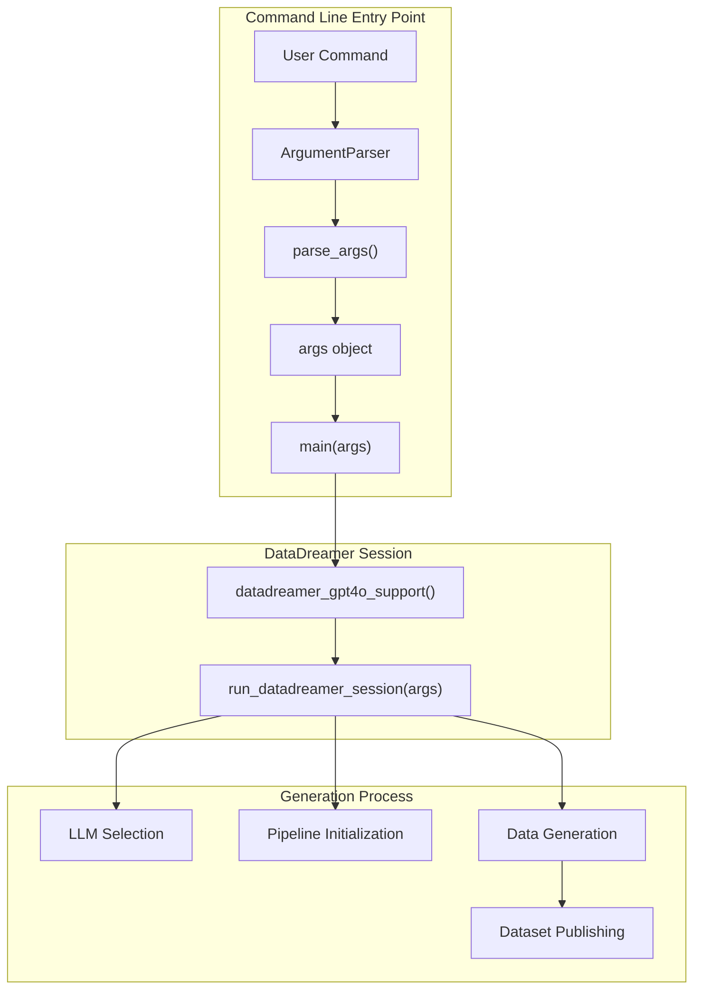
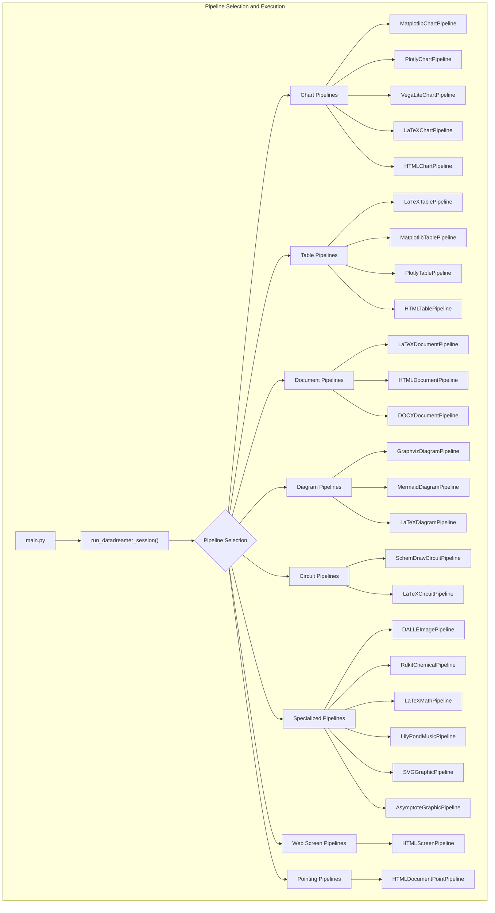
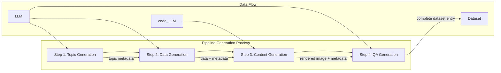

<!-- source: DeepWiki mcp.deepwiki.com · repo allenai/pixmo-docs · page 2 Getting Started · fetched 2026-10-26 -->

# Getting Started

<details>
<summary>Relevant source files</summary>

The following files were used as context for generating this wiki page:

- [LICENSE](LICENSE)
- [README.md](README.md)
- [main.py](main.py)
- [requirements.txt](requirements.txt)

</details>


This guide provides instructions for setting up and using the pixmo-docs repository to generate synthetic datasets of text-rich images. These datasets are designed for training multimodal models like Molmo. For a comprehensive overview of the system's purpose and capabilities, see [Overview](#1).

## System Requirements

Before installing the pixmo-docs repository, ensure you have the following prerequisites:

- **Python**: Version 3.10 is recommended
- **LaTeX**: Required for several pipelines (installation varies by OS)
- **Mermaid CLI**: Required for diagram generation
- **Playwright/Chromium**: Required for HTML rendering
- **API Keys**: OpenAI and/or Anthropic API keys (HuggingFace token for dataset publishing)

Sources: [README.md:5-20]()

## Installation Steps

### 1. Environment Setup

Clone the repository and set up a conda environment:

```bash
git clone https://github.com/allenai/pixmo-docs
cd pixmo-docs
conda create --name pixmo-doc python=3.10
conda activate pixmo-doc
pip install -r requirements.txt
```

### 2. API Key Configuration

Export your API keys as environment variables:

```bash
export OPENAI_API_KEY=your-api-key
export ANTHROPIC_API_KEY=your-api-key
export HF_TOKEN=your-api-key # only needed for Hugging Face uploads
```

### 3. Additional Dependencies

Install the following dependencies based on which pipelines you plan to use:

| Pipeline Category | Required Dependency | Installation Command |
|-------------------|---------------------|----------------------|
| LaTeX-based pipelines | LaTeX | Follow [LaTeX Project](https://www.latex-project.org/get) instructions |
| Mermaid diagrams | Mermaid CLI | `npm install -g @mermaid-js/mermaid-cli` |
| HTML-based pipelines | Playwright | `pip install playwright && playwright install` |
| Financial charts | mplfinance | `pip install mpl_finance<=0.10.1 mplfinance<=0.12.10b0` |
| SVG rendering | cairosvg | `pip install cairosvg<=2.7.1` |

Sources: [README.md:22-47](), [requirements.txt:1-46]()

## Basic Usage

The main entry point for the system is the [main.py]() script, which invokes the `run_datadreamer_session` function to orchestrate the generation process.

### Command Line Arguments Flow



### Essential Command Line Arguments

The basic syntax for running the generation script is:

```bash
python main.py -p PIPELINE_NAME -t TYPE_OF_DATA -n NUMBER_OF_SAMPLES -m DATASET_NAME
```

Key parameters include:

| Argument | Flag | Description | Default |
|----------|------|-------------|---------|
| LLM | `-l`, `--llm` | LLM to use (gpt-4o or claude-sonnet) | gpt-4o |
| Code LLM | `-c`, `--code_llm` | LLM for code generation | claude-sonnet |
| Pipelines | `-p`, `--pipelines` | Which pipelines to run (comma-separated) | MatplotlibChartPipeline |
| Num Samples | `-n`, `--num` | Number of visualizations per pipeline | 1 |
| Seed | `-s`, `--seed` | Seed for generation | 42 |
| Batch Size | `-b`, `--batch_size` | Parallel LLM requests | 24 |
| Code Batch Size | `-cb`, `--code_batch_size` | Parallel coding LLM requests | 24 |
| Force | `-f`, `--force` | Force regeneration | False |
| Dataset Name | `-m`, `--name` | Name for the HuggingFace dataset | scifi |
| Types | `-t`, `--types` | Types of visualizations (comma-separated) | bar chart |
| QA | `-q`, `--qa` | Whether to generate QA pairs | True |

Sources: [main.py:13-119]()

### Example Command

Generate 5 bar charts using Matplotlib:

```bash
python main.py -p "MatplotlibChartPipeline" -n 5 -m "matplotlib_test" -t "bar chart"
```

You can specify multiple pipelines and types by using comma-separated values:

```bash
python main.py -p "MatplotlibChartPipeline,LaTeXTablePipeline" -n "5,10" -m "mixed_dataset" -t "bar chart,academic table"
```

Sources: [README.md:49-63]()

## Available Pipelines

The system provides 25 pipelines organized into 8 categories for generating different types of text-rich images.



### Pipeline Categories Overview

| Category | Description | Available Pipelines |
|----------|-------------|---------------------|
| Chart | Generate various chart types | MatplotlibChartPipeline, PlotlyChartPipeline, VegaLiteChartPipeline, LaTeXChartPipeline, HTMLChartPipeline |
| Table | Create tabular data visualizations | LaTeXTablePipeline, MatplotlibTablePipeline, PlotlyTablePipeline, HTMLTablePipeline |
| Document | Generate full document layouts | LaTeXDocumentPipeline, HTMLDocumentPipeline, DOCXDocumentPipeline |
| Diagram | Create flowcharts and other diagrams | GraphvizDiagramPipeline, MermaidDiagramPipeline, LaTeXDiagramPipeline |
| Circuit | Generate electrical circuit diagrams | SchemDrawCircuitPipeline, LaTeXCircuitPipeline |
| Specialized Graphics | Create specialized visualizations | DALLEImagePipeline, RdkitChemicalPipeline, LaTeXMathPipeline, LilyPondMusicPipeline, SVGGraphicPipeline, AsymptoteGraphicPipeline |
| Web Screens | Generate web interface layouts | HTMLScreenPipeline |
| Pointing | Create documents with structured points | HTMLDocumentPointPipeline |

For detailed information about each pipeline category, see [Pipeline Categories](#4).

Sources: [README.md:66-108]()

## Generation Process

Each pipeline follows a structured generation process with four typical steps.



The data generation flow includes:
1. **Topic Generation**: LLM generates visualization topics
2. **Data Generation**: LLM creates structured data for the visualization
3. **Content Generation**: Code LLM generates code to render the visualization
4. **QA Generation**: LLM creates question-answer pairs about the visualization

For more details on the system architecture, see [System Architecture](#3).

Sources: [README.md:49-63]()

## Next Steps

After setting up and running your first generation, explore these additional resources:

- For detailed system architecture: [System Architecture](#3)
- For specific pipeline categories: [Pipeline Categories](#4)
- For QA generation details: [QA Generation](#5)
- For LLM configuration: [LLM Integration](#6)
- For advanced command line usage: [Command Line Usage](#7)
- For extending the system: [Development Guide](#8)

---

