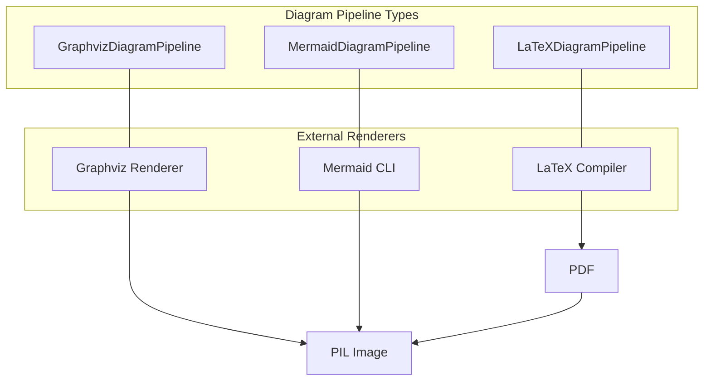
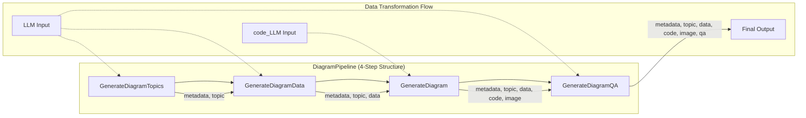
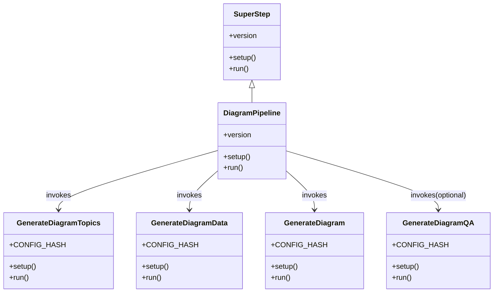
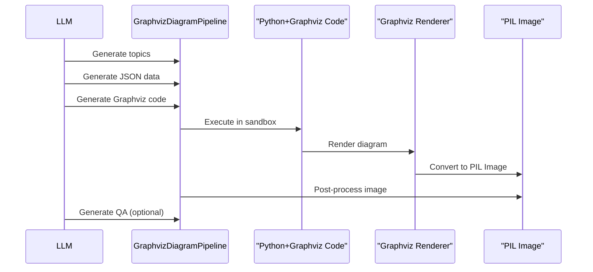
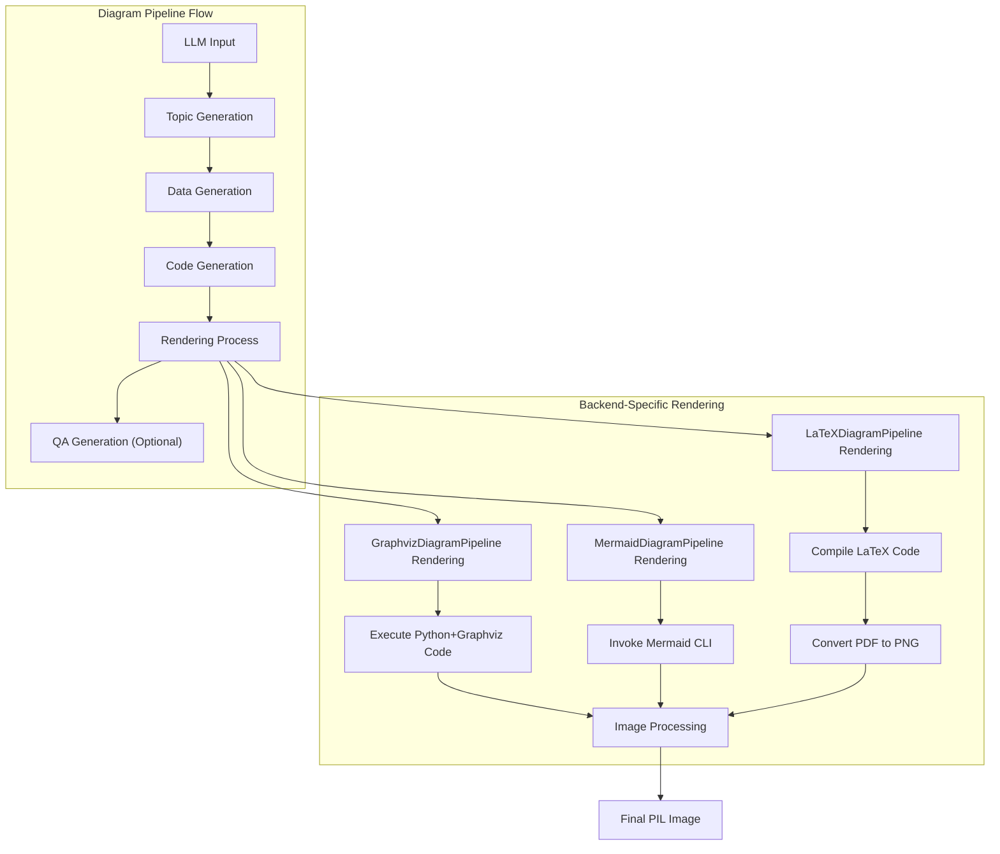

<!-- source: DeepWiki mcp.deepwiki.com · repo allenai/pixmo-docs · page 4.3 Diagram Pipelines · fetched 2026-10-26 -->

# Diagram Pipelines

<details>
<summary>Relevant source files</summary>

The following files were used as context for generating this wiki page:

- [LICENSE](LICENSE)
- [README.md](README.md)
- [pipeline/graphviz_diagram_pipeline/__init__.py](pipeline/graphviz_diagram_pipeline/__init__.py)
- [pipeline/graphviz_diagram_pipeline/generate_diagram.py](pipeline/graphviz_diagram_pipeline/generate_diagram.py)
- [pipeline/latex_diagram_pipeline/pipeline.py](pipeline/latex_diagram_pipeline/pipeline.py)
- [pipeline/mermaid_diagram_pipeline/pipeline.py](pipeline/mermaid_diagram_pipeline/pipeline.py)
- [pipeline/prompts/diagram_prompts.py](pipeline/prompts/diagram_prompts.py)

</details>


## Introduction

Diagram Pipelines in the pixmo-docs repository enable the generation of various diagrams including flowcharts, sequence diagrams, entity-relationship diagrams, and other visual representations of structured data. This document covers the three diagram pipeline implementations, their architecture, and their integration with external rendering tools.

This page focuses specifically on diagram-type visualizations. For other visual content types, see related pages:
- For charts and plots, see [Chart Pipelines](#4.1)
- For tabular data, see [Table Pipelines](#4.2)
- For specialized graphics, see [Specialized Graphics Pipelines](#4.4)

Sources: [README.md:87-90]()

## Pipeline Overview

The pixmo-docs system includes three diagram pipeline implementations, each using a different rendering technology:

1. **GraphvizDiagramPipeline**: Uses [Graphviz](https://graphviz.org) to generate node-edge diagrams like directed graphs, trees, and network diagrams
2. **MermaidDiagramPipeline**: Uses [Mermaid](https://mermaid-js.github.io/mermaid) to generate flowcharts, sequence diagrams, and other diagram types
3. **LaTeXDiagramPipeline**: Uses TikZ (LaTeX package) to generate high-quality diagrams with precise control over layout and styling

All diagram pipelines follow the standard four-step architecture common to pipelines in the system, with specialized implementations for diagram generation.



Sources: [README.md:87-90](), [pipeline/graphviz_diagram_pipeline/__init__.py:1-4](), [pipeline/mermaid_diagram_pipeline/pipeline.py:1-105](), [pipeline/latex_diagram_pipeline/pipeline.py:1-105]()

## Pipeline Architecture

All diagram pipelines share a common four-step architecture that transforms high-level topics into rendered diagrams with associated question-answer pairs.



Each pipeline follows this structure, with the only difference being the rendering backend used in the `GenerateDiagram` step. Let's examine each step in detail:

1. **GenerateDiagramTopics**: Generates diverse diagram topics based on the specified diagram type and persona
2. **GenerateDiagramData**: Creates structured data (typically in JSON format) representing the elements of the diagram
3. **GenerateDiagram**: Generates code (Graphviz, Mermaid, or LaTeX) based on the data and renders it to an image
4. **GenerateDiagramQA** (optional): Generates question-answer pairs about the diagram content for training purposes

Sources: [pipeline/mermaid_diagram_pipeline/pipeline.py:32-94](), [pipeline/latex_diagram_pipeline/pipeline.py:32-94]()

## Common Pipeline Implementation

All three diagram pipelines share nearly identical implementation structure, differing only in the specific rendering backend used. Here's the common implementation pattern:



Each diagram pipeline class:
1. Inherits from `SuperStep`
2. Registers required arguments including `llm`, `code_llm`, `batch_size`, `code_batch_size`, `n`, `seed`, `figure_types`, and `qa`
3. Registers output fields including `metadata`, `topic`, `data`, `code`, and `image` (and optionally `qa`)
4. Implements a `run()` method that executes the four steps in sequence
5. Defines a `version` property that computes a hash of the configuration hashes of all steps

Sources: [pipeline/mermaid_diagram_pipeline/pipeline.py:9-105](), [pipeline/latex_diagram_pipeline/pipeline.py:9-105]()

## Pipeline Steps in Detail

### 1. GenerateDiagramTopics

This step generates topic ideas for diagrams based on the specified persona and diagram type.

**Inputs:**
- Pipeline name
- LLM to use
- Batch size
- Number of topics to generate (n)
- Random seed
- Figure types to generate

**Outputs:**
- `metadata`: Contains pipeline configuration information
- `topic`: The generated diagram topics

**Process:**
1. Uses the `GENERATE_DIAGRAM_TOPICS_PROMPT` template to prompt the LLM
2. Generates multiple diagram topics appropriate for the specified figure type
3. Ensures topics are diverse and well-suited for the diagram type

Sources: [pipeline/prompts/diagram_prompts.py:6-16](), [pipeline/mermaid_diagram_pipeline/pipeline.py:34-44]()

### 2. GenerateDiagramData

This step generates structured data for each diagram topic, typically in JSON format.

**Inputs:**
- `metadata` from previous step
- `topic` from previous step
- LLM to use
- Batch size

**Outputs:**
- `metadata`: Passed through from input
- `topic`: Passed through from input
- `data`: Structured JSON data for the diagram

**Process:**
1. Uses the `GENERATE_DIAGRAM_DATA_JSON_PROMPT` template to prompt the LLM
2. Generates data elements appropriate for the diagram type and topic
3. Ensures data is realistic and contains suitable level of detail

Sources: [pipeline/prompts/diagram_prompts.py:19-29](), [pipeline/mermaid_diagram_pipeline/pipeline.py:47-57]()

### 3. GenerateDiagram

This step generates the diagram code and renders it to an image. This is where the three pipeline implementations differ, as each uses a different rendering backend.

**Inputs:**
- `metadata` from previous step
- `topic` from previous step
- `data` from previous step
- LLM to use for code generation
- Batch size

**Outputs:**
- `metadata`: Passed through from input
- `topic`: Passed through from input
- `data`: Passed through from input
- `code`: Generated diagram code (Graphviz, Mermaid, or LaTeX)
- `image`: Rendered diagram as a PIL Image

**Process:**
1. Uses backend-specific prompt template to generate code:
   - `GENERATE_DIAGRAM_CODE_GRAPHVIZ_PROMPT` for Graphviz
   - `GENERATE_DIAGRAM_CODE_MERMAID_PROMPT` for Mermaid
   - `GENERATE_DIAGRAM_CODE_LATEX_PROMPT` for LaTeX
2. Executes the generated code to produce an image
3. Handles error cases and timeout situations
4. Processes the image for consistent formatting

Sources: [pipeline/prompts/diagram_prompts.py:111-190](), [pipeline/graphviz_diagram_pipeline/generate_diagram.py:20-150](), [pipeline/mermaid_diagram_pipeline/pipeline.py:60-71]()

### 4. GenerateDiagramQA (Optional)

This optional step generates question-answer pairs about the diagram.

**Inputs:**
- `metadata` from previous step
- `topic` from previous step
- `data` from previous step
- `code` from previous step
- `image` from previous step
- LLM to use
- Batch size

**Outputs:**
- All inputs passed through
- `qa`: Generated question-answer pairs about the diagram

**Process:**
1. Uses `GENERATE_DIAGRAM_QA_PROMPT` or `GENERATE_DIAGRAM_QA_SHORT_ANSWER_PROMPT` template
2. Generates diverse question types:
   - Short-answer questions
   - Multiple-choice questions
   - Yes/No questions
   - Summary questions
3. Ensures questions require different levels of reasoning complexity

Sources: [pipeline/prompts/diagram_prompts.py:33-105](), [pipeline/mermaid_diagram_pipeline/pipeline.py:77-93]()

## Rendering Backends

The three diagram pipelines differ primarily in their rendering backends:

### 1. GraphvizDiagramPipeline

Uses Graphviz to generate node-edge diagrams like directed graphs and trees. This pipeline:
- Generates Python code using the Graphviz library
- Executes the code in a temporary directory with a timeout
- Converts the result to a PIL Image

The code execution is sandboxed and includes timeout handling to prevent infinite loops.



Sources: [pipeline/graphviz_diagram_pipeline/generate_diagram.py:20-150]()

### 2. MermaidDiagramPipeline

Uses Mermaid to generate flowcharts, sequence diagrams, etc. This pipeline:
- Generates Mermaid syntax code
- Uses the Mermaid CLI to render the diagram
- Requires Node.js and the Mermaid CLI to be installed

The rendering process uses the `mmdc` command from the Mermaid CLI package.

### 3. LaTeXDiagramPipeline

Uses TikZ to generate LaTeX-based diagrams. This pipeline:
- Generates LaTeX code using TikZ and related packages
- Compiles the LaTeX code to produce a PDF
- Converts the PDF to an image
- Requires a full LaTeX installation

The LaTeX backend provides the most precise control over diagram layout and styling.

## Prompt Templates

The diagram pipelines use specialized prompts for each step. Here are the key prompt templates:

### Topic Generation Prompt

Used to generate diverse topics for diagrams based on persona and diagram type:

```
You are an expert in diagram design and have a broad knowledge of different topics.
My persona is: "{persona}"
I want you to generate {num_topics} topics for {figure_type} that I will be interested in or I may see during my daily life given my persona.

Here are the requirements:
1. Each topic is a high-level summary of the contents in {figure_type} with some design details, e.g., "the utility bill for the month of January 2022 with a detailed breakdown of charges".
2. The topics should be diverse to help me generate varied diagrams. Each topic should be unique and not overlap with others.
3. The topics are conditioned on the diagram type. Please ensure the topics you provided can be best visualized in "{figure_type}".
4. All topics must be in English, even if the persona is non-English.
5. List {num_topics} topics for "{persona}" and separate them with a | character, e.g., topic1 | topic2 | ...... | topic{num_topics}.
Do not include any additional text at the beginning or end of your response.
```

Sources: [pipeline/prompts/diagram_prompts.py:6-16]()

### Data Generation Prompt

Used to generate structured data for diagrams:

```
You are an expert in diagram design and have broad knowledge about various topics.
My persona is: "{persona}"
I need some elements about "{topic}", which can be used to generate a {figure_type}. 
Here are the requirements:
1. The elements should be related to the topic and customized according to my persona. Its structure must be suitable for the {figure_type}.
2. The elements should be realistic, and the contents should be named using real-world entities. Do not use placeholder names like xxA, xxB, etc.
3. Do not provide too many elements. Just provide key pieces of information that are essential for the diagram. 
4. The text for each node/edge should be concise and not too long, which can be easily understood by the viewers.
5. All elements must be in English, even if the persona is non-English.
Please provide the elements in JSON format without additional text at the beginning or end.
```

Sources: [pipeline/prompts/diagram_prompts.py:19-29]()

### Backend-Specific Code Generation Prompts

Each backend has a specialized prompt for code generation. For example, the Graphviz code generation prompt begins with:

```
You are an expert in graph design and good at writing code (Python `graphviz`) to generate diagrams.
My persona is: "{persona}"
I have some data about {topic} which can be used to generate a {figure_type}.

Here is the data (JSON format, already loaded as a dictionary):
<data>
{data}
</data>

Please define a Python function (using `graphviz`) called `generate_diagram` that generates a {figure_type} using the data provided...
```

Sources: [pipeline/prompts/diagram_prompts.py:111-134]()

## Usage Examples

To generate diagrams using these pipelines, you can use the main script with appropriate parameters:

```bash
# Generate 5 flowcharts using Mermaid
python main.py -p "MermaidDiagramPipeline" -n 5 -m "mermaid_flowcharts" -t "flowchart"

# Generate 10 sequence diagrams using Mermaid
python main.py -p "MermaidDiagramPipeline" -n 10 -m "mermaid_sequence" -t "sequence diagram"

# Generate 5 directed graphs using Graphviz
python main.py -p "GraphvizDiagramPipeline" -n 5 -m "graphviz_digraphs" -t "directed graph"

# Generate 5 block diagrams using LaTeX
python main.py -p "LaTeXDiagramPipeline" -n 5 -m "latex_block_diagrams" -t "block diagram"
```

For more information on CLI usage, refer to the [Command Line Usage](#7) page.

Sources: [README.md:49-63]()

## Integration with Rendering System

The diagram pipelines integrate with the overall rendering system in pixmo-docs. The rendering process flows through the following stages:



The flow ensures that diagram generation is handled consistently regardless of the backend used, with appropriate error handling and safeguards for each rendering technology.

Sources: [pipeline/graphviz_diagram_pipeline/generate_diagram.py:97-124]()

## Conclusion

The Diagram Pipelines in pixmo-docs provide a flexible and extensible framework for generating diverse types of diagrams using three different rendering backends: Graphviz, Mermaid, and LaTeX. Each pipeline follows a consistent four-step architecture that transforms high-level topics into rendered diagrams with associated question-answer pairs, leveraging LLMs at each step.

By supporting multiple rendering backends, the system can generate a wide variety of diagram types, from simple flowcharts to complex directed graphs and precisely styled technical diagrams, making it suitable for generating comprehensive training datasets for multimodal models.

---

