# Page: Overview

# Overview

<details>
<summary>Relevant source files</summary>

The following files were used as context for generating this wiki page:

- [LICENSE](LICENSE)
- [README.md](README.md)
- [main.py](main.py)

</details>


PixMo-Docs is a framework for generating synthetic datasets of text-rich images used to train multimodal models. It provides a comprehensive system for creating diverse visualizations including charts, tables, documents, diagrams, circuits, and specialized graphics. This document introduces the purpose, architecture, and key components of the PixMo-Docs repository. For specific setup instructions, see [Getting Started](#2).

## Purpose and Scope

The PixMo-Docs repository was created to generate several important datasets:
- **PixMo-Docs**: Used to train the [Molmo](https://arxiv.org/abs/2409.17146) model
- **CoSyn-400K**: An expanded version with improved pipelines and more document types
- **CoSyn-point**: A specialized dataset focusing on pointing tasks

These datasets contain synthetic text-rich images that help multimodal models learn to understand and reason about visual content containing textual information.

Sources: [README.md:1-3]()

## System Architecture Overview

The PixMo-Docs system follows a modular architecture organized around pipelines that generate different types of visual content. The system combines large language models (LLMs) with specialized rendering engines to create diverse, high-quality visuals.

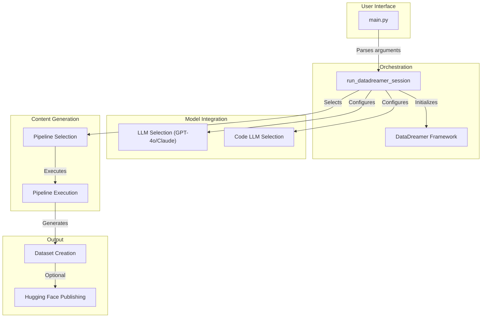

Sources: [main.py:1-14](), [README.md:49-62]()

## Pipeline Structure

Each pipeline in PixMo-Docs follows a similar four-step structure to generate content:

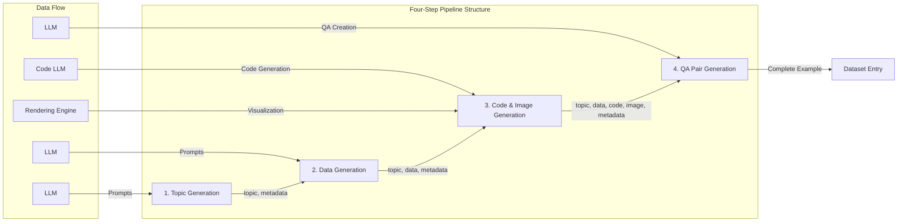

Sources: [README.md:65-109]()

## Pipeline Categories

PixMo-Docs includes 25 pipelines organized into 8 categories, each specialized for different types of visual content:

| Category | Description | Key Pipelines |
|----------|-------------|---------------|
| **Chart** | Generates various chart visualizations | MatplotlibChartPipeline, PlotlyChartPipeline, VegaLiteChartPipeline, LaTeXChartPipeline, HTMLChartPipeline |
| **Table** | Creates tabular data visualizations | LaTeXTablePipeline, MatplotlibTablePipeline, PlotlyTablePipeline, HTMLTablePipeline |
| **Document** | Produces formatted text documents | LaTeXDocumentPipeline, HTMLDocumentPipeline, DOCXDocumentPipeline |
| **Diagram** | Generates flowcharts, trees, etc. | GraphvizDiagramPipeline, MermaidDiagramPipeline, LaTeXDiagramPipeline |
| **Circuit** | Creates electrical circuit diagrams | SchemDrawCircuitPipeline, LaTeXCircuitPipeline |
| **Specialized Graphics** | Produces domain-specific visuals | DALLEImagePipeline, RdkitChemicalPipeline, LaTeXMathPipeline, LilyPondMusicPipeline, SVGGraphicPipeline, AsymptoteGraphicPipeline |
| **Web Screens** | Renders HTML-based layouts | HTMLScreenPipeline |
| **Pointing** | Creates documents with structured points | HTMLDocumentPointPipeline |

Sources: [README.md:66-108]()

## Rendering System

PixMo-Docs includes a comprehensive rendering system that converts various data formats into images:

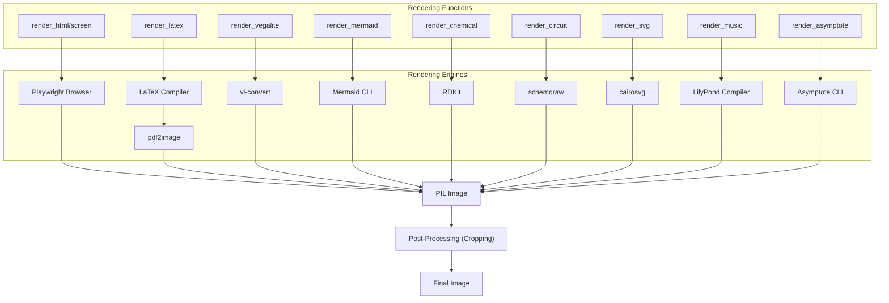

Sources: [README.md:21-46]()

## LLM Integration

PixMo-Docs integrates with state-of-the-art language models to generate content:

| LLM | Default Usage | Configuration |
|-----|---------------|--------------|
| GPT-4o | Primary LLM for general content | Set with `-l` or `--llm` |
| Claude Sonnet | Default for code generation | Set with `-c` or `--code_llm` |

Different LLMs are used for different stages of the pipeline, with specialized models handling code generation tasks.

Sources: [main.py:29-42]()

## Command Line Usage

The primary entry point for PixMo-Docs is the `main.py` script, which accepts various arguments to control dataset generation:

```
python main.py -p "{PIPELINE}" -t "{TYPE_OF_DATA}" -n {NUMBER_OF_SAMPLES} -m "{NAME_OF_DATASET}"
```

Key parameters include:
- `-p/--pipelines`: Pipelines to run (comma-separated)
- `-t/--types`: Types of visualizations to generate
- `-n/--num`: Number of visualizations to generate per pipeline
- `-m/--name`: Name of the dataset
- `-l/--llm`: Language model to use (default: gpt-4o)
- `-c/--code_llm`: Language model for code generation (default: claude-sonnet)
- `-q/--qa`: Whether to generate question-answer pairs (default: True)

Sources: [main.py:13-119](), [README.md:49-63]()

## Workflow Example

The following diagram illustrates a typical workflow for generating a dataset with PixMo-Docs:

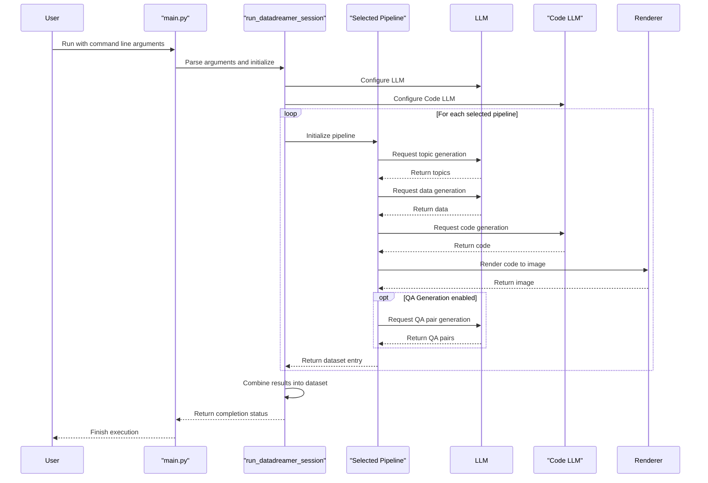

Sources: [main.py:1-14](), [README.md:49-63]()

## Related Resources

For more information about the datasets generated by PixMo-Docs, refer to the following papers:
- Yang, Y., et al. (2025). Scaling Text-Rich Image Understanding via Code-Guided Synthetic Multimodal Data Generation.
- Deitke, M., et al. (2024). Molmo and pixmo: Open weights and open data for state-of-the-art multimodal models.

Sources: [README.md:113-132]()

For more detailed information about specific components, please refer to the following pages:
- [Getting Started](#2) for setup and basic usage
- [System Architecture](#3) for in-depth architecture details
- [Pipeline Categories](#4) for specific pipeline documentation
- [LLM Integration](#6) for details on language model integration

---

# Page: Getting Started

# Getting Started

<details>
<summary>Relevant source files</summary>

The following files were used as context for generating this wiki page:

- [LICENSE](LICENSE)
- [README.md](README.md)
- [main.py](main.py)
- [requirements.txt](requirements.txt)

</details>


This guide provides instructions for setting up and using the pixmo-docs repository to generate synthetic datasets of text-rich images. These datasets are designed for training multimodal models like Molmo. For a comprehensive overview of the system's purpose and capabilities, see [Overview](#1).

## System Requirements

Before installing the pixmo-docs repository, ensure you have the following prerequisites:

- **Python**: Version 3.10 is recommended
- **LaTeX**: Required for several pipelines (installation varies by OS)
- **Mermaid CLI**: Required for diagram generation
- **Playwright/Chromium**: Required for HTML rendering
- **API Keys**: OpenAI and/or Anthropic API keys (HuggingFace token for dataset publishing)

Sources: [README.md:5-20]()

## Installation Steps

### 1. Environment Setup

Clone the repository and set up a conda environment:

```bash
git clone https://github.com/allenai/pixmo-docs
cd pixmo-docs
conda create --name pixmo-doc python=3.10
conda activate pixmo-doc
pip install -r requirements.txt
```

### 2. API Key Configuration

Export your API keys as environment variables:

```bash
export OPENAI_API_KEY=your-api-key
export ANTHROPIC_API_KEY=your-api-key
export HF_TOKEN=your-api-key # only needed for Hugging Face uploads
```

### 3. Additional Dependencies

Install the following dependencies based on which pipelines you plan to use:

| Pipeline Category | Required Dependency | Installation Command |
|-------------------|---------------------|----------------------|
| LaTeX-based pipelines | LaTeX | Follow [LaTeX Project](https://www.latex-project.org/get) instructions |
| Mermaid diagrams | Mermaid CLI | `npm install -g @mermaid-js/mermaid-cli` |
| HTML-based pipelines | Playwright | `pip install playwright && playwright install` |
| Financial charts | mplfinance | `pip install mpl_finance<=0.10.1 mplfinance<=0.12.10b0` |
| SVG rendering | cairosvg | `pip install cairosvg<=2.7.1` |

Sources: [README.md:22-47](), [requirements.txt:1-46]()

## Basic Usage

The main entry point for the system is the [main.py]() script, which invokes the `run_datadreamer_session` function to orchestrate the generation process.

### Command Line Arguments Flow

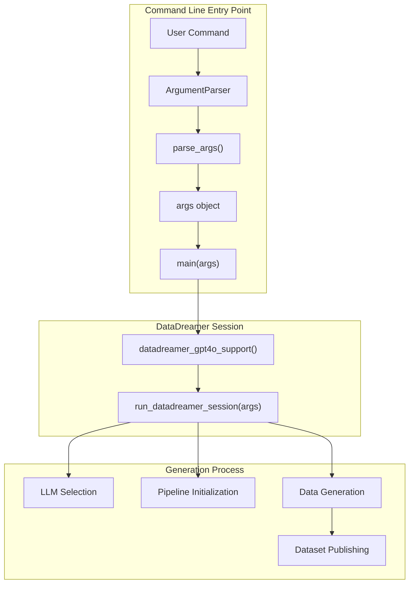

### Essential Command Line Arguments

The basic syntax for running the generation script is:

```bash
python main.py -p PIPELINE_NAME -t TYPE_OF_DATA -n NUMBER_OF_SAMPLES -m DATASET_NAME
```

Key parameters include:

| Argument | Flag | Description | Default |
|----------|------|-------------|---------|
| LLM | `-l`, `--llm` | LLM to use (gpt-4o or claude-sonnet) | gpt-4o |
| Code LLM | `-c`, `--code_llm` | LLM for code generation | claude-sonnet |
| Pipelines | `-p`, `--pipelines` | Which pipelines to run (comma-separated) | MatplotlibChartPipeline |
| Num Samples | `-n`, `--num` | Number of visualizations per pipeline | 1 |
| Seed | `-s`, `--seed` | Seed for generation | 42 |
| Batch Size | `-b`, `--batch_size` | Parallel LLM requests | 24 |
| Code Batch Size | `-cb`, `--code_batch_size` | Parallel coding LLM requests | 24 |
| Force | `-f`, `--force` | Force regeneration | False |
| Dataset Name | `-m`, `--name` | Name for the HuggingFace dataset | scifi |
| Types | `-t`, `--types` | Types of visualizations (comma-separated) | bar chart |
| QA | `-q`, `--qa` | Whether to generate QA pairs | True |

Sources: [main.py:13-119]()

### Example Command

Generate 5 bar charts using Matplotlib:

```bash
python main.py -p "MatplotlibChartPipeline" -n 5 -m "matplotlib_test" -t "bar chart"
```

You can specify multiple pipelines and types by using comma-separated values:

```bash
python main.py -p "MatplotlibChartPipeline,LaTeXTablePipeline" -n "5,10" -m "mixed_dataset" -t "bar chart,academic table"
```

Sources: [README.md:49-63]()

## Available Pipelines

The system provides 25 pipelines organized into 8 categories for generating different types of text-rich images.

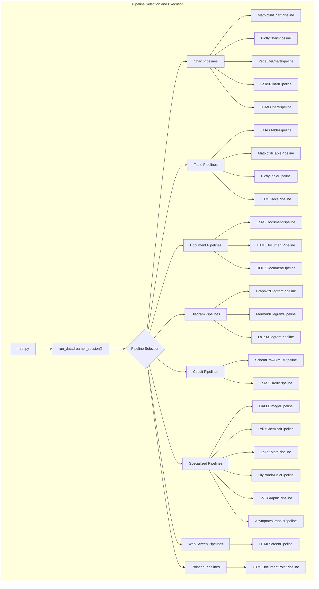

### Pipeline Categories Overview

| Category | Description | Available Pipelines |
|----------|-------------|---------------------|
| Chart | Generate various chart types | MatplotlibChartPipeline, PlotlyChartPipeline, VegaLiteChartPipeline, LaTeXChartPipeline, HTMLChartPipeline |
| Table | Create tabular data visualizations | LaTeXTablePipeline, MatplotlibTablePipeline, PlotlyTablePipeline, HTMLTablePipeline |
| Document | Generate full document layouts | LaTeXDocumentPipeline, HTMLDocumentPipeline, DOCXDocumentPipeline |
| Diagram | Create flowcharts and other diagrams | GraphvizDiagramPipeline, MermaidDiagramPipeline, LaTeXDiagramPipeline |
| Circuit | Generate electrical circuit diagrams | SchemDrawCircuitPipeline, LaTeXCircuitPipeline |
| Specialized Graphics | Create specialized visualizations | DALLEImagePipeline, RdkitChemicalPipeline, LaTeXMathPipeline, LilyPondMusicPipeline, SVGGraphicPipeline, AsymptoteGraphicPipeline |
| Web Screens | Generate web interface layouts | HTMLScreenPipeline |
| Pointing | Create documents with structured points | HTMLDocumentPointPipeline |

For detailed information about each pipeline category, see [Pipeline Categories](#4).

Sources: [README.md:66-108]()

## Generation Process

Each pipeline follows a structured generation process with four typical steps.

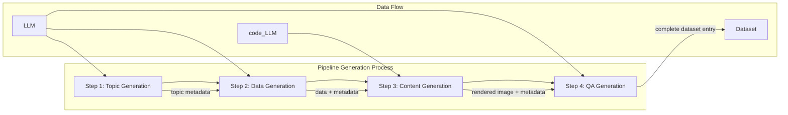

The data generation flow includes:
1. **Topic Generation**: LLM generates visualization topics
2. **Data Generation**: LLM creates structured data for the visualization
3. **Content Generation**: Code LLM generates code to render the visualization
4. **QA Generation**: LLM creates question-answer pairs about the visualization

For more details on the system architecture, see [System Architecture](#3).

Sources: [README.md:49-63]()

## Next Steps

After setting up and running your first generation, explore these additional resources:

- For detailed system architecture: [System Architecture](#3)
- For specific pipeline categories: [Pipeline Categories](#4)
- For QA generation details: [QA Generation](#5)
- For LLM configuration: [LLM Integration](#6)
- For advanced command line usage: [Command Line Usage](#7)
- For extending the system: [Development Guide](#8)

---

# Page: System Architecture

# System Architecture

<details>
<summary>Relevant source files</summary>

The following files were used as context for generating this wiki page:

- [LICENSE](LICENSE)
- [README.md](README.md)
- [pipeline/__init__.py](pipeline/__init__.py)
- [pipeline/all_pipelines.py](pipeline/all_pipelines.py)

</details>


## Purpose and Scope

This document describes the high-level architecture of the PixMo-Docs framework, which generates synthetic datasets of text-rich images for training multimodal models like Molmo. It outlines the core components, pipeline system, rendering capabilities, and data flow throughout the system. For information about the DataDreamer orchestration implementation details, see [DataDreamer Session](#3.1). For details about the rendering system implementation, see [Rendering System](#3.2).

## High-Level Architecture Overview

PixMo-Docs follows a modular architecture with several key components that work together to generate diverse visual content:

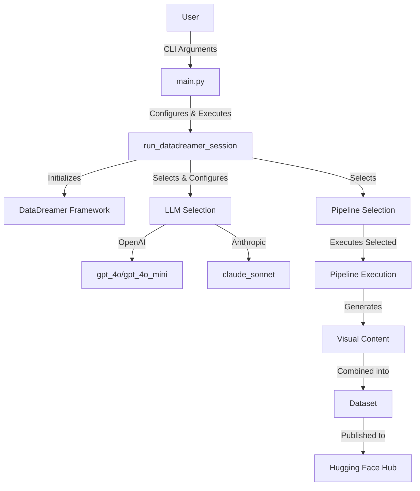

Sources:
- [pipeline/all_pipelines.py:42-148]()
- [pipeline/__init__.py:1-4]()

The system architecture centers around the `run_datadreamer_session` function, which orchestrates the entire generation process. It initializes the DataDreamer framework, configures LLMs, selects and executes pipelines, and publishes the generated dataset to Hugging Face Hub.

## Pipeline System

The framework consists of 25 pipelines organized into 8 categories, each specializing in generating different types of text-rich images:

| Category | Pipelines | Purpose |
|----------|-----------|---------|
| **Charts** | MatplotlibChartPipeline, PlotlyChartPipeline, VegaLiteChartPipeline, LaTeXChartPipeline, HTMLChartPipeline | Generate various chart types using different visualization libraries |
| **Tables** | LaTeXTablePipeline, MatplotlibTablePipeline, PlotlyTablePipeline, HTMLTablePipeline | Generate tabular data visualizations |
| **Documents** | LaTeXDocumentPipeline, HTMLDocumentPipeline, DOCXDocumentPipeline | Generate document formats with rich text and layout |
| **Diagrams** | GraphvizDiagramPipeline, MermaidDiagramPipeline, LaTeXDiagramPipeline | Generate flowcharts, sequence diagrams, etc. |
| **Circuits** | SchemDrawCircuitPipeline, LaTeXCircuitPipeline | Generate electrical circuit diagrams |
| **Specialized Graphics** | DALLEImagePipeline, RdkitChemicalPipeline, LaTeXMathPipeline, LilyPondMusicPipeline, SVGGraphicPipeline, AsymptoteGraphicPipeline | Generate domain-specific visualizations |
| **Web Screens** | HTMLScreenPipeline | Create webpage layouts and UI mockups |
| **Pointing** | HTMLDocumentPointPipeline | Generate documents with point references |

Sources:
- [pipeline/all_pipelines.py:76-102]()
- [README.md:66-108]()

### Pipeline Structure

Most pipelines follow a consistent 4-step structure:

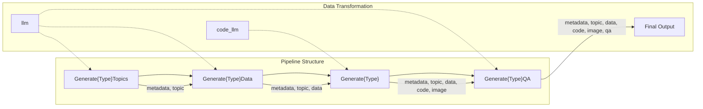

The typical pipeline steps are:

1. **Topic Generation**: Generates domain-specific topics based on user-requested figure types
2. **Data Generation**: Creates appropriate data structures for the generated topics
3. **Code Generation & Rendering**: Generates code to visualize the data and renders it to an image
4. **QA Generation (optional)**: Creates question-answer pairs about the content

Each step inherits from a `SuperStep` class and has well-defined inputs and outputs, creating a structured data flow through the pipeline.

Sources:
- [pipeline/all_pipelines.py:120-135]()

## Pipeline Selection and Execution

The `run_datadreamer_session` function handles pipeline selection and execution based on user-provided arguments:

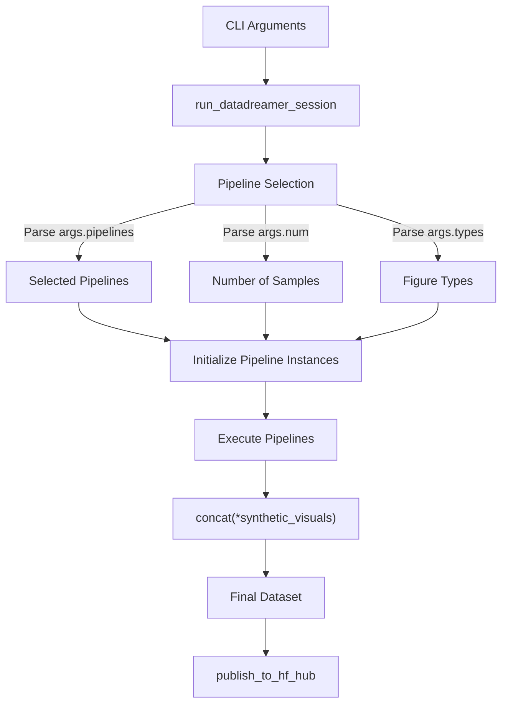

The pipeline selection process translates user input (pipeline names, figure types, and sample counts) into concrete pipeline instances that are executed sequentially. The results from all pipelines are concatenated using DataDreamer's `concat` function before being published to Hugging Face Hub.

Sources:
- [pipeline/all_pipelines.py:103-147]()

## LLM Integration

The system integrates with two LLM providers:

1. **OpenAI**: GPT-4o and GPT-4o mini
2. **Anthropic**: Claude Sonnet (version claude-3-7-sonnet-20250219)

These LLMs serve different functions within the pipeline:

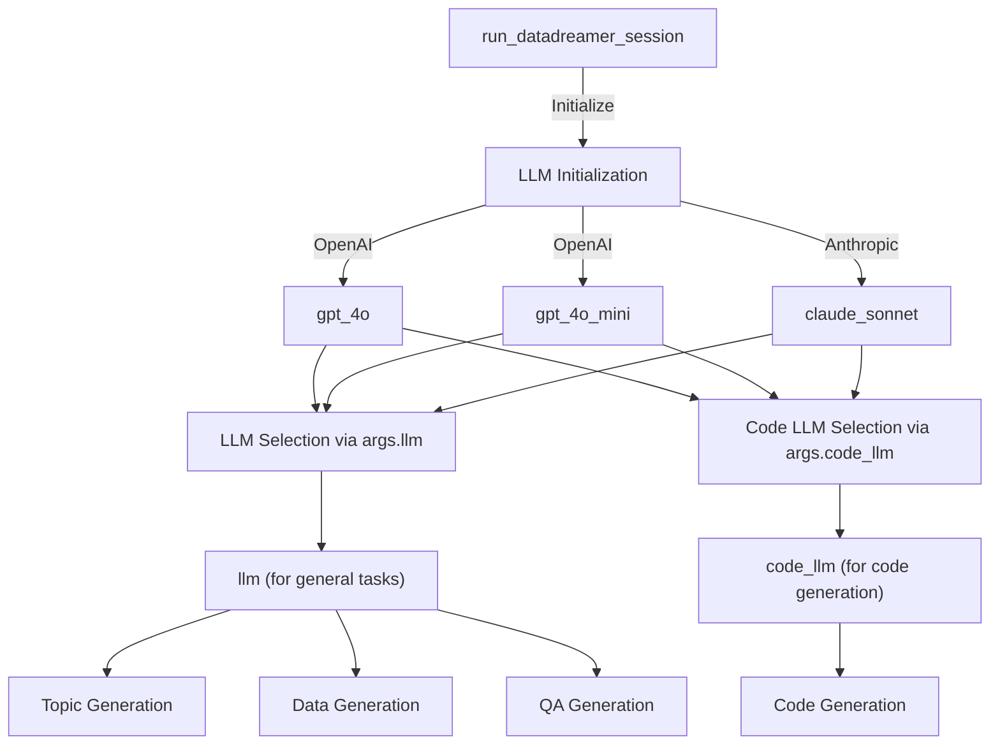

The system allows separate selection of LLMs for general tasks and code generation tasks, providing flexibility to leverage the strengths of different models. The selected LLMs are passed to each pipeline during initialization.

Sources:
- [pipeline/all_pipelines.py:50-73]()
- [pipeline/all_pipelines.py:123-125]()

## End-to-End Data Generation Flow

The complete end-to-end process follows this sequence:

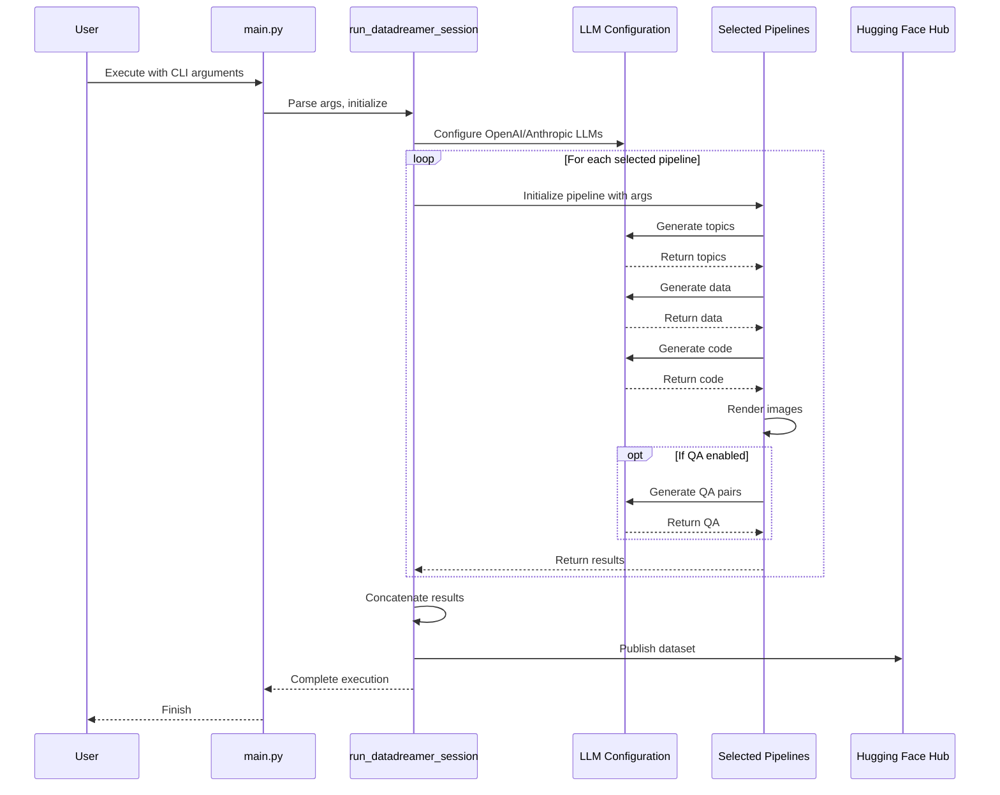

This workflow demonstrates how user input is transformed into a published dataset through a series of well-defined steps. The modular design allows for easy extension with new pipelines and visualization types.

Sources:
- [pipeline/all_pipelines.py:42-148]()
- [README.md:49-63]()

## System Requirements and Dependencies

The system relies on various external dependencies for rendering different types of content:

| Renderer | Required For | Installation |
|----------|--------------|-------------|
| LaTeX | Documents, diagrams, math, circuits | System-specific package manager |
| Mermaid CLI | Mermaid diagrams | npm install -g @mermaid-js/mermaid-cli |
| Playwright | HTML rendering, web screens | pip install playwright; playwright install |
| RDKit | Chemical structures | Included in requirements.txt |
| LilyPond | Music notation | System-specific package manager |
| Asymptote | Technical graphics | System-specific package manager |
| CairoSVG | SVG rendering | pip install cairosvg<=2.7.1 |

Each pipeline uses one or more of these renderers to convert the generated code into visual images. The specific renderer used depends on the pipeline type and the desired output format.

Sources:
- [README.md:22-47]()

---

# Page: DataDreamer Session

# DataDreamer Session

<details>
<summary>Relevant source files</summary>

The following files were used as context for generating this wiki page:

- [main.py](main.py)
- [pipeline/all_pipelines.py](pipeline/all_pipelines.py)

</details>


This document details the DataDreamer Session component, which serves as the central orchestration mechanism for the PixMo-Docs system. The DataDreamer Session manages the selection, configuration, and execution of various rendering pipelines to generate synthetic datasets of text-rich images. For information about the specific rendering utilities used by these pipelines, see [Rendering System](#3.2).

## Purpose and Role

The DataDreamer Session acts as the bridge between user input (provided as command-line arguments) and the execution of pipelines that generate synthetic visual content. It initializes the DataDreamer framework, configures LLMs, selects and runs pipelines, and publishes the resulting dataset to Hugging Face Hub.

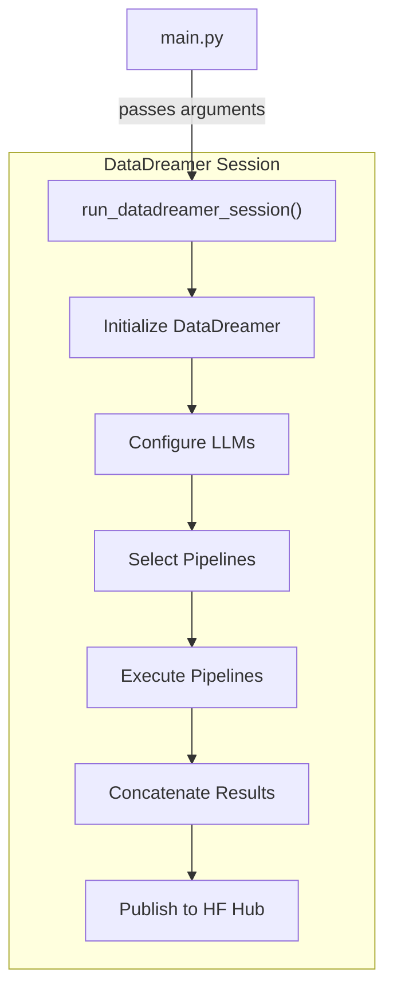

Sources: [pipeline/all_pipelines.py:42-147](), [main.py:8-10]()

## Function Overview

The `run_datadreamer_session` function is implemented in `all_pipelines.py` and serves as the main entry point for the data generation process. It handles the entire pipeline execution lifecycle, from initialization to result publication.

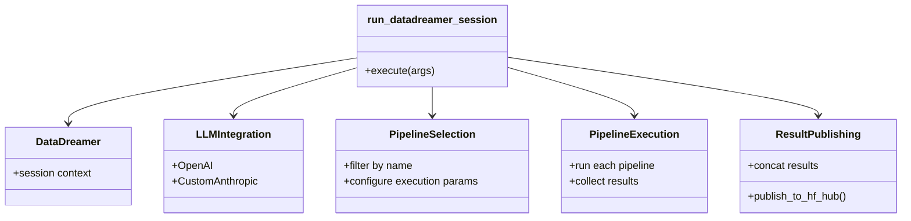

Sources: [pipeline/all_pipelines.py:42-147]()

## Key Components

### Environment Setup

The function begins by setting an environment variable that controls whether question-answer pairs should be generated:

```python
if args.qa:
    os.environ["GENERATE_QA"] = "true"
else:
    os.environ["GENERATE_QA"] = "false"
```

This environment variable is used by pipeline steps to determine whether to include QA generation.

Sources: [pipeline/all_pipelines.py:43-46]()

### DataDreamer Initialization

The function initializes a DataDreamer session with a specified output directory:

```python
with DataDreamer("./session_output"):
    # Session code follows...
```

This creates a context for executing steps and managing their outputs in the DataDreamer framework.

Sources: [pipeline/all_pipelines.py:48]()

### LLM Configuration

The function configures language models for text generation and code generation:

| LLM Type | Available Options | Purpose |
|----------|-------------------|---------|
| General LLM | GPT-4o, GPT-4o-mini, Claude Sonnet | Used for generating topics, data, and QA pairs |
| Code LLM | GPT-4o, GPT-4o-mini, Claude Sonnet | Specialized for generating code for visualization |

The function initializes these models with appropriate API keys and system prompts:

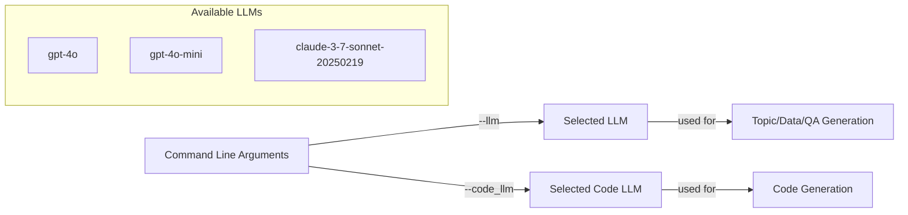

Sources: [pipeline/all_pipelines.py:50-73]()

### Pipeline Selection

The function contains a dictionary mapping pipeline names to their respective classes. It filters this dictionary based on the pipelines specified in the command-line arguments:

```python
pipelines = {
    "Generate Matplotlib Charts": MatplotlibChartPipeline,
    # Other pipelines...
}
pipelines = {
    k: v
    for k, v in pipelines.items()
    if v.__name__ in [p.strip() for p in args.pipelines.split(",")]
}
```

This allows users to select which pipelines to run by providing a comma-separated list of pipeline class names.

Sources: [pipeline/all_pipelines.py:76-107]()

### Execution Configuration

The function determines how many visualizations to generate per pipeline and which figure types to include:

```python
# Choose how many visualizes per pipeline
if "," in args.num:
    nums = [int(n.strip()) for n in args.num.strip(",")]
    assert len(nums) == len(pipelines)
else:
    nums = [int(args.num)] * len(pipelines)

# Get figure types
figure_types = [figure_type.strip() for figure_type in args.types.split(",")]
```

This flexible configuration allows users to specify different numbers of visualizations for each pipeline or a uniform count across all pipelines.

Sources: [pipeline/all_pipelines.py:109-117]()

### Pipeline Execution

The function runs each selected pipeline with the specified parameters:

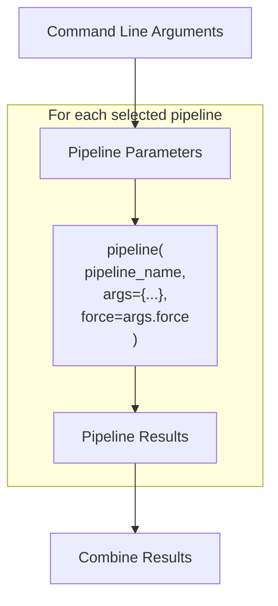

Each pipeline is initialized with:
- A descriptive name
- Arguments including the LLMs, batch sizes, number of visualizations, seed, figure types, and QA flag
- A force flag to control regeneration behavior

Sources: [pipeline/all_pipelines.py:120-136]()

### Result Aggregation and Publication

After all pipelines have been executed, the function:
1. Combines the results using the `concat` function from DataDreamer
2. Previews the first 5 rows of the dataset
3. Publishes the dataset to the Hugging Face Hub

```python
# Combine results from each pipeline
scifi_dataset = concat(
    *synthetic_visuals, name="Combine results from all pipelines"
)

# Preview n rows of the dataset
print(scifi_dataset.head(n=5))

# Push to HuggingFace Hub
scifi_dataset.publish_to_hf_hub(args.name, private=True)
```

Sources: [pipeline/all_pipelines.py:139-147]()

## Command Line Integration

The `run_datadreamer_session` function is called from `main.py`, which parses command-line arguments and passes them to the function:

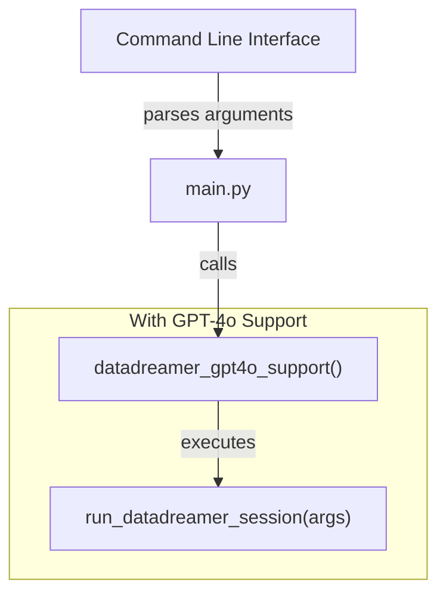

The main function wraps the DataDreamer session execution with the `datadreamer_gpt4o_support` context manager, which provides additional functionality for working with GPT-4o.

Sources: [main.py:8-10]()

## Parameters and Configuration Options

The DataDreamer Session accepts the following parameters through the `args` object:

| Parameter | Description | Default | Source |
|-----------|-------------|---------|--------|
| `openai_api_key` | API key for OpenAI services | Environment variable | [main.py:15-21]() |
| `anthropic_api_key` | API key for Anthropic services | Environment variable | [main.py:22-28]() |
| `llm` | LLM to use for general text generation | gpt-4o | [main.py:29-35]() |
| `code_llm` | LLM to use for code generation | claude-sonnet | [main.py:36-42]() |
| `pipelines` | Comma-separated list of pipeline class names | MatplotlibChartPipeline | [main.py:43-49]() |
| `num` | Number of visualizations per pipeline | 1 | [main.py:50-56]() |
| `seed` | Random seed for generation | 42 | [main.py:57-63]() |
| `batch_size` | Parallel requests to LLM | 24 | [main.py:64-70]() |
| `code_batch_size` | Parallel requests to code LLM | 24 | [main.py:71-77]() |
| `force` | Whether to force regeneration | False | [main.py:78-84]() |
| `name` | Dataset name on Hugging Face | scifi | [main.py:85-91]() |
| `types` | Types of visualizations to generate | bar chart | [main.py:92-98]() |
| `qa` | Whether to generate QA pairs | True | [main.py:99-105]() |

Sources: [main.py:14-105]()

## Execution Flow

The complete execution flow of the DataDreamer Session can be summarized as follows:

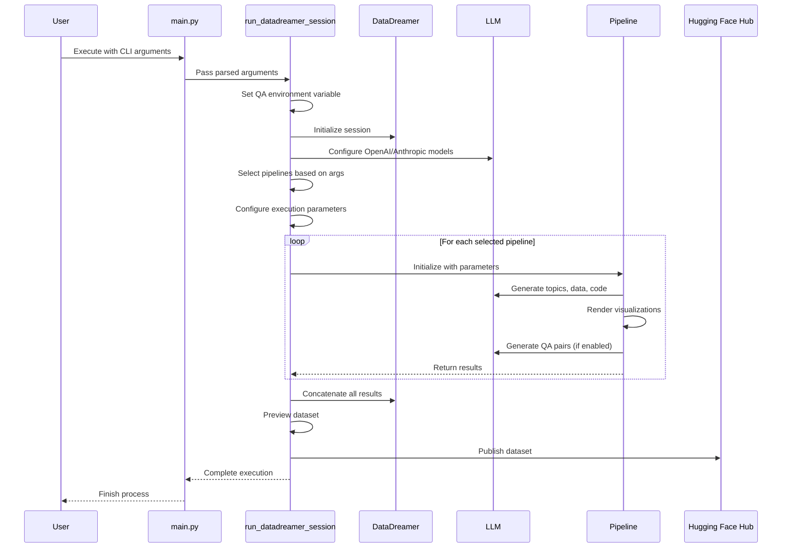

Sources: [pipeline/all_pipelines.py:42-147](), [main.py:8-10]()

This detailed flow shows how the DataDreamer Session manages the entire process from user input to dataset publication, coordinating between different components of the system.

---

# Page: Rendering System

# Rendering System

<details>
<summary>Relevant source files</summary>

The following files were used as context for generating this wiki page:

- [pipeline/utils/render.py](pipeline/utils/render.py)

</details>


The Rendering System in PixMo-Docs provides a collection of utility functions that convert various data formats into standardized images. These utilities serve as the core rendering engine behind all pipeline types, handling everything from HTML and LaTeX documents to specialized formats like chemical structures and music notation. The system produces consistent PIL Image outputs that can be included in the synthetic datasets.

For information about how these rendering functions are used within pipeline execution, see [DataDreamer Session](#3.1).

## Overview

The rendering system is designed with modularity in mind, with each `render_*` function following a similar pattern:

1. Accept specialized format data as input (HTML, LaTeX, SMILES, etc.)
2. Process the input using appropriate libraries or external tools
3. Return a standardized PIL Image object
4. Optionally apply post-processing like whitespace cropping

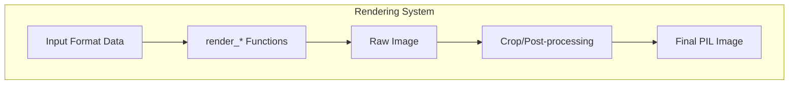

Sources: [pipeline/utils/render.py:1-408]()

## Core Utility Functions

The rendering system includes two primary utility functions for image post-processing:

### Whitespace and Background Cropping

These functions automatically trim excess space from rendered images, with configurable padding:

- `crop_whitespace(image)`: Crops an image by detecting non-white pixels, with a random buffer of 50-100 pixels
- `crop_background(image)`: Similar to `crop_whitespace` but works with any background color (detected from the top-left pixel)

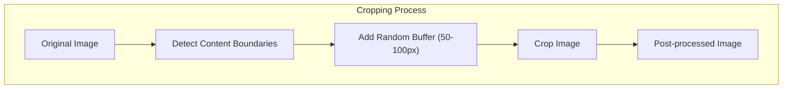

Sources: [pipeline/utils/render.py:16-75]()

## Rendering Implementations

The system provides implementations for various data formats, each with its own specialized renderer:

### HTML and Screen Rendering

For web content rendering:

- `render_html(html, full_page, random_width)`: Renders HTML content using Playwright's Chromium browser
- `render_screen(html, full_page, random_width)`: Similar to `render_html` but optimized for screen-like dimensions

Both functions support automatic width detection and random sizing to generate diverse outputs.

```mermaid
flowchart TD
    subgraph "HTML Rendering Process"
        HTML["HTML Content"] --> WidthExtract["Extract Width (if specified)"]
        WidthExtract --> BrowserLaunch["Launch Chromium Browser"]
        BrowserLaunch --> SetViewport["Set Viewport Size"]
        SetViewport --> LoadContent["Load HTML Content"]
        LoadContent --> Wait["Wait for Rendering (2000ms)"]
        Wait --> Screenshot["Take Screenshot"]
        Screenshot --> Image["Return PIL Image"]
    end
```

Sources: [pipeline/utils/render.py:78-153]()

### LaTeX Rendering

For mathematical and scientific content:

- `render_latex(latex_source)`: Converts LaTeX source to images via PDF compilation
  - Tries multiple compilers (pdflatex, xelatex, lualatex) for maximum compatibility
  - Uses pdf2image to convert PDF output to PIL Image

```mermaid
flowchart TD
    subgraph "LaTeX Rendering Process"
        LaTeX["LaTeX Source"] --> TempFile["Create Temporary Files"]
        TempFile --> TryCompilers["Try Multiple Compilers"]
        TryCompilers --> CheckSuccess["Check Compilation Success"]
        CheckSuccess --> ConvertPDF["Convert PDF to Image"]
        ConvertPDF --> Crop["Crop Whitespace"]
        Crop --> Cleanup["Clean Temporary Files"]
        Cleanup --> Image["Return PIL Image"]
    end
```

Sources: [pipeline/utils/render.py:156-205]()

### Data Visualization Rendering

For charts and data visualizations:

- `render_vegalite(vegalite_json)`: Renders VegaLite JSON specifications to images using vl-convert
  - Applies random scaling (1.5x, 2x, 2.5x, or 3x) for variety

Sources: [pipeline/utils/render.py:208-211]()

### Diagram Rendering

For diagram code:

- `render_mermaid(mermaid_code)`: Renders Mermaid diagrams using the Mermaid CLI
  - Uses random scaling (2x or 3x) for better image quality

Sources: [pipeline/utils/render.py:214-240]()

### Chemical Structure Rendering

For chemistry-related content:

- `render_chemical(smiles, dpi)`: Renders chemical structures from SMILES notation
  - Uses RDKit to convert SMILES strings to structured molecules
  - Supports atom indices, stereo annotations, and colorization
  - Applies random styling for diverse outputs

Sources: [pipeline/utils/render.py:243-299]()

### Circuit Diagram Rendering

For electrical engineering diagrams:

- `render_circuit(circuit)`: Renders circuit diagrams created with SchemDraw
  - Applies random DPI settings (100-300) for image quality variation

Sources: [pipeline/utils/render.py:345-364]()

### SVG Rendering

For vector graphics:

- `render_svg(svg_string)`: Converts SVG strings to PNG images using CairoSVG
  - Uses random DPI settings (150-300) for detail variation

Sources: [pipeline/utils/render.py:367-372]()

### Music Notation Rendering

For musical scores:

- `render_music(lilypound_code)`: Renders LilyPond music notation to images
  - Invokes LilyPond compiler to generate PNG output
  - Applies background cropping for cleaner results

Sources: [pipeline/utils/render.py:302-342]()

### Asymptote Graphics Rendering

For mathematical diagrams:

- `render_asymptote(asymptote_code)`: Renders Asymptote graphics code to images
  - Uses random resolution settings (3-6) for detail variation

Sources: [pipeline/utils/render.py:375-408]()

## Rendering Flow in the Pipeline System

The rendering system integrates with the pipeline architecture as the final step in visualization generation. Each pipeline uses one or more rendering functions to convert generated code into images:

```mermaid
flowchart TD
    subgraph "Pipeline Execution Flow"
        LLM["LLM"] --> GenerateTopic["Generate Topic"]
        GenerateTopic --> GenerateData["Generate Data"]
        GenerateData --> GenerateCode["Generate Code"]

        subgraph "Rendering System"
            GenerateCode --> SelectRenderer["Select Appropriate Renderer"]
            SelectRenderer --> Render["Execute render_* Function"]
            Render --> PostProcess["Post-process Image"]
        end

        PostProcess --> QA["Generate QA"]
        QA --> Output["Final Dataset Entry"]
    end
```

Sources: [pipeline/utils/render.py:1-408]()

## Dependencies and External Tools

The rendering system relies on various external tools and libraries:

| Renderer | External Dependencies | Python Libraries |
|----------|----------------------|------------------|
| HTML/Screen | Chromium (via Playwright) | playwright |
| LaTeX | pdflatex, xelatex, lualatex | pdf2image |
| VegaLite | None | vl_convert |
| Mermaid | Mermaid CLI (mmdc) | None |
| Chemical | None | rdkit |
| Circuit | None | schemdraw |
| SVG | None | cairosvg |
| Music | LilyPond compiler | None |
| Asymptote | Asymptote CLI (asy) | None |

Each renderer handles the complexities of interacting with these dependencies, providing a clean interface for the rest of the system.

Sources: [pipeline/utils/render.py:1-15]()

## Integration Within the PixMo-Docs System

The rendering system sits between the code generation step and the final dataset output:

```mermaid
graph LR
    subgraph "PixMo-Docs Data Flow"
        LLM["LLM Code Generation"] --> RenderInput["Format-specific Code/Data"]
        
        subgraph "render.py Functions"
            RenderInput --> render_html["render_html()"]
            RenderInput --> render_latex["render_latex()"]
            RenderInput --> render_vegalite["render_vegalite()"]
            RenderInput --> render_mermaid["render_mermaid()"]
            RenderInput --> render_chemical["render_chemical()"]
            RenderInput --> render_circuit["render_circuit()"]
            RenderInput --> render_svg["render_svg()"]
            RenderInput --> render_music["render_music()"]
            RenderInput --> render_asymptote["render_asymptote()"]
        end
        
        render_html --> Cropping["crop_whitespace()/crop_background()"]
        render_latex --> Cropping
        render_vegalite --> Cropping
        render_mermaid --> Cropping
        render_chemical --> Cropping
        render_circuit --> Cropping
        render_svg --> Cropping
        render_music --> Cropping
        render_asymptote --> Cropping
        
        Cropping --> FinalImage["PIL Image"]
        FinalImage --> Dataset["Dataset Entry"]
    end
```

This system architecture ensures that all generated content, regardless of its original format, is consistently rendered into high-quality images suitable for training multimodal models.

Sources: [pipeline/utils/render.py:1-408]()

---

# Page: Pipeline Categories

# Pipeline Categories

<details>
<summary>Relevant source files</summary>

The following files were used as context for generating this wiki page:

- [LICENSE](LICENSE)
- [README.md](README.md)
- [pipeline/all_pipelines.py](pipeline/all_pipelines.py)

</details>


## Purpose and Scope

This document provides a comprehensive overview of the pipeline categories in the PixMo-Docs system. These pipelines are the core mechanisms for generating synthetic text-rich images used to train multimodal models like Molmo. The document covers all 25 pipelines organized into 8 main categories, explaining their purposes, technologies, and characteristics. For details on how these pipelines are executed in the overall system, see [System Architecture](#3) and [DataDreamer Session](#3.1).

Sources: [README.md:65-109]()

## Pipeline Category Overview

The PixMo-Docs system organizes its 25 pipelines into 8 distinct categories, each specialized for generating specific types of text-rich visual content. Each pipeline uses a particular renderer or programming language to generate the synthetic data.

```mermaid
graph TD
    subgraph "Pipeline Categories"
        P["All Pipelines"] --> C["Chart Pipelines"]
        P --> T["Table Pipelines"]
        P --> D["Document Pipelines"]
        P --> DG["Diagram Pipelines"]
        P --> CR["Circuit Pipelines"]
        P --> S["Specialized Graphics Pipelines"]
        P --> W["Web Screen Pipelines"]
        P --> PT["Pointing Pipelines"]
    end
    
    subgraph "Pipeline Implementation"
        C --> |"implements"| C1["MatplotlibChartPipeline"]
        C --> |"implements"| C2["PlotlyChartPipeline"]
        C --> |"implements"| C3["VegaLiteChartPipeline"]
        C --> |"implements"| C4["LaTeXChartPipeline"]
        C --> |"implements"| C5["HTMLChartPipeline"]
        
        T --> |"implements"| T1["LaTeXTablePipeline"]
        T --> |"implements"| T2["MatplotlibTablePipeline"]
        T --> |"implements"| T3["PlotlyTablePipeline"]
        T --> |"implements"| T4["HTMLTablePipeline"]
        
        D --> |"implements"| D1["LaTeXDocumentPipeline"]
        D --> |"implements"| D2["HTMLDocumentPipeline"]
        D --> |"implements"| D3["DOCXDocumentPipeline"]
        
        DG --> |"implements"| DG1["GraphvizDiagramPipeline"]
        DG --> |"implements"| DG2["MermaidDiagramPipeline"]
        DG --> |"implements"| DG3["LaTeXDiagramPipeline"]
        
        CR --> |"implements"| CR1["SchemDrawCircuitPipeline"]
        CR --> |"implements"| CR2["LaTeXCircuitPipeline"]
        
        S --> |"implements"| S1["DALLEImagePipeline"]
        S --> |"implements"| S2["RdkitChemicalPipeline"]
        S --> |"implements"| S3["LaTeXMathPipeline"]
        S --> |"implements"| S4["LilyPondMusicPipeline"]
        S --> |"implements"| S5["SVGGraphicPipeline"]
        S --> |"implements"| S6["AsymptoteGraphicPipeline"]
        
        W --> |"implements"| W1["HTMLScreenPipeline"]
        
        PT --> |"implements"| PT1["HTMLDocumentPointPipeline"]
    end
```

Sources: [README.md:66-109](), [pipeline/all_pipelines.py:9-40]()

## Pipeline Selection and Execution

In the PixMo-Docs system, pipelines are selected and executed via the `run_datadreamer_session` function. This function initializes the DataDreamer framework, configures the selected LLMs, and executes the chosen pipelines based on the command-line arguments.

```mermaid
sequenceDiagram
    participant User
    participant Main as "main.py"
    participant RDS as "run_datadreamer_session"
    participant Pipeline as "Selected Pipeline"
    participant LLM as "LLM (GPT-4o/Claude)"
    
    User->>Main: Execute with CLI arguments
    Main->>RDS: Pass pipeline arguments
    RDS->>RDS: Initialize DataDreamer
    RDS->>RDS: Configure LLM(s)
    
    loop For each selected pipeline
        RDS->>Pipeline: Initialize pipeline with arguments
        Pipeline->>LLM: Generate content
        LLM-->>Pipeline: Return generated content
        Pipeline->>Pipeline: Render content to image
        Pipeline-->>RDS: Return processed results
    end
    
    RDS->>RDS: Combine results from all pipelines
    RDS->>RDS: Publish to Hugging Face Hub
    RDS-->>Main: Complete execution
    Main-->>User: Finish
```

Sources: [pipeline/all_pipelines.py:42-147]()

## 1. Chart Pipelines

Chart pipelines generate various types of data visualizations like bar charts, line charts, scatter plots, and more complex chart types.

| Pipeline | Technology | Capabilities | Limitations |
|----------|------------|--------------|-------------|
| MatplotlibChartPipeline | Matplotlib | Wide range of chart types with detailed customization | Python-based, requires script execution |
| PlotlyChartPipeline | Plotly | Interactive charts with rich features | Complex structure for simple charts |
| VegaLiteChartPipeline | Vega-Lite | Declarative JSON-based grammar of graphics | Requires vl-convert for rendering |
| LaTeXChartPipeline | TikZ/LaTeX | Precise vector graphics | Limited to simpler chart types |
| HTMLChartPipeline | HTML/CSS | Browser-rendered charts | Limited to basic chart types |

```mermaid
graph TD
    subgraph "Chart Pipeline Flow"
        step1["GenerateChartTopics"] --> step2["GenerateChartData"]
        step2 --> step3["GenerateChart"]
        step3 --> step4["GenerateChartQA"]
    end
    
    subgraph "Rendering Technologies"
        step3 --> |"Matplotlib"| r1["matplotlib.pyplot"]
        step3 --> |"Plotly"| r2["plotly.graph_objects"]
        step3 --> |"Vega-Lite"| r3["vl-convert"]
        step3 --> |"LaTeX"| r4["LaTeX Compiler + pdf2image"]
        step3 --> |"HTML"| r5["Playwright Browser"]
    end
```

Sources: [README.md:69-74](), [pipeline/all_pipelines.py:9-14](), [pipeline/all_pipelines.py:77-81]()

## 2. Table Pipelines

Table pipelines are specialized for generating tabular data visualizations with various formatting options and complexity levels.

| Pipeline | Technology | Capabilities | Limitations |
|----------|------------|--------------|-------------|
| LaTeXTablePipeline | LaTeX | Complex table structures with precise formatting | Requires LaTeX compiler |
| MatplotlibTablePipeline | Matplotlib | Tables rendered within figures | Limited formatting options |
| PlotlyTablePipeline | Plotly | Simple tabular data | Best for single-header tables |
| HTMLTablePipeline | HTML/CSS | Style-rich tables | Best for simpler table structures |

```mermaid
graph TD
    subgraph "Table Pipeline Flow"
        step1["GenerateTableTopics"] --> step2["GenerateTableData"]
        step2 --> step3["GenerateTable"]
        step3 --> step4["GenerateTableQA"]
    end
    
    subgraph "Rendering Technologies"
        step3 --> |"LaTeX"| r1["LaTeX Compiler + pdf2image"]
        step3 --> |"Matplotlib"| r2["matplotlib.pyplot.table"]
        step3 --> |"Plotly"| r3["plotly.graph_objects.Table"]
        step3 --> |"HTML"| r4["Playwright Browser"]
    end
```

Sources: [README.md:76-80](), [pipeline/all_pipelines.py:16-19](), [pipeline/all_pipelines.py:82-85]()

## 3. Document Pipelines

Document pipelines generate multi-page or complex layout text documents with various formatting and structure.

| Pipeline | Technology | Capabilities | Limitations |
|----------|------------|--------------|-------------|
| LaTeXDocumentPipeline | LaTeX | Professional documents with complex formatting | Requires LaTeX compiler |
| HTMLDocumentPipeline | HTML/CSS | Web-style documents with diverse styles | Browser-dependent rendering |
| DOCXDocumentPipeline | docx | Microsoft Word-compatible documents | Limited formatting compared to LaTeX |

```mermaid
graph TD
    subgraph "Document Pipeline Flow"
        step1["GenerateDocumentTopics"] --> step2["GenerateDocumentContent"]
        step2 --> step3["GenerateDocument"]
        step3 --> step4["GenerateDocumentQA"]
    end
    
    subgraph "Rendering Technologies"
        step3 --> |"LaTeX"| r1["LaTeX Compiler + pdf2image"]
        step3 --> |"HTML"| r2["Playwright Browser"]
        step3 --> |"DOCX"| r3["python-docx + rendering"]
    end
```

Sources: [README.md:82-85](), [pipeline/all_pipelines.py:20-22](), [pipeline/all_pipelines.py:86-88]()

## 4. Diagram Pipelines

Diagram pipelines produce various types of schematic visualizations like flowcharts, entity-relationship diagrams, trees, and other structured representations.

| Pipeline | Technology | Capabilities | Limitations |
|----------|------------|--------------|-------------|
| GraphvizDiagramPipeline | Graphviz | Directed graphs, trees, networks | Limited stylistic options |
| MermaidDiagramPipeline | Mermaid | Flowcharts, sequence diagrams, gantt charts | Simpler syntax but fewer features than Graphviz |
| LaTeXDiagramPipeline | TikZ/LaTeX | Precise control over diagram layout | Steeper learning curve |

```mermaid
graph TD
    subgraph "Diagram Pipeline Flow"
        step1["GenerateDiagramTopics"] --> step2["GenerateDiagramData"]
        step2 --> step3["GenerateDiagram"]
        step3 --> step4["GenerateDiagramQA"]
    end
    
    subgraph "Rendering Technologies"
        step3 --> |"Graphviz"| r1["graphviz dot command"]
        step3 --> |"Mermaid"| r2["mermaid-cli"]
        step3 --> |"LaTeX"| r3["TikZ + LaTeX Compiler + pdf2image"]
    end
```

Sources: [README.md:87-90](), [pipeline/all_pipelines.py:24-26](), [pipeline/all_pipelines.py:89-91]()

## 5. Circuit Pipelines

Circuit pipelines are specialized for generating electrical and electronic circuit diagrams with appropriate symbols and connections.

| Pipeline | Technology | Capabilities | Limitations |
|----------|------------|--------------|-------------|
| SchemDrawCircuitPipeline | SchemDraw | Python-based electrical circuit diagrams | Limited to specific circuit types |
| LaTeXCircuitPipeline | TikZ/CircuiTikZ | Precise control over circuit layout | Requires LaTeX knowledge |

```mermaid
graph TD
    subgraph "Circuit Pipeline Flow"
        step1["GenerateCircuitTopics"] --> step2["GenerateCircuitData"]
        step2 --> step3["GenerateCircuit"]
        step3 --> step4["GenerateCircuitQA"]
    end
    
    subgraph "Rendering Technologies"
        step3 --> |"SchemDraw"| r1["schemdraw Python library"]
        step3 --> |"LaTeX"| r2["CircuiTikZ + LaTeX Compiler + pdf2image"]
    end
```

Sources: [README.md:92-94](), [pipeline/all_pipelines.py:33-34](), [pipeline/all_pipelines.py:96-97]()

## 6. Specialized Graphics Pipelines

Specialized graphics pipelines generate domain-specific visualizations that don't fit into other categories, including AI-generated images, chemical structures, mathematical expressions, music notation, and vector graphics.

| Pipeline | Technology | Capabilities | Limitations |
|----------|------------|--------------|-------------|
| DALLEImagePipeline | DALL·E API | AI-generated images from text prompts | Requires OpenAI API access |
| RdkitChemicalPipeline | RDKit | Chemical structure diagrams | Limited to chemical notation |
| LaTeXMathPipeline | LaTeX math | Mathematical expressions and equations | Requires LaTeX compiler |
| LilyPondMusicPipeline | LilyPond | Music notation and sheet music | Requires LilyPond compiler |
| SVGGraphicPipeline | SVG | Vector graphics in web-standard format | Limited to SVG capabilities |
| AsymptoteGraphicPipeline | Asymptote | Technical vector graphics | Requires Asymptote compiler |

```mermaid
graph TD
    subgraph "Specialized Graphics Pipeline Flow"
        step1["GenerateSpecificTopics"] --> step2["GenerateSpecificData"]
        step2 --> step3["GenerateGraphic"]
        step3 --> step4["GenerateSpecificQA"]
    end
    
    subgraph "Rendering Technologies"
        step3 --> |"DALL·E"| r1["OpenAI DALL·E API"]
        step3 --> |"Chemical"| r2["RDKit Python library"]
        step3 --> |"Math"| r3["LaTeX Compiler + pdf2image"]
        step3 --> |"Music"| r4["LilyPond Compiler"]
        step3 --> |"SVG"| r5["cairosvg"]
        step3 --> |"Asymptote"| r6["Asymptote CLI"]
    end
```

Sources: [README.md:96-102](), [pipeline/all_pipelines.py:28-32](), [pipeline/all_pipelines.py:35-37](), [pipeline/all_pipelines.py:92-95](), [pipeline/all_pipelines.py:98-99]()

## 7. Web Screen Pipelines

Web screen pipelines generate realistic screenshots of web interfaces and applications.

| Pipeline | Technology | Capabilities | Limitations |
|----------|------------|--------------|-------------|
| HTMLScreenPipeline | HTML/CSS/Playwright | Complete web screen layouts | Requires Playwright and Chrome/Chromium |

```mermaid
graph TD
    subgraph "Web Screen Pipeline Flow"
        step1["GenerateScreenTopics"] --> step2["GenerateScreenContent"]
        step2 --> step3["GenerateScreen"]
        step3 --> step4["GenerateScreenQA"]
    end
    
    subgraph "Rendering Technologies"
        step3 --> |"HTML Screen"| r1["Playwright Browser"]
    end
```

Sources: [README.md:104-105](), [pipeline/all_pipelines.py:40](), [pipeline/all_pipelines.py:101]()

## 8. Pointing Pipelines

Pointing pipelines generate documents with structured point references, useful for training models on reference resolution tasks.

| Pipeline | Technology | Capabilities | Limitations |
|----------|------------|--------------|-------------|
| HTMLDocumentPointPipeline | HTML/CSS | Documents with structured point references | Limited to HTML-based pointing |

```mermaid
graph TD
    subgraph "Pointing Pipeline Flow"
        step1["GeneratePointTopics"] --> step2["GeneratePointContent"]
        step2 --> step3["GeneratePointingDocument"]
        step3 --> step4["GeneratePointingQA"]
    end
    
    subgraph "Rendering Technologies"
        step3 --> |"HTML Pointing"| r1["Playwright Browser"]
    end
```

Sources: [README.md:108-109](), [pipeline/all_pipelines.py:39](), [pipeline/all_pipelines.py:100]()

## Pipeline Integration in System Architecture

The pipelines are executed as part of the overall data generation flow, which is managed by the `run_datadreamer_session` function. This function orchestrates the creation of synthetic data by selecting and configuring the appropriate pipelines based on user input.

```mermaid
graph TD
    subgraph "System Architecture"
        mainpy["main.py"] --> rds["run_datadreamer_session()"]
        rds --> dd["DataDreamer Framework"]
        rds --> llm["LLM Configuration"]
        rds --> pl["Pipeline Selection"]
        
        llm --> gpt["OpenAI/GPT-4o"]
        llm --> claude["Anthropic/Claude"]
        
        pl --> cat1["Chart Pipelines"]
        pl --> cat2["Table Pipelines"]
        pl --> cat3["Document Pipelines"]
        pl --> cat4["Diagram Pipelines"]
        pl --> cat5["Circuit Pipelines"]
        pl --> cat6["Specialized Graphics Pipelines"]
        pl --> cat7["Web Screen Pipelines"]
        pl --> cat8["Pointing Pipelines"]
        
        cat1 & cat2 & cat3 & cat4 & cat5 & cat6 & cat7 & cat8 --> process["Pipeline Processing"]
        
        process --> dataset["Dataset Creation"]
        dataset --> publish["Publish to Hugging Face Hub"]
    end
```

Sources: [pipeline/all_pipelines.py:42-147]()

## Common Pipeline Structure

Most pipelines in the system follow a similar four-step structure, which ensures consistency across different pipeline categories while allowing for specialized implementation details.

```mermaid
graph LR
    subgraph "Typical Pipeline Structure"
        step1["GenerateTopics"] --> step2["GenerateData"]
        step2 --> step3["GenerateContent"]
        step3 --> step4["GenerateQA"]
    end
    
    subgraph "Input/Output Flow"
        llm1["LLM"] -.-> step1
        llm1 -.-> step2
        llm2["code_LLM"] -.-> step3
        llm1 -.-> step4
        
        step1 -- "metadata, topic" --> step2
        step2 -- "metadata, topic, data" --> step3
        step3 -- "metadata, topic, data, code, image" --> step4
        step4 -- "metadata, topic, data, code, image, qa" --> output["Final Output"]
    end
```

This structure illustrates how each pipeline processes data through sequential steps:
1. Topic generation
2. Data preparation based on topics
3. Content generation (code + image rendering)
4. Question-answer pair generation (optional)

Sources: [pipeline/all_pipelines.py:119-134]()

## Conclusion

The Pipeline Categories in PixMo-Docs provide a flexible and extensible framework for generating a wide variety of text-rich images for training multimodal models. Each pipeline category specializes in a particular type of visual content, and the system architecture ensures that these pipelines can be easily selected, configured, and executed to generate synthetic datasets. For more details on how to execute these pipelines from the command line, see [Command Line Usage](#7).

---

# Page: Chart Pipelines

# Chart Pipelines

<details>
<summary>Relevant source files</summary>

The following files were used as context for generating this wiki page:

- [LICENSE](LICENSE)
- [README.md](README.md)
- [pipeline/prompts/chart_prompts.py](pipeline/prompts/chart_prompts.py)

</details>


## Purpose and Scope

This document details the chart generation pipelines in the PixMo-Docs system. Chart Pipelines are responsible for generating visual representations of data in various formats using different rendering technologies. These pipelines create synthetic dataset images for training multimodal models like Molmo.

For information about other types of visualizations, see the following related pages:
- [Table Pipelines](#4.2)
- [Diagram Pipelines](#4.3)
- [Specialized Graphics Pipelines](#4.4)

Sources: [README.md:69-74]()

## Chart Pipeline Types

The PixMo-Docs system supports five distinct Chart Pipeline implementations, each using a different rendering technology:

```mermaid
graph TD
    subgraph "Chart Pipelines"
        M["MatplotlibChartPipeline"] --> MP["Matplotlib Renderer"]
        P["PlotlyChartPipeline"] --> PP["Plotly Renderer"]
        V["VegaLiteChartPipeline"] --> VP["Vega-Lite Renderer"]
        L["LaTeXChartPipeline"] --> LP["LaTeX/TikZ Renderer"]
        H["HTMLChartPipeline"] --> HP["HTML/CSS Renderer"]
    end
    
    subgraph "Output"
        MP --> IMG["PIL Image"]
        PP --> IMG
        VP --> IMG
        LP --> IMG
        HP --> IMG
    end
    
    classDef pipeline stroke:#333,stroke-width:2px;
    classDef renderer stroke:#333,stroke-width:1px;
    
    class M,P,V,L,H pipeline;
    class MP,PP,VP,LP,HP renderer;
```

Each pipeline specializes in generating charts with different capabilities:

| Pipeline | Renderer | Strengths | Limitations |
|----------|----------|-----------|-------------|
| MatplotlibChartPipeline | Matplotlib | Highly customizable, extensive gallery of chart types | Python-based, less interactive |
| PlotlyChartPipeline | Plotly | Interactive charts, modern aesthetics | More complex for basic charts |
| VegaLiteChartPipeline | Vega-Lite | Declarative JSON syntax, visualization grammar | JSON-based, limited to web rendering |
| LaTeXChartPipeline | TikZ | Publication-quality, precise control | Only works for simple charts, requires LaTeX |
| HTMLChartPipeline | HTML/CSS | Web standard, widely compatible | Only works for simple charts |

Sources: [README.md:69-74]()

## Chart Pipeline Architecture

The chart pipelines follow a common 4-step process that converts prompts into final chart images with associated metadata:

```mermaid
graph LR
    subgraph "Chart Pipeline Internal Structure"
        S1["GenerateChartTopics"] --> S2["GenerateChartData"]
        S2 --> S3["GenerateChart"]
        S3 --> S4["GenerateChartQA"]
    end
    
    subgraph "Data Flow"
        Input["User Input"] --> S1
        LLM1["LLM"] --"Generate topics"--> S1
        S1 --"metadata, topic"--> S2
        LLM2["LLM"] --"Generate data"--> S2
        S2 --"metadata, topic, data"--> S3
        CodeLLM["code_LLM"] --"Generate chart code"--> S3
        S3 --"metadata, topic, data, code, image"--> S4
        LLM3["LLM"] --"Generate QA pairs"--> S4
        S4 --> Output["Final Output"]
    end
    
    classDef step stroke:#333,stroke-width:1px;
    classDef llm stroke:#333,stroke-width:1px;
    
    class S1,S2,S3,S4 step;
    class LLM1,LLM2,CodeLLM,LLM3 llm;
```

Each step in the pipeline serves a specific purpose:

1. **Topic Generation**: Creates chart topics based on user-provided parameters and persona
2. **Data Generation**: Produces structured data relevant to the topic
3. **Chart Generation**: Creates visualization code and renders the image
4. **QA Generation**: Creates question-answer pairs about the chart content

Sources: [pipeline/prompts/chart_prompts.py:1-379]()

## Chart Generation Process

### Step 1: Topic Generation

The first step generates chart topics using the `GENERATE_CHART_TOPICS_PROMPT`. The prompt takes:
- User persona (e.g., "data scientist", "business analyst")
- Number of topics to generate
- Figure type (e.g., "bar chart", "line chart")

The LLM returns diverse topics suitable for visualization with the specified chart type.

Sources: [pipeline/prompts/chart_prompts.py:6-16]()

### Step 2: Data Generation

The second step creates structured data for the chosen topic using the `GENERATE_CHART_DATA_PROMPT` or `GENERATE_CHART_DATA_JSON_PROMPT`. The prompt takes:
- User persona
- Selected topic
- Figure type

The LLM returns data in CSV or JSON format that is appropriate for the chart type.

Sources: [pipeline/prompts/chart_prompts.py:21-46]()

### Step 3: Chart Generation

The third step generates the chart code and renders it as an image. This step uses specialized prompts based on the rendering technology:

| Renderer | Prompt Constant | Input Format | Output Format |
|----------|----------------|--------------|---------------|
| Matplotlib | GENERATE_CHART_CODE_MATPLOTLIB_PROMPT | CSV (DataFrame) | Python code |
| Plotly | GENERATE_CHART_CODE_PLOTLY_PROMPT | CSV (DataFrame) | Python code |
| Vega-Lite | GENERATE_CHART_CODE_VEGALITE_PROMPT | JSON | Vega-Lite JSON |
| LaTeX | GENERATE_CHART_CODE_LATEX_PROMPT | CSV | LaTeX code |
| HTML | GENERATE_CHART_CODE_HTML_PROMPT | JSON | HTML/CSS code |

Each prompt instructs the LLM to generate code that:
1. Imports necessary libraries
2. Creates a `generate_plot` function (for Python-based renderers)
3. Formats the data appropriately
4. Applies styling and customizations
5. Renders and returns the chart as a PIL Image

Sources: [pipeline/prompts/chart_prompts.py:131-268]()

### Step 4: QA Generation

The final step generates question-answer pairs about the chart using the `GENERATE_CHART_QA_PROMPT` or other specialized QA prompts. The prompt takes:
- User persona
- Topic
- Figure type
- Data used to generate the chart
- Code that generated the chart

The LLM returns QA pairs that:
1. Vary in complexity (basic to complex reasoning)
2. Cover different question types (short-answer, multiple-choice, yes/no, summary)
3. Include explanations for answers
4. Are formatted for easy parsing

Sources: [pipeline/prompts/chart_prompts.py:51-88](), [pipeline/prompts/chart_prompts.py:302-379]()

## Chart Type Support Matrix

Different chart pipelines support various chart types with varying degrees of capability:

| Chart Type | Matplotlib | Plotly | Vega-Lite | LaTeX | HTML |
|------------|:----------:|:------:|:---------:|:-----:|:----:|
| Bar Chart | ✓ | ✓ | ✓ | ✓ | ✓ |
| Line Chart | ✓ | ✓ | ✓ | ✓ | ✓ |
| Scatter Plot | ✓ | ✓ | ✓ | ✓ | ✓ |
| Pie Chart | ✓ | ✓ | ✓ | ✓ | ✓ |
| Box Plot | ✓ | ✓ | ✓ | ✗ | ✗ |
| Histogram | ✓ | ✓ | ✓ | ✗ | ✗ |
| Heatmap | ✓ | ✓ | ✓ | ✗ | ✗ |
| 3D Plots | ✓ | ✓ | ✗ | ✗ | ✗ |
| Interactive | ✗ | ✓* | ✓* | ✗ | ✗ |
| Custom Styling | ✓ | ✓ | ✓ | ✓ | ✓ |

*Note: Though Plotly and Vega-Lite support interactivity, the final output is a static image.

Sources: [README.md:69-74]()

## Chart Pipeline Data Flow

The following diagram illustrates how data flows through the chart generation system:

```mermaid
flowchart TB
    subgraph "Input Parameters"
        persona["User Persona"]
        figType["Figure Type"]
        numTopics["Number of Topics"]
    end
    
    subgraph "Pipeline Steps"
        subgraph "GenerateChartTopics"
            topicPrompt["GENERATE_CHART_TOPICS_PROMPT"]
            topicLLM["LLM Call"]
            topics["Chart Topics"]
        end
        
        subgraph "GenerateChartData"
            dataPrompt["GENERATE_CHART_DATA_PROMPT"]
            dataLLM["LLM Call"]
            chartData["Chart Data (CSV/JSON)"]
        end
        
        subgraph "GenerateChart"
            codePrompt["GENERATE_CHART_CODE_*_PROMPT"]
            codeLLM["LLM Call"]
            chartCode["Chart Code"]
            renderer["Render Function"]
            chartImage["Chart Image"]
        end
        
        subgraph "GenerateChartQA"
            qaPrompt["GENERATE_CHART_QA_PROMPT"]
            qaLLM["LLM Call"]
            chartQA["Question-Answer Pairs"]
        end
    end
    
    subgraph "Output Dataset"
        finalOutput["Chart Entry in Dataset"]
    end
    
    persona --> topicPrompt
    figType --> topicPrompt
    numTopics --> topicPrompt
    
    topicPrompt --> topicLLM
    topicLLM --> topics
    
    topics --> dataPrompt
    persona --> dataPrompt
    figType --> dataPrompt
    
    dataPrompt --> dataLLM
    dataLLM --> chartData
    
    chartData --> codePrompt
    persona --> codePrompt
    figType --> codePrompt
    
    codePrompt --> codeLLM
    codeLLM --> chartCode
    chartCode --> renderer
    renderer --> chartImage
    
    chartData --> qaPrompt
    chartCode --> qaPrompt
    persona --> qaPrompt
    figType --> qaPrompt
    
    qaPrompt --> qaLLM
    qaLLM --> chartQA
    
    topics --> finalOutput
    chartData --> finalOutput
    chartCode --> finalOutput
    chartImage --> finalOutput
    chartQA --> finalOutput
    
    classDef input stroke:#333,stroke-width:1px;
    classDef prompt stroke:#333,stroke-width:1px;
    classDef output stroke:#333,stroke-width:1px;
    
    class persona,figType,numTopics input;
    class topicPrompt,dataPrompt,codePrompt,qaPrompt prompt;
    class topics,chartData,chartCode,chartImage,chartQA,finalOutput output;
```

Sources: [pipeline/prompts/chart_prompts.py:1-379]()

## Usage Examples

To generate charts using the command line interface:

```bash
python main.py -p "MatplotlibChartPipeline" -t "bar chart" -n 5 -m "matplotlib_bar_charts"
```

This command will:
1. Use the MatplotlibChartPipeline
2. Generate 5 bar charts
3. Save the results with the name "matplotlib_bar_charts"

You can generate multiple chart types using comma-separated values:

```bash
python main.py -p "MatplotlibChartPipeline,PlotlyChartPipeline" -t "line chart,scatter plot" -n 10 -m "mixed_charts"
```

See [Command Line Usage](#7) for more detailed information on available arguments.

Sources: [README.md:49-59]()

## QA Generation Support

Chart pipelines support different types of question generation to create rich training data:

| Question Type | Description | Example |
|---------------|-------------|---------|
| Basic | Visual elements, titles, axes | "What is the title of the chart?" |
| Visual | Properties of graphical marks | "What color is the bar for Category A?" |
| Compositional | Multi-step operations | "What is the average of the top three values?" |
| Comparison | Relationships between elements | "Which category has the highest value?" |
| Data Retrieval | Specific values | "What is the value for 2023?" |
| Reasoning | Multi-step logic | "If trend continues, what will the value be next year?" |
| Yes/No | Binary questions | "Is Category A greater than Category B?" |
| Multiple-choice | Selection from options | "Which is true about the chart? A) ... B) ... C) ..." |

See [QA Generation](#5) for more information on how QA pairs are generated.

Sources: [pipeline/prompts/chart_prompts.py:302-341]()

---

# Page: Table Pipelines

# Table Pipelines

<details>
<summary>Relevant source files</summary>

The following files were used as context for generating this wiki page:

- [LICENSE](LICENSE)
- [README.md](README.md)
- [pipeline/html_table_pipeline/generate_qa.py](pipeline/html_table_pipeline/generate_qa.py)
- [pipeline/latex_table_pipeline/generate_qa.py](pipeline/latex_table_pipeline/generate_qa.py)
- [pipeline/plotly_table_pipeline/generate_qa.py](pipeline/plotly_table_pipeline/generate_qa.py)

</details>


## Purpose

Table Pipelines generate synthetic datasets of tabular information rendered as images using different technologies. These pipelines create tables with varying levels of complexity and visual styles, which are then used to train multimodal models like Molmo. This document covers the four table pipeline implementations provided in the PixMo-Docs system, their capabilities, internal structure, and rendering processes.

For information about other visual elements like charts, see [Chart Pipelines](#4.1) or diagrams, see [Diagram Pipelines](#4.3).

## Overview of Table Pipelines

The PixMo-Docs system includes four different table pipeline implementations, each using a different rendering technology:

```mermaid
graph TD
    subgraph "Table Pipelines"
        LP["LaTeXTablePipeline"] --> LR["LaTeX Renderer"]
        MT["MatplotlibTablePipeline"] --> MR["Matplotlib Renderer"]
        PT["PlotlyTablePipeline"] --> PR["Plotly Renderer"]
        HT["HTMLTablePipeline"] --> HR["HTML Renderer"]
    end
    
    LR --> TI["Table Images"]
    MR --> TI
    PR --> TI
    PT --> TI
    HR --> TI
    
    TI --> DS["Dataset"]
```

Sources: README.md:77-80

Each pipeline has distinct capabilities and limitations:

| Pipeline | Technology | Capabilities | Best For |
|----------|------------|--------------|----------|
| LaTeXTablePipeline | LaTeX | Complex structures, precise formatting, academic styling | Scientific tables, complex multi-level tables |
| MatplotlibTablePipeline | Matplotlib | Tables within figures, integration with plot features | Data visualization tables, tables with visual elements |
| PlotlyTablePipeline | Plotly | Simple tabular formats, interactive features (when viewed in compatible viewers) | Single-header tables, basic data views |
| HTMLTablePipeline | HTML/CSS | Web-style tables, custom styling | Web content tables, simple structures |

Sources: README.md:77-80

## Pipeline Internal Structure

All table pipelines follow a common four-step structure that transforms topics into final rendered table images with question-answer pairs:

```mermaid
graph LR
    subgraph "Table Pipeline Structure"
        Step1["GenerateTableTopics"] --> Step2["GenerateTableData"]
        Step2 --> Step3["GenerateTable"]
        Step3 --> Step4["GenerateTableQA"]
    end
    
    subgraph "Data Transformation"
        Input1["LLM"] -.-> Step1
        Input1 -.-> Step2
        Input2["code_LLM"] -.-> Step3
        Input1 -.-> Step4
        
        Step1 -- "metadata, topic" --> Step2
        Step2 -- "metadata, topic, data" --> Step3
        Step3 -- "metadata, topic, data, code, image" --> Step4
        Step4 -- "metadata, topic, data, code, image, qa" --> Output["Final Table Entry"]
    end
```

Sources: pipeline/html_table_pipeline/generate_qa.py, pipeline/latex_table_pipeline/generate_qa.py, pipeline/plotly_table_pipeline/generate_qa.py

Each step inherits from `SuperStep` class in the DataDreamer framework and performs a specific transformation in the pipeline:

1. **GenerateTableTopics**: Creates table topics based on domain and requirements
2. **GenerateTableData**: Generates structured data based on the topic
3. **GenerateTable**: Produces rendering code (LaTeX, HTML, Python) and renders it into an image
4. **GenerateTableQA**: Creates question-answer pairs about the table content

## QA Generation Process

The question-answer generation step is consistent across all table pipelines. It takes the generated table along with its topic, data, and code to create relevant QA pairs:

```mermaid
graph TD
    subgraph "GenerateTableQA Process"
        I["Inputs"] --> CP["Create QA Prompts"]
        CP --> GP["Generate QA with LLM"]
        GP --> PP["Process QA Responses"]
        PP --> QAO["QA Output JSON"]
    end
    
    subgraph "Input Data"
        TD["Table Data"] --> I
        TT["Table Topic"] --> I
        TC["Table Code"] --> I
        TI["Table Image"] --> I
        M["Metadata"] --> I
    end
```

Sources: pipeline/html_table_pipeline/generate_qa.py:31-106, pipeline/latex_table_pipeline/generate_qa.py:31-106, pipeline/plotly_table_pipeline/generate_qa.py:31-106

The QA generation follows these steps:
1. Combines all input data (metadata, topic, data, code, image)
2. Creates prompts using the `GENERATE_TABLE_QA_PROMPT` template
3. Sends prompts to the configured LLM
4. Processes responses into structured QA JSON format with questions, answers, and explanations

## Rendering Technology Integration

Each table pipeline connects to a specific rendering technology, which transforms the generated code into visual table images:

```mermaid
graph TD
    subgraph "Table Pipeline Rendering Process"
        GC["GenerateTable"] --> Code
        
        subgraph "Code Generation"
            Code["Generated Code"] --> LC["LaTeX Code"]
            Code --> MC["Matplotlib Code"]  
            Code --> PC["Plotly Code"]
            Code --> HC["HTML/CSS Code"]
        end
        
        LC --> LR["render_latex"]
        MC --> MPR["matplotlib.pyplot"]
        PC --> PR["plotly.to_image"]
        HC --> HR["render_html"]
        
        LR --> PI["PIL Image"]
        MPR --> PI
        PR --> PI
        HR --> PI
        
        PI --> CP["crop_whitespace/crop_background"]
        CP --> FI["Final Cropped Image"]
    end
```

Sources: README.md:77-80

## Example Usage

To generate tables using any of the table pipelines, use the main script with the appropriate pipeline name:

For LaTeX tables:
```bash
python main.py -p "LaTeXTablePipeline" -n 10 -m "latex_tables" -t "financial data"
```

For Matplotlib tables:
```bash
python main.py -p "MatplotlibTablePipeline" -n 10 -m "mpl_tables" -t "scientific results"
```

For multiple table types:
```bash
python main.py -p "LaTeXTablePipeline,HTMLTablePipeline" -n 5 -m "mixed_tables" -t "population statistics"
```

Sources: README.md:52-59

## Technical Considerations

When choosing between table pipelines, consider these factors:

1. **LaTeXTablePipeline**: Requires LaTeX installation but provides the most professional-looking tables for academic or scientific purposes.

2. **MatplotlibTablePipeline**: Good for tables that are part of data visualizations or need to be integrated with charts.

3. **PlotlyTablePipeline** and **HTMLTablePipeline**: Simpler options for basic tabular data with fewer formatting requirements.

All table pipelines support QA generation using the same underlying process, making them consistent for training multimodal models regardless of the rendering technology used.

---

# Page: Diagram Pipelines

# Diagram Pipelines

<details>
<summary>Relevant source files</summary>

The following files were used as context for generating this wiki page:

- [LICENSE](LICENSE)
- [README.md](README.md)
- [pipeline/graphviz_diagram_pipeline/__init__.py](pipeline/graphviz_diagram_pipeline/__init__.py)
- [pipeline/graphviz_diagram_pipeline/generate_diagram.py](pipeline/graphviz_diagram_pipeline/generate_diagram.py)
- [pipeline/latex_diagram_pipeline/pipeline.py](pipeline/latex_diagram_pipeline/pipeline.py)
- [pipeline/mermaid_diagram_pipeline/pipeline.py](pipeline/mermaid_diagram_pipeline/pipeline.py)
- [pipeline/prompts/diagram_prompts.py](pipeline/prompts/diagram_prompts.py)

</details>


## Introduction

Diagram Pipelines in the pixmo-docs repository enable the generation of various diagrams including flowcharts, sequence diagrams, entity-relationship diagrams, and other visual representations of structured data. This document covers the three diagram pipeline implementations, their architecture, and their integration with external rendering tools.

This page focuses specifically on diagram-type visualizations. For other visual content types, see related pages:
- For charts and plots, see [Chart Pipelines](#4.1)
- For tabular data, see [Table Pipelines](#4.2)
- For specialized graphics, see [Specialized Graphics Pipelines](#4.4)

Sources: [README.md:87-90]()

## Pipeline Overview

The pixmo-docs system includes three diagram pipeline implementations, each using a different rendering technology:

1. **GraphvizDiagramPipeline**: Uses [Graphviz](https://graphviz.org) to generate node-edge diagrams like directed graphs, trees, and network diagrams
2. **MermaidDiagramPipeline**: Uses [Mermaid](https://mermaid-js.github.io/mermaid) to generate flowcharts, sequence diagrams, and other diagram types
3. **LaTeXDiagramPipeline**: Uses TikZ (LaTeX package) to generate high-quality diagrams with precise control over layout and styling

All diagram pipelines follow the standard four-step architecture common to pipelines in the system, with specialized implementations for diagram generation.

```mermaid
graph TD
    subgraph "Diagram Pipeline Types"
        GraphvizDP["GraphvizDiagramPipeline"]
        MermaidDP["MermaidDiagramPipeline"]
        LaTeXDP["LaTeXDiagramPipeline"]
    end

    subgraph "External Renderers"
        Graphviz["Graphviz Renderer"]
        MermaidCLI["Mermaid CLI"]
        LaTeXCompiler["LaTeX Compiler"]
    end

    GraphvizDP --- Graphviz
    MermaidDP --- MermaidCLI
    LaTeXDP --- LaTeXCompiler

    Graphviz --> Image["PIL Image"]
    MermaidCLI --> Image
    LaTeXCompiler --> PDF["PDF"]
    PDF --> Image
```

Sources: [README.md:87-90](), [pipeline/graphviz_diagram_pipeline/__init__.py:1-4](), [pipeline/mermaid_diagram_pipeline/pipeline.py:1-105](), [pipeline/latex_diagram_pipeline/pipeline.py:1-105]()

## Pipeline Architecture

All diagram pipelines share a common four-step architecture that transforms high-level topics into rendered diagrams with associated question-answer pairs.

```mermaid
graph LR
    subgraph "DiagramPipeline (4-Step Structure)"
        Step1["GenerateDiagramTopics"] --> Step2["GenerateDiagramData"]
        Step2 --> Step3["GenerateDiagram"]
        Step3 --> Step4["GenerateDiagramQA"]
    end
    
    subgraph "Data Transformation Flow"
        Input1["LLM Input"] -.-> Step1
        Input1 -.-> Step2
        Input2["code_LLM Input"] -.-> Step3
        Input1 -.-> Step4
        
        Step1 -- "metadata, topic" --> Step2
        Step2 -- "metadata, topic, data" --> Step3
        Step3 -- "metadata, topic, data, code, image" --> Step4
        Step4 -- "metadata, topic, data, code, image, qa" --> Output["Final Output"]
    end
```

Each pipeline follows this structure, with the only difference being the rendering backend used in the `GenerateDiagram` step. Let's examine each step in detail:

1. **GenerateDiagramTopics**: Generates diverse diagram topics based on the specified diagram type and persona
2. **GenerateDiagramData**: Creates structured data (typically in JSON format) representing the elements of the diagram
3. **GenerateDiagram**: Generates code (Graphviz, Mermaid, or LaTeX) based on the data and renders it to an image
4. **GenerateDiagramQA** (optional): Generates question-answer pairs about the diagram content for training purposes

Sources: [pipeline/mermaid_diagram_pipeline/pipeline.py:32-94](), [pipeline/latex_diagram_pipeline/pipeline.py:32-94]()

## Common Pipeline Implementation

All three diagram pipelines share nearly identical implementation structure, differing only in the specific rendering backend used. Here's the common implementation pattern:

```mermaid
classDiagram
    class SuperStep {
        +setup()
        +run()
        +version
    }
    
    class DiagramPipeline {
        +setup()
        +run()
        +version
    }
    
    class GenerateDiagramTopics {
        +setup()
        +run()
        +CONFIG_HASH
    }
    
    class GenerateDiagramData {
        +setup()
        +run()
        +CONFIG_HASH
    }
    
    class GenerateDiagram {
        +setup()
        +run()
        +CONFIG_HASH
    }
    
    class GenerateDiagramQA {
        +setup()
        +run()
        +CONFIG_HASH
    }
    
    SuperStep <|-- DiagramPipeline
    DiagramPipeline --> GenerateDiagramTopics : invokes
    DiagramPipeline --> GenerateDiagramData : invokes
    DiagramPipeline --> GenerateDiagram : invokes
    DiagramPipeline --> GenerateDiagramQA : invokes(optional)
```

Each diagram pipeline class:
1. Inherits from `SuperStep`
2. Registers required arguments including `llm`, `code_llm`, `batch_size`, `code_batch_size`, `n`, `seed`, `figure_types`, and `qa`
3. Registers output fields including `metadata`, `topic`, `data`, `code`, and `image` (and optionally `qa`)
4. Implements a `run()` method that executes the four steps in sequence
5. Defines a `version` property that computes a hash of the configuration hashes of all steps

Sources: [pipeline/mermaid_diagram_pipeline/pipeline.py:9-105](), [pipeline/latex_diagram_pipeline/pipeline.py:9-105]()

## Pipeline Steps in Detail

### 1. GenerateDiagramTopics

This step generates topic ideas for diagrams based on the specified persona and diagram type.

**Inputs:**
- Pipeline name
- LLM to use
- Batch size
- Number of topics to generate (n)
- Random seed
- Figure types to generate

**Outputs:**
- `metadata`: Contains pipeline configuration information
- `topic`: The generated diagram topics

**Process:**
1. Uses the `GENERATE_DIAGRAM_TOPICS_PROMPT` template to prompt the LLM
2. Generates multiple diagram topics appropriate for the specified figure type
3. Ensures topics are diverse and well-suited for the diagram type

Sources: [pipeline/prompts/diagram_prompts.py:6-16](), [pipeline/mermaid_diagram_pipeline/pipeline.py:34-44]()

### 2. GenerateDiagramData

This step generates structured data for each diagram topic, typically in JSON format.

**Inputs:**
- `metadata` from previous step
- `topic` from previous step
- LLM to use
- Batch size

**Outputs:**
- `metadata`: Passed through from input
- `topic`: Passed through from input
- `data`: Structured JSON data for the diagram

**Process:**
1. Uses the `GENERATE_DIAGRAM_DATA_JSON_PROMPT` template to prompt the LLM
2. Generates data elements appropriate for the diagram type and topic
3. Ensures data is realistic and contains suitable level of detail

Sources: [pipeline/prompts/diagram_prompts.py:19-29](), [pipeline/mermaid_diagram_pipeline/pipeline.py:47-57]()

### 3. GenerateDiagram

This step generates the diagram code and renders it to an image. This is where the three pipeline implementations differ, as each uses a different rendering backend.

**Inputs:**
- `metadata` from previous step
- `topic` from previous step
- `data` from previous step
- LLM to use for code generation
- Batch size

**Outputs:**
- `metadata`: Passed through from input
- `topic`: Passed through from input
- `data`: Passed through from input
- `code`: Generated diagram code (Graphviz, Mermaid, or LaTeX)
- `image`: Rendered diagram as a PIL Image

**Process:**
1. Uses backend-specific prompt template to generate code:
   - `GENERATE_DIAGRAM_CODE_GRAPHVIZ_PROMPT` for Graphviz
   - `GENERATE_DIAGRAM_CODE_MERMAID_PROMPT` for Mermaid
   - `GENERATE_DIAGRAM_CODE_LATEX_PROMPT` for LaTeX
2. Executes the generated code to produce an image
3. Handles error cases and timeout situations
4. Processes the image for consistent formatting

Sources: [pipeline/prompts/diagram_prompts.py:111-190](), [pipeline/graphviz_diagram_pipeline/generate_diagram.py:20-150](), [pipeline/mermaid_diagram_pipeline/pipeline.py:60-71]()

### 4. GenerateDiagramQA (Optional)

This optional step generates question-answer pairs about the diagram.

**Inputs:**
- `metadata` from previous step
- `topic` from previous step
- `data` from previous step
- `code` from previous step
- `image` from previous step
- LLM to use
- Batch size

**Outputs:**
- All inputs passed through
- `qa`: Generated question-answer pairs about the diagram

**Process:**
1. Uses `GENERATE_DIAGRAM_QA_PROMPT` or `GENERATE_DIAGRAM_QA_SHORT_ANSWER_PROMPT` template
2. Generates diverse question types:
   - Short-answer questions
   - Multiple-choice questions
   - Yes/No questions
   - Summary questions
3. Ensures questions require different levels of reasoning complexity

Sources: [pipeline/prompts/diagram_prompts.py:33-105](), [pipeline/mermaid_diagram_pipeline/pipeline.py:77-93]()

## Rendering Backends

The three diagram pipelines differ primarily in their rendering backends:

### 1. GraphvizDiagramPipeline

Uses Graphviz to generate node-edge diagrams like directed graphs and trees. This pipeline:
- Generates Python code using the Graphviz library
- Executes the code in a temporary directory with a timeout
- Converts the result to a PIL Image

The code execution is sandboxed and includes timeout handling to prevent infinite loops.

```mermaid
sequenceDiagram
    participant LLM as LLM
    participant Pipeline as GraphvizDiagramPipeline
    participant GVCode as "Python+Graphviz Code"
    participant Renderer as "Graphviz Renderer"
    participant Image as "PIL Image"
    
    LLM->>Pipeline: Generate topics
    LLM->>Pipeline: Generate JSON data
    LLM->>Pipeline: Generate Graphviz code
    Pipeline->>GVCode: Execute in sandbox
    GVCode->>Renderer: Render diagram
    Renderer->>Image: Convert to PIL Image
    Pipeline->>Image: Post-process image
    LLM->>Pipeline: Generate QA (optional)
```

Sources: [pipeline/graphviz_diagram_pipeline/generate_diagram.py:20-150]()

### 2. MermaidDiagramPipeline

Uses Mermaid to generate flowcharts, sequence diagrams, etc. This pipeline:
- Generates Mermaid syntax code
- Uses the Mermaid CLI to render the diagram
- Requires Node.js and the Mermaid CLI to be installed

The rendering process uses the `mmdc` command from the Mermaid CLI package.

### 3. LaTeXDiagramPipeline

Uses TikZ to generate LaTeX-based diagrams. This pipeline:
- Generates LaTeX code using TikZ and related packages
- Compiles the LaTeX code to produce a PDF
- Converts the PDF to an image
- Requires a full LaTeX installation

The LaTeX backend provides the most precise control over diagram layout and styling.

## Prompt Templates

The diagram pipelines use specialized prompts for each step. Here are the key prompt templates:

### Topic Generation Prompt

Used to generate diverse topics for diagrams based on persona and diagram type:

```
You are an expert in diagram design and have a broad knowledge of different topics.
My persona is: "{persona}"
I want you to generate {num_topics} topics for {figure_type} that I will be interested in or I may see during my daily life given my persona.

Here are the requirements:
1. Each topic is a high-level summary of the contents in {figure_type} with some design details, e.g., "the utility bill for the month of January 2022 with a detailed breakdown of charges".
2. The topics should be diverse to help me generate varied diagrams. Each topic should be unique and not overlap with others.
3. The topics are conditioned on the diagram type. Please ensure the topics you provided can be best visualized in "{figure_type}".
4. All topics must be in English, even if the persona is non-English.
5. List {num_topics} topics for "{persona}" and separate them with a | character, e.g., topic1 | topic2 | ...... | topic{num_topics}.
Do not include any additional text at the beginning or end of your response.
```

Sources: [pipeline/prompts/diagram_prompts.py:6-16]()

### Data Generation Prompt

Used to generate structured data for diagrams:

```
You are an expert in diagram design and have broad knowledge about various topics.
My persona is: "{persona}"
I need some elements about "{topic}", which can be used to generate a {figure_type}. 
Here are the requirements:
1. The elements should be related to the topic and customized according to my persona. Its structure must be suitable for the {figure_type}.
2. The elements should be realistic, and the contents should be named using real-world entities. Do not use placeholder names like xxA, xxB, etc.
3. Do not provide too many elements. Just provide key pieces of information that are essential for the diagram. 
4. The text for each node/edge should be concise and not too long, which can be easily understood by the viewers.
5. All elements must be in English, even if the persona is non-English.
Please provide the elements in JSON format without additional text at the beginning or end.
```

Sources: [pipeline/prompts/diagram_prompts.py:19-29]()

### Backend-Specific Code Generation Prompts

Each backend has a specialized prompt for code generation. For example, the Graphviz code generation prompt begins with:

```
You are an expert in graph design and good at writing code (Python `graphviz`) to generate diagrams.
My persona is: "{persona}"
I have some data about {topic} which can be used to generate a {figure_type}.

Here is the data (JSON format, already loaded as a dictionary):
<data>
{data}
</data>

Please define a Python function (using `graphviz`) called `generate_diagram` that generates a {figure_type} using the data provided...
```

Sources: [pipeline/prompts/diagram_prompts.py:111-134]()

## Usage Examples

To generate diagrams using these pipelines, you can use the main script with appropriate parameters:

```bash
# Generate 5 flowcharts using Mermaid
python main.py -p "MermaidDiagramPipeline" -n 5 -m "mermaid_flowcharts" -t "flowchart"

# Generate 10 sequence diagrams using Mermaid
python main.py -p "MermaidDiagramPipeline" -n 10 -m "mermaid_sequence" -t "sequence diagram"

# Generate 5 directed graphs using Graphviz
python main.py -p "GraphvizDiagramPipeline" -n 5 -m "graphviz_digraphs" -t "directed graph"

# Generate 5 block diagrams using LaTeX
python main.py -p "LaTeXDiagramPipeline" -n 5 -m "latex_block_diagrams" -t "block diagram"
```

For more information on CLI usage, refer to the [Command Line Usage](#7) page.

Sources: [README.md:49-63]()

## Integration with Rendering System

The diagram pipelines integrate with the overall rendering system in pixmo-docs. The rendering process flows through the following stages:

```mermaid
graph TD
    subgraph "Diagram Pipeline Flow"
        LLMInput["LLM Input"] --> TopicGen["Topic Generation"]
        TopicGen --> DataGen["Data Generation"]
        DataGen --> CodeGen["Code Generation"]
        CodeGen --> Rendering["Rendering Process"]
        Rendering --> QAGen["QA Generation (Optional)"]
    end

    subgraph "Backend-Specific Rendering"
        Rendering --> GraphvizRender["GraphvizDiagramPipeline Rendering"]
        Rendering --> MermaidRender["MermaidDiagramPipeline Rendering"]
        Rendering --> LaTeXRender["LaTeXDiagramPipeline Rendering"]
        
        GraphvizRender --> ExecGraphviz["Execute Python+Graphviz Code"]
        MermaidRender --> ExecMermaid["Invoke Mermaid CLI"]
        LaTeXRender --> CompileLaTeX["Compile LaTeX Code"]
        
        ExecGraphviz --> ImageProcess["Image Processing"]
        ExecMermaid --> ImageProcess
        CompileLaTeX --> PDFtoPNG["Convert PDF to PNG"]
        PDFtoPNG --> ImageProcess
    end
    
    ImageProcess --> FinalImg["Final PIL Image"]
```

The flow ensures that diagram generation is handled consistently regardless of the backend used, with appropriate error handling and safeguards for each rendering technology.

Sources: [pipeline/graphviz_diagram_pipeline/generate_diagram.py:97-124]()

## Conclusion

The Diagram Pipelines in pixmo-docs provide a flexible and extensible framework for generating diverse types of diagrams using three different rendering backends: Graphviz, Mermaid, and LaTeX. Each pipeline follows a consistent four-step architecture that transforms high-level topics into rendered diagrams with associated question-answer pairs, leveraging LLMs at each step.

By supporting multiple rendering backends, the system can generate a wide variety of diagram types, from simple flowcharts to complex directed graphs and precisely styled technical diagrams, making it suitable for generating comprehensive training datasets for multimodal models.

---

# Page: Specialized Graphics Pipelines

# Specialized Graphics Pipelines

<details>
<summary>Relevant source files</summary>

The following files were used as context for generating this wiki page:

- [LICENSE](LICENSE)
- [README.md](README.md)
- [pipeline/asymptote_graphic_pipeline/__init__.py](pipeline/asymptote_graphic_pipeline/__init__.py)
- [pipeline/asymptote_graphic_pipeline/pipeline.py](pipeline/asymptote_graphic_pipeline/pipeline.py)
- [pipeline/dalle_image_pipeline/__init__.py](pipeline/dalle_image_pipeline/__init__.py)
- [pipeline/dalle_image_pipeline/dalle_helper.py](pipeline/dalle_image_pipeline/dalle_helper.py)

</details>


## Introduction

The Specialized Graphics Pipelines category encompasses pipelines designed to generate specific types of visual content that don't fit into the standard chart, table, document, diagram, or circuit categories. These pipelines produce diverse visual elements ranging from AI-generated images to chemical structures, mathematical expressions, musical notation, vector graphics, and technical mathematical illustrations.

Specialized Graphics Pipelines complement other pipeline categories in the PixMo-Docs framework (for information about other pipeline categories, see [Pipeline Categories](#4)). While other pipelines focus on common data visualization formats, these specialized pipelines extend the system's capabilities to more niche but important visual domains.

Sources: [README.md:96-102]()

## Pipeline Overview

The Specialized Graphics category includes six distinct pipelines, each targeting a specific type of visual content:

```mermaid
graph TD
    SGP["Specialized Graphics Pipelines"] --> DALLE["DALLEImagePipeline"]
    SGP --> RDKIT["RdkitChemicalPipeline"]
    SGP --> LATEX["LaTeXMathPipeline"]
    SGP --> LILYPOND["LilyPondMusicPipeline"]
    SGP --> SVG["SVGGraphicPipeline"]
    SGP --> ASYMPTOTE["AsymptoteGraphicPipeline"]
    
    DALLE --> |"Generates"| AI["AI-Generated Images"]
    RDKIT --> |"Renders"| CHEM["Chemical Structures"]
    LATEX --> |"Creates"| MATH["Mathematical Expressions"]
    LILYPOND --> |"Produces"| MUSIC["Sheet Music"]
    SVG --> |"Outputs"| VECTOR["Vector Graphics"]
    ASYMPTOTE --> |"Generates"| TECHNICAL["Technical/Mathematical Graphics"]
```

Sources: [README.md:96-102]()

## Common Pipeline Structure

Like other pipelines in the PixMo-Docs framework, the Specialized Graphics Pipelines follow a consistent four-step structure:

```mermaid
flowchart LR
    subgraph "Specialized Graphics Pipeline Structure"
        A["GenerateGraphicTopics"] -->|"metadata, topic"| B["GenerateGraphicData"]
        B -->|"metadata, topic, data"| C["GenerateGraphic"]
        C -->|"metadata, topic, data, code, image"| D["GenerateGraphicQA"]
    end
    
    LLM1["LLM"] -.-> A
    LLM1 -.-> B
    LLM2["code_LLM"] -.-> C
    LLM1 -.-> D
    
    D -->|"Complete Dataset Entry"| Output["Final Output"]
```

Sources: [pipeline/asymptote_graphic_pipeline/pipeline.py:10-105]()

Each pipeline inherits from the `SuperStep` class and implements the following components:

1. **Topic Generation**: Creates relevant topics for the specific graphic type
2. **Data Generation**: Develops the necessary data structure based on the topic
3. **Graphic Generation**: Produces the code and resulting image
4. **QA Generation**: Optionally generates questions and answers about the graphic

This structure enables consistent processing across different specialized renderers while accommodating their unique requirements.

Sources: [pipeline/asymptote_graphic_pipeline/pipeline.py:34-95]()

## Individual Pipelines

### DALLEImagePipeline

The `DALLEImagePipeline` generates images using OpenAI's DALL-E models, producing AI-generated images based on textual descriptions.

```mermaid
sequenceDiagram
    participant User
    participant Pipeline as DALLEImagePipeline
    participant TopicGen as GenerateImageTopics
    participant DataGen as GenerateImageData
    participant ImageGen as GenerateImage
    participant QAGen as GenerateImageQA
    participant DALLE as DALL-E API
    participant Cache as "SQLiteDict Cache"
    
    User->>Pipeline: Initialize with parameters
    Pipeline->>TopicGen: Generate image topics
    TopicGen-->>Pipeline: Return topics
    
    Pipeline->>DataGen: Generate image descriptions
    DataGen-->>Pipeline: Return descriptions
    
    Pipeline->>ImageGen: Generate images
    ImageGen->>Cache: Check if description exists in cache
    
    alt Image is cached
        Cache-->>ImageGen: Return cached image
    else Image not in cache
        ImageGen->>DALLE: Request image generation
        DALLE-->>ImageGen: Return generated image
        ImageGen->>Cache: Store image in cache
    end
    
    ImageGen-->>Pipeline: Return images
    
    opt If QA enabled
        Pipeline->>QAGen: Generate QA pairs
        QAGen-->>Pipeline: Return QA pairs
    end
    
    Pipeline-->>User: Return complete dataset entries
```

The pipeline includes robust error handling with retry logic for API-related errors, and caches results to avoid regenerating identical images. It uses the OpenAI API with configurable parameters for image generation.

Sources: [pipeline/dalle_image_pipeline/dalle_helper.py:23-82]()

### RdkitChemicalPipeline

The `RdkitChemicalPipeline` uses RDKit to render chemical structure diagrams based on SMILES (Simplified Molecular Input Line Entry System) notation or other chemical descriptors.

### LaTeXMathPipeline

The `LaTeXMathPipeline` generates mathematical expressions using LaTeX, rendering complex equations and mathematical notations with precise typesetting.

### LilyPondMusicPipeline

The `LilyPondMusicPipeline` creates sheet music visualizations using LilyPond, a specialized music engraving program capable of producing publication-quality musical notation.

### SVGGraphicPipeline

The `SVGGraphicPipeline` creates vector graphics using the SVG (Scalable Vector Graphics) format, enabling resolution-independent graphics with precise control over visual elements.

### AsymptoteGraphicPipeline

The `AsymptoteGraphicPipeline` uses Asymptote to generate mathematical and technical graphics, producing precise vector graphics with 3D capabilities.

```mermaid
classDiagram
    class SuperStep {
        +setup()
        +run()
        +register_arg()
        +register_output()
        +version
    }
    
    class AsymptoteGraphicPipeline {
        +setup()
        +run()
        +version
        -llm
        -code_llm
        -batch_size
        -code_batch_size
        -n
        -seed
        -figure_types
        -qa
    }
    
    class GenerateGraphicTopics {
        +CONFIG_HASH
    }
    
    class GenerateGraphicData {
        +CONFIG_HASH
    }
    
    class GenerateGraphic {
        +CONFIG_HASH
    }
    
    class GenerateGraphicQA {
        +CONFIG_HASH
    }
    
    SuperStep <|-- AsymptoteGraphicPipeline
    AsymptoteGraphicPipeline --> GenerateGraphicTopics : uses
    AsymptoteGraphicPipeline --> GenerateGraphicData : uses
    AsymptoteGraphicPipeline --> GenerateGraphic : uses
    AsymptoteGraphicPipeline --> GenerateGraphicQA : uses
```

Sources: [pipeline/asymptote_graphic_pipeline/pipeline.py:10-105]()

## Implementation Details

### Caching Mechanism

The specialized graphics pipelines, particularly the `DALLEImagePipeline`, implement caching to improve efficiency and reduce API calls or computation for repeated requests. The caching system uses:

- **SQLiteDict**: For persistent storage of generated content
- **FileLock**: To prevent concurrent access issues in multi-process environments
- **Content Hashing**: To create unique keys for storage and retrieval

```mermaid
flowchart TD
    A["Request for Graphic"] --> B{"Cache Check"}
    B -->|"Cache Hit"| C["Return Cached Result"]
    B -->|"Cache Miss"| D["Generate New Graphic"]
    D --> E["Store in Cache"]
    E --> F["Return Result"]
    
    subgraph "Cache System Components"
        G["SQLiteDict Database"] <--> B
        G <--> E
        H["FileLock"] --> G
        I["Hasher.hash()"] --> B
        I --> E
    end
```

Sources: [pipeline/dalle_image_pipeline/dalle_helper.py:69-82]()

### Error Handling

Specialized graphics pipelines, especially those relying on external APIs like the `DALLEImagePipeline`, implement robust error handling using tenacity's retry decorators:

- Retry on specific error types (API rate limits, server errors, connection issues)
- Exponential backoff strategy with configurable parameters
- Maximum retry attempts to prevent indefinite retries

This approach ensures resilience when dealing with external services or complex rendering processes.

Sources: [pipeline/dalle_image_pipeline/dalle_helper.py:42-65]()

## Usage Guide

To use Specialized Graphics Pipelines, you can configure them via the main CLI interface:

```
python main.py -p "PipelineName" -n NumberOfSamples -m "DatasetName" -t "GraphicType"
```

Examples:
- `python main.py -p "DALLEImagePipeline" -n 5 -m "dalle_samples" -t "landscape"`
- `python main.py -p "LaTeXMathPipeline" -n 10 -m "math_equations" -t "differential equations"`

The `-p` parameter specifies which pipeline to use, `-n` controls the number of samples to generate, `-m` sets the dataset name, and `-t` specifies the type of graphic to generate.

Some pipelines require specific system dependencies:
- LaTeXMathPipeline: Requires LaTeX installation
- LilyPondMusicPipeline: Requires LilyPond installation
- AsymptoteGraphicPipeline: Requires Asymptote installation
- SVGGraphicPipeline: Requires CairoSVG (`pip install cairosvg<=2.7.1`)

Sources: [README.md:49-63]()

## Integration with Overall System

Specialized Graphics Pipelines integrate into the PixMo-Docs framework as one of the eight pipeline categories:

```mermaid
graph TD
    Main["main.py"] -->|"Configures"| Runner["run_datadreamer_session"]
    Runner -->|"Initializes"| DD["DataDreamer Framework"]
    Runner -->|"Selects"| Pipeline["Pipeline Selection"]
    
    Pipeline -->|"Selects from"| Categories["Pipeline Categories"]
    
    Categories --> Charts["Chart Pipelines"]
    Categories --> Tables["Table Pipelines"]
    Categories --> Documents["Document Pipelines"]
    Categories --> Diagrams["Diagram Pipelines"]
    Categories --> Circuits["Circuit Pipelines"]
    Categories --> SG["Specialized Graphics Pipelines"]
    Categories --> Web["Web Screens"]
    Categories --> Pointing["Pointing"]
    
    SG --> DALLE["DALLEImagePipeline"]
    SG --> RDKIT["RdkitChemicalPipeline"]
    SG --> LATEXM["LaTeXMathPipeline"]
    SG --> LILY["LilyPondMusicPipeline"]
    SG --> SVG["SVGGraphicPipeline"]
    SG --> ASYMP["AsymptoteGraphicPipeline"]
    
    Runner -->|"Publishes"| HF["Hugging Face Dataset"]
```

Each specialized graphics pipeline contributes to the diversity of the generated datasets, providing unique visual content types that complement the more standard visualization formats. This diversity is essential for training comprehensive multimodal models like Molmo, which need to understand a wide range of visual information.

Sources: [README.md:66-108]()

---

# Page: QA Generation

# QA Generation

<details>
<summary>Relevant source files</summary>

The following files were used as context for generating this wiki page:

- [pipeline/html_table_pipeline/generate_qa.py](pipeline/html_table_pipeline/generate_qa.py)
- [pipeline/latex_diagram_pipeline/generate_qa.py](pipeline/latex_diagram_pipeline/generate_qa.py)
- [pipeline/latex_table_pipeline/generate_qa.py](pipeline/latex_table_pipeline/generate_qa.py)
- [pipeline/mermaid_diagram_pipeline/generate_qa.py](pipeline/mermaid_diagram_pipeline/generate_qa.py)
- [pipeline/plotly_table_pipeline/generate_qa.py](pipeline/plotly_table_pipeline/generate_qa.py)

</details>


## Introduction

This document explains the Question-Answer (QA) generation system within the PixMo-Docs framework. QA generation is the final optional step in most pipelines, producing structured question-answer pairs about the content in the generated images. These QA pairs enable evaluation of multimodal models' ability to understand and reason about the text-rich visual content.

Sources: [pipeline/html_table_pipeline/generate_qa.py:1-111](), [pipeline/latex_diagram_pipeline/generate_qa.py:1-111]()

## QA Generation Architecture

QA generation is implemented as the final stage in pipeline processing, following a consistent pattern across different content types. Each QA generation component inherits from the `SuperStep` class of the DataDreamer framework.

```mermaid
graph TD
    subgraph "Pipeline Structure"
        TopicGen["GenerateTopics"] --> DataGen["GenerateData"]
        DataGen --> ContentGen["GenerateContent"]
        ContentGen --> QAGen["GenerateQA"]
    end

    subgraph "QA Generation Classes"
        QAGen --> TableQA["GenerateTableQA"]
        QAGen --> DiagramQA["GenerateDiagramQA"]
    end

    subgraph "QA Generation Implementation"
        TableQA --> HTMLTableQA["HTML Table QA"]
        TableQA --> LaTeXTableQA["LaTeX Table QA"]
        TableQA --> PlotlyTableQA["Plotly Table QA"]
        
        DiagramQA --> MermaidQA["Mermaid Diagram QA"]
        DiagramQA --> LaTeXDiagramQA["LaTeX Diagram QA"]
    end
```

Sources: [pipeline/html_table_pipeline/generate_qa.py:9-29](), [pipeline/latex_diagram_pipeline/generate_qa.py:9-29](), [pipeline/mermaid_diagram_pipeline/generate_qa.py:9-29]()

## QA Generation Process

The QA generation process follows these steps:

```mermaid
sequenceDiagram
    participant Pipeline as "Pipeline"
    participant QAStep as "GenerateQA SuperStep"
    participant DataSource as "DataSource"
    participant LLM as "Large Language Model"
    participant Processor as "QA Processor"
    
    Pipeline->>QAStep: Pass content (metadata, topic, data, code, image)
    QAStep->>DataSource: Combine inputs
    QAStep->>DataSource: Create QA prompts
    DataSource-->>QAStep: Return formatted prompts
    QAStep->>LLM: Submit prompts
    LLM-->>QAStep: Return QA text
    QAStep->>Processor: Process QA responses
    Processor->>Processor: Parse into structured format
    Processor-->>QAStep: Return structured QA
    QAStep-->>Pipeline: Return combined results
```

Sources: [pipeline/html_table_pipeline/generate_qa.py:31-106](), [pipeline/mermaid_diagram_pipeline/generate_qa.py:31-106]()

## QA Generation Implementation Details

### Inputs and Outputs

All QA generation classes share common inputs and outputs:

| Inputs | Description |
|--------|-------------|
| `metadata` | The metadata used to generate the topics |
| `topic` | The topic of the content |
| `data` | The data used to generate the content |
| `code` | The code used to render the content |
| `image` | The rendered image |

| Arguments | Description |
|-----------|-------------|
| `llm` | The LLM to use for QA generation |
| `batch_size` | The batch size to use with the LLM |

| Outputs | Description |
|---------|-------------|
| All input fields | Passed through unchanged |
| `qa` | The generated question-answer pairs |

Sources: [pipeline/latex_table_pipeline/generate_qa.py:12-29](), [pipeline/plotly_table_pipeline/generate_qa.py:12-29]()

### QA Generation Class Structure

```mermaid
classDiagram
    class SuperStep {
        +setup()
        +run()
        +version
    }
    
    class GenerateTableQA {
        -CONFIG_HASH
        +setup()
        +run()
        +version
    }
    
    class GenerateDiagramQA {
        -CONFIG_HASH
        +setup()
        +run()
        +version
    }
    
    SuperStep <|-- GenerateTableQA
    SuperStep <|-- GenerateDiagramQA
```

Sources: [pipeline/html_table_pipeline/generate_qa.py:9-110](), [pipeline/latex_diagram_pipeline/generate_qa.py:9-110]()

## Content-Specific QA Generation

### Table QA Generation

The table QA generation process uses the `GENERATE_TABLE_QA_PROMPT` to create question-answer pairs specific to tabular data. It handles both HTML, LaTeX, and Plotly table formats.

```mermaid
graph TD
    subgraph "Table QA Generation Process"
        Input["Inputs (metadata, topic, data, code, image)"]
        Prompt["Create QA Prompt with GENERATE_TABLE_QA_PROMPT"]
        Generate["Generate QA using LLM"]
        Process["Process and structure QA responses"]
        Output["Output structured QA pairs"]
        
        Input --> Prompt
        Prompt --> Generate
        Generate --> Process
        Process --> Output
    end
```

Sources: [pipeline/html_table_pipeline/generate_qa.py:31-106](), [pipeline/latex_table_pipeline/generate_qa.py:31-106](), [pipeline/plotly_table_pipeline/generate_qa.py:31-106]()

### Diagram QA Generation

The diagram QA generation process uses the `GENERATE_DIAGRAM_QA_PROMPT` to create question-answer pairs specific to diagrams. It handles both Mermaid and LaTeX diagram formats.

```mermaid
graph TD
    subgraph "Diagram QA Generation Process"
        Input["Inputs (metadata, topic, data, code, image)"]
        Prompt["Create QA Prompt with GENERATE_DIAGRAM_QA_PROMPT"]
        Generate["Generate QA using LLM"]
        Process["Process and structure QA responses"]
        Output["Output structured QA pairs"]
        
        Input --> Prompt
        Prompt --> Generate
        Generate --> Process
        Process --> Output
    end
```

Sources: [pipeline/latex_diagram_pipeline/generate_qa.py:31-106](), [pipeline/mermaid_diagram_pipeline/generate_qa.py:31-106]()

## QA Response Processing

The QA responses from the LLM are processed into a structured format:

```mermaid
graph TD
    subgraph "QA Response Processing"
        RawQA["Raw QA text from LLM"]
        SplitBlocks["Split text into blocks by '\\n\\n'"]
        ParseParts["Split each block by '|' character"]
        CreateObjects["Create QA objects with question, answer, explanation"]
        
        RawQA --> SplitBlocks
        SplitBlocks --> ParseParts
        ParseParts --> CreateObjects
    end
```

The format of each QA item is:
```
Question text | Answer text | Explanation text
```

After processing, each QA pair is converted into a structured object with the following fields:
- `question`: The question text
- `answer`: The answer text
- `explanation`: An explanation of the answer

Sources: [pipeline/html_table_pipeline/generate_qa.py:79-92](), [pipeline/latex_diagram_pipeline/generate_qa.py:79-92]()

## QA Output Format

The final output format for QA pairs depends on the specific pipeline implementation:

1. For some pipelines (e.g., HTML tables, LaTeX tables, Plotly tables), the QA array is serialized to a JSON string:
   ```python
   row["qa"] = json.dumps(qa)
   ```

2. For other pipelines (e.g., LaTeX diagrams, Mermaid diagrams), the QA array is kept as a native Python list:
   ```python
   row["qa"] = qa
   ```

Sources: [pipeline/html_table_pipeline/generate_qa.py:91](), [pipeline/latex_diagram_pipeline/generate_qa.py:91](), [pipeline/plotly_table_pipeline/generate_qa.py:91](), [pipeline/mermaid_diagram_pipeline/generate_qa.py:91]()

## Implementation Workflow

```mermaid
flowchart TD
    subgraph "GenerateQA.run()"
        A["Combine inputs (metadata, topic, data, code, image)"]
        B["Create QA prompts using content-specific template"]
        C["Generate QA using LLM"]
        D["Combine generations with inputs"]
        E["Process QA responses into structured format"]
        F["Return combined results"]
        
        A --> B
        B --> C
        C --> D
        D --> E
        E --> F
    end
```

Sources: [pipeline/html_table_pipeline/generate_qa.py:31-106](), [pipeline/latex_diagram_pipeline/generate_qa.py:31-106]()

## Error Handling

The QA generation process includes basic error handling to log issues when QA generation fails for some rows:

```python
if combined_processed.output.num_rows < combined.output.num_rows:
    self.logger.info(
        f"Warning: Could only generate valid Q&A for {combined_processed.output.num_rows} out of {combined.output.num_rows} total rows."
    )
```

Sources: [pipeline/html_table_pipeline/generate_qa.py:100-103](), [pipeline/latex_diagram_pipeline/generate_qa.py:100-103]()

---

# Page: LLM Integration

# LLM Integration

<details>
<summary>Relevant source files</summary>

The following files were used as context for generating this wiki page:

- [pipeline/all_pipelines.py](pipeline/all_pipelines.py)
- [pipeline/prompts/chart_prompts.py](pipeline/prompts/chart_prompts.py)
- [pipeline/prompts/diagram_prompts.py](pipeline/prompts/diagram_prompts.py)

</details>


This document provides a comprehensive overview of how Large Language Models (LLMs) are integrated into the PixMo-Docs system. It details how LLMs are selected, configured, and utilized throughout various pipelines to generate synthetic data for text-rich images. For information about the general system architecture, see [System Architecture](#3). For details about specific pipeline categories, see [Pipeline Categories](#4).

## 1. LLM Integration Overview

The PixMo-Docs system relies heavily on LLMs to generate content for various types of visual data. LLMs serve as the foundation for the entire content generation process, handling everything from topic selection to code generation and question-answer pair creation.

```mermaid
graph TB
    subgraph "LLM Integration Architecture"
        UserInput["User Input \n(CLI Arguments)"]
        MainPy["main.py"]
        Runner["run_datadreamer_session"]
        
        subgraph "LLM Configuration"
            LLMInit["LLM Initialization"]
            OpenAI["OpenAI API \n(GPT-4o/GPT-4o-mini)"]
            Anthropic["Anthropic API \n(Claude Sonnet)"]
            LLMSelector["LLM Selection"]
            LLMProvider["Selected LLM Provider"]
        end
        
        subgraph "Pipeline Execution"
            PipelineSelector["Pipeline Selection"]
            ContentPipeline["Content Generation Pipeline"]
            
            subgraph "Pipeline Steps"
                TopicGeneration["Topic Generation"]
                DataGeneration["Data Generation"]
                CodeGeneration["Code Generation"]
                QAGeneration["QA Generation"]
            end
        end
        
        DataDreamer["DataDreamer Framework"]
        OutputDataset["Final Dataset"]
        
        UserInput --> MainPy
        MainPy --> Runner
        Runner --> DataDreamer
        Runner --> LLMInit
        
        LLMInit --> OpenAI
        LLMInit --> Anthropic
        OpenAI --> LLMSelector
        Anthropic --> LLMSelector
        LLMSelector --> LLMProvider
        
        Runner --> PipelineSelector
        PipelineSelector --> ContentPipeline
        
        LLMProvider --> TopicGeneration
        LLMProvider --> DataGeneration
        LLMProvider --> CodeGeneration
        LLMProvider --> QAGeneration
        
        TopicGeneration --> DataGeneration
        DataGeneration --> CodeGeneration
        CodeGeneration --> QAGeneration
        
        QAGeneration --> OutputDataset
    end
```

Sources: [pipeline/all_pipelines.py:42-147]()

## 2. LLM Selection and Configuration

The system supports multiple LLM providers with different models specifically chosen for their capabilities in generating high-quality text and code.

### 2.1 Supported LLM Models

PixMo-Docs supports the following LLM models:

| LLM Model | Provider | Primary Use Cases |
|-----------|----------|-------------------|
| GPT-4o    | OpenAI   | General content generation, code generation |
| GPT-4o-mini | OpenAI | Lighter-weight content generation |
| Claude-3-7-Sonnet | Anthropic | Alternative content generation, code generation |

### 2.2 LLM Initialization

LLMs are initialized in the `run_datadreamer_session` function, which creates instances for each supported model:

```mermaid
sequenceDiagram
    participant Runner as "run_datadreamer_session"
    participant DD as "DataDreamer"
    participant OpenAI as "OpenAI API"
    participant Anthropic as "Anthropic API"
    
    Runner->>DD: Initialize DataDreamer("./session_output")
    Runner->>OpenAI: Initialize gpt_4o (model="gpt-4o")
    OpenAI-->>Runner: Return gpt_4o instance
    Runner->>OpenAI: Initialize gpt_4o_mini (model="gpt-4o-mini")
    OpenAI-->>Runner: Return gpt_4o_mini instance
    Runner->>Anthropic: Initialize claude_sonnet (model="claude-3-7-sonnet-20250219")
    Anthropic-->>Runner: Return claude_sonnet instance
    Runner->>Runner: Select appropriate LLM based on args.llm
    Runner->>Runner: Select appropriate code_llm based on args.code_llm
```

Sources: [pipeline/all_pipelines.py:50-73]()

The system creates two separate LLM selections:
1. A primary `llm` for general content generation
2. A specialized `code_llm` specifically for code generation tasks

These selections are controlled by command-line arguments, allowing users to specify which models to use for different aspects of content generation.

## 3. DataDreamer Integration

PixMo-Docs integrates with the DataDreamer framework to manage LLM interactions and content generation.

```mermaid
flowchart TD
    subgraph "DataDreamer Integration"
        DataDreamer["DataDreamer Session"]
        OpenAILLM["OpenAI LLM"]
        AnthropicLLM["CustomAnthropic LLM"]
        
        DataDreamer -->|Creates| OpenAILLM
        DataDreamer -->|Creates| AnthropicLLM
        
        OpenAILLM -->|Handles| GPT4o["gpt_4o (system_prompt=\n'You are a helpful data scientist.')"]
        OpenAILLM -->|Handles| GPT4oMini["gpt_4o_mini (system_prompt=\n'You are a helpful data scientist.')"]
        AnthropicLLM -->|Handles| ClaudeSonnet["claude_sonnet"]
        
        GPT4o -->|Is assigned to| LLM["llm (if args.llm='gpt-4o')"]
        GPT4oMini -->|Is assigned to| LLM
        ClaudeSonnet -->|Is assigned to| LLM["llm (if args.llm='claude-3-7-sonnet-20250219')"]
        
        GPT4o -->|Is assigned to| CodeLLM["code_llm (if args.code_llm='gpt-4o')"]
        GPT4oMini -->|Is assigned to| CodeLLM
        ClaudeSonnet -->|Is assigned to| CodeLLM["code_llm (if args.code_llm='claude-sonnet')"]
    end
```

Sources: [pipeline/all_pipelines.py:48-73]()

### 3.1 Custom Anthropic Support

The system includes a custom wrapper for Anthropic's Claude models through the `CustomAnthropic` class to ensure compatibility with DataDreamer. This allows Claude models to be used interchangeably with OpenAI models throughout the pipeline.

Sources: [pipeline/all_pipelines.py:3]()

## 4. LLM Roles in Pipeline Flow

LLMs play crucial roles at several stages in each pipeline's execution flow. The diagram below illustrates the typical pipeline stages and how LLMs contribute to each:

```mermaid
flowchart TD
    subgraph "Pipeline Execution Flow with LLM Integration"
        direction LR
        
        subgraph "Step 1: Topic Generation"
            TopicPrompt["Topic Generation Prompt"]
            TopicLLM["Primary LLM"]
            TopicOutput["Generated Topics"]
            
            TopicPrompt -->|Input to| TopicLLM
            TopicLLM -->|Generates| TopicOutput
        end
        
        subgraph "Step 2: Data Generation"
            DataPrompt["Data Generation Prompt"]
            DataLLM["Primary LLM"]
            DataOutput["Generated Structured Data"]
            
            DataPrompt -->|Input to| DataLLM
            DataLLM -->|Generates| DataOutput
        end
        
        subgraph "Step 3: Code Generation"
            CodePrompt["Code Generation Prompt"]
            CodeLLM["Code LLM"]
            CodeOutput["Generated Rendering Code"]
            
            CodePrompt -->|Input to| CodeLLM
            CodeLLM -->|Generates| CodeOutput
        end
        
        subgraph "Step 4: QA Generation (Optional)"
            QAPrompt["QA Generation Prompt"]
            QALLM["Primary LLM"]
            QAOutput["Generated Q&A Pairs"]
            
            QAPrompt -->|Input to| QALLM
            QALLM -->|Generates| QAOutput
        end
        
        TopicOutput --> DataPrompt
        DataOutput --> CodePrompt
        CodeOutput --> QAPrompt
    end
```

Sources: [pipeline/all_pipelines.py:120-135](), [pipeline/prompts/chart_prompts.py:6-157](), [pipeline/prompts/diagram_prompts.py:6-190]()

### 4.1 LLM Responsibilities at Each Pipeline Stage

| Stage | LLM Used | Primary Responsibility | Example Prompt Types |
|-------|----------|------------------------|----------------------|
| Topic Generation | Primary LLM | Generate diverse topics for content | GENERATE_CHART_TOPICS_PROMPT, GENERATE_DIAGRAM_TOPICS_PROMPT |
| Data Generation | Primary LLM | Create structured data based on topics | GENERATE_CHART_DATA_PROMPT, GENERATE_CHART_DATA_JSON_PROMPT, GENERATE_DIAGRAM_DATA_JSON_PROMPT |
| Code Generation | Code LLM | Generate executable code to render visualizations | GENERATE_CHART_CODE_MATPLOTLIB_PROMPT, GENERATE_CHART_CODE_PLOTLY_PROMPT, GENERATE_DIAGRAM_CODE_GRAPHVIZ_PROMPT |
| QA Generation | Primary LLM | Create question-answer pairs for evaluation | GENERATE_CHART_QA_PROMPT, GENERATE_CHART_QA_SHORT_ANSWER_PROMPT, GENERATE_DIAGRAM_QA_PROMPT |

Sources: [pipeline/prompts/chart_prompts.py:1-346](), [pipeline/prompts/diagram_prompts.py:1-233]()

## 5. Prompt Design for LLM Guidance

The system uses carefully designed prompts to guide LLMs in generating appropriate content for each pipeline stage. These prompts are specialized based on:

1. Content type (chart, table, diagram, etc.)
2. Output format (CSV, JSON, code, Q&A)
3. Rendering technology (Matplotlib, Plotly, Graphviz, etc.)

### 5.1 Prompt Structure

Most prompts follow a consistent structure:

```mermaid
graph TD
    subgraph "Typical Prompt Structure"
        ExpertRole["Expert Role Definition"]
        Persona["User Persona Context"]
        Task["Task Description"]
        Requirements["Specific Requirements"]
        FormatGuidelines["Output Format Guidelines"]
    end
```

Example prompt components include:
- Expert Role: "You are an expert in data analysis and good at writing code..."
- Persona: "My persona is: {persona}"
- Task: "I need some data about {topic} which can be used to generate a {figure_type}."
- Requirements: Lists specific content/style/technical requirements
- Format: "Please provide the data in CSV format without additional text..."

Sources: [pipeline/prompts/chart_prompts.py:6-17](), [pipeline/prompts/chart_prompts.py:20-31](), [pipeline/prompts/diagram_prompts.py:6-16]()

### 5.2 Specialized Prompt Categories

The system includes specialized prompts for different content types:

1. **Topic Generation Prompts**: Guide LLMs to create diverse topics appropriate for specific visualization types
2. **Data Generation Prompts**: Direct LLMs to create structured data (CSV, JSON) for the selected topic
3. **Code Generation Prompts**: Instruct LLMs to write functional rendering code using specific technologies
4. **QA Generation Prompts**: Guide LLMs to create relevant question-answer pairs about the generated visualizations

Each category includes multiple prompt variations for different visualization technologies and output formats.

Sources: [pipeline/prompts/chart_prompts.py:6-157](), [pipeline/prompts/diagram_prompts.py:6-190]()

## 6. Pipeline Integration

LLMs are integrated into each pipeline through a consistent structure where each pipeline class receives and utilizes the LLM instances.

```mermaid
classDiagram
    class RunDataDreamerSession {
        +run(args)
    }
    
    class LLMProvider {
        +OpenAI gpt_4o
        +OpenAI gpt_4o_mini
        +CustomAnthropic claude_sonnet
        +select_llm(args)
        +select_code_llm(args)
    }
    
    class Pipeline {
        +name: string
        +args: dict
        +execute()
    }
    
    class PipelineStep {
        +llm: LLM
        +execute_with_llm()
    }
    
    RunDataDreamerSession --> LLMProvider: creates
    RunDataDreamerSession --> Pipeline: configures and executes
    LLMProvider --> Pipeline: provides LLMs
    Pipeline --> PipelineStep: uses for execution
    PipelineStep --> LLMProvider: uses LLM for generation
```

The LLMs are passed to each pipeline as part of the `args` dictionary, which includes:
- `llm`: Primary LLM for general content generation
- `code_llm`: Specialized LLM for code generation tasks

Sources: [pipeline/all_pipelines.py:120-136]()

## 7. Best Practices and Limitations

### 7.1 LLM Selection Guidance

- Use GPT-4o for highest quality generation when computational resources allow
- Use GPT-4o-mini for faster generation with slightly lower quality
- Consider Claude Sonnet as an alternative with different generation characteristics
- For code generation, GPT-4o typically produces more reliable and executable code

### 7.2 Known Limitations

- LLM outputs may occasionally require manual validation for correctness
- Generation quality depends on well-crafted prompts specific to each task
- Different LLMs may produce varying results for the same prompt and task

## 8. Conclusion

LLMs form the foundation of the PixMo-Docs system, enabling the generation of diverse, high-quality visualizations across multiple formats and technologies. The system's modular design allows for interchangeable LLMs while maintaining consistent pipeline execution, providing flexibility and extensibility for future enhancements.

---

# Page: Command Line Usage

# Command Line Usage

<details>
<summary>Relevant source files</summary>

The following files were used as context for generating this wiki page:

- [LICENSE](LICENSE)
- [README.md](README.md)
- [main.py](main.py)

</details>


This document provides a comprehensive guide to the command-line interface (CLI) of the PixMo-Docs repository. It details all available arguments and provides examples for generating synthetic datasets of text-rich images using the various pipelines. For information about the system architecture and how the pipelines work internally, see [System Architecture](#3).

## Command Line Interface Overview

The `main.py` script serves as the entry point for dataset generation. When executed with appropriate arguments, it initializes the DataDreamer framework and runs the selected pipelines to generate visual content according to specified parameters.

```mermaid
graph TD
    subgraph "Command-Line Flow"
        CLI["CLI Arguments"] --> Parser["ArgumentParser"]
        Parser --> MainFunction["main() function"]
        MainFunction --> DataDreamerSupport["datadreamer_gpt4o_support()"]
        DataDreamerSupport --> RunDatadreamerSession["run_datadreamer_session()"]
    end

    subgraph "Parameter Categories"
        RunDatadreamerSession --> ModelParams["Model Parameters<br>-l/--llm<br>-c/--code_llm<br>-o/--openai_api_key<br>-a/--anthropic_api_key"]
        RunDatadreamerSession --> PipelineParams["Pipeline Parameters<br>-p/--pipelines<br>-t/--types<br>-q/--qa"]
        RunDatadreamerSession --> GenerationParams["Generation Parameters<br>-n/--num<br>-s/--seed<br>-b/--batch_size<br>-cb/--code_batch_size<br>-f/--force"]
        RunDatadreamerSession --> OutputParams["Output Parameters<br>-m/--name"]
    end
```

Sources: [main.py:1-13](), [main.py:14-119]()

## Command Line Arguments

The following table provides a comprehensive list of all available command-line arguments:

| Argument | Short | Long | Type | Default | Description |
|----------|-------|------|------|---------|-------------|
| OpenAI API Key | `-o` | `--openai_api_key` | string | `OPENAI_API_KEY` env var | The OpenAI secret key for API access |
| Anthropic API Key | `-a` | `--anthropic_api_key` | string | `ANTHROPIC_API_KEY` env var | The Anthropic secret key for API access |
| LLM | `-l` | `--llm` | string | `gpt-4o` | LLM to use for most generation tasks (options: `gpt-4o` or `claude-sonnet`) |
| Code LLM | `-c` | `--code_llm` | string | `claude-sonnet` | LLM to use specifically for code generation (options: `gpt-4o` or `claude-sonnet`) |
| Pipelines | `-p` | `--pipelines` | string | `MatplotlibChartPipeline` | Comma-separated list of pipelines to run |
| Number of Samples | `-n` | `--num` | string | `1` | Number of visualizations to generate per pipeline (single number or comma-separated list) |
| Seed | `-s` | `--seed` | integer | `42` | Random seed for generation consistency |
| Batch Size | `-b` | `--batch_size` | integer | `24` | Number of requests to make to the LLM in parallel |
| Code Batch Size | `-cb` | `--code_batch_size` | integer | `24` | Number of requests to make to the code LLM in parallel |
| Force Regenerate | `-f` | `--force` | flag | `False` | Whether to force regeneration of existing content |
| Dataset Name | `-m` | `--name` | string | `scifi` | Name of the dataset to push to Hugging Face Hub |
| Visualization Types | `-t` | `--types` | string | `bar chart` | Comma-separated list of visualization types to generate |
| Generate QA | `-q` | `--qa` | boolean | `True` | Whether to generate question-answer pairs for visualizations |

Sources: [main.py:14-105]()

## Basic Usage

The minimal command to generate content requires specifying at least a pipeline, number of samples, name, and type:

```bash
python main.py -p "MatplotlibChartPipeline" -n 5 -m "matplotlib_test" -t "bar chart"
```

This command will generate 5 bar charts using the Matplotlib renderer and save them with the dataset name "matplotlib_test".

Sources: [README.md:49-59]()

## Argument Relationships and Data Flow

The following diagram illustrates how command-line arguments relate to the system components:

```mermaid
flowchart TD
    subgraph "CLI Arguments"
        A1["LLM Arguments<br>-l, -c, -o, -a"]
        A2["Pipeline Selection<br>-p, -t"]
        A3["Generation Config<br>-n, -s, -b, -cb, -f"]
        A4["Output Config<br>-m, -q"]
    end

    subgraph "Pipeline Process"
        P1["LLM Configuration"]
        P2["Pipeline Selection"]
        P3["Content Generation"]
        P4["Dataset Creation"]
    end

    A1 --> P1
    A2 --> P2
    A3 --> P3
    A4 --> P4

    P1 --> P3
    P2 --> P3
    P3 --> P4

    P4 --> Output["Dataset on Hugging Face<br>(if HF_TOKEN set)"]
```

Sources: [main.py:8-11](), [main.py:14-119]()

## Pipeline Selection Examples

You can select multiple pipelines and visualization types by providing comma-separated values:

```bash
python main.py -p "MatplotlibChartPipeline,LaTeXTablePipeline" -t "bar chart,scatter plot,simple table" -n 5 -m "mixed_dataset"
```

This will generate:
- 5 bar charts with Matplotlib
- 5 scatter plots with Matplotlib
- 5 simple tables with LaTeX

When providing multiple pipeline types but only a single number for `-n`, that number applies to each pipeline. You can also provide specific counts per pipeline:

```bash
python main.py -p "MatplotlibChartPipeline,LaTeXTablePipeline" -t "bar chart,simple table" -n "10,5" -m "mixed_dataset"
```

This generates 10 bar charts and 5 simple tables.

Sources: [README.md:61-63]()

## Environment Variables and Prerequisites

Before running commands, ensure the following environment variables are set as needed:

```bash
export OPENAI_API_KEY=your-api-key          # Required for OpenAI models
export ANTHROPIC_API_KEY=your-api-key       # Required for Anthropic models
export HF_TOKEN=your-api-key                # Required only for Hugging Face uploads
```

Different pipelines require specific dependencies:

```mermaid
graph TD
    subgraph "Pipeline Dependencies"
        PD["pixmo-docs Dependencies"]
        LaTeX["LaTeX Installation"]
        Mermaid["Mermaid CLI (npm)"]
        Playwright["Playwright + Chrome"]
        MPLFinance["mplfinance Package"]
        CairoSVG["cairosvg Package"]
    end
    
    subgraph "Pipeline Categories"
        LaTeXPipelines["LaTeX-based Pipelines<br>LaTeXChartPipeline<br>LaTeXTablePipeline<br>LaTeXDocumentPipeline<br>LaTeXDiagramPipeline<br>LaTeXCircuitPipeline<br>LaTeXMathPipeline"]
        MermaidPipeline["MermaidDiagramPipeline"]
        HTMLPipelines["HTML-based Pipelines<br>HTMLChartPipeline<br>HTMLTablePipeline<br>HTMLDocumentPipeline<br>HTMLScreenPipeline<br>HTMLDocumentPointPipeline"]
        FinancePipeline["Matplotlib Finance Charts"]
        SVGPipeline["SVGGraphicPipeline"]
    end
    
    PD --> AllPipelines["All Pipelines"]
    LaTeX --> LaTeXPipelines
    Mermaid --> MermaidPipeline
    Playwright --> HTMLPipelines
    MPLFinance --> FinancePipeline
    CairoSVG --> SVGPipeline
```

Sources: [README.md:14-47]()

## Advanced Command-Line Examples

### 1. Using a Different LLM

To use Claude Sonnet instead of GPT-4o for generation:

```bash
python main.py -p "MatplotlibChartPipeline" -n 5 -m "claude_charts" -t "bar chart" -l "claude-sonnet"
```

### 2. Generating Multiple Chart Types with Different Counts

```bash
python main.py -p "MatplotlibChartPipeline,PlotlyChartPipeline" -t "bar chart,line chart,scatter plot,heatmap" -n "10,5" -m "mixed_charts"
```

### 3. Disabling QA Generation

```bash
python main.py -p "LaTeXDocumentPipeline" -n 5 -m "documents_no_qa" -t "article" -q False
```

### 4. Using Different Models for General Tasks and Code Generation

```bash
python main.py -p "GraphvizDiagramPipeline" -n 10 -m "diagrams_mixed_models" -t "flowchart" -l "gpt-4o" -c "claude-sonnet"
```

### 5. Using Custom Batch Sizes

For large generations with memory constraints:

```bash
python main.py -p "MatplotlibChartPipeline" -n 100 -m "large_batch" -t "bar chart" -b 10 -cb 5
```

Sources: [main.py:14-119]()

## Common Issues and Troubleshooting

### API Key Issues

If you encounter authentication errors:
1. Ensure your API keys are correctly set as environment variables
2. Verify your API keys have appropriate permissions and sufficient credits

### Pipeline-Specific Errors

1. **LaTeX Pipelines**: Make sure LaTeX is correctly installed and accessible in your PATH
2. **Mermaid Pipelines**: Ensure the Mermaid CLI is installed correctly (`mmdc` command should be available)
3. **HTML Pipelines**: Verify Playwright is installed and browsers are properly set up

### Performance Considerations

- Adjust batch sizes (`-b` and `-cb`) based on your system capabilities and API rate limits
- For large generations, consider breaking them into smaller batches
- Set an appropriate seed (`-s`) to ensure reproducibility or to generate varied content

Sources: [README.md:22-47]()

---

# Page: Development Guide

# Development Guide

<details>
<summary>Relevant source files</summary>

The following files were used as context for generating this wiki page:

- [.gitignore](.gitignore)
- [LICENSE](LICENSE)
- [README.md](README.md)
- [pipeline/all_pipelines.py](pipeline/all_pipelines.py)
- [pipeline/utils/render.py](pipeline/utils/render.py)

</details>


This guide provides detailed instructions for developers who want to extend the PixMo-Docs system with new pipelines or features. It covers the pipeline architecture, creating new pipelines, extending the rendering system, and working with Large Language Models (LLMs).

For information about the overall system architecture, see [System Architecture](#3).

## 1. Pipeline Architecture

The PixMo-Docs system is built around a modular pipeline architecture where each pipeline follows a consistent structure for generating different types of text-rich images.

### 1.1 Standard Pipeline Structure

Most pipelines in the system follow a 4-step structure:

```mermaid
graph LR
    subgraph "Pipeline Structure"
        Step1["Generate{Type}Topics"] --> Step2["Generate{Type}Data"]
        Step2 --> Step3["Generate{Type}"]
        Step3 --> Step4["Generate{Type}QA"]
    end
    
    subgraph "Data Flow"
        Step1 -- "metadata, topic" --> Step2
        Step2 -- "metadata, topic, data" --> Step3
        Step3 -- "metadata, topic, data, code, image" --> Step4
        Step4 -- "metadata, topic, data, code, image, qa" --> Output["Final Dataset"]
    end
```

Where `{Type}` is replaced with the specific content type (e.g., "Chart", "Diagram", "Table").

Sources: [pipeline/all_pipelines.py:77-101]()

### 1.2 Pipeline Registration System

All pipelines are registered in a central dictionary in the `all_pipelines.py` file, which maps user-friendly names to pipeline implementation classes:

```mermaid
graph TD
    Main["main.py"] --> RunSession["run_datadreamer_session"]
    RunSession --> PipelineRegistry["Pipelines Dictionary"]
    PipelineRegistry --> P1["MatplotlibChartPipeline"]
    PipelineRegistry --> P2["LaTeXTablePipeline"] 
    PipelineRegistry --> P3["HTMLDocumentPipeline"]
    PipelineRegistry --> PN["...other pipelines"]
    
    CLI["Command Line Arguments"] --> PipelineSelection["Pipeline Selection"]
    PipelineSelection --> RunSelectedPipelines["Run Selected Pipelines"]
```

Sources: [pipeline/all_pipelines.py:76-101]()

## 2. Creating a New Pipeline

To extend the system with a new pipeline, follow these steps:

### 2.1 Create Pipeline File and Class Structure

Create a new file in the `pipeline` directory named after your pipeline (e.g., `my_new_pipeline.py`). Follow this structure:

```python
# Structure for a new pipeline file
from .super_step import SuperStep
from datadreamer.steps import Step, concat

class GenerateMyContentTopics(SuperStep):
    # Topic generation step
    
class GenerateMyContentData(SuperStep):
    # Data generation step
    
class GenerateMyContent(SuperStep):
    # Content generation and rendering step
    
class GenerateMyContentQA(SuperStep):
    # QA pair generation step
    
class MyContentPipeline:
    def __init__(self, name, args=None, force=False):
        # Initialize pipeline parameters
        
    def __call__(self):
        # Execute pipeline steps and return dataset
```

### 2.2 Pipeline Component Implementation 

Each pipeline should implement the following components:

```mermaid
graph TD
    Pipeline["MyContentPipeline"] --> Init["__init__(name, args, force)"]
    Pipeline --> Call["__call__()"]
    
    Init --> ConfigureArgs["Configure Arguments"]
    Init --> InitializeSteps["Initialize Steps"]
    
    Call --> ExecuteTopics["Execute Topic Generation"]
    ExecuteTopics --> ExecuteData["Execute Data Generation"]
    ExecuteData --> ExecuteContent["Execute Content Generation"]
    ExecuteContent --> ExecuteQA["Execute QA Generation (Optional)"]
    ExecuteQA --> ReturnDataset["Return Concatenated Dataset"]
```

### 2.3 Register in all_pipelines.py

Add your pipeline to the pipelines dictionary in `all_pipelines.py`:

```python
from .my_content_pipeline import MyContentPipeline

pipelines = {
    # Existing pipelines...
    "Generate My Content": MyContentPipeline,
    # ...
}
```

Sources: [pipeline/all_pipelines.py:76-102]()

## 3. Rendering System

The rendering system provides utilities to convert various formats (HTML, LaTeX, SVG, etc.) into images.

### 3.1 Rendering Architecture

```mermaid
graph TD
    subgraph "Rendering System"
        RenderFuncs["Render Functions"]
        RenderFuncs --> HTML["render_html/screen"]
        RenderFuncs --> LaTeX["render_latex"]
        RenderFuncs --> VegaLite["render_vegalite"]
        RenderFuncs --> Mermaid["render_mermaid"]
        RenderFuncs --> Chemical["render_chemical"]
        RenderFuncs --> SVG["render_svg"]
        RenderFuncs --> Music["render_music"]
        RenderFuncs --> Circuit["render_circuit"]
        RenderFuncs --> Asymptote["render_asymptote"]
    end
    
    subgraph "External Renderers"
        HTML --> Playwright["Playwright Browser"]
        LaTeX --> TeXCompiler["LaTeX Compiler"]
        VegaLite --> VLConverter["vl-convert"]
        Mermaid --> MermaidCLI["Mermaid CLI"]
        Chemical --> RDKit["RDKit"]
        SVG --> CairoSVG["cairosvg"]
        Music --> LilyPond["LilyPond Compiler"]
        Circuit --> SchemDraw["schemdraw"]
        Asymptote --> AsymptoteCLI["Asymptote CLI"]
    end
    
    subgraph "Image Processing"
        Playwright --> RawImage["Raw PIL Image"]
        TeXCompiler --> PDF["PDF"]
        PDF --> PDF2Image["pdf2image"]
        PDF2Image --> RawImage
        VLConverter --> RawImage
        MermaidCLI --> RawImage
        RDKit --> RawImage
        CairoSVG --> RawImage
        LilyPond --> RawImage
        SchemDraw --> RawImage
        AsymptoteCLI --> RawImage
        
        RawImage --> CropWhitespace["crop_whitespace()"]
        RawImage --> CropBackground["crop_background()"]
        CropWhitespace --> FinalImage["Final PIL Image"]
        CropBackground --> FinalImage
    end
```

Sources: [pipeline/utils/render.py:16-408]()

### 3.2 Implementing a New Renderer

To add a new rendering capability, add a function to `pipeline/utils/render.py` that follows this pattern:

```python
def render_new_format(input_data):
    # 1. Process input_data (e.g., write to temp file)
    # 2. Use appropriate library or command-line tool to render
    # 3. Load resulting image as PIL Image
    # 4. Clean up temporary files
    # 5. Return the PIL Image (optionally cropped)
    return image
```

All renderers should:
- Handle temporary file creation and cleanup
- Convert the input format to a PIL Image object
- Apply appropriate cropping (using `crop_whitespace` or `crop_background`)

Sources: [pipeline/utils/render.py:16-76](), [pipeline/utils/render.py:156-205]()

## 4. Working with LLMs

The system uses two types of LLMs for different purposes:

```mermaid
graph LR
    subgraph "LLM Configuration"
        Main["main.py"] --> Args["CLI Arguments"]
        Args --> Runner["run_datadreamer_session"]
        Runner --> ConfigureLLMs["Configure LLMs"]
        
        ConfigureLLMs --> StandardLLM["llm (Topics, Data, QA)"]
        ConfigureLLMs --> CodeLLM["code_llm (Content Generation)"]
        
        StandardLLM --> GPT4o["GPT-4o"]
        StandardLLM --> Claude["Claude Sonnet"]
        CodeLLM --> GPT4o
        CodeLLM --> Claude
    end
```

### 4.1 LLM Configuration

LLMs are configured in the `run_datadreamer_session` function:

```python
# General-purpose LLM
llm = OpenAI(
    model_name="gpt-4o",
    api_key=args.openai_api_key,
    system_prompt="You are a helpful data scientist.",
)

# LLM specialized for code generation
code_llm = llm  # Can be the same or different LLM
```

Sources: [pipeline/all_pipelines.py:50-73]()

### 4.2 Using LLMs in Steps

Each pipeline step uses LLMs to generate content through DataDreamer's `Step` class:

```python
step = Step(
    llm=self.llm,
    inputs=inputs,
    outputs=outputs,
    prompt_template=prompt,
    name=name,
)
```

## 5. Best Practices

### 5.1 Pipeline Design

1. **Consistent structure**: Follow the 4-step pattern (Topics → Data → Content → QA)
2. **Clean separation**: Each step should have clear inputs and outputs
3. **Error handling**: Handle rendering failures and unexpected LLM outputs
4. **Documentation**: Document prompts and expected outputs

### 5.2 Prompting

1. **Be explicit**: Provide clear instructions to the LLM
2. **Structure**: Request structured formats (JSON) for easier parsing
3. **Examples**: Include examples in prompts for complex tasks
4. **Validation**: Validate outputs before using them

### 5.3 Performance

1. **Batch processing**: Use batch processing for efficiency
2. **Caching**: Enable DataDreamer caching to avoid redundant calls
3. **Cleanup**: Always clean up temporary files

## 6. Testing

### 6.1 Testing a New Pipeline

To test your pipeline:

```bash
python main.py -p "MyNewPipeline" -n 5 -m "test_my_pipeline"
```

This will generate 5 examples using your pipeline and save them with the name "test_my_pipeline".

### 6.2 Debugging Tips

- Check DataDreamer session outputs for errors
- Inspect intermediate outputs of each step
- Test rendering functions in isolation
- Verify LLM responses match expected formats

Sources: [README.md:50-58]()

## 7. Contributing Guidelines

### 7.1 Code Style

- Follow PEP 8 guidelines
- Use descriptive variable and function names
- Document pipeline steps with clear comments

### 7.2 Pull Request Process

1. Fork the repository
2. Create a feature branch
3. Implement and test your changes
4. Submit a pull request with a detailed description

## 8. Dependencies and External Tools

When implementing new pipelines, you may need to install additional dependencies:

- **LaTeX**: For document, math, chart, and diagram rendering
- **Mermaid CLI**: For diagram rendering (`npm install -g @mermaid-js/mermaid-cli`)
- **Playwright**: For HTML rendering (`pip install playwright && playwright install`)
- **Other specialized tools**: For specific formats (LilyPond, Asymptote, etc.)

Sources: [README.md:22-47](), [pipeline/utils/render.py:156-408]()