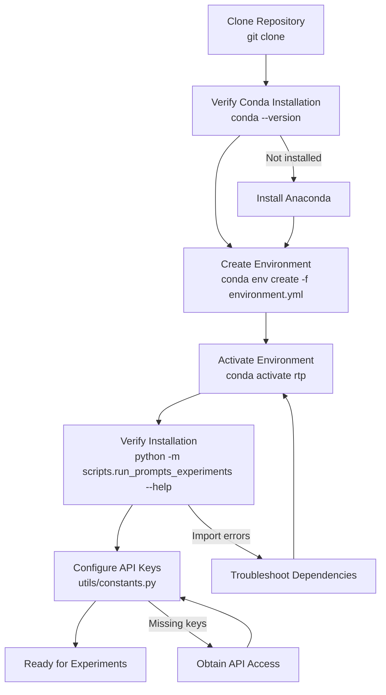
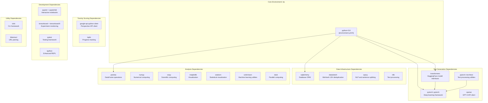
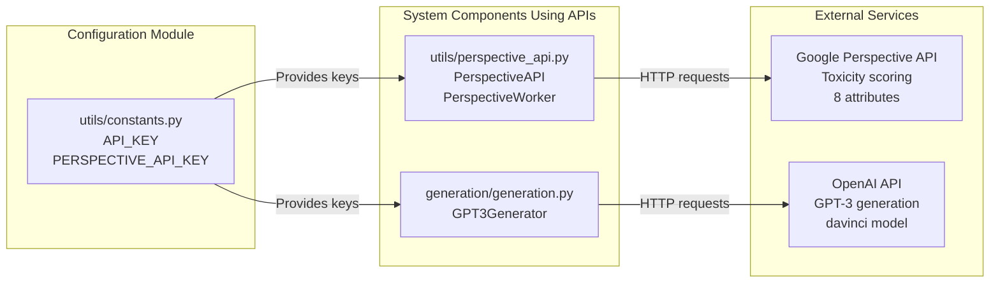

<!-- source: DeepWiki mcp.deepwiki.com · repo allenai/real-toxicity-prompts · page 2.1 Installation and Environment Setup · fetched 2026-10-26 -->

# Installation and Environment Setup

<details>
<summary>Relevant source files</summary>

The following files were used as context for generating this wiki page:

- [README.md](README.md)
- [environment.yml](environment.yml)

</details>


## Purpose and Scope

This document provides detailed instructions for setting up the development environment for the Real Toxicity Prompts research system. It covers Python environment installation, dependency management, and API access configuration required to run text generation experiments and toxicity scoring pipelines.

For information about running your first experiment after installation, see [Running Your First Experiment](#2.2). For details about the overall system architecture, see [Real Toxicity Prompts: Overview](#1).

## System Requirements and Prerequisites

Before beginning installation, ensure your system meets the following requirements:

| Requirement | Specification |
|------------|---------------|
| Operating System | Linux, macOS, or Windows with WSL |
| Python Version | 3.8 |
| Package Manager | Anaconda or Miniconda |
| Disk Space | ~5 GB for environment and dependencies |
| Internet Access | Required for package installation and API access |

**Critical External Dependencies:**
- Git (for repository cloning)
- Anaconda or Miniconda (for environment management)
- API keys for external services (see API Configuration section)

Sources: [README.md:1-30]()

## Installation Process Overview

The installation process follows a linear workflow that sets up the conda environment, installs all dependencies, and prepares the system for running experiments.



**Diagram: Installation Workflow from Repository to Ready State**

Sources: [README.md:8-24]()

## Step-by-Step Installation

### Step 1: Clone the Repository

```bash
git clone https://github.com/allenai/real-toxicity-prompts.git
cd real-toxicity-prompts
```

This creates a local copy of the codebase with the following key directories:
- `generation/` - Text generation system
- `scripts/` - Experiment runners
- `utils/` - Utility modules
- `notebooks/` - Analysis notebooks
- `models/` - Custom model implementations

### Step 2: Install Anaconda

If Anaconda is not already installed, download and install it from the [official Anaconda website](https://docs.anaconda.com/anaconda/install). Miniconda is also acceptable and uses less disk space.

Verify installation:
```bash
conda --version
```

### Step 3: Create the Conda Environment

The repository includes a complete environment specification in [environment.yml:1-36]():

```bash
conda env create -f environment.yml
```

This command creates a new conda environment named `rtp` with Python 3.8 and all required dependencies. The process typically takes 5-15 minutes depending on network speed and system performance.

**Environment Name:** The environment is explicitly named `rtp` as specified in [environment.yml:1]().

### Step 4: Activate the Environment

```bash
conda activate rtp
```

This activation must be performed in **every new terminal session** before running any scripts, notebooks, or experiments. The active environment name `(rtp)` should appear in your terminal prompt.

### Step 5: Verify Installation

Test that the installation completed successfully:

```bash
python -m scripts.run_prompts_experiments --help
```

If the installation is correct, this displays the available command-line arguments for running experiments. Any import errors at this stage indicate missing or incorrectly installed dependencies.

Sources: [README.md:8-29](), [environment.yml:1-36]()

## Dependency Architecture

The `environment.yml` file specifies dependencies that support different subsystems within the Real Toxicity Prompts architecture. Understanding these dependency groups helps diagnose issues and comprehend system requirements.



**Diagram: Dependency Groups Mapped to System Components**

### Critical Dependencies by Subsystem

| Package | Version Source | Primary Use | Related Modules |
|---------|---------------|-------------|-----------------|
| `pytorch` | pytorch channel | Neural network backend for language models | `generation/`, `models/` |
| `transformers` | pip | HuggingFace interfaces for GPT-2, CTRL | `generation/generation.py`, `models/affect_lm.py` |
| `openai` | pip | GPT-3 API client | `generation/generation.py` |
| `google-api-python-client` | pip | Perspective API for toxicity scoring | `utils/perspective_api.py` |
| `sqlalchemy` | pip | Database ORM for Doc/DocScore/SpanScore | `utils/db.py` |
| `datasketch` | pip | MinHash LSH duplicate detection | `scripts/make_corpus_db.py` |
| `spacy` | pip | Sentence splitting for prompt extraction | `notebooks/prompts.ipynb` |
| `pandas` | conda defaults | Data analysis and multi-level indexing | `notebooks/` |

Sources: [environment.yml:1-36]()

## API Configuration

The Real Toxicity Prompts system requires API access to two external services for full functionality. These APIs are accessed through the `utils/constants.py` module.



**Diagram: API Configuration Flow and Component Integration**

### Perspective API Setup

**Purpose:** The Perspective API scores text for toxicity across eight attributes (toxicity, severe toxicity, identity attack, insult, profanity, threat, sexually explicit, flirtation).

**Setup Steps:**

1. **Obtain API Key:**
   - Visit the [Perspective API getting started guide](https://github.com/conversationai/perspectiveapi/tree/master/1-get-started)
   - Enable the API in your Google Cloud Console
   - Generate an API key

2. **Configure in Code:**
   - The API key is referenced in `utils/constants.py` as `PERSPECTIVE_API_KEY`
   - The key is used by `utils/perspective_api.py` for both `PerspectiveAPI` client and `PerspectiveWorker` async processing

3. **Test Access:**
   ```bash
   python -c "from utils.perspective_api import PerspectiveAPI; print('API access OK')"
   ```

**Rate Limits:** The Perspective API has rate limits. The `PerspectiveWorker` implementation includes automatic rate limiting and request queuing to handle this constraint.

### OpenAI API Setup

**Purpose:** The OpenAI API provides access to GPT-3 models (specifically the `davinci` model variant) for text generation experiments.

**Setup Steps:**

1. **Obtain API Key:**
   - Sign up at [OpenAI API platform](https://beta.openai.com)
   - Generate an API key from your account dashboard

2. **Configure in Code:**
   - The API key is referenced in `utils/constants.py` as `API_KEY`
   - The key is used by `generation/generation.py` in the `GPT3Generator` class

3. **Test Access:**
   ```bash
   python -c "import openai; from utils.constants import API_KEY; openai.api_key = API_KEY; print('API access OK')"
   ```

**Cost Considerations:** GPT-3 API calls are billed based on token usage. Running full experiments can incur significant costs.

### Configuration File Structure

The API keys should be stored in `utils/constants.py`. While the repository may include a template, you will need to add your actual keys. The typical structure is:

```python
# Example structure (actual implementation in utils/constants.py)
PERSPECTIVE_API_KEY = "your-perspective-api-key-here"
API_KEY = "your-openai-api-key-here"
```

**Security Note:** Never commit actual API keys to version control. Use environment variables or a local configuration file that is excluded from git (via `.gitignore`).

Sources: [README.md:20-23]()

## Verifying Installation Completeness

After completing the installation steps, verify that all system components are properly configured:

### Verification Checklist

| Component | Verification Command | Expected Result |
|-----------|---------------------|-----------------|
| Python version | `python --version` | Python 3.8.x |
| Environment activation | `conda env list` | `*` next to `rtp` |
| Core imports | `python -c "import torch, transformers, pandas"` | No errors |
| Script access | `python -m scripts.run_prompts_experiments --help` | Command help displayed |
| Database utilities | `python -c "from utils.db import Doc, DocScore, SpanScore"` | No errors |
| API utilities | `python -c "from utils.perspective_api import PerspectiveAPI"` | No errors |

### Testing Individual Components

**Test Generation System:**
```bash
python -c "from generation.generation import GPT2Generator; print('Generation system OK')"
```

**Test Custom Models:**
```bash
python -c "from models.affect_lm import AffectGPT2LMHeadModel; print('AffectGPT2 model OK')"
```

**Test Utilities:**
```bash
python -c "from utils.utils import batchify, load_jsonl; print('Utils OK')"
```

If any verification step fails, refer to the Troubleshooting section below.

Sources: [README.md:26-29](), [environment.yml:1-36]()

## Troubleshooting Common Issues

### Issue: Conda Environment Creation Fails

**Symptoms:** `conda env create` command fails with dependency resolution errors.

**Solutions:**
1. Update conda: `conda update -n base -c defaults conda`
2. Clear conda cache: `conda clean --all`
3. Use mamba as a faster alternative: `conda install mamba -n base -c conda-forge`, then `mamba env create -f environment.yml`
4. Check that Python 3.8 is available in your conda channels

### Issue: Import Errors After Activation

**Symptoms:** `ModuleNotFoundError` when importing packages like `transformers`, `openai`, or `datasketch`.

**Solutions:**
1. Verify environment is active: `conda env list` should show `*` next to `rtp`
2. Reinstall specific package: `pip install <package-name>`
3. Check pip is using the correct environment: `which pip` should point to the `rtp` environment
4. For pytorch issues, verify CUDA compatibility if using GPU

### Issue: API Authentication Failures

**Symptoms:** HTTP 401/403 errors when running experiments, or `KeyError` for API keys.

**Solutions:**
1. Verify API keys are correctly set in `utils/constants.py`
2. Check key formatting (no extra spaces or quotes)
3. Test API access with curl:
   - Perspective: `curl "https://commentanalyzer.googleapis.com/v1alpha1/comments:analyze?key=YOUR_KEY"`
   - OpenAI: `curl https://api.openai.com/v1/engines -H "Authorization: Bearer YOUR_KEY"`
4. Verify API keys have not expired or been revoked

### Issue: PyTorch CUDA Compatibility

**Symptoms:** `RuntimeError: CUDA not available` despite having a GPU.

**Solutions:**
1. Check CUDA version: `nvidia-smi`
2. Reinstall pytorch with correct CUDA version from [pytorch.org](https://pytorch.org)
3. For CPU-only systems, this is expected behavior; models will run on CPU

### Issue: spaCy Language Model Missing

**Symptoms:** `OSError: Can't find model 'en_core_web_sm'` when running notebooks.

**Solution:**
```bash
python -m spacy download en_core_web_sm
```

### Issue: Jupyter Kernel Not Found

**Symptoms:** Jupyter cannot find the `rtp` kernel when opening notebooks.

**Solution:**
```bash
python -m ipykernel install --user --name=rtp
```

## Next Steps

After successful installation:

1. **Verify with a Test Run:** See [Running Your First Experiment](#2.2) to execute a small-scale generation experiment
2. **Explore the Data:** Review the database schema and data loading utilities in [Database Schema and Models](#5.1)
3. **Understand Generation:** Read about the generation architecture in [Generation Architecture and Model Interfaces](#3.1)
4. **Configure Experiments:** Learn about experiment configuration in [Experiment Configuration and Execution](#6.1)

The system is now ready to run text generation experiments and toxicity scoring pipelines. Ensure API keys are properly configured before running experiments that require external services.

Sources: [README.md:1-30](), [environment.yml:1-36]()

---

