# Page: Overview

# Overview

<details>
<summary>Relevant source files</summary>

The following files were used as context for generating this wiki page:

- [LICENSE](LICENSE)
- [README.md](README.md)
- [docs/images/sentinel2_vessels/prediction.png](docs/images/sentinel2_vessels/prediction.png)
- [docs/satlas_marine_infra.md](docs/satlas_marine_infra.md)
- [rslp/forest_loss_driver/README.md](rslp/forest_loss_driver/README.md)

</details>


## Purpose and Scope

The `rslearn_projects` repository contains production machine learning applications for remote sensing built on the [rslearn framework](https://github.com/allenai/rslearn). This repository serves as the operational deployment layer for AI2's remote sensing capabilities, providing complete end-to-end systems from data processing to model inference and API services.

The repository encompasses three primary categories of systems:
- **Geospatial analysis applications** for forest monitoring, infrastructure detection, and ecosystem mapping
- **Vessel detection systems** for maritime surveillance using multiple satellite data sources
- **Foundation model integrations** enabling transfer learning across remote sensing tasks

For specific application documentation, see [Forest Loss Driver System](#3), [Vessel Detection Systems](#4), and [Satlas System](#5). For infrastructure details, see [Core Infrastructure](#2).

## System Architecture

The repository implements a layered architecture where specialized applications build upon shared infrastructure components:

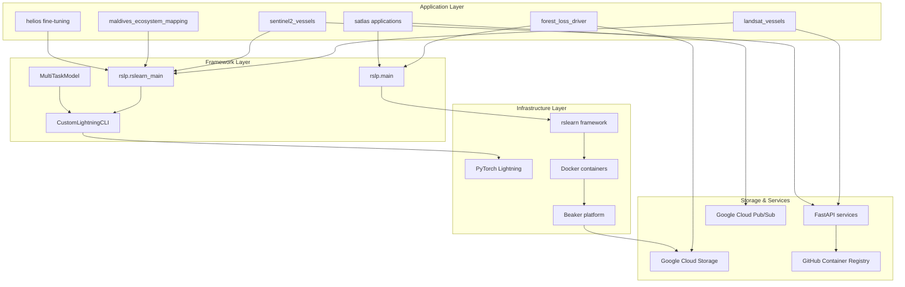

Sources: [README.md:1-47](), [rslp/forest_loss_driver/README.md:1-60]()

## Application Ecosystem

The repository contains seven major application systems, each serving distinct remote sensing use cases:

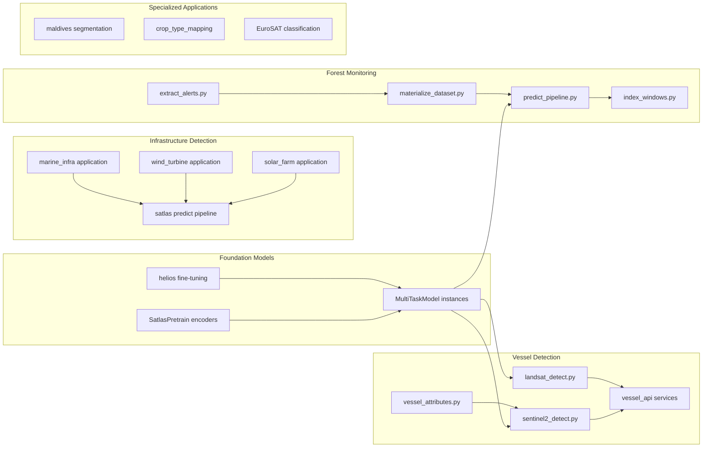

Sources: [README.md:36-47](), [docs/satlas_marine_infra.md:1-116]()

## Core Technology Stack

The repository standardizes on a specific technology stack that enables consistent development and deployment patterns across all applications:

| Component | Technology | Purpose |
|-----------|------------|---------|
| ML Framework | `rslearn` + PyTorch Lightning | Dataset management, model training, and inference |
| CLI Interface | `CustomLightningCLI` | Enhanced Lightning CLI with cloud checkpointing |
| Containerization | Docker + Docker Compose | Development environment and deployment packaging |
| Orchestration | Beaker platform | GPU cluster job scheduling and execution |
| Storage | Google Cloud Storage | Model checkpoints, datasets, and results |
| APIs | FastAPI | Production inference services |
| Job Queuing | Google Cloud Pub/Sub | Distributed processing coordination |
| Registry | GitHub Container Registry | Container image publishing |

The `RSLP_PREFIX` environment variable serves as the root path for all model checkpoints and auxiliary files, typically pointing to a Google Cloud Storage bucket for production deployments.

Sources: [README.md:28-34]()

## Development and Deployment Pipeline

The repository implements a comprehensive CI/CD pipeline that transforms code changes into production-ready containerized services:

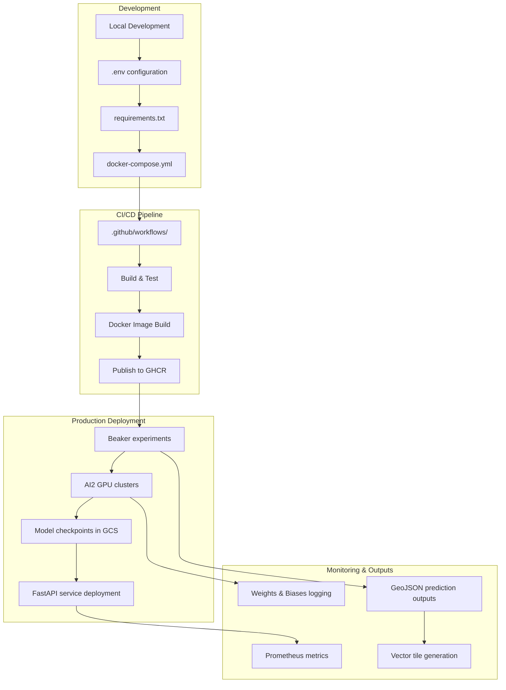

The deployment process leverages AI2's internal infrastructure, with Beaker providing GPU cluster access and Google Cloud Storage serving as the primary data persistence layer. All applications follow the same containerization patterns, enabling consistent deployment and scaling across different use cases.

Sources: [README.md:12-34]()

---

# Page: System Architecture

# System Architecture

<details>
<summary>Relevant source files</summary>

The following files were used as context for generating this wiki page:

- [.dockerignore](.dockerignore)
- [.github/workflows/build_test.yaml](.github/workflows/build_test.yaml)
- [.github/workflows/get_test_targets.sh](.github/workflows/get_test_targets.sh)
- [Dockerfile](Dockerfile)
- [docker-compose.yaml](docker-compose.yaml)
- [requirements.txt](requirements.txt)
- [rslp/config.py](rslp/config.py)
- [rslp/docker_entrypoint.py](rslp/docker_entrypoint.py)
- [rslp/landsat_vessels/Dockerfile](rslp/landsat_vessels/Dockerfile)
- [rslp/launcher_lib.py](rslp/launcher_lib.py)
- [rslp/lightning_cli.py](rslp/lightning_cli.py)
- [rslp/main.py](rslp/main.py)
- [rslp/rslearn_main.py](rslp/rslearn_main.py)
- [rslp/utils/rslearn.py](rslp/utils/rslearn.py)
- [tests/integration/forest_loss_driver/conftest.py](tests/integration/forest_loss_driver/conftest.py)
- [tests/integration/forest_loss_driver/inference/test_materialize_dataset.py](tests/integration/forest_loss_driver/inference/test_materialize_dataset.py)
- [tests/integration/forest_loss_driver/inference/test_model_predict.py](tests/integration/forest_loss_driver/inference/test_model_predict.py)
- [tests/unit/test_launcher_lib.py](tests/unit/test_launcher_lib.py)

</details>


This document provides a comprehensive overview of the system architecture for the rslearn_projects repository, which implements a collection of machine learning applications for remote sensing built on the rslearn framework. The architecture encompasses core infrastructure components, application-specific systems, and deployment mechanisms that enable scalable remote sensing ML workloads.

For information about specific applications like Forest Loss Driver, see [Forest Loss Driver System](#3). For deployment workflows, see [CI/CD and Deployment](#8). For development setup and utilities, see [Development Guide](#9).

## Core System Architecture

The rslearn_projects repository implements a layered architecture where the rslearn framework provides the foundation for multiple specialized remote sensing applications.

### High-Level System Components

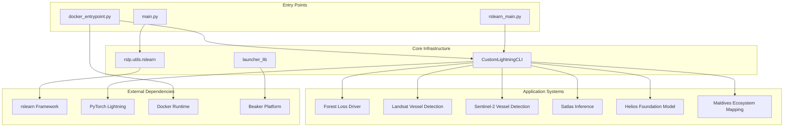

**Sources:** [`rslp/docker_entrypoint.py:1-28`](), [`rslp/rslearn_main.py:1-30`](), [`rslp/main.py:1-76`](), [`rslp/lightning_cli.py:1-365`](), [`rslp/utils/rslearn.py:1-162`](), [`rslp/launcher_lib.py:1-266`]()

### Container Architecture and Deployment Pipeline

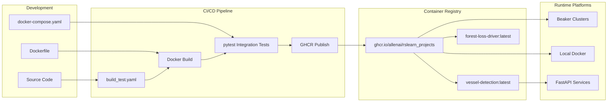

**Sources:** [`Dockerfile:1-48`](), [`docker-compose.yaml:1-14`](), [`.github/workflows/build_test.yaml:1-207`](), [`rslp/landsat_vessels/Dockerfile:1-13`]()

## Core Infrastructure Components

### CustomLightningCLI Integration

The `CustomLightningCLI` class extends the rslearn framework's Lightning CLI with AI2-specific features for cloud checkpointing and experiment management.

| Component | Purpose | Key Features |
|-----------|---------|--------------|
| `CustomLightningCLI` | Enhanced Lightning CLI | Cloud checkpointing, W&B integration, auto-resume |
| `SaveWandbRunIdCallback` | W&B run tracking | Saves W&B run IDs to GCS for resumption |
| `get_cached_checkpoint` | Checkpoint caching | Local caching of remote checkpoints |

Key configuration parameters:
- `--rslp_project`: Project identifier for organization
- `--rslp_experiment`: Experiment identifier 
- `--autoresume`: Auto-resume from existing checkpoints
- `--load_best`: Load best performing checkpoint for inference

**Sources:** [`rslp/lightning_cli.py:114-365`]()

### Dataset Materialization Pipeline

The rslearn integration provides a standardized pipeline for preparing datasets across all applications.

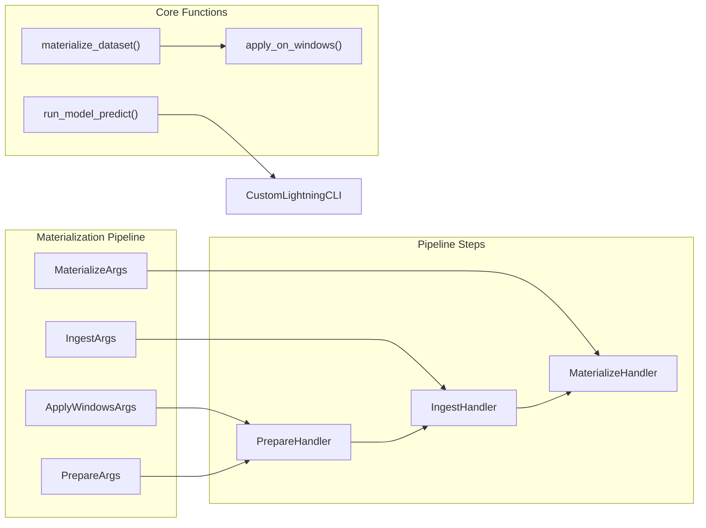

**Sources:** [`rslp/utils/rslearn.py:25-162`]()

### Experiment Management and Code Distribution

The launcher library manages experiment orchestration, hyperparameter sweeps, and code distribution across compute platforms.

| Function | Purpose | Key Operations |
|----------|---------|----------------|
| `upload_code()` | Code distribution | Creates zip archive, uploads to GCS |
| `download_code()` | Code retrieval | Downloads and extracts code in containers |
| `generate_combinations()` | Hyperparameter sweeps | Generates config combinations |
| `upload_wandb_id()` / `download_wandb_id()` | W&B tracking | Manages W&B run IDs for resumption |

**Sources:** [`rslp/launcher_lib.py:14-266`]()

## Application System Architecture

### Multi-Application Deployment Model

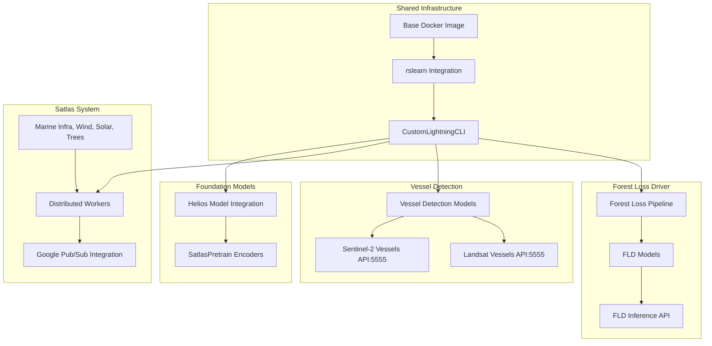

**Sources:** [`Dockerfile:18-48`](), [`rslp/lightning_cli.py:114-365`](), [`rslp/landsat_vessels/Dockerfile:1-13`]()

### Entry Point Architecture

The system provides multiple entry points for different deployment scenarios:

| Entry Point | Use Case | Key Features |
|-------------|----------|--------------|
| `docker_entrypoint.py` | Containerized jobs | Downloads code from GCS, runs rslearn |
| `rslearn_main.py` | Direct execution | Local development, custom Lightning CLI |
| `main.py` | Workflow execution | Project-specific workflow routing |

**Sources:** [`rslp/docker_entrypoint.py:1-28`](), [`rslp/rslearn_main.py:1-30`](), [`rslp/main.py:42-65`]()

## Data Flow and Processing Architecture

### Dataset Processing Pipeline

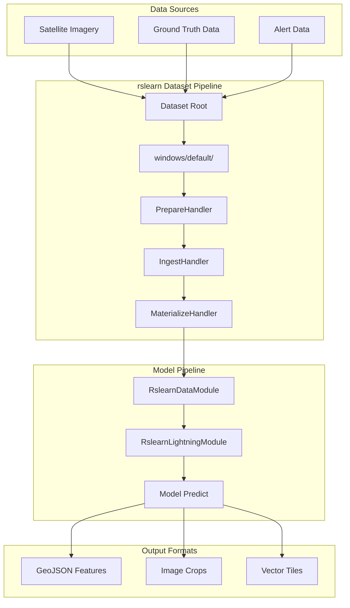

**Sources:** [`rslp/utils/rslearn.py:82-127`](), [`tests/integration/forest_loss_driver/inference/test_materialize_dataset.py:25-94`](), [`tests/integration/forest_loss_driver/inference/test_model_predict.py:25-90`]()

## Infrastructure and Deployment Architecture

### CI/CD Pipeline Architecture

The deployment pipeline implements a comprehensive build, test, and publish workflow:

| Stage | Components | Key Operations |
|-------|------------|----------------|
| Build | `docker/build-push-action` | Multi-architecture Docker builds |
| Test | `docker-compose` | Unit and integration test execution |
| Publish | `ghcr.io` | Container registry publishing |

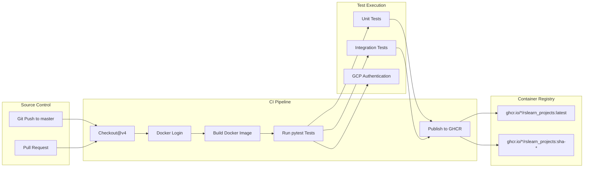

**Sources:** [`.github/workflows/build_test.yaml:19-207`](), [`docker-compose.yaml:1-14`](), [`.github/workflows/get_test_targets.sh:1-28`]()

### Compute Platform Integration

The system integrates with multiple compute platforms for different workload types:

| Platform | Use Case | Integration Method |
|----------|----------|--------------------|
| Beaker | Large-scale training and inference | `beaker-py` library |
| Local Docker | Development and testing | `docker-compose` |
| GitHub Actions | CI/CD | Ubuntu runners with Docker |

**Sources:** [`requirements.txt:1-15`](), [`.github/workflows/build_test.yaml:80-147`]()

This architecture enables scalable, reproducible remote sensing ML workloads across multiple applications while maintaining consistent infrastructure patterns and deployment mechanisms.

---

# Page: Core Technologies

# Core Technologies

<details>
<summary>Relevant source files</summary>

The following files were used as context for generating this wiki page:

- [.dockerignore](.dockerignore)
- [.github/workflows/build_test.yaml](.github/workflows/build_test.yaml)
- [.github/workflows/get_test_targets.sh](.github/workflows/get_test_targets.sh)
- [Dockerfile](Dockerfile)
- [docker-compose.yaml](docker-compose.yaml)
- [requirements.txt](requirements.txt)
- [rslp/config.py](rslp/config.py)
- [rslp/docker_entrypoint.py](rslp/docker_entrypoint.py)
- [rslp/landsat_vessels/Dockerfile](rslp/landsat_vessels/Dockerfile)
- [rslp/launcher_lib.py](rslp/launcher_lib.py)
- [rslp/lightning_cli.py](rslp/lightning_cli.py)
- [rslp/main.py](rslp/main.py)
- [rslp/rslearn_main.py](rslp/rslearn_main.py)
- [rslp/utils/rslearn.py](rslp/utils/rslearn.py)
- [tests/integration/forest_loss_driver/conftest.py](tests/integration/forest_loss_driver/conftest.py)
- [tests/integration/forest_loss_driver/inference/test_materialize_dataset.py](tests/integration/forest_loss_driver/inference/test_materialize_dataset.py)
- [tests/integration/forest_loss_driver/inference/test_model_predict.py](tests/integration/forest_loss_driver/inference/test_model_predict.py)
- [tests/unit/test_launcher_lib.py](tests/unit/test_launcher_lib.py)

</details>


This document provides an overview of the foundational technologies that underpin all applications in the rslearn_projects repository. These core technologies provide shared infrastructure, common patterns, and deployment mechanisms used across vessel detection, forest loss driver, Satlas, and other machine learning applications.

For information about how these technologies are orchestrated in specific applications, see [System Architecture](#1.1). For details about the distributed worker system built on these foundations, see [Distributed Worker System](#2.4).

## rslearn Framework Integration

The repository is built as an extension of the [rslearn framework](https://github.com/allenai/rslearn), which provides the core dataset management, model training, and inference capabilities for remote sensing machine learning. All applications in this repository leverage rslearn's foundational components while adding AI2-specific enhancements and workflow orchestration.

### Core Framework Architecture

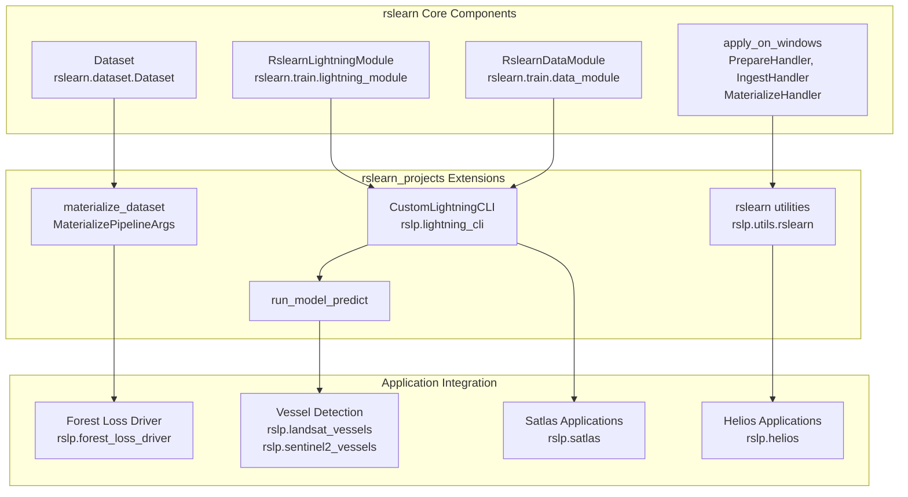

**Sources:** [rslp/utils/rslearn.py:1-162](), [rslp/lightning_cli.py:1-365]()

### Dataset Materialization Pipeline

The `materialize_dataset` function provides a standardized workflow for preparing rslearn datasets across all applications. It orchestrates the three-stage rslearn pipeline: prepare, ingest, and materialize.

| Component | Purpose | Configuration |
|-----------|---------|---------------|
| `PrepareHandler` | Extracts metadata and prepares windows | `PrepareArgs` with retry logic |
| `IngestHandler` | Downloads and processes raw satellite imagery | `IngestArgs` with error handling |
| `MaterializeHandler` | Converts data to final format for training/inference | `MaterializeArgs` with layer management |

The pipeline uses `ApplyWindowsArgs` to control parallelization with configurable workers, batch sizes, and job distribution. Each stage supports retry mechanisms with exponential backoff for robust cloud-based processing.

**Sources:** [rslp/utils/rslearn.py:82-127](), [rslp/utils/rslearn.py:25-80]()

## PyTorch Lightning and CustomLightningCLI

The repository enhances PyTorch Lightning with AI2-specific features through the `CustomLightningCLI` class, which extends rslearn's `RslearnLightningCLI` to provide cloud checkpointing, experiment management, and Weights & Biases integration.

### CustomLightningCLI Architecture

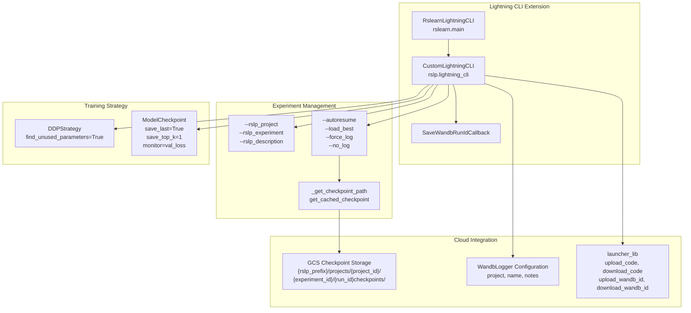

**Sources:** [rslp/lightning_cli.py:114-365](), [rslp/lightning_cli.py:25-72]()

### Checkpoint Management

The CLI provides sophisticated checkpoint management for distributed training environments:

- **`--autoresume=true`**: Automatically resumes from `last.ckpt` if available, otherwise starts fresh
- **`--load_best=true`**: Loads the best-performing checkpoint based on epoch numbers, required for inference
- **Checkpoint caching**: Remote checkpoints are cached locally using SHA256 hashing to avoid repeated downloads

The checkpoint path resolution logic prioritizes checkpoints with higher epoch numbers and falls back to `last.ckpt` only when no epoch-based checkpoints exist.

**Sources:** [rslp/lightning_cli.py:171-258]()

## Docker and Containerization

All applications are containerized using a multi-stage Docker architecture that provides consistent environments from development through production deployment.

### Container Architecture

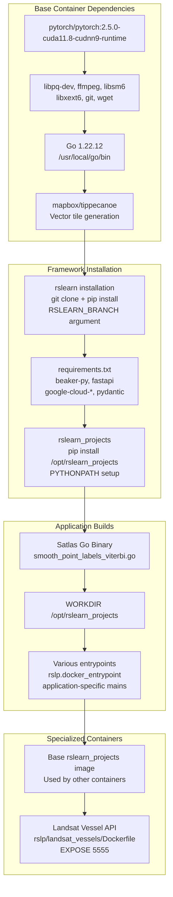

**Sources:** [Dockerfile:1-48](), [rslp/landsat_vessels/Dockerfile:1-13]()

### Development and Testing Environment

The repository provides a Docker Compose setup for local development and testing that mirrors production environments while providing development conveniences.

| Service | Purpose | Configuration |
|---------|---------|---------------|
| `test` | Integration and unit testing | Built from main Dockerfile |
| Local development | Code mounting and debugging | Volume mounts, environment variables |
| CI/CD integration | Automated testing in GitHub Actions | Same container across environments |

The `.dockerignore` file excludes development artifacts, test data, and cache directories to optimize build contexts and container sizes.

**Sources:** [docker-compose.yaml:1-14](), [.dockerignore:1-8]()

## Cloud Platforms and Infrastructure

The repository integrates with multiple cloud platforms to provide scalable compute, storage, and orchestration capabilities.

### Beaker Platform Integration

Beaker serves as the primary compute platform for training and large-scale inference jobs. The integration provides:

- **Cluster targeting**: `jupiter-cirrascale-2`, `saturn-cirrascale`, `neptune-cirrascale`
- **GPU resource allocation**: Automatic GPU detection and allocation
- **Job scheduling**: Integration with `beaker-py` for programmatic job submission
- **Experiment tracking**: Hierarchical organization by project and experiment IDs

### Google Cloud Services

| Service | Purpose | Integration Points |
|---------|---------|-------------------|
| **Cloud Storage** | Dataset storage, checkpoints, results | `gs://` URIs throughout codebase |
| **Cloud Pub/Sub** | Job queuing for distributed inference | Worker orchestration in Satlas |
| **BigTable** | Metadata and indexing for large datasets | Vessel detection and forest loss systems |

**Sources:** [requirements.txt:3-4](), [.github/workflows/build_test.yaml:137-145]()

### Storage Architecture

The repository uses a hierarchical storage layout across multiple backends:

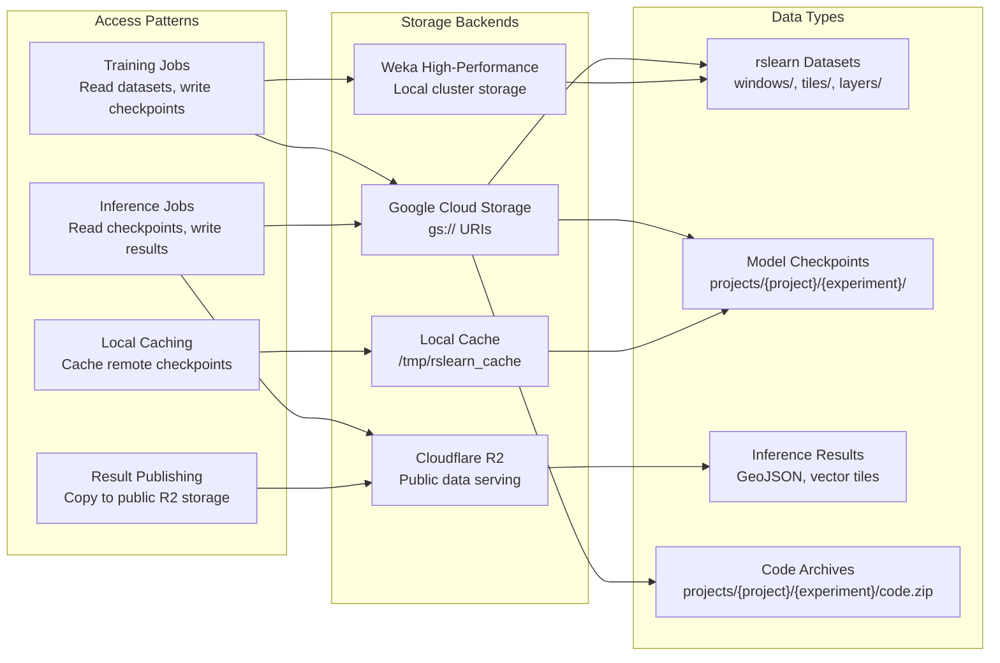

**Sources:** [rslp/lightning_cli.py:25-27](), [rslp/launcher_lib.py:14-15]()

## Development and CI/CD Tooling

The repository provides comprehensive tooling for development, testing, and automated deployment through GitHub Actions workflows.

### GitHub Actions Pipeline

The main CI/CD pipeline orchestrates building, testing, and publishing of Docker images:

| Stage | Purpose | Key Features |
|-------|---------|--------------|
| **Build** | Docker image creation | Multi-platform builds, metadata extraction |
| **Test** | Automated testing | Unit and integration tests, selective test execution |
| **Publish** | Container registry publishing | GitHub Container Registry, tag management |

The pipeline uses intelligent test selection based on changed files, running only relevant test suites for pull requests while executing full test suites on the master branch.

**Sources:** [.github/workflows/build_test.yaml:1-153](), [.github/workflows/get_test_targets.sh:1-28]()

### Container Registry Strategy

Images are published to GitHub Container Registry (GHCR) with multiple tagging strategies:

- **SHA-based tags**: `sha-{long}`, `sha-{short}` for precise version tracking
- **Branch tags**: `latest` for master branch builds
- **Digest-based references**: Immutable references for production deployments

The registry integration supports automated authentication using GitHub tokens and provides secure access to private repositories.

**Sources:** [.github/workflows/build_test.yaml:31-76]()

### Code Distribution and Entrypoints

The repository provides multiple entrypoints for different execution contexts:

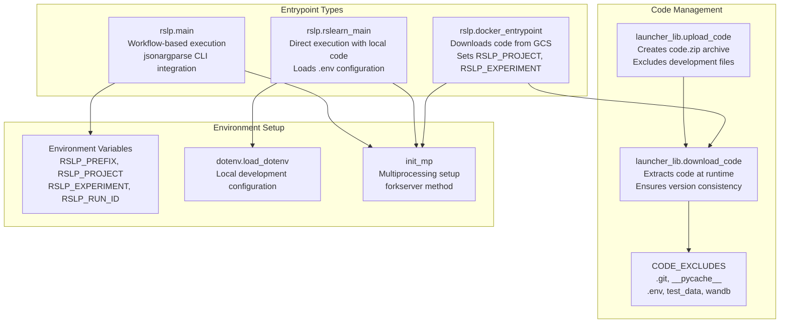

The code distribution system ensures version consistency between job submission and execution environments while excluding development artifacts and sensitive configuration files.

**Sources:** [rslp/docker_entrypoint.py:1-28](), [rslp/rslearn_main.py:1-30](), [rslp/main.py:1-76](), [rslp/launcher_lib.py:77-127]()

---

# Page: Core Infrastructure

# Core Infrastructure

<details>
<summary>Relevant source files</summary>

The following files were used as context for generating this wiki page:

- [.dockerignore](.dockerignore)
- [.github/workflows/build_test.yaml](.github/workflows/build_test.yaml)
- [.github/workflows/get_test_targets.sh](.github/workflows/get_test_targets.sh)
- [Dockerfile](Dockerfile)
- [docker-compose.yaml](docker-compose.yaml)
- [requirements.txt](requirements.txt)
- [rslp/config.py](rslp/config.py)
- [rslp/docker_entrypoint.py](rslp/docker_entrypoint.py)
- [rslp/landsat_vessels/Dockerfile](rslp/landsat_vessels/Dockerfile)
- [rslp/launcher_lib.py](rslp/launcher_lib.py)
- [rslp/lightning_cli.py](rslp/lightning_cli.py)
- [rslp/main.py](rslp/main.py)
- [rslp/rslearn_main.py](rslp/rslearn_main.py)
- [rslp/utils/rslearn.py](rslp/utils/rslearn.py)
- [tests/integration/forest_loss_driver/conftest.py](tests/integration/forest_loss_driver/conftest.py)
- [tests/integration/forest_loss_driver/inference/test_materialize_dataset.py](tests/integration/forest_loss_driver/inference/test_materialize_dataset.py)
- [tests/integration/forest_loss_driver/inference/test_model_predict.py](tests/integration/forest_loss_driver/inference/test_model_predict.py)
- [tests/unit/test_launcher_lib.py](tests/unit/test_launcher_lib.py)

</details>


This document covers the shared infrastructure components that support all applications within the rslearn_projects repository. The core infrastructure provides the foundational layer for dataset management, model training, containerization, and distributed job execution that all domain-specific applications build upon.

For application-specific systems that utilize this infrastructure, see [Forest Loss Driver System](#3), [Vessel Detection Systems](#4), and [Satlas System](#5). For deployment and CI/CD workflows that build upon this infrastructure, see [CI/CD and Deployment](#8).

## Infrastructure Architecture Overview

The core infrastructure consists of four primary subsystems that work together to provide a complete machine learning platform for remote sensing applications.

```mermaid
graph TB
    subgraph "Core ML Framework"
        rslearn_utils["`rslp/utils/rslearn.py`<br/>Dataset & Model Utilities"]
        lightning_cli["`CustomLightningCLI`<br/>Enhanced Training Interface"]
        base_config["`rslp/config.py`<br/>Base Configuration Classes"]
    end
    
    subgraph "Containerization Layer"
        dockerfile["`Dockerfile`<br/>Multi-stage Container Build"]
        docker_compose["`docker-compose.yaml`<br/>Local Development Setup"]
        entrypoint["`rslp/docker_entrypoint.py`<br/>Container Entry Point"]
    end
    
    subgraph "Job Management System"
        launcher_lib["`rslp/launcher_lib.py`<br/>Code & Job Management"]
        main_cli["`rslp/main.py`<br/>Workflow Dispatcher"]
        rslearn_main["`rslp/rslearn_main.py`<br/>Direct rslearn Integration"]
    end
    
    subgraph "CI/CD Pipeline"
        build_test["`build_test.yaml`<br/>GitHub Actions Workflow"]
        test_targets["`get_test_targets.sh`<br/>Smart Test Selection"]
    end
    
    rslearn_utils --> lightning_cli
    lightning_cli --> dockerfile
    launcher_lib --> entrypoint
    main_cli --> rslearn_main
    build_test --> dockerfile
    build_test --> docker_compose
    
    style rslearn_utils fill:#f9f9f9
    style lightning_cli fill:#f9f9f9
    style dockerfile fill:#f0f8ff
    style launcher_lib fill:#fff8f0
```

**Core Infrastructure Data Flow**

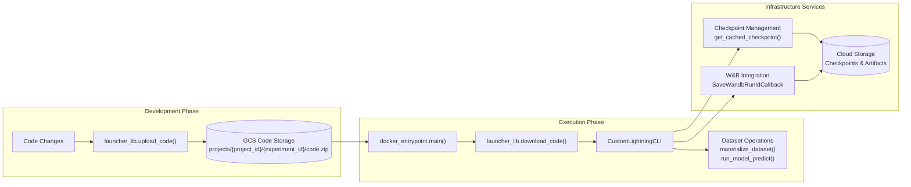

Sources: [rslp/lightning_cli.py:1-365](), [rslp/utils/rslearn.py:1-162](), [rslp/launcher_lib.py:1-266](), [Dockerfile:1-48]()

## rslearn Framework Integration

The repository extends the core rslearn framework through a set of utility modules that provide standardized interfaces for dataset operations and model execution. The integration layer abstracts rslearn's complexity while adding project-specific functionality.

### Dataset Operations

The `rslp.utils.rslearn` module provides the primary interface for dataset lifecycle management through structured configuration classes and pipeline functions:

| Component | Purpose | Key Methods |
|-----------|---------|-------------|
| `MaterializePipelineArgs` | Configuration for dataset materialization | Contains `PrepareArgs`, `IngestArgs`, `MaterializeArgs` |
| `ApplyWindowsArgs` | Parallel processing configuration | Controls workers, batch size, job distribution |
| `materialize_dataset()` | Execute complete dataset pipeline | Runs prepare → ingest → materialize sequence |
| `run_model_predict()` | Model inference execution | Wraps `CustomLightningCLI` for prediction tasks |

The materialization pipeline follows rslearn's three-stage approach:

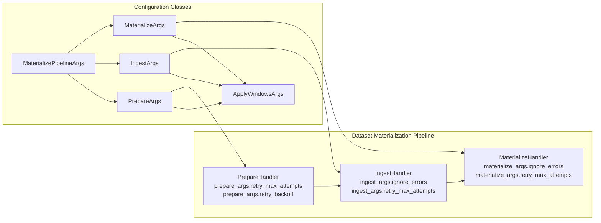

### Model Execution Interface

The `run_model_predict()` function provides a standardized way to execute model inference across all applications:

```python
# From rslp/utils/rslearn.py:129-162
def run_model_predict(
    model_cfg_fname: str,
    ds_path: UPath,
    groups: list[str] = [],
    extra_args: list[str] = [],
) -> None
```

This function instantiates `CustomLightningCLI` with project-specific defaults and handles argument composition for different prediction scenarios.

Sources: [rslp/utils/rslearn.py:1-162](), [tests/integration/forest_loss_driver/inference/test_model_predict.py:1-90](), [tests/integration/forest_loss_driver/inference/test_materialize_dataset.py:1-94]()

## CustomLightningCLI and Training Infrastructure

The `CustomLightningCLI` class extends PyTorch Lightning's CLI with AI2-specific features for cloud-native machine learning workflows. It provides enhanced checkpoint management, experiment tracking, and distributed training capabilities.

### Enhanced Lightning CLI Features

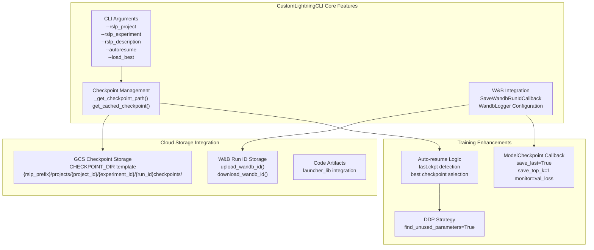

### Checkpoint Management System

The checkpoint management system provides three distinct modes for handling model state:

| Mode | Flag | Behavior | Use Case |
|------|------|----------|----------|
| Default | None | Error if checkpoint exists | New training runs |
| Auto-resume | `--autoresume=true` | Resume if `last.ckpt` exists, else start fresh | Preemptible environments |
| Load Best | `--load_best=true` | Load best checkpoint, error if none exists | Inference tasks |

The checkpoint resolution logic [rslp/lightning_cli.py:171-259]() implements sophisticated best-checkpoint selection based on epoch numbering and fallback to `last.ckpt` only when no epoch-tagged checkpoints exist.

### Experiment Tracking Integration

The `SaveWandbRunIdCallback` class manages W&B run continuity across job restarts:

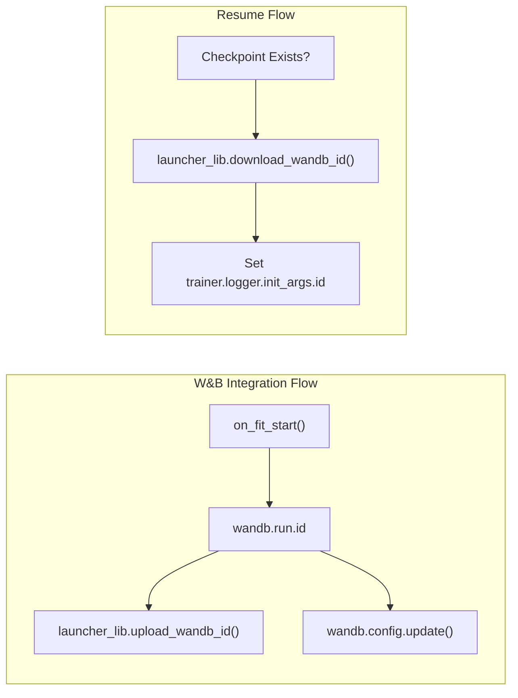

Sources: [rslp/lightning_cli.py:1-365](), [rslp/launcher_lib.py:129-172]()

## Docker and Containerization

The containerization system provides a multi-stage Docker build that creates self-contained environments for training and inference. The system supports both local development and production deployment scenarios.

### Container Build Architecture

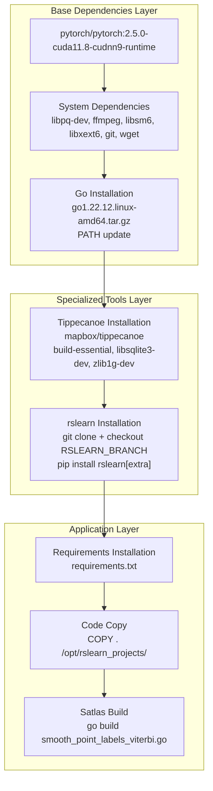

### Container Entry Points

The system provides multiple entry points for different execution contexts:

| Entry Point | File | Purpose | Environment |
|-------------|------|---------|-------------|
| Docker Entry | `rslp/docker_entrypoint.py` | Production containers with code download | Beaker, distributed jobs |
| Direct Entry | `rslp/rslearn_main.py` | Local development, manual execution | Development environments |
| Workflow Dispatcher | `rslp/main.py` | Project-specific workflow execution | All environments |

The Docker entry point implements the code synchronization pattern:

```python
# From rslp/docker_entrypoint.py:6-23
def main() -> None:
    import os
    project_id = os.environ["RSLP_PROJECT"]
    experiment_id = os.environ["RSLP_EXPERIMENT"]
    from rslp.launcher_lib import download_code
    download_code(project_id, experiment_id)
    import rslp.rslearn_main
    rslp.rslearn_main.main()
```

### Development and Testing Setup

The `docker-compose.yaml` configuration provides a simplified setup for local testing and development:

- Builds the main Dockerfile without GPU requirements
- Mounts test data and provides environment variable injection
- Supports both unit and integration testing workflows

Sources: [Dockerfile:1-48](), [docker-compose.yaml:1-14](), [rslp/docker_entrypoint.py:1-28](), [rslp/rslearn_main.py:1-30]()

## Distributed Job Management and Orchestration

The job management system provides code distribution, experiment configuration, and hyperparameter sweep capabilities for distributed execution across cloud infrastructure.

### Code Distribution System

```mermaid
graph TB
    subgraph "Code Upload Phase"
        local_code["Local Code Repository"]
        make_archive["make_archive()<br/>ZIP creation with excludes"]
        code_excludes["CODE_EXCLUDES<br/>.git, __pycache__, .env, .mypy_cache<br/>lightning_logs, test_data, wandb"]
        upload_gcs["GCS Upload<br/>projects/{project_id}/{experiment_id}/code.zip"]
    end
    
    subgraph "Code Download Phase"
        container_start["Container Startup"]
        env_vars["Environment Variables<br/>RSLP_PROJECT, RSLP_EXPERIMENT"]
        download_gcs["GCS Download<br/>download_code()"]
        extract_code["Code Extraction<br/>shutil.unpack_archive()"]
    end
    
    local_code --> make_archive
    make_archive --> code_excludes
    code_excludes --> upload_gcs
    
    container_start --> env_vars
    env_vars --> download_gcs
    download_gcs --> extract_code
```

### Hyperparameter Management

The launcher library provides sophisticated hyperparameter sweep capabilities through configuration combination generation:

| Function | Purpose | Input | Output |
|----------|---------|-------|--------|
| `extract_parameters()` | Find list-valued parameters | Nested config dict | List of (path, values) tuples |
| `generate_combinations()` | Create parameter combinations | Base config + hyperparams | List of complete configs |
| `create_custom_configs()` | Generate config files | Config paths + output dir | Dict of run_id → config_path |

The system supports nested parameter specification and automatic cartesian product generation for comprehensive hyperparameter exploration.

### Experiment Metadata Management

W&B run ID persistence enables experiment continuity across job preemption and restart:

```python
# From rslp/launcher_lib.py:129-147
def upload_wandb_id(
    project_id: str, experiment_id: str, run_id: str | None, wandb_id: str
) -> None:
    rslp_prefix = UPath(os.environ["RSLP_PREFIX"])
    run_id_path = f"{run_id}/" if run_id else ""
    blob_path = WANDB_ID_BLOB_PATH.format(
        project_id=project_id, experiment_id=experiment_id, run_id=run_id_path
    )
    with (rslp_prefix / blob_path).open("w") as f:
        f.write(wandb_id)
```

Sources: [rslp/launcher_lib.py:1-266](), [rslp/main.py:1-76](), [tests/unit/test_launcher_lib.py:1-60]()

## CI/CD and Build Pipeline

The CI/CD system provides automated testing, container building, and artifact publishing through GitHub Actions workflows with intelligent test selection and multi-stage validation.

### Build and Test Workflow

```mermaid
graph TB
    subgraph "Build Stage"
        checkout["Checkout Repository<br/>actions/checkout@v4"]
        docker_login["Container Registry Login<br/>ghcr.io authentication"]
        metadata["Extract Metadata<br/>docker/metadata-action@v5<br/>SHA tags + latest"]
        build_push["Build and Push<br/>docker/build-push-action@v6<br/>Multi-platform support"]
    end
    
    subgraph "Test Stage"
        test_checkout["Test Checkout<br/>fetch-depth: 0"]
        gcp_auth["GCP Authentication<br/>google-github-actions/auth@v2"]
        compose_build["Docker Compose Build<br/>COMPOSE_DOCKER_CLI_BUILD=1"]
        smart_testing["Smart Test Selection<br/>get_test_targets.sh<br/>Unit + Integration"]
    end
    
    subgraph "Test Execution"
        unit_tests["Unit Tests<br/>pytest tests/unit"]
        integration_tests["Integration Tests<br/>pytest tests/integration<br/>GCS + BigTable + PubSub"]
        cleanup["Container Cleanup<br/>docker compose down"]
    end
    
    checkout --> docker_login
    docker_login --> metadata
    metadata --> build_push
    
    test_checkout --> gcp_auth
    gcp_auth --> compose_build
    compose_build --> smart_testing
    smart_testing --> unit_tests
    smart_testing --> integration_tests
    unit_tests --> cleanup
    integration_tests --> cleanup
```

### Intelligent Test Selection

The `get_test_targets.sh` script implements change-based test selection to optimize CI execution time:

```bash
# From .github/workflows/get_test_targets.sh:15-27
CHANGED_FILES=$(git diff --name-only origin/master...HEAD)

for dir in tests/$TEST_TYPE/*/; do
    dir_name=$(basename "$dir")
    if echo "$CHANGED_FILES" | grep -q "^rslp/$dir_name/"; then
        TEST_DIRS+=("tests/$TEST_TYPE/$dir_name/**")
    fi
done
```

This approach ensures that only relevant tests execute for specific application changes while maintaining comprehensive coverage for core infrastructure modifications.

### Container Registry Integration

The workflow publishes multi-tagged container images to GitHub Container Registry (GHCR):

- SHA-based tags for immutable references (`sha-<commit>`)
- Short SHA tags for convenience (`sha-<short>`)
- Latest tag for default branch commits
- Digest-based references for deployment systems

Sources: [.github/workflows/build_test.yaml:1-207](), [.github/workflows/get_test_targets.sh:1-28](), [requirements.txt:1-15]()

---

# Page: rslearn Framework Integration

# rslearn Framework Integration

<details>
<summary>Relevant source files</summary>

The following files were used as context for generating this wiki page:

- [.dockerignore](.dockerignore)
- [.github/workflows/build_test.yaml](.github/workflows/build_test.yaml)
- [.github/workflows/get_test_targets.sh](.github/workflows/get_test_targets.sh)
- [Dockerfile](Dockerfile)
- [docker-compose.yaml](docker-compose.yaml)
- [requirements.txt](requirements.txt)
- [rslp/config.py](rslp/config.py)
- [rslp/docker_entrypoint.py](rslp/docker_entrypoint.py)
- [rslp/landsat_vessels/Dockerfile](rslp/landsat_vessels/Dockerfile)
- [rslp/launcher_lib.py](rslp/launcher_lib.py)
- [rslp/lightning_cli.py](rslp/lightning_cli.py)
- [rslp/main.py](rslp/main.py)
- [rslp/rslearn_main.py](rslp/rslearn_main.py)
- [rslp/utils/rslearn.py](rslp/utils/rslearn.py)
- [tests/integration/forest_loss_driver/conftest.py](tests/integration/forest_loss_driver/conftest.py)
- [tests/integration/forest_loss_driver/inference/test_materialize_dataset.py](tests/integration/forest_loss_driver/inference/test_materialize_dataset.py)
- [tests/integration/forest_loss_driver/inference/test_model_predict.py](tests/integration/forest_loss_driver/inference/test_model_predict.py)
- [tests/unit/test_launcher_lib.py](tests/unit/test_launcher_lib.py)

</details>


This document covers how the `rslearn_projects` repository extends and integrates with the core `rslearn` framework for dataset management, model training, and inference. The integration provides AI2-specific enhancements while maintaining compatibility with the base rslearn functionality.

For information about the CustomLightningCLI training framework, see [CustomLightningCLI and Training](#2.2). For Docker containerization details, see [Docker and Containerization](#2.3).

## Integration Architecture

The rslearn framework integration operates through several key extension points that enhance the base rslearn functionality with AI2-specific features:

```mermaid
graph TB
    subgraph "rslearn Framework (External)"
        rslearn_dataset["Dataset"]
        rslearn_handlers["PrepareHandler<br/>IngestHandler<br/>MaterializeHandler"]
        rslearn_cli["RslearnLightningCLI"]
        rslearn_modules["RslearnLightningModule<br/>RslearnDataModule"]
    end
    
    subgraph "rslp Integration Layer"
        utils_rslearn["rslp.utils.rslearn"]
        custom_cli["CustomLightningCLI"]
        materialize_pipeline["materialize_dataset()"]
        predict_runner["run_model_predict()"]
    end
    
    subgraph "Application Layer"
        forest_loss["Forest Loss Driver"]
        vessel_detection["Vessel Detection"]
        satlas["Satlas System"]
        helios["Helios Fine-tuning"]
    end
    
    subgraph "Deployment Infrastructure"
        docker_entry["docker_entrypoint.py"]
        rslearn_main["rslearn_main.py"]
        launcher_lib["launcher_lib.py"]
    end
    
    rslearn_dataset --> materialize_pipeline
    rslearn_handlers --> materialize_pipeline
    rslearn_cli --> custom_cli
    rslearn_modules --> predict_runner
    
    utils_rslearn --> forest_loss
    utils_rslearn --> vessel_detection
    custom_cli --> forest_loss
    custom_cli --> vessel_detection
    custom_cli --> satlas
    custom_cli --> helios
    
    launcher_lib --> docker_entry
    docker_entry --> rslearn_main
    rslearn_main --> custom_cli
    
    style utils_rslearn fill:#e1f5fe
    style custom_cli fill:#e1f5fe
```

Sources: [rslp/utils/rslearn.py:1-162](), [rslp/lightning_cli.py:1-365](), [rslp/rslearn_main.py:1-30](), [rslp/docker_entrypoint.py:1-28]()

## Dataset Management Integration

The rslearn dataset management integration provides standardized interfaces for dataset materialization across all applications:

### Dataset Materialization Pipeline

```mermaid
graph LR
    subgraph "Configuration Layer"
        mat_args["MaterializePipelineArgs"]
        prepare_args["PrepareArgs"]
        ingest_args["IngestArgs"]
        materialize_args["MaterializeArgs"]
        apply_window_args["ApplyWindowsArgs"]
    end
    
    subgraph "rslearn Core Handlers"
        prepare_handler["PrepareHandler"]
        ingest_handler["IngestHandler"]
        materialize_handler["MaterializeHandler"]
    end
    
    subgraph "Execution Layer"
        apply_on_windows["apply_on_windows()"]
        dataset_obj["Dataset(ds_root)"]
    end
    
    mat_args --> prepare_args
    mat_args --> ingest_args  
    mat_args --> materialize_args
    prepare_args --> apply_window_args
    
    prepare_args --> prepare_handler
    ingest_args --> ingest_handler
    materialize_args --> materialize_handler
    
    prepare_handler --> apply_on_windows
    ingest_handler --> apply_on_windows
    materialize_handler --> apply_on_windows
    
    apply_on_windows --> dataset_obj
```

The `materialize_dataset()` function provides a unified interface for dataset preparation:

| Component | Purpose | Configuration |
|-----------|---------|---------------|
| `PrepareHandler` | Window-level preparation | `retry_max_attempts`, `retry_backoff` |
| `IngestHandler` | Data ingestion from sources | `ignore_errors`, retry parameters |
| `MaterializeHandler` | Final materialization | Error handling and retry logic |
| `ApplyWindowsArgs` | Execution parameters | `workers`, `batch_size`, `jobs_per_process` |

Sources: [rslp/utils/rslearn.py:25-127](), [tests/integration/forest_loss_driver/inference/test_materialize_dataset.py:1-94]()

### Dataset Configuration Structures

The integration defines standardized configuration dataclasses for consistent dataset processing:

```mermaid
graph TD
    subgraph "Configuration Hierarchy"
        mat_pipeline_args["MaterializePipelineArgs"]
        
        prepare_args["PrepareArgs"]
        ingest_args["IngestArgs"] 
        materialize_args["MaterializeArgs"]
        
        apply_windows_args1["ApplyWindowsArgs"]
        apply_windows_args2["ApplyWindowsArgs"]
        apply_windows_args3["ApplyWindowsArgs"]
    end
    
    mat_pipeline_args --> prepare_args
    mat_pipeline_args --> ingest_args
    mat_pipeline_args --> materialize_args
    
    prepare_args --> apply_windows_args1
    ingest_args --> apply_windows_args2
    materialize_args --> apply_windows_args3
    
    subgraph "ApplyWindowsArgs Fields"
        workers["workers: int = 0"]
        batch_size["batch_size: int = 1"]
        use_initial_job["use_initial_job: bool = False"]
        jobs_per_process["jobs_per_process: int | None"]
        group["group: str | None"]
        names["names: list[str] | None"]
    end
```

Sources: [rslp/utils/rslearn.py:25-80]()

## Model Training and Inference Integration

The model training integration centers around the `run_model_predict()` function and `CustomLightningCLI` class:

### Model Prediction Pipeline

```mermaid
graph LR
    subgraph "Input Parameters"
        model_cfg["model_cfg_fname"]
        ds_path["ds_path"]
        groups["groups: list[str]"]
        extra_args["extra_args: list[str]"]
    end
    
    subgraph "CustomLightningCLI Configuration"
        rslearn_module["RslearnLightningModule"]
        rslearn_datamodule["RslearnDataModule"]  
        cli_args["CLI Arguments Array"]
        subclass_modes["subclass_mode_model=True<br/>subclass_mode_data=True"]
    end
    
    subgraph "Runtime Configuration" 
        config_override["save_config_kwargs"]
        env_override["parser_kwargs<br/>default_env=True"]
        load_best["--load_best=true"]
    end
    
    model_cfg --> cli_args
    ds_path --> cli_args
    groups --> cli_args
    extra_args --> cli_args
    
    cli_args --> rslearn_module
    cli_args --> rslearn_datamodule
    
    rslearn_module --> config_override
    rslearn_datamodule --> env_override
    load_best --> env_override
```

The `run_model_predict()` function constructs standardized CLI arguments for rslearn model inference:

| Parameter | Purpose | CLI Mapping |
|-----------|---------|-------------|
| `model_cfg_fname` | Model configuration file | `--config` |
| `ds_path` | Dataset root path | `--data.init_args.path` |
| `groups` | Prediction groups | `--data.init_args.predict_config.groups` |
| `extra_args` | Additional arguments | Appended to args list |

Sources: [rslp/utils/rslearn.py:129-162](), [tests/integration/forest_loss_driver/inference/test_model_predict.py:19-33]()

## Docker Integration

The rslearn framework is integrated into the Docker environment through the base container setup:

### Docker Build Integration

```mermaid
graph TD
    subgraph "Base Container Setup"
        pytorch_base["pytorch/pytorch:2.5.0-cuda11.8-cudnn9-runtime"]
        system_deps["System Dependencies<br/>libpq-dev, ffmpeg, git, wget"]
        go_install["Go Installation<br/>go1.22.12.linux-amd64"]
        tippecanoe["Tippecanoe Build<br/>mapbox/tippecanoe"]
    end
    
    subgraph "rslearn Installation"
        rslearn_clone["git clone rslearn"]
        rslearn_checkout["git checkout $RSLEARN_BRANCH"]
        rslearn_install["pip install rslearn[extra]"]
    end
    
    subgraph "rslp Integration"
        rslp_requirements["requirements.txt"]
        rslp_copy["COPY . /opt/rslearn_projects/"]
        rslp_install["pip install /opt/rslearn_projects"]
        pythonpath_setup["PYTHONPATH=.:$PYTHONPATH"]
    end
    
    pytorch_base --> system_deps
    system_deps --> go_install
    go_install --> tippecanoe
    tippecanoe --> rslearn_clone
    
    rslearn_clone --> rslearn_checkout
    rslearn_checkout --> rslearn_install
    
    rslearn_install --> rslp_requirements
    rslp_requirements --> rslp_copy
    rslp_copy --> rslp_install
    rslp_install --> pythonpath_setup
```

The Docker integration allows for flexible rslearn branch selection through the `RSLEARN_BRANCH` build argument, defaulting to `master`.

Sources: [Dockerfile:18-25](), [Dockerfile:29-41]()

## Entry Points and Usage Patterns

The rslearn integration provides multiple entry points for different deployment scenarios:

### Entry Point Architecture

```mermaid
graph TB
    subgraph "Direct Usage"
        rslearn_main_entry["rslp/rslearn_main.py<br/>main()"]
        dotenv_load["load_dotenv()"]
        cli_replacement["rslearn.main.RslearnLightningCLI = CustomLightningCLI"]
        rslearn_main_call["rslearn.main.main()"]
    end
    
    subgraph "Docker Container Entry"
        docker_entry["rslp/docker_entrypoint.py<br/>main()"]
        env_vars["RSLP_PROJECT<br/>RSLP_EXPERIMENT"]
        code_download["launcher_lib.download_code()"]
        rslearn_main_import["import rslp.rslearn_main"]
    end
    
    subgraph "Application Entry"
        main_entry["rslp/main.py<br/>main()"]
        workflow_runner["run_workflow()"]
        module_import["importlib.import_module()"]
        jsonargparse_cli["jsonargparse.CLI()"]
    end
    
    rslearn_main_entry --> dotenv_load
    dotenv_load --> cli_replacement
    cli_replacement --> rslearn_main_call
    
    docker_entry --> env_vars
    env_vars --> code_download
    code_download --> rslearn_main_import
    rslearn_main_import --> rslearn_main_entry
    
    main_entry --> workflow_runner
    workflow_runner --> module_import
    module_import --> jsonargparse_cli
```

### Usage Patterns

| Entry Point | Use Case | Key Features |
|-------------|----------|--------------|
| `rslearn_main.py` | Direct development usage | Environment variable loading, CLI replacement |
| `docker_entrypoint.py` | Container deployment | Code download from GCS, environment setup |
| `main.py` | Workflow execution | Project-specific workflow routing, jsonargparse integration |

Sources: [rslp/rslearn_main.py:10-24](), [rslp/docker_entrypoint.py:6-22](), [rslp/main.py:42-64]()

## Integration Testing

The rslearn integration is validated through comprehensive integration tests that verify dataset materialization and model prediction workflows:

```mermaid
graph LR
    subgraph "Test Data Setup"
        gcs_download["download_test_data fixture"]
        test_paths["test_materialized_dataset_path<br/>test_unmaterialized_dataset_path"]
        model_config["model_cfg_fname fixture"]
    end
    
    subgraph "Dataset Tests"
        materialize_test["test_materialize_forest_loss_driver_dataset"]
        dataset_copy["shutil.copytree()"]
        materialize_call["materialize_dataset()"]
        validation["Assert materialized layers exist"]
    end
    
    subgraph "Model Tests"
        predict_test["test_forest_loss_driver_model_predict"]
        setup_dataset["select_least_cloudy_images_pipeline()"]
        model_predict["run_model_predict()"]
        output_validation["Validate GeoJSON output format"]
    end
    
    gcs_download --> test_paths
    test_paths --> model_config
    
    model_config --> materialize_test
    materialize_test --> dataset_copy
    dataset_copy --> materialize_call
    materialize_call --> validation
    
    validation --> predict_test
    predict_test --> setup_dataset
    setup_dataset --> model_predict
    model_predict --> output_validation
```

The integration tests verify that rslearn dataset operations produce expected file structures and that model prediction generates valid GeoJSON outputs with correct probability distributions.

Sources: [tests/integration/forest_loss_driver/inference/test_materialize_dataset.py:25-41](), [tests/integration/forest_loss_driver/inference/test_model_predict.py:25-33](), [tests/integration/forest_loss_driver/conftest.py:59-104]()

---

# Page: CustomLightningCLI and Training

# CustomLightningCLI and Training

<details>
<summary>Relevant source files</summary>

The following files were used as context for generating this wiki page:

- [.dockerignore](.dockerignore)
- [Dockerfile](Dockerfile)
- [requirements.txt](requirements.txt)
- [rslp/config.py](rslp/config.py)
- [rslp/docker_entrypoint.py](rslp/docker_entrypoint.py)
- [rslp/launcher_lib.py](rslp/launcher_lib.py)
- [rslp/lightning_cli.py](rslp/lightning_cli.py)
- [rslp/main.py](rslp/main.py)
- [rslp/rslearn_main.py](rslp/rslearn_main.py)
- [tests/unit/test_launcher_lib.py](tests/unit/test_launcher_lib.py)

</details>


This document covers the enhanced PyTorch Lightning CLI system that provides AI2-specific features for machine learning training workflows. The CustomLightningCLI extends the rslearn framework with cloud checkpointing, Weights & Biases integration, hyperparameter experiment management, and distributed training capabilities.

For information about the broader rslearn framework integration, see [rslearn Framework Integration](#2.1). For Docker containerization details, see [Docker and Containerization](#2.3).

## System Overview

The CustomLightningCLI system provides a comprehensive training infrastructure built on top of PyTorch Lightning. It handles experiment lifecycle management, from code packaging and distribution to checkpoint management and logging integration.

## Training Infrastructure Architecture

```mermaid
graph TB
    subgraph "CLI Entry Points"
        rslearn_main["rslearn_main.py"]
        docker_entrypoint["docker_entrypoint.py"]
        main_py["main.py"]
    end
    
    subgraph "Core CLI System"
        CustomLightningCLI["CustomLightningCLI"]
        RslearnLightningCLI["RslearnLightningCLI"]
        SaveWandbRunIdCallback["SaveWandbRunIdCallback"]
    end
    
    subgraph "Experiment Management"
        launcher_lib["launcher_lib"]
        code_upload["upload_code()"]
        code_download["download_code()"]
        wandb_management["wandb ID management"]
    end
    
    subgraph "Cloud Storage"
        gcs_checkpoints["GCS Checkpoints"]
        gcs_code["GCS Code Archives"]
        gcs_wandb["GCS W&B IDs"]
    end
    
    subgraph "Configuration System"
        yaml_configs["YAML Configs"]
        hparam_configs["Hyperparameter Configs"]
        generated_configs["Generated Config Combinations"]
    end
    
    rslearn_main --> CustomLightningCLI
    docker_entrypoint --> code_download
    docker_entrypoint --> rslearn_main
    main_py --> CustomLightningCLI
    
    CustomLightningCLI --> RslearnLightningCLI
    CustomLightningCLI --> SaveWandbRunIdCallback
    CustomLightningCLI --> wandb_management
    
    code_upload --> gcs_code
    code_download --> gcs_code
    CustomLightningCLI --> gcs_checkpoints
    SaveWandbRunIdCallback --> gcs_wandb
    
    launcher_lib --> code_upload
    launcher_lib --> hparam_configs
    hparam_configs --> generated_configs
    yaml_configs --> generated_configs
```

Sources: [rslp/lightning_cli.py:1-365](), [rslp/launcher_lib.py:1-266](), [rslp/rslearn_main.py:1-30](), [rslp/docker_entrypoint.py:1-28](), [rslp/main.py:1-76]()

## CustomLightningCLI Class

The `CustomLightningCLI` class extends the rslearn framework's `RslearnLightningCLI` with AI2-specific functionality:

### Core Features

- **Cloud Checkpointing**: Automatic checkpoint management to Google Cloud Storage
- **W&B Integration**: Seamless Weights & Biases logging and run management
- **Auto-resume**: Intelligent checkpoint resumption with `--autoresume` flag
- **Best Checkpoint Loading**: Load best-performing checkpoints with `--load_best` flag
- **Distributed Training**: DDP strategy configuration with unused parameter handling

### Key Arguments

The CLI adds several custom arguments beyond the standard Lightning CLI:

- `--rslp_project`: Unique project identifier for organizing experiments
- `--rslp_experiment`: Unique experiment name within a project
- `--rslp_description`: Human-readable experiment description
- `--autoresume`: Enable automatic resumption from existing checkpoints
- `--load_best`: Load the best checkpoint for inference tasks
- `--force_log`: Force W&B logging even for test/predict operations
- `--no_log`: Disable W&B logging for training

Sources: [rslp/lightning_cli.py:114-169]()

## Checkpoint Management System

```mermaid
graph LR
    subgraph "Checkpoint Resolution"
        checkpoint_dir["Checkpoint Directory<br/>{rslp_prefix}/projects/{project_id}/{experiment_id}/{run_id}checkpoints/"]
        get_checkpoint_path["_get_checkpoint_path()"]
        load_best_logic["Load Best Logic"]
        autoresume_logic["Auto-resume Logic"]
    end
    
    subgraph "Checkpoint Types"
        last_ckpt["last.ckpt"]
        best_ckpt["epoch=X-metric=Y.ckpt"]
        cached_ckpt["Cached Local Checkpoint"]
    end
    
    subgraph "Checkpoint Caching"
        get_cached_checkpoint["get_cached_checkpoint()"]
        local_cache["Local Cache<br/>/tmp/rslearn_cache/checkpoints/"]
        cache_hash["SHA256 Hash ID"]
    end
    
    checkpoint_dir --> get_checkpoint_path
    get_checkpoint_path --> load_best_logic
    get_checkpoint_path --> autoresume_logic
    
    load_best_logic --> best_ckpt
    autoresume_logic --> last_ckpt
    
    best_ckpt --> get_cached_checkpoint
    get_cached_checkpoint --> cache_hash
    cache_hash --> local_cache
    local_cache --> cached_ckpt
```

Sources: [rslp/lightning_cli.py:171-258](), [rslp/lightning_cli.py:32-72]()

### Checkpoint Resolution Logic

The system implements sophisticated checkpoint resolution:

1. **Load Best Mode** (`--load_best=true`): Finds the checkpoint with the highest epoch number, prioritizing epoch-labeled checkpoints over `last.ckpt`
2. **Auto-resume Mode** (`--autoresume=true`): Loads `last.ckpt` if it exists, otherwise starts fresh
3. **Default Mode**: Requires no existing checkpoints, throws error if checkpoints exist

### Checkpoint Caching

For non-local checkpoints (e.g., GCS), the system implements a local caching mechanism:
- Checkpoints are cached in `/tmp/rslearn_cache/checkpoints/`
- Cache keys are SHA256 hashes of the checkpoint path
- Cached checkpoints persist across runs to avoid re-downloading

Sources: [rslp/lightning_cli.py:32-72](), [rslp/lightning_cli.py:200-244]()

## Weights & Biases Integration

### SaveWandbRunIdCallback

The `SaveWandbRunIdCallback` manages W&B run persistence across training sessions:

```mermaid
graph TD
    subgraph "W&B Integration Flow"
        fit_start["on_fit_start()"]
        get_wandb_id["wandb.run.id"]
        upload_wandb_id["upload_wandb_id()"]
        gcs_storage["GCS W&B ID Storage"]
    end
    
    subgraph "Resume Flow"
        download_wandb_id["download_wandb_id()"]
        resume_run["Resume W&B Run"]
        trainer_logger["trainer.logger.init_args.id"]
    end
    
    subgraph "Configuration Upload"
        config_serialization["JSON Config Serialization"]
        wandb_config_update["wandb.config.update()"]
    end
    
    fit_start --> get_wandb_id
    get_wandb_id --> upload_wandb_id
    upload_wandb_id --> gcs_storage
    
    download_wandb_id --> gcs_storage
    download_wandb_id --> resume_run
    resume_run --> trainer_logger
    
    fit_start --> config_serialization
    config_serialization --> wandb_config_update
```

Sources: [rslp/lightning_cli.py:74-112](), [rslp/launcher_lib.py:129-172]()

### W&B Configuration

The CLI automatically configures W&B logging with:
- Project name from `--rslp_project`
- Experiment name from `--rslp_experiment`
- Description from `--rslp_description`
- Automatic run ID persistence for resumption

Sources: [rslp/lightning_cli.py:277-289]()

## Code Management and Distribution

### Code Archive System

```mermaid
graph LR
    subgraph "Code Upload Process"
        make_archive["make_archive()"]
        exclude_files["Exclude Files<br/>.git, __pycache__, .env, etc."]
        zip_creation["ZIP Archive Creation"]
        gcs_upload["GCS Upload"]
    end
    
    subgraph "Code Download Process"
        gcs_download["GCS Download"]
        extract_archive["Extract Archive"]
        working_directory["Working Directory"]
    end
    
    subgraph "Excluded Files"
        git_files[".git"]
        pycache["__pycache__"]
        env_files[".env, .mypy_cache"]
        logs["lightning_logs, wandb"]
        test_data["test_data"]
    end
    
    make_archive --> exclude_files
    exclude_files --> zip_creation
    zip_creation --> gcs_upload
    
    gcs_download --> extract_archive
    extract_archive --> working_directory
    
    exclude_files --> git_files
    exclude_files --> pycache
    exclude_files --> env_files
    exclude_files --> logs
    exclude_files --> test_data
```

Sources: [rslp/launcher_lib.py:77-127](), [rslp/launcher_lib.py:16-24]()

The system packages and distributes code for distributed training:

- **Upload**: `upload_code()` creates a ZIP archive excluding development files
- **Download**: `download_code()` extracts the archive in the training environment
- **Exclusions**: Filters out `.git`, `__pycache__`, `.env`, logs, and test data

### Storage Paths

Code archives are stored at: `projects/{project_id}/{experiment_id}/code.zip`
W&B run IDs are stored at: `projects/{project_id}/{experiment_id}/{run_id}wandb_id`

Sources: [rslp/launcher_lib.py:14-15]()

## Hyperparameter Experiment Management

### Configuration Generation

The system supports automated hyperparameter experiments through configuration generation:

```mermaid
graph TD
    subgraph "Hyperparameter Management"
        base_config["Base YAML Config"]
        hparams_config["Hyperparameters YAML"]
        extract_parameters["extract_parameters()"]
        generate_combinations["generate_combinations()"]
    end
    
    subgraph "Configuration Processing"
        parameter_extraction["List Parameter Extraction"]
        cartesian_product["Cartesian Product Generation"]
        config_creation["Individual Config Creation"]
    end
    
    subgraph "Output Generation"
        custom_configs["Custom Config Files"]
        run_mapping["Run ID Mapping"]
        experiment_variants["Experiment Variants"]
    end
    
    base_config --> generate_combinations
    hparams_config --> extract_parameters
    extract_parameters --> parameter_extraction
    parameter_extraction --> cartesian_product
    cartesian_product --> config_creation
    config_creation --> custom_configs
    custom_configs --> run_mapping
    run_mapping --> experiment_variants
```

Sources: [rslp/launcher_lib.py:174-266]()

### Hyperparameter Processing

The system processes hyperparameter configurations by:

1. **Parameter Extraction**: Recursively finds list-valued parameters in nested YAML
2. **Combination Generation**: Creates Cartesian product of all parameter combinations
3. **Config Creation**: Generates individual configuration files for each combination
4. **Run Mapping**: Associates each configuration with a unique run ID

Example hyperparameter configuration structure:
```yaml
param1: [value1, value2]
nested_param:
  param2: [value3, value4]
```

Sources: [rslp/launcher_lib.py:174-196](), [rslp/launcher_lib.py:211-236]()

## Entry Points and Execution

### Training Entry Points

| Entry Point | Purpose | Code Download |
|-------------|---------|---------------|
| `rslp/rslearn_main.py` | Direct local execution | No |
| `rslp/docker_entrypoint.py` | Docker container execution | Yes |
| `rslp/main.py` | Workflow-based execution | No |

### Docker Integration

The Docker entrypoint provides the complete training pipeline:

1. **Environment Setup**: Loads `RSLP_PROJECT` and `RSLP_EXPERIMENT` variables
2. **Code Download**: Retrieves code archive from GCS
3. **Training Execution**: Runs CustomLightningCLI with downloaded code

Sources: [rslp/docker_entrypoint.py:1-28]()

### Multiprocessing Configuration

The system configures multiprocessing for distributed training:
- Uses `forkserver` start method in Docker environments
- Initializes multiprocessing in main entry points

Sources: [rslp/docker_entrypoint.py:25-26](), [rslp/utils/mp.py]()

## Configuration Management

### Project Structure

Training configurations follow a hierarchical structure:
- **Project ID**: Top-level organization (e.g., "forest_loss_driver")
- **Experiment ID**: Specific experiment within project
- **Run ID**: Individual runs within hyperparameter experiments

### YAML Configuration

The system uses YAML files for configuration with jsonargparse integration:
- Base configurations define model architecture and training parameters
- Hyperparameter configurations specify parameter variations
- Generated configurations create individual experiment variants

Sources: [rslp/launcher_lib.py:27-40](), [rslp/launcher_lib.py:239-266]()

## Training Pipeline Integration

### Lightning Callbacks

The system automatically configures essential Lightning callbacks:

- **ModelCheckpoint**: Saves checkpoints to GCS with `save_last=True` and `save_top_k=1`
- **SaveWandbRunIdCallback**: Manages W&B run persistence
- **DDPStrategy**: Configures distributed training with `find_unused_parameters=True`

### Trainer Configuration

The CLI automatically applies training-specific configurations:
- Checkpoint directory pointing to GCS
- W&B logger configuration
- DDP strategy for multi-GPU training
- Callback registration and management

Sources: [rslp/lightning_cli.py:301-351]()

---

# Page: Docker and Containerization

# Docker and Containerization

<details>
<summary>Relevant source files</summary>

The following files were used as context for generating this wiki page:

- [.dockerignore](.dockerignore)
- [Dockerfile](Dockerfile)
- [data/landsat_vessels/config_classifier.yaml](data/landsat_vessels/config_classifier.yaml)
- [data/landsat_vessels/config_detector.yaml](data/landsat_vessels/config_detector.yaml)
- [requirements.txt](requirements.txt)
- [rslp/config.py](rslp/config.py)
- [rslp/docker_entrypoint.py](rslp/docker_entrypoint.py)
- [rslp/landsat_vessels/config.py](rslp/landsat_vessels/config.py)
- [rslp/landsat_vessels/docker-compose.yaml](rslp/landsat_vessels/docker-compose.yaml)
- [rslp/landsat_vessels/evaluation/get_metrics.py](rslp/landsat_vessels/evaluation/get_metrics.py)
- [rslp/landsat_vessels/evaluation/scenario_checks.py](rslp/landsat_vessels/evaluation/scenario_checks.py)
- [rslp/launcher_lib.py](rslp/launcher_lib.py)
- [rslp/lightning_cli.py](rslp/lightning_cli.py)
- [rslp/main.py](rslp/main.py)
- [rslp/rslearn_main.py](rslp/rslearn_main.py)
- [tests/unit/test_launcher_lib.py](tests/unit/test_launcher_lib.py)

</details>


## Purpose and Scope

This document covers the Docker-based containerization system used throughout rslearn_projects. The system provides a hierarchical container architecture with a shared base image and application-specific extensions, integrated development environments using Docker Compose, and automated deployment pipelines to container registries and compute platforms.

For information about the distributed worker system that runs these containers, see [Distributed Worker System](#2.4). For details about CI/CD workflows that build and publish containers, see [GitHub Actions Workflows](#8.1).

## Container Architecture Overview

The containerization system follows a two-tier architecture with a shared base image containing common dependencies and application-specific containers that extend this base with specialized requirements.

### Container Hierarchy

```mermaid
graph TD
    base["pytorch/pytorch:2.5.0-cuda11.8-cudnn9-runtime"]
    
    rslp_base["rslearn_projects Base Image<br/>FROM pytorch/pytorch<br/>+ Go, tippecanoe, rslearn<br/>+ system dependencies"]
    
    landsat_app["landsat-vessels<br/>Application Container<br/>FROM rslp_base<br/>+ FastAPI service"]
    
    forest_app["forest-loss-driver<br/>Application Container<br/>FROM rslp_base<br/>+ specialized tools"]
    
    satlas_app["satlas<br/>Application Container<br/>FROM rslp_base<br/>+ Viterbi processing"]
    
    base --> rslp_base
    rslp_base --> landsat_app
    rslp_base --> forest_app  
    rslp_base --> satlas_app
    
    beaker["Beaker Platform<br/>AI2 Compute Clusters"]
    ghcr["GitHub Container Registry<br/>ghcr.io/allenai"]
    
    landsat_app --> ghcr
    forest_app --> beaker
    satlas_app --> beaker
    ghcr --> beaker
```

Sources: [Dockerfile:1-48](), [rslp/landsat_vessels/docker-compose.yaml:1-30]()

### Base Image Components

The base image is built from PyTorch's CUDA runtime and includes several key components:

| Component | Purpose | Installation Method |
|-----------|---------|-------------------|
| Go 1.22.12 | Satlas Viterbi processing | Binary download and extraction |
| tippecanoe | Vector tile generation for forest loss driver | Source compilation from GitHub |
| rslearn framework | Core ML framework | Git clone with configurable branch |
| System packages | PostgreSQL, FFmpeg, OpenCV dependencies | apt package manager |

The base image uses an `ARG RSLEARN_BRANCH=master` parameter to allow specifying different rslearn versions during build, enabling flexibility for different deployment scenarios.

Sources: [Dockerfile:1-48]()

## Application-Specific Containers

### Container Specialization Pattern

```mermaid
graph LR
    subgraph "Base Image Build Process"
        pytorch["pytorch/pytorch:2.5.0"]
        deps["System Dependencies<br/>libpq-dev, ffmpeg, git"]
        go_install["Go Installation<br/>/usr/local/go"]
        tippecanoe_build["Tippecanoe Build<br/>/opt/tippecanoe"]
        rslearn_install["rslearn Installation<br/>/opt/rslearn"]
        rslp_install["rslearn_projects<br/>/opt/rslearn_projects"]
        
        pytorch --> deps
        deps --> go_install
        go_install --> tippecanoe_build
        tippecanoe_build --> rslearn_install
        rslearn_install --> rslp_install
    end
    
    subgraph "Application Extensions"
        landsat_docker["Landsat Dockerfile<br/>+ FastAPI dependencies"]
        vessel_api["Vessel Detection API<br/>Port 5555"]
        
        rslp_install --> landsat_docker
        landsat_docker --> vessel_api
    end
```

Sources: [Dockerfile:1-48](), [rslp/landsat_vessels/docker-compose.yaml:12-30]()

### Landsat Vessels Container Example

The landsat vessels application demonstrates the typical pattern for application-specific containers:

- **Base inheritance**: Extends the main rslearn_projects image
- **Service configuration**: Exposes port 5555 for FastAPI service
- **Resource allocation**: Configures 15GB shared memory for GPU processing
- **GPU access**: Uses NVIDIA runtime with all GPUs visible

The container configuration includes specific settings for distributed processing:

```yaml
# From docker-compose.yaml
shm_size: '15G'
environment:
  - NVIDIA_VISIBLE_DEVICES=all
deploy:
  resources:
    reservations:
      devices:
        - capabilities: [gpu]
runtime: nvidia
```

Sources: [rslp/landsat_vessels/docker-compose.yaml:19-29]()

## Development Environment with Docker Compose

### Multi-Service Development Setup

```mermaid
graph TB
    subgraph "Docker Compose Services"
        base_service["base-image Service<br/>Build: ../..<br/>Dockerfile: Dockerfile"]
        app_service["landsat-vessels Service<br/>Build: .<br/>Dockerfile: local Dockerfile<br/>Depends: base-image"]
        
        base_service --> app_service
    end
    
    subgraph "Development Features"
        port_mapping["Port Mapping<br/>5555:5555"]
        gpu_access["GPU Access<br/>NVIDIA Runtime"]
        shared_memory["Shared Memory<br/>15GB for processing"]
        
        app_service --> port_mapping
        app_service --> gpu_access
        app_service --> shared_memory
    end
    
    subgraph "Build Context"
        parent_context["Parent Context: ../..<br/>Access to full repo"]
        app_context["App Context: .<br/>Application-specific files"]
        
        base_service -.-> parent_context
        app_service -.-> app_context
    end
```

Sources: [rslp/landsat_vessels/docker-compose.yaml:1-30]()

### Build Optimization with .dockerignore

The build process excludes unnecessary files to optimize container size and build speed:

- Git repositories (`.git`)
- Python cache (`__pycache__`, `.mypy_cache`) 
- Development artifacts (`lightning_logs`, `wandb`)
- Test data (`**/test_data/**/**/*.tif`)
- Environment files (`.env`)

Sources: [.dockerignore:1-8]()

## Container Entrypoint and Code Management

### Dynamic Code Loading System

The container entrypoint system enables dynamic code distribution for training jobs:

```mermaid
graph LR
    subgraph "Job Launch Process"
        launcher["Job Launcher<br/>upload_code()"]
        gcs_upload["GCS Code Storage<br/>projects/{project_id}/{experiment_id}/code.zip"]
        
        launcher --> gcs_upload
    end
    
    subgraph "Container Runtime"
        entrypoint["Docker Entrypoint<br/>docker_entrypoint.py"]
        code_download["Code Download<br/>download_code()"]
        rslearn_main["rslearn Execution<br/>rslearn_main.py"]
        
        entrypoint --> code_download
        code_download --> rslearn_main
    end
    
    subgraph "Environment Variables"
        project_env["RSLP_PROJECT"]
        experiment_env["RSLP_EXPERIMENT"]
        
        project_env --> entrypoint
        experiment_env --> entrypoint
    end
    
    gcs_upload --> code_download
```

Sources: [rslp/docker_entrypoint.py:1-28](), [rslp/launcher_lib.py:77-127]()

### Code Archive Management

The system creates filtered archives of the codebase, excluding development artifacts:

```python
CODE_EXCLUDES = [
    ".git",
    "rslp/__pycache__",
    ".env", 
    ".mypy_cache",
    "lightning_logs",
    "test_data",
    "wandb",
]
```

The `make_archive` function in `launcher_lib.py` creates ZIP archives with these exclusions, ensuring containers receive only the necessary code for execution.

Sources: [rslp/launcher_lib.py:16-24](), [rslp/launcher_lib.py:43-75]()

## Integration with Deployment Platforms

### Beaker Platform Integration

The containers are designed to run on AI2's Beaker platform with specific cluster targeting:

```mermaid
graph TB
    subgraph "Container Registry"
        ghcr_registry["GitHub Container Registry<br/>ghcr.io/allenai"]
        image_tags["Container Images<br/>vessel-detection<br/>forest-loss-driver<br/>rslearn-projects"]
        
        ghcr_registry --> image_tags
    end
    
    subgraph "Beaker Clusters"
        jupiter["jupiter-cirrascale-2<br/>GPU Cluster"]
        saturn["saturn-cirrascale<br/>GPU Cluster"]  
        neptune["neptune-cirrascale<br/>GPU Cluster"]
        
        image_tags --> jupiter
        image_tags --> saturn
        image_tags --> neptune
    end
    
    subgraph "Runtime Configuration"
        env_vars["Environment Variables<br/>RSLP_PROJECT<br/>RSLP_EXPERIMENT<br/>RSLP_PREFIX"]
        mount_points["Storage Mounts<br/>GCS, Weka"]
        gpu_allocation["GPU Allocation<br/>NVIDIA Runtime"]
        
        jupiter --> env_vars
        saturn --> env_vars
        neptune --> env_vars
        
        env_vars --> mount_points
        mount_points --> gpu_allocation
    end
```

Sources: [rslp/docker_entrypoint.py:13-17](), [rslp/lightning_cli.py:25-27]()

### Environment Variable Configuration

Containers require specific environment variables for proper integration:

| Variable | Purpose | Used By |
|----------|---------|---------|
| `RSLP_PROJECT` | Project identifier for code/checkpoint organization | docker_entrypoint.py, lightning_cli.py |
| `RSLP_EXPERIMENT` | Experiment identifier for versioning | docker_entrypoint.py, lightning_cli.py |
| `RSLP_PREFIX` | Base path for GCS storage operations | lightning_cli.py, launcher_lib.py |
| `RSLP_RUN_ID` | Optional run identifier for hyperparameter experiments | lightning_cli.py |

Sources: [rslp/docker_entrypoint.py:15-16](), [rslp/lightning_cli.py:266-274]()

## Container Registry and Publishing

### Automated Image Publishing

The system uses GitHub Actions to automatically build and publish container images to GitHub Container Registry (GHCR). This enables consistent deployment across different environments and platforms.

Container images follow naming conventions that correspond to their application domains:
- `vessel-detection` for maritime vessel detection services
- `forest-loss-driver` for forest monitoring applications  
- `rslearn-projects` for general-purpose training and inference

The publishing process integrates with the CI/CD pipeline to ensure images are updated with each code change, maintaining consistency between development and production environments.

Sources: [rslp/landsat_vessels/docker-compose.yaml:16]()

---

# Page: Distributed Worker System

# Distributed Worker System

<details>
<summary>Relevant source files</summary>

The following files were used as context for generating this wiki page:

- [data/satlas/marine_infra/config.json](data/satlas/marine_infra/config.json)
- [data/satlas/marine_infra/config.yaml](data/satlas/marine_infra/config.yaml)
- [data/satlas/wind_turbine/config_azure.json](data/satlas/wind_turbine/config_azure.json)
- [rslp/common/README.md](rslp/common/README.md)
- [rslp/common/__init__.py](rslp/common/__init__.py)
- [rslp/common/worker.py](rslp/common/worker.py)
- [rslp/common/write_file.py](rslp/common/write_file.py)
- [rslp/satlas/README.md](rslp/satlas/README.md)
- [rslp/satlas/__init__.py](rslp/satlas/__init__.py)
- [rslp/satlas/data_sources.py](rslp/satlas/data_sources.py)
- [rslp/satlas/postprocess.py](rslp/satlas/postprocess.py)
- [rslp/satlas/predict_pipeline.py](rslp/satlas/predict_pipeline.py)
- [rslp/satlas/publish.py](rslp/satlas/publish.py)
- [rslp/satlas/scripts/smooth_point_labels_viterbi.go](rslp/satlas/scripts/smooth_point_labels_viterbi.go)
- [rslp/satlas/write_jobs.py](rslp/satlas/write_jobs.py)
- [tests/integration/common/__init__.py](tests/integration/common/__init__.py)
- [tests/integration/common/test_worker.py](tests/integration/common/test_worker.py)
- [tests/integration/satlas/test_data_sources.py](tests/integration/satlas/test_data_sources.py)
- [tests/integration_slow/satlas/test_predict_pipeline.py](tests/integration_slow/satlas/test_predict_pipeline.py)
- [tests/unit/satlas/__init__.py](tests/unit/satlas/__init__.py)
- [tests/unit/satlas/test_postprocess.py](tests/unit/satlas/test_postprocess.py)

</details>


The Distributed Worker System provides a scalable job queuing and execution infrastructure for running large-scale distributed workloads across Beaker clusters. It uses Google Cloud Pub/Sub as the message queue and enables dynamic scaling of worker processes that can handle long-running computational tasks like model inference and data processing.

For information about the rslearn framework integration, see [rslearn Framework Integration](#2.1). For Docker containerization details, see [Docker and Containerization](#2.3).

## System Architecture

The distributed worker system follows a producer-consumer pattern where job producers write tasks to a Google Cloud Pub/Sub topic, and worker consumers process these tasks on distributed compute infrastructure.

```mermaid
graph TD
    JobProducer["Job Producer"]
    PubSubTopic["Google Cloud Pub/Sub Topic"]
    PubSubSubscription["Pub/Sub Subscription"]
    
    BeakerCluster1["Beaker Cluster 1"]
    BeakerCluster2["Beaker Cluster 2"]
    BeakerClusterN["Beaker Cluster N"]
    
    Worker1["Worker Container 1"]
    Worker2["Worker Container 2"]
    WorkerN["Worker Container N"]
    
    RSLP["rslp.main workflow execution"]
    
    JobProducer -->|"write_jobs()"| PubSubTopic
    PubSubTopic --> PubSubSubscription
    
    PubSubSubscription -->|"Flow Control\nmax_messages=1"| Worker1
    PubSubSubscription --> Worker2
    PubSubSubscription --> WorkerN
    
    BeakerCluster1 --> Worker1
    BeakerCluster2 --> Worker2
    BeakerClusterN --> WorkerN
    
    Worker1 -->|"run_workflow()"| RSLP
    Worker2 --> RSLP
    WorkerN --> RSLP
    
    subgraph "Message Format"
        JobMessage["{\n  'project': 'satlas',\n  'workflow': 'predict_multi',\n  'args': [...]\n}"]
    end
```

Sources: [rslp/common/worker.py:1-313](), [rslp/common/README.md:1-36]()

## Core Worker Implementation

The worker system centers around the `worker_pipeline()` function which implements a robust message processing loop with error handling and resource management.

### Worker Process Flow

```mermaid
graph TD
    Start["worker_pipeline() starts"]
    SetupPubSub["Setup Pub/Sub Subscriber"]
    SetupScratch["Setup Scratch Directory\n(optional)"]
    StartListening["Start listening for messages"]
    
    ReceiveMessage["Receive Message"]
    ParseJSON["Parse JSON:\nproject, workflow, args"]
    ExecuteWorkflow["run_workflow()"]
    AckMessage["Acknowledge Message"]
    
    ErrorHandler["Error Handler:\nIncrement consecutive_errors\nSleep retry_sleep seconds"]
    CheckRetries["consecutive_errors > retries?"]
    CheckIdle["Time since last message > idle_timeout?"]
    
    ExitWorker["Exit Worker"]
    
    Start --> SetupPubSub
    SetupPubSub --> SetupScratch
    SetupScratch --> StartListening
    StartListening --> ReceiveMessage
    
    ReceiveMessage --> ParseJSON
    ParseJSON --> ExecuteWorkflow
    ExecuteWorkflow --> AckMessage
    AckMessage --> CheckIdle
    
    ExecuteWorkflow -->|"Exception"| ErrorHandler
    ErrorHandler --> CheckRetries
    CheckRetries -->|"Yes"| ExitWorker
    CheckRetries -->|"No"| CheckIdle
    
    CheckIdle -->|"Yes"| ExitWorker
    CheckIdle -->|"No"| ReceiveMessage
```

Sources: [rslp/common/worker.py:67-220]()

### Key Configuration Parameters

| Parameter | Default | Purpose |
|-----------|---------|---------|
| `retries` | 3 | Maximum consecutive errors before worker termination |
| `retry_sleep` | 60 | Sleep duration between retries (seconds) |
| `idle_timeout` | 10 | Timeout before terminating idle worker (seconds) |
| `max_lease_duration` | 24 * 3600 | Maximum job execution time (seconds) |
| `max_messages` | 1 | Flow control: process one message at a time |

Sources: [rslp/common/worker.py:70-75](), [rslp/common/worker.py:170-174]()

## Job Launching and Worker Management

### Worker Deployment

The `launch_workers()` function creates Beaker experiments that run worker containers across specified clusters.

```mermaid
graph TD
    LaunchRequest["launch_workers() call"]
    BeakerSession["Beaker.from_env()"]
    
    CreateSpec["Create ExperimentSpec"]
    ConfigureResources["Configure Resources:\n- GPUs\n- Shared Memory\n- Cluster Constraints"]
    MountCredentials["Mount GCP Credentials"]
    MountDataDisk["Mount /data disk"]
    
    GenerateUID["Generate unique_id"]
    CreateExperiment["beaker.experiment.create()"]
    
    LaunchRequest --> BeakerSession
    BeakerSession --> CreateSpec
    CreateSpec --> ConfigureResources
    ConfigureResources --> MountCredentials
    MountCredentials --> MountDataDisk
    MountDataDisk --> GenerateUID
    GenerateUID --> CreateExperiment
    
    CreateExperiment -->|"Repeat for\nnum_workers"| CreateSpec
```

Sources: [rslp/common/worker.py:222-285]()

### Worker Configuration

Each worker is launched with the following Beaker configuration:

```python
# Command executed in worker container
command=["python", "-m", "rslp.main"]
arguments=["common", "worker", project_id, subscription_id, ...]

# Resource allocation
resources=TaskResources(gpu_count=gpus, shared_memory=shared_memory)

# Volume mounts
datasets=[
    DataMount(source=DataSource(secret="RSLEARN_GCP_CREDENTIALS"), 
              mount_path="/etc/credentials/gcp_credentials.json"),
    DataMount(source=DataSource(host_path="/data"), mount_path="/data")
]
```

Sources: [rslp/common/worker.py:257-282]()

## Scratch Directory Management

The worker system provides automatic scratch directory management for disk-intensive tasks that may exceed container ephemeral storage limits.

### Scratch Directory Setup

```mermaid
graph TD
    CheckFlag["manage_scratch_dir_on_data_disk?"]
    CreateDataDisk["Create directory on /data disk"]
    CreateTempDir["tempfile.TemporaryDirectory()"]
    CreateSymlink["Symlink /tmp/scratch -> data disk"]
    SetupSigHandler["Setup SIGTERM cleanup handler"]
    
    NoManagement["Use default /tmp/scratch"]
    
    CheckFlag -->|"Yes"| CreateDataDisk
    CheckFlag -->|"No"| NoManagement
    
    CreateDataDisk --> CreateTempDir
    CreateTempDir --> CreateSymlink
    CreateSymlink --> SetupSigHandler
```

The cleanup signal handler ensures scratch directories are properly removed if workers are terminated:

```python
def get_cleanup_signal_handler(tmp_dir: str) -> Callable[[int, Any], None]:
    def cleanup_signal_handler(signo: int, stack_frame: Any) -> None:
        logger.error(f"cleanup_signal_handler: caught signal {signo}")
        shutil.rmtree(tmp_dir)
        sys.exit(1)
    return cleanup_signal_handler
```

Sources: [rslp/common/worker.py:96-107](), [rslp/common/worker.py:50-64](), [rslp/common/worker.py:39-47]()

## Job Definition and Publishing

### Job Message Format

Jobs are published to Pub/Sub topics as JSON messages with a standardized format:

```json
{
    "project": "satlas",
    "workflow": "predict_multi", 
    "args": ["--application", "MARINE_INFRA", "--out_path", "gs://...", ...]
}
```

### Job Publishing Function

The `write_jobs()` function handles batch publishing of jobs to Pub/Sub topics:

```mermaid
graph TD
    JobList["List of job arguments"]
    Publisher["pubsub_v1.PublisherClient()"]
    TopicPath["publisher.topic_path()"]
    
    IterateJobs["For each job in args_list"]
    CreateMessage["Create JSON message:\n{project, workflow, args}"]
    PublishMessage["publisher.publish()"]
    
    JobList --> Publisher
    Publisher --> TopicPath
    TopicPath --> IterateJobs
    IterateJobs --> CreateMessage
    CreateMessage --> PublishMessage
    PublishMessage -->|"Next job"| IterateJobs
```

Sources: [rslp/common/worker.py:287-313]()

## Integration with Satlas System

The distributed worker system is extensively used by the Satlas prediction pipeline for large-scale geospatial model inference across UTM zones.

### Satlas Job Generation

```mermaid
graph TD
    WriteJobsCall["write_jobs_for_year_months()"]
    EnumerateZones["Enumerate UTM zones 32601-32661, 32701-32761"]
    EnumerateTiles["enumerate_tiles_in_zone()"]
    CreateTasks["Create PredictTaskArgs"]
    BatchTasks["Group into batches"]
    WriteToTopic["write_jobs() to Pub/Sub"]
    
    WriteJobsCall --> EnumerateZones
    EnumerateZones --> EnumerateTiles
    EnumerateTiles --> CreateTasks
    CreateTasks --> BatchTasks
    BatchTasks --> WriteToTopic
```

Example usage for marine infrastructure prediction:
```bash
python -m rslp.main satlas write_jobs_for_year_months \
    --year_months '[[2024, 7]]' \
    --application MARINE_INFRA \
    --out_path 'gs://rslearn-eai/projects/satlas/marine_infra/version-20241212/{year:04d}-{month:02d}/' \
    --project_id earthsystem-dev-c3po \
    --topic_id rslp-job-queue-favyen
```

Sources: [rslp/satlas/write_jobs.py:268-316](), [rslp/satlas/README.md:45-66]()

### Worker Launch Example

```bash
python -m rslp.main common launch \
    --image_name favyen/rslp_image \
    --project_id earthsystem-dev-c3po \
    --subscription_id rslp-job-queue-favyen-sub \
    --num_workers 100 \
    --cluster "['ai2/jupiter-cirrascale-2']" \
    --gpus 1 \
    --shared_memory 256GiB \
    --manage_scratch_dir_on_data_disk=true
```

Sources: [rslp/satlas/README.md:67-73](), [rslp/common/README.md:22-28]()

## Error Handling and Reliability

### Retry Mechanism

The worker implements a consecutive error tracking system:

- Workers track `consecutive_errors` counter
- After each successful job, counter resets to 0  
- After each failed job, counter increments and worker sleeps
- If `consecutive_errors > retries`, worker terminates
- This allows workers to handle occasional failures while terminating persistent issues

### Flow Control and Resource Management

```python
flow_control = pubsub_v1.types.FlowControl(
    max_messages=1,  # Process one job at a time
    max_lease_duration=24 * 3600,  # Allow up to 24 hours per job
)
```

- Single message processing ensures full resource utilization per job
- Extended lease duration supports long-running inference tasks
- Idle timeout prevents resource waste from unused workers

Sources: [rslp/common/worker.py:125-167](), [rslp/common/worker.py:170-174]()

## Testing Infrastructure

The worker system includes comprehensive integration tests that validate:

- Worker idle timeout behavior
- Job execution from Pub/Sub messages  
- Message acknowledgment and error handling

Test setup uses environment variables for Pub/Sub configuration:
- `TEST_PUBSUB_PROJECT` - Google Cloud project for test resources
- `TEST_PUBSUB_TOPIC` - Topic for writing test jobs
- `TEST_PUBSUB_SUBSCRIPTION` - Subscription for worker consumption

Sources: [tests/integration/common/test_worker.py:1-67]()

---

# Page: Forest Loss Driver System

# Forest Loss Driver System

<details>
<summary>Relevant source files</summary>

The following files were used as context for generating this wiki page:

- [.github/workflows/forest_loss_driver_prediction.yaml](.github/workflows/forest_loss_driver_prediction.yaml)
- [rslp/forest_loss_driver/inference/config.py](rslp/forest_loss_driver/inference/config.py)
- [rslp/forest_loss_driver/inference/config/forest_loss_driver_predict_pipeline_config.yaml](rslp/forest_loss_driver/inference/config/forest_loss_driver_predict_pipeline_config.yaml)
- [rslp/forest_loss_driver/inference/extract_alerts.py](rslp/forest_loss_driver/inference/extract_alerts.py)
- [rslp/forest_loss_driver/predict_pipeline.py](rslp/forest_loss_driver/predict_pipeline.py)
- [tests/integration/forest_loss_driver/inference/test_extract_alerts.py](tests/integration/forest_loss_driver/inference/test_extract_alerts.py)
- [tests/integration/forest_loss_driver/test_predict_pipeline.py](tests/integration/forest_loss_driver/test_predict_pipeline.py)

</details>


The Forest Loss Driver System is an automated machine learning pipeline for processing forest loss alerts and predicting the underlying drivers of deforestation. This system processes Hansen/GLAD S2 alert data, extracts satellite imagery from Planet Labs, and applies trained models to classify the cause of forest loss events.

This document covers the prediction pipeline, data processing, and orchestration components. For information about the core ML infrastructure shared across applications, see [Core Infrastructure](#2). For details about model training and the rslearn framework integration, see [rslearn Framework Integration](#2.1).

## System Overview

The Forest Loss Driver System operates as an integrated pipeline that transforms raw forest loss alerts into classified predictions about deforestation drivers. The system runs on a weekly schedule via GitHub Actions and processes data across distributed Beaker clusters.

### High-Level Architecture

```mermaid
graph TB
    subgraph "Data Sources"
        hansen["Hansen GLAD S2 Alerts<br/>gs://earthenginepartners-hansen"]
        planet["Planet Labs NICFI Imagery<br/>API Integration"]
        shapes["Country Boundaries<br/>Natural Earth Data"]
    end
    
    subgraph "Alert Processing"
        extract["extract_alerts_pipeline"]
        mask["create_forest_loss_mask"]
        events["process_shapes_into_events"]
        windows["write_event"]
    end
    
    subgraph "Dataset Pipeline"
        materialize_inf["materialize_dataset<br/>(inference layers)"]
        materialize_vis["materialize_dataset<br/>(visualization layers)"]
        select_cloudy["select_least_cloudy_images_pipeline"]
    end
    
    subgraph "Model Pipeline"
        predict["run_model_predict"]
        output["GeoJSON Outputs"]
    end
    
    subgraph "Orchestration"
        github_actions["GitHub Actions Workflow<br/>forest_loss_driver_prediction.yaml"]
        beaker["Beaker Job Execution<br/>beaker_launcher"]
        docker["Docker Container<br/>rslearn_projects-test"]
    end
    
    hansen --> extract
    shapes --> extract
    extract --> mask
    mask --> events
    events --> windows
    
    windows --> materialize_inf
    windows --> materialize_vis
    planet --> materialize_inf
    planet --> materialize_vis
    
    materialize_inf --> select_cloudy
    materialize_vis --> select_cloudy
    select_cloudy --> predict
    predict --> output
    
    github_actions --> docker
    docker --> beaker
    beaker --> extract
    
    style extract fill:#f9f9f9
    style predict fill:#f9f9f9
    style github_actions fill:#e1f5fe
```

**System Architecture Flow**

Sources: [.github/workflows/forest_loss_driver_prediction.yaml:1-108](), [rslp/forest_loss_driver/predict_pipeline.py:35-94](), [rslp/forest_loss_driver/inference/extract_alerts.py:375-481]()

### Core Pipeline Components

| Component | Purpose | Input | Output |
|-----------|---------|--------|--------|
| `extract_alerts_pipeline` | Extract forest loss events from GLAD alerts | Hansen GeoTIFF files | rslearn Windows with masks |
| `materialize_dataset` | Fetch satellite imagery for windows | Windows + Planet API | Materialized image layers |
| `select_least_cloudy_images_pipeline` | Choose best images per window | Multiple image options | Selected image metadata |
| `run_model_predict` | Apply ML model to windows | Materialized dataset | GeoJSON predictions |

Sources: [rslp/forest_loss_driver/predict_pipeline.py:48-77](), [rslp/forest_loss_driver/inference/config.py:201-234]()

## Alert Extraction Pipeline

The alert extraction pipeline processes Hansen GLAD S2 alert data to identify recent forest loss events and create rslearn-compatible windows for downstream processing.

### Alert Processing Workflow

```mermaid
graph TB
    subgraph "Input Data"
        conf_tiff["Confidence GeoTIFF<br/>alert/*.tif"]
        date_tiff["Date GeoTIFF<br/>alertDate/*.tif"]
        country_shp["Country Shapefile<br/>ne_10m_admin_0_countries.shp"]
    end
    
    subgraph "Alert Filtering"
        read_conf["read_forest_alerts_confidence_raster"]
        read_date["read_forest_alerts_date_raster"]
        create_mask["create_forest_loss_mask<br/>(min_confidence, days)"]
        shapes_extract["rasterio.features.shapes"]
    end
    
    subgraph "Event Processing"
        process_shapes["process_shapes_into_events"]
        area_filter["Area Filter<br/>(min_area)"]
        country_filter["Country Boundary Filter<br/>(ISO_A2 == 'PE')"]
        limit_events["Limit Events<br/>(max_number_of_events)"]
    end
    
    subgraph "Window Creation"
        forest_event["ForestLossEvent"]
        window_meta["output_window_metadata"]
        window_save["Window.save()"]
        mask_raster["output_mask_raster"]
        event_meta["output_forest_event_metadata"]
    end
    
    conf_tiff --> read_conf
    date_tiff --> read_date
    read_conf --> create_mask
    read_date --> create_mask
    create_mask --> shapes_extract
    shapes_extract --> process_shapes
    
    process_shapes --> area_filter
    area_filter --> country_filter
    country_filter --> limit_events
    limit_events --> forest_event
    
    forest_event --> window_meta
    forest_event --> mask_raster
    forest_event --> event_meta
    window_meta --> window_save
    
    country_shp --> country_filter
    
    style create_mask fill:#f9f9f9
    style forest_event fill:#f9f9f9
```

**Alert Extraction Data Flow**

Sources: [rslp/forest_loss_driver/inference/extract_alerts.py:223-324](), [rslp/forest_loss_driver/inference/extract_alerts.py:375-481]()

### Key Processing Parameters

The alert extraction is controlled by several key parameters defined in `ExtractAlertsArgs`:

| Parameter | Default | Description |
|-----------|---------|-------------|
| `min_confidence` | 2 | Minimum GLAD alert confidence threshold |
| `days` | 365 | Days to look back from prediction time |
| `min_area` | 16.0 | Minimum area (pixels) for event inclusion |
| `max_number_of_events` | None | Maximum events to process per tile |
| `workers` | 128 | Parallel workers for processing |

Sources: [rslp/forest_loss_driver/inference/config.py:56-112]()

### Forest Loss Event Structure

The `ForestLossEvent` class encapsulates each detected deforestation event:

```mermaid
classDiagram
    class ForestLossEvent {
        +STGeometry polygon_geom
        +STGeometry center_geom
        +tuple center_pixel
        +datetime ts
        +__init__(polygon_geom, center_geom, center_pixel, ts)
    }
    
    class Window {
        +UPath path
        +str group
        +str name
        +Projection projection
        +tuple bounds
        +tuple time_range
        +save()
    }
    
    ForestLossEvent --> Window : "creates"
    
    note for ForestLossEvent "Represents a single<br/>forest loss event with<br/>geometry and timing"
    note for Window "rslearn Window<br/>for model processing"
```

**Forest Loss Event Data Model**

Sources: [rslp/forest_loss_driver/inference/extract_alerts.py:54-78](), [rslp/forest_loss_driver/inference/extract_alerts.py:161-173]()

## Dataset Materialization

The dataset materialization process fetches satellite imagery for each extracted forest loss window using the rslearn framework and Planet Labs API integration.

### Layer Configuration

The system processes two distinct sets of imagery layers:

| Layer Type | Purpose | Workers | Layers |
|------------|---------|---------|---------|
| Inference | Model prediction | 128 | `pre_0` through `pre_6`, `post` |
| Visualization | Display/analysis | 32 | `planet_pre_0` through `planet_pre_2`, `planet_post_0` through `planet_post_2` |

```mermaid
graph LR
    subgraph "Inference Layers"
        pre0["pre_0"]
        pre1["pre_1"]
        pre2["pre_2"]
        pre3["pre_3"]
        pre4["pre_4"]
        pre5["pre_5"]
        pre6["pre_6"]
        post["post"]
    end
    
    subgraph "Visualization Layers"
        planet_pre0["planet_pre_0"]
        planet_pre1["planet_pre_1"]
        planet_pre2["planet_pre_2"]
        planet_post0["planet_post_0"]
        planet_post1["planet_post_1"]
        planet_post2["planet_post_2"]
    end
    
    subgraph "Materialization Process"
        prepare["PrepareArgs<br/>(use_initial_job=True)"]
        ingest["IngestArgs<br/>(ignore_errors=True)"]
        materialize["MaterializeArgs<br/>(ignore_errors=True)"]
    end
    
    pre0 --> prepare
    pre1 --> prepare
    pre2 --> prepare
    pre3 --> prepare
    pre4 --> prepare
    pre5 --> prepare
    pre6 --> prepare
    post --> prepare
    
    planet_pre0 --> prepare
    planet_pre1 --> prepare
    planet_pre2 --> prepare
    planet_post0 --> prepare
    planet_post1 --> prepare
    planet_post2 --> prepare
    
    prepare --> ingest
    ingest --> materialize
    
    style prepare fill:#f9f9f9
    style materialize fill:#f9f9f9
```

**Layer Materialization Architecture**

Sources: [rslp/forest_loss_driver/inference/config.py:18-37](), [rslp/forest_loss_driver/inference/config.py:115-183]()

### Materialization Configuration

The system uses separate configuration classes for different layer types:

- `InferenceLayerMaterializeArgs`: High worker count (128), disables visualization layers
- `VisLayerMaterializeArgs`: Limited workers (32) due to API rate limits, disables inference layers

Sources: [rslp/forest_loss_driver/inference/config.py:114-183]()

## Configuration System

The Forest Loss Driver system uses a hierarchical configuration approach combining dataclasses, YAML files, and environment variables.

### Configuration Architecture

```mermaid
graph TB
    subgraph "Configuration Sources"
        yaml_config["forest_loss_driver_predict_pipeline_config.yaml"]
        env_vars["Environment Variables<br/>(PL_API_KEY, RSLP_BUCKET)"]
        defaults["Dataclass Defaults"]
    end
    
    subgraph "Configuration Classes"
        predict_config["PredictPipelineConfig"]
        extract_args["ExtractAlertsArgs"]
        inf_materialize["InferenceLayerMaterializeArgs"]
        vis_materialize["VisLayerMaterializeArgs"]
        cloudy_args["SelectLeastCloudyImagesArgs"]
    end
    
    subgraph "Runtime Parameters"
        ds_root["ds_root: Dataset path"]
        model_cfg["model_cfg_fname: Model config"]
        workers["workers: Parallelization"]
        thresholds["min_confidence, min_area, days"]
    end
    
    yaml_config --> predict_config
    env_vars --> predict_config
    defaults --> predict_config
    
    predict_config --> extract_args
    predict_config --> inf_materialize
    predict_config --> vis_materialize
    predict_config --> cloudy_args
    
    extract_args --> ds_root
    extract_args --> workers
    extract_args --> thresholds
    inf_materialize --> model_cfg
    
    style predict_config fill:#f9f9f9
    style extract_args fill:#f9f9f9
```

**Configuration Hierarchy**

Sources: [rslp/forest_loss_driver/inference/config.py:201-234](), [rslp/forest_loss_driver/inference/config/forest_loss_driver_predict_pipeline_config.yaml:1-9]()

### Key Configuration Parameters

| Parameter | Location | Purpose |
|-----------|----------|---------|
| `ds_root` | Runtime | Dataset storage path (overwritten by pipeline) |
| `model_cfg_fname` | YAML | Path to model configuration file |
| `index_cache_dir` | YAML | Temporary index cache location |
| `tile_store_dir` | YAML | Weka storage path for tiles |
| `workers` | YAML | Parallel processing worker count |

Sources: [rslp/forest_loss_driver/inference/config/forest_loss_driver_predict_pipeline_config.yaml:1-9]()

## Pipeline Orchestration

The Forest Loss Driver system orchestrates complex workflows through GitHub Actions, Beaker job scheduling, and Docker containerization.

### GitHub Actions Workflow

```mermaid
graph TB
    subgraph "Trigger Events"
        manual["workflow_dispatch<br/>(Manual trigger)"]
        schedule["Cron Schedule<br/>(Mondays 8:00 AM UTC)"]
    end
    
    subgraph "Build Phase"
        checkout["Checkout repository"]
        cleanup["Cleanup disk space"]
        setup_beaker["Setup Beaker CLI"]
        build_docker["docker compose build<br/>(rslearn_projects-test)"]
        create_image["beaker image create<br/>(forest_loss_driver)"]
    end
    
    subgraph "Execution Phase"
        launch_job["beaker_launcher"]
        beaker_job["Beaker Job Execution"]
        pipeline_run["integrated_pipeline workflow"]
    end
    
    subgraph "Job Configuration"
        clusters["ai2/jupiter-cirrascale-2"]
        resources["1 GPU, 256GiB shared memory"]
        mounts["Weka mounts: /dfive-default"]
        secrets["PL_API_KEY from secrets"]
    end
    
    manual --> checkout
    schedule --> checkout
    checkout --> cleanup
    cleanup --> setup_beaker
    setup_beaker --> build_docker
    build_docker --> create_image
    create_image --> launch_job
    
    launch_job --> beaker_job
    beaker_job --> pipeline_run
    
    clusters --> beaker_job
    resources --> beaker_job
    mounts --> beaker_job
    secrets --> beaker_job
    
    style beaker_job fill:#f9f9f9
    style pipeline_run fill:#f9f9f9
```

**Orchestration Workflow**

Sources: [.github/workflows/forest_loss_driver_prediction.yaml:1-108]()

### Execution Environment

The system executes within a containerized environment with specific resource requirements:

| Resource | Configuration |
|----------|---------------|
| Container | `rslearn_projects-test` (built via docker-compose) |
| Cluster | `ai2/jupiter-cirrascale-2` |
| GPU | 1 GPU, preemptible instances |
| Memory | 256GiB shared memory |
| Storage | Weka mount at `/dfive-default` |
| API Keys | Planet Labs API key from GitHub secrets |

Sources: [.github/workflows/forest_loss_driver_prediction.yaml:84-107]()

### Pipeline Execution Flow

```mermaid
sequenceDiagram
    participant GHA as "GitHub Actions"
    participant Docker as "Docker Container"
    participant Beaker as "Beaker Cluster"
    participant Pipeline as "ForestLossDriverPredictionPipeline"
    participant Storage as "GCS/Weka Storage"
    
    GHA->>Docker: Build rslearn_projects-test image
    GHA->>Beaker: Create beaker image
    GHA->>Beaker: Launch job with config
    Beaker->>Pipeline: Execute integrated_pipeline
    Pipeline->>Pipeline: extract_dataset()
    Pipeline->>Storage: Read Hansen GLAD alerts
    Pipeline->>Storage: Write rslearn windows
    Pipeline->>Pipeline: materialize datasets
    Pipeline->>Storage: Fetch Planet imagery
    Pipeline->>Pipeline: run_model_predict()
    Pipeline->>Storage: Write GeoJSON outputs
    Pipeline-->>Beaker: Job completion
    Beaker-->>GHA: Status update
```

**Pipeline Execution Sequence**

Sources: [.github/workflows/forest_loss_driver_prediction.yaml:70-88](), [rslp/forest_loss_driver/predict_pipeline.py:35-94]()

The Forest Loss Driver System represents a sophisticated integration of remote sensing data processing, machine learning inference, and cloud-based orchestration, providing automated weekly assessment of forest loss drivers across targeted geographic regions.

---

# Page: Prediction Pipeline

# Prediction Pipeline

<details>
<summary>Relevant source files</summary>

The following files were used as context for generating this wiki page:

- [.github/workflows/forest_loss_driver_prediction.yaml](.github/workflows/forest_loss_driver_prediction.yaml)
- [rslp/forest_loss_driver/__init__.py](rslp/forest_loss_driver/__init__.py)
- [rslp/forest_loss_driver/copy.py](rslp/forest_loss_driver/copy.py)
- [rslp/forest_loss_driver/inference/config.py](rslp/forest_loss_driver/inference/config.py)
- [rslp/forest_loss_driver/inference/config/forest_loss_driver_predict_pipeline_config.yaml](rslp/forest_loss_driver/inference/config/forest_loss_driver_predict_pipeline_config.yaml)
- [rslp/forest_loss_driver/inference/extract_alerts.py](rslp/forest_loss_driver/inference/extract_alerts.py)
- [rslp/forest_loss_driver/predict_pipeline.py](rslp/forest_loss_driver/predict_pipeline.py)
- [tests/integration/forest_loss_driver/inference/test_extract_alerts.py](tests/integration/forest_loss_driver/inference/test_extract_alerts.py)
- [tests/integration/forest_loss_driver/test_predict_pipeline.py](tests/integration/forest_loss_driver/test_predict_pipeline.py)

</details>


This page documents the Forest Loss Driver prediction pipeline, which implements an automated end-to-end system for processing forest loss alerts and generating model predictions. The pipeline extracts recent forest loss events from GLAD alert data, materializes satellite imagery datasets, runs deep learning models for classification, and publishes results for visualization.

For information about the overall Forest Loss Driver system architecture, see [Forest Loss Driver System](#3). For deployment and orchestration details, see [Deployment and Orchestration](#3.3).

## Pipeline Overview

The Forest Loss Driver prediction pipeline implements a complete workflow from raw forest loss alerts to published model predictions. The pipeline is designed to run automatically on a weekly schedule and processes forest loss events detected in Peru using Planet Labs and other satellite imagery sources.

```mermaid
graph TD
    alerts["GLAD Forest Loss Alerts<br/>Hansen Dataset"]
    
    subgraph "ForestLossDriverPredictionPipeline"
        extract["extract_dataset()"]
        predict["run_model_predict()"]
    end
    
    subgraph "extract_dataset Steps"
        extract_alerts["extract_alerts_pipeline()"]
        materialize_inf["materialize_dataset()<br/>InferenceLayerMaterializeArgs"]
        materialize_vis["materialize_dataset()<br/>VisLayerMaterializeArgs"] 
        select_cloudy["select_least_cloudy_images_pipeline()"]
    end
    
    subgraph "Integrated Pipeline"
        index["index_windows()"]
        copy["copy_dataset()"]
        tiles["make_tiles()"]
    end
    
    output["GeoJSON Predictions<br/>Vector Tiles<br/>Web Visualization"]
    
    alerts --> extract_alerts
    extract --> extract_alerts
    extract_alerts --> materialize_inf
    materialize_inf --> materialize_vis
    materialize_vis --> select_cloudy
    extract --> predict
    predict --> index
    index --> copy
    copy --> tiles
    tiles --> output
```

The pipeline consists of two main phases implemented in the `ForestLossDriverPredictionPipeline` class:

1. **Dataset Extraction** (`extract_dataset()`): Processes forest loss alerts and materializes satellite imagery
2. **Model Prediction** (`run_model_predict()`): Applies trained models to generate classifications

Sources: [rslp/forest_loss_driver/predict_pipeline.py:35-78](), [rslp/forest_loss_driver/__init__.py:24-67]()

## Configuration System

The pipeline uses a hierarchical configuration system built around the `PredictPipelineConfig` dataclass, which orchestrates multiple specialized configuration components.

```mermaid
graph TD
    subgraph "PredictPipelineConfig"
        config["PredictPipelineConfig<br/>ds_root: str<br/>model_cfg_fname: str"]
        extract_args["ExtractAlertsArgs<br/>gcs_tiff_filenames<br/>min_confidence<br/>days<br/>min_area"]
        inf_mat_args["InferenceLayerMaterializeArgs<br/>disabled_layers<br/>prepare_args<br/>ingest_args"]
        vis_mat_args["VisLayerMaterializeArgs<br/>disabled_layers<br/>prepare_args<br/>ingest_args"]
        cloudy_args["SelectLeastCloudyImagesArgs<br/>min_choices<br/>num_outs<br/>workers"]
    end
    
    config --> extract_args
    config --> inf_mat_args
    config --> vis_mat_args
    config --> cloudy_args
    
    subgraph "Layer Categories"
        inf_layers["INFERENCE_LAYERS<br/>pre_0 through pre_6<br/>post"]
        vis_layers["VISUALIZATION_ONLY_LAYERS<br/>planet_pre_0 through planet_pre_2<br/>planet_post_0 through planet_post_2"]
    end
    
    inf_mat_args --> inf_layers
    vis_mat_args --> vis_layers
```

### Key Configuration Classes

| Configuration Class | Purpose | Key Parameters |
|---------------------|---------|----------------|
| `PredictPipelineConfig` | Main pipeline configuration | `ds_root`, `model_cfg_fname` |
| `ExtractAlertsArgs` | Forest loss alert extraction | `min_confidence=2`, `days=365`, `min_area=16.0` |
| `InferenceLayerMaterializeArgs` | Model inference data layers | Excludes `VISUALIZATION_ONLY_LAYERS` |
| `VisLayerMaterializeArgs` | Visualization data layers | Excludes `INFERENCE_LAYERS`, uses fewer workers |
| `SelectLeastCloudyImagesArgs` | Cloud filtering parameters | `min_choices=5`, `num_outs=3` |

The system separates inference layers (used for model prediction) from visualization layers (used for web display) to optimize processing and API rate limits.

Sources: [rslp/forest_loss_driver/inference/config.py:200-234](), [rslp/forest_loss_driver/inference/config.py:18-44](), [rslp/forest_loss_driver/inference/config.py:114-183]()

## Forest Loss Alert Extraction

The alert extraction stage processes GLAD forest loss alerts from Hansen dataset GeoTIFF files to identify recent deforestation events and create analysis windows.

```mermaid
graph TD
    subgraph "Input Data"
        conf_tiff["Confidence GeoTIFF<br/>gs://earthenginepartners-hansen/S2alert/alert/"]
        date_tiff["Date GeoTIFF<br/>gs://earthenginepartners-hansen/S2alert/alertDate/"]
        country_shp["Country Shapefile<br/>Peru boundaries"]
    end
    
    subgraph "extract_alerts_pipeline"
        load_country["load_country_polygon()"]
        read_conf["read_forest_alerts_confidence_raster()"]
        read_date["read_forest_alerts_date_raster()"]
        create_mask["create_forest_loss_mask()<br/>min_confidence >= 2<br/>days <= 365"]
        shapes["rasterio.features.shapes()"]
        process_shapes["process_shapes_into_events()"]
        write_events["write_event()"]
    end
    
    subgraph "Output"
        windows["rslearn.dataset.Window<br/>Web Mercator projection<br/>128x128 pixels"]
        metadata["info.json<br/>metadata.json<br/>mask rasters"]
    end
    
    conf_tiff --> read_conf
    date_tiff --> read_date
    country_shp --> load_country
    
    read_conf --> create_mask
    read_date --> create_mask
    create_mask --> shapes
    shapes --> process_shapes
    load_country --> process_shapes
    process_shapes --> write_events
    write_events --> windows
    write_events --> metadata
```

### Alert Processing Workflow

The extraction process implements several filtering stages:

1. **Temporal Filtering**: Events within the last 365 days from prediction time
2. **Confidence Filtering**: Minimum confidence threshold of 2 
3. **Area Filtering**: Minimum area of 16.0 square units
4. **Geographic Filtering**: Events within Peru boundaries
5. **Connected Component Analysis**: Groups adjacent pixels into coherent events

The process creates `ForestLossEvent` objects containing:
- `polygon_geom`: Event boundary in projection coordinates
- `center_geom`: Event center point
- `center_pixel`: Pixel coordinates in source raster
- `ts`: Timestamp from alert date raster

Each event generates an rslearn `Window` with 128x128 pixel dimensions at Web Mercator zoom level 13.

Sources: [rslp/forest_loss_driver/inference/extract_alerts.py:375-481](), [rslp/forest_loss_driver/inference/extract_alerts.py:54-78](), [rslp/forest_loss_driver/inference/extract_alerts.py:325-353]()

## Dataset Materialization

The pipeline materializes satellite imagery datasets using the rslearn framework, processing both inference and visualization layers with different optimization strategies.

```mermaid
graph TD
    subgraph "Materialization Pipeline"
        prepare["PrepareArgs<br/>ApplyWindowsArgs<br/>use_initial_job=True"]
        ingest["IngestArgs<br/>ignore_errors=True<br/>ApplyWindowsArgs"]
        materialize["MaterializeArgs<br/>ignore_errors=True<br/>ApplyWindowsArgs"]
    end
    
    subgraph "Layer Processing"
        inf_process["Inference Layers<br/>workers=get_default_workers()<br/>max 128 workers"]
        vis_process["Visualization Layers<br/>workers=32<br/>retry_max_attempts=5"]
    end
    
    subgraph "Data Sources"
        sentinel["Sentinel-2 L2A"]
        landsat["Landsat 8/9 L2"]
        planet["Planet NICFI"]
        dem["Digital Elevation Model"]
    end
    
    prepare --> ingest
    ingest --> materialize
    
    inf_process --> prepare
    vis_process --> prepare
    
    sentinel --> inf_process
    landsat --> inf_process
    planet --> vis_process
    dem --> inf_process
```

### Layer Configuration

The system defines two distinct layer sets optimized for different purposes:

**Inference Layers** (`INFERENCE_LAYERS`):
- `pre_0` through `pre_6`: Multi-temporal pre-event imagery
- `post`: Post-event imagery
- Used for model prediction with high worker counts

**Visualization Layers** (`VISUALIZATION_ONLY_LAYERS`):
- `planet_pre_0` through `planet_pre_2`: Planet NICFI pre-event
- `planet_post_0` through `planet_post_2`: Planet NICFI post-event  
- Limited to 32 workers due to API rate limits

The materialization process uses `ignore_errors=True` to handle missing or corrupted satellite imagery gracefully, ensuring the pipeline continues processing available data.

Sources: [rslp/forest_loss_driver/inference/config.py:114-147](), [rslp/forest_loss_driver/inference/config.py:149-183](), [rslp/forest_loss_driver/predict_pipeline.py:55-68]()

## Model Prediction and Post-Processing

After dataset materialization, the pipeline applies trained models and processes results for publication.

```mermaid
graph TD
    subgraph "Model Prediction"
        run_predict["run_model_predict()<br/>model_cfg_fname<br/>ds_root"]
        rslearn_predict["rslearn.run_model_predict()"]
    end
    
    subgraph "integrated_pipeline Steps"
        index["index_windows()<br/>WINDOWS_FNAME"]
        copy["copy_dataset()<br/>Weka -> GCS"]
        tiles["make_tiles()<br/>Vector tiles"]
    end
    
    subgraph "Output Files"
        geojson["data.geojson<br/>Feature predictions"]
        windows_idx["windows_with_outputs.json<br/>Window index"]
        vector_tiles["Vector tiles<br/>Public visualization"]
    end
    
    run_predict --> rslearn_predict
    rslearn_predict --> index
    index --> copy
    copy --> tiles
    
    rslearn_predict --> geojson
    index --> windows_idx
    tiles --> vector_tiles
```

### Post-Processing Pipeline

The `integrated_pipeline()` function orchestrates the complete workflow:

1. **Model Prediction**: Applies trained classification models to materialized windows
2. **Window Indexing**: Creates searchable index of windows with model outputs
3. **Dataset Copy**: Transfers results from high-performance Weka storage to GCS for serving
4. **Tile Generation**: Creates vector tiles for web visualization

The copy stage selects specific layers needed for web serving:

```python
NEEDED_LAYERS = [
    "best_pre_0", "best_pre_1", "best_pre_2",
    "best_post_0", "best_post_1", "best_post_2", 
    "planet_pre_0", "planet_pre_1", "planet_pre_2",
    "planet_post_0", "planet_post_1", "planet_post_2",
    "mask", "output"
]
```

Sources: [rslp/forest_loss_driver/predict_pipeline.py:70-77](), [rslp/forest_loss_driver/__init__.py:24-67](), [rslp/forest_loss_driver/copy.py:22-37]()

## Orchestration and Deployment

The pipeline is orchestrated through GitHub Actions with automated weekly execution and Beaker platform integration.

```mermaid
graph TD
    subgraph "GitHub Actions Workflow"
        trigger["Trigger<br/>workflow_dispatch<br/>schedule: '0 8 * * 1'"]
        build["Build Docker Image<br/>docker compose build"]
        beaker_image["Create Beaker Image<br/>beaker image create"]
        launch["Launch Beaker Job<br/>beaker_launcher"]
    end
    
    subgraph "Execution Environment"
        cluster["jupiter-cirrascale-2<br/>GPU cluster"]
        weka["Weka Storage<br/>/dfive-default"]
        env_vars["Environment Variables<br/>PL_API_KEY<br/>BEAKER_TOKEN"]
    end
    
    subgraph "Pipeline Execution"
        integrated["integrated_pipeline<br/>dated_dataset_name"]
        stages["5 Pipeline Stages<br/>extract -> predict -> index -> copy -> tiles"]
    end
    
    trigger --> build
    build --> beaker_image
    beaker_image --> launch
    launch --> cluster
    cluster --> integrated
    weka --> integrated
    env_vars --> integrated
    integrated --> stages
```

### Deployment Configuration

The GitHub Actions workflow implements:

- **Scheduled Execution**: Weekly runs every Monday at 8:00 AM UTC
- **Manual Triggers**: `workflow_dispatch` for on-demand execution  
- **Resource Allocation**: 1 GPU, 256GiB shared memory, preemptible instances
- **Storage Integration**: Weka high-performance storage mounted at `/dfive-default`
- **Environment Management**: Secure handling of Planet Labs API keys

The pipeline uses date-based dataset naming (`dataset_YYYYMMDD`) based on the most recent Friday to organize weekly prediction runs.

### Configuration Parameters

| Parameter | Value | Purpose |
|-----------|-------|---------|
| `RSLP_PROJECT` | `forest_loss_driver` | Project identifier |
| `RSLP_WORKFLOW` | `integrated_pipeline` | Workflow to execute |
| `BEAKER_IMAGE_NAME` | `forest_loss_driver` | Container image name |
| `CLUSTERS` | `ai2/jupiter-cirrascale-2` | Compute cluster |
| `gpu_count` | `1` | GPU allocation |
| `shared_memory` | `256GiB` | Memory allocation |

Sources: [.github/workflows/forest_loss_driver_prediction.yaml:1-108](), [rslp/forest_loss_driver/__init__.py:17-67]()

---

# Page: Data Processing and Configuration

# Data Processing and Configuration

<details>
<summary>Relevant source files</summary>

The following files were used as context for generating this wiki page:

- [.github/workflows/forest_loss_driver_prediction.yaml](.github/workflows/forest_loss_driver_prediction.yaml)
- [data/forest_loss_driver/config.yaml](data/forest_loss_driver/config.yaml)
- [rslp/forest_loss_driver/inference/config.py](rslp/forest_loss_driver/inference/config.py)
- [rslp/forest_loss_driver/inference/config/forest_loss_driver_predict_pipeline_config.yaml](rslp/forest_loss_driver/inference/config/forest_loss_driver_predict_pipeline_config.yaml)
- [rslp/forest_loss_driver/inference/extract_alerts.py](rslp/forest_loss_driver/inference/extract_alerts.py)
- [rslp/forest_loss_driver/predict_pipeline.py](rslp/forest_loss_driver/predict_pipeline.py)
- [tests/integration/forest_loss_driver/inference/test_extract_alerts.py](tests/integration/forest_loss_driver/inference/test_extract_alerts.py)
- [tests/integration/forest_loss_driver/test_predict_pipeline.py](tests/integration/forest_loss_driver/test_predict_pipeline.py)

</details>


## Purpose and Scope

This document covers the data processing and configuration system for the Forest Loss Driver prediction pipeline. This includes the configuration architecture, dataset extraction from Hansen forest loss alerts, and the materialization of rslearn datasets for both model inference and visualization purposes. For information about the overall prediction pipeline orchestration, see [Forest Loss Driver System](#3). For deployment and orchestration details, see [Deployment and Orchestration](#3.3).

## Configuration System Architecture

The Forest Loss Driver system uses a hierarchical configuration architecture built on Python dataclasses that can be serialized to/from YAML files. The main configuration entry point is `PredictPipelineConfig`, which orchestrates all aspects of data processing and model inference.

### Configuration Class Hierarchy

```mermaid
classDiagram
    class PredictPipelineConfig {
        +str ds_root
        +str model_cfg_fname
        +ExtractAlertsArgs extract_alerts_args
        +InferenceLayerMaterializeArgs inference_materialize_args
        +VisLayerMaterializeArgs vis_materialize_args
        +SelectLeastCloudyImagesArgs select_least_cloudy_images_args
        +UPath path()
    }
    
    class ExtractAlertsArgs {
        +list[str] gcs_tiff_filenames
        +UPath country_data_path
        +str conf_prefix
        +str date_prefix
        +datetime prediction_utc_time
        +int min_confidence
        +int days
        +float min_area
        +int max_number_of_events
        +int workers
        +str index_cache_dir
        +str tile_store_dir
    }
    
    class InferenceLayerMaterializeArgs {
        +list[str] disabled_layers
        +PrepareArgs prepare_args
        +IngestArgs ingest_args
        +MaterializeArgs materialize_args
    }
    
    class VisLayerMaterializeArgs {
        +list[str] disabled_layers
        +PrepareArgs prepare_args
        +IngestArgs ingest_args
        +MaterializeArgs materialize_args
    }
    
    class SelectLeastCloudyImagesArgs {
        +int min_choices
        +int num_outs
        +int workers
    }
    
    PredictPipelineConfig --> ExtractAlertsArgs
    PredictPipelineConfig --> InferenceLayerMaterializeArgs
    PredictPipelineConfig --> VisLayerMaterializeArgs
    PredictPipelineConfig --> SelectLeastCloudyImagesArgs
    
    InferenceLayerMaterializeArgs --|> MaterializePipelineArgs
    VisLayerMaterializeArgs --|> MaterializePipelineArgs
```

The configuration system supports different parameter sets for inference layers versus visualization layers. `InferenceLayerMaterializeArgs` disables visualization-only layers (`VISUALIZATION_ONLY_LAYERS`) and uses high worker counts, while `VisLayerMaterializeArgs` disables inference layers (`INFERENCE_LAYERS`) and uses fewer workers to respect Planet Labs API rate limits.

Sources: [rslp/forest_loss_driver/inference/config.py:55-234]()

### Layer Configuration Constants

The system defines two distinct sets of layers based on their purpose:

| Layer Type | Layers | Purpose |
|------------|--------|---------|
| Visualization Only | `planet_pre_0`, `planet_pre_1`, `planet_pre_2`, `planet_post_0`, `planet_post_1`, `planet_post_2` | High-resolution Planet imagery for human visualization |
| Inference | `pre_0` through `pre_6`, `post` | Processed imagery optimized for model inference |

Sources: [rslp/forest_loss_driver/inference/config.py:18-36]()

## Data Extraction and Alert Processing

The data extraction process transforms Hansen Global Forest Loss alerts into structured rslearn datasets. This involves processing GeoTIFF rasters containing confidence scores and alert dates, filtering based on temporal and spatial criteria, and creating individual windows for each forest loss event.

### Alert Processing Flow

```mermaid
flowchart TD
    A["Hansen Alert GeoTIFFs"] --> B["read_forest_alerts_confidence_raster()"]
    A --> C["read_forest_alerts_date_raster()"]
    
    B --> D["create_forest_loss_mask()"]
    C --> D
    
    D --> E["rasterio.features.shapes()"]
    E --> F["process_shapes_into_events()"]
    
    G["load_country_polygon()"] --> F
    
    F --> H["ForestLossEvent objects"]
    H --> I["write_event()"]
    
    I --> J["output_window_metadata()"]
    I --> K["output_forest_event_metadata()"]
    I --> L["output_mask_raster()"]
    
    J --> M["rslearn Window"]
    K --> N["info.json"]
    L --> O["mask raster"]
    
    M --> P["Dataset Structure"]
    N --> P
    O --> P
```

The extraction process uses multiprocessing to handle large numbers of forest loss events efficiently. The `ExtractAlertsArgs.workers` parameter controls parallelization, with a default calculated by `get_default_workers()` that caps at 128 workers to avoid I/O bottlenecks.

Sources: [rslp/forest_loss_driver/inference/extract_alerts.py:375-481](), [rslp/forest_loss_driver/inference/config.py:49-52]()

### Forest Loss Event Processing

Each detected forest loss event is represented by a `ForestLossEvent` object containing:

- `polygon_geom`: Connected component geometry in projection coordinates
- `center_geom`: Centroid point clipped to the polygon
- `center_pixel`: Center coordinates in raster pixel space
- `ts`: Timestamp derived from Hansen alert date raster

The system filters events based on multiple criteria defined in `ExtractAlertsArgs`:
- Minimum confidence threshold (`min_confidence`)
- Temporal window in days before prediction time (`days`)
- Minimum area threshold (`min_area`)
- Geographic containment within country boundaries
- Optional maximum event count (`max_number_of_events`)

Sources: [rslp/forest_loss_driver/inference/extract_alerts.py:54-78](), [rslp/forest_loss_driver/inference/extract_alerts.py:255-324]()

### Dataset Configuration Generation

The extraction process generates an rslearn dataset configuration by templating the base configuration file with runtime parameters:

```mermaid
flowchart LR
    A["data/forest_loss_driver/config.json<br/>(template)"] --> B["Template substitution"]
    C["ExtractAlertsArgs.index_cache_dir"] --> B
    D["ExtractAlertsArgs.tile_store_dir"] --> B
    
    B --> E["Dataset config.json<br/>(runtime)"]
    
    F["${INDEX_CACHE_DIR}"] --> G["file:///tmp/index_cache_dir/"]
    H["${TILE_STORE_DIR}"] --> I["file:///dfive-default/rslearn-eai/datasets/..."]
```

This templating system allows the same base configuration to be used across different deployment environments by injecting environment-specific paths at runtime.

Sources: [rslp/forest_loss_driver/inference/extract_alerts.py:355-373]()

## Dataset Materialization

Dataset materialization is the process of converting extracted forest loss events into complete rslearn datasets with satellite imagery. The system uses two distinct materialization configurations to handle different data sources and requirements.

### Materialization Architecture

```mermaid
flowchart TB
    subgraph "Inference Layer Materialization"
        A["InferenceLayerMaterializeArgs"]
        A --> B["disabled_layers: VISUALIZATION_ONLY_LAYERS"]
        A --> C["workers: get_default_workers() (≤128)"]
        A --> D["ignore_errors: true"]
    end
    
    subgraph "Visualization Layer Materialization"
        E["VisLayerMaterializeArgs"]
        E --> F["disabled_layers: INFERENCE_LAYERS"]
        E --> G["workers: DEFAULT_VIS_LAYER_WORKERS (32)"]
        E --> H["retry_max_attempts: 5"]
    end
    
    subgraph "rslearn Pipeline Steps"
        I["PrepareArgs<br/>apply_windows_args"]
        J["IngestArgs<br/>apply_windows_args"]
        K["MaterializeArgs<br/>apply_windows_args"]
    end
    
    A --> I
    A --> J
    A --> K
    
    E --> I
    E --> J
    E --> K
```

The dual materialization approach allows the system to optimize resource usage: inference layers use maximum parallelization for throughput, while visualization layers use conservative worker counts to respect Planet Labs API rate limits.

Sources: [rslp/forest_loss_driver/inference/config.py:114-182]()

### Layer Processing Strategy

| Step | Inference Layers | Visualization Layers |
|------|------------------|---------------------|
| **Prepare** | `use_initial_job: true`, max workers | `use_initial_job: true`, 32 workers |
| **Ingest** | `ignore_errors: true`, max workers | `retry_max_attempts: 5`, 32 workers |
| **Materialize** | `ignore_errors: true`, max workers | `ignore_errors: true`, 32 workers |

The `ignore_errors` flag ensures that individual window failures don't halt the entire materialization process, which is critical when processing thousands of forest loss events across different geographic regions and time periods.

Sources: [rslp/forest_loss_driver/inference/config.py:128-146](), [rslp/forest_loss_driver/inference/config.py:163-182]()

## Configuration Files and Parameters

The system uses a layered configuration approach with YAML files that can override dataclass defaults. The main configuration file provides production-ready defaults while allowing customization for different deployment scenarios.

### Primary Configuration File

The main configuration file `forest_loss_driver_predict_pipeline_config.yaml` defines key operational parameters:

```yaml
extract_alerts_args:
  index_cache_dir: "file:///tmp/index_cache_dir/"
  tile_store_dir: "file:///dfive-default/rslearn-eai/datasets/forest_loss_driver/tile_store_root_dir/"
  workers: 112
select_least_cloudy_images_args:
  workers: 112
model_cfg_fname: "data/forest_loss_driver/config.yaml"
ds_root: "placeholder" # overwritten by integrated pipeline
```

The `ds_root` parameter is intentionally set as a placeholder since it's dynamically generated by the integrated pipeline based on timestamp and other runtime factors.

Sources: [rslp/forest_loss_driver/inference/config/forest_loss_driver_predict_pipeline_config.yaml:1-9]()

### Model Configuration Integration

The model configuration is specified separately in `data/forest_loss_driver/config.yaml`, which defines the complete machine learning pipeline including:

- Multi-task model architecture with Swin transformer encoder
- Data module configuration with input/output mappings
- Training parameters and callbacks
- Layer definitions and data transformations

The separation allows the data processing configuration to remain stable while model parameters can be updated independently.

Sources: [data/forest_loss_driver/config.yaml:1-141]()

### Runtime Parameter Flow

```mermaid
flowchart LR
    A["GitHub Actions<br/>Workflow"] --> B["EXTRA_ARGS<br/>--pred_pipeline_config"]
    B --> C["beaker_launcher"]
    C --> D["ForestLossDriverPredictionPipeline"]
    
    E["YAML Config File"] --> F["PredictPipelineConfig<br/>dataclass"]
    F --> D
    
    G["Environment Variables<br/>RSLP_BUCKET, PL_API_KEY"] --> H["Runtime substitution"]
    H --> D
    
    D --> I["extract_alerts_pipeline()"]
    D --> J["materialize_dataset()"]
    D --> K["run_model_predict()"]
```

The configuration flows from the GitHub Actions workflow through the Beaker job launcher, where YAML configuration is deserialized into Python dataclasses and combined with environment-specific parameters.

Sources: [.github/workflows/forest_loss_driver_prediction.yaml:90-94](), [rslp/forest_loss_driver/predict_pipeline.py:38-46]()

## Integration with Pipeline Components

The configuration system integrates with multiple pipeline components to coordinate data processing, model inference, and output generation. Each component receives its configuration through the `PredictPipelineConfig` object.

### Component Configuration Mapping

```mermaid
flowchart TB
    A["PredictPipelineConfig"] --> B["extract_alerts_pipeline()"]
    A --> C["materialize_dataset()<br/>(inference)"]
    A --> D["materialize_dataset()<br/>(visualization)"]
    A --> E["select_least_cloudy_images_pipeline()"]
    A --> F["run_model_predict()"]
    
    B --> G["ExtractAlertsArgs"]
    C --> H["InferenceLayerMaterializeArgs"]
    D --> I["VisLayerMaterializeArgs"]
    E --> J["SelectLeastCloudyImagesArgs"]
    F --> K["model_cfg_fname"]
    
    G --> L["Forest loss event extraction"]
    H --> M["Satellite imagery materialization"]
    I --> N["Visualization layer processing"]
    J --> O["Cloud-free image selection"]
    K --> P["Model inference execution"]
```

Each pipeline component is designed to be independently configurable while maintaining consistency through the central configuration object. This enables selective re-execution of pipeline stages during development and debugging.

Sources: [rslp/forest_loss_driver/predict_pipeline.py:48-78]()

The configuration system ensures that resource allocation, error handling, and processing parameters are consistently applied across all stages of the data processing pipeline, from initial alert extraction through final model prediction output.

---

# Page: Deployment and Orchestration

# Deployment and Orchestration

<details>
<summary>Relevant source files</summary>

The following files were used as context for generating this wiki page:

- [.github/workflows/forest_loss_driver_prediction.yaml](.github/workflows/forest_loss_driver_prediction.yaml)
- [rslp/forest_loss_driver/__init__.py](rslp/forest_loss_driver/__init__.py)
- [rslp/forest_loss_driver/copy.py](rslp/forest_loss_driver/copy.py)
- [rslp/forest_loss_driver/inference/config.py](rslp/forest_loss_driver/inference/config.py)
- [rslp/forest_loss_driver/inference/config/forest_loss_driver_predict_pipeline_config.yaml](rslp/forest_loss_driver/inference/config/forest_loss_driver_predict_pipeline_config.yaml)
- [rslp/forest_loss_driver/inference/extract_alerts.py](rslp/forest_loss_driver/inference/extract_alerts.py)
- [rslp/forest_loss_driver/predict_pipeline.py](rslp/forest_loss_driver/predict_pipeline.py)
- [tests/integration/forest_loss_driver/inference/test_extract_alerts.py](tests/integration/forest_loss_driver/inference/test_extract_alerts.py)
- [tests/integration/forest_loss_driver/test_predict_pipeline.py](tests/integration/forest_loss_driver/test_predict_pipeline.py)

</details>


This page documents the deployment and orchestration infrastructure for the Forest Loss Driver system, covering the automated GitHub Actions workflows, Beaker platform integration, and pipeline execution mechanisms. The system provides end-to-end automation from code changes to production inference results.

For information about the prediction pipeline components and data processing, see [Prediction Pipeline](#3.1). For configuration details and data extraction, see [Data Processing and Configuration](#3.2).

## GitHub Actions Workflow Orchestration

The Forest Loss Driver system uses a comprehensive GitHub Actions workflow for automated deployment and execution. The workflow runs on a weekly schedule and handles the complete deployment lifecycle.

### Workflow Trigger and Scheduling

The main workflow is defined in [`.github/workflows/forest_loss_driver_prediction.yaml:1-29`]() and operates on two trigger mechanisms:

| Trigger Type | Schedule | Purpose |
|--------------|----------|---------|
| `workflow_dispatch` | Manual | On-demand execution for testing and emergency runs |
| `schedule` | `0 8 * * 1` (8:00 AM UTC every Monday) | Regular weekly production runs |

The workflow uses concurrency control to prevent overlapping executions and includes automatic cancellation of in-progress runs when new ones are triggered.

```mermaid
graph TD
    trigger[/"Workflow Triggers"/] --> manual["Manual Dispatch<br/>(workflow_dispatch)"]
    trigger --> scheduled["Scheduled<br/>(Monday 8AM UTC)"]
    
    manual --> concurrency["Concurrency Control<br/>(cancel-in-progress: true)"]
    scheduled --> concurrency
    
    concurrency --> build_job["build Job<br/>(ubuntu-latest)"]
    
    build_job --> checkout["Checkout Repository<br/>(actions/checkout@v4)"]
    checkout --> cleanup["Cleanup Disk Space<br/>(Remove Docker images, dotnet, ghc)"]
    cleanup --> setup_beaker["Setup Beaker<br/>(allenai/setup-beaker@v2)"]
    setup_beaker --> build_docker["Build Docker Image<br/>(docker compose build)"]
    build_docker --> create_beaker_image["Create Beaker Image<br/>(beaker image create)"]
    create_beaker_image --> launch_pipeline["Launch Pipeline<br/>(rslp.main beaker_launcher)"]
```

Sources: [`.github/workflows/forest_loss_driver_prediction.yaml:1-29`](), [`.github/workflows/forest_loss_driver_prediction.yaml:26-28`]()

### Environment Configuration and Secrets Management

The workflow manages multiple environment variables and secrets for Beaker integration and API access:

| Environment Variable | Source | Purpose |
|---------------------|--------|---------|
| `RSLP_PROJECT` | Hardcoded | Project identifier: `forest_loss_driver` |
| `RSLP_WORKFLOW` | Hardcoded | Workflow identifier: `integrated_pipeline` |
| `BEAKER_IMAGE_NAME` | Hardcoded | Image name for creation: `forest_loss_driver` |
| `BEAKER_TOKEN` | GitHub Secret | Authentication token for Beaker API |
| `BEAKER_ADDR` | GitHub Secret | Beaker API endpoint address |
| `RSLP_PREFIX` | GitHub Secret | Prefix for dataset paths |
| `PL_API_KEY` | GitHub Secret | Planet Labs API key for satellite imagery |

Sources: [`.github/workflows/forest_loss_driver_prediction.yaml:8-25`](), [`.github/workflows/forest_loss_driver_prediction.yaml:102-107`]()

## Docker Containerization and Image Management

The deployment process creates and manages Docker images through a multi-stage process involving local building, Beaker image creation, and cleanup operations.

### Image Build Process

```mermaid
graph LR
    docker_compose["docker compose build"] --> local_image["rslearn_projects-test<br/>(Local Docker Image)"]
    
    local_image --> beaker_delete["beaker image delete<br/>favyen/forest_loss_driver"]
    beaker_delete --> beaker_create["beaker image create<br/>--name forest_loss_driver"]
    beaker_create --> beaker_image["favyen/forest_loss_driver<br/>(Beaker Registry)"]
    
    beaker_image --> pipeline_execution["Pipeline Execution<br/>(Beaker Job)"]
```

The system performs disk space cleanup before building to prevent storage issues on GitHub Actions runners. This includes removing existing Docker images, .NET runtime, GHC compiler, and Boost libraries.

Sources: [`.github/workflows/forest_loss_driver_prediction.yaml:40-47`](), [`.github/workflows/forest_loss_driver_prediction.yaml:56-65`]()

### Container Runtime Configuration

The Docker container execution uses specific resource allocation and mount configurations:

| Configuration | Value | Purpose |
|---------------|-------|---------|
| GPU Count | 1 | Model inference acceleration |
| Preemptible | true | Cost optimization on Beaker |
| Shared Memory | 256GiB | Large dataset processing |
| Weka Mount | `/dfive-default` | High-performance storage access |
| Cluster | `ai2/jupiter-cirrascale-2` | Specific GPU cluster selection |

Sources: [`.github/workflows/forest_loss_driver_prediction.yaml:82-88`](), [`.github/workflows/forest_loss_driver_prediction.yaml:95-101`]()

## Beaker Platform Integration

The system integrates with the Beaker platform for distributed computing and job orchestration. The integration uses the `rslp.main` module's `beaker_launcher` functionality.

### Beaker Job Configuration

```mermaid
graph TD
    beaker_launcher["rslp.main common beaker_launcher"] --> project_config["Project: forest_loss_driver<br/>Workflow: integrated_pipeline"]
    
    project_config --> resource_config["Resource Configuration"]
    resource_config --> gpu["GPU Count: 1"]
    resource_config --> preempt["Preemptible: true"]
    resource_config --> memory["Shared Memory: 256GiB"]
    
    project_config --> storage_config["Storage Configuration"]
    storage_config --> weka_mount["Weka Mount:<br/>dfive-default -> /dfive-default"]
    
    project_config --> env_config["Environment Variables"]
    env_config --> pl_api["PL_API_KEY<br/>(from NICFI_PL_API_KEY secret)"]
    
    project_config --> args_config["Pipeline Arguments"]
    args_config --> pred_config["--pred_pipeline_config<br/>forest_loss_driver_predict_pipeline_config.yaml"]
```

The Beaker launcher executes within a Docker container context, inheriting environment variables and configuration from the GitHub Actions workflow.

Sources: [`.github/workflows/forest_loss_driver_prediction.yaml:70-88`](), [`.github/workflows/forest_loss_driver_prediction.yaml:90-107`]()

## Pipeline Configuration and Execution

The orchestration system uses a hierarchical configuration approach with YAML files and dataclass structures to manage pipeline parameters.

### Configuration Hierarchy

The configuration system operates through multiple layers:

```mermaid
graph TD
    workflow_config["GitHub Actions Workflow<br/>forest_loss_driver_prediction.yaml"] --> extra_args["EXTRA_ARGS<br/>(pred_pipeline_config path)"]
    
    extra_args --> pipeline_config["Pipeline Config YAML<br/>forest_loss_driver_predict_pipeline_config.yaml"]
    
    pipeline_config --> dataclass_config["PredictPipelineConfig<br/>(Python Dataclass)"]
    
    dataclass_config --> extract_config["ExtractAlertsArgs<br/>(Alert extraction parameters)"]
    dataclass_config --> inference_config["InferenceLayerMaterializeArgs<br/>(Inference layer configuration)"]
    dataclass_config --> vis_config["VisLayerMaterializeArgs<br/>(Visualization layer configuration)"]
    dataclass_config --> cloudy_config["SelectLeastCloudyImagesArgs<br/>(Image selection parameters)"]
    
    extract_config --> worker_config["workers: 112<br/>index_cache_dir: /tmp/index_cache_dir/<br/>tile_store_dir: /dfive-default/..."]
```

Sources: [`.github/workflows/forest_loss_driver_prediction.yaml:90-94`](), [`rslp/forest_loss_driver/inference/config/forest_loss_driver_predict_pipeline_config.yaml:1-9`](), [`rslp/forest_loss_driver/inference/config.py:201-234`]()

### Pipeline Execution Flow

The `integrated_pipeline` workflow orchestrates multiple stages of processing:

```mermaid
graph TD
    integrated_pipeline["integrated_pipeline<br/>(rslp.forest_loss_driver)"] --> date_calc["Calculate Dataset Path<br/>(_get_most_recent_friday)"]
    
    date_calc --> path_setup["Path Configuration<br/>Weka: /dfive-default/rslearn-eai/datasets/...<br/>GCS: gs://rslearn-eai/datasets/..."]
    
    path_setup --> extract["extract_dataset_main<br/>(ForestLossDriverPredictionPipeline.extract_dataset)"]
    extract --> predict["run_model_predict_main<br/>(ForestLossDriverPredictionPipeline.run_model_predict)"]
    predict --> index["index_windows<br/>(rslp.forest_loss_driver.webapp.index_windows)"]
    index --> copy["copy_dataset<br/>(Weka to GCS transfer)"]
    copy --> tiles["make_tiles<br/>(MakeTilesArgs)"]
```

The pipeline automatically determines the dataset path based on the most recent Friday, ensuring consistent weekly dataset naming.

Sources: [`rslp/forest_loss_driver/__init__.py:24-66`](), [`rslp/forest_loss_driver/__init__.py:17-22`](), [`rslp/forest_loss_driver/__init__.py:69-75`]()

## Storage and Data Management

The orchestration system manages data across multiple storage systems with specific allocation strategies for different processing stages.

### Storage Architecture

| Storage System | Mount Point | Purpose | Performance Characteristics |
|----------------|-------------|---------|---------------------------|
| Weka | `/dfive-default` | Dataset processing, model inference | High-performance, SSD-based |
| Google Cloud Storage | `gs://rslearn-eai` | Final dataset hosting, web access | Scalable, cost-effective |
| Local Container | `/tmp/index_cache_dir` | Index caching | Fast local access |

### Data Transfer Pipeline

```mermaid
graph LR
    hansen_data["Hansen Forest Loss Data<br/>(gs://earthenginepartners-hansen)"] --> extract["extract_alerts_pipeline<br/>(Alert Extraction)"]
    
    extract --> weka_dataset["Weka Dataset<br/>(/dfive-default/rslearn-eai/datasets)"]
    
    weka_dataset --> inference["Model Inference<br/>(run_model_predict)"]
    inference --> weka_results["Results on Weka<br/>(layers/output)"]
    
    weka_results --> copy_job["copy_dataset<br/>(rslp.forest_loss_driver.copy)"]
    copy_job --> gcs_dataset["GCS Dataset<br/>(gs://rslearn-eai/datasets)"]
    
    gcs_dataset --> tiles["make_tiles<br/>(Public Access)"]
```

The copy operation selectively transfers only necessary layers: `best_pre_*`, `best_post_*`, `planet_*`, `mask`, and `output` layers, along with metadata files.

Sources: [`rslp/forest_loss_driver/__init__.py:48-53`](), [`rslp/forest_loss_driver/copy.py:22-37`](), [`rslp/forest_loss_driver/inference/config.py:1-10`]()

## Error Handling and Validation

The orchestration system includes multiple validation and error handling mechanisms to ensure reliable execution.

### Configuration Validation

The `ExtractAlertsArgs` dataclass includes post-initialization validation:

```mermaid
graph TD
    config_init["ExtractAlertsArgs.__post_init__"] --> path_validation["UPath(country_data_path)<br/>Path validation"]
    
    path_validation --> confidence_check["min_confidence >= 0<br/>Confidence threshold validation"]
    confidence_check --> worker_check["workers >= 1<br/>Worker count validation"]
    worker_check --> area_check["min_area > 0<br/>Area threshold validation"]
    
    area_check --> validation_error["ValueError<br/>(Invalid configuration)"]
    area_check --> validation_success["Configuration Valid"]
```

### Pipeline Error Handling

The pipeline includes error handling for common failure scenarios:

| Error Condition | Handling Strategy | Location |
|-----------------|------------------|----------|
| No forest loss events found | Raise `ValueError` with configuration guidance | [`extract_alerts.py:469-474`]() |
| Missing layers during materialization | `ignore_errors=True` in materialize args | [`config.py:141-146`]() |
| API rate limiting | Reduced worker count for visualization layers | [`config.py:166-167`]() |
| Completed pipeline reruns | Skip extraction if completion marker exists | [`extract_alerts.py:387-391`]() |

Sources: [`rslp/forest_loss_driver/inference/config.py:103-112`](), [`rslp/forest_loss_driver/inference/extract_alerts.py:469-474`](), [`rslp/forest_loss_driver/inference/extract_alerts.py:387-391`]()

---

# Page: Vessel Detection Systems

# Vessel Detection Systems

<details>
<summary>Relevant source files</summary>

The following files were used as context for generating this wiki page:

- [ai2_docs/README.md](ai2_docs/README.md)
- [ai2_docs/batch_inference.md](ai2_docs/batch_inference.md)
- [ai2_docs/coding_best_practices_brainstorm.md](ai2_docs/coding_best_practices_brainstorm.md)
- [ai2_docs/landsat_vessels/api_use.md](ai2_docs/landsat_vessels/api_use.md)
- [ai2_docs/landsat_vessels/images/missed_vessels_B8.png](ai2_docs/landsat_vessels/images/missed_vessels_B8.png)
- [ai2_docs/landsat_vessels/images/missed_vessels_RGB.png](ai2_docs/landsat_vessels/images/missed_vessels_RGB.png)
- [ai2_docs/landsat_vessels/model_summary.md](ai2_docs/landsat_vessels/model_summary.md)
- [ai2_docs/landsat_vessels/train_eval.md](ai2_docs/landsat_vessels/train_eval.md)
- [docs/images/landsat_vessels/prediction.png](docs/images/landsat_vessels/prediction.png)
- [docs/landsat_vessels.md](docs/landsat_vessels.md)
- [docs/sentinel2_vessels.md](docs/sentinel2_vessels.md)
- [rslp/landsat_vessels/predict_pipeline.py](rslp/landsat_vessels/predict_pipeline.py)
- [rslp/sentinel2_vessels/predict_pipeline.py](rslp/sentinel2_vessels/predict_pipeline.py)
- [rslp/utils/filter.py](rslp/utils/filter.py)
- [tests/integration/test_lightning_cli.py](tests/integration/test_lightning_cli.py)
- [tests/unit/forest_loss_driver/inference/test_unit_extract_alerts.py](tests/unit/forest_loss_driver/inference/test_unit_extract_alerts.py)
- [tests/unit/test_filter.py](tests/unit/test_filter.py)

</details>


This document covers the dual vessel detection systems for analyzing satellite imagery to identify ships and maritime vessels. The repository contains two complete detection pipelines: one for Landsat 8/9 imagery and another for Sentinel-2 imagery. Both systems integrate with the rslearn framework for data processing and provide REST APIs for operational deployment.

For information about the broader ML infrastructure supporting these systems, see [Core Infrastructure](#2). For details about distributed job processing, see [Distributed Worker System](#2.4).

## System Architecture Overview

The vessel detection systems consist of two independent but architecturally similar pipelines that share common utilities and deployment infrastructure.

```mermaid
graph TB
    subgraph "Landsat Vessel Detection"
        LandsatInput["Landsat Scene Input<br/>scene_id, zip_path, image_files"]
        LandsatDetector["Object Detector<br/>DETECT_MODEL_CONFIG"]
        LandsatClassifier["Binary Classifier<br/>CLASSIFY_MODEL_CONFIG"]
        LandsatOutput["Detection Results<br/>JSON, GeoJSON, Crops"]
    end
    
    subgraph "Sentinel-2 Vessel Detection"
        S2Input["Sentinel-2 Scene Input<br/>scene_id, image_files"]
        S2Detector["Object Detector<br/>DETECT_MODEL_CONFIG"]
        S2Attributes["Attribute Predictor<br/>ATTRIBUTE_MODEL_CONFIG"]
        S2Output["Detection + Attributes<br/>JSON, GeoJSON, Crops"]
    end
    
    subgraph "Shared Infrastructure"
        RSLearn["rslearn Framework<br/>Dataset, Window, MaterializeDataset"]
        VesselClasses["VesselDetection<br/>VesselAttributes<br/>VesselDetectionSource"]
        InfraFilter["NearInfraFilter<br/>Marine Infrastructure Filtering"]
        LightningCLI["CustomLightningCLI<br/>Model Training & Inference"]
    end
    
    subgraph "API Services"
        LandsatAPI["Landsat FastAPI<br/>Port 5555"]
        S2API["Sentinel-2 FastAPI<br/>Port 5555"]
        PrometheusMetrics["Prometheus Metrics<br/>TimerOperations"]
    end
    
    LandsatInput --> LandsatDetector
    LandsatDetector --> LandsatClassifier
    LandsatClassifier --> LandsatOutput
    
    S2Input --> S2Detector
    S2Detector --> S2Attributes
    S2Attributes --> S2Output
    
    LandsatDetector --> RSLearn
    LandsatClassifier --> RSLearn
    S2Detector --> RSLearn
    S2Attributes --> RSLearn
    
    LandsatOutput --> VesselClasses
    S2Output --> VesselClasses
    
    LandsatOutput --> InfraFilter
    S2Output --> InfraFilter
    
    RSLearn --> LightningCLI
    
    LandsatOutput --> LandsatAPI
    S2Output --> S2API
    
    LandsatAPI --> PrometheusMetrics
    S2API --> PrometheusMetrics
```

Sources: [rslp/landsat_vessels/predict_pipeline.py:1-592](), [rslp/sentinel2_vessels/predict_pipeline.py:1-572](), [rslp/utils/filter.py:1-126]()

## Common Data Models

Both systems use shared data models for representing detections and managing pipeline execution:

```mermaid
classDiagram
    class VesselDetection {
        +VesselDetectionSource source
        +int col
        +int row
        +Projection projection
        +float score
        +str scene_id
        +datetime ts
        +dict metadata
        +VesselAttributes attributes
        +get_lon_lat() tuple
        +to_dict() dict
        +to_feature() dict
    }
    
    class VesselAttributes {
        +float length
        +float width
        +float speed
        +float heading
        +str vessel_type
    }
    
    class SceneData {
        +Projection projection
        +PixelBounds bounds
        +tuple time_range
        +Item item
    }
    
    class NearInfraFilter {
        +str infra_url
        +float infra_distance_threshold
        +should_filter(lon, lat) bool
        +_get_haversine_distances() ndarray
    }
    
    VesselDetection --> VesselAttributes
    VesselDetection --> SceneData
    VesselDetection --> NearInfraFilter
```

Sources: [rslp/vessels.py](), [rslp/utils/filter.py:56-123]()

## Processing Pipeline Flow

Both systems follow a similar processing pattern with dataset materialization, model inference, and post-processing:

```mermaid
flowchart LR
    Input["Scene Input<br/>ID or Files"] --> Setup["setup_dataset()<br/>Create rslearn Dataset"]
    Setup --> Materialize["materialize_dataset()<br/>Download & Process Imagery"]
    Materialize --> Detect["run_model_predict()<br/>Object Detection Model"]
    Detect --> Classify["Secondary Model<br/>Classifier or Attributes"]
    Classify --> Filter["NearInfraFilter<br/>Remove Near Infrastructure"]
    Filter --> Crops["Generate Crops<br/>RGB/Pan Images"]
    Crops --> Output["Output Generation<br/>JSON, GeoJSON, Files"]
    
    subgraph "rslearn Integration"
        Dataset["Dataset Configuration"]
        Windows["Window Management"]
        Layers["Layer Processing"]
    end
    
    Setup --> Dataset
    Materialize --> Windows
    Materialize --> Layers
```

Sources: [rslp/landsat_vessels/predict_pipeline.py:83-163](), [rslp/sentinel2_vessels/predict_pipeline.py:248-338](), [rslp/utils/rslearn.py]()

## Input Modes and Configuration

The systems support multiple input modes for flexible deployment scenarios:

| Input Mode | Landsat Support | Sentinel-2 Support | Description |
|------------|----------------|-------------------|-------------|
| Scene ID | ✅ AWS S3 | ✅ GCP Public Data | Automatic download by scene identifier |
| Zip Archive | ✅ Local/GCS | ❌ | Compressed scene archive |
| Image Files | ✅ Multi-band | ✅ Multi-band | Direct file paths to band images |
| Window Path | ✅ | ❌ | Pre-processed rslearn window |

Sources: [rslp/landsat_vessels/predict_pipeline.py:270-408](), [rslp/sentinel2_vessels/predict_pipeline.py:116-245]()

## Model Architecture Differences

The two systems employ different detection strategies:

**Landsat (Two-Stage Pipeline):**
- Stage 1: Object detector identifies potential vessels
- Stage 2: Binary classifier filters false positives
- Window size: `CLASSIFY_WINDOW_SIZE` for classification crops
- Bands used: B2, B3, B4, B5, B6, B7, B8

**Sentinel-2 (Detection + Attributes):**
- Stage 1: Object detector identifies vessels
- Stage 2: Multi-task attribute predictor estimates vessel properties
- Window size: `CROP_WINDOW_SIZE` (128x128) for attribute prediction
- Bands used: B01-B12, B8A for newer models

Sources: [rslp/landsat_vessels/predict_pipeline.py:166-249](), [rslp/sentinel2_vessels/predict_pipeline.py:341-439](), [rslp/landsat_vessels/config.py](), [rslp/sentinel2_vessels/predict_pipeline.py:43-62]()

## Infrastructure Integration

Both systems integrate with the shared infrastructure components:

```mermaid
graph TB
    subgraph "Dataset Management"
        MaterializeArgs["MaterializeArgs<br/>PrepareArgs, IngestArgs"]
        ApplyWindowsArgs["ApplyWindowsArgs<br/>group, workers"]
        WindowLayerData["WindowLayerData<br/>Layer metadata management"]
    end
    
    subgraph "Model Execution"
        ModelConfig["Model Config Files<br/>YAML configurations"]
        RunModelPredict["run_model_predict()<br/>Lightning CLI wrapper"]
        CustomLightningCLI["CustomLightningCLI<br/>Checkpoint management"]
    end
    
    subgraph "Output Processing"
        GeojsonVectorFormat["GeojsonVectorFormat<br/>Spatial data encoding"]
        GeotiffRasterFormat["GeotiffRasterFormat<br/>Raster data encoding"]
        CropGeneration["Crop Generation<br/>RGB and pan-sharpened images"]
    end
    
    MaterializeArgs --> RunModelPredict
    ApplyWindowsArgs --> MaterializeArgs
    WindowLayerData --> MaterializeArgs
    
    ModelConfig --> RunModelPredict
    RunModelPredict --> CustomLightningCLI
    
    RunModelPredict --> GeojsonVectorFormat
    GeojsonVectorFormat --> CropGeneration
    CropGeneration --> GeotiffRasterFormat
```

Sources: [rslp/utils/rslearn.py](), [rslp/lightning_cli.py](), [rslp/landsat_vessels/predict_pipeline.py:118-131](), [rslp/sentinel2_vessels/predict_pipeline.py:285-298]()

---

# Page: System Overview

# System Overview

<details>
<summary>Relevant source files</summary>

The following files were used as context for generating this wiki page:

- [ai2_docs/README.md](ai2_docs/README.md)
- [ai2_docs/batch_inference.md](ai2_docs/batch_inference.md)
- [ai2_docs/coding_best_practices_brainstorm.md](ai2_docs/coding_best_practices_brainstorm.md)
- [ai2_docs/landsat_vessels/api_use.md](ai2_docs/landsat_vessels/api_use.md)
- [ai2_docs/landsat_vessels/images/missed_vessels_B8.png](ai2_docs/landsat_vessels/images/missed_vessels_B8.png)
- [ai2_docs/landsat_vessels/images/missed_vessels_RGB.png](ai2_docs/landsat_vessels/images/missed_vessels_RGB.png)
- [ai2_docs/landsat_vessels/model_summary.md](ai2_docs/landsat_vessels/model_summary.md)
- [ai2_docs/landsat_vessels/train_eval.md](ai2_docs/landsat_vessels/train_eval.md)
- [docs/images/landsat_vessels/prediction.png](docs/images/landsat_vessels/prediction.png)
- [docs/landsat_vessels.md](docs/landsat_vessels.md)
- [docs/sentinel2_vessels.md](docs/sentinel2_vessels.md)
- [rslp/landsat_vessels/predict_pipeline.py](rslp/landsat_vessels/predict_pipeline.py)
- [rslp/sentinel2_vessels/predict_pipeline.py](rslp/sentinel2_vessels/predict_pipeline.py)
- [rslp/utils/filter.py](rslp/utils/filter.py)
- [tests/integration/test_lightning_cli.py](tests/integration/test_lightning_cli.py)
- [tests/unit/forest_loss_driver/inference/test_unit_extract_alerts.py](tests/unit/forest_loss_driver/inference/test_unit_extract_alerts.py)
- [tests/unit/test_filter.py](tests/unit/test_filter.py)

</details>


This document provides a high-level overview of the vessel detection systems in the rslearn_projects repository, covering both the Landsat and Sentinel-2 vessel detection pipelines. These systems detect and classify maritime vessels from satellite imagery using machine learning models built on the rslearn framework.

For information about the underlying rslearn framework integration, see [rslearn Framework Integration](#2.1). For details about the Docker containerization and deployment infrastructure, see [Docker and Containerization](#2.3).

## Architecture Overview

The vessel detection systems consist of two parallel pipelines that share common architectural patterns while handling different satellite data sources. Both systems follow a multi-stage prediction approach with filtering, APIs, and batch processing capabilities.

**High-Level System Architecture**

```mermaid
graph TB
    subgraph "Input Sources"
        landsat_data["Landsat 8/9 Scenes<br/>AWS S3 / Local Files"]
        sentinel2_data["Sentinel-2 Scenes<br/>GCP Public Data / Local Files"]
    end
    
    subgraph "Landsat Vessel Detection"
        landsat_pipeline["predict_pipeline.py"]
        landsat_detector["Detector Model<br/>config_detector.yaml"]
        landsat_classifier["Classifier Model<br/>config_classifier.yaml"]
        landsat_api["FastAPI Service<br/>api_main.py"]
    end
    
    subgraph "Sentinel-2 Vessel Detection"
        s2_pipeline["predict_pipeline.py"]
        s2_detector["Detection Model<br/>config.yaml"]
        s2_attributes["Attribute Model<br/>config.yaml"]
        s2_api["FastAPI Service<br/>api_main.py"]
    end
    
    subgraph "Shared Components"
        filter_utils["NearInfraFilter<br/>filter.py"]
        vessel_classes["VesselDetection<br/>VesselAttributes"]
        rslearn_utils["rslearn Utilities<br/>materialize_dataset<br/>run_model_predict"]
        metrics["Prometheus Metrics<br/>prom_metrics.py"]
    end
    
    subgraph "Output Processing"
        geojson_output["GeoJSON Results"]
        crop_images["Vessel Crop Images"]
        json_output["JSON Predictions"]
    end
    
    landsat_data --> landsat_pipeline
    sentinel2_data --> s2_pipeline
    
    landsat_pipeline --> landsat_detector
    landsat_detector --> landsat_classifier
    landsat_classifier --> filter_utils
    
    s2_pipeline --> s2_detector
    s2_detector --> s2_attributes
    s2_attributes --> filter_utils
    
    filter_utils --> geojson_output
    filter_utils --> crop_images
    filter_utils --> json_output
    
    landsat_api --> landsat_pipeline
    s2_api --> s2_pipeline
    
    landsat_pipeline --> rslearn_utils
    s2_pipeline --> rslearn_utils
    
    landsat_pipeline --> metrics
    s2_pipeline --> metrics
```

Sources: [rslp/landsat_vessels/predict_pipeline.py:1-592](), [rslp/sentinel2_vessels/predict_pipeline.py:1-572](), [rslp/utils/filter.py:1-126]()

## Common Architectural Patterns

Both vessel detection systems follow consistent patterns that enable code reuse and maintainability:

### Pipeline Structure Pattern

| Stage | Landsat Implementation | Sentinel-2 Implementation |
|-------|----------------------|---------------------------|
| **Setup** | `setup_dataset()` | `setup_dataset_with_scene_ids()` / `setup_dataset_with_image_files()` |
| **Detection** | `get_vessel_detections()` | `get_vessel_detections()` |
| **Refinement** | `run_classifier()` | `run_attribute_model()` |
| **Filtering** | `NearInfraFilter` | `NearInfraFilter` |
| **Output** | `_build_predictions_and_crops()` | `_build_predictions_and_crops()` |

### Data Flow Pattern

Both systems implement the same core data flow using rslearn components:

```mermaid
graph LR
    scene_data["SceneData<br/>projection, bounds, time_range"]
    window_creation["Window Creation<br/>Window.save()"]
    materialization["Dataset Materialization<br/>materialize_dataset()"]
    model_predict["Model Prediction<br/>run_model_predict()"]
    result_parsing["Result Parsing<br/>GeojsonVectorFormat"]
    
    scene_data --> window_creation
    window_creation --> materialization
    materialization --> model_predict
    model_predict --> result_parsing
```

Sources: [rslp/landsat_vessels/predict_pipeline.py:83-163](), [rslp/sentinel2_vessels/predict_pipeline.py:248-338](), [rslp/utils/rslearn.py:40-48]()

## System-Specific Implementations

### Landsat Vessel Detection

The Landsat system implements a **two-stage detection approach**:

**Detection and Classification Flow**

```mermaid
graph TD
    landsat_scene["Landsat Scene<br/>B2,B3,B4,B5,B6,B7,B8"]
    detect_window["Detection Window<br/>group='default'"]
    detector["Object Detector<br/>DETECT_MODEL_CONFIG"]
    detections["VesselDetection[]<br/>col, row, score"]
    
    classify_windows["Classification Windows<br/>group='classify_predict'<br/>CLASSIFY_WINDOW_SIZE"]
    classifier["Binary Classifier<br/>CLASSIFY_MODEL_CONFIG"]
    filtered_detections["Filtered Detections<br/>category='correct'"]
    
    infra_filter["NearInfraFilter<br/>INFRA_THRESHOLD_KM"]
    final_output["Final Predictions<br/>FormattedPrediction[]"]
    
    landsat_scene --> detect_window
    detect_window --> detector
    detector --> detections
    
    detections --> classify_windows
    classify_windows --> classifier
    classifier --> filtered_detections
    
    filtered_detections --> infra_filter
    infra_filter --> final_output
```

**Key Configuration Constants:**
- `DETECT_MODEL_CONFIG = "data/landsat_vessels/config_detector.yaml"`
- `CLASSIFY_MODEL_CONFIG = "data/landsat_vessels/config_classifier.yaml"`
- `CLASSIFY_WINDOW_SIZE = 64` pixels
- `INFRA_THRESHOLD_KM = 0.1` km

Sources: [rslp/landsat_vessels/predict_pipeline.py:25-36](), [rslp/landsat_vessels/predict_pipeline.py:166-249]()

### Sentinel-2 Vessel Detection

The Sentinel-2 system implements **detection with attribute prediction**:

**Detection and Attribute Prediction Flow**

```mermaid
graph TD
    s2_scenes["Sentinel-2 Scene(s)<br/>HIGH_RES_BAND_SET"]
    detect_windows["Detection Windows<br/>group='detector_predict'"]
    detector["Object Detector<br/>DETECT_MODEL_CONFIG"]
    detections["VesselDetection[]<br/>task_idx metadata"]
    
    attr_windows["Attribute Windows<br/>group='attribute_predict'<br/>CROP_WINDOW_SIZE"]
    attr_model["Attribute Predictor<br/>ATTRIBUTE_MODEL_CONFIG"]
    attributed_detections["VesselDetection[]<br/>with VesselAttributes"]
    
    infra_filter["NearInfraFilter<br/>INFRA_DISTANCE_THRESHOLD"]
    rgb_crops["RGB Crop Generation<br/>RGB_BAND_INDICES"]
    final_output["Final Predictions<br/>by task"]
    
    s2_scenes --> detect_windows
    detect_windows --> detector
    detector --> detections
    
    detections --> attr_windows
    attr_windows --> attr_model
    attr_model --> attributed_detections
    
    attributed_detections --> infra_filter
    attributed_detections --> rgb_crops
    infra_filter --> final_output
    rgb_crops --> final_output
```

**Key Configuration Constants:**
- `DETECT_MODEL_CONFIG = "data/sentinel2_vessels/config.yaml"`
- `ATTRIBUTE_MODEL_CONFIG = "data/sentinel2_vessel_attribute/config.yaml"`
- `CROP_WINDOW_SIZE = 128` pixels
- `HIGH_RES_BAND_SET = ["B02", "B03", "B04", "B08"]`
- `INFRA_DISTANCE_THRESHOLD = 0.05` km

Sources: [rslp/sentinel2_vessels/predict_pipeline.py:37-62](), [rslp/sentinel2_vessels/predict_pipeline.py:341-439]()

## Shared Components and Utilities

### Vessel Data Models

Both systems use common data structures for representing vessel detections:

| Class | Purpose | Key Attributes |
|-------|---------|----------------|
| `VesselDetection` | Core detection representation | `col`, `row`, `projection`, `score`, `source`, `metadata` |
| `VesselAttributes` | Vessel physical/behavioral attributes | `length`, `width`, `speed`, `heading`, `vessel_type` |
| `VesselDetectionSource` | Enum for data source tracking | `LANDSAT`, `SENTINEL2` |

### Marine Infrastructure Filtering

Both systems implement identical filtering using `NearInfraFilter`:

```mermaid
graph LR
    vessel_detection["VesselDetection<br/>lon, lat coordinates"]
    infra_data["Marine Infrastructure<br/>DEFAULT_INFRA_URL<br/>latest.geojson"]
    haversine["Haversine Distance<br/>_get_haversine_distances()"]
    threshold_check["Distance Check<br/>< threshold"]
    filter_decision["should_filter()<br/>True/False"]
    
    vessel_detection --> haversine
    infra_data --> haversine
    haversine --> threshold_check
    threshold_check --> filter_decision
```

**Filter Implementation:**
- Default URL: `"https://pub-956f3eb0f5974f37b9228e0a62f449bf.r2.dev/outputs/marine/latest.geojson"`
- Default threshold: `0.1 km` (Landsat) / `0.05 km` (Sentinel-2)
- Cached infrastructure data using `@functools.cache`

Sources: [rslp/utils/filter.py:26-123](), [tests/unit/test_filter.py:8-59]()

### rslearn Integration Pattern

Both systems follow identical patterns for rslearn dataset operations:

| Operation | Function | Purpose |
|-----------|----------|---------|
| **Window Creation** | `Window.get_window_root()` | Create rslearn windows for processing |
| **Materialization** | `materialize_dataset()` | Prepare satellite imagery data |
| **Model Inference** | `run_model_predict()` | Execute ML model predictions |
| **Result Reading** | `GeojsonVectorFormat().decode_vector()` | Parse model outputs |

Sources: [rslp/utils/rslearn.py:40-48](), [rslp/landsat_vessels/predict_pipeline.py:118-131](), [rslp/sentinel2_vessels/predict_pipeline.py:285-299]()

## API and Deployment Architecture

Both systems provide identical FastAPI interfaces with Docker deployment:

**API Service Architecture**

```mermaid
graph TB
    subgraph "Docker Containers"
        landsat_container["ghcr.io/allenai/landsat-vessel-detection<br/>landsat_vessels_v0.0.8"]
        s2_container["ghcr.io/allenai/sentinel2-vessel-detection<br/>sentinel2_vessels_v0.0.6"]
    end
    
    subgraph "FastAPI Services"
        landsat_fastapi["Landsat API<br/>LANDSAT_PORT=5555<br/>/detections endpoint"]
        s2_fastapi["Sentinel-2 API<br/>SENTINEL2_PORT=5555<br/>/detections endpoint"]
    end
    
    subgraph "Monitoring"
        prometheus["Prometheus Metrics<br/>TimerOperations"]
        swagger["Swagger UI<br/>/docs endpoints"]
    end
    
    subgraph "Model Storage"
        checkpoints["Model Checkpoints<br/>RSLP_PREFIX location"]
    end
    
    landsat_container --> landsat_fastapi
    s2_container --> s2_fastapi
    
    landsat_fastapi --> prometheus
    s2_fastapi --> prometheus
    
    landsat_fastapi --> swagger
    s2_fastapi --> swagger
    
    landsat_fastapi --> checkpoints
    s2_fastapi --> checkpoints
```

**Common API Features:**
- Port: `5555` (configurable via environment)
- Endpoints: `/detections` (POST)
- Documentation: `/docs` (Swagger UI), `/redoc` (ReDoc)
- Metrics: Prometheus integration with operation timing
- Input formats: Scene IDs, file paths, or direct image file references

Sources: [ai2_docs/landsat_vessels/api_use.md:36-136](), [docs/sentinel2_vessels.md:106-182](), [rslp/landsat_vessels/prom_metrics.py:1-50](), [rslp/sentinel2_vessels/prom_metrics.py:1-50]()

---

# Page: Landsat Vessel Detection

# Landsat Vessel Detection

<details>
<summary>Relevant source files</summary>

The following files were used as context for generating this wiki page:

- [data/landsat_vessels/config_classifier.yaml](data/landsat_vessels/config_classifier.yaml)
- [data/landsat_vessels/config_detector.yaml](data/landsat_vessels/config_detector.yaml)
- [rslp/landsat_vessels/config.py](rslp/landsat_vessels/config.py)
- [rslp/landsat_vessels/docker-compose.yaml](rslp/landsat_vessels/docker-compose.yaml)
- [rslp/landsat_vessels/evaluation/get_metrics.py](rslp/landsat_vessels/evaluation/get_metrics.py)
- [rslp/landsat_vessels/evaluation/scenario_checks.py](rslp/landsat_vessels/evaluation/scenario_checks.py)
- [rslp/landsat_vessels/predict_pipeline.py](rslp/landsat_vessels/predict_pipeline.py)
- [rslp/sentinel2_vessels/predict_pipeline.py](rslp/sentinel2_vessels/predict_pipeline.py)
- [rslp/utils/filter.py](rslp/utils/filter.py)
- [tests/unit/forest_loss_driver/inference/test_unit_extract_alerts.py](tests/unit/forest_loss_driver/inference/test_unit_extract_alerts.py)
- [tests/unit/test_filter.py](tests/unit/test_filter.py)

</details>


This document covers the Landsat vessel detection system, a two-stage machine learning pipeline that identifies vessels in Landsat satellite imagery. The system combines object detection with classification to minimize false positives, and includes infrastructure filtering and evaluation capabilities.

For information about Sentinel-2 vessel detection, see [Sentinel-2 Vessel Detection](#4.3). For the FastAPI services that expose these detection capabilities, see [API Services](#4.4).

## System Overview

The Landsat vessel detection system operates as a two-stage pipeline that processes Landsat scenes to identify vessel locations. The system supports multiple input formats including scene IDs, zip files, individual GeoTIFF files, and pre-defined window metadata.

```mermaid
graph TD
    subgraph "Input Processing"
        SceneData["SceneData"]
        setup_dataset["setup_dataset()"]
        AWS_config["AWS_DATASET_CONFIG"]
        LOCAL_config["LOCAL_FILES_DATASET_CONFIG"]
    end
    
    subgraph "Detection Stage"
        get_vessel_detections["get_vessel_detections()"]
        DETECT_MODEL["DETECT_MODEL_CONFIG"]
        detector_window["detector window"]
        materialize1["materialize_dataset()"]
    end
    
    subgraph "Classification Stage"
        run_classifier["run_classifier()"]
        CLASSIFY_MODEL["CLASSIFY_MODEL_CONFIG"]
        classify_windows["classify crop windows"]
        materialize2["materialize_dataset()"]
    end
    
    subgraph "Post-processing"
        NearInfraFilter["NearInfraFilter"]
        crop_generation["_write_detection_crop()"]
        FormattedPrediction["FormattedPrediction"]
    end
    
    setup_dataset --> SceneData
    AWS_config --> setup_dataset
    LOCAL_config --> setup_dataset
    
    SceneData --> get_vessel_detections
    get_vessel_detections --> materialize1
    materialize1 --> DETECT_MODEL
    DETECT_MODEL --> detector_window
    
    detector_window --> run_classifier
    run_classifier --> materialize2
    materialize2 --> CLASSIFY_MODEL
    CLASSIFY_MODEL --> classify_windows
    
    classify_windows --> NearInfraFilter
    NearInfraFilter --> crop_generation
    crop_generation --> FormattedPrediction
```

Sources: [rslp/landsat_vessels/predict_pipeline.py:1-592](), [rslp/landsat_vessels/config.py:1-31]()

## Input Data Handling

The `setup_dataset()` function provides flexible input handling supporting four different data source modes:

| Input Mode | Description | Configuration |
|------------|-------------|---------------|
| Scene ID | Landsat scene identifier | Uses `AWS_DATASET_CONFIG` |
| Scene Zip | Compressed Landsat scene | Downloads and extracts locally |
| Image Files | Individual band GeoTIFFs | Uses `LOCAL_FILES_DATASET_CONFIG` |
| Window Path | Pre-defined window metadata | Loads projection and bounds |

The function creates a `SceneData` object containing the projection, pixel bounds, time range, and optional `Item` reference for downstream processing.

```mermaid
graph TD
    subgraph "SceneData Components"
        projection["projection: Projection"]
        bounds["bounds: PixelBounds"]
        time_range["time_range: tuple[datetime, datetime]"]
        item["item: Item | None"]
    end
    
    subgraph "Input Sources"
        scene_id["scene_id"]
        scene_zip["scene_zip_path"]
        image_files["image_files: dict[str, str]"]
        window_path["window_path"]
    end
    
    subgraph "Configuration Selection"
        aws_config["AWS_DATASET_CONFIG"]
        local_config["LOCAL_FILES_DATASET_CONFIG"]
        utm_projection["get_utm_ups_projection()"]
    end
    
    scene_id --> aws_config
    scene_zip --> local_config
    image_files --> local_config
    window_path --> projection
    
    aws_config --> utm_projection
    local_config --> projection
    utm_projection --> projection
    
    projection --> SceneData
    bounds --> SceneData
    time_range --> SceneData
    item --> SceneData
```

Sources: [rslp/landsat_vessels/predict_pipeline.py:270-408](), [rslp/landsat_vessels/config.py:11-12]()

## Detection Pipeline

### Stage 1: Object Detection

The `get_vessel_detections()` function implements the first stage using a Faster R-CNN model. It creates a single window covering the entire scene, materializes the Landsat imagery, and applies the detection model.

Key parameters:
- **Window Group**: `"default"`
- **Landsat Bands**: `["B2", "B3", "B4", "B5", "B6", "B7", "B8"]`
- **Model Architecture**: Swin encoder + FPN + Faster R-CNN
- **Resolution**: 15m/pixel (`LANDSAT_RESOLUTION`)

The detector outputs bounding boxes with confidence scores that are converted to `VesselDetection` objects containing pixel coordinates, projection information, and metadata.

```mermaid
graph LR
    subgraph "Detection Model Pipeline"
        landsat_window["Window(group=default)"]
        landsat_layer["LANDSAT_LAYER_NAME"]
        detector_model["DETECT_MODEL_CONFIG"]
        output_layer["OUTPUT_LAYER_NAME"]
        vessel_detections["VesselDetection[]"]
    end
    
    subgraph "Model Architecture"
        swin["Swin encoder"]
        fpn["FPN"]
        faster_rcnn["Faster R-CNN"]
    end
    
    landsat_window --> landsat_layer
    landsat_layer --> detector_model
    detector_model --> swin
    swin --> fpn
    fpn --> faster_rcnn
    faster_rcnn --> output_layer
    output_layer --> vessel_detections
```

Sources: [rslp/landsat_vessels/predict_pipeline.py:83-163](), [data/landsat_vessels/config_detector.yaml:1-145]()

### Stage 2: Classification

The `run_classifier()` function implements false positive filtering using a binary classifier. For each detection from stage 1, it creates a crop window of size `CLASSIFY_WINDOW_SIZE` (128x128 pixels) centered on the detection.

The classifier model uses:
- **Input**: 7 Landsat bands `["B8", "B2", "B3", "B4", "B5", "B6", "B7"]`
- **Architecture**: Swin encoder + PoolingDecoder
- **Output**: Binary classification ("correct" vs "incorrect")
- **Threshold**: 0.85 confidence for positive class

```mermaid
graph TD
    subgraph "Classification Pipeline"
        detections["VesselDetection[]"]
        crop_windows["crop windows (128x128)"]
        classify_group["group=classify_predict"]
        classifier_model["CLASSIFY_MODEL_CONFIG"]
        binary_results["correct/incorrect"]
    end
    
    subgraph "Window Creation"
        detection_coords["detection.col, detection.row"]
        window_bounds["bounds calculation"]
        window_creation["Window creation"]
    end
    
    detections --> detection_coords
    detection_coords --> window_bounds
    window_bounds --> window_creation
    window_creation --> crop_windows
    crop_windows --> classify_group
    classify_group --> classifier_model
    classifier_model --> binary_results
```

Sources: [rslp/landsat_vessels/predict_pipeline.py:166-249](), [data/landsat_vessels/config_classifier.yaml:1-106]()

## Post-processing and Filtering

### Marine Infrastructure Filtering

The `NearInfraFilter` removes detections near marine infrastructure to reduce false positives from ports, piers, and other coastal structures. It uses haversine distance calculation against a GeoJSON dataset of known infrastructure locations.

**Configuration**:
- **Distance Threshold**: `INFRA_THRESHOLD_KM` (0.03 km = 30 meters)
- **Data Source**: Cloudflare R2 hosted GeoJSON file
- **Algorithm**: Haversine distance calculation

### Crop Generation

The `_write_detection_crop()` function creates visual crops for each detection, generating two PNG files:
- **RGB Image**: Pan-sharpened true color using B4/B3/B2 and B8
- **B8 Image**: Panchromatic band only

The pan-sharpening algorithm scales RGB bands to match the higher resolution B8 band using nearest neighbor resampling.

```mermaid
graph TD
    subgraph "Crop Generation"
        crop_window["crop_window: Window"]
        band_loading["Load B2,B3,B4,B8"]
        pan_sharpening["Pan-sharpening algorithm"]
        rgb_crop["RGB PNG"]
        b8_crop["B8 PNG"]
    end
    
    subgraph "Pan-sharpening Process"
        rgb_bands["B4,B3,B2 (30m)"]
        b8_band["B8 (15m)"]
        nearest_resample["Nearest neighbor resampling"]
        linear_scaling["Linear scaling to B8"]
    end
    
    crop_window --> band_loading
    band_loading --> rgb_bands
    band_loading --> b8_band
    rgb_bands --> nearest_resample
    nearest_resample --> linear_scaling
    b8_band --> linear_scaling
    linear_scaling --> pan_sharpening
    pan_sharpening --> rgb_crop
    b8_band --> b8_crop
```

Sources: [rslp/landsat_vessels/predict_pipeline.py:491-591](), [rslp/utils/filter.py:56-123](), [rslp/landsat_vessels/config.py:27]()

## Model Configurations

### Detector Model

The detector uses a multi-scale architecture optimized for small vessel detection:

| Component | Configuration |
|-----------|---------------|
| Encoder | Swin Transformer (pretrained) |
| Feature Pyramid | FPN with 128 output channels |
| Detector | Faster R-CNN with 4 scale levels |
| Anchor Sizes | [32, 64, 128, 256] pixels |
| Input Channels | 7 (all Landsat bands) |
| Classes | 2 (background, vessel) |

**Training Configuration**:
- **Patch Size**: 512x512 pixels
- **Overlap Ratio**: 0.1 for inference
- **Score Threshold**: 0.7
- **NMS**: Distance-based with 10-pixel threshold

### Classifier Model

The classifier refines detection results with a simpler architecture:

| Component | Configuration |
|-----------|---------------|
| Encoder | Swin Transformer |
| Decoder | PoolingDecoder (1024 → 2 channels) |
| Input Order | B8 first, then RGB bands |
| Positive Threshold | 0.85 confidence |
| Training Strategy | Weighted sampling |

Sources: [data/landsat_vessels/config_detector.yaml:1-145](), [data/landsat_vessels/config_classifier.yaml:1-106]()

## Evaluation System

The evaluation system computes precision, recall, and F1-score metrics by comparing predictions against ground truth labels using haversine distance matching.

### Metrics Computation

The `compute_metrics()` function in `get_metrics.py` processes evaluation results:

**Matching Criteria**:
- **Distance Threshold**: `MATCH_THRESHOLD_KM` (0.1 km = 100 meters)
- **Algorithm**: Haversine distance between prediction and ground truth
- **Coordinate System**: WGS84 (latitude/longitude)

**Output Metrics**:
- **Recall**: `matches / (matches + missed_expected)`
- **Precision**: `matches / (matches + unmatched_predicted)`
- **F1-Score**: `2 * precision * recall / (precision + recall)`

### Scenario Testing

The `scenario_checks.py` script validates model performance against predefined test scenarios with expected detection count ranges for specific scenes.

```mermaid
graph TD
    subgraph "Evaluation Pipeline"
        ground_truth["Ground Truth Windows"]
        predictions["Prediction JSON files"]
        process_window["process_window()"]
        distance_calc["Haversine distance"]
        metrics["Precision/Recall/F1"]
    end
    
    subgraph "Scenario Testing"
        target_csv["landsat_targets.csv"]
        scene_results["Scene JSON results"]
        count_validation["Detection count validation"]
        pass_fail["Pass/Fail results"]
    end
    
    ground_truth --> process_window
    predictions --> process_window
    process_window --> distance_calc
    distance_calc --> metrics
    
    target_csv --> count_validation
    scene_results --> count_validation
    count_validation --> pass_fail
```

Sources: [rslp/landsat_vessels/evaluation/get_metrics.py:1-157](), [rslp/landsat_vessels/evaluation/scenario_checks.py:1-47](), [rslp/landsat_vessels/config.py:30]()

## Pipeline Orchestration

The main `predict_pipeline()` function orchestrates the complete detection workflow:

1. **Setup Phase**: Dataset configuration and `SceneData` creation
2. **Detection Phase**: First-stage object detection
3. **Classification Phase**: False positive filtering  
4. **Post-processing Phase**: Infrastructure filtering and crop generation
5. **Output Phase**: JSON/GeoJSON export and file writing

The pipeline supports both single-scene and batch processing modes, with configurable output formats including JSON detections, GeoJSON features, and visual crops.

**Performance Monitoring**:
- **Prometheus Metrics**: Timing for each pipeline stage
- **Timer Operations**: `SetupDataset`, `GetVesselDetections`, `RunClassifier`, `BuildPredictionsAndCrops`

Sources: [rslp/landsat_vessels/predict_pipeline.py:411-488](), [rslp/landsat_vessels/prom_metrics.py]()

---

# Page: Sentinel-2 Vessel Detection

# Sentinel-2 Vessel Detection

<details>
<summary>Relevant source files</summary>

The following files were used as context for generating this wiki page:

- [ai2_docs/README.md](ai2_docs/README.md)
- [ai2_docs/batch_inference.md](ai2_docs/batch_inference.md)
- [ai2_docs/coding_best_practices_brainstorm.md](ai2_docs/coding_best_practices_brainstorm.md)
- [ai2_docs/landsat_vessels/api_use.md](ai2_docs/landsat_vessels/api_use.md)
- [ai2_docs/landsat_vessels/images/missed_vessels_B8.png](ai2_docs/landsat_vessels/images/missed_vessels_B8.png)
- [ai2_docs/landsat_vessels/images/missed_vessels_RGB.png](ai2_docs/landsat_vessels/images/missed_vessels_RGB.png)
- [ai2_docs/landsat_vessels/model_summary.md](ai2_docs/landsat_vessels/model_summary.md)
- [ai2_docs/landsat_vessels/train_eval.md](ai2_docs/landsat_vessels/train_eval.md)
- [docs/images/landsat_vessels/prediction.png](docs/images/landsat_vessels/prediction.png)
- [docs/landsat_vessels.md](docs/landsat_vessels.md)
- [docs/sentinel2_vessels.md](docs/sentinel2_vessels.md)
- [rslp/landsat_vessels/predict_pipeline.py](rslp/landsat_vessels/predict_pipeline.py)
- [rslp/sentinel2_vessels/predict_pipeline.py](rslp/sentinel2_vessels/predict_pipeline.py)
- [rslp/utils/filter.py](rslp/utils/filter.py)
- [tests/integration/test_lightning_cli.py](tests/integration/test_lightning_cli.py)
- [tests/unit/forest_loss_driver/inference/test_unit_extract_alerts.py](tests/unit/forest_loss_driver/inference/test_unit_extract_alerts.py)
- [tests/unit/test_filter.py](tests/unit/test_filter.py)

</details>


This document covers the Sentinel-2 vessel detection system, which detects vessels in Sentinel-2 L1C satellite imagery and predicts vessel attributes such as length, width, speed, heading, and type. The system includes batch processing capabilities, attribute prediction integration, and multiple input modalities.

For information about the Landsat vessel detection system, see [Landsat Vessel Detection](#4.2). For the API services that expose both vessel detection systems, see [API Services](#4.4).

## System Overview

The Sentinel-2 vessel detection system operates as a multi-stage pipeline that processes satellite imagery to detect vessels and predict their attributes. Unlike the Landsat system, it integrates vessel attribute prediction directly into the main pipeline.

```mermaid
graph TB
    subgraph "Input Sources"
        scene_ids["Scene IDs"]
        image_files["Image Files"]
    end
    
    subgraph "Core Pipeline Components"
        setup_dataset["setup_dataset_with_scene_ids()<br/>setup_dataset_with_image_files()"]
        get_detections["get_vessel_detections()"]
        run_attributes["run_attribute_model()"]
        build_predictions["_build_predictions_and_crops()"]
    end
    
    subgraph "Configuration"
        detect_config["DETECT_MODEL_CONFIG"]
        attribute_config["ATTRIBUTE_MODEL_CONFIG"]
        scene_config["SCENE_ID_DATASET_CONFIG"]
        files_config["IMAGE_FILES_DATASET_CONFIG"]
    end
    
    subgraph "Output Processing"
        infra_filter["NearInfraFilter"]
        crop_generation["RGB Crop Generation"]
        json_output["JSON/GeoJSON Output"]
    end
    
    scene_ids --> setup_dataset
    image_files --> setup_dataset
    setup_dataset --> get_detections
    get_detections --> run_attributes
    run_attributes --> build_predictions
    build_predictions --> infra_filter
    infra_filter --> crop_generation
    crop_generation --> json_output
    
    detect_config --> get_detections
    attribute_config --> run_attributes
    scene_config --> setup_dataset
    files_config --> setup_dataset
```

Sources: [rslp/sentinel2_vessels/predict_pipeline.py:1-572]()

## Pipeline Architecture

The prediction pipeline is orchestrated by the `predict_pipeline()` function which coordinates multiple processing stages through a sequence of specialized functions.

### Core Processing Flow

```mermaid
graph LR
    subgraph "Pipeline Stages"
        input["PredictionTask[]"]
        setup["Dataset Setup"]
        materialize["Dataset Materialization"]
        detect["Vessel Detection"]
        attributes["Attribute Prediction"]
        filter["Infrastructure Filtering"]
        output["Result Generation"]
    end
    
    subgraph "rslearn Integration"
        windows["Window Creation"]
        layers["Layer Management"]
        predict["run_model_predict()"]
    end
    
    input --> setup
    setup --> windows
    windows --> layers
    layers --> materialize
    materialize --> detect
    detect --> predict
    predict --> attributes
    attributes --> filter
    filter --> output
```

The system uses the `PredictionTask` dataclass to define processing requirements, supporting both scene ID and image file inputs within the same batch.

Sources: [rslp/sentinel2_vessels/predict_pipeline.py:78-96](), [rslp/sentinel2_vessels/predict_pipeline.py:442-527]()

## Input Data Handling

The system supports two primary input modalities through distinct setup functions that create appropriate rslearn dataset configurations.

### Scene ID Processing

```mermaid
graph TB
    subgraph "Scene ID Flow"
        scene_id["Scene ID"]
        lookup["Sentinel2.get_item_by_name()"]
        geometry["WGS84 to UTM Projection"]
        bounds["Bounds Calculation"]
        scene_data["SceneData Creation"]
    end
    
    subgraph "Dataset Configuration"
        gcp_config["SCENE_ID_DATASET_CONFIG"]
        data_source["Sentinel2 DataSource"]
        item_metadata["Item Metadata"]
    end
    
    scene_id --> lookup
    lookup --> geometry
    geometry --> bounds
    bounds --> scene_data
    
    gcp_config --> data_source
    data_source --> lookup
    item_metadata --> scene_data
```

The `setup_dataset_with_scene_ids()` function handles Sentinel-2 scene IDs by creating rslearn dataset configurations that fetch imagery from Google Cloud Public Data.

### Image Files Processing

For direct image file inputs, the `setup_dataset_with_image_files()` function creates local dataset configurations with absolute file paths.

Sources: [rslp/sentinel2_vessels/predict_pipeline.py:116-171](), [rslp/sentinel2_vessels/predict_pipeline.py:174-245]()

## Vessel Detection Stage

The detection stage creates rslearn windows for each scene and applies the vessel detection model through the rslearn framework.

```mermaid
graph TB
    subgraph "Detection Process"
        scene_data["SceneData[]"]
        create_windows["Window Creation"]
        materialize["materialize_dataset()"]
        run_model["run_model_predict()"]
        read_results["GeoJSON Feature Reading"]
    end
    
    subgraph "rslearn Components"
        window_obj["Window Objects"]
        layer_data["WindowLayerData"]
        model_config["DETECT_MODEL_CONFIG"]
        output_layer["OUTPUT_LAYER_NAME"]
    end
    
    scene_data --> create_windows
    create_windows --> window_obj
    window_obj --> layer_data
    layer_data --> materialize
    materialize --> run_model
    model_config --> run_model
    run_model --> output_layer
    output_layer --> read_results
```

The system creates a separate window for each scene in the `detector_predict` group, with 32 workers for parallel processing.

Sources: [rslp/sentinel2_vessels/predict_pipeline.py:248-338]()

## Attribute Prediction Integration

The attribute prediction stage creates smaller crop windows around detected vessels and applies a separate model to predict vessel characteristics.

### Attribute Processing Workflow

```mermaid
graph TB
    subgraph "Attribute Pipeline"
        detections["VesselDetection[]"]
        crop_windows["Crop Window Creation"]
        materialize_crops["Dataset Materialization"]
        attribute_predict["Attribute Model Prediction"]
        result_parsing["VesselAttributes Assignment"]
    end
    
    subgraph "Window Management"
        window_name["task_idx_col_row"]
        crop_bounds["CROP_WINDOW_SIZE bounds"]
        attribute_group["attribute_predict group"]
    end
    
    subgraph "Model Integration"
        attribute_config["ATTRIBUTE_MODEL_CONFIG"]
        attribute_output["OUTPUT_LAYER_NAME"]
        vessel_attrs["VesselAttributes"]
    end
    
    detections --> crop_windows
    crop_windows --> window_name
    window_name --> crop_bounds
    crop_bounds --> attribute_group
    attribute_group --> materialize_crops
    materialize_crops --> attribute_predict
    attribute_config --> attribute_predict
    attribute_predict --> attribute_output
    attribute_output --> result_parsing
    result_parsing --> vessel_attrs
```

The attribute model predicts length, width, speed (SOG), heading, and vessel type for each detection using 128x128 pixel crops.

Sources: [rslp/sentinel2_vessels/predict_pipeline.py:341-439]()

## Configuration and Model Paths

The system uses multiple configuration files for different processing stages and input types:

| Configuration | Purpose | File Path |
|---------------|---------|-----------|
| `SCENE_ID_DATASET_CONFIG` | GCP Sentinel-2 data access | `data/sentinel2_vessels/config_predict_gcp.json` |
| `IMAGE_FILES_DATASET_CONFIG` | Local file processing | `data/sentinel2_vessels/config_predict_local_files.json` |
| `DETECT_MODEL_CONFIG` | Vessel detection model | `data/sentinel2_vessels/config.yaml` |
| `ATTRIBUTE_MODEL_CONFIG` | Attribute prediction model | `data/sentinel2_vessel_attribute/config.yaml` |

### Band and Resolution Configuration

The system processes Sentinel-2 imagery at 10-meter resolution using the high-resolution band set:

- **HIGH_RES_BAND_SET**: `["B02", "B03", "B04", "B08"]`
- **RGB_BAND_INDICES**: `(2, 1, 0)` for B04/B03/B02 mapping
- **RGB_NORM_FACTOR**: `10` for 8-bit conversion

Sources: [rslp/sentinel2_vessels/predict_pipeline.py:43-62]()

## Output Processing and Filtering

The final stage processes detections through infrastructure filtering and generates output artifacts.

```mermaid
graph TB
    subgraph "Output Processing"
        all_detections["All Detections"]
        infra_filter["NearInfraFilter"]
        task_grouping["Group by task_idx"]
        crop_generation["RGB Crop Creation"]
        file_output["JSON/GeoJSON Writing"]
    end
    
    subgraph "Filtering Configuration"
        distance_threshold["INFRA_DISTANCE_THRESHOLD<br/>0.05 km"]
        marine_infra["Marine Infrastructure GeoJSON"]
    end
    
    subgraph "Crop Processing"
        high_res_bands["HIGH_RES_BAND_SET"]
        rgb_indices["RGB_BAND_INDICES"]
        norm_factor["RGB_NORM_FACTOR"]
        png_output["PNG Files"]
    end
    
    all_detections --> infra_filter
    distance_threshold --> infra_filter
    marine_infra --> infra_filter
    infra_filter --> task_grouping
    task_grouping --> crop_generation
    high_res_bands --> crop_generation
    rgb_indices --> crop_generation
    norm_factor --> crop_generation
    crop_generation --> png_output
    png_output --> file_output
```

The infrastructure filter removes detections within 50 meters of marine infrastructure using haversine distance calculations. RGB crops are generated by extracting and normalizing B04/B03/B02 bands to create PNG images.

Sources: [rslp/sentinel2_vessels/predict_pipeline.py:530-571](), [rslp/utils/filter.py:56-123]()

---

# Page: API Services

# API Services

<details>
<summary>Relevant source files</summary>

The following files were used as context for generating this wiki page:

- [ai2_docs/README.md](ai2_docs/README.md)
- [ai2_docs/batch_inference.md](ai2_docs/batch_inference.md)
- [ai2_docs/coding_best_practices_brainstorm.md](ai2_docs/coding_best_practices_brainstorm.md)
- [ai2_docs/landsat_vessels/api_use.md](ai2_docs/landsat_vessels/api_use.md)
- [ai2_docs/landsat_vessels/images/missed_vessels_B8.png](ai2_docs/landsat_vessels/images/missed_vessels_B8.png)
- [ai2_docs/landsat_vessels/images/missed_vessels_RGB.png](ai2_docs/landsat_vessels/images/missed_vessels_RGB.png)
- [ai2_docs/landsat_vessels/model_summary.md](ai2_docs/landsat_vessels/model_summary.md)
- [ai2_docs/landsat_vessels/train_eval.md](ai2_docs/landsat_vessels/train_eval.md)
- [docs/images/landsat_vessels/prediction.png](docs/images/landsat_vessels/prediction.png)
- [docs/landsat_vessels.md](docs/landsat_vessels.md)
- [docs/sentinel2_vessels.md](docs/sentinel2_vessels.md)
- [rslp/landsat_vessels/api_main.py](rslp/landsat_vessels/api_main.py)
- [rslp/landsat_vessels/prom_metrics.py](rslp/landsat_vessels/prom_metrics.py)
- [rslp/sentinel2_vessels/api_main.py](rslp/sentinel2_vessels/api_main.py)
- [rslp/sentinel2_vessels/prom_metrics.py](rslp/sentinel2_vessels/prom_metrics.py)
- [rslp/utils/prometheus.py](rslp/utils/prometheus.py)
- [tests/integration/test_lightning_cli.py](tests/integration/test_lightning_cli.py)

</details>


This document covers the FastAPI-based web services that provide vessel detection capabilities for satellite imagery. The API services expose machine learning models through REST endpoints, enabling external applications to perform vessel detection on Landsat and Sentinel-2 imagery.

For information about the underlying vessel detection models and training, see [Landsat Vessel Detection](#4.2) and [Sentinel-2 Vessel Detection](#4.3). For details about batch processing and job launching, see [Job Launching and Batch Processing](#4.6).

## System Overview

The repository provides two main API services, both built with FastAPI and following similar architectural patterns. Each service exposes vessel detection models through REST endpoints with comprehensive monitoring and error handling.

```mermaid
graph TB
    subgraph "API Services"
        landsat_api["LandsatAPI<br/>(api_main.py)"]
        sentinel2_api["Sentinel2API<br/>(api_main.py)"]
    end
    
    subgraph "Prediction Pipelines"
        landsat_pipeline["predict_pipeline<br/>(landsat)"]
        sentinel2_pipeline["predict_pipeline<br/>(sentinel2)"]
    end
    
    subgraph "Models and Data"
        landsat_models["Detector + Classifier<br/>Models"]
        sentinel2_models["Detection + Attribute<br/>Models"]
        satellite_data["Satellite Imagery<br/>(AWS, GCS)"]
    end
    
    subgraph "Monitoring"
        prometheus["Prometheus Metrics"]
        swagger["Swagger UI + ReDoc"]
    end
    
    subgraph "Container Registry"
        ghcr["GitHub Container Registry<br/>(GHCR)"]
    end
    
    landsat_api --> landsat_pipeline
    sentinel2_api --> sentinel2_pipeline
    
    landsat_pipeline --> landsat_models
    sentinel2_pipeline --> sentinel2_models
    
    landsat_pipeline --> satellite_data
    sentinel2_pipeline --> satellite_data
    
    landsat_api --> prometheus
    sentinel2_api --> prometheus
    
    landsat_api --> swagger
    sentinel2_api --> swagger
    
    landsat_api --> ghcr
    sentinel2_api --> ghcr
```

Sources: [rslp/landsat_vessels/api_main.py:1-224](), [rslp/sentinel2_vessels/api_main.py:1-277](), [docs/landsat_vessels.md:1-93](), [docs/sentinel2_vessels.md:106-182]()

## FastAPI Application Architecture

Both services follow a consistent FastAPI application structure with shared architectural patterns for configuration, lifecycle management, and error handling.

```mermaid
graph TD
    subgraph "Application Lifecycle"
        app_init["FastAPI App<br/>Initialization"]
        lifespan["lifespan()<br/>Context Manager"]
        init_mp["init_mp()<br/>Multiprocessing Setup"]
    end
    
    subgraph "Request Handling"
        home_endpoint["/"]
        detection_endpoint["/detections"]
        metrics_endpoint["/metrics"]
        docs_endpoints["/docs, /redoc"]
    end
    
    subgraph "Data Models"
        request_model["Request Model<br/>(BaseModel)"]
        response_model["Response Model<br/>(BaseModel)"]
        status_enum["StatusEnum<br/>(SUCCESS/ERROR)"]
    end
    
    subgraph "Core Processing"
        predict_pipeline["predict_pipeline()<br/>Function"]
        timer_operations["TimerOperations<br/>(Enum)"]
        time_operation["time_operation()<br/>Context Manager"]
    end
    
    app_init --> lifespan
    lifespan --> init_mp
    
    detection_endpoint --> request_model
    detection_endpoint --> predict_pipeline
    predict_pipeline --> response_model
    
    detection_endpoint --> timer_operations
    timer_operations --> time_operation
    
    metrics_endpoint --> time_operation
```

Sources: [rslp/landsat_vessels/api_main.py:31-53](), [rslp/sentinel2_vessels/api_main.py:37-59](), [rslp/utils/mp.py](), [rslp/utils/prometheus.py:10-27]()

## Landsat Vessel Detection Service

The Landsat service provides vessel detection capabilities for Landsat 8/9 satellite imagery through a two-stage detection and classification pipeline.

### Request and Response Models

The `LandsatRequest` model supports multiple input modes for flexibility in how imagery is provided:

| Field | Type | Description |
|-------|------|-------------|
| `scene_id` | `str \| None` | Landsat scene ID to fetch from AWS |
| `scene_zip_path` | `str \| None` | Path to zipped scene file |
| `image_files` | `dict[str, str] \| None` | Dictionary mapping band names to file paths |
| `crop_path` | `str \| None` | Optional path to save detection crops |
| `scratch_path` | `str \| None` | Optional scratch directory for processing |
| `json_path` | `str \| None` | Optional path to save JSON output |

The `LandsatResponse` model provides structured output with error handling:

```python
class LandsatResponse(BaseModel):
    status: StatusEnum
    predictions: list[FormattedPrediction]
    error_message: str | None = None
```

Sources: [rslp/landsat_vessels/api_main.py:82-146](), [rslp/landsat_vessels/api_main.py:68-80]()

### API Endpoints

The service exposes the following endpoints:

| Endpoint | Method | Purpose |
|----------|--------|---------|
| `/` | GET | Health check and service identification |
| `/detections` | POST | Vessel detection processing |
| `/metrics` | GET | Prometheus metrics |
| `/docs` | GET | Swagger UI documentation |
| `/redoc` | GET | ReDoc documentation |

The main detection endpoint processes requests through the prediction pipeline with comprehensive error handling and timing metrics:

```python
@app.post("/detections", response_model=LandsatResponse)
async def get_detections(info: LandsatRequest, response: Response) -> LandsatResponse:
    with time_operation(TimerOperations.TotalInferenceTime):
        json_data = predict_pipeline(...)
```

Sources: [rslp/landsat_vessels/api_main.py:148-212](), [rslp/landsat_vessels/api_main.py:158-173]()

## Sentinel-2 Vessel Detection Service

The Sentinel-2 service provides vessel detection and attribute prediction for Sentinel-2 L1C imagery, including vessel characteristics like length, width, speed, and type.

### Request and Response Models

The `Sentinel2Request` model supports scene ID and direct file specification:

| Field | Type | Description |
|-------|------|-------------|
| `scene_id` | `str \| None` | Sentinel-2 scene ID to fetch from GCP |
| `image_files` | `list[ImageFile] \| None` | List of image files with band specifications |
| `crop_path` | `str \| None` | Optional path to save detection crops |
| `scratch_path` | `str \| None` | Optional scratch directory for processing |

The response model returns vessel detections with attributes:

```python
class Sentinel2Response(BaseModel):
    status: StatusEnum
    predictions: list[VesselDetectionDict]
    error_message: str | None = None
```

Sources: [rslp/sentinel2_vessels/api_main.py:88-187](), [rslp/sentinel2_vessels/api_main.py:74-86]()

### ImageFile Specification

The `ImageFile` model allows precise control over which satellite bands are processed:

```python
class ImageFile(BaseModel):
    bands: list[str]  # e.g., ["B01", "B02", "B03"] or ["R", "G", "B"]
    fname: str        # File path or URI
```

This enables processing of both individual bands and composite images like TCI (True Color Image).

Sources: [rslp/sentinel2_vessels/predict_pipeline.py](), [rslp/sentinel2_vessels/api_main.py:125-184]()

## Configuration and Environment

Both services use environment-based configuration with sensible defaults:

| Variable | Default | Purpose |
|----------|---------|---------|
| `LANDSAT_HOST` / `SENTINEL2_HOST` | `0.0.0.0` | Service bind address |
| `LANDSAT_PORT` / `SENTINEL2_PORT` | `5555` | Service port |
| `RSLP_PREFIX` | Required | Model checkpoint location |
| `GOOGLE_APPLICATION_CREDENTIALS` | Required | GCS access credentials |

Configuration loading uses `python-dotenv` for local development:

```python
load_dotenv(override=True)
LANDSAT_HOST = os.getenv("LANDSAT_HOST", "0.0.0.0")
LANDSAT_PORT = int(os.getenv("LANDSAT_PORT", 5555))
```

Sources: [rslp/landsat_vessels/api_main.py:21-26](), [rslp/sentinel2_vessels/api_main.py:27-32](), [ai2_docs/landsat_vessels/api_use.md:14-33]()

## Prometheus Metrics Integration

Both services implement comprehensive monitoring through Prometheus metrics with dedicated timing operations for performance analysis.

```mermaid
graph LR
    subgraph "Metrics Collection"
        timer_histogram["request_timer<br/>(Histogram)"]
        timer_operations["TimerOperations<br/>(Enum)"]
        time_operation_func["time_operation()<br/>(Context Manager)"]
    end
    
    subgraph "Timed Operations"
        total_time["TotalInferenceTime"]
        setup_dataset["SetupDataset"]
        materialize["MaterializeDataset"]
        model_predict["RunModelPredict"]
        detections["GetVesselDetections"]
        classifier["RunClassifier"]
        build_predictions["BuildPredictionsAndCrops"]
    end
    
    subgraph "Metrics Endpoint"
        prometheus_app["setup_prom_metrics()<br/>ASGI App"]
        metrics_mount["app.mount('/metrics')"]
    end
    
    timer_operations --> timer_histogram
    time_operation_func --> timer_histogram
    
    total_time --> timer_operations
    setup_dataset --> timer_operations
    materialize --> timer_operations
    model_predict --> timer_operations
    detections --> timer_operations
    classifier --> timer_operations
    build_predictions --> timer_operations
    
    prometheus_app --> metrics_mount
```

### Metrics Configuration

The metrics system uses histogram buckets optimized for ML inference workloads, with buckets ranging from milliseconds to minutes:

```python
buckets=[0.01, 0.05, 0.1, 0.5, 1, 2, 5, 10, 30, 60, 120, 
         (60*3), (60*4), (60*5), (60*6), (60*7), (60*8), (60*9), (60*10)]
```

Operations are timed using context managers for automatic metric collection:

```python
with time_operation(TimerOperations.TotalInferenceTime):
    json_data = predict_pipeline(...)
```

Sources: [rslp/landsat_vessels/prom_metrics.py:8-50](), [rslp/sentinel2_vessels/prom_metrics.py:8-50](), [rslp/utils/prometheus.py:10-27]()

## Container Deployment

Both services are packaged as Docker containers and published to GitHub Container Registry (GHCR) with automated versioning.

### Docker Image Structure

The containers expect:
- Model checkpoints mounted at `RSLP_PREFIX` location
- Service account credentials for GCS access
- Adequate shared memory (`--shm-size=15g`)
- GPU access for model inference

### Container Execution

Example deployment command for Landsat service:

```bash
docker run \
  --rm -p 5555:5555 \
  -e GOOGLE_APPLICATION_CREDENTIALS=/app/credentials/key.json \
  -v /path/to/key.json:/app/credentials/key.json \
  --env-file .env \
  --shm-size=15g \
  --gpus all \
  ghcr.io/allenai/landsat-vessel-detection:landsat_vessels_v0.0.8
```

### Version Management

Container versions follow semantic versioning with feature-based tags:

| Service | Latest Tag | Features |
|---------|------------|----------|
| Landsat | `landsat_vessels_v0.0.8` | Progress bar control, Prometheus metrics |
| Sentinel-2 | `sentinel2_vessels_v0.0.6` | All bands support, attribute prediction |

Sources: [ai2_docs/landsat_vessels/api_use.md:44-67](), [docs/sentinel2_vessels.md:123-135](), [docs/sentinel2_vessels.md:174-181]()

## Error Handling and Validation

Both services implement comprehensive error handling with structured responses and detailed logging.

### Request Validation

Input validation ensures exactly one input method is specified:

```python
if not (info.scene_id or info.scene_zip_path or info.image_files):
    raise HTTPException(
        status_code=400,
        detail="scene_id, scene_zip_path, or image_files must be specified."
    )
```

### Exception Handling

The services distinguish between expected validation errors and unexpected system errors:

```python
except ValueError as e:
    logger.error(f"ValueError in prediction pipeline: {e}", exc_info=True)
    return LandsatResponse(
        status=StatusEnum.ERROR,
        predictions=[],
        error_message=f"ValueError in prediction pipeline: {e}"
    )
except Exception as e:
    logger.error(f"Unexpected error in prediction pipeline: {e}", exc_info=True)
    return LandsatResponse(
        status=StatusEnum.ERROR,
        predictions=[],
        error_message=f"Unexpected error in prediction pipeline: {e}"
    )
```

Sources: [rslp/landsat_vessels/api_main.py:174-211](), [rslp/sentinel2_vessels/api_main.py:218-264]()

---

# Page: Vessel Attribute Prediction

# Vessel Attribute Prediction

<details>
<summary>Relevant source files</summary>

The following files were used as context for generating this wiki page:

- [data/sentinel2_vessel_attribute/config.json](data/sentinel2_vessel_attribute/config.json)
- [data/sentinel2_vessel_attribute/config.yaml](data/sentinel2_vessel_attribute/config.yaml)
- [data/sentinel2_vessel_attribute/config_bucket.yaml](data/sentinel2_vessel_attribute/config_bucket.yaml)
- [data/sentinel2_vessel_attribute/config_heading2.yaml](data/sentinel2_vessel_attribute/config_heading2.yaml)
- [data/sentinel2_vessels/config.json](data/sentinel2_vessels/config.json)
- [data/sentinel2_vessels/config.yaml](data/sentinel2_vessels/config.yaml)
- [data/sentinel2_vessels/config_predict_gcp.json](data/sentinel2_vessels/config_predict_gcp.json)
- [data/sentinel2_vessels/config_predict_local_files.json](data/sentinel2_vessels/config_predict_local_files.json)
- [rslp/sentinel2_vessel_attribute/README.md](rslp/sentinel2_vessel_attribute/README.md)
- [rslp/sentinel2_vessel_attribute/create_windows.py](rslp/sentinel2_vessel_attribute/create_windows.py)
- [rslp/sentinel2_vessel_attribute/scripts/dataset_statistics.py](rslp/sentinel2_vessel_attribute/scripts/dataset_statistics.py)
- [rslp/sentinel2_vessel_attribute/train.py](rslp/sentinel2_vessel_attribute/train.py)
- [rslp/vessels/__init__.py](rslp/vessels/__init__.py)
- [tests/integration_slow/sentinel2_vessels/test_fastapi.py](tests/integration_slow/sentinel2_vessels/test_fastapi.py)

</details>


This document covers the multi-task learning system for predicting vessel attributes (length, width, speed, heading, and type) from Sentinel-2 satellite imagery. The system uses AIS-correlated vessel detections as training data and integrates with the broader vessel detection pipeline to provide enriched vessel information.

For general vessel detection capabilities, see [Vessel Detection Systems](#4). For Sentinel-2 vessel detection specifically, see [Sentinel-2 Vessel Detection](#4.3).

## System Overview

The vessel attribute prediction system is a multi-task learning framework that predicts five key vessel attributes from 128x128 pixel Sentinel-2 image patches. The system uses the `VesselAttributeMultiTask` class to coordinate multiple prediction heads, each specialized for a different attribute.

### Multi-Task Architecture

```mermaid
graph TB
    subgraph "Input Processing"
        S2["Sentinel-2 Image<br/>9 bands, 128x128px"]
        Info["AIS Metadata<br/>Ground Truth"]
    end
    
    subgraph "Encoder"
        SatlasPretrain["SatlasPretrain<br/>Sentinel2_SwinB_SI_MS"]
        FPN["Feature Pyramid Network<br/>128 channels"]
    end
    
    subgraph "Decoder Heads"
        LengthDecoder["PoolingDecoder<br/>→ RegressionHead"]
        WidthDecoder["PoolingDecoder<br/>→ RegressionHead"]  
        SpeedDecoder["PoolingDecoder<br/>→ RegressionHead"]
        HeadingXDecoder["PoolingDecoder<br/>→ RegressionHead"]
        HeadingYDecoder["PoolingDecoder<br/>→ RegressionHead"]
        TypeDecoder["PoolingDecoder<br/>→ ClassificationHead"]
    end
    
    subgraph "Outputs"
        Length["Length (m)"]
        Width["Width (m)"]
        Speed["Speed (knots)"]
        HeadingX["Heading X Component"]
        HeadingY["Heading Y Component"]
        VesselType["Vessel Type<br/>9 classes"]
    end
    
    S2 --> SatlasPretrain
    SatlasPretrain --> FPN
    FPN --> LengthDecoder
    FPN --> WidthDecoder
    FPN --> SpeedDecoder
    FPN --> HeadingXDecoder
    FPN --> HeadingYDecoder
    FPN --> TypeDecoder
    
    LengthDecoder --> Length
    WidthDecoder --> Width
    SpeedDecoder --> Speed
    HeadingXDecoder --> HeadingX
    HeadingYDecoder --> HeadingY
    TypeDecoder --> VesselType
    
    Info --> LengthDecoder
    Info --> WidthDecoder
    Info --> SpeedDecoder
    Info --> HeadingXDecoder
    Info --> HeadingYDecoder
    Info --> TypeDecoder
```

**Sources:** [data/sentinel2_vessel_attribute/config.yaml:5-64](), [rslp/sentinel2_vessel_attribute/train.py:168-197]()

## Training Data and Preprocessing

The system uses AIS-correlated vessel detections provided by Skylight as training data. The `create_windows.py` script processes CSV files containing vessel metadata and creates 128x128 pixel windows centered on vessel positions.

### Data Processing Pipeline

```mermaid
graph LR
    subgraph "Input Data"
        CSV["AIS-Correlated<br/>Vessel CSVs"]
        Metadata["event_id, lat, lon<br/>vessel_length, vessel_width<br/>ais_course, ais_speed<br/>vessel_category"]
    end
    
    subgraph "Window Creation"
        CreateWindows["create_windows.py<br/>process_row()"]
        UTM["UTM Projection<br/>Conversion"]
        Bounds["128x128 pixel<br/>Bounds Calculation"]
    end
    
    subgraph "Dataset Structure"
        Window["rslearn.dataset.Window"]
        Sentinel2Layer["sentinel2 raster layer"]
        InfoLayer["info vector layer<br/>Ground truth"]
        Split["train/val split<br/>based on event_id hash"]
    end
    
    CSV --> CreateWindows
    Metadata --> CreateWindows
    CreateWindows --> UTM
    UTM --> Bounds
    Bounds --> Window
    Window --> Sentinel2Layer
    Window --> InfoLayer
    Window --> Split
```

**Sources:** [rslp/sentinel2_vessel_attribute/create_windows.py:29-148](), [rslp/sentinel2_vessel_attribute/create_windows.py:150-187]()

### Attribute Filtering and Validation

The system applies quality filters to ensure training data reliability:

| Attribute | Validation Rules |
|-----------|------------------|
| Length | 5m ≤ length < 460m |
| Width | 2m ≤ width < 120m |
| Speed | 0 < speed < 60 knots |
| Heading | Only for vessels with speed > 5 knots, 0° ≤ heading < 360° |
| Type | Must be in predefined vessel categories |

**Sources:** [rslp/sentinel2_vessel_attribute/create_windows.py:124-144]()

## Heading Prediction Approaches

The system supports two distinct approaches for heading prediction, implemented through the `HeadingMode` enum:

### XY Mode vs XYD Mode

```mermaid
graph TB
    subgraph "XY Mode"
        XYAngle["Original Angle θ"]
        XYX["cos(θ)"]
        XYY["sin(θ)"]
        XYRegression["2 Regression Heads"]
    end
    
    subgraph "XYD Mode"  
        XYDAngle["Original Angle θ"]
        XYDX["cos(2θ)"]
        XYDY["sin(2θ)"]
        XYDDirection["Direction: θ > 180°"]
        XYDOutputs["2 Regression + 1 Classification"]
    end
    
    XYAngle --> XYX
    XYAngle --> XYY
    XYX --> XYRegression
    XYY --> XYRegression
    
    XYDAngle --> XYDX
    XYDAngle --> XYDY
    XYDAngle --> XYDDirection
    XYDX --> XYDOutputs
    XYDY --> XYDOutputs
    XYDDirection --> XYDOutputs
```

The XYD mode addresses the ambiguity between forward and backward vessel orientation by:
1. Doubling the angle before computing trigonometric components
2. Separately predicting whether the vessel is facing forward or backward
3. Reconstructing the final heading using both components

**Sources:** [rslp/sentinel2_vessel_attribute/train.py:34-86](), [data/sentinel2_vessel_attribute/config_heading2.yaml:41-64]()

## Configuration Variations

The system supports multiple training configurations optimized for different use cases:

### Default Configuration (Regression)
- **File:** `config.yaml`
- **Approach:** Regression for length, width, speed; XY mode for heading
- **Use Case:** Maximum precision for production deployment

### Heading2 Configuration
- **File:** `config_heading2.yaml` 
- **Approach:** XYD mode for heading prediction
- **Use Case:** Experimental approach for ambiguous vessel orientations

### Bucket Configuration (Classification)
- **File:** `config_bucket.yaml`
- **Approach:** Classification into discrete buckets for physical attributes
- **Use Case:** Analysis and interpretability via confusion matrices

**Sources:** [data/sentinel2_vessel_attribute/config.yaml:91-145](), [data/sentinel2_vessel_attribute/config_heading2.yaml:99-165](), [data/sentinel2_vessel_attribute/config_bucket.yaml:88-152]()

## Model Training and Evaluation

### Custom Lightning Module

The `VesselAttributeLightningModule` extends the base `RslearnLightningModule` to provide specialized evaluation capabilities:

```mermaid
graph TB
    subgraph "Training Loop"
        BaseTraining["RslearnLightningModule<br/>Standard training"]
        MultiTaskLoss["Combined loss from<br/>all attribute heads"]
    end
    
    subgraph "Evaluation Extensions"
        HeadingMetric["HeadingMetric<br/>Angular accuracy"]
        ConfusionMatrix["Confusion Matrix<br/>Per-attribute analysis"]
        WandB["Weights & Biases<br/>Logging"]
    end
    
    subgraph "Visualization"
        AttributeViz["Attribute Visualization<br/>Predicted vs Ground Truth"]
        ImageOverlay["Image overlay with<br/>attribute predictions"]
    end
    
    BaseTraining --> HeadingMetric
    BaseTraining --> ConfusionMatrix
    HeadingMetric --> WandB
    ConfusionMatrix --> WandB
    BaseTraining --> AttributeViz
    AttributeViz --> ImageOverlay
```

**Sources:** [rslp/sentinel2_vessel_attribute/train.py:432-561](), [rslp/sentinel2_vessel_attribute/train.py:112-166]()

### Data Augmentation

The system includes specialized augmentation through `VesselAttributeFlip` that properly handles heading transformation during horizontal and vertical flips:

```python
# Example of heading-aware augmentation
if state["horizontal"]:
    angle = 180 - angle  # Flip horizontally
if state["vertical"]:
    angle = -angle       # Flip vertically
```

**Sources:** [rslp/sentinel2_vessel_attribute/train.py:563-667]()

## Integration with Vessel Detection Pipeline

The attribute prediction system integrates with the broader vessel detection pipeline through the `VesselAttributes` interface:

```mermaid
graph LR
    subgraph "Detection Pipeline"
        VesselDetector["Vessel Detection<br/>Sentinel-2 or Landsat"]
        Crops["Vessel Image Crops"]
    end
    
    subgraph "Attribute Prediction"
        AttributeModel["VesselAttributeMultiTask"]
        Predictions["Attribute Predictions"]
    end
    
    subgraph "Output Integration"
        VesselDetection["VesselDetection class"]
        VesselAttributes["VesselAttributes<br/>length, width, speed<br/>vessel_type, heading"]
        API["FastAPI Responses"]
    end
    
    VesselDetector --> Crops
    Crops --> AttributeModel
    AttributeModel --> Predictions
    Predictions --> VesselAttributes
    VesselAttributes --> VesselDetection
    VesselDetection --> API
```

**Sources:** [rslp/vessels/__init__.py:21-29](), [rslp/vessels/__init__.py:131](), [tests/integration_slow/sentinel2_vessels/test_fastapi.py:20-22]()

## Vessel Type Classification

The system predicts vessel types using a 9-class classification scheme:

| Class | Description |
|-------|-------------|
| cargo | Cargo vessels |
| tanker | Tanker vessels |
| passenger | Passenger vessels |
| service | Service vessels |
| tug | Tugboats |
| pleasure | Pleasure craft |
| fishing | Fishing vessels |
| enforcement | Law enforcement |
| sar | Search and rescue |

**Sources:** [rslp/sentinel2_vessel_attribute/train.py:21-31](), [data/sentinel2_vessel_attribute/config.yaml:130]()

---

# Page: Job Launching and Batch Processing

# Job Launching and Batch Processing

<details>
<summary>Relevant source files</summary>

The following files were used as context for generating this wiki page:

- [one_off_projects/minderoo/classify/config.yaml](one_off_projects/minderoo/classify/config.yaml)
- [rslp/landsat_vessels/job_launcher.py](rslp/landsat_vessels/job_launcher.py)
- [rslp/sentinel2_vessels/job_launcher.py](rslp/sentinel2_vessels/job_launcher.py)

</details>


This document covers the Beaker-based job launching systems used for large-scale vessel detection inference across multiple satellite scenes. The systems enable distributed processing of Landsat and Sentinel-2 imagery for vessel detection tasks on AI2's compute clusters.

For information about the vessel detection models and pipelines themselves, see [Landsat Vessel Detection](#4.2) and [Sentinel-2 Vessel Detection](#4.3). For details about the distributed worker system used in other applications, see [Distributed Worker System](#2.4).

## System Architecture Overview

The job launching systems provide a bridge between local development environments and distributed compute resources, orchestrating large-scale inference jobs across AI2's Beaker clusters.

**Job Launching Architecture**
```mermaid
graph TB
    subgraph "Input Sources"
        scene_zips["Scene ZIP Files<br/>(Landsat)"]
        scene_ids["Scene ID Lists<br/>(Sentinel-2)"]
        windows["Window Directories<br/>(Landsat)"]
    end
    
    subgraph "Job Launchers"
        landsat_launcher["landsat_vessels/job_launcher.py<br/>launch_job()"]
        s2_launcher["sentinel2_vessels/job_launcher.py<br/>launch_job()"]
        completion_check["check_scene_done()"]
    end
    
    subgraph "Beaker Infrastructure" 
        beaker_api["Beaker API<br/>ExperimentSpec.new()"]
        experiment_create["beaker.experiment.create()"]
        task_resources["TaskResources<br/>(GPU, Memory)"]
        constraints["Constraints<br/>(Clusters, Priority)"]
    end
    
    subgraph "Compute Clusters"
        jupiter["ai2/jupiter-cirrascale-2"]
        neptune["ai2/neptune-cirrascale"]  
        prior["ai2/prior-elanding"]
    end
    
    subgraph "Storage Systems"
        gcs_data["Google Cloud Storage<br/>(Input Data)"]
        weka_storage["Weka Storage<br/>(High-performance)"]
        output_paths["Output Directories<br/>(JSON, Crops)"]
    end
    
    scene_zips --> landsat_launcher
    windows --> landsat_launcher
    scene_ids --> s2_launcher
    
    s2_launcher --> completion_check
    
    landsat_launcher --> beaker_api
    s2_launcher --> beaker_api
    
    beaker_api --> experiment_create
    beaker_api --> task_resources
    beaker_api --> constraints
    
    experiment_create --> jupiter
    experiment_create --> neptune
    experiment_create --> prior
    
    jupiter --> gcs_data
    jupiter --> weka_storage
    neptune --> gcs_data
    prior --> gcs_data
    
    jupiter --> output_paths
    neptune --> output_paths
    prior --> output_paths
```

Sources: [rslp/landsat_vessels/job_launcher.py:1-212](), [rslp/sentinel2_vessels/job_launcher.py:1-189]()

## Landsat Vessel Job Launching

The Landsat job launcher handles individual scene processing with support for both direct scene ZIP files and pre-extracted window directories.

### Core Launch Function

The `launch_job()` function in [rslp/landsat_vessels/job_launcher.py:25-109]() creates Beaker experiments with the following key components:

| Component | Description | Configuration |
|-----------|-------------|---------------|
| **Input Modes** | Scene ZIP files or window directories | `scene_zip_path` or `window_path` |
| **Job Identification** | Extracted from file/directory names | `job_id = scene_zip_path.split("/")[-1].split(".")[0]` |
| **Resource Requirements** | GPU-enabled compute | `TaskResources(gpu_count=1)` |
| **Cluster Selection** | Multiple AI2 clusters | `prior-elanding`, `jupiter-cirrascale-2`, `neptune-cirrascale` |
| **Priority** | Low priority, preemptible | `Priority.low, preemptible=True` |

### Storage Path Handling

The launcher supports both Google Cloud Storage and Weka storage systems with automatic path conversion:

```mermaid
graph LR
    subgraph "Path Resolution"
        input_path["Input Path<br/>(GCS or Weka)"]
        use_weka_check["use_weka_prefix<br/>Detection"]
        path_conversion["Path Conversion<br/>gs:// ↔ weka://"]
    end
    
    subgraph "Configuration Generation"
        config_dict["Configuration Dictionary"]
        json_path["json_path: json_dir + job_id + '.json'"]
        scratch_path["scratch_path: scratch_dir + job_id"]
        crop_path["crop_path: crop_dir + job_id"]
    end
    
    input_path --> use_weka_check
    use_weka_check --> path_conversion
    path_conversion --> config_dict
    config_dict --> json_path
    config_dict --> scratch_path
    config_dict --> crop_path
```

The path conversion logic in [rslp/landsat_vessels/job_launcher.py:174-179]() handles cases where WEKA protocol access is limited outside AI2 clusters by temporarily using GCS paths for enumeration.

### Batch Processing Implementation

The main execution loop processes multiple scenes sequentially:

- **Dry Run Mode**: Tests configuration with a single scene [rslp/landsat_vessels/job_launcher.py:190-200]()
- **Production Mode**: Iterates through all discovered paths with progress tracking [rslp/landsat_vessels/job_launcher.py:202-211]()
- **Path Discovery**: Uses `UPath.glob("*.zip")` for scene enumeration [rslp/landsat_vessels/job_launcher.py:168-169]()

Sources: [rslp/landsat_vessels/job_launcher.py:25-212]()

## Sentinel-2 Vessel Job Launching

The Sentinel-2 launcher implements more sophisticated batch processing with completion checking and task batching capabilities.

### Task-Based Architecture

The system uses `PredictionTask` objects to structure work units:

```mermaid
graph TB
    subgraph "Task Definition"
        prediction_task["PredictionTask"]
        scene_id["scene_id: str"]
        json_path["json_path: str"] 
        crop_path["crop_path: str"]
    end
    
    subgraph "Batch Processing"
        task_batches["Task Batches<br/>(Configurable Size)"]
        encoded_tasks["Encoded Tasks<br/>(JSON Serialization)"]
        beaker_job["Single Beaker Job<br/>(Multiple Tasks)"]
    end
    
    subgraph "Completion Checking"
        multiprocess_check["Multiprocessing Pool<br/>(32 Workers)"]
        check_scene_done["check_scene_done()"]
        output_exists["Output JSON Exists?"]
    end
    
    scene_id --> prediction_task
    json_path --> prediction_task
    crop_path --> prediction_task
    
    prediction_task --> task_batches
    task_batches --> encoded_tasks
    encoded_tasks --> beaker_job
    
    prediction_task --> multiprocess_check
    multiprocess_check --> check_scene_done
    check_scene_done --> output_exists
```

### Completion Checking System

The `check_scene_done()` function in [rslp/sentinel2_vessels/job_launcher.py:84-96]() prevents duplicate processing by checking for existing output files:

| Function | Purpose | Implementation |
|----------|---------|----------------|
| **Input Validation** | Scene ID list loading | `json.load(f)` from input file |
| **Parallel Checking** | Multi-process completion status | `multiprocessing.Pool(32)` |
| **File Existence** | Output JSON detection | `(out_path / (scene_id + ".json")).exists()` |
| **Missing Scene Filtering** | Identify pending work | List comprehension over completion results |

### Batch Size Optimization

The launcher supports configurable batch sizes for optimal resource utilization:

- **Default Batch Size**: 1 task per job for fine-grained control
- **Batch Grouping**: Sequential scene IDs grouped into batches [rslp/sentinel2_vessels/job_launcher.py:174-187]()
- **Job Count Limiting**: Optional maximum job count with random sampling [rslp/sentinel2_vessels/job_launcher.py:165-168]()

Sources: [rslp/sentinel2_vessels/job_launcher.py:32-189]()

## Common Infrastructure and Configuration

Both launchers share core Beaker infrastructure components and configuration patterns.

### Beaker Experiment Specification

Common experiment configuration across both systems:

```mermaid
graph TB
    subgraph "ExperimentSpec Components"
        budget["budget: DEFAULT_BUDGET"]
        description["description: vessel_{job_id}"]  
        beaker_image["beaker_image: Docker Image"]
        command["command: ['python', '-m', 'rslp.main']"]
        arguments["arguments: Application-specific"]
    end
    
    subgraph "Resource Configuration"
        gpu_resources["TaskResources<br/>gpu_count: 1"]
        cluster_constraints["Constraints<br/>Multiple Clusters"]
        priority_settings["Priority: low<br/>preemptible: true"]
    end
    
    subgraph "Authentication & Storage"
        gcp_credentials["GCP Credentials Mount<br/>/etc/credentials/"]
        aws_credentials["AWS Environment Variables<br/>ACCESS_KEY_ID, SECRET_ACCESS_KEY"]
        env_vars["Base Environment Variables<br/>get_base_env_vars()"]
    end
    
    budget --> gpu_resources
    description --> cluster_constraints  
    beaker_image --> priority_settings
    command --> gcp_credentials
    arguments --> aws_credentials
    
    gcp_credentials --> env_vars
    aws_credentials --> env_vars
```

### Environment Variable Management

Both systems use `get_base_env_vars()` from [rslp/utils/beaker.py]() with additional AWS credentials:

- **GCP Service Account**: Mounted as file for Google Cloud Storage access
- **AWS Credentials**: Environment variables for Landsat data access [rslp/landsat_vessels/job_launcher.py:66-77]()
- **Weka Prefix Support**: Conditional environment setup based on storage type

### Cluster Selection Strategy

**Landsat Jobs**: Broader cluster selection including `prior-elanding` [rslp/landsat_vessels/job_launcher.py:90-94]()
**Sentinel-2 Jobs**: Focused on `jupiter-cirrascale-2` only [rslp/sentinel2_vessels/job_launcher.py:27-29]()

Sources: [rslp/landsat_vessels/job_launcher.py:78-106](), [rslp/sentinel2_vessels/job_launcher.py:53-81]()

## Batch Processing Patterns

The two launchers demonstrate different batch processing strategies optimized for their respective use cases.

### Sequential vs. Batched Execution

**Landsat Pattern**: One Beaker job per scene for maximum parallelism and fault isolation
**Sentinel-2 Pattern**: Multiple scenes per Beaker job for reduced overhead and better resource utilization

| Aspect | Landsat Approach | Sentinel-2 Approach |
|--------|------------------|---------------------|
| **Job Granularity** | 1 scene per job | N scenes per job (configurable) |
| **Fault Tolerance** | High (isolated failures) | Medium (batch failures) |
| **Startup Overhead** | High (many small jobs) | Low (fewer large jobs) |
| **Resource Efficiency** | Lower (job overhead) | Higher (batch processing) |
| **Progress Tracking** | Fine-grained | Coarse-grained |

### Error Recovery and Resumption

**Sentinel-2 Completion Checking**:
```mermaid
graph LR
    subgraph "Resume Logic Flow"
        all_scenes["All Scene IDs<br/>(Input List)"]
        parallel_check["Parallel Completion Check<br/>32 Workers"]
        missing_filter["Filter Missing Scenes"]
        optional_limit["Optional Count Limit<br/>Random Sampling"]
        batch_creation["Create Task Batches"]
        job_launch["Launch Beaker Jobs"]
    end
    
    all_scenes --> parallel_check
    parallel_check --> missing_filter
    missing_filter --> optional_limit
    optional_limit --> batch_creation
    batch_creation --> job_launch
```

**Landsat Simple Enumeration**: Direct file system enumeration without completion checking, relying on external orchestration for resume logic.

Sources: [rslp/landsat_vessels/job_launcher.py:165-211](), [rslp/sentinel2_vessels/job_launcher.py:142-189]()

---

# Page: Model Components and Utilities

# Model Components and Utilities

<details>
<summary>Relevant source files</summary>

The following files were used as context for generating this wiki page:

- [rslp/landsat_vessels/predict_pipeline.py](rslp/landsat_vessels/predict_pipeline.py)
- [rslp/landsat_vessels/scripts/visualize_predictions.py](rslp/landsat_vessels/scripts/visualize_predictions.py)
- [rslp/sentinel2_vessels/predict_pipeline.py](rslp/sentinel2_vessels/predict_pipeline.py)
- [rslp/utils/filter.py](rslp/utils/filter.py)
- [rslp/utils/nms.py](rslp/utils/nms.py)
- [tests/unit/forest_loss_driver/inference/test_unit_extract_alerts.py](tests/unit/forest_loss_driver/inference/test_unit_extract_alerts.py)
- [tests/unit/test_filter.py](tests/unit/test_filter.py)
- [tests/unit/test_nms.py](tests/unit/test_nms.py)

</details>


This page documents the shared model components and utilities used across vessel detection systems in the repository. These components handle post-processing tasks like Non-Maximum Suppression (NMS), filtering false positives, and generating detection crops. For information about the vessel detection pipelines themselves, see [Landsat Vessel Detection](#4.2) and [Sentinel-2 Vessel Detection](#4.3).

## Component Architecture

The vessel detection utilities are organized into several key components that work together to process and refine model predictions:

```mermaid
graph TB
    subgraph "Core Utilities"
        NMSDistanceMerger["NMSDistanceMerger<br/>rslp.utils.nms"]
        Filter["Filter (Base Class)<br/>rslp.utils.filter"]
        NearInfraFilter["NearInfraFilter<br/>rslp.utils.filter"]
    end
    
    subgraph "Processing Pipeline"
        RawDetections["Raw Model Predictions<br/>VesselDetection objects"]
        ApplyNMS["Apply NMS<br/>merge overlapping detections"]
        ApplyFilter["Apply Filtering<br/>remove near-infrastructure"]
        GenerateCrops["Generate Image Crops<br/>for visualization"]
        FinalDetections["Final Detections<br/>filtered and merged"]
    end
    
    subgraph "External Dependencies"
        GridIndex["GridIndex<br/>rslearn.utils"]
        PatchPredictionMerger["PatchPredictionMerger<br/>rslearn.train.prediction_writer"]
        GeojsonData["Marine Infrastructure<br/>GeoJSON Data"]
    end
    
    RawDetections --> ApplyNMS
    ApplyNMS --> ApplyFilter
    ApplyFilter --> GenerateCrops
    GenerateCrops --> FinalDetections
    
    NMSDistanceMerger --> ApplyNMS
    NearInfraFilter --> ApplyFilter
    Filter --> NearInfraFilter
    
    PatchPredictionMerger --> NMSDistanceMerger
    GridIndex --> NMSDistanceMerger
    GeojsonData --> NearInfraFilter
```

**Sources:** [rslp/utils/nms.py:1-146](), [rslp/utils/filter.py:1-126](), [rslp/landsat_vessels/predict_pipeline.py:83-164](), [rslp/sentinel2_vessels/predict_pipeline.py:248-339]()

## Non-Maximum Suppression (NMS)

The `NMSDistanceMerger` class implements distance-based Non-Maximum Suppression to merge overlapping vessel detections from multiple patches or models.

### NMS Implementation Details

```mermaid
graph LR
    subgraph "NMS Process Flow"
        InputFeatures["Input Features<br/>list[Feature]"]
        ExtractBoxes["Extract Bounding Boxes<br/>boxes, scores, class_ids"]
        SpatialIndex["Build Spatial Index<br/>GridIndex"]
        SortByScore["Sort by Score<br/>ascending order"]
        DistanceCheck["Distance Check<br/>center-to-center"]
        OutputFeatures["Filtered Features<br/>list[Feature]"]
    end
    
    InputFeatures --> ExtractBoxes
    ExtractBoxes --> SpatialIndex
    SpatialIndex --> SortByScore
    SortByScore --> DistanceCheck
    DistanceCheck --> OutputFeatures
    
    subgraph "Configuration"
        GridSize["grid_size: int<br/>default: 64"]
        DistanceThreshold["distance_threshold: int<br/>default: 10"]
        ClassAgnostic["class_agnostic: bool<br/>default: False"]
        PropertyName["property_name: str<br/>default: 'category'"]
    end
    
    GridSize --> SpatialIndex
    DistanceThreshold --> DistanceCheck
    ClassAgnostic --> ExtractBoxes
    PropertyName --> ExtractBoxes
```

**Sources:** [rslp/utils/nms.py:14-146](), [tests/unit/test_nms.py:1-170]()

### NMS Configuration Options

| Parameter | Type | Default | Description |
|-----------|------|---------|-------------|
| `grid_size` | `int` | 64 | Size of the spatial grid for efficient neighbor queries |
| `distance_threshold` | `int` | 10 | Maximum distance between detection centers for suppression |
| `class_agnostic` | `bool` | False | Whether to apply NMS across all classes or per-class |
| `property_name` | `str` | "category" | Name of the property containing class information |

The NMS algorithm works by:

1. **Spatial Indexing**: Uses `GridIndex` to efficiently find nearby detections [rslp/utils/nms.py:106-110]()
2. **Score-based Processing**: Processes detections in ascending score order, keeping higher-scored detections [rslp/utils/nms.py:112-116]()
3. **Distance Calculation**: Computes Euclidean distance between detection centers [rslp/utils/nms.py:72-88]()
4. **Suppression Logic**: Suppresses lower-scored detections within the distance threshold [rslp/utils/nms.py:131-141]()

**Sources:** [rslp/utils/nms.py:90-145]()

## Marine Infrastructure Filtering

The filtering system removes vessel detections that are too close to marine infrastructure to reduce false positives from stationary objects like docks, piers, and offshore platforms.

### Filter Architecture

```mermaid
graph TB
    subgraph "Filter Hierarchy"
        FilterBase["Filter (Abstract Base)<br/>should_filter() method"]
        NearInfraFilter["NearInfraFilter<br/>marine infrastructure filtering"]
    end
    
    subgraph "Data Sources"
        DefaultURL["Default Infrastructure URL<br/>Cloudflare R2 GeoJSON"]
        CustomURL["Custom Infrastructure URL<br/>user-provided GeoJSON"]
        LocalFile["Local GeoJSON File<br/>for testing"]
    end
    
    subgraph "Processing Components"
        CachedLoader["get_infra_lonlats()<br/>@functools.cache"]
        HaversineCalc["Haversine Distance<br/>_get_haversine_distances()"]
        ThresholdCheck["Distance Threshold Check<br/>should_filter()"]
    end
    
    FilterBase --> NearInfraFilter
    DefaultURL --> CachedLoader
    CustomURL --> CachedLoader
    LocalFile --> CachedLoader
    CachedLoader --> HaversineCalc
    HaversineCalc --> ThresholdCheck
```

**Sources:** [rslp/utils/filter.py:10-126](), [tests/unit/test_filter.py:1-59]()

### Infrastructure Filter Configuration

| Parameter | Type | Default | Description |
|-----------|------|---------|-------------|
| `infra_url` | `str` | Cloudflare R2 URL | URL or path to marine infrastructure GeoJSON |
| `infra_distance_threshold` | `float` | 0.1 | Distance threshold in kilometers |

The default infrastructure URL points to: `https://pub-956f3eb0f5974f37b9228e0a62f449bf.r2.dev/outputs/marine/latest.geojson`

**Sources:** [rslp/utils/filter.py:26-31]()

### Haversine Distance Calculation

The filter uses the haversine formula to calculate great-circle distances between vessel detections and infrastructure points:

```python
# Simplified haversine calculation from the code
dlon = lons - target_lon
dlat = lats - target_lat
a = np.sin(dlat / 2) ** 2 + np.cos(target_lat) * np.cos(lats) * np.sin(dlon / 2) ** 2
c = 2 * np.arcsin(np.sqrt(a))
distances = earth_radius_km * c  # earth_radius_km = 6371.0
```

**Sources:** [rslp/utils/filter.py:74-109]()

## Detection Processing Integration

The utilities are integrated into both vessel detection pipelines with consistent patterns:

```mermaid
graph LR
    subgraph "Landsat Pipeline"
        LandsatDetect["get_vessel_detections()<br/>DETECT_MODEL_CONFIG"]
        LandsatClassify["run_classifier()<br/>CLASSIFY_MODEL_CONFIG"]
        LandsatFilter["NearInfraFilter<br/>INFRA_THRESHOLD_KM"]
        LandsatCrops["_write_detection_crop()<br/>RGB + B8 crops"]
    end
    
    subgraph "Sentinel-2 Pipeline"
        S2Detect["get_vessel_detections()<br/>DETECT_MODEL_CONFIG"]
        S2Attributes["run_attribute_model()<br/>ATTRIBUTE_MODEL_CONFIG"]
        S2Filter["NearInfraFilter<br/>INFRA_DISTANCE_THRESHOLD"]
        S2Crops["RGB crop generation<br/>HIGH_RES_BAND_SET"]
    end
    
    LandsatDetect --> LandsatClassify
    LandsatClassify --> LandsatFilter
    LandsatFilter --> LandsatCrops
    
    S2Detect --> S2Attributes
    S2Attributes --> S2Filter
    S2Filter --> S2Crops
```

**Sources:** [rslp/landsat_vessels/predict_pipeline.py:411-592](), [rslp/sentinel2_vessels/predict_pipeline.py:442-572]()

### Pipeline-Specific Filtering Thresholds

| Pipeline | Threshold Variable | Value | Description |
|----------|-------------------|-------|-------------|
| Landsat | `INFRA_THRESHOLD_KM` | Configurable | Distance threshold for infrastructure filtering |
| Sentinel-2 | `INFRA_DISTANCE_THRESHOLD` | 0.05 km | 50-meter threshold for marine infrastructure |

**Sources:** [rslp/landsat_vessels/config.py:30](), [rslp/sentinel2_vessels/predict_pipeline.py:52-53]()

## Crop Generation Utilities

Both pipelines generate image crops of vessel detections for visualization and analysis, with pipeline-specific implementations:

### Landsat Crop Generation

Landsat crops include both RGB and panchromatic (B8) versions with pan-sharpening:

- **RGB Bands**: B4 (red), B3 (green), B2 (blue) with pan-sharpening using B8
- **Pan-sharpening**: Linear scaling of RGB bands to match B8 intensity [rslp/landsat_vessels/predict_pipeline.py:568-581]()
- **Output**: Two PNG files per detection (`{idx}_rgb.png`, `{idx}_b8.png`)

**Sources:** [rslp/landsat_vessels/predict_pipeline.py:536-592]()

### Sentinel-2 Crop Generation

Sentinel-2 crops use the high-resolution band set:

- **Bands Used**: B02, B03, B04, B08 (10m resolution)
- **RGB Mapping**: B04 (red), B03 (green), B02 (blue) [rslp/sentinel2_vessels/predict_pipeline.py:58-59]()
- **Normalization**: Division by factor of 10 for 8-bit conversion [rslp/sentinel2_vessels/predict_pipeline.py:62]()
- **Output**: Single RGB PNG file per detection

**Sources:** [rslp/sentinel2_vessels/predict_pipeline.py:554-569]()

## Testing and Validation

The utilities include comprehensive test coverage:

### NMS Testing

- **Distance-based suppression**: Validates that overlapping detections are properly merged [tests/unit/test_nms.py:17-44]()
- **Class-specific vs class-agnostic**: Tests both modes of operation [tests/unit/test_nms.py:85-142]()
- **Edge cases**: Handles equal scores, coordinate systems, and empty inputs [tests/unit/test_nms.py:144-170]()

### Filter Testing

- **Infrastructure proximity**: Tests filtering at exact, near, and far distances [tests/unit/test_filter.py:37-58]()
- **Custom GeoJSON**: Supports test fixtures with known infrastructure points [tests/unit/test_filter.py:16-35]()

**Sources:** [tests/unit/test_nms.py:1-170](), [tests/unit/test_filter.py:1-59]()

---

# Page: Satlas System

# Satlas System

<details>
<summary>Relevant source files</summary>

The following files were used as context for generating this wiki page:

- [data/satlas/marine_infra/config.json](data/satlas/marine_infra/config.json)
- [data/satlas/marine_infra/config.yaml](data/satlas/marine_infra/config.yaml)
- [data/satlas/wind_turbine/config_azure.json](data/satlas/wind_turbine/config_azure.json)
- [rslp/common/__init__.py](rslp/common/__init__.py)
- [rslp/common/worker.py](rslp/common/worker.py)
- [rslp/satlas/README.md](rslp/satlas/README.md)
- [rslp/satlas/__init__.py](rslp/satlas/__init__.py)
- [rslp/satlas/data_sources.py](rslp/satlas/data_sources.py)
- [rslp/satlas/postprocess.py](rslp/satlas/postprocess.py)
- [rslp/satlas/predict_pipeline.py](rslp/satlas/predict_pipeline.py)
- [rslp/satlas/publish.py](rslp/satlas/publish.py)
- [rslp/satlas/scripts/smooth_point_labels_viterbi.go](rslp/satlas/scripts/smooth_point_labels_viterbi.go)
- [tests/integration_slow/satlas/test_predict_pipeline.py](tests/integration_slow/satlas/test_predict_pipeline.py)
- [tests/unit/satlas/__init__.py](tests/unit/satlas/__init__.py)
- [tests/unit/satlas/test_postprocess.py](tests/unit/satlas/test_postprocess.py)

</details>


The Satlas System is a large-scale geospatial model inference platform that applies deep learning models to satellite imagery for detecting and monitoring infrastructure worldwide. The system processes satellite data through distributed inference pipelines, performs temporal smoothing, and publishes results as vector tiles and GeoJSON files for web applications.

This document covers the prediction pipeline, custom data sources, distributed processing architecture, and post-processing workflows. For information about the underlying ML framework, see [Core Infrastructure](#2). For details about training these models, see the rslearn framework documentation.

## System Architecture

The Satlas System consists of four main components that work together to process satellite imagery at global scale:

```mermaid
graph TB
    subgraph "Applications"
        marine_infra[Application.MARINE_INFRA]
        wind_turbine[Application.WIND_TURBINE] 
        solar_farm[Application.SOLAR_FARM]
        tree_cover[Application.TREE_COVER]
    end
    
    subgraph "Data Sources"
        monthly_s2[MonthlySentinel2]
        monthly_azure_s2[MonthlyAzureSentinel2]
        monthly_s1[MonthlySentinel1]
    end
    
    subgraph "Prediction Pipeline"
        predict_pipeline[predict_pipeline]
        predict_multi[predict_multi]
        get_output_fname[get_output_fname]
        merge_and_upload_points[merge_and_upload_points]
    end
    
    subgraph "Distributed Processing"
        worker_pipeline[worker_pipeline]
        launch_workers[launch_workers]
        write_jobs[write_jobs_for_year_months]
        pubsub[Google Cloud Pub/Sub]
    end
    
    subgraph "Post-processing"
        merge_points[merge_points]
        smooth_points[smooth_points]
        viterbi_go[smooth_point_labels_viterbi.go]
        publish_points[publish_points]
    end
    
    subgraph "Output Storage"
        r2[Cloudflare R2]
        gcs[Google Cloud Storage]
        vector_tiles[Vector Tiles]
    end
    
    marine_infra --> predict_pipeline
    wind_turbine --> predict_pipeline
    solar_farm --> predict_pipeline
    tree_cover --> predict_pipeline
    
    monthly_s2 --> predict_pipeline
    monthly_azure_s2 --> predict_pipeline
    monthly_s1 --> predict_pipeline
    
    predict_pipeline --> worker_pipeline
    write_jobs --> pubsub
    pubsub --> worker_pipeline
    
    predict_pipeline --> merge_points
    merge_points --> smooth_points
    smooth_points --> viterbi_go
    smooth_points --> publish_points
    
    publish_points --> r2
    publish_points --> gcs
    publish_points --> vector_tiles
```

Sources: [rslp/satlas/predict_pipeline.py:62-68](), [rslp/satlas/data_sources.py:86-437](), [rslp/common/worker.py:67-220](), [rslp/satlas/postprocess.py:51-218](), [rslp/satlas/publish.py:104-195]()

## Applications and Models

The system supports four distinct applications, each with specialized models and configurations:

| Application | Enum Value | Purpose | Model Type | Output Format |
|-------------|------------|---------|------------|---------------|
| Marine Infrastructure | `Application.MARINE_INFRA` | Offshore platforms and wind turbines | Object Detection | Point GeoJSON |
| Wind Turbines | `Application.WIND_TURBINE` | Onshore wind turbines | Object Detection | Point GeoJSON |
| Solar Farms | `Application.SOLAR_FARM` | Solar installations | Segmentation | Raster GeoTIFF |
| Tree Cover | `Application.TREE_COVER` | Forest coverage mapping | Segmentation | Raster GeoTIFF |

The application type determines model configuration paths and output processing:

```mermaid
graph LR
    subgraph "Configuration Files"
        app_enum[Application enum] --> dataset_config["data/satlas/{application}/config.json"]
        app_enum --> model_config["data/satlas/{application}/config.yaml"]
    end
    
    subgraph "Output Determination"
        app_enum --> app_is_raster[APP_IS_RASTER dict]
        app_is_raster --> point_output[Point GeoJSON]
        app_is_raster --> raster_output[Raster GeoTIFF]
    end
    
    subgraph "Processing Pipeline"
        point_output --> merge_and_upload_points[merge_and_upload_points]
        raster_output --> raster_copy[Direct file copy]
    end
```

Sources: [rslp/satlas/predict_pipeline.py:62-76](), [rslp/satlas/predict_pipeline.py:27-28](), [rslp/satlas/predict_pipeline.py:315-325]()

## Custom Data Sources

The system uses specialized data sources that create monthly mosaics from satellite imagery, ensuring temporal diversity in model inputs:

### MonthlySentinel2

The `MonthlySentinel2` class wraps the standard Sentinel-2 data source to create mosaics from different 30-day periods within the query time range:

```mermaid
graph TB
    subgraph "Monthly Mosaic Creation"
        geometry[STGeometry with time range]
        find_monthly_matches[_find_monthly_matches]
        period_groups[Period-based item groups]
        
        geometry --> find_monthly_matches
        find_monthly_matches --> period_groups
    end
    
    subgraph "Selection Logic"
        most_recent[Most recent periods preferred]
        cloud_filter[max_cloud_cover filter]
        fallback[Older periods as fallback]
        
        period_groups --> most_recent
        cloud_filter --> most_recent
        most_recent --> fallback
    end
    
    subgraph "Configuration"
        period_days[period_days: 30]
        max_matches[max_matches from query_config]
        max_cloud_cover[max_cloud_cover limit]
    end
```

The `_find_monthly_matches` function divides the time range into periods and selects the most recent periods with available imagery, falling back to older periods when necessary.

Sources: [rslp/satlas/data_sources.py:21-83](), [rslp/satlas/data_sources.py:86-191]()

### Azure and Sentinel-1 Sources

The system also provides `MonthlyAzureSentinel2` and `MonthlySentinel1` classes that follow the same monthly mosaic pattern but use different underlying data sources and query mechanisms.

Sources: [rslp/satlas/data_sources.py:194-437]()

## Prediction Pipeline

### Core Pipeline Function

The `predict_pipeline` function orchestrates the complete inference process for a single geographic tile:

```mermaid
graph TB
    subgraph "Input Processing"
        application[Application type]
        projection_json[UTM projection JSON]
        bounds[PixelBounds]
        time_range[datetime range]
    end
    
    subgraph "Dataset Setup"
        ds_config[Load dataset config]
        set_time_range[Set rtree time range]
        create_windows[Create PATCH_SIZE windows]
        
        ds_config --> set_time_range
        set_time_range --> create_windows
    end
    
    subgraph "Processing"
        materialize_dataset[materialize_dataset]
        run_model_predict[run_model_predict]
        merge_upload[merge_and_upload_points]
        
        create_windows --> materialize_dataset
        materialize_dataset --> run_model_predict
        run_model_predict --> merge_upload
    end
    
    subgraph "Output"
        check_exists[Check if output exists]
        output_fname[get_output_fname]
        
        merge_upload --> output_fname
    end
    
    application --> ds_config
    projection_json --> create_windows
    bounds --> create_windows
    time_range --> set_time_range
    check_exists --> output_fname
```

Sources: [rslp/satlas/predict_pipeline.py:176-326]()

### Window Creation and Tiling

The pipeline divides large geographic areas into manageable `PATCH_SIZE` (2048x2048 pixel) windows to enable parallel processing and reduce memory usage:

```mermaid
graph LR
    subgraph "Tiling Logic"
        bounds[Input bounds] --> validate[Validate multiples of PATCH_SIZE]
        validate --> tile_loop[Create tile_col, tile_row loops]
        tile_loop --> window_bounds[Calculate window bounds]
        window_bounds --> boundary_check[Check WGS84 boundaries]
        boundary_check --> window_creation[Create Window objects]
    end
    
    subgraph "Boundary Filtering"
        longitude_check[Skip if near ±180°]
        crossing_check[Skip if crosses 0° longitude]
        
        boundary_check --> longitude_check
        boundary_check --> crossing_check
    end
```

The system skips windows near longitude boundaries to avoid projection artifacts.

Sources: [rslp/satlas/predict_pipeline.py:251-297]()

## Distributed Processing and Job Management

### Worker System Architecture

The Satlas system uses Google Cloud Pub/Sub for distributed job queuing, allowing horizontal scaling across Beaker clusters:

```mermaid
graph TB
    subgraph "Job Creation"
        write_jobs_for_year_months[write_jobs_for_year_months]
        write_jobs[write_jobs]
        publisher[PublisherClient]
        topic[Pub/Sub Topic]
        
        write_jobs_for_year_months --> write_jobs
        write_jobs --> publisher
        publisher --> topic
    end
    
    subgraph "Worker Execution"
        launch_workers[launch_workers]
        beaker_spec[ExperimentSpec.new]
        worker_pipeline[worker_pipeline]
        subscriber[SubscriberClient]
        
        launch_workers --> beaker_spec
        beaker_spec --> worker_pipeline
        worker_pipeline --> subscriber
        subscriber --> topic
    end
    
    subgraph "Job Processing"
        process_message[process_message]
        run_workflow[run_workflow]
        predict_multi[predict_multi]
        
        subscriber --> process_message
        process_message --> run_workflow
        run_workflow --> predict_multi
    end
    
    subgraph "Error Handling"
        retry_logic[Retry with sleep]
        consecutive_errors[Track consecutive errors]
        idle_timeout[Idle timeout termination]
        
        process_message --> retry_logic
        retry_logic --> consecutive_errors
        worker_pipeline --> idle_timeout
    end
```

Sources: [rslp/common/worker.py:67-220](), [rslp/common/worker.py:222-284](), [rslp/common/worker.py:287-312]()

### Task Distribution

Jobs are distributed by creating prediction tasks for different UTM zones and time periods:

| Parameter | Purpose | Example Value |
|-----------|---------|---------------|
| `year_months` | Time periods to process | `[[2024, 7]]` |
| `application` | Model application type | `MARINE_INFRA` |
| `out_path` | Output storage path | `gs://rslearn-eai/projects/satlas/marine_infra/version-20241212/{year:04d}-{month:02d}/` |
| `days_before` | Historical imagery range | `120` |
| `days_after` | Future imagery range | `90` |

Sources: [rslp/satlas/README.md:45-65]()

## Post-processing and Publishing

### Point Merging

The `merge_points` function consolidates prediction outputs from distributed tasks into timestep-specific GeoJSON files:

```mermaid
graph TB
    subgraph "Input Processing"
        predict_path[Individual task outputs]
        get_fc[_get_fc multiprocessing]
        category_map[APP_CATEGORY_MAPS remapping]
    end
    
    subgraph "Feature Processing"
        iterate_files[Iterate prediction files]
        src_projection[Extract source projection]
        convert_coords[Convert to WGS84 coordinates]
        store_pixel_coords[Store pixel coords as properties]
    end
    
    subgraph "Patch Tracking"
        valid_patches[Track valid patches]
        merge_patches[Merge valid_patches by CRS]
        patch_dict[valid_patches dict by projection]
    end
    
    subgraph "Output Generation"
        merged_features[Consolidated features list]
        feature_collection[Final FeatureCollection]
        write_geojson[Write {label}.geojson]
    end
    
    predict_path --> get_fc
    get_fc --> iterate_files
    iterate_files --> src_projection
    src_projection --> convert_coords
    convert_coords --> store_pixel_coords
    
    iterate_files --> valid_patches
    valid_patches --> merge_patches
    merge_patches --> patch_dict
    
    store_pixel_coords --> merged_features
    patch_dict --> feature_collection
    merged_features --> feature_collection
    feature_collection --> write_geojson
```

Sources: [rslp/satlas/postprocess.py:51-133]()

### Viterbi Smoothing

The `smooth_points` function applies temporal smoothing using a Go implementation of the Viterbi algorithm:

```mermaid
graph TB
    subgraph "Input Preparation"
        merged_path[Merged timestep files]
        download_history[Download all timesteps]
        sort_labels[Sort by YYYY-MM]
    end
    
    subgraph "Viterbi Processing"
        go_script[smooth_point_labels_viterbi.go]
        hmm_params[HMM transition probabilities]
        nms_filtering[Non-maximal suppression]
        temporal_smoothing[Temporal state tracking]
    end
    
    subgraph "Output Generation"
        per_timestep[Smoothed per-timestep files]
        history_geojson[history.geojson with start/end times]
        upload_results[Upload to smoothed_path]
    end
    
    merged_path --> download_history
    download_history --> sort_labels
    sort_labels --> go_script
    
    go_script --> hmm_params
    hmm_params --> nms_filtering
    nms_filtering --> temporal_smoothing
    
    temporal_smoothing --> per_timestep
    temporal_smoothing --> history_geojson
    per_timestep --> upload_results
    history_geojson --> upload_results
```

The Go implementation uses Hidden Markov Model parameters to determine when infrastructure appears and disappears over time, handling cases where detection gaps occur due to cloud cover or sensor issues.

Sources: [rslp/satlas/postprocess.py:136-218](), [rslp/satlas/scripts/smooth_point_labels_viterbi.go:1-497]()

### Publishing Pipeline

The `publish_points` function uploads results to multiple destinations:

```mermaid
graph TB
    subgraph "Cloudflare R2 Upload"
        r2_bucket[get_cloudflare_r2_bucket]
        history_upload[Upload history.geojson]
        timestep_upload[Upload recent timesteps]
        latest_symlink[Create latest.geojson]
        update_index[Update index.txt]
    end
    
    subgraph "Vector Tile Generation"
        tippecanoe_prep[Add tippecanoe layer properties]
        run_tippecanoe[Run tippecanoe command]
        bkt_conversion[make_bkt for tile format]
        gcs_upload[Upload to GCS]
    end
    
    r2_bucket --> history_upload
    history_upload --> timestep_upload
    timestep_upload --> latest_symlink
    latest_symlink --> update_index
    
    tippecanoe_prep --> run_tippecanoe
    run_tippecanoe --> bkt_conversion
    bkt_conversion --> gcs_upload
```

The publishing process creates both downloadable GeoJSON files on Cloudflare R2 and vector tiles on Google Cloud Storage for web map display.

Sources: [rslp/satlas/publish.py:104-195]()

---

# Page: Overview and Applications

# Overview and Applications

<details>
<summary>Relevant source files</summary>

The following files were used as context for generating this wiki page:

- [data/satlas/marine_infra/config.json](data/satlas/marine_infra/config.json)
- [data/satlas/marine_infra/config.yaml](data/satlas/marine_infra/config.yaml)
- [data/satlas/wind_turbine/config_azure.json](data/satlas/wind_turbine/config_azure.json)
- [rslp/common/__init__.py](rslp/common/__init__.py)
- [rslp/common/worker.py](rslp/common/worker.py)
- [rslp/satlas/README.md](rslp/satlas/README.md)
- [rslp/satlas/__init__.py](rslp/satlas/__init__.py)
- [rslp/satlas/data_sources.py](rslp/satlas/data_sources.py)
- [rslp/satlas/postprocess.py](rslp/satlas/postprocess.py)
- [rslp/satlas/predict_pipeline.py](rslp/satlas/predict_pipeline.py)
- [rslp/satlas/publish.py](rslp/satlas/publish.py)
- [rslp/satlas/scripts/smooth_point_labels_viterbi.go](rslp/satlas/scripts/smooth_point_labels_viterbi.go)
- [tests/integration_slow/satlas/test_predict_pipeline.py](tests/integration_slow/satlas/test_predict_pipeline.py)
- [tests/unit/satlas/__init__.py](tests/unit/satlas/__init__.py)
- [tests/unit/satlas/test_postprocess.py](tests/unit/satlas/test_postprocess.py)

</details>


The Satlas system provides large-scale geospatial model inference for detecting and monitoring infrastructure and natural features from satellite imagery. This document covers the applications supported by the system, their data sources, and the core prediction pipeline architecture.

For information about distributed processing and job management, see [5.3](#5.3). For details about post-processing and publishing workflows, see [5.4](#5.4).

## System Purpose and Scope

The Satlas system implements automated detection and temporal monitoring of geospatial features using deep learning models applied to satellite imagery. It processes imagery at global scale using distributed workers and provides temporal smoothing to track changes over time. The system serves models deployed at https://satlas.allen.ai/ and supports both point-based detection (infrastructure) and raster-based analysis.

Sources: [rslp/satlas/__init__.py:1-8](), [rslp/satlas/README.md:1-2]()

## Supported Applications

The system supports four main detection applications defined in the `Application` enum:

```mermaid
graph TB
    satlas["Satlas System"]
    
    subgraph "Point Detection Applications"
        marine["MARINE_INFRA<br/>offshore platforms<br/>offshore wind turbines"]
        wind["WIND_TURBINE<br/>onshore wind turbines"]
    end
    
    subgraph "Raster Applications"
        solar["SOLAR_FARM<br/>solar farm detection"]
        tree["TREE_COVER<br/>tree cover analysis"]
    end
    
    satlas --> marine
    satlas --> wind
    satlas --> solar
    satlas --> tree
    
    marine --> quarterly["Quarterly Processing<br/>4 Sentinel-2 mosaics<br/>120 days before + 90 days after"]
    wind --> semiannual["Semi-annual Processing<br/>6 Sentinel-2 mosaics<br/>90 days before + 181 days after"]
    solar --> raster_out["Raster Outputs<br/>.tif files"]
    tree --> raster_out
    
    marine --> point_out["Point Outputs<br/>.geojson files"]
    wind --> point_out
```

Sources: [rslp/satlas/predict_pipeline.py:62-68](), [rslp/satlas/predict_pipeline.py:71-76](), [rslp/satlas/README.md:4-22]()

### Marine Infrastructure Detection

The `MARINE_INFRA` application detects offshore infrastructure in two categories: offshore wind turbines and offshore platforms. The model uses four Sentinel-2 image mosaics, each from a distinct month, with a maximum cloud cover threshold of 50%.

**Processing Schedule**: Quarterly (every 3 months)
**Input Period**: 120 days before quarter start + 90 days during quarter
**Categories**: `platform`, `turbine` (remapped to `offshore_platform`, `offshore_wind_turbine`)

Sources: [rslp/satlas/README.md:4-22](), [rslp/satlas/postprocess.py:23-31](), [data/satlas/marine_infra/config.yaml:86-87]()

### Wind Turbine Detection

The `WIND_TURBINE` application detects onshore wind turbines using six Sentinel-2 image mosaics from different months.

**Processing Schedule**: Semi-annual (every 6 months)
**Input Period**: 90 days before + 181 days after timestamp
**Categories**: `turbine` (remapped to `wind_turbine`)

Sources: [rslp/satlas/README.md:106-126](), [rslp/satlas/postprocess.py:28-30]()

### Solar Farm and Tree Cover

The `SOLAR_FARM` and `TREE_COVER` applications produce raster outputs rather than point detections. These applications are configured but not yet fully documented in the current implementation.

Sources: [rslp/satlas/predict_pipeline.py:71-76]()

## Core Data Sources

The system uses custom monthly data sources that extend standard satellite imagery APIs to provide temporal diversity:

```mermaid
graph LR
    subgraph "Custom Data Sources"
        monthly_s2_gcp["MonthlySentinel2<br/>Google Cloud Platform"]
        monthly_s2_azure["MonthlyAzureSentinel2<br/>Azure Planetary Computer"]
        monthly_s1["MonthlySentinel1<br/>Azure Planetary Computer"]
    end
    
    subgraph "Base Data Sources"
        gcp_s2["GcpSentinel2"]
        azure_s2["AzureSentinel2"]
        azure_s1["Sentinel1"]
    end
    
    monthly_s2_gcp --> gcp_s2
    monthly_s2_azure --> azure_s2
    monthly_s1 --> azure_s1
    
    subgraph "Monthly Processing Logic"
        find_matches["_find_monthly_matches()<br/>Divide time range into periods<br/>Max matches per period"]
        period_mosaics["Period-based Mosaics<br/>30-day periods by default"]
    end
    
    monthly_s2_gcp --> find_matches
    monthly_s2_azure --> find_matches
    monthly_s1 --> find_matches
    find_matches --> period_mosaics
```

The `_find_monthly_matches` function divides the geometry's time range into periods (typically 30 days) and creates one mosaic per period, preferring the most recent periods with available imagery.

Sources: [rslp/satlas/data_sources.py:21-83](), [rslp/satlas/data_sources.py:86-125](), [rslp/satlas/data_sources.py:194-225](), [rslp/satlas/data_sources.py:318-347]()

## Prediction Pipeline Architecture

The core prediction pipeline implements the `predict_pipeline` function which processes individual tiles:

```mermaid
graph TD
    input["predict_pipeline()<br/>Application, projection, bounds<br/>time_range, paths"]
    
    subgraph "Dataset Initialization"
        check_output["Check if output exists<br/>get_output_fname()"]
        init_dataset["Initialize rslearn dataset<br/>Load config.json"]
        configure_sources["Configure data sources<br/>Set rtree_cache_dir<br/>Set time ranges"]
    end
    
    subgraph "Window Creation"
        create_windows["Create PATCH_SIZE windows<br/>2048x2048 pixel patches"]
        filter_bounds["Filter out-of-bounds windows<br/>Skip near ±180° longitude"]
    end
    
    subgraph "Data Processing"
        materialize["materialize_dataset()<br/>SATLAS_MATERIALIZE_PIPELINE_ARGS"]
        check_data["Check for completed windows<br/>At least one valid window"]
    end
    
    subgraph "Model Inference"
        run_model["run_model_predict()<br/>Apply model to dataset"]
        merge_outputs["merge_and_upload_points()<br/>or copy raster outputs"]
    end
    
    input --> check_output
    check_output --> init_dataset
    init_dataset --> configure_sources
    configure_sources --> create_windows
    create_windows --> filter_bounds
    filter_bounds --> materialize
    materialize --> check_data
    check_data --> run_model
    run_model --> merge_outputs
```

Sources: [rslp/satlas/predict_pipeline.py:176-326](), [rslp/satlas/predict_pipeline.py:30](), [rslp/satlas/predict_pipeline.py:36-57]()

### Window Management and Geographic Tiling

The system divides large geographic areas into manageable `PATCH_SIZE` (2048x2048 pixel) windows to optimize memory usage and enable parallel processing:

| Parameter | Value | Purpose |
|-----------|-------|---------|
| `PATCH_SIZE` | 2048 | Window size in pixels |
| Projection | UTM zones | 10m/pixel resolution |
| Bounds filtering | ±180° longitude | Avoid projection edge cases |
| Geographic bounds | WGS84 validation | Skip invalid coordinate regions |

The `get_output_fname` function generates standardized filenames using the pattern: `{projection_crs}_{start_col}_{start_row}.{extension}`.

Sources: [rslp/satlas/predict_pipeline.py:30](), [rslp/satlas/predict_pipeline.py:251-297](), [rslp/satlas/predict_pipeline.py:79-101]()

### Data Materialization Configuration

The system uses `SATLAS_MATERIALIZE_PIPELINE_ARGS` which configures the rslearn dataset materialization process:

```mermaid
graph LR
    subgraph "MaterializePipelineArgs"
        prepare["PrepareArgs<br/>use_initial_job: true<br/>workers: 32"]
        ingest["IngestArgs<br/>ignore_errors: false<br/>workers: 32"]
        materialize["MaterializeArgs<br/>ignore_errors: false<br/>workers: 32"]
    end
    
    subgraph "ApplyWindowsArgs"
        prediction_group["group: 'predict'<br/>Initial job for rtree index<br/>Subsequent jobs for processing"]
    end
    
    prepare --> prediction_group
    ingest --> prediction_group
    materialize --> prediction_group
```

The `use_initial_job=True` setting ensures that rtree index creation and tile index caching are performed only once per prediction task.

Sources: [rslp/satlas/predict_pipeline.py:36-57]()

## Application Configuration Files

Each application has dedicated configuration files that define the model architecture and dataset parameters:

| Application | Dataset Config | Model Config |
|-------------|----------------|--------------|
| `MARINE_INFRA` | `data/satlas/marine_infra/config.json` | `data/satlas/marine_infra/config.yaml` |
| `WIND_TURBINE` | `data/satlas/wind_turbine/config_azure.json` | `data/satlas/wind_turbine/config.yaml` |

The dataset configurations specify data sources, band sets, and processing parameters, while model configurations define the neural network architecture using rslearn's `MultiTaskModel` with Swin transformer encoders and FPN feature pyramid networks.

Sources: [rslp/satlas/predict_pipeline.py:27-28](), [data/satlas/marine_infra/config.json](), [data/satlas/marine_infra/config.yaml:4-27]()

---

# Page: Prediction Pipeline and Data Sources

# Prediction Pipeline and Data Sources

<details>
<summary>Relevant source files</summary>

The following files were used as context for generating this wiki page:

- [data/satlas/marine_infra/config.json](data/satlas/marine_infra/config.json)
- [data/satlas/marine_infra/config.yaml](data/satlas/marine_infra/config.yaml)
- [data/satlas/wind_turbine/config_azure.json](data/satlas/wind_turbine/config_azure.json)
- [rslp/common/__init__.py](rslp/common/__init__.py)
- [rslp/common/worker.py](rslp/common/worker.py)
- [rslp/satlas/README.md](rslp/satlas/README.md)
- [rslp/satlas/__init__.py](rslp/satlas/__init__.py)
- [rslp/satlas/data_sources.py](rslp/satlas/data_sources.py)
- [rslp/satlas/postprocess.py](rslp/satlas/postprocess.py)
- [rslp/satlas/predict_pipeline.py](rslp/satlas/predict_pipeline.py)
- [rslp/satlas/publish.py](rslp/satlas/publish.py)
- [rslp/satlas/scripts/smooth_point_labels_viterbi.go](rslp/satlas/scripts/smooth_point_labels_viterbi.go)
- [tests/integration_slow/satlas/test_predict_pipeline.py](tests/integration_slow/satlas/test_predict_pipeline.py)
- [tests/unit/satlas/__init__.py](tests/unit/satlas/__init__.py)
- [tests/unit/satlas/test_postprocess.py](tests/unit/satlas/test_postprocess.py)

</details>


This document covers the core prediction pipeline and custom data sources that power the Satlas system's large-scale geospatial model inference. It focuses on how individual prediction tasks are executed, how satellite imagery is sourced and processed through custom monthly data sources, and how the geographic tiling system organizes global inference. For information about the distributed processing and job management that coordinates these tasks across workers, see [Distributed Processing and Job Management](#5.3). For details on post-processing and publishing of results, see [Post-processing and Publishing](#5.4).

## Core Prediction Pipeline

The Satlas prediction pipeline executes model inference on individual geographic tiles through the `predict_pipeline` function. Each task processes a specific UTM zone tile with defined bounds and time range, creating satellite imagery mosaics and applying trained models to generate outputs.

```mermaid
graph TD
    Task["`**PredictTaskArgs**
    projection_json
    bounds: PixelBounds
    time_range: datetime range`"] --> Pipeline["`**predict_pipeline()**`"]
    
    Pipeline --> CheckOutput["`**get_output_fname()**
    Check if output exists`"]
    CheckOutput --> CreateDataset["`Create rslearn dataset
    ds_path / config.json`"]
    
    CreateDataset --> ConfigureDataSource["`Configure data sources
    MonthlySentinel2
    rtree_cache_dir
    time_range`"]
    
    ConfigureDataSource --> CreateWindows["`Create Windows
    PATCH_SIZE x PATCH_SIZE
    bounds must be multiple of 2048`"]
    
    CreateWindows --> FilterWindows["`Filter invalid windows
    Skip if crosses 0° longitude
    WGS84 bounds checking`"]
    
    FilterWindows --> Materialize["`**materialize_dataset()**
    SATLAS_MATERIALIZE_PIPELINE_ARGS`"]
    
    Materialize --> RunModel["`**run_model_predict()**
    MODEL_CONFIG_FNAME`"]
    
    RunModel --> MergeOutputs["`**merge_and_upload_points()**
    Convert polygons to points
    Add valid_patches metadata`"]
    
    MergeOutputs --> Output["`Output: GeoJSON or GeoTIFF
    filename: {crs}_{col}_{row}.geojson`"]

    style Task fill:#f9f9f9
    style Output fill:#f9f9f9
```

**Sources:** [rslp/satlas/predict_pipeline.py:176-389]()

The pipeline supports two output modes based on application type. Point detection applications (marine infrastructure, wind turbines) generate GeoJSON files with detected features converted from bounding boxes to point coordinates. Raster applications (tree cover, solar farms) produce GeoTIFF outputs, though this functionality is not yet fully implemented.

### Window Creation and Validation

The pipeline divides large geographic bounds into smaller `PATCH_SIZE` × `PATCH_SIZE` windows (2048×2048 pixels) to optimize memory usage and enable parallelism. Each window becomes an rslearn `Window` object with specific projection, bounds, and time range.

```mermaid
graph LR
    Bounds["`**Input Bounds**
    Must be multiple of 2048`"] --> TileLoop["`**Tile Creation Loop**
    for tile_col in range()
    for tile_row in range()`"]
    
    TileLoop --> WindowBounds["`**Calculate Window Bounds**
    (tile_col * PATCH_SIZE,
     tile_row * PATCH_SIZE,
     (tile_col + 1) * PATCH_SIZE,
     (tile_row + 1) * PATCH_SIZE)`"]
    
    WindowBounds --> ValidateWindow["`**Boundary Validation**
    Check WGS84 bounds
    Skip if crosses 0° longitude
    epsilon = 1e-4`"]
    
    ValidateWindow --> CreateWindow["`**Window Creation**
    Window(path, group, name,
           projection, bounds, time_range)
    window.save()`"]
    
    CreateWindow --> TileMapping["`**tile_to_window mapping**
    {(tile_col, tile_row): window}`"]

    style Bounds fill:#f9f9f9
    style TileMapping fill:#f9f9f9
```

**Sources:** [rslp/satlas/predict_pipeline.py:241-298]()

Critical boundary validation prevents processing windows that cross the 0° longitude line or extend beyond valid coordinate ranges, which could cause projection issues or data retrieval failures.

## Custom Monthly Data Sources

The Satlas system uses specialized data sources that create temporal mosaics from satellite imagery, with each mosaic representing a distinct monthly period. This approach provides temporal diversity essential for change detection and reduces cloud contamination.

### MonthlySentinel2 Data Source

The `MonthlySentinel2` class wraps the standard rslearn Sentinel-2 data source to implement monthly mosaic creation. It divides the requested time range into 30-day periods and creates one mosaic per period, selecting the most recent periods that contain valid imagery.

```mermaid
graph TD
    GeometryInput["`**Input STGeometry**
    time_range: (start, end)
    max_matches from QueryConfig`"] --> FindMatches["`**_find_monthly_matches()**
    period_days = 30
    period_end = geometry.time_range[1]`"]
    
    FindMatches --> PeriodLoop["`**Period Loop**
    while period_end > start
    and len(groups) < max_matches`"]
    
    PeriodLoop --> CreatePeriodGeom["`**Create Period Geometry**
    period_time_range = 
    (period_end - 30 days, period_end)
    period_geom with modified time_range`"]
    
    CreatePeriodGeom --> MatchItems["`**match_candidate_items_to_window()**
    QueryConfig(MOSAIC, max_matches=1)
    Apply cloud cover filter`"]
    
    MatchItems --> CheckMinMatches["`**Check Minimum Matches**
    if len(groups) < max_matches:
        return []`"]
    
    CheckMinMatches --> ReturnGroups["`**Return Item Groups**
    One group per monthly period`"]

    style GeometryInput fill:#f9f9f9
    style ReturnGroups fill:#f9f9f9
```

**Sources:** [rslp/satlas/data_sources.py:86-176](), [rslp/satlas/data_sources.py:21-83]()

### Multi-Platform Data Source Support

The system provides multiple implementations for different satellite data platforms and sensors:

| Data Source Class | Platform | Sensor | Key Features |
|------------------|----------|---------|--------------|
| `MonthlySentinel2` | Google Cloud | Sentinel-2 L1C | Cloud cover filtering, rtree indexing |
| `MonthlyAzureSentinel2` | Azure Planetary Computer | Sentinel-2 L2A | STAC API integration, caching |
| `MonthlySentinel1` | Azure Planetary Computer | Sentinel-1 | SAR data, instrument mode filtering |

**Sources:** [rslp/satlas/data_sources.py:86-192](), [rslp/satlas/data_sources.py:194-315](), [rslp/satlas/data_sources.py:318-437]()

Each data source implements the same interface but adapts to platform-specific APIs and data access patterns. The Azure-based sources use STAC catalogs for item discovery, while the Google Cloud source leverages pre-built spatial indexes.

### Cloud Cover and Quality Filtering

The `MonthlySentinel2` data source applies scene-level quality filtering before mosaic creation:

```mermaid
graph LR
    CandidateItems["`**Candidate Items**
    from rtree or direct search`"] --> SortByCloudCover["`**Sort by Cloud Cover**
    item_list.sort(key=lambda item:
                   item.cloud_cover)`"]
    
    SortByCloudCover --> ApplyFilter["`**Apply Cloud Filter**
    if max_cloud_cover is not None:
        filter items <= threshold`"]
    
    ApplyFilter --> MonthlyMatching["`**Monthly Matching**
    _find_monthly_matches()
    with filtered items`"]

    style CandidateItems fill:#f9f9f9
    style MonthlyMatching fill:#f9f9f9
```

**Sources:** [rslp/satlas/data_sources.py:157-175]()

## Geographic Tiling System

The Satlas system organizes global inference using a UTM-based tiling scheme that divides each UTM zone into regular grid tiles. This approach maintains spatial accuracy while enabling efficient parallel processing.

### UTM Zone and Tile Structure

```mermaid
graph TD
    GlobalCoverage["`**Global Coverage**
    60 UTM zones worldwide`"] --> UTMZone["`**Single UTM Zone**
    ~10,000 tiles per zone
    Projection with 10m/pixel`"]
    
    UTMZone --> TileGrid["`**Tile Grid Structure**
    Each tile: multiple of PATCH_SIZE
    PATCH_SIZE = 2048 pixels
    ~20.48 km × 20.48 km at 10m/pixel`"]
    
    TileGrid --> TileIdentifier["`**Tile Identification**
    filename pattern:
    {crs}_{start_col}_{start_row}.geojson
    e.g., EPSG:32601_65536_-524288.geojson`"]
    
    TileIdentifier --> PatchSubdivision["`**Patch Subdivision**
    Large tiles divided into patches
    for memory efficiency
    tile_to_window mapping`"]

    style GlobalCoverage fill:#f9f9f9
    style PatchSubdivision fill:#f9f9f9
```

**Sources:** [rslp/satlas/predict_pipeline.py:30](), [rslp/satlas/predict_pipeline.py:241-263]()

### Coordinate System Management

The prediction pipeline handles coordinate transformations between different spatial reference systems:

```mermaid
graph LR
    InputProjection["`**Input Projection**
    UTM zone with 10m/pixel
    Projection.deserialize(
        json.loads(projection_json))`"] --> WindowCreation["`**Window Creation**
    pixel coordinates in UTM
    bounds must align with PATCH_SIZE`"]
    
    WindowCreation --> BoundaryCheck["`**WGS84 Boundary Validation**
    window.get_geometry()
        .to_projection(WGS84_PROJECTION)
    check against ±180° longitude`"]
    
    BoundaryCheck --> OutputCoordinates["`**Output Coordinates**
    Features stored in UTM pixels
    with WGS84 conversion for web`"]

    style InputProjection fill:#f9f9f9
    style OutputCoordinates fill:#f9f9f9
```

**Sources:** [rslp/satlas/predict_pipeline.py:274-294]()

## Dataset Configuration and Materialization

The prediction pipeline creates temporary rslearn datasets for each task, with configuration adapted from application-specific templates to include dynamic parameters like time ranges and cache directories.

### Dynamic Configuration Generation

```mermaid
graph TD
    ConfigTemplate["`**Dataset Config Template**
    DATASET_CONFIG_FNAME =
    data/satlas/{application}/config.json`"] --> LoadConfig["`**Load Base Configuration**
    with open(dataset_config_fname) as f:
        ds_cfg = json.load(f)`"]
    
    LoadConfig --> ModifyDataSources["`**Modify Data Source Config**
    For MonthlySentinel2 layers:
    - index_cache_dir
    - rtree_cache_dir  
    - use_rtree_index
    - rtree_time_range`"]
    
    ModifyDataSources --> WriteConfig["`**Write Dynamic Config**
    (ds_path / config.json).open(w)
    json.dump(ds_cfg, f)`"]
    
    WriteConfig --> MaterializeDataset["`**Dataset Materialization**
    materialize_dataset(ds_path,
        SATLAS_MATERIALIZE_PIPELINE_ARGS)`"]

    style ConfigTemplate fill:#f9f9f9
    style MaterializeDataset fill:#f9f9f9
```

**Sources:** [rslp/satlas/predict_pipeline.py:214-239](), [rslp/satlas/predict_pipeline.py:300-303]()

### Materialization Pipeline Configuration

The `SATLAS_MATERIALIZE_PIPELINE_ARGS` defines the standard pipeline for Satlas dataset preparation:

| Pipeline Stage | Configuration | Purpose |
|----------------|---------------|---------|
| **Prepare** | `use_initial_job=True`, `workers=32` | Tile index caching, one-time setup |
| **Ingest** | `ignore_errors=False`, `workers=32` | Download and cache satellite imagery |
| **Materialize** | `ignore_errors=False`, `workers=32` | Create final data layers |

**Sources:** [rslp/satlas/predict_pipeline.py:35-57]()

The initial job flag ensures that index creation and other setup tasks run once before parallel workers begin processing individual windows.

### Application-Specific Configurations

Each Satlas application maintains separate configuration files that define data sources, layer structures, and processing parameters:

```mermaid
graph LR
    Application["`**Application Enum**
    SOLAR_FARM
    WIND_TURBINE  
    MARINE_INFRA
    TREE_COVER`"] --> ConfigFiles["`**Configuration Files**
    Dataset: data/satlas/{app}/config.json
    Model: data/satlas/{app}/config.yaml`"]
    
    ConfigFiles --> DatasetConfig["`**Dataset Configuration**
    layers: sentinel2, mask, output, label
    data_sources: MonthlySentinel2
    tile_store: DefaultTileStore`"]
    
    ConfigFiles --> ModelConfig["`**Model Configuration** 
    MultiTaskModel with encoders/decoders
    Training parameters and transforms
    Lightning module configuration`"]

    style Application fill:#f9f9f9
    style ModelConfig fill:#f9f9f9
```

**Sources:** [rslp/satlas/predict_pipeline.py:62-69](), [data/satlas/marine_infra/config.json:1-111](), [data/satlas/marine_infra/config.yaml:1-220]()

The marine infrastructure configuration demonstrates the typical structure, with multiple Sentinel-2 band sets at different zoom levels, cloud cover filtering, and monthly mosaic creation parameters.

---

# Page: Distributed Processing and Job Management

# Distributed Processing and Job Management

<details>
<summary>Relevant source files</summary>

The following files were used as context for generating this wiki page:

- [data/satlas/marine_infra/config.json](data/satlas/marine_infra/config.json)
- [data/satlas/marine_infra/config.yaml](data/satlas/marine_infra/config.yaml)
- [data/satlas/wind_turbine/config_azure.json](data/satlas/wind_turbine/config_azure.json)
- [rslp/common/README.md](rslp/common/README.md)
- [rslp/common/__init__.py](rslp/common/__init__.py)
- [rslp/common/worker.py](rslp/common/worker.py)
- [rslp/common/write_file.py](rslp/common/write_file.py)
- [rslp/satlas/README.md](rslp/satlas/README.md)
- [rslp/satlas/__init__.py](rslp/satlas/__init__.py)
- [rslp/satlas/data_sources.py](rslp/satlas/data_sources.py)
- [rslp/satlas/postprocess.py](rslp/satlas/postprocess.py)
- [rslp/satlas/predict_pipeline.py](rslp/satlas/predict_pipeline.py)
- [rslp/satlas/publish.py](rslp/satlas/publish.py)
- [rslp/satlas/scripts/smooth_point_labels_viterbi.go](rslp/satlas/scripts/smooth_point_labels_viterbi.go)
- [rslp/satlas/write_jobs.py](rslp/satlas/write_jobs.py)
- [tests/integration/common/__init__.py](tests/integration/common/__init__.py)
- [tests/integration/common/test_worker.py](tests/integration/common/test_worker.py)
- [tests/integration/satlas/test_data_sources.py](tests/integration/satlas/test_data_sources.py)
- [tests/integration_slow/satlas/test_predict_pipeline.py](tests/integration_slow/satlas/test_predict_pipeline.py)
- [tests/unit/satlas/__init__.py](tests/unit/satlas/__init__.py)
- [tests/unit/satlas/test_postprocess.py](tests/unit/satlas/test_postprocess.py)

</details>


This document covers the distributed processing infrastructure used by the Satlas system for large-scale geospatial model inference. It describes the job queuing, worker management, and execution orchestration that enables running thousands of prediction tasks across Beaker clusters.

For information about the specific prediction tasks being executed, see [Prediction Pipeline and Data Sources](#5.2). For post-processing of distributed outputs, see [Post-processing and Publishing](#5.4).

## Architecture Overview

The distributed processing system uses Google Cloud Pub/Sub for job queuing, Beaker for compute resource management, and a worker-based execution model to process large-scale inference tasks.

### System Components

```mermaid
graph TB
    subgraph "Job Generation"
        write_jobs["write_jobs()"]
        get_jobs["get_jobs()"]
        enumerate_tiles["enumerate_tiles_in_zone()"]
    end
    
    subgraph "Queue Management"
        pubsub_topic["Google Cloud Pub/Sub Topic"]
        pubsub_subscription["Pub/Sub Subscription"]
    end
    
    subgraph "Worker Infrastructure"
        launch_workers["launch_workers()"]
        beaker_cluster["Beaker Clusters"]
        worker_pipeline["worker_pipeline()"]
    end
    
    subgraph "Task Execution"
        run_workflow["run_workflow()"]
        predict_multi["predict_multi()"]
        predict_pipeline["predict_pipeline()"]
    end
    
    subgraph "Output Storage"
        gcs_storage["Google Cloud Storage"]
        output_files["GeoJSON/GeoTIFF Outputs"]
    end
    
    write_jobs --> get_jobs
    get_jobs --> enumerate_tiles
    write_jobs --> pubsub_topic
    pubsub_topic --> pubsub_subscription
    
    launch_workers --> beaker_cluster
    beaker_cluster --> worker_pipeline
    worker_pipeline --> pubsub_subscription
    worker_pipeline --> run_workflow
    run_workflow --> predict_multi
    predict_multi --> predict_pipeline
    
    predict_pipeline --> gcs_storage
    gcs_storage --> output_files
```

**Sources:** [rslp/common/worker.py:1-313](), [rslp/satlas/write_jobs.py:1-316](), [rslp/satlas/predict_pipeline.py:1-389]()

### Message Flow Architecture

```mermaid
graph LR
    subgraph "Message Structure"
        job_message["Job Message"]
        project["project: 'satlas'"]
        workflow["workflow: 'predict_multi'"]
        args["args: [application, tasks...]"]
    end
    
    subgraph "Pub/Sub Infrastructure"
        publisher["pubsub_v1.PublisherClient"]
        topic_path["Topic Path"]
        subscriber["pubsub_v1.SubscriberClient"]
        subscription_path["Subscription Path"]
    end
    
    subgraph "Worker Processing"
        callback["callback()"]
        process_message["process_message()"]
        flow_control["FlowControl(max_messages=1)"]
    end
    
    job_message --> project
    job_message --> workflow
    job_message --> args
    
    publisher --> topic_path
    topic_path --> subscription_path
    subscriber --> subscription_path
    subscription_path --> callback
    callback --> process_message
    flow_control --> callback
```

**Sources:** [rslp/common/worker.py:108-182](), [rslp/common/worker.py:287-312]()

## Job Generation and Queuing

### Task Enumeration

The system generates prediction tasks by enumerating tiles across UTM zones and time ranges. Each task represents a specific geographic region and temporal window for model inference.

The `get_jobs()` function in [rslp/satlas/write_jobs.py:97-228]() implements the core task enumeration logic:

```mermaid
graph TD
    subgraph "UTM Zone Processing"
        utm_zones["UTM Zones (32601-32761)"]
        enumerate_tiles["enumerate_tiles_in_zone()"]
        tile_bounds["Tile Bounds (32768x32768)"]
    end
    
    subgraph "Task Filtering"
        existing_outputs["Check Existing Outputs"]
        user_bounds["Apply WGS84 Bounds Filter"]
        count_limit["Apply Count Limit"]
    end
    
    subgraph "Task Creation"
        task_object["Task Object"]
        predict_task_args["PredictTaskArgs"]
        job_serialization["Job Serialization"]
    end
    
    utm_zones --> enumerate_tiles
    enumerate_tiles --> tile_bounds
    tile_bounds --> existing_outputs
    existing_outputs --> user_bounds
    user_bounds --> count_limit
    count_limit --> task_object
    task_object --> predict_task_args
    predict_task_args --> job_serialization
```

**Sources:** [rslp/satlas/write_jobs.py:67-95](), [rslp/satlas/write_jobs.py:123-177](), [rslp/satlas/write_jobs.py:180-228]()

### Message Publishing

Tasks are serialized as JSON messages and published to Pub/Sub topics using the `write_jobs()` function in [rslp/common/worker.py:287-312]():

| Field | Description | Example |
|-------|-------------|---------|
| `project` | RSLP project identifier | `"satlas"` |
| `workflow` | Workflow function name | `"predict_multi"` |
| `args` | Serialized task arguments | `["--application", "MARINE_INFRA", "--tasks", "..."]` |

**Sources:** [rslp/common/worker.py:303-312](), [rslp/satlas/write_jobs.py:216-226]()

## Worker System

### Worker Pipeline

The `worker_pipeline()` function in [rslp/common/worker.py:67-220]() implements the core worker execution loop:

```mermaid
graph TD
    subgraph "Initialization"
        subscriber_client["SubscriberClient()"]
        subscription_path["subscription_path"]
        flow_control["FlowControl(max_messages=1)"]
    end
    
    subgraph "Message Processing"
        callback["callback()"]
        process_message["process_message()"]
        run_workflow["run_workflow()"]
        message_ack["message.ack()"]
    end
    
    subgraph "Error Handling"
        consecutive_errors["consecutive_errors"]
        retry_sleep["retry_sleep"]
        max_retries["retries limit"]
    end
    
    subgraph "Lifecycle Management"
        idle_timeout["idle_timeout"]
        is_processing["is_processing flag"]
        streaming_pull_future["streaming_pull_future"]
    end
    
    subscriber_client --> subscription_path
    subscription_path --> flow_control
    flow_control --> callback
    callback --> process_message
    process_message --> run_workflow
    run_workflow --> message_ack
    
    process_message --> consecutive_errors
    consecutive_errors --> retry_sleep
    retry_sleep --> max_retries
    
    callback --> is_processing
    is_processing --> idle_timeout
    idle_timeout --> streaming_pull_future
```

**Sources:** [rslp/common/worker.py:108-219](), [rslp/common/worker.py:125-166]()

### Message Processing Flow

The worker processes messages through a structured callback system in [rslp/common/worker.py:112-166]():

1. **Message Deserialization**: JSON data is parsed to extract project, workflow, and arguments
2. **Workflow Execution**: `run_workflow()` is called with the parsed parameters  
3. **Error Handling**: Exceptions trigger retry logic with exponential backoff
4. **Acknowledgment**: Successful completion results in message acknowledgment

**Sources:** [rslp/common/worker.py:112-118](), [rslp/common/worker.py:130-166]()

### Resource Management

Workers implement several resource management features:

- **Scratch Directory Management**: Configurable scratch storage with cleanup on termination [rslp/common/worker.py:96-107]()
- **Flow Control**: Single message processing to utilize full CPU/GPU resources [rslp/common/worker.py:170-175]()  
- **Lease Extension**: Up to 24-hour lease duration for long-running tasks [rslp/common/worker.py:173]()

**Sources:** [rslp/common/worker.py:38-48](), [rslp/common/worker.py:170-175]()

## Beaker Integration

### Worker Deployment

The `launch_workers()` function in [rslp/common/worker.py:222-284]() handles distributed worker deployment across Beaker clusters:

```mermaid
graph TB
    subgraph "Beaker Configuration"
        beaker_session["Beaker.from_env()"]
        experiment_spec["ExperimentSpec.new()"]
        task_resources["TaskResources"]
    end
    
    subgraph "Resource Specification"
        gpu_count["gpu_count"]
        shared_memory["shared_memory"]
        cluster_constraints["Constraints(cluster)"]
    end
    
    subgraph "Data Mounting"
        gcp_credentials["RSLEARN_GCP_CREDENTIALS"]
        data_mount["DataMount(/data)"]
        env_vars["get_base_env_vars()"]
    end
    
    subgraph "Worker Command"
        python_command["python -m rslp.main"]
        worker_args["common worker project_id subscription_id"]
        scratch_management["--manage_scratch_dir_on_data_disk"]
    end
    
    beaker_session --> experiment_spec
    experiment_spec --> task_resources
    task_resources --> gpu_count
    task_resources --> shared_memory
    experiment_spec --> cluster_constraints
    
    experiment_spec --> gcp_credentials
    gcp_credentials --> data_mount
    data_mount --> env_vars
    
    experiment_spec --> python_command
    python_command --> worker_args
    worker_args --> scratch_management
```

**Sources:** [rslp/common/worker.py:246-284](), [rslp/utils/beaker.py:1-50]()

### Cluster Resource Configuration

| Parameter | Purpose | Example Value |
|-----------|---------|---------------|
| `gpus` | GPU count per worker | `1` |
| `shared_memory` | Shared memory allocation | `"256GiB"` |
| `cluster` | Target cluster list | `["ai2/jupiter-cirrascale-2"]` |
| `preemptible` | Use preemptible instances | `True` |

**Sources:** [rslp/common/worker.py:227-244](), [rslp/common/worker.py:269-281]()

## Task Execution Flow

### Workflow Orchestration

The execution flow from message receipt to task completion involves several layers:

```mermaid
graph TD
    subgraph "Message Processing"
        pubsub_message["Pub/Sub Message"]
        json_decode["JSON Decode"]
        extract_params["Extract project/workflow/args"]
    end
    
    subgraph "Workflow Dispatch"
        run_workflow["run_workflow()"]
        workflow_lookup["workflows[workflow_name]"]
        function_call["workflow_function(*args)"]
    end
    
    subgraph "Satlas Execution"
        predict_multi["predict_multi()"]
        predict_task_args["PredictTaskArgs.serialize()"]
        predict_pipeline["predict_pipeline()"]
    end
    
    subgraph "Dataset Operations"
        materialize_dataset["materialize_dataset()"]
        run_model_predict["run_model_predict()"]
        output_processing["merge_and_upload_points()"]
    end
    
    pubsub_message --> json_decode
    json_decode --> extract_params
    extract_params --> run_workflow
    run_workflow --> workflow_lookup
    workflow_lookup --> function_call
    function_call --> predict_multi
    predict_multi --> predict_task_args
    predict_task_args --> predict_pipeline
    predict_pipeline --> materialize_dataset
    materialize_dataset --> run_model_predict
    run_model_predict --> output_processing
```

**Sources:** [rslp/main.py:1-50](), [rslp/satlas/__init__.py:15-23](), [rslp/satlas/predict_pipeline.py:363-389]()

### Task Batching and Execution

The `predict_multi()` function in [rslp/satlas/predict_pipeline.py:363-389]() processes multiple tasks sequentially within a single worker:

1. **Temporary Directory Management**: Each task gets isolated scratch space
2. **Task Deserialization**: `PredictTaskArgs` objects are reconstructed from JSON
3. **Sequential Processing**: Tasks execute one at a time to avoid resource conflicts
4. **Output Isolation**: Each task writes to separate output files

**Sources:** [rslp/satlas/predict_pipeline.py:376-389](), [rslp/satlas/predict_pipeline.py:328-361]()

### Error Recovery and Monitoring

The system includes comprehensive error handling and monitoring:

- **Consecutive Error Tracking**: Workers terminate after configurable error thresholds [rslp/common/worker.py:147-162]()
- **Idle Timeout**: Workers shut down when no messages are available [rslp/common/worker.py:188-215]()
- **Message Redelivery**: Failed messages are automatically redelivered by Pub/Sub
- **Integration Testing**: Comprehensive test coverage validates worker behavior [tests/integration/common/test_worker.py:1-67]()

**Sources:** [rslp/common/worker.py:125-166](), [rslp/common/worker.py:188-219](), [tests/integration/common/test_worker.py:27-66]()

---

# Page: Post-processing and Publishing

# Post-processing and Publishing

<details>
<summary>Relevant source files</summary>

The following files were used as context for generating this wiki page:

- [data/satlas/marine_infra/config.json](data/satlas/marine_infra/config.json)
- [data/satlas/marine_infra/config.yaml](data/satlas/marine_infra/config.yaml)
- [data/satlas/wind_turbine/config_azure.json](data/satlas/wind_turbine/config_azure.json)
- [rslp/common/__init__.py](rslp/common/__init__.py)
- [rslp/common/worker.py](rslp/common/worker.py)
- [rslp/satlas/README.md](rslp/satlas/README.md)
- [rslp/satlas/__init__.py](rslp/satlas/__init__.py)
- [rslp/satlas/data_sources.py](rslp/satlas/data_sources.py)
- [rslp/satlas/postprocess.py](rslp/satlas/postprocess.py)
- [rslp/satlas/predict_pipeline.py](rslp/satlas/predict_pipeline.py)
- [rslp/satlas/publish.py](rslp/satlas/publish.py)
- [rslp/satlas/scripts/smooth_point_labels_viterbi.go](rslp/satlas/scripts/smooth_point_labels_viterbi.go)
- [tests/integration_slow/satlas/test_predict_pipeline.py](tests/integration_slow/satlas/test_predict_pipeline.py)
- [tests/unit/satlas/__init__.py](tests/unit/satlas/__init__.py)
- [tests/unit/satlas/test_postprocess.py](tests/unit/satlas/test_postprocess.py)

</details>


This document covers the post-processing and publishing pipeline for Satlas system outputs after distributed inference completes. The pipeline consists of three main stages: point merging, temporal smoothing with Viterbi algorithm, and publishing to Cloudflare R2 and Google Cloud Storage.

For information about the prediction pipeline that generates the raw outputs, see [Prediction Pipeline and Data Sources](#5.2). For details about the distributed processing system, see [Distributed Processing and Job Management](#5.3).

## Pipeline Overview

The post-processing pipeline transforms raw prediction outputs from distributed inference tasks into temporally consistent, publishable datasets through a multi-stage process.

### Post-processing Data Flow

```mermaid
flowchart TD
    raw_outputs["Raw Prediction Outputs<br/>EPSG:32601_65536_-524288.geojson"]
    merge_points["merge_points()"]
    merged_outputs["Merged Outputs<br/>2024-07.geojson"]
    smooth_points["smooth_points()"]
    go_script["smooth_point_labels_viterbi<br/>(Go binary)"]
    smoothed_outputs["Smoothed Outputs<br/>2024-07.geojson + history.geojson"]
    publish_points["publish_points()"]
    r2_bucket["Cloudflare R2<br/>GeoJSON files"]
    vector_tiles["GCS Vector Tiles<br/>Tippecanoe .bkt format"]
    
    raw_outputs --> merge_points
    merge_points --> merged_outputs
    merged_outputs --> smooth_points
    smooth_points --> go_script
    go_script --> smoothed_outputs
    smoothed_outputs --> publish_points
    publish_points --> r2_bucket
    publish_points --> vector_tiles
```

**Sources:** [rslp/satlas/postprocess.py:51-134](), [rslp/satlas/postprocess.py:136-218](), [rslp/satlas/publish.py:104-196]()

### Function Call Sequence

```mermaid
sequenceDiagram
    participant CLI as "rslp.main CLI"
    participant merge as "merge_points()"
    participant smooth as "smooth_points()"
    participant go_binary as "smooth_point_labels_viterbi"
    participant publish as "publish_points()"
    participant r2 as "Cloudflare R2"
    participant tippecanoe as "tippecanoe"
    participant gcs as "Google Cloud Storage"
    
    CLI->>merge: application, label, predict_path, merged_path
    merge->>merge: Read individual GeoJSONs
    merge->>merge: Transform coordinates to WGS84
    merge->>merge: Merge valid_patches
    merge->>CLI: Write merged/{label}.geojson
    
    CLI->>smooth: application, label, merged_path, smoothed_path
    smooth->>go_binary: Execute with temporal history
    go_binary->>go_binary: Apply Viterbi algorithm
    go_binary->>smooth: Smoothed GeoJSONs + history.geojson
    smooth->>CLI: Write to smoothed_path
    
    CLI->>publish: application, smoothed_path, version
    publish->>r2: Upload GeoJSON files
    publish->>tippecanoe: Generate vector tiles
    tippecanoe->>gcs: Upload .bkt tiles
```

**Sources:** [rslp/satlas/__init__.py:15-23](), [rslp/satlas/README.md:76-104]()

## Point Merging

The `merge_points` function consolidates prediction outputs from individual distributed tasks into unified GeoJSON files per timestamp. Each prediction task produces a separate GeoJSON file for its assigned geographic tile, and merging combines these into a single coherent dataset.

### Merge Process

The merging process handles coordinate transformation, category remapping, and valid patch tracking:

| Step | Operation | Input | Output |
|------|-----------|--------|--------|
| 1 | Read task outputs | `EPSG:32601_65536_-524288.geojson` | Individual FeatureCollections |
| 2 | Transform coordinates | UTM pixel coordinates | WGS84 longitude/latitude |
| 3 | Remap categories | `APP_CATEGORY_MAPS` | Standardized category names |
| 4 | Merge valid patches | Per-task patch lists | Global valid patch index |
| 5 | Write merged output | Combined features | `{label}.geojson` |

### Coordinate Transformation

Points are converted from UTM projection pixel coordinates to WGS84 geographic coordinates while preserving the original projection information as feature properties:

```python
# Original coordinates stored as properties for Viterbi processing
feat["properties"]["col"] = int(col)
feat["properties"]["row"] = int(row)  
feat["properties"]["projection"] = crs_str

# Geometry coordinates converted to WGS84
src_geom = STGeometry(src_projection, shapely.Point(col, row), None)
dst_geom = src_geom.to_projection(WGS84_PROJECTION)
feat["geometry"]["coordinates"] = [dst_geom.shp.x, dst_geom.shp.y]
```

### Category Remapping

Applications use different internal category names than the global standardized names. The `APP_CATEGORY_MAPS` provides mapping for consistent output:

```python
APP_CATEGORY_MAPS = {
    Application.MARINE_INFRA: {
        "platform": "offshore_platform",
        "turbine": "offshore_wind_turbine",
    },
    Application.WIND_TURBINE: {
        "turbine": "wind_turbine", 
    },
}
```

**Sources:** [rslp/satlas/postprocess.py:51-134](), [rslp/satlas/postprocess.py:23-31](), [rslp/satlas/postprocess.py:88-108]()

## Viterbi Smoothing

The `smooth_points` function applies temporal consistency using a Viterbi algorithm implemented in Go. This process tracks points across time and determines when objects appear and disappear in the real world versus when they are detected in satellite imagery.

### Smoothing Architecture

```mermaid
flowchart TD
    merged_files["Merged GeoJSON Files<br/>2024-01.geojson, 2024-02.geojson, ..."]
    download_step["Download to Local Directory"]
    go_script["smooth_point_labels_viterbi<br/>Go Binary"]
    viterbi_algo["Viterbi Algorithm<br/>Point Grouping + Temporal Smoothing"]
    upload_step["Upload Smoothed Results"]
    
    subgraph "Viterbi Processing"
        point_grouping["Point Grouping Across Time<br/>Distance-based matching"]
        nms["Non-Maximal Suppression<br/>Remove duplicate detections"]
        temporal_smooth["Temporal Smoothing<br/>HMM with transition probabilities"]
        start_end["Start/End Time Assignment<br/>Object lifecycle tracking"]
    end
    
    merged_files --> download_step
    download_step --> go_script
    go_script --> point_grouping
    point_grouping --> nms
    nms --> temporal_smooth
    temporal_smooth --> start_end
    start_end --> viterbi_algo
    viterbi_algo --> upload_step
    
    upload_step --> smoothed_geojson["Smoothed GeoJSONs<br/>Per-timestep outputs"]
    upload_step --> history_geojson["history.geojson<br/>Lifecycle-annotated points"]
```

**Sources:** [rslp/satlas/postprocess.py:136-218](), [rslp/satlas/scripts/smooth_point_labels_viterbi.go:1-497]()

### Go Script Parameters

The Viterbi smoothing is implemented as a standalone Go binary with the following key parameters:

| Parameter | Description | Default Value |
|-----------|-------------|---------------|
| `--labels` | Comma-separated YYYY-MM timestamps | Required |
| `--fname` | Input filename template with LABEL placeholder | Required |
| `--out` | Output filename template with LABEL placeholder | Required |
| `--hist` | History output filename | Required |
| `--max_dist` | Point matching distance threshold (meters) | 200 |
| `--nms_dist` | Non-maximal suppression distance (degrees) | ~200m in degrees |
| `--threads` | Number of processing threads | 32 |

### Temporal Smoothing Algorithm

The Viterbi algorithm models object presence as a Hidden Markov Model with two states: present (1) and absent (0). The algorithm uses these probability matrices:

```go
initialProbs := []float64{0.5, 0.5}
transitionProbs := [][]float64{
    {0.95, 0.05},  // present -> present: 95%, present -> absent: 5%
    {0.01, 0.99},  // absent -> present: 1%, absent -> absent: 99%  
}
emissionProbs := [][]float64{
    {0.8, 0.2},    // present state: 80% detection, 20% miss
    {0.2, 0.8},    // absent state: 20% false positive, 80% correct
}
```

**Sources:** [rslp/satlas/scripts/smooth_point_labels_viterbi.go:278-287](), [rslp/satlas/scripts/smooth_point_labels_viterbi.go:99-107]()

## Publishing Pipeline

The `publish_points` function publishes smoothed outputs to two destinations: Cloudflare R2 for GeoJSON file serving and Google Cloud Storage for vector tiles used by the web application.

### Publishing Destinations

```mermaid
flowchart LR
    smoothed_path["Smoothed Path<br/>history.geojson + timestep files"]
    
    subgraph "Cloudflare R2 Publishing"
        r2_bucket["get_cloudflare_r2_bucket()"]
        r2_files["R2 Files<br/>marine.geojson<br/>2024-07.geojson<br/>latest.geojson"]
        update_index["update_index()<br/>index.txt with metadata"]
    end
    
    subgraph "Vector Tile Publishing"
        tippecanoe_process["tippecanoe<br/>Generate vector tiles"]
        bkt_format["make_bkt()<br/>Convert to .bkt format"]
        gcs_tiles["GCS Vector Tiles<br/>Zoom-level hierarchy"]
    end
    
    smoothed_path --> r2_bucket
    r2_bucket --> r2_files
    r2_files --> update_index
    
    smoothed_path --> tippecanoe_process
    tippecanoe_process --> bkt_format
    bkt_format --> gcs_tiles
```

**Sources:** [rslp/satlas/publish.py:104-196](), [rslp/satlas/publish.py:46-55]()

### R2 Bucket Configuration

Cloudflare R2 access requires environment variables for authentication:

| Environment Variable | Purpose |
|---------------------|---------|
| `SATLAS_R2_ENDPOINT` | R2 API endpoint URL |
| `SATLAS_R2_ACCESS_KEY_ID` | Access key for authentication |
| `SATLAS_R2_SECRET_ACCESS_KEY` | Secret key for authentication |
| `SATLAS_R2_BUCKET_NAME` | Target bucket name |

### Vector Tile Generation

Vector tiles are generated using tippecanoe with specific parameters optimized for Satlas point data:

```bash
tippecanoe -z13 -r1 --cluster-densest-as-needed --no-tile-compression \
  -e <output_directory> <input_geojson>
```

The tiles are then converted to `.bkt` format using the `make_bkt` function and uploaded to Google Cloud Storage at the path pattern:
```
output_mosaic/{version}/history/{zoom}/0/0.bkt
```

### Publishing Scope

Only the most recent `NUM_RECOMPUTE` timesteps (default: 6) are re-published when smoothing updates historical data, reducing upload bandwidth while ensuring recent data accuracy.

**Sources:** [rslp/satlas/publish.py:22-25](), [rslp/satlas/publish.py:180-195](), [rslp/satlas/bkt.py:1]()

---

# Page: Helios Foundation Model

# Helios Foundation Model

<details>
<summary>Relevant source files</summary>

The following files were used as context for generating this wiki page:

- [data/helios/crop_type_mapping/finetune_12months.yaml](data/helios/crop_type_mapping/finetune_12months.yaml)
- [data/helios/crop_type_mapping/finetune_1month.yaml](data/helios/crop_type_mapping/finetune_1month.yaml)
- [data/helios/crop_type_mapping/frozen_12months.yaml](data/helios/crop_type_mapping/frozen_12months.yaml)
- [data/helios/crop_type_mapping/random_12months.yaml](data/helios/crop_type_mapping/random_12months.yaml)
- [rslp/helios/model.py](rslp/helios/model.py)
- [rslp/helios/norm.py](rslp/helios/norm.py)

</details>


The Helios Foundation Model system provides integration of the Helios multimodal foundation model for remote sensing within the rslearn framework. This system enables fine-tuning of Helios models for various downstream tasks including crop type mapping, EuroSAT classification, and vessel attribute prediction.

For information about other foundation models used in the repository, see the SatlasPretrain models which are documented as part of the core infrastructure. For details about specific applications that use Helios, see [Crop Type Mapping](#7.2) and [Vessel Attribute Prediction](#4.5).

## System Architecture

The Helios system integrates into the broader rslearn infrastructure as an encoder within `MultiTaskModel` architectures. The system supports multiple modalities including Sentinel-2 L2A, Sentinel-1, WorldCover, and OpenStreetMap raster data.

```mermaid
graph TB
    subgraph "Helios Integration Architecture"
        checkpoint[checkpoint_path] --> helios_wrapper["Helios wrapper<br/>(rslp.helios.model.Helios)"]
        config_json["config.json"] --> model_config["model_config<br/>(Config.from_dict)"]
        model_config --> flexihelios["FlexiHelios Model<br/>(helios.nn.flexihelios)"]
        
        helios_wrapper --> multitask["MultiTaskModel<br/>(rslearn.models.multitask)"]
        multitask --> pooling_decoder["PoolingDecoder"]
        pooling_decoder --> classification_head["ClassificationHead"]
        
        subgraph "Input Processing"
            input_data["Input Data<br/>(sentinel2_l2a, sentinel1, etc.)"] --> helios_normalize["HeliosNormalize<br/>(rslp.helios.norm)"]
            helios_normalize --> masked_sample["MaskedHeliosSample<br/>(helios.train.masking)"]
        end
        
        masked_sample --> helios_wrapper
        flexihelios --> tokens_masks["TokensAndMasks<br/>(helios.nn.flexihelios)"]
        tokens_masks --> feature_pooling["Temporal/Modality Pooling"]
        feature_pooling --> backbone_features["BCHW Feature Maps"]
    end
```

Sources: [rslp/helios/model.py:26-159](), [data/helios/crop_type_mapping/finetune_12months.yaml:1-27]()

## Model Wrapper Implementation

The `Helios` class serves as a PyTorch module wrapper that integrates the Helios foundation model with rslearn's training infrastructure. The wrapper handles checkpoint loading, model selection, and feature extraction.

```mermaid
graph LR
    subgraph "Helios Model Wrapper Flow"
        init["__init__<br/>(checkpoint_path, selector, forward_kwargs)"] --> load_config["Load config.json<br/>(json.load)"]
        load_config --> build_model["Build Model<br/>(model_config.build)"]
        build_model --> load_checkpoint["Load Checkpoint<br/>(load_model_and_optim_state)"]
        load_checkpoint --> select_module["Select Module<br/>(selector path)"]
        
        forward_input["forward(inputs)"] --> process_modalities["Process Modalities<br/>(MODALITY_NAMES)"]
        process_modalities --> create_sample["Create MaskedHeliosSample<br/>(timestamps, masks)"]
        create_sample --> model_forward["model(sample, **forward_kwargs)"]
        model_forward --> tokens_output["TokensAndMasks output"]
        tokens_output --> temporal_pooling["Temporal/Modality Pooling<br/>(mean over dims [3,4])"]
        temporal_pooling --> spatial_reshape["Spatial Reshape<br/>(BHWC -> BCHW)"]
    end
```

Sources: [rslp/helios/model.py:29-79](), [rslp/helios/model.py:81-145]()

## Configuration Patterns

The system supports multiple training strategies through different configuration patterns. Each pattern is designed for specific use cases and training objectives.

| Configuration Type | File | Random Init | Freeze Strategy | Use Case |
|-------------------|------|-------------|-----------------|----------|
| Fine-tuning (12 months) | `finetune_12months.yaml` | False | Unfreeze at epoch 2 | Full temporal fine-tuning |
| Fine-tuning (1 month) | `finetune_1month.yaml` | False | Unfreeze at epoch 2 | Single timestep fine-tuning |
| Random baseline | `random_12months.yaml` | True | Unfreeze at epoch 0 | Performance baseline |
| Frozen features | `frozen_12months.yaml` | False | Always frozen | Feature extraction only |

Sources: [data/helios/crop_type_mapping/finetune_12months.yaml:8-14](), [data/helios/crop_type_mapping/finetune_1month.yaml:8-14](), [data/helios/crop_type_mapping/random_12months.yaml:8-14](), [data/helios/crop_type_mapping/frozen_12months.yaml:8-14]()

## Data Processing and Normalization

The Helios system includes specialized data processing components to handle the multimodal and multitemporal nature of remote sensing data.

```mermaid
graph TB
    subgraph "Helios Data Processing Pipeline"
        input_bands["Input Bands<br/>(B02, B03, B04, B08, etc.)"] --> concatenate["Concatenate Transform<br/>(rslearn.train.transforms.concatenate)"]
        concatenate --> helios_normalize["HeliosNormalize<br/>(rslp.helios.norm.HeliosNormalize)"]
        
        norm_config["Normalization Config<br/>(computed.json)"] --> helios_normalize
        
        helios_normalize --> normalized_data["Normalized Data<br/>((pixel - min_val) / (max_val - min_val))"]
        
        subgraph "Normalization Details"
            band_stats["Band Statistics<br/>(mean, std per band)"] --> min_max_calc["Min/Max Calculation<br/>(mean ± 2*std)"]
            min_max_calc --> pixel_norm["Pixel Normalization<br/>(per band, per timestep)"]
        end
        
        band_stats --> helios_normalize
    end
```

Sources: [rslp/helios/norm.py:9-58](), [data/helios/crop_type_mapping/finetune_12months.yaml:143-147]()

## Modality and Temporal Handling

The Helios wrapper processes multiple satellite data modalities and handles both single and multitemporal inputs through a unified interface.

| Modality | Description | Bands | Temporal Support |
|----------|-------------|-------|------------------|
| `sentinel2_l2a` | Sentinel-2 Level 2A | 12 bands (B01-B12) | Multitemporal |
| `sentinel1` | Sentinel-1 SAR | Multiple polarizations | Multitemporal |
| `worldcover` | ESA WorldCover | Land cover classes | Single timestep |
| `openstreetmap_raster` | OSM rasterized data | Multiple features | Single timestep |

The wrapper automatically detects the temporal dimension and creates appropriate masks and timestamps for the Helios model:

- **Timestamp Generation**: Creates month-based timestamps for temporal position encoding [rslp/helios/model.py:115-126]()
- **Mask Creation**: Generates `ONLINE_ENCODER` masks for all valid data [rslp/helios/model.py:106-113]()
- **Temporal Pooling**: Averages features across timesteps and band sets [rslp/helios/model.py:134-144]()

Sources: [rslp/helios/model.py:18-23](), [rslp/helios/model.py:91-127]()

## Integration with rslearn Framework

The Helios model integrates seamlessly with rslearn's `MultiTaskModel` architecture, serving as an encoder that can be combined with various decoders for downstream tasks.

```mermaid
graph LR
    subgraph "rslearn Integration Pattern"
        lightning_module["RslearnLightningModule"] --> multitask_model["MultiTaskModel"]
        multitask_model --> helios_encoder["Helios Encoder<br/>(selector: ['encoder'])"]
        multitask_model --> decoder_stack["Decoder Stack"]
        
        subgraph "Decoder Configuration"
            pooling_decoder["PoolingDecoder<br/>(in_channels: ENCODER_EMBEDDING_SIZE)"] --> classification_head["ClassificationHead"]
        end
        
        decoder_stack --> pooling_decoder
        
        subgraph "Training Configuration"
            freeze_callback["FreezeUnfreeze Callback<br/>(module_selector: ['model','encoder',0])"] --> training_control["Training Control<br/>(unfreeze_at_epoch: 2)"]
        end
        
        lightning_module --> freeze_callback
    end
```

The integration supports configurable parameters through template variables:
- `{CHECKPOINT_PATH}`: Path to Helios model checkpoint
- `{PATCH_SIZE}`: Spatial patch size for feature extraction  
- `{ENCODER_EMBEDDING_SIZE}`: Output feature dimension

Sources: [data/helios/crop_type_mapping/finetune_12months.yaml:4-20](), [data/helios/crop_type_mapping/finetune_12months.yaml:172-175]()

---

# Page: Model Integration

# Model Integration

<details>
<summary>Relevant source files</summary>

The following files were used as context for generating this wiki page:

- [data/helios/crop_type_mapping/finetune_12months.yaml](data/helios/crop_type_mapping/finetune_12months.yaml)
- [data/helios/crop_type_mapping/finetune_1month.yaml](data/helios/crop_type_mapping/finetune_1month.yaml)
- [data/helios/crop_type_mapping/frozen_12months.yaml](data/helios/crop_type_mapping/frozen_12months.yaml)
- [data/helios/crop_type_mapping/random_12months.yaml](data/helios/crop_type_mapping/random_12months.yaml)
- [rslp/helios/model.py](rslp/helios/model.py)
- [rslp/helios/norm.py](rslp/helios/norm.py)

</details>


This document covers how the Helios foundation model is integrated into the rslearn framework as an encoder component within `MultiTaskModel` architectures. This integration enables Helios to be used as a feature extractor for various downstream remote sensing tasks.

For information about automated fine-tuning orchestration and experiment management, see [Fine-tuning Framework](#6.2). For specific applications using Helios, see [Task-Specific Applications](#6.3).

## Architecture Overview

The Helios integration follows a wrapper pattern that adapts the external Helios model to work seamlessly with rslearn's training and inference infrastructure.

```mermaid
graph TB
    subgraph "rslearn Framework"
        MultitaskModel["MultiTaskModel"]
        LightningModule["RslearnLightningModule"]
        DataModule["RslearnDataModule"]
    end
    
    subgraph "Helios Integration Layer"
        HeliosWrapper["Helios (rslp.helios.model.Helios)"]
        HeliosNorm["HeliosNormalize"]
        ConfigLoader["Config Loader"]
    end
    
    subgraph "External Helios"
        HeliosModel["helios.nn.flexihelios"]
        HeliosCheckpoint["model_and_optim/"]
        HeliosConfig["config.json"]
    end
    
    subgraph "Downstream Tasks"
        PoolingDecoder["PoolingDecoder"]
        ClassificationHead["ClassificationHead"]
        CropTypeMapping["crop_type_mapping task"]
    end
    
    LightningModule --> MultitaskModel
    MultitaskModel --> HeliosWrapper
    MultitaskModel --> PoolingDecoder
    PoolingDecoder --> ClassificationHead
    ClassificationHead --> CropTypeMapping
    
    HeliosWrapper --> ConfigLoader
    HeliosWrapper --> HeliosModel
    ConfigLoader --> HeliosConfig
    HeliosModel --> HeliosCheckpoint
    
    DataModule --> HeliosNorm
    HeliosNorm --> HeliosWrapper
```

**Sources:** [rslp/helios/model.py:26-80](), [data/helios/crop_type_mapping/finetune_12months.yaml:1-21]()

## Core Helios Wrapper Component

The `Helios` class serves as the primary integration point, wrapping the external Helios model to conform to rslearn's encoder interface.

### Class Architecture

```mermaid
graph TB
    subgraph "Helios Class Structure"
        HeliosInit["__init__()"]
        HeliosForward["forward()"]
        HeliosChannels["get_backbone_channels()"]
    end
    
    subgraph "Initialization Parameters"
        CheckpointPath["checkpoint_path: str"]
        Selector["selector: list[str|int]"]
        ForwardKwargs["forward_kwargs: dict"]
        RandomInit["random_initialization: bool"]
        EmbeddingSize["embedding_size: int"]
        PatchSize["patch_size: int"]
    end
    
    subgraph "External Dependencies"
        OlmoConfig["olmo_core.config.Config"]
        HeliosCheckpointLoader["load_model_and_optim_state"]
        MaskedHeliosSample["MaskedHeliosSample"]
        TokensAndMasks["TokensAndMasks"]
    end
    
    HeliosInit --> CheckpointPath
    HeliosInit --> Selector
    HeliosInit --> ForwardKwargs
    HeliosInit --> RandomInit
    HeliosInit --> EmbeddingSize
    HeliosInit --> PatchSize
    
    HeliosInit --> OlmoConfig
    HeliosInit --> HeliosCheckpointLoader
    HeliosForward --> MaskedHeliosSample
    HeliosForward --> TokensAndMasks
```

**Sources:** [rslp/helios/model.py:26-53](), [rslp/helios/model.py:59-79]()

### Key Integration Features

| Feature | Implementation | Purpose |
|---------|---------------|---------|
| **Checkpoint Loading** | `load_model_and_optim_state()` | Loads pre-trained Helios weights |
| **Model Selection** | `selector` parameter | Extracts specific model components (e.g., `["encoder"]`) |
| **Random Initialization** | `random_initialization` flag | Enables training from scratch for ablation studies |
| **Modality Handling** | `MODALITY_NAMES` constant | Supports multiple input modalities |
| **rslearn Compatibility** | `get_backbone_channels()` | Provides channel information for downstream components |

**Sources:** [rslp/helios/model.py:18-24](), [rslp/helios/model.py:68-79](), [rslp/helios/model.py:147-159]()

## Data Processing Pipeline

The integration includes a specialized data processing pipeline that handles Helios-specific input formatting and normalization requirements.

```mermaid
graph LR
    subgraph "Input Processing"
        RawInputs["Raw Satellite Data"]
        ModalityCheck["Modality Detection"]
        Concatenate["Concatenate Transform"]
        HeliosNorm["HeliosNormalize"]
    end
    
    subgraph "Helios-Specific Processing"
        ModalityStacking["Modality Stacking"]
        TimestampGeneration["Timestamp Generation"]
        MaskCreation["Mask Creation"]
        SampleConstruction["MaskedHeliosSample"]
    end
    
    subgraph "Feature Extraction"
        HeliosModel["Helios Model Forward"]
        TokensExtraction["TokensAndMasks"]
        ModalityPooling["Modality/Temporal Pooling"]
        FeatureOutput["BCHW Feature Maps"]
    end
    
    RawInputs --> ModalityCheck
    ModalityCheck --> Concatenate
    Concatenate --> HeliosNorm
    HeliosNorm --> ModalityStacking
    
    ModalityStacking --> TimestampGeneration
    TimestampGeneration --> MaskCreation
    MaskCreation --> SampleConstruction
    
    SampleConstruction --> HeliosModel
    HeliosModel --> TokensExtraction
    TokensExtraction --> ModalityPooling
    ModalityPooling --> FeatureOutput
```

**Sources:** [rslp/helios/model.py:81-145](), [rslp/helios/norm.py:9-58]()

### Modality Processing

The wrapper handles multiple satellite data modalities defined in `MODALITY_NAMES`:

```python
MODALITY_NAMES = [
    "sentinel2_l2a",
    "sentinel1", 
    "worldcover",
    "openstreetmap_raster",
]
```

The forward pass processes these modalities by:
1. **Stacking inputs** across batch dimension
2. **Reshaping for multi-temporal data** using `rearrange(cur, "b (t c) h w -> b h w t c", t=num_timesteps)`
3. **Creating modality masks** with `MaskValue.ONLINE_ENCODER.value`
4. **Generating timestamps** for temporal position encoding

**Sources:** [rslp/helios/model.py:18-24](), [rslp/helios/model.py:94-113](), [rslp/helios/model.py:115-127]()

## MultiTaskModel Integration

Helios integrates into rslearn's `MultiTaskModel` architecture as an encoder component, following the standard encoder-decoder pattern.

```mermaid
graph TB
    subgraph "MultiTaskModel Structure"
        Encoder["encoder: [Helios]"]
        Decoders["decoders: dict"]
    end
    
    subgraph "Helios Encoder Configuration"
        HeliosClass["rslp.helios.model.Helios"]
        CheckpointPath["checkpoint_path: '{CHECKPOINT_PATH}'"]
        Selector["selector: ['encoder']"]
        ForwardKwargs["forward_kwargs: {patch_size: {PATCH_SIZE}}"]
    end
    
    subgraph "Decoder Components"
        PoolingDecoder["PoolingDecoder"]
        ClassificationHead["ClassificationHead"]
        TaskConfig["Task-specific configuration"]
    end
    
    Encoder --> HeliosClass
    HeliosClass --> CheckpointPath
    HeliosClass --> Selector
    HeliosClass --> ForwardKwargs
    
    Decoders --> PoolingDecoder
    PoolingDecoder --> ClassificationHead
    ClassificationHead --> TaskConfig
```

**Sources:** [data/helios/crop_type_mapping/finetune_12months.yaml:4-21]()

### Configuration Templates

The integration uses templated YAML configurations with placeholder variables:

| Variable | Purpose | Example Value |
|----------|---------|---------------|
| `{CHECKPOINT_PATH}` | Path to Helios checkpoint directory | `/path/to/helios/checkpoint` |
| `{PATCH_SIZE}` | Spatial resolution for feature extraction | `16` |
| `{ENCODER_EMBEDDING_SIZE}` | Output channel dimension | `768` |

**Sources:** [data/helios/crop_type_mapping/finetune_12months.yaml:10-19]()

## Normalization and Preprocessing

The `HeliosNormalize` transform provides Helios-specific data normalization using pre-computed statistics.

### Normalization Process

```mermaid
graph LR
    subgraph "HeliosNormalize"
        ConfigLoad["Load JSON Config"]
        BandMapping["Band Name Mapping"]
        StatExtraction["Extract Mean/Std Stats"]
        Normalization["Apply Normalization"]
    end
    
    subgraph "Normalization Formula"
        MinMax["min_val = mean - std_multiplier * std"]
        Normalize["(pixel - min_val) / (max_val - min_val)"]
    end
    
    ConfigLoad --> BandMapping
    BandMapping --> StatExtraction
    StatExtraction --> MinMax
    MinMax --> Normalize
    Normalize --> Normalization
```

**Sources:** [rslp/helios/norm.py:9-58]()

### Multi-temporal Handling

The normalization component handles multi-temporal data by:
1. **Detecting timesteps** with `num_timesteps = image.shape[0] // len(cur_band_names)`
2. **Normalizing each timestep separately** in the temporal loop
3. **Tracking normalization coverage** to ensure all bands are processed

**Sources:** [rslp/helios/norm.py:42-51]()

## Training Modes and Flexibility

The integration supports multiple training strategies through configuration variations:

| Training Mode | Configuration | Use Case |
|---------------|---------------|----------|
| **Fine-tuning** | `random_initialization: false` | Transfer learning from pre-trained Helios |
| **Random Initialization** | `random_initialization: true` | Ablation studies, architecture validation |
| **Frozen Features** | `FreezeUnfreeze` callback | Feature extraction without encoder updates |

**Sources:** [data/helios/crop_type_mapping/finetune_12months.yaml:172-175](), [data/helios/crop_type_mapping/random_12months.yaml:14](), [data/helios/crop_type_mapping/frozen_12months.yaml:172-175]()

---

# Page: Fine-tuning Framework

# Fine-tuning Framework

<details>
<summary>Relevant source files</summary>

The following files were used as context for generating this wiki page:

- [data/helios/crop_type_mapping/config.json](data/helios/crop_type_mapping/config.json)
- [data/helios/crop_type_mapping/finetune_12months.yaml](data/helios/crop_type_mapping/finetune_12months.yaml)
- [data/helios/crop_type_mapping/finetune_1month.yaml](data/helios/crop_type_mapping/finetune_1month.yaml)
- [data/helios/crop_type_mapping/frozen_12months.yaml](data/helios/crop_type_mapping/frozen_12months.yaml)
- [data/helios/crop_type_mapping/random_12months.yaml](data/helios/crop_type_mapping/random_12months.yaml)
- [rslp/helios/launch_finetune.py](rslp/helios/launch_finetune.py)
- [rslp/helios/model.py](rslp/helios/model.py)
- [rslp/helios/norm.py](rslp/helios/norm.py)

</details>


The Fine-tuning Framework provides automated orchestration for fine-tuning the Helios foundation model on downstream remote sensing tasks. This system manages experiment configuration, Beaker job launching, and model integration within the rslearn framework. For information about the Helios model integration itself, see [Model Integration](#6.1). For details about specific downstream applications, see [Task-Specific Applications](#6.3).

## System Overview

The fine-tuning framework consists of three main components: configuration templating, automated experiment launching, and model wrapper integration. The system supports multiple fine-tuning strategies including full fine-tuning, frozen backbone training, and random initialization baselines.

```mermaid
graph TD
    subgraph "Configuration System"
        config_templates["Configuration Templates<br/>data/helios/*/"]
        template_vars["Template Variables<br/>{CHECKPOINT_PATH}<br/>{ENCODER_EMBEDDING_SIZE}<br/>{PATCH_SIZE}"]
        generated_configs["Generated Configs<br/>Temporary .yaml files"]
    end
    
    subgraph "Experiment Launcher"
        launch_finetune["launch_finetune()<br/>rslp.helios.launch_finetune"]
        beaker_train["beaker_train<br/>rslp.main.common"]
        beaker_jobs["Beaker Jobs<br/>GPU clusters"]
    end
    
    subgraph "Model Integration"
        helios_wrapper["Helios<br/>rslp.helios.model.Helios"]
        multitask_model["MultiTaskModel<br/>rslearn.models.multitask"]
        lightning_module["RslearnLightningModule<br/>rslearn.train.lightning_module"]
    end
    
    subgraph "Tasks"
        crop_mapping["Crop Type Mapping"]
        eurosat["EuroSAT Classification"]
        vessel_attrs["Vessel Attributes"]
        satlas_tasks["Satlas Marine Infrastructure"]
    end
    
    config_templates --> template_vars
    template_vars --> generated_configs
    generated_configs --> launch_finetune
    launch_finetune --> beaker_train
    beaker_train --> beaker_jobs
    
    beaker_jobs --> helios_wrapper
    helios_wrapper --> multitask_model
    multitask_model --> lightning_module
    
    lightning_module --> crop_mapping
    lightning_module --> eurosat
    lightning_module --> vessel_attrs
    lightning_module --> satlas_tasks
```

**Sources:** [rslp/helios/launch_finetune.py:1-119](), [rslp/helios/model.py:1-160]()

## Configuration Template System

The framework uses a template-based configuration system that allows parameterized experiments across different tasks and fine-tuning strategies. Each task has its own directory under `data/helios/` containing configuration variants.

| Configuration Type | Purpose | Key Parameters |
|-------------------|---------|---------------|
| `finetune` | Full fine-tuning of Helios backbone | `unfreeze_at_epoch: 2` |
| `frozen` | Frozen backbone, train only decoder | No unfreezing callback |
| `random` | Random initialization baseline | `random_initialization: true` |

```mermaid
graph LR
    subgraph "Template Processing"
        template_file["Template File<br/>*.yaml"]
        placeholder_replacement["Placeholder Replacement<br/>launch_finetune:72-86"]
        temp_config["Temporary Config<br/>tmp_dir/*.yaml"]
    end
    
    subgraph "Template Variables"
        checkpoint_path["{CHECKPOINT_PATH}"]
        patch_size["{PATCH_SIZE}"]
        embedding_size["{ENCODER_EMBEDDING_SIZE}"]
        derived_vars["{256/PATCH_SIZE}<br/>{128/PATCH_SIZE}"]
    end
    
    template_file --> placeholder_replacement
    checkpoint_path --> placeholder_replacement
    patch_size --> placeholder_replacement
    embedding_size --> placeholder_replacement
    derived_vars --> placeholder_replacement
    placeholder_replacement --> temp_config
```

The template system supports runtime parameter substitution for key model parameters:

- `{CHECKPOINT_PATH}`: Path to the Helios checkpoint directory
- `{PATCH_SIZE}`: Patch size for the model (affects spatial resolution)
- `{ENCODER_EMBEDDING_SIZE}`: Embedding dimension of the encoder
- `{256/PATCH_SIZE}`, `{128/PATCH_SIZE}`: Derived spatial dimensions

**Sources:** [rslp/helios/launch_finetune.py:69-86](), [data/helios/crop_type_mapping/finetune_12months.yaml:10-18]()

## Automated Experiment Launching

The `launch_finetune` function provides batch launching of fine-tuning experiments across multiple tasks and configurations. It handles Beaker job creation, resource allocation, and experiment organization.

```mermaid
graph TD
    subgraph "Launch Parameters"
        helios_checkpoint["helios_checkpoint_path"]
        experiment_prefix["experiment_prefix"]
        image_name["image_name"]
        model_params["encoder_embedding_size<br/>patch_size"]
        optional_filters["tasks[]<br/>configs[]"]
    end
    
    subgraph "Job Generation"
        task_discovery["Task Discovery<br/>CONFIG_BASE_DIR.iterdir()"]
        config_filtering["Config Filtering<br/>finetune/frozen/random"]
        temp_config_gen["Temp Config Generation<br/>template substitution"]
    end
    
    subgraph "Beaker Integration"
        beaker_args["Beaker Arguments<br/>--cluster, --gpus, --weka_mounts"]
        subprocess_call["subprocess.check_call<br/>launch_finetune:118"]
        beaker_experiment["Beaker Experiment<br/>GPU execution"]
    end
    
    helios_checkpoint --> temp_config_gen
    experiment_prefix --> beaker_args
    image_name --> beaker_args
    model_params --> temp_config_gen
    optional_filters --> config_filtering
    
    task_discovery --> config_filtering
    config_filtering --> temp_config_gen
    temp_config_gen --> beaker_args
    beaker_args --> subprocess_call
    subprocess_call --> beaker_experiment
```

The launcher supports flexible experiment configuration:

| Parameter | Default | Description |
|-----------|---------|-------------|
| `cluster` | `["ai2/jupiter-cirrascale-2", "ai2/saturn-cirrascale", "ai2/neptune-cirrascale"]` | Beaker cluster preferences |
| `gpus` | `1` | GPU allocation per job |
| `rslp_project` | `"helios_finetuning"` | W&B project name |
| `weka_mounts` | `dfive-default` | Weka storage mounts |

**Sources:** [rslp/helios/launch_finetune.py:22-50](), [rslp/helios/launch_finetune.py:92-118]()

## Model Wrapper Integration

The `Helios` class provides the interface between the Helios foundation model and the rslearn framework. It handles model loading, multi-modal input processing, and feature extraction.

```mermaid
graph TD
    subgraph "Initialization"
        checkpoint_loading["Checkpoint Loading<br/>load_model_and_optim_state"]
        config_parsing["Config Parsing<br/>config.json"]
        model_selection["Model Selection<br/>selector parameter"]
    end
    
    subgraph "Forward Pass"
        input_processing["Multi-modal Input Processing<br/>MODALITY_NAMES"]
        helios_sample["MaskedHeliosSample<br/>creation"]
        backbone_forward["Backbone Forward<br/>model(sample)"]
        feature_pooling["Feature Pooling<br/>temporal + modality"]
    end
    
    subgraph "Output Processing"
        tokens_and_masks["TokensAndMasks<br/>from backbone"]
        modality_pooling["Per-modality Pooling<br/>BHWTSC -> BHWC"]
        final_pooling["Cross-modality Pooling<br/>mean over modalities"]
        feature_maps["Feature Maps<br/>BCHW format"]
    end
    
    checkpoint_loading --> input_processing
    config_parsing --> input_processing
    model_selection --> input_processing
    
    input_processing --> helios_sample
    helios_sample --> backbone_forward
    backbone_forward --> tokens_and_masks
    
    tokens_and_masks --> modality_pooling
    modality_pooling --> final_pooling
    final_pooling --> feature_maps
```

The wrapper supports multiple satellite modalities defined in `MODALITY_NAMES`:

- `sentinel2_l2a`: Optical imagery from Sentinel-2
- `sentinel1`: SAR imagery from Sentinel-1  
- `worldcover`: Land cover classification data
- `openstreetmap_raster`: Rasterized OSM features

**Sources:** [rslp/helios/model.py:26-79](), [rslp/helios/model.py:81-145](), [rslp/helios/model.py:18-23]()

## Multi-temporal Data Handling

The framework supports both single-temporal and multi-temporal satellite imagery through sophisticated input reshaping and temporal pooling mechanisms.

```mermaid
graph LR
    subgraph "Input Processing"
        multi_inputs["Multi-temporal Inputs<br/>(B, T*C, H, W)"]
        reshape_temporal["Temporal Reshaping<br/>rearrange(b (t c) h w -> b h w t c)"]
        mask_generation["Mask Generation<br/>MaskValue.ONLINE_ENCODER"]
    end
    
    subgraph "Temporal Coordination"
        timestep_detection["Timestep Detection<br/>shape[1] // num_bands"]
        timestamp_creation["Timestamp Creation<br/>zeros + month assignment"]
        max_timesteps["Max Timesteps<br/>alignment across modalities"]
    end
    
    subgraph "Feature Extraction"
        helios_forward["Helios Forward Pass<br/>TokensAndMasks output"]
        temporal_pooling["Temporal Pooling<br/>mean(dim=[3, 4])"]
        spatial_rearrange["Spatial Rearrange<br/>BHWC -> BCHW"]
    end
    
    multi_inputs --> reshape_temporal
    reshape_temporal --> timestep_detection
    timestep_detection --> max_timesteps
    max_timesteps --> timestamp_creation
    timestamp_creation --> mask_generation
    mask_generation --> helios_forward
    helios_forward --> temporal_pooling
    temporal_pooling --> spatial_rearrange
```

**Sources:** [rslp/helios/model.py:91-126](), [rslp/helios/model.py:134-144]()

## Normalization and Preprocessing

The framework includes specialized normalization through the `HeliosNormalize` transform, which applies band-specific normalization based on pre-computed statistics.

| Component | Purpose | Configuration |
|-----------|---------|---------------|
| `HeliosNormalize` | Band-specific normalization | JSON config with mean/std per band |
| `std_multiplier` | Normalization range control | Default: 2 (±2σ range) |
| Multi-temporal support | Per-timestep normalization | Handles varying temporal dimensions |

The normalization process applies per-band statistics:
- `min_val = mean - std_multiplier * std`  
- `max_val = mean + std_multiplier * std`
- `normalized = (value - min_val) / (max_val - min_val)`

**Sources:** [rslp/helios/norm.py:9-58](), [data/helios/crop_type_mapping/finetune_12months.yaml:143-147]()

---

# Page: Task-Specific Applications

# Task-Specific Applications

<details>
<summary>Relevant source files</summary>

The following files were used as context for generating this wiki page:

- [data/helios/eurosat/finetune.yaml](data/helios/eurosat/finetune.yaml)
- [data/helios/eurosat/frozen.yaml](data/helios/eurosat/frozen.yaml)
- [data/helios/eurosat/random.yaml](data/helios/eurosat/random.yaml)
- [data/helios/pastis/baseline_satlaspretrain.yaml](data/helios/pastis/baseline_satlaspretrain.yaml)
- [data/helios/pastis/finetune1.yaml](data/helios/pastis/finetune1.yaml)
- [data/helios/pastis/finetune2.yaml](data/helios/pastis/finetune2.yaml)
- [data/helios/satlas_marine_infra/finetune.yaml](data/helios/satlas_marine_infra/finetune.yaml)
- [data/helios/satlas_marine_infra/random.yaml](data/helios/satlas_marine_infra/random.yaml)
- [data/helios/satlas_wind_turbine/finetune.yaml](data/helios/satlas_wind_turbine/finetune.yaml)
- [data/helios/satlas_wind_turbine/random.yaml](data/helios/satlas_wind_turbine/random.yaml)
- [data/helios/sentinel2_vessel_attribute/finetune.yaml](data/helios/sentinel2_vessel_attribute/finetune.yaml)
- [data/helios/sentinel2_vessel_attribute/frozen.yaml](data/helios/sentinel2_vessel_attribute/frozen.yaml)
- [data/helios/sentinel2_vessel_attribute/random.yaml](data/helios/sentinel2_vessel_attribute/random.yaml)
- [data/helios/sentinel2_vessels/finetune.yaml](data/helios/sentinel2_vessels/finetune.yaml)
- [data/helios/sentinel2_vessels/random.yaml](data/helios/sentinel2_vessels/random.yaml)
- [one_off_projects/2025_05_13_pastis/config.json](one_off_projects/2025_05_13_pastis/config.json)
- [one_off_projects/2025_05_13_pastis/convert.py](one_off_projects/2025_05_13_pastis/convert.py)

</details>


This page documents the downstream applications that utilize the Helios foundation model for various remote sensing tasks. These applications demonstrate how Helios can be fine-tuned or used as a frozen feature extractor across different problem domains including classification, detection, regression, and segmentation tasks.

For information about Helios model integration patterns, see [Model Integration](#6.1). For details about the fine-tuning orchestration system, see [Fine-tuning Framework](#6.2).

## Application Overview

The Helios foundation model supports six primary downstream applications, each configured with multiple training strategies to evaluate the benefits of pre-training versus random initialization.

```mermaid
graph TB
    subgraph "Classification Tasks"
        eurosat["EuroSAT<br/>Land Cover Classification"]
        vessel_attrs["Vessel Attributes<br/>Multi-task Classification + Regression"]
    end
    
    subgraph "Detection Tasks"
        s2_vessels["Sentinel-2 Vessels<br/>Object Detection"]
        marine_infra["Marine Infrastructure<br/>Platform/Turbine Detection"]
        wind_turbines["Wind Turbines<br/>Object Detection"]
    end
    
    subgraph "Segmentation Tasks"
        pastis["PASTIS<br/>Crop Type Segmentation"]
    end
    
    subgraph "Training Configurations"
        finetune["finetune.yaml<br/>Full fine-tuning"]
        frozen["frozen.yaml<br/>Frozen features"]
        random["random.yaml<br/>Random baseline"]
    end
    
    eurosat --> finetune
    eurosat --> frozen
    eurosat --> random
    
    vessel_attrs --> finetune
    vessel_attrs --> frozen
    vessel_attrs --> random
    
    s2_vessels --> finetune
    s2_vessels --> random
    
    marine_infra --> finetune
    marine_infra --> random
    
    wind_turbines --> finetune
    wind_turbines --> random
    
    pastis --> finetune
```

Sources: [data/helios/eurosat/finetune.yaml:1-98](), [data/helios/sentinel2_vessel_attribute/finetune.yaml:1-191](), [data/helios/sentinel2_vessels/finetune.yaml:1-153](), [data/helios/satlas_marine_infra/finetune.yaml:1-153](), [data/helios/satlas_wind_turbine/finetune.yaml:1-150](), [data/helios/pastis/finetune1.yaml:1-192]()

## Architecture Patterns

Each application follows a consistent architecture pattern using `MultiTaskModel` with Helios as the encoder and task-specific decoders.

### Task-Specific Decoder Architecture

```mermaid
graph TB
    subgraph "Common Components"
        helios["rslp.helios.model.Helios<br/>encoder"]
        multitask["rslearn.models.multitask.MultiTaskModel"]
        normalize["rslp.helios.norm.HeliosNormalize"]
    end
    
    subgraph "Classification Decoders"
        pooling_cls["rslearn.models.pooling_decoder.PoolingDecoder"]
        cls_head["rslearn.train.tasks.classification.ClassificationHead"]
    end
    
    subgraph "Regression Decoders"
        pooling_reg["rslearn.models.pooling_decoder.PoolingDecoder"]
        reg_head["rslearn.train.tasks.regression.RegressionHead"]
    end
    
    subgraph "Detection Decoders"
        conv_layers["rslearn.models.conv.Conv layers"]
        faster_rcnn["rslearn.models.faster_rcnn.FasterRCNN"]
    end
    
    subgraph "Segmentation Decoders"
        unet["rslearn.models.unet.UNetDecoder"]
        seg_head["rslearn.train.tasks.segmentation.SegmentationHead"]
    end
    
    helios --> multitask
    normalize --> helios
    
    multitask --> pooling_cls
    multitask --> pooling_reg
    multitask --> conv_layers
    multitask --> unet
    
    pooling_cls --> cls_head
    pooling_reg --> reg_head
    conv_layers --> faster_rcnn
    unet --> seg_head
```

Sources: [data/helios/eurosat/finetune.yaml:14-22](), [data/helios/sentinel2_vessel_attribute/finetune.yaml:14-62](), [data/helios/sentinel2_vessels/finetune.yaml:14-47](), [data/helios/pastis/finetune1.yaml:14-22]()

## Classification Applications

### EuroSAT Land Cover Classification

EuroSAT performs single-image land cover classification using Sentinel-2 imagery across 10 classes.

| Configuration | Model Architecture | Task Details |
|---------------|-------------------|--------------|
| Input | `sentinel2_l2a` with 12 bands | Single 64x64 pixel patches |
| Classes | 10 land cover types | AnnualCrop, Forest, HerbaceousVegetation, Highway, Industrial, Pasture, PermanentCrop, Residential, River, SeaLake |
| Decoder | `PoolingDecoder` → `ClassificationHead` | `in_channels: {ENCODER_EMBEDDING_SIZE}`, `out_channels: 10` |
| Dataset | `gs://rslearn-eai/datasets/eurosat/rslearn_dataset/` | Train/val splits via `tags.split` |

Sources: [data/helios/eurosat/finetune.yaml:32-57](), [data/helios/eurosat/finetune.yaml:48-54]()

### Vessel Attribute Prediction

A multi-task learning application that predicts multiple vessel properties from Sentinel-2 imagery.

```mermaid
graph LR
    subgraph "Input"
        s2_image["sentinel2_l2a<br/>12 bands"]
        vessel_info["info layer<br/>AIS data"]
    end
    
    subgraph "Multi-Task Outputs"
        length["length<br/>RegressionTask"]
        width["width<br/>RegressionTask"] 
        speed["speed (sog)<br/>RegressionTask"]
        heading_x["heading_x (cog_x)<br/>RegressionTask"]
        heading_y["heading_y (cog_y)<br/>RegressionTask"]
        ship_type["ship_type<br/>ClassificationTask"]
    end
    
    subgraph "Task Implementation"
        multi_task["VesselAttributeMultiTask"]
        lightning_module["VesselAttributeLightningModule"]
    end
    
    s2_image --> multi_task
    vessel_info --> multi_task
    multi_task --> length
    multi_task --> width
    multi_task --> speed
    multi_task --> heading_x
    multi_task --> heading_y
    multi_task --> ship_type
    multi_task --> lightning_module
```

The vessel attribute prediction uses a custom `VesselAttributeMultiTask` class that handles the complex multi-task setup with different loss functions and metrics for regression and classification tasks.

Sources: [data/helios/sentinel2_vessel_attribute/finetune.yaml:84-144](), [data/helios/sentinel2_vessel_attribute/finetune.yaml:90-129]()

## Detection Applications

### Object Detection Architecture

All detection applications share a common architecture pattern with convolutional feature processing followed by Faster R-CNN detection heads.

```mermaid
graph TB
    subgraph "Detection Pipeline"
        helios_enc["Helios Encoder<br/>{ENCODER_EMBEDDING_SIZE} channels"]
        conv1["Conv 3x3<br/>→ 192 channels"]
        conv2["Conv 3x3 + LayerNorm<br/>192 channels"]
        conv3["Conv 3x3<br/>192 channels"]
        conv4["Conv 3x3<br/>192 channels"]
        frcnn["FasterRCNN<br/>anchor_sizes: [[32]]"]
    end
    
    subgraph "Application Variants"
        vessels["Sentinel-2 Vessels<br/>classes: [unknown, vessel]"]
        marine["Marine Infrastructure<br/>classes: [unknown, platform, turbine]"]
        turbines["Wind Turbines<br/>classes: [unknown, turbine]"]
    end
    
    helios_enc --> conv1
    conv1 --> conv2
    conv2 --> conv3
    conv3 --> conv4
    conv4 --> frcnn
    
    frcnn --> vessels
    frcnn --> marine
    frcnn --> turbines
```

Sources: [data/helios/sentinel2_vessels/finetune.yaml:16-47](), [data/helios/satlas_marine_infra/finetune.yaml:16-47](), [data/helios/satlas_wind_turbine/finetune.yaml:16-47]()

### Detection Task Configuration

| Application | Dataset Path | Classes | Special Features |
|-------------|-------------|---------|------------------|
| Sentinel-2 Vessels | `gs://rslearn-eai/datasets/sentinel2_vessels/dataset_v1/20250213/` | `["unknown", "vessel"]` | NMS post-processing with `NMSDistanceMerger` |
| Marine Infrastructure | `gs://rslearn-eai/datasets/marine_infra/dataset_v1/20241210/` | `["unknown", "platform", "turbine"]` | Custom `MarineInfraTask` with center exclusion |
| Wind Turbines | `gs://rslearn-eai/datasets/wind_turbine/dataset_v1/20241002/` | `["unknown", "turbine"]` | Uses `sentinel2_a` layer |

Sources: [data/helios/sentinel2_vessels/finetune.yaml:57-98](), [data/helios/satlas_marine_infra/finetune.yaml:57-100](), [data/helios/satlas_wind_turbine/finetune.yaml:57-96]()

## Segmentation Applications

### PASTIS Crop Type Segmentation

PASTIS performs semantic segmentation of crop types using multi-temporal Sentinel-2 data across 12 time steps.

```mermaid
graph TB
    subgraph "Multi-temporal Input"
        s2_0["sentinel2_0<br/>9 bands"]
        s2_1["sentinel2_1<br/>9 bands"]
        s2_dots["..."]
        s2_11["sentinel2_11<br/>9 bands"]
    end
    
    subgraph "Data Processing"
        concat["Concatenate transform<br/>→ sentinel2_l2a"]
        helios_norm["HeliosNormalize<br/>12 band mapping"]
    end
    
    subgraph "Segmentation Architecture"
        helios_enc["Helios Encoder<br/>patch_size: 64/128"]
        unet_dec["UNetDecoder<br/>20 output classes"]
        seg_head["SegmentationHead"]
    end
    
    subgraph "Training Strategy"
        freeze_cb["FreezeUnfreeze callback<br/>unfreeze_at_epoch: 5"]
        seg_task["SegmentationTask<br/>zero_is_invalid: true"]
    end
    
    s2_0 --> concat
    s2_1 --> concat
    s2_11 --> concat
    concat --> helios_norm
    helios_norm --> helios_enc
    helios_enc --> unet_dec
    unet_dec --> seg_head
    seg_head --> seg_task
    freeze_cb --> helios_enc
```

The PASTIS application uses a sophisticated multi-temporal approach where 12 Sentinel-2 observations are concatenated and processed through Helios normalization before segmentation.

Sources: [data/helios/pastis/finetune1.yaml:118-167](), [data/helios/pastis/finetune1.yaml:14-22](), [data/helios/pastis/finetune1.yaml:180-183]()

## Training Configuration Patterns

### Common Training Parameters

All applications share consistent training hyperparameters and callback configurations:

| Parameter | Value | Purpose |
|-----------|-------|---------|
| `lr` | 0.0001 | Initial learning rate |
| `plateau` | true | Enable plateau scheduling |
| `plateau_factor` | 0.2 | LR reduction factor |
| `plateau_patience` | 2 | Epochs before reduction |
| `rslp_project` | "helios_finetuning" | W&B project name |

### Training Strategy Variants

```mermaid
graph TB
    subgraph "finetune.yaml"
        ft_freeze["FreezeUnfreeze callback<br/>unfreeze_at_epoch: 1-5"]
        ft_helios["Helios encoder<br/>checkpoint_path: {CHECKPOINT_PATH}"]
    end
    
    subgraph "frozen.yaml"
        frz_freeze["FreezeUnfreeze callback<br/>encoder stays frozen"]
        frz_helios["Helios encoder<br/>checkpoint_path: {CHECKPOINT_PATH}"]
    end
    
    subgraph "random.yaml"
        rnd_init["random_initialization: true"]
        rnd_helios["Helios encoder<br/>random weights"]
    end
    
    subgraph "Comparison Results"
        performance["Performance comparison<br/>Pre-trained vs Random"]
    end
    
    ft_freeze --> performance
    frz_freeze --> performance
    rnd_init --> performance
```

Sources: [data/helios/eurosat/finetune.yaml:92-95](), [data/helios/eurosat/frozen.yaml:92-94](), [data/helios/eurosat/random.yaml:14]()

## Dataset Integration

### PASTIS Dataset Conversion

The PASTIS-R dataset requires special conversion from the original format to rslearn-compatible format using a dedicated conversion script.

The conversion process handles multi-temporal data selection using cloud score optimization and remaps class labels for compatibility with rslearn's `zero_is_invalid` configuration.

Sources: [one_off_projects/2025_05_13_pastis/convert.py:30-115](), [one_off_projects/2025_05_13_pastis/config.json:1-71]()

---

# Page: Additional Applications

# Additional Applications

<details>
<summary>Relevant source files</summary>

The following files were used as context for generating this wiki page:

- [data/maldives_ecosystem_mapping/config_sentinel2.yaml](data/maldives_ecosystem_mapping/config_sentinel2.yaml)
- [rslp/maldives_ecosystem_mapping/README.md](rslp/maldives_ecosystem_mapping/README.md)
- [rslp/maldives_ecosystem_mapping/data_pipeline.py](rslp/maldives_ecosystem_mapping/data_pipeline.py)

</details>


This document covers specialized machine learning applications for remote sensing tasks that extend beyond the core systems covered in other sections. These applications demonstrate the flexibility of the rslearn framework for domain-specific remote sensing problems.

The applications documented here include ecosystem mapping for the Maldives using semantic segmentation and crop type classification systems. For comprehensive vessel detection systems, see [Vessel Detection Systems](#4). For large-scale geospatial inference, see [Satlas System](#5). For foundation model applications, see [Helios Foundation Model](#6).

## System Overview

The additional applications leverage the core rslearn framework infrastructure while implementing specialized data processing pipelines and model architectures for specific remote sensing tasks.

```mermaid
graph TB
    subgraph "Additional Applications"
        maldives["Maldives Ecosystem Mapping"]
        crop_mapping["Crop Type Mapping"]
    end
    
    subgraph "Core Infrastructure"
        rslearn_framework["rslearn Framework"]
        lightning_cli["CustomLightningCLI"]
        multitask_model["MultiTaskModel"]
        satlaspretrain["SatlasPretrain"]
    end
    
    subgraph "Data Sources"
        kili_annotations["Kili Annotations"]
        maxar_imagery["Maxar Imagery"]
        sentinel2_imagery["Sentinel-2 Imagery"]
        csv_ground_truth["CSV Ground Truth"]
    end
    
    subgraph "Processing Pipelines"
        data_pipeline["data_pipeline()"]
        window_creation["Window Creation"]
        label_processing["Label Processing"]
    end
    
    kili_annotations --> maldives
    maxar_imagery --> maldives
    sentinel2_imagery --> maldives
    csv_ground_truth --> crop_mapping
    
    maldives --> data_pipeline
    crop_mapping --> window_creation
    
    data_pipeline --> rslearn_framework
    window_creation --> rslearn_framework
    
    rslearn_framework --> lightning_cli
    lightning_cli --> multitask_model
    multitask_model --> satlaspretrain
    
    maldives --> label_processing
    label_processing --> rslearn_framework
```

**Additional Applications Architecture**

Sources: [rslp/maldives_ecosystem_mapping/data_pipeline.py:1-690](), [data/maldives_ecosystem_mapping/config_sentinel2.yaml:1-161]()

## Maldives Ecosystem Mapping

The Maldives ecosystem mapping system performs semantic segmentation of marine ecosystems using annotations from Kili and multiple satellite data sources. The system processes both labeled crops for training and unlabeled full images for inference.

### Data Pipeline Architecture

The Maldives system implements a sophisticated data pipeline that handles multiple satellite data sources and creates rslearn-compatible datasets from Kili annotations.

```mermaid
graph TB
    subgraph "Input Data"
        kili_json["Kili JSON Exports"]
        maxar_geotiff["Maxar GeoTIFF Files"]
        islands_geojson["Islands GeoJSON"]
    end
    
    subgraph "Job Processing"
        load_label["load_label()"]
        maxar_job["MaxarJob"]
        bare_job["BareJob"]
        process_maxar["process_maxar()"]
        process_bare["process_bare()"]
    end
    
    subgraph "Window Creation"
        images_windows["images/ Windows"]
        crops_windows["crops/ Windows"]
        images_sentinel2["images_sentinel2/ Windows"]
        crops_sentinel2["crops_sentinel2/ Windows"]
    end
    
    subgraph "Label Processing"
        label_class["Label Class"]
        convert_geom["convert_geom()"]
        rasterize["rasterio.features.rasterize()"]
    end
    
    subgraph "rslearn Dataset"
        dataset_structure["Dataset Structure"]
        window_metadata["Window Metadata"]
        layer_data["Layer Data"]
    end
    
    kili_json --> load_label
    load_label --> label_class
    label_class --> convert_geom
    
    maxar_geotiff --> maxar_job
    islands_geojson --> bare_job
    
    maxar_job --> process_maxar
    bare_job --> process_bare
    
    process_maxar --> images_windows
    process_maxar --> crops_windows
    process_bare --> images_sentinel2
    process_bare --> crops_sentinel2
    
    convert_geom --> rasterize
    rasterize --> crops_windows
    rasterize --> crops_sentinel2
    
    images_windows --> dataset_structure
    crops_windows --> dataset_structure
    images_sentinel2 --> dataset_structure
    crops_sentinel2 --> dataset_structure
```

**Maldives Data Pipeline Flow**

Sources: [rslp/maldives_ecosystem_mapping/data_pipeline.py:572-690](), [rslp/maldives_ecosystem_mapping/data_pipeline.py:214-246]()

### Core Classes and Components

The data pipeline is built around several key classes that handle different aspects of data processing:

| Class | Purpose | Key Methods |
|-------|---------|-------------|
| `DataPipelineConfig` | Configuration management | Inherits from `BaseDataPipelineConfig` |
| `Label` | Segmentation label representation | `__init__()` with geometries and classes |
| `MaxarJob` | Maxar scene processing | Used with `process_maxar()` |
| `BareJob` | Non-Maxar window creation | Used with `process_bare()` |

The `Label` class encapsulates segmentation annotations with spatial and temporal information:

```mermaid
graph LR
    subgraph "Label Class Structure"
        label_init["Label.__init__()"]
        bounding_geom["bounding_geom: STGeometry"]
        geoms["geoms: list[STGeometry]"]
        classes["classes: list[int]"]
        ts["ts: datetime"]
    end
    
    subgraph "Geometry Processing"
        convert_geom_func["convert_geom()"]
        wgs84_proj["WGS84_PROJECTION"]
        target_proj["Target Projection"]
    end
    
    subgraph "Rasterization"
        rasterio_features["rasterio.features.rasterize()"]
        mask_output["Segmentation Mask"]
        vis_output["Visualization Image"]
    end
    
    label_init --> bounding_geom
    label_init --> geoms
    label_init --> classes
    label_init --> ts
    
    geoms --> convert_geom_func
    convert_geom_func --> wgs84_proj
    wgs84_proj --> target_proj
    
    target_proj --> rasterio_features
    rasterio_features --> mask_output
    rasterio_features --> vis_output
```

**Label Processing Architecture**

Sources: [rslp/maldives_ecosystem_mapping/data_pipeline.py:70-92](), [rslp/maldives_ecosystem_mapping/data_pipeline.py:181-211]()

### Multi-Source Data Integration

The system handles multiple satellite data sources through a unified approach using the `get_bare_jobs()` function:

```mermaid
graph TB
    subgraph "Island Processing"
        island_feature["Island Feature from GeoJSON"]
        island_props["Island Properties"]
        window_prefix["Window Prefix Generation"]
    end
    
    subgraph "Satellite Data Sources"
        sentinel2["Sentinel-2 (10m resolution)"]
        skysat["SkySat (0.5m resolution)"]
        planetscope["PlanetScope (2m resolution)"]
    end
    
    subgraph "Projection Handling"
        utm_projection["get_utm_ups_projection()"]
        dst_projection["Destination Projection"]
        geom_transform["Geometry Transformation"]
    end
    
    subgraph "Job Creation"
        bare_job_creation["BareJob Creation"]
        suffix_assignment["Suffix Assignment"]
        label_matching["Label Matching"]
    end
    
    island_feature --> island_props
    island_props --> window_prefix
    
    sentinel2 --> utm_projection
    skysat --> utm_projection
    planetscope --> utm_projection
    
    utm_projection --> dst_projection
    dst_projection --> geom_transform
    
    window_prefix --> bare_job_creation
    geom_transform --> bare_job_creation
    suffix_assignment --> bare_job_creation
    label_matching --> bare_job_creation
```

**Multi-Source Data Integration**

Sources: [rslp/maldives_ecosystem_mapping/data_pipeline.py:494-570](), [rslp/maldives_ecosystem_mapping/data_pipeline.py:547-567]()

### Model Configuration

The system uses a `MultiTaskModel` with `SatlasPretrain` encoder for semantic segmentation:

| Configuration Aspect | Implementation |
|---------------------|----------------|
| **Encoder** | `SatlasPretrain` with `Sentinel2_SwinB_MI_MS` |
| **Time Series** | `SimpleTimeSeries` with 6 temporal groups |
| **Decoder** | `UNetDecoder` with `SegmentationHead` |
| **Input Channels** | 9 Sentinel-2 bands |
| **Output Classes** | 17 ecosystem categories |
| **Loss Function** | Cross-entropy with class remapping |

Sources: [data/maldives_ecosystem_mapping/config_sentinel2.yaml:1-161]()

### Usage and Workflow

The complete workflow for Maldives ecosystem mapping follows these steps:

1. **Data Preprocessing**: Run `data_pipeline()` to create rslearn dataset
2. **Model Training**: Use `CustomLightningCLI` with configuration files
3. **Inference**: Apply trained model to full images for ecosystem mapping

The system creates multiple window groups for different purposes:
- `images/`: Full Maxar scenes (unlabeled)
- `crops/`: Labeled patches from Maxar scenes
- `images_sentinel2/`: Full island coverage (unlabeled)
- `crops_sentinel2/`: Labeled patches for training

Sources: [rslp/maldives_ecosystem_mapping/README.md:1-55](), [rslp/maldives_ecosystem_mapping/data_pipeline.py:572-690]()

## Crop Type Mapping

The crop type mapping system generates spatial-temporal windows from CSV ground truth data for crop classification tasks. This system creates training data by extracting satellite imagery windows based on ground truth locations and timestamps provided in CSV format.

The crop mapping application demonstrates how the rslearn framework can be extended for agricultural remote sensing applications where ground truth data is provided in tabular format rather than as spatial annotations.

Sources: Based on table of contents structure, specific implementation files not provided.

## Integration with Core Infrastructure

These additional applications integrate seamlessly with the core rslearn infrastructure:

- **Dataset Management**: Use rslearn `Dataset` and `Window` classes
- **Model Training**: Leverage `CustomLightningCLI` and `MultiTaskModel`
- **Data Processing**: Utilize rslearn transforms and data modules
- **Distributed Computing**: Support Beaker cluster execution

The applications demonstrate the extensibility of the rslearn framework for specialized remote sensing tasks while maintaining consistency with the overall system architecture.

Sources: [rslp/maldives_ecosystem_mapping/data_pipeline.py:20-31](), [data/maldives_ecosystem_mapping/config_sentinel2.yaml:30-140]()

---

# Page: Maldives Ecosystem Mapping

# Maldives Ecosystem Mapping

<details>
<summary>Relevant source files</summary>

The following files were used as context for generating this wiki page:

- [data/maldives_ecosystem_mapping/config_sentinel2.yaml](data/maldives_ecosystem_mapping/config_sentinel2.yaml)
- [rslp/maldives_ecosystem_mapping/README.md](rslp/maldives_ecosystem_mapping/README.md)
- [rslp/maldives_ecosystem_mapping/data_pipeline.py](rslp/maldives_ecosystem_mapping/data_pipeline.py)

</details>


## Purpose and Scope

The Maldives Ecosystem Mapping system provides semantic segmentation capabilities for mapping marine and terrestrial ecosystems across the Maldives archipelago. This system processes high-resolution satellite imagery from multiple sources (Maxar, Sentinel-2, SkySat, PlanetScope) along with ground truth annotations created in Kili to train deep learning models for ecosystem classification.

The system creates rslearn datasets with both labeled crop patches and full-scene images, trains MultiTaskModel architectures with SatlasPretrain encoders, and supports large-scale prediction across the Maldives islands. For vessel detection applications, see [Vessel Detection Systems](#4). For other geospatial applications, see [Satlas System](#5).

## System Architecture

The Maldives ecosystem mapping system consists of three main components: data pipeline processing, model training, and prediction inference. The system integrates with the rslearn framework and supports multiple satellite data sources.

```mermaid
graph TB
    subgraph "Data Sources"
        kili[Kili Annotations<br/>JSON exports]
        maxar[Maxar Imagery<br/>GeoTIFF files]
        sentinel2[Sentinel-2 Imagery<br/>Multi-temporal]
        islands[Island Polygons<br/>GeoJSON]
    end
    
    subgraph "Data Pipeline"
        data_pipeline[DataPipelineConfig]
        load_label[load_label]
        process_maxar[process_maxar]
        process_bare[process_bare]
        get_bare_jobs[get_bare_jobs]
    end
    
    subgraph "Dataset Creation"
        windows_images[Windows: images]
        windows_crops[Windows: crops]
        windows_sentinel2[Windows: images_sentinel2]
        windows_crops_s2[Windows: crops_sentinel2]
    end
    
    subgraph "Model Training"
        multitask[MultiTaskModel]
        satlaspretrain[SatlasPretrain encoder]
        unet[UNetDecoder]
        segmentation[SegmentationHead]
    end
    
    subgraph "Prediction"
        predict_config[predict_config]
        rslearn_writer[RslearnWriter]
        output_layer[output layer]
    end
    
    kili --> load_label
    maxar --> process_maxar
    sentinel2 --> process_bare
    islands --> get_bare_jobs
    
    load_label --> data_pipeline
    process_maxar --> data_pipeline
    process_bare --> data_pipeline
    get_bare_jobs --> data_pipeline
    
    data_pipeline --> windows_images
    data_pipeline --> windows_crops
    data_pipeline --> windows_sentinel2
    data_pipeline --> windows_crops_s2
    
    windows_crops --> multitask
    windows_crops_s2 --> multitask
    
    multitask --> satlaspretrain
    satlaspretrain --> unet
    unet --> segmentation
    
    windows_images --> predict_config
    windows_sentinel2 --> predict_config
    predict_config --> rslearn_writer
    rslearn_writer --> output_layer
```

Sources: [rslp/maldives_ecosystem_mapping/data_pipeline.py:40-690](), [data/maldives_ecosystem_mapping/config_sentinel2.yaml:1-161]()

## Data Pipeline Components

### Label Processing and Window Creation

The data pipeline processes Kili annotation exports and creates rslearn dataset windows. The system handles two types of jobs: `MaxarJob` for processing existing Maxar imagery and `BareJob` for creating windows for other satellite data sources.

```mermaid
graph LR
    subgraph "Job Types"
        maxar_job[MaxarJob<br/>path, prefix, label]
        bare_job[BareJob<br/>suffix, window_prefix,<br/>projection, island_geom]
    end
    
    subgraph "Label Processing"
        label_class[Label<br/>bounding_geom, geoms,<br/>classes, ts]
        convert_geom[convert_geom]
        load_label[load_label]
    end
    
    subgraph "Window Creation"
        window_images[Window: images]
        window_crops[Window: crops]
        window_sentinel2[Window: images_sentinel2]
        window_crops_s2[Window: crops_sentinel2]
    end
    
    subgraph "Data Outputs"
        maxar_layer[maxar layer<br/>R_G_B geotiff]
        label_layer[label layer<br/>rasterized masks]
        vis_layer[vis layer<br/>visualization]
    end
    
    load_label --> label_class
    convert_geom --> label_class
    
    label_class --> maxar_job
    label_class --> bare_job
    
    maxar_job --> window_images
    maxar_job --> window_crops
    bare_job --> window_sentinel2
    bare_job --> window_crops_s2
    
    window_images --> maxar_layer
    window_crops --> maxar_layer
    window_crops --> label_layer
    window_crops --> vis_layer
    window_crops_s2 --> label_layer
    window_crops_s2 --> vis_layer
```

Sources: [rslp/maldives_ecosystem_mapping/data_pipeline.py:70-150](), [rslp/maldives_ecosystem_mapping/data_pipeline.py:214-246](), [rslp/maldives_ecosystem_mapping/data_pipeline.py:248-400]()

### Multi-Source Data Integration

The system creates windows for multiple satellite data sources with different spatial resolutions. The `get_bare_jobs` function matches island polygons with available labels and creates appropriate projection transformations.

| Data Source | Resolution | Suffix | Projection |
|-------------|------------|--------|------------|
| Sentinel-2 | 10m | `sentinel2` | UTM/UPS |
| SkySat | 0.5m | `skysat` | UTM/UPS |
| PlanetScope | 2m | `planetscope` | UTM/UPS |

The system uses `get_utm_ups_projection` to determine appropriate coordinate systems based on island centroids and applies geometric transformations using `STGeometry.to_projection`.

Sources: [rslp/maldives_ecosystem_mapping/data_pipeline.py:494-569](), [rslp/maldives_ecosystem_mapping/data_pipeline.py:547-567]()

## Model Architecture

### MultiTaskModel Configuration

The model uses a `MultiTaskModel` architecture with a `SatlasPretrain` encoder and `UNetDecoder` for semantic segmentation. The configuration supports multi-temporal Sentinel-2 input with 6 time steps.

```mermaid
graph TB
    subgraph "Input Processing"
        sentinel2_0[sentinel2 t0<br/>9 bands]
        sentinel2_1[sentinel2.1 t1<br/>9 bands]
        sentinel2_2[sentinel2.2 t2<br/>9 bands]
        sentinel2_3[sentinel2.3 t3<br/>9 bands]
        sentinel2_4[sentinel2.4 t4<br/>9 bands]
        sentinel2_5[sentinel2.5 t5<br/>9 bands]
        concatenate[Concatenate<br/>54 channels total]
        normalize[Normalize<br/>mean=0, std=3000]
    end
    
    subgraph "Model Architecture"
        simple_ts[SimpleTimeSeries<br/>image_channels=9<br/>groups=[[0,1,2,3,4,5]]]
        satlaspretrain[SatlasPretrain<br/>Sentinel2_SwinB_MI_MS]
        unet[UNetDecoder<br/>in_channels=[128,256,512,1024]<br/>out_channels=17]
        seg_head[SegmentationHead<br/>17 classes]
    end
    
    subgraph "Training Config"
        seg_task[SegmentationTask<br/>num_classes=17<br/>remap_values=[[0,1],[0,255]]<br/>zero_is_invalid=true]
        multi_task[MultiTask<br/>tasks: segment]
    end
    
    sentinel2_0 --> concatenate
    sentinel2_1 --> concatenate
    sentinel2_2 --> concatenate
    sentinel2_3 --> concatenate
    sentinel2_4 --> concatenate
    sentinel2_5 --> concatenate
    
    concatenate --> normalize
    normalize --> simple_ts
    simple_ts --> satlaspretrain
    satlaspretrain --> unet
    unet --> seg_head
    
    seg_head --> seg_task
    seg_task --> multi_task
```

Sources: [data/maldives_ecosystem_mapping/config_sentinel2.yaml:1-40](), [data/maldives_ecosystem_mapping/config_sentinel2.yaml:70-84]()

### Training Configuration

The model training uses specific configurations for different dataset groups:

- **Training**: Uses `crops_sentinel2` group with 32x32 patches, includes flip augmentation
- **Validation**: Uses `crops_sentinel2` group with 32x32 patches, no augmentation  
- **Prediction**: Uses `images_sentinel2` group with 128x128 patches, loads all patches

The system implements learning rate scheduling with plateau reduction and model checkpointing based on validation accuracy.

Sources: [data/maldives_ecosystem_mapping/config_sentinel2.yaml:103-140](), [data/maldives_ecosystem_mapping/config_sentinel2.yaml:141-161]()

## Dataset Structure and Processing

### Window Organization

The dataset creates separate window groups for different data sources and purposes:

```mermaid
graph TB
    subgraph "Dataset Root"
        dataset[Dataset<br/>dataset_v1/20241017]
    end
    
    subgraph "Window Groups"
        images[images<br/>Full Maxar scenes]
        crops[crops<br/>Labeled Maxar patches]
        images_s2[images_sentinel2<br/>Full Sentinel-2 scenes]
        crops_s2[crops_sentinel2<br/>Labeled Sentinel-2 patches]
        images_sky[images_skysat<br/>Full SkySat scenes]
        crops_sky[crops_skysat<br/>Labeled SkySat patches]
        images_planet[images_planetscope<br/>Full PlanetScope scenes]
        crops_planet[crops_planetscope<br/>Labeled PlanetScope patches]
    end
    
    subgraph "Layer Structure"
        maxar_layer[maxar layer<br/>R_G_B bands]
        sentinel2_layer[sentinel2 layer<br/>9 spectral bands]
        label_layer[label layer<br/>Rasterized masks]
        vis_layer[vis layer<br/>Visualization RGB]
    end
    
    dataset --> images
    dataset --> crops
    dataset --> images_s2
    dataset --> crops_s2
    dataset --> images_sky
    dataset --> crops_sky
    dataset --> images_planet
    dataset --> crops_planet
    
    images --> maxar_layer
    crops --> maxar_layer
    crops --> label_layer
    crops --> vis_layer
    
    images_s2 --> sentinel2_layer
    crops_s2 --> sentinel2_layer
    crops_s2 --> label_layer
```

Sources: [rslp/maldives_ecosystem_mapping/data_pipeline.py:296-387](), [rslp/maldives_ecosystem_mapping/data_pipeline.py:424-491]()

### Train/Validation Split

The system implements deterministic train/validation splits using SHA256 hashing of window prefixes. Windows with hash prefixes starting with "0" or "1" are assigned to validation, while others go to training.

```python
is_val = hashlib.sha256(window_prefix.encode()).hexdigest()[0] in ["0", "1"]
split = "val" if is_val else "train"
```

Sources: [rslp/maldives_ecosystem_mapping/data_pipeline.py:260-264](), [rslp/maldives_ecosystem_mapping/data_pipeline.py:410-414]()

## Ecosystem Classification

### Category System

The system classifies 17 different ecosystem types using the `CATEGORIES` and `COLORS` definitions. The `convert_geom` function processes Kili bounding polygons into appropriate coordinate systems, while `rasterio.features.rasterize` converts vector labels into pixel masks.

Label processing includes:
- Conversion from normalized Kili coordinates to projected coordinates
- Support for exterior and interior polygon rings
- Rasterization with category-specific class IDs
- Visualization layer generation with color mapping

Sources: [rslp/maldives_ecosystem_mapping/config.py:35](), [rslp/maldives_ecosystem_mapping/data_pipeline.py:181-211](), [rslp/maldives_ecosystem_mapping/data_pipeline.py:378-397]()

## Usage and Deployment

### Data Pipeline Execution

The data pipeline runs through the `data_pipeline` function which orchestrates:
1. Loading and processing Kili annotations via `load_label`
2. Creating `MaxarJob` instances for available imagery
3. Processing Maxar scenes with `process_maxar`
4. Matching labels to island polygons with `get_bare_jobs`
5. Creating additional windows with `process_bare`
6. Optional rslearn dataset preparation, ingestion, and materialization

```bash
python -m rslp.main maldives_ecosystem_mapping data --dp_config.workers 32
```

Sources: [rslp/maldives_ecosystem_mapping/data_pipeline.py:572-690](), [rslp/maldives_ecosystem_mapping/README.md:22-36]()

### Model Training and Prediction

Training uses the rslearn CLI with specific configuration files:

```bash
python -m rslp.rslearn_main model fit --config data/maldives_ecosystem_mapping/config_sentinel2.yaml --autoresume=true
```

Prediction generates outputs using the `RslearnWriter` callback which writes segmentation results to the specified output layer.

Sources: [rslp/maldives_ecosystem_mapping/README.md:38-55](), [data/maldives_ecosystem_mapping/config_sentinel2.yaml:147-152]()

---

# Page: Crop Type Mapping

# Crop Type Mapping

<details>
<summary>Relevant source files</summary>

The following files were used as context for generating this wiki page:

- [rslp/crop_type_mapping/create_windows.py](rslp/crop_type_mapping/create_windows.py)

</details>


## Purpose and Scope

The Crop Type Mapping system generates spatial-temporal training windows from CSV ground truth data for crop classification tasks. This system creates rslearn-compatible datasets by converting point-based crop observations into georeferenced windows with appropriate train/validation splits and temporal alignment.

For information about other agricultural applications using the Helios foundation model, see [Task-Specific Applications](#6.3). For details about the core rslearn framework integration, see [rslearn Framework Integration](#2.1).

## System Overview

The crop type mapping system transforms CSV-based ground truth data into structured training datasets for machine learning models. The system focuses on Kenya's Nandi region, processing CGIAR ground truth points into temporal windows suitable for satellite imagery analysis.

### Data Flow Architecture

```mermaid
graph TD
    csv_input["NandiGroundTruthPoints.csv"]
    process_csv["process_csv()"]
    sample_points["Sample Points per Polygon"]
    category_cleanup["Category Post-processing"]
    
    subgraph "Window Creation Pipeline"
        create_window["create_window()"]
        coordinate_transform["Coordinate Transformation"]
        utm_projection["UTM Projection"]
        bounds_calculation["Bounds Calculation"]
        train_val_split["Train/Val Split"]
    end
    
    subgraph "Output Generation"
        window_save["Window.save()"]
        label_layer["Label Layer Creation"]
        geojson_encode["GeojsonVectorFormat.encode_vector()"]
        mark_complete["mark_layer_completed()"]
    end
    
    csv_input --> process_csv
    process_csv --> sample_points
    sample_points --> category_cleanup
    category_cleanup --> create_window
    create_window --> coordinate_transform
    coordinate_transform --> utm_projection
    utm_projection --> bounds_calculation
    bounds_calculation --> train_val_split
    train_val_split --> window_save
    window_save --> label_layer
    label_layer --> geojson_encode
    geojson_encode --> mark_complete
```

Sources: [rslp/crop_type_mapping/create_windows.py:1-245]()

## Data Processing Pipeline

### CSV Data Processing

The `process_csv()` function handles the initial data preparation and cleaning:

| Operation | Purpose | Implementation |
|-----------|---------|----------------|
| Column Selection | Extract relevant fields | `unique_id`, `latitude`, `longitude`, `LR_plantin`, `LR_Harvest`, `LR_harvetd`, `Category` |
| Sampling | Reduce polygon density | Sample `num_pixels` points per polygon (default: 10) |
| Category Cleanup | Standardize crop types | Merge exotic/native trees, remove vegetables/legumes |

### Key Processing Steps

```mermaid
graph LR
    input_csv["812 unique polygons"]
    sampling["Per-polygon sampling"]
    cleanup["Category standardization"]
    
    subgraph "Category Mapping"
        exotic["Exoticetrees/forest"] --> trees["Trees"]
        native["Nativetrees/forest"] --> trees
        remove_veg["Remove Vegetables, Legumes"]
    end
    
    input_csv --> sampling
    sampling --> cleanup
    cleanup --> exotic
    cleanup --> native
    cleanup --> remove_veg
```

The system processes categories as follows:
- Merges "Exoticetrees/forest" and "Nativetrees/forest" into "Trees"  
- Removes "Vegetables" and "Legumes" categories
- Maintains original categories for other crop types

Sources: [rslp/crop_type_mapping/create_windows.py:27-72]()

## Window Creation Process

### Spatial-Temporal Configuration

The window creation process uses fixed temporal and spatial parameters:

| Parameter | Value | Purpose |
|-----------|-------|---------|
| `WINDOW_RESOLUTION` | 10 meters | Match common satellite imagery resolution |
| `START_TIME` | 2023-03-01 | Center between planting seasons |
| `END_TIME` | 2023-03-31 | Single month temporal window |
| `LABEL_LAYER` | "label" | Standard rslearn label layer name |

### Coordinate Transformation Pipeline

```mermaid
graph TD
    wgs84_point["WGS84 Point (lat, lon)"]
    stgeometry["STGeometry Creation"]
    utm_crs["get_utm_ups_crs()"]
    projection["Projection with WINDOW_RESOLUTION"]
    transform["to_projection()"]
    bounds_calc["Bounds Calculation"]
    
    wgs84_point --> stgeometry
    stgeometry --> utm_crs
    utm_crs --> projection
    stgeometry --> transform
    transform --> bounds_calc
    
    subgraph "Bounds Logic"
        window_1["window_size == 1"]
        window_other["window_size > 1"]
        window_1 --> bounds_1["(x, y-1, x+1, y)"]
        window_other --> bounds_n["(x, y, x+size/2, y+size/2)"]
    end
    
    bounds_calc --> window_1
    bounds_calc --> window_other
```

The system performs precise coordinate transformations:
1. Creates `STGeometry` object in WGS84 projection
2. Determines appropriate UTM/UPS CRS using `get_utm_ups_crs()`
3. Creates destination projection with 10m resolution
4. Transforms geometry to UTM coordinates
5. Calculates integer pixel bounds

Sources: [rslp/crop_type_mapping/create_windows.py:95-117]()

### Train/Validation Split Strategy

The system supports two splitting strategies controlled by `split_by_polygon`:

#### Polygon-Based Split
```python
# Ensures no samples from same polygon appear in both splits
is_val = hashlib.md5(str(polygon_id).encode()).hexdigest()[0] in ["0", "1"]
```

#### Random Split  
```python
# Allows samples from same polygon in different splits
is_val = hashlib.md5(str(window_name).encode()).hexdigest()[0] in ["0", "1"]
```

Both strategies use MD5 hashing to ensure reproducible 20% validation splits.

Sources: [rslp/crop_type_mapping/create_windows.py:125-134]()

## Window and Label Generation

### rslearn Window Creation

Each ground truth point becomes an rslearn `Window` object with comprehensive metadata:

```mermaid
graph TB
    window_creation["Window()"]
    
    subgraph "Window Configuration"
        path["window_root path"]
        group["group assignment"]
        name["window_name"]
        projection["UTM projection"]
        bounds["pixel bounds"]
        time_range["temporal window"]
    end
    
    subgraph "Options Metadata"
        split["train/val split"]
        planted_date["LR_plantin"]
        harvested_info["LR_Harvest, LR_harvetd"]
        category["crop category"]
        weight["sample weight = 1"]
    end
    
    window_creation --> path
    window_creation --> group
    window_creation --> name
    window_creation --> projection
    window_creation --> bounds
    window_creation --> time_range
    window_creation --> split
    window_creation --> planted_date
    window_creation --> harvested_info
    window_creation --> category
    window_creation --> weight
```

### Label Layer Generation

The system creates vector labels using rslearn's standard format:

1. **Feature Creation**: Creates `Feature` object with crop category
2. **GeoJSON Encoding**: Uses `GeojsonVectorFormat().encode_vector()`
3. **Layer Completion**: Calls `window.mark_layer_completed(LABEL_LAYER)`

This ensures compatibility with rslearn's training pipelines and data loading mechanisms.

Sources: [rslp/crop_type_mapping/create_windows.py:136-163]()

## Configuration and Execution

### Command Line Interface

The system provides configurable parameters through `argparse`:

| Parameter | Default | Purpose |
|-----------|---------|---------|
| `--csv_path` | CGIAR GCS path | Input ground truth CSV |
| `--ds_path` | Weka storage path | Output dataset location |
| `--window_size` | 1 | Spatial window size in pixels |
| `--num_pixels` | 10 | Samples per polygon |
| `--split_by_polygon` | False | Splitting strategy |

### Parallel Processing

The system uses multiprocessing for efficient window creation:

```mermaid
graph LR
    csv_rows["CSV Rows"]
    job_creation["Job Creation"]
    multiprocessing_pool["multiprocessing.Pool(32)"]
    star_imap["star_imap_unordered()"]
    progress_tracking["tqdm Progress"]
    
    csv_rows --> job_creation
    job_creation --> multiprocessing_pool
    multiprocessing_pool --> star_imap
    star_imap --> progress_tracking
```

The system creates 32 parallel workers using `multiprocessing.Pool(32)` and processes jobs using `star_imap_unordered()` for optimal throughput.

Sources: [rslp/crop_type_mapping/create_windows.py:183-201](), [rslp/crop_type_mapping/create_windows.py:203-244]()

## Integration with rslearn Framework

The crop type mapping system seamlessly integrates with the broader rslearn ecosystem:

- **Dataset Compatibility**: Generates standard rslearn `Window` objects
- **Projection System**: Uses rslearn's `Projection` and `STGeometry` classes
- **Vector Format**: Employs `GeojsonVectorFormat` for label encoding
- **Storage**: Compatible with both Weka and GCS storage backends

This integration enables the generated datasets to be used with any rslearn-based training pipeline, including the Helios fine-tuning framework documented in [Fine-tuning Framework](#6.2).

Sources: [rslp/crop_type_mapping/create_windows.py:11-17]()

---

# Page: CI/CD and Deployment

# CI/CD and Deployment

<details>
<summary>Relevant source files</summary>

The following files were used as context for generating this wiki page:

- [.github/workflows/landsat_vessel.yaml](.github/workflows/landsat_vessel.yaml)
- [.github/workflows/publish_project_docker_image.yaml](.github/workflows/publish_project_docker_image.yaml)
- [.github/workflows/sentinel2_vessel.yaml](.github/workflows/sentinel2_vessel.yaml)
- [rslp/sentinel2_vessels/Dockerfile](rslp/sentinel2_vessels/Dockerfile)
- [rslp/sentinel2_vessels/docker-compose.yaml](rslp/sentinel2_vessels/docker-compose.yaml)

</details>


This document covers the continuous integration, continuous deployment (CI/CD), and deployment infrastructure for the rslearn_projects repository. The CI/CD system automates building, testing, and publishing Docker images for various applications, primarily using GitHub Actions workflows and Docker containerization.

The deployment system supports multiple applications with standardized patterns for container publishing to GitHub Container Registry (GHCR) and integration with Beaker compute clusters. For information about the distributed worker system and job orchestration, see [Distributed Worker System](#2.4). For application-specific deployment details, see [Forest Loss Driver System](#3) and [Vessel Detection Systems](#4).

## CI/CD Architecture Overview

The CI/CD system follows a modular architecture with reusable workflows and standardized containerization patterns across all applications.

### CI/CD Workflow Architecture

```mermaid
graph TB
    subgraph "Trigger Events"
        manual_trigger["workflow_dispatch"]
        tag_push["Tag Push Events"]
        landsat_tag["landsat_vessels_v*"]
        sentinel2_tag["sentinel2_vessels_v*"]
    end
    
    subgraph "Project-Specific Workflows"
        landsat_workflow["landsat_vessel.yaml"]
        sentinel2_workflow["sentinel2_vessel.yaml"]
    end
    
    subgraph "Reusable Workflow"
        publish_workflow["publish_project_docker_image.yaml"]
        checkout_step["Checkout repository"]
        version_step["Extract version from tag"]
        login_step["Log in to GHCR"]
        build_push_step["Build and Push Docker Image"]
    end
    
    subgraph "Outputs"
        ghcr_registry["GitHub Container Registry"]
        sha_tagged["Image:sha-{SHORT_SHA}"]
        version_tagged["Image:{LATEST_TAG}"]
    end
    
    manual_trigger --> landsat_workflow
    manual_trigger --> sentinel2_workflow
    
    tag_push --> landsat_tag
    tag_push --> sentinel2_tag
    landsat_tag --> landsat_workflow
    sentinel2_tag --> sentinel2_workflow
    
    landsat_workflow --> publish_workflow
    sentinel2_workflow --> publish_workflow
    
    publish_workflow --> checkout_step
    checkout_step --> version_step
    version_step --> login_step
    login_step --> build_push_step
    
    build_push_step --> ghcr_registry
    ghcr_registry --> sha_tagged
    ghcr_registry --> version_tagged
```

Sources: [.github/workflows/landsat_vessel.yaml:1-15](), [.github/workflows/sentinel2_vessel.yaml:1-15](), [.github/workflows/publish_project_docker_image.yaml:1-62]()

### Docker Build and Deployment Flow

```mermaid
graph LR
    subgraph "Source Code"
        dockerfile["Dockerfile"]
        docker_compose["docker-compose.yaml"]
        base_dockerfile["Base Dockerfile"]
    end
    
    subgraph "Build Process"
        base_build["Build base-image:latest"]
        compose_build["docker compose build"]
        app_build["Build application image"]
    end
    
    subgraph "Tagging Strategy"
        sha_tag["Tag with sha-{SHORT_SHA}"]
        version_tag["Tag with {LATEST_TAG}"]
    end
    
    subgraph "Registry"
        ghcr_push["Push to ghcr.io/allenai"]
        image_variants["Multiple image tags"]
    end
    
    subgraph "Deployment"
        beaker_deploy["Beaker Platform"]
        api_services["FastAPI Services"]
        worker_nodes["Distributed Workers"]
    end
    
    dockerfile --> base_build
    docker_compose --> compose_build
    base_dockerfile --> base_build
    
    base_build --> app_build
    compose_build --> app_build
    
    app_build --> sha_tag
    app_build --> version_tag
    
    sha_tag --> ghcr_push
    version_tag --> ghcr_push
    ghcr_push --> image_variants
    
    image_variants --> beaker_deploy
    image_variants --> api_services
    image_variants --> worker_nodes
```

Sources: [.github/workflows/publish_project_docker_image.yaml:54-61](), [rslp/sentinel2_vessels/docker-compose.yaml:1-30]()

## GitHub Actions Workflows

The repository uses a standardized approach to CI/CD with project-specific trigger workflows that call a reusable workflow for Docker image publishing.

### Project-Specific Workflows

Each application maintains its own workflow file that defines trigger conditions and calls the shared publishing workflow:

| Application | Workflow File | Tag Pattern | Image Name |
|-------------|---------------|-------------|------------|
| Landsat Vessels | `landsat_vessel.yaml` | `landsat_vessels_v*` | `landsat-vessel-detection` |
| Sentinel-2 Vessels | `sentinel2_vessel.yaml` | `sentinel2_vessels_v*` | `sentinel2-vessel-detection` |

The workflows support two trigger mechanisms:
- **Manual Trigger**: `workflow_dispatch` allows manual execution
- **Tag-Based Trigger**: Automatic execution when version tags are pushed

Sources: [.github/workflows/landsat_vessel.yaml:3-14](), [.github/workflows/sentinel2_vessel.yaml:3-14]()

### Reusable Publishing Workflow

The `publish_project_docker_image.yaml` workflow implements the core CI/CD logic:

```mermaid
graph TB
    subgraph "Workflow Inputs"
        rslp_project["rslp_project (string)"]
        image_name["image_name (string)"]
    end
    
    subgraph "Environment Variables"
        registry["REGISTRY: ghcr.io"]
        org_name["ORG_NAME: allenai"]
    end
    
    subgraph "Workflow Steps"
        step1["Checkout repository"]
        step2["Fetch tags"]
        step3["Extract version and SHA"]
        step4["Log in to GHCR"]
        step5["Build and Push Docker Image"]
    end
    
    subgraph "Version Extraction"
        latest_tag["LATEST_TAG from git tags"]
        tag_commit["TAG_COMMIT from git rev-list"]
        short_sha["SHORT_SHA from git rev-parse"]
    end
    
    subgraph "Docker Operations"
        compose_build["docker compose build"]
        tag_sha["Tag with sha-{SHORT_SHA}"]
        tag_version["Tag with {LATEST_TAG}"]
        push_images["Push both tags to GHCR"]
    end
    
    rslp_project --> step1
    image_name --> step1
    registry --> step4
    org_name --> step5
    
    step1 --> step2
    step2 --> step3
    step3 --> latest_tag
    step3 --> tag_commit
    step3 --> short_sha
    step3 --> step4
    step4 --> step5
    
    step5 --> compose_build
    compose_build --> tag_sha
    compose_build --> tag_version
    tag_sha --> push_images
    tag_version --> push_images
```

Sources: [.github/workflows/publish_project_docker_image.yaml:6-13](), [.github/workflows/publish_project_docker_image.yaml:36-44](), [.github/workflows/publish_project_docker_image.yaml:54-61]()

## Docker Containerization

The containerization strategy uses a multi-stage approach with a shared base image and application-specific containers.

### Container Architecture

```mermaid
graph TB
    subgraph "Base Infrastructure"
        root_dockerfile["Root Dockerfile"]
        base_image["base-image:latest"]
        python_env["Python Environment"]
        rslearn_deps["rslearn Dependencies"]
    end
    
    subgraph "Application Containers"
        app_dockerfile["Application Dockerfile"]
        app_compose["docker-compose.yaml"]
        app_image["Application Image"]
    end
    
    subgraph "Runtime Configuration"
        env_vars["Environment Variables"]
        port_mapping["Port Mapping (5555)"]
        gpu_access["GPU Access"]
        shared_memory["Shared Memory (15G)"]
    end
    
    subgraph "Published Images"
        ghcr_images["GHCR Images"]
        tagged_variants["Multiple Tags"]
    end
    
    root_dockerfile --> base_image
    base_image --> python_env
    python_env --> rslearn_deps
    
    app_dockerfile --> app_image
    app_compose --> app_image
    base_image --> app_image
    
    env_vars --> app_image
    port_mapping --> app_image
    gpu_access --> app_image
    shared_memory --> app_image
    
    app_image --> ghcr_images
    ghcr_images --> tagged_variants
```

Sources: [rslp/sentinel2_vessels/Dockerfile:1-12](), [rslp/sentinel2_vessels/docker-compose.yaml:4-29]()

### Docker Compose Configuration

The `docker-compose.yaml` files define the build dependencies and runtime configuration:

**Key Configuration Elements:**
- **Base Image Dependency**: Applications depend on `base-image:latest`
- **GPU Support**: NVIDIA runtime with GPU device access
- **Memory Allocation**: 15GB shared memory for ML workloads
- **Port Exposure**: Standard port 5555 for API services
- **Environment Variables**: `PYTHONPATH` and application-specific variables

Sources: [rslp/sentinel2_vessels/docker-compose.yaml:12-29]()

### Image Tagging Strategy

The CI/CD system implements a dual-tagging strategy for Docker images:

1. **SHA-based Tags**: `sha-{SHORT_SHA}` for specific commit identification
2. **Version Tags**: `{LATEST_TAG}` for semantic versioning

This approach enables both pinned deployments (using SHA tags) and flexible version-based deployments (using version tags).

Sources: [.github/workflows/publish_project_docker_image.yaml:58-61]()

## Registry and Distribution

Docker images are published to GitHub Container Registry (GHCR) under the `ghcr.io/allenai` namespace. The registry serves as the central distribution point for all containerized applications.

### Published Images

Current applications with automated publishing:

| Application | Registry Path | Purpose |
|-------------|---------------|---------|
| Landsat Vessel Detection | `ghcr.io/allenai/landsat-vessel-detection` | Landsat vessel detection API |
| Sentinel-2 Vessel Detection | `ghcr.io/allenai/sentinel2-vessel-detection` | Sentinel-2 vessel detection API |

### Image Consumption

The published images are consumed by:
- **Beaker Platform**: For distributed training and inference jobs
- **API Services**: For FastAPI-based prediction services
- **Local Development**: For consistent development environments

Sources: [.github/workflows/publish_project_docker_image.yaml:16-17](), [.github/workflows/publish_project_docker_image.yaml:58-61]()

## Integration with Deployment Platforms

The CI/CD system integrates with the broader deployment infrastructure through standardized container interfaces.

### Beaker Integration

Docker images published to GHCR are consumed by Beaker clusters for:
- Model training jobs
- Large-scale inference tasks
- Distributed worker deployment

### API Service Deployment

Containerized applications support direct deployment as API services with:
- FastAPI framework integration
- Prometheus metrics exposure
- Swagger UI documentation
- GPU-accelerated inference

Sources: [rslp/sentinel2_vessels/Dockerfile:6-12](), [rslp/sentinel2_vessels/docker-compose.yaml:19-29]()

The CI/CD system provides the foundation for scalable, reproducible deployments across the entire rslearn_projects ecosystem, supporting both development workflows and production deployments.

---

# Page: GitHub Actions Workflows

# GitHub Actions Workflows

<details>
<summary>Relevant source files</summary>

The following files were used as context for generating this wiki page:

- [.github/workflows/build_test.yaml](.github/workflows/build_test.yaml)
- [.github/workflows/get_test_targets.sh](.github/workflows/get_test_targets.sh)
- [.github/workflows/landsat_vessel.yaml](.github/workflows/landsat_vessel.yaml)
- [.github/workflows/publish_project_docker_image.yaml](.github/workflows/publish_project_docker_image.yaml)
- [.github/workflows/sentinel2_vessel.yaml](.github/workflows/sentinel2_vessel.yaml)
- [docker-compose.yaml](docker-compose.yaml)
- [rslp/landsat_vessels/Dockerfile](rslp/landsat_vessels/Dockerfile)
- [rslp/sentinel2_vessels/Dockerfile](rslp/sentinel2_vessels/Dockerfile)
- [rslp/sentinel2_vessels/docker-compose.yaml](rslp/sentinel2_vessels/docker-compose.yaml)
- [rslp/utils/rslearn.py](rslp/utils/rslearn.py)
- [tests/integration/forest_loss_driver/conftest.py](tests/integration/forest_loss_driver/conftest.py)
- [tests/integration/forest_loss_driver/inference/test_materialize_dataset.py](tests/integration/forest_loss_driver/inference/test_materialize_dataset.py)
- [tests/integration/forest_loss_driver/inference/test_model_predict.py](tests/integration/forest_loss_driver/inference/test_model_predict.py)

</details>


This document covers the continuous integration and deployment (CI/CD) system implemented through GitHub Actions workflows. The workflows handle automated building, testing, and publishing of Docker images for the various machine learning applications in the repository.

For information about the Docker containerization strategy itself, see [Docker and Containerization](#2.3). For details about the testing infrastructure and test execution, see [Testing Infrastructure](#8.3).

## Workflow Architecture

The GitHub Actions system consists of a main CI/CD pipeline and specialized application-specific workflows that leverage reusable workflow patterns.

```mermaid
graph TB
    subgraph "Triggers"
        push_master["push to master"]
        pull_request["pull_request to master"]
        tag_landsat["landsat_vessels_v* tag"]
        tag_sentinel2["sentinel2_vessels_v* tag"]
        manual_dispatch["workflow_dispatch"]
    end
    
    subgraph "Main Workflows"
        build_test["build_test.yaml"]
        landsat_vessel["landsat_vessel.yaml"]
        sentinel2_vessel["sentinel2_vessel.yaml"]
    end
    
    subgraph "Reusable Workflows"
        publish_project["publish_project_docker_image.yaml"]
    end
    
    subgraph "Outputs"
        ghcr_main["GHCR: rslearn_projects"]
        ghcr_landsat["GHCR: landsat-vessel-detection"]
        ghcr_sentinel2["GHCR: sentinel2-vessel-detection"]
    end
    
    push_master --> build_test
    pull_request --> build_test
    tag_landsat --> landsat_vessel
    tag_sentinel2 --> sentinel2_vessel
    manual_dispatch --> landsat_vessel
    manual_dispatch --> sentinel2_vessel
    
    landsat_vessel --> publish_project
    sentinel2_vessel --> publish_project
    
    build_test --> ghcr_main
    publish_project --> ghcr_landsat
    publish_project --> ghcr_sentinel2
```

Sources: [.github/workflows/build_test.yaml:1-207](), [.github/workflows/landsat_vessel.yaml:1-15](), [.github/workflows/sentinel2_vessel.yaml:1-15](), [.github/workflows/publish_project_docker_image.yaml:1-62]()

## Main CI/CD Pipeline

The `build_test.yaml` workflow serves as the primary CI/CD pipeline, executing on pushes to master and pull requests. It performs three main jobs: build, test, and conditional publishing.

```mermaid
graph LR
    subgraph "build Job"
        checkout["Checkout repository"]
        login["Log in to GHCR"]
        meta["Extract metadata"]
        cleanup1["Cleanup disk space"]
        build_push["Build and push Docker image"]
        store_names["Store Image Names"]
    end
    
    subgraph "test Job"
        checkout2["Checkout repository"]
        login2["Log in to GHCR"]
        cleanup2["Cleanup disk space"]
        build_compose["Build docker images"]
        auth_gcp["Authenticate into GCP"]
        unit_tests["Run unit tests"]
        integration_tests["Run integration tests"]
        clean_up["Clean up"]
    end
    
    checkout --> login
    login --> meta
    meta --> cleanup1
    cleanup1 --> build_push
    build_push --> store_names
    
    checkout2 --> login2
    login2 --> cleanup2
    cleanup2 --> build_compose
    build_compose --> auth_gcp
    auth_gcp --> unit_tests
    unit_tests --> integration_tests
    integration_tests --> clean_up
```

### Build Job Configuration

The build job publishes Docker images to GitHub Container Registry with multiple tagging strategies:

| Tag Type | Format | Condition |
|----------|---------|----------|
| SHA (long) | `sha,format=long` | Always |
| SHA (short) | `sha,format=short` | Always |
| Latest | `latest` | Default branch only |

The build process uses Docker BuildKit and includes Git credentials for private repository access:

Sources: [.github/workflows/build_test.yaml:19-77]()

### Test Execution Strategy

The test job runs on `ubuntu-latest-m` runners and executes both unit and integration tests using Docker Compose. Test selection is conditional based on the trigger type:

- **Pull Requests**: Uses `get_test_targets.sh` to run only tests for changed components
- **Push to master**: Runs all tests in the respective directories

```mermaid
graph TD
    trigger_check{"Event Type?"}
    pr_path["Pull Request Path"]
    master_path["Master Push Path"]
    
    get_targets["get_test_targets.sh"]
    all_unit["tests/unit"]
    all_integration["tests/integration"]
    
    selective_unit["Selected unit test dirs"]
    selective_integration["Selected integration test dirs"]
    
    run_unit["docker compose run test pytest"]
    run_integration["docker compose run test pytest"]
    
    trigger_check -->|pull_request| pr_path
    trigger_check -->|push to master| master_path
    
    pr_path --> get_targets
    get_targets --> selective_unit
    get_targets --> selective_integration
    
    master_path --> all_unit
    master_path --> all_integration
    
    selective_unit --> run_unit
    selective_integration --> run_integration
    all_unit --> run_unit
    all_integration --> run_integration
```

The integration tests require extensive environment configuration including Google Cloud Platform authentication and various service credentials:

Sources: [.github/workflows/build_test.yaml:78-153](), [.github/workflows/get_test_targets.sh:1-28]()

## Application-Specific Workflows

The repository includes specialized workflows for deploying individual applications as containerized services. These workflows are triggered by version tags following the pattern `{project}_v*`.

### Vessel Detection Workflows

Both Landsat and Sentinel-2 vessel detection systems have dedicated workflows that follow identical patterns:

```mermaid
graph LR
    subgraph "landsat_vessel.yaml"
        trigger_l["landsat_vessels_v* tag"]
        call_l["calls publish_project_docker_image.yaml"]
        params_l["rslp_project: landsat_vessels<br/>image_name: landsat-vessel-detection"]
    end
    
    subgraph "sentinel2_vessel.yaml"
        trigger_s["sentinel2_vessels_v* tag"]
        call_s["calls publish_project_docker_image.yaml"]
        params_s["rslp_project: sentinel2_vessels<br/>image_name: sentinel2-vessel-detection"]
    end
    
    trigger_l --> call_l
    call_l --> params_l
    trigger_s --> call_s
    call_s --> params_s
```

Sources: [.github/workflows/landsat_vessel.yaml:1-15](), [.github/workflows/sentinel2_vessel.yaml:1-15]()

## Reusable Workflow Pattern

The `publish_project_docker_image.yaml` implements a reusable workflow pattern that standardizes Docker image publishing for individual projects. This workflow:

1. **Tag Resolution**: Extracts the latest version tag and associated commit SHA
2. **Image Building**: Uses project-specific `docker-compose.yaml` files in `rslp/{project}/`
3. **Multi-Tag Publishing**: Publishes images with both SHA and version tags

```mermaid
graph TB
    subgraph "Input Parameters"
        rslp_project["rslp_project: string"]
        image_name["image_name: string"]
    end
    
    subgraph "Tag Resolution"
        fetch_tags["git fetch --tags --force"]
        latest_tag["LATEST_TAG=$(git tag --list)"]
        tag_commit["TAG_COMMIT=$(git rev-list)"]
        short_sha["SHORT_SHA=$(git rev-parse)"]
    end
    
    subgraph "Docker Operations"
        compose_build["docker compose build"]
        tag_sha["docker tag ... :sha-{SHORT_SHA}"]
        tag_version["docker tag ... :{LATEST_TAG}"]
        push_sha["docker push ... :sha-{SHORT_SHA}"]
        push_version["docker push ... :{LATEST_TAG}"]
    end
    
    rslp_project --> fetch_tags
    image_name --> compose_build
    fetch_tags --> latest_tag
    latest_tag --> tag_commit
    tag_commit --> short_sha
    short_sha --> compose_build
    compose_build --> tag_sha
    tag_sha --> tag_version
    tag_version --> push_sha
    push_sha --> push_version
```

The workflow operates in the `rslp/{rslp_project}` directory and expects a `docker-compose.yaml` file with appropriate build configuration:

Sources: [.github/workflows/publish_project_docker_image.yaml:1-62]()

## Environment Configuration

The workflows rely on several environment variables and secrets for proper operation:

| Variable/Secret | Purpose | Used In |
|-----------------|---------|---------|
| `GITHUB_TOKEN` | GHCR authentication | All workflows |
| `GIT_USERNAME` | Private repo access | Build args |
| `GIT_TOKEN` | Private repo access | Build args |
| `GOOGLE_CREDENTIALS` | GCP authentication | Integration tests |
| `AWS_ACCESS_KEY_ID` | AWS services | Integration tests |
| `BKT_PROJECT_ID` | Bigtable testing | Integration tests |

The integration test environment includes comprehensive configuration for cloud services including Google Cloud Storage, Pub/Sub, and Bigtable for testing the distributed systems:

Sources: [.github/workflows/build_test.yaml:133-146]()

## Disk Space Management

All workflows include disk cleanup steps to prevent build failures due to insufficient disk space on GitHub Actions runners:

```bash
sudo docker rmi $(docker image ls -aq) >/dev/null 2>&1 || true
sudo docker image prune --all --force >/dev/null 2>&1 || true
sudo rm -rf /usr/share/dotnet
sudo rm -rf /opt/ghc
sudo rm -rf /usr/local/share/boost
```

This cleanup removes existing Docker images and large software packages that are not needed for the builds:

Sources: [.github/workflows/build_test.yaml:49-56](), [.github/workflows/build_test.yaml:94-101]()

---

# Page: Docker Image Publishing

# Docker Image Publishing

<details>
<summary>Relevant source files</summary>

The following files were used as context for generating this wiki page:

- [.github/workflows/landsat_vessel.yaml](.github/workflows/landsat_vessel.yaml)
- [.github/workflows/publish_project_docker_image.yaml](.github/workflows/publish_project_docker_image.yaml)
- [.github/workflows/sentinel2_vessel.yaml](.github/workflows/sentinel2_vessel.yaml)
- [rslp/sentinel2_vessels/Dockerfile](rslp/sentinel2_vessels/Dockerfile)
- [rslp/sentinel2_vessels/docker-compose.yaml](rslp/sentinel2_vessels/docker-compose.yaml)

</details>


This document covers the automated Docker image building and publishing system used to deploy containerized applications from the rslearn_projects repository to GitHub Container Registry (GHCR). The system provides a reusable CI/CD pipeline that builds and publishes Docker images for various applications when version tags are pushed to the repository.

For information about Docker containerization and image structure, see [Docker and Containerization](#2.3). For details about the broader CI/CD infrastructure, see [GitHub Actions Workflows](#8.1).

## Publishing Architecture Overview

The Docker image publishing system follows a tag-driven, reusable workflow pattern that automatically builds and publishes images to GHCR when version tags are pushed.

### Publishing Workflow Architecture

```mermaid
graph TD
    subgraph "Trigger Events"
        tag_push["Git Tag Push<br/>(project_v*)"]
        manual_trigger["Workflow Dispatch<br/>(Manual)"]
    end
    
    subgraph "Project-Specific Workflows"
        landsat_workflow["landsat_vessel.yaml<br/>landsat_vessels_v*"]
        sentinel2_workflow["sentinel2_vessel.yaml<br/>sentinel2_vessels_v*"]
    end
    
    subgraph "Reusable Workflow"
        publish_workflow["publish_project_docker_image.yaml"]
        checkout["Checkout & Fetch Tags"]
        version_extract["Extract Version & SHA"]
        ghcr_login["GHCR Login"]
        docker_build["Docker Build & Push"]
    end
    
    subgraph "Docker Build Process"
        compose_build["docker compose build"]
        tag_sha["Tag with SHA"]
        tag_version["Tag with Version"]
        push_images["Push to GHCR"]
    end
    
    subgraph "Registry Output"
        ghcr_registry["GitHub Container Registry<br/>ghcr.io/allenai"]
        sha_tag["image:sha-abc123"]
        version_tag["image:project_v1.0.0"]
    end
    
    tag_push --> landsat_workflow
    tag_push --> sentinel2_workflow
    manual_trigger --> landsat_workflow
    manual_trigger --> sentinel2_workflow
    
    landsat_workflow --> publish_workflow
    sentinel2_workflow --> publish_workflow
    
    publish_workflow --> checkout
    checkout --> version_extract
    version_extract --> ghcr_login
    ghcr_login --> docker_build
    
    docker_build --> compose_build
    compose_build --> tag_sha
    tag_sha --> tag_version
    tag_version --> push_images
    
    push_images --> ghcr_registry
    ghcr_registry --> sha_tag
    ghcr_registry --> version_tag
```

Sources: [.github/workflows/publish_project_docker_image.yaml:1-62](), [.github/workflows/landsat_vessel.yaml:1-15](), [.github/workflows/sentinel2_vessel.yaml:1-15]()

## Trigger Mechanisms

The publishing system uses git tag patterns to automatically trigger builds for specific projects. Each project has its own tag namespace to prevent cross-project interference.

### Tag-Based Triggering

| Project | Tag Pattern | Workflow File | Image Name |
|---------|-------------|---------------|------------|
| Landsat Vessels | `landsat_vessels_v*` | `landsat_vessel.yaml` | `landsat-vessel-detection` |
| Sentinel-2 Vessels | `sentinel2_vessels_v*` | `sentinel2_vessel.yaml` | `sentinel2-vessel-detection` |

The tag pattern matching is implemented using the `push.tags` trigger in GitHub Actions:

```yaml
on:
  push:
    tags:
      - "landsat_vessels_v*"
```

Manual triggering is also supported through `workflow_dispatch` for testing and emergency deployments.

Sources: [.github/workflows/landsat_vessel.yaml:5-7](), [.github/workflows/sentinel2_vessel.yaml:5-7]()

## Reusable Workflow System

The publishing system is built around a central reusable workflow that eliminates code duplication and ensures consistent publishing behavior across projects.

### Workflow Call Interface

The reusable workflow `publish_project_docker_image.yaml` accepts two required inputs:

```yaml
inputs:
  rslp_project:
    required: true
    type: string
  image_name:
    required: true
    type: string
```

Project-specific workflows call this reusable workflow with their configuration:

```yaml
jobs:
  build-and-push:
    uses: ./.github/workflows/publish_project_docker_image.yaml
    with:
      rslp_project: "landsat_vessels"
      image_name: "landsat-vessel-detection"
```

This pattern allows new projects to be added by creating a simple wrapper workflow without duplicating the complex build logic.

Sources: [.github/workflows/publish_project_docker_image.yaml:6-13](), [.github/workflows/landsat_vessel.yaml:10-14]()

## Version Extraction and Tagging Strategy

The publishing system implements a sophisticated tagging strategy that provides both human-readable version tags and commit-specific SHA tags.

### Version Extraction Process

```mermaid
graph LR
    subgraph "Git Operations"
        fetch_tags["git fetch --tags --force"]
        list_tags["git tag --list 'project_v*'<br/>--sort=-v:refname"]
        get_latest["head -n 1"]
        get_commit["git rev-list -n 1 TAG"]
        get_sha["git rev-parse --short COMMIT"]
    end
    
    subgraph "Environment Variables"
        latest_tag["LATEST_TAG=project_v1.0.0"]
        short_sha["SHORT_SHA=abc123"]
    end
    
    subgraph "Docker Tags"
        sha_tag_final["image:sha-abc123"]
        version_tag_final["image:project_v1.0.0"]
    end
    
    fetch_tags --> list_tags
    list_tags --> get_latest
    get_latest --> get_commit
    get_commit --> get_sha
    
    get_latest --> latest_tag
    get_sha --> short_sha
    
    latest_tag --> version_tag_final
    short_sha --> sha_tag_final
```

The version extraction logic ensures that the most recent version tag for each project is used, even when multiple projects have tags in the repository:

```bash
LATEST_TAG=$(git tag --list "${{ inputs.rslp_project }}_v*" --sort=-v:refname | head -n 1)
TAG_COMMIT=$(git rev-list -n 1 $LATEST_TAG)
SHORT_SHA=$(git rev-parse --short $TAG_COMMIT)
```

Sources: [.github/workflows/publish_project_docker_image.yaml:38-43]()

## Docker Build and Push Process

The build process uses Docker Compose to build images and then applies multiple tags before pushing to the registry.

### Build Command Sequence

The build process follows these steps within the project directory:

1. **Build with Compose**: `docker compose build` - Uses the project's `docker-compose.yaml` to build the image
2. **Tag with SHA**: Tags the image with the commit SHA for precise version tracking
3. **Tag with Version**: Tags the image with the human-readable version tag
4. **Push Both Tags**: Pushes both tagged versions to GHCR

```bash
docker compose build
docker tag ${{ inputs.rslp_project }}:latest ${{ env.REGISTRY }}/${{ env.ORG_NAME }}/${{ inputs.image_name }}:sha-${{ env.SHORT_SHA }}
docker tag ${{ inputs.rslp_project }}:latest ${{ env.REGISTRY }}/${{ env.ORG_NAME }}/${{ inputs.image_name }}:${{ env.LATEST_TAG }}
docker push ${{ env.REGISTRY }}/${{ env.ORG_NAME }}/${{ inputs.image_name }}:sha-${{ env.SHORT_SHA }}
docker push ${{ env.REGISTRY }}/${{ env.ORG_NAME }}/${{ inputs.image_name }}:${{ env.LATEST_TAG }}
```

The build assumes each project has a `docker-compose.yaml` file in its directory that properly configures the build context and dependencies.

Sources: [.github/workflows/publish_project_docker_image.yaml:55-61]()

## Registry Configuration and Authentication

The system publishes to GitHub Container Registry (ghcr.io) using GitHub's built-in authentication mechanisms.

### Registry Configuration

The publishing workflow configures the following registry settings:

- **Registry**: `ghcr.io` (GitHub Container Registry)
- **Organization**: `allenai` 
- **Authentication**: GitHub token with packages write permission
- **Image Naming**: `ghcr.io/allenai/{image_name}:{tag}`

Authentication is handled automatically using the repository's `GITHUB_TOKEN` secret, which provides the necessary permissions to push to GHCR when the workflow has `packages: write` permission.

```yaml
permissions:
  contents: read
  packages: write
```

Sources: [.github/workflows/publish_project_docker_image.yaml:15-17](), [.github/workflows/publish_project_docker_image.yaml:22-24](), [.github/workflows/publish_project_docker_image.yaml:46-51]()

## Project-Specific Docker Configuration

Each project maintains its own Docker configuration files that define how the image should be built and configured.

### Docker Compose Structure

Projects use a two-tier build system with a base image and project-specific image:

```yaml
services:
  base-image:
    build:
      context: ../..
      dockerfile: Dockerfile
    image: base-image:latest
  
  project-service:
    build:
      context: .
      dockerfile: Dockerfile
    image: project_name:latest
    depends_on:
      - base-image
```

The project-specific `Dockerfile` typically extends the base image and adds project-specific configuration:

```dockerfile
FROM base-image:latest
ENV PYTHONPATH="/opt/rslearn_projects:${PYTHONPATH}"
ENV PROJECT_PORT=5555
EXPOSE $PROJECT_PORT
CMD ["python3", "rslp/project_name/api_main.py"]
```

This structure allows sharing common dependencies in the base image while keeping project-specific customizations isolated.

Sources: [rslp/sentinel2_vessels/docker-compose.yaml:1-30](), [rslp/sentinel2_vessels/Dockerfile:1-13]()

---

# Page: Testing Infrastructure

# Testing Infrastructure

<details>
<summary>Relevant source files</summary>

The following files were used as context for generating this wiki page:

- [.github/workflows/build_test.yaml](.github/workflows/build_test.yaml)
- [.github/workflows/get_test_targets.sh](.github/workflows/get_test_targets.sh)
- [docker-compose.yaml](docker-compose.yaml)
- [rslp/common/README.md](rslp/common/README.md)
- [rslp/common/write_file.py](rslp/common/write_file.py)
- [rslp/landsat_vessels/Dockerfile](rslp/landsat_vessels/Dockerfile)
- [rslp/satlas/write_jobs.py](rslp/satlas/write_jobs.py)
- [rslp/utils/rslearn.py](rslp/utils/rslearn.py)
- [tests/integration/common/__init__.py](tests/integration/common/__init__.py)
- [tests/integration/common/test_worker.py](tests/integration/common/test_worker.py)
- [tests/integration/forest_loss_driver/conftest.py](tests/integration/forest_loss_driver/conftest.py)
- [tests/integration/forest_loss_driver/inference/test_materialize_dataset.py](tests/integration/forest_loss_driver/inference/test_materialize_dataset.py)
- [tests/integration/forest_loss_driver/inference/test_model_predict.py](tests/integration/forest_loss_driver/inference/test_model_predict.py)
- [tests/integration/satlas/test_data_sources.py](tests/integration/satlas/test_data_sources.py)

</details>


This document covers the testing infrastructure for the rslearn_projects repository, including unit and integration tests, containerized test execution, CI/CD integration, and cloud service testing utilities. The testing system supports both local development and automated CI/CD workflows with Docker-based isolation and smart test selection.

For information about the broader CI/CD system and deployment workflows, see [GitHub Actions Workflows](#8.1). For details about Docker containerization used in testing, see [Docker and Containerization](#2.3).

## Test Organization and Types

The repository implements a hierarchical testing structure with two primary test categories:

- **Unit Tests** (`tests/unit/`): Fast, isolated tests that don't require external dependencies
- **Integration Tests** (`tests/integration/`): Tests that interact with cloud services, Docker containers, and complex workflows

Tests are organized by application domain, mirroring the main codebase structure:

| Test Directory | Purpose | Key Dependencies |
|----------------|---------|------------------|
| `tests/integration/forest_loss_driver/` | Forest loss pipeline testing | GCS, materialized datasets |
| `tests/integration/common/` | Worker system and shared infrastructure | Google Cloud Pub/Sub |
| `tests/integration/satlas/` | Satlas data source testing | Azure, GCP services |

**Test Architecture Overview**

```mermaid
graph TB
    subgraph "Test Organization"
        unit_tests["Unit Tests<br/>tests/unit/"]
        integration_tests["Integration Tests<br/>tests/integration/"]
    end
    
    subgraph "Application-Specific Tests"
        forest_loss_tests["Forest Loss Driver<br/>tests/integration/forest_loss_driver/"]
        common_tests["Common Infrastructure<br/>tests/integration/common/"]
        satlas_tests["Satlas System<br/>tests/integration/satlas/"]
    end
    
    subgraph "Test Execution Environment"
        docker_compose["docker-compose.yaml"]
        test_container["Test Container"]
        github_actions["GitHub Actions<br/>.github/workflows/build_test.yaml"]
    end
    
    subgraph "Test Data and Fixtures"
        gcs_test_data["GCS Test Data<br/>gs://test-bucket-rslearn/"]
        conftest_fixtures["conftest.py<br/>Fixtures"]
        test_datasets["Test Datasets"]
    end
    
    integration_tests --> forest_loss_tests
    integration_tests --> common_tests
    integration_tests --> satlas_tests
    
    github_actions --> docker_compose
    docker_compose --> test_container
    
    conftest_fixtures --> gcs_test_data
    conftest_fixtures --> test_datasets
    
    forest_loss_tests --> conftest_fixtures
    common_tests --> conftest_fixtures
```

Sources: [.github/workflows/build_test.yaml:1-207](), [tests/integration/forest_loss_driver/conftest.py:1-105](), [tests/integration/common/test_worker.py:1-67]()

## CI/CD Integration and Docker-Based Testing

The testing infrastructure integrates tightly with the CI/CD pipeline through GitHub Actions and Docker containerization. Tests execute in isolated Docker environments to ensure consistency across development and production environments.

**CI/CD Test Execution Flow**

```mermaid
graph TD
    pr_trigger["Pull Request/Push<br/>to master"]
    build_job["Build Job<br/>ubuntu-latest"]
    test_job["Test Job<br/>ubuntu-latest-m"]
    
    subgraph "Build Process"
        checkout_build["Checkout Repository"]
        docker_login["Docker Login<br/>GHCR"]
        build_image["Build Docker Image<br/>docker/build-push-action@v6"]
        publish_image["Publish to GHCR"]
    end
    
    subgraph "Test Process"
        checkout_test["Checkout Repository<br/>fetch-depth: 0"]
        gcp_auth["GCP Authentication<br/>google-github-actions/auth@v2"]
        build_compose["Build Docker Compose<br/>COMPOSE_DOCKER_CLI_BUILD=1"]
        smart_test_selection["Smart Test Selection<br/>get_test_targets.sh"]
        run_unit_tests["Run Unit Tests<br/>docker compose run test"]
        run_integration_tests["Run Integration Tests<br/>docker compose run test"]
    end
    
    pr_trigger --> build_job
    pr_trigger --> test_job
    
    build_job --> checkout_build
    checkout_build --> docker_login
    docker_login --> build_image
    build_image --> publish_image
    
    test_job --> checkout_test
    checkout_test --> gcp_auth
    gcp_auth --> build_compose
    build_compose --> smart_test_selection
    smart_test_selection --> run_unit_tests
    run_unit_tests --> run_integration_tests
```

The CI/CD system implements smart test selection using `get_test_targets.sh`, which analyzes changed files to determine which test directories to execute:

```bash
# Example: Only test forest loss driver if related files changed
if echo "$CHANGED_FILES" | grep -q "^rslp/forest_loss_driver/"; then
    TEST_DIRS+=("tests/integration/forest_loss_driver/**")
fi
```

**Test Execution Commands**

Unit tests run with minimal dependencies:
```bash
docker compose run -e CI="true" test pytest ${TEST_DIRS}
```

Integration tests include full cloud service configuration:
```bash
docker compose run \
  -e AWS_ACCESS_KEY_ID=${{ secrets.AWS_ACCESS_KEY_ID }} \
  -e GOOGLE_APPLICATION_CREDENTIALS=/tmp/gcp-credentials.json \
  -e RSLP_BUCKET=rslearn-eai \
  -e TEST_PUBSUB_PROJECT=earthsystem-dev-c3po \
  test pytest ${TEST_DIRS} -vv
```

Sources: [.github/workflows/build_test.yaml:79-147](), [.github/workflows/get_test_targets.sh:1-28](), [docker-compose.yaml:1-14]()

## Test Data Management and Fixtures

The testing infrastructure includes sophisticated test data management through pytest fixtures and automated data downloading from Google Cloud Storage. Test fixtures handle both static test data and dynamic dataset generation.

**Test Data Flow**

```mermaid
graph TB
    subgraph "Test Data Sources"
        gcs_bucket["GCS Test Bucket<br/>gs://test-bucket-rslearn/"]
        test_datasets["Static Test Datasets"]
        generated_data["Generated Test Data"]
    end
    
    subgraph "Fixture System"
        conftest_py["conftest.py<br/>Fixture Definitions"]
        download_fixture["download_test_data<br/>@pytest.fixture(scope='session')"]
        dataset_fixtures["Dataset Path Fixtures<br/>test_materialized_dataset_path"]
        config_fixtures["Configuration Fixtures<br/>model_cfg_fname"]
    end
    
    subgraph "Test Execution"
        test_functions["Test Functions"]
        tmp_path["tmp_path<br/>Pytest Fixture"]
        materialized_datasets["Materialized Datasets"]
    end
    
    gcs_bucket --> download_fixture
    download_fixture --> test_datasets
    
    conftest_py --> dataset_fixtures
    conftest_py --> config_fixtures
    conftest_py --> download_fixture
    
    dataset_fixtures --> test_functions
    config_fixtures --> test_functions
    tmp_path --> test_functions
    
    test_functions --> materialized_datasets
```

**Key Test Fixtures**

The forest loss driver tests demonstrate the fixture pattern:

- `download_test_data`: Session-scoped fixture that downloads test data from GCS
- `test_materialized_dataset_path`: Provides path to pre-materialized datasets
- `country_data_path`: Provides geographic boundary data for testing
- `clear_sys_argv`: Ensures clean test environment by clearing command line arguments

The download fixture automatically manages test data availability:

```python
@pytest.fixture(scope="session", autouse=True)
def download_test_data() -> Generator[None, None, None]:
    """Download test data from GCS bucket if not present locally."""
    folders_to_download = [
        "test_materialized_dataset",
        "alert_dates", 
        "alert_tiffs",
        "artifacts",
    ]
```

Sources: [tests/integration/forest_loss_driver/conftest.py:59-105](), [tests/integration/forest_loss_driver/inference/test_materialize_dataset.py:16-23]()

## Integration Testing Patterns

Integration tests follow consistent patterns for testing complex workflows that involve multiple systems, cloud services, and data processing pipelines.

### Forest Loss Driver Integration Tests

The forest loss driver integration tests demonstrate end-to-end pipeline testing:

**Dataset Materialization Testing**
- Tests the complete `materialize_dataset` pipeline from [rslp/utils/rslearn.py:82-127]()
- Verifies prepare, ingest, and materialize steps produce expected outputs
- Validates layer structure and file counts in materialized datasets

**Model Prediction Testing** 
- Tests the `run_model_predict` function from [rslp/utils/rslearn.py:129-162]()
- Verifies model outputs match expected GeoJSON structure and probability distributions
- Uses pre-materialized test datasets for consistent results

### Worker System Integration Tests

The worker system tests validate the distributed processing infrastructure:

**PubSub Integration Testing**
- Tests `worker_pipeline` function from `rslp.common.worker`
- Verifies message processing, idle timeout behavior, and job execution
- Uses dedicated test PubSub topic and subscription for isolation

**Job Execution Testing**
- Tests end-to-end job processing including job writing and worker execution
- Validates the `write_file` workflow as a simple test case
- Ensures proper cleanup and error handling

```python
def test_single_task(self, tmp_path: pathlib.Path) -> None:
    """Check that worker can do one task."""
    job_args = ["--fname", str(dst_fname), "--contents", "abc"]
    write_jobs(
        project_id=os.environ["TEST_PUBSUB_PROJECT"],
        topic_id=os.environ["TEST_PUBSUB_TOPIC"], 
        rslp_project="common",
        rslp_workflow="write_file",
        args_list=[job_args],
    )
```

Sources: [tests/integration/forest_loss_driver/inference/test_model_predict.py:25-90](), [tests/integration/forest_loss_driver/inference/test_materialize_dataset.py:25-94](), [tests/integration/common/test_worker.py:41-67]()

## Cloud Service Testing Integration

The testing infrastructure integrates with multiple cloud services to enable realistic integration testing while maintaining isolation and reproducibility.

### Google Cloud Platform Integration

**Authentication and Configuration**
- Tests authenticate using service account credentials via `google-github-actions/auth@v2`
- Environment variables configure GCP project IDs, bucket names, and service endpoints
- Bigtable and Pub/Sub services use dedicated test instances

**GCP Service Configuration**
```bash
-e BKT_PROJECT_ID=earthsystem-dev-c3po
-e BKT_BUCKET_NAME=rslp-tests  
-e BKT_BIGTABLE_PROJECT_ID=earthsystem-dev-c3po
-e BKT_BIGTABLE_INSTANCE_ID=rslp-bigtable-test-instance
-e TEST_PUBSUB_PROJECT=earthsystem-dev-c3po
-e TEST_PUBSUB_TOPIC=rslearn_projects_test_topic
```

### Azure and AWS Integration

**Multi-Cloud Data Source Testing**
- Satlas tests validate Azure Sentinel-2 and AWS-based data sources
- Tests verify monthly data aggregation and spatial-temporal querying
- Integration with Planetary Computer and GCP Public Datasets

The `TestGetItems` class demonstrates multi-cloud testing patterns:
- Tests `MonthlySentinel1`, `MonthlySentinel2`, and `MonthlyAzureSentinel2` data sources
- Validates time-based data aggregation across different cloud providers
- Ensures consistent behavior across platform-specific implementations

Sources: [.github/workflows/build_test.yaml:133-146](), [tests/integration/satlas/test_data_sources.py:30-112](), [tests/integration/common/test_worker.py:16-25]()

---

# Page: Development Guide

# Development Guide

<details>
<summary>Relevant source files</summary>

The following files were used as context for generating this wiki page:

- [rslp/transforms/mask.py](rslp/transforms/mask.py)

</details>


This document provides practical guidance for developers working with the rslearn_projects repository. It covers development setup, common patterns, key utilities, and workflows for contributing to the various machine learning applications built on the rslearn framework.

For information about specific applications, see the individual system documentation: [Forest Loss Driver System](#3), [Vessel Detection Systems](#4), [Satlas System](#5), and [Helios Foundation Model](#6). For deployment and CI/CD processes, see [CI/CD and Deployment](#8).

## Development Environment Setup

The rslearn_projects repository is built on a foundation of shared infrastructure and utilities that support multiple remote sensing applications. Understanding the development environment and key patterns is essential for effective contribution.

### Development Workflow

```mermaid
flowchart TD
    clone["git clone rslearn_projects"] --> setup["Environment Setup"]
    setup --> docker_build["docker build -f Dockerfile"]
    docker_build --> local_dev["Local Development"]
    
    local_dev --> code_changes["Code Changes"]
    code_changes --> test_local["Run Tests Locally"]
    test_local --> commit["Git Commit"]
    commit --> push["Git Push"]
    push --> ci_cd["GitHub Actions CI/CD"]
    
    ci_cd --> build_test["Build & Test"]
    build_test --> docker_publish["Publish Docker Images"]
    docker_publish --> deploy["Deploy to Production"]
    
    test_local --> debug["Debug Issues"]
    debug --> code_changes
    
    ci_cd --> test_fail["Tests Fail"]
    test_fail --> debug
```

Sources: Repository structure analysis, GitHub Actions workflows

### Core Development Components

The repository provides several key utilities and patterns that developers should understand:

```mermaid
graph TB
    subgraph "Core Development Infrastructure"
        rslearn_base["rslearn Framework Base"]
        lightning_cli["CustomLightningCLI"]
        docker_base["Base Docker Images"]
    end
    
    subgraph "Shared Utilities"
        transforms["Transform System"]
        mask_transform["Mask Transform"]
        data_utils["Data Utilities"]
        config_system["Configuration System"]
    end
    
    subgraph "Application Development"
        app_modules["Application Lightning Modules"]
        prediction_pipelines["Prediction Pipelines"]
        api_services["FastAPI Services"]
        beaker_jobs["Beaker Job Launchers"]
    end
    
    subgraph "Testing & Validation"
        unit_tests["Unit Tests"]
        integration_tests["Integration Tests"]
        docker_tests["Containerized Tests"]
    end
    
    rslearn_base --> transforms
    rslearn_base --> lightning_cli
    lightning_cli --> app_modules
    
    transforms --> mask_transform
    transforms --> data_utils
    
    app_modules --> prediction_pipelines
    prediction_pipelines --> api_services
    prediction_pipelines --> beaker_jobs
    
    docker_base --> docker_tests
    app_modules --> unit_tests
    prediction_pipelines --> integration_tests
```

Sources: [rslp/transforms/mask.py:1-52](), repository structure analysis

## Transform and Utility Systems

The repository includes a comprehensive transform system built on the rslearn framework for data preprocessing and augmentation. These utilities are shared across applications and provide consistent data handling patterns.

### Transform Architecture

The transform system extends rslearn's base Transform class to provide application-specific data processing capabilities:

| Transform Type | Purpose | Key Classes |
|---------------|---------|-------------|
| Mask Transforms | Apply masks to imagery | `Mask` |
| Data Augmentation | Image preprocessing | Various transforms |
| Normalization | Data standardization | Normalization transforms |
| Spatial Transforms | Geometric operations | Spatial transforms |

### Mask Transform Implementation

The `Mask` transform provides a flexible way to apply masks to satellite imagery and other data:

```mermaid
classDiagram
    class Transform {
        <<abstract>>
        +forward(input_dict, target_dict)
        +apply_fn()
        +read_selector()
    }
    
    class Mask {
        -selectors: list[str]
        -mask_selector: str
        +__init__(selectors, mask_selector)
        +apply_image(image, mask) torch.Tensor
        +forward(input_dict, target_dict) tuple
    }
    
    Transform <|-- Mask
    
    note for Mask : "Applies masks to selected images\nusing element-wise multiplication"
```

The `Mask` transform follows a standard pattern:
- **Initialization**: Configures which images to mask and which selector contains the mask
- **Application**: Multiplies images by mask values, setting masked pixels to zero
- **Integration**: Works seamlessly with rslearn's data pipeline architecture

Sources: [rslp/transforms/mask.py:7-51]() 

### Common Development Patterns

#### Transform Usage Pattern

When implementing new transforms, follow the established pattern demonstrated in the `Mask` class:

1. **Inherit from Transform**: Extend `rslearn.train.transforms.transform.Transform`
2. **Configure Selectors**: Define which data fields the transform operates on
3. **Implement Logic**: Create specific methods for transform operations
4. **Handle Dictionaries**: Process both input and target dictionaries appropriately

#### Configuration Management

The repository uses a configuration-driven approach where transforms and other components are configured through YAML files and command-line arguments processed by `CustomLightningCLI`.

#### Error Handling and Validation

Transforms should validate input data and provide meaningful error messages. The mask transform ensures proper tensor operations by converting masks to float tensors.

## Development Workflow Integration

### Local Development

1. **Environment Setup**: Use Docker containers for consistent development environments
2. **Code Changes**: Implement features using established patterns and utilities
3. **Testing**: Run both unit and integration tests locally before committing
4. **Debugging**: Utilize the transform system's built-in error handling and logging

### Integration with CI/CD

The development workflow integrates with GitHub Actions for automated testing and deployment:

```mermaid
sequenceDiagram
    participant dev as "Developer"
    participant repo as "Git Repository"
    participant actions as "GitHub Actions"
    participant registry as "Container Registry"
    participant deployment as "Production"
    
    dev->>repo: "Push Code Changes"
    repo->>actions: "Trigger CI/CD"
    actions->>actions: "Run Tests"
    actions->>actions: "Build Docker Images"
    actions->>registry: "Push Images"
    actions->>deployment: "Deploy Services"
    
    note over actions: "Automated testing includes\ntransform validation and\nintegration tests"
```

Sources: GitHub Actions workflows, repository CI/CD configuration

### Best Practices

1. **Use Established Patterns**: Follow the patterns demonstrated in existing transforms and utilities
2. **Test Thoroughly**: Implement comprehensive tests for new transforms and utilities
3. **Document Changes**: Update documentation when adding new development utilities
4. **Container Compatibility**: Ensure code works in Docker environments used for deployment
5. **Configuration Consistency**: Use the established configuration patterns for new components

This development guide provides the foundation for contributing to the rslearn_projects repository. The transform system and shared utilities form the backbone of data processing across all applications, making them essential components for developers to understand and utilize effectively.

Sources: [rslp/transforms/mask.py:1-52](), repository structure analysis, development workflow patterns

---

# Page: Transform and Utility Systems

# Transform and Utility Systems

<details>
<summary>Relevant source files</summary>

The following files were used as context for generating this wiki page:

- [rslp/transforms/mask.py](rslp/transforms/mask.py)

</details>


This document covers the data transformation utilities, mask operations, and other shared components used for data processing across the rslearn_projects repository. These utilities provide reusable functionality for preprocessing satellite imagery and applying common transformations within the machine learning pipeline.

For information about the broader data processing pipeline and augmentation systems, see [Core Infrastructure](#2). For application-specific data processing configurations, see [Forest Loss Driver System](#3) and [Vessel Detection Systems](#4).

## Transform System Architecture

The transform system extends the rslearn framework's transform infrastructure to provide specialized operations for remote sensing data. The system follows a consistent pattern where transforms inherit from `rslearn.train.transforms.transform.Transform` and implement standardized interfaces for applying operations to input and target dictionaries.

### Transform Pipeline Integration

```mermaid
graph TB
    subgraph "Data Processing Pipeline"
        dataset["Dataset<br/>(rslearn)"]
        transform_chain["Transform Chain"]
        model_input["Model Input"]
    end
    
    subgraph "Transform System"
        base_transform["Transform<br/>(rslearn base)"]
        mask_transform["Mask<br/>(rslp.transforms.mask)"]
        custom_transforms["Custom Transforms<br/>(application-specific)"]
    end
    
    subgraph "Data Flow"
        input_dict["input_dict<br/>{image, mask, ...}"]
        target_dict["target_dict<br/>{labels, ...}"]
        processed_input["Processed Data"]
    end
    
    dataset --> transform_chain
    transform_chain --> model_input
    
    base_transform --> mask_transform
    base_transform --> custom_transforms
    
    transform_chain --> mask_transform
    mask_transform --> input_dict
    mask_transform --> target_dict
    input_dict --> processed_input
    target_dict --> processed_input
    processed_input --> model_input
```

Sources: [rslp/transforms/mask.py:1-52]()

## Mask Transform Implementation

The `Mask` transform provides functionality to apply binary or continuous masks to satellite imagery, enabling selective processing of image regions based on validity masks, cloud masks, or other spatial constraints.

### Mask Transform Class Structure

```mermaid
graph TB
    subgraph "Mask Transform Components"
        mask_class["Mask"]
        init_method["__init__"]
        apply_image["apply_image"]
        forward_method["forward"]
    end
    
    subgraph "Configuration"
        selectors["selectors<br/>['image']"]
        mask_selector["mask_selector<br/>'mask'"]
    end
    
    subgraph "Processing Flow"
        input_data["Input Dictionary<br/>{image: tensor, mask: tensor}"]
        mask_operation["Mask Application<br/>image * (mask > 0).float()"]
        output_data["Masked Output<br/>{image: masked_tensor}"]
    end
    
    mask_class --> init_method
    mask_class --> apply_image
    mask_class --> forward_method
    
    init_method --> selectors
    init_method --> mask_selector
    
    forward_method --> input_data
    apply_image --> mask_operation
    mask_operation --> output_data
```

Sources: [rslp/transforms/mask.py:7-51]()

### Key Implementation Details

| Component | Purpose | Configuration |
|-----------|---------|---------------|
| `selectors` | Specifies which image keys to mask | Default: `["image"]` |
| `mask_selector` | Identifies the mask tensor in data dict | Default: `"mask"` |
| `apply_image` | Core masking operation | Applies `image * (mask > 0).float()` |
| `forward` | Main transform interface | Processes both input and target dicts |

The mask operation uses a threshold-based approach where mask values greater than 0 are treated as valid regions. The masking is applied by element-wise multiplication with the converted mask tensor.

Sources: [rslp/transforms/mask.py:10-35]()

## Transform Integration Patterns

### Selector-Based Processing

The transform system uses a selector-based pattern where transforms can target specific tensors within the input and target dictionaries. This allows for flexible application of transformations to different components of the data:

```mermaid
graph LR
    subgraph "Data Dictionary Structure"
        input_dict["input_dict"]
        image_key["'image'"]
        mask_key["'mask'"]
        metadata_key["'metadata'"]
    end
    
    subgraph "Transform Application"
        selector_logic["Selector Logic<br/>self.selectors"]
        mask_reader["Mask Reader<br/>self.mask_selector"]
        apply_fn["Apply Function<br/>self.apply_fn"]
    end
    
    subgraph "Processing Result"
        masked_image["Masked Image<br/>image * mask"]
        preserved_data["Preserved Data<br/>metadata unchanged"]
    end
    
    input_dict --> image_key
    input_dict --> mask_key
    input_dict --> metadata_key
    
    image_key --> selector_logic
    mask_key --> mask_reader
    selector_logic --> apply_fn
    mask_reader --> apply_fn
    
    apply_fn --> masked_image
    metadata_key --> preserved_data
```

Sources: [rslp/transforms/mask.py:22-49]()

### Transform Chain Compatibility

The transform system is designed to work within rslearn's transform chain infrastructure, where multiple transforms can be composed together. Each transform receives and returns the standard `(input_dict, target_dict)` tuple format, ensuring compatibility across the pipeline.

The `Mask` transform demonstrates the standard pattern:
- Inherits from `rslearn.train.transforms.transform.Transform`
- Implements `forward` method with consistent signature
- Uses `self.read_selector` and `self.apply_fn` utility methods from base class
- Preserves data dictionary structure while modifying selected tensors

Sources: [rslp/transforms/mask.py:4-51]()

## Usage Examples and Applications

The mask transform is typically used in scenarios involving:

1. **Cloud Masking**: Removing cloud-contaminated pixels from satellite imagery
2. **Validity Masking**: Excluding invalid or no-data regions from processing
3. **ROI Masking**: Focusing analysis on specific regions of interest
4. **Quality Filtering**: Applying quality masks from satellite data providers

The transform integrates seamlessly with the broader data processing pipeline used across applications like forest loss detection, vessel detection, and other remote sensing tasks documented in sections [3](#3), [4](#4), and [5](#5).

Sources: [rslp/transforms/mask.py:1-52]()