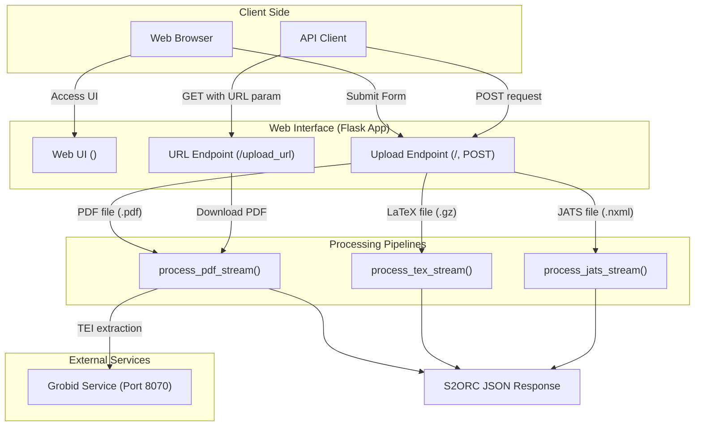
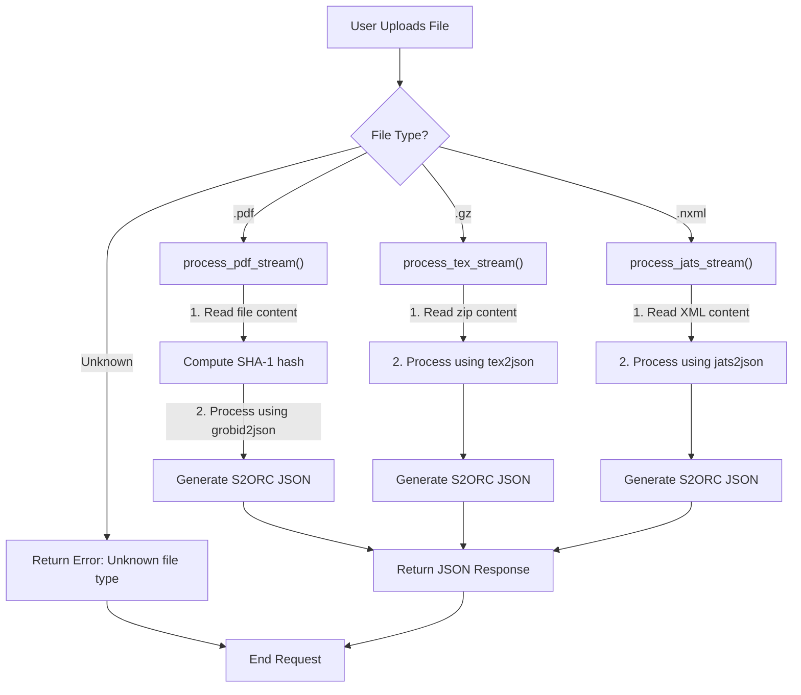

<!-- source: DeepWiki mcp.deepwiki.com · repo allenai/s2orc-doc2json · page 4 Web Interface · fetched 2026-10-26 -->

# Web Interface

<details>
<summary>Relevant source files</summary>

The following files were used as context for generating this wiki page:

- [README.md](README.md)
- [doc2json/flask/app.py](doc2json/flask/app.py)
- [requirements.txt](requirements.txt)

</details>


This document describes the web interface component of the s2orc-doc2json system, which provides a user-friendly way to convert scientific documents (PDF, LaTeX, and JATS XML) into the standardized S2ORC JSON format. The web interface is implemented as a Flask application that exposes both a browser-based UI and HTTP endpoints for programmatic access.

For information about the underlying conversion pipelines, see [Conversion Pipelines](#3).

## Architecture Overview

The web interface acts as a front-end layer that coordinates with the various document processing pipelines. It receives document files through HTTP requests, determines the appropriate processing pipeline based on file type, and returns the processed JSON results.



Sources: [doc2json/flask/app.py:1-68](), [README.md:98-120]()

## File Handling and Processing Flow

The web interface determines how to process each document based on its file extension. The detailed processing flow is illustrated below:



Sources: [doc2json/flask/app.py:20-54]()

## API Endpoints

The Flask application exposes the following endpoints:

| Endpoint | Method | Description | Parameters | Response |
|----------|--------|-------------|------------|----------|
| `/` | GET | Displays the home page with upload form | None | HTML page |
| `/` | POST | Processes uploaded files | `file` (multipart form data) | JSON with S2ORC data |
| `/upload_url` | GET | Processes PDF from a URL | `url` (query parameter) | JSON with S2ORC data |

### File Upload Endpoint

The main endpoint (`/` with POST method) accepts file uploads and processes them based on their extension:

1. **PDF files** (`.pdf`): 
   - Reads the file content
   - Computes a SHA-1 hash of the content
   - Processes the PDF using the `process_pdf_stream` function
   - Returns the S2ORC JSON result

2. **LaTeX files** (`.gz`): 
   - Reads the compressed archive content
   - Processes the LaTeX content using the `process_tex_stream` function
   - Returns the S2ORC JSON result

3. **JATS XML files** (`.nxml`):
   - Reads the XML content
   - Processes the JATS content using the `process_jats_stream` function
   - Returns the S2ORC JSON result

Sources: [doc2json/flask/app.py:20-54]()

### URL Upload Endpoint

The `/upload_url` endpoint allows processing a PDF from a remote URL:

1. Fetches the PDF content from the provided URL
2. Computes a SHA-1 hash of the content
3. Processes the PDF using the `process_pdf_stream` function
4. Returns the S2ORC JSON result

Sources: [doc2json/flask/app.py:56-65]()

## Implementation Details

The web interface is implemented as a Flask application in [doc2json/flask/app.py](), which imports the necessary processing functions from other modules in the project:

```python
from doc2json.grobid2json.process_pdf import process_pdf_stream
from doc2json.tex2json.process_tex import process_tex_stream
from doc2json.jats2json.process_jats import process_jats_stream
```

### Web Interface Dependencies

The Flask application has the following dependencies:

- `Flask` (version 1.0.2): Web framework
- `requests` (version 2.21.0): Used for downloading PDFs from URLs
- `hashlib`: Used for computing PDF hashes
- `itsdangerous` (version 2.0.1): Used by Flask for session management

Sources: [requirements.txt:1-9]()

### Web Template

The application uses a simple HTML template (`home.html`) to render the upload form on the home page.

## Running the Web Interface

To run the web interface, follow these steps:

1. First, if you're processing PDFs, start the Grobid service (runs on port 8070 by default):
   ```
   bash scripts/run_grobid.sh
   ```

2. Start the Flask application (runs on port 8080 by default):
   ```
   python doc2json/flask/app.py
   ```

3. Access the web interface through a browser at `http://localhost:8080` or interact with it programmatically.

Sources: [README.md:98-110]()

## Programmatic Usage

The web interface can be accessed programmatically using HTTP clients. For example, to upload a PDF file using `curl`:

```
curl localhost:8080/ -F file=@tests/pdf/N18-3011.pdf
```

This will return the S2ORC JSON representation of the document.

Sources: [README.md:116-118]()

## Integration with Processing Pipelines

The web interface integrates with the document processing pipelines by importing and calling their respective processing functions:

1. **PDF Processing**: Uses `process_pdf_stream` from `doc2json.grobid2json.process_pdf`
2. **LaTeX Processing**: Uses `process_tex_stream` from `doc2json.tex2json.process_tex`
3. **JATS Processing**: Uses `process_jats_stream` from `doc2json.jats2json.process_jats`

Each processing function receives the file content (and additional metadata in the case of PDFs) and returns the S2ORC JSON representation of the document.

Sources: [doc2json/flask/app.py:6-9]()

## Limitations and Considerations

- The web interface relies on Grobid being available at port 8070 for PDF processing
- The application runs in development mode by default and is not configured for production environments
- There's no authentication mechanism, making it suitable for local or protected network usage only
- Large files might cause timeouts or memory issues, as the entire file is loaded into memory

---

