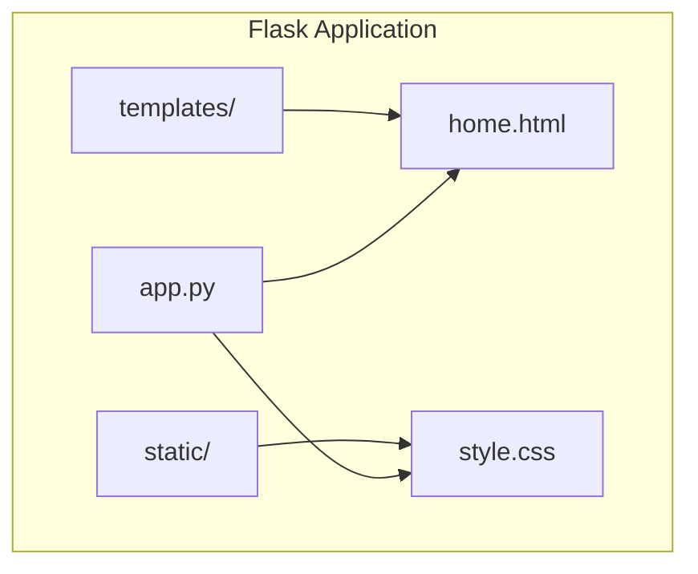
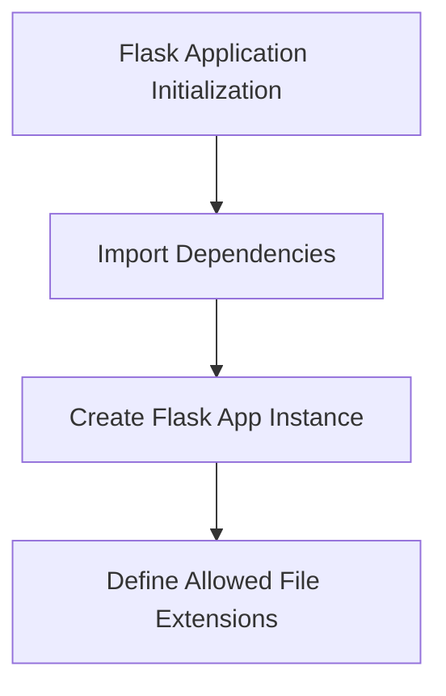
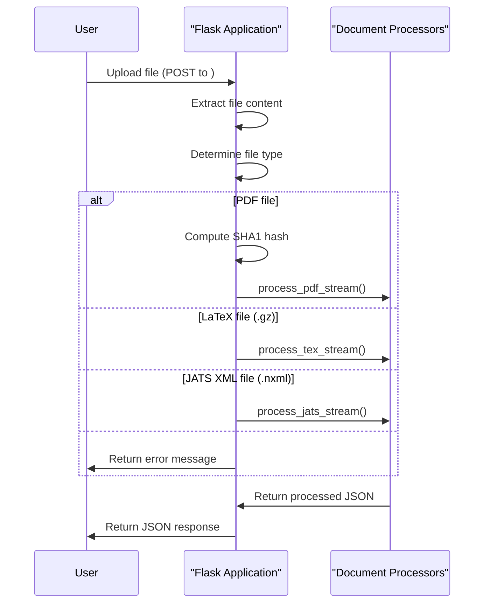
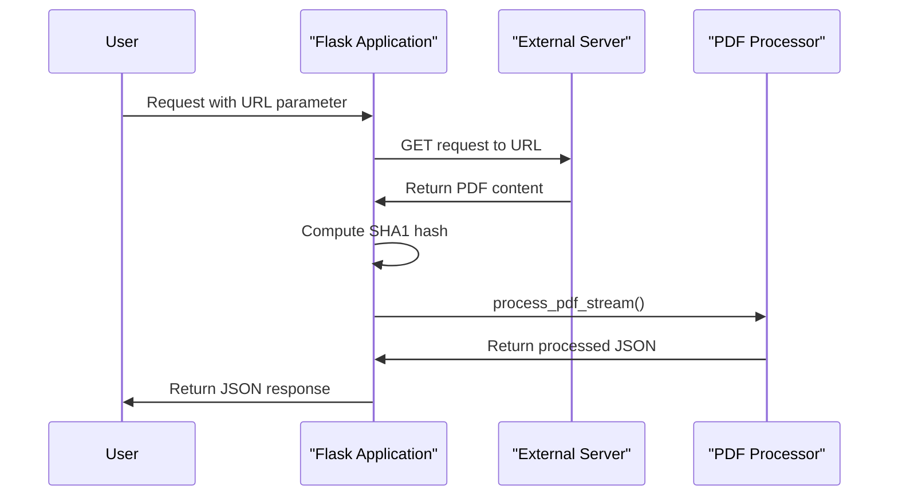
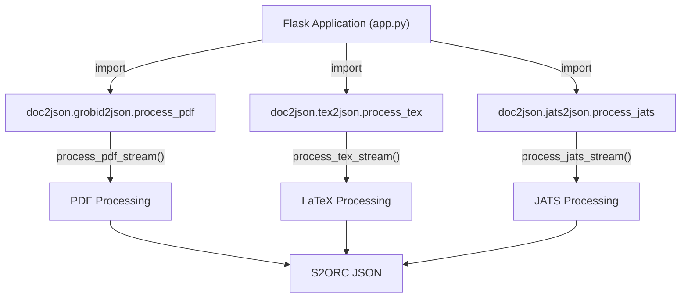

<!-- source: DeepWiki mcp.deepwiki.com · repo allenai/s2orc-doc2json · page 4.1 Flask Application · fetched 2026-10-26 -->

# Flask Application

<details>
<summary>Relevant source files</summary>

The following files were used as context for generating this wiki page:

- [doc2json/flask/app.py](doc2json/flask/app.py)
- [doc2json/flask/templates/home.html](doc2json/flask/templates/home.html)
- [requirements.txt](requirements.txt)

</details>


## Purpose and Scope

This document describes the Flask web application component of the s2orc-doc2json system. The Flask application provides a user-friendly web interface for converting scientific documents in various formats (PDF, LaTeX, JATS XML) to S2ORC JSON format. It serves as the entry point for users who prefer a web interface rather than command-line tools. For information about the API endpoints available for programmatic access, see [API Endpoints](#4.2).

## Overview

The Flask application functions as a thin wrapper around the core document conversion pipelines described in [Conversion Pipelines](#3). It provides a simple web form for users to upload documents and returns the processed JSON results.

```mermaid
flowchart TD
    subgraph "User Interaction"
        User["User"]
        Upload["File Upload (Browser)"]
        URL["URL Submission"]
    end

    subgraph "Flask Application (Port 8080)"
        HomeRoute["/"]
        UploadRoute["/ (POST)"]
        UrlRoute["/upload_url"]
        
        FileHandling["File Type Determination"]
    end

    subgraph "Processing Pipelines"
        PDFProcessor["process_pdf_stream()"]
        TexProcessor["process_tex_stream()"]
        JatsProcessor["process_jats_stream()"]
    end

    User --> Upload
    User --> URL
    Upload --> HomeRoute
    HomeRoute --> UploadRoute
    URL --> UrlRoute
    
    UploadRoute --> FileHandling
    UrlRoute --> PDFProcessor
    
    FileHandling --> |"*.pdf"| PDFProcessor
    FileHandling --> |"*.gz"| TexProcessor
    FileHandling --> |"*.nxml"| JatsProcessor
    
    PDFProcessor --> JSONResponse["JSON Response"]
    TexProcessor --> JSONResponse
    JatsProcessor --> JSONResponse
    
    JSONResponse --> User
```



Sources: [doc2json/flask/app.py:1-69]()

## Application Structure

The Flask application is defined in `app.py` and consists of:

1. A Flask application instance
2. Route definitions for handling file uploads and URL submissions
3. Integration with document processing pipelines
4. A simple HTML template for the web interface

### File Structure



Sources: [doc2json/flask/app.py:1-69](), [doc2json/flask/templates/home.html:1-18]()

### Routes and Endpoints

The Flask application provides the following routes:

| Route | Method | Function | Description |
|-------|--------|----------|-------------|
| `/` | GET | `home()` | Serves the HTML form for file upload |
| `/` | POST | `upload_file()` | Processes uploaded files and returns JSON |
| `/upload_url` | GET | `upload_url()` | Processes a PDF from a provided URL |

Sources: [doc2json/flask/app.py:16-65]()

## Implementation Details

### Application Initialization

The Flask application is initialized as follows:



The main application object is created and configured to handle files with extensions `.pdf`, `.gz`, and `.nxml`:

Sources: [doc2json/flask/app.py:4-13]()

### File Upload and Processing

When a user uploads a file through the web interface, the following workflow is executed:



The application examines the file extension to determine which processing pipeline to use:

1. `.pdf` files are processed using `process_pdf_stream()`
2. `.gz` files (LaTeX) are processed using `process_tex_stream()`
3. `.nxml` files (JATS XML) are processed using `process_jats_stream()`

For PDF files, a SHA1 hash is computed for file identification.

Sources: [doc2json/flask/app.py:20-54]()

### URL-based PDF Processing

The application also provides a mechanism to process PDFs from URLs:



The `/upload_url` endpoint downloads the PDF from the specified URL and processes it using the same pipeline as uploaded PDF files.

Sources: [doc2json/flask/app.py:56-65]()

## Web Interface

The web interface is a simple HTML form that allows users to upload files:

![Example of Web Interface]

The interface is defined in the `home.html` template and includes:
- A title and brief instructions
- A file input element restricted to the accepted file types (`.pdf`, `.gz`, `.nxml`)
- A submit button
- A loading message

Sources: [doc2json/flask/templates/home.html:1-18]()

## Running the Application

The Flask application is configured to run on port 8080 and listen on all network interfaces (`0.0.0.0`):

```python
if __name__ == '__main__':
    app.run(port=8080, host='0.0.0.0')
```

This allows the application to be accessed from any machine that can reach the host, not just from localhost.

Sources: [doc2json/flask/app.py:67-68]()

## Dependencies

The Flask application has the following key dependencies:

| Package | Version | Purpose |
|---------|---------|---------|
| Flask | 1.0.2 | Web framework |
| requests | 2.21.0 | HTTP client for URL processing |
| beautifulsoup4 | 4.7.1 | HTML/XML parsing (used by processors) |
| lxml | - | XML processing (used by processors) |
| latex2mathml | 2.16.2 | LaTeX to MathML conversion (used by tex2json) |
| itsdangerous | 2.0.1 | Required by Flask for session security |

Sources: [requirements.txt:1-10]()

## Integration with Processing Pipelines

The Flask application integrates with the document processing pipelines by importing and calling their respective entry point functions:



Each processing function is responsible for:
1. Taking the raw file content
2. Processing it through the appropriate pipeline
3. Returning the results in S2ORC JSON format

The Flask application then returns this JSON to the user.

Sources: [doc2json/flask/app.py:6-9](), [doc2json/flask/app.py:32-47]()

---

