# Page: Overview

# Overview

<details>
<summary>Relevant source files</summary>

The following files were used as context for generating this wiki page:

- [README.md](README.md)
- [doc2json/grobid2json/__init__.py](doc2json/grobid2json/__init__.py)
- [doc2json/grobid2json/grobid/__init__.py](doc2json/grobid2json/grobid/__init__.py)
- [doc2json/spp2json/spp/__init__.py](doc2json/spp2json/spp/__init__.py)
- [doc2json/tex2json/__init__.py](doc2json/tex2json/__init__.py)

</details>


The s2orc-doc2json repository provides tools to convert scientific papers from various formats (PDF, LaTeX, JATS XML) into a standardized JSON format used by the Semantic Scholar Open Research Corpus (S2ORC). This document introduces the repository's purpose, main components, and high-level architecture.

For detailed information about repository structure, see [Repository Structure](#1.1). For installation instructions, see [Installation and Setup](#1.2). For information about the S2ORC data format, see [S2ORC Data Model](#2).

## Purpose and Scope

The s2orc-doc2json system serves as a document conversion framework for the S2ORC project, extracting structured information from scientific papers into a unified JSON schema. This schema is also used in the COVID-19 Open Research Dataset (CORD-19) project.

The repository supports multiple document formats through specialized conversion pipelines:
- **grobid2json**: Converts PDFs to JSON using Grobid
- **tex2json**: Processes LaTeX documents (primarily from arXiv)
- **jats2json**: Processes JATS XML files (primarily from PubMed Central)
- **spp2json**: Alternative PDF processing using ScienceParsePlus

A web interface (Flask application) is also provided for easy document conversion through a browser or API calls.

Sources: [README.md:1-9]()

## System Architecture Overview

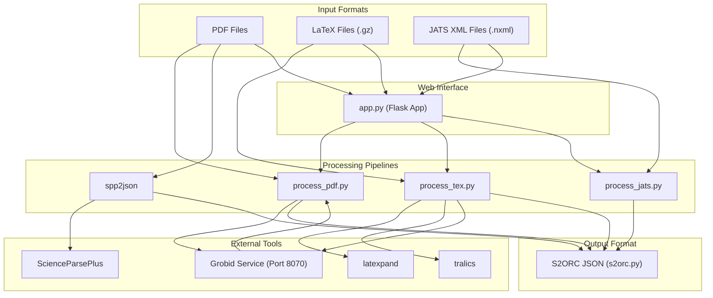

Sources: [README.md:27-45](), [README.md:65-82](), [README.md:84-92](), [README.md:98-120]()

## Document Conversion Pipelines

### PDF Processing with Grobid

The primary PDF processing pipeline uses Grobid to extract structured information from PDFs:

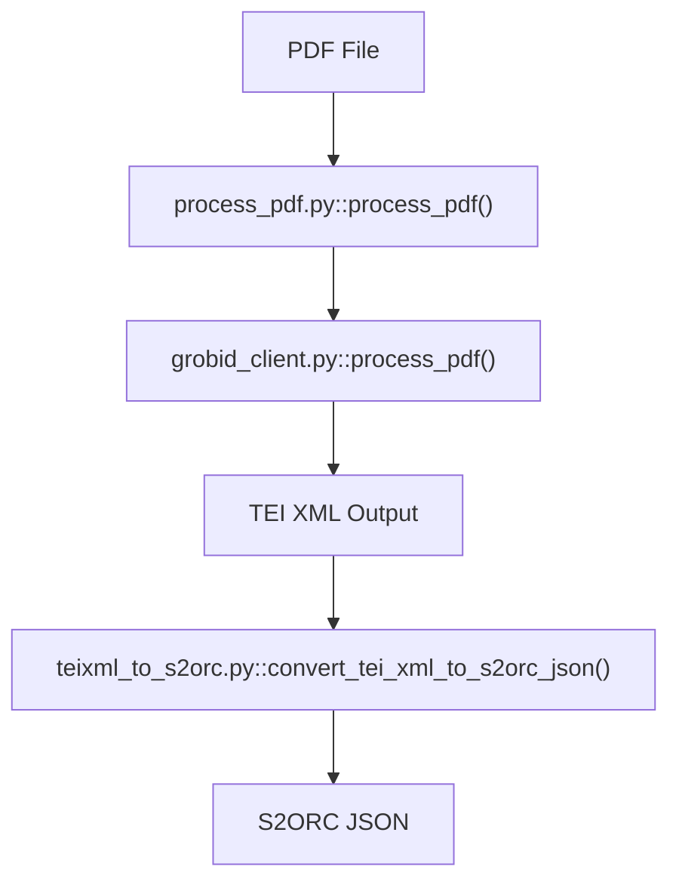

Sources: [README.md:27-64]()

### LaTeX Processing

The LaTeX processing pipeline handles compressed LaTeX files, typically from arXiv:

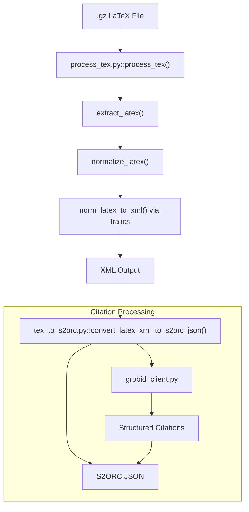

Sources: [README.md:65-82]()

### JATS XML Processing

The JATS XML processing pipeline handles PubMed Central XML files:

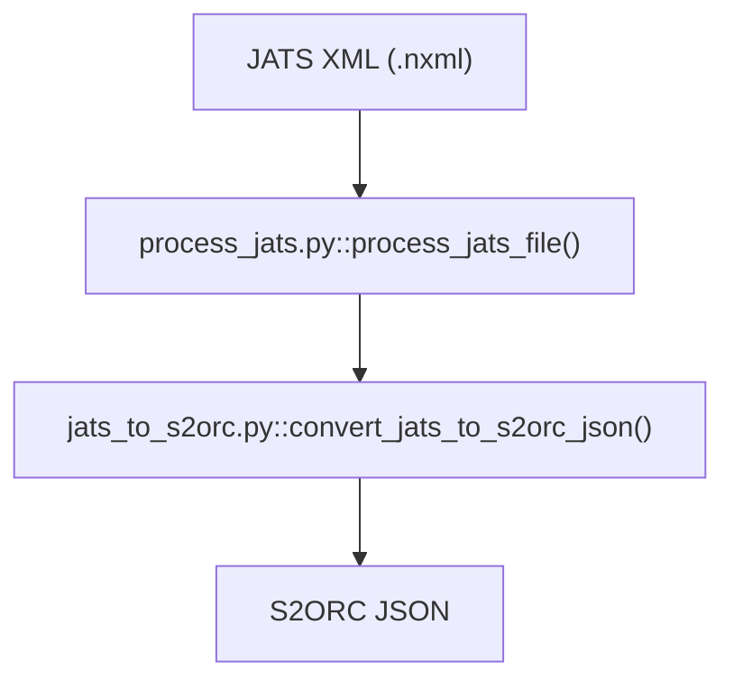

Sources: [README.md:84-92]()

## Web Interface

The repository includes a Flask web application that provides an easy-to-use interface for document conversion:

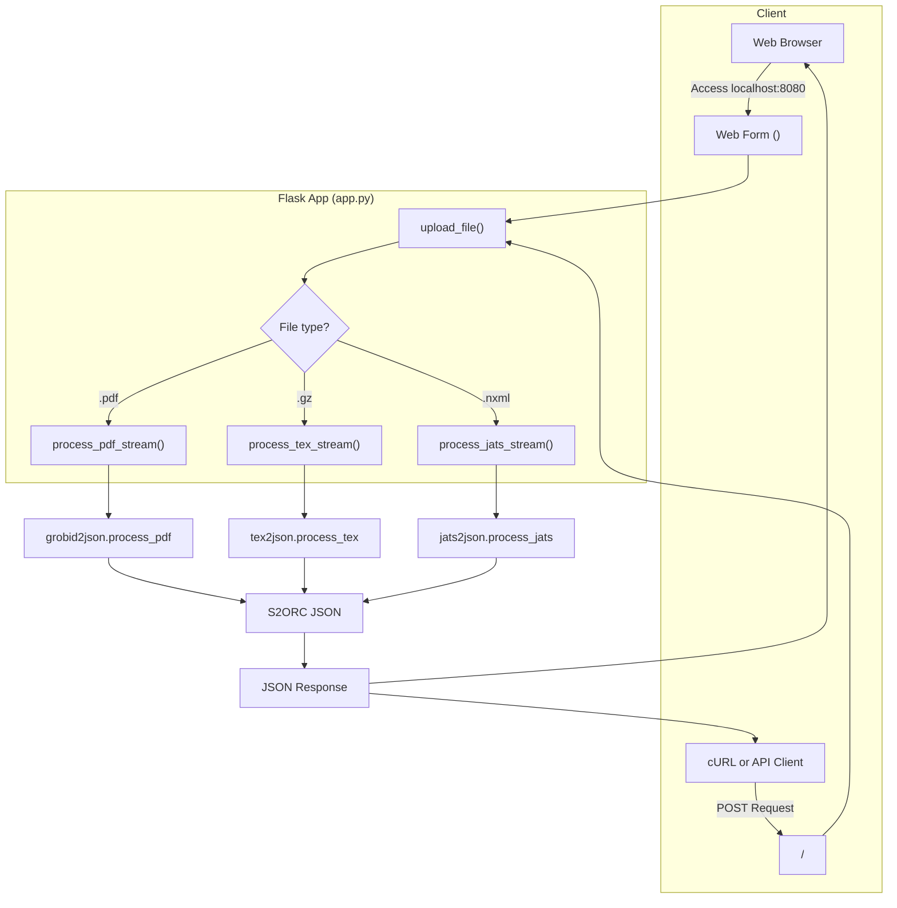

Sources: [README.md:98-120]()

## S2ORC JSON Data Model

The repository converts scientific papers into a standardized JSON format defined in `s2orc.py`. This format captures:

- Paper metadata (title, authors, year, venue)
- Abstract paragraphs
- Body text paragraphs with citations, references, and equations
- Bibliography entries
- Reference entries for figures, tables, and equations

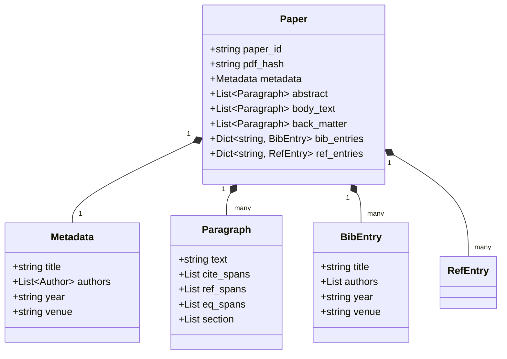

For detailed information on the S2ORC data model, see [S2ORC Data Model](#2).

Sources: [README.md:5-7](), [README.md:93-96]()

## Key Dependencies

The s2orc-doc2json system relies on several external tools and libraries:

| Pipeline | Input Format | External Dependencies | Purpose |
|----------|-------------|------------------------|---------|
| grobid2json | PDF | Grobid (Java) | Extract structured information from PDFs |
| tex2json | LaTeX (.gz) | latexpand, tralics, Grobid | Process LaTeX files and extract citations |
| jats2json | JATS XML (.nxml) | None | Process JATS XML from PubMed Central |
| spp2json | PDF | ScienceParsePlus | Alternative PDF processor |

Grobid (version 0.7.3) runs as a service on port 8070 and is a critical component for both PDF and LaTeX processing. For LaTeX processing, `latexpand` and `tralics` are required to expand and convert LaTeX to XML.

Sources: [README.md:31-51](), [README.md:65-71]()

## Summary

The s2orc-doc2json repository provides a comprehensive framework for converting scientific papers from different formats into a standardized JSON format. By supporting multiple input formats and providing both command-line tools and a web interface, the system enables efficient processing of scientific literature for large-scale corpus creation and analysis.

The standardized JSON format facilitates downstream tasks such as information extraction, citation network analysis, and knowledge discovery across the scientific literature, supporting the broader goals of the S2ORC project.

Sources: [README.md:1-9](), [README.md:123-137]()

---

# Page: Repository Structure

# Repository Structure

<details>
<summary>Relevant source files</summary>

The following files were used as context for generating this wiki page:

- [.gitignore](.gitignore)
- [README.md](README.md)
- [doc2json/grobid2json/__init__.py](doc2json/grobid2json/__init__.py)
- [doc2json/grobid2json/grobid/__init__.py](doc2json/grobid2json/grobid/__init__.py)
- [doc2json/grobid2json/grobid/grobid.yaml](doc2json/grobid2json/grobid/grobid.yaml)
- [doc2json/spp2json/spp/__init__.py](doc2json/spp2json/spp/__init__.py)
- [doc2json/tex2json/__init__.py](doc2json/tex2json/__init__.py)

</details>


This document provides a detailed overview of the s2orc-doc2json repository structure, explaining the organization of the codebase and the purpose of each main component. For information about installation and setup, see [Installation and Setup](#1.2).

## Top-Level Directory Organization

The s2orc-doc2json repository is organized into several top-level directories, each serving a specific purpose in the document conversion workflow:

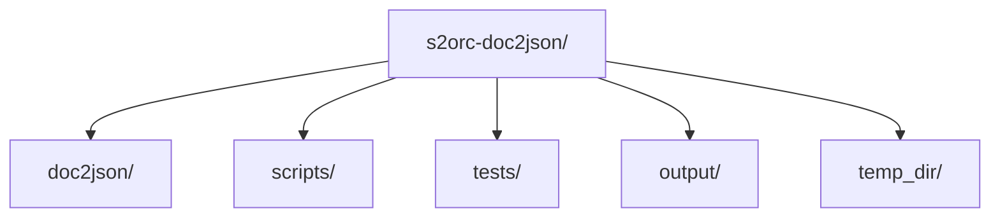

| Directory | Purpose |
|-----------|---------|
| `doc2json/` | Main Python package containing all conversion pipelines and core functionality |
| `scripts/` | Shell scripts for setting up and running external dependencies (e.g., Grobid) |
| `tests/` | Test data and expected outputs for validating the conversion pipelines |
| `output/` | Default directory for storing JSON output files |
| `temp_dir/` | Default directory for storing temporary files during processing |

Sources: [README.md:1-145](), [.gitignore:1-11]()

## Main Package Structure

The `doc2json` package is the core of the repository, containing several specialized modules, each responsible for a specific document conversion pipeline:

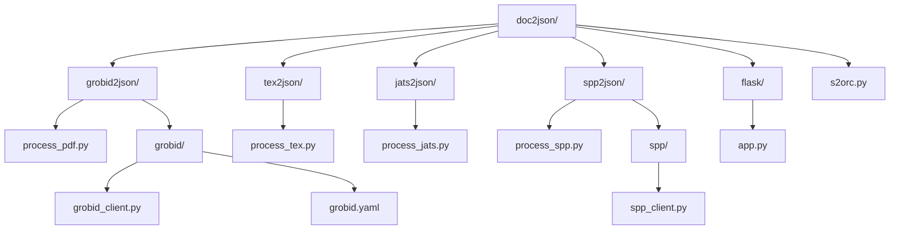

| Package/Module | Purpose | Entry Point |
|----------------|---------|-------------|
| `grobid2json/` | Converts PDF documents to JSON using Grobid | `process_pdf.py` |
| `tex2json/` | Converts LaTeX documents to JSON | `process_tex.py` |
| `jats2json/` | Converts JATS XML documents to JSON | `process_jats.py` |
| `spp2json/` | Alternative PDF-to-JSON conversion using ScienceParsePlus | `process_spp.py` |
| `flask/` | Web interface for document conversion | `app.py` |
| `s2orc.py` | Defines the S2ORC JSON schema and data model | - |

Sources: [README.md:3-7](), [doc2json/grobid2json/__init__.py:1](), [doc2json/tex2json/__init__.py:1](), [doc2json/spp2json/spp/__init__.py:1]()

## Conversion Pipeline Architecture

The repository implements four distinct conversion pipelines, each specialized for a particular input format, but all producing the standardized S2ORC JSON format:

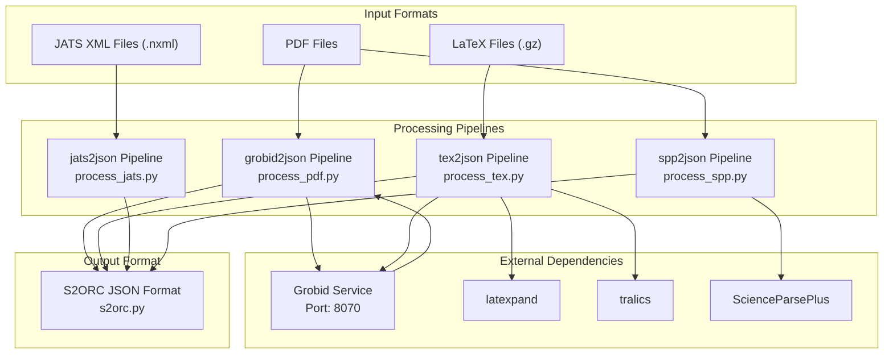

| Pipeline | Input Format | External Dependencies | Output Format |
|----------|--------------|--------------|--------------|
| `grobid2json` | PDF (.pdf) | Grobid | S2ORC JSON |
| `tex2json` | LaTeX (.gz) | latexpand, tralics, Grobid | S2ORC JSON |
| `jats2json` | JATS XML (.nxml) | None | S2ORC JSON |
| `spp2json` | PDF (.pdf) | ScienceParsePlus | S2ORC JSON |

Sources: [README.md:27-92]()

## External Dependencies

The conversion pipelines integrate with several external tools:

1. **Grobid**: A machine learning library for extracting structured information from scholarly documents
   - Used by: `grobid2json` and `tex2json` pipelines
   - Configured by: `doc2json/grobid2json/grobid/grobid.yaml`
   - Default port: 8070
   - Version: 0.7.3

2. **latexpand**: A utility for expanding LaTeX files and resolving imports
   - Used by: `tex2json` pipeline
   - Required for processing LaTeX document structure

3. **tralics**: A LaTeX to XML converter
   - Used by: `tex2json` pipeline
   - Converts normalized LaTeX to an intermediate XML format

4. **ScienceParsePlus**: An alternative tool for PDF parsing
   - Used by: `spp2json` pipeline
   - Provides an alternative approach to extracting structured data from PDFs

Sources: [README.md:35-50](), [README.md:69-71](), [doc2json/grobid2json/grobid/grobid.yaml:1-273]()

## Web Interface Architecture

The repository includes a Flask web application that serves as a user-friendly interface for the document conversion pipelines:

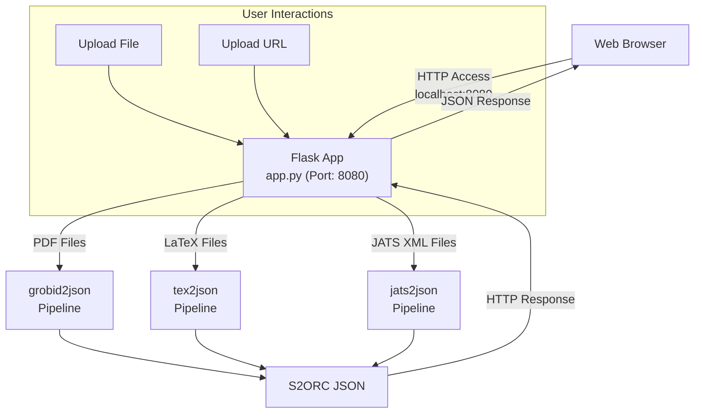

The Flask application (`doc2json/flask/app.py`) provides two main endpoints:

- `/`: Main endpoint for uploading document files directly
- `/upload_url`: Endpoint for processing documents from URLs

Sources: [README.md:98-118]()

## Setup Scripts

The `scripts/` directory contains shell scripts for managing external dependencies:

- `setup_grobid.sh`: Downloads and configures Grobid 0.7.3
   - Sets up the Grobid service
   - Copies custom configuration from `doc2json/grobid2json/grobid/grobid.yaml`

- `run_grobid.sh`: Starts the Grobid service on port 8070
   - Required to be running before using `grobid2json` or `tex2json` pipelines

Sources: [README.md:38-46]()

## Test Directory Structure

The `tests/` directory is organized to facilitate testing of the conversion pipelines:

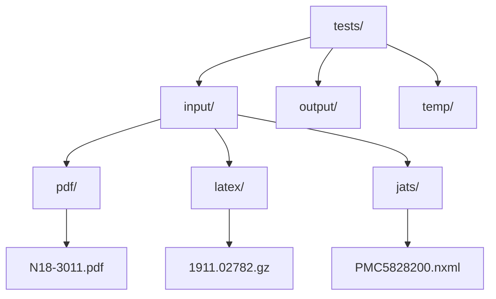

| Directory | Purpose |
|-----------|---------|
| `input/` | Sample input files for testing each conversion pipeline |
| `output/` | Expected and actual output JSON files from test runs |
| `temp/` | Temporary files generated during the testing process |

Sources: [README.md:57-60](), [.gitignore:3-5]()

## Ignored Directories

The `.gitignore` file specifies several directories that are excluded from version control:

- `.idea/`: IDE-specific directory (PyCharm)
- `*__pycache__/`: Python cache directories
- `*.egg-info/`: Python package metadata
- `tests/output/*`: Test output files
- `tests/temp/*`: Temporary test files
- `temp_dir/`: Temporary processing directory
- `output_dir/`: Output directory for converted files

Sources: [.gitignore:1-11]()

---

# Page: Installation and Setup

# Installation and Setup

<details>
<summary>Relevant source files</summary>

The following files were used as context for generating this wiki page:

- [README.md](README.md)
- [scripts/run_grobid.sh](scripts/run_grobid.sh)
- [scripts/setup_grobid.sh](scripts/setup_grobid.sh)

</details>


This page provides the detailed steps for installing and configuring the s2orc-doc2json system that converts scientific documents (PDF, LaTeX, JATS XML) into the S2ORC JSON format. For information about the overall system architecture, see [Overview](#1), and for details about the specific conversion pipelines, see [Conversion Pipelines](#3).

## Prerequisites

Before beginning installation, ensure your system has:

- Python 3.8 or later
- Java 11 (required for Grobid)
- pip and git
- bash shell environment

## Environment Setup Diagram

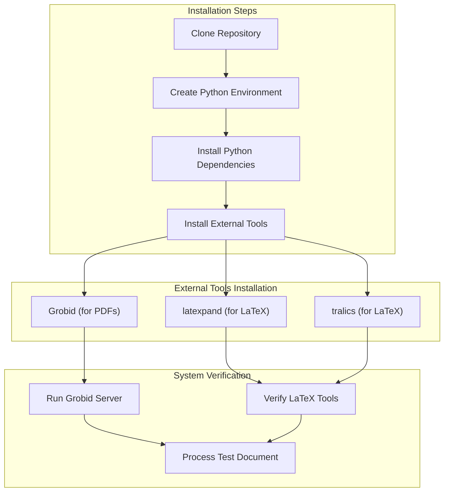

Sources: [README.md:12-25](), [README.md:31-52](), [README.md:67-71]()

## Basic Environment Setup

1. Clone the repository:
   ```bash
   git clone https://github.com/allenai/s2orc-doc2json.git
   cd s2orc-doc2json
   ```

2. Set up a Python environment using conda (or your preferred environment manager):
   ```bash
   conda create -n doc2json python=3.8 pytest
   conda activate doc2json
   pip install -r requirements.txt
   python setup.py develop
   ```

Sources: [README.md:12-25]()

## Installing and Configuring Components

The setup process varies depending on which document types you need to process.

### Grobid Installation (Required for PDF Processing)

Grobid is a machine learning library that extracts information from scholarly documents. It's required for processing PDFs and also for certain LaTeX processing steps.

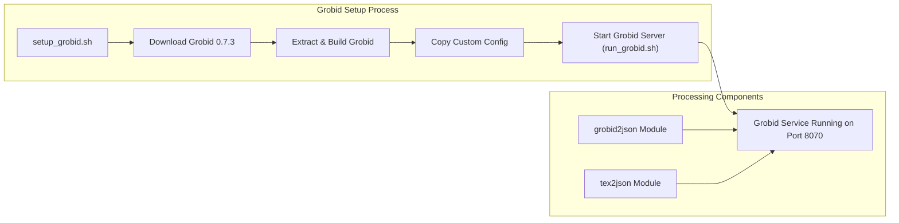

You have two options for installing Grobid:

#### Option 1: Using the Provided Script

1. Edit the `setup_grobid.sh` script to set the correct `DOC2JSON_HOME` path:
   ```bash
   # Edit this line to point to your installation directory
   export DOC2JSON_HOME=/path/to/s2orc-doc2json
   ```

2. Run the setup script:
   ```bash
   bash scripts/setup_grobid.sh
   ```

3. After installation, start the Grobid server:
   ```bash
   bash scripts/run_grobid.sh
   ```

#### Option 2: Manual Installation

1. Download and extract Grobid 0.7.3:
   ```bash
   cd $HOME
   wget https://github.com/kermitt2/grobid/archive/0.7.3.zip
   unzip 0.7.3.zip
   rm 0.7.3.zip
   ```

2. Build and install Grobid:
   ```bash
   cd $HOME/grobid-0.7.3
   ./gradlew clean install
   ```

3. Copy the provided configuration (optional but recommended):
   ```bash
   cp /path/to/s2orc-doc2json/doc2json/grobid2json/grobid/grobid.yaml $HOME/grobid-0.7.3/grobid-home/config/grobid.yaml
   ```

4. Start the Grobid server:
   ```bash
   cd $HOME/grobid-0.7.3
   ./gradlew run
   ```

Grobid by default runs on port 8070. The server is ready when the console shows "87% EXECUTING" (this is normal behavior).

Sources: [README.md:31-52](), [scripts/setup_grobid.sh:1-22](), [scripts/run_grobid.sh:1-6]()

### LaTeX Processing Dependencies

If you plan to process LaTeX documents, you'll need to install additional tools:

1. Install latexpand:
   ```bash
   # On Ubuntu/Debian
   apt install texlive-extra-utils
   
   # On macOS with Homebrew
   brew install texlive
   ```

2. Install tralics:
   ```bash
   # On Ubuntu/Debian
   apt install tralics
   
   # On macOS with Homebrew
   brew install tralics
   ```

Sources: [README.md:67-71]()

## Component Dependencies Table

| Component | Purpose | Required For | Dependencies |
|-----------|---------|--------------|-------------|
| Python Environment | Core runtime | All conversions | Python 3.8+, pip |
| Grobid | Extracts structured data from PDFs | PDF processing, LaTeX processing | Java 11 |
| latexpand | Resolves LaTeX includes | LaTeX processing | TeX Live |
| tralics | Converts LaTeX to XML | LaTeX processing | - |

Sources: [README.md:12-82]()

## Testing Your Installation

After installing all components, you can verify the installation by processing test documents:

### Testing PDF Processing

1. Start the Grobid server if not already running:
   ```bash
   bash scripts/run_grobid.sh
   ```

2. Process a test PDF:
   ```bash
   python doc2json/grobid2json/process_pdf.py -i tests/pdf/N18-3011.pdf -t temp_dir/ -o output_dir/
   ```

### Testing LaTeX Processing

1. Ensure Grobid is running (required for citation and author processing):
   ```bash
   bash scripts/run_grobid.sh
   ```

2. Process a test LaTeX file:
   ```bash
   python doc2json/tex2json/process_tex.py -i tests/latex/1911.02782.gz -t temp_dir/ -o output_dir/
   ```

### Testing JATS XML Processing

```bash
python doc2json/jats2json/process_jats.py -i tests/jats/PMC5828200.nxml -o output_dir/
```

Sources: [README.md:54-92]()

## Running the Web Interface

The system includes a Flask web application that provides a user interface for document processing:

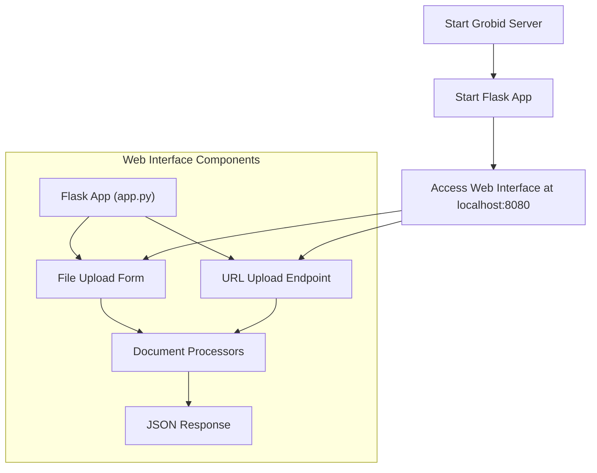

1. Start the Grobid server (required for PDF processing):
   ```bash
   bash scripts/run_grobid.sh
   ```

2. Start the Flask application:
   ```bash
   python doc2json/flask/app.py
   ```

3. Access the web interface by navigating to [http://localhost:8080](http://localhost:8080) in your browser.

4. You can also use the API directly, for example:
   ```bash
   curl localhost:8080/ -F file=@tests/pdf/N18-3011.pdf
   ```

Sources: [README.md:98-118]()

## Configuration Options

### Grobid Configuration

The Grobid configuration file (`grobid.yaml`) is located at `$HOME/grobid-0.7.3/grobid-home/config/grobid.yaml` after installation. Key configuration options include:

- Server port (default: 8070)
- Maximum connections
- Logging levels

If you modify the Grobid port, you must also update the port in `doc2json/grobid2json/grobid/grobid_client.py`.

Sources: [README.md:49-51](), [scripts/setup_grobid.sh:14-18]()

### Flask Application Configuration

The Flask application defaults to port 8080. To modify this, edit the `doc2json/flask/app.py` file.

Sources: [README.md:106]()

## Common Installation Issues

1. **Grobid fails to start**: Ensure Java 11 is installed and properly configured.
2. **LaTeX processing fails**: Verify that both latexpand and tralics are correctly installed and available in your PATH.
3. **Port conflicts**: If the default ports (8070 for Grobid, 8080 for Flask) are already in use, modify the configuration as described above.

## System Architecture Overview

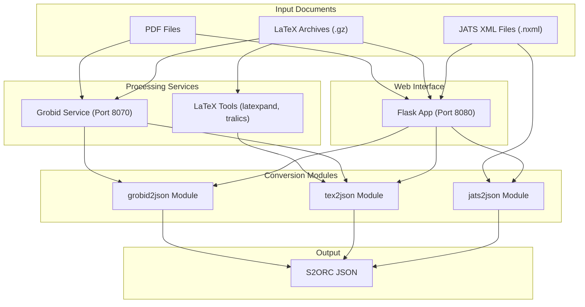

Sources: [README.md:1-143]()

This completes the installation and setup process for the s2orc-doc2json system. For more details about using the different conversion pipelines, refer to [Conversion Pipelines](#3).

---

# Page: S2ORC Data Model

# S2ORC Data Model

<details>
<summary>Relevant source files</summary>

The following files were used as context for generating this wiki page:

- [README.md](README.md)
- [doc2json/s2orc.py](doc2json/s2orc.py)

</details>


The S2ORC (Semantic Scholar Open Research Corpus) Data Model provides a standardized format for representing scientific papers across different source formats (PDF, LaTeX, JATS XML). This document describes the core data structures and relationships in the S2ORC model, which is used by all conversion pipelines in the s2orc-doc2json repository to produce a consistent JSON output format.

The S2ORC data model is primarily defined in the [doc2json/s2orc.py]() file, which contains the Python classes that implement the data structures and provide serialization capabilities.

## Class Structure

The S2ORC Data Model consists of several interconnected classes that represent different aspects of a scientific paper.

### Class Hierarchy Diagram

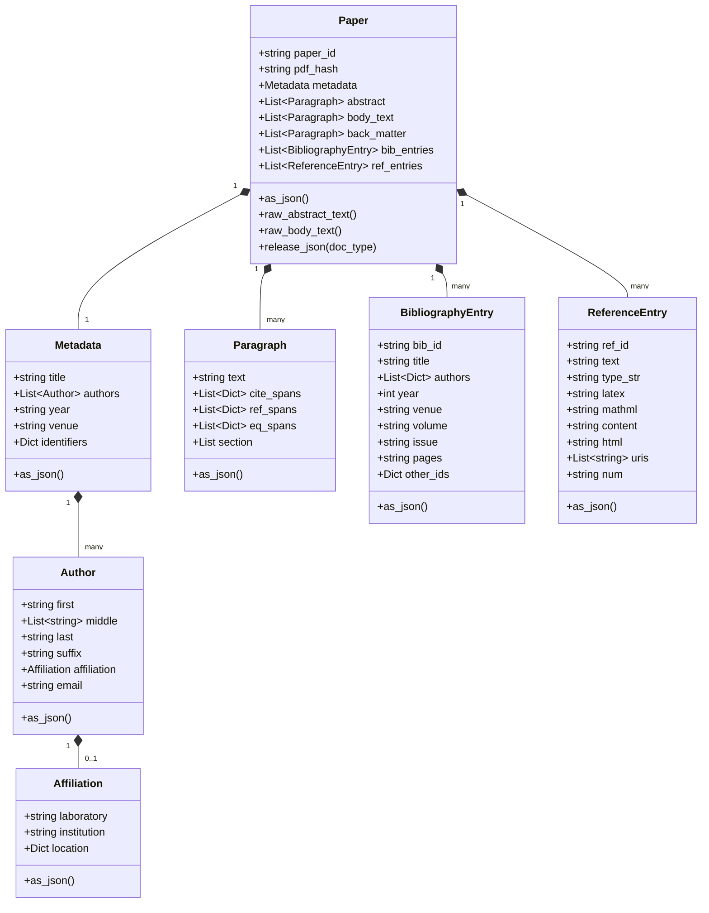

Sources: [doc2json/s2orc.py:33-474]()

### Core Classes

#### Paper

The `Paper` class is the root container that represents a complete scientific paper. It aggregates all other components.

```python
Paper(
    paper_id: str,                  # Unique identifier for the paper
    pdf_hash: str,                  # Hash of the source PDF file
    metadata: Dict,                 # Paper metadata
    abstract: List[Dict],           # List of abstract paragraphs
    body_text: List[Dict],          # List of main text paragraphs
    back_matter: List[Dict],        # List of back matter paragraphs
    bib_entries: Dict,              # Bibliography entries
    ref_entries: Dict               # Reference entries like figures, tables
)
```

Sources: [doc2json/s2orc.py:387-474]()

#### Metadata

The `Metadata` class contains bibliographic information about the paper:

```python
Metadata(
    title: str,                     # Paper title
    authors: List[Dict],            # List of authors
    year: Optional[str] = None,     # Publication year
    venue: Optional[str] = None,    # Publication venue
    identifiers: Optional[Dict] = {}  # External IDs (DOI, arXiv, etc.)
)
```

Sources: [doc2json/s2orc.py:263-313]()

#### Paragraph

The `Paragraph` class represents a single paragraph of text, which could be in the abstract, body text, or back matter. It includes spans that mark citations, references to figures/tables, and equations.

```python
Paragraph(
    text: str,                      # Plain text of the paragraph
    cite_spans: List[Dict],         # Spans marking citations
    ref_spans: List[Dict],          # Spans marking references to figures/tables
    eq_spans: Optional[List[Dict]] = [],  # Spans marking equations
    section: Optional = None,       # Section this paragraph belongs to
    sec_num: Optional = None        # Section number
)
```

Sources: [doc2json/s2orc.py:315-385]()

#### BibliographyEntry

The `BibliographyEntry` class represents a citation/reference to another paper:

```python
BibliographyEntry(
    bib_id: str,                    # ID of this reference
    title: str,                     # Title of the cited paper
    authors: List[Dict],            # Authors of the cited paper
    ref_id: Optional[str] = None,   # Reference ID
    year: Optional[int] = None,     # Publication year
    venue: Optional[str] = None,    # Publication venue
    volume: Optional[str] = None,   # Journal volume
    issue: Optional[str] = None,    # Journal issue
    pages: Optional[str] = None,    # Page numbers
    other_ids: Dict[str, List] = None,  # External IDs
    # ... additional fields
)
```

Sources: [doc2json/s2orc.py:101-178]()

#### ReferenceEntry

The `ReferenceEntry` class represents non-citation references like figures, tables, and equations:

```python
ReferenceEntry(
    ref_id: str,                    # ID of this reference
    text: str,                      # Reference text (e.g., figure caption)
    type_str: str,                  # Type (figure, table, equation, etc.)
    latex: Optional[str] = None,    # LaTeX for equations
    mathml: Optional[str] = None,   # MathML for equations
    content: Optional[str] = None,  # Content (for tables)
    html: Optional[str] = None,     # HTML (for tables)
    uris: Optional[List[str]] = None,  # URIs for images
    num: Optional[str] = None,      # Reference number
    # ... additional fields
)
```

Sources: [doc2json/s2orc.py:33-99]()

## Paper Structure

The following diagram shows how the different components are organized within a paper:

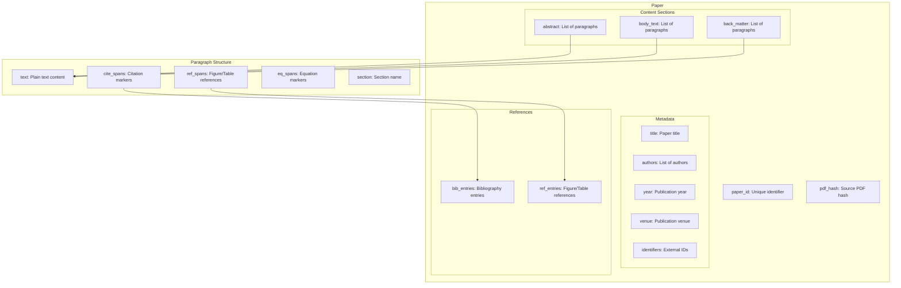

Sources: [doc2json/s2orc.py:387-474](), [README.md:5-7]()

## JSON Schema

When serialized to JSON, the S2ORC paper structure follows this format:

```
{
  "paper_id": "<unique identifier>",
  "pdf_hash": "<hash of source PDF>",
  "metadata": {
    "title": "<paper title>",
    "authors": [
      {
        "first": "<first name>",
        "middle": ["<middle name>"],
        "last": "<last name>",
        "suffix": "<suffix>",
        "affiliation": {
          "laboratory": "<lab name>",
          "institution": "<institution name>",
          "location": {
            "postCode": "<postal code>",
            "settlement": "<city>",
            "country": "<country>"
          }
        },
        "email": "<email address>"
      }
    ],
    "year": "<publication year>",
    "venue": "<publication venue>",
    "identifiers": {
      "<id_type>": "<id_value>"
    }
  },
  "abstract": [
    {
      "text": "<paragraph text>",
      "cite_spans": [
        {
          "start": <start_position>,
          "end": <end_position>,
          "text": "<citation text>",
          "ref_id": "<reference to bib_entries>"
        }
      ],
      "ref_spans": [...],
      "eq_spans": [...],
      "section": "<section name>",
      "sec_num": "<section number>"
    }
  ],
  "body_text": [...],  // Same structure as abstract
  "back_matter": [...],  // Same structure as abstract
  "bib_entries": {
    "<bib_id>": {
      "ref_id": "<reference id>",
      "title": "<reference title>",
      "authors": [...],  // Same structure as paper authors
      "year": <publication year>,
      "venue": "<publication venue>",
      "volume": "<volume>",
      "issue": "<issue>",
      "pages": "<page range>",
      "other_ids": {
        "<id_type>": ["<id_value>"]
      }
    }
  },
  "ref_entries": {
    "<ref_id>": {
      "text": "<reference text>",
      "type_str": "<reference type>",
      // Additional fields depend on the reference type:
      // for equations:
      "latex": "<LaTeX code>",
      "mathml": "<MathML code>",
      // for tables:
      "content": "<table content>",
      "html": "<HTML representation>",
      // for figures:
      "uris": ["<image URI>"],
      "num": "<reference number>"
    }
  }
}
```

Sources: [doc2json/s2orc.py:421-431]()

## Reference Spans and Citation Spans

The S2ORC model uses a span-based approach to mark citations and references to figures, tables, and equations within the text:

### Citation Spans

Citation spans mark references to bibliography entries:

```
"cite_spans": [
  {
    "start": 54,
    "end": 57,
    "text": "[1]",
    "ref_id": "BIBREF0"  // Links to a bib_entries entry
  }
]
```

### Reference Spans

Reference spans mark references to figures, tables, etc.:

```
"ref_spans": [
  {
    "start": 76,
    "end": 82,
    "text": "Fig. 1",
    "ref_id": "FIGREF0"  // Links to a ref_entries entry
  }
]
```

### Equation Spans

Equation spans mark inline equations:

```
"eq_spans": [
  {
    "start": 53,
    "end": 61,
    "text": "α = 1",
    "latex": "\\alpha = 1",
    "ref_id": null  // May link to a ref_entries entry for a numbered equation
  }
]
```

Sources: [doc2json/s2orc.py:315-385]()

## Utility Methods

The S2ORC classes provide several utility methods:

1. **as_json()**: Each class has an `as_json()` method that converts the object to a JSON-serializable dictionary.

2. **raw_abstract_text()**: Returns the concatenated text of all abstract paragraphs.

3. **raw_body_text()**: Returns the concatenated text of all body text paragraphs.

4. **release_json(doc_type)**: Produces a special JSON format used for S2ORC releases, with additional header information.

5. **load_s2orc(paper_dict)**: Function to load a paper from a JSON dictionary, handling different S2ORC format versions.

Sources: [doc2json/s2orc.py:421-530]()

## Usage

The S2ORC data model is the output format for all document conversion pipelines in the repository:

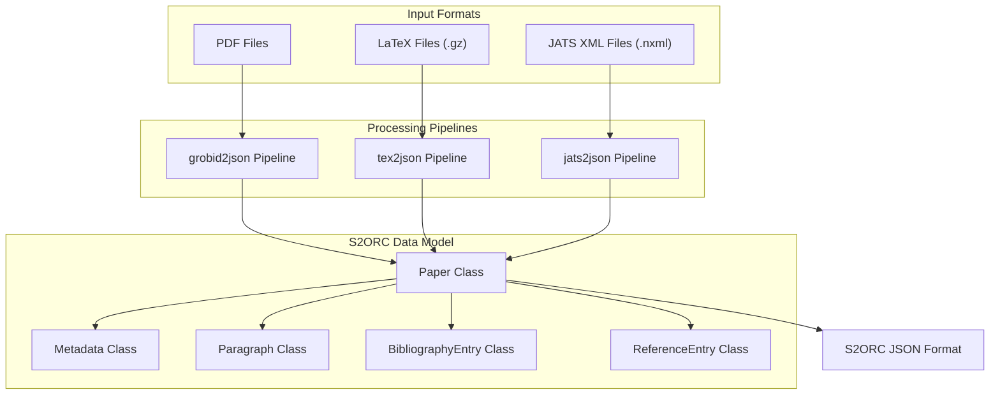

Sources: [README.md:1-7](), [doc2json/s2orc.py:387-474]()

To load an existing S2ORC JSON file, use the `load_s2orc` function from `doc2json/s2orc.py`:

```python
from doc2json.s2orc import load_s2orc
import json

with open('paper.json', 'r') as f:
    paper_dict = json.load(f)

paper = load_s2orc(paper_dict)
```

Sources: [doc2json/s2orc.py:476-530](), [README.md:94-96]()

## Compatibility Notes

The S2ORC data model has evolved over time with different versions of the S2ORC corpus. The `load_s2orc` function attempts to handle these variations, supporting both:

- 2019 GORC parses with a "grobid_parse" key
- Current and 2020 S2ORC releases with "pdf_parse" and separate metadata

The S2ORC data model is also used by the CORD-19 project, which may be familiar to researchers who have worked with that dataset.

Sources: [README.md:5-7](), [doc2json/s2orc.py:476-530]()

---

# Page: Paper Structure

# Paper Structure

<details>
<summary>Relevant source files</summary>

The following files were used as context for generating this wiki page:

- [doc2json/config.py](doc2json/config.py)
- [doc2json/s2orc.py](doc2json/s2orc.py)
- [tests/s2orc/20190928/10002293.json](tests/s2orc/20190928/10002293.json)

</details>


This document details the structure of the `Paper` class in the s2orc-doc2json system, which serves as the core data model for representing scientific papers. The `Paper` class encapsulates all the essential components of a scholarly document, including metadata, textual content, bibliographic references, and other scholarly elements. For information about the JSON schema used to serialize paper objects, see [JSON Format](#2.2).

## Paper Class Overview

The `Paper` class is the central data structure that represents a scientific document in the S2ORC format. It contains the complete representation of a paper, including its metadata, textual content broken down into sections, bibliographic entries, and various types of references (figures, tables, equations).

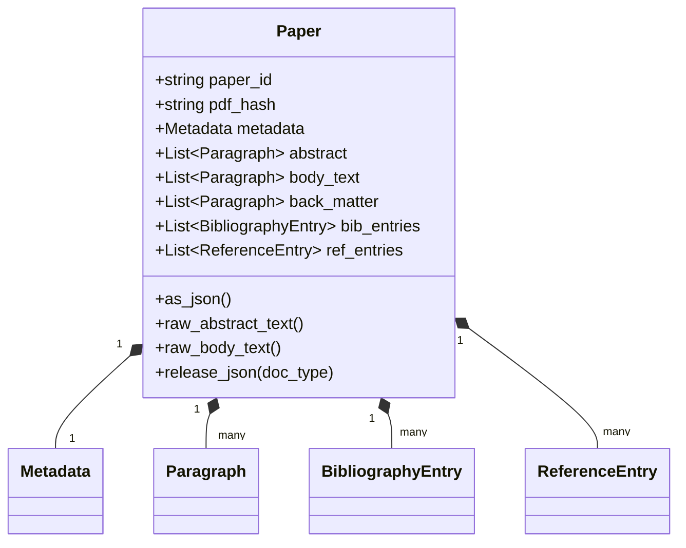

Sources: [doc2json/s2orc.py:387-474]()

The `Paper` class is initialized with the following parameters:

| Parameter | Type | Description |
|-----------|------|-------------|
| `paper_id` | string | Unique identifier for the paper |
| `pdf_hash` | string | Hash value of the PDF if available |
| `metadata` | dict | Dictionary containing paper metadata |
| `abstract` | list | List of paragraph dictionaries for the abstract |
| `body_text` | list | List of paragraph dictionaries for the main text |
| `back_matter` | list | List of paragraph dictionaries for the back matter |
| `bib_entries` | dict | Dictionary of bibliography entries |
| `ref_entries` | dict | Dictionary of references (figures, tables, etc.) |

Sources: [doc2json/s2orc.py:391-401]()

## Paper Components

### Metadata

The `Metadata` class encapsulates bibliographic information about the paper:

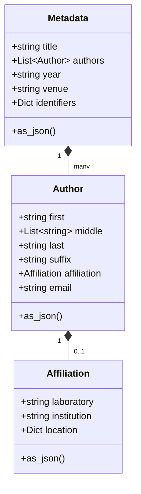

Sources: [doc2json/s2orc.py:213-313](), [doc2json/s2orc.py:181-211](), [doc2json/s2orc.py:263-313]()

The `Metadata` object contains the paper's title, authors (including their affiliations), publication year, venue, and various identifiers like DOI or arXiv ID.

### Paragraphs and Content Structure

The `Paper` class contains three lists of `Paragraph` objects:
- `abstract`: The paper's abstract split into paragraphs
- `body_text`: The main content of the paper
- `back_matter`: Additional content like appendices

```mermaid
classDiagram
    class Paragraph {
        +string text
        +List~Dict~ cite_spans
        +List~Dict~ ref_spans
        +List~Dict~ eq_spans
        +List section
        +as_json()
    }
    
    class CiteSpan {
        +int start
        +int end
        +string text
        +string ref_id
    }
    
    class RefSpan {
        +int start
        +int end
        +string text
        +string ref_id
    }
    
    class EqSpan {
        +int start
        +int end
        +string text
        +string latex
        +string ref_id
    }
    
    Paragraph "1" *-- "many" CiteSpan
    Paragraph "1" *-- "many" RefSpan
    Paragraph "1" *-- "many" EqSpan
```

Sources: [doc2json/s2orc.py:315-385]()

Each `Paragraph` contains:
- The paragraph text
- Citation spans (references to bibliography entries)
- Reference spans (references to figures, tables, etc.)
- Equation spans
- Section information

### Bibliography Entries

Bibliography entries represent the references cited in the paper:

```mermaid
classDiagram
    class BibliographyEntry {
        +string bib_id
        +string title
        +List~Dict~ authors
        +int year
        +string venue
        +string volume
        +string issue
        +string pages
        +Dict other_ids
        +string ref_id
        +string raw_text
        +as_json()
    }
```

Sources: [doc2json/s2orc.py:101-179]()

Each `BibliographyEntry` contains bibliographic information about a cited work, including title, authors, year, venue, and other identifiers.

### Reference Entries

Reference entries represent figures, tables, equations, and other non-textual elements:

```mermaid
classDiagram
    class ReferenceEntry {
        +string ref_id
        +string text
        +string type_str
        +string latex
        +string mathml
        +string content
        +string html
        +List~string~ uris
        +string num
        +string parent
        +string fig_num
        +as_json()
    }
```

Sources: [doc2json/s2orc.py:33-99]()

The `type_str` field indicates the type of reference, which can be:
- `figure`: Figures or images
- `table`: Data tables
- `equation`: Mathematical equations
- `section`: Section headings
- `footnote`: Footnotes

## Paper Structure Workflow

The following diagram illustrates how a scientific paper is structured in the s2orc-doc2json system:

```mermaid
flowchart TD
    subgraph "Scientific Paper"
        Title["Paper Title"]
        Authors["Author Information"]
        Abstract["Abstract"]
        Body["Main Body Text"]
        References["Bibliography"]
        Figures["Figures & Tables"]
    end

    subgraph "S2ORC Paper Object"
        PaperObj["Paper Class"]
        MetadataObj["Metadata Class"]
        AbstractParas["Abstract Paragraphs"]
        BodyParas["Body Text Paragraphs"]
        BackParas["Back Matter Paragraphs"]
        BibEntries["Bibliography Entries"]
        RefEntries["Reference Entries"]
    end

    Title --> MetadataObj
    Authors --> MetadataObj
    Abstract --> AbstractParas
    Body --> BodyParas
    References --> BibEntries
    Figures --> RefEntries

    MetadataObj --> PaperObj
    AbstractParas --> PaperObj
    BodyParas --> PaperObj
    BackParas --> PaperObj
    BibEntries --> PaperObj
    RefEntries --> PaperObj
```

Sources: [doc2json/s2orc.py:387-474]()

## Serialization and Deserialization

The `Paper` class includes methods for serializing to and deserializing from JSON:

### Serialization Methods

1. **`as_json()`**: Converts the `Paper` object and all its components to a JSON-serializable dictionary.
   
2. **`raw_abstract_text()`**: Returns the abstract text as a single string, joining all abstract paragraphs with newlines.
   
3. **`raw_body_text()`**: Returns the body text as a single string, joining all body text paragraphs with newlines.
   
4. **`release_json(doc_type)`**: Returns a JSON representation of the paper in a format suitable for release, including header information with the S2ORC version and generation date.

Sources: [doc2json/s2orc.py:421-473]()

### Deserialization

The `load_s2orc()` function outside the `Paper` class is used to load a paper from a JSON dictionary:

```mermaid
flowchart LR
    JSON["Paper JSON"] --> LoadS2ORC["load_s2orc()"]
    LoadS2ORC --> ExtractComponents["Extract Components"]
    ExtractComponents --> CreatePaper["Create Paper Object"]
    CreatePaper --> PaperObj["Paper Object"]
```

Sources: [doc2json/s2orc.py:476-530]()

The function handles different JSON formats, including the 2019 GORC format and the 2020 S2ORC format.

## Example Paper Structure

Here's an example of how a simple paper might be represented in the `Paper` class:

```
Paper:
├── paper_id: "10002293"
├── pdf_hash: "5f6e186429d76704a651eb1d0d7d37c0e906cc65"
├── metadata:
│   ├── title: "Antimicrobial Photodynamic Therapy against Endodontic Enterococcus faecalis and Candida albicans Mono and Mixed Biofilms..."
│   ├── authors: [...multiple authors...]
│   ├── year: "2017"
│   └── venue: "Frontiers in microbiology"
├── abstract:
│   └── [Paragraph with text about endodontic biofilms...]
├── body_text:
│   ├── [Paragraph about apical periodontitis...]
│   ├── [Paragraph about microbial biofilms...]
│   └── [...more paragraphs...]
├── back_matter:
│   └── [Concluding paragraphs...]
├── bib_entries:
│   ├── "b0": {title: "Photodynamic inactivation of multidrug-resistant bacteria...", authors: [...], year: 2014, ...}
│   ├── "b1": {title: "Antimicrobial photodynamic therapy: an effective alternative...", authors: [...], year: 2015, ...}
│   └── [...more bibliography entries...]
└── ref_entries:
    ├── "FIGREF0": {text: "Chemical structures of the photosensitizers tested", type_str: "figure", ...}
    ├── "TABREF0": {text: "Photosensitizers (PSs) effect in biofilm biomass", type_str: "table", ...}
    └── [...more reference entries...]
```

Sources: [tests/s2orc/20190928/10002293.json:1-10]()

This structure allows for comprehensive representation of a scientific paper, capturing not only the textual content but also the relationships between different elements like citations, figures, and equations.

---

# Page: JSON Format

# JSON Format

<details>
<summary>Relevant source files</summary>

The following files were used as context for generating this wiki page:

- [doc2json/s2orc.py](doc2json/s2orc.py)
- [tests/pdf/2020.acl-main.207.json](tests/pdf/2020.acl-main.207.json)
- [tests/pdf/2020.acl-main.207.pdf](tests/pdf/2020.acl-main.207.pdf)
- [tests/pdf/2020.acl-main.207.tei.xml](tests/pdf/2020.acl-main.207.tei.xml)
- [tests/pdf/N18-3011.json](tests/pdf/N18-3011.json)
- [tests/pdf/N18-3011.pdf](tests/pdf/N18-3011.pdf)

</details>


This page documents the JSON format used by S2ORC-doc2json for representing scientific documents. The S2ORC JSON format provides a standardized structure for storing parsed scientific papers, including metadata, text content, citations, and various references. For information about the overall Paper structure, see [Paper Structure](#2.1).

## Overview of the S2ORC JSON Format

The S2ORC JSON format is designed to represent scholarly documents with their hierarchical structure and relationships intact. It captures both document metadata and content in a structured way that preserves citation spans, reference spans, and equation spans within the text.

```mermaid
graph TD
    subgraph "S2ORC JSON Structure"
        A["Paper"] --> B["Metadata"]
        A --> C["Abstract"]
        A --> D["Body Text"]
        A --> E["Back Matter"]
        A --> F["Bibliography Entries"]
        A --> G["Reference Entries"]
        
        C --> C1["Paragraphs"]
        D --> D1["Paragraphs"]
        E --> E1["Paragraphs"]
        
        F --> F1["Citation References"]
        G --> G1["Figure/Table/Equation References"]
        
        C1 --> H["Spans (citation, reference, equation)"]
        D1 --> H
        E1 --> H
    end
```

Sources: [doc2json/s2orc.py:386-431](). [tests/pdf/2020.acl-main.207.json:74-472]().

## Core JSON Structure

The S2ORC JSON format consists of the following primary components:

| Field | Description | Type |
|-------|-------------|------|
| `paper_id` | Unique identifier for the paper | string |
| `pdf_hash` | Hash of the PDF file (if available) | string |
| `metadata` | Paper metadata (title, authors, etc.) | object |
| `abstract` | List of paragraphs in the abstract | array of objects |
| `body_text` | List of paragraphs in the main body | array of objects |
| `back_matter` | List of paragraphs in the back matter | array of objects |
| `bib_entries` | Bibliography entries referenced in the paper | dictionary |
| `ref_entries` | References to figures, tables, equations, etc. | dictionary |

Sources: [doc2json/s2orc.py:421-430]().

Let's examine how the Paper class in the codebase converts to this JSON structure:

```mermaid
classDiagram
    class Paper {
        +string paper_id
        +string pdf_hash
        +Metadata metadata
        +List~Paragraph~ abstract
        +List~Paragraph~ body_text
        +List~Paragraph~ back_matter
        +List~BibliographyEntry~ bib_entries
        +List~ReferenceEntry~ ref_entries
        +as_json()
        +release_json(doc_type)
    }
    
    Paper -- Metadata : has
    Paper -- Paragraph : contains many
    Paper -- BibliographyEntry : contains many
    Paper -- ReferenceEntry : contains many
```

Sources: [doc2json/s2orc.py:387-473]().

## Component JSON Structures

### Metadata JSON Format

The metadata section contains bibliographic information about the paper:

```json
{
  "title": "Paper title",
  "authors": [
    {
      "first": "First name",
      "middle": ["Middle names"],
      "last": "Last name",
      "suffix": "",
      "affiliation": {
        "laboratory": "Lab name",
        "institution": "Institution name",
        "location": {
          "postCode": "12345",
          "settlement": "City",
          "country": "Country"
        }
      },
      "email": "email@example.com"
    }
  ],
  "year": "2023",
  "venue": "Conference or journal name",
  "identifiers": {
    "doi": "10.xxxx/xxxxx",
    "arxiv": "xxxx.xxxxx"
  }
}
```

The `Metadata` class in the codebase handles this structure with the following fields:

- `title`: The title of the paper
- `authors`: List of author objects, each with first name, middle name, last name, suffix, affiliation, and email
- `year`: Publication year
- `venue`: Publication venue (conference or journal)
- `identifiers`: Dictionary of external identifiers (DOI, arXiv, etc.)

Sources: [doc2json/s2orc.py:263-312](). [tests/pdf/2020.acl-main.207.json:7-73]().

### Paragraph JSON Format

Paragraphs are the basic text units in the document and include spans for citations, references, and equations:

```json
{
  "text": "Paragraph text with citation CITATION_ID and reference REFERENCE_ID.",
  "cite_spans": [
    {
      "start": 28,
      "end": 40,
      "text": "CITATION_ID",
      "ref_id": "BIBREF0"
    }
  ],
  "ref_spans": [
    {
      "start": 45,
      "end": 58,
      "text": "REFERENCE_ID",
      "ref_id": "FIGREF0"
    }
  ],
  "eq_spans": [],
  "section": "Introduction",
  "sec_num": "1"
}
```

The `Paragraph` class maps to this structure with these fields:

- `text`: The plain text content of the paragraph
- `cite_spans`: Spans identifying citations in the text
- `ref_spans`: Spans identifying references to figures, tables, etc.
- `eq_spans`: Spans identifying mathematical equations
- `section`: Section name or hierarchy (e.g., "Introduction" or "Methods::Experiment 1")
- `sec_num`: Section number (if available)

Sources: [doc2json/s2orc.py:315-384](). [tests/pdf/2020.acl-main.207.json:78-85]().

### Bibliography Entry JSON Format

Bibliography entries represent cited papers:

```json
{
  "BIBREF0": {
    "ref_id": "b0",
    "title": "Cited paper title",
    "authors": [
      {
        "first": "First",
        "middle": ["M"],
        "last": "Last"
      }
    ],
    "year": 2023,
    "venue": "Journal name",
    "volume": "10",
    "issue": "2",
    "pages": "123-145",
    "other_ids": {
      "doi": ["10.xxxx/xxxxx"]
    }
  }
}
```

The `BibliographyEntry` class handles this structure with fields including:

- `bib_id`: Unique identifier for the citation
- `ref_id`: Reference ID (used for citation linking)
- `title`: Title of the cited paper
- `authors`: List of authors of the cited paper
- `year`: Publication year
- `venue`: Publication venue
- `volume`, `issue`, `pages`: Publication details
- `other_ids`: External identifiers (DOI, etc.)

Sources: [doc2json/s2orc.py:101-178](). [tests/pdf/2020.acl-main.207.json:91-103]().

### Reference Entry JSON Format

Reference entries represent figures, tables, equations, and other internal references:

```json
{
  "FIGREF0": {
    "text": "Figure 1: Example figure caption",
    "type_str": "figure",
    "uris": ["image.png"],
    "num": "1"
  },
  "TABREF0": {
    "text": "Table 1: Example table caption",
    "type_str": "table",
    "content": "Table content...",
    "html": "<table>...</table>",
    "num": "1"
  },
  "EQREF0": {
    "text": "E = mc^2",
    "type_str": "equation",
    "latex": "E = mc^2",
    "mathml": "<math>...</math>",
    "num": "1"
  }
}
```

The `ReferenceEntry` class manages these structures with fields including:

- `ref_id`: Unique identifier for the reference
- `text`: Display text or caption
- `type_str`: Type of reference (figure, table, equation, etc.)
- `latex`: LaTeX representation (for equations)
- `mathml`: MathML representation (for equations)
- `content`: Textual content (for tables)
- `html`: HTML representation (for tables)
- `uris`: URIs to related resources (for figures)
- `num`: Reference number

Sources: [doc2json/s2orc.py:33-98](). [tests/pdf/2020.acl-main.207.json:266-277]().

## JSON Conversion Process

The conversion between Paper objects and JSON is handled by the `as_json()` and `release_json()` methods:

```mermaid
flowchart TD
    A["Paper Object"] --> B["as_json()"]
    A --> C["release_json(doc_type)"]
    
    B --> D["Standard JSON Format"]
    C --> E["Release JSON Format"]
    
    subgraph "Standard JSON Format"
        D1["paper_id, pdf_hash"]
        D2["metadata (as JSON)"]
        D3["abstract (paragraphs as JSON)"]
        D4["body_text (paragraphs as JSON)"]
        D5["back_matter (paragraphs as JSON)"]
        D6["bib_entries (as dictionary)"]
        D7["ref_entries (as dictionary)"]
    end
    
    subgraph "Release JSON Format"
        E1["paper_id"]
        E2["header (generation info)"]
        E3["metadata fields (flattened)"]
        E4["abstract (raw text)"]
        E5["doc_type_parse (full structured content)"]
    end
    
    D --> D1
    D --> D2
    D --> D3
    D --> D4
    D --> D5
    D --> D6
    D --> D7
    
    E --> E1
    E --> E2
    E --> E3
    E --> E4
    E --> E5
```

Sources: [doc2json/s2orc.py:421-473]().

### Standard JSON Format

The `as_json()` method generates the standard representation described above, which includes all structured information about the paper.

### Release JSON Format

The `release_json(doc_type)` method generates a format used in S2ORC releases:

- It includes a header with generation information
- It flattens metadata fields to the top level
- It includes a raw text version of the abstract
- It nests the full structured content under a key based on the document type (e.g., `pdf_parse` or `tex_parse`)

This format is optimized for distribution and compatibility with external tools.

Sources: [doc2json/s2orc.py:449-473](). [tests/pdf/2020.acl-main.207.json:1-73]().

## Loading S2ORC JSON

The `load_s2orc()` function provides functionality to load a JSON representation back into a Paper object. It handles both the standard format and various S2ORC release formats:

```mermaid
flowchart TD
    A["JSON Object"] --> B["load_s2orc()"]
    B --> C["Detect Format"]
    
    C --> D["S2ORC Release Format (2020+)"]
    C --> E["GORC Parse Format (2019)"]
    
    D --> F["Extract Fields"]
    E --> F
    
    F --> G["Create Paper Object"]
    
    G --> H["Return Paper Instance"]
```

The function detects the format of the input JSON and extracts the relevant fields to create a new Paper object.

Sources: [doc2json/s2orc.py:476-530]().

## JSON Output Keys and Constants

The S2ORC code defines several constants that control the output keys in the JSON:

- `CORRECT_KEYS`: Maps from internal field names to output JSON keys
- `SKIP_KEYS`: Fields that should be omitted from the JSON output
- `REFERENCE_OUTPUT_KEYS`: Specific keys to include for different reference types
- `METADATA_KEYS`: Keys used for extracting metadata from JSON

These constants help ensure consistent JSON output and handle special cases for different entity types.

Sources: [doc2json/s2orc.py:10-30]().

## Example JSON Document

Here's a simplified example of a complete S2ORC JSON document:

```json
{
  "paper_id": "2020",
  "pdf_hash": "abc123",
  "metadata": {
    "title": "SPECTER: Document-level Representation Learning using Citation-informed Transformers",
    "authors": [
      {
        "first": "Arman",
        "middle": [],
        "last": "Cohan",
        "suffix": "",
        "affiliation": {
          "laboratory": "",
          "institution": "University of Washington",
          "location": {}
        },
        "email": "armanc@allenai.org"
      }
    ],
    "year": "",
    "venue": "",
    "identifiers": {}
  },
  "abstract": [
    {
      "text": "Representation learning is a critical ingredient for natural language processing systems...",
      "cite_spans": [],
      "ref_spans": [],
      "eq_spans": [],
      "section": "Abstract",
      "sec_num": null
    }
  ],
  "body_text": [
    {
      "text": "As the pace of scientific publication continues to increase...",
      "cite_spans": [
        {
          "start": 322,
          "end": 344,
          "text": "(Radford et al.,
2018;",
          "ref_id": "BIBREF38"
        }
      ],
      "ref_spans": [],
      "eq_spans": [],
      "section": "Introduction",
      "sec_num": "1"
    }
  ],
  "back_matter": [],
  "bib_entries": {
    "BIBREF38": {
      "ref_id": "b38",
      "title": "Improving language understanding by generative pre-training",
      "authors": [
        {
          "first": "A",
          "middle": [],
          "last": "Radford",
          "suffix": ""
        }
      ],
      "year": 2018,
      "venue": "",
      "volume": "",
      "issue": "",
      "pages": "",
      "other_ids": {}
    }
  },
  "ref_entries": {
    "FIGREF0": {
      "text": "Figure 1: Overview of SPECTER.",
      "type_str": "figure",
      "latex": null,
      "mathml": null,
      "uris": [],
      "num": "1"
    }
  }
}
```

Sources: [tests/pdf/2020.acl-main.207.json:1-472](). [tests/pdf/N18-3011.json:1-194]().

---

# Page: Conversion Pipelines

# Conversion Pipelines

<details>
<summary>Relevant source files</summary>

The following files were used as context for generating this wiki page:

- [README.md](README.md)
- [tests/test_end_to_end.py](tests/test_end_to_end.py)

</details>


## Purpose and Scope

This document covers the document conversion pipelines in the s2orc-doc2json system, which transform scientific documents from various formats (PDF, LaTeX, JATS XML) into the standardized S2ORC JSON format. These pipelines are core to the functionality of the S2ORC (Semantic Scholar Open Research Corpus) project, which aims to provide a structured corpus of scientific papers for research purposes.

For information about the data model that these pipelines output to, see [S2ORC Data Model](#2).
For details about specific pipelines, see their dedicated pages:
- [PDF to JSON (grobid2json)](#3.1)
- [PDF to JSON (spp2json)](#3.2)
- [LaTeX to JSON (tex2json)](#3.3)
- [JATS to JSON (jats2json)](#3.4)

Sources: [README.md:1-7]()

## Overview of Conversion Pipeline Architecture

### Pipeline Architecture Diagram

```mermaid
graph LR
    subgraph "Input Formats"
        PDF["PDF Files"]
        LaTeX["LaTeX Archives (.gz)"]
        JATS["JATS XML (.nxml)"]
    end

    subgraph "Processing Pipelines"
        grobid2json["process_pdf_file()"]
        spp2json["process_pdf_with_spp()"]
        tex2json["process_tex_file()"]
        jats2json["process_jats_file()"]
    end

    subgraph "External Tools"
        Grobid["Grobid Service (Port 8070)"]
        latexpand["latexpand tool"]
        tralics["tralics tool"]
        SPP["ScienceParsePlus"]
    end

    subgraph "Output Format"
        S2ORC["S2ORC JSON"]
    end

    PDF --> grobid2json
    PDF --> spp2json
    LaTeX --> tex2json
    JATS --> jats2json

    grobid2json --> Grobid
    Grobid --> grobid2json

    tex2json --> latexpand
    tex2json --> tralics
    tex2json --> Grobid
    latexpand --> tex2json
    tralics --> tex2json
    Grobid --> tex2json

    spp2json --> SPP
    SPP --> spp2json

    grobid2json --> S2ORC
    spp2json --> S2ORC
    tex2json --> S2ORC
    jats2json --> S2ORC
```

The system provides four main conversion pipelines, each specialized for a particular document format. Each pipeline transforms its input into the same standardized S2ORC JSON format, enabling unified processing and analysis of scientific literature regardless of the original format.

Sources: [README.md:27-92](), [tests/test_end_to_end.py:5-7]()

## Pipeline Processing Flow

### Detailed Processing Flow Diagram

```mermaid
flowchart TD
    subgraph "PDF Conversion Routes"
        direction TB
        PDF1["PDF File"] --> process_pdf_file["process_pdf_file()"]
        process_pdf_file --> grobid_client["grobid_client.process_pdf()"]
        grobid_client --> Grobid["Grobid Service"]
        Grobid --> TEI_XML["TEI XML File"]
        TEI_XML --> convert_tei_xml["convert_tei_xml_file_to_s2orc_json()"]
        convert_tei_xml --> S2ORC1["S2ORC JSON"]
        
        PDF2["PDF File"] --> process_pdf_spp["process_pdf_with_spp()"]
        process_pdf_spp --> SPP["ScienceParsePlus"]
        SPP --> SPP_JSON["SPP JSON"]
        SPP_JSON --> convert_spp_json["convert_spp_json_to_s2orc_json()"]
        convert_spp_json --> S2ORC2["S2ORC JSON"]
    end
    
    subgraph "LaTeX Conversion Route"
        direction TB
        LaTeX_File["LaTeX Archive (.gz)"] --> process_tex_file["process_tex_file()"]
        process_tex_file --> extract_latex["extract_latex()"]
        extract_latex --> LaTeX_Dir["Extracted LaTeX Files"]
        LaTeX_Dir --> normalize_latex["normalize_latex()"]
        normalize_latex --> Norm_LaTeX["Normalized LaTeX"]
        Norm_LaTeX --> norm_latex_to_xml["norm_latex_to_xml()"]
        norm_latex_to_xml --> XML_File["XML File"]
        XML_File --> convert_latex_xml["convert_latex_xml_to_s2orc_json()"]
        convert_latex_xml --> S2ORC3["S2ORC JSON"]
        
        process_tex_file -.-> AuthorCitation["Author/Citation Processing"]
        AuthorCitation -.-> Grobid2["Grobid Service"]
        Grobid2 -.-> process_tex_file
    end
    
    subgraph "JATS Conversion Route"
        direction TB
        JATS_File["JATS XML File (.nxml)"] --> process_jats_file["process_jats_file()"]
        process_jats_file --> convert_jats["convert_jats_to_s2orc_json()"]
        convert_jats --> S2ORC4["S2ORC JSON"]
    end
```

Each conversion pipeline follows a specific processing flow to transform documents into the S2ORC JSON format. The following sections detail each pipeline's operation.

Sources: [tests/test_end_to_end.py:27-117]()

## PDF to JSON Conversion (grobid2json)

The `grobid2json` pipeline uses Grobid, a machine learning library for extracting structured information from scholarly documents, to convert PDFs to S2ORC JSON. The process involves:

1. Processing the PDF through Grobid to produce a TEI XML file with structured document information
2. Parsing the TEI XML to extract paper components (metadata, abstract, body text, references, etc.)
3. Creating a Paper object (defined in the S2ORC data model)
4. Serializing the Paper object to JSON format

The main function for this pipeline is `process_pdf_file()`, which takes input PDF path, temporary directory path, and output directory path as parameters.

```
process_pdf_file(pdf_path, temp_dir, output_dir)
├── Processes PDF through Grobid on port 8070
├── Saves TEI XML to temp_dir
├── Parses XML to extract paper components
└── Outputs S2ORC JSON to output_dir
```

Sources: [README.md:27-62](), [tests/test_end_to_end.py:27-56]()

## PDF to JSON Conversion (spp2json)

The `spp2json` pipeline offers an alternative approach to PDF conversion using ScienceParsePlus. This pipeline:

1. Processes the PDF through ScienceParsePlus to generate an intermediate JSON representation
2. Converts this intermediate JSON to the S2ORC JSON format
3. Serializes the result to a JSON file

This pipeline serves as an alternative to `grobid2json` and may provide better results for certain types of documents.

Sources: [README.md:9-11]()

## LaTeX to JSON Conversion (tex2json)

The `tex2json` pipeline converts LaTeX archives (typically `.gz` files from arXiv) to S2ORC JSON through a multi-stage process:

1. Extraction: Extracting LaTeX files from the archive to a temporary directory
2. Normalization: Using `latexpand` to resolve `\input` commands and creating a normalized LaTeX file
3. XML Conversion: Converting the normalized LaTeX to XML using `tralics`
4. Component Extraction: Parsing the XML to extract paper components
5. Processing Authors and Citations: Using Grobid for author name normalization and citation processing
6. JSON Creation: Creating a Paper object and serializing it to JSON

The main function for this pipeline is `process_tex_file()`, which takes input LaTeX archive path, temporary directory path, output directory path, and log directory path as parameters.

**Required External Tools:**
- `latexpand`: Resolves `\input` commands in LaTeX
- `tralics`: Converts LaTeX to XML
- Grobid: Processes author names and citations

Sources: [README.md:65-82](), [tests/test_end_to_end.py:58-93]()

## JATS to JSON Conversion (jats2json)

The `jats2json` pipeline converts JATS XML files (common in biomedical literature, typically with `.nxml` extension) to S2ORC JSON:

1. Parsing the JATS XML file to extract paper components
2. Creating a Paper object with these components
3. Serializing the Paper object to JSON

The main function for this pipeline is `process_jats_file()`, which takes input JATS XML path and output directory path as parameters.

This pipeline is simpler than the others as it doesn't require external tools or intermediate conversions.

Sources: [README.md:84-92](), [tests/test_end_to_end.py:95-117]()

## Pipeline Comparison

The following table compares key aspects of the four conversion pipelines:

| Feature | grobid2json | spp2json | tex2json | jats2json |
|---------|-------------|----------|----------|-----------|
| Input Format | PDF | PDF | LaTeX (.gz) | JATS XML (.nxml) |
| Main Function | `process_pdf_file()` | `process_pdf_with_spp()` | `process_tex_file()` | `process_jats_file()` |
| External Dependencies | Grobid | ScienceParsePlus | latexpand, tralics, Grobid | None |
| Intermediate Format | TEI XML | SPP JSON | XML | None |
| Complexity | Medium | Medium | High | Low |

All pipelines share a common goal of converting their respective input formats to the standardized S2ORC JSON format, which can then be used for downstream tasks like corpus analysis, information retrieval, and natural language processing.

Sources: [README.md:27-92](), [tests/test_end_to_end.py:5-117]()

## Integration with Web Interface

The conversion pipelines can be used programmatically or through a Flask web interface that allows users to upload documents or provide URLs for conversion.

### Web Interface Diagram

```mermaid
flowchart TD
    Upload["Web Upload (PDF/LaTeX/JATS)"] --> Flask["Flask App (Port 8080)"]
    URL["URL Submission"] --> Flask
    
    Flask --> FileType{"Determine File Type"}
    FileType -->|".pdf"| process_pdf_stream["process_pdf_stream()"]
    FileType -->|".gz"| process_tex_stream["process_tex_stream()"]
    FileType -->|".nxml"| process_jats_stream["process_jats_stream()"]
    
    process_pdf_stream --> grobid2json["grobid2json pipeline"]
    process_tex_stream --> tex2json["tex2json pipeline"]
    process_jats_stream --> jats2json["jats2json pipeline"]
    
    grobid2json --> JSON["S2ORC JSON Response"]
    tex2json --> JSON
    jats2json --> JSON
```

The web interface provides a convenient way to convert individual documents without needing to set up and execute the pipelines directly.

Sources: [README.md:98-118]()

## Common Features Across Pipelines

All conversion pipelines:

1. Use a common data model (`Paper` class from `doc2json.s2orc`) to represent scientific papers
2. Extract structured components (metadata, abstract, body text, references, etc.)
3. Identify and process citations and references in the text
4. Output to the same standardized S2ORC JSON format
5. Follow a similar processing pattern despite differing input formats and requirements

Sources: [README.md:3-7]()

---

# Page: PDF to JSON (grobid2json)

# PDF to JSON (grobid2json)

<details>
<summary>Relevant source files</summary>

The following files were used as context for generating this wiki page:

- [README.md](README.md)
- [doc2json/grobid2json/process_pdf.py](doc2json/grobid2json/process_pdf.py)
- [doc2json/jats2json/pmc_utils/all_tag_utils.py](doc2json/jats2json/pmc_utils/all_tag_utils.py)

</details>


The PDF to JSON (`grobid2json`) module is a core component of the s2orc-doc2json system that converts scientific PDF documents into structured JSON format. It leverages the Grobid tool to extract text and metadata from PDFs, converting them first to TEI XML format and then to the S2ORC JSON schema. This module is specifically designed for processing scholarly PDFs, extracting structured information such as title, authors, abstract, body text, references, and citations.

For information about other document conversion pipelines, see:
- [PDF to JSON using ScienceParsePlus](#3.2)
- [LaTeX to JSON](#3.3)
- [JATS to JSON](#3.4)

## System Overview

The `grobid2json` pipeline is part of the larger s2orc-doc2json system, which provides multiple pathways for converting scientific documents into the S2ORC JSON format.

**Grobid2json Pipeline in Context**

```mermaid
flowchart TD
    subgraph "Input"
        PDFDoc["PDF Document"]
    end

    subgraph "grobid2json Pipeline"
        GrobidClient["GrobidClient"]
        TEIConverter["TEI XML Converter"]
        PDFDoc --> GrobidClient
        GrobidClient -- "TEI XML" --> TEIConverter
    end

    subgraph "External Service"
        GrobidService["Grobid Service (port 8070)"]
        GrobidClient <--> GrobidService
    end

    subgraph "Output"
        S2ORCJSON["S2ORC JSON"]
        TEIConverter --> S2ORCJSON
    end
```

Sources: [README.md:28-51](), [doc2json/grobid2json/process_pdf.py:14-78]()

## Workflow

The PDF to JSON conversion follows a two-step process: first converting PDF to TEI XML using Grobid, then converting the TEI XML to S2ORC JSON using custom parsers.

**Conversion Workflow**

```mermaid
sequenceDiagram
    participant PDF as "PDF Document"
    participant Client as "GrobidClient"
    participant Grobid as "Grobid Service (port 8070)"
    participant Converter as "TEI XML Converter"
    participant S2ORC as "S2ORC JSON"
    
    PDF ->> Client: process_pdf()
    Client ->> Grobid: processFulltextDocument
    Grobid ->> Client: TEI XML
    Client ->> Converter: convert_tei_xml_file_to_s2orc_json()
    Converter ->> S2ORC: Paper object
    S2ORC ->> S2ORC: release_json()
```

Sources: [doc2json/grobid2json/process_pdf.py:37-78]()

## Key Components

### Grobid Integration

Grobid is an external tool that processes PDFs to extract structured information in TEI XML format. The `grobid2json` module communicates with a running Grobid service through the `GrobidClient` class.

**Component Relationships**

```mermaid
classDiagram
    class GrobidClient {
        +process_pdf(input_file, output_dir, service)
        +process_pdf_stream(input_file, input_stream, temp_dir, service)
    }
    
    class process_pdf_file {
        +process_pdf(input_file, temp_dir, output_dir)
    }
    
    class process_pdf_stream {
        +process_pdf_stream(input_file, sha, input_stream)
    }
    
    class convert_tei_xml_file_to_s2orc_json {
        +convert_tei_xml_file_to_s2orc_json(tei_file)
    }
    
    class convert_tei_xml_soup_to_s2orc_json {
        +convert_tei_xml_soup_to_s2orc_json(soup, input_file, sha)
    }
    
    process_pdf_file --> GrobidClient: uses
    process_pdf_stream --> GrobidClient: uses
    process_pdf_file --> convert_tei_xml_file_to_s2orc_json: uses
    process_pdf_stream --> convert_tei_xml_soup_to_s2orc_json: uses
```

Sources: [doc2json/grobid2json/process_pdf.py:8-9](), [doc2json/grobid2json/process_pdf.py:16-34]()

### TEI XML to JSON Conversion

After obtaining TEI XML from Grobid, the module converts it to S2ORC JSON using either `convert_tei_xml_file_to_s2orc_json` (for file-based processing) or `convert_tei_xml_soup_to_s2orc_json` (for stream-based processing).

These functions parse the TEI XML structure, extracting information such as:
- Paper metadata (title, authors, venue, year)
- Abstract
- Body text with section structure
- Citations and references
- Equations and other special elements

The parsed data is then organized into a `Paper` object (defined in the S2ORC data model), which can be serialized to JSON.

Sources: [doc2json/grobid2json/process_pdf.py:9](), [doc2json/grobid2json/process_pdf.py:32](), [doc2json/grobid2json/process_pdf.py:72]()

## Usage

The module provides two main functions for processing PDFs:

1. `process_pdf_file`: Processes a PDF file on disk, outputting the S2ORC JSON to a specified directory.
2. `process_pdf_stream`: Processes a PDF provided as a byte stream, returning the S2ORC JSON directly.

### File-Based Processing

To process a PDF file and save the resulting JSON:

```python
from doc2json.grobid2json.process_pdf import process_pdf_file

# Process a PDF file
output_file = process_pdf_file(
    input_file="path/to/paper.pdf",
    temp_dir="temp_directory",
    output_dir="output_directory"
)
```

You can also use the command-line interface:

```bash
python doc2json/grobid2json/process_pdf.py -i tests/pdf/N18-3011.pdf -t temp_dir/ -o output_dir/
```

### Stream-Based Processing

For web applications or other scenarios where the PDF is already loaded in memory:

```python
from doc2json.grobid2json.process_pdf import process_pdf_stream

# Process a PDF stream
with open("path/to/paper.pdf", "rb") as f:
    pdf_stream = f.read()
    
json_data = process_pdf_stream(
    input_file="paper.pdf",  # Just the filename for identification
    sha="pdf_hash",          # Optional hash for tracking
    input_stream=pdf_stream
)
```

Sources: [README.md:53-64](), [doc2json/grobid2json/process_pdf.py:16-78]()

## Technical Implementation Details

The `process_pdf_file` function performs the following steps:

1. Creates the necessary output directories
2. Extracts the paper ID from the input file name
3. Calls the Grobid client to process the PDF
4. Converts the resulting TEI XML to S2ORC JSON
5. Writes the JSON to the output directory

The `process_pdf_stream` function is similar but works with in-memory data:

1. Processes the PDF stream directly through the Grobid client
2. Parses the TEI XML text using BeautifulSoup
3. Converts the parsed XML to S2ORC JSON
4. Returns the JSON directly

Both functions use the same underlying conversion process but operate on different input types to accommodate various usage scenarios.

Sources: [doc2json/grobid2json/process_pdf.py:16-78]()

## Integration with Web Service

The `grobid2json` module can be integrated with the Flask web service provided by the s2orc-doc2json system. This allows for PDF to JSON conversion through a web interface or API endpoints.

For more information on the web interface, see [Flask Application](#4.1).

Sources: [README.md:98-118]()

## Prerequisites

To use the `grobid2json` module, you need:

1. A running Grobid service (typically on port 8070)
2. The doc2json Python environment with required dependencies

The repository provides scripts to help set up Grobid:

```bash
bash scripts/setup_grobid.sh
bash scripts/run_grobid.sh
```

Sources: [README.md:31-51]()

---

# Page: Grobid Integration

# Grobid Integration

<details>
<summary>Relevant source files</summary>

The following files were used as context for generating this wiki page:

- [.gitignore](.gitignore)
- [doc2json/grobid2json/grobid/Readme.md](doc2json/grobid2json/grobid/Readme.md)
- [doc2json/grobid2json/grobid/grobid.yaml](doc2json/grobid2json/grobid/grobid.yaml)
- [doc2json/grobid2json/grobid/grobid_client.py](doc2json/grobid2json/grobid/grobid_client.py)
- [doc2json/grobid2json/pdf_to_tei.py](doc2json/grobid2json/pdf_to_tei.py)

</details>


This document details how s2orc-doc2json integrates with Grobid, an open-source machine learning library for extracting structured information from scholarly documents. Specifically, this page covers the implementation details of how the PDF-to-JSON pipeline connects to and utilizes Grobid services to process PDF documents. For information about the subsequent TEI XML to JSON conversion process, see [TEI XML to JSON Conversion](#3.1.2).

## What is Grobid?

Grobid (GeneRation Of BIbliographic Data) is a machine learning-based document engineering tool that extracts structured data from scholarly documents in PDF format. It converts PDFs into structured TEI XML format, which includes detailed metadata, references, sections, and other document components.

In the s2orc-doc2json system, Grobid serves as the first step in converting PDFs to S2ORC JSON format:

```mermaid
flowchart LR
    subgraph "PDF to JSON Conversion"
        PDF["PDF Document"] --> GrobidService["Grobid Service"]
        GrobidService --> TEIXML["TEI XML"]
        TEIXML --> S2ORCJSON["S2ORC JSON"]
    end
```

Sources: [doc2json/grobid2json/grobid/grobid_client.py](), [doc2json/grobid2json/grobid/Readme.md]()

## Architecture

The Grobid integration in s2orc-doc2json is implemented as a client-server architecture:

```mermaid
flowchart TD
    subgraph "Client Side (s2orc-doc2json)"
        GrobidClient["GrobidClient Class"] --> ProcessPDF["process_pdf()"]
        GrobidClient --> ProcessPDFStream["process_pdf_stream()"]
        GrobidClient --> ProcessCitation["process_citation()"]
        GrobidClient --> ProcessHeaderNames["process_header_names()"]
        GrobidClient --> ProcessAffiliations["process_affiliations()"]
    end

    subgraph "Server Side (Grobid Service)"
        GrobidServer["Grobid Server (Port 8070)"]
        GrobidAPI1["API: /processFulltextDocument"]
        GrobidAPI2["API: /processHeaderDocument"]
        GrobidAPI3["API: /processReferences"]
        GrobidAPI4["API: /processCitation"]
        GrobidAPI5["API: /processHeaderNames"]
        GrobidAPI6["API: /processAffiliations"]
        
        GrobidServer --> GrobidAPI1
        GrobidServer --> GrobidAPI2
        GrobidServer --> GrobidAPI3
        GrobidServer --> GrobidAPI4
        GrobidServer --> GrobidAPI5
        GrobidServer --> GrobidAPI6
    end

    ProcessPDF --> |"HTTP POST"| GrobidAPI1
    ProcessPDFStream --> |"HTTP POST"| GrobidAPI1
    ProcessCitation --> |"HTTP POST"| GrobidAPI4
    ProcessHeaderNames --> |"HTTP POST"| GrobidAPI5
    ProcessAffiliations --> |"HTTP POST"| GrobidAPI6
```

Sources: [doc2json/grobid2json/grobid/grobid_client.py:32-243]()

## GrobidClient Implementation

The `GrobidClient` class is the primary interface for interacting with the Grobid service. It extends the `ApiClient` class and provides methods for processing PDF documents and extracting specific components.

### Configuration

The client uses a configuration dictionary that specifies:

```python
DEFAULT_GROBID_CONFIG = {
    "grobid_server": "localhost",
    "grobid_port": "8070",
    "batch_size": 1000,
    "sleep_time": 5,
    "generateIDs": False,
    "consolidate_header": False,
    "consolidate_citations": False,
    "include_raw_citations": True,
    "include_raw_affiliations": False,
    "max_workers": 2,
}
```

Sources: [doc2json/grobid2json/grobid/grobid_client.py:20-31]()

### Key Methods

The `GrobidClient` provides several methods for different types of document processing:

| Method | Purpose | API Endpoint |
|--------|---------|--------------|
| `process_pdf()` | Process a PDF file and write the TEI XML output | /api/processFulltextDocument |
| `process_pdf_stream()` | Process a PDF from a byte stream | /api/processFulltextDocument |
| `process_citation()` | Process a citation string | /api/processCitation |
| `process_header_names()` | Process author names from header | /api/processHeaderNames |
| `process_affiliations()` | Process affiliation information | /api/processAffiliations |

Each method sends appropriate HTTP POST requests to the Grobid service and handles the response, including error retries for 503 Service Unavailable responses.

Sources: [doc2json/grobid2json/grobid/grobid_client.py:67-225]()

## Processing Flow

The following diagram illustrates the detailed flow of PDF processing through the Grobid integration:

```mermaid
sequenceDiagram
    participant Client as GrobidClient
    participant Server as Grobid Server
    participant FileSystem as File System

    Client->>Client: process() called with input directory
    loop For each batch of PDFs
        Client->>Client: process_batch()
        loop For each PDF in batch
            Client->>Client: process_pdf()
            Client->>FileSystem: Check if TEI file already exists
            alt TEI file already exists
                Client->>Client: Skip processing
            else TEI file does not exist
                Client->>FileSystem: Read PDF file as binary
                Client->>Client: process_pdf_stream()
                Client->>Server: POST /api/{service}
                alt Status 503
                    Server->>Client: Service Unavailable
                    Client->>Client: Sleep and retry
                else Status != 200
                    Server->>Client: Error response
                    Client->>FileSystem: Log failure
                else Status 200
                    Server->>Client: TEI XML response
                    Client->>FileSystem: Write TEI file
                end
            end
        end
    end
```

Sources: [doc2json/grobid2json/grobid/grobid_client.py:47-142]()

## Grobid Server Configuration

The Grobid service is configured using a YAML file (`grobid.yaml`) that specifies various parameters including:

1. **Server settings**:
   - HTTP port (default: 8070)
   - Admin port (default: 8071)

2. **Processing parameters**:
   - Model preloading
   - Memory limits
   - Timeouts
   - Maximum document size

3. **Model configurations**:
   - Engine selection (Wapiti CRF or DeLFT deep learning)
   - Training parameters
   - Architecture selection

For production use, the server can be configured to handle multiple concurrent requests based on available CPU/GPU resources.

Sources: [doc2json/grobid2json/grobid/grobid.yaml:1-272]()

## Usage in the PDF-to-JSON Pipeline

In the overall PDF-to-JSON conversion process, the Grobid integration functions as follows:

```mermaid
flowchart TD
    subgraph "s2orc-doc2json PDF Processing"
        PDFFile["PDF File"] --> GrobidClient["GrobidClient"]
        GrobidClient --> |"HTTP Request"| GrobidServer["Grobid Server"]
        GrobidServer --> |"TEI XML Response"| GrobidClient
        GrobidClient --> TEIXML["TEI XML File"]
        TEIXML --> TEIConverter["TEI to JSON Converter"]
        TEIConverter --> S2ORCJSON["S2ORC JSON"]
    end
```

The conversion process involves:

1. The `GrobidClient` sends the PDF to the Grobid server
2. Grobid processes the PDF and returns structured TEI XML
3. The TEI XML is saved to a file
4. A separate converter processes the TEI XML into the final S2ORC JSON format

Sources: [doc2json/grobid2json/grobid/grobid_client.py](), [doc2json/grobid2json/pdf_to_tei.py]()

## Error Handling and Resilience

The Grobid integration includes several features to handle errors and ensure robustness:

1. **Retry mechanism** for 503 Service Unavailable responses
2. **Logging of failures** to a separate log file
3. **Batch processing** to manage large document collections
4. **Concurrency control** to prevent overwhelming the Grobid server

These features make the integration suitable for processing large volumes of academic papers in production environments.

Sources: [doc2json/grobid2json/grobid/grobid_client.py:109-125]()

## Summary

The Grobid integration is a critical component of the s2orc-doc2json system's PDF processing pipeline. It provides a robust client-server architecture for extracting structured information from scholarly PDFs, which then serves as input for the subsequent JSON conversion process. The integration is designed to be configurable, resilient, and capable of processing large document collections efficiently.

---

# Page: TEI XML to JSON Conversion

# TEI XML to JSON Conversion

<details>
<summary>Relevant source files</summary>

The following files were used as context for generating this wiki page:

- [doc2json/grobid2json/tei_to_json.py](doc2json/grobid2json/tei_to_json.py)

</details>


This document explains the process of converting TEI XML documents (produced by GROBID) into the S2ORC JSON format. This conversion represents a critical intermediate step in the PDF to JSON pipeline, where the structured XML data is transformed into a standardized JSON format suitable for downstream analysis and applications.

For information about converting PDFs to TEI XML using GROBID, see [Grobid Integration](#3.1.1).

## Conversion Process Overview

The TEI XML to JSON conversion takes a TEI XML file produced by GROBID and parses it into a structured JSON representation that conforms to the S2ORC data model. The process involves extracting metadata, bibliography entries, figures, tables, and textual content from the XML document.

```mermaid
flowchart TD
    subgraph "Input"
        teiXML["TEI XML File"]
    end

    subgraph "Processing"
        parseXML["Parse XML with BeautifulSoup"]
        extractMeta["Extract Metadata"]
        extractBiblio["Parse Bibliography"]
        extractFigTables["Extract Figures & Tables"]
        determineCitation["Determine Citation Style"]
        extractAbstract["Extract Abstract"]
        extractBody["Extract Body Text"]
        extractBack["Extract Back Matter"]
        createPaper["Create Paper Object"]
    end

    subgraph "Output"
        s2orcJSON["S2ORC JSON"]
    end

    teiXML --> parseXML
    parseXML --> extractMeta
    parseXML --> extractBiblio
    parseXML --> extractFigTables
    parseXML --> determineCitation
    
    extractMeta --> createPaper
    extractBiblio --> createPaper
    extractFigTables --> createPaper
    determineCitation --> extractAbstract
    determineCitation --> extractBody
    determineCitation --> extractBack
    
    extractAbstract --> createPaper
    extractBody --> createPaper
    extractBack --> createPaper
    
    createPaper --> s2orcJSON
```

Sources: [doc2json/grobid2json/tei_to_json.py:691-756]()

## Main Functions and Components

The TEI XML to JSON conversion is implemented in the `tei_to_json.py` file, which provides two main entry points:

1. `convert_tei_xml_file_to_s2orc_json`: Processes a TEI XML file on disk
2. `convert_tei_xml_soup_to_s2orc_json`: Processes an already-parsed BeautifulSoup object

These functions coordinate the extraction of different document components and assemble them into a unified `Paper` object that follows the S2ORC data model.

```mermaid
classDiagram
    class "convert_tei_xml_file_to_s2orc_json" {
        +String tei_file
        +String pdf_hash
        -Read file
        -Parse XML
        -Call convert_tei_xml_soup_to_s2orc_json
        +Return Paper object
    }
    
    class "convert_tei_xml_soup_to_s2orc_json" {
        +BeautifulSoup soup
        +String paper_id
        +String pdf_hash
        -Extract metadata
        -Parse bibliography
        -Extract figures/tables
        -Determine citation style
        -Process abstract/body/back matter
        +Return Paper object
    }
    
    "convert_tei_xml_file_to_s2orc_json" --> "convert_tei_xml_soup_to_s2orc_json": Calls
```

Sources: [doc2json/grobid2json/tei_to_json.py:691-756]()

## Metadata Extraction

Metadata extraction processes the `fileDesc` element from the TEI XML to obtain bibliographic information about the paper, including:

- Title
- Authors (with affiliations when available)
- Year of publication
- Venue (journal or conference)
- Identifiers (DOI, arXiv ID, etc.)

The extracted metadata is cleaned to remove duplicate authors and empty entries.

Sources: [doc2json/grobid2json/tei_to_json.py:699-702](), [doc2json/utils/grobid_util.py]()

## Bibliography Extraction

The bibliography extraction process parses the `listBibl` element from the TEI XML to obtain references cited by the paper. Each bibliography entry is normalized and stored with the following information:

- Bibliography ID (normalized to the format "BIBREF#")
- Title
- Authors
- Year
- Venue
- Volume, issue, and page information
- Additional identifiers (DOI, etc.)

Empty bibliography entries without titles are filtered out during the process.

```mermaid
flowchart TD
    listBibl["listBibl Element"] --> findEntries["Find All biblStruct"]
    findEntries --> processEntries["Process Each Entry"]
    processEntries --> normalizeBibIds["Normalize Bibliography IDs"]
    normalizeBibIds --> bibMap["Create Bibliography Map"]
    
    subgraph "Bibliography Entry Processing"
        entry["biblStruct Entry"] --> parseEntry["parse_bib_entry Function"]
        parseEntry --> bibData["Bibliography Data"]
        bibData --> checkTitle["Check for Title"]
        checkTitle -->|"Has Title"| addEntry["Add to Structured Entries"]
        checkTitle -->|"No Title"| skipEntry["Skip Entry"]
    end
```

Sources: [doc2json/grobid2json/tei_to_json.py:68-87](), [doc2json/utils/grobid_util.py]()

## Figures and Tables Extraction

Figures and tables are extracted from the `figure` elements in the TEI XML. The system processes:

- Figures with captions
- Tables with content

Each figure and table is assigned a unique reference ID (normalized to "FIGREF#" or "TABREF#") and stored with associated metadata like captions, labels, and content.

For tables, the system performs additional conversion of table markup to HTML representation for better rendering.

Sources: [doc2json/grobid2json/tei_to_json.py:116-151]()

## Text Content Extraction

### Abstract Extraction

The abstract is extracted from the `abstract` element in the TEI XML. The system supports different abstract structures:

- Abstracts with multiple div elements
- Abstracts with paragraph (p) elements
- Plain text abstracts

Each paragraph in the abstract is processed to normalize text, extract citations, and identify references to figures, tables, or equations.

Sources: [doc2json/grobid2json/tei_to_json.py:501-546]()

### Body Text Extraction

Body text extraction processes the `body` element and all its nested div elements recursively. For each section:

1. Section headers are identified and structured hierarchically
2. Paragraphs are processed to normalize text
3. Citations are extracted and linked to bibliography entries
4. References to figures, tables, and equations are identified
5. Formulas are processed and labeled

The result is a structured representation of the paper's content with clear section demarcation.

```mermaid
flowchart TD
    bodyElement["body Element"] --> processDivs["Process Divs Recursively"]
    
    subgraph "Process Divs"
        checkHeader["Check for Header"]
        checkHeader -->|"Has Header"| addSection["Add to Section List"]
        checkHeader -->|"No Header"| useCurrentSection["Use Current Section"]
        
        addSection --> processTags["Process Child Tags"]
        useCurrentSection --> processTags
        
        processTags --> paragraphs["Process Paragraphs"]
        processTags --> formulas["Process Formulas"]
        processTags --> otherTags["Process Other Tags"]
    end
    
    subgraph "Process Paragraph"
        para["Paragraph"] --> formulas2["Process Formulas"]
        para --> refs["Process References"]
        para --> citations["Process Citations"]
        para --> normalize["Normalize Text"]
        para --> createJSON["Create Paragraph JSON"]
    end
```

Sources: [doc2json/grobid2json/tei_to_json.py:549-648]()

### Back Matter Extraction

Back matter extraction processes the `back` element, which typically contains acknowledgments, author contributions, competing interests, and other end-of-document content. The extraction follows a similar approach to body text extraction, with each section identified and processed.

Sources: [doc2json/grobid2json/tei_to_json.py:651-688]()

## Citation and Reference Processing

Citation and reference processing is a complex part of the conversion that handles:

1. Identifying citation and reference tags in the text
2. Determining citation style (bracket or non-bracket)
3. Normalizing reference IDs
4. Processing citation ranges (e.g., "[1-3]" expanded to "[1] [2] [3]")
5. Creating mappings between citation spans in the text and bibliography entries

The system uses regular expressions and context analysis to properly identify and normalize citations, even handling complex cases like citation ranges.

### Citation Style Detection

The system determines whether the document uses bracket-style citations (e.g., "[1]") or author-year style by analyzing the citation text patterns. This affects how citations are processed and expanded.

```mermaid
flowchart TD
    document["Document Text"] --> extractCiteStrings["Extract Citation Strings"]
    extractCiteStrings --> applyRegex["Apply Bracket Regex"]
    applyRegex --> countMatches["Count Matches"]
    countMatches --> checkThreshold{"Match Rate > Threshold?"}
    checkThreshold -->|"Yes"| bracketStyle["Use Bracket Style Processing"]
    checkThreshold -->|"No"| authorYearStyle["Use Author-Year Processing"]
```

Sources: [doc2json/grobid2json/tei_to_json.py:154-177](), [doc2json/grobid2json/tei_to_json.py:246-404]()

## Output Structure

The final output of the conversion process is a `Paper` object containing:

- Metadata (title, authors, year, venue, identifiers)
- Abstract paragraphs (with citation and reference spans)
- Body text paragraphs (with citation and reference spans)
- Back matter paragraphs
- Bibliography entries
- Reference entries (figures, tables, equations)

This structured format preserves the semantic information from the original document while making it accessible for downstream processing.

### Example Structure

| Component | Description | Example Fields |
|-----------|-------------|----------------|
| Metadata  | Paper bibliographic information | title, authors, year, venue |
| Abstract  | List of paragraph objects | text, cite_spans, ref_spans, eq_spans |
| Body Text | List of paragraph objects with section info | text, cite_spans, ref_spans, eq_spans, section |
| Back Matter | List of paragraph objects | text, cite_spans, ref_spans, eq_spans, section |
| Bibliography | Dictionary of bibliography entries | key: BIBREF#, value: bib entry object |
| References | Dictionary of figure/table/equation references | key: FIGREF#/TABREF#/EQREF#, value: ref entry object |

Sources: [doc2json/grobid2json/tei_to_json.py:732-740](), [doc2json/s2orc.py]()

## Utility Functions

The conversion process uses several utility functions to handle specific tasks:

- `normalize_grobid_id`: Normalizes GROBID object identifiers to consistent formats (BIBREF#, FIGREF#, etc.)
- `UniqTokenGenerator`: Generates unique tokens for temporarily marking citations and references during processing
- `sub_spans_and_update_indices`: Updates text span indices after replacing tokens with their original text
- `process_formulas_in_paragraph`: Processes and labels equations within paragraphs
- `table_to_html`: Converts table markup to HTML format

Sources: [doc2json/grobid2json/tei_to_json.py:30-151](), [doc2json/utils/refspan_util.py]()

## Integration with the Conversion Pipeline

The TEI XML to JSON conversion is typically called after GROBID has processed a PDF document and produced TEI XML output. The resulting S2ORC JSON can then be used for various applications including:

- Academic search engines
- Citation graph analysis
- Content extraction and mining
- Knowledge base construction

For information about the overall PDF to JSON pipeline, see [PDF to JSON (grobid2json)](#3.1).

---

# Page: PDF to JSON (spp2json)

# PDF to JSON (spp2json)

<details>
<summary>Relevant source files</summary>

The following files were used as context for generating this wiki page:

- [README.md](README.md)
- [doc2json/spp2json/__init__.py](doc2json/spp2json/__init__.py)
- [doc2json/spp2json/process_pdf.py](doc2json/spp2json/process_pdf.py)
- [doc2json/spp2json/spp/spp_client.py](doc2json/spp2json/spp/spp_client.py)
- [doc2json/spp2json/spp/spp_json_to_s2orc_json.py](doc2json/spp2json/spp/spp_json_to_s2orc_json.py)

</details>


## Purpose and Scope

The spp2json module provides an alternative pipeline for converting scientific PDF documents to the S2ORC JSON format using ScienceParsePlus (SPP) as the PDF parsing engine. While the primary PDF conversion pipeline in the repository is grobid2json ([section 3.1](#3.1)), spp2json offers a different approach using the ScienceParsePlus tool instead of Grobid.

## Architecture Overview

The spp2json pipeline transforms PDF documents into structured S2ORC JSON through a series of processing steps:

```mermaid
flowchart LR
    PDF["PDF Document"] -->|"process_pdf_file"| SppClient["SppClient.process"]
    SppClient -->|"writes to temp_dir"| SppJSON["SPP JSON File"]
    SppJSON -->|"read and parse"| Converter["convert_spp_json_to_s2orc_json"]
    Converter -->|"returns"| Paper["Paper Object"]
    Paper -->|"paper.release_json()"| S2OrcJSON["S2ORC JSON File"]
```

Sources: [doc2json/spp2json/process_pdf.py:12-46]()

## Module Components

The spp2json module is structured with the following components:

### 1. SppClient

The `SppClient` class serves as the interface to the ScienceParsePlus tool. It's designed to handle the processing of PDF documents and produce SPP-formatted JSON output.

```python
class SppClient:
    def process(self, input: str, output: str):
        raise NotImplementedError
```

The `process` method takes:
- `input`: Path to the input PDF file
- `output`: Path to the output directory where SPP JSON will be saved

Sources: [doc2json/spp2json/spp/spp_client.py:11-13]()

### 2. SPP JSON to S2ORC JSON Converter

The `convert_spp_json_to_s2orc_json` function is responsible for transforming the SPP JSON format into the standardized S2ORC JSON format used throughout the repository.

```python
def convert_spp_json_to_s2orc_json(spp_json: Dict) -> Paper:
    raise NotImplementedError
```

The function takes an SPP JSON dictionary and returns a `Paper` object from the `doc2json.s2orc` module.

Sources: [doc2json/spp2json/spp/spp_json_to_s2orc_json.py:6-7]()

### 3. PDF Processing Coordinator

The `process_pdf_file` function coordinates the entire PDF processing pipeline:

```mermaid
flowchart TD
    Start["process_pdf_file(input_file, temp_dir, output_dir)"] --> ExtractID["Extract paper ID from filename"]
    ExtractID --> CreatePaths["Create paths for SPP JSON and output files"]
    CreatePaths --> CheckFiles["Check if input exists & output doesn't"]
    CheckFiles --> ProcessPDF["Process PDF with SppClient"]
    ProcessPDF --> ReadSPP["Read SPP JSON file"]
    ReadSPP --> ConvertJSON["Convert to S2ORC JSON"]
    ConvertJSON --> WriteOutput["Write output file"]
    WriteOutput --> Return["Return output file path"]
```

The function handles:
1. Filename processing to extract paper identifiers
2. File path management for input, intermediate, and output files
3. Coordinating the conversion process through SppClient and the converter
4. Writing the final S2ORC JSON output

Sources: [doc2json/spp2json/process_pdf.py:12-46]()

## Command-Line Interface

The module provides a command-line interface for processing PDF files:

```bash
python doc2json/spp2json/process_pdf.py -i input.pdf -t temp_dir/ -o output_dir/
```

Command-line arguments:
- `-i, --input`: Path to the input PDF file (required)
- `-t, --temp`: Path to the temporary directory (default: 'temp/')
- `-o, --output`: Path to the output directory (default: 'output/')
- `-k, --keep`: Flag to keep temporary files (optional)

Sources: [doc2json/spp2json/process_pdf.py:49-72]()

## Integration with S2ORC

The spp2json module fits into the larger document conversion ecosystem as follows:

```mermaid
flowchart TD
    subgraph "Input Formats"
        PDF["PDF Files"]
    end

    subgraph "Document Conversion Pipelines"
        Grobid2json["grobid2json Pipeline"]
        Spp2json["spp2json Pipeline"]
    end

    subgraph "External Processing Tools"
        Grobid["Grobid Service"]
        SPP["ScienceParsePlus"]
    end

    subgraph "Output Format"
        S2ORC["S2ORC JSON Format"]
    end

    PDF --> Grobid2json
    PDF --> Spp2json
    
    Grobid2json --> Grobid
    Grobid --> Grobid2json
    
    Spp2json --> SPP
    SPP --> Spp2json
    
    Grobid2json --> S2ORC
    Spp2json --> S2ORC
```

Both pipelines take PDF files as input and produce S2ORC JSON as output, but they use different external tools for PDF parsing.

Sources: [README.md:27-31](), [doc2json/spp2json/process_pdf.py:12-46]()

## Implementation Status

In the current implementation:

1. `SppClient.process` raises `NotImplementedError` - the interface to ScienceParsePlus is defined but not implemented.
2. `convert_spp_json_to_s2orc_json` raises `NotImplementedError` - the conversion from SPP JSON to S2ORC JSON is defined but not implemented.

These limitations prevent the pipeline from fully processing PDF documents in its current state.

Sources: [doc2json/spp2json/spp/spp_client.py:12](), [doc2json/spp2json/spp/spp_json_to_s2orc_json.py:6]()

## Comparison with grobid2json

| Feature | spp2json | grobid2json |
|---------|----------|-------------|
| PDF Parsing Tool | ScienceParsePlus | Grobid |
| Implementation Status | Interface defined but not implemented | Fully implemented |
| Intermediate Format | SPP JSON | TEI XML |
| Output Format | S2ORC JSON | S2ORC JSON |
| Command-Line Interface | Available through process_pdf.py | Available through process_pdf.py |

Sources: [README.md:27-31](), [doc2json/spp2json/process_pdf.py:12-46]()

---

# Page: LaTeX to JSON (tex2json)

# LaTeX to JSON (tex2json)

<details>
<summary>Relevant source files</summary>

The following files were used as context for generating this wiki page:

- [README.md](README.md)
- [doc2json/tex2json/process_tex.py](doc2json/tex2json/process_tex.py)

</details>


## Purpose and Scope

The LaTeX to JSON (tex2json) pipeline is a component of the s2orc-doc2json system that converts scientific papers stored in LaTeX format into the standardized S2ORC JSON format. This document describes the architecture, workflow, and implementation details of the tex2json conversion pipeline. For information about other conversion pipelines like PDF to JSON, see [PDF to JSON (grobid2json)](#3.1) or [JATS to JSON (jats2json)](#3.4).

The tex2json pipeline is particularly valuable for processing arXiv papers, which are commonly available in LaTeX format.

Sources: [README.md:65-82](), [doc2json/tex2json/process_tex.py:1-9]()

## System Architecture

The tex2json system converts LaTeX documents into S2ORC JSON through a series of transformations, utilizing external tools and internal processing components.

```mermaid
flowchart LR
    subgraph "Input" 
        latex_gz["LaTeX Archive (.gz)"]
    end

    subgraph "External Tools"
        latexpand["latexpand"]
        tralics["tralics"]
        grobid["Grobid Service"]
    end

    subgraph "Processing Components"
        extract["extract_latex"]
        normalize["normalize_latex"]
        convert_xml["norm_latex_to_xml"]
        process_xml["convert_latex_xml_to_s2orc_json"]
    end

    subgraph "Output"
        json["S2ORC JSON"]
    end

    latex_gz --> extract
    extract --> normalize
    normalize --> convert_xml
    convert_xml --> process_xml
    process_xml --> json
    
    latexpand --> normalize
    tralics --> convert_xml
    grobid --> process_xml
```

Sources: [doc2json/tex2json/process_tex.py:53-99](), [README.md:65-82]()

## Workflow and Implementation

The tex2json pipeline processes LaTeX files through the following sequential steps:

```mermaid
sequenceDiagram
    participant User
    participant process_tex_file as "process_tex_file()"
    participant convert_latex_to_s2orc_json as "convert_latex_to_s2orc_json()"
    participant convert_latex_xml_to_s2orc_json as "convert_latex_xml_to_s2orc_json()"
    participant Paper as "Paper Class"
    
    User->>process_tex_file: input_file, temp_dir, output_dir
    process_tex_file->>convert_latex_to_s2orc_json: Convert LaTeX to XML
    convert_latex_to_s2orc_json-->>process_tex_file: Return XML file path
    process_tex_file->>convert_latex_xml_to_s2orc_json: Process XML to S2ORC
    convert_latex_xml_to_s2orc_json-->>Paper: Create Paper object
    convert_latex_xml_to_s2orc_json-->>process_tex_file: Return Paper object
    process_tex_file->>Paper: Call release_json("latex")
    Paper-->>process_tex_file: Return JSON representation
    process_tex_file->>User: Write JSON to output file
```

Sources: [doc2json/tex2json/process_tex.py:53-99]()

### Key Processing Steps

1. **File Preparation**: The input LaTeX archive (.gz) is processed to extract the LaTeX source files.
2. **LaTeX to XML Conversion**: The LaTeX files are normalized and converted to XML using external tools.
3. **XML to JSON Transformation**: The XML representation is parsed and converted to the S2ORC JSON format.
4. **Metadata Extraction**: Paper metadata (title, authors, citations, etc.) is extracted.

For detailed information on the LaTeX to XML conversion process, see [LaTeX to XML Conversion](#3.3.1). For details on XML to JSON conversion, see [XML to JSON Conversion](#3.3.2).

Sources: [doc2json/tex2json/process_tex.py:53-99](), [README.md:65-82]()

## Main Functions

The tex2json pipeline is implemented through the following main functions:

| Function | Description | Input | Output |
|----------|-------------|-------|--------|
| `process_tex_file()` | Main entry point for processing LaTeX files | LaTeX archive path, directory paths | Path to output JSON file |
| `process_tex_stream()` | Process LaTeX from a byte stream | Filename, byte stream | JSON content |
| `convert_latex_to_s2orc_json()` | Convert LaTeX to XML | LaTeX file path, temp directory | XML file path |
| `convert_latex_xml_to_s2orc_json()` | Convert XML to S2ORC JSON | XML file path, log directory | Paper object |

Sources: [doc2json/tex2json/process_tex.py:16-50](), [doc2json/tex2json/process_tex.py:53-99]()

### process_tex_file Function

The `process_tex_file` function is the main entry point for processing LaTeX files. It:

1. Creates necessary directories for temporary files and output
2. Extracts the paper ID from the input filename
3. Calls `convert_latex_to_s2orc_json` to convert LaTeX to XML
4. Calls `convert_latex_xml_to_s2orc_json` to convert XML to a Paper object
5. Writes the Paper object to a JSON file

Sources: [doc2json/tex2json/process_tex.py:53-99]()

### process_tex_stream Function

The `process_tex_stream` function is similar to `process_tex_file` but accepts a byte stream instead of a file path. This is useful for web interfaces and API endpoints that receive file uploads. It:

1. Writes the byte stream to a temporary file
2. Calls `process_tex_file` to process the temporary file
3. Reads and returns the resulting JSON content

Sources: [doc2json/tex2json/process_tex.py:16-50]()

## Dependencies

The tex2json pipeline relies on several external tools:

| Dependency | Purpose | Installation |
|------------|---------|-------------|
| latexpand | Processes and expands LaTeX files | `apt install texlive-extra-utils` |
| tralics | Converts LaTeX to XML | `apt install tralics` |
| Grobid | Processes citations and authors | See [Grobid Setup](#5.1) |

Grobid is particularly important as it provides services for structuring citations and author information. The tex2json pipeline uses Grobid's APIs to convert raw citation strings into structured forms.

Sources: [README.md:65-82]()

## Usage Example

To process a LaTeX archive using the command line:

```
python doc2json/tex2json/process_tex.py -i test/latex/1911.02782.gz -t temp_dir/ -o output_dir/
```

Options:
- `-i, --input`: Path to input LaTeX archive (.gz)
- `-t, --temp`: Directory for temporary files
- `-o, --output`: Directory for output JSON files 
- `-l, --log`: Directory for log files
- `-k, --keep`: Flag to keep temporary files

Sources: [README.md:74-77](), [doc2json/tex2json/process_tex.py:102-126]()

## Integration with the S2ORC System

The tex2json pipeline produces JSON files that conform to the S2ORC data model. The final step in the pipeline calls `paper.release_json("latex")` to generate the JSON representation with the document type specified as "latex".

```mermaid
graph TD
    subgraph "s2orc-doc2json System"
        subgraph "Input Formats"
            pdf["PDF Files"]
            latex["LaTeX Archives (.gz)"]
            jats["JATS XML (.nxml)"]
        end
        
        subgraph "Conversion Pipelines"
            grobid2json["grobid2json"]
            tex2json["tex2json"]
            jats2json["jats2json"]
        end
        
        subgraph "S2ORC Output"
            json["S2ORC JSON Format"]
        end
        
        pdf --> grobid2json
        latex --> tex2json
        jats --> jats2json
        
        grobid2json --> json
        tex2json --> json
        jats2json --> json
    end
```

Sources: [README.md:3-7](), [doc2json/tex2json/process_tex.py:95-97]()

This standardized JSON format allows for consistent processing and analysis of scientific papers regardless of their original format, facilitating large-scale corpus analysis and information extraction.

---

# Page: LaTeX to XML Conversion

# LaTeX to XML Conversion

<details>
<summary>Relevant source files</summary>

The following files were used as context for generating this wiki page:

- [doc2json/tex2json/tex_to_xml.py](doc2json/tex2json/tex_to_xml.py)

</details>


## Purpose and Scope

This document details the LaTeX to XML conversion process within the tex2json pipeline of the s2orc-doc2json system. It focuses specifically on the intermediate step of converting LaTeX documents to XML, which serves as a bridge between raw LaTeX files and the final S2ORC JSON format. For information about how the resulting XML is converted to JSON, see [XML to JSON Conversion](#3.3.2).

## Overview

The LaTeX to XML conversion module transforms compressed LaTeX archives into structured XML documents using a series of processing steps. This conversion is a critical component of the tex2json pipeline, enabling the system to extract structured content from LaTeX documents for inclusion in the Semantic Scholar Open Research Corpus (S2ORC).

```mermaid
flowchart TD
    subgraph "LaTeX to XML Conversion"
        direction LR
        A["Compressed LaTeX File (.gz/.zip/.tar)"] --> B["Extract Files"]
        B --> C["Identify Primary TEX File"]
        C --> D["Normalize LaTeX"]
        D --> E["Convert to XML using tralics"]
        E --> F["XML File"]
    end
```

Sources: [doc2json/tex2json/tex_to_xml.py:1-11](). 

## Conversion Process

The LaTeX to XML conversion follows a multi-step process designed to handle the complexities of LaTeX documents while producing well-structured XML output.

```mermaid
flowchart TD
    A["Input: .gz/.zip/.tar"] --> B["extract_latex()"]
    B --> C["LaTeX Directory"]
    C --> D["normalize_latex()"]
    D --> E["Normalized LaTeX Directory"]
    E --> F["norm_latex_to_xml()"]
    F --> G["Output: XML File"]
    
    subgraph "Main Function"
        H["convert_latex_to_xml()"] -.- A
        H -.- B
        H -.- C
        H -.- D
        H -.- E
        H -.- F
        H -.- G
    end
```

Sources: [doc2json/tex2json/tex_to_xml.py:180-205]().

### 1. Extraction

The first step is to extract the LaTeX files from a compressed archive. The system supports multiple archive formats:
- `.gz` (gzip) files
- `.tar` files
- `.zip` files

The `extract_latex()` function handles the extraction process and creates a directory containing all the extracted files.

```mermaid
flowchart TD
    A["Input Archive"] --> B{"Archive Type?"}
    B -->|"tar file"| C["Extract with tarfile"]
    B -->|"gzip file"| D["Decompress with gzip"]
    D --> E{"Is tar?"}
    E -->|"Yes"| C
    E -->|"No"| F["Create .tex file"]
    B -->|"zip file"| G["Extract with zipfile"]
    C --> H["LaTeX Directory"]
    F --> H
    G --> H
```

Sources: [doc2json/tex2json/tex_to_xml.py:28-117]().

### 2. Normalization

After extraction, the LaTeX files undergo normalization, which prepares them for XML conversion. This step is handled by the `normalize_latex()` function.

The normalization process:
1. Identifies the main LaTeX file
2. Expands included files (using latexpand)
3. Handles BibTeX content
4. Creates a single, self-contained LaTeX file

Sources: [doc2json/tex2json/tex_to_xml.py:119-145]().

### 3. XML Conversion

The normalized LaTeX is then converted to XML using the tralics tool. This process is handled by the `norm_latex_to_xml()` function.

Tralics is a LaTeX to XML converter that preserves the structure of the document, including:
- Sections and subsections
- Mathematical formulas
- Citations
- Tables and figures
- Special characters

The output is a well-formed XML document that maintains the semantic structure of the original LaTeX.

Sources: [doc2json/tex2json/tex_to_xml.py:148-178]().

## Directory Structure and File Management

The conversion process uses a structured directory system to manage files at different processing stages:

```mermaid
flowchart TD
    A["base_temp_dir"] --> B["latex/"]
    A --> C["norm/"]
    A --> D["xml/"]
    A --> E["log/"]
    
    B --> F["Extracted LaTeX files"]
    C --> G["Normalized LaTeX files"]
    D --> H["Output XML files"]
    E --> I["Error logs"]
    E --> J["Skip logs"]
```

Each directory serves a specific purpose:
- `latex/`: Contains the extracted LaTeX files
- `norm/`: Contains the normalized LaTeX files
- `xml/`: Contains the output XML files
- `log/`: Contains error and skip logs

The system creates these directories if they don't exist and can optionally clean them up after processing.

Sources: [doc2json/tex2json/tex_to_xml.py:208-239]().

## Key Functions

### extract_latex

```python
def extract_latex(zip_file: str, latex_dir: str, cleanup=True)
```

Extracts LaTeX files from a compressed archive. Supports `.gz`, `.tar`, and `.zip` formats. Returns the path to the directory containing the extracted files.

Sources: [doc2json/tex2json/tex_to_xml.py:28-117]().

### normalize_latex

```python
def normalize_latex(latex_dir: str, norm_dir: str, norm_log_file: str, cleanup=True) -> Optional[str]
```

Normalizes LaTeX files by expanding includes and handling BibTeX. Returns the path to the directory containing the normalized files.

Sources: [doc2json/tex2json/tex_to_xml.py:119-145]().

### norm_latex_to_xml

```python
def norm_latex_to_xml(norm_dir: str, xml_dir: str, xml_err_file: str, xml_log_file: str, cleanup=True) -> Optional[str]
```

Converts normalized LaTeX to XML using tralics. Returns the path to the output XML file.

Sources: [doc2json/tex2json/tex_to_xml.py:148-178]().

### convert_latex_to_xml

```python
def convert_latex_to_xml(zip_file: str, latex_dir: str, norm_dir: str, xml_dir: str, log_dir: str, cleanup=True) -> Optional[str]
```

Runs the entire LaTeX to XML conversion pipeline. Returns the path to the output XML file.

Sources: [doc2json/tex2json/tex_to_xml.py:180-205]().

### convert_latex_to_s2orc_json

```python
def convert_latex_to_s2orc_json(latex_zip: str, base_temp_dir: str, cleanup_after: bool=True) -> str
```

Sets up the directory structure and invokes the conversion pipeline. Returns the path to the output XML file for further processing.

Sources: [doc2json/tex2json/tex_to_xml.py:208-239]().

## Integration with the tex2json Pipeline

The LaTeX to XML conversion is a key component of the larger tex2json pipeline, which converts LaTeX documents to S2ORC JSON. It serves as an intermediate step that transforms unstructured LaTeX into structured XML, which can then be converted to JSON.

```mermaid
flowchart LR
    A["LaTeX Archive"] --> B["extract_latex()"]
    B --> C["LaTeX Files"]
    C --> D["normalize_latex()"]
    D --> E["Normalized LaTeX"]
    E --> F["norm_latex_to_xml()"]
    F --> G["XML File"]
    G --> H["convert_latex_xml_to_s2orc_json()"]
    H --> I["S2ORC JSON"]
    
    subgraph "LaTeX to XML Conversion (This Page)"
        B
        C
        D
        E
        F
        G
    end
    
    subgraph "XML to JSON Conversion"
        H
        I
    end
```

Sources: [doc2json/tex2json/tex_to_xml.py:1-11](), [doc2json/tex2json/tex_to_xml.py:208-239]().

## Error Handling and Logging

The conversion process includes comprehensive error handling and logging:

| Log File | Purpose |
|----------|---------|
| norm_error.log | Records errors during LaTeX normalization |
| xml_error.log | Records errors during XML conversion |
| xml_skip.log | Records files that were skipped during XML conversion |

These logs help identify issues in the conversion process and can be useful for debugging and improving the system.

Sources: [doc2json/tex2json/tex_to_xml.py:197-202]().

## Dependencies

The LaTeX to XML conversion relies on several external tools and utilities:

1. **latexpand**: Used to expand LaTeX includes and create a single, self-contained LaTeX file
2. **tralics**: A LaTeX to XML converter that preserves the semantic structure of the document

These dependencies must be properly installed and configured for the conversion process to work correctly.

Sources: [doc2json/tex2json/tex_to_xml.py:20]().

## Conclusion

The LaTeX to XML conversion is a critical component of the tex2json pipeline, transforming unstructured LaTeX documents into structured XML that can be further processed into S2ORC JSON. The multi-step process handles the complexities of LaTeX while preserving the semantic structure of the document, enabling the extraction of valuable information from scientific papers in LaTeX format.

---

# Page: XML to JSON Conversion

# XML to JSON Conversion

<details>
<summary>Relevant source files</summary>

The following files were used as context for generating this wiki page:

- [doc2json/tex2json/xml_to_json.py](doc2json/tex2json/xml_to_json.py)

</details>


This document explains the XML to JSON conversion process within the LaTeX to JSON pipeline (`tex2json`). Specifically, it details how XML files generated from LaTeX documents (covered in [LaTeX to XML Conversion](#3.3.1)) are parsed and converted into the standardized S2ORC JSON format that represents the structure and content of scientific papers.

## Conversion Process Overview

The XML to JSON conversion is the second major step in the LaTeX to JSON pipeline. It takes XML files (typically produced by tralics from LaTeX) and extracts structured information to create a standardized JSON representation that follows the S2ORC data model.

```mermaid
flowchart TD
    subgraph "Input"
        XML["LaTeX-derived XML"]
    end

    subgraph "Processing Steps"
        Parse["Parse XML with BeautifulSoup"]
        Metadata["Extract Metadata\n(title, authors)"]
        Bibliography["Process Bibliography"]
        Sections["Process Section Headers"]
        References["Process References\n(equations, figures, tables, footnotes)"]
        Abstract["Extract Abstract"]
        BodyText["Process Body Text"]
        Combine["Assemble Paper Object"]
    end

    subgraph "Output"
        JSON["S2ORC JSON"]
    end

    XML --> Parse
    Parse --> Metadata
    Parse --> Bibliography
    Parse --> Sections
    Parse --> References
    Parse --> Abstract
    Parse --> BodyText
    
    Metadata --> Combine
    Bibliography --> Combine
    Sections --> Combine
    References --> Combine
    Abstract --> Combine
    BodyText --> Combine
    
    Combine --> JSON
```

Sources: [doc2json/tex2json/xml_to_json.py:1360-1397]()

## Main Functions and Processing Flow

The XML to JSON conversion is primarily handled by two key functions:

```mermaid
classDiagram
    class "convert_latex_xml_to_s2orc_json" {
        +Takes XML file path
        +Initializes conversion process
        +Returns Paper object
    }
    
    class "convert_xml_to_s2orc" {
        +Takes BeautifulSoup object
        +Orchestrates conversion steps
        +Returns Paper object
    }
    
    class "Process Functions" {
        +process_metadata()
        +process_bibliography_from_tex()
        +process_sections_from_text()
        +process_equations_from_tex()
        +process_footnotes_from_text()
        +get_figure_map_from_tex()
        +process_figures_from_tex()
        +get_table_map_from_text()
        +process_tables_from_tex()
        +process_abstract_from_tex()
        +process_body_text_from_tex()
    }
    
    "convert_latex_xml_to_s2orc_json" --> "convert_xml_to_s2orc" : calls
    "convert_xml_to_s2orc" --> "Process Functions" : calls various
```

Sources: [doc2json/tex2json/xml_to_json.py:1269-1357](), [doc2json/tex2json/xml_to_json.py:1360-1397]()

### Entry Point

The entry point for conversion is the `convert_latex_xml_to_s2orc_json` function, which:

1. Takes an XML file path as input
2. Extracts basic file information (ID, year)
3. Reads and parses the XML using BeautifulSoup
4. Calls `convert_xml_to_s2orc` to perform the actual conversion
5. Returns a `Paper` object representing the document

Sources: [doc2json/tex2json/xml_to_json.py:1360-1397]()

### Core Conversion Process

The `convert_xml_to_s2orc` function performs the actual conversion through a series of steps:

1. Creates a Grobid client (used for processing citations and author names)
2. Processes document metadata (title, authors)
3. Processes bibliography entries
4. Processes section headers
5. Processes equations, footnotes, figures, and tables
6. Combines all reference information
7. Processes abstract and body text
8. Constructs and returns a `Paper` object

Sources: [doc2json/tex2json/xml_to_json.py:1269-1357]()

## Reference Processing

A key aspect of the conversion is handling various types of references (citations, figures, tables, equations, etc.). The system uses a standardized approach to normalize reference IDs and track their relationships.

### Reference Normalization

References from LaTeX are normalized to follow consistent patterns:

```
BID123 → BIBREF123  (bibliography references)
CID123 → SECREF123  (section references)
FORMULA123 → EQREF123 (equation references)
```

Sources: [doc2json/tex2json/xml_to_json.py:29-37]()

### Reference Types and Maps

The system processes and manages several types of references:

| Reference Type | Normalized Prefix | Purpose |
|----------------|-------------------|---------|
| Bibliography | BIBREF | Citations to other works |
| Section | SECREF/SECREFU | References to document sections |
| Equation | EQREF | Mathematical equations |
| Figure | FIGREF | Images and diagrams |
| Table | TABREF | Data tables |
| Footnote | FOOTREF | Footnotes |

Each reference type is processed separately and then combined into a unified reference map.

Sources: [doc2json/tex2json/xml_to_json.py:1082-1108]()

```mermaid
flowchart TD
    subgraph "Reference Processing"
        EQ["process_equations_from_tex()"]
        FIG["get_figure_map_from_tex()"]
        TAB["get_table_map_from_text()"]
        FOOT["process_footnotes_from_text()"]
        SEC["process_sections_from_text()"]
        
        COMBINE["combine_ref_maps()"]
        
        EQ --> |equation_map| COMBINE
        FIG --> |figure_map| COMBINE
        TAB --> |table_map| COMBINE
        FOOT --> |footnote_map| COMBINE
        SEC --> |section_map| COMBINE
        
        COMBINE --> RefMap["Unified Reference Map"]
    end
```

Sources: [doc2json/tex2json/xml_to_json.py:661-696](), [doc2json/tex2json/xml_to_json.py:737-765](), [doc2json/tex2json/xml_to_json.py:932-990](), [doc2json/tex2json/xml_to_json.py:699-734](), [doc2json/tex2json/xml_to_json.py:641-658](), [doc2json/tex2json/xml_to_json.py:1082-1108]()

## Text Content Processing

The system processes the document's textual content by:

1. Extracting and formatting the abstract
2. Processing body text, including paragraphs, lists, and inline formulas
3. Maintaining section structure throughout the document

### Paragraph Processing

Paragraphs are processed to:

1. Replace references with standardized tokens
2. Extract and format inline formulas
3. Generate citation spans, reference spans, and equation spans
4. Maintain section information

Sources: [doc2json/tex2json/xml_to_json.py:255-365]()

### Section Handling

The system builds a hierarchical section structure:

1. Extracts section headers and their numbers
2. Establishes parent-child relationships between sections
3. Associates paragraphs with their containing sections

Sources: [doc2json/tex2json/xml_to_json.py:547-638](), [doc2json/tex2json/xml_to_json.py:1152-1185]()

## Bibliography Processing

Bibliography entries are processed using Grobid:

1. Bibliographic text is extracted from the XML
2. Text is sent to Grobid for structured parsing
3. Parsed entries are normalized and added to the bibliography map

Sources: [doc2json/tex2json/xml_to_json.py:464-544](), [doc2json/tex2json/xml_to_json.py:69-90]()

## Output Structure

The final output is a `Paper` object with the following structure:

```mermaid
classDiagram
    class Paper {
        +String paper_id
        +String pdf_hash
        +Metadata metadata
        +List~Dict~ abstract
        +List~Dict~ body_text
        +List~Dict~ back_matter
        +Dict~String, Dict~ bib_entries
        +Dict~String, Dict~ ref_entries
    }
    
    class Metadata {
        +String title
        +List~Dict~ authors
        +String year
        +String venue
        +Dict identifiers
    }
    
    class ParagraphDict {
        +String text
        +List~Dict~ cite_spans
        +List~Dict~ ref_spans
        +List~Dict~ eq_spans
        +List section
    }
    
    class BibEntryDict {
        +String ref_id
        +String title
        +List~Dict~ authors
        +String raw_text
        +String num
        +List~String~ urls
    }
    
    class RefEntryDict {
        +String ref_id
        +String type
        +String text
        +String num
        +Various type-specific fields
    }
    
    Paper "1" *-- "1" Metadata
    Paper "1" *-- "many" ParagraphDict : abstract
    Paper "1" *-- "many" ParagraphDict : body_text
    Paper "1" *-- "many" BibEntryDict : bib_entries
    Paper "1" *-- "many" RefEntryDict : ref_entries
```

Sources: [doc2json/tex2json/xml_to_json.py:1348-1357]()

## Usage Example

The XML to JSON conversion is typically used as part of the LaTeX to JSON pipeline, but can also be called directly:

```python
from doc2json.tex2json.xml_to_json import convert_latex_xml_to_s2orc_json

# Convert an XML file to S2ORC JSON
paper = convert_latex_xml_to_s2orc_json(
    xml_fpath="path/to/latex_xml_file.xml", 
    log_dir="path/to/log_directory"
)

# Access the structured data
title = paper.metadata.title
authors = paper.metadata.authors
abstract_text = paper.raw_abstract_text()
body_text = paper.raw_body_text()

# Output as JSON
json_output = paper.release_json()
```

Sources: [doc2json/tex2json/xml_to_json.py:1360-1397]()

## Error Handling

The system includes error handling for:

1. Unicode decoding errors in the XML file
2. Missing or malformed bibliography entries
3. Missing body text
4. Attribute errors in XML parsing

These errors are logged to a specified log file for later analysis.

Sources: [doc2json/tex2json/xml_to_json.py:1394-1396](), [doc2json/tex2json/xml_to_json.py:1296-1298](), [doc2json/tex2json/xml_to_json.py:1334-1336]()

---

# Page: JATS to JSON (jats2json)

# JATS to JSON (jats2json)

<details>
<summary>Relevant source files</summary>

The following files were used as context for generating this wiki page:

- [README.md](README.md)
- [doc2json/__init__.py](doc2json/__init__.py)
- [doc2json/jats2json/__init__.py](doc2json/jats2json/__init__.py)
- [doc2json/jats2json/jats_to_json.py](doc2json/jats2json/jats_to_json.py)
- [doc2json/jats2json/pmc_utils/__init__.py](doc2json/jats2json/pmc_utils/__init__.py)
- [doc2json/jats2json/pmc_utils/back_tag_utils.py](doc2json/jats2json/pmc_utils/back_tag_utils.py)
- [doc2json/jats2json/pmc_utils/extract_utils.py](doc2json/jats2json/pmc_utils/extract_utils.py)
- [doc2json/jats2json/pmc_utils/front_tag_utils.py](doc2json/jats2json/pmc_utils/front_tag_utils.py)

</details>


The JATS to JSON (jats2json) module converts scientific papers in JATS XML format to the standardized S2ORC JSON format. JATS (Journal Article Tag Suite) is an XML standard used for journal articles, particularly those in PubMed Central (PMC). This module forms one of the three main conversion pipelines in the s2orc-doc2json system, alongside the PDF to JSON and LaTeX to JSON pathways.

## Purpose and Scope

This document explains how the jats2json module processes JATS XML files (typically with `.nxml` extension) and converts them into the structured S2ORC JSON format. It covers the conversion workflow, component functions, and data transformation processes. For information about other conversion pipelines, see [PDF to JSON (grobid2json)](#3.1) or [LaTeX to JSON (tex2json)](#3.3).

## Conversion Pipeline Overview

The jats2json conversion pipeline extracts and transforms content from three main sections of a JATS XML document: front matter (metadata), body (main content), and back matter (references, acknowledgments).

```mermaid
flowchart TD
    subgraph "Input"
        jatsFile["JATS XML File (.nxml)"]
    end
    
    subgraph "Processing Pipeline"
        parseXML["Parse XML with BeautifulSoup"]
        extractFrontMatter["Extract Front Matter\n(Metadata, Authors, Abstract)"]
        extractBodyMatter["Extract Body Content\n(Sections, Paragraphs)"]
        extractBackMatter["Extract Back Matter\n(References, Acknowledgments)"]
        extractFigTables["Extract Figures & Tables"]
        normalizeRefs["Normalize Reference IDs"]
        constructPaper["Construct Paper Object"]
    end
    
    subgraph "Output"
        s2orcJSON["S2ORC JSON Format"]
    end
    
    jatsFile --> parseXML
    parseXML --> extractFigTables
    parseXML --> extractFrontMatter
    parseXML --> extractBodyMatter
    parseXML --> extractBackMatter
    
    extractFigTables --> normalizeRefs
    extractBackMatter --> normalizeRefs
    
    extractFrontMatter --> constructPaper
    extractBodyMatter --> constructPaper
    normalizeRefs --> constructPaper
    
    constructPaper --> s2orcJSON
```

Sources: [doc2json/jats2json/jats_to_json.py:214-328]()

## Input Format: JATS XML

JATS XML documents typically have three main sections:

1. **Front Matter** (`<front>`) - Contains metadata about the paper, including:
   - Journal information (`<journal-meta>`)
   - Article information (`<article-meta>`)
   - Title, authors, affiliations
   - Abstract
   - Publication dates
   - Identifiers (DOI, PMID, PMC ID)

2. **Body** (`<body>`) - Contains the main text of the paper, organized into:
   - Sections (`<sec>`)
   - Paragraphs (`<p>`)
   - Figures (`<fig>`)
   - Tables (`<table-wrap>`)
   - References to bibliography (`<xref>`)

3. **Back Matter** (`<back>`) - Contains supplementary material, including:
   - Bibliography (`<ref-list>`)
   - Acknowledgments (`<ack>`)
   - Appendices

Sources: [doc2json/jats2json/jats_to_json.py:29-134]()

## JATS to S2ORC Conversion Components

The conversion process consists of several specialized components that handle different parts of the JATS document:

```mermaid
classDiagram
    class "convert_jats_xml_to_s2orc_json" {
        +Process JATS XML file
        +Return Paper object
    }
    
    class "process_front_tag" {
        +Extract metadata
        +Extract authors
        +Extract abstract
    }
    
    class "process_body_tag" {
        +Extract body text
        +Process sections
        +Handle references
    }
    
    class "process_back_tag" {
        +Extract bibliography
        +Extract acknowledgments
    }
    
    class "extract_fig_blobs" {
        +Extract figures
        +Process captions
    }
    
    class "extract_table_blobs" {
        +Extract tables
        +Process captions
    }
    
    class "Paper" {
        +paper_id
        +metadata
        +abstract
        +body_text
        +back_matter
        +bib_entries
        +ref_entries
    }
    
    "convert_jats_xml_to_s2orc_json" --> "process_front_tag"
    "convert_jats_xml_to_s2orc_json" --> "process_body_tag"
    "convert_jats_xml_to_s2orc_json" --> "process_back_tag"
    "convert_jats_xml_to_s2orc_json" --> "extract_fig_blobs"
    "convert_jats_xml_to_s2orc_json" --> "extract_table_blobs"
    "convert_jats_xml_to_s2orc_json" --> "Paper"
```

Sources: [doc2json/jats2json/jats_to_json.py:29-134](), [doc2json/jats2json/pmc_utils/extract_utils.py:10-107]()

## Processing Front Matter

The front matter processing extracts metadata about the paper, including:

1. **Journal Information**:
   - Journal ID and name

2. **Paper Metadata**:
   - Title
   - Publication dates
   - DOI, PMID, PMC ID

3. **Authors and Affiliations**:
   - Author names, email addresses, ORCID IDs
   - Institutional affiliations

4. **Abstract**:
   - Abstract paragraphs with section information

The extracted metadata is then standardized to match the S2ORC format.

```mermaid
flowchart TD
    frontTag["&lt;front&gt; tag"]
    
    subgraph "Journal Information"
        journalId["parse_journal_id_tag()"]
        journalName["parse_journal_name_tag()"]
    end
    
    subgraph "Paper Metadata"
        title["parse_title_tag()"]
        dates["parse_date_tag()"]
        ids["parse_doi_tag()\nparse_pubmed_id_tag()\nparse_pmc_id_tag()"]
    end
    
    subgraph "Authors & Affiliations"
        authors["parse_authors()"]
        affiliations["parse_affiliations()"]
    end
    
    subgraph "Abstract"
        abstract["parse_abstract_tag()"]
    end
    
    frontTag --> journalId
    frontTag --> journalName
    frontTag --> title
    frontTag --> dates
    frontTag --> ids
    frontTag --> authors
    frontTag --> affiliations
    frontTag --> abstract
    
    journalId --> postprocess["postprocess_front_tags_for_s2orc()"]
    journalName --> postprocess
    title --> postprocess
    dates --> postprocess
    ids --> postprocess
    authors --> postprocess
    affiliations --> postprocess
    abstract --> postprocess
    
    postprocess --> s2orcMetadata["S2ORC Metadata"]
```

Sources: [doc2json/jats2json/pmc_utils/front_tag_utils.py:25-390](), [doc2json/jats2json/jats_to_json.py:29-67](), [doc2json/jats2json/jats_to_json.py:137-172]()

## Processing Body Content

The body processing extracts the main text content:

1. **Preprocessing**:
   - Replace XML reference tags with placeholders
   - Replace superscript/subscript tags with placeholders

2. **Section Extraction**:
   - Process each section recursively
   - Extract paragraphs with their section hierarchy

3. **Special Element Handling**:
   - Handle inline citations
   - Process references to figures and tables

The extracted body content is then converted to the S2ORC paragraph format.

Sources: [doc2json/jats2json/jats_to_json.py:70-102]()

## Processing Back Matter

The back matter processing extracts:

1. **Bibliography**:
   - Extract bibliography entries
   - Normalize author information
   - Extract publication details (year, venue, etc.)

2. **Acknowledgments**:
   - Extract acknowledgment paragraphs
   - Process funding information

Sources: [doc2json/jats2json/jats_to_json.py:105-134](), [doc2json/jats2json/pmc_utils/back_tag_utils.py:1-56]()

## Reference Normalization

The system standardizes references to figures, tables, and bibliography entries:

1. **Reference ID Standardization**:
   - Generate new standardized IDs (e.g., "FIGREF0", "TABREF0", "BIBREF0")
   - Create mapping from original IDs to new IDs

2. **Reference Span Updates**:
   - Update references in paragraphs to use new IDs
   - Convert figure and table references to a standard format

```mermaid
flowchart TD
    oldRefs["Original Reference IDs"]
    newRefs["Standardized Reference IDs"]
    
    subgraph "Bibliography References"
        oldBib["e.g., 'B1', 'ref10'"]
        newBib["e.g., 'BIBREF0', 'BIBREF1'"]
    end
    
    subgraph "Figure References"
        oldFig["e.g., 'F1', 'fig1'"]
        newFig["e.g., 'FIGREF0', 'FIGREF1'"]
    end
    
    subgraph "Table References"
        oldTab["e.g., 'T1', 'table1'"]
        newTab["e.g., 'TABREF0', 'TABREF1'"]
    end
    
    oldRefs --> oldBib
    oldRefs --> oldFig
    oldRefs --> oldTab
    
    oldBib --> mapping["old_key_to_new_key mapping"]
    oldFig --> mapping
    oldTab --> mapping
    
    mapping --> newBib
    mapping --> newFig
    mapping --> newTab
    
    newBib --> newRefs
    newFig --> newRefs
    newTab --> newRefs
    
    newRefs --> updatePars["Update paragraph reference spans"]
```

Sources: [doc2json/jats2json/jats_to_json.py:175-212](), [doc2json/jats2json/jats_to_json.py:231-307]()

## Output Format: S2ORC JSON

The conversion process ultimately produces a `Paper` object with the following structure:

| Field | Description |
|-------|-------------|
| `paper_id` | Identifier for the paper (typically PMC ID) |
| `pdf_hash` | Empty for JATS XML conversions |
| `metadata` | Title, authors, year, venue, and identifiers |
| `abstract` | List of paragraphs in the abstract |
| `body_text` | List of paragraphs in the main content |
| `back_matter` | Acknowledgments section |
| `bib_entries` | Bibliography entries |
| `ref_entries` | References to figures, tables, etc. |

Sources: [doc2json/jats2json/jats_to_json.py:319-328]()

## Usage

To convert a JATS XML file to S2ORC JSON, use the provided command-line interface:

```
python doc2json/jats2json/process_jats.py -i test/jats/PMC5828200.nxml -o output_dir/
```

This will generate a JSON file with the same paper ID in the specified output directory.

Sources: [README.md:85-91]()

## Integration with Web Interface

The jats2json module is integrated into the system's Flask web application, allowing for conversion through a web interface.

```mermaid
flowchart TD
    subgraph "Web Interface"
        upload["Upload .nxml file"]
        flaskApp["Flask App (app.py)"]
    end
    
    subgraph "JATS to JSON Pipeline"
        processJats["process_jats_stream()"]
        convertJats["convert_jats_xml_to_s2orc_json()"]
    end
    
    upload --> flaskApp
    flaskApp --> processJats
    processJats --> convertJats
    convertJats --> jsonResponse["JSON Response"]
    jsonResponse --> flaskApp
```

Sources: [README.md:98-112]()

## Limitations and Edge Cases

The jats2json converter handles various edge cases:

1. **Missing Sections**: Some JATS XML files may lack certain sections (e.g., body, back matter).
2. **Varied Reference Formats**: Different journals may use different reference formats.
3. **Complex Tables and Figures**: The converter extracts captions but preserves the original XML for tables.
4. **Publication Dates**: Multiple date formats are handled (e.g., received, accepted, published).

Sources: [doc2json/jats2json/jats_to_json.py:231-307]()

---

# Page: Web Interface

# Web Interface

<details>
<summary>Relevant source files</summary>

The following files were used as context for generating this wiki page:

- [README.md](README.md)
- [doc2json/flask/app.py](doc2json/flask/app.py)
- [requirements.txt](requirements.txt)

</details>


This document describes the web interface component of the s2orc-doc2json system, which provides a user-friendly way to convert scientific documents (PDF, LaTeX, and JATS XML) into the standardized S2ORC JSON format. The web interface is implemented as a Flask application that exposes both a browser-based UI and HTTP endpoints for programmatic access.

For information about the underlying conversion pipelines, see [Conversion Pipelines](#3).

## Architecture Overview

The web interface acts as a front-end layer that coordinates with the various document processing pipelines. It receives document files through HTTP requests, determines the appropriate processing pipeline based on file type, and returns the processed JSON results.

```mermaid
flowchart TD
    subgraph "Client Side"
        Browser["Web Browser"]
        ProgrammaticClient["API Client"]
    end
    
    subgraph "Web Interface (Flask App)"
        WebUI["Web UI ()"]
        UploadEndpoint["Upload Endpoint (/, POST)"]
        URLEndpoint["URL Endpoint (/upload_url)"]
    end
    
    subgraph "Processing Pipelines"
        PDFProcessor["process_pdf_stream()"]
        TeXProcessor["process_tex_stream()"]
        JATSProcessor["process_jats_stream()"]
    end
    
    subgraph "External Services"
        GrobidService["Grobid Service (Port 8070)"]
    end
    
    Browser -->|"Access UI"| WebUI
    Browser -->|"Submit Form"| UploadEndpoint
    ProgrammaticClient -->|"POST request"| UploadEndpoint
    ProgrammaticClient -->|"GET with URL param"| URLEndpoint
    
    UploadEndpoint -->|"PDF file (.pdf)"| PDFProcessor
    UploadEndpoint -->|"LaTeX file (.gz)"| TeXProcessor
    UploadEndpoint -->|"JATS file (.nxml)"| JATSProcessor
    URLEndpoint -->|"Download PDF"| PDFProcessor
    
    PDFProcessor -->|"TEI extraction"| GrobidService
    
    PDFProcessor --> JSONResponse["S2ORC JSON Response"]
    TeXProcessor --> JSONResponse
    JATSProcessor --> JSONResponse
```

Sources: [doc2json/flask/app.py:1-68](), [README.md:98-120]()

## File Handling and Processing Flow

The web interface determines how to process each document based on its file extension. The detailed processing flow is illustrated below:

```mermaid
flowchart TD
    Start["User Uploads File"] --> DetectFileType{"File Type?"}
    
    DetectFileType -->|".pdf"| PDFProcess["process_pdf_stream()"]
    DetectFileType -->|".gz"| TeXProcess["process_tex_stream()"]
    DetectFileType -->|".nxml"| JATSProcess["process_jats_stream()"]
    DetectFileType -->|"Unknown"| ErrorResponse["Return Error: Unknown file type"]
    
    PDFProcess -->|"1. Read file content"| PDFHash["Compute SHA-1 hash"]
    PDFHash -->|"2. Process using grobid2json"| PDFResult["Generate S2ORC JSON"]
    
    TeXProcess -->|"1. Read zip content"| TeXProcess2["2. Process using tex2json"]
    TeXProcess2 --> TeXResult["Generate S2ORC JSON"]
    
    JATSProcess -->|"1. Read XML content"| JATSProcess2["2. Process using jats2json"]
    JATSProcess2 --> JATSResult["Generate S2ORC JSON"]
    
    PDFResult --> ReturnJSON["Return JSON Response"]
    TeXResult --> ReturnJSON
    JATSResult --> ReturnJSON
    ErrorResponse --> End["End Request"]
    ReturnJSON --> End
```

Sources: [doc2json/flask/app.py:20-54]()

## API Endpoints

The Flask application exposes the following endpoints:

| Endpoint | Method | Description | Parameters | Response |
|----------|--------|-------------|------------|----------|
| `/` | GET | Displays the home page with upload form | None | HTML page |
| `/` | POST | Processes uploaded files | `file` (multipart form data) | JSON with S2ORC data |
| `/upload_url` | GET | Processes PDF from a URL | `url` (query parameter) | JSON with S2ORC data |

### File Upload Endpoint

The main endpoint (`/` with POST method) accepts file uploads and processes them based on their extension:

1. **PDF files** (`.pdf`): 
   - Reads the file content
   - Computes a SHA-1 hash of the content
   - Processes the PDF using the `process_pdf_stream` function
   - Returns the S2ORC JSON result

2. **LaTeX files** (`.gz`): 
   - Reads the compressed archive content
   - Processes the LaTeX content using the `process_tex_stream` function
   - Returns the S2ORC JSON result

3. **JATS XML files** (`.nxml`):
   - Reads the XML content
   - Processes the JATS content using the `process_jats_stream` function
   - Returns the S2ORC JSON result

Sources: [doc2json/flask/app.py:20-54]()

### URL Upload Endpoint

The `/upload_url` endpoint allows processing a PDF from a remote URL:

1. Fetches the PDF content from the provided URL
2. Computes a SHA-1 hash of the content
3. Processes the PDF using the `process_pdf_stream` function
4. Returns the S2ORC JSON result

Sources: [doc2json/flask/app.py:56-65]()

## Implementation Details

The web interface is implemented as a Flask application in [doc2json/flask/app.py](), which imports the necessary processing functions from other modules in the project:

```python
from doc2json.grobid2json.process_pdf import process_pdf_stream
from doc2json.tex2json.process_tex import process_tex_stream
from doc2json.jats2json.process_jats import process_jats_stream
```

### Web Interface Dependencies

The Flask application has the following dependencies:

- `Flask` (version 1.0.2): Web framework
- `requests` (version 2.21.0): Used for downloading PDFs from URLs
- `hashlib`: Used for computing PDF hashes
- `itsdangerous` (version 2.0.1): Used by Flask for session management

Sources: [requirements.txt:1-9]()

### Web Template

The application uses a simple HTML template (`home.html`) to render the upload form on the home page.

## Running the Web Interface

To run the web interface, follow these steps:

1. First, if you're processing PDFs, start the Grobid service (runs on port 8070 by default):
   ```
   bash scripts/run_grobid.sh
   ```

2. Start the Flask application (runs on port 8080 by default):
   ```
   python doc2json/flask/app.py
   ```

3. Access the web interface through a browser at `http://localhost:8080` or interact with it programmatically.

Sources: [README.md:98-110]()

## Programmatic Usage

The web interface can be accessed programmatically using HTTP clients. For example, to upload a PDF file using `curl`:

```
curl localhost:8080/ -F file=@tests/pdf/N18-3011.pdf
```

This will return the S2ORC JSON representation of the document.

Sources: [README.md:116-118]()

## Integration with Processing Pipelines

The web interface integrates with the document processing pipelines by importing and calling their respective processing functions:

1. **PDF Processing**: Uses `process_pdf_stream` from `doc2json.grobid2json.process_pdf`
2. **LaTeX Processing**: Uses `process_tex_stream` from `doc2json.tex2json.process_tex`
3. **JATS Processing**: Uses `process_jats_stream` from `doc2json.jats2json.process_jats`

Each processing function receives the file content (and additional metadata in the case of PDFs) and returns the S2ORC JSON representation of the document.

Sources: [doc2json/flask/app.py:6-9]()

## Limitations and Considerations

- The web interface relies on Grobid being available at port 8070 for PDF processing
- The application runs in development mode by default and is not configured for production environments
- There's no authentication mechanism, making it suitable for local or protected network usage only
- Large files might cause timeouts or memory issues, as the entire file is loaded into memory

---

# Page: Flask Application

# Flask Application

<details>
<summary>Relevant source files</summary>

The following files were used as context for generating this wiki page:

- [doc2json/flask/app.py](doc2json/flask/app.py)
- [doc2json/flask/templates/home.html](doc2json/flask/templates/home.html)
- [requirements.txt](requirements.txt)

</details>


## Purpose and Scope

This document describes the Flask web application component of the s2orc-doc2json system. The Flask application provides a user-friendly web interface for converting scientific documents in various formats (PDF, LaTeX, JATS XML) to S2ORC JSON format. It serves as the entry point for users who prefer a web interface rather than command-line tools. For information about the API endpoints available for programmatic access, see [API Endpoints](#4.2).

## Overview

The Flask application functions as a thin wrapper around the core document conversion pipelines described in [Conversion Pipelines](#3). It provides a simple web form for users to upload documents and returns the processed JSON results.

```mermaid
flowchart TD
    subgraph "User Interaction"
        User["User"]
        Upload["File Upload (Browser)"]
        URL["URL Submission"]
    end

    subgraph "Flask Application (Port 8080)"
        HomeRoute["/"]
        UploadRoute["/ (POST)"]
        UrlRoute["/upload_url"]
        
        FileHandling["File Type Determination"]
    end

    subgraph "Processing Pipelines"
        PDFProcessor["process_pdf_stream()"]
        TexProcessor["process_tex_stream()"]
        JatsProcessor["process_jats_stream()"]
    end

    User --> Upload
    User --> URL
    Upload --> HomeRoute
    HomeRoute --> UploadRoute
    URL --> UrlRoute
    
    UploadRoute --> FileHandling
    UrlRoute --> PDFProcessor
    
    FileHandling --> |"*.pdf"| PDFProcessor
    FileHandling --> |"*.gz"| TexProcessor
    FileHandling --> |"*.nxml"| JatsProcessor
    
    PDFProcessor --> JSONResponse["JSON Response"]
    TexProcessor --> JSONResponse
    JatsProcessor --> JSONResponse
    
    JSONResponse --> User
```

Sources: [doc2json/flask/app.py:1-69]()

## Application Structure

The Flask application is defined in `app.py` and consists of:

1. A Flask application instance
2. Route definitions for handling file uploads and URL submissions
3. Integration with document processing pipelines
4. A simple HTML template for the web interface

### File Structure

```mermaid
graph TD
    subgraph "Flask Application"
        app["app.py"]
        templates["templates/"]
        static["static/"]
        
        templates --> home["home.html"]
        static --> css["style.css"]
    end
    
    app --> home
    app --> css
```

Sources: [doc2json/flask/app.py:1-69](), [doc2json/flask/templates/home.html:1-18]()

### Routes and Endpoints

The Flask application provides the following routes:

| Route | Method | Function | Description |
|-------|--------|----------|-------------|
| `/` | GET | `home()` | Serves the HTML form for file upload |
| `/` | POST | `upload_file()` | Processes uploaded files and returns JSON |
| `/upload_url` | GET | `upload_url()` | Processes a PDF from a provided URL |

Sources: [doc2json/flask/app.py:16-65]()

## Implementation Details

### Application Initialization

The Flask application is initialized as follows:

```mermaid
flowchart TD
    AppInit["Flask Application Initialization"]
    ImportDeps["Import Dependencies"]
    CreateApp["Create Flask App Instance"]
    DefineAllowed["Define Allowed File Extensions"]
    
    AppInit --> ImportDeps
    ImportDeps --> CreateApp
    CreateApp --> DefineAllowed
```

The main application object is created and configured to handle files with extensions `.pdf`, `.gz`, and `.nxml`:

Sources: [doc2json/flask/app.py:4-13]()

### File Upload and Processing

When a user uploads a file through the web interface, the following workflow is executed:

```mermaid
sequenceDiagram
    participant User
    participant FlaskApp as "Flask Application"
    participant Processors as "Document Processors"
    
    User->>FlaskApp: Upload file (POST to )
    FlaskApp->>FlaskApp: Extract file content
    FlaskApp->>FlaskApp: Determine file type
    
    alt PDF file
        FlaskApp->>FlaskApp: Compute SHA1 hash
        FlaskApp->>Processors: process_pdf_stream()
    else LaTeX file (.gz)
        FlaskApp->>Processors: process_tex_stream()
    else JATS XML file (.nxml)
        FlaskApp->>Processors: process_jats_stream()
    else
        FlaskApp->>User: Return error message
    end
    
    Processors->>FlaskApp: Return processed JSON
    FlaskApp->>User: Return JSON response
```

The application examines the file extension to determine which processing pipeline to use:

1. `.pdf` files are processed using `process_pdf_stream()`
2. `.gz` files (LaTeX) are processed using `process_tex_stream()`
3. `.nxml` files (JATS XML) are processed using `process_jats_stream()`

For PDF files, a SHA1 hash is computed for file identification.

Sources: [doc2json/flask/app.py:20-54]()

### URL-based PDF Processing

The application also provides a mechanism to process PDFs from URLs:

```mermaid
sequenceDiagram
    participant User
    participant FlaskApp as "Flask Application"
    participant External as "External Server"
    participant Processor as "PDF Processor"
    
    User->>FlaskApp: Request with URL parameter
    FlaskApp->>External: GET request to URL
    External->>FlaskApp: Return PDF content
    FlaskApp->>FlaskApp: Compute SHA1 hash
    FlaskApp->>Processor: process_pdf_stream()
    Processor->>FlaskApp: Return processed JSON
    FlaskApp->>User: Return JSON response
```

The `/upload_url` endpoint downloads the PDF from the specified URL and processes it using the same pipeline as uploaded PDF files.

Sources: [doc2json/flask/app.py:56-65]()

## Web Interface

The web interface is a simple HTML form that allows users to upload files:

![Example of Web Interface]

The interface is defined in the `home.html` template and includes:
- A title and brief instructions
- A file input element restricted to the accepted file types (`.pdf`, `.gz`, `.nxml`)
- A submit button
- A loading message

Sources: [doc2json/flask/templates/home.html:1-18]()

## Running the Application

The Flask application is configured to run on port 8080 and listen on all network interfaces (`0.0.0.0`):

```python
if __name__ == '__main__':
    app.run(port=8080, host='0.0.0.0')
```

This allows the application to be accessed from any machine that can reach the host, not just from localhost.

Sources: [doc2json/flask/app.py:67-68]()

## Dependencies

The Flask application has the following key dependencies:

| Package | Version | Purpose |
|---------|---------|---------|
| Flask | 1.0.2 | Web framework |
| requests | 2.21.0 | HTTP client for URL processing |
| beautifulsoup4 | 4.7.1 | HTML/XML parsing (used by processors) |
| lxml | - | XML processing (used by processors) |
| latex2mathml | 2.16.2 | LaTeX to MathML conversion (used by tex2json) |
| itsdangerous | 2.0.1 | Required by Flask for session security |

Sources: [requirements.txt:1-10]()

## Integration with Processing Pipelines

The Flask application integrates with the document processing pipelines by importing and calling their respective entry point functions:

```mermaid
flowchart TD
    FlaskApp["Flask Application (app.py)"]
    
    GrobidModule["doc2json.grobid2json.process_pdf"]
    TexModule["doc2json.tex2json.process_tex"]
    JatsModule["doc2json.jats2json.process_jats"]
    
    FlaskApp --> |"import"| GrobidModule
    FlaskApp --> |"import"| TexModule
    FlaskApp --> |"import"| JatsModule
    
    GrobidModule --> |"process_pdf_stream()"| PDFProcessor["PDF Processing"]
    TexModule --> |"process_tex_stream()"| TexProcessor["LaTeX Processing"]
    JatsModule --> |"process_jats_stream()"| JatsProcessor["JATS Processing"]
    
    PDFProcessor --> S2ORCJSON["S2ORC JSON"]
    TexProcessor --> S2ORCJSON
    JatsProcessor --> S2ORCJSON
```

Each processing function is responsible for:
1. Taking the raw file content
2. Processing it through the appropriate pipeline
3. Returning the results in S2ORC JSON format

The Flask application then returns this JSON to the user.

Sources: [doc2json/flask/app.py:6-9](), [doc2json/flask/app.py:32-47]()

---

# Page: API Endpoints

# API Endpoints

<details>
<summary>Relevant source files</summary>

The following files were used as context for generating this wiki page:

- [README.md](README.md)
- [doc2json/flask/app.py](doc2json/flask/app.py)
- [requirements.txt](requirements.txt)

</details>


## Purpose and Scope

This document describes the REST API endpoints provided by the s2orc-doc2json system for converting scientific documents (PDF, LaTeX, JATS XML) to S2ORC JSON format. The API is implemented as a Flask web service that allows both web interface access and programmatic document conversion. For information about the Flask application structure itself, see [Flask Application](#4.1).

## API Endpoints Overview

The s2orc-doc2json system provides a RESTful API through a Flask web service running on port 8080 by default. The system offers the following endpoints:

| Endpoint | HTTP Method | Handler Function | Description |
|----------|-------------|------------------|-------------|
| `/` | GET | `home()` | Displays the home page with a file upload form |
| `/` | POST | `upload_file()` | Processes an uploaded file (PDF, LaTeX, or JATS XML) |
| `/upload_url` | GET | `upload_url()` | Processes a PDF file from a given URL |

### API Routes Diagram

```mermaid
graph LR
    Client["Client"]
    
    subgraph "Flask App (app.py)"
        home_route["home() - Route: /"]
        upload_file_route["upload_file() - Route: / (POST)"]
        upload_url_route["upload_url() - Route: /upload_url"]
    end
    
    Client -- "GET /" --> home_route
    Client -- "POST / with file" --> upload_file_route
    Client -- "GET /upload_url?url=..." --> upload_url_route
    
    home_route -- "render_template('home.html')" --> Client
    upload_file_route -- "jsonify(results)" --> Client
    upload_url_route -- "jsonify(results)" --> Client
```

Sources: [doc2json/flask/app.py:16-65]()

## Endpoint Details

### Home Page Endpoint

**Endpoint:** `/`  
**Method:** GET  
**Handler Function:** `home()`  
**Description:** Renders the home page template with a file upload form.  
**Response:** HTML page with a form for uploading files  
**Implementation:** [doc2json/flask/app.py:16-18]()  

### File Upload Endpoint

**Endpoint:** `/`  
**Method:** POST  
**Handler Function:** `upload_file()`  
**Description:** Processes an uploaded file and converts it to S2ORC JSON format.

**Request Parameters:**
- `file` (form-data): The file to be processed. Supported file types as defined in `ALLOWED_EXTENSIONS`:
  - PDF files (`.pdf`)
  - LaTeX files (`.gz`)
  - JATS XML files (`.nxml`)

**Response:**
- JSON object containing the processed document in S2ORC format
- Error response if file type is not supported: `{"Error": "Unknown file type!"}`

**Processing Logic:**
1. Extracts the file from the request
2. Determines the file type based on extension
3. Routes to the appropriate processing function:
   - PDF → `process_pdf_stream(filename, pdf_sha, pdf_content)`
   - LaTeX → `process_tex_stream(filename, zip_content)`
   - JATS XML → `process_jats_stream(filename, xml_content)`
4. Returns the processed result using Flask's `jsonify()` function

**Implementation:** [doc2json/flask/app.py:20-54]()

### URL Upload Endpoint

**Endpoint:** `/upload_url`  
**Method:** GET  
**Handler Function:** `upload_url()`  
**Description:** Downloads and processes a PDF file from a given URL.

**Request Parameters:**
- `url` (query string): URL of the PDF to be downloaded and processed

**Response:**
- JSON object containing the processed document in S2ORC format

**Processing Logic:**
1. Downloads the PDF from the specified URL using `requests.get(url).content`
2. Computes a SHA-1 hash of the PDF content using `hashlib.sha1(pdf_content).hexdigest()`
3. Processes the PDF using `process_pdf_stream(filename, pdf_sha, pdf_content)`
4. Returns the processed result using Flask's `jsonify()` function

**Implementation:** [doc2json/flask/app.py:56-65]()

## Document Processing Flow

The following diagram illustrates how documents are processed through the API endpoints:

### Document Processing Flow Diagram

```mermaid
flowchart TD
    Client["Client"]
    
    subgraph "app.py Routes"
        upload_file["upload_file() - / (POST)"]
        upload_url["upload_url() - /upload_url (GET)"]
    end
    
    subgraph "File Type Handling (app.py)"
        file_type_check["filename.endswith?"]
        download_pdf["requests.get(url).content"]
    end
    
    subgraph "Processing Functions"
        process_pdf_stream["process_pdf_stream()"]
        process_tex_stream["process_tex_stream()"]
        process_jats_stream["process_jats_stream()"]
    end
    
    Client -- "Upload file" --> upload_file
    Client -- "Provide URL" --> upload_url
    
    upload_file --> file_type_check
    upload_url --> download_pdf
    download_pdf --> process_pdf_stream
    
    file_type_check -- "pdf" --> process_pdf_stream
    file_type_check -- "gz" --> process_tex_stream
    file_type_check -- "nxml" --> process_jats_stream
    
    process_pdf_stream --> jsonify["jsonify(results)"]
    process_tex_stream --> jsonify
    process_jats_stream --> jsonify
    
    jsonify --> Client
```

Sources: [doc2json/flask/app.py:21-54](), [doc2json/flask/app.py:56-65]()

## Processing Pipeline Integration

The API endpoints integrate with the document processing pipelines as follows:

### Processing Integration Diagram

```mermaid
flowchart TD
    subgraph "Flask API (app.py)"
        upload_file["upload_file()"]
        upload_url["upload_url()"]
    end
    
    subgraph "Document Processing Pipelines"
        process_pdf_stream["process_pdf_stream() (grobid2json)"]
        process_tex_stream["process_tex_stream() (tex2json)"]
        process_jats_stream["process_jats_stream() (jats2json)"]
    end
    
    subgraph "External Services"
        grobid["Grobid Service (Port 8070)"]
        latexpand["latexpand"]
        tralics["tralics"]
    end
    
    upload_file -- ".pdf file" --> process_pdf_stream
    upload_file -- ".gz file" --> process_tex_stream
    upload_file -- ".nxml file" --> process_jats_stream
    upload_url --> process_pdf_stream
    
    process_pdf_stream --> grobid
    grobid --> process_pdf_stream
    
    process_tex_stream --> latexpand
    process_tex_stream --> tralics
    process_tex_stream --> grobid
    latexpand --> process_tex_stream
    tralics --> process_tex_stream
    grobid --> process_tex_stream
    
    process_pdf_stream --> s2orc_json["S2ORC JSON"]
    process_tex_stream --> s2orc_json
    process_jats_stream --> s2orc_json
```

Sources: [doc2json/flask/app.py:7-9](), [README.md:32-47](), [README.md:67-71]()

## Usage Examples

### Example 1: Using curl to upload a PDF

To upload and process a PDF file using curl:

```
curl localhost:8080/ -F file=@tests/pdf/N18-3011.pdf
```

This sends a POST request to the root endpoint with the PDF file attached as form data.

### Example 2: Using curl to process a PDF from a URL

To process a PDF from a URL using curl:

```
curl "localhost:8080/upload_url?url=https://example.com/paper.pdf"
```

This sends a GET request to the `/upload_url` endpoint with the URL of the PDF as a query parameter.

Sources: [README.md:114-118]()

## Response Format

All processing endpoints return a JSON response in the S2ORC format as defined in the `Paper` class in `doc2json/s2orc.py`. The response includes:

| Field | Description |
|-------|-------------|
| `paper_id` | Unique identifier for the paper |
| `metadata` | Paper metadata (title, authors, year, venue, etc.) |
| `abstract` | List of paragraphs in the abstract |
| `body_text` | List of paragraphs in the main text |
| `back_matter` | List of paragraphs in the back matter |
| `bib_entries` | Dictionary of bibliography entries |
| `ref_entries` | Dictionary of reference entries (figures, tables, etc.) |

For more details about the S2ORC data model, see [S2ORC Data Model](#2).

Sources: [README.md:5]()

## Error Handling

The API provides basic error handling:

- If the file type is not supported (not PDF, LaTeX, or JATS XML), the response will be: `{"Error": "Unknown file type!"}`
- If there are errors during processing, they will be propagated from the respective processing functions

Sources: [doc2json/flask/app.py:49-52]()

## Server Configuration

The Flask server is configured to run on port 8080 and listen on all interfaces (`0.0.0.0`):

```
app.run(port=8080, host='0.0.0.0')
```

This configuration is defined at the bottom of the `app.py` file.

Sources: [doc2json/flask/app.py:67-68](), [README.md:106-110]()

## Dependencies

The Flask API depends on the following Python packages:

- Flask (v1.0.2)
- requests
- hashlib (standard library)
- itsdangerous (v2.0.1)

All dependencies are listed in the requirements.txt file.

Sources: [requirements.txt:4-5](), [requirements.txt:9]()

---

# Page: Setup and Configuration

# Setup and Configuration

<details>
<summary>Relevant source files</summary>

The following files were used as context for generating this wiki page:

- [README.md](README.md)
- [scripts/run_grobid.sh](scripts/run_grobid.sh)
- [scripts/setup_grobid.sh](scripts/setup_grobid.sh)

</details>


This page provides detailed instructions for setting up and configuring the s2orc-doc2json system. It covers environment preparation, dependency installation, and configuration of the various components necessary for converting scientific documents to the S2ORC JSON format.

For information about specific conversion pipelines, see [Conversion Pipelines](#3). For details about the web interface, see [Web Interface](#4).

## Environment Setup

### Python Environment

The s2orc-doc2json system requires Python 3.8 and several dependencies. While Conda is recommended, any Python environment manager should work.

```mermaid
flowchart TD
    A["Install Miniconda"] --> B["Create conda environment"]
    B --> C["Install requirements"]
    C --> D["Development setup"]
```

**Step-by-step instructions:**

1. Install Miniconda from the official website
2. Create and activate a conda environment:
   ```
   conda create -n doc2json python=3.8 pytest
   conda activate doc2json
   ```
3. Install requirements:
   ```
   pip install -r requirements.txt
   ```
4. Set up for development:
   ```
   python setup.py develop
   ```

Sources: [README.md:12-25]()

### Core Dependencies

The following table lists the essential dependencies required for different components of the system:

| Component | Dependencies | Installation Command |
|-----------|--------------|----------------------|
| PDF Processing | Grobid 0.7.3, Java 11 | `bash scripts/setup_grobid.sh` |
| LaTeX Processing | latexpand, tralics, Grobid | `apt install texlive-extra-utils tralics` |
| JATS Processing | None beyond core requirements | N/A |
| Web Service | Flask | Included in requirements.txt |

Sources: [README.md:26-93]()

## Grobid Setup and Configuration

Grobid is a critical component used for processing PDFs and extracting structured information from scientific documents. It's also used by the LaTeX pipeline for citation and author parsing.

```mermaid
flowchart TD
    subgraph "Grobid Setup Process"
        A["Download Grobid 0.7.3"] --> B["Extract and Build"]
        B --> C["Configure grobid.yaml"]
        C --> D["Start Grobid Service"]
    end
    
    D --> E["Grobid API (Port 8070)"]
    
    E --> F["process_pdf.py"]
    E --> G["process_tex.py"]
    
    subgraph "Pipelines Using Grobid"
        F
        G
    end
```

### Automatic Setup

The repository includes a script to automate Grobid installation:

1. Ensure Java 11 is installed on your system
2. Update the `DOC2JSON_HOME` variable in `scripts/setup_grobid.sh` to match your installation path
3. Run the setup script:
   ```
   bash scripts/setup_grobid.sh
   ```

This script:
1. Downloads Grobid 0.7.3
2. Extracts and builds it
3. Copies a custom configuration file
4. Starts the Grobid service

Sources: [scripts/setup_grobid.sh:1-22]()

### Manual Setup

If you prefer manual installation:

1. Download and extract Grobid 0.7.3:
   ```
   cd $HOME
   wget https://github.com/kermitt2/grobid/archive/0.7.3.zip
   unzip 0.7.3.zip
   rm 0.7.3.zip
   ```

2. Build Grobid:
   ```
   cd $HOME/grobid-0.7.3
   ./gradlew clean install
   ```

3. Copy the configuration file:
   ```
   cp $DOC2JSON_HOME/doc2json/grobid2json/grobid/grobid.yaml $HOME/grobid-0.7.3/grobid-home/config/grobid.yaml
   ```

Sources: [README.md:31-48](), [scripts/setup_grobid.sh:6-18]()

### Running Grobid

To start the Grobid service:

```
bash scripts/run_grobid.sh
```

Or manually:

```
cd $HOME/grobid-0.7.3
./gradlew run
```

The service runs on port 8070 by default. Note: The process may appear to "get stuck" at 87%, but this is normal and indicates that Grobid is ready to process documents.

Sources: [README.md:43-51](), [scripts/run_grobid.sh:1-6]()

### Grobid Configuration

The system provides a custom `grobid.yaml` configuration that optimizes Grobid for processing scientific papers:

- Increased maximum connections to handle multiple processes
- Reduced logging level
- Default port configuration (8070)

If you need to change the Grobid port, update it in both:
- The Grobid configuration file (`grobid.yaml`)
- The Grobid client in the codebase (`grobid/grobid_client.py`)

Sources: [README.md:48-51](), [scripts/setup_grobid.sh:14-18]()

## LaTeX Processing Dependencies

For processing LaTeX documents, additional tools are required beyond Grobid:

```mermaid
flowchart LR
    A["LaTeX Document (.gz)"] --> B["latexpand"]
    B --> C["Expanded LaTeX"]
    C --> D["tralics"]
    D --> E["XML"]
    E --> F["Grobid API"]
    F --> G["S2ORC JSON"]
    
    subgraph "External Dependencies"
        B["latexpand"]
        D["tralics"]
        F["Grobid Service"]
    end
```

### Installation

Install the required LaTeX processing tools:

```
apt install texlive-extra-utils tralics
```

These tools serve specific functions in the LaTeX processing pipeline:
- `latexpand`: Expands all included files in the LaTeX source
- `tralics`: Converts LaTeX to XML as an intermediate step
- Grobid: Processes citations and authors

Sources: [README.md:65-82]()

## Web Interface Configuration

The system includes a Flask web application that provides both a user interface and API for document conversion.

```mermaid
flowchart TD
    subgraph "Service Configuration"
        A["run_grobid.sh\n(Port 8070)"] --> B["doc2json/flask/app.py\n(Port 8080)"]
    end
    
    B --> C["Web UI\n(localhost:8080)"]
    B --> D["API Endpoints"]
    
    C --> |"File Upload"| E["Document Processing"]
    D --> |"curl/API Calls"| E
    
    E --> |"PDF"| F["grobid2json"]
    E --> |"LaTeX"| G["tex2json"]
    E --> |"JATS"| H["jats2json"]
```

### Starting the Web Service

1. First, start the Grobid service (if processing PDFs or LaTeX):
   ```
   bash scripts/run_grobid.sh
   ```

2. Then, start the Flask application:
   ```
   python doc2json/flask/app.py
   ```

The Flask app runs on port 8080 by default and provides a web interface at `localhost:8080`.

### API Usage

You can also use the API programmatically:

```
curl localhost:8080/ -F file=@tests/pdf/N18-3011.pdf
```

Sources: [README.md:98-118]()

## System Architecture and Configuration

The following diagram illustrates the complete architecture of the s2orc-doc2json system and how configuration affects the different components:

```mermaid
flowchart TD
    subgraph "Input Formats"
        PDF["PDF Files"]
        LaTeX["LaTeX Files (.gz)"]
        JATS["JATS XML (.nxml)"]
    end
    
    subgraph "Configuration Components"
        ENV["Python Environment\npython=3.8"]
        GROB["Grobid Service\nPort 8070"]
        LTEX["LaTeX Tools\nlatexpand, tralics"]
        FLSK["Flask App\nPort 8080"]
    end
    
    subgraph "Processing Pipelines"
        GJ["grobid2json\nprocess_pdf.py"]
        TJ["tex2json\nprocess_tex.py"]
        JJ["jats2json\nprocess_jats.py"]
    end
    
    PDF --> GJ
    LaTeX --> TJ
    JATS --> JJ
    
    GJ --> GROB
    GROB --> GJ
    
    TJ --> LTEX
    TJ --> GROB
    GROB --> TJ
    
    ENV --> GJ
    ENV --> TJ
    ENV --> JJ
    ENV --> FLSK
    
    FLSK --> GJ
    FLSK --> TJ
    FLSK --> JJ
    
    GJ --> S2ORC["S2ORC JSON"]
    TJ --> S2ORC
    JJ --> S2ORC
```

## Code Component Map

This diagram maps the key configuration files and scripts to their corresponding system functions:

```mermaid
flowchart LR
    subgraph "Setup Scripts"
        SSG["scripts/setup_grobid.sh"]
        SRG["scripts/run_grobid.sh"]
    end
    
    subgraph "Configuration Files"
        GBY["doc2json/grobid2json/grobid/grobid.yaml"]
        GCL["doc2json/grobid2json/grobid/grobid_client.py"]
    end
    
    subgraph "Processing Scripts"
        PPD["doc2json/grobid2json/process_pdf.py"]
        PTX["doc2json/tex2json/process_tex.py"]
        PJT["doc2json/jats2json/process_jats.py"]
    end
    
    subgraph "Web Interface"
        APP["doc2json/flask/app.py"]
    end
    
    SSG --> |"Downloads & Configures"| GBY
    SRG --> |"Starts"| GBY
    GBY --> |"Configures"| GCL
    
    PPD --> GCL
    PTX --> GCL
    
    APP --> PPD
    APP --> PTX
    APP --> PJT
```

Sources: [README.md:12-118](), [scripts/setup_grobid.sh:1-22](), [scripts/run_grobid.sh:1-6]()

---

# Page: Grobid Setup

# Grobid Setup

<details>
<summary>Relevant source files</summary>

The following files were used as context for generating this wiki page:

- [.gitignore](.gitignore)
- [doc2json/grobid2json/grobid/grobid.yaml](doc2json/grobid2json/grobid/grobid.yaml)
- [scripts/run_grobid.sh](scripts/run_grobid.sh)
- [scripts/setup_grobid.sh](scripts/setup_grobid.sh)

</details>


This page documents the process of setting up GROBID (GeneRation Of BIbliographic Data), a machine learning library for extracting structured information from PDF documents. GROBID is a critical component in the PDF-to-JSON conversion pipeline within s2orc-doc2json. For information about the actual conversion process that uses GROBID, see [PDF to JSON (grobid2json)](#3.1).

## Overview of GROBID in s2orc-doc2json

GROBID serves as the primary PDF processing engine that extracts structured information from scientific papers. It parses PDF documents and converts them into TEI XML format, which is then transformed into the S2ORC JSON format by the grobid2json pipeline.

```mermaid
flowchart TD
    subgraph "GROBID Processing Flow"
        PDF["PDF Document"] --> GrobidService["Grobid Service (Port 8070)"]
        GrobidService --> TEI_XML["TEI XML"]
        TEI_XML --> Grobid2json["grobid2json Module"]
        Grobid2json --> S2ORC_JSON["S2ORC JSON"]
    end
```

Sources: [scripts/setup_grobid.sh](), [doc2json/grobid2json/grobid/grobid.yaml:247-254]()

## Installation and Setup Process

GROBID setup is handled by the `setup_grobid.sh` script, which automates the download, installation, and configuration processes. This script performs the following actions:

```mermaid
flowchart TD
    Set_Env["Set DOC2JSON_HOME environment variable"] -->
    Download["Download Grobid 0.7.3 from GitHub"] -->
    Unzip["Unzip Grobid package"] -->
    Install["Install Grobid using Gradle"] -->
    Configure["Copy custom configuration file"] -->
    Start["Start Grobid service"]
```

Sources: [scripts/setup_grobid.sh:1-21]()

### Prerequisites

Before setting up GROBID, ensure your system meets the following requirements:

- Java JDK (recommended version 8 or above)
- Gradle
- Sufficient memory for PDF processing (at least 6GB RAM recommended)
- Storage space for GROBID models and processed files

### Setup Instructions

1. Clone the s2orc-doc2json repository if you haven't already.
2. Edit the `setup_grobid.sh` script to set the correct path for `DOC2JSON_HOME` variable.
3. Run the setup script:
   ```bash
   ./scripts/setup_grobid.sh
   ```
4. The script will:
   - Download Grobid 0.7.3 to your HOME directory
   - Unzip and install it using Gradle
   - Copy a custom configuration file from the repository
   - Start the Grobid service

Sources: [scripts/setup_grobid.sh:3-21]()

## GROBID Configuration

The s2orc-doc2json system uses a customized GROBID configuration file located at `doc2json/grobid2json/grobid/grobid.yaml`. This configuration is copied to the GROBID installation during setup.

### Key Configuration Parameters

The configuration file contains several important settings:

| Parameter | Value | Description |
|-----------|-------|-------------|
| `concurrency` | 72 | Maximum number of parallel requests GROBID can process |
| `modelPreload` | true | Preloads all models at startup for better performance |
| Server HTTP port | 8070 | Port on which the GROBID service runs |
| Admin HTTP port | 8071 | Port for GROBID administration |
| PDF memory limit | 6096 MB | Memory limit for PDF parsing |
| PDF timeout | 120 sec | Timeout for PDF parsing operations |

Sources: [doc2json/grobid2json/grobid/grobid.yaml:58-61](), [doc2json/grobid2json/grobid/grobid.yaml:247-254](), [doc2json/grobid2json/grobid/grobid.yaml:17-19]()

### Performance Optimization

The custom configuration includes optimizations for processing large numbers of scientific papers:

- Increased maximum connections to handle multiple parallel requests
- Reduced logging level for better performance
- Preloaded models to avoid loading delays during processing
- Adjusted memory limits for PDF parsing

Sources: [scripts/setup_grobid.sh:14-18](), [doc2json/grobid2json/grobid/grobid.yaml:245-246](), [doc2json/grobid2json/grobid/grobid.yaml:257-272]()

## Running GROBID

After installation, GROBID can be started using the `run_grobid.sh` script:

```bash
./scripts/run_grobid.sh
```

This script navigates to the GROBID installation directory and starts the service using Gradle.

```mermaid
flowchart LR
    subgraph "GROBID Service Architecture"
        RunScript["run_grobid.sh"] --> GradleRun["./gradlew run"]
        GradleRun --> GrobidService["Grobid Service"]
        GrobidService --> TEI_Endpoint["TEI XML Endpoint (Port 8070)"]
        GrobidService --> Admin_Endpoint["Admin Endpoint (Port 8071)"]
    end
```

Sources: [scripts/run_grobid.sh:1-6]()

### Verifying GROBID Operation

To verify that GROBID is running correctly:

1. Check that the service has started without errors
2. Access the GROBID console at http://localhost:8070
3. The service should display the GROBID homepage with available endpoints
4. If using the service programmatically, you can test with a sample PDF request

## Integration with s2orc-doc2json

GROBID is integrated with the s2orc-doc2json system primarily through the grobid2json module, which:

1. Sends PDF documents to the GROBID service
2. Receives TEI XML responses
3. Converts the TEI XML to S2ORC JSON format

The system assumes GROBID is running on port 8070, as specified in the configuration file. Any client connecting to GROBID should use this port for API requests.

Sources: [doc2json/grobid2json/grobid/grobid.yaml:247-254]()

## Troubleshooting

Common issues when setting up GROBID:

- **Service fails to start**: Check Java installation and version, ensure sufficient memory is available
- **Out of memory errors**: Increase the available memory for GROBID in the configuration file
- **Slow processing**: Consider increasing the concurrency parameter in the configuration file if your system has more CPU cores available
- **Connection errors**: Verify that ports 8070 and 8071 are not being used by other services

If GROBID is running but the s2orc-doc2json system cannot connect to it, verify that the service is running on the expected port (8070) and that there are no firewall or network issues preventing the connection.

---

# Page: Configuration Files

# Configuration Files

<details>
<summary>Relevant source files</summary>

The following files were used as context for generating this wiki page:

- [.gitignore](.gitignore)
- [doc2json/grobid2json/grobid/config.yaml](doc2json/grobid2json/grobid/config.yaml)
- [doc2json/grobid2json/grobid/grobid.yaml](doc2json/grobid2json/grobid/grobid.yaml)

</details>


This page documents the configuration files used in the s2orc-doc2json system, their purpose, locations, and key settings. Configuration files are essential for customizing the behavior of various components, particularly the Grobid service used for PDF processing. For information about setting up Grobid specifically, see [Grobid Setup](#5.1).

## Configuration Files Overview

The s2orc-doc2json system uses several configuration files to control component behavior and processing parameters. The primary configuration files are for the Grobid service, which is a critical component in the PDF processing pipeline.

```mermaid
flowchart TD
    subgraph "Configuration Files"
        grobidYaml["doc2json/grobid2json/grobid/grobid.yaml"]
        configYaml["doc2json/grobid2json/grobid/config.yaml"]
        gitignore[".gitignore"]
    end
    
    subgraph "System Components"
        GrobidService["Grobid Service (Port 8070)"]
        PDFProcessor["PDF Processing Pipeline"]
        ModelLoader["Model Loading System"]
        OutputDirs["Output & Temporary Directories"]
    end
    
    grobidYaml -->|"Controls"| GrobidService
    grobidYaml -->|"Configures"| PDFProcessor
    grobidYaml -->|"Defines model parameters"| ModelLoader
    
    configYaml -->|"Simplified configuration"| GrobidService
    configYaml -->|"Controls model loading"| ModelLoader
    
    gitignore -->|"Specifies"| OutputDirs
```

Sources: [doc2json/grobid2json/grobid/grobid.yaml](), [doc2json/grobid2json/grobid/config.yaml](), [.gitignore]()

## Grobid Configuration Files

Grobid is a machine learning library for extracting, parsing, and restructuring raw documents (particularly PDFs) into structured XML/TEI encoded documents. The s2orc-doc2json system uses Grobid in its PDF processing pipeline and provides two configuration files:

### grobid.yaml

This is the primary, comprehensive configuration file for the Grobid service, located at `doc2json/grobid2json/grobid/grobid.yaml`. It contains detailed settings for controlling Grobid's behavior.

```mermaid
flowchart TD
    root["grobid.yaml"]
    
    root --> grobidSection["grobid section"]
    root --> serverSection["server section"]
    root --> loggingSection["logging section"]
    
    grobidSection --> basicSettings["Basic Settings
    - grobidHome
    - temp
    - nativelibrary"]
    
    grobidSection --> pdfSettings["PDF Processing
    - Memory limit: 6096 MB
    - Timeout: 120 sec
    - Security limits"]
    
    grobidSection --> consolidation["Data Consolidation
    - CrossRef/Glutton config"]
    
    grobidSection --> performance["Performance
    - concurrency: 72
    - poolMaxWait: 1"]
    
    grobidSection --> modelConfig["Model Configuration
    - segmentation
    - fulltext
    - header
    - citation
    - etc."]
    
    serverSection --> ports["Port Configuration
    - app port: 8070
    - admin port: 8071"]
    
    loggingSection --> loggerSettings["Logger Settings"]
    loggingSection --> appenderSettings["Appender Settings"]
```

Key settings in `grobid.yaml` include:

1. **PDF Processing Security**:
   - Memory limit: 6096 MB [doc2json/grobid2json/grobid/grobid.yaml:18]()
   - Timeout: 120 seconds [doc2json/grobid2json/grobid/grobid.yaml:19]()
   - Maximum blocks: 200,000 [doc2json/grobid2json/grobid/grobid.yaml:22]()
   - Maximum tokens: 1,000,000 [doc2json/grobid2json/grobid/grobid.yaml:23]()

2. **Performance Settings**:
   - Concurrency: 72 (maximum parallel requests) [doc2json/grobid2json/grobid/grobid.yaml:61]()
   - Pool maximum wait: 1 second [doc2json/grobid2json/grobid/grobid.yaml:64]()

3. **Server Configuration**:
   - Application port: 8070 [doc2json/grobid2json/grobid/grobid.yaml:251]()
   - Admin port: 8071 [doc2json/grobid2json/grobid/grobid.yaml:253]()

4. **Model Configuration**:
   - Detailed settings for each model (segmentation, header, citation, etc.)
   - Engine selection (wapiti or delft)
   - Training parameters for each model

5. **Model Preloading**:
   - `modelPreload: true` [doc2json/grobid2json/grobid/grobid.yaml:245]() - All models are loaded at server startup

Sources: [doc2json/grobid2json/grobid/grobid.yaml]()

### config.yaml

This is a simplified configuration file for Grobid, located at `doc2json/grobid2json/grobid/config.yaml`. It contains a subset of the settings found in `grobid.yaml`.

Key settings in `config.yaml` include:

1. **Basic Grobid Settings**:
   - `grobidHome: "grobid-home"` - Path to Grobid resources [doc2json/grobid2json/grobid/config.yaml:3]()
   - `modelPreload: true` - All models loaded at startup [doc2json/grobid2json/grobid/config.yaml:9]()

2. **Server Configuration**:
   - Application port: 8070 [doc2json/grobid2json/grobid/config.yaml:15]()
   - Admin port: 8071 [doc2json/grobid2json/grobid/config.yaml:17]()

3. **Logging Configuration**:
   - Logging level: WARN [doc2json/grobid2json/grobid/config.yaml:23]()
   - Console logging enabled [doc2json/grobid2json/grobid/config.yaml:27-29]()
   - File logging commented out [doc2json/grobid2json/grobid/config.yaml:30-36]()

Sources: [doc2json/grobid2json/grobid/config.yaml]()

## Directory Configuration

The `.gitignore` file indicates directories that are excluded from version control. These include output and temporary directories used by the system:

- `temp_dir/` - Temporary processing directory [.gitignore:9]()
- `output_dir/` - Output directory for processed files [.gitignore:10]()
- `tests/output/` and `tests/temp/` - Directories used for testing [.gitignore:4-5]()

Sources: [.gitignore]()

## Configuration Management Best Practices

When configuring the s2orc-doc2json system:

1. **Path Settings**: For production environments, change relative paths to absolute paths as noted in the comment [doc2json/grobid2json/grobid/config.yaml:2-3]()

2. **Performance Tuning**: Adjust the concurrency parameter in `grobid.yaml` based on your server's CPU/GPU capabilities. The default value (72) is recommended for a production server running only Grobid [doc2json/grobid2json/grobid/grobid.yaml:59-61]()

3. **Memory Management**: Be aware of the memory limit for PDF parsing (6096 MB by default). This may need adjustment for particularly large documents [doc2json/grobid2json/grobid/grobid.yaml:18]()

4. **Model Loading**: The `modelPreload` setting controls whether all models are loaded at startup (slower startup but faster first request) or on-demand (faster startup but slower first request) [doc2json/grobid2json/grobid/grobid.yaml:245]()

## Configuration Impact on Processing Pipeline

The configuration files directly affect how the document processing pipelines work, particularly the PDF processing through Grobid.

```mermaid
flowchart TD
    subgraph "Document Processing"
        PDFInput["PDF Input"]
        GrobidProcess["Grobid Processing"]
        TEIOutput["TEI XML Output"]
        JSONConversion["S2ORC JSON Conversion"]
        FinalOutput["Final S2ORC JSON"]
    end
    
    subgraph "Configuration Elements"
        GrobidConfig["grobid.yaml Configuration"]
        ServerSettings["Server Settings"]
        ModelSettings["Model Settings"]
        PerformanceSettings["Performance Settings"]
        SecuritySettings["Security Settings"]
    end
    
    PDFInput --> GrobidProcess
    GrobidProcess --> TEIOutput
    TEIOutput --> JSONConversion
    JSONConversion --> FinalOutput
    
    GrobidConfig --> GrobidProcess
    ServerSettings -->|"Port configuration"| GrobidProcess
    ModelSettings -->|"Model selection & parameters"| GrobidProcess
    PerformanceSettings -->|"Concurrency & processing speed"| GrobidProcess
    SecuritySettings -->|"Memory limits & timeouts"| GrobidProcess
```

Sources: [doc2json/grobid2json/grobid/grobid.yaml](), [doc2json/grobid2json/grobid/config.yaml]()

---

# Page: Testing

# Testing

<details>
<summary>Relevant source files</summary>

The following files were used as context for generating this wiki page:

- [README.md](README.md)
- [tests/test_end_to_end.py](tests/test_end_to_end.py)

</details>


This page provides an overview of the testing framework for the s2orc-doc2json repository. It covers the test organization, available end-to-end tests for each document conversion pipeline, and instructions for running tests to verify system functionality.

## Testing Framework Overview

The s2orc-doc2json system includes a testing framework based on Python's unittest module. The tests focus primarily on end-to-end validation of the conversion pipelines to ensure they correctly transform various input document formats (PDF, LaTeX, JATS XML) into the standardized S2ORC JSON format.

```mermaid
flowchart TD
    subgraph "Testing Architecture"
        TestE2E["TestE2E Class"] --> PDF_Test["test_pdf_e2e()"]
        TestE2E --> LaTeX_Test["test_latex_e2e()"]
        TestE2E --> JATS_Test["test_jats_e2e()"]
        
        PDF_Test --> |"Validates"| PDF_Pipeline["PDF → S2ORC JSON Pipeline"]
        LaTeX_Test --> |"Validates"| LaTeX_Pipeline["LaTeX → S2ORC JSON Pipeline"]
        JATS_Test --> |"Validates"| JATS_Pipeline["JATS → S2ORC JSON Pipeline"]
    end
```

Sources: [tests/test_end_to_end.py:25-117]()

## Test Directory Structure

The testing framework uses a clearly defined directory structure to organize test inputs, intermediate files, and outputs:

```mermaid
flowchart TD
    TestsDir["tests/"] --> PDFIn["pdf/\n(PDF Input Files)"]
    TestsDir --> PDFTemp["pdf_temp/\n(Temporary TEI XML Files)"]
    TestsDir --> PDFOut["pdf_output/\n(JSON Output Files)"]
    
    TestsDir --> LaTeXIn["latex/\n(LaTeX .gz Input Files)"]
    TestsDir --> LaTeXTemp["latex_temp/\n(Temporary Processing Files)"]
    TestsDir --> LaTeXOut["latex_output/\n(JSON Output Files)"]
    
    TestsDir --> JATSIn["jats/\n(JATS XML Input Files)"]
    TestsDir --> JATSOut["jats_output/\n(JSON Output Files)"]
    
    subgraph "LaTeX Temporary Directories"
        LaTeXTemp --> LaTeXExpand["latex/\n(Expanded LaTeX)"]
        LaTeXTemp --> LaTeXNorm["norm/\n(Normalized LaTeX)"]
        LaTeXTemp --> LaTeXXML["xml/\n(XML Conversion)"]
        LaTeXTemp --> LaTeXLog["log/\n(Process Logs)"]
    end
```

Sources: [tests/test_end_to_end.py:9-22]()

## End-to-End Tests

End-to-end tests validate the full conversion process from source document to S2ORC JSON. The test suite contains a `TestE2E` class with methods for testing each conversion pipeline.

### PDF to JSON Tests

The `test_pdf_e2e` method tests the complete PDF-to-JSON conversion pipeline using Grobid.

```mermaid
flowchart LR
    PDFInput["PDF Input\ntests/pdf/*.pdf"] --> process_pdf_file["process_pdf_file()"]
    process_pdf_file --> TEI_XML["TEI XML\ntests/pdf_temp/*.tei.xml"]
    TEI_XML --> JSON_Output["S2ORC JSON\ntests/pdf_output/*.json"]
    
    subgraph "Validation Steps"
        Cleanup["Clean Previous Results"]
        CreateDirs["Create Directories"]
        ProcessFile["Process PDF File"]
        Verify["Verify Output Files Exist"]
    end
```

The test performs the following actions for each PDF file:
1. Removes any existing output files from previous test runs
2. Creates necessary directories if they don't exist
3. Processes the PDF file using `process_pdf_file`
4. Verifies that both the temporary TEI XML file and the final JSON output exist

Sources: [tests/test_end_to_end.py:27-56]()

### LaTeX to JSON Tests

The `test_latex_e2e` method tests the complete LaTeX-to-JSON conversion pipeline.

```mermaid
flowchart LR
    LaTeXInput["LaTeX Input\ntests/latex/*.gz"] --> process_tex_file["process_tex_file()"]
    process_tex_file --> Expanded["Expanded LaTeX\ntests/latex_temp/latex/{pid}/"]
    Expanded --> Normalized["Normalized LaTeX\ntests/latex_temp/norm/{pid}/{pid}.tex"]
    Normalized --> XML["XML File\ntests/latex_temp/xml/{pid}/{pid}.xml"]
    XML --> JSON_Output["S2ORC JSON\ntests/latex_output/{pid}.json"]
    
    subgraph "Validation Steps"
        Cleanup["Clean Previous Results"]
        CreateDirs["Create Directories"]
        ProcessFile["Process LaTeX File"]
        Verify["Verify All Intermediate and Output Files Exist"]
    end
```

The test performs the following actions for each LaTeX file:
1. Removes any existing temporary and output files from previous test runs
2. Creates necessary directories
3. Processes the LaTeX file using `process_tex_file`
4. Verifies that all expected files exist in each stage of the process:
   - Expanded LaTeX directory
   - Normalized LaTeX file
   - XML conversion file
   - Final JSON output

Sources: [tests/test_end_to_end.py:58-93]()

### JATS to JSON Tests

The `test_jats_e2e` method tests the complete JATS XML-to-JSON conversion pipeline.

```mermaid
flowchart LR
    JATSInput["JATS XML Input\ntests/jats/*.nxml"] --> process_jats_file["process_jats_file()"]
    process_jats_file --> JSON_Output["S2ORC JSON\ntests/jats_output/{pid}.json"]
    
    subgraph "Validation Steps"
        Cleanup["Clean Previous Results"]
        CreateDirs["Create Directories"]
        ProcessFile["Process JATS File"]
        Verify["Verify Output File Exists"]
    end
```

The test performs the following actions for each JATS XML file:
1. Removes any existing output files from previous test runs
2. Creates necessary directories
3. Processes the JATS file using `process_jats_file`
4. Verifies that the JSON output file exists

Sources: [tests/test_end_to_end.py:95-117]()

## Running Tests

Tests can be run using the pytest framework, which is installed during the initial setup as specified in the README.

```
conda activate doc2json
pytest tests/test_end_to_end.py
```

To run a specific test method:

```
pytest tests/test_end_to_end.py::TestE2E::test_pdf_e2e
```

Before running tests, ensure that:
1. All required dependencies are installed
2. For PDF and LaTeX tests, Grobid is running on port 8070
3. For LaTeX tests, both latexpand and tralics are installed

Sources: [README.md:20-25](), [README.md:31-52]()

## Test Data

The repository includes test files for each document format:

| Directory | Content | Purpose |
|-----------|---------|---------|
| tests/pdf/ | Sample PDF files | Input for PDF-to-JSON tests |
| tests/latex/ | Sample LaTeX .gz files | Input for LaTeX-to-JSON tests |
| tests/jats/ | Sample JATS XML files | Input for JATS-to-JSON tests |

The test files serve as representative examples of different document formats that the system should be able to handle.

### Sample Test File Usage

The testing framework automatically processes all files with the appropriate extension in each input directory:
- PDF files with `.pdf` extension in `tests/pdf/`
- LaTeX archives with `.gz` extension in `tests/latex/`
- JATS XML files with `.nxml` extension in `tests/jats/`

For example, the N18-3011.pdf file mentioned in the README is used as a test input for the PDF-to-JSON pipeline.

Sources: [README.md:56-61](), [tests/test_end_to_end.py:32-34](), [tests/test_end_to_end.py:63-65](), [tests/test_end_to_end.py:99-101]()

## Integration with Processing Pipelines

The tests validate the entire processing pipeline for each document type by calling the high-level processing functions:

```mermaid
flowchart TD
    subgraph "Test Functions"
        test_pdf_e2e["test_pdf_e2e()"] 
        test_latex_e2e["test_latex_e2e()"]
        test_jats_e2e["test_jats_e2e()"]
    end
    
    subgraph "Processing Functions"
        process_pdf_file["process_pdf_file()"]
        process_tex_file["process_tex_file()"]
        process_jats_file["process_jats_file()"]
    end
    
    test_pdf_e2e --> process_pdf_file
    test_latex_e2e --> process_tex_file
    test_jats_e2e --> process_jats_file
    
    process_pdf_file --> |"Converts"| PDF2JSON["PDF → S2ORC JSON"]
    process_tex_file --> |"Converts"| TEX2JSON["LaTeX → S2ORC JSON"]
    process_jats_file --> |"Converts"| JATS2JSON["JATS → S2ORC JSON"]
```

Each test function validates a specific document conversion pipeline by calling the corresponding processing function from the main codebase:
- `test_pdf_e2e` calls `process_pdf_file` from `doc2json.grobid2json.process_pdf`
- `test_latex_e2e` calls `process_tex_file` from `doc2json.tex2json.process_tex`
- `test_jats_e2e` calls `process_jats_file` from `doc2json.jats2json.process_jats`

Sources: [tests/test_end_to_end.py:1-8](), [tests/test_end_to_end.py:49-52](), [tests/test_end_to_end.py:82-88](), [tests/test_end_to_end.py:112-115]()

---

# Page: End-to-End Tests

# End-to-End Tests

<details>
<summary>Relevant source files</summary>

The following files were used as context for generating this wiki page:

- [tests/test_end_to_end.py](tests/test_end_to_end.py)

</details>


This document describes the end-to-end tests for the s2orc-doc2json system. These tests verify that the complete conversion pipelines function correctly by processing real document files through all stages of conversion and validating the expected outputs.

The tests cover all three main conversion pipelines:
- PDF to JSON (via Grobid)
- LaTeX to JSON
- JATS XML to JSON

For information about the specific test data used in these tests, see [Test Data](#6.2).

## Test Organization

The end-to-end tests are implemented in the `TestE2E` class within the test_end_to_end.py file. This class contains three test methods, one for each conversion pipeline:

```
TestE2E
├── test_pdf_e2e()     # Tests PDF → JSON pipeline
├── test_latex_e2e()   # Tests LaTeX → JSON pipeline
└── test_jats_e2e()    # Tests JATS XML → JSON pipeline
```

Sources: [tests/test_end_to_end.py:25-117]()

### Test Directory Structure

Each test pipeline uses its own set of directories for input data, temporary processing files, and output results.

Title: Test Directory Structure
```mermaid
graph TD
    tests["tests/"]
    
    pdf["pdf/"]
    pdf_temp["pdf_temp/"]
    pdf_output["pdf_output/"]
    
    latex["latex/"]
    latex_temp["latex_temp/"]
    latex_expand["latex_temp/latex/"]
    latex_norm["latex_temp/norm/"]
    latex_xml["latex_temp/xml/"]
    latex_log["latex_temp/log/"]
    latex_output["latex_output/"]
    
    jats["jats/"]
    jats_output["jats_output/"]
    
    tests --> pdf
    tests --> pdf_temp
    tests --> pdf_output
    
    tests --> latex
    tests --> latex_temp
    latex_temp --> latex_expand
    latex_temp --> latex_norm
    latex_temp --> latex_xml
    latex_temp --> latex_log
    tests --> latex_output
    
    tests --> jats
    tests --> jats_output
    
    pdf -->|"*.pdf"| pdf_files["PDF Files"]
    pdf_temp -->|"*.tei.xml"| tei_files["TEI XML Files"]
    pdf_output -->|"*.json"| pdf_json["JSON Output"]
    
    latex -->|"*.gz"| latex_files["LaTeX Archives"]
    latex_expand -->|"extracted files"| latex_extracted["Extracted LaTeX"]
    latex_norm -->|"*.tex"| latex_normalized["Normalized LaTeX"]
    latex_xml -->|"*.xml"| latex_xml_files["XML Files"]
    latex_output -->|"*.json"| latex_json["JSON Output"]
    
    jats -->|"*.nxml"| jats_files["JATS XML Files"]
    jats_output -->|"*.json"| jats_json["JSON Output"]
```

Sources: [tests/test_end_to_end.py:9-22]()

## PDF Conversion Tests

The PDF conversion test (`test_pdf_e2e()`) verifies that PDF files can be successfully converted to the S2ORC JSON format.

Title: PDF Conversion Test Flow
```mermaid
flowchart TD
    start["Start test_pdf_e2e()"]
    find_pdf["Find PDF files in tests/pdf/"]
    setup_paths["Setup temp and output paths"]
    clean["Clean existing output files"]
    create_dirs["Create output directories"]
    process["Call process_pdf_file()"]
    check["Assert output files exist"]
    
    start --> find_pdf
    find_pdf --> setup_paths
    setup_paths --> clean
    clean --> create_dirs
    create_dirs --> process
    process --> check
    
    subgraph "process_pdf_file Function"
        grobid["Send PDF to Grobid"]
        tei["Get TEI XML"]
        convert["Convert TEI XML to S2ORC JSON"]
        save["Save JSON output"]
    end
    
    process --> grobid
    grobid --> tei
    tei --> convert
    convert --> save
    save --> check
```

Sources: [tests/test_end_to_end.py:27-56]()

### Implementation Details

The test performs the following steps for each PDF file:

1. Extracts the paper ID from the filename
2. Removes any existing temporary and output files
3. Creates necessary output directories
4. Calls `process_pdf_file()` from the `doc2json.grobid2json.process_pdf` module
5. Verifies that both the intermediate TEI XML file and the final JSON output file exist

Key assertions:
- The input directory exists
- The temporary TEI XML file exists after processing
- The final JSON output file exists after processing

## LaTeX Conversion Tests

The LaTeX conversion test (`test_latex_e2e()`) verifies that LaTeX files can be successfully converted to the S2ORC JSON format.

Title: LaTeX Conversion Test Flow
```mermaid
flowchart TD
    start["Start test_latex_e2e()"]
    find_latex["Find LaTeX files (.gz) in tests/latex/"]
    setup_paths["Setup temp and output paths"]
    clean["Clean existing output files"]
    create_dirs["Create output directories"]
    process["Call process_tex_file()"]
    check["Assert output files exist"]
    
    start --> find_latex
    find_latex --> setup_paths
    setup_paths --> clean
    clean --> create_dirs
    create_dirs --> process
    process --> check
    
    subgraph "process_tex_file Function"
        extract["Extract LaTeX (.gz)"]
        expand["Expand LaTeX (latexpand)"]
        normalize["Normalize LaTeX"]
        convert_xml["Convert to XML (tralics)"]
        parse["Parse XML"]
        convert_json["Convert to S2ORC JSON"]
        save["Save JSON output"]
    end
    
    process --> extract
    extract --> expand
    expand --> normalize
    normalize --> convert_xml
    convert_xml --> parse
    parse --> convert_json
    convert_json --> save
    save --> check
```

Sources: [tests/test_end_to_end.py:58-93]()

### Implementation Details

The test performs the following steps for each LaTeX archive:

1. Extracts the paper ID from the filename
2. Removes any existing temporary directory and output files
3. Creates necessary output directories
4. Calls `process_tex_file()` from the `doc2json.tex2json.process_tex` module
5. Verifies that all intermediate and final output files exist

Key assertions:
- The input directory exists
- The extracted LaTeX files exist
- The normalized LaTeX file exists
- The converted XML file exists
- The final JSON output file exists

The LaTeX pipeline is more complex than the others, with multiple intermediate stages that are all tested, including extraction, normalization, and XML conversion.

## JATS Conversion Tests

The JATS conversion test (`test_jats_e2e()`) verifies that JATS XML files can be successfully converted to the S2ORC JSON format.

Title: JATS Conversion Test Flow
```mermaid
flowchart TD
    start["Start test_jats_e2e()"]
    find_jats["Find JATS files (.nxml) in tests/jats/"]
    setup_paths["Setup output paths"]
    clean["Clean existing output files"]
    create_dirs["Create output directories"]
    process["Call process_jats_file()"]
    check["Assert output files exist"]
    
    start --> find_jats
    find_jats --> setup_paths
    setup_paths --> clean
    clean --> create_dirs
    create_dirs --> process
    process --> check
    
    subgraph "process_jats_file Function"
        parse["Parse JATS XML"]
        extract["Extract metadata, text, references"]
        convert["Convert to S2ORC JSON"]
        save["Save JSON output"]
    end
    
    process --> parse
    parse --> extract
    extract --> convert
    convert --> save
    save --> check
```

Sources: [tests/test_end_to_end.py:95-117]()

### Implementation Details

The test performs the following steps for each JATS XML file:

1. Extracts the PMC ID from the filename
2. Removes any existing output files
3. Creates necessary output directories
4. Calls `process_jats_file()` from the `doc2json.jats2json.process_jats` module
5. Verifies that the final JSON output file exists

Key assertions:
- The input directory exists
- The final JSON output file exists

## Integration with Conversion Pipelines

The end-to-end tests integrate with the three main conversion modules of the s2orc-doc2json system, providing comprehensive validation of the entire system.

Title: E2E Tests Integration with Conversion Pipelines
```mermaid
graph TD
    subgraph "TestE2E Class"
        test_pdf_e2e["test_pdf_e2e()"]
        test_latex_e2e["test_latex_e2e()"]
        test_jats_e2e["test_jats_e2e()"]
    end
    
    subgraph "Pipeline Functions"
        process_pdf_file["process_pdf_file()"]
        process_tex_file["process_tex_file()"]
        process_jats_file["process_jats_file()"]
    end
    
    subgraph "Conversion Modules"
        grobid2json["doc2json.grobid2json"]
        tex2json["doc2json.tex2json"]
        jats2json["doc2json.jats2json"]
    end
    
    subgraph "Output Format"
        s2orc["S2ORC JSON"]
    end
    
    test_pdf_e2e --> process_pdf_file
    test_latex_e2e --> process_tex_file
    test_jats_e2e --> process_jats_file
    
    process_pdf_file --> grobid2json
    process_tex_file --> tex2json
    process_jats_file --> jats2json
    
    grobid2json --> s2orc
    tex2json --> s2orc
    jats2json --> s2orc
```

Sources: [tests/test_end_to_end.py:5-7]()

## Running the Tests

The end-to-end tests can be run using Python's unittest framework:

```bash
python -m unittest tests.test_end_to_end
```

To run a specific test method:

```bash
python -m unittest tests.test_end_to_end.TestE2E.test_pdf_e2e
python -m unittest tests.test_end_to_end.TestE2E.test_latex_e2e
python -m unittest tests.test_end_to_end.TestE2E.test_jats_e2e
```

### Prerequisites

These tests require:
1. The Grobid service to be running for the PDF tests
2. External tools such as `latexpand` and `tralics` to be installed for the LaTeX tests
3. Appropriate test data in the test directories

## Summary

The end-to-end tests verify that each conversion pipeline can properly:
1. Read input files in their respective formats
2. Process them through all stages of conversion
3. Generate valid S2ORC JSON output

By testing the complete pipelines with real documents, these tests ensure that the system reliably converts scientific documents from various formats to the standardized S2ORC JSON format.

Sources: [tests/test_end_to_end.py]()

---

# Page: Test Data

# Test Data

<details>
<summary>Relevant source files</summary>

The following files were used as context for generating this wiki page:

- [doc2json/config.py](doc2json/config.py)
- [tests/pdf/2020.acl-main.207.json](tests/pdf/2020.acl-main.207.json)
- [tests/pdf/2020.acl-main.207.pdf](tests/pdf/2020.acl-main.207.pdf)
- [tests/pdf/2020.acl-main.207.tei.xml](tests/pdf/2020.acl-main.207.tei.xml)
- [tests/pdf/N18-3011.json](tests/pdf/N18-3011.json)
- [tests/pdf/N18-3011.pdf](tests/pdf/N18-3011.pdf)
- [tests/s2orc/20190928/10002293.json](tests/s2orc/20190928/10002293.json)

</details>


This page provides information about the test data available in the s2orc-doc2json repository, which is used to validate the various document conversion pipelines. It focuses on describing the structure, organization, and usage of test files for ensuring correct document parsing and conversion to the S2ORC JSON format.

## Test Data Organization

The test data in the repository is organized by input format in subdirectories within the `tests` directory:

```mermaid
graph TD
    subgraph "tests/"
        pdf_dir["pdf/"]
        s2orc_dir["s2orc/"]
    end
    
    subgraph "File Types in pdf/"
        pdf_files["Original PDFs (*.pdf)"]
        tei_files["TEI XML files (*.tei.xml)"]
        json_files["Converted JSON files (*.json)"]
    end
    
    subgraph "File Types in s2orc/"
        date_dir["Date directories (YYYYMMDD)"]
        s2orc_json["S2ORC JSON files (*.json)"]
    end
    
    pdf_dir --> pdf_files
    pdf_dir --> tei_files
    pdf_dir --> json_files
    
    s2orc_dir --> date_dir
    date_dir --> s2orc_json
```

Sources: `tests/pdf/2020.acl-main.207.json`, `tests/pdf/N18-3011.json`, `tests/pdf/N18-3011.pdf`, `tests/pdf/2020.acl-main.207.pdf`, `tests/pdf/2020.acl-main.207.tei.xml`, `tests/s2orc/20190928/10002293.json`

## Available Test Datasets

### PDF Test Files

The repository includes PDF test files along with their intermediate and final processed outputs:

1. **Original PDFs**: Scientific papers in PDF format
   - `tests/pdf/2020.acl-main.207.pdf` - "SPECTER: Document-level Representation Learning using Citation-informed Transformers"
   - `tests/pdf/N18-3011.pdf` - "Construction of the Literature Graph in Semantic Scholar"

2. **TEI XML Files**: Intermediate format generated by GROBID
   - `tests/pdf/2020.acl-main.207.tei.xml`

3. **JSON Files**: Final S2ORC JSON format after processing
   - `tests/pdf/2020.acl-main.207.json`
   - `tests/pdf/N18-3011.json`

### S2ORC Format Test Files

The repository also contains examples of papers already in the S2ORC format:

- `tests/s2orc/20190928/10002293.json` - "Antimicrobial Photodynamic Therapy against Endodontic Enterococcus faecalis and Candida albicans Mono and Mixed Biofilms in the Presence of Photosensitizers"

Sources: `tests/pdf/2020.acl-main.207.json`, `tests/pdf/N18-3011.json`, `tests/s2orc/20190928/10002293.json`

## Testing Pipeline Workflow

The test data is used to validate different conversion pipelines in the s2orc-doc2json system:

```mermaid
graph TD
    subgraph "Input Test Data"
        pdf["tests/pdf/*.pdf"]
    end
    
    subgraph "Processing Pipeline"
        grobid["GROBID Service (Port 8070)"]
        spp["ScienceParsePlus"]
        
        pdf --> grobid
        pdf --> spp
        
        grobid --> tei["TEI XML"]
        tei --> g2j["grobid2json"]
        spp --> spp_json["SPP JSON"]
        spp_json --> s2j["spp2json"]
    end
    
    subgraph "Output Formats"
        g2j --> json["S2ORC JSON"]
        s2j --> json
    end
    
    subgraph "Reference Data"
        ref_json["tests/pdf/*.json"]
        s2orc_json["tests/s2orc/*/*.json"]
    end
    
    json --> validation["Validation"]
    ref_json --> validation
    s2orc_json --> validation
```

Sources: `tests/pdf/2020.acl-main.207.pdf`, `tests/pdf/2020.acl-main.207.tei.xml`, `tests/pdf/2020.acl-main.207.json`

## S2ORC JSON Format Structure

The test data illustrates two slightly different JSON formats:

### 1. PDF-derived S2ORC JSON Format

This format is generated by the PDF conversion pipelines (grobid2json, spp2json):

```mermaid
classDiagram
    class S2ORCPDFPaper {
        +string paper_id
        +Header header
        +string title
        +Author[] authors
        +string year
        +string abstract
        +PDFParse pdf_parse
    }
    
    class Header {
        +string generated_with
        +string date_generated
    }
    
    class Author {
        +string first
        +string[] middle
        +string last
        +string suffix
        +Affiliation affiliation
        +string email
    }
    
    class PDFParse {
        +string paper_id
        +string _pdf_hash
        +TextSpan[] abstract
        +TextSpan[] body_text
    }
    
    class TextSpan {
        +string text
        +CitationSpan[] cite_spans
        +ReferenceSpan[] ref_spans
        +EquationSpan[] eq_spans
        +string section
        +string sec_num
    }
    
    S2ORCPDFPaper "1" *-- "1" Header
    S2ORCPDFPaper "1" *-- "many" Author
    S2ORCPDFPaper "1" *-- "1" PDFParse
    PDFParse "1" *-- "many" TextSpan
```

### 2. Native S2ORC JSON Format

This format is used in the S2ORC dataset:

```mermaid
classDiagram
    class S2ORCNativePaper {
        +string paper_id
        +Metadata metadata
        +string s2_pdf_hash
        +GROBIDParse grobid_parse
    }
    
    class Metadata {
        +string title
        +Author[] authors
        +string abstract
        +string year
        +string doi
        +string venue
        +string journal
        +string arxiv_id
        +string acl_id
        +string pmc_id
        +string pubmed_id
    }
    
    class GROBIDParse {
        +TextSpan[] abstract
        +TextSpan[] body_text
    }
    
    class TextSpan {
        +string text
        +CitationSpan[] cite_spans
        +ReferenceSpan[] ref_spans
        +EquationSpan[] eq_spans
        +string section
        +string sec_num
    }
    
    S2ORCNativePaper "1" *-- "1" Metadata
    S2ORCNativePaper "1" *-- "1" GROBIDParse
    GROBIDParse "1" *-- "many" TextSpan
```

The key differences between the formats are:
- PDF-derived format has `header` and `pdf_parse` fields
- Native S2ORC format has `metadata` and `grobid_parse` fields
- Native S2ORC format includes additional metadata fields like `doi`, `venue`, `arxiv_id`, etc.

Sources: `tests/pdf/2020.acl-main.207.json`, `tests/s2orc/20190928/10002293.json`, `doc2json/config.py`

## Using Test Data for Validation

The test data can be used to validate the conversion pipelines through the following process:

1. **Input Processing**: Process the input test files (e.g., PDFs) through the relevant pipeline
2. **Output Comparison**: Compare the generated output with the reference JSON files
3. **Validation Criteria**: Check for:
   - Correct metadata extraction (title, authors, abstract)
   - Proper section parsing and organization
   - Accurate citation and reference extraction
   - Proper handling of equations and other special elements

### Example Validation Workflow

For validating the grobid2json pipeline:

1. Process `tests/pdf/2020.acl-main.207.pdf` using the grobid2json pipeline
2. Compare the output with the reference file `tests/pdf/2020.acl-main.207.json`
3. Verify key elements are correctly extracted and formatted

For validating the spp2json pipeline:

1. Process `tests/pdf/N18-3011.pdf` using the spp2json pipeline
2. Compare the output with the reference file `tests/pdf/N18-3011.json`
3. Verify key elements are correctly extracted and formatted

### Version Information

The test data targets S2ORC version 1.0.0 as indicated in the `header.generated_with` field of the JSON files and confirmed in the configuration file [doc2json/config.py:1-2]().

Sources: `tests/pdf/2020.acl-main.207.json`, `tests/pdf/N18-3011.json`, `doc2json/config.py`

## Test Data Usage Table

| Test File Type | Location | Purpose | Used by Pipeline |
|----------------|----------|---------|------------------|
| Original PDFs | `tests/pdf/*.pdf` | Input test documents | grobid2json, spp2json |
| TEI XML | `tests/pdf/*.tei.xml` | Intermediate format | grobid2json |
| Output JSON | `tests/pdf/*.json` | Reference output for validation | - |
| S2ORC JSON | `tests/s2orc/*/*.json` | Reference S2ORC format | - |

Sources: `tests/pdf/2020.acl-main.207.pdf`, `tests/pdf/2020.acl-main.207.tei.xml`, `tests/pdf/2020.acl-main.207.json`, `tests/s2orc/20190928/10002293.json`