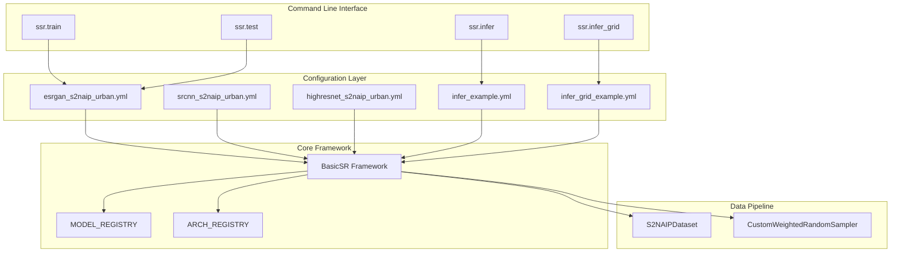
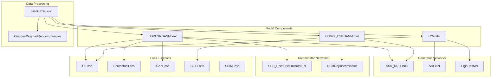
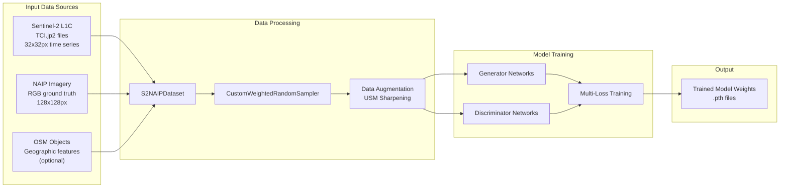
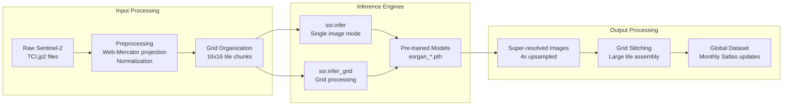

<!-- source: DeepWiki mcp.deepwiki.com · repo allenai/satlas-super-resolution · page 1 Overview · fetched 2026-10-26 -->

# Overview

Relevant source files

The following files were used as context for generating this wiki page:

- [README.md](README.md)

## Purpose and Scope

This document provides comprehensive documentation for the Satlas Super-Resolution repository, a machine learning system designed to generate high-resolution satellite imagery from low-resolution Sentinel-2 satellite data. The repository implements state-of-the-art super-resolution neural networks to produce globally available, AI-generated geospatial data that is updated monthly as part of the broader [Satlas project](https://satlas.allen.ai).

The system transforms 32x32 pixel Sentinel-2 imagery into 128x128 pixel super-resolved outputs, providing a 4x upsampling factor. This documentation covers the complete pipeline from data processing through model training to large-scale inference deployment.

For specific implementation details about training procedures, see [Training](#5). For inference workflows, see [Inference](#6). For detailed model architecture information, see [Model Architectures](#4).

## System Architecture

The Satlas Super-Resolution system is built around four main entry points that provide different operational modes, each supported by a comprehensive configuration system and modular component architecture.

### Main Entry Points

**System Entry Points and Configuration Flow**

The system provides four primary modes of operation accessible through Python module commands, each driven by YAML configuration files that specify model architecture, training parameters, and data paths.

Sources: [README.md:147-148](), [README.md:165-166](), [README.md:173-174](), [README.md:185-186]()

### Core Components Architecture

**Core Model and Data Architecture**

The system implements a modular architecture where models (`SSRESRGANModel`, `L2Model`, `OSMObjESRGANModel`) compose different generator networks, discriminators, and loss functions to create various super-resolution approaches optimized for different use cases.

Sources: Based on system diagrams and README model descriptions [README.md:132-143]()

## Data Flow Pipeline

The system processes satellite imagery through a structured pipeline that pairs low-resolution Sentinel-2 time series with high-resolution NAIP ground truth images for training, then applies trained models for inference on new Sentinel-2 data.

### Training Data Flow

**Training Pipeline Data Flow**

The training pipeline processes paired Sentinel-2 and NAIP imagery through the `S2NAIPDataset` class, applies weighted sampling and augmentation, then trains generator-discriminator pairs using multiple loss functions to produce model weights for inference.

Sources: [README.md:87-114](), [README.md:36-42]()

### Inference Data Flow

**Inference Pipeline Data Flow**

The inference pipeline processes raw Sentinel-2 imagery through preprocessing and grid organization, applies trained models via `ssr.infer` or `ssr.infer_grid` modules, then produces super-resolved outputs that can be stitched into large-scale datasets for the global Satlas platform.

Sources: [README.md:171-189](), [README.md:115-129]()

## Dataset Structure

The system operates on the S2-NAIP dataset structure, which pairs time series of Sentinel-2 imagery with corresponding NAIP aerial photographs. The dataset uses the Web-Mercator tile system for spatial organization and supports multiple training configurations.

| Dataset Component | Resolution | Format | Coverage |
|-------------------|------------|--------|----------|
| Sentinel-2 Time Series | 32x32px | PNG stacks | Multiple temporal acquisitions |
| NAIP Ground Truth | 128x128px | RGB PNG | Single high-resolution reference |
| Urban Training Set | ~1.1M pairs | - | USA cities ≥50k population |
| Full Training Set | ~44M pairs | - | Complete NAIP coverage 2019-2020 |
| Validation Set | 8,192 pairs | - | General validation |
| Test Set | 8 grids (16x16) | - | Comprehensive evaluation |

The system supports multiple Sentinel-2 band configurations including TCI (RGB), 10m bands, 20m bands, and 60m bands, with models trained to handle 1-16 input temporal acquisitions per location.

Sources: [README.md:86-114](), [README.md:36-50]()

## Key Features and Capabilities

The repository provides several key capabilities that support both research experimentation and production deployment:

**Model Architectures**: Implementation of ESRGAN (primary production model), SRCNN (baseline), and HighResNet (enhanced CNN) with support for different input configurations and loss functions.

**Training Flexibility**: Comprehensive configuration system supporting different datasets, model variants, loss combinations, and experimental setups including OSM object-aware training and CLIP-enhanced semantic loss.

**Inference Modes**: Both single-image processing via `ssr.infer` and large-scale grid processing via `ssr.infer_grid` with automatic stitching capabilities for global dataset generation.

**Production Integration**: Direct integration with the Satlas platform for monthly global super-resolution dataset updates, supporting the publicly available AI-generated geospatial data at satlas.allen.ai.

**Research Support**: Extensive experimental configurations and model variants documented in the associated research paper "Zooming Out on Zooming In: Advancing Super-Resolution for Remote Sensing".

Sources: [README.md:1-21](), [README.md:132-142](), [README.md:170-189]()

---

