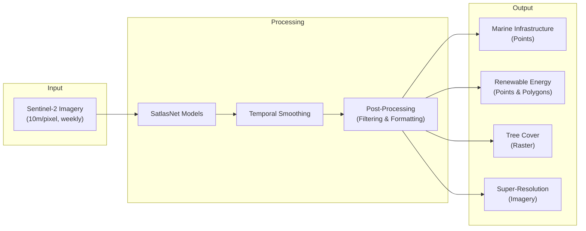
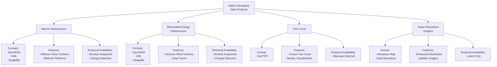
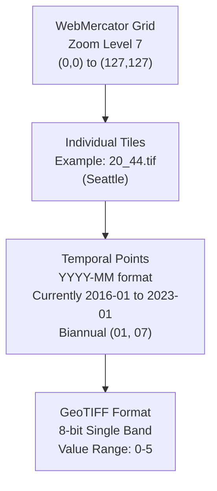
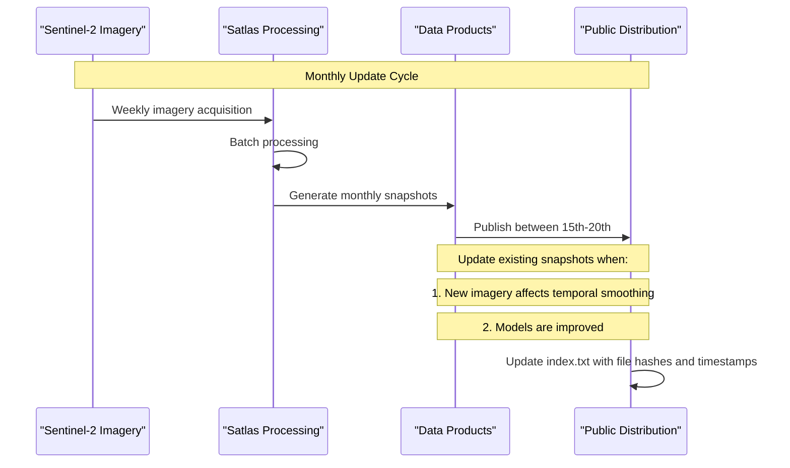

<!-- source: DeepWiki mcp.deepwiki.com · repo allenai/satlas · page 4 Geospatial Data Products · fetched 2026-10-26 -->

# Geospatial Data Products

Relevant source files

The following files were used as context for generating this wiki page:

- [GeospatialDataProducts.md](GeospatialDataProducts.md)
- [README.md](README.md)

## Purpose and Scope

This document provides a comprehensive overview of the AI-generated geospatial data products available through Satlas. These products are derived from applying deep learning models to Sentinel-2 satellite imagery and are designed to provide highly accurate, globally available data that is updated on a monthly basis. This page details the various data products, their formats, access methods, and update policies.

For information about the models used to generate these products, see [Model System](#3) and [Model Architecture](#3.1). For details on validating these data products, see [Data Validation and Evaluation](#5).

Sources: [README.md:16-22](), [GeospatialDataProducts.md:1-10]()

## Data Generation Process

The geospatial data products in Satlas are produced through a multi-stage process that involves data collection, model training, inference, and post-processing. The diagram below illustrates this pipeline:

The process begins with Sentinel-2 satellite imagery, which is relatively low-resolution (10m/pixel) but captured frequently, with most of Earth's land mass imaged weekly. This imagery is processed by SatlasNet models that have been pre-trained on the SatlasPretrain dataset and fine-tuned on task-specific datasets. The raw model outputs then undergo temporal smoothing to ensure consistency across time and reduce noise. Finally, post-processing steps are applied to filter false positives and convert the data into standard geospatial formats.

Sources: [README.md:16-40](), [GeospatialDataProducts.md:1-10]()

## Data Products Overview

Satlas currently offers four main geospatial data products, each available in different formats and temporal resolutions:

Sources: [GeospatialDataProducts.md:10-96]()

## Marine Infrastructure

The Marine Infrastructure dataset identifies offshore wind turbines and platforms from satellite imagery.

### Data Format and Structure

- **Format Options**: GeoJSON, KML, or Shapefile
- **Geometry Type**: Points
- **Attributes**: 
  - `category`: Either `offshore_wind_turbine` or `offshore_platform`
  - In the combined format: `start` and `end` indicating construction/removal dates (e.g., `start=2021-05,end=2022-01`)

### Access Methods

Monthly snapshots are available at:
- GeoJSON: `https://pub-956f3eb0f5974f37b9228e0a62f449bf.r2.dev/outputs/marine/latest.geojson`
- KML: `https://pub-956f3eb0f5974f37b9228e0a62f449bf.r2.dev/outputs/marine/latest.kml`
- Shapefile: `https://pub-956f3eb0f5974f37b9228e0a62f449bf.r2.dev/outputs/marine/latest.shp.zip`

Historical data can be accessed by replacing `latest` with a specific month in `YYYY-MM` format.

A combined file with temporal information is available at:
- `https://pub-956f3eb0f5974f37b9228e0a62f449bf.r2.dev/outputs/marine/marine.geojson`

An index file listing all available files with their hash and last modified time is available at:
- `https://pub-956f3eb0f5974f37b9228e0a62f449bf.r2.dev/outputs/marine/index.txt`

Sources: [GeospatialDataProducts.md:10-36]()

## Renewable Energy Infrastructure

The Renewable Energy Infrastructure dataset identifies onshore wind turbines (as points) and solar farms (as polygons).

### Data Format and Structure

- **Format Options**: GeoJSON, KML, or Shapefile
- **Geometry Types**: Points (wind turbines) and Polygons (solar farms)
- **Attributes**: 
  - `category`: Either `wind_turbine` or `solar_farm`
  - In the combined format: `start` and `end` indicating construction/removal dates

### Access Methods

Monthly snapshots are available at:
- GeoJSON: `https://pub-956f3eb0f5974f37b9228e0a62f449bf.r2.dev/outputs/renewable/latest.geojson`
- KML: `https://pub-956f3eb0f5974f37b9228e0a62f449bf.r2.dev/outputs/renewable/latest.kml`
- Shapefile (wind turbines): `https://pub-956f3eb0f5974f37b9228e0a62f449bf.r2.dev/outputs/renewable/latest_wind.shp.zip`
- Shapefile (solar farms): `https://pub-956f3eb0f5974f37b9228e0a62f449bf.r2.dev/outputs/renewable/latest_solar.shp.zip`

Historical data can be accessed by replacing `latest` with a specific month in `YYYY-MM` format.

A combined file with temporal information is available at:
- `https://pub-956f3eb0f5974f37b9228e0a62f449bf.r2.dev/outputs/renewable/renewable.geojson`

An index file listing all available files is available at:
- `https://pub-956f3eb0f5974f37b9228e0a62f449bf.r2.dev/outputs/renewable/index.txt`

Sources: [GeospatialDataProducts.md:62-90]()

## Tree Cover

The Tree Cover dataset provides classification of tree density across the globe.

### Data Format and Structure

- **Format**: GeoTIFF
- **Resolution**: 10 m/pixel
- **Classification Values**:
  - `0`: No data
  - `1`: No trees
  - `2`: Low tree cover
  - `3`: Medium tree cover
  - `4`: High tree cover
  - `5`: Full tree cover

### Data Organization

The tree cover data is organized by WebMercator tiles at zoom level 7, indexed from (0,0) at the top-left of the projection to (127,127).

### Access Methods

GeoTIFF files for each tile and time point can be accessed at:
- `https://pub-956f3eb0f5974f37b9228e0a62f449bf.r2.dev/outputs/tree-cover/YYYY-MM/X_Y.tif`

Where:
- `YYYY-MM` is the year and month (e.g., `2022-07`)
- `X_Y` are the WebMercator tile coordinates (e.g., `20_44` for Seattle)

For example, tree cover for Seattle in July 2022:
- `https://pub-956f3eb0f5974f37b9228e0a62f449bf.r2.dev/outputs/tree-cover/2022-07/20_44.tif`

Currently, the data is available for 2016-01 to 2023-01, but only for January (01) and July (07) of each year.

Sources: [GeospatialDataProducts.md:37-61]()

## Super-Resolution

The Super-Resolution data product provides enhanced-resolution satellite imagery derived from Sentinel-2 data.

### Access Methods

Due to the large file sizes, super-resolved imagery is not currently available for bulk download. However, the imagery can be viewed through the interactive map at [satlas.allen.ai](https://satlas.allen.ai).

For researchers and developers interested in the underlying technology, the training and inference code, along with pre-trained model weights, are available in a separate repository at:
- `https://github.com/allenai/satlas-super-resolution/`

Sources: [GeospatialDataProducts.md:92-96](), [README.md:12]()

## Data Updates and Versioning

### Update Frequency

- New monthly snapshots are generally published between the 15th and 20th of each month
- Historical data may be updated when:
  1. Temporal smoothing that includes the latest images changes estimates for previous months
  2. Improved models are developed

### Version Tracking

Each data product includes an index file (`index.txt`) that lists all available files along with their hash and last modified time. This index can be queried programmatically to detect updates.

For Marine Infrastructure:
- `https://pub-956f3eb0f5974f37b9228e0a62f449bf.r2.dev/outputs/marine/index.txt`

For Renewable Energy Infrastructure:
- `https://pub-956f3eb0f5974f37b9228e0a62f449bf.r2.dev/outputs/renewable/index.txt`

Sources: [GeospatialDataProducts.md:25-31](), [GeospatialDataProducts.md:77-83]()

## Licensing

All Satlas geospatial data products are released under the ODC-BY license, which allows free use with attribution.

Sources: [GeospatialDataProducts.md:5-6]()

---

