# Page: Overview

# Overview

<details>
<summary>Relevant source files</summary>

The following files were used as context for generating this wiki page:

- [README.md](README.md)
- [build.sbt](build.sbt)
- [cli/build.sbt](cli/build.sbt)
- [core/build.sbt](core/build.sbt)
- [core/src/main/java/org/allenai/scienceparse/CRFBibRecordParser.java](core/src/main/java/org/allenai/scienceparse/CRFBibRecordParser.java)
- [core/src/main/java/org/allenai/scienceparse/GazetteerFeatures.java](core/src/main/java/org/allenai/scienceparse/GazetteerFeatures.java)
- [server/build.sbt](server/build.sbt)

</details>


## Purpose and Scope

Science Parse is a system for extracting structured metadata from scientific papers in PDF format. It uses machine learning (CRF models) and rule-based approaches to identify and extract key information from research documents. The system is designed for high-throughput batch processing as well as on-demand parsing via a REST API.

This page provides an overview of the entire Science Parse system, including its capabilities, architecture, and deployment options. For detailed information about specific components:
- For core parsing logic and library usage, see [Core Library](#2)
- For HTTP API details, see [Server Module](#3)
- For batch processing with command-line tools, see [CLI Module](#4)
- For training new models, see [Training and Evaluation](#5)

**Sources:** [README.md:1-29](), [build.sbt:8-11]()

## Extracted Metadata Fields

Science Parse extracts the following structured information from PDF documents:

| Field | Description | Data Structure |
|-------|-------------|----------------|
| **Title** | Paper title | String |
| **Authors** | List of author names | List of Strings |
| **Abstract** | Paper abstract text | String |
| **Year** | Publication year | Integer |
| **Sections** | Document sections with headings and body text | List of Section objects |
| **Bibliography** | References cited in the paper | List of `BibRecord` objects |
| **Mentions** | In-text citation locations | List of `CitationRecord` objects |
| **Venue** | Publication venue (journal/conference) | String |

Each `BibRecord` in the bibliography contains its own title, authors, venue, and year. Each `CitationRecord` links to a bibliography entry and includes the sentence context where the citation appears.

The complete output is serialized as JSON conforming to the `ExtractedMetadata` schema.

**Sources:** [README.md:3-13](), [core/src/main/java/org/allenai/scienceparse/CRFBibRecordParser.java:203-218]()

## System Modules

Science Parse is organized into three modules, each serving different use cases:

### Core Module (`science-parse-core`)

The **core** module contains all parsing logic and can be used as a library dependency in JVM applications. It includes:
- `Parser` class: Main entry point for PDF parsing
- `PDFExtractor`: Converts raw PDFs to structured `PDFDoc` objects
- `ExtractReferences`: Multi-strategy bibliography extraction
- `CRFBibRecordParser`: CRF-based citation parsing
- `GazetteerFeatures`: Entity recognition using gazetteers
- Training utilities for generating new models

The core module is published as `org.allenai.scienceparse:science-parse-core:3.0.1` and can be used directly in Scala or Java projects.

**Sources:** [build.sbt:53-58](), [core/build.sbt:7-48]()

### Server Module (`science-parse-server`)

The **server** module wraps the core parsing library in an HTTP API service running on port 8080. Key components:
- `SPServer`: Main server class with Jetty HTTP server
- REST endpoints under `/v1/` for parsing by paper ID or direct upload
- Optional `FeedbackStore`: PostgreSQL-backed system for storing corrections
- JSON serialization using spray-json

The server can be deployed as a Docker container, fat JAR, or run directly from source.

**Sources:** [build.sbt:67-72](), [server/build.sbt:1-19]()

### CLI Module (`science-parse-cli`)

The **cli** module provides a command-line interface for batch processing. Key components:
- `RunSP`: Main CLI entry point
- `PaperSource` abstraction: Supports retrieving PDFs from S3, local directories, or fallback chains
- Output to JSON files or stdout
- Suitable for large-scale batch processing

The CLI is packaged as a fat JAR that can be executed with `java -jar`.

**Sources:** [build.sbt:60-65](), [cli/build.sbt:1-18]()

## System Architecture

### Module Dependencies and Build Structure

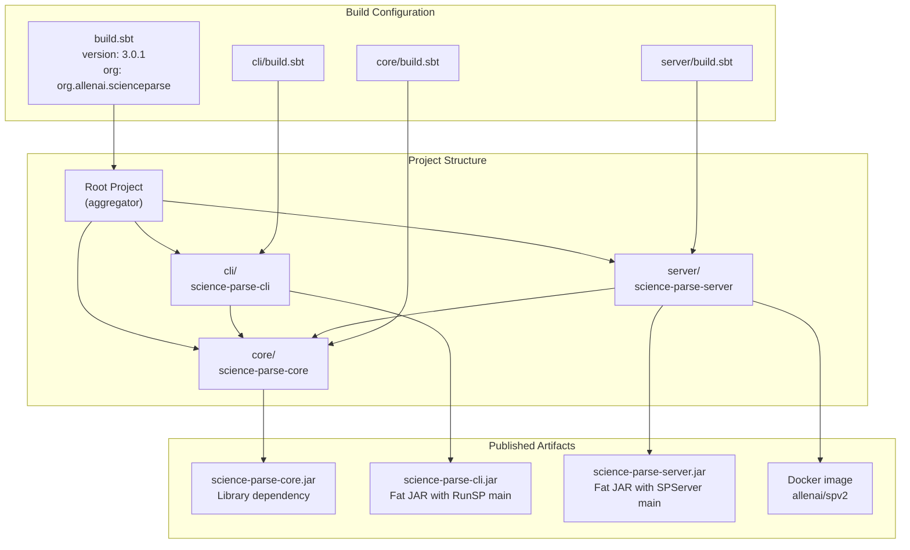

**Sources:** [build.sbt:41-72](), [core/build.sbt:5](), [cli/build.sbt:5](), [server/build.sbt:5]()

### Core Parsing Components

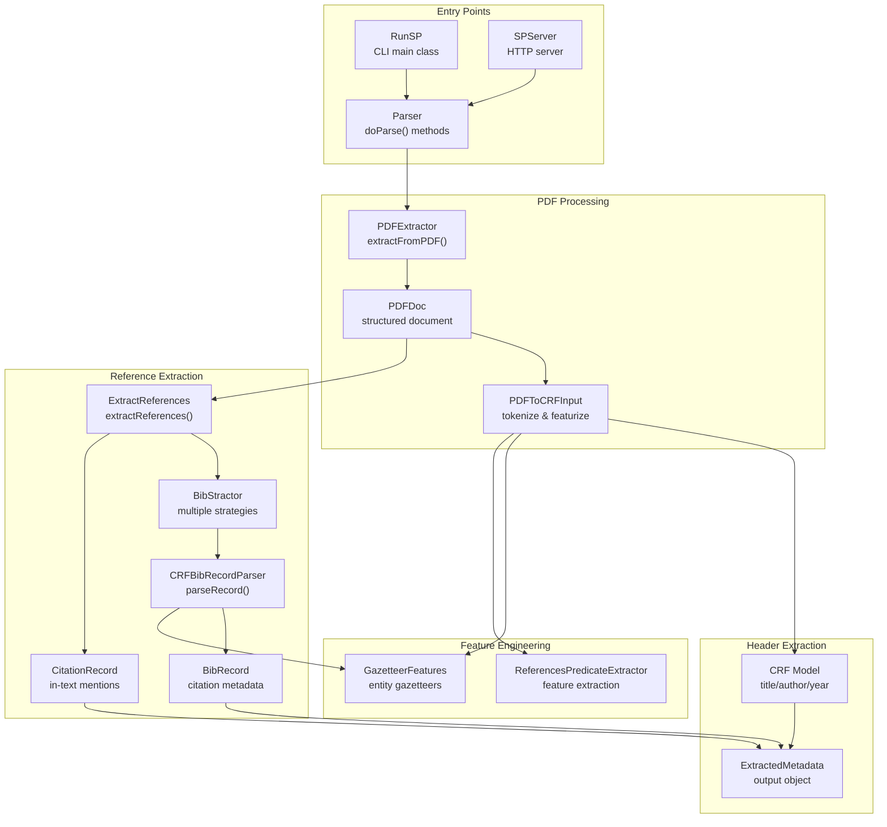

This diagram maps natural language concepts to concrete code entities. The `Parser` class ([core/src/main/java/org/allenai/scienceparse/Parser.java]()) orchestrates the entire pipeline, delegating to `PDFExtractor` for layout analysis, `PDFToCRFInput` for feature engineering, and `ExtractReferences` for bibliography parsing. The `GazetteerFeatures` class ([core/src/main/java/org/allenai/scienceparse/GazetteerFeatures.java:28]()) provides entity recognition by matching token sequences against gazetteers of journal names, person names, etc.

**Sources:** [core/src/main/java/org/allenai/scienceparse/CRFBibRecordParser.java:23-29](), [core/src/main/java/org/allenai/scienceparse/GazetteerFeatures.java:28-50]()

## Deployment Options

Science Parse supports three primary deployment models:

### Library Dependency

Include the core module as a Maven or SBT dependency:

**SBT:**
```scala
libraryDependencies += "org.allenai.scienceparse" %% "science-parse-core" % "3.0.1"
```

**Maven:**
```xml
<dependency>
  <groupId>org.allenai.scienceparse</groupId>
  <artifactId>science-parse-core_2.12</artifactId>
  <version>3.0.1</version>
</dependency>
```

This is suitable for integrating Science Parse into existing JVM applications.

**Sources:** [README.md:30-46](), [build.sbt:8-11]()

### Fat JAR (Standalone Executable)

Build self-contained JAR files with all dependencies:

```bash
# Build CLI
sbt cli/assembly
java -Xmx10g -jar cli/target/scala-2.12/science-parse-cli-assembly-3.0.1.jar

# Build Server
sbt server/assembly
java -Xmx10g -jar server/target/scala-2.12/science-parse-server-assembly-3.0.1.jar
```

The CLI JAR has `RunSP` as the main class, while the Server JAR uses `SPServer`.

**Sources:** [cli/build.sbt:5](), [server/build.sbt:5](), [README.md:70-73]()

### Docker Container

The server module includes Docker deployment scripts:

```bash
cd server
./makeDocker.sh
docker run -p 8080:8080 allenai/spv2
```

This containerized deployment is suitable for cloud environments and production deployments.

**Sources:** [README.md:26]()

## Key Technologies and Dependencies

| Technology | Purpose | Version |
|------------|---------|---------|
| **Apache PDFBox** | PDF rendering and text extraction | 2.0.9 |
| **CRF Models** | Sequence labeling for metadata extraction | org.allenai:ml:0.16 |
| **pdffigures2** | Section and figure extraction | 0.1.0 |
| **OpenNLP** | Sentence tokenization for citation context | 1.7.2 |
| **AWS S3 SDK** | Paper retrieval from S3 buckets | 1.11.213 |
| **Jetty** | HTTP server for REST API | 9.4.1 |
| **PostgreSQL** | Optional feedback storage | 42.0.0 (JDBC) |
| **spray-json** | JSON serialization | 1.3.5 |

The system uses **Scala 2.12** (with 2.11 support) and **Java 8+**. The CRF models use custom feature engineering defined in `PDFToCRFInput` and `ReferencesPredicateExtractor`, with gazetteers providing entity recognition features.

**Sources:** [core/build.sbt:7-48](), [server/build.sbt:13-19](), [build.sbt:3-6]()

## Model Files and First-Run Setup

On first execution, Science Parse downloads pre-trained model files from AWS S3:
- Main CRF model for header extraction
- Bibliography CRF model for citation parsing
- Word vectors for embedding features
- Gazetteer cache (~10.2K entries)

These files are cached locally, making subsequent runs significantly faster. The models are managed through the `datastore` library and stored in `~/.ai2/datastore/` by default.

Users can train custom models using training data from DBLP, PMC, or other sources. See [Training and Evaluation](#5) for details.

**Sources:** [README.md:48](), [core/build.sbt:23]()

## Version Information

Current version: **3.0.1**

Organization: `org.allenai.scienceparse`

Published to: Bintray (`allenai/maven` repository)

Scala versions: 2.12.9 (primary), 2.11.12 (supported)

License: Apache 2.0

**Sources:** [build.sbt:8-11](), [build.sbt:21-26]()

---

# Page: Architecture

# Architecture

<details>
<summary>Relevant source files</summary>

The following files were used as context for generating this wiki page:

- [README.md](README.md)
- [build.sbt](build.sbt)
- [cli/build.sbt](cli/build.sbt)
- [core/build.sbt](core/build.sbt)
- [core/src/main/java/org/allenai/scienceparse/BibRecord.java](core/src/main/java/org/allenai/scienceparse/BibRecord.java)
- [core/src/main/java/org/allenai/scienceparse/CRFBibRecordParser.java](core/src/main/java/org/allenai/scienceparse/CRFBibRecordParser.java)
- [core/src/main/java/org/allenai/scienceparse/CheckReferences.java](core/src/main/java/org/allenai/scienceparse/CheckReferences.java)
- [core/src/main/java/org/allenai/scienceparse/CitationRecord.java](core/src/main/java/org/allenai/scienceparse/CitationRecord.java)
- [core/src/main/java/org/allenai/scienceparse/ExtractReferences.java](core/src/main/java/org/allenai/scienceparse/ExtractReferences.java)
- [core/src/main/java/org/allenai/scienceparse/GazetteerFeatures.java](core/src/main/java/org/allenai/scienceparse/GazetteerFeatures.java)
- [core/src/main/java/org/allenai/scienceparse/Parser.java](core/src/main/java/org/allenai/scienceparse/Parser.java)
- [core/src/main/java/org/allenai/scienceparse/pdfapi/PDFExtractor.java](core/src/main/java/org/allenai/scienceparse/pdfapi/PDFExtractor.java)
- [core/src/main/scala/org/allenai/scienceparse/JsonProtocol.scala](core/src/main/scala/org/allenai/scienceparse/JsonProtocol.scala)
- [core/src/main/scala/org/allenai/scienceparse/LabeledData.scala](core/src/main/scala/org/allenai/scienceparse/LabeledData.scala)
- [core/src/test/scala/org/allenai/scienceparse/JsonProtocolSpec.scala](core/src/test/scala/org/allenai/scienceparse/JsonProtocolSpec.scala)
- [server/build.sbt](server/build.sbt)
- [server/src/main/scala/org/allenai/scienceparse/FeedbackStore.scala](server/src/main/scala/org/allenai/scienceparse/FeedbackStore.scala)
- [server/src/main/scala/org/allenai/scienceparse/SPServer.scala](server/src/main/scala/org/allenai/scienceparse/SPServer.scala)

</details>


This document explains the high-level architecture of Science Parse, focusing on the system's modular structure, how components interact during PDF parsing, and the data flow between modules. For details on using the CLI or Server, see pages [4](#4) and [3](#3). For information on training models, see [5](#5).

## Module Structure

Science Parse is organized as a multi-module SBT project with three primary modules that serve different use cases while sharing a common parsing core.

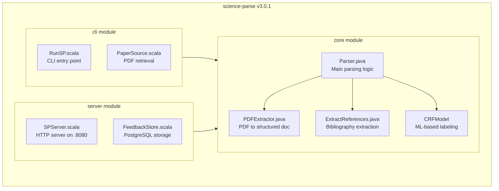

**Sources:** [build.sbt:1-73](), [core/build.sbt:1-49](), [cli/build.sbt:1-19](), [server/build.sbt:1-20]()

### Core Module

The `core` module ([build.sbt:53-58]()) contains all parsing logic and can be used as a library dependency. Published to Maven Central as `org.allenai.scienceparse:science-parse-core_2.12:3.0.1`, it provides:

- `Parser` class for end-to-end PDF parsing
- PDF extraction and layout analysis via `PDFExtractor`
- CRF-based metadata extraction with trained models
- Multi-strategy reference extraction via `ExtractReferences`
- Training utilities for model generation

### CLI Module

The `cli` module ([build.sbt:60-65]()) provides batch processing capabilities through the `RunSP` command-line tool. It adds:

- Paper retrieval strategies (`PaperSource` implementations for S3, directories, fallback chains)
- Command-line argument parsing with `scopt`
- JSON output serialization

The module builds to a fat JAR via `sbt assembly` with main class `org.allenai.scienceparse.RunSP` ([cli/build.sbt:5]()).

### Server Module

The `server` module ([build.sbt:67-72]()) wraps the core parser in an HTTP API using Jetty. It provides:

- REST endpoints on port 8080 via `SPServer`
- Optional PostgreSQL-backed feedback system via `FeedbackStore`
- JSON serialization using spray-json with `JsonProtocol`

The module builds to both a fat JAR and Docker container ([server/build.sbt:5]()).

## Core Parsing Architecture

The core module orchestrates multiple subsystems to extract structured metadata from PDFs. The main entry point is the `Parser` class.

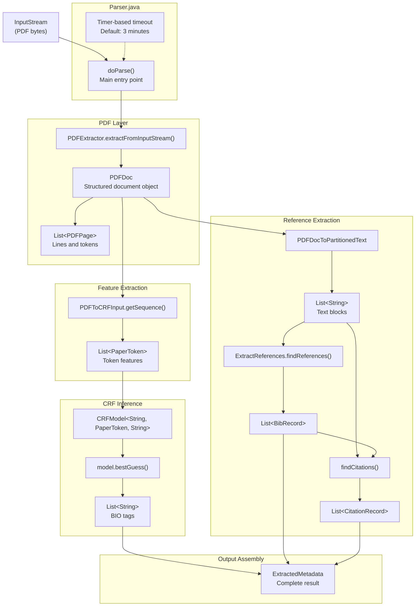

**Sources:** [core/src/main/java/org/allenai/scienceparse/Parser.java:84-852](), [core/src/main/java/org/allenai/scienceparse/pdfapi/PDFExtractor.java:1-441](), [core/src/main/java/org/allenai/scienceparse/ExtractReferences.java:1-800]()

### Parser Initialization

The `Parser` class constructor ([core/src/main/java/org/allenai/scienceparse/Parser.java:117-205]()) loads three model files:

1. **Main CRF model** (`productionModel.dat`) - Trained to identify title, authors, year, abstract from PDF headers
2. **Gazetteer** (`gazetteer.json`) - 10.2K paper titles for reference validation
3. **Bibliography model** (`productionBibModel.dat`) - CRF model for parsing citation strings

Models are downloaded on first use via the `Datastore` API and cached locally. A binary gazetteer cache is created at `$TMPDIR/{filename}-{hash}.gazetteerCache.bin` to speed up subsequent loads ([Parser.java:171-195]()).

### PDF Extraction Pipeline

The `PDFExtractor` class converts raw PDF bytes into structured documents:

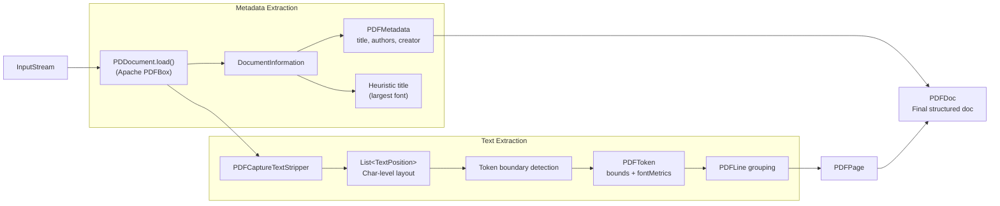

**Sources:** [core/src/main/java/org/allenai/scienceparse/pdfapi/PDFExtractor.java:38-441]()

Key implementation details:
- `PDFCaptureTextStripper` ([PDFExtractor.java:337-439]()) extends PDFBox's `PDFTextStripper` to capture layout
- Token boundary detection occurs on whitespace or column breaks ([PDFExtractor.java:350-381]())
- Font metrics include family name, point size, and space width ([PDFExtractor.java:250-264]())
- Superscript detection uses vertical position thresholds, encoded with `⍐` and `⍗` markers ([PDFExtractor.java:292-328]())

### CRF Feature Engineering and Inference

The `PDFToCRFInput` class converts `PDFDoc` into sequences of `PaperToken` objects with rich features for CRF inference. Features include:

| Feature Type | Examples | Purpose |
|--------------|----------|---------|
| Lexical | Token text, normalized forms | Direct string matching |
| Orthographic | `ALL_CAPS`, `Capitalized`, punctuation patterns | Title/author format detection |
| Positional | Line number, page number, x/y coordinates | Header region identification |
| Typographic | Font family, point size, bold/italic | Emphasis detection |
| Contextual | Previous/next token features | Sequence modeling |
| Gazetteer | Presence in known paper titles | Reference validation |

The `CRFModel` applies Viterbi decoding to produce BIO-tagged labels ([Parser.java:88]()): `B_title`, `I_title`, `B_author`, `I_author`, `B_year`, `W_abstract`, etc.

**Sources:** [core/src/main/java/org/allenai/scienceparse/PDFToCRFInput.java]() (implied), [core/src/main/java/org/allenai/scienceparse/Parser.java:262-307]()

### Multi-Strategy Reference Extraction

`ExtractReferences` implements a tournament-based approach where multiple extraction strategies compete:

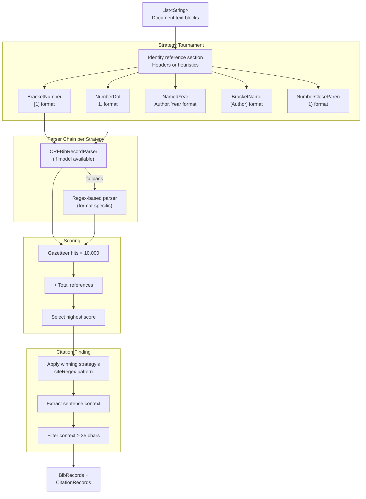

**Sources:** [core/src/main/java/org/allenai/scienceparse/ExtractReferences.java:59-537]()

The tournament architecture ([ExtractReferences.java:517-537]()):
1. All strategies parse the reference section in parallel
2. Each strategy produces a list of `BibRecord` objects
3. Scoring: `score = (gazetteer_hits × 10000) + total_references`
4. Winning strategy's `citeRegex` pattern is used to find in-text citations

Strategy implementations:
- `BracketNumber` and derivatives: Handle `[1]`, `[1-3]` formats ([ExtractReferences.java:110-136]())
- `NumberDot` and derivatives: Handle `1.`, `2.` formats with various author/year patterns ([ExtractReferences.java:119-127]())
- `NamedYear`: Handles author-year citations like "Etzioni et al. (2005)" ([ExtractReferences.java:113-118]())

Each strategy can use multiple `BibRecordParser` implementations in a fallback chain. The `CRFBibRecordParser` ([core/src/main/java/org/allenai/scienceparse/CRFBibRecordParser.java:23-272]()) uses a separate CRF model trained on Cora, UMass, and Kermit citation datasets. It includes a `LoadingCache` with 10-minute TTL to avoid recomputing parses ([CRFBibRecordParser.java:153-163]()).

## Server Architecture

The `SPServer` class implements a lightweight HTTP API using Jetty with custom routing:

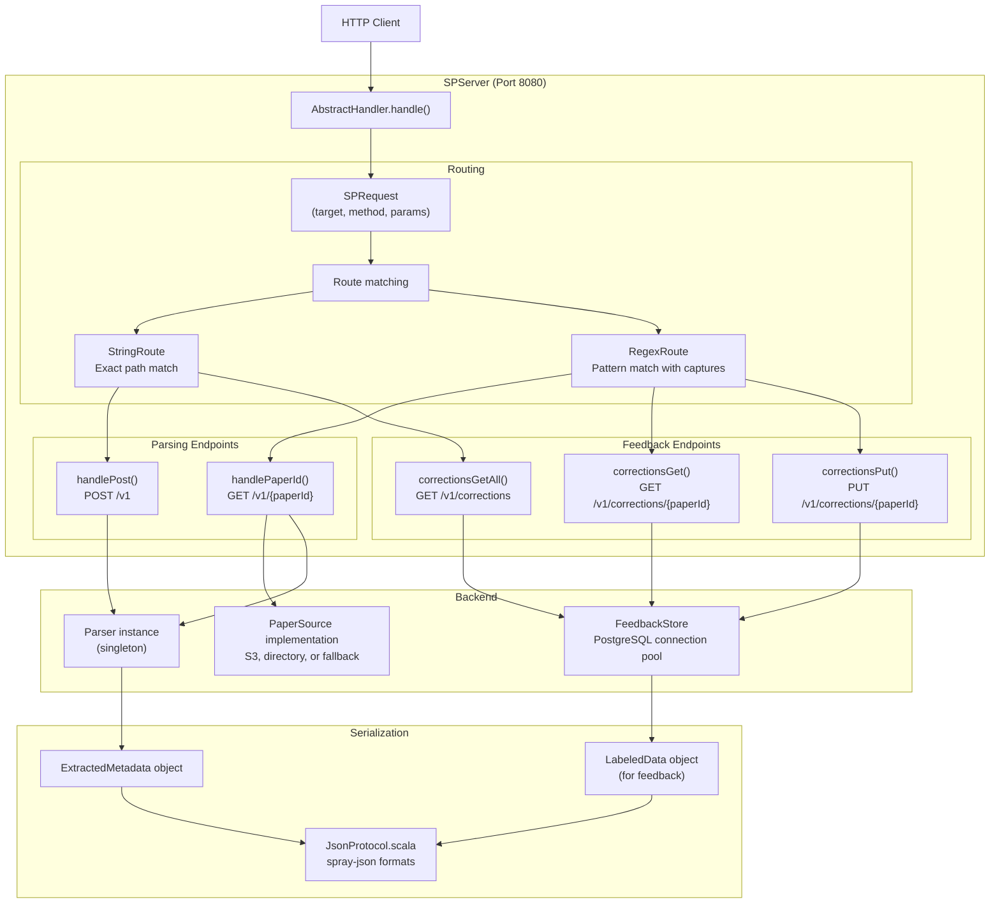

**Sources:** [server/src/main/scala/org/allenai/scienceparse/SPServer.scala:1-395](), [server/src/main/scala/org/allenai/scienceparse/FeedbackStore.scala:1-147]()

### Routing System

The routing system uses two route types ([SPServer.scala:167-213]()):

- **StringRoute**: Exact string matching for static paths like `/v1/corrections`
- **RegexRoute**: Pattern matching with named capture groups for dynamic paths like `/v1/([a-f0-9]{40})` capturing `paperId`

Request handling flow ([SPServer.scala:233-278]()):
1. Incoming request converted to `SPRequest` with target, method, query params
2. Routes tried sequentially via `routes.iterator.flatMap(_.handle(spRequest))`
3. First matching route's handler executes
4. If no route matches, returns 404 or 405 with allowed methods

### Feedback System

The feedback system ([FeedbackStore.scala:11-146]()) is optional and disabled by default. When enabled:

**Database Schema:**
- `feedback` table: `(paperId CHAR(40), timeAdded TIMESTAMP, value JSONB)`
- `settings` table: Tracks schema version for migrations
- Versioned migrations ensure schema upgrades ([FeedbackStore.scala:52-83]())

**API Endpoints:**
- `GET /v1/corrections/{paperId}`: Retrieves latest correction for a paper ([SPServer.scala:332-343]())
- `PUT /v1/corrections/{paperId}`: Stores correction as `LabeledData` in JSONB ([SPServer.scala:345-377]())
- `GET /v1/corrections?onOrAfter=...&before=...`: Lists all corrections with time filtering ([SPServer.scala:379-393]())

Connection pooling uses ScalikeJDBC with separate connection pools for regular user and root (for schema migrations) ([FeedbackStore.scala:12-86]()).

## Data Models

The system uses several key data structures for representing parsed documents:

### ExtractedMetadata

Primary output format containing all extracted information ([core/src/main/java/org/allenai/scienceparse/ExtractedMetadata.java]()):

```
ExtractedMetadata {
    title: String
    authors: List<String>
    emails: List<String>
    year: int
    abstractText: String
    sections: List<Section>
    references: List<BibRecord>
    referenceMentions: List<CitationRecord>
    creator: String (PDF producer)
    source: enum (CRF, META, MINIMAL)
}
```

### LabeledData

Training and evaluation format supporting optional fields ([core/src/main/scala/org/allenai/scienceparse/LabeledData.scala:94-116]()):

```scala
case class LabeledData(
  id: String,
  title: Option[String],
  authors: Option[Seq[Author]],
  venue: Option[String],
  year: Option[Int],
  abstractText: Option[String],
  sections: Option[Seq[Section]],
  references: Option[Seq[Reference]],
  mentions: Option[Seq[Mention]]
)
```

### BibRecord and CitationRecord

Reference representation ([core/src/main/java/org/allenai/scienceparse/BibRecord.java:12-87]()):

```
BibRecord {
    title: String
    author: List<String>
    venue: String
    year: int
    citeRegEx: Pattern (for finding "[1]" style)
    shortCiteRegEx: Pattern (for finding "Author, 2020" style)
}

CitationRecord {
    referenceID: int (index into references list)
    context: String (surrounding sentence)
    startOffset: int
    endOffset: int
}
```

### JSON Serialization

All data models serialize via spray-json with `JsonProtocol` ([core/src/main/scala/org/allenai/scienceparse/JsonProtocol.scala:7-188]()). Custom formats handle Java collections, `Pattern` objects, and optional fields. Round-trip serialization is tested in [core/src/test/scala/org/allenai/scienceparse/JsonProtocolSpec.scala]().

## Deployment Configurations

Science Parse supports three deployment modes, each producing different artifacts:

### Library Dependency

The core module publishes to Bintray/Maven Central ([build.sbt:8-11, 26-27]()):

```
org.allenai.scienceparse:science-parse-core_2.12:3.0.1
```

Usage: Create `Parser` instance and call `doParse(InputStream)`. Models download automatically on first use.

### Command-Line Tool

Built via `sbt cli/assembly` ([cli/build.sbt:5-10]()), produces:
- `science-parse-cli-3.0.1.jar` - Runnable fat JAR with all dependencies

Run: `java -Xmx10g -jar science-parse-cli-3.0.1.jar [options]`

### Docker Container

Built via `makeDocker.sh` (references in README), produces containerized server on port 8080. The server JAR is built via `sbt server/assembly` ([server/build.sbt:5-11]()).

Environment variables:
- `--enableFeedback`: Enable PostgreSQL feedback storage
- `--useS2Bucket`: Use internal S3 bucket for paper retrieval
- `-p paperDirectory`: Local PDF directory for fallback

**Sources:** [README.md:1-104](), [build.sbt:1-73](), [server/src/main/scala/org/allenai/scienceparse/SPServer.scala:24-103]()

---

# Page: Getting Started

# Getting Started

<details>
<summary>Relevant source files</summary>

The following files were used as context for generating this wiki page:

- [README.md](README.md)
- [cli/README.md](cli/README.md)
- [core/README.md](core/README.md)
- [server/README.md](server/README.md)

</details>


This page provides installation instructions, initial setup, and basic usage examples for Science Parse. It covers the three main ways to use Science Parse: as a web service, command-line tool, or library dependency. For detailed information about the underlying architecture, see [Architecture](#1.1). For module-specific details, see [Core Library](#2), [Server Module](#3), and [CLI Module](#4).

## Prerequisites

Science Parse requires:
- **JVM**: Java 8 or later
- **Memory**: Minimum 6GB heap (`-Xmx6g`), plus ~2GB off-heap
- **Disk Space**: ~3-4GB for cached model files (downloaded on first run)
- **Build Tool** (if building from source): SBT 1.2.7+

**Sources:** [README.md:48-58](), [cli/README.md:12-17](), [server/README.md:20-24]()

## Installation Options

Science Parse provides three deployment modes, each serving different use cases:

| Mode | Use Case | How to Get Started | Best For |
|------|----------|-------------------|----------|
| **Server** | Parse papers via HTTP API | Use hosted service or build with `sbt server/assembly` | Quick experimentation, production API |
| **CLI** | Batch processing | Build with `sbt cli/assembly` | Processing thousands of PDFs |
| **Library** | Programmatic integration | Add Maven/SBT dependency | Embedding in JVM applications |

**Sources:** [README.md:22-28](), [README.md:30-46]()

### Installation Flow

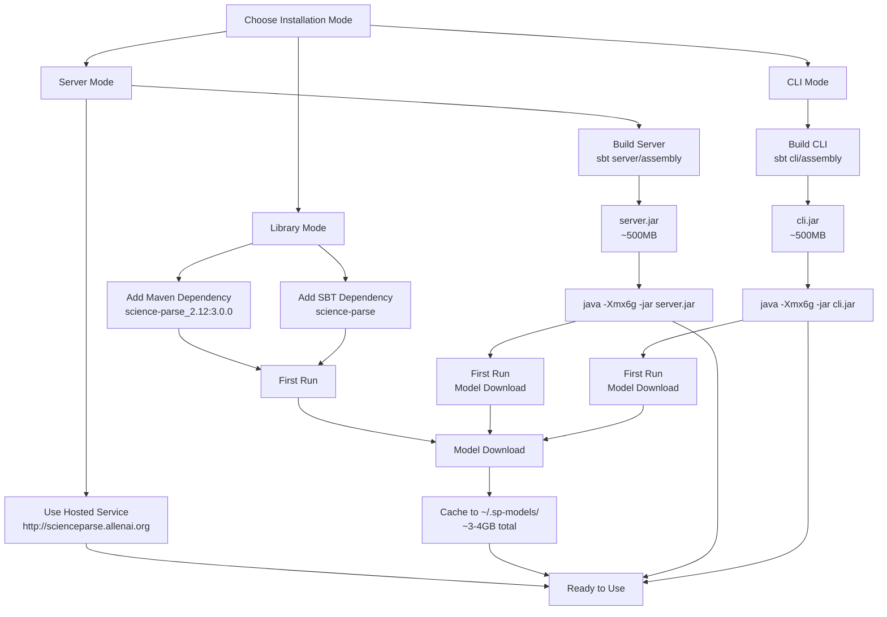

**Sources:** [README.md:22-58](), [server/README.md:18-22](), [cli/README.md:1-8]()

## Using the Hosted Service (Quickest Start)

The fastest way to try Science Parse is using the hosted service at `http://scienceparse.allenai.org`. No installation required.

### Parse by S2 Paper ID

```bash
# Get full output including sections
curl "http://scienceparse.allenai.org/v1/498bb0efad6ec15dd09d941fb309aa18d6df9f5f"

# Get compact output without body text
curl "http://scienceparse.allenai.org/v1/498bb0efad6ec15dd09d941fb309aa18d6df9f5f?skipFields=sections"
```

### Parse by PDF Upload

```bash
curl -v -H "Content-type: application/pdf" \
  --data-binary @paper.pdf \
  "http://scienceparse.allenai.org/v1"
```

**Important:** The URL must not have a trailing slash, and `Content-type` must be `application/pdf`.

**Sources:** [server/README.md:1-16]()

## Building from Source

### Build Server

```bash
# Clone repository
git clone https://github.com/allenai/science-parse
cd science-parse

# Build server super-jar
sbt server/assembly

# Run server (binds to port 8080)
java -Xmx6g -jar server/target/scala-2.12/server-assembly-3.0.1.jar
```

### Build CLI

```bash
# Build CLI super-jar
sbt cli/assembly

# Run CLI
java -Xmx6g -jar cli/target/scala-2.12/cli-assembly-3.0.1.jar --help
```

**Sources:** [README.md:64-73](), [server/README.md:18-22](), [cli/README.md:1-8]()

## Using as a Library

Add Science Parse as a dependency to your project:

### SBT

```scala
libraryDependencies += "org.allenai" %% "science-parse" % "3.0.0"
```

### Maven

```xml
<dependency>
  <groupId>org.allenai</groupId>
  <artifactId>science-parse_2.12</artifactId>
  <version>3.0.0</version>
</dependency>
```

### Basic Usage in Java

```java
import org.allenai.scienceparse.Parser;
import org.allenai.scienceparse.ExtractedMetadata;

// Get singleton Parser instance
final Parser parser = Parser.getInstance();

// Parse PDF without timeout
final ExtractedMetadata em = parser.doParse(inputStream);

// Parse PDF with 30-second timeout
final ExtractedMetadata em = parser.doParseWithTimeout(inputStream, 30000);
```

The `Parser` class is defined in [core/src/main/java/org/allenai/scienceparse/Parser.java](), and `ExtractedMetadata` in [core/src/main/java/org/allenai/scienceparse/ExtractedMetadata.java]().

**Sources:** [README.md:30-46](), [core/README.md:6-22]()

## First-Time Setup and Model Downloads

On first run, Science Parse downloads four model files from AWS S3:

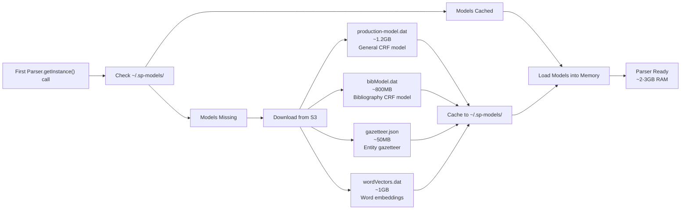

### Model File Details

| Model File | Size | Purpose | Training Source |
|------------|------|---------|-----------------|
| `production-model.dat` | ~1.2GB | Title, author, year extraction | DBLP + PMC papers |
| `bibModel.dat` | ~800MB | Bibliography parsing | Cora, UMass, Kermit datasets |
| `gazetteer.json` | ~50MB | Entity recognition (10.2K entries) | Venue and author lists |
| `wordVectors.dat` | ~1GB | Word embeddings for CRF features | Pre-trained vectors |

**First Run Timing:**
- Download: 5-15 minutes (depending on bandwidth)
- Subsequent starts: 10-20 seconds (loading from cache)

**Sources:** [README.md:48-48](), [core/README.md:44-56]()

## Optional Image Format Dependencies

For licensing reasons, Science Parse does not bundle certain image format libraries. Without these, PDFs containing JPEG2000 or JBIG2 images cannot be processed.

### Add to SBT

```scala
libraryDependencies ++= Seq(
  "com.github.jai-imageio" % "jai-imageio-core" % "1.2.1",
  "com.github.jai-imageio" % "jai-imageio-jpeg2000" % "1.3.0",
  "com.levigo.jbig2" % "levigo-jbig2-imageio" % "1.6.5"
)
```

### Add to Maven

```xml
<dependency>
  <groupId>com.github.jai-imageio</groupId>
  <artifactId>jai-imageio-core</artifactId>
  <version>1.2.1</version>
</dependency>
<dependency>
  <groupId>com.github.jai-imageio</groupId>
  <artifactId>jai-imageio-jpeg2000</artifactId>
  <version>1.3.0</version>
</dependency>
<dependency>
  <groupId>com.levigo.jbig2</groupId>
  <artifactId>levigo-jbig2-imageio</artifactId>
  <version>1.6.5</version>
</dependency>
```

**Sources:** [README.md:50-58]()

## Basic Usage Examples

### Server Mode: Processing Papers

```bash
# Start server
java -Xmx6g -jar server-assembly.jar

# Parse by S2 ID (GET request)
curl "http://localhost:8080/v1/498bb0efad6ec15dd09d941fb309aa18d6df9f5f"

# Parse uploaded PDF (POST request)
curl -H "Content-type: application/pdf" \
  --data-binary @paper.pdf \
  "http://localhost:8080/v1"
```

The server binds to port 8080 by default. Run with `--help` to see configuration options. The `SPServer` class [server/src/main/scala/org/allenai/scienceparse/SPServer.scala]() handles routing and the `handlePaperId` and `handlePost` methods process requests.

**Sources:** [server/README.md:9-22]()

### CLI Mode: Batch Processing

```bash
# Parse single PDF
java -Xmx6g -jar cli-assembly.jar paper.pdf

# Parse by S2 ID
java -Xmx6g -jar cli-assembly.jar 18bc3569da037a6cb81fb081e2856b77b321c139

# Parse directory of PDFs
java -Xmx6g -jar cli-assembly.jar papers/

# Parse from file list
java -Xmx6g -jar cli-assembly.jar papers.txt

# Write output to directory (one JSON per input)
java -Xmx6g -jar cli-assembly.jar -o output/ papers/

# Write output to single file (one JSON per line)
java -Xmx6g -jar cli-assembly.jar -f results.jsonl papers/
```

The `RunSP` class [cli/src/main/scala/org/allenai/scienceparse/RunSP.scala]() implements the CLI with parallel processing capabilities.

**Sources:** [cli/README.md:5-38]()

### Library Mode: Programmatic Usage

```java
import org.allenai.scienceparse.Parser;
import org.allenai.scienceparse.ExtractedMetadata;
import java.io.FileInputStream;
import java.io.InputStream;

public class Example {
    public static void main(String[] args) throws Exception {
        // Initialize parser (downloads models on first run)
        final Parser parser = Parser.getInstance();
        
        // Parse PDF
        try (InputStream is = new FileInputStream("paper.pdf")) {
            ExtractedMetadata metadata = parser.doParse(is);
            
            // Access extracted fields
            System.out.println("Title: " + metadata.title);
            System.out.println("Authors: " + metadata.authors);
            System.out.println("Year: " + metadata.year);
            System.out.println("Abstract: " + metadata.abstractText);
            System.out.println("References: " + metadata.references.size());
        }
    }
}
```

**Sources:** [core/README.md:6-40]()

## Output Format

All modes produce JSON output with this structure:

```json
{
  "title": "Paper Title",
  "authors": ["Author One", "Author Two"],
  "year": 2020,
  "abstractText": "Abstract content...",
  "sections": [
    {
      "heading": "Introduction",
      "text": "Section content..."
    }
  ],
  "references": [
    {
      "title": "Reference title",
      "authors": ["Ref Author"],
      "venue": "Conference Name",
      "year": 2019
    }
  ],
  "referenceMentions": [
    {
      "referenceID": 0,
      "context": "sentence with citation [1]"
    }
  ]
}
```

The `ExtractedMetadata` class [core/src/main/java/org/allenai/scienceparse/ExtractedMetadata.java:24-37]() defines this structure. The `JsonProtocol` object [core/src/main/scala/org/allenai/scienceparse/JsonProtocol.scala]() handles JSON serialization.

**Sources:** [README.md:3-14](), [core/README.md:22-38]()

## Memory Configuration

Science Parse requires substantial memory due to CRF models and PDF processing:

| Component | Memory Usage | Notes |
|-----------|--------------|-------|
| Heap (`-Xmx`) | 6GB minimum | Some documents require more |
| Off-heap | ~2GB | Used by PDFBox and native libraries |
| Model files in RAM | ~2-3GB | Loaded at startup |
| **Total Recommended** | **10GB+** | 6GB heap + 2GB off-heap + 2GB models |

### Memory Troubleshooting

**OutOfMemoryError:** Increase `-Xmx` value:
```bash
java -Xmx10g -jar jarfile.jar  # Increase to 10GB
```

**Slow startup:** Models are downloading or loading. Subsequent runs are faster.

**Sources:** [cli/README.md:12-17](), [server/README.md:20-24]()

## Common Command-Line Options

### Server Options

```bash
java -jar server-assembly.jar [OPTIONS]

--port PORT           # Bind to specific port (default: 8080)
--model FILE          # Use custom CRF model
--bibModel FILE       # Use custom bibliography model
--gazetteer FILE      # Use custom gazetteer
--paperDirectory DIR  # Local PDF directory for paper IDs
--dbUrl URL           # PostgreSQL URL for feedback system
```

### CLI Options

```bash
java -jar cli-assembly.jar [OPTIONS] [INPUTS...]

-o, --outputDir DIR   # Write JSON files to directory
-f, --outputFile FILE # Write JSON lines to file
--model FILE          # Use custom CRF model
--bibModel FILE       # Use custom bibliography model
--timeout MS          # Per-document timeout in milliseconds
```

Run either with `--help` to see all options.

**Sources:** [server/README.md:22-22](), [cli/README.md:7-9]()

## Development Setup (IntelliJ)

If you plan to develop Science Parse:

1. **Install Lombok Plugin:**
   - Go to IntelliJ IDEA → Preferences → Plugins
   - Search for "Lombok" and install
   - Restart IntelliJ

2. **Enable Annotation Processing:**
   - Go to Preferences → Build, Execution, Deployment → Compiler → Annotation Processors
   - Check "Enable annotation processing"

3. **Import SBT Project:**
   - Open IntelliJ → File → Open
   - Select `build.sbt` file
   - Choose "Open as Project"

Lombok provides useful annotations like `@Data`, `@val` for cleaner Java code. See [README.md:75-84]() for details.

**Sources:** [README.md:75-84]()

## Next Steps

After installation and basic usage:

- **Core Library Details:** See [Parser Class](#2.1) for advanced usage, timeout handling, and customization
- **Server Deployment:** See [Server Deployment](#3.3) for Docker, production configuration, and feedback system
- **CLI Advanced Usage:** See [CLI Usage and Options](#4.1) for batch processing strategies and input formats
- **Training Models:** See [Training and Evaluation](#5) to create custom models
- **Architecture Overview:** See [Architecture](#1.1) for system design and component relationships

For questions or issues, create a GitHub issue at https://github.com/allenai/science-parse.

**Sources:** [README.md:1-104]()

---

# Page: Core Library

# Core Library

<details>
<summary>Relevant source files</summary>

The following files were used as context for generating this wiki page:

- [build.sbt](build.sbt)
- [cli/README.md](cli/README.md)
- [cli/build.sbt](cli/build.sbt)
- [core/README.md](core/README.md)
- [core/build.sbt](core/build.sbt)
- [core/src/main/java/org/allenai/scienceparse/CRFBibRecordParser.java](core/src/main/java/org/allenai/scienceparse/CRFBibRecordParser.java)
- [core/src/main/java/org/allenai/scienceparse/CheckReferences.java](core/src/main/java/org/allenai/scienceparse/CheckReferences.java)
- [core/src/main/java/org/allenai/scienceparse/ExtractReferences.java](core/src/main/java/org/allenai/scienceparse/ExtractReferences.java)
- [core/src/main/java/org/allenai/scienceparse/GazetteerFeatures.java](core/src/main/java/org/allenai/scienceparse/GazetteerFeatures.java)
- [core/src/main/java/org/allenai/scienceparse/Parser.java](core/src/main/java/org/allenai/scienceparse/Parser.java)
- [core/src/main/java/org/allenai/scienceparse/pdfapi/PDFExtractor.java](core/src/main/java/org/allenai/scienceparse/pdfapi/PDFExtractor.java)
- [server/README.md](server/README.md)
- [server/build.sbt](server/build.sbt)

</details>


The Core Library is the foundational module of Science Parse that implements all PDF parsing logic. It provides the capabilities to extract structured metadata (titles, authors, year, abstracts, sections, references, and citations) from scholarly PDF documents. This library can be used standalone as a Maven/SBT dependency in JVM applications, or wrapped by the Server and CLI modules for specific deployment scenarios.

For information about using the Server module's HTTP API, see [Server Module](#3). For command-line batch processing, see [CLI Module](#4). For training new models, see [Training and Evaluation](#5).

## Core Library Structure

The Core Library is organized around several key components that work together to transform PDFs into structured metadata:

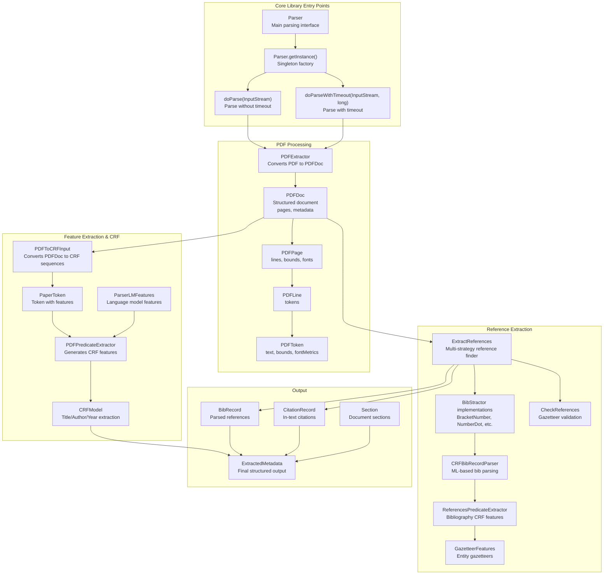

**Sources:** [core/src/main/java/org/allenai/scienceparse/Parser.java:1-1000](), [core/src/main/java/org/allenai/scienceparse/pdfapi/PDFExtractor.java:1-441](), [core/src/main/java/org/allenai/scienceparse/ExtractReferences.java:1-850]()

## Adding as a Dependency

The Core Library is published to Maven repositories as `org.allenai.scienceparse:science-parse-core`. Add it to your project:

**SBT:**
```scala
libraryDependencies += "org.allenai.scienceparse" %% "science-parse-core" % "3.0.1"
```

**Maven:**
```xml
<dependency>
    <groupId>org.allenai.scienceparse</groupId>
    <artifactId>science-parse-core</artifactId>
    <version>3.0.1</version>
</dependency>
```

**Gradle:**
```gradle
implementation 'org.allenai.scienceparse:science-parse-core:3.0.1'
```

The Core Library requires Java 8 or higher and is cross-compiled for Scala 2.11 and 2.12.

**Sources:** [build.sbt:1-73](), [core/build.sbt:1-49]()

## Basic Usage

The primary entry point is the `Parser` class, which is typically used as a singleton:

```java
import org.allenai.scienceparse.Parser;
import org.allenai.scienceparse.ExtractedMetadata;
import java.io.FileInputStream;

// Get singleton instance (lazy-loads models on first call)
final Parser parser = Parser.getInstance();

// Parse a PDF without timeout
try (FileInputStream fis = new FileInputStream("paper.pdf")) {
    ExtractedMetadata metadata = parser.doParse(fis);
    System.out.println("Title: " + metadata.title);
    System.out.println("Authors: " + metadata.authors);
    System.out.println("Year: " + metadata.year);
}

// Parse with timeout (throws ParsingTimeout if exceeded)
try (FileInputStream fis = new FileInputStream("paper.pdf")) {
    ExtractedMetadata metadata = parser.doParseWithTimeout(fis, 30000); // 30 second timeout
}
```

**Constructor Options:**

The `Parser` class provides several constructors for custom model paths:

| Constructor | Description |
|------------|-------------|
| `Parser()` | Default constructor, uses production models from datastore |
| `Parser(Path modelFile, Path gazetteerFile, Path bibModelFile)` | Custom model file paths |
| `Parser(InputStream modelStream, InputStream gazStream, InputStream bibStream)` | Models from input streams |

**Memory Requirements:**

The Core Library requires significant memory:
- Minimum heap: 6GB (`-Xmx6g`)
- Some documents may require more
- Additional off-heap memory used (2GB+ recommended beyond `-Xmx`)

**Sources:** [core/src/main/java/org/allenai/scienceparse/Parser.java:84-219](), [core/README.md:1-71]()

## Model Files and Initialization

Science Parse uses four model files that are downloaded and cached automatically on first use:

| Model File | Purpose | Default Version | Location Method |
|-----------|---------|-----------------|-----------------|
| Production Model | CRF model for title/author/year extraction | Version 9 | `Parser.getDefaultProductionModel()` |
| Gazetteer | Entity lists for validation (10.2K entries) | Version 5 | `Parser.getDefaultGazetteer()` |
| Bibliography Model | CRF model for bibliography parsing | Version 7 | `Parser.getDefaultBibModel()` |
| Gazetteer Directory | Kermit gazetteers for entity features | Version 1 | `Parser.getDefaultGazetteerDir()` |

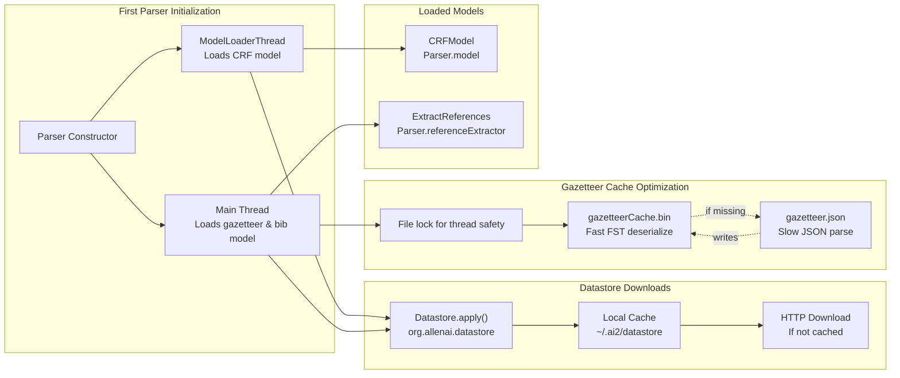

**Gazetteer Cache Optimization:**

The gazetteer JSON file takes significant time to parse. The Core Library creates a binary cache:
- Cache location: `/tmp/gazetteer.json-{hashcode}.gazetteerCache.bin`
- Uses FST (Fast Serialization) for rapid deserialization
- File locking ensures thread-safe creation
- Subsequent loads are ~100x faster

**Parallel Loading:**

The `Parser` constructor uses parallel loading for faster initialization:
1. Main model loads in a separate thread
2. Gazetteer and bibliography model load in the constructor thread
3. Constructor waits for both to complete before returning

**Sources:** [core/src/main/java/org/allenai/scienceparse/Parser.java:96-205](), [core/src/main/java/org/allenai/scienceparse/ExtractReferences.java:69-170]()

## Parsing Pipeline Flow

The following diagram shows the complete flow from PDF input to `ExtractedMetadata` output, with actual class and method names:

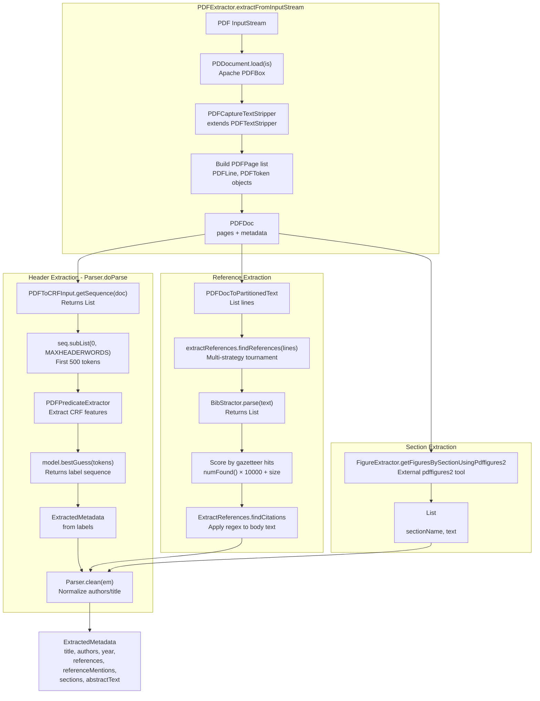

**Key Methods:**

| Method | Location | Purpose |
|--------|----------|---------|
| `Parser.doParse(InputStream)` | [Parser.java:940-979]() | Main entry point, orchestrates entire pipeline |
| `PDFExtractor.extractFromInputStream(InputStream)` | [PDFExtractor.java:119-192]() | Converts PDF bytes to `PDFDoc` structure |
| `PDFToCRFInput.getSequence(PDFDoc)` | Referenced in Parser | Converts `PDFDoc` to `List<PaperToken>` |
| `ExtractReferences.findReferences(List<String>)` | [ExtractReferences.java:517-537]() | Multi-strategy reference extraction |
| `ExtractReferences.findCitations(...)` | [ExtractReferences.java:397-460]() | Finds in-text citations |
| `Parser.clean(ExtractedMetadata)` | [Parser.java:816-819]() | Normalizes output |

**Sources:** [core/src/main/java/org/allenai/scienceparse/Parser.java:940-1060](), [core/src/main/java/org/allenai/scienceparse/pdfapi/PDFExtractor.java:119-192](), [core/src/main/java/org/allenai/scienceparse/ExtractReferences.java:397-537]()

## Component Responsibilities

### Parser Class

The `Parser` class is the main facade that coordinates all parsing operations. See [Parser Class](#2.1) for detailed documentation.

**Key Responsibilities:**
- Model loading and caching
- Timeout management for parsing operations
- Header metadata extraction using CRF models
- Coordination of reference extraction
- Result assembly into `ExtractedMetadata`

**Sources:** [core/src/main/java/org/allenai/scienceparse/Parser.java:84-1060]()

### PDFExtractor

Converts raw PDF bytes into structured `PDFDoc` objects with layout information. See [PDF Processing Pipeline](#2.2) for detailed documentation.

**Key Features:**
- Uses Apache PDFBox 2.0.9 for PDF rendering
- Extracts tokens with font metrics and bounding boxes
- Detects superscripts (e.g., citation markers)
- Handles heuristic title extraction when metadata is poor
- Outputs `PDFPage` → `PDFLine` → `PDFToken` hierarchy

**Sources:** [core/src/main/java/org/allenai/scienceparse/pdfapi/PDFExtractor.java:1-441]()

### ExtractReferences

Implements multi-strategy reference extraction with a tournament-based approach. See [Reference and Citation Extraction](#2.3) for detailed documentation.

**Strategy Implementations:**

| `BibStractor` Class | Citation Format | Example |
|---------------------|----------------|---------|
| `BracketNumber` | `[1]` | `[1] Smith, J. Title. Venue 2020.` |
| `NumberDot` | `1.` | `1. Smith, J. Title. Venue 2020.` |
| `NamedYear` | Author, Year | `Smith, J. 2020. Title. Venue.` |
| `BracketName` | `[Smith]` | `[Smith] Title. Venue 2020.` |
| `NumberCloseParen` | `1)` | `1) Smith, J. Title. Venue 2020.` |

**Sources:** [core/src/main/java/org/allenai/scienceparse/ExtractReferences.java:1-850]()

### CRFBibRecordParser

Uses CRF models to parse individual bibliography entries into structured `BibRecord` objects. See [Reference and Citation Extraction](#2.3) for detailed documentation.

**Key Features:**
- Loading cache with 10-minute TTL for parsed entries (max 10,240 entries)
- Handles Cora, UMass, and Kermit training data formats
- Extracts title, authors, venue, year from unstructured bibliography strings
- Fallback to regex-based parsers if CRF fails

**Sources:** [core/src/main/java/org/allenai/scienceparse/CRFBibRecordParser.java:1-273]()

### GazetteerFeatures

Provides entity gazetteers for feature extraction and validation. See [Gazetteer System](#2.6) for detailed documentation.

**Key Features:**
- Supports multiple gazetteer files (journals, person names, countries, etc.)
- Maximum span length: 7 words
- Uses long hash codes for memory efficiency
- Provides span-based matching over token sequences

**Sources:** [core/src/main/java/org/allenai/scienceparse/GazetteerFeatures.java:1-150]()

### CheckReferences

Validates extracted references against a known gazetteer of ~10,200 papers.

**Key Features:**
- Hash-based lookup using title + authors + year + venue
- Used for scoring in multi-strategy reference extraction
- Papers in gazetteer score 10,000× higher than unknown papers

**Sources:** [core/src/main/java/org/allenai/scienceparse/CheckReferences.java:1-54]()

## Output Data Structure

The primary output is `ExtractedMetadata`, which contains all extracted information:

```mermaid
graph TD
    subgraph "ExtractedMetadata Fields"
        Source["source: Source<br/>Where the paper came from"]
        Title["title: String<br/>Paper title"]
        Authors["authors: List<String><br/>Author names"]
        Year["year: int<br/>Publication year"]
        Abstract["abstractText: String<br/>Abstract text"]
        Creator["creator: String<br/>PDF creator software"]
        
        Sections["sections: List<Section><br/>Document sections"]
        References["references: List<BibRecord><br/>Bibliography entries"]
        Citations["referenceMentions: List<CitationRecord><br/>In-text citations"]
    end
    
    subgraph "Section Structure"
        SectionName["sectionName: String<br/>e.g., 'Introduction'"]
        SectionText["text: String<br/>Section body text"]
    end
    
    subgraph "BibRecord Structure"
        BibTitle["title: String<br/>Reference title"]
        BibAuthor["author: List<String><br/>Reference authors"]
        BibVenue["venue: String<br/>Conference or journal"]
        BibYear["year: int<br/>Publication year"]
        CiteRegex["citeRegEx: Pattern<br/>Regex to match citations"]
        ShortCiteRegex["shortCiteRegEx: Pattern<br/>For author-year style"]
    end
    
    subgraph "CitationRecord Structure"
        BibIndex["bibIndex: int<br/>Index into references list"]
        Context["context: String<br/>Sentence containing citation"]
        Start["start: int<br/>Character offset in context"]
        End["end: int<br/>Character offset in context"]
    end
    
    ExtractedMetadata --> Source
    ExtractedMetadata --> Title
    ExtractedMetadata --> Authors
    ExtractedMetadata --> Year
    ExtractedMetadata --> Abstract
    ExtractedMetadata --> Creator
    ExtractedMetadata --> Sections
    ExtractedMetadata --> References
    ExtractedMetadata --> Citations
    
    Sections --> SectionName
    Sections --> SectionText
    
    References --> BibTitle
    References --> BibAuthor
    References --> BibVenue
    References --> BibYear
    References --> CiteRegex
    References --> ShortCiteRegex
    
    Citations --> BibIndex
    Citations --> Context
    Citations --> Start
    Citations --> End
```

See [Data Models](#2.5) for detailed documentation of all data structures.

**Sources:** [core/src/main/java/org/allenai/scienceparse/ExtractedMetadata.java]() (referenced in Parser), [core/src/main/java/org/allenai/scienceparse/BibRecord.java]() (referenced in ExtractReferences), [core/src/main/java/org/allenai/scienceparse/CitationRecord.java]() (referenced in ExtractReferences)

## External Dependencies

The Core Library integrates with several key external libraries:

| Dependency | Version | Purpose |
|-----------|---------|---------|
| Apache PDFBox | 2.0.9 | PDF rendering and text extraction |
| allenai/ml | 0.16 | CRF models and machine learning infrastructure |
| allenai/pdffigures2 | 0.1.0 | Section extraction and figure detection |
| Apache OpenNLP | 1.7.2 | NLP utilities |
| allenai/datastore | 2.0.0 | Model file downloading and caching |
| GS Collections | 6.1.0 | High-performance collections |
| Lombok | 1.16.20 | Annotation processing for boilerplate |
| FST | 2.47 | Fast object serialization |

**Sources:** [core/build.sbt:1-49]()

## Thread Safety and Timeout Handling

The `Parser` class implements timeout protection for long-running parsing operations:

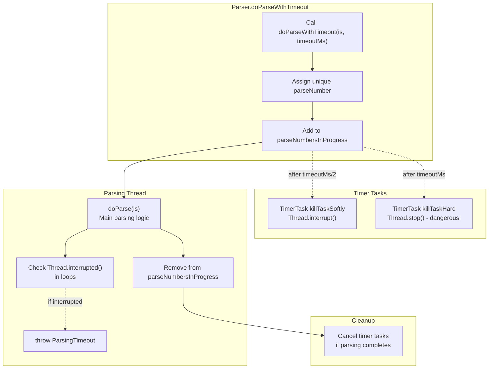

**Timeout Strategy:**
1. At `timeoutMs/2`: Send interrupt signal (`Thread.interrupt()`)
2. At `timeoutMs`: Force kill thread (`Thread.stop()` - dangerous but last resort)
3. Parsing code checks `Thread.interrupted()` in tight loops and throws `ParsingTimeout`

**Thread Safety:**
- `Parser.getInstance()` is synchronized for singleton creation
- `parseNumbersInProgress` uses `MutableIntSet` with synchronized access
- Model loading happens once during construction
- Parsing operations are thread-safe after initialization

**Sources:** [core/src/main/java/org/allenai/scienceparse/Parser.java:906-1060]()

## Training Support

The Core Library includes infrastructure for training new CRF models. See [Training and Evaluation](#5) for detailed documentation.

**Key Training Methods:**

| Method | Purpose |
|--------|---------|
| `Parser.trainParser(Iterator<LabeledPaper>, ParseOpts)` | Train main CRF model for title/author/year |
| `Parser.trainBibliographyCRF(File, ParseOpts)` | Train bibliography CRF model |
| `Parser.labelFromGroundTruth(...)` | Convert labeled papers to CRF training sequences |
| `Parser.saveModel(DataOutputStream, ...)` | Serialize trained models |
| `Parser.loadModel(DataInputStream)` | Deserialize models |

**Training Process:**
1. Load labeled data from ground truth sources (DBLP, PMC, etc.)
2. Convert PDFs to labeled token sequences
3. Split into train/test sets (default 90/10)
4. Train CRF model with early stopping (monitors test accuracy)
5. Serialize model with FST for fast loading

**Sources:** [core/src/main/java/org/allenai/scienceparse/Parser.java:262-706]()

---

# Page: Parser Class

# Parser Class

<details>
<summary>Relevant source files</summary>

The following files were used as context for generating this wiki page:

- [cli/README.md](cli/README.md)
- [core/README.md](core/README.md)
- [core/src/main/java/org/allenai/scienceparse/CheckReferences.java](core/src/main/java/org/allenai/scienceparse/CheckReferences.java)
- [core/src/main/java/org/allenai/scienceparse/ExtractReferences.java](core/src/main/java/org/allenai/scienceparse/ExtractReferences.java)
- [core/src/main/java/org/allenai/scienceparse/Parser.java](core/src/main/java/org/allenai/scienceparse/Parser.java)
- [core/src/main/java/org/allenai/scienceparse/pdfapi/PDFExtractor.java](core/src/main/java/org/allenai/scienceparse/pdfapi/PDFExtractor.java)
- [server/README.md](server/README.md)

</details>


## Purpose and Scope

This document describes the `Parser` class, the primary entry point for using Science Parse as a library. The `Parser` class coordinates PDF processing, CRF model inference, and reference extraction to produce structured metadata from academic papers. For information about the PDF processing pipeline that Parser invokes, see [PDF Processing Pipeline](#2.2). For details on reference extraction, see [Reference and Citation Extraction](#2.3). For training new models, see [Training the Main CRF Model](#5.1).

## Class Overview

The `Parser` class is located at [core/src/main/java/org/allenai/scienceparse/Parser.java:84-1106]() and serves as the facade for the entire parsing system. It loads and manages three critical model artifacts and coordinates their application to input PDFs.

**Key Responsibilities:**
- Loading CRF models for header extraction (title, authors, year)
- Loading bibliography models for reference parsing
- Loading gazetteer caches for entity recognition
- Providing synchronous and timeout-aware parsing methods
- Coordinating between `PDFExtractor`, CRF inference, and `ExtractReferences`

**Class Members:**

| Member | Type | Purpose |
|--------|------|---------|
| `model` | `CRFModel<String, PaperToken, String>` | Main CRF model for header extraction |
| `referenceExtractor` | `ExtractReferences` | Multi-strategy reference extraction system |
| `defaultParser` | `static Parser` | Singleton instance with default models |
| `parserKillerTimer` | `Timer` | Timer for enforcing parse timeouts |

Sources: [core/src/main/java/org/allenai/scienceparse/Parser.java:84-115]()

## Initialization and Model Loading

### Singleton Pattern

The `Parser` class provides a singleton accessor for the default configuration:

```java
public synchronized static Parser getInstance() throws Exception
```

This method lazy-initializes a single `Parser` instance with default model paths obtained from the datastore. The singleton pattern ensures model files are loaded only once per JVM process.

Sources: [core/src/main/java/org/allenai/scienceparse/Parser.java:110-115]()

### Model File Resolution

Default model paths are resolved through the AI2 Datastore system:

| Model | Method | Datastore Group | Version |
|-------|--------|----------------|---------|
| Production Model | `getDefaultProductionModel()` | `org.allenai.scienceparse` | 9 |
| Gazetteer | `getDefaultGazetteer()` | `org.allenai.scienceparse` | 5 |
| Bibliography Model | `getDefaultBibModel()` | `org.allenai.scienceparse` | 7 |

On first invocation, these methods download model files from the datastore and cache them locally. Subsequent calls use the cached versions.

Sources: [core/src/main/java/org/allenai/scienceparse/Parser.java:96-108]()

### Constructor and Parallel Loading

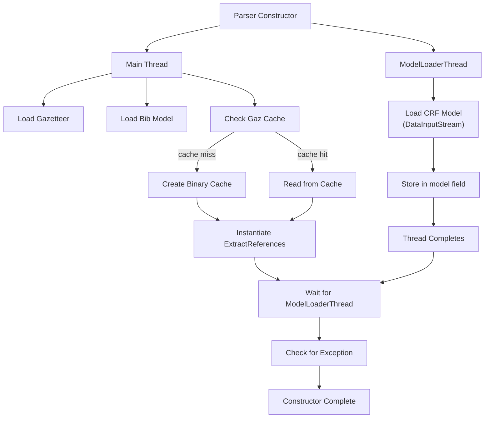

**Title:** Parser Initialization with Parallel Model Loading

The constructor [core/src/main/java/org/allenai/scienceparse/Parser.java:137-205]() implements parallel loading to reduce startup time:

1. **Model Loader Thread**: Spawned to load the main CRF model (typically 100-200 MB)
2. **Main Thread**: Loads gazetteer and bibliography model while model thread runs
3. **Gazetteer Cache Optimization**: Creates a binary serialized cache of the gazetteer JSON for faster subsequent loads
4. **Synchronization**: Constructor blocks until model loader thread completes and checks for exceptions

The gazetteer cache is stored in the system temp directory with the filename format:
```
{gazetteerFileName}-{pathHashCode}.gazetteerCache.bin
```

File locking ensures only one process creates the cache while others wait to read it.

Sources: [core/src/main/java/org/allenai/scienceparse/Parser.java:137-205]()

### Alternative Constructors

The class provides multiple constructor overloads:

| Constructor | Use Case |
|-------------|----------|
| `Parser()` | Default models from datastore |
| `Parser(String, String, String)` | Custom model file paths |
| `Parser(Path, Path, Path)` | Custom model paths as Path objects |
| `Parser(File, File, File)` | Custom model files as File objects |
| `Parser(InputStream, InputStream, InputStream)` | Custom model input streams (no caching) |

The stream-based constructor [core/src/main/java/org/allenai/scienceparse/Parser.java:207-218]() bypasses all caching mechanisms and is primarily used for testing.

Sources: [core/src/main/java/org/allenai/scienceparse/Parser.java:117-218]()

## Parsing Methods

### Core Parsing: doParse

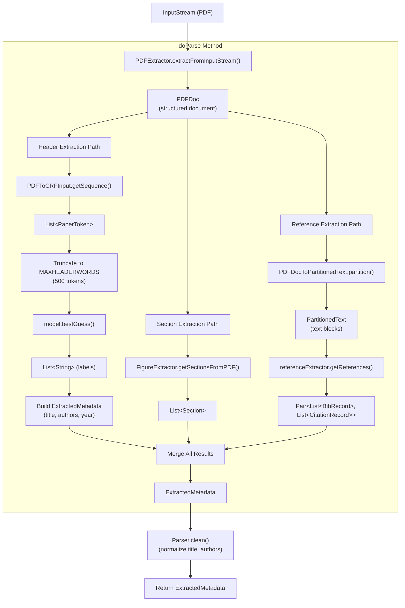

**Title:** doParse Method Execution Flow

The `doParse` method [core/src/main/java/org/allenai/scienceparse/Parser.java:969-1046]() orchestrates three parallel extraction pipelines:

1. **Header Extraction**:
   - Converts `PDFDoc` to token sequence via `PDFToCRFInput.getSequence()`
   - Truncates to first 500 tokens (`MAXHEADERWORDS`)
   - Applies CRF model to predict labels (TITLE, AUTHOR, YEAR, etc.)
   - Constructs `ExtractedMetadata` from labeled tokens

2. **Section Extraction**:
   - Invokes `pdffigures2` via `FigureExtractor.getSectionsFromPDF()`
   - Extracts section headings and body text
   - Returns `List<Section>` with hierarchical structure

3. **Reference Extraction**:
   - Converts `PDFDoc` to `PartitionedText` (text blocks)
   - Calls `referenceExtractor.getReferences()` (see [Reference and Citation Extraction](#2.3))
   - Returns `BibRecord` list (parsed bibliography) and `CitationRecord` list (in-text citations)

The method handles exceptions gracefully, returning partial results if any extraction path fails (e.g., references might be empty while headers succeed).

Sources: [core/src/main/java/org/allenai/scienceparse/Parser.java:969-1046]()

### Timeout-Aware Parsing: doParseWithTimeout

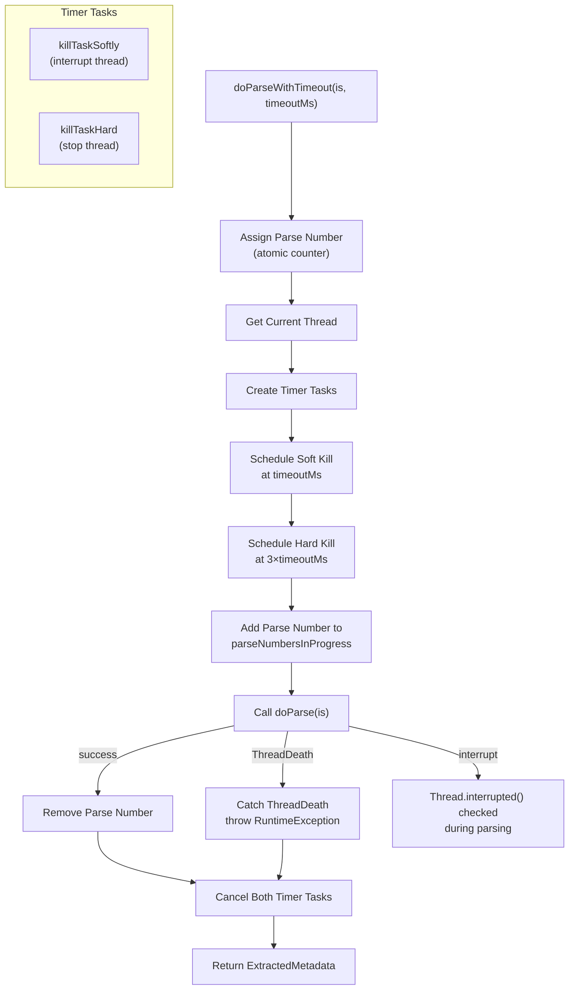

**Title:** Timeout Enforcement Mechanism

The timeout mechanism [core/src/main/java/org/allenai/scienceparse/Parser.java:910-967]() provides two-stage protection:

1. **Soft Kill (at timeout)**: Interrupts the parsing thread via `Thread.interrupt()`. Well-behaved parsing code checks `Thread.interrupted()` and throws `ParsingTimeout`.

2. **Hard Kill (at 3× timeout)**: Forcibly stops the thread via the deprecated `Thread.stop()`. This is a last resort that can leave the JVM in an inconsistent state but prevents infinite hangs.

**Parse Number Tracking**: Each parse receives a unique ID from an atomic counter. Timer tasks check if this ID is still in `parseNumbersInProgress` before killing the thread, preventing false kills after parsing completes.

**Exception Handling**:
- `ThreadDeath` is caught and wrapped in `RuntimeException`
- The method never throws checked exceptions
- Partial results are never returned on timeout (all-or-nothing)

Sources: [core/src/main/java/org/allenai/scienceparse/Parser.java:906-967]()

### Helper Methods

| Method | Purpose | Line Reference |
|--------|---------|----------------|
| `clean(ExtractedMetadata)` | Normalizes title (removes accents, XML entities) and trims authors | [816-819]() |
| `cleanTitle(String)` | Strips accents, XML entities, trailing periods | [821-832]() |
| `trimAuthors(List<String>)` | Splits on "and", removes Jr., filters by length (2-32 chars) | [894-904]() |
| `paperToString(File)` | Extracts raw text from PDF for debugging | [234-244]() |

Sources: [core/src/main/java/org/allenai/scienceparse/Parser.java:816-904]()

## Integration with Other Components

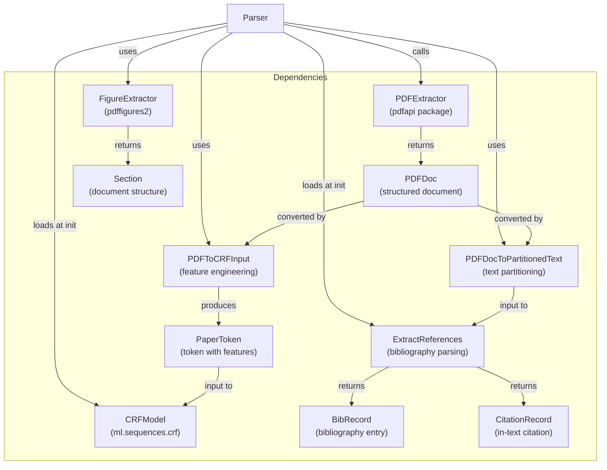

**Title:** Parser Dependencies and Component Integration

The `Parser` class acts as a coordinator that:

1. **Owns Model Lifecycle**: Loads CRF models once during construction and reuses them for all parse operations
2. **Delegates PDF Processing**: Relies on `PDFExtractor` for low-level PDF rendering via Apache PDFBox
3. **Orchestrates Feature Engineering**: Uses `PDFToCRFInput` to transform structured documents into CRF-compatible token sequences
4. **Coordinates Multi-Strategy Reference Extraction**: Delegates to `ExtractReferences` which runs a tournament of bibliography parsers
5. **Integrates External Tools**: Invokes `pdffigures2` (Scala) via `FigureExtractor` for section detection

This architecture allows the `Parser` to remain focused on orchestration while component classes handle specialized concerns.

Sources: [core/src/main/java/org/allenai/scienceparse/Parser.java:1-83](), [core/src/main/java/org/allenai/scienceparse/Parser.java:969-1046]()

## Static Training Methods

The `Parser` class also provides static methods for training new models. These are not part of normal inference workflows but are used during model development:

| Method | Purpose | Typical Invocation |
|--------|---------|-------------------|
| `trainParser(Iterator<LabeledPaper>, ParseOpts)` | Train main CRF model | From `org.allenai.scienceparse.Training` |
| `trainBibliographyCRF(File, ParseOpts)` | Train bibliography model | From `org.allenai.scienceparse.BibTraining` |
| `labelFromGroundTruth(...)` | Generate labeled training data | Internal to training methods |
| `saveModel(DataOutputStream, ...)` | Serialize trained model | Internal to training methods |
| `loadModel(DataInputStream)` | Deserialize model | Called during initialization |

These methods are documented in detail in [Training the Main CRF Model](#5.1) and [Training the Bibliography Model](#5.2).

Sources: [core/src/main/java/org/allenai/scienceparse/Parser.java:315-815]()

## Constants and Configuration

| Constant | Value | Purpose |
|----------|-------|---------|
| `MAXHEADERWORDS` | 500 | Maximum tokens to consider for header extraction |
| `DATA_VERSION` | "0.3" | Model serialization format version |
| `MAX_AUTHOR_LENGTH` | 32 | Maximum characters in an author name |
| `MIN_AUTHOR_LENGTH` | 2 | Minimum characters in an author name |

The `MAXHEADERWORDS` limit ensures CRF inference completes in reasonable time. Empirically, titles and author lists appear within the first 500 tokens of academic papers. This constant affects both training and inference.

Sources: [core/src/main/java/org/allenai/scienceparse/Parser.java:86-87](), [core/src/main/java/org/allenai/scienceparse/Parser.java:892-893]()

---

# Page: PDF Processing Pipeline

# PDF Processing Pipeline

<details>
<summary>Relevant source files</summary>

The following files were used as context for generating this wiki page:

- [.circleci/config.yml](.circleci/config.yml)
- [core/src/main/java/org/allenai/scienceparse/CheckReferences.java](core/src/main/java/org/allenai/scienceparse/CheckReferences.java)
- [core/src/main/java/org/allenai/scienceparse/ExtractReferences.java](core/src/main/java/org/allenai/scienceparse/ExtractReferences.java)
- [core/src/main/java/org/allenai/scienceparse/PDFDocToPartitionedText.java](core/src/main/java/org/allenai/scienceparse/PDFDocToPartitionedText.java)
- [core/src/main/java/org/allenai/scienceparse/PDFToCRFInput.java](core/src/main/java/org/allenai/scienceparse/PDFToCRFInput.java)
- [core/src/main/java/org/allenai/scienceparse/Parser.java](core/src/main/java/org/allenai/scienceparse/Parser.java)
- [core/src/main/java/org/allenai/scienceparse/pdfapi/PDFExtractor.java](core/src/main/java/org/allenai/scienceparse/pdfapi/PDFExtractor.java)
- [core/src/main/java/org/allenai/scienceparse/pdfapi/PDFFontMetrics.java](core/src/main/java/org/allenai/scienceparse/pdfapi/PDFFontMetrics.java)
- [core/src/main/scala/org/allenai/scienceparse/InterleavingIterator.scala](core/src/main/scala/org/allenai/scienceparse/InterleavingIterator.scala)
- [core/src/main/scala/org/allenai/scienceparse/Training.scala](core/src/main/scala/org/allenai/scienceparse/Training.scala)
- [core/src/test/java/org/allenai/scienceparse/PDFToCRFInputTest.java](core/src/test/java/org/allenai/scienceparse/PDFToCRFInputTest.java)
- [core/src/test/java/org/allenai/scienceparse/ParserTest.java](core/src/test/java/org/allenai/scienceparse/ParserTest.java)

</details>


This page documents the PDF extraction layer that converts raw PDF files into structured document representations. The `PDFExtractor` class and its associated data structures (`PDFDoc`, `PDFPage`, `PDFLine`, `PDFToken`) form the foundation for all downstream processing. For information about how these structured documents are used for metadata extraction, see [Parser Class](#2.1). For details on text partitioning and reference extraction, see [Reference and Citation Extraction](#2.3).

## Overview

The PDF processing pipeline transforms binary PDF files into hierarchical document structures that preserve layout information, font metrics, and geometric positioning. This structured representation enables both CRF-based machine learning models and rule-based heuristics to extract metadata.

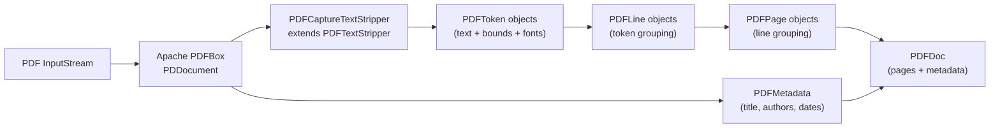

**Sources:** [core/src/main/java/org/allenai/scienceparse/pdfapi/PDFExtractor.java:1-440]()

## Entry Points

The `PDFExtractor` class provides three primary methods for PDF processing:

| Method | Return Type | Description |
|--------|-------------|-------------|
| `extractFromInputStream(InputStream)` | `PDFDoc` | Main entry point returning structured document |
| `extractResultFromInputStream(InputStream)` | `PdfDocExtractionResult` | Returns document plus precision flag |
| `extractResultFromPDDocument(PDDocument)` | `PdfDocExtractionResult` | Processes pre-loaded PDFBox document |

The `PdfDocExtractionResult` wrapper includes a `highPrecision` boolean flag indicating whether metadata was reliably extracted from PDF properties versus heuristically guessed.

**Sources:** [core/src/main/java/org/allenai/scienceparse/pdfapi/PDFExtractor.java:119-192]()

## Apache PDFBox Integration

The extraction process relies on Apache PDFBox's `PDDocument` and `PDFTextStripper` classes. The custom `PDFCaptureTextStripper` subclass intercepts PDFBox's text extraction callbacks to build the structured representation.

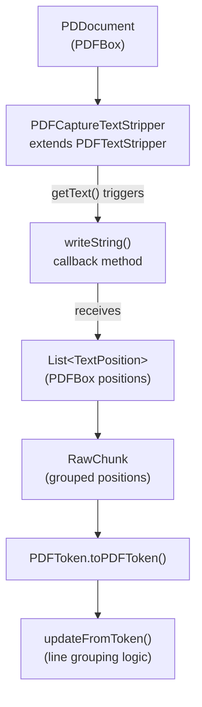

**Sources:** [core/src/main/java/org/allenai/scienceparse/pdfapi/PDFExtractor.java:337-439]()

## Text Extraction Process

### Token Construction

The `writeString()` callback receives `List<TextPosition>` from PDFBox. Each `TextPosition` represents a single character with:
- Unicode character
- X/Y coordinates
- Font information
- Width and height

Characters are grouped into tokens (words) by detecting whitespace:

[core/src/main/java/org/allenai/scienceparse/pdfapi/PDFExtractor.java:350-381]()

The `RawChunk.toPDFToken()` method handles several edge cases:

1. **Font size normalization**: PDFBox sometimes multiplies font sizes by 10; this is detected and corrected
2. **Superscript detection**: Characters above the baseline are marked with special delimiters `⍐` and `⍗`
3. **Ligand separation**: Unicode normalization (NFKC) separates ligands like "fi" into individual characters
4. **Bounding box calculation**: Min/max X/Y coordinates are computed across all character positions

[core/src/main/java/org/allenai/scienceparse/pdfapi/PDFExtractor.java:246-335]()

### Line Grouping

Tokens are grouped into lines based on Y-coordinate overlap and X-spacing. The `updateFromToken()` method implements this logic:

```mermaid
graph TD
    NewToken["New PDFToken"]
    CheckEmpty{"curLineTokens<br/>empty?"}
    YOverlap{"Y-coordinates<br/>overlap?"}
    WithinSpace{"X-gap < 4×<br/>spaceWidth?"}
    AddToLine["Add to current line"]
    NewLine["Start new line"]
    
    NewToken --> CheckEmpty
    CheckEmpty -- "yes" --> AddToLine
    CheckEmpty -- "no" --> YOverlap
    YOverlap -- "yes" --> WithinSpace
    YOverlap -- "no" --> NewLine
    WithinSpace -- "yes" --> AddToLine
    WithinSpace -- "no" --> NewLine
```

The Y-overlap check ensures tokens are vertically aligned:
```
(curTop >= lastTop && curTop <= lastBottom) ||
(curBottom >= lastTop && curBottom <= lastBottom)
```

The X-spacing check uses a tolerance of 4× the font's space width to handle variable-width fonts and justify-aligned text.

**Sources:** [core/src/main/java/org/allenai/scienceparse/pdfapi/PDFExtractor.java:383-409]()

### Page Grouping

Lines are grouped into pages by the `startPage()` and `endPage()` callbacks:

[core/src/main/java/org/allenai/scienceparse/pdfapi/PDFExtractor.java:413-438]()

Each page captures:
- List of `PDFLine` objects
- Page number (0-indexed)
- Page dimensions from `PDRectangle`

## Document Structure Hierarchy

The extraction produces a four-level hierarchy:

```mermaid
graph TD
    PDFDoc["PDFDoc"]
    Meta["PDFMetadata<br/>• title<br/>• authors<br/>• keywords<br/>• dates"]
    Pages["List&lt;PDFPage&gt;"]
    Page1["PDFPage<br/>• pageNumber<br/>• pageWidth<br/>• pageHeight"]
    Lines["List&lt;PDFLine&gt;"]
    Line1["PDFLine"]
    Tokens["List&lt;PDFToken&gt;"]
    Token1["PDFToken<br/>• token (String)<br/>• bounds (FloatList)<br/>• fontMetrics"]
    FontMetrics["PDFFontMetrics<br/>• name<br/>• ptSize<br/>• spaceWidth"]
    
    PDFDoc --> Meta
    PDFDoc --> Pages
    Pages --> Page1
    Page1 --> Lines
    Lines --> Line1
    Line1 --> Tokens
    Tokens --> Token1
    Token1 --> FontMetrics
```

### Data Structure Specifications

**PDFToken**
```
token: String           // Unicode text including superscripts
bounds: FloatList       // [minX, minY, maxX, maxY]
fontMetrics: PDFFontMetrics
```

**PDFFontMetrics**
```
name: String            // Font family + size + space width (uniqueness)
ptSize: float           // Point size (normalized if needed)
spaceWidth: float       // Width of space character
```

**PDFLine**
```
tokens: List<PDFToken>
```

**PDFPage**
```
lines: List<PDFLine>
pageNumber: int
pageWidth: int
pageHeight: int
```

**PDFDoc**
```
pages: List<PDFPage>
meta: PDFMetadata
```

**Sources:** [core/src/main/java/org/allenai/scienceparse/pdfapi/PDFExtractor.java:245-335](), [core/src/main/java/org/allenai/scienceparse/pdfapi/PDFFontMetrics.java:1-39]()

## Metadata Extraction

Metadata extraction operates in two stages: PDF property extraction and heuristic fallbacks.

### PDF Property Extraction

The `PDDocument.getDocumentInformation()` provides structured metadata:

[core/src/main/java/org/allenai/scienceparse/pdfapi/PDFExtractor.java:127-155]()

| Property | Extraction Method | Fallback |
|----------|------------------|----------|
| Title | `info.getTitle()` | Heuristic title extraction |
| Authors | `info.getAuthor()` | Parse by semicolon or comma |
| Keywords | `info.getKeywords()` | Parse by comma |
| Creator | `info.getCreator()` | None |
| CreateDate | Custom metadata `CREATION_DATE` | Parse "Date" or "Created" fields |

Author list parsing handles two formats:
- Semicolon-separated: `"Author1; Author2; Author3"`
- Comma-separated: `"Author1, Author2, Author3"`

[core/src/main/java/org/allenai/scienceparse/pdfapi/PDFExtractor.java:57-67]()

### Title Validation

PDF titles are validated against the extracted text to filter unreliable metadata:

**Title rejection criteria:**
1. Ends with `.pdf`, `.doc` (Microsoft Word artifacts)
2. Ends with `...` (truncated)
3. Starts with `"proceedings of"` (conference metadata)
4. Starts with `"arXiv:"` (arXiv identifier, not title)
5. No capitalized words present
6. Not found on first page

[core/src/main/java/org/allenai/scienceparse/pdfapi/PDFExtractor.java:73-105]()

## Heuristic Title Extraction

When PDF metadata is missing or invalid, the system attempts heuristic title extraction from the first page.

### Algorithm

The heuristic assumes titles use the largest font on the first page:

```mermaid
graph TD
    FirstPage["Get first page"]
    LargestFont["Find largest font size"]
    FindStart["Find first line with<br/>largest font"]
    FindStop["Find first line with<br/>smaller font"]
    ValidatePosition{"Line position<br/>&lt; 66% down page?"}
    ValidateIndex{"Line index<br/>&lt;= 5?"}
    CheckYGaps["Check Y-gaps between<br/>consecutive lines"]
    ValidateYGaps{"Y-gaps consistent?<br/>(diff &lt; 10%)"}
    Extract["Extract title lines"]
    Reject["Return null"]
    
    FirstPage --> LargestFont
    LargestFont --> FindStart
    FindStart --> FindStop
    FindStop --> ValidatePosition
    ValidatePosition -- "no" --> Reject
    ValidatePosition -- "yes" --> ValidateIndex
    ValidateIndex -- "no" --> Reject
    ValidateIndex -- "yes" --> CheckYGaps
    CheckYGaps --> ValidateYGaps
    ValidateYGaps -- "no" --> Reject
    ValidateYGaps -- "yes" --> Extract
```

**Implementation details:**

[core/src/main/java/org/allenai/scienceparse/pdfapi/PDFExtractor.java:194-238]()

The Y-gap validation detects multi-line titles by ensuring consistent line spacing. If consecutive lines have different spacing (normalized difference > 10%), only the first lines are used.

The position validation (66% threshold) prevents false positives from large-font text in the document body or footer.

**Sources:** [core/src/main/java/org/allenai/scienceparse/pdfapi/PDFExtractor.java:194-238]()

## Text Partitioning

The `PDFDocToPartitionedText` class converts structured `PDFDoc` objects into text representations for downstream processing.

### Raw Text Extraction

The `getRaw()` method produces a list of strings with line breaks marked by `<lb>`:

```mermaid
graph TD
    PDFDoc["PDFDoc"]
    Pages["Iterate pages"]
    Lines["Iterate lines"]
    CalcBreak["Calculate break size<br/>(Y-gap / line height)"]
    CompareThresh{"Break size ><br/>threshold?"}
    AppendLine["Append line + &lt;lb&gt;"]
    FlushBlock["Flush accumulated<br/>text to output"]
    
    PDFDoc --> Pages
    Pages --> Lines
    Lines --> CalcBreak
    CalcBreak --> CompareThresh
    CompareThresh -- "no" --> AppendLine
    CompareThresh -- "yes" --> FlushBlock
    FlushBlock --> AppendLine
```

The threshold is computed from the document's break size distribution:

[core/src/main/java/org/allenai/scienceparse/PDFDocToPartitionedText.java:115-121]()

This uses the 78th percentile of line breaks (7/9 quantile) as the threshold, which empirically separates paragraph breaks from line breaks within paragraphs.

**Sources:** [core/src/main/java/org/allenai/scienceparse/PDFDocToPartitionedText.java:42-121]()

### Column Detection and Repair

Multi-column layouts require special handling. The `repairColumns()` method detects and reorders column breaks:

**Detection criteria:**
- Gap width > 5× space width
- Gap center within 50× space width of page center
- At least 10 consistent gaps with positions within 3× space width

When detected, lines are re-sorted by: `1E8 × (column number) + Y-coordinate`

This ensures left-column lines appear before right-column lines at the same Y-position.

[core/src/main/java/org/allenai/scienceparse/PDFDocToPartitionedText.java:268-332]()

### Abstract Extraction

Two strategies extract abstracts:

1. **Explicit abstract sections**: Search for lines containing "abstract" with length < 10 characters
2. **First text block**: Extract the first substantial paragraph (> 400 characters) on the first page

The first-page partition threshold uses a different quantile (50th percentile + 0.5) to detect abstract boundaries more sensitively:

[core/src/main/java/org/allenai/scienceparse/PDFDocToPartitionedText.java:123-174]()

**Cleaning rules:**
- Remove inline "Abstract:" prefix
- Remove "Keywords:", "Key Words:", etc. suffixes
- Remove "Introduction" sections
- Remove "Categories and Subject Descriptors"
- Remove continuation dashes (`-<lb>` → empty string)

[core/src/main/java/org/allenai/scienceparse/PDFDocToPartitionedText.java:177-229]()

**Sources:** [core/src/main/java/org/allenai/scienceparse/PDFDocToPartitionedText.java:147-229]()

### Reference Section Extraction

The `getRawReferences()` method extracts bibliography entries with sophisticated formatting detection.

**Section identification:**
- Header-based: Lines ending with "References", "Citations", "Bibliography"
- Lenient mode: Lines starting with `[1]` or `1.` after first quarter of document

**Column processing:**
1. Split reference lines into columns (increasing Y-coordinates)
2. Detect indentation levels within each column
3. Find the indentation that starts references (most common or pattern-matching)
4. Detect vertical spacing patterns between references
5. Group lines by indentation and/or vertical spacing

**Indentation detection:**

[core/src/main/java/org/allenai/scienceparse/PDFDocToPartitionedText.java:441-499]()

The algorithm clusters similar indentation values (within one space width) and picks the less common indentation as the reference-start marker.

**Vertical spacing detection:**

[core/src/main/java/org/allenai/scienceparse/PDFDocToPartitionedText.java:502-534]()

Break sizes are measured in line heights and clustered within 0.1 line height tolerance. Only break sizes accounting for ≥20% of breaks and occurring more than once are considered.

**Splitting heuristics:**

References are split when:
1. 6 consecutive lines grouped (maximum reference length)
2. Indentation matches reference-start level
3. Line matches reference start pattern (`\d{1,2}(\.|\\s|$)|\\[.+?\\]`)
4. Vertical spacing exceeds detected break threshold

[core/src/main/java/org/allenai/scienceparse/PDFDocToPartitionedText.java:536-577]()

**Sources:** [core/src/main/java/org/allenai/scienceparse/PDFDocToPartitionedText.java:354-597]()

## Error Handling and Edge Cases

### Font Size Anomalies

PDFBox occasionally reports font sizes 10× larger than actual. Detection and correction:

[core/src/main/java/org/allenai/scienceparse/pdfapi/PDFExtractor.java:258-263]()

### Out-of-Phase Columns

Some PDFs have X-coordinates that decrease within a line (column ordering issues). Detection:

[core/src/main/java/org/allenai/scienceparse/pdfapi/PDFExtractor.java:356-362]()

### Superscript Citations

Citation superscripts are preserved by detecting characters above the Y-threshold:

[core/src/main/java/org/allenai/scienceparse/pdfapi/PDFExtractor.java:303-325]()

Only sequences matching the citation pattern are marked as superscripts to avoid false positives.

**Sources:** [core/src/main/java/org/allenai/scienceparse/pdfapi/PDFExtractor.java:246-335]()

## Configuration Options

The `PDFExtractor.Options` builder provides configuration:

| Option | Type | Default | Description |
|--------|------|---------|-------------|
| `useHeuristicTitle` | boolean | false | Enable heuristic title extraction when metadata absent |

[core/src/main/java/org/allenai/scienceparse/pdfapi/PDFExtractor.java:240-243]()

**Sources:** [core/src/main/java/org/allenai/scienceparse/pdfapi/PDFExtractor.java:40-49](), [core/src/main/java/org/allenai/scienceparse/pdfapi/PDFExtractor.java:240-243]()

---

# Page: Reference and Citation Extraction

# Reference and Citation Extraction

<details>
<summary>Relevant source files</summary>

The following files were used as context for generating this wiki page:

- [build.sbt](build.sbt)
- [cli/build.sbt](cli/build.sbt)
- [core/build.sbt](core/build.sbt)
- [core/src/main/java/org/allenai/scienceparse/CRFBibRecordParser.java](core/src/main/java/org/allenai/scienceparse/CRFBibRecordParser.java)
- [core/src/main/java/org/allenai/scienceparse/CheckReferences.java](core/src/main/java/org/allenai/scienceparse/CheckReferences.java)
- [core/src/main/java/org/allenai/scienceparse/ExtractReferences.java](core/src/main/java/org/allenai/scienceparse/ExtractReferences.java)
- [core/src/main/java/org/allenai/scienceparse/GazetteerFeatures.java](core/src/main/java/org/allenai/scienceparse/GazetteerFeatures.java)
- [core/src/main/java/org/allenai/scienceparse/Parser.java](core/src/main/java/org/allenai/scienceparse/Parser.java)
- [core/src/main/java/org/allenai/scienceparse/pdfapi/PDFExtractor.java](core/src/main/java/org/allenai/scienceparse/pdfapi/PDFExtractor.java)
- [server/build.sbt](server/build.sbt)

</details>


This page documents the multi-strategy reference extraction system in Science Parse Core. The system extracts bibliographic references from the reference section of papers and identifies in-text citations that link to those references. The approach uses a tournament of competing extraction strategies, each with fallback parsers, scored by a gazetteer of known papers to select the most reliable result.

For information about the CRF models used in bibliography parsing, see [Training the Bibliography Model](#5.2). For the overall parsing pipeline context, see [PDF Processing Pipeline](#2.2).

## Overview and Architecture

The reference extraction system operates in two phases: (1) **bibliography extraction** from the reference section using competing strategies, and (2) **citation finding** that locates in-text mentions using the winning strategy's patterns. The core class `ExtractReferences` orchestrates this process and maintains a gazetteer (`CheckReferences`) containing approximately 10,200 known papers for validation scoring.

```mermaid
graph TB
    subgraph "Input Processing"
        PDFDoc["PDFDoc<br/>(from PDFExtractor)"]
        PartText["PDFDocToPartitionedText.getPartitionedText()"]
        PDFDoc --> PartText
    end
    
    subgraph "ExtractReferences Class"
        FindRefs["findReferences()<br/>Line 517-537"]
        RefSection["refStart()<br/>Identify reference section"]
        Tournament["Strategy Tournament<br/>5-9 BibStractors compete"]
        Scoring["longestIdx()<br/>Score by gazetteer + count"]
        
        PartText --> FindRefs
        FindRefs --> RefSection
        RefSection --> Tournament
        Tournament --> Scoring
    end
    
    subgraph "BibStractor Strategies"
        BracketNum["BracketNumber<br/>[1] format"]
        NumDot["NumberDot<br/>1. format"]
        NamedYr["NamedYear<br/>Author, Year format"]
        BracketName["BracketName<br/>[Author] format"]
        NumParen["NumberCloseParen<br/>1) format"]
        
        Tournament --> BracketNum
        Tournament --> NumDot
        Tournament --> NamedYr
        Tournament --> BracketName
        Tournament --> NumParen
    end
    
    subgraph "Parser Chain"
        CRFParser["CRFBibRecordParser<br/>ML-based parsing"]
        RegexParser["Format-specific<br/>regex parsers"]
        
        BracketNum --> CRFParser
        NumDot --> CRFParser
        NamedYr --> CRFParser
        CRFParser -.->|"fallback"| RegexParser
        BracketName --> RegexParser
        NumParen --> RegexParser
    end
    
    subgraph "Validation & Scoring"
        CheckRefs["CheckReferences<br/>Gazetteer of 10.2K papers"]
        NumFound["numFound()<br/>Count gazetteer hits"]
        
        CRFParser --> NumFound
        RegexParser --> NumFound
        CheckRefs --> NumFound
        NumFound --> Scoring
    end
    
    subgraph "Citation Finding"
        FindCite["findCitations()<br/>Line 397-460"]
        ApplyRegex["Apply winning strategy<br/>citeRegex pattern"]
        ExtractCtx["Extract sentence context"]
        
        Scoring --> FindCite
        FindCite --> ApplyRegex
        ApplyRegex --> ExtractCtx
    end
    
    subgraph "Output"
        BibRecords["List<BibRecord><br/>Parsed bibliography"]
        CiteRecords["List<CitationRecord><br/>In-text mentions"]
        
        Scoring --> BibRecords
        ExtractCtx --> CiteRecords
    end
    
    style FindRefs fill:#f9f9f9
    style Tournament fill:#f9f9f9
    style CRFParser fill:#f9f9f9
    style CheckRefs fill:#f9f9f9
```

**Diagram: Reference Extraction Architecture**

Sources: [core/src/main/java/org/allenai/scienceparse/ExtractReferences.java:1-1000](), [core/src/main/java/org/allenai/scienceparse/Parser.java:220-231]()

## Strategy Tournament and Scoring

The `findReferences()` method implements a tournament where multiple `BibStractor` strategies compete to parse the reference section. Each strategy attempts to parse the text, and results are scored using a weighted heuristic that heavily favors verifiable results.

### BibStractor Strategies

Science Parse includes multiple `BibStractor` implementations, each targeting a specific bibliography format:

| Strategy Class | Format Pattern | Example | Parser Chain |
|---------------|----------------|---------|--------------|
| `BracketNumber` | `[1] Authors...` | [1] Smith, J. "Title." Venue 2020. | CRF → Regex |
| `NumberDot` | `1. Authors...` | 1. Smith, J. Title. Venue 2020. | CRF → Regex |
| `NumberDotNaturalLineBreaks` | `1. Authors...` (multiline) | 1. Smith<br/>Title<br/>2020 | CRF only |
| `NamedYear` | `Smith 2020. Title...` | SMITH, M. 2020. Title. Venue. | CRF → Regex |
| `BracketName` | `[Smith] Title...` | [Smith] Title. Venue 2020. | Regex only |
| `NumberCloseParen` | `1) Authors...` | 1) Smith J. Title. Venue 2020. | Regex only |

Each `BibStractor` maintains an array of `BibRecordParser` implementations that are tried in sequence until one succeeds. The most sophisticated strategies try `CRFBibRecordParser` first, then fall back to format-specific regex parsers.

Sources: [core/src/main/java/org/allenai/scienceparse/ExtractReferences.java:59-157](), [core/src/main/java/org/allenai/scienceparse/ExtractReferences.java:543-574]()

### Scoring Mechanism

The winning strategy is selected by `longestIdx()` using this scoring formula:

```
score = (numFound × 10,000) + totalReferences
```

Where:
- `numFound`: Count of bibliography entries found in the `CheckReferences` gazetteer (10,200+ known papers)
- `totalReferences`: Total number of references parsed

The 10,000× multiplier ensures that strategies producing verifiable results are strongly preferred over those that simply extract many entries. This heavily weights quality over quantity.

```mermaid
graph LR
    subgraph "Each Strategy Result"
        Bibs["List<BibRecord><br/>Parsed references"]
    end
    
    subgraph "Scoring Process"
        CheckEach["For each BibRecord"]
        CheckGaz["CheckReferences.hasPaper()<br/>Line 32-34"]
        CalcScore["score = hits × 10000 + size"]
        
        Bibs --> CheckEach
        CheckEach --> CheckGaz
        CheckGaz --> CalcScore
    end
    
    subgraph "Gazetteer Lookup"
        HashGen["getHashCode()<br/>Line 36-46"]
        HashCheck["paperHashCodes.contains()"]
        
        CheckGaz --> HashGen
        HashGen --> HashCheck
    end
    
    subgraph "Selection"
        Compare["Compare all scores"]
        Winner["Return highest-scoring<br/>strategy + results"]
        
        CalcScore --> Compare
        Compare --> Winner
    end
```

**Diagram: Strategy Scoring and Selection**

Sources: [core/src/main/java/org/allenai/scienceparse/ExtractReferences.java:462-483](), [core/src/main/java/org/allenai/scienceparse/CheckReferences.java:32-46]()

## Reference Section Identification

Before extraction begins, the system must locate the reference section within the document. The `refStart()` method uses header-based heuristics:

1. **Search region**: Starts searching from 1/3 into the document (most papers have references in the back third)
2. **Header patterns**: Looks for lines ending with: "References", "Citations", "Bibliography", or their capitalized variants
3. **Line break handling**: Also detects these keywords followed by `<lb>` (line break marker)
4. **Termination**: `refEnd()` stops extraction when encountering "Appendix"

The method returns the line index where references start, or -1 if no reference section is detected.

Sources: [core/src/main/java/org/allenai/scienceparse/ExtractReferences.java:354-366](), [core/src/main/java/org/allenai/scienceparse/ExtractReferences.java:486-491]()

## Bibliography Parsing

### CRF-Based Parsing

`CRFBibRecordParser` uses a trained Conditional Random Field model to parse bibliography entries. This is the most sophisticated parser and is tried first by most strategies.

**Key features**:
- **Caching**: Uses a Guava `LoadingCache` with 10-minute TTL and 10,240 entry capacity to avoid re-parsing identical bibliography entries
- **Tokenization**: Simple space-based tokenization (unlike the main parser's more sophisticated approach)
- **Label extraction**: Identifies author, title, venue, and year using CRF predictions
- **Fallback year detection**: If CRF misses the year, regex patterns search the venue and full line

```mermaid
graph TB
    subgraph "Input"
        BibLine["Bibliography line<br/>(string)"]
    end
    
    subgraph "Preprocessing"
        TrimCheck["Trim and length check<br/>Line 169-171"]
        ExtractNum["Extract cite number<br/>pBracket or pDot<br/>Line 172-186"]
        Tokenize["tokenize()<br/>Space-split<br/>Line 190-193"]
        
        BibLine --> TrimCheck
        TrimCheck --> ExtractNum
        ExtractNum --> Tokenize
    end
    
    subgraph "CRF Prediction"
        Cache["LoadingCache<br/>10 min TTL, 10K entries<br/>Line 153-163"]
        ModelPredict["model.bestGuess()<br/>CRF inference"]
        PadTags["padTagSequence()<br/>Line 200"]
        GetSpans["getSpans()<br/>Line 201"]
        
        Tokenize --> Cache
        Cache -.->|"cache miss"| ModelPredict
        ModelPredict --> PadTags
        PadTags --> GetSpans
    end
    
    subgraph "Field Extraction"
        ExtTitle["Extract title<br/>titleTag span"]
        ExtAuthor["Extract author<br/>authorTag span"]
        ExtVenue["Extract venue<br/>venueTag span"]
        ExtYear["Extract year<br/>yearTag span"]
        
        GetSpans --> ExtTitle
        GetSpans --> ExtAuthor
        GetSpans --> ExtVenue
        GetSpans --> ExtYear
    end
    
    subgraph "Year Fallback"
        YearNull["year == null?"]
        CheckVenue["Search venue<br/>for year pattern"]
        CheckLine["Search full line<br/>for year pattern"]
        
        ExtYear --> YearNull
        YearNull -.->|"yes"| CheckVenue
        CheckVenue -.->|"still null"| CheckLine
    end
    
    subgraph "Output Construction"
        BuildCiteRegex["Build citeRegEx<br/>from number or author+year"]
        CreateBibRecord["new BibRecord()<br/>Line 252-258"]
        Validate["Validate year != 0<br/>Line 262-263"]
        
        ExtAuthor --> BuildCiteRegex
        ExtYear --> BuildCiteRegex
        ExtractNum --> BuildCiteRegex
        
        ExtTitle --> CreateBibRecord
        ExtAuthor --> CreateBibRecord
        ExtVenue --> CreateBibRecord
        BuildCiteRegex --> CreateBibRecord
        CheckLine --> CreateBibRecord
        
        CreateBibRecord --> Validate
    end
```

**Diagram: CRFBibRecordParser Processing Flow**

The CRF model is trained on three datasets: Cora, UMass, and Kermit citation formats. Training data is preprocessed by `getLabeledLineCora()`, `getLabeledLineUMass()`, and `getLabeledLineKermit()` which map XML-tagged bibliography entries to labeled token sequences.

Sources: [core/src/main/java/org/allenai/scienceparse/CRFBibRecordParser.java:165-266](), [core/src/main/java/org/allenai/scienceparse/CRFBibRecordParser.java:153-163]()

### Regex-Based Parsers

When CRF parsing is unavailable or fails, format-specific regex parsers provide fallback extraction. Each parser implements the `BibRecordParser` interface with a single `parseRecord()` method.

**Example regex parsers**:

| Parser Class | Regex Pattern | Field Extraction |
|--------------|---------------|------------------|
| `BracketNumberBibRecordParser` | `\[(\d+)\] (authors)\. (title)\. (venue) (year)\.` | Groups 1-5 |
| `NumberDotYearParensBibRecordParser` | `(\d+)\. (authors): (title)\. (venue) \((year)\)\.` | Groups 1-5 |
| `NamedYearBibRecordParser` | `(authors) (year)\. (title)\. (venue)\.` | Groups 1-4 |
| `NumberCloseParenBibRecordParser` | `(\d+)\) (authors)\. (title)\. (venue) (year);` | Groups 1-5 |

Each regex parser includes detailed author name patterns like `authInitialsLastList` and `authGeneralList` that handle various author formatting conventions (e.g., "Smith J." vs "J. Smith" vs "Smith, J.").

Sources: [core/src/main/java/org/allenai/scienceparse/ExtractReferences.java:576-800]()

## Citation Finding

After selecting the winning bibliography extraction strategy, `findCitations()` searches the document body for in-text citations that reference the parsed bibliography entries.

### Citation Pattern Matching

The method uses the `citeRegex` from the winning `BibStractor` strategy to find citations. Common patterns include:

- **Numbered citations**: `[1]`, `(1)`, `[1,2,3]`, `[1-5]`
- **Author-year citations**: `Smith et al. (2020)`, `(Smith, 2020)`

```mermaid
graph TB
    subgraph "Input"
        Paper["List<String> paper<br/>Document lines"]
        Bibs["List<BibRecord><br/>Parsed bibliography"]
        Strategy["BibStractor<br/>Winning strategy"]
    end
    
    subgraph "Setup"
        RefStart["refStart()<br/>Find where refs begin"]
        GetRegex["getCiteRegex()<br/>from strategy"]
        GetDelim["getCiteDelimiter()<br/>from strategy"]
        
        Paper --> RefStart
        Strategy --> GetRegex
        Strategy --> GetDelim
    end
    
    subgraph "Line-by-Line Processing"
        IterLines["Iterate lines<br/>0 to refStart"]
        CleanLine["Replace -<lb> and <lb><br/>Line 407-408"]
        ApplyRegex["Regex match<br/>citeRegex pattern<br/>Line 409-410"]
        
        RefStart --> IterLines
        IterLines --> CleanLine
        CleanLine --> ApplyRegex
        GetRegex --> ApplyRegex
    end
    
    subgraph "Citation Extraction"
        ExtractMeat["Extract citationMeat<br/>group(1) or group(2)<br/>Line 411-413"]
        SplitCites["Split by delimiter<br/>Line 414"]
        
        ApplyRegex --> ExtractMeat
        ExtractMeat --> SplitCites
        GetDelim --> SplitCites
    end
    
    subgraph "Range Handling"
        CheckRange["Check for range<br/>1-5 pattern<br/>Line 416-417"]
        ExpandRange["Expand range<br/>st to end<br/>Line 418-427"]
        
        SplitCites --> CheckRange
        CheckRange -.->|"is range"| ExpandRange
    end
    
    subgraph "Lookup & Record"
        GetIdx["getIdxOf()<br/>Match to BibRecord<br/>Line 423, 430"]
        CreateRecord["new CitationRecord<br/>idx, context, start, end<br/>Line 425, 439"]
        
        ExpandRange --> GetIdx
        SplitCites --> GetIdx
        Bibs --> GetIdx
        GetIdx --> CreateRecord
    end
    
    subgraph "Short Citations"
        ShortRegex["getShortCiteRegex()<br/>Line 445"]
        ShortMatch["Match author+year<br/>Line 447-448"]
        ShortSearch["shortCiteSearch()<br/>Find in bibRecords<br/>Line 449-450"]
        
        Strategy --> ShortRegex
        ShortRegex -.->|"if not null"| ShortMatch
        ShortMatch --> ShortSearch
        ShortSearch --> CreateRecord
    end
```

**Diagram: Citation Finding Process**

### Citation Context Extraction

For each matched citation, the system captures the surrounding sentence as context. The context includes text from the citation's position up to the end of the sentence, which is then filtered to ensure minimum quality:

1. **Context extraction**: Captures text from the citation to the next sentence boundary (period, question mark, exclamation)
2. **Length filtering**: Context must be ≥35 characters to be meaningful
3. **Style grouping**: When a paper uses multiple citation styles, the system identifies and keeps only citations matching the predominant style

Sources: [core/src/main/java/org/allenai/scienceparse/ExtractReferences.java:397-460](), [core/src/main/java/org/allenai/scienceparse/ExtractReferences.java:368-375]()

### Short Citations

Some strategies support "short citations" (e.g., `Etzioni et al. (2005)`). The `shortCiteSearch()` method attempts to match these by:

1. Finding the year pattern in the text
2. Searching backward from the year for author names
3. Matching against `BibRecord.shortCiteRegEx` patterns
4. Returning the best match index and position

Sources: [core/src/main/java/org/allenai/scienceparse/ExtractReferences.java:377-394]()

## Data Structures

### BibRecord

Represents a single parsed bibliography entry with fields:

| Field | Type | Description |
|-------|------|-------------|
| `title` | `String` | Paper title (cleaned) |
| `author` | `List<String>` | Author names (normalized) |
| `venue` | `String` | Publication venue |
| `year` | `int` | Publication year (MINYEAR-MAXYEAR) |
| `citeRegEx` | `Pattern` | Regex pattern for finding citations |
| `shortCiteRegEx` | `Pattern` | Regex for short citations (optional) |

The class includes utility methods like `withNormalizedAuthors()` which applies `ExtractReferences.authorStringToList()` to normalize author name formats.

Sources: References to `BibRecord` class throughout [core/src/main/java/org/allenai/scienceparse/ExtractReferences.java]()

### CitationRecord

Represents an in-text citation mention with fields:

| Field | Type | Description |
|-------|------|-------------|
| `refID` | `int` | Index into `BibRecord` list |
| `context` | `String` | Sentence containing the citation |
| `startOffset` | `int` | Character offset where citation starts |
| `endOffset` | `int` | Character offset where citation ends |

This allows mapping each in-text citation back to its full bibliography entry and provides context for understanding how the citation is used.

## Cleaning and Validation

### Bibliography Cleaning

The `clean()` method [core/src/main/java/org/allenai/scienceparse/ExtractReferences.java:493-511]() filters extracted bibliography entries:

1. **Title cleaning**: Removes leading/trailing punctuation (except closing parentheses)
2. **Empty title removal**: Discards entries without titles
3. **Length validation**: Rejects entries with absurdly long fields (>512 characters for title/venue/author)

### Author Name Normalization

The `authorStringToList()` method [core/src/main/java/org/allenai/scienceparse/ExtractReferences.java:251-343]() handles diverse author formats:

1. **Punctuation normalization**: Removes trailing/leading punctuation
2. **Separator detection**: Identifies main separator (semicolon or comma)
3. **"and" replacement**: Converts "and" or "&" to the main separator
4. **Name reordering**: Detects "Last, First" vs "First Last" patterns and normalizes
5. **Empty string filtering**: Removes empty entries from splitting

This ensures consistent author representation regardless of the original bibliography format.

## Integration with Parser

The `Parser` class calls reference extraction through `getReferences()` [core/src/main/java/org/allenai/scienceparse/Parser.java:220-231]():

```mermaid
graph LR
    subgraph "Parser.doParse()"
        PDFDoc["PDFDoc<br/>from PDFExtractor"]
        GetPartText["PDFDocToPartitionedText<br/>getPartitionedText()"]
        CallGetRefs["Parser.getReferences()<br/>static method"]
    end
    
    subgraph "Parser.getReferences()"
        FindRefs["er.findReferences()<br/>rawReferences"]
        NormAuth["withNormalizedAuthors()<br/>on each BibRecord"]
        FindCites["findCitations()<br/>raw, brs, bs"]
    end
    
    subgraph "Output"
        BibRecords["List<BibRecord>"]
        CiteRecords["List<CitationRecord>"]
        Pair["Pair<List<BibRecord>,<br/>List<CitationRecord>>"]
    end
    
    PDFDoc --> GetPartText
    GetPartText --> CallGetRefs
    CallGetRefs --> FindRefs
    FindRefs --> NormAuth
    NormAuth --> FindCites
    
    NormAuth --> BibRecords
    FindCites --> CiteRecords
    BibRecords --> Pair
    CiteRecords --> Pair
```

**Diagram: Parser Integration**

The static method design allows reference extraction to be called independently of the main CRF-based header extraction, enabling parallel processing of different paper components.

Sources: [core/src/main/java/org/allenai/scienceparse/Parser.java:220-231]()

## Model Loading and Initialization

`ExtractReferences` requires three inputs for full functionality:

1. **Gazetteer file**: JSON file with known papers, loaded into `CheckReferences`
2. **Bibliography CRF model**: Trained model for `CRFBibRecordParser` (optional but recommended)
3. **Gazetteer cache**: Binary serialized cache created on first load for faster startup

The class supports gazetteer caching through `createAndWriteGazCache()` [core/src/main/java/org/allenai/scienceparse/ExtractReferences.java:159-170](). When the cache file exists, loading is nearly instantaneous; otherwise, parsing the JSON gazetteer takes significant time on first run.

The bibliography CRF model is loaded via `loadModel()` [core/src/main/java/org/allenai/scienceparse/ExtractReferences.java:172-210]() which reads:
- State space
- Node and edge feature indexers  
- Model weights
- Optional `ParserLMFeatures` and `GazetteerFeatures`

Sources: [core/src/main/java/org/allenai/scienceparse/ExtractReferences.java:85-157](), [core/src/main/java/org/allenai/scienceparse/ExtractReferences.java:172-210]()

## Performance Considerations

### Caching Strategies

1. **Gazetteer cache**: Binary serialization reduces load time from ~30 seconds to <1 second
2. **Bibliography parse cache**: `LoadingCache` with 10-minute expiry prevents re-parsing identical bibliography entries within a session
3. **Model singleton**: The bibliography CRF model is loaded once and reused

### Timeout Handling

Both `CRFBibRecordParser.parseRecord()` and `findCitations()` check `Thread.interrupted()` and throw `Parser.ParsingTimeout` to prevent runaway processing. This allows the calling code to enforce time limits on difficult documents.

Sources: [core/src/main/java/org/allenai/scienceparse/CRFBibRecordParser.java:166-167](), [core/src/main/java/org/allenai/scienceparse/ExtractReferences.java:421-422]()

### Parallel Execution

Reference extraction runs independently of header extraction in the main parsing pipeline, allowing parallel execution of these time-consuming operations. The reference extractor is thread-safe once initialized.

---

# Page: CRF Feature Engineering

# CRF Feature Engineering

<details>
<summary>Relevant source files</summary>

The following files were used as context for generating this wiki page:

- [.circleci/config.yml](.circleci/config.yml)
- [build.sbt](build.sbt)
- [cli/build.sbt](cli/build.sbt)
- [core/build.sbt](core/build.sbt)
- [core/src/main/java/org/allenai/scienceparse/CRFBibRecordParser.java](core/src/main/java/org/allenai/scienceparse/CRFBibRecordParser.java)
- [core/src/main/java/org/allenai/scienceparse/GazetteerFeatures.java](core/src/main/java/org/allenai/scienceparse/GazetteerFeatures.java)
- [core/src/main/java/org/allenai/scienceparse/PDFDocToPartitionedText.java](core/src/main/java/org/allenai/scienceparse/PDFDocToPartitionedText.java)
- [core/src/main/java/org/allenai/scienceparse/PDFToCRFInput.java](core/src/main/java/org/allenai/scienceparse/PDFToCRFInput.java)
- [core/src/main/java/org/allenai/scienceparse/pdfapi/PDFFontMetrics.java](core/src/main/java/org/allenai/scienceparse/pdfapi/PDFFontMetrics.java)
- [core/src/main/scala/org/allenai/scienceparse/InterleavingIterator.scala](core/src/main/scala/org/allenai/scienceparse/InterleavingIterator.scala)
- [core/src/main/scala/org/allenai/scienceparse/Training.scala](core/src/main/scala/org/allenai/scienceparse/Training.scala)
- [core/src/test/java/org/allenai/scienceparse/PDFToCRFInputTest.java](core/src/test/java/org/allenai/scienceparse/PDFToCRFInputTest.java)
- [core/src/test/java/org/allenai/scienceparse/ParserTest.java](core/src/test/java/org/allenai/scienceparse/ParserTest.java)
- [server/build.sbt](server/build.sbt)

</details>


## Purpose and Scope

This page explains how Science Parse converts PDF documents into feature sequences suitable for Conditional Random Field (CRF) model inference and training. This includes the tokenization process, the labeling scheme, ground truth generation, and the feature extraction mechanisms that enable the CRF model to identify titles, authors, years, and other metadata fields.

For information about the CRF model training process, see [Training the Main CRF Model](#5.1). For details on how the Parser class uses these sequences, see [Parser Class](#2.1).

---

## Pipeline Overview

The CRF feature engineering pipeline transforms structured PDF documents into labeled token sequences that the CRF model can process:

```mermaid
graph TD
    PDFDoc["PDFDoc<br/>(structured PDF)"]
    Tokens["getSequence()<br/>List&lt;PaperToken&gt;"]
    Padded["padSequence()<br/>Add &lt;S&gt; and &lt;/S&gt;"]
    
    subgraph "Training Mode"
        GroundTruth["LabeledData<br/>(ground truth)"]
        Labeled["labelMetadata()<br/>List&lt;Pair&lt;PaperToken, String&gt;&gt;"]
        GroundTruth --> Labeled
        Padded --> Labeled
    end
    
    subgraph "Inference Mode"
        Features["PaperToken features:<br/>- token text<br/>- position<br/>- font metrics<br/>- page/line"]
        Model["CRF Model"]
        Predictions["Predicted labels:<br/>B_T, I_T, E_T (title)<br/>B_A, E_A (author)<br/>W_Y (year)"]
        Padded --> Features
        Features --> Model
        Model --> Predictions
    end
    
    PDFDoc --> Tokens
    Tokens --> Padded
    
    style PDFDoc fill:#f9f9f9
    style Labeled fill:#f9f9f9
    style Predictions fill:#f9f9f9
```

**Sources:** [core/src/main/java/org/allenai/scienceparse/PDFToCRFInput.java:253-260](), [core/src/main/java/org/allenai/scienceparse/PDFToCRFInput.java:262-268](), [core/src/main/java/org/allenai/scienceparse/PDFToCRFInput.java:329-357]()

---

## Token Sequence Generation

The `PDFToCRFInput.getSequence()` method converts a `PDFDoc` into a flat sequence of `PaperToken` objects, preserving spatial and typographic information:

```mermaid
graph LR
    PDFDoc["PDFDoc"]
    Pages["pages: List&lt;PDFPage&gt;"]
    Lines["lines: List&lt;PDFLine&gt;"]
    PDFTokens["tokens: List&lt;PDFToken&gt;"]
    PaperTokens["PaperToken(token, lineNum, pageNum)"]
    
    PDFDoc --> Pages
    Pages --> Lines
    Lines --> PDFTokens
    PDFTokens --> PaperTokens
    
    style PaperTokens fill:#f9f9f9
```

Each `PaperToken` wraps a `PDFToken` and adds structural context:

| Field | Type | Description |
|-------|------|-------------|
| `pdfToken` | `PDFToken` | Contains token text and font metrics |
| `line` | `int` | Line number within the page |
| `page` | `int` | Page number in the document |

The sequence is then padded with special start/stop tokens (`<S>` and `</S>`) to provide boundary markers for the CRF model.

**Key Methods:**
- [core/src/main/java/org/allenai/scienceparse/PDFToCRFInput.java:253-260]() - `getSequence()`: Converts PDF pages to token sequence
- [core/src/main/java/org/allenai/scienceparse/PDFToCRFInput.java:193-201]() - `addLineTokens()`: Helper to accumulate tokens from lines
- [core/src/main/java/org/allenai/scienceparse/PDFToCRFInput.java:262-268]() - `padSequence()`: Adds boundary tokens

**Sources:** [core/src/main/java/org/allenai/scienceparse/PDFToCRFInput.java:193-268]()

---

## Labeling Scheme

Science Parse uses a **BIO-style labeling scheme** (Begin, Inside, End) with an extension for single-token spans (Whole):

```mermaid
graph TD
    subgraph "Label Prefixes"
        B["B_ = Begin<br/>First token of multi-token span"]
        I["I_ = Inside<br/>Middle tokens of span"]
        E["E_ = End<br/>Last token of multi-token span"]
        W["W_ = Whole<br/>Single-token span"]
        O["O = Outside<br/>Not part of any labeled span"]
    end
    
    subgraph "Label Types"
        T["_T = Title"]
        A["_A = Author"]
        Y["_Y = Year"]
        V["_V = Venue"]
    end
    
    subgraph "Example Labeling"
        Example["Token: 'Phrase generation in distributional semantics'<br/>B_T I_T I_T I_T E_T"]
        Author["Token: 'Marco Baroni'<br/>B_A E_A"]
        Year["Token: '2014'<br/>W_Y"]
    end
    
    style Example fill:#f9f9f9
    style Author fill:#f9f9f9
    style Year fill:#f9f9f9
```

The tag constants are defined in `ExtractedMetadata`:
- `ExtractedMetadata.titleTag` = "T"
- `ExtractedMetadata.authorTag` = "A"  
- `ExtractedMetadata.yearTag` = "Y"
- `ExtractedMetadata.venueTag` = "V"

**Label Generation Logic:**

For a span from index `start` to `end`:
- If `start == end - 1`: Single token → `W_<type>`
- If `start < end - 1`: Multi-token span
  - Token at `start`: `B_<type>`
  - Tokens between: `I_<type>`
  - Token at `end - 1`: `E_<type>`

**Sources:** [core/src/main/java/org/allenai/scienceparse/PDFToCRFInput.java:304-314](), [core/src/main/java/org/allenai/scienceparse/CRFBibRecordParser.java:68-86](), [core/src/test/java/org/allenai/scienceparse/PDFToCRFInputTest.java:64-72]()

---

## Ground Truth Labeling

During training, the `labelMetadata()` method automatically labels token sequences using ground truth from `LabeledData` objects:

```mermaid
graph TD
    LabeledData["LabeledData<br/>title, authors, year"]
    TokenSeq["List&lt;PaperToken&gt;<br/>(unlabeled sequence)"]
    
    subgraph "Labeling Process"
        InitO["Initialize all tokens<br/>with label 'O'"]
        FindTitle["findString(seq, title)<br/>Exact string matching"]
        FindAuthors["findAuthor(seq, author)<br/>Pattern-based matching"]
        ApplyLabels["Apply BIO labels<br/>to matched spans"]
    end
    
    LabeledSeq["List&lt;Pair&lt;PaperToken, String&gt;&gt;<br/>(labeled sequence)"]
    
    LabeledData --> FindTitle
    LabeledData --> FindAuthors
    TokenSeq --> InitO
    InitO --> FindTitle
    FindTitle --> FindAuthors
    FindAuthors --> ApplyLabels
    ApplyLabels --> LabeledSeq
    
    style LabeledSeq fill:#f9f9f9
```

The labeling process handles multiple complexities:

**1. Title Labeling (Exact Match)**
- Uses `findString()` to locate exact title matches [core/src/main/java/org/allenai/scienceparse/PDFToCRFInput.java:114-135]()
- Normalizes text using `StringUtils.normalize()` for case-insensitive comparison
- Must find title successfully for training example to be valid

**2. Author Labeling (Pattern Match)**
- Uses `findAuthor()` which applies flexible pattern matching [core/src/main/java/org/allenai/scienceparse/PDFToCRFInput.java:188-191]()
- Handles abbreviations, middle initials, and name variations
- See [Author Pattern Matching](#author-pattern-matching) below for details

**3. Labeling Application**
- Uses `findAndLabelWith()` to apply labels to matched spans [core/src/main/java/org/allenai/scienceparse/PDFToCRFInput.java:287-316]()
- Only labels the **first occurrence** of each ground truth string
- Adds `<S>` and `</S>` boundary tokens

**Sources:** [core/src/main/java/org/allenai/scienceparse/PDFToCRFInput.java:329-357](), [core/src/main/java/org/allenai/scienceparse/PDFToCRFInput.java:287-316]()

---

## Author Pattern Matching

Author names require flexible matching to handle abbreviations, middle initials, and formatting variations. The system converts author names to regular expression patterns:

```mermaid
graph TD
    AuthorName["Author: 'Marco C. Baroni'"]
    
    subgraph "Pattern Generation"
        Split["Split into tokens:<br/>['Marco', 'C.', 'Baroni']"]
        
        First["First token 'Marco':<br/>Pattern: M(((.)?)|([a-z]+))<br/>Optional: false"]
        
        Middle["Middle token 'C.':<br/>Pattern: C(((.)?)|([a-z]+))<br/>Optional: true"]
        
        Last["Last token 'Baroni':<br/>Pattern: Baroni((\\W)|[0-9])*<br/>Optional: false"]
    end
    
    Patterns["List&lt;Pair&lt;Pattern, Boolean&gt;&gt;"]
    
    subgraph "Matching Examples"
        Match1["✓ 'Marco C. Baroni'"]
        Match2["✓ 'Marco Baroni'<br/>(middle initial optional)"]
        Match3["✓ 'M. C. Baroni'<br/>(first name abbreviated)"]
        Match4["✓ 'Marco C Baroni'<br/>(period optional)"]
        NoMatch["✗ 'M. Baroni'<br/>(last name required)"]
    end
    
    AuthorName --> Split
    Split --> First
    Split --> Middle
    Split --> Last
    First --> Patterns
    Middle --> Patterns
    Last --> Patterns
    
    Patterns --> Match1
    Patterns --> Match2
    Patterns --> Match3
    Patterns --> Match4
    Patterns --> NoMatch
    
    style Patterns fill:#f9f9f9
    style Match1 fill:#e8f5e9
    style Match2 fill:#e8f5e9
    style Match3 fill:#e8f5e9
    style Match4 fill:#e8f5e9
    style NoMatch fill:#ffebee
```

**Pattern Generation Rules** ([core/src/main/java/org/allenai/scienceparse/PDFToCRFInput.java:137-186]()):

| Token Position | Pattern Logic | Optional |
|---------------|---------------|----------|
| First name | Allow abbreviation to first letter | **No** (required) |
| Middle tokens | Allow abbreviation and full expansion | **Yes** (optional) |
| Last name | Require full name, allow trailing markers | **No** (required) |

**Special Cases:**
1. **Single-letter abbreviations**: `"A."` → `A(((.)?)|([a-z]+))` - matches "A", "A.", or expanded form
2. **Two-name authors**: Automatically adds optional middle initial at position 1 [line 175-184]()
3. **Footnote markers**: Last name pattern allows non-alphanumeric suffixes like superscripts
4. **Period flexibility**: All abbreviations work with or without periods

The `findPatternEnd()` recursive matcher [core/src/main/java/org/allenai/scienceparse/PDFToCRFInput.java:30-54]() handles optional patterns by trying both skip and match at each position.

**Sources:** [core/src/main/java/org/allenai/scienceparse/PDFToCRFInput.java:137-191](), [core/src/test/java/org/allenai/scienceparse/PDFToCRFInputTest.java:83-114]()

---

## String Matching and Span Location

The system provides utilities to locate strings within token sequences:

**`findString()` - Exact Matching** [core/src/main/java/org/allenai/scienceparse/PDFToCRFInput.java:114-135]()
```
Input: ["How", "to", "make", "words", "with", "vectors"]
Query: "make words with"
Output: Pair(2, 5) - span from index 2 (inclusive) to 5 (exclusive)
```

**`findPatternSequence()` - Pattern Matching** [core/src/main/java/org/allenai/scienceparse/PDFToCRFInput.java:92-105]()
```
Input: ["M.", "G.", "Baroni"]
Pattern: [M(((.)?)|([a-z]+)), optional:[A-Z](\.)?, Baroni((\\W)|[0-9])*]
Output: Pair(0, 3) - matches with optional middle initial
```

Both methods:
- Normalize text using `StringUtils.normalize()` before comparison
- Return `Pair<Integer, Integer>` representing `[start, end)` span
- Return `null` if no match is found
- Use case-insensitive matching

**Sources:** [core/src/main/java/org/allenai/scienceparse/PDFToCRFInput.java:92-135]()

---

## Gazetteer Features

Gazetteers provide additional features by checking if token spans match known entities from curated lists:

```mermaid
graph LR
    subgraph "Gazetteer Storage"
        Files["Gazetteer files<br/>(one per category)"]
        HashSets["LongHashSet[]<br/>(hashed entries)"]
        Files --> HashSets
    end
    
    subgraph "Feature Extraction"
        TokenSpan["Token span:<br/>'University of Washington'"]
        Hash["StringLongHash.hash()<br/>Normalize & hash"]
        Lookup["Check hashSets[i].contains()"]
        Feature["boolean[] inSet:<br/>[false, true, false, ...]"]
        
        TokenSpan --> Hash
        Hash --> Lookup
        HashSets --> Lookup
        Lookup --> Feature
    end
    
    subgraph "Gazetteer Types"
        Journals["Journal names"]
        People["Person names"]
        Countries["Countries"]
        Institutions["Institutions"]
    end
    
    style HashSets fill:#f9f9f9
    style Feature fill:#f9f9f9
```

**Implementation Details:**

| Aspect | Implementation |
|--------|---------------|
| Storage | Array of `LongHashSet` - one per gazetteer category [core/src/main/java/org/allenai/scienceparse/GazetteerFeatures.java:31]() |
| Hashing | Custom `StringLongHash.hash()` for memory efficiency |
| Normalization | Lowercase, remove punctuation, trim [line 53-55]() |
| Max Length | `MAXLENGTH = 7` words [line 35]() |
| Lookup Method | `inSet(String s, int i)` checks single gazetteer [line 93]() |
| Bulk Lookup | `inSet(String s)` returns boolean array for all gazetteers [line 99]() |

**Multi-word Span Extraction** [core/src/main/java/org/allenai/scienceparse/GazetteerFeatures.java:127-147]():
- Checks all subspans from length 1 to `MAXLENGTH` 
- Uses sliding window over token sequence
- Returns `List<LabelSpan>` with all matches

The gazetteer features are particularly useful for:
1. **Reference parsing**: Identifying known journal/venue names
2. **Author disambiguation**: Checking against person name lists  
3. **Geographic information**: Matching country/city names
4. **Institutional affiliations**: Recognizing university/organization names

**Sources:** [core/src/main/java/org/allenai/scienceparse/GazetteerFeatures.java:28-149]()

---

## PaperToken Features

While the `PaperToken` class definition is not included in the provided files, its usage reveals the key features available to the CRF model:

**Spatial Features** (accessed via methods in `PDFToCRFInput`):
- `getX(PDFToken t, boolean left)` - Horizontal position [line 222-227]()
- `getY(PDFToken t, boolean upper)` - Vertical position [line 229-234]()
- `getXGap(PDFToken t1, PDFToken t2)` - Horizontal gap between tokens [line 211]()
- `getH(PDFLine l)` - Line height [line 236-244]()

**Typographic Features** (from `PDFFontMetrics`):
- Font name: `PDFFontMetrics.name` [core/src/main/java/org/allenai/scienceparse/pdfapi/PDFFontMetrics.java:17]()
- Point size: `PDFFontMetrics.ptSize` [line 18]()
- Space width: `PDFFontMetrics.spaceWidth` [line 19]()

**Structural Features**:
- Page number: Stored in `PaperToken.page`
- Line number: Stored in `PaperToken.line`
- Token text: Accessed via `PaperToken.getPdfToken().token` [core/src/main/java/org/allenai/scienceparse/PDFToCRFInput.java:360]()

These features enable the CRF model to learn patterns like:
- Titles typically appear in larger fonts
- Authors appear in specific positions relative to titles
- Line breaks indicate metadata boundaries
- Font changes signal section transitions

**Sources:** [core/src/main/java/org/allenai/scienceparse/PDFToCRFInput.java:204-244](), [core/src/main/java/org/allenai/scienceparse/pdfapi/PDFFontMetrics.java:1-38]()

---

## Bibliography CRF Features

The bibliography parsing system uses similar CRF feature engineering with domain-specific adaptations:

```mermaid
graph TD
    BibLine["Bibliography line:<br/>'[1] Smith, J. (2020). Title. Journal.'"]
    
    subgraph "Tokenization"
        Tokenize["tokenize()<br/>Split on spaces"]
        Tokens["['[1]', 'Smith,', 'J.', '(2020).', 'Title.', 'Journal.']"]
        Pad["Add &lt;S&gt; and &lt;/S&gt;"]
        Tokenize --> Tokens
        Tokens --> Pad
    end
    
    subgraph "CRF Model"
        Features["Token features:<br/>- text<br/>- position<br/>- patterns"]
        BibModel["CRFModel<br/>(bibliography-specific)"]
        Labels["['O', 'B_A', 'I_A', 'W_Y', 'B_T', 'I_T', 'B_V']"]
        Pad --> Features
        Features --> BibModel
        BibModel --> Labels
    end
    
    subgraph "Extraction"
        Spans["getSpans(labels)<br/>Group into fields"]
        BibRecord["BibRecord:<br/>- title<br/>- authors<br/>- venue<br/>- year"]
        Labels --> Spans
        Spans --> BibRecord
    end
    
    BibLine --> Tokenize
    
    style BibRecord fill:#f9f9f9
```

**Key Differences from Main Parser:**

| Aspect | Main Parser | Bibliography Parser |
|--------|-------------|---------------------|
| Input | Multi-page PDF structure | Single-line strings |
| Labels | T, A, Y | T (title), A (author), V (venue), Y (year), plus others |
| Tokenization | PDF token objects | Simple space-splitting [core/src/main/java/org/allenai/scienceparse/CRFBibRecordParser.java:147-151]() |
| Model | General metadata model | Bibliography-specific model |
| Caching | Not cached | `LoadingCache` with 10-minute TTL [line 153-163]() |

**Training Data Formats:**

The bibliography parser supports three labeled data formats:
1. **Cora format** [line 94-102]() - Uses tags like `<author>`, `<title>`, `<date>`
2. **UMass format** [line 31-41]() - Uses tags like `<authors>`, `<booktitle>`, `<year>`
3. **Kermit format** [line 105-119]() - TEI-style XML with `<title level="a">` variants

All formats are converted to the same internal BIO labeling scheme via `labelAccordingToTags()` [line 44-92]().

**Sources:** [core/src/main/java/org/allenai/scienceparse/CRFBibRecordParser.java:1-273]()

---

## Utility Methods

**String Reconstruction** [core/src/main/java/org/allenai/scienceparse/PDFToCRFInput.java:363-381]():
- `stringAt(List<PaperToken> toks, Pair<Integer, Integer> span)` - Extracts text from token span
- `stringAtForStringList(List<String> toks, Pair<Integer, Integer> span)` - String list variant
- `appendStringList(List<String> toks)` - Concatenates tokens with spaces

**Sequence Manipulation**:
- `asStringList(List<PaperToken> toks)` - Converts PaperTokens to plain strings [line 359-361]()
- `padTagSequence(List<String> seq)` - Adds boundary tags to label sequence [line 270-276]()
- `getLabelString(List<Pair<PaperToken, String>> seq)` - Extracts label sequence for debugging [line 383-385]()

**Span Extraction** (in `ExtractedMetadata`):
- `getSpans(List<String> labels)` - Converts BIO labels to span objects with tag and location

These utilities bridge between different representations (tokens, strings, labels, spans) used throughout the CRF pipeline.

**Sources:** [core/src/main/java/org/allenai/scienceparse/PDFToCRFInput.java:359-386](), [core/src/test/java/org/allenai/scienceparse/PDFToCRFInputTest.java:75-81]()

---

## Training Data Flow

During model training, labeled papers flow through the feature engineering pipeline:

```mermaid
graph TD
    Sources["Training sources:<br/>- DBLP<br/>- PMC<br/>- Ground truth files"]
    
    Iterator["Iterator&lt;LabeledPaper&gt;"]
    
    subgraph "Per-Paper Processing"
        PDF["Download/load PDF"]
        Extract["PDFExtractor<br/>Create PDFDoc"]
        Sequence["getSequence()<br/>PaperToken list"]
        Label["labelMetadata()<br/>Attach ground truth labels"]
        Valid{"Valid<br/>labeling?"}
        Accept["Accept for training"]
        Reject["Reject (skip)"]
    end
    
    Train["CRF Training:<br/>- Feature extraction<br/>- Weight optimization<br/>- Early stopping"]
    
    Model["Trained model .dat file"]
    
    Sources --> Iterator
    Iterator --> PDF
    PDF --> Extract
    Extract --> Sequence
    Sequence --> Label
    Label --> Valid
    Valid -->|Yes| Accept
    Valid -->|No| Reject
    Accept --> Train
    Train --> Model
    
    style Model fill:#f9f9f9
```

**Validation Rules:**

A labeled example is accepted for training only if:
1. Title is successfully found in the document [core/src/main/java/org/allenai/scienceparse/PDFToCRFInput.java:350]()
2. At least one author is found (if authors provided)
3. Token sequence is non-empty
4. LabeledData contains required fields [line 335-342]()

**Training Configuration** [core/src/main/scala/org/allenai/scienceparse/Training.scala:18-31]():
- `maxIterations`: Maximum CRF training iterations (default: 1000)
- `trainFraction`: Train/test split ratio (default: 0.9)
- `minExpectedFeatureCount`: Minimum feature frequency threshold (default: 13)
- `maxPaperCount`: Maximum documents to use (default: 34,000)
- `backgroundSampleDocs`: Documents for background language model (default: 40,000)

Invalid examples (where labeling fails) are silently skipped, logged with `log.debug()` messages.

**Sources:** [core/src/main/java/org/allenai/scienceparse/PDFToCRFInput.java:329-357](), [core/src/main/scala/org/allenai/scienceparse/Training.scala:14-133](), [core/src/test/java/org/allenai/scienceparse/ParserTest.java:119-124]()

---

# Page: Data Models

# Data Models

<details>
<summary>Relevant source files</summary>

The following files were used as context for generating this wiki page:

- [core/src/main/java/org/allenai/scienceparse/BibRecord.java](core/src/main/java/org/allenai/scienceparse/BibRecord.java)
- [core/src/main/java/org/allenai/scienceparse/CheckReferences.java](core/src/main/java/org/allenai/scienceparse/CheckReferences.java)
- [core/src/main/java/org/allenai/scienceparse/CitationRecord.java](core/src/main/java/org/allenai/scienceparse/CitationRecord.java)
- [core/src/main/java/org/allenai/scienceparse/ExtractReferences.java](core/src/main/java/org/allenai/scienceparse/ExtractReferences.java)
- [core/src/main/java/org/allenai/scienceparse/Parser.java](core/src/main/java/org/allenai/scienceparse/Parser.java)
- [core/src/main/java/org/allenai/scienceparse/pdfapi/PDFExtractor.java](core/src/main/java/org/allenai/scienceparse/pdfapi/PDFExtractor.java)
- [core/src/main/scala/org/allenai/scienceparse/JsonProtocol.scala](core/src/main/scala/org/allenai/scienceparse/JsonProtocol.scala)
- [core/src/main/scala/org/allenai/scienceparse/LabeledData.scala](core/src/main/scala/org/allenai/scienceparse/LabeledData.scala)
- [core/src/test/scala/org/allenai/scienceparse/JsonProtocolSpec.scala](core/src/test/scala/org/allenai/scienceparse/JsonProtocolSpec.scala)
- [server/src/main/scala/org/allenai/scienceparse/FeedbackStore.scala](server/src/main/scala/org/allenai/scienceparse/FeedbackStore.scala)
- [server/src/main/scala/org/allenai/scienceparse/SPServer.scala](server/src/main/scala/org/allenai/scienceparse/SPServer.scala)

</details>


## Purpose and Scope

This page documents the core data structures used throughout Science Parse to represent academic papers, their metadata, bibliographies, and citations. These models serve as both input (ground truth) and output (parsing results) formats for the system.

For information about how these models are populated from PDFs, see [Parser Class](#2.1) and [Reference and Citation Extraction](#2.3). For PDF-level structures used during extraction, see [PDF Processing Pipeline](#2.2). For JSON serialization details for the REST API, see [REST API Endpoints](#3.1).

---

## Model Hierarchy and Relationships

```mermaid
graph TB
    subgraph "Primary Output Models"
        EM["ExtractedMetadata"]
        LD["LabeledData"]
    end
    
    subgraph "Metadata Components"
        Auth["LabeledData.Author"]
        Sect["Section<br/>(Java & Scala)"]
    end
    
    subgraph "Bibliography Components"
        BibRec["BibRecord"]
        CiteRec["CitationRecord"]
        LDRef["LabeledData.Reference"]
        LDMent["LabeledData.Mention"]
        Range["LabeledData.Range"]
    end
    
    EM -->|"contains"| Sect
    EM -->|"contains"| BibRec
    EM -->|"contains"| CiteRec
    
    LD -->|"contains"| Auth
    LD -->|"contains"| Sect
    LD -->|"contains"| LDRef
    LD -->|"contains"| LDMent
    
    LDMent -->|"references"| LDRef
    LDMent -->|"location in"| Sect
    LDMent -->|"text range"| Range
    
    CiteRec -->|"references by ID"| BibRec
    
    EM -.->|"LabeledData.fromExtractedMetadata"| LD
    
    style EM fill:#e1f5ff
    style LD fill:#ffe1e1
    style BibRec fill:#fff4e1
    style CiteRec fill:#fff4e1
```

**Sources:** [core/src/main/scala/org/allenai/scienceparse/LabeledData.scala:94-145](), [core/src/main/java/org/allenai/scienceparse/BibRecord.java:1-87](), [core/src/main/java/org/allenai/scienceparse/CitationRecord.java:1-36]()

---

## Primary Output Models

### ExtractedMetadata

`ExtractedMetadata` is the main output format from the `Parser.doParse()` method. It represents the complete extracted information from a PDF, serialized as JSON for the REST API.

```mermaid
classDiagram
    class ExtractedMetadata {
        +Source source
        +String title
        +List~String~ authors
        +List~String~ emails
        +List~Section~ sections
        +List~BibRecord~ references
        +List~CitationRecord~ referenceMentions
        +int year
        +String abstractText
        +String creator
    }
    
    class Source {
        <<enumeration>>
        META
        HEURISTIC
        CRF
    }
    
    ExtractedMetadata --> Source
    ExtractedMetadata --> Section
    ExtractedMetadata --> BibRecord
    ExtractedMetadata --> CitationRecord
```

| Field | Type | Description |
|-------|------|-------------|
| `source` | `Source` enum | How the title was extracted: `META` (PDF metadata), `HEURISTIC` (font-based), or `CRF` (machine learning) |
| `title` | `String` | Paper title |
| `authors` | `List<String>` | Author names as strings |
| `emails` | `List<String>` | Author email addresses (rarely populated) |
| `sections` | `List<Section>` | Document sections with headings and text |
| `references` | `List<BibRecord>` | Bibliography entries |
| `referenceMentions` | `List<CitationRecord>` | In-text citations |
| `year` | `int` | Publication year (0 if not found) |
| `abstractText` | `String` | Abstract text |
| `creator` | `String` | PDF creator software |

**Key Methods:**
- Constructor takes title, authors, and labeled tokens/labels to populate fields automatically

**JSON Format:** See [server/src/main/scala/org/allenai/scienceparse/JsonProtocol.scala:125-178]()

**Sources:** [core/src/main/java/org/allenai/scienceparse/Parser.java:816-819](), [server/src/main/scala/org/allenai/scienceparse/SPServer.scala:285-326](), [core/src/main/scala/org/allenai/scienceparse/JsonProtocol.scala:125-178]()

---

### LabeledData

`LabeledData` is used for both ground truth (training/evaluation) and parsed output. It supports optional fields, making it suitable for partially-labeled data.

```mermaid
classDiagram
    class LabeledData {
        +String id
        +Option~String~ title
        +Option~Seq~Author~~ authors
        +Option~String~ venue
        +Option~Int~ year
        +Option~String~ abstractText
        +Option~Seq~Section~~ sections
        +Option~Seq~Reference~~ references
        +Option~Seq~Mention~~ mentions
        +javaYear() OptionalInt
        +javaTitle() Optional~String~
        +javaAuthors() Optional~Collection~Author~~
    }
    
    class Author {
        +String name
        +Option~String~ email
        +Seq~String~ affiliations
    }
    
    class Reference {
        +Option~String~ label
        +Option~String~ title
        +Seq~String~ authors
        +Option~String~ venue
        +Option~Int~ year
        +Option~String~ volume
        +Option~(String,String)~ pageRange
    }
    
    class Mention {
        +Reference reference
        +String text
        +Option~(Section,Range)~ inContext
    }
    
    class Range {
        +int start
        +int end
    }
    
    LabeledData --> Author
    LabeledData --> Section
    LabeledData --> Reference
    LabeledData --> Mention
    Mention --> Reference
    Mention --> Range
```

**Key Characteristics:**
- All fields except `id` are `Option` types, allowing partial labeling
- Conversion from `ExtractedMetadata` via `LabeledData.fromExtractedMetadata()`
- Used by training pipeline, evaluation, and feedback system
- Supports Java interop with `javaYear()`, `javaTitle()`, `javaAuthors()` methods

**Nested Types:**

| Type | Fields | Description |
|------|--------|-------------|
| `Author` | `name`, `email`, `affiliations` | Represents a paper author with contact and affiliation info |
| `Section` | `heading`, `text` | Document section with optional heading |
| `Reference` | `label`, `title`, `authors`, `venue`, `year`, `volume`, `pageRange` | Bibliography entry with structured fields |
| `Range` | `start`, `end` | Integer offset range in text |
| `Mention` | `reference`, `text`, `inContext` | In-text citation with context and location |

**Sources:** [core/src/main/scala/org/allenai/scienceparse/LabeledData.scala:94-145](), [core/src/main/scala/org/allenai/scienceparse/LabeledData.scala:147-178]()

---

## Bibliography and Citation Models

### BibRecord

`BibRecord` represents a bibliography entry extracted from the references section. It includes regex patterns for matching in-text citations.

```mermaid
classDiagram
    class BibRecord {
        +String title
        +List~String~ author
        +String venue
        +Pattern citeRegEx
        +Pattern shortCiteRegEx
        +int year
        +MINYEAR = 1800
        +MAXYEAR = current + 10
        +withNormalizedAuthors() BibRecord
        +withTitle(String) BibRecord
        +withoutSuperscripts() BibRecord
    }
```

| Field | Type | Description |
|-------|------|-------------|
| `title` | `String` | Paper title |
| `author` | `List<String>` | Author names |
| `venue` | `String` | Publication venue (journal, conference, etc.) |
| `citeRegEx` | `Pattern` | Regex pattern to match full citations (e.g., `"[1]"`, `"Etzioni, 2005"`) |
| `shortCiteRegEx` | `Pattern` | Regex pattern to match short citations (e.g., `"Etzioni et al."`) |
| `year` | `int` | Publication year |

**Key Methods:**
- `withNormalizedAuthors()` - Normalizes author initials (e.g., `"C. M."` → `"C.M."`) and filters `"et al"`
- `withTitle(String)` - Returns new instance with updated title
- `withoutSuperscripts()` - Strips superscript tags (`⍐`, `⍗`) from all text fields

**Regex Pattern Usage:**
The `citeRegEx` and `shortCiteRegEx` patterns are generated by bibliography parsers based on the citation format detected. They enable `ExtractReferences.findCitations()` to locate in-text references.

**Sources:** [core/src/main/java/org/allenai/scienceparse/BibRecord.java:1-87](), [core/src/main/java/org/allenai/scienceparse/ExtractReferences.java:396-460]()

---

### CitationRecord

`CitationRecord` represents an in-text citation that references a `BibRecord` entry.

```mermaid
classDiagram
    class CitationRecord {
        +int referenceID
        +String context
        +int startOffset
        +int endOffset
        +withContext(String) CitationRecord
        +withConvertedSuperscriptTags() CitationRecord
    }
```

| Field | Type | Description |
|-------|------|-------------|
| `referenceID` | `int` | Index into the `references` list in `ExtractedMetadata` |
| `context` | `String` | The sentence or text containing the citation |
| `startOffset` | `int` | Character offset where citation starts in `context` |
| `endOffset` | `int` | Character offset where citation ends in `context` |

**Key Methods:**
- `withContext(String)` - Returns new instance with updated context (using Lombok's `@Wither`)
- `withConvertedSuperscriptTags()` - Converts superscript tags to parentheses for display

**Example:**
```
context: "As shown by [1], deep learning is effective."
startOffset: 14
endOffset: 17
referenceID: 0  // References the first BibRecord
```

**Sources:** [core/src/main/java/org/allenai/scienceparse/CitationRecord.java:1-36](), [core/src/main/java/org/allenai/scienceparse/ExtractReferences.java:396-460]()

---

### Section

`Section` represents a document section with optional heading. There are two implementations: Java and Scala versions that are interchangeable.

```mermaid
classDiagram
    class Section {
        +String heading
        +String text
    }
    
    class LabeledDataSection {
        +Option~String~ heading
        +String text
    }
    
    Section <.. LabeledDataSection : "similar semantics"
```

| Field | Type | Description |
|-------|------|-------------|
| `heading` | `String` or `Option[String]` | Section heading (e.g., "Introduction", "Methods") |
| `text` | `String` | Section body text |

**Usage:**
- Java `Section` is used in `ExtractedMetadata.sections`
- Scala `LabeledData.Section` is used in `LabeledData.sections`
- Both are serialized identically via `JsonProtocol`

**Sources:** [core/src/main/scala/org/allenai/scienceparse/JsonProtocol.scala:48-61](), [core/src/main/scala/org/allenai/scienceparse/LabeledData.scala:125]()

---

## Model Conversions

```mermaid
graph LR
    subgraph "Input Sources"
        PDF["PDF InputStream"]
        PMC["PMC XML Files"]
        DBLP["DBLP JSON"]
    end
    
    subgraph "Parsing"
        Parser["Parser.doParse()"]
        PMCParser["LabeledPapersFromPMC"]
        DBLPParser["LabeledPapersFromDBLP"]
    end
    
    subgraph "Output Models"
        EM["ExtractedMetadata"]
        LD["LabeledData"]
    end
    
    PDF -->|"parse"| Parser
    Parser --> EM
    
    PMC --> PMCParser
    DBLP --> DBLPParser
    PMCParser --> LD
    DBLPParser --> LD
    
    EM -.->|"LabeledData.fromExtractedMetadata"| LD
    LD -.->|"for corrections API"| EM
    
    style EM fill:#e1f5ff
    style LD fill:#ffe1e1
```

**Conversion Methods:**

| Method | Direction | Purpose |
|--------|-----------|---------|
| `LabeledData.fromExtractedMetadata(String, ExtractedMetadata)` | `ExtractedMetadata` → `LabeledData` | Convert parser output to labeled format |
| `LabeledPapersFromScienceParse.get(InputStream, Parser)` | PDF → `LabeledData` | Parse PDF and wrap in `LabeledData` |
| `JsonProtocol.toJson` / `convertTo` | Both models ↔ JSON | Serialization for REST API and storage |

**Example Conversion:**
```scala
val em: ExtractedMetadata = parser.doParse(inputStream)
val ld: LabeledData = LabeledData.fromExtractedMetadata(paperId, em)
```

**Sources:** [core/src/main/scala/org/allenai/scienceparse/LabeledData.scala:147-178](), [core/src/main/scala/org/allenai/scienceparse/LabeledData.scala:504-530](), [server/src/main/scala/org/allenai/scienceparse/SPServer.scala:285-306]()

---

## JSON Serialization

All data models support JSON serialization via Spray JSON. The `JsonProtocol` object defines implicit formatters for bidirectional conversion.

### JSON Format Examples

**ExtractedMetadata:**
```json
{
  "source": "CRF",
  "title": "Deep Learning for NLP",
  "authors": ["John Doe", "Jane Smith"],
  "year": 2020,
  "abstractText": "This paper presents...",
  "sections": [
    {"heading": "Introduction", "text": "Recently..."}
  ],
  "references": [
    {
      "title": "Neural Networks",
      "author": ["M. Johnson"],
      "venue": "ICML",
      "year": 2018
    }
  ],
  "referenceMentions": [
    {
      "referenceID": 0,
      "context": "As shown in [1], neural networks...",
      "startOffset": 16,
      "endOffset": 19
    }
  ]
}
```

**LabeledData:**
```json
{
  "id": "abc123",
  "title": "Deep Learning for NLP",
  "authors": [
    {
      "name": "John Doe",
      "email": "jdoe@example.com",
      "affiliations": ["MIT", "Google"]
    }
  ],
  "year": 2020,
  "references": [
    {
      "label": "1",
      "title": "Neural Networks",
      "authors": ["M. Johnson"],
      "venue": "ICML",
      "year": 2018,
      "pageRange": ["10", "20"]
    }
  ]
}
```

### Serialization Flow

```mermaid
graph TB
    Model["Data Model<br/>(ExtractedMetadata/LabeledData)"]
    
    subgraph "JsonProtocol Formatters"
        EMFormat["ExtractedMetadataJsonFormat"]
        LDFormat["labeledDataFormat"]
        BRFormat["BibRecordJsonFormat"]
        CRFormat["CitationRecordJsonFormat"]
    end
    
    JSON["JSON String"]
    
    Model -->|".toJson"| EMFormat
    Model -->|".toJson"| LDFormat
    EMFormat --> JSON
    LDFormat --> JSON
    
    JSON -->|".parseJson.convertTo[T]"| EMFormat
    JSON -->|".parseJson.convertTo[T]"| LDFormat
    EMFormat --> Model
    LDFormat --> Model
    
    EMFormat -.->|"uses"| BRFormat
    EMFormat -.->|"uses"| CRFormat
    LDFormat -.->|"uses"| BRFormat
```

**Key Formatters:**
- `ExtractedMetadataJsonFormat` - Handles `ExtractedMetadata` serialization [core/src/main/scala/org/allenai/scienceparse/JsonProtocol.scala:125-178]()
- `labeledDataFormat` - Auto-generated for `LabeledData` case class [core/src/main/scala/org/allenai/scienceparse/JsonProtocol.scala:186]()
- `BibRecordJsonFormat` - Custom formatter for bibliography records [core/src/main/scala/org/allenai/scienceparse/JsonProtocol.scala:63-99]()
- `CitationRecordJsonFormat` - Handles citation records [core/src/main/scala/org/allenai/scienceparse/JsonProtocol.scala:101-123]()

**Usage in REST API:**
```scala
// Serialize to JSON
val em: ExtractedMetadata = parser.doParse(input)
val jsonString = em.toJson.prettyPrint

// Deserialize from JSON
val jsonAst = """{"title": "..."}""".parseJson
val em: ExtractedMetadata = jsonAst.convertTo[ExtractedMetadata]
```

**Sources:** [core/src/main/scala/org/allenai/scienceparse/JsonProtocol.scala:1-188](), [server/src/main/scala/org/allenai/scienceparse/SPServer.scala:18-19](), [server/src/main/scala/org/allenai/scienceparse/SPServer.scala:285-326]()

---

## Supporting Data Models

### CheckReferences

`CheckReferences` is an internal utility for validating bibliography extraction against a gazetteer of known papers.

```mermaid
classDiagram
    class CheckReferences {
        -LongHashSet paperHashCodes
        +CheckReferences(InputStream)
        +addPaper(String, List~String~, int, String)
        +hasPaper(String, List~String~, int, String) boolean
        +getHashCode(String, List~String~, int, String) long
        +getHashSize() int
    }
```

**Purpose:** Used by `ExtractReferences` to score bibliography extraction strategies. A higher count of found papers (via `hasPaper()`) indicates better extraction quality.

**Hash Function:** Combines processed title, last names, and year into a single `long` hash code for fast lookup.

**Sources:** [core/src/main/java/org/allenai/scienceparse/CheckReferences.java:1-54](), [core/src/main/java/org/allenai/scienceparse/ExtractReferences.java:462-483]()

---

## Model Usage Patterns

### In Training Pipeline

```mermaid
sequenceDiagram
    participant GT as Ground Truth<br/>(LabeledPaper)
    participant Lab as Parser.labelFromGroundTruth
    participant Seq as List~Pair~PaperToken,String~~
    participant Train as CRF Trainer
    participant Model as CRF Model
    
    GT->>Lab: Iterator~LabeledPaper~
    Lab->>Lab: getPaperLabels(LabeledData)
    Lab->>Seq: labeled sequences
    Seq->>Train: training data
    Train->>Model: trained model
```

**Sources:** [core/src/main/java/org/allenai/scienceparse/Parser.java:262-307](), [core/src/main/java/org/allenai/scienceparse/Parser.java:583-706]()

### In REST API

```mermaid
sequenceDiagram
    participant Client
    participant API as SPServer
    participant Parser
    participant EM as ExtractedMetadata
    participant JSON
    
    Client->>API: POST /v1 (PDF bytes)
    API->>Parser: doParse(InputStream)
    Parser->>EM: create
    EM->>JSON: .toJson
    JSON->>API: JSON string
    API->>Client: JSON response
    
    Client->>API: PUT /v1/corrections/:id (JSON)
    API->>JSON: .parseJson
    JSON->>EM: .convertTo[LabeledData]
    API->>API: store in FeedbackStore
```

**Sources:** [server/src/main/scala/org/allenai/scienceparse/SPServer.scala:308-327](), [server/src/main/scala/org/allenai/scienceparse/SPServer.scala:345-377](), [server/src/main/scala/org/allenai/scienceparse/FeedbackStore.scala:88-115]()

### In Evaluation

```mermaid
graph LR
    GT["Ground Truth<br/>LabeledData"]
    Parser["Parser"]
    EM["ExtractedMetadata"]
    LD["LabeledData"]
    Compare["Comparison Logic"]
    Metrics["Evaluation Metrics"]
    
    GT --> Compare
    GT -->|"get PDF"| Parser
    Parser --> EM
    EM -->|"convert"| LD
    LD --> Compare
    Compare --> Metrics
```

**Sources:** [core/src/main/scala/org/allenai/scienceparse/LabeledData.scala:147-178](), [core/src/main/java/org/allenai/scienceparse/Parser.java:262-307]()

---

## Model Field Validation

### BibRecord Cleaning

The `ExtractReferences.clean()` method validates and filters bibliography records:

| Validation | Action |
|------------|--------|
| Empty title | Remove record |
| Title length > 512 | Remove record |
| Venue length > 512 | Remove record |
| Any author length > 512 | Remove record |
| Leading/trailing punctuation in title | Strip |

**Sources:** [core/src/main/java/org/allenai/scienceparse/ExtractReferences.java:493-511]()

### ExtractedMetadata Cleaning

The `Parser.clean()` method normalizes output:

| Operation | Method |
|-----------|--------|
| Title normalization | `cleanTitle()` - strips accents, removes XML entities, removes trailing periods |
| Author trimming | `trimAuthors()` - removes empty strings |

**Sources:** [core/src/main/java/org/allenai/scienceparse/Parser.java:816-843]()

---

## Summary Table

| Model | Purpose | Key Fields | Used In |
|-------|---------|------------|---------|
| `ExtractedMetadata` | Parser output | title, authors, year, sections, references, referenceMentions | REST API, evaluation |
| `LabeledData` | Ground truth & parsed output | id, title, authors, year, sections, references, mentions | Training, evaluation, feedback |
| `BibRecord` | Bibliography entry | title, author, venue, year, citeRegEx, shortCiteRegEx | Reference extraction, citation finding |
| `CitationRecord` | In-text citation | referenceID, context, startOffset, endOffset | Citation extraction |
| `Section` | Document section | heading, text | Document structure |
| `LabeledData.Author` | Author info | name, email, affiliations | Author extraction |
| `LabeledData.Reference` | Ground truth reference | label, title, authors, venue, year, volume, pageRange | Training, evaluation |

**Sources:** [core/src/main/scala/org/allenai/scienceparse/LabeledData.scala:94-145](), [core/src/main/java/org/allenai/scienceparse/BibRecord.java:1-87](), [core/src/main/java/org/allenai/scienceparse/CitationRecord.java:1-36](), [core/src/main/scala/org/allenai/scienceparse/JsonProtocol.scala:1-188]()

---

# Page: Gazetteer System

# Gazetteer System

<details>
<summary>Relevant source files</summary>

The following files were used as context for generating this wiki page:

- [build.sbt](build.sbt)
- [cli/build.sbt](cli/build.sbt)
- [core/build.sbt](core/build.sbt)
- [core/src/main/java/org/allenai/scienceparse/CRFBibRecordParser.java](core/src/main/java/org/allenai/scienceparse/CRFBibRecordParser.java)
- [core/src/main/java/org/allenai/scienceparse/CheckReferences.java](core/src/main/java/org/allenai/scienceparse/CheckReferences.java)
- [core/src/main/java/org/allenai/scienceparse/ExtractReferences.java](core/src/main/java/org/allenai/scienceparse/ExtractReferences.java)
- [core/src/main/java/org/allenai/scienceparse/GazetteerFeatures.java](core/src/main/java/org/allenai/scienceparse/GazetteerFeatures.java)
- [core/src/main/java/org/allenai/scienceparse/Parser.java](core/src/main/java/org/allenai/scienceparse/Parser.java)
- [core/src/main/java/org/allenai/scienceparse/pdfapi/PDFExtractor.java](core/src/main/java/org/allenai/scienceparse/pdfapi/PDFExtractor.java)
- [server/build.sbt](server/build.sbt)

</details>


## Purpose and Scope

This document explains the Gazetteer System in Science Parse, which provides named entity recognition capabilities through precomputed lists of known entities such as journal names, person names, and geographic locations. The gazetteer system is used as a feature extraction mechanism for both the main CRF model and the bibliography parsing model. For information about how these gazetteers are used in CRF feature extraction, see [CRF Feature Engineering](#2.4). For information about bibliography parsing that uses these features, see [Training the Bibliography Model](#5.2).

Sources: [core/src/main/java/org/allenai/scienceparse/GazetteerFeatures.java:1-150](), [core/src/main/java/org/allenai/scienceparse/CheckReferences.java:1-54]()

## System Overview

The Gazetteer System consists of two primary components that work together to provide entity lookup capabilities during parsing:

1. **`GazetteerFeatures`** - A general-purpose gazetteer storage and lookup system that maintains multiple named entity lists and supports span-based matching across token sequences
2. **`CheckReferences`** - A specialized gazetteer for verifying parsed bibliography entries against known papers by matching titles, authors, years, and venues

Both components use hash-based storage with `LongHashSet` for efficient lookup and are designed to be serializable for caching. The gazetteer data is loaded once during initialization and used throughout the parsing process to generate features for CRF models and to score the quality of extracted references.

Sources: [core/src/main/java/org/allenai/scienceparse/GazetteerFeatures.java:21-29](), [core/src/main/java/org/allenai/scienceparse/CheckReferences.java:13-26]()

## Component Architecture

```mermaid
graph TB
    subgraph "Gazetteer Components"
        GF["GazetteerFeatures"]
        CR["CheckReferences"]
        SLH["StringLongHash"]
    end
    
    subgraph "Data Sources"
        GazDir["Gazetteer Directory<br/>kermit-gazetteers"]
        GazJSON["gazetteer.json<br/>Paper metadata"]
        GazFiles["Individual Gazetteer Files<br/>journals.txt, persons.txt, etc."]
    end
    
    subgraph "Users of Gazetteers"
        RPE["ReferencesPredicateExtractor"]
        CRFBRP["CRFBibRecordParser"]
        ER["ExtractReferences"]
        PDFPred["PDFPredicateExtractor"]
    end
    
    subgraph "Models"
        BibModel["Bibliography CRF Model<br/>productionBibModel.dat"]
        MainModel["Main Parser Model<br/>productionModel.dat"]
    end
    
    GazDir --> GazFiles
    GazFiles --> GF
    GazJSON --> CR
    
    GF --> SLH
    CR --> SLH
    
    GF --> RPE
    GF --> BibModel
    CR --> ER
    
    RPE --> BibModel
    ER --> CRFBRP
    
    BibModel --> CRFBRP
    MainModel --> PDFPred
```

**Diagram: Gazetteer System Component Architecture**

The diagram shows how gazetteer data flows from file-based sources through the two main components and into the models and parsers that use them. `StringLongHash` provides the common hashing functionality used by both components.

Sources: [core/src/main/java/org/allenai/scienceparse/GazetteerFeatures.java:42-50](), [core/src/main/java/org/allenai/scienceparse/CheckReferences.java:16-22](), [core/src/main/java/org/allenai/scienceparse/ExtractReferences.java:64-100]()

## GazetteerFeatures: Data Structure and Operations

`GazetteerFeatures` stores multiple gazetteers in parallel arrays with hash-based lookup:

```mermaid
graph LR
    subgraph "GazetteerFeatures Object"
        hashSets["LongHashSet[] hashSets<br/>Array of hash sets"]
        hashNames["String[] hashNames<br/>Array of gazetteer names"]
    end
    
    subgraph "Example: Index 0"
        hs0["LongHashSet[0]<br/>Journal names"]
        hn0["hashNames[0]<br/>'journals.txt'"]
    end
    
    subgraph "Example: Index 1"
        hs1["LongHashSet[1]<br/>Person names"]
        hn1["hashNames[1]<br/>'persons.txt'"]
    end
    
    hashSets --> hs0
    hashSets --> hs1
    hashNames --> hn0
    hashNames --> hn1
```

**Diagram: GazetteerFeatures Internal Structure**

### Key Operations

| Method | Purpose | Return Type |
|--------|---------|-------------|
| `inSet(String s, int i)` | Check if string exists in gazetteer `i` | `boolean` |
| `inSet(String s)` | Check which gazetteers contain string | `boolean[]` |
| `getSpans(List<String> ws)` | Find all gazetteer matches in token sequence | `List<LabelSpan>` |
| `getSpansForGaz(List<String> ws, int gn)` | Find matches for specific gazetteer | `List<LabelSpan>` |

### String Processing

All gazetteer entries undergo the transformation defined in `t(String s)` [core/src/main/java/org/allenai/scienceparse/GazetteerFeatures.java:53-55]():
- Convert to lowercase
- Remove punctuation
- Normalize whitespace
- Trim leading/trailing spaces

This ensures consistent matching regardless of formatting variations in the input text.

### Length Constraints

Gazetteer entries are limited to **7 words maximum** (`MAXLENGTH = 7`). This constraint:
- Keeps hash sets manageable in size
- Focuses on meaningful entity spans
- Is enforced during gazetteer loading via `withinLength()` [core/src/main/java/org/allenai/scienceparse/GazetteerFeatures.java:57-68]()

Sources: [core/src/main/java/org/allenai/scienceparse/GazetteerFeatures.java:31-150]()

## CheckReferences: Paper Verification

`CheckReferences` is a specialized gazetteer that stores known papers as hash codes computed from paper metadata:

```mermaid
graph TD
    subgraph "Input Paper Metadata"
        Title["Title<br/>'Deep Learning for NLP'"]
        Authors["Authors<br/>['Smith', 'Jones']"]
        Year["Year<br/>2018"]
        Venue["Venue<br/>'ACL'"]
    end
    
    subgraph "Processing"
        PT["Parser.processTitle()<br/>Normalize title"]
        LN["Parser.lastNames()<br/>Extract last names"]
        Hash["Compute hash code<br/>authors.hash * MAX_INT + title.hash + year.hash"]
    end
    
    subgraph "CheckReferences"
        PaperHashCodes["LongHashSet paperHashCodes<br/>Contains: 10,200+ entries"]
    end
    
    Title --> PT
    Authors --> LN
    PT --> Hash
    LN --> Hash
    Year --> Hash
    Venue --> Hash
    
    Hash --> PaperHashCodes
```

**Diagram: CheckReferences Hash Code Computation**

### Hash Code Formula

The hash code combines multiple paper attributes [core/src/main/java/org/allenai/scienceparse/CheckReferences.java:36-46]():

```
hashCode = (authors.hashCode() * Integer.MAX_VALUE) + title.hashCode() + Integer.hashCode(year)
```

This formula provides:
- **Collision resistance**: Multiple attributes reduce false positives
- **Fast lookup**: Single long integer comparison
- **Normalization**: Uses `Parser.processTitle()` and `Parser.lastNames()` for consistent matching

### Usage in Reference Extraction

`CheckReferences` is used by `ExtractReferences` to score bibliography parsing strategies. The `numFound()` method [core/src/main/java/org/allenai/scienceparse/ExtractReferences.java:462-469]() counts how many parsed bibliography entries match known papers in the gazetteer. Strategies that find more known papers receive higher scores, helping select the best parsing approach.

Sources: [core/src/main/java/org/allenai/scienceparse/CheckReferences.java:1-54](), [core/src/main/java/org/allenai/scienceparse/ExtractReferences.java:462-483]()

## Loading and Caching Mechanism

The gazetteer loading process is optimized through a two-tier caching system:

```mermaid
sequenceDiagram
    participant Parser
    participant GazFile as "gazetteer.json"
    participant CachePath as "/tmp/gazetteer-*.gazetteerCache.bin"
    participant ER as "ExtractReferences"
    participant CR as "CheckReferences"
    
    Parser->>CachePath: Check cache file size
    
    alt Cache file is empty
        Parser->>GazFile: Open gazetteer JSON
        Parser->>ER: createAndWriteGazCache(gazetteerIs, bibModelIs, outputStream)
        ER->>CR: new CheckReferences(gazetteerIs)
        CR->>CR: Parse JSON, build paperHashCodes
        ER->>CachePath: FSTObjectOutput.writeObject(cr)
        Note over CachePath: Binary serialization<br/>~10,200 entries cached
    else Cache exists
        Parser->>CachePath: Read from cache
        Parser->>ER: new ExtractReferences(..., gazCacheInputStream)
        ER->>ER: FSTObjectInput.readObject()
        Note over ER: Fast deserialization<br/>skips JSON parsing
    end
```

**Diagram: Gazetteer Loading and Caching Flow**

### Cache Implementation Details

The caching mechanism is implemented in the `Parser` constructor [core/src/main/java/org/allenai/scienceparse/Parser.java:163-196]():

1. **Cache filename generation**: Based on gazetteer file path hash to ensure cache invalidation when the gazetteer file changes
   ```
   gazCacheFilename = String.format("%s-%08x.gazetteerCache.bin", 
                                     gazetteerFile.getName(),
                                     gazetteerFile.getCanonicalPath().hashCode())
   ```

2. **File locking**: Uses `FileLock` to prevent concurrent cache writes

3. **Serialization format**: FST (Fast Serialization) for efficient binary serialization

4. **Cache location**: System temp directory (`java.io.tmpdir`)

### Performance Impact

Loading from cache provides significant speedup:
- **Without cache**: Parse JSON gazetteer (~10,200 entries), compute all hashes
- **With cache**: Binary deserialization of pre-computed `LongHashSet`
- The system logs indicate this is a major optimization: "Loading the gazetteer takes a long time"

Sources: [core/src/main/java/org/allenai/scienceparse/Parser.java:163-196](), [core/src/main/java/org/allenai/scienceparse/ExtractReferences.java:85-100](), [core/src/main/java/org/allenai/scienceparse/ExtractReferences.java:159-170]()

## Integration with CRF Models

Gazetteers are integrated into CRF models as serialized components within the model files:

```mermaid
graph TB
    subgraph "Model Training"
        TrainData["Training Data"]
        GazDir["Gazetteer Directory"]
        GazJSON["Gazetteer JSON"]
        
        TrainData --> BuildModel["Build CRF Model"]
        GazDir --> GF["new GazetteerFeatures(opts.gazetteerDir)"]
        GazJSON --> PLF["new ParserLMFeatures(gaz.papers, ...)"]
        
        GF --> RPE["ReferencesPredicateExtractor"]
        PLF --> RPE
        RPE --> BuildModel
        
        BuildModel --> SaveModel["saveModel(dos, fe, weights, plf, gf, version)"]
    end
    
    subgraph "Model File Structure"
        Version["Data Version String"]
        StateSpace["CRF State Space"]
        NodeFeatures["Node Feature Indexer"]
        EdgeFeatures["Edge Feature Indexer"]
        Weights["Model Weights Vector"]
        PLFSerialized["ParserLMFeatures<br/>FST serialized"]
        GFSerialized["GazetteerFeatures<br/>FST serialized"]
        
        SaveModel --> Version
        Version --> StateSpace
        StateSpace --> NodeFeatures
        NodeFeatures --> EdgeFeatures
        EdgeFeatures --> Weights
        Weights --> PLFSerialized
        PLFSerialized --> GFSerialized
    end
    
    subgraph "Model Loading"
        ModelFile["productionBibModel.dat"]
        LoadModel["loadModel(dis)"]
        
        ModelFile --> LoadModel
        LoadModel --> ReadGF["Read GazetteerFeatures from FST"]
        LoadModel --> CreatePE["Create ReferencesPredicateExtractor(plf)"]
        ReadGF --> SetGF["predExtractor.setGf(gf)"]
        CreatePE --> SetGF
        SetGF --> UseCRF["CRF Model ready with gazetteer features"]
    end
```

**Diagram: Gazetteer Integration in CRF Models**

### Training with Gazetteers

During training, gazetteers are loaded and incorporated into the predicate extractor [core/src/main/java/org/allenai/scienceparse/Parser.java:511-531]():

```
GazetteerFeatures gf = new GazetteerFeatures(opts.gazetteerDir);
predExtractor = new ReferencesPredicateExtractor(plf);
predExtractor.setGf(gf);
```

The trained model is then saved with both `ParserLMFeatures` and `GazetteerFeatures` serialized using FST [core/src/main/java/org/allenai/scienceparse/Parser.java:746-754]().

### Loading Models with Gazetteers

When loading a bibliography model, the gazetteer features are deserialized [core/src/main/java/org/allenai/scienceparse/ExtractReferences.java:181-200]():

```
ParserLMFeatures plf = (ParserLMFeatures)in.readObject();
GazetteerFeatures gf = (GazetteerFeatures)in.readObject();

val predExtractor = new ReferencesPredicateExtractor(plf);
predExtractor.setGf(gf);
```

The system logs whether the gazetteer was successfully loaded, as this is optional but improves performance.

Sources: [core/src/main/java/org/allenai/scienceparse/Parser.java:492-581](), [core/src/main/java/org/allenai/scienceparse/ExtractReferences.java:172-210]()

## Gazetteer File Formats

### Directory-Based Gazetteers (GazetteerFeatures)

The Kermit gazetteers are stored as a directory of text files [core/src/main/java/org/allenai/scienceparse/Parser.java:103-105]():

**Location**: Retrieved from datastore as `"org.allenai.scienceparse"`, `"kermit-gazetteers"`, version 1

**Format**:
- One file per gazetteer (e.g., `journals.txt`, `persons.txt`, `countries.txt`)
- One entry per line
- Lines starting with `#` are treated as comments
- Maximum 7 words per entry (enforced during loading)

**Example file structure**:
```
# Journal names
nature
science
proceedings of the national academy of sciences
journal of machine learning research
# ... more entries
```

### JSON-Based Gazetteer (CheckReferences)

The paper gazetteer is stored as JSON [core/src/main/java/org/allenai/scienceparse/Parser.java:100-102]():

**Location**: Retrieved from datastore as `"org.allenai.scienceparse"`, `"gazetteer.json"`, version 5

**Contents**: Array of paper objects with fields used by `ParserGroundTruth.Paper`:
- `title`: Paper title
- `authors`: Array of author names
- `year`: Publication year
- `venue`: Venue/journal name

This JSON file contains approximately **10,200 known papers** used to validate bibliography extraction quality.

Sources: [core/src/main/java/org/allenai/scienceparse/Parser.java:97-108](), [core/src/main/java/org/allenai/scienceparse/GazetteerFeatures.java:70-83](), [core/src/main/java/org/allenai/scienceparse/CheckReferences.java:16-22]()

## Usage in Feature Extraction

Gazetteers provide boolean features during CRF inference for both token-level and span-level matching:

### Span-Based Matching

`GazetteerFeatures.getSpans()` searches for all gazetteer matches within a token sequence [core/src/main/java/org/allenai/scienceparse/GazetteerFeatures.java:141-147]():

1. Iterates through all gazetteers
2. For each position in the token sequence:
   - Tests all spans up to `MAXLENGTH` (7 words)
   - Concatenates tokens in the span
   - Checks if the concatenated string exists in the gazetteer
3. Returns `List<LabelSpan>` with gazetteer name as the tag

### Feature Generation Example

Given tokens: `["Nature", "Biotechnology", "is", "a", "journal"]`

If `"nature biotechnology"` exists in the `journals.txt` gazetteer, the system generates:
- **LabelSpan**: tag=`"journals.txt"`, location=(0, 2)

This span information is then used by `ReferencesPredicateExtractor` to generate CRF features like:
- `"GAZ_journals.txt"` for tokens within the span
- Position-relative features for context

### Reference Scoring

In `ExtractReferences`, the `longestIdx()` method uses gazetteer matching to select the best bibliography parsing strategy [core/src/main/java/org/allenai/scienceparse/ExtractReferences.java:471-483]():

```
score = 10000 * numFound(results[i]) + results[i].size()
```

The formula heavily weights gazetteer matches (10,000×) over just the number of references parsed, ensuring that strategies producing verifiable results are preferred.

Sources: [core/src/main/java/org/allenai/scienceparse/GazetteerFeatures.java:119-147](), [core/src/main/java/org/allenai/scienceparse/ExtractReferences.java:462-483]()

## Model Artifacts and Versioning

### Default Gazetteer Artifacts

| Artifact | Version | Purpose | Retrieved via |
|----------|---------|---------|---------------|
| `gazetteer.json` | 5 | Paper metadata for validation | `getDefaultGazetteer()` |
| `kermit-gazetteers/` | 1 | Named entity gazetteers | `getDefaultGazetteerDir()` |
| `productionBibModel.dat` | 7 | Bibliography CRF with gazetteers | `getDefaultBibModel()` |

### Data Version Strings

The system uses version strings to ensure compatibility:

- **Bibliography model data version**: `"0.3-BIB"` [core/src/main/java/org/allenai/scienceparse/ExtractReferences.java:67]()
  - Used when loading/saving models that include `GazetteerFeatures`
  - Ensures serialization format compatibility

- **Main parser data version**: `"0.3"` [core/src/main/java/org/allenai/scienceparse/Parser.java:87]()
  - Used for models that may or may not include gazetteers

Version mismatches are detected via `IOUtils.ensureVersionMatch()` and will throw an `IOException` during loading.

Sources: [core/src/main/java/org/allenai/scienceparse/Parser.java:86-108](), [core/src/main/java/org/allenai/scienceparse/ExtractReferences.java:67](), [core/build.sbt:1-49]()

---

# Page: Server Module

# Server Module

<details>
<summary>Relevant source files</summary>

The following files were used as context for generating this wiki page:

- [README.md](README.md)
- [cli/README.md](cli/README.md)
- [core/README.md](core/README.md)
- [core/src/main/java/org/allenai/scienceparse/BibRecord.java](core/src/main/java/org/allenai/scienceparse/BibRecord.java)
- [core/src/main/java/org/allenai/scienceparse/CitationRecord.java](core/src/main/java/org/allenai/scienceparse/CitationRecord.java)
- [core/src/main/scala/org/allenai/scienceparse/JsonProtocol.scala](core/src/main/scala/org/allenai/scienceparse/JsonProtocol.scala)
- [core/src/main/scala/org/allenai/scienceparse/LabeledData.scala](core/src/main/scala/org/allenai/scienceparse/LabeledData.scala)
- [core/src/test/scala/org/allenai/scienceparse/JsonProtocolSpec.scala](core/src/test/scala/org/allenai/scienceparse/JsonProtocolSpec.scala)
- [server/README.md](server/README.md)
- [server/src/main/scala/org/allenai/scienceparse/FeedbackStore.scala](server/src/main/scala/org/allenai/scienceparse/FeedbackStore.scala)
- [server/src/main/scala/org/allenai/scienceparse/SPServer.scala](server/src/main/scala/org/allenai/scienceparse/SPServer.scala)

</details>


## Purpose and Scope

The Server Module provides a RESTful HTTP API wrapper around the Science Parse Core library, enabling PDF parsing as a web service. It runs on port 8080 and exposes endpoints for parsing papers by Semantic Scholar ID or direct PDF upload, with optional user feedback/correction storage in PostgreSQL.

This document covers the server's architecture, request handling, endpoints, and deployment. For details about the underlying parsing logic, see [Core Library](#2). For command-line batch processing, see [CLI Module](#4). For feedback system database schema details, see [Feedback System](#3.2).

## Architecture Overview

The server is implemented as a Jetty-based HTTP service in [server/src/main/scala/org/allenai/scienceparse/SPServer.scala](). The main entry point is the `SPServer` object which configures and starts the service.

```mermaid
graph TB
    Main["SPServer.main()"]
    Config["Config case class<br/>modelFile, bibModelFile, gazetteerFile<br/>paperDirectory, enableFeedback, useS2Bucket"]
    ParserInit["Parser initialization<br/>new Parser(modelFile, gazetteerFile, bibModelFile)"]
    PaperSourceInit["PaperSource setup<br/>FallbackPaperSource or ScholarBucketPaperSource"]
    JettyServer["Jetty Server<br/>Port 8080<br/>maxFormContentSize: 10000000"]
    Handler["SPServer handler<br/>extends AbstractHandler"]
    
    Main --> Config
    Config --> ParserInit
    Config --> PaperSourceInit
    ParserInit --> Handler
    PaperSourceInit --> Handler
    Handler --> JettyServer
    
    JettyServer --> Start["server.start()<br/>server.join()"]
```

**Sources:** [server/src/main/scala/org/allenai/scienceparse/SPServer.scala:24-103]()

### Core Components

The `SPServer` class constructor takes three parameters:

| Parameter | Type | Purpose |
|-----------|------|---------|
| `paperSource` | `PaperSource` | Abstraction for retrieving PDFs by ID or from local storage |
| `scienceParser` | `Parser` | Shared singleton instance for parsing PDFs |
| `enableFeedback` | `Boolean` | Whether to enable PostgreSQL-backed feedback endpoints |

**Sources:** [server/src/main/scala/org/allenai/scienceparse/SPServer.scala:106-110]()

## Request/Response Flow

The server uses a custom routing system with two route types: `StringRoute` for exact path matches and `RegexRoute` for pattern-based matching with capture groups.

```mermaid
graph LR
    HTTP["HTTP Request"]
    JettyHandler["AbstractHandler.handle()"]
    SPRequestBuilder["SPRequest.apply()<br/>Parse target, method, queryParams"]
    RouteIterator["routes.iterator.flatMap()<br/>Try each route sequentially"]
    
    StringRoute["StringRoute<br/>Exact path match"]
    RegexRoute["RegexRoute<br/>Regex with capture groups"]
    
    RouteHandle["route.handle()<br/>Returns Option[SPResponse]"]
    NotFound["404 or 405<br/>Based on path/method"]
    WriteResponse["Write SPResponse<br/>status, contentType, headers, content"]
    
    HTTP --> JettyHandler
    JettyHandler --> SPRequestBuilder
    SPRequestBuilder --> RouteIterator
    
    RouteIterator --> StringRoute
    RouteIterator --> RegexRoute
    
    StringRoute --> RouteHandle
    RegexRoute --> RouteHandle
    
    RouteHandle --> WriteResponse
    RouteIterator --> NotFound
    NotFound --> WriteResponse
```

**Sources:** [server/src/main/scala/org/allenai/scienceparse/SPServer.scala:233-278]()

### Route Definitions

The server defines routes in order of precedence:

```mermaid
graph TB
    Root["Root route<br/>^$|^/$<br/>Returns usage instructions"]
    PaperIdGET["RegexRoute<br/>^/v1/([a-f0-9]{40})$<br/>paperId capture group<br/>GET method<br/>handlePaperId()"]
    PostPDF["StringRoute<br/>/v1<br/>POST method<br/>handlePost()"]
    
    FeedbackCondition{"enableFeedback<br/>== true?"}
    
    FeedbackRoutes["Feedback routes:<br/>GET /v1/corrections<br/>GET /v1/corrections/{paperId}<br/>PUT /v1/corrections/{paperId}"]
    
    Root --> PaperIdGET
    PaperIdGET --> PostPDF
    PostPDF --> FeedbackCondition
    FeedbackCondition -->|Yes| FeedbackRoutes
    FeedbackCondition -->|No| NoFeedback["No feedback routes"]
```

**Sources:** [server/src/main/scala/org/allenai/scienceparse/SPServer.scala:217-231]()

### Route Types Implementation

The routing system is implemented with two case classes:

| Route Type | Path Matching | Handler Signature |
|------------|---------------|-------------------|
| `StringRoute` | Exact string equality | `SPRequest => SPResponse` |
| `RegexRoute` | Regex pattern with named groups | `(SPRequest, Map[String, String]) => SPResponse` |

Both extend a common `Route` trait with methods: `canHandleTarget()`, `canHandle()`, and `handle()`.

**Sources:** [server/src/main/scala/org/allenai/scienceparse/SPServer.scala:167-213]()

## Parsing Endpoints

The server provides two primary parsing endpoints that delegate to the shared `Parser` instance.

### GET /v1/{paperId}

Retrieves and parses a paper by its 40-character hexadecimal Semantic Scholar ID.

**Query Parameters:**

| Parameter | Values | Default | Description |
|-----------|--------|---------|-------------|
| `format` | `LabeledData`, `ExtractedMetadata` | `LabeledData` | Output format |
| `skipFields` | Comma-separated field names | (none) | Fields to omit from `LabeledData` output |

**Implementation Flow:**

```mermaid
graph TD
    Request["GET /v1/{paperId}?format=...&skipFields=..."]
    ExtractParams["Extract paperId from regex groups<br/>Extract format from queryParams<br/>Extract skipFields from queryParams"]
    
    FormatCheck{"format ==<br/>LabeledData?"}
    
    LabeledPath["LabeledPapersFromScienceParse.get()<br/>paperSource.getPdf(paperId)<br/>scienceParser.doParse()"]
    ExtractedPath["scienceParser.doParse()<br/>paperSource.getPdf(paperId)"]
    
    SkipFieldsCheck{"skipFields<br/>non-empty?"}
    
    StripFields["Strip fields from JSON:<br/>labeledDataJson.asJsObject.fields - field"]
    SkipError["Throw SPServerException(400)<br/>'skipFields' only works with LabeledData"]
    
    ToJSON["Convert to JSON<br/>content.prettyPrint"]
    Response["SPResponse(200, 'application/json', bytes)"]
    
    Request --> ExtractParams
    ExtractParams --> FormatCheck
    
    FormatCheck -->|Yes| LabeledPath
    FormatCheck -->|No| ExtractedPath
    
    LabeledPath --> SkipFieldsCheck
    ExtractedPath --> SkipFieldsCheck
    
    SkipFieldsCheck -->|Yes, format=LabeledData| StripFields
    SkipFieldsCheck -->|Yes, format=ExtractedMetadata| SkipError
    SkipFieldsCheck -->|No| ToJSON
    
    StripFields --> ToJSON
    ToJSON --> Response
```

**Sources:** [server/src/main/scala/org/allenai/scienceparse/SPServer.scala:285-306]()

### POST /v1

Accepts a PDF via HTTP POST and parses it directly.

**Request Requirements:**
- Content-Type: `application/pdf` (not validated in code, but recommended)
- Body: Raw PDF bytes

**Query Parameters:**

| Parameter | Values | Default | Description |
|-----------|--------|---------|-------------|
| `format` | `LabeledData`, `ExtractedMetadata` | `LabeledData` | Output format |

**Implementation:**

```mermaid
graph TD
    Request["POST /v1?format=..."]
    ReadBytes["DigestInputStream wrapping request.inputStream()<br/>Calculate SHA-1 hash<br/>IOUtils.toByteArray()"]
    
    FormatCheck{"format ==<br/>LabeledData?"}
    
    LabeledParse["LabeledPapersFromScienceParse.get()<br/>new ByteArrayInputStream(bytes)<br/>scienceParser"]
    ExtractedParse["scienceParser.doParse()<br/>new ByteArrayInputStream(bytes)"]
    
    ToJSON["toJson.prettyPrint"]
    Response["SPResponse(200, 'application/json', bytes)"]
    
    Request --> ReadBytes
    ReadBytes --> FormatCheck
    FormatCheck -->|Yes| LabeledParse
    FormatCheck -->|No| ExtractedParse
    LabeledParse --> ToJSON
    ExtractedParse --> ToJSON
    ToJSON --> Response
```

**Sources:** [server/src/main/scala/org/allenai/scienceparse/SPServer.scala:308-327]()

## Paper Source Abstraction

The `PaperSource` interface provides flexible PDF retrieval strategies. The server configures it based on command-line options:

```mermaid
graph TB
    Config["Command-line config<br/>--paperDirectory<br/>--useS2Bucket"]
    
    CheckS2{"useS2Bucket<br/>== true?"}
    
    DefaultS2["ScholarBucketPaperSource.getInstance()<br/>Internal S3 bucket"]
    DefaultPublic["PaperSource.getDefault<br/>Public S3 bucket"]
    
    CheckDir{"paperDirectory<br/>provided?"}
    
    DirSource["DirectoryPaperSource(dir)<br/>Local filesystem"]
    FallbackSource["FallbackPaperSource<br/>Try directory first, then S3"]
    
    FinalSource["paperSource"]
    
    Config --> CheckS2
    CheckS2 -->|Yes| DefaultS2
    CheckS2 -->|No| DefaultPublic
    
    DefaultS2 --> CheckDir
    DefaultPublic --> CheckDir
    
    CheckDir -->|Yes| DirSource
    CheckDir -->|No| FinalSource
    
    DirSource --> FallbackSource
    FallbackSource --> FinalSource
```

**Configuration:**

| Option | Effect |
|--------|--------|
| `--paperDirectory <dir>` | Creates `FallbackPaperSource` that tries local directory first, then falls back to S3 |
| `--useS2Bucket` | Uses internal Semantic Scholar S3 bucket instead of public bucket |
| (neither) | Uses public S3 bucket via `PaperSource.getDefault` |

**Sources:** [server/src/main/scala/org/allenai/scienceparse/SPServer.scala:81-95]()

## JSON Serialization

All responses use the spray-json library with custom formats defined in `JsonProtocol`. The serialization layer handles:

```mermaid
graph LR
    subgraph "Core Data Structures"
        ExtractedMetadata["ExtractedMetadata<br/>title, authors, year, abstractText<br/>sections, references, referenceMentions"]
        BibRecord["BibRecord<br/>title, author, venue<br/>citeRegEx, shortCiteRegEx, year"]
        CitationRecord["CitationRecord<br/>referenceID, context<br/>startOffset, endOffset"]
        Section["Section<br/>heading, text"]
    end
    
    subgraph "LabeledData Structures"
        LabeledData["LabeledData<br/>id, title, authors, venue, year<br/>abstractText, sections, references, mentions"]
        LDAuthor["LabeledData.Author<br/>name, email, affiliations"]
        LDSection["LabeledData.Section<br/>heading, text"]
        LDReference["LabeledData.Reference<br/>label, title, authors, venue<br/>year, volume, pageRange"]
        LDMention["LabeledData.Mention<br/>reference, text, inContext"]
    end
    
    JsonProtocol["JsonProtocol object<br/>Implicit JsonFormats"]
    
    ExtractedMetadata --> JsonProtocol
    BibRecord --> JsonProtocol
    CitationRecord --> JsonProtocol
    Section --> JsonProtocol
    
    LabeledData --> JsonProtocol
    LDAuthor --> JsonProtocol
    LDSection --> JsonProtocol
    LDReference --> JsonProtocol
    LDMention --> JsonProtocol
    
    JsonProtocol --> JSON["JSON output<br/>.toJson.prettyPrint"]
```

**Key Format Implementations:**

| Format | File Location |
|--------|---------------|
| `ExtractedMetadataJsonFormat` | [core/src/main/scala/org/allenai/scienceparse/JsonProtocol.scala:125-178]() |
| `BibRecordJsonFormat` | [core/src/main/scala/org/allenai/scienceparse/JsonProtocol.scala:63-99]() |
| `CitationRecordJsonFormat` | [core/src/main/scala/org/allenai/scienceparse/JsonProtocol.scala:101-123]() |
| `LabeledData` formats | [core/src/main/scala/org/allenai/scienceparse/JsonProtocol.scala:180-187]() |

**Sources:** [core/src/main/scala/org/allenai/scienceparse/JsonProtocol.scala:1-188](), [server/src/main/scala/org/allenai/scienceparse/SPServer.scala:18-19]()

## Feedback System

The feedback system is an optional feature (disabled by default via `enableFeedback = false`) that stores user corrections in PostgreSQL. For detailed schema information, see [Feedback System](#3.2).

### Feedback Routes

When enabled, three additional routes become available:

```mermaid
graph TB
    GetAll["GET /v1/corrections<br/>correctionsGetAll()"]
    GetOne["GET /v1/corrections/{paperId}<br/>correctionsGet()"]
    PutOne["PUT /v1/corrections/{paperId}<br/>correctionsPut()"]
    
    QueryParams1["Query params:<br/>onOrAfter: epoch millis<br/>before: epoch millis"]
    QueryParams2["Query params:<br/>format: LabeledData (only)"]
    QueryParams3["Query params:<br/>format: LabeledData or ExtractedMetadata<br/>Body: JSON"]
    
    Store["FeedbackStore"]
    
    GetAll --> QueryParams1
    GetOne --> QueryParams2
    PutOne --> QueryParams3
    
    QueryParams1 --> Store
    QueryParams2 --> Store
    QueryParams3 --> Store
    
    Store --> getAllFeedback["getAllFeedback(onOrAfter, before)<br/>Returns all latest feedback"]
    Store --> getFeedback["getFeedback(paperId)<br/>Returns latest for one paper"]
    Store --> addFeedback["addFeedback(paperId, data)<br/>Stores new correction"]
```

**Sources:** [server/src/main/scala/org/allenai/scienceparse/SPServer.scala:217-221](), [server/src/main/scala/org/allenai/scienceparse/SPServer.scala:332-393]()

### FeedbackStore Initialization

The `FeedbackStore` object initializes on first access:

```mermaid
graph TD
    Init["FeedbackStore object initialization"]
    LoadDriver["Class.forName('org.postgresql.Driver')"]
    LoadConfig["ConfigFactory.load()<br/>org.allenai.scienceparse.Server.db"]
    
    ConfigKeys["Config keys:<br/>url, user, password, logging"]
    
    ConnectionPool["ConnectionPool.singleton(url, user, password)"]
    
    RootConfig["Load db-as-root config<br/>for schema migrations"]
    RootPool["ConnectionPool.add('rootConnectionPool')"]
    
    SchemaCheck{"Current schema<br/>version?"}
    UpgradeFn["Execute schema upgrade function<br/>Version 0->1: CREATE TABLE feedback"]
    UpdateVersion["INSERT INTO settings (key, value)<br/>VALUES ('version', 1)"]
    
    Init --> LoadDriver
    LoadDriver --> LoadConfig
    LoadConfig --> ConfigKeys
    ConfigKeys --> ConnectionPool
    ConnectionPool --> RootConfig
    RootConfig --> RootPool
    RootPool --> SchemaCheck
    SchemaCheck --> UpgradeFn
    UpgradeFn --> UpdateVersion
```

**Schema Version Management:**

The system uses a `settings` table to track schema versions and applies upgrade functions sequentially:

| Version | Upgrade Function |
|---------|------------------|
| 0 → 1 | Creates `feedback` table with columns: `paperId CHAR(40)`, `timeAdded TIMESTAMP`, `value JSONB` |

**Sources:** [server/src/main/scala/org/allenai/scienceparse/FeedbackStore.scala:11-86]()

## Command-Line Configuration

The server accepts the following command-line arguments:

| Option | Argument | Purpose |
|--------|----------|---------|
| `-m`, `--model` | File path | Custom Parser CRF model (defaults to production model) |
| `-b`, `--bibModel` | File path | Custom bibliography parsing model |
| `-g`, `--gazetteer` | File path | Custom gazetteer file |
| `-p`, `--paperDirectory` | Directory path | Local directory for PDF storage/fallback |
| `--enableFeedback` | (flag) | Enables PostgreSQL feedback endpoints |
| `--useS2Bucket` | (flag) | Uses internal S2 S3 bucket instead of public bucket |
| `--downloadModelOnly` | (flag) | Downloads models and exits without starting server |
| `--help` | (flag) | Prints help text |

**Configuration Example:**

```bash
java -Xmx6g -jar science-parse-server.jar \
  --model custom-model.dat \
  --paperDirectory /data/pdfs \
  --enableFeedback \
  --useS2Bucket
```

**Sources:** [server/src/main/scala/org/allenai/scienceparse/SPServer.scala:35-67]()

## Error Handling

The server uses a custom exception type `SPServerException` with HTTP status codes:

```mermaid
graph TD
    Handler["handle() method"]
    TryBlock["Try block:<br/>Route matching & execution"]
    
    Success["SPResponse generated"]
    SPServerEx["Catch SPServerException<br/>status + message"]
    NonFatal["Catch NonFatal<br/>500 + exception message"]
    
    WriteStatus["response.setStatus()"]
    WriteContent["response.setContentType()<br/>response.getWriter().println()"]
    SetHandled["baseRequest.setHandled(true)"]
    
    Handler --> TryBlock
    TryBlock --> Success
    TryBlock --> SPServerEx
    TryBlock --> NonFatal
    
    Success --> WriteStatus
    SPServerEx --> WriteStatus
    NonFatal --> WriteStatus
    
    WriteStatus --> WriteContent
    WriteContent --> SetHandled
```

**Common Error Status Codes:**

| Status | Trigger |
|--------|---------|
| 400 | Invalid query parameters, unrecognized format, invalid JSON in PUT |
| 403 | Feedback endpoints accessed when `enableFeedback = false` |
| 404 | No route matches path, or no feedback found for paper ID |
| 405 | Route matches path but not HTTP method |
| 500 | Uncaught exceptions during parsing or processing |

**Sources:** [server/src/main/scala/org/allenai/scienceparse/SPServer.scala:116-118](), [server/src/main/scala/org/allenai/scienceparse/SPServer.scala:239-277]()

## Deployment Options

The Server Module supports multiple deployment strategies. For detailed deployment instructions, see [Server Deployment](#3.3).

### Docker Deployment

Build Docker image:
```bash
./makeDocker.sh
```

Run container:
```bash
docker run -p 8080:8080 -m 8g allenai/science-parse
```

**Sources:** [README.md:26]()

### Fat JAR Deployment

Build executable JAR:
```bash
sbt server/assembly
```

Run directly:
```bash
java -Xmx6g -jar server/target/scala-2.12/science-parse-server-assembly-3.0.1.jar
```

**Memory Recommendations:**
- Minimum heap: 6GB (`-Xmx6g`)
- Additional off-heap memory: 2GB recommended
- Some documents may require more memory

**Sources:** [server/README.md:20-24]()

### SBT Run (Development)

For development, start directly from SBT:
```bash
sbt server/run
```

This avoids the assembly step and enables faster iteration.

**Sources:** [README.md:73]()

## Performance Characteristics

### Model Loading

On first startup, the server downloads and caches model files:

```mermaid
graph LR
    Start["Server startup"]
    LoadModels["Parser initialization<br/>Downloads from S3 if not cached"]
    Timing["Logged: 'Loaded science parser in Xms'"]
    Bind["Bind to port 8080"]
    
    Start --> LoadModels
    LoadModels --> Timing
    Timing --> Bind
```

Typical load time: ~5-15 seconds on first run, ~1-3 seconds on subsequent runs (cached).

**Sources:** [server/src/main/scala/org/allenai/scienceparse/SPServer.scala:70-76]()

### Request Processing

- Uses a shared `Parser` singleton across all requests
- Parser instance is thread-safe for concurrent requests
- Memory usage scales with PDF complexity (especially images and tables)
- Jetty's max form content size: 10,000,000 bytes (~10MB)

**Sources:** [server/src/main/scala/org/allenai/scienceparse/SPServer.scala:98]()

---

# Page: REST API Endpoints

# REST API Endpoints

<details>
<summary>Relevant source files</summary>

The following files were used as context for generating this wiki page:

- [cli/README.md](cli/README.md)
- [core/README.md](core/README.md)
- [core/src/main/java/org/allenai/scienceparse/BibRecord.java](core/src/main/java/org/allenai/scienceparse/BibRecord.java)
- [core/src/main/java/org/allenai/scienceparse/CitationRecord.java](core/src/main/java/org/allenai/scienceparse/CitationRecord.java)
- [core/src/main/scala/org/allenai/scienceparse/JsonProtocol.scala](core/src/main/scala/org/allenai/scienceparse/JsonProtocol.scala)
- [core/src/main/scala/org/allenai/scienceparse/LabeledData.scala](core/src/main/scala/org/allenai/scienceparse/LabeledData.scala)
- [core/src/test/scala/org/allenai/scienceparse/JsonProtocolSpec.scala](core/src/test/scala/org/allenai/scienceparse/JsonProtocolSpec.scala)
- [server/README.md](server/README.md)
- [server/src/main/scala/org/allenai/scienceparse/FeedbackStore.scala](server/src/main/scala/org/allenai/scienceparse/FeedbackStore.scala)
- [server/src/main/scala/org/allenai/scienceparse/SPServer.scala](server/src/main/scala/org/allenai/scienceparse/SPServer.scala)

</details>


## Purpose and Scope

This page documents the HTTP REST API endpoints provided by the Science Parse Server. The server wraps the core parsing library with an HTTP interface, allowing clients to parse scientific papers either by uploading PDFs or by referencing Semantic Scholar paper IDs.

For information about deploying the server, see [Server Deployment](#3.3). For details on the optional feedback/corrections database schema, see [Feedback System](#3.2). For the underlying parsing implementation, see [Parser Class](#2.1).

## Architecture Overview

The `SPServer` class implements a custom HTTP handler using Jetty. The server binds to port 8080 by default and routes incoming requests through a flexible routing system that supports both exact string matches and regex-based pattern matching.

**Request Flow**

```mermaid
graph TD
    Client["HTTP Client"]
    Jetty["Jetty Server<br/>Port 8080"]
    Handler["SPServer.handle()<br/>AbstractHandler"]
    Router["Route Matching<br/>StringRoute / RegexRoute"]
    
    subgraph "Parsing Handlers"
        HandleGet["handlePaperId()<br/>GET /v1/{paperId}"]
        HandlePost["handlePost()<br/>POST /v1"]
    end
    
    subgraph "Feedback Handlers"
        CorrGet["correctionsGet()<br/>GET /v1/corrections/{paperId}"]
        CorrPut["correctionsPut()<br/>PUT /v1/corrections/{paperId}"]
        CorrList["correctionsGetAll()<br/>GET /v1/corrections"]
    end
    
    Parser["Parser.doParse()"]
    PaperSource["PaperSource.getPdf()"]
    FeedbackStore["FeedbackStore"]
    
    Client --> Jetty
    Jetty --> Handler
    Handler --> Router
    
    Router --> HandleGet
    Router --> HandlePost
    Router --> CorrGet
    Router --> CorrPut
    Router --> CorrList
    
    HandleGet --> PaperSource
    HandleGet --> Parser
    HandlePost --> Parser
    
    CorrGet --> FeedbackStore
    CorrPut --> FeedbackStore
    CorrList --> FeedbackStore
    
    Parser --> Response["JSON Response<br/>JsonProtocol"]
    PaperSource --> Response
    FeedbackStore --> Response
    Response --> Client
```

**Sources:** [server/src/main/scala/org/allenai/scienceparse/SPServer.scala:106-278]()

## Endpoint Reference

### Root Endpoint

#### GET `/` or GET (empty path)

Returns a plain-text usage message describing the API.

**Response:**
- **Status:** 200 OK
- **Content-Type:** `text/plain;charset=utf-8`
- **Body:** Usage instructions

**Sources:** [server/src/main/scala/org/allenai/scienceparse/SPServer.scala:224-228]()

---

### Parsing Endpoints

#### GET `/v1/{paperId}`

Retrieves and parses a paper by its Semantic Scholar paper ID (SHA-1 hash).

**Path Parameters:**
| Parameter | Type | Description |
|-----------|------|-------------|
| `paperId` | string | 40-character hexadecimal SHA-1 hash of the PDF |

**Query Parameters:**
| Parameter | Type | Default | Description |
|-----------|------|---------|-------------|
| `format` | string | `LabeledData` | Output format: `LabeledData` or `ExtractedMetadata` |
| `skipFields` | string | (empty) | Comma-separated field names to omit (only for `LabeledData` format) |

**Response:**
- **Status:** 200 OK
- **Content-Type:** `application/json`
- **Body:** Parsed paper metadata in JSON format

**Error Responses:**
- **400 Bad Request:** Invalid format parameter or `skipFields` used with `ExtractedMetadata`
- **404 Not Found:** Paper not found

**Example Request:**
```
GET /v1/498bb0efad6ec15dd09d941fb309aa18d6df9f5f
GET /v1/498bb0efad6ec15dd09d941fb309aa18d6df9f5f?format=ExtractedMetadata
GET /v1/498bb0efad6ec15dd09d941fb309aa18d6df9f5f?skipFields=sections
```

**Sources:** [server/src/main/scala/org/allenai/scienceparse/SPServer.scala:229-229](), [server/src/main/scala/org/allenai/scienceparse/SPServer.scala:285-306]()

---

#### POST `/v1`

Parses a PDF uploaded directly in the request body.

**Request:**
- **Content-Type:** `application/pdf` (required)
- **Body:** Raw PDF bytes

**Query Parameters:**
| Parameter | Type | Default | Description |
|-----------|------|---------|-------------|
| `format` | string | `LabeledData` | Output format: `LabeledData` or `ExtractedMetadata` |

**Response:**
- **Status:** 200 OK
- **Content-Type:** `application/json`
- **Body:** Parsed paper metadata in JSON format

**Error Responses:**
- **400 Bad Request:** Invalid format parameter or content type
- **500 Internal Server Error:** Parsing failure

**Example Request:**
```bash
curl -H "Content-type: application/pdf" \
     --data-binary @paper.pdf \
     "http://localhost:8080/v1?format=ExtractedMetadata"
```

**Sources:** [server/src/main/scala/org/allenai/scienceparse/SPServer.scala:230-230](), [server/src/main/scala/org/allenai/scienceparse/SPServer.scala:308-327]()

---

### Feedback Endpoints

The feedback endpoints are **disabled by default**. They must be enabled with the `--enableFeedback` flag and require a configured PostgreSQL database. See [Feedback System](#3.2) for database configuration.

#### GET `/v1/corrections/{paperId}`

Retrieves the most recent feedback/correction for a specific paper.

**Path Parameters:**
| Parameter | Type | Description |
|-----------|------|-------------|
| `paperId` | string | 40-character hexadecimal SHA-1 hash of the PDF |

**Query Parameters:**
| Parameter | Type | Default | Description |
|-----------|------|---------|-------------|
| `format` | string | `LabeledData` | Output format (currently only `LabeledData` supported) |

**Response:**
- **Status:** 200 OK
- **Content-Type:** `application/json`
- **Body:** Latest `LabeledData` correction for the paper

**Error Responses:**
- **403 Forbidden:** Feedback system disabled
- **404 Not Found:** No feedback exists for this paper
- **400 Bad Request:** Invalid format parameter

**Sources:** [server/src/main/scala/org/allenai/scienceparse/SPServer.scala:219-219](), [server/src/main/scala/org/allenai/scienceparse/SPServer.scala:332-343]()

---

#### PUT `/v1/corrections/{paperId}`

Stores a new correction for a specific paper. The correction data must be valid `LabeledData` or `ExtractedMetadata` JSON.

**Path Parameters:**
| Parameter | Type | Description |
|-----------|------|-------------|
| `paperId` | string | 40-character hexadecimal SHA-1 hash of the PDF |

**Request:**
- **Content-Type:** `application/json` (required)
- **Body:** `LabeledData` or `ExtractedMetadata` JSON

**Query Parameters:**
| Parameter | Type | Default | Description |
|-----------|------|---------|-------------|
| `format` | string | `LabeledData` | Input format: `LabeledData` or `ExtractedMetadata` |

**Response:**
- **Status:** 200 OK
- **Body:** Empty (success indicator)

**Error Responses:**
- **403 Forbidden:** Feedback system disabled
- **400 Bad Request:** Invalid content type, format, or malformed JSON

**Notes:**
- If the `LabeledData` ID does not start with `feedback:`, the server automatically prefixes it
- `ExtractedMetadata` input is converted to `LabeledData` internally

**Sources:** [server/src/main/scala/org/allenai/scienceparse/SPServer.scala:220-220](), [server/src/main/scala/org/allenai/scienceparse/SPServer.scala:345-377]()

---

#### GET `/v1/corrections`

Retrieves all feedback entries, optionally filtered by time range. Returns the most recent correction for each paper.

**Query Parameters:**
| Parameter | Type | Description |
|-----------|------|-------------|
| `onOrAfter` | long | Unix timestamp (milliseconds): include only feedback added on or after this time |
| `before` | long | Unix timestamp (milliseconds): include only feedback added before this time |

**Response:**
- **Status:** 200 OK
- **Content-Type:** `application/json`
- **Body:** Newline-delimited JSON objects (one per paper)

Each line contains a JSON object with:
- `paperId`: string
- `timeAdded`: ISO-8601 timestamp string
- Remaining fields from `LabeledData`

**Error Responses:**
- **403 Forbidden:** Feedback system disabled

**Example Request:**
```
GET /v1/corrections
GET /v1/corrections?onOrAfter=1609459200000&before=1612137600000
```

**Sources:** [server/src/main/scala/org/allenai/scienceparse/SPServer.scala:218-218](), [server/src/main/scala/org/allenai/scienceparse/SPServer.scala:379-393]()

---

## Output Formats

The server supports two output formats controlled by the `format` query parameter:

**Output Format Comparison**

```mermaid
graph LR
    subgraph "format=LabeledData"
        LD["LabeledData Object"]
        LDSP["LabeledPapersFromScienceParse.get()"]
        LDJson["JSON with optional<br/>field filtering"]
        
        LDSP --> LD
        LD --> LDJson
    end
    
    subgraph "format=ExtractedMetadata"
        EM["ExtractedMetadata Object"]
        Parse["Parser.doParse()"]
        EMJson["JSON with all fields"]
        
        Parse --> EM
        EM --> EMJson
    end
    
    PDF["PDF Input"] --> LDSP
    PDF --> Parse
```

**Sources:** [server/src/main/scala/org/allenai/scienceparse/SPServer.scala:287-305]()

### LabeledData Format

The `LabeledData` format provides a comprehensive view of the parsed paper with optional field filtering via `skipFields`.

**Structure:**
```json
{
  "id": "string",
  "title": "string | null",
  "authors": ["Author objects"] | null,
  "venue": "string | null",
  "year": number | null,
  "abstractText": "string | null",
  "sections": ["Section objects"] | null,
  "references": ["Reference objects"] | null,
  "mentions": ["Mention objects"] | null
}
```

**Nested Objects:**

| Type | Fields |
|------|--------|
| `Author` | `name: string`, `email: string | null`, `affiliations: [string]` |
| `Section` | `heading: string | null`, `text: string` |
| `Reference` | `label: string | null`, `title: string | null`, `authors: [string]`, `venue: string | null`, `year: number | null`, `volume: string | null`, `pageRange: (string, string) | null` |
| `Mention` | `reference: Reference`, `text: string`, `inContext: (Section, Range) | null` |
| `Range` | `start: number`, `end: number` |

**Sources:** [core/src/main/scala/org/allenai/scienceparse/LabeledData.scala:94-116](), [core/src/main/scala/org/allenai/scienceparse/JsonProtocol.scala:180-187]()

### ExtractedMetadata Format

The `ExtractedMetadata` format is the direct output from the core parser and cannot be field-filtered.

**Structure:**
```json
{
  "source": "GROBID | META | PDF | null",
  "title": "string | null",
  "authors": ["string"],
  "emails": ["string"],
  "sections": ["Section objects"] | null,
  "references": ["BibRecord objects"] | null,
  "referenceMentions": ["CitationRecord objects"] | null,
  "year": number,
  "abstractText": "string | null",
  "creator": "string | null"
}
```

**Nested Objects:**

| Type | Fields |
|------|--------|
| `Section` | `heading: string | null`, `text: string` |
| `BibRecord` | `title: string | null`, `author: [string]`, `venue: string | null`, `citeRegEx: string | null`, `shortCiteRegEx: string | null`, `year: number` |
| `CitationRecord` | `referenceID: number`, `context: string`, `startOffset: number`, `endOffset: number` |

**Sources:** [core/src/main/scala/org/allenai/scienceparse/JsonProtocol.scala:125-178](), [core/src/main/java/org/allenai/scienceparse/BibRecord.java:11-87](), [core/src/main/java/org/allenai/scienceparse/CitationRecord.java:7-35]()

---

## Routing System

The server implements a custom routing mechanism with two route types:

**Route Type Hierarchy**

```mermaid
graph TD
    Route["Route Trait<br/>canHandleTarget()<br/>canHandle()<br/>handle()"]
    
    StringRoute["StringRoute<br/>Exact path matching"]
    RegexRoute["RegexRoute<br/>Regex pattern matching"]
    
    Route --> StringRoute
    Route --> RegexRoute
    
    StringRoute --> Ex1["path: '/'<br/>method: GET"]
    StringRoute --> Ex2["path: '/v1'<br/>method: POST"]
    StringRoute --> Ex3["path: '/v1/corrections'<br/>method: GET"]
    
    RegexRoute --> Ex4["regex: '^/v1/\([a-f0-9]{40}\)$'<br/>method: GET<br/>captures: paperId"]
    RegexRoute --> Ex5["regex: '^/v1/corrections/\([a-f0-9]{40}\)$'<br/>method: GET<br/>captures: paperId"]
    RegexRoute --> Ex6["regex: '^/v1/corrections/\([a-f0-9]{40}\)$'<br/>method: PUT<br/>captures: paperId"]
```

**Sources:** [server/src/main/scala/org/allenai/scienceparse/SPServer.scala:167-213]()

### StringRoute

Matches exact path strings. Used for endpoints without dynamic path parameters.

**Implementation:** [server/src/main/scala/org/allenai/scienceparse/SPServer.scala:175-189]()

### RegexRoute

Matches paths using regular expressions and captures named groups. Used for endpoints with dynamic parameters like `{paperId}`.

**Implementation:** [server/src/main/scala/org/allenai/scienceparse/SPServer.scala:191-213]()

**Example regex patterns:**
- `^/v1/([a-f0-9]{40})$` - Captures 40-character hex SHA-1 as `paperId`
- `^$|^/$` - Matches empty string or single slash (root endpoint)

---

## Error Handling

The server uses a custom exception type `SPServerException` to represent HTTP errors with status codes.

**Error Response Flow**

```mermaid
graph TD
    Request["HTTP Request"]
    Handle["SPServer.handle()"]
    
    RouteMatch{"Route<br/>Matched?"}
    MethodMatch{"Method<br/>Allowed?"}
    
    Handler["Route Handler<br/>Function"]
    
    Exception{"Exception?"}
    
    SPServerEx["SPServerException<br/>status + message"]
    NonFatal["NonFatal Exception<br/>logged"]
    
    Response200["200 OK<br/>JSON response"]
    Response404["404 Not Found"]
    Response405["405 Method Not Allowed<br/>Allow header set"]
    Response400["400 Bad Request<br/>Plain text message"]
    Response500["500 Internal Server Error<br/>Exception message"]
    
    Request --> Handle
    Handle --> RouteMatch
    
    RouteMatch -->|No| Response404
    RouteMatch -->|Yes| MethodMatch
    
    MethodMatch -->|No| Response405
    MethodMatch -->|Yes| Handler
    
    Handler --> Exception
    
    Exception -->|No| Response200
    Exception -->|SPServerException| SPServerEx
    Exception -->|Other| NonFatal
    
    SPServerEx --> Response400
    NonFatal --> Response500
```

**Sources:** [server/src/main/scala/org/allenai/scienceparse/SPServer.scala:233-277]()

### Common Error Codes

| Status | Description | Common Causes |
|--------|-------------|---------------|
| 400 | Bad Request | Invalid `format` parameter, malformed JSON, wrong content type, duplicate query parameters |
| 403 | Forbidden | Feedback endpoints accessed when feedback disabled |
| 404 | Not Found | No matching route, paper not found, no feedback exists |
| 405 | Method Not Allowed | Wrong HTTP method for endpoint (includes `Allow` header) |
| 500 | Internal Server Error | Parsing failure, uncaught exceptions |

**Sources:** [server/src/main/scala/org/allenai/scienceparse/SPServer.scala:116-118](), [server/src/main/scala/org/allenai/scienceparse/SPServer.scala:244-256]()

---

## JSON Serialization

The server uses spray-json for JSON serialization/deserialization. The `JsonProtocol` object defines implicit formats for all data types.

**Serialization Chain**

```mermaid
graph LR
    subgraph "Scala Objects"
        EM["ExtractedMetadata"]
        LD["LabeledData"]
        BR["BibRecord"]
        CR["CitationRecord"]
        Sec["Section"]
    end
    
    subgraph "JsonProtocol"
        EMFormat["ExtractedMetadataJsonFormat"]
        LDFormat["labeledDataFormat"]
        BRFormat["BibRecordJsonFormat"]
        CRFormat["CitationRecordJsonFormat"]
        SecFormat["SectionJsonFormat"]
    end
    
    subgraph "JSON"
        JsValue["JsValue"]
        JsObject["JsObject"]
        JsArray["JsArray"]
        JsString["JsString"]
    end
    
    EM --> EMFormat
    LD --> LDFormat
    BR --> BRFormat
    CR --> CRFormat
    Sec --> SecFormat
    
    EMFormat --> JsObject
    LDFormat --> JsObject
    BRFormat --> JsObject
    CRFormat --> JsObject
    SecFormat --> JsObject
    
    JsObject --> JsValue
    JsArray --> JsValue
    JsString --> JsValue
    
    JsValue --> Response["HTTP Response<br/>prettyPrint()"]
```

**Sources:** [core/src/main/scala/org/allenai/scienceparse/JsonProtocol.scala:7-188](), [server/src/main/scala/org/allenai/scienceparse/SPServer.scala:18-19]()

### Key Serialization Features

- **Null handling:** Optional fields serialize as `null` when absent
- **Java List support:** Java `List<T>` types are automatically converted to JSON arrays
- **Pattern support:** `java.util.regex.Pattern` objects serialize as pattern strings
- **Bidirectional:** All formats support both serialization (write) and deserialization (read)

**Sources:** [core/src/main/scala/org/allenai/scienceparse/JsonProtocol.scala:15-24](), [core/src/main/scala/org/allenai/scienceparse/JsonProtocol.scala:26-33]()

---

## Request Size Limits

The server configures Jetty with a maximum form content size to handle large PDF uploads:

**Configuration:** [server/src/main/scala/org/allenai/scienceparse/SPServer.scala:98-98]()
- **Max form content size:** 10,000,000 bytes (~9.5 MB)

This limit applies to POST request bodies, allowing for reasonably large PDF uploads.

---

## Server Initialization

The server initialization sequence demonstrates the dependencies and configuration:

**Initialization Sequence**

```mermaid
graph TD
    Main["SPServer.main()"]
    ParseArgs["scopt.OptionParser<br/>Parse command-line args"]
    
    LoadModel["Load CRF Models<br/>modelFile, bibModelFile"]
    LoadGaz["Load Gazetteer<br/>gazetteerFile"]
    
    CreateParser["new Parser()<br/>scienceParser instance"]
    
    CreatePS["Create PaperSource<br/>S3 / Directory / Fallback"]
    
    EnableFB{"enableFeedback<br/>flag?"}
    
    InitFB["Initialize FeedbackStore<br/>PostgreSQL connection"]
    
    CreateServer["new Server(8080)<br/>Jetty server"]
    SetAttr["Set maxFormContentSize<br/>10,000,000 bytes"]
    SetHandler["server.setHandler()<br/>new SPServer()"]
    
    StartServer["server.start()<br/>server.join()"]
    
    Main --> ParseArgs
    ParseArgs --> LoadModel
    ParseArgs --> LoadGaz
    
    LoadModel --> CreateParser
    LoadGaz --> CreateParser
    
    ParseArgs --> CreatePS
    ParseArgs --> EnableFB
    
    EnableFB -->|Yes| InitFB
    EnableFB -->|No| CreateServer
    InitFB --> CreateServer
    CreatePS --> SetHandler
    CreateParser --> SetHandler
    
    CreateServer --> SetAttr
    SetAttr --> SetHandler
    SetHandler --> StartServer
```

**Sources:** [server/src/main/scala/org/allenai/scienceparse/SPServer.scala:24-103]()

### Command-Line Options

| Option | Type | Description | Default |
|--------|------|-------------|---------|
| `-m, --model` | File | CRF model file path | Production model (auto-downloaded) |
| `-b, --bibModel` | File | Bibliography CRF model path | Production bib model (auto-downloaded) |
| `-g, --gazetteer` | File | Gazetteer file path | Production gazetteer (auto-downloaded) |
| `-p, --paperDirectory` | File | Local PDF directory (fallback to S3 if not found) | None (S3 only) |
| `--enableFeedback` | Flag | Enable feedback/corrections endpoints | Disabled |
| `--useS2Bucket` | Flag | Use internal S2 S3 bucket | Public bucket |
| `--downloadModelOnly` | Flag | Download models and exit (no server) | Run server |

**Sources:** [server/src/main/scala/org/allenai/scienceparse/SPServer.scala:25-67]()

---

# Page: Feedback System

# Feedback System

<details>
<summary>Relevant source files</summary>

The following files were used as context for generating this wiki page:

- [core/src/main/java/org/allenai/scienceparse/BibRecord.java](core/src/main/java/org/allenai/scienceparse/BibRecord.java)
- [core/src/main/java/org/allenai/scienceparse/CitationRecord.java](core/src/main/java/org/allenai/scienceparse/CitationRecord.java)
- [core/src/main/scala/org/allenai/scienceparse/JsonProtocol.scala](core/src/main/scala/org/allenai/scienceparse/JsonProtocol.scala)
- [core/src/main/scala/org/allenai/scienceparse/LabeledData.scala](core/src/main/scala/org/allenai/scienceparse/LabeledData.scala)
- [core/src/test/scala/org/allenai/scienceparse/JsonProtocolSpec.scala](core/src/test/scala/org/allenai/scienceparse/JsonProtocolSpec.scala)
- [server/src/main/scala/org/allenai/scienceparse/FeedbackStore.scala](server/src/main/scala/org/allenai/scienceparse/FeedbackStore.scala)
- [server/src/main/scala/org/allenai/scienceparse/SPServer.scala](server/src/main/scala/org/allenai/scienceparse/SPServer.scala)

</details>


## Purpose and Scope

The Feedback System is an optional feature of the Science Parse Server that stores user-provided corrections to extracted metadata in a PostgreSQL database. This system enables continuous improvement by collecting real-world corrections that can later be used to evaluate or retrain models. The feedback is stored as JSONB documents in the `LabeledData` format.

For information about the main parsing endpoints, see [REST API Endpoints](#3.1). For deployment configuration, see [Server Deployment](#3.3).

## Overview

The Feedback System provides a mechanism for external users to submit corrections to Science Parse's extraction results. These corrections are stored with timestamps and can be retrieved individually or in bulk. The system is disabled by default and must be explicitly enabled via the `--enableFeedback` command-line flag when starting the server.

Key characteristics:
- **Optional**: Must be explicitly enabled; disabled by default
- **Versioned Schema**: Includes automatic schema migration tracking
- **JSONB Storage**: Corrections stored as flexible JSON documents in PostgreSQL
- **Time-Based Queries**: Supports filtering feedback by timestamp ranges
- **Latest-Only Retrieval**: When retrieving feedback for a single paper, only the most recent correction is returned

Sources: [server/src/main/scala/org/allenai/scienceparse/SPServer.scala:1-395](), [server/src/main/scala/org/allenai/scienceparse/FeedbackStore.scala:1-147]()

## System Architecture

```mermaid
graph TB
    subgraph "SPServer (Port 8080)"
        Config["Config<br/>(enableFeedback flag)"]
        FeedbackStore["FeedbackStore<br/>(Object singleton)"]
        
        subgraph "Feedback Routes"
            CorrGet["GET /v1/corrections/:paperId<br/>(correctionsGet handler)"]
            CorrPut["PUT /v1/corrections/:paperId<br/>(correctionsPut handler)"]
            CorrList["GET /v1/corrections<br/>(correctionsGetAll handler)"]
        end
        
        Config -->|"if enabled"| FeedbackStore
        FeedbackStore --> CorrGet
        FeedbackStore --> CorrPut
        FeedbackStore --> CorrList
    end
    
    subgraph "PostgreSQL Database"
        FeedbackTable["feedback table<br/>(paperId, timeAdded, value)"]
        SettingsTable["settings table<br/>(key='version', value)"]
    end
    
    subgraph "Data Layer"
        AddFeedback["addFeedback()<br/>INSERT INTO feedback"]
        GetFeedback["getFeedback()<br/>SELECT...ORDER BY timeAdded DESC"]
        GetAllFeedback["getAllFeedback()<br/>SELECT with JOIN and filters"]
    end
    
    CorrPut --> AddFeedback
    CorrGet --> GetFeedback
    CorrList --> GetAllFeedback
    
    AddFeedback --> FeedbackTable
    GetFeedback --> FeedbackTable
    GetAllFeedback --> FeedbackTable
    
    FeedbackStore -.->|"schema versioning"| SettingsTable
    
    subgraph "Data Format"
        LabeledData["LabeledData<br/>(id, title, authors, year,<br/>abstractText, sections,<br/>references, mentions)"]
        JsonProtocol["JsonProtocol<br/>(Spray JSON serialization)"]
    end
    
    CorrPut -->|"deserialize"| JsonProtocol
    CorrGet -->|"serialize"| JsonProtocol
    JsonProtocol --> LabeledData
```

Sources: [server/src/main/scala/org/allenai/scienceparse/SPServer.scala:215-231](), [server/src/main/scala/org/allenai/scienceparse/FeedbackStore.scala:11-86]()

## Database Schema

The Feedback System uses PostgreSQL with ScalikeJDBC for database access. The schema includes versioned migrations to support future updates.

### Tables

| Table | Purpose | Primary Key |
|-------|---------|-------------|
| `settings` | Tracks schema version | `key` |
| `feedback` | Stores correction data | `(paperId, timeAdded)` |

### Feedback Table Structure

| Column | Type | Description |
|--------|------|-------------|
| `paperId` | `CHAR(40)` | SHA-1 hash of the PDF (40 hex characters) |
| `timeAdded` | `TIMESTAMP` | When the correction was submitted |
| `value` | `JSONB` | The correction data in `LabeledData` format |

### Schema Versioning

The system maintains a schema version in the `settings` table. On startup, the server automatically runs migration functions to upgrade from the current version to the desired version. The migration logic is defined in `schemaUpdateFunctions` map, which associates version numbers with upgrade functions.

Current schema version: `1`

```mermaid
graph LR
    Startup["Server Startup"]
    CheckVersion["Read current version<br/>from settings table"]
    NeedUpgrade{"Version <br/>!= desired?"}
    RunMigration["Execute migration function<br/>for current version"]
    UpdateVersion["Verify version updated"]
    Complete["Schema Ready"]
    
    Startup --> CheckVersion
    CheckVersion --> NeedUpgrade
    NeedUpgrade -->|"Yes"| RunMigration
    RunMigration --> UpdateVersion
    UpdateVersion --> NeedUpgrade
    NeedUpgrade -->|"No"| Complete
```

Sources: [server/src/main/scala/org/allenai/scienceparse/FeedbackStore.scala:32-86](), [server/src/main/scala/org/allenai/scienceparse/FeedbackStore.scala:47-68]()

## API Endpoints

The Feedback System exposes three REST endpoints. All endpoints return `403 Forbidden` if feedback is disabled on the server.

### GET /v1/corrections/:paperId

Retrieves the most recent correction for a specific paper.

**Path Parameters:**
- `paperId`: 40-character SHA-1 hash (hex) of the PDF

**Query Parameters:**
- `format`: Output format (default: `"LabeledData"`)
  - `"LabeledData"`: Returns correction as `LabeledData` JSON

**Response:**
- `200 OK`: Returns the latest correction as JSON
- `404 Not Found`: No feedback exists for this paper
- `403 Forbidden`: Feedback disabled on server

**Implementation:** The handler queries the database with `ORDER BY timeAdded DESC LIMIT 1` to retrieve only the most recent correction.

Sources: [server/src/main/scala/org/allenai/scienceparse/SPServer.scala:332-343](), [server/src/main/scala/org/allenai/scienceparse/FeedbackStore.scala:103-115]()

### PUT /v1/corrections/:paperId

Stores a new correction for a specific paper.

**Path Parameters:**
- `paperId`: 40-character SHA-1 hash (hex) of the PDF

**Query Parameters:**
- `format`: Input format (default: `"LabeledData"`)
  - `"LabeledData"`: Expects correction as `LabeledData` JSON
  - `"ExtractedMetadata"`: Accepts `ExtractedMetadata` JSON, converts to `LabeledData`

**Request Body:**
- Content-Type: `application/json`
- Body: Correction data in specified format

**Response:**
- `200 OK`: Correction stored successfully
- `400 Bad Request`: Invalid JSON or format
- `403 Forbidden`: Feedback disabled on server

**ID Prefix Handling:** If the input `LabeledData.id` does not start with `"feedback:"`, the handler automatically prepends it.

Sources: [server/src/main/scala/org/allenai/scienceparse/SPServer.scala:345-377](), [server/src/main/scala/org/allenai/scienceparse/FeedbackStore.scala:88-99]()

### GET /v1/corrections

Retrieves all feedback with optional time-range filtering. Returns the latest correction for each paper.

**Query Parameters:**
- `onOrAfter`: Unix timestamp (milliseconds) - include only feedback added on or after this time
- `before`: Unix timestamp (milliseconds) - include only feedback added before this time

**Response:**
- `200 OK`: Newline-delimited JSON, one `LabeledData` object per line
- `403 Forbidden`: Feedback disabled on server

**Output Format:** Each line contains a compact JSON object with three fields:
- Paper ID (string)
- Time added (ISO-8601 timestamp string)
- `LabeledData` object

**Query Logic:** The handler uses a SQL JOIN to select only the latest feedback for each paper, then applies the time filters.

```sql
SELECT a.paperId, a.timeAdded, a.value FROM feedback AS a JOIN (
  SELECT paperId, MAX(timeAdded) AS timeAdded FROM feedback GROUP BY paperId
) AS b ON a.paperId = b.paperId AND a.timeAdded = b.timeAdded
WHERE a.timeAdded >= ? AND a.timeAdded < ?
```

Sources: [server/src/main/scala/org/allenai/scienceparse/SPServer.scala:379-393](), [server/src/main/scala/org/allenai/scienceparse/FeedbackStore.scala:122-145]()

## Data Models

### LabeledData

The `LabeledData` case class represents a paper's metadata and is the primary data format for feedback. All fields except `id` are optional, allowing partial corrections.

| Field | Type | Description |
|-------|------|-------------|
| `id` | `String` | Unique identifier (required) |
| `title` | `Option[String]` | Paper title |
| `authors` | `Option[Seq[Author]]` | List of authors with affiliations |
| `venue` | `Option[String]` | Publication venue |
| `year` | `Option[Int]` | Publication year |
| `abstractText` | `Option[String]` | Paper abstract |
| `sections` | `Option[Seq[Section]]` | Document sections with headings |
| `references` | `Option[Seq[Reference]]` | Bibliography entries |
| `mentions` | `Option[Seq[Mention]]` | In-text citation contexts |

**Nested Types:**

- `Author`: `(name: String, email: Option[String], affiliations: Seq[String])`
- `Section`: `(heading: Option[String], text: String)`
- `Reference`: `(label: Option[String], title: Option[String], authors: Seq[String], venue: Option[String], year: Option[Int], volume: Option[String], pageRange: Option[(String, String)])`
- `Mention`: `(reference: Reference, text: String, inContext: Option[(Section, Range)])`

Sources: [core/src/main/scala/org/allenai/scienceparse/LabeledData.scala:94-116](), [core/src/main/scala/org/allenai/scienceparse/LabeledData.scala:119-143]()

### Conversion from ExtractedMetadata

The `PUT` endpoint accepts `ExtractedMetadata` format and converts it to `LabeledData` using `LabeledData.fromExtractedMetadata()`. This conversion:

1. Maps `ExtractedMetadata` fields to corresponding `LabeledData` fields
2. Converts Java collections to Scala collections
3. Wraps primitive values in `Option` (e.g., year=0 becomes `None`)
4. Sets `mentions` to `None` (not yet implemented)

Sources: [core/src/main/scala/org/allenai/scienceparse/LabeledData.scala:147-178](), [server/src/main/scala/org/allenai/scienceparse/SPServer.scala:356-369]()

### JSON Serialization

The `JsonProtocol` object provides Spray JSON formats for all data models. The protocol handles:

- Scala `Option` to/from JSON null
- Java `List` to/from JSON arrays
- Nested case classes
- Type conversions (e.g., `JsNumber` to `Int`)

Sources: [core/src/main/scala/org/allenai/scienceparse/JsonProtocol.scala:1-188]()

## Configuration and Initialization

### Enabling Feedback

The feedback system is controlled by the `--enableFeedback` command-line flag:

```bash
# Disabled (default)
java -jar server-assembly.jar

# Enabled
java -jar server-assembly.jar --enableFeedback
```

When enabled, `SPServer` creates a `Some(FeedbackStore)` instance; otherwise, it's `None`. All feedback endpoints check this value and throw `SPServerException(403, "Feedback has been disabled on this server")` if disabled.

Sources: [server/src/main/scala/org/allenai/scienceparse/SPServer.scala:54-56](), [server/src/main/scala/org/allenai/scienceparse/SPServer.scala:215](), [server/src/main/scala/org/allenai/scienceparse/SPServer.scala:329-330]()

### Database Configuration

The `FeedbackStore` object reads database configuration from `application.conf` using Typesafe Config:

**Required Configuration Keys:**

| Key | Description |
|-----|-------------|
| `org.allenai.scienceparse.Server.db.url` | JDBC connection URL |
| `org.allenai.scienceparse.Server.db.user` | Database username |
| `org.allenai.scienceparse.Server.db.password` | Database password |
| `org.allenai.scienceparse.Server.db.logging` | Enable SQL logging (optional) |

**Root Database Connection for Migrations:**

Schema migrations require elevated privileges. The system uses a separate connection with root credentials:

| Key | Description |
|-----|-------------|
| `org.allenai.scienceparse.Server.db-as-root.url` | JDBC connection URL (root) |
| `org.allenai.scienceparse.Server.db-as-root.user` | Root username |
| `org.allenai.scienceparse.Server.db-as-root.password` | Root password |

The root connection is used only during startup for schema upgrades, then closed. The regular connection is used for all feedback operations.

Sources: [server/src/main/scala/org/allenai/scienceparse/FeedbackStore.scala:12-44]()

## Request Routing

```mermaid
graph TB
    Request["HTTP Request"]
    Router["SPServer.handle()<br/>Route matching"]
    
    FeedbackCheck{"feedbackStore<br/>.isDefined?"}
    
    Routes["routes sequence<br/>(parsing + feedback)"]
    FeedbackRoutes["feedbackRoutes<br/>(if enabled)"]
    
    CorrectionsGet["correctionsGet handler"]
    CorrectionsPut["correctionsPut handler"]
    CorrectionsGetAll["correctionsGetAll handler"]
    
    Store["FeedbackStore.addFeedback()"]
    Retrieve["FeedbackStore.getFeedback()"]
    RetrieveAll["FeedbackStore.getAllFeedback()"]
    
    ForbiddenError["SPServerException(403,<br/>'Feedback has been disabled')"]
    Success["SPResponse<br/>(200 OK with JSON)"]
    
    Request --> Router
    Router --> Routes
    Routes -->|"if enableFeedback"| FeedbackRoutes
    
    FeedbackRoutes --> FeedbackCheck
    
    FeedbackCheck -->|"Some(store)"| CorrectionsGet
    FeedbackCheck -->|"Some(store)"| CorrectionsPut
    FeedbackCheck -->|"Some(store)"| CorrectionsGetAll
    
    FeedbackCheck -->|"None"| ForbiddenError
    
    CorrectionsPut --> Store
    CorrectionsGet --> Retrieve
    CorrectionsGetAll --> RetrieveAll
    
    Store --> Success
    Retrieve --> Success
    RetrieveAll --> Success
```

Sources: [server/src/main/scala/org/allenai/scienceparse/SPServer.scala:217-231](), [server/src/main/scala/org/allenai/scienceparse/SPServer.scala:233-278]()

## Implementation Details

### Thread Safety

The `FeedbackStore` object is a singleton initialized at class load time. ScalikeJDBC manages connection pooling with configurable pool sizes. The `ConnectionPoolSettings` for the root connection pool uses `initialSize = 1, maxSize = 2`.

Sources: [server/src/main/scala/org/allenai/scienceparse/FeedbackStore.scala:11](), [server/src/main/scala/org/allenai/scienceparse/FeedbackStore.scala:42]()

### Transaction Handling

- `addFeedback`: Uses `DB.localTx` for transactional INSERT
- `getFeedback`: Uses `DB.readOnly` for read-only SELECT
- `getAllFeedback`: Uses `DB.readOnly` for read-only SELECT with JOIN

All database operations are wrapped in ScalikeJDBC session management, ensuring proper resource cleanup.

Sources: [server/src/main/scala/org/allenai/scienceparse/FeedbackStore.scala:88-145]()

### Error Handling in PUT Endpoint

The `correctionsPut` handler validates input through multiple layers:

1. **Content-Type Check**: Rejects non-JSON requests with 400
2. **JSON Parsing**: Catches `DeserializationException`, `JsonMappingException`, `UnrecognizedPropertyException`
3. **Format Conversion**: Supports both `LabeledData` and `ExtractedMetadata` inputs
4. **ID Prefix Enforcement**: Ensures `id` starts with `"feedback:"`

Any JSON parsing errors are caught and returned as `400 Bad Request` with the error message.

Sources: [server/src/main/scala/org/allenai/scienceparse/SPServer.scala:345-377]()

### Memory Considerations

The `correctionsGetAll` endpoint loads the entire result set into memory before streaming it as newline-delimited JSON. The implementation includes a comment acknowledging this limitation: "This keeps the whole result set in memory, which is bad. It should be streamed."

For large feedback datasets, this could cause memory pressure. However, ScalikeJDBC's underlying implementation already loads results into memory, so optimizing the endpoint alone would not solve the issue.

Sources: [server/src/main/scala/org/allenai/scienceparse/SPServer.scala:385-392]()

---

# Page: Server Deployment

# Server Deployment

<details>
<summary>Relevant source files</summary>

The following files were used as context for generating this wiki page:

- [README.md](README.md)
- [cli/README.md](cli/README.md)
- [core/README.md](core/README.md)
- [core/src/main/java/org/allenai/scienceparse/BibRecord.java](core/src/main/java/org/allenai/scienceparse/BibRecord.java)
- [core/src/main/java/org/allenai/scienceparse/CitationRecord.java](core/src/main/java/org/allenai/scienceparse/CitationRecord.java)
- [core/src/main/scala/org/allenai/scienceparse/JsonProtocol.scala](core/src/main/scala/org/allenai/scienceparse/JsonProtocol.scala)
- [core/src/main/scala/org/allenai/scienceparse/LabeledData.scala](core/src/main/scala/org/allenai/scienceparse/LabeledData.scala)
- [core/src/test/scala/org/allenai/scienceparse/JsonProtocolSpec.scala](core/src/test/scala/org/allenai/scienceparse/JsonProtocolSpec.scala)
- [server/README.md](server/README.md)
- [server/src/main/scala/org/allenai/scienceparse/FeedbackStore.scala](server/src/main/scala/org/allenai/scienceparse/FeedbackStore.scala)
- [server/src/main/scala/org/allenai/scienceparse/SPServer.scala](server/src/main/scala/org/allenai/scienceparse/SPServer.scala)

</details>


## Purpose and Scope

This page provides detailed instructions for deploying the Science Parse Server in production and development environments. It covers the three primary deployment methods (Docker, fat JAR, and from source), configuration options, resource requirements, and initialization behavior.

For information about the server's REST API endpoints, see [REST API Endpoints](#3.1). For details about the optional feedback system and PostgreSQL configuration, see [Feedback System](#3.2).

## Deployment Overview

The Science Parse Server (`SPServer`) is a Jetty-based HTTP service that exposes the Core parsing library via REST endpoints. It runs on port 8080 and requires substantial memory and disk space for model files.

### Deployment Architecture

```mermaid
graph TB
    subgraph "Deployment Methods"
        Docker["Docker Container<br/>makeDocker.sh"]
        FatJAR["Fat JAR<br/>sbt server/assembly"]
        Source["From Source<br/>sbt server/run"]
    end
    
    subgraph "SPServer.scala Main Method"
        MainMethod["SPServer.main()<br/>Lines 24-103"]
        Parser_Init["Parser Initialization<br/>Lines 71-76"]
        PaperSource_Init["PaperSource Setup<br/>Lines 81-95"]
        JettyServer["Jetty Server<br/>Lines 97-101"]
    end
    
    subgraph "Runtime Dependencies"
        ModelFiles["Model Files<br/>Auto-downloaded on first run"]
        PostgreSQL["PostgreSQL<br/>(Optional, for feedback)"]
        S3["S3 Bucket<br/>(Optional, for paper retrieval)"]
    end
    
    subgraph "Configuration Sources"
        CLI["Command-Line Args<br/>Lines 25-67"]
        EnvVars["application.conf<br/>Typesafe Config"]
    end
    
    Docker --> MainMethod
    FatJAR --> MainMethod
    Source --> MainMethod
    
    MainMethod --> Parser_Init
    MainMethod --> PaperSource_Init
    MainMethod --> JettyServer
    
    CLI --> MainMethod
    EnvVars --> MainMethod
    
    Parser_Init --> ModelFiles
    PaperSource_Init --> S3
    JettyServer --> PostgreSQL
    
    style MainMethod fill:#f9f9f9
    style Parser_Init fill:#f9f9f9
    style PaperSource_Init fill:#f9f9f9
```

**Sources:** [server/src/main/scala/org/allenai/scienceparse/SPServer.scala:24-103](), [server/README.md]()

## Prerequisites and Resource Requirements

### Memory Requirements

The server requires significant heap memory for parsing operations:
- **Minimum recommended:** 6 GB heap (`-Xmx6g`)
- **Off-heap memory:** Additional 2 GB minimum for native operations
- **Total system memory:** 8-10 GB recommended

Complex documents may require more memory. Memory requirements scale with concurrent request volume.

### Disk Space Requirements

| Component | Size | Purpose |
|-----------|------|---------|
| Model files (first download) | ~2-3 GB | CRF models, gazetteer, word vectors |
| Docker image | ~1 GB | If using Docker deployment |
| Temporary files | Variable | PDF processing cache |

Model files are downloaded automatically on first startup and cached at `~/.cache/science-parse/` by default.

### System Requirements

- **Java:** OpenJDK 8 or later
- **Operating System:** Linux (Ubuntu 14.04.5 recommended for consistency), macOS, or Windows
- **Network:** Internet access for initial model download
- **Optional:** PostgreSQL 9.x+ (if enabling feedback mechanism)
- **Optional:** AWS credentials (if using S3 paper retrieval)

**Sources:** [server/README.md:20-24](), [README.md:48-58]()

## Configuration Options

The server is configured via command-line arguments parsed by the `scopt` library. All configuration is optional with sensible defaults.

### Command-Line Arguments

```mermaid
graph LR
    subgraph "Model Configuration"
        ModelArg["--model, -m<br/>Custom model file"]
        BibModelArg["--bibModel, -b<br/>Custom bib model"]
        GazetteerArg["--gazetteer, -g<br/>Custom gazetteer"]
    end
    
    subgraph "Paper Source Configuration"
        PaperDirArg["--paperDirectory, -p<br/>Local PDF directory"]
        S2BucketArg["--useS2Bucket<br/>Use S2 S3 bucket"]
    end
    
    subgraph "Feature Flags"
        FeedbackArg["--enableFeedback<br/>Enable PostgreSQL feedback"]
        DownloadOnlyArg["--downloadModelOnly<br/>Download models and exit"]
    end
    
    subgraph "Config Data Structure"
        ConfigCase["Config case class<br/>Lines 25-33"]
    end
    
    ModelArg --> ConfigCase
    BibModelArg --> ConfigCase
    GazetteerArg --> ConfigCase
    PaperDirArg --> ConfigCase
    S2BucketArg --> ConfigCase
    FeedbackArg --> ConfigCase
    DownloadOnlyArg --> ConfigCase
    
    ConfigCase --> ParserInit["Parser(modelFile, gazetteerFile, bibModelFile)<br/>Line 74"]
    ConfigCase --> PaperSourceSetup["PaperSource selection<br/>Lines 81-95"]
    ConfigCase --> ServerInit["SPServer constructor<br/>Line 99"]
```

**Detailed Options:**

| Argument | Type | Default | Description |
|----------|------|---------|-------------|
| `-m, --model` | File | Production model | Path to custom CRF model file for header extraction |
| `-b, --bibModel` | File | Production model | Path to custom CRF model file for bibliography parsing |
| `-g, --gazetteer` | File | Production gazetteer | Path to custom gazetteer file (must not be used in training) |
| `-p, --paperDirectory` | File | None | Local directory containing PDFs; falls back to S3 if paper not found |
| `--enableFeedback` | Flag | false | Enables PostgreSQL-backed feedback endpoints (requires DB configuration) |
| `--useS2Bucket` | Flag | false | Uses internal Semantic Scholar S3 bucket for paper retrieval |
| `--downloadModelOnly` | Flag | false | Downloads all model files and exits without starting server |
| `--help` | Flag | N/A | Displays help text and exits |

**Sources:** [server/src/main/scala/org/allenai/scienceparse/SPServer.scala:25-67]()

### Configuration File (application.conf)

When enabling feedback, PostgreSQL connection details are read from `application.conf` using Typesafe Config:

```
org.allenai.scienceparse.Server {
  db {
    url = "jdbc:postgresql://localhost:5432/scienceparse"
    user = "scienceparse_user"
    password = ${?DB_PASSWORD}  # Read from DB_PASSWORD env var
    logging = false
  }
  
  db-as-root {
    url = "jdbc:postgresql://localhost:5432/scienceparse"
    user = "postgres"
    password = ${?DB_ROOT_PASSWORD}  # For schema migrations
  }
}
```

The `db-as-root` configuration is used only during startup for schema migrations.

**Sources:** [server/src/main/scala/org/allenai/scienceparse/FeedbackStore.scala:15-39]()

## Server Initialization Flow

```mermaid
sequenceDiagram
    participant Main as SPServer.main()
    participant OptionParser as scopt.OptionParser
    participant ParserClass as Parser
    participant PaperSrc as PaperSource
    participant Jetty as Jetty Server
    participant FeedbackDB as FeedbackStore
    
    Main->>OptionParser: parse(args)
    OptionParser-->>Main: Config
    
    Main->>ParserClass: new Parser(modelFile, gazetteerFile, bibModelFile)
    Note over ParserClass: Downloads models if not cached<br/>Lines 71-76
    ParserClass-->>Main: Parser instance
    
    Main->>PaperSrc: Initialize based on config
    Note over PaperSrc: useS2Bucket → ScholarBucketPaperSource<br/>paperDirectory → FallbackPaperSource<br/>Lines 81-95
    PaperSrc-->>Main: PaperSource instance
    
    Main->>Jetty: new Server(8080)
    Main->>Jetty: setAttribute("maxFormContentSize", 10MB)
    
    alt enableFeedback == true
        Main->>FeedbackDB: Initialize (implicit on first access)
        Note over FeedbackDB: Connects to PostgreSQL<br/>Runs schema migrations<br/>Lines 12-86
        FeedbackDB-->>Main: Ready
    end
    
    Main->>Jetty: setHandler(new SPServer(...))
    Main->>Jetty: start()
    Note over Jetty: Binds to port 8080
    Main->>Jetty: join()
    Note over Main: Blocks until shutdown
```

**Sources:** [server/src/main/scala/org/allenai/scienceparse/SPServer.scala:69-103](), [server/src/main/scala/org/allenai/scienceparse/FeedbackStore.scala:12-86]()

## Deployment Method 1: Docker

### Building the Docker Image

Science Parse provides a shell script to build a Docker image:

```bash
cd science-parse
./makeDocker.sh
```

This script:
1. Runs `sbt server/assembly` to build the fat JAR
2. Creates a Dockerfile (or uses an existing one)
3. Builds the Docker image with the JAR bundled
4. Tags the image appropriately

### Running the Docker Container

**Basic deployment:**
```bash
docker run -p 8080:8080 -m 8g science-parse:latest
```

**With custom models:**
```bash
docker run -p 8080:8080 -m 8g \
  -v /path/to/models:/models \
  science-parse:latest \
  --model /models/custom.dat \
  --bibModel /models/custom-bib.dat
```

**With local paper directory:**
```bash
docker run -p 8080:8080 -m 8g \
  -v /path/to/papers:/papers:ro \
  science-parse:latest \
  --paperDirectory /papers
```

**With feedback enabled:**
```bash
docker run -p 8080:8080 -m 8g \
  -e DB_PASSWORD=secret \
  -e DB_ROOT_PASSWORD=rootsecret \
  science-parse:latest \
  --enableFeedback
```

### Docker Compose Example

```yaml
version: '3.8'
services:
  scienceparse:
    image: science-parse:latest
    ports:
      - "8080:8080"
    mem_limit: 8g
    environment:
      - DB_PASSWORD=${DB_PASSWORD}
      - DB_ROOT_PASSWORD=${DB_ROOT_PASSWORD}
    command: ["--enableFeedback"]
    depends_on:
      - postgres
    volumes:
      - model-cache:/root/.cache/science-parse
      
  postgres:
    image: postgres:12
    environment:
      - POSTGRES_DB=scienceparse
      - POSTGRES_USER=scienceparse_user
      - POSTGRES_PASSWORD=${DB_PASSWORD}
    volumes:
      - postgres-data:/var/lib/postgresql/data

volumes:
  model-cache:
  postgres-data:
```

**Sources:** [server/README.md:18-25](), [README.md:70-73]()

## Deployment Method 2: Fat JAR

### Building the Fat JAR

Use SBT to create a self-contained executable JAR with all dependencies bundled:

```bash
sbt server/assembly
```

This creates a JAR at `server/target/scala-2.12/science-parse-server-assembly-<version>.jar`.

The assembly process:
- Compiles all Scala and Java sources
- Runs the test suite
- Bundles all runtime dependencies
- Resolves dependency conflicts using the `sbt-assembly` plugin merge strategy

### Running the Fat JAR

**Basic deployment:**
```bash
java -Xmx6g -jar science-parse-server-assembly-3.0.0.jar
```

**With configuration:**
```bash
java -Xmx6g -jar science-parse-server-assembly-3.0.0.jar \
  --model /path/to/custom-model.dat \
  --paperDirectory /data/papers \
  --enableFeedback
```

**Download models without starting server:**
```bash
java -Xmx6g -jar science-parse-server-assembly-3.0.0.jar \
  --downloadModelOnly
```

This is useful for containerized deployments where you want to pre-download models during image build rather than at runtime.

### Systemd Service Example

For production Linux deployments, create `/etc/systemd/system/science-parse.service`:

```ini
[Unit]
Description=Science Parse Server
After=network.target postgresql.service

[Service]
Type=simple
User=scienceparse
WorkingDirectory=/opt/science-parse
ExecStart=/usr/bin/java -Xmx6g \
  -Dconfig.file=/etc/science-parse/application.conf \
  -jar /opt/science-parse/science-parse-server.jar \
  --enableFeedback
Restart=on-failure
RestartSec=10s
StandardOutput=journal
StandardError=journal

[Install]
WantedBy=multi-user.target
```

Enable and start:
```bash
sudo systemctl enable science-parse
sudo systemctl start science-parse
sudo systemctl status science-parse
```

**Sources:** [server/README.md:18-22](), [README.md:70-72]()

## Deployment Method 3: Running from Source

### Prerequisites

1. Install SBT 1.2.7 or later
2. Clone the repository: `git clone https://github.com/allenai/science-parse.git`
3. Ensure Java 8+ is installed

### Running with SBT

**Start the server directly:**
```bash
cd science-parse
sbt "server/run"
```

**With arguments:**
```bash
sbt "server/run --paperDirectory /data/papers --enableFeedback"
```

**With custom JVM options:**
```bash
sbt -J-Xmx6g "server/run"
```

### Development Mode

For development, you can use SBT's continuous compilation:

```bash
sbt
> ~server/compile  # Recompiles on file changes
> server/run       # Start server
```

### IntelliJ IDEA Setup

1. Import project as SBT project
2. Install Lombok plugin: File → Settings → Plugins → Search "Lombok" → Install
3. Enable annotation processing: File → Settings → Build, Execution, Deployment → Compiler → Annotation Processors → Enable annotation processing
4. Create a Run Configuration:
   - Main class: `org.allenai.scienceparse.SPServer`
   - VM options: `-Xmx6g`
   - Program arguments: `--paperDirectory /path/to/papers`
   - Module: `server`

**Sources:** [README.md:64-78](), [server/README.md:18-25]()

## First-Time Startup and Model Downloads

### Model Download Behavior

On first startup, the `Parser` class automatically downloads required model files:

```mermaid
graph TD
    Start["Parser Constructor<br/>Parser.java"]
    CheckCache["Check ~/.cache/science-parse/"]
    
    CacheExists{Models<br/>cached?}
    LoadFromCache["Load from cache"]
    
    DownloadProd["Download from production URLs<br/>getDefaultProductionModel()<br/>getDefaultBibModel()<br/>getDefaultGazetteer()"]
    
    CacheModels["Cache to local filesystem"]
    InitParser["Initialize Parser with models"]
    Ready["Server Ready"]
    
    Start --> CheckCache
    CheckCache --> CacheExists
    
    CacheExists -->|Yes| LoadFromCache
    CacheExists -->|No| DownloadProd
    
    DownloadProd --> CacheModels
    CacheModels --> InitParser
    LoadFromCache --> InitParser
    
    InitParser --> Ready
```

### Downloaded Files

| File | Approximate Size | Purpose |
|------|------------------|---------|
| Production model | ~800 MB | CRF weights for title/author extraction |
| Bibliography model | ~400 MB | CRF weights for reference parsing |
| Gazetteer | ~100 MB | Entity recognition cache (serialized) |
| Word vectors | ~500 MB | Embeddings for feature engineering |

### Cache Location

Default cache location: `~/.cache/science-parse/`

This can be influenced by environment variables like `XDG_CACHE_HOME` depending on the caching library used.

### Pre-warming for Production

To avoid download delays in production, pre-download models:

```bash
# Method 1: Use --downloadModelOnly flag
java -Xmx6g -jar science-parse-server.jar --downloadModelOnly

# Method 2: Run a test parse
curl -X POST \
  -H "Content-Type: application/pdf" \
  --data-binary @test.pdf \
  http://localhost:8080/v1
```

**Sources:** [server/src/main/scala/org/allenai/scienceparse/SPServer.scala:71-76](), [README.md:48](), [server/README.md:20]()

## Production Considerations

### Resource Limits and Scaling

**Jetty Configuration:**
The server sets `maxFormContentSize` to 10 MB for uploaded PDFs:
```scala
server.setAttribute("org.eclipse.jetty.server.Request.maxFormContentSize", 10000000)
```
([server/src/main/scala/org/allenai/scienceparse/SPServer.scala:98]())

To handle larger PDFs, increase this value before calling `server.start()`.

**Concurrency:**
The `Parser` singleton is shared across all requests. Parsing operations are thread-safe but memory-intensive. Limit concurrent requests based on available memory:
- 6 GB heap: ~2-3 concurrent requests
- 10 GB heap: ~4-6 concurrent requests
- 16 GB heap: ~8-10 concurrent requests

### Logging

The server uses `org.allenai.common.Logging` backed by SLF4J. Configure via `logback.xml`:

```xml
<configuration>
  <appender name="STDOUT" class="ch.qos.logback.core.ConsoleAppender">
    <encoder>
      <pattern>%d{HH:mm:ss.SSS} [%thread] %-5level %logger{36} - %msg%n</pattern>
    </encoder>
  </appender>
  
  <logger name="org.allenai.scienceparse" level="INFO"/>
  <logger name="scalikejdbc" level="WARN"/>
  
  <root level="INFO">
    <appender-ref ref="STDOUT" />
  </root>
</configuration>
```

### Health Checks

Implement health checks for orchestration platforms:

```bash
# Basic availability check
curl -f http://localhost:8080/ || exit 1

# Parse a small test document
curl -f -X POST \
  -H "Content-Type: application/pdf" \
  --data-binary @health-check.pdf \
  http://localhost:8080/v1 > /dev/null || exit 1
```

### Monitoring Metrics

Key metrics to monitor:
- **Memory usage:** Heap and off-heap (via JMX)
- **Request latency:** P50, P95, P99 parse times
- **Error rate:** Failed parses, timeouts
- **Model cache hits:** Verify models loaded only once
- **Database connections:** If feedback enabled

### Security Considerations

1. **Network exposure:** Bind to `127.0.0.1` if using a reverse proxy:
   ```scala
   val server = new Server(new InetSocketAddress("127.0.0.1", 8080))
   ```

2. **Rate limiting:** Implement at reverse proxy level (nginx, HAProxy)

3. **Input validation:** The server accepts arbitrary PDFs; consider:
   - Maximum file size limits
   - Malicious PDF detection
   - Request authentication if needed

4. **Database security:** If using feedback:
   - Use strong passwords
   - Restrict network access to PostgreSQL
   - Enable SSL for database connections

### Backup and Recovery

**Model files:** Backed by production URLs; no backup needed (will re-download if cache lost)

**Feedback data (if enabled):** Regular PostgreSQL backups:
```bash
pg_dump -U scienceparse_user scienceparse > backup.sql
```

**Sources:** [server/src/main/scala/org/allenai/scienceparse/SPServer.scala:97-101](), [server/src/main/scala/org/allenai/scienceparse/FeedbackStore.scala]()

---

# Page: CLI Module

# CLI Module

<details>
<summary>Relevant source files</summary>

The following files were used as context for generating this wiki page:

- [cli/README.md](cli/README.md)
- [cli/src/main/scala/org/allenai/scienceparse/RunSP.scala](cli/src/main/scala/org/allenai/scienceparse/RunSP.scala)
- [core/README.md](core/README.md)
- [core/src/main/java/org/allenai/scienceparse/DirectoryPaperSource.java](core/src/main/java/org/allenai/scienceparse/DirectoryPaperSource.java)
- [core/src/main/java/org/allenai/scienceparse/FallbackPaperSource.java](core/src/main/java/org/allenai/scienceparse/FallbackPaperSource.java)
- [core/src/main/java/org/allenai/scienceparse/PaperSource.java](core/src/main/java/org/allenai/scienceparse/PaperSource.java)
- [core/src/main/java/org/allenai/scienceparse/RetryPaperSource.java](core/src/main/java/org/allenai/scienceparse/RetryPaperSource.java)
- [core/src/main/java/org/allenai/scienceparse/ScholarBucketPaperSource.java](core/src/main/java/org/allenai/scienceparse/ScholarBucketPaperSource.java)
- [core/src/main/scala/org/allenai/scienceparse/PrintCRFInput.scala](core/src/main/scala/org/allenai/scienceparse/PrintCRFInput.scala)
- [core/src/main/scala/org/allenai/scienceparse/PrintFeaturizedCRFInput.scala](core/src/main/scala/org/allenai/scienceparse/PrintFeaturizedCRFInput.scala)
- [core/src/main/scala/org/allenai/scienceparse/S2PaperSource.scala](core/src/main/scala/org/allenai/scienceparse/S2PaperSource.scala)
- [server/README.md](server/README.md)

</details>


## Purpose and Scope

The CLI Module provides a command-line interface for batch processing PDF documents through Science Parse. It is implemented as `RunSP`, a standalone executable that can parse thousands of PDFs in parallel and write results to various output formats. The CLI is distributed as a fat JAR containing all dependencies, making it suitable for batch processing workflows, scripting, and integration with other tools.

For detailed information about command-line arguments and usage patterns, see [CLI Usage and Options](#4.1). For information about PDF retrieval strategies, see [Paper Source Strategies](#4.2). For programmatic access to the parsing functionality, see [Core Library](#2).

**Sources:** [cli/README.md:1-39](), [cli/src/main/scala/org/allenai/scienceparse/RunSP.scala:1-250]()

## Architecture Overview

The CLI module is built around the `RunSP` object, which orchestrates PDF retrieval, parsing, and output serialization. It operates as a thin wrapper over the Core Library's `Parser` class, adding input handling, parallel processing, and output formatting capabilities.

```mermaid
graph TB
    subgraph "CLI Entry Point"
        RunSP["RunSP object<br/>(main entry point)"]
        Config["Config case class<br/>Command-line options"]
        OptionParser["scopt.OptionParser<br/>Argument parsing"]
    end
    
    subgraph "Input Processing"
        StringToIS["stringToInputStreams<br/>Input type detection"]
        FileIS["FileInputStream<br/>Direct PDF files"]
        DirWalk["Directory walker<br/>Recursive PDF search"]
        TextReader["Text file reader<br/>Line-by-line processing"]
        PaperSrc["PaperSource<br/>S2 ID retrieval"]
    end
    
    subgraph "Core Processing"
        ParserAsync["Parser<br/>(loaded in Future)"]
        ParForeach["parForeach<br/>Parallel execution"]
        DoParseTimeout["doParseWithTimeout<br/>60s timeout per doc"]
    end
    
    subgraph "Output Serialization"
        MetaWrap["MetadataWrapper<br/>name + metadata"]
        JSONWriter["ObjectMapper<br/>Jackson serialization"]
        StdOut["Standard output<br/>Pretty JSON"]
        FileOut["Output file<br/>Line-delimited JSON"]
        DirOut["Output directory<br/>One file per doc"]
    end
    
    OptionParser --> Config
    Config --> RunSP
    RunSP --> StringToIS
    RunSP --> ParserAsync
    
    StringToIS --> FileIS
    StringToIS --> DirWalk
    StringToIS --> TextReader
    StringToIS --> PaperSrc
    
    FileIS --> ParForeach
    DirWalk --> ParForeach
    TextReader --> ParForeach
    PaperSrc --> ParForeach
    
    ParForeach --> DoParseTimeout
    ParserAsync --> DoParseTimeout
    DoParseTimeout --> MetaWrap
    
    MetaWrap --> JSONWriter
    JSONWriter --> StdOut
    JSONWriter --> FileOut
    JSONWriter --> DirOut
```

**Architecture Components:**

| Component | Type | Purpose |
|-----------|------|---------|
| `RunSP` | Scala object | Main entry point, coordinates all CLI operations |
| `Config` | Case class | Holds parsed command-line arguments |
| `stringToInputStreams` | Function | Converts input strings to `(name, InputStream)` pairs |
| `MetadataWrapper` | Case class | Wraps `ExtractedMetadata` with document name |
| `parForeach` | Iterator method | Parallel processing of input documents |
| `OptionParser` | scopt library | Command-line argument parsing |

**Sources:** [cli/src/main/scala/org/allenai/scienceparse/RunSP.scala:23-31](), [cli/src/main/scala/org/allenai/scienceparse/RunSP.scala:43-81](), [cli/src/main/scala/org/allenai/scienceparse/RunSP.scala:99-101]()

## Input Type Detection and Processing

The CLI supports multiple input formats through the `stringToInputStreams` function, which performs type detection and converts diverse input specifications into uniform `InputStream` pairs. This design allows mixing different input types in a single command.

```mermaid
graph TD
    InputStr["Input string"]
    
    CheckSkip{"Already<br/>processed?"}
    PDFCheck{"Ends with<br/>.pdf?"}
    TXTCheck{"Ends with<br/>.txt?"}
    DirCheck{"Is directory?"}
    SHACheck{"Matches SHA<br/>regex?"}
    
    SkipIt["Skip<br/>(empty iterator)"]
    PDFFile["FileInputStream<br/>Single PDF"]
    TXTLines["Read lines<br/>Recursive call"]
    WalkDir["Recursive walk<br/>Filter .pdf files"]
    FetchSHA["paperSource.getPdf<br/>Retrieve by ID"]
    Warn["Log warning<br/>Unknown input"]
    
    ISPair["Iterator of<br/>(name, InputStream)"]
    
    InputStr --> CheckSkip
    CheckSkip -->|Yes| SkipIt
    CheckSkip -->|No| PDFCheck
    
    PDFCheck -->|Yes| PDFFile
    PDFCheck -->|No| TXTCheck
    
    TXTCheck -->|Yes| TXTLines
    TXTCheck -->|No| DirCheck
    
    DirCheck -->|Yes| WalkDir
    DirCheck -->|No| SHACheck
    
    SHACheck -->|Yes| FetchSHA
    SHACheck -->|No| Warn
    
    PDFFile --> ISPair
    TXTLines --> ISPair
    WalkDir --> ISPair
    FetchSHA --> ISPair
    SkipIt --> ISPair
    Warn --> ISPair
```

**Input Type Rules:**

| Pattern | Detection | Processing |
|---------|-----------|------------|
| `*.pdf` | File extension | Open as `FileInputStream` directly |
| `*.txt` | File extension | Read lines, recursively process each with `parMap(16)` |
| Directory | `File.isDirectory` | Walk recursively, collect all `*.pdf` files |
| SHA-1 hash | Regex `^[0-9a-f]{40}$` | Retrieve via configured `PaperSource` |
| Other | No match | Log warning, skip |

The system maintains a skip set by reading document names from existing output files [cli/src/main/scala/org/allenai/scienceparse/RunSP.scala:119-127](). This allows resuming interrupted batch processing jobs without re-processing completed documents.

**Sources:** [cli/src/main/scala/org/allenai/scienceparse/RunSP.scala:129-189](), [cli/src/main/scala/org/allenai/scienceparse/RunSP.scala:191]()

## PaperSource Configuration

The CLI constructs a `PaperSource` strategy based on command-line options, supporting multiple PDF retrieval backends. The system uses a fallback chain when a local directory is specified, attempting local retrieval before falling back to network sources.

```mermaid
graph LR
    CLI["CLI options"]
    
    UseS2{"--useS2Bucket<br/>flag?"}
    PaperDir{"--paperDirectory<br/>specified?"}
    
    ScholarBucket["ScholarBucketPaperSource<br/>ai2-s2-pdfs bucket"]
    S2Default["S2PaperSource<br/>pdfs.semanticscholar.org"]
    RetryWrap["RetryPaperSource<br/>5 retries wrapper"]
    
    DirSource["DirectoryPaperSource<br/>Local filesystem"]
    Fallback["FallbackPaperSource<br/>Try dir, then default"]
    
    Final["Final PaperSource"]
    
    CLI --> UseS2
    UseS2 -->|Yes| ScholarBucket
    UseS2 -->|No| S2Default
    S2Default --> RetryWrap
    
    RetryWrap --> PaperDir
    ScholarBucket --> PaperDir
    
    PaperDir -->|No| Final
    PaperDir -->|Yes| DirSource
    DirSource --> Fallback
    RetryWrap --> Fallback
    Fallback --> Final
```

**PaperSource Selection Logic:**

1. **Default source determination** [cli/src/main/scala/org/allenai/scienceparse/RunSP.scala:103-107]():
   - If `--useS2Bucket`: `ScholarBucketPaperSource.getInstance()`
   - Otherwise: `PaperSource.getDefault` (which returns `RetryPaperSource` wrapping `S2PaperSource`)

2. **Directory override** [cli/src/main/scala/org/allenai/scienceparse/RunSP.scala:109-117]():
   - If `--paperDirectory` specified: Wrap default in `FallbackPaperSource` with `DirectoryPaperSource` as primary
   - This allows local caching while maintaining network fallback

**Sources:** [cli/src/main/scala/org/allenai/scienceparse/RunSP.scala:103-117](), [core/src/main/java/org/allenai/scienceparse/PaperSource.java:17-21]()

## Parallel Execution Model

The CLI uses parallel processing to maximize throughput when processing multiple documents. The `parForeach` iterator method distributes work across available CPU cores while maintaining progress tracking and error isolation.

```mermaid
graph TB
    InputIterator["inputStreams<br/>Iterator of (name, InputStream)"]
    
    ParForeach["parForeach<br/>Parallel execution"]
    
    subgraph "Per-Document Processing"
        StartLog["Log: Starting name"]
        StartTime["Record start time"]
        DoParse["parser.doParseWithTimeout<br/>60s timeout"]
        Wrap["Create MetadataWrapper"]
        EndTime["Record end time"]
        
        CheckTimeout{"Exceeded<br/>timeout?"}
        WarnLog["Log timeout warning"]
        
        WriteDir["Write to output directory<br/>Pretty JSON"]
        WriteFile["Append to output file<br/>Line JSON"]
        WriteStdout["Write to stdout<br/>Pretty JSON"]
        
        ErrorCatch["Catch NonFatal<br/>Log error"]
        FinishLog["Log: Finished name"]
        IncrCount["Increment counter"]
        
        CheckMilestone{"Count % 1000<br/>== 0?"}
        Progress["Print progress:<br/>docs/sec rate"]
    end
    
    InputIterator --> ParForeach
    ParForeach --> StartLog
    StartLog --> StartTime
    StartTime --> DoParse
    DoParse --> Wrap
    Wrap --> EndTime
    EndTime --> CheckTimeout
    
    CheckTimeout -->|Yes| WarnLog
    CheckTimeout -->|No| WriteDir
    WarnLog --> WriteDir
    
    WriteDir --> WriteFile
    WriteFile --> WriteStdout
    
    WriteStdout --> ErrorCatch
    ErrorCatch --> FinishLog
    FinishLog --> IncrCount
    IncrCount --> CheckMilestone
    
    CheckMilestone -->|Yes| Progress
    CheckMilestone -->|No| ParForeach
    Progress --> ParForeach
```

**Execution Characteristics:**

| Feature | Implementation | Location |
|---------|----------------|----------|
| Parallelism | `parForeach` on iterator | [cli/src/main/scala/org/allenai/scienceparse/RunSP.scala:200]() |
| Timeout per doc | 60,000 ms (60 seconds) | [cli/src/main/scala/org/allenai/scienceparse/RunSP.scala:199]() |
| Error handling | `NonFatal` catch, log and continue | [cli/src/main/scala/org/allenai/scienceparse/RunSP.scala:232-235]() |
| Progress tracking | `AtomicInteger` with milestone prints | [cli/src/main/scala/org/allenai/scienceparse/RunSP.scala:198](), [cli/src/main/scala/org/allenai/scienceparse/RunSP.scala:238-243]() |
| Text file parallelism | Nested `parMap(16)` for line processing | [cli/src/main/scala/org/allenai/scienceparse/RunSP.scala:165]() |

The parser is loaded asynchronously in a `Future` [cli/src/main/scala/org/allenai/scienceparse/RunSP.scala:99-101]() with a 15-minute timeout [cli/src/main/scala/org/allenai/scienceparse/RunSP.scala:195](). This allows model downloads and initialization to complete while input processing setup continues.

**Sources:** [cli/src/main/scala/org/allenai/scienceparse/RunSP.scala:195-244]()

## Output Serialization

The CLI wraps parsing results in a `MetadataWrapper` and serializes them using Jackson JSON. Multiple output modes can be active simultaneously, allowing results to be written to different destinations in different formats.

```mermaid
graph TD
    ExtractMeta["ExtractedMetadata<br/>from Parser"]
    
    Wrapper["MetadataWrapper<br/>name + metadata"]
    
    HasDir{"outputDir<br/>specified?"}
    HasFile{"outputFile<br/>specified?"}
    HasBoth{"Both empty?"}
    
    PrettyJSON["prettyJsonWriter<br/>Formatted JSON"]
    CompactJSON["jsonWriter<br/>Compact JSON"]
    
    WriteDir["Write to<br/>dir/name.json"]
    Sync1["synchronized block"]
    WriteFile["Append line to file<br/>with flush"]
    
    Sync2["synchronized block"]
    WriteStdout["Write to stdout"]
    
    ExtractMeta --> Wrapper
    Wrapper --> HasDir
    
    HasDir -->|Yes| PrettyJSON
    PrettyJSON --> WriteDir
    
    Wrapper --> HasFile
    HasFile -->|Yes| CompactJSON
    CompactJSON --> Sync1
    Sync1 --> WriteFile
    
    Wrapper --> HasBoth
    HasBoth -->|Yes| PrettyJSON
    PrettyJSON --> Sync2
    Sync2 --> WriteStdout
```

**JSON Writers:**

| Writer | Configuration | Use Case |
|--------|--------------|----------|
| `jsonWriter` | Compact, single-line | Output file mode (`-f`) |
| `prettyJsonWriter` | Indented, multi-line | Directory mode (`-o`), stdout |

Both writers use Jackson's `ObjectMapper` with `DefaultScalaModule` [cli/src/main/scala/org/allenai/scienceparse/RunSP.scala:26-28]() to handle Scala collections and case classes.

**Thread Safety:**

Output operations use explicit synchronization to prevent data corruption during parallel writes:
- **File output**: Synchronized on the `OutputStream` [cli/src/main/scala/org/allenai/scienceparse/RunSP.scala:218]()
- **Stdout output**: Synchronized on `System.out` [cli/src/main/scala/org/allenai/scienceparse/RunSP.scala:227]()

The `MetadataWrapper` case class [cli/src/main/scala/org/allenai/scienceparse/RunSP.scala:24]() adds a `name` field to distinguish documents in batch output.

**Sources:** [cli/src/main/scala/org/allenai/scienceparse/RunSP.scala:206-230](), [cli/src/main/scala/org/allenai/scienceparse/RunSP.scala:24](), [cli/src/main/scala/org/allenai/scienceparse/RunSP.scala:26-28]()

## Logging Configuration

The CLI applies extensive logging configuration to suppress verbose output from dependencies and focus on parsing progress. Logging behavior can be modified with the `--quiet` flag.

**Logging Levels:**

| Logger | Default Level | Quiet Mode |
|--------|--------------|------------|
| `org.apache.pdfbox` | OFF | OFF |
| `org.apache.fontbox` | OFF | OFF |
| `org.allenai.pdfbox` | OFF | OFF |
| `org.allenai.fontbox` | OFF | OFF |
| `org.allenai.pdffigures2.TextExtractor` | ERROR | ERROR |
| Root logger | INFO | INFO |
| `org.allenai.scienceparse` | INFO | WARN |
| `org.allenai.scienceparse.Parser` | INFO | ERROR |

This configuration [cli/src/main/scala/org/allenai/scienceparse/RunSP.scala:88-97]() reduces noise from PDF processing libraries while maintaining visibility into parsing progress and errors.

**Sources:** [cli/src/main/scala/org/allenai/scienceparse/RunSP.scala:88-97]()

## Model Customization

The CLI allows overriding default models and gazetteers for experimentation or custom-trained models. If no custom models are specified, the system uses production defaults from the Core Library.

**Model Parameters:**

| Option | Default | Purpose |
|--------|---------|---------|
| `-m`, `--model` | `Parser.getDefaultProductionModel` | General CRF model for title/author extraction |
| `-b`, `--bibModel` | `Parser.getDefaultBibModel` | Bibliography-specific CRF model |
| `-g`, `--gazetteer` | `Parser.getDefaultGazetteer` | Entity gazetteer for validation |

These paths are resolved and passed to the `Parser` constructor [cli/src/main/scala/org/allenai/scienceparse/RunSP.scala:84-100](). Models are loaded lazily on first use, and the default models are automatically downloaded and cached if not present locally.

**Sources:** [cli/src/main/scala/org/allenai/scienceparse/RunSP.scala:44-54](), [cli/src/main/scala/org/allenai/scienceparse/RunSP.scala:84-100]()

---

# Page: CLI Usage and Options

# CLI Usage and Options

<details>
<summary>Relevant source files</summary>

The following files were used as context for generating this wiki page:

- [cli/README.md](cli/README.md)
- [cli/src/main/scala/org/allenai/scienceparse/RunSP.scala](cli/src/main/scala/org/allenai/scienceparse/RunSP.scala)
- [core/README.md](core/README.md)
- [core/src/main/java/org/allenai/scienceparse/DirectoryPaperSource.java](core/src/main/java/org/allenai/scienceparse/DirectoryPaperSource.java)
- [core/src/main/java/org/allenai/scienceparse/FallbackPaperSource.java](core/src/main/java/org/allenai/scienceparse/FallbackPaperSource.java)
- [core/src/main/java/org/allenai/scienceparse/PaperSource.java](core/src/main/java/org/allenai/scienceparse/PaperSource.java)
- [core/src/main/java/org/allenai/scienceparse/RetryPaperSource.java](core/src/main/java/org/allenai/scienceparse/RetryPaperSource.java)
- [core/src/main/java/org/allenai/scienceparse/ScholarBucketPaperSource.java](core/src/main/java/org/allenai/scienceparse/ScholarBucketPaperSource.java)
- [core/src/main/scala/org/allenai/scienceparse/PrintCRFInput.scala](core/src/main/scala/org/allenai/scienceparse/PrintCRFInput.scala)
- [core/src/main/scala/org/allenai/scienceparse/PrintFeaturizedCRFInput.scala](core/src/main/scala/org/allenai/scienceparse/PrintFeaturizedCRFInput.scala)
- [core/src/main/scala/org/allenai/scienceparse/S2PaperSource.scala](core/src/main/scala/org/allenai/scienceparse/S2PaperSource.scala)
- [server/README.md](server/README.md)

</details>


## Purpose and Scope

This page documents the command-line interface (CLI) for Science Parse, implemented by the `RunSP` class. The CLI provides batch processing capabilities for parsing multiple PDFs with configurable model files, input sources, and output formats. This interface is designed for processing large numbers of documents in parallel, with features for resuming interrupted runs and flexible input/output specifications.

For information about the `PaperSource` abstraction used by the CLI to retrieve PDFs, see [Paper Source Strategies](#4.2). For details about the underlying parsing logic and data models, see [Parser Class](#2.1) and [Data Models](#2.5).

**Sources:** [cli/src/main/scala/org/allenai/scienceparse/RunSP.scala](), [cli/README.md]()

---

## Basic Invocation

The CLI is packaged as a fat JAR through `sbt cli/assembly`. Basic invocation follows this pattern:

```bash
java -Xmx6g -jar science-parse-cli-assembly.jar [options] <inputs...>
```

The `-Xmx6g` heap allocation is recommended as Science Parse requires substantial memory for PDF processing and model loading. Some documents may require additional heap space.

**Memory Requirements:**
- Minimum heap: 6 GB (`-Xmx6g`)
- Recommended: 8-10 GB for large or complex documents
- Off-heap memory: Additional ~2 GB for native libraries and PDFBox

**Sources:** [cli/README.md:11-17](), [cli/src/main/scala/org/allenai/scienceparse/RunSP.scala:30-98]()

---

## Command-Line Arguments

The CLI uses the `scopt` library for argument parsing, as defined in [cli/src/main/scala/org/allenai/scienceparse/RunSP.scala:43-81](). All arguments are optional except for at least one input specification.

### Arguments Table

| Short | Long | Type | Default | Description |
|-------|------|------|---------|-------------|
| `-m` | `--model` | File | Production model | Main CRF model file for title/author extraction |
| `-b` | `--bibModel` | File | Production bib model | CRF model for bibliography parsing |
| `-g` | `--gazetteer` | File | Production gazetteer | Gazetteer cache for entity recognition |
| `-p` | `--paperDirectory` | File | None | Local directory to search for PDFs before remote retrieval |
| | `--useS2Bucket` | Flag | false | Use internal S3 bucket (`ai2-s2-pdfs`) instead of public API |
| `-o` | `--outputDirectory` | File | None | Write one JSON file per document (pretty-printed) |
| `-f` | `--outputFile` | File | None | Append one JSON line per document (compact) |
| `-q` | `--quiet` | Flag | false | Suppress progress logging, show only warnings/errors |
| | `<inputs...>` | String[] | Required | PDF paths, directories, S2 IDs, or text files |

**Sources:** [cli/src/main/scala/org/allenai/scienceparse/RunSP.scala:43-81]()

---

## Model and Gazetteer Configuration

### Model File Options

The CLI accepts custom model files for evaluation or experimentation. If not specified, production models are downloaded and cached automatically via [core/src/main/java/org/allenai/scienceparse/Parser.java]().

```mermaid
graph LR
    ConfigModel["Config.modelFile<br/>(Option[File])"]
    ConfigBib["Config.bibModelFile<br/>(Option[File])"]
    ConfigGaz["Config.gazetteerFile<br/>(Option[File])"]
    
    DefProdModel["Parser.getDefaultProductionModel()"]
    DefBibModel["Parser.getDefaultBibModel()"]
    DefGaz["Parser.getDefaultGazetteer()"]
    
    ParserInit["new Parser(modelPath,<br/>gazPath, bibPath)"]
    
    ConfigModel -->|"Some(f)"| ParserInit
    ConfigModel -->|"None"| DefProdModel
    DefProdModel --> ParserInit
    
    ConfigBib -->|"Some(f)"| ParserInit
    ConfigBib -->|"None"| DefBibModel
    DefBibModel --> ParserInit
    
    ConfigGaz -->|"Some(f)"| ParserInit
    ConfigGaz -->|"None"| DefGaz
    DefGaz --> ParserInit
```

**Default Model Resolution:**
- [cli/src/main/scala/org/allenai/scienceparse/RunSP.scala:84-86](): Resolves `modelFile`, `bibModelFile`, and `gazetteerFile` using `Parser.getDefault*` methods if not specified
- First run downloads models from remote storage (AWS S3)
- Subsequent runs use cached models from local filesystem

**Warning:** When specifying a custom model, ensure the gazetteer is compatible. Using the same gazetteer for both training and evaluation can inflate accuracy metrics.

**Sources:** [cli/src/main/scala/org/allenai/scienceparse/RunSP.scala:84-86](), [cli/src/main/scala/org/allenai/scienceparse/RunSP.scala:44-54]()

---

## Input Specification

The CLI accepts multiple input arguments, each processed according to its format. Input resolution is handled by `stringToInputStreams` in [cli/src/main/scala/org/allenai/scienceparse/RunSP.scala:130-189]().

### Input Resolution Diagram

```mermaid
graph TD
    Input["Input String"]
    
    SkipCheck{"In skipNames?"}
    Input --> SkipCheck
    SkipCheck -->|"Yes"| Empty["Iterator.empty"]
    
    SkipCheck -->|"No"| TypeCheck{"Input Type?"}
    
    TypeCheck -->|"*.pdf"| PDFFile["FileInputStream<br/>(name, stream)"]
    
    TypeCheck -->|"*.txt"| TxtFile["Read lines"]
    TxtFile --> Recurse["Recursive<br/>stringToInputStreams<br/>on each line"]
    Recurse --> Parallel["parMap(16 threads)"]
    
    TypeCheck -->|"Directory"| DirWalk["listFiles recursively"]
    DirWalk --> FilterPDF["Filter *.pdf"]
    FilterPDF --> FilterSkip["Filter skipNames"]
    FilterSkip --> FileStreams["(filename, FileInputStream)[]"]
    
    TypeCheck -->|"^[0-9a-f]{40}$"| SHA["SHA-1 hash"]
    SHA --> PaperSource["paperSource.getPdf(sha)"]
    PaperSource --> TryCatch{"Success?"}
    TryCatch -->|"Yes"| StreamResult["(sha, InputStream)"]
    TryCatch -->|"No"| LogIgnore["Log and ignore"]
    
    TypeCheck -->|"Other"| Unknown["Log warning,<br/>Iterator.empty"]
```

### Input Format Details

**PDF Files** ([cli/src/main/scala/org/allenai/scienceparse/RunSP.scala:136-137]()):
- Must have `.pdf` extension
- Returns iterator with single `(filename, FileInputStream)` pair

**Text Files** ([cli/src/main/scala/org/allenai/scienceparse/RunSP.scala:138-165]()):
- Must have `.txt` extension
- Each line is recursively processed through `stringToInputStreams`
- Uses parallel mapping with 16 threads: `parMap(stringToInputStreams, 16)`
- Allows composition of inputs (text files referencing directories, SHA-1s, other text files)

**Directories** ([cli/src/main/scala/org/allenai/scienceparse/RunSP.scala:166-175]()):
- Recursively traverses all subdirectories
- Filters for files ending in `.pdf`
- Returns `(filename, FileInputStream)` for each PDF
- Respects `skipNames` for resumption

**S2 Paper IDs** ([cli/src/main/scala/org/allenai/scienceparse/RunSP.scala:176-183]()):
- 40-character hexadecimal SHA-1 hash: regex `^[0-9a-f]{40}$`
- Retrieved via `paperSource.getPdf(sha1)`
- Failures logged but processing continues with remaining inputs

**Sources:** [cli/src/main/scala/org/allenai/scienceparse/RunSP.scala:130-189]()

---

## Paper Source Strategy

The CLI constructs a `PaperSource` based on configuration flags and options:

```mermaid
graph TB
    Config["CLI Config"]
    
    UseS2Bucket{"useS2Bucket?"}
    Config --> UseS2Bucket
    
    UseS2Bucket -->|"true"| S3Bucket["ScholarBucketPaperSource<br/>ai2-s2-pdfs bucket"]
    UseS2Bucket -->|"false"| PublicAPI["PaperSource.getDefault<br/>RetryPaperSource(S2PaperSource)"]
    
    S3Bucket --> DefaultSource["defaultSource"]
    PublicAPI --> DefaultSource
    
    PaperDir{"paperDirectory<br/>specified?"}
    DefaultSource --> PaperDir
    
    PaperDir -->|"None"| FinalSource["paperSource"]
    
    PaperDir -->|"Some(dir)"| Fallback["FallbackPaperSource"]
    Fallback --> DirSource["DirectoryPaperSource(dir)"]
    Fallback --> FallbackDefault["defaultSource"]
    Fallback --> FinalSource
```

**Default Source** ([cli/src/main/scala/org/allenai/scienceparse/RunSP.scala:104-108]()):
- `useS2Bucket=false`: Uses `PaperSource.getDefault`, which wraps `S2PaperSource` with `RetryPaperSource(5 retries)`
- `useS2Bucket=true`: Uses `ScholarBucketPaperSource` for direct S3 access

**Paper Directory Fallback** ([cli/src/main/scala/org/allenai/scienceparse/RunSP.scala:109-116]()):
- When `--paperDirectory` is specified, creates `FallbackPaperSource(DirectoryPaperSource(dir), defaultSource)`
- Attempts local directory first, falls back to remote retrieval on failure
- Useful for offline processing with partial local cache

**Sources:** [cli/src/main/scala/org/allenai/scienceparse/RunSP.scala:103-117](), [core/src/main/java/org/allenai/scienceparse/PaperSource.java]()

---

## Output Specification

The CLI supports three output modes, which can be combined:

### Output Modes

**1. Standard Output (Default)** ([cli/src/main/scala/org/allenai/scienceparse/RunSP.scala:226-230]()):
- Used when neither `-o` nor `-f` is specified
- Pretty-printed JSON format via `prettyJsonWriter`
- Thread-synchronized writes to prevent interleaving
- Wrapped in `MetadataWrapper` with `name` and `metadata` fields

**2. Output Directory** (`-o/--outputDirectory`) ([cli/src/main/scala/org/allenai/scienceparse/RunSP.scala:211-213]()):
- Creates one `.json` file per document: `${name}.json`
- Pretty-printed format for human readability
- Directory must exist or be creatable

**3. Output File** (`-f/--outputFile`) ([cli/src/main/scala/org/allenai/scienceparse/RunSP.scala:216-223]()):
- One JSON object per line (newline-delimited JSON)
- Compact format without pretty-printing
- Thread-synchronized appends with explicit flush
- Supports resume: existing entries are parsed to populate `skipNames`

### Output Format Comparison

| Mode | Format | Use Case | Resumable |
|------|--------|----------|-----------|
| stdout | Pretty JSON | Interactive inspection | No |
| `-o dir/` | Pretty JSON, one file per doc | Archival, manual review | No |
| `-f file` | Compact JSON, one line per doc | Bulk processing, streaming analysis | Yes |

### Resume Capability

The output file mode supports resumption of interrupted runs. When `--outputFile` points to an existing file:

```mermaid
graph TD
    OutputFile["outputFile exists?"]
    
    OutputFile -->|"No"| EmptySkip["skipNames = Set.empty"]
    
    OutputFile -->|"Yes"| ReadFile["Read existing file"]
    ReadFile --> ParseLines["Parse each JSON line"]
    ParseLines --> ExtractNames["Extract 'name' fields"]
    ExtractNames --> BuildSet["skipNames = Set[String]"]
    
    BuildSet --> FilterInputs["Filter input streams"]
    EmptySkip --> FilterInputs
    
    FilterInputs --> ProcessNew["Process only<br/>non-skipped inputs"]
```

**Implementation** ([cli/src/main/scala/org/allenai/scienceparse/RunSP.scala:120-127]()):
- Reads existing output file using Jackson `ObjectMapper`
- Extracts `name` field from each line
- Filters inputs to exclude already-processed documents
- Appends new results to file with `FileOutputStream(file, true)` (append mode)

**Sources:** [cli/src/main/scala/org/allenai/scienceparse/RunSP.scala:120-127](), [cli/src/main/scala/org/allenai/scienceparse/RunSP.scala:193-247]()

---

## Execution Model

### Parallel Processing Architecture

The CLI processes documents in parallel using `parForeach` from the AI2 Common library:

```mermaid
graph TB
    InputIterator["inputStreams<br/>Iterator[(String, InputStream)]"]
    
    ParForeach["parForeach<br/>(parallel execution)"]
    InputIterator --> ParForeach
    
    subgraph "Per-Document Processing"
        StartLog["logger.info('Starting $name')"]
        ParseDoc["parser.doParseWithTimeout(is, 60000)"]
        Wrap["MetadataWrapper(name, metadata)"]
        
        WriteDir["Write to outputDir<br/>(if specified)"]
        WriteFile["Write to outputFile<br/>(if specified)"]
        WriteStdout["Write to stdout<br/>(if no outputs)"]
        
        Catch["Catch NonFatal<br/>Log and continue"]
        FinishLog["logger.info('Finished $name')"]
        Counter["finishedCount.incrementAndGet()"]
        Progress{"count % 1000 == 0?"}
        PrintProgress["Print dps statistics"]
    end
    
    ParForeach --> StartLog
    StartLog --> ParseDoc
    ParseDoc --> Wrap
    Wrap --> WriteDir
    Wrap --> WriteFile
    Wrap --> WriteStdout
    WriteDir --> FinishLog
    WriteFile --> FinishLog
    WriteStdout --> FinishLog
    
    ParseDoc -.->|"NonFatal exception"| Catch
    Catch --> FinishLog
    
    FinishLog --> Counter
    Counter --> Progress
    Progress -->|"Yes"| PrintProgress
    Progress -->|"No"| Next["Next document"]
    PrintProgress --> Next
```

**Parallelism Details:**
- Uses `parForeach` from [org.allenai.common.ParIterator]() 
- Degree of parallelism determined by available CPU cores
- Each document processed independently
- Thread-safe writes to shared output streams via synchronization

**Timeout Handling** ([cli/src/main/scala/org/allenai/scienceparse/RunSP.scala:199-208]()):
- Per-document timeout: 60,000 ms (60 seconds)
- Invokes `parser.doParseWithTimeout(is, timeout)`
- Warns if document exceeds timeout but completes
- Timeout enforced by `Parser` class, not CLI

**Error Handling** ([cli/src/main/scala/org/allenai/scienceparse/RunSP.scala:232-235]()):
- Catches all `NonFatal` exceptions per document
- Logs exception message without stack trace
- Continues processing remaining documents
- Failed documents do not block progress

**Progress Reporting** ([cli/src/main/scala/org/allenai/scienceparse/RunSP.scala:238-243]()):
- Prints statistics every 1,000 documents
- Shows documents per second (dps) rate
- Format: `Finished N documents. X.XX dps`

**Sources:** [cli/src/main/scala/org/allenai/scienceparse/RunSP.scala:193-247]()

---

## Logging Configuration

The CLI applies extensive logging configuration to reduce noise from dependencies:

```mermaid
graph LR
    LogConfig["Logging Configuration<br/>(Level settings)"]
    
    PDFBox["org.apache.pdfbox → OFF"]
    FontBox["org.apache.fontbox → OFF"]
    AllenaiPDF["org.allenai.pdfbox → OFF"]
    AllenaiFont["org.allenai.fontbox → OFF"]
    TextExtract["pdffigures2.TextExtractor → ERROR"]
    Root["ROOT → INFO"]
    
    QuietCheck{"quiet flag?"}
    SPLogger["org.allenai.scienceparse → WARN"]
    SPParser["org.allenai.scienceparse.Parser → ERROR"]
    
    LogConfig --> PDFBox
    LogConfig --> FontBox
    LogConfig --> AllenaiPDF
    LogConfig --> AllenaiFont
    LogConfig --> TextExtract
    LogConfig --> Root
    LogConfig --> QuietCheck
    
    QuietCheck -->|"true"| SPLogger
    QuietCheck -->|"true"| SPParser
```

**Configuration Code** ([cli/src/main/scala/org/allenai/scienceparse/RunSP.scala:88-97]()):
- Disables PDFBox, FontBox, and pdffigures2 logging to reduce clutter
- Sets root logger to INFO level
- Quiet mode (`-q/--quiet`):
  - Science Parse package → WARN
  - Parser class → ERROR
  - Shows only critical errors and progress milestones

**Sources:** [cli/src/main/scala/org/allenai/scienceparse/RunSP.scala:88-97]()

---

## Metadata Output Format

The CLI wraps parsing results in a `MetadataWrapper` class:

```java
case class MetadataWrapper(name: String, metadata: ExtractedMetadata)
```

**JSON Structure:**
```json
{
  "name": "paper_id_or_filename",
  "metadata": {
    "title": "Paper Title",
    "authors": ["Author 1", "Author 2"],
    "year": 2023,
    "abstractText": "Abstract content...",
    "sections": [...],
    "references": [...],
    "referenceMentions": [...]
  }
}
```

**Name Field** ([cli/src/main/scala/org/allenai/scienceparse/RunSP.scala:24-28]()):
- For PDFs: Filename without path
- For directories: Relative filename from directory root
- For S2 IDs: The SHA-1 hash
- For text file entries: Depends on the entry type

The `metadata` field contains the full `ExtractedMetadata` object documented in [Data Models](#2.5).

**Sources:** [cli/src/main/scala/org/allenai/scienceparse/RunSP.scala:24-28](), [cli/src/main/scala/org/allenai/scienceparse/RunSP.scala:205-223]()

---

## Complete Usage Examples

### Example 1: Parse Single PDF
```bash
java -Xmx6g -jar science-parse-cli-assembly.jar paper.pdf
```
Output: Pretty-printed JSON to stdout

### Example 2: Batch Process Directory
```bash
java -Xmx6g -jar science-parse-cli-assembly.jar \
  -o output_json/ \
  /path/to/pdf_directory/
```
Output: One JSON file per PDF in `output_json/`

### Example 3: Process S2 Paper IDs from File
```bash
# papers.txt contains one SHA-1 per line
java -Xmx6g -jar science-parse-cli-assembly.jar \
  -f results.jsonl \
  papers.txt
```
Output: Newline-delimited JSON in `results.jsonl`, resumable

### Example 4: Custom Models with Local Cache
```bash
java -Xmx6g -jar science-parse-cli-assembly.jar \
  -m custom_model.dat \
  -b custom_bib_model.dat \
  -g custom_gazetteer.json \
  -p /local/pdf/cache/ \
  -f output.jsonl \
  -q \
  paper_ids.txt
```
- Uses custom models
- Checks local cache before remote retrieval
- Quiet mode, only warnings
- Resumable output file

### Example 5: Mixed Input Types
```bash
java -Xmx6g -jar science-parse-cli-assembly.jar \
  paper1.pdf \
  /directory/with/pdfs/ \
  abc123def456... \
  papers.txt
```
Processes: single PDF, all PDFs in directory, one S2 ID, all inputs from text file

**Sources:** [cli/README.md](), [cli/src/main/scala/org/allenai/scienceparse/RunSP.scala]()

---

## Performance Considerations

**Parser Initialization** ([cli/src/main/scala/org/allenai/scienceparse/RunSP.scala:99-101]()):
- Initialized asynchronously in a `Future` while inputs are resolved
- Allows model loading to overlap with input preparation
- 15-minute timeout for parser initialization: `Await.result(parserFuture, 15 minutes)`

**Parallel Throughput:**
- Throughput depends on CPU cores, document complexity, and I/O bandwidth
- Progress reporting shows documents per second (dps)
- Typical rates: 1-10 dps depending on hardware and document types

**Memory Management:**
- Each parallel thread holds document data in memory during processing
- Peak memory scales with parallelism degree × average document size
- Monitor heap usage; increase `-Xmx` if OutOfMemoryErrors occur

**Resume Performance:**
- Skip-name lookup is O(1) via `Set` data structure
- Large output files increase startup time proportionally
- Consider splitting very large runs into batches

**Sources:** [cli/src/main/scala/org/allenai/scienceparse/RunSP.scala:99-101](), [cli/src/main/scala/org/allenai/scienceparse/RunSP.scala:195-244]()

---

# Page: Paper Source Strategies

# Paper Source Strategies

<details>
<summary>Relevant source files</summary>

The following files were used as context for generating this wiki page:

- [cli/src/main/scala/org/allenai/scienceparse/RunSP.scala](cli/src/main/scala/org/allenai/scienceparse/RunSP.scala)
- [core/src/main/java/org/allenai/scienceparse/DirectoryPaperSource.java](core/src/main/java/org/allenai/scienceparse/DirectoryPaperSource.java)
- [core/src/main/java/org/allenai/scienceparse/FallbackPaperSource.java](core/src/main/java/org/allenai/scienceparse/FallbackPaperSource.java)
- [core/src/main/java/org/allenai/scienceparse/PaperSource.java](core/src/main/java/org/allenai/scienceparse/PaperSource.java)
- [core/src/main/java/org/allenai/scienceparse/RetryPaperSource.java](core/src/main/java/org/allenai/scienceparse/RetryPaperSource.java)
- [core/src/main/java/org/allenai/scienceparse/ScholarBucketPaperSource.java](core/src/main/java/org/allenai/scienceparse/ScholarBucketPaperSource.java)
- [core/src/main/scala/org/allenai/scienceparse/PrintCRFInput.scala](core/src/main/scala/org/allenai/scienceparse/PrintCRFInput.scala)
- [core/src/main/scala/org/allenai/scienceparse/PrintFeaturizedCRFInput.scala](core/src/main/scala/org/allenai/scienceparse/PrintFeaturizedCRFInput.scala)
- [core/src/main/scala/org/allenai/scienceparse/S2PaperSource.scala](core/src/main/scala/org/allenai/scienceparse/S2PaperSource.scala)

</details>


This page documents the `PaperSource` abstraction and its implementations, which provide a flexible strategy pattern for retrieving PDF documents by paper ID. This system enables the Science Parse CLI and other components to fetch papers from multiple backends (local directories, AWS S3, HTTP endpoints) with automatic fallback, retry logic, and error handling.

For information about the CLI tool that uses these strategies, see [CLI Usage and Options](#4.1). For information about the parsing pipeline once PDFs are retrieved, see [Parser Class](#2.1).

## The PaperSource Abstraction

The `PaperSource` class defines a simple contract for PDF retrieval. All implementations extend this abstract base class and provide a single method.

**Core Interface:**

The abstract class [core/src/main/java/org/allenai/scienceparse/PaperSource.java:11-12]() defines:

```java
abstract InputStream getPdf(String paperId) throws IOException;
```

This method takes a paper identifier (typically a SHA-1 hash) and returns an `InputStream` containing the PDF bytes. The abstraction allows the CLI and other components to work with any PDF source without coupling to specific retrieval mechanisms.

**Default Paper Source:**

The class provides a static factory method `getDefault()` [core/src/main/java/org/allenai/scienceparse/PaperSource.java:17-21]() that returns a `RetryPaperSource` wrapping `S2PaperSource` with 5 retries. This default can be overridden for testing via the `defaultPaperSource` field.

```mermaid
graph TB
    PaperSource["PaperSource<br/>(abstract base)"]
    
    DirectoryPaperSource["DirectoryPaperSource<br/>Local filesystem"]
    ScholarBucketPaperSource["ScholarBucketPaperSource<br/>AWS S3 ai2-s2-pdfs"]
    S2PaperSource["S2PaperSource<br/>pdfs.semanticscholar.org"]
    RetryPaperSource["RetryPaperSource<br/>Retry wrapper"]
    FallbackPaperSource["FallbackPaperSource<br/>Chain multiple sources"]
    
    PaperSource --> DirectoryPaperSource
    PaperSource --> ScholarBucketPaperSource
    PaperSource --> S2PaperSource
    PaperSource --> RetryPaperSource
    PaperSource --> FallbackPaperSource
    
    RetryPaperSource -.->|wraps any| PaperSource
    FallbackPaperSource -.->|chains multiple| PaperSource
    
    DefaultSource["getDefault()<br/>returns RetryPaperSource(S2PaperSource, 5)"]
    PaperSource --> DefaultSource
```

**Sources:** [core/src/main/java/org/allenai/scienceparse/PaperSource.java](), [core/src/main/java/org/allenai/scienceparse/DirectoryPaperSource.java](), [core/src/main/java/org/allenai/scienceparse/ScholarBucketPaperSource.java](), [core/src/main/scala/org/allenai/scienceparse/S2PaperSource.scala](), [core/src/main/java/org/allenai/scienceparse/RetryPaperSource.java](), [core/src/main/java/org/allenai/scienceparse/FallbackPaperSource.java]()

## PaperSource Implementations

### DirectoryPaperSource

The simplest implementation retrieves PDFs from a local directory. Given a `paperId`, it constructs the path `dir/paperId.pdf` and returns a `BufferedInputStream`.

**Implementation:** [core/src/main/java/org/allenai/scienceparse/DirectoryPaperSource.java:12-24]()

```java
public DirectoryPaperSource(final File dir) {
    this.dir = dir;
}

public InputStream getPdf(final String paperId) throws FileNotFoundException {
    final File file = new File(dir, paperId + ".pdf");
    return new BufferedInputStream(new FileInputStream(file));
}
```

**Use case:** Batch processing from local disk, development/testing with local paper collections.

**Sources:** [core/src/main/java/org/allenai/scienceparse/DirectoryPaperSource.java]()

### ScholarBucketPaperSource

This implementation retrieves papers from AWS S3 buckets used internally by Semantic Scholar. It implements a singleton pattern and searches multiple buckets.

**Implementation:** [core/src/main/java/org/allenai/scienceparse/ScholarBucketPaperSource.java:20-74]()

**Key features:**
- **Singleton pattern:** [core/src/main/java/org/allenai/scienceparse/ScholarBucketPaperSource.java:21-24]() ensures only one S3 client instance
- **Multi-bucket fallback:** Tries `ai2-s2-pdfs` first, then `ai2-s2-pdfs-private` [core/src/main/java/org/allenai/scienceparse/ScholarBucketPaperSource.java:26-28]()
- **Key structure:** Constructs S3 key as `{first4chars}/{remaining}.pdf` [core/src/main/java/org/allenai/scienceparse/ScholarBucketPaperSource.java:32]()
- **Temporary file buffering:** Downloads S3 content to temp file to avoid stream timeouts [core/src/main/java/org/allenai/scienceparse/ScholarBucketPaperSource.java:63-72]()

The temporary file strategy prevents timeout issues when consumers read the InputStream slowly, as S3 connections can time out if data isn't consumed promptly.

**Sources:** [core/src/main/java/org/allenai/scienceparse/ScholarBucketPaperSource.java]()

### S2PaperSource

Retrieves papers from the public Semantic Scholar CDN at `pdfs.semanticscholar.org`. This is the default fallback for papers not available locally.

**Implementation:** [core/src/main/scala/org/allenai/scienceparse/S2PaperSource.scala:13-72]()

**Key features:**
- **Built-in retry logic:** [core/src/main/scala/org/allenai/scienceparse/S2PaperSource.scala:17-49]() retries up to 10 times with exponential backoff
- **Smart retry conditions:** Retries on `SocketTimeoutException`, `IOException`, and server errors (5xx)
- **Random backoff:** Sleeps 2.5-3.5 seconds between retries [core/src/main/scala/org/allenai/scienceparse/S2PaperSource.scala:24]() to avoid thundering herd
- **Temporary file buffering:** Like `ScholarBucketPaperSource`, downloads to temp file [core/src/main/scala/org/allenai/scienceparse/S2PaperSource.scala:56-68]()
- **URL construction:** `https://pdfs.semanticscholar.org/{first4}/{remaining}.pdf` [core/src/main/scala/org/allenai/scienceparse/S2PaperSource.scala:52]()

**Retry logic visualization:**

```mermaid
graph TD
    Start["getPdf(paperId)"]
    MakeRequest["HTTP GET to<br/>pdfs.semanticscholar.org"]
    CheckSuccess{"Response<br/>successful?"}
    CheckRetries{"retries > 0?"}
    Sleep["Sleep 2.5-3.5s<br/>random backoff"]
    DecRetries["retries--"]
    Success["Return InputStream<br/>from temp file"]
    Failure["Throw IOException"]
    
    Start --> MakeRequest
    MakeRequest --> CheckSuccess
    CheckSuccess -->|Yes| Success
    CheckSuccess -->|No| CheckRetries
    CheckRetries -->|Yes| Sleep
    CheckRetries -->|No| Failure
    Sleep --> DecRetries
    DecRetries --> MakeRequest
    
    Errors["Retry on:<br/>• SocketTimeoutException<br/>• IOException<br/>• Server errors (5xx)"]
    Errors -.-> CheckSuccess
```

**Sources:** [core/src/main/scala/org/allenai/scienceparse/S2PaperSource.scala]()

### RetryPaperSource

A decorator that wraps any `PaperSource` and adds Fibonacci backoff retry logic. This is distinct from `S2PaperSource`'s internal retries.

**Implementation:** [core/src/main/java/org/allenai/scienceparse/RetryPaperSource.java:12-63]()

**Key features:**
- **Configurable tries:** Defaults to 3, constructor allows custom count [core/src/main/java/org/allenai/scienceparse/RetryPaperSource.java:16-23]()
- **Fibonacci backoff:** Wait times follow Fibonacci sequence (1s, 1s, 2s, 3s, 5s...) [core/src/main/java/org/allenai/scienceparse/RetryPaperSource.java:39-58]()
- **Generic wrapper:** Can wrap any `PaperSource` implementation [core/src/main/java/org/allenai/scienceparse/RetryPaperSource.java:13-14]()

The default `PaperSource.getDefault()` returns `new RetryPaperSource(S2PaperSource, 5)`, providing 5 retries with Fibonacci backoff on top of S2's internal 10 retries.

**Sources:** [core/src/main/java/org/allenai/scienceparse/RetryPaperSource.java](), [core/src/main/java/org/allenai/scienceparse/PaperSource.java:17-21]()

### FallbackPaperSource

Chains multiple `PaperSource` implementations, trying each in sequence until one succeeds. This enables hierarchical fallback strategies.

**Implementation:** [core/src/main/java/org/allenai/scienceparse/FallbackPaperSource.java:12-41]()

**Algorithm:** [core/src/main/java/org/allenai/scienceparse/FallbackPaperSource.java:22-40]()
1. Try each source except the last, catching all exceptions
2. If all fail, try the last source without catching (propagates error)
3. Logs progress: "Getting paper X from source Y failed, Z more sources to try"

**Example composition:**
```java
new FallbackPaperSource(
    new DirectoryPaperSource(localDir),
    new RetryPaperSource(S2PaperSource, 5)
)
```

This tries the local directory first, then falls back to S2 with retries.

**Sources:** [core/src/main/java/org/allenai/scienceparse/FallbackPaperSource.java]()

## Composition Strategies in CLI

The `RunSP` CLI demonstrates sophisticated composition of `PaperSource` strategies based on configuration options.

### CLI PaperSource Construction

The CLI constructs a `PaperSource` based on command-line flags [cli/src/main/scala/org/allenai/scienceparse/RunSP.scala:103-117]():

| Configuration | Resulting PaperSource |
|--------------|----------------------|
| `--useS2Bucket` | `ScholarBucketPaperSource.getInstance()` |
| Default | `RetryPaperSource(S2PaperSource, 5)` |
| `--paperDirectory dir` | `FallbackPaperSource(DirectoryPaperSource(dir), default)` |

**Construction code:**

```scala
val paperSource = {
  val defaultSource = if(config.useS2Bucket)
    ScholarBucketPaperSource.getInstance()
  else
    PaperSource.getDefault

  config.paperDirectory match {
    case None => defaultSource
    case Some(dir) =>
      new FallbackPaperSource(
        new DirectoryPaperSource(dir),
        defaultSource
      )
  }
}
```

This creates a hierarchy where local directories are tried first, falling back to S3 or HTTP as needed.

```mermaid
graph TB
    subgraph "CLI Configuration Options"
        UseS2Flag["--useS2Bucket flag"]
        PaperDirFlag["--paperDirectory flag"]
    end
    
    subgraph "Default Construction"
        GetDefault["PaperSource.getDefault()"]
        RetryS2["RetryPaperSource<br/>wraps S2PaperSource<br/>5 retries"]
        GetDefault --> RetryS2
    end
    
    subgraph "S3 Configuration"
        S3Instance["ScholarBucketPaperSource<br/>.getInstance()"]
        UseS2Flag -->|if set| S3Instance
        UseS2Flag -->|if not set| RetryS2
    end
    
    subgraph "Directory Fallback"
        FallbackChain["FallbackPaperSource"]
        DirSource["DirectoryPaperSource(dir)"]
        DefaultOrS3["Default or S3 source"]
        
        PaperDirFlag -->|if set| FallbackChain
        DirSource --> FallbackChain
        DefaultOrS3 --> FallbackChain
        RetryS2 -.->|used as| DefaultOrS3
        S3Instance -.->|used as| DefaultOrS3
    end
    
    Final["Final paperSource used<br/>in stringToInputStreams"]
    FallbackChain --> Final
    RetryS2 -.->|if no dir| Final
    S3Instance -.->|if no dir + S3 flag| Final
```

**Sources:** [cli/src/main/scala/org/allenai/scienceparse/RunSP.scala:103-117]()

### Input Processing with PaperSource

The CLI's `stringToInputStreams` function [cli/src/main/scala/org/allenai/scienceparse/RunSP.scala:130-189]() converts various input types to `InputStream`s using the configured `PaperSource`:

**Input types handled:**

| Input Pattern | Processing |
|--------------|-----------|
| `*.pdf` | Direct `FileInputStream` from local file |
| `*.txt` | Read file line-by-line, recursively process each line |
| Directory | Recursively find all `*.pdf` files |
| 40-char hex SHA | Call `paperSource.getPdf(sha)` |
| Other | Log warning and skip |

**SHA-1 detection and retrieval:** [cli/src/main/scala/org/allenai/scienceparse/RunSP.scala:176-183]()
```scala
val shaRegex = "^[0-9a-f]{40}$" r
...
else if (shaRegex.findFirstIn(s).isDefined) {
  try {
    Iterator((s, paperSource.getPdf(s)))
  } catch {
    case NonFatal(e) =>
      logger.info(s"Locating $s failed with ${e.toString}. Ignoring.")
      Iterator.empty
  }
}
```

The function gracefully handles failures by logging and continuing, allowing batch processing to proceed even when some papers fail to retrieve.

**Sources:** [cli/src/main/scala/org/allenai/scienceparse/RunSP.scala:129-189]()

## Error Handling and Retry Strategies

The system employs multiple layers of error handling and retry logic:

### Retry Hierarchy

```mermaid
graph TB
    CLI["RunSP CLI input processing"]
    Fallback["FallbackPaperSource<br/>try multiple sources"]
    Retry["RetryPaperSource<br/>Fibonacci backoff (5x)"]
    S2["S2PaperSource<br/>Internal HTTP retry (10x)"]
    
    CLI -->|catches NonFatal| Fallback
    Fallback -->|tries sources| Retry
    Retry -->|wraps| S2
    S2 -->|HTTP requests| CDN["pdfs.semanticscholar.org"]
    
    ErrorHandling["Error Handling Layers:<br/>1. CLI: Log and continue<br/>2. FallbackPaperSource: Try next source<br/>3. RetryPaperSource: Fibonacci backoff<br/>4. S2PaperSource: Random backoff + retries"]
```

**Combined retry behavior:**

For the default configuration (`PaperSource.getDefault()`), a single paper ID experiences:
1. Up to 5 attempts from `RetryPaperSource` (1s, 1s, 2s, 3s, 5s backoff)
2. Each attempt makes up to 10 tries in `S2PaperSource` (2.5-3.5s random backoff)
3. Total maximum attempts: 5 × 10 = 50 HTTP requests

This aggressive retry strategy ensures transient network errors don't prevent successful paper retrieval.

**Sources:** [core/src/main/java/org/allenai/scienceparse/RetryPaperSource.java](), [core/src/main/scala/org/allenai/scienceparse/S2PaperSource.scala](), [cli/src/main/scala/org/allenai/scienceparse/RunSP.scala:176-183]()

## Usage Examples

### Basic CLI Usage

**Process papers from local directory with S2 fallback:**
```bash
./science-parse-cli --paperDirectory /path/to/pdfs 0a1b2c3d... xyz789...
```

Constructs: `FallbackPaperSource(DirectoryPaperSource(/path/to/pdfs), RetryPaperSource(S2PaperSource, 5))`

**Use S3 bucket instead of HTTP:**
```bash
./science-parse-cli --useS2Bucket 0a1b2c3d...
```

Constructs: `ScholarBucketPaperSource.getInstance()`

**Combine directory and S3:**
```bash
./science-parse-cli --paperDirectory /cache --useS2Bucket 0a1b2c3d...
```

Constructs: `FallbackPaperSource(DirectoryPaperSource(/cache), ScholarBucketPaperSource.getInstance())`

**Sources:** [cli/src/main/scala/org/allenai/scienceparse/RunSP.scala:68-74]()

### Programmatic Usage

**Creating a custom paper source chain:**
```java
PaperSource customSource = new FallbackPaperSource(
    new DirectoryPaperSource(new File("/fast-cache")),
    new DirectoryPaperSource(new File("/slow-archive")),
    new RetryPaperSource(S2PaperSource$.MODULE$, 3)
);

InputStream pdfStream = customSource.getPdf("0a1b2c3d...");
```

**Overriding the default for testing:**
```java
PaperSource.defaultPaperSource = new DirectoryPaperSource(testDir);
// Now PaperSource.getDefault() returns the test directory source
```

**Sources:** [core/src/main/java/org/allenai/scienceparse/FallbackPaperSource.java](), [core/src/main/java/org/allenai/scienceparse/PaperSource.java:14-15]()

## Temporary File Management

Both `S2PaperSource` and `ScholarBucketPaperSource` download to temporary files before returning InputStreams. This design prevents timeout issues.

**Rationale:** Remote connections (HTTP or S3) can time out if the stream isn't consumed quickly. By downloading to a temp file first, the remote connection completes immediately, and consumers can read at their own pace.

**S2PaperSource implementation:** [core/src/main/scala/org/allenai/scienceparse/S2PaperSource.scala:56-70]()
- Creates temp file with pattern `paperId.*.paper.pdf`
- Copies HTTP stream to file with `REPLACE_EXISTING`
- Registers file for deletion on exit
- Returns buffered stream from temp file

**ScholarBucketPaperSource implementation:** [core/src/main/java/org/allenai/scienceparse/ScholarBucketPaperSource.java:63-72]()
- Similar pattern, but temp file deleted immediately after opening stream
- Uses try-finally to ensure cleanup

**Trade-offs:**
- **Pro:** Prevents timeout errors, allows slow PDF parsing
- **Pro:** Enables retry without re-downloading
- **Con:** Requires disk space (papers can be 10+ MB)
- **Con:** Adds latency for initial download

**Sources:** [core/src/main/scala/org/allenai/scienceparse/S2PaperSource.scala:56-70](), [core/src/main/java/org/allenai/scienceparse/ScholarBucketPaperSource.java:63-72]()

## Extension Points

To implement a custom paper source:

1. **Extend `PaperSource`:** [core/src/main/java/org/allenai/scienceparse/PaperSource.java:11-12]()
2. **Implement `getPdf(String paperId)`:** Return `InputStream` or throw `IOException`
3. **Consider using decorators:**
   - Wrap in `RetryPaperSource` for automatic retries
   - Combine with `FallbackPaperSource` for multi-source support

**Example custom implementation:**
```java
public class DatabasePaperSource extends PaperSource {
    private final DataSource db;
    
    @Override
    public InputStream getPdf(String paperId) throws IOException {
        byte[] pdfBytes = db.query("SELECT pdf FROM papers WHERE id = ?", paperId);
        if (pdfBytes == null) {
            throw new FileNotFoundException("Paper " + paperId + " not in database");
        }
        return new ByteArrayInputStream(pdfBytes);
    }
}
```

**Sources:** [core/src/main/java/org/allenai/scienceparse/PaperSource.java]()

---

# Page: Training and Evaluation

# Training and Evaluation

<details>
<summary>Relevant source files</summary>

The following files were used as context for generating this wiki page:

- [.circleci/config.yml](.circleci/config.yml)
- [build.sbt](build.sbt)
- [cli/README.md](cli/README.md)
- [cli/build.sbt](cli/build.sbt)
- [core/README.md](core/README.md)
- [core/build.sbt](core/build.sbt)
- [core/src/main/java/org/allenai/scienceparse/CRFBibRecordParser.java](core/src/main/java/org/allenai/scienceparse/CRFBibRecordParser.java)
- [core/src/main/java/org/allenai/scienceparse/GazetteerFeatures.java](core/src/main/java/org/allenai/scienceparse/GazetteerFeatures.java)
- [core/src/main/java/org/allenai/scienceparse/PDFDocToPartitionedText.java](core/src/main/java/org/allenai/scienceparse/PDFDocToPartitionedText.java)
- [core/src/main/java/org/allenai/scienceparse/PDFToCRFInput.java](core/src/main/java/org/allenai/scienceparse/PDFToCRFInput.java)
- [core/src/main/java/org/allenai/scienceparse/pdfapi/PDFFontMetrics.java](core/src/main/java/org/allenai/scienceparse/pdfapi/PDFFontMetrics.java)
- [core/src/main/scala/org/allenai/scienceparse/InterleavingIterator.scala](core/src/main/scala/org/allenai/scienceparse/InterleavingIterator.scala)
- [core/src/main/scala/org/allenai/scienceparse/Training.scala](core/src/main/scala/org/allenai/scienceparse/Training.scala)
- [core/src/test/java/org/allenai/scienceparse/PDFToCRFInputTest.java](core/src/test/java/org/allenai/scienceparse/PDFToCRFInputTest.java)
- [core/src/test/java/org/allenai/scienceparse/ParserTest.java](core/src/test/java/org/allenai/scienceparse/ParserTest.java)
- [server/README.md](server/README.md)
- [server/build.sbt](server/build.sbt)

</details>


This page describes how to train and evaluate models in Science Parse. SP uses machine learning models (Conditional Random Fields) to extract metadata from PDFs, and these models need to be trained on labeled data. For information about using pre-trained models for parsing, see [Core Library](#2). For information about the CRF feature engineering that powers these models, see [CRF Feature Engineering](#2.4).

---

## Overview

Science Parse uses **two CRF models** that require training:

1. **General Parser Model** - Extracts titles, authors, and years from PDF headers
2. **Bibliography Parser Model** - Extracts structured metadata from bibliography entries (title, authors, venue, year)

Additionally, the system uses two artifacts that are not trained but can be customized:

3. **Gazetteer** - Lists of known entities (journal names, person names, countries) used as features
4. **Word Vectors** - Pre-trained word embeddings

The training process converts labeled data into token sequences with features, then uses iterative optimization to learn CRF weights. The system supports multiple training data sources and includes evaluation utilities to measure model performance.

**Sources:** [core/src/main/scala/org/allenai/scienceparse/Training.scala:1-133](), [core/README.md:42-70]()

---

## Training Data Sources

Science Parse supports three primary sources of labeled training data:

| Data Source | Domain | Format | Size | Used For |
|------------|--------|--------|------|----------|
| **DBLP** | Computer Science | Structured metadata | ~34,000 papers (configurable) | General model training |
| **PMC** (PubMed Central) | Medical/Biomedical | XML + PDF pairs | Gigabytes of data | General model training, evaluation |
| **Ground Truth** | Computer Science | Manual annotations | Small set for testing | Evaluation only |
| **Cora/UMass/Kermit** | Various | XML-tagged bibliography entries | Varies | Bibliography model training |

### Data Source Details

```mermaid
graph TB
    subgraph "Training Data Sources"
        DBLP["DBLP Dataset<br/>LabeledPapersFromDBLP"]
        PMC["PubMed Central<br/>LabeledPapersFromPMC"]
        Ground["Ground Truth<br/>ParserGroundTruth"]
        
        Cora["Cora Dataset<br/>labelFromCoraFile()"]
        UMass["UMass Dataset<br/>labelFromUMassFile()"]
        Kermit["Kermit Dataset<br/>labelFromKermitFile()"]
    end
    
    subgraph "Model Training"
        GeneralTrain["General CRF Model<br/>Training.scala"]
        BibTrain["Bibliography CRF Model<br/>BibTraining.scala"]
    end
    
    subgraph "Evaluation"
        EvalGold["Gold Evaluation<br/>--compareAgainstGold"]
        EvalPMC["PMC Evaluation<br/>--compareAgainstPMC"]
    end
    
    DBLP --> GeneralTrain
    PMC --> GeneralTrain
    Ground --> EvalGold
    PMC --> EvalPMC
    
    Cora --> BibTrain
    UMass --> BibTrain
    Kermit --> BibTrain
    
    GeneralTrain --> Model1["production model<br/>.dat file"]
    BibTrain --> Model2["bibliography model<br/>.dat file"]
```

**Sources:** [core/src/main/scala/org/allenai/scienceparse/Training.scala:30-31](), [core/src/main/scala/org/allenai/scienceparse/Training.scala:80-91](), [core/src/main/java/org/allenai/scienceparse/CRFBibRecordParser.java:122-145]()

---

## General Model Training Process

### Training Pipeline Architecture

```mermaid
graph TB
    Input["Training Data Iterator<br/>LabeledPaper objects"]
    
    subgraph "Data Preparation"
        LoadPDF["Load PDF<br/>PDFExtractor"]
        ToCRF["Convert to CRF Input<br/>PDFToCRFInput.getSequence()"]
        Label["Label Tokens<br/>PDFToCRFInput.labelMetadata()"]
    end
    
    subgraph "Feature Extraction"
        Features["Extract Features<br/>Position, font, gazetteer<br/>word vectors, etc."]
        Background["Background Language Model<br/>backgroundSampleDocs"]
        Gazetteer["Gazetteer Features<br/>GazetteerFeatures"]
    end
    
    subgraph "Training & Evaluation"
        Split["Train/Test Split<br/>trainFraction (0.9 default)"]
        Train["CRF Training<br/>Iterative optimization<br/>maxIterations"]
        Eval["Early Stopping<br/>Test set evaluation"]
    end
    
    Output["Model Output<br/>.dat file + gazetteer cache"]
    
    Input --> LoadPDF
    LoadPDF --> ToCRF
    ToCRF --> Label
    Label --> Features
    Background --> Features
    Gazetteer --> Features
    Features --> Split
    Split --> Train
    Split --> Eval
    Eval -.->|monitors| Train
    Train --> Output
```

### Entry Point: Training.scala

The main training executable is [`Training.scala`](). Run it with:

```bash
sbt "core/runMain org.allenai.scienceparse.Training --help"
```

**Key configuration parameters:**

| Parameter | Default | Description |
|-----------|---------|-------------|
| `output` | (required) | Output file path for trained model |
| `maxHeaderWords` | `Parser.MAXHEADERWORDS` | Max words to consider in header |
| `maxIterations` | 1000 | Maximum training iterations |
| `backgroundSampleDocs` | 40,000 | Documents for background language model |
| `trainFraction` | 0.9 | Fraction of data for training (vs. testing) |
| `minYear` | 2008 | Earliest publication year to include |
| `maxPaperCount` | 34,000 | Maximum labeled documents to use |
| `minExpectedFeatureCount` | 13 | Min feature occurrences to include |

**Sources:** [core/src/main/scala/org/allenai/scienceparse/Training.scala:18-31](), [core/src/main/scala/org/allenai/scienceparse/Training.scala:33-94]()

### Training Data Selection

The system supports three training modes:

1. **DBLP only** (default): `--trainOnDBLP`
   - Computer science papers
   - Retrieved via `LabeledPapersFromDBLP.get`

2. **PMC only**: `--trainOnPMC`
   - Medical/biomedical papers
   - Retrieved via `LabeledPapersFromPMC.getCleaned.drop(10000)`
   - First 10,000 reserved for evaluation

3. **Both datasets**: `--trainOnBoth`
   - Interleaves DBLP and PMC using `InterleavingIterator`
   - Provides domain diversity

**Sources:** [core/src/main/scala/org/allenai/scienceparse/Training.scala:80-91](), [core/src/main/scala/org/allenai/scienceparse/InterleavingIterator.scala:1-29]()

### Label Generation Process

```mermaid
graph LR
    subgraph "Input"
        PDF["PDF Document"]
        Truth["Ground Truth<br/>title, authors, year"]
    end
    
    subgraph "Tokenization"
        Extract["PDFExtractor<br/>Parse PDF"]
        Tokens["Token Sequence<br/>PaperToken list"]
    end
    
    subgraph "Labeling"
        Init["Initialize all tokens<br/>with 'O' label"]
        FindTitle["findAndLabelWith()<br/>title → B_T, I_T, E_T"]
        FindAuthors["findAndLabelWith()<br/>authors → B_A, I_A, E_A"]
        Pad["Pad with <S> and </S>"]
    end
    
    Output["Labeled Sequence<br/>Pair&lt;PaperToken, String&gt;"]
    
    PDF --> Extract
    Extract --> Tokens
    Tokens --> Init
    Truth --> FindTitle
    Truth --> FindAuthors
    Init --> FindTitle
    FindTitle --> FindAuthors
    FindAuthors --> Pad
    Pad --> Output
```

The labeling system uses **BIO tagging** (Begin, Inside, Outside) with additional **W** (Whole) and **E** (End) tags:

- `B_T` - Beginning of title
- `I_T` - Inside title
- `E_T` - End of title
- `W_T` - Single-word title
- `B_A` - Beginning of author name
- `I_A` - Inside author name
- `E_A` - End of author name
- `O` - Outside any labeled span

**Sources:** [core/src/main/java/org/allenai/scienceparse/PDFToCRFInput.java:287-316](), [core/src/main/java/org/allenai/scienceparse/PDFToCRFInput.java:329-357]()

### Training Invocation

The actual training is performed by `Parser.trainParser()`:

```mermaid
graph TB
    Config["Training Config<br/>ParseOpts object"]
    Data["Labeled Data Iterator<br/>Iterator&lt;LabeledPaper&gt;"]
    Exclude["Excluded IDs<br/>Evaluation set IDs"]
    
    subgraph "Parser.trainParser()"
        Parallel["Parallel Processing<br/>opts.threads workers"]
        Extract["Extract & Label<br/>labelFromGroundTruth()"]
        Split["Train/Test Split<br/>opts.trainFraction"]
        CRFTrain["CRF Training<br/>Iterative optimization"]
        Monitor["Early Stopping<br/>Test set monitoring"]
    end
    
    Output["Trained Model<br/>modelFile.dat"]
    GazCache["Gazetteer Cache<br/>Binary serialized"]
    
    Config --> Parallel
    Data --> Parallel
    Exclude --> Parallel
    Parallel --> Extract
    Extract --> Split
    Split --> CRFTrain
    Split --> Monitor
    Monitor -.->|evaluates| CRFTrain
    CRFTrain --> Output
    CRFTrain --> GazCache
```

**Sources:** [core/src/main/scala/org/allenai/scienceparse/Training.scala:96-132](), [core/src/test/java/org/allenai/scienceparse/ParserTest.java:104-124]()

### Example Training Command

```bash
sbt "core/runMain org.allenai.scienceparse.Training \
  --output my-model.dat \
  --maxIterations 1000 \
  --trainFraction 0.9 \
  --maxPaperCount 30000 \
  --trainOnBoth"
```

This trains a model on both DBLP and PMC data, using 30,000 papers, 90% for training and 10% for evaluation, with up to 1,000 iterations.

**Sources:** [core/README.md:53](), [core/src/main/scala/org/allenai/scienceparse/Training.scala:1-133]()

---

## Bibliography Model Training

The bibliography model is a separate CRF trained specifically for parsing citation strings into structured metadata (title, authors, venue, year).

### Bibliography Training Data Formats

Science Parse supports three bibliography training data formats:

#### 1. Cora Format

```xml
<author> J. Smith </author> <title> A Great Paper </title> <journal> Nature </journal> <date> 2020 </date>
```

Processed by `getLabeledLineCora()` which maps tags:
- `<author>` → `authorTag`
- `<title>` → `titleTag`
- `<journal>`, `<booktitle>` → `venueTag`
- `<date>` → `yearTag`

#### 2. UMass Format

```xml
<authors> J. Smith </authors> <title> A Great Paper </title> <journal> Nature </journal> <year> 2020 </year>
```

Processed by `getLabeledLineUMass()` with similar tag mappings.

#### 3. Kermit Format

```xml
<author> J. Smith </author> <title level="a"> A Great Paper </title> <title level="j"> Nature </title> <date> 2020 </date>
```

Processed by `getLabeledLineKermit()` which handles hierarchical title levels:
- `level="a"` (article) → `titleTag`
- `level="j"` (journal) or `level="m"` (monograph) → `venueTag`

**Sources:** [core/src/main/java/org/allenai/scienceparse/CRFBibRecordParser.java:31-42](), [core/src/main/java/org/allenai/scienceparse/CRFBibRecordParser.java:94-103](), [core/src/main/java/org/allenai/scienceparse/CRFBibRecordParser.java:105-120]()

### Bibliography Label Processing

```mermaid
graph TB
    Input["Tagged Bibliography String"]
    
    subgraph "labelAccordingToTags()"
        Tokenize["Tokenize<br/>Split on spaces"]
        Parse["Parse XML Tags<br/>Identify source tags"]
        Map["Map to Destination Tags<br/>sourceTags → destTags"]
        BIO["Apply BIO Encoding<br/>B_, I_, E_, W_ prefixes"]
    end
    
    Output["Labeled Token Sequence<br/>Pair&lt;String, String&gt;"]
    
    Input --> Tokenize
    Tokenize --> Parse
    Parse --> Map
    Map --> BIO
    BIO --> Output
    
    Examples["Examples:<br/>&lt;author&gt; John Smith &lt;/author&gt;<br/>→ [('John', 'B_A'), ('Smith', 'E_A')]<br/><br/>&lt;title&gt; Paper &lt;/title&gt;<br/>→ [('Paper', 'W_T')]"]
```

**Sources:** [core/src/main/java/org/allenai/scienceparse/CRFBibRecordParser.java:44-92]()

### Bibliography Model Usage at Inference

The trained bibliography model is used by `CRFBibRecordParser.parseRecord()`:

1. Extract citation marker (e.g., `[1]` or `1.`)
2. Tokenize remaining text
3. Run CRF model to predict labels
4. Extract spans for title, authors, venue, year
5. Create `BibRecord` object with citation patterns

The model includes a **loading cache** (`bestGuessCache`) that caches CRF predictions for 10 minutes with a maximum of 10,240 entries to improve performance on repeated bibliography entries.

**Sources:** [core/src/main/java/org/allenai/scienceparse/CRFBibRecordParser.java:153-163](), [core/src/main/java/org/allenai/scienceparse/CRFBibRecordParser.java:165-266]()

---

## Model Evaluation

### Evaluation Entry Point

Science Parse provides `LabeledDataEvaluation` for model evaluation:

```bash
# Evaluate against gold-annotated CS papers
sbt "core/runMain org.allenai.scienceparse.LabeledDataEvaluation --compareAgainstGold"

# Evaluate against PubMed Central papers
sbt "core/runMain org.allenai.scienceparse.LabeledDataEvaluation --compareAgainstPMC"
```

**Sources:** [core/README.md:64-66]()

### Evaluation Datasets

#### Gold Annotations

The gold evaluation set consists of manually annotated Computer Science papers stored in [`ParserGroundTruth`](). The evaluation set IDs are stored in `Evaluation.goldDocIds` to ensure they are excluded from training.

#### PMC Evaluation

PubMed Central papers come with rich XML metadata that serves as ground truth. The system:
1. Downloads PDF + XML pairs
2. Parses the PDF with Science Parse
3. Compares extracted metadata against XML ground truth
4. Computes metrics

**Sources:** [core/src/main/scala/org/allenai/scienceparse/Training.scala:117-121](), [core/src/test/java/org/allenai/scienceparse/ParserTest.java:149-152]()

### Test Framework

```mermaid
graph TB
    subgraph "Test Setup"
        TestModel["Train Small Model<br/>10 iterations, 3 background docs"]
        TestData["Load Ground Truth<br/>ParserGroundTruth"]
    end
    
    subgraph "Test Execution: testModel()"
        LoadJSON["Load Expected Metadata<br/>.extraction.json"]
        Parse["Parse PDF<br/>parser.doParse()"]
        
        subgraph "Metric Calculation"
            CompTitle["Compare Titles<br/>Exact match"]
            CompAuthors["Compare Authors<br/>Check containment"]
            CalcPrec["Calculate Precision<br/>titleTP / (titleTP + titleFP)"]
            CalcRec["Calculate Recall<br/>authorTP / (authorTP + authorFN)"]
        end
        
        Report["Report Metrics<br/>avgTitlePrec, avgAuthorRec"]
    end
    
    TestModel --> Parse
    TestData --> LoadJSON
    LoadJSON --> CompTitle
    Parse --> CompTitle
    Parse --> CompAuthors
    CompTitle --> CalcPrec
    CompAuthors --> CalcRec
    CalcPrec --> Report
    CalcRec --> Report
```

**Sources:** [core/src/test/java/org/allenai/scienceparse/ParserTest.java:50-88](), [core/src/test/java/org/allenai/scienceparse/ParserTest.java:90-147]()

### Evaluation Metrics

The test framework computes:

| Metric | Formula | Description |
|--------|---------|-------------|
| **Title Precision** | `titleTP / (titleTP + titleFP)` | Fraction of extracted titles that match ground truth |
| **Author Recall** | `authorTP / (authorTP + authorFN)` | Fraction of ground truth authors found in extraction |

Note: Title is treated as precision/recall (assumed single title per paper), while authors use recall because there can be multiple authors per paper.

The test iterates over multiple papers and computes average metrics:

```java
double avgTitlePrec = 0.0;
double avgAuthorRec = 0.0;
for (String s : pdfKeys) {
  val res = testModel(s, p);
  avgTitlePrec += res.getOne();  // Title precision
  avgAuthorRec += res.getTwo();  // Author recall
}
avgTitlePrec /= cases;
avgAuthorRec /= cases;
```

**Sources:** [core/src/test/java/org/allenai/scienceparse/ParserTest.java:60-87](), [core/src/test/java/org/allenai/scienceparse/ParserTest.java:129-141]()

### Platform Considerations

From the documentation:

> PDF parsing is different from platform to platform, and can depend even on the locally installed packages. As such, we see different training and evaluation performance for the same code, when run on different machines. To keep things consistent, we do all our test runs on Ubuntu 14.04.5.

This means evaluation results may vary slightly across platforms due to PDF rendering differences in the underlying PDFBox library.

**Sources:** [core/README.md:70]()

---

## Model Artifacts

### Output Files

Training produces the following artifacts:

```mermaid
graph LR
    Training["Training Process"]
    
    subgraph "Output Artifacts"
        Model["Model File<br/>.dat format<br/>CRF weights & structure"]
        GazCache["Gazetteer Cache<br/>Binary serialized<br/>Fast loading"]
        WordVec["Word Vectors<br/>(not retrained)"]
    end
    
    subgraph "Runtime Usage"
        Parser["Parser Instance<br/>Loads artifacts on init"]
        Inference["Inference Pipeline<br/>Uses loaded models"]
    end
    
    Training --> Model
    Training --> GazCache
    WordVec -.->|pre-trained| Parser
    Model --> Parser
    GazCache --> Parser
    Parser --> Inference
```

### Model Loading

The `Parser` class loads models on initialization:

1. **Production model** - Downloaded from datastore on first run
2. **Bibliography model** - Downloaded separately
3. **Gazetteer cache** - Binary serialized for fast loading
4. **Word vectors** - Pre-trained embeddings

Custom models can be specified:
```java
Parser p = new Parser(
  new File("my-model.dat"),
  new File("my-gazetteer.dat"),
  new File("my-bib-model.dat")
);
```

**Sources:** [core/README.md:44-50](), [core/README.md:58]()

### Gazetteer Cache Optimization

The gazetteer is stored as binary-serialized `LongHashSet` objects for performance:

```java
private LongHashSet[] hashSets;  // One per gazetteer
private String[] hashNames;      // Gazetteer names

public boolean inSet(String s, int i) {
  long hc = StringLongHash.hash(t(s));
  return hashSets[i].contains(hc);
}
```

This provides O(1) lookup for gazetteer membership, which is crucial since gazetteer features are computed for every token during both training and inference.

**Sources:** [core/src/main/java/org/allenai/scienceparse/GazetteerFeatures.java:28-96]()

---

## CI/CD Integration

The CircleCI configuration runs tests on every commit:

```yaml
- run:
    name: Test package
    command: cat /dev/null | sbt test
```

This executes all test classes including `ParserTest` which trains a small model and evaluates it, ensuring the training pipeline remains functional.

**Sources:** [.circleci/config.yml:26-28]()

---

# Page: Training the Main CRF Model

# Training the Main CRF Model

<details>
<summary>Relevant source files</summary>

The following files were used as context for generating this wiki page:

- [.circleci/config.yml](.circleci/config.yml)
- [cli/README.md](cli/README.md)
- [core/README.md](core/README.md)
- [core/src/main/java/org/allenai/scienceparse/PDFDocToPartitionedText.java](core/src/main/java/org/allenai/scienceparse/PDFDocToPartitionedText.java)
- [core/src/main/java/org/allenai/scienceparse/PDFToCRFInput.java](core/src/main/java/org/allenai/scienceparse/PDFToCRFInput.java)
- [core/src/main/java/org/allenai/scienceparse/pdfapi/PDFFontMetrics.java](core/src/main/java/org/allenai/scienceparse/pdfapi/PDFFontMetrics.java)
- [core/src/main/scala/org/allenai/scienceparse/InterleavingIterator.scala](core/src/main/scala/org/allenai/scienceparse/InterleavingIterator.scala)
- [core/src/main/scala/org/allenai/scienceparse/Training.scala](core/src/main/scala/org/allenai/scienceparse/Training.scala)
- [core/src/test/java/org/allenai/scienceparse/PDFToCRFInputTest.java](core/src/test/java/org/allenai/scienceparse/PDFToCRFInputTest.java)
- [core/src/test/java/org/allenai/scienceparse/ParserTest.java](core/src/test/java/org/allenai/scienceparse/ParserTest.java)
- [server/README.md](server/README.md)

</details>


This page describes how to train the general CRF (Conditional Random Field) model used by Science Parse for extracting paper metadata (title, authors, and year) from PDF headers. This model is distinct from the bibliography-specific CRF model used for parsing citations (see [Training the Bibliography Model](#5.2)).

The main CRF model operates on token sequences extracted from PDF documents and uses features derived from font metrics, layout information, and gazetteer lookups to identify metadata fields. Training produces a `.dat` model file and an optimized gazetteer cache that are loaded during inference.

## Training Entry Point

The primary interface for training is the `Training` Scala object at [core/src/main/scala/org/allenai/scienceparse/Training.scala:14-133](). This provides a command-line interface with configurable options for all training parameters.

**Basic usage:**
```
sbt "core/runMain org.allenai.scienceparse.Training --output model.dat"
```

This command trains a model with default parameters (matching those used for the production model) and saves it to `model.dat`.

**Sources:** [core/src/main/scala/org/allenai/scienceparse/Training.scala:14-133]()

## Training Architecture

```mermaid
graph TD
    CLI["Training CLI<br/>(Training.scala)"]
    Config["Config case class<br/>maxIterations, trainFraction, etc"]
    ParseOpts["Parser.ParseOpts<br/>Java training config"]
    
    CLI --> Config
    Config --> ParseOpts
    
    DataSrc["LabeledPaper Iterator"]
    DBLP["LabeledPapersFromDBLP.get"]
    PMC["LabeledPapersFromPMC.getCleaned"]
    Interleave["InterleavingIterator"]
    
    Config --> DataSrc
    DBLP --> DataSrc
    PMC --> DataSrc
    DBLP --> Interleave
    PMC --> Interleave
    Interleave --> DataSrc
    
    ParseOpts --> TrainParser["Parser.trainParser()"]
    DataSrc --> TrainParser
    ExcludeIds["Excluded IDs<br/>Evaluation.goldDocIds"]
    ExcludeIds --> TrainParser
    
    TrainParser --> Parallel["Parallel Processing<br/>labelFromGroundTruth"]
    Parallel --> PDFSeq["PDFToCRFInput.getSequence()"]
    Parallel --> Label["PDFToCRFInput.labelMetadata()"]
    
    PDFSeq --> Tokens["List<PaperToken>"]
    Label --> Labeled["List<Pair<PaperToken, String>>"]
    
    Tokens --> Split["Train/Test Split<br/>trainFraction"]
    Labeled --> Split
    
    Split --> CRF["CRF Training<br/>Iterative optimization"]
    CRF --> ModelFile["model.dat"]
    CRF --> GazCache["Gazetteer cache"]
    
    style CLI fill:#f9f9f9
    style TrainParser fill:#f9f9f9
    style ModelFile fill:#f9f9f9
```

The training pipeline begins with the `Training` object parsing command-line arguments into a `Config` object, which is then converted to `Parser.ParseOpts` for the Java training code. An iterator over `LabeledPaper` instances is constructed from one or more data sources, and paper IDs from the evaluation set are excluded. The `Parser.trainParser()` method orchestrates parallel processing to convert PDFs into labeled token sequences, splits them into train/test sets, and performs iterative CRF optimization.

**Sources:** [core/src/main/scala/org/allenai/scienceparse/Training.scala:14-133](), [core/src/test/java/org/allenai/scienceparse/ParserTest.java:104-124]()

## Configuration Options

Training configuration is specified through the `Config` case class at [core/src/main/scala/org/allenai/scienceparse/Training.scala:18-31]() and converted to `Parser.ParseOpts` at [core/src/main/scala/org/allenai/scienceparse/Training.scala:97-115]().

| Parameter | Type | Default | Description |
|-----------|------|---------|-------------|
| `output` | `File` | (required) | Output path for the trained model `.dat` file |
| `maxHeaderWords` | `Int` | `Parser.MAXHEADERWORDS` | Maximum words to consider as header when boundary unknown |
| `maxIterations` | `Int` | 1000 | Maximum CRF training iterations |
| `backgroundSampleDocs` | `Int` | 40000 | Number of documents for background language model |
| `backgroundDirectory` | `Option[File]` | `publicDirectory("productionBackgroundDocs", 1)` | Directory containing background documents |
| `gazetteerFile` | `Option[File]` | `Parser.getDefaultGazetteer` | Gazetteer JSON file with entity lists |
| `trainFraction` | `Double` | 0.9 | Fraction of data for training (remainder for test) |
| `minYear` | `Int` | 2008 | Earliest publication year to accept |
| `maxPaperCount` | `Int` | 34000 | Maximum number of labeled documents |
| `excludeIdsFile` | `Option[File]` | `None` | File with paper IDs to exclude (one per line) |
| `minExpectedFeatureCount` | `Int` | 13 | Minimum feature occurrences before inclusion |
| `trainingData` | `Iterator[LabeledPaper]` | `LabeledPapersFromDBLP.get` | Source of labeled training data |

**Example with custom parameters:**
```
sbt "core/runMain org.allenai.scienceparse.Training \
  --output custom_model.dat \
  --maxIterations 500 \
  --trainFraction 0.85 \
  --maxPaperCount 20000 \
  --trainOnBoth"
```

**Sources:** [core/src/main/scala/org/allenai/scienceparse/Training.scala:18-31](), [core/src/main/scala/org/allenai/scienceparse/Training.scala:97-115]()

## Training Data Sources

Science Parse supports three training data sources, selectable via command-line flags:

```mermaid
graph LR
    subgraph "Data Source Options"
        Flag1["--trainOnDBLP<br/>(default)"]
        Flag2["--trainOnPMC"]
        Flag3["--trainOnBoth"]
    end
    
    subgraph "Data Iterators"
        DBLP["LabeledPapersFromDBLP.get<br/>Computer Science papers"]
        PMC["LabeledPapersFromPMC.getCleaned<br/>Medical/Bio papers<br/>(drop first 10k)"]
        Interleave["InterleavingIterator<br/>Alternates between sources"]
    end
    
    Flag1 --> DBLP
    Flag2 --> PMC
    Flag3 --> Interleave
    DBLP --> Interleave
    PMC --> Interleave
    
    DBLP --> Papers["Iterator<LabeledPaper>"]
    PMC --> Papers
    Interleave --> Papers
```

### DBLP (Default)
- **Flag:** `--trainOnDBLP` (default behavior)
- **Source:** `LabeledPapersFromDBLP.get` at [core/src/main/scala/org/allenai/scienceparse/Training.scala:81-82]()
- **Domain:** Computer Science
- **Description:** Provides labeled papers from the DBLP bibliography database

### PMC (PubMed Central)
- **Flag:** `--trainOnPMC`
- **Source:** `LabeledPapersFromPMC.getCleaned.drop(10000)` at [core/src/main/scala/org/allenai/scienceparse/Training.scala:84-86]()
- **Domain:** Medical and Biological Sciences
- **Description:** Provides papers from PubMed Central with rich XML metadata. The first 10,000 papers are reserved for evaluation (see [Model Evaluation](#5.3))

### Combined (DBLP + PMC)
- **Flag:** `--trainOnBoth`
- **Source:** `InterleavingIterator` at [core/src/main/scala/org/allenai/scienceparse/Training.scala:89-91]()
- **Description:** Alternates between DBLP and PMC sources using [core/src/main/scala/org/allenai/scienceparse/InterleavingIterator.scala:1-30]() to provide domain diversity

**Exclusion mechanism:** Training always excludes papers from the evaluation gold set (`Evaluation.goldDocIds`) at [core/src/main/scala/org/allenai/scienceparse/Training.scala:117-121]() to prevent train/test contamination.

**Sources:** [core/src/main/scala/org/allenai/scienceparse/Training.scala:80-92](), [core/src/main/scala/org/allenai/scienceparse/InterleavingIterator.scala:1-30]()

## Data Preparation Pipeline

The training process converts raw `LabeledPaper` instances (containing PDFs and ground truth metadata) into labeled token sequences suitable for CRF training. This happens in parallel through the `labelFromGroundTruth` method (called within `Parser.trainParser()`).

```mermaid
graph TD
    LP["LabeledPaper<br/>(PDF + ground truth)"]
    
    Extract["PDFExtractor<br/>Parse PDF structure"]
    LP --> Extract
    
    PDFDoc["PDFDoc<br/>Structured document"]
    Extract --> PDFDoc
    
    GetSeq["PDFToCRFInput.getSequence()<br/>Extract tokens"]
    PDFDoc --> GetSeq
    
    Tokens["List<PaperToken><br/>Token: (PDFToken, line, page)"]
    GetSeq --> Tokens
    
    FindLabel["PDFToCRFInput.findString()<br/>PDFToCRFInput.findAuthor()"]
    Tokens --> FindLabel
    Truth["Ground truth:<br/>title, authors, year"]
    Truth --> FindLabel
    
    LabelMeta["PDFToCRFInput.labelMetadata()<br/>Attach labels to tokens"]
    FindLabel --> LabelMeta
    Tokens --> LabelMeta
    
    Labeled["List<Pair<PaperToken, String>><br/>Tags: B_T, I_T, E_T, B_A, etc."]
    LabelMeta --> Labeled
    
    Pad["Add start/stop tokens<br/><S> and </S>"]
    Labeled --> Pad
    
    Final["Labeled sequence<br/>Ready for CRF training"]
    Pad --> Final
```

### Token Extraction

Token sequences are extracted via `PDFToCRFInput.getSequence()` at [core/src/main/java/org/allenai/scienceparse/PDFToCRFInput.java:253-260](), which iterates through pages and lines, creating `PaperToken` instances that wrap `PDFToken` objects with line and page numbers.

### Ground Truth Labeling

The `PDFToCRFInput.labelMetadata()` method at [core/src/main/java/org/allenai/scienceparse/PDFToCRFInput.java:329-357]() performs the core labeling logic:

1. **Initialize:** Create a list of `(token, "O")` pairs (all tokens start as "Other")
2. **Find title:** Use `findString()` at [core/src/main/java/org/allenai/scienceparse/PDFToCRFInput.java:114-135]() to locate the exact title string
3. **Find authors:** Use `findAuthor()` at [core/src/main/java/org/allenai/scienceparse/PDFToCRFInput.java:188-191]() for each author, which uses flexible pattern matching to handle abbreviations
4. **Apply labels:** Mark token spans with BIO tags (Begin, Inside, End) or W (Whole) for single-token spans

**Label format:**
- Title: `B_T`, `I_T`, `E_T`, `W_T`
- Author: `B_A`, `I_A`, `E_A`, `W_A`
- Other: `O`
- Start/Stop: `<S>`, `</S>`

See test example at [core/src/test/java/org/allenai/scienceparse/PDFToCRFInputTest.java:52-73]().

### Author Pattern Matching

Author finding uses sophisticated pattern matching at [core/src/main/java/org/allenai/scienceparse/PDFToCRFInput.java:137-186]() to handle:
- Abbreviated first/middle names (e.g., "M. C." matching "Marco C.")
- Optional middle initials (e.g., "Marco Baroni" matching "Marco C. Baroni")
- Footnote markers after names
- Case-insensitive matching

**Sources:** [core/src/main/java/org/allenai/scienceparse/PDFToCRFInput.java:253-260](), [core/src/main/java/org/allenai/scienceparse/PDFToCRFInput.java:329-357](), [core/src/main/java/org/allenai/scienceparse/PDFToCRFInput.java:114-135](), [core/src/main/java/org/allenai/scienceparse/PDFToCRFInput.java:188-191](), [core/src/test/java/org/allenai/scienceparse/PDFToCRFInputTest.java:52-73]()

## Feature Engineering

Each `PaperToken` carries features derived from the underlying `PDFToken` and its context. While the feature extraction code itself is not shown in the provided files, the `PaperToken` class encapsulates the following information used for feature generation:

- **Token string:** The actual text
- **Font metrics:** Font name, size, and space width from `PDFFontMetrics` at [core/src/main/java/org/allenai/scienceparse/pdfapi/PDFFontMetrics.java:1-39]()
- **Position:** Line number and page number
- **Bounds:** X/Y coordinates via helper methods at [core/src/main/java/org/allenai/scienceparse/PDFToCRFInput.java:204-244]()

Features typically include:
- Token text and n-gram features
- Font family, size, and style (bold, italic)
- Positional features (distance from page edges)
- Layout features (line breaks, indentation)
- Gazetteer features (matching against known author/venue lists)
- Background language model scores

The gazetteer system is documented separately in [Gazetteer System](#2.6).

**Sources:** [core/src/main/java/org/allenai/scienceparse/pdfapi/PDFFontMetrics.java:1-39](), [core/src/main/java/org/allenai/scienceparse/PDFToCRFInput.java:204-244]()

## Training Execution

```mermaid
graph TD
    Start["Parser.trainParser()"]
    
    Opts["Parser.ParseOpts<br/>Configuration"]
    Start --> Opts
    
    Papers["Iterator<LabeledPaper><br/>Training data"]
    Start --> Papers
    
    Exclude["UnifiedSet<String><br/>Excluded paper IDs"]
    Start --> Exclude
    
    Parallel["Parallel processing<br/>Runtime.availableProcessors() * 2"]
    Papers --> Parallel
    Exclude --> Parallel
    
    Label["labelFromGroundTruth()<br/>Per paper"]
    Parallel --> Label
    
    Check["Filter invalid sequences<br/>Missing title/author"]
    Label --> Check
    
    Collect["Collect all sequences"]
    Check --> Collect
    
    Split["Train/Test split<br/>trainFraction (0.9)"]
    Collect --> Split
    
    TrainSet["Training sequences"]
    TestSet["Test sequences"]
    Split --> TrainSet
    Split --> TestSet
    
    Iterate["CRF iterations<br/>maxIterations (1000)"]
    TrainSet --> Iterate
    
    Eval["Evaluate on test set<br/>Early stopping check"]
    TestSet --> Eval
    Iterate --> Eval
    
    Converge{{"Converged or<br/>max iterations?"}}
    Eval --> Converge
    
    Continue["Continue training"]
    Converge --> |No| Continue
    Continue --> Iterate
    
    Save["Save model.dat<br/>Save gazetteer cache"]
    Converge --> |Yes| Save
```

### Execution Flow

1. **Parallel label generation:** The training code uses `opts.threads` (default: 2× CPU count at [core/src/main/scala/org/allenai/scienceparse/Training.scala:101]()) to process papers in parallel
2. **Sequence validation:** Papers that fail to label (missing title or required authors) are filtered out at [core/src/main/java/org/allenai/scienceparse/PDFToCRFInput.java:335-351]()
3. **Dataset splitting:** Uses `trainFraction` (default 0.9) to create train/test sets
4. **Iterative optimization:** CRF parameters are optimized for up to `maxIterations` (default 1000) iterations
5. **Evaluation:** Test set performance is monitored for early stopping
6. **Model serialization:** Final model and optimized gazetteer cache are written to disk

### Performance Considerations

- **Memory:** Training can require substantial memory. The test at [core/src/test/java/org/allenai/scienceparse/ParserTest.java:90-147]() shows a minimal example with only 3 background samples and 10 iterations
- **Threading:** Set via `opts.threads` at [core/src/main/scala/org/allenai/scienceparse/Training.scala:101]()
- **Feature filtering:** `minExpectedFeatureCount` (default 13) at [core/src/main/scala/org/allenai/scienceparse/Training.scala:115]() controls feature inclusion threshold
- **Background samples:** `backgroundSampleDocs` (default 40000) at [core/src/main/scala/org/allenai/scienceparse/Training.scala:102]() controls language model size

**Sources:** [core/src/main/scala/org/allenai/scienceparse/Training.scala:96-132](), [core/src/test/java/org/allenai/scienceparse/ParserTest.java:90-147]()

## Output Artifacts

Training produces two primary artifacts:

### Model File (`.dat`)
- **Location:** Specified by `--output` flag or `opts.modelFile`
- **Format:** Binary serialized CRF model
- **Contents:** Feature weights, transition parameters, label inventory
- **Usage:** Loaded via `Parser` constructor for inference

### Gazetteer Cache
- **Format:** Binary serialization of gazetteer lookups
- **Purpose:** Optimizes startup time compared to parsing raw JSON
- **Contents:** Pre-computed entity lookups for author names, venues, etc.

The production model and gazetteer are downloaded automatically on first use from the datastore, as documented in [Getting Started](#1.2).

**Sources:** [core/src/main/scala/org/allenai/scienceparse/Training.scala:131-132]()

## Testing and Validation

The test suite provides examples of end-to-end training:

### Test Case: ParserTest.testParserWithGroundTruth()

Located at [core/src/test/java/org/allenai/scienceparse/ParserTest.java:90-147](), this test demonstrates:

1. Creating a minimal `Parser.ParseOpts` configuration at [core/src/test/java/org/allenai/scienceparse/ParserTest.java:104-114]()
2. Loading ground truth from a JSON file via `LabeledPapersFromDBLP.getFromGroundTruth()` at [core/src/test/java/org/allenai/scienceparse/ParserTest.java:119-122]()
3. Calling `Parser.trainParser()` at [core/src/test/java/org/allenai/scienceparse/ParserTest.java:124]()
4. Instantiating the trained model at [core/src/test/java/org/allenai/scienceparse/ParserTest.java:125-128]()
5. Evaluating title precision and author recall at [core/src/test/java/org/allenai/scienceparse/ParserTest.java:129-142]()

This test uses minimal settings:
- 10 iterations
- 4 threads
- 3 background samples
- 0.9 train fraction
- No author checking during training

**Sources:** [core/src/test/java/org/allenai/scienceparse/ParserTest.java:90-147]()

## Related Pages

- For training bibliography-specific models, see [Training the Bibliography Model](#5.2)
- For evaluating trained models, see [Model Evaluation](#5.3)
- For understanding CRF features, see [CRF Feature Engineering](#2.4)
- For information about the gazetteer, see [Gazetteer System](#2.6)

---

# Page: Training the Bibliography Model

# Training the Bibliography Model

<details>
<summary>Relevant source files</summary>

The following files were used as context for generating this wiki page:

- [build.sbt](build.sbt)
- [cli/build.sbt](cli/build.sbt)
- [core/build.sbt](core/build.sbt)
- [core/src/main/java/org/allenai/scienceparse/CRFBibRecordParser.java](core/src/main/java/org/allenai/scienceparse/CRFBibRecordParser.java)
- [core/src/main/java/org/allenai/scienceparse/CheckReferences.java](core/src/main/java/org/allenai/scienceparse/CheckReferences.java)
- [core/src/main/java/org/allenai/scienceparse/ExtractReferences.java](core/src/main/java/org/allenai/scienceparse/ExtractReferences.java)
- [core/src/main/java/org/allenai/scienceparse/GazetteerFeatures.java](core/src/main/java/org/allenai/scienceparse/GazetteerFeatures.java)
- [core/src/main/java/org/allenai/scienceparse/Parser.java](core/src/main/java/org/allenai/scienceparse/Parser.java)
- [core/src/main/java/org/allenai/scienceparse/pdfapi/PDFExtractor.java](core/src/main/java/org/allenai/scienceparse/pdfapi/PDFExtractor.java)
- [server/build.sbt](server/build.sbt)

</details>


This page describes how to train the bibliography-specific CRF model used by Science Parse for parsing citation strings. This model is separate from the main document parsing model and is specifically designed to extract structured fields (title, authors, venue, year) from raw bibliography entries.

For training the main document parser model, see [Training the Main CRF Model](#5.1). For evaluating trained models, see [Model Evaluation](#5.3).

## Overview

The bibliography model is a Conditional Random Field (CRF) that learns to segment and label tokens in citation strings. Unlike the main parser which processes PDF tokens, the bibliography model operates on plain text citation strings extracted from reference sections.

The trained model is used by `CRFBibRecordParser` during reference extraction as one of several fallback strategies. When multiple bibliography format extractors compete to parse a reference section (see [Reference and Citation Extraction](#2.3)), those using CRF-based parsing typically produce higher-quality results than pure regex-based parsers.

**Key Components:**
- **Training function**: `Parser.trainBibliographyCRF`
- **Model class**: `CRFBibRecordParser`
- **Feature extractor**: `ReferencesPredicateExtractor`
- **Model format version**: `ExtractReferences.DATA_VERSION = "0.3-BIB"`

Sources: [core/src/main/java/org/allenai/scienceparse/Parser.java:492-581](), [core/src/main/java/org/allenai/scienceparse/CRFBibRecordParser.java]()

## Training Data Formats

The bibliography model can be trained on three labeled citation corpus formats: Cora, UMass, and Kermit. Each uses XML-style tags to annotate different fields within citation strings.

### Format Specifications

```mermaid
graph LR
    subgraph "Cora Format"
        CoraXML["<author>...</author><lb/><title>...</title><lb/><journal>...</journal><lb/><date>...</date>"]
    end
    
    subgraph "UMass Format"
        UMassXML["<ref-marker>...</ref-marker><lb/><authors>...</authors><lb/><title>...</title><lb/><journal>...</journal><lb/><year>...</year>"]
    end
    
    subgraph "Kermit Format"
        KermitXML["<author>...</author><lb/><title level='a'>...</title><lb/><title level='j'>...</title><lb/><date>...</date>"]
    end
    
    CoraXML --> Normalize[Label Normalization]
    UMassXML --> Normalize
    KermitXML --> Normalize
    
    Normalize --> Common["Common Tags:<lb/>author → author<lb/>title → title<lb/>venue → venue<lb/>year → year"]
```

### Tag Mappings

| Source Format | Source Tag | Normalized Tag | Notes |
|--------------|------------|----------------|-------|
| Cora | `<author>` | `author` | Author names |
| Cora | `<title>` | `title` | Paper title |
| Cora | `<journal>`, `<booktitle>`, `<tech>` | `venue` | Publication venue |
| Cora | `<date>` | `year` | Publication year |
| UMass | `<authors>` | `author` | Author names |
| UMass | `<title>` | `title` | Paper title |
| UMass | `<journal>`, `<booktitle>`, `<thesis>` | `venue` | Publication venue |
| UMass | `<year>` | `year` | Publication year |
| Kermit | `<author>` | `author` | Author names |
| Kermit | `<title level="a">` | `title` | Article title |
| Kermit | `<title level="j">`, `<title level="m">` | `venue` | Journal/book title |
| Kermit | `<date>` | `year` | Publication year |

### BIO Tagging Scheme

The normalized labels are converted to BIO (Begin-Inside-Outside) format for CRF training:

- **B_tag**: Beginning of a span
- **I_tag**: Inside a span (continuation)
- **E_tag**: End of a span
- **W_tag**: Whole span (single token)
- **O**: Outside any span

Example transformation:
```
Input:  <author> John Smith </author> , <title> A Survey </title>
Tokens: [<S>, John, Smith, ,, A, Survey, </S>]
Labels: [<S>, B_author, E_author, O, B_title, E_title, </S>]
```

Sources: [core/src/main/java/org/allenai/scienceparse/CRFBibRecordParser.java:31-145]()

## Training Process Flow

```mermaid
graph TD
    CoraFile["Cora Citations File<lb/>cora-citations.txt"]
    UMassFile["UMass Citations File<lb/>umass-citations.txt"]
    KermitFile["Kermit Citations File<lb/>kermit-citations.txt"]
    
    CoraFile --> LoadCora["CRFBibRecordParser.labelFromCoraFile"]
    UMassFile --> LoadUMass["CRFBibRecordParser.labelFromUMassFile"]
    KermitFile --> LoadKermit["CRFBibRecordParser.labelFromKermitFile"]
    
    LoadCora --> Merge["Merge All Labeled Data<lb/>List<List<Pair<String,String>>>"]
    LoadUMass --> Merge
    LoadKermit --> Merge
    
    Merge --> Split["splitData<lb/>trainFraction=0.9 default"]
    
    Split --> TrainSet["Training Set<lb/>90% of data"]
    Split --> TestSet["Test Set<lb/>10% of data"]
    
    GazDir["Gazetteer Directory<lb/>kermit-gazetteers"] -.-> GazFeatures["GazetteerFeatures<lb/>Optional"]
    GazFile["Gazetteer JSON<lb/>gazetteer.json"] -.-> LMFeatures["ParserLMFeatures<lb/>Optional"]
    
    GazFeatures --> PredExt["ReferencesPredicateExtractor<lb/>Feature extraction"]
    LMFeatures --> PredExt
    
    TrainSet --> Trainer["CRFTrainer<lb/>iterations, threads, minExpectedFeatureCount"]
    PredExt --> Trainer
    
    TestSet --> EvalFn["Test Evaluation Function<lb/>Computes token accuracy"]
    
    Trainer --> IterTrain["Iterative Training<lb/>maxIters from opts"]
    EvalFn --> EarlyStopping["TrainCriterionEval<lb/>maxNumDipIters=100"]
    IterTrain --> EarlyStopping
    
    EarlyStopping --> BestModel["Best CRF Model<lb/>Selected by test accuracy"]
    
    BestModel --> SaveModel["saveModel<lb/>ExtractReferences.DATA_VERSION"]
    PredExt --> SaveModel
    
    SaveModel --> ModelFile["productionBibModel.dat<lb/>CRFModel + Features"]
```

### Training Function Signature

The main entry point is `Parser.trainBibliographyCRF`:

```java
public static void trainBibliographyCRF(
    final File bibsGroundTruthDirectory,
    final ParseOpts opts
)

// Or with explicit files:
public static void trainBibliographyCRF(
    File coraTrainFile, 
    File umassTrainFile, 
    File kermitTrainFile, 
    ParseOpts opts
)
```

### ParseOpts Configuration

The training process is controlled by a `ParseOpts` object with the following relevant fields:

| Field | Type | Purpose | Default |
|-------|------|---------|---------|
| `modelFile` | String | Output path for trained model | Required |
| `gazetteerDir` | String | Directory with gazetteer files | Optional (null) |
| `gazetteerFile` | String | JSON gazetteer for language model | Optional (null) |
| `backgroundDirectory` | String | Background corpus directory | Required if using LM features |
| `backgroundSamples` | int | Number of background samples | Required if using LM features |
| `trainFraction` | double | Fraction of data for training | 0.9 |
| `iterations` | int | Maximum CRF training iterations | Configurable |
| `threads` | int | Number of parallel threads | Runtime.availableProcessors() |
| `minExpectedFeatureCount` | double | Feature pruning threshold | Configurable |

Sources: [core/src/main/java/org/allenai/scienceparse/Parser.java:492-581]()

## Feature Engineering for Bibliography

The `ReferencesPredicateExtractor` generates features for each token in a citation string. These features help the CRF model learn patterns for identifying different citation components.

### Core Feature Extractor

```mermaid
graph TB
    Token["Input Token"]
    
    Token --> BasicFeats["Basic Features<lb/>lowercase, capitalization,<lb/>digits, punctuation"]
    Token --> ContextFeats["Context Features<lb/>previous/next tokens,<lb/>position in sequence"]
    Token --> PatternFeats["Pattern Features<lb/>author patterns,<lb/>year patterns,<lb/>venue indicators"]
    
    GazDir["Gazetteer Directory"] -.-> GazFeats["GazetteerFeatures<lb/>Journal names, person names,<lb/>countries, institutions"]
    GazFeats -.-> EnhancedFeats["Enhanced Features<lb/>Gazetteer membership"]
    
    GazJSON["gazetteer.json"] -.-> LMFeats["ParserLMFeatures<lb/>Language model statistics"]
    LMFeats -.-> EnhancedFeats
    
    BasicFeats --> FeatureVector["Feature Vector<lb/>for CRF"]
    ContextFeats --> FeatureVector
    PatternFeats --> FeatureVector
    EnhancedFeats -.-> FeatureVector
```

### GazetteerFeatures

If a gazetteer directory is provided (`opts.gazetteerDir`), the system loads gazetteers for various entity types:

- **Purpose**: Improve recognition of known entities in citations
- **Format**: One file per gazetteer type, one entry per line
- **Encoding**: String entries are hashed for efficient lookup
- **Maximum length**: 7 words per entry
- **Preprocessing**: Lowercase, punctuation removal, whitespace normalization

The gazetteer directory should contain files like:
- `journals.txt` - Known journal names
- `conferences.txt` - Known conference names
- `authors.txt` - Common author names
- `institutions.txt` - Institution names

Example gazetteer entry processing:
```
Input:  "Proceedings of the VLDB Endowment"
Transform: "proceedings of the vldb endowment"
Hash: Long hash code for efficient lookup
```

### ParserLMFeatures

If a gazetteer JSON file is provided (`opts.gazetteerFile`), the system computes language model features:

- **Background corpus**: Required via `opts.backgroundDirectory`
- **Statistics**: Word frequencies, bigrams, trigrams from training data
- **Purpose**: Capture distributional patterns of words in different citation fields

Sources: [core/src/main/java/org/allenai/scienceparse/ReferencesPredicateExtractor.java](), [core/src/main/java/org/allenai/scienceparse/GazetteerFeatures.java:1-150]()

## Training Configuration and Execution

### Setting Up Training Options

```mermaid
graph LR
    Opts["CRFTrainer.Opts"]
    
    Opts --> MaxIters["optimizerOpts.maxIters<lb/>From ParseOpts.iterations"]
    Opts --> NumThreads["numThreads<lb/>From ParseOpts.threads"]
    Opts --> MinFeats["minExpectedFeatureCount<lb/>From ParseOpts.minExpectedFeatureCount"]
    Opts --> EarlyStop["iterCallback<lb/>TrainCriterionEval"]
    
    EarlyStop --> Monitor["Monitors test accuracy<lb/>after each iteration"]
    EarlyStop --> Best["Keeps bestModel<lb/>highest test accuracy"]
    EarlyStop --> Stop["Stops after 100<lb/>consecutive decreases"]
```

### Training Loop

The CRF training proceeds as follows:

1. **Initialization**: Create `CRFTrainer` with training data and feature extractor
2. **Iteration**: For each training iteration (up to `maxIters`):
   - Compute gradients on training data
   - Update model weights using L-BFGS optimizer
   - Invoke iteration callback (`TrainCriterionEval`)
3. **Evaluation**: After each iteration:
   - Compute token accuracy on test set
   - If accuracy improves, save as best model
   - Track number of consecutive decreases
4. **Early stopping**: Stop if accuracy hasn't improved for 100 iterations
5. **Output**: Return the model with best test accuracy

### Parallel Processing

Training uses parallel processing for efficiency:
- **Thread pool**: Created with `opts.threads` workers
- **MROpts**: Parallel map-reduce operations for evaluation
- **Executor ID**: `"mr-crf-bib-train-eval"`

Sources: [core/src/main/java/org/allenai/scienceparse/Parser.java:534-581]()

## Model Evaluation Metrics

### Token-Level Accuracy

The primary evaluation metric is token-level accuracy:

```
Token Accuracy = (Number of correctly labeled tokens) / (Total tokens)
```

The `Evaluation.compute` method computes this by comparing predicted labels against ground truth labels in the test set.

### Evaluation Function

```mermaid
graph TD
    TestData["Test Set<lb/>List<List<Pair<String,String>>>"]
    
    TestData --> Swap["Swap Pairs<lb/>Pair<String,PaperToken> → Pair<PaperToken,String>"]
    
    Model["CRF Model<lb/>Current iteration"] --> Predict["Generate Predictions<lb/>model.bestGuess"]
    Swap --> Predict
    
    Predict --> Compare["Compare Labels<lb/>Predicted vs Ground Truth"]
    
    Compare --> TokenAcc["Token Accuracy<lb/>eval.tokenAccuracy.accuracy"]
    Compare --> StateFMeas["Per-State F-Measures<lb/>eval.stateFMeasures"]
    
    TokenAcc --> Return["Return Double<lb/>Used by early stopping"]
```

The evaluation runs in parallel using a map-reduce framework with the specified number of threads.

Sources: [core/src/main/java/org/allenai/scienceparse/Parser.java:549-566]()

## Model Serialization

### Save Format

The trained bibliography model is saved using a specific serialization format that ensures compatibility with the `ExtractReferences` loader:

```mermaid
graph TD
    Model["Trained CRF Model"]
    
    Model --> Version["Write DATA_VERSION<lb/>ExtractReferences.DATA_VERSION = '0.3-BIB'"]
    Version --> StateSpace["Write StateSpace<lb/>Label vocabulary"]
    StateSpace --> NodeFeats["Write Node Features<lb/>Indexer<String>"]
    NodeFeats --> EdgeFeats["Write Edge Features<lb/>Indexer<String>"]
    EdgeFeats --> Weights["Write Weights<lb/>Vector of doubles"]
    
    Weights --> LMFeats["Write ParserLMFeatures<lb/>FST serialization, Optional"]
    LMFeats --> GazFeats["Write GazetteerFeatures<lb/>FST serialization, Optional"]
    
    GazFeats --> OutputFile["productionBibModel.dat"]
```

### Serialization Code Path

The model is saved via `Parser.saveModel` with the bibliography-specific version:

1. **Version string**: `ExtractReferences.DATA_VERSION` identifies the format
2. **CRF components**: State space, feature indexers, weights
3. **Feature objects**: Language model and gazetteer features (if used)
4. **Serialization**: FST (Fast-Serialization) for efficient binary encoding

### Loading Process

The saved model is loaded by `ExtractReferences.loadModel`:

```java
public static CRFModel<String, String, String> loadModel(DataInputStream dis)
```

This creates a `CRFModel<String, String, String>` where:
- First `String`: State/label type (e.g., "B_author", "I_title")
- Second `String`: Observation type (token string)
- Third `String`: State/label type (output)

Sources: [core/src/main/java/org/allenai/scienceparse/Parser.java:722-755](), [core/src/main/java/org/allenai/scienceparse/ExtractReferences.java:172-210]()

## Integration with Reference Extraction

### CRFBibRecordParser Usage

Once trained, the bibliography model is used by `CRFBibRecordParser` to parse individual citation strings:

```mermaid
graph LR
    Input["Citation String<lb/>'[1] J. Smith. Title. Venue 2020.'"]
    
    Input --> Strip["Strip Citation Marker<lb/>Extract '[1]' or '1.'"]
    Strip --> Tokenize["Tokenize<lb/>Split on whitespace"]
    
    Tokenize --> Tokens["Token List<lb/>['<S>', 'J.', 'Smith.', ..., '</S>']"]
    
    Tokens --> Cache["bestGuessCache<lb/>LoadingCache<lb/>10min TTL, 10240 entries"]
    
    Cache --> CRF["CRF Model Inference<lb/>model.bestGuess"]
    
    CRF --> Labels["Label Sequence<lb/>['<S>', 'B_author', 'I_author', ...]"]
    
    Labels --> Pad["Pad Tag Sequence<lb/>PDFToCRFInput.padTagSequence"]
    Pad --> Spans["Extract Spans<lb/>ExtractedMetadata.getSpans"]
    
    Spans --> Fields["Extracted Fields<lb/>title, authors, venue, year"]
    Fields --> BibRecord["BibRecord Object<lb/>With cite regex patterns"]
```

### Caching Strategy

The `CRFBibRecordParser` uses a Guava `LoadingCache` to avoid redundant inference:

- **Max size**: 10,240 entries
- **Expiration**: 10 minutes after access
- **Key**: `ArrayList<String>` (token list)
- **Value**: `List<String>` (label sequence)

This significantly speeds up reference extraction when the same citation appears multiple times or similar citations are processed in sequence.

### Integration Points

The trained model integrates with the extraction system at multiple levels:

1. **Direct use**: `CRFBibRecordParser` for CRF-based parsing
2. **Fallback chain**: Combined with regex parsers in `BibStractor` implementations
3. **Strategy tournament**: Competes with other extraction strategies
4. **Gazetteer scoring**: Results validated against known papers

Sources: [core/src/main/java/org/allenai/scienceparse/CRFBibRecordParser.java:23-272](), [core/src/main/java/org/allenai/scienceparse/ExtractReferences.java:59-157]()

## Example Training Command

While Science Parse doesn't expose a direct CLI for bibliography model training, the training can be invoked programmatically:

```java
import org.allenai.scienceparse.Parser;
import org.allenai.scienceparse.ParseOpts;
import java.io.File;

// Configure training options
ParseOpts opts = new ParseOpts();
opts.modelFile = "path/to/output/bibModel.dat";
opts.gazetteerDir = "path/to/kermit-gazetteers";  // Optional
opts.gazetteerFile = "path/to/gazetteer.json";    // Optional
opts.backgroundDirectory = "path/to/background";   // If using gazetteerFile
opts.backgroundSamples = 10000;                    // If using gazetteerFile
opts.trainFraction = 0.9;
opts.iterations = 1000;
opts.threads = 8;
opts.minExpectedFeatureCount = 5.0;

// Train with separate files
File coraFile = new File("data/cora-citations.txt");
File umassFile = new File("data/umass-citations.txt");
File kermitFile = new File("data/kermit-citations.txt");

Parser.trainBibliographyCRF(coraFile, umassFile, kermitFile, opts);

// Or train from directory containing these files
File bibDir = new File("data/bibliography-training");
Parser.trainBibliographyCRF(bibDir, opts);
```

The default production model was trained on a combination of all three corpora with gazetteer features enabled.

Sources: [core/src/main/java/org/allenai/scienceparse/Parser.java:492-581]()

---

# Page: Model Evaluation

# Model Evaluation

<details>
<summary>Relevant source files</summary>

The following files were used as context for generating this wiki page:

- [.circleci/config.yml](.circleci/config.yml)
- [cli/README.md](cli/README.md)
- [core/README.md](core/README.md)
- [core/src/main/java/org/allenai/scienceparse/PDFDocToPartitionedText.java](core/src/main/java/org/allenai/scienceparse/PDFDocToPartitionedText.java)
- [core/src/main/java/org/allenai/scienceparse/PDFToCRFInput.java](core/src/main/java/org/allenai/scienceparse/PDFToCRFInput.java)
- [core/src/main/java/org/allenai/scienceparse/pdfapi/PDFFontMetrics.java](core/src/main/java/org/allenai/scienceparse/pdfapi/PDFFontMetrics.java)
- [core/src/main/scala/org/allenai/scienceparse/InterleavingIterator.scala](core/src/main/scala/org/allenai/scienceparse/InterleavingIterator.scala)
- [core/src/main/scala/org/allenai/scienceparse/Training.scala](core/src/main/scala/org/allenai/scienceparse/Training.scala)
- [core/src/test/java/org/allenai/scienceparse/PDFToCRFInputTest.java](core/src/test/java/org/allenai/scienceparse/PDFToCRFInputTest.java)
- [core/src/test/java/org/allenai/scienceparse/ParserTest.java](core/src/test/java/org/allenai/scienceparse/ParserTest.java)
- [server/README.md](server/README.md)

</details>


## Purpose and Scope

This document describes the evaluation procedures, metrics, test data sources, and tools used to measure the performance of Science Parse models. Evaluation validates both the main CRF model for header extraction and the bibliography model.

For information about training models, see [Training the Main CRF Model](#5.1) and [Training the Bibliography Model](#5.2). For information about the Parser class and inference, see [Parser Class](#2.1).

## Overview

Science Parse uses multiple evaluation approaches to measure model quality across different domains and data sources. The evaluation system supports both automated testing during development and comprehensive benchmark evaluations using large labeled datasets.

```mermaid
graph TD
    subgraph "Evaluation Entry Points"
        LDE["LabeledDataEvaluation<br/>(main class)"]
        PT["ParserTest<br/>(test suite)"]
    end
    
    subgraph "Test Data Sources"
        Gold["Gold Annotations<br/>(CS domain)"]
        PMC["PMC Documents<br/>(medical domain)"]
        GT["groundTruth.json<br/>(test fixtures)"]
    end
    
    subgraph "Evaluation Process"
        Parse["Parser.doParse()"]
        Compare["Compare predictions<br/>vs ground truth"]
        Metrics["Calculate Metrics<br/>(P/R/F1)"]
    end
    
    subgraph "Outputs"
        Console["Console Output<br/>(precision/recall)"]
        TestResults["Test Pass/Fail"]
    end
    
    LDE --> Gold
    LDE --> PMC
    PT --> GT
    
    Gold --> Parse
    PMC --> Parse
    GT --> Parse
    
    Parse --> Compare
    Compare --> Metrics
    Metrics --> Console
    Metrics --> TestResults
```

**Sources:** [core/README.md](), [core/src/test/java/org/allenai/scienceparse/ParserTest.java](), [core/src/main/scala/org/allenai/scienceparse/Training.scala]()

## Evaluation Data Sources

### Gold Annotations

The primary evaluation dataset consists of gold-annotated documents from the Computer Science domain. These documents have been manually labeled with correct titles, authors, and other metadata. The gold document IDs are referenced in the training configuration to ensure they are excluded from training data.

```mermaid
graph LR
    subgraph "Excluded from Training"
        GoldIDs["Evaluation.goldDocIds"]
    end
    
    subgraph "Used for Evaluation"
        GoldDocs["Gold Documents<br/>(CS domain)"]
    end
    
    subgraph "LabeledDataEvaluation"
        CompareGold["--compareAgainstGold"]
    end
    
    GoldIDs --> TrainExclude["Excluded during<br/>trainParser()"]
    GoldDocs --> CompareGold
    CompareGold --> Results["Precision/Recall<br/>Metrics"]
```

The gold document IDs are stored in `Evaluation.goldDocIds` and automatically excluded during training via [core/src/main/scala/org/allenai/scienceparse/Training.scala:117-121]().

**Sources:** [core/README.md:64-66](), [core/src/main/scala/org/allenai/scienceparse/Training.scala:117]()

### PMC Documents

PubMed Central (PMC) provides an extensive source of evaluation data from the medical domain. PMC documents include rich XML metadata describing the PDF contents, which serves as ground truth for evaluation.

Key characteristics:
- **Domain**: Medical and biological sciences
- **Format**: PDFs with accompanying XML metadata
- **Download**: Several gigabytes of data (cached after first download)
- **Access**: Via `LabeledPapersFromPMC.getCleaned`

The PMC evaluation uses documents beyond the first 10,000, which are reserved for training:

```scala
// From Training.scala
opt[Unit]("trainOnPMC") action { (_, c) =>
  c.copy(trainingData = LabeledPapersFromPMC.getCleaned.drop(10000))
  // Drop 10000 because we test on those.
} text "Train with data from PMC"
```

**Sources:** [core/README.md:66](), [core/src/main/scala/org/allenai/scienceparse/Training.scala:84-87]()

### Ground Truth Test Fixtures

For unit testing, the test suite uses a small ground truth dataset stored in `groundTruth.json`. This file contains a curated set of papers with known correct extractions, used for regression testing during development.

Test fixture structure:
- Located at: `/groundTruth.json` (in test resources)
- Format: JSON array of labeled papers
- Papers included: `pdfKeys` array defines test documents

The test fixture includes papers like:
- `/P14-1059.pdf` - "How to make words with vectors: Phrase generation in distributional semantics"
- `/bagnell11.pdf`, `/seung08.pdf`, `/ding11.pdf`, etc.

**Sources:** [core/src/test/java/org/allenai/scienceparse/ParserTest.java:29-32,119-122]()

## Evaluation Tools and Entry Points

### LabeledDataEvaluation Class

The primary evaluation tool is the `LabeledDataEvaluation` class, which can be run from the command line:

```bash
# Evaluate against gold-annotated CS documents
sbt "core/runMain org.allenai.scienceparse.LabeledDataEvaluation --compareAgainstGold"

# Evaluate against PMC medical documents
sbt "core/runMain org.allenai.scienceparse.LabeledDataEvaluation --compareAgainstPMC"

# See all options
sbt "core/runMain org.allenai.scienceparse.LabeledDataEvaluation --help"
```

This class loads the specified test dataset, parses each document, and compares the extracted metadata against ground truth to calculate metrics.

**Sources:** [core/README.md:64-68]()

### ParserTest Suite

The `ParserTest` class provides automated regression tests that validate model behavior during development. It includes two main test methods:

```mermaid
graph TD
    subgraph "ParserTest Methods"
        TPWGT["testParserWithGroundTruth()"]
        TPM["testModel()"]
    end
    
    subgraph "Test Process"
        Train["1. Train model<br/>(10 iterations)"]
        Parse["2. Parse test docs<br/>(18 papers)"]
        CalcMetrics["3. Calculate metrics"]
        Assert["4. Assert thresholds"]
    end
    
    subgraph "Metrics Calculated"
        TitlePrec["avgTitlePrec<br/>(title precision)"]
        AuthorRec["avgAuthorRec<br/>(author recall)"]
    end
    
    TPWGT --> Train
    Train --> Parse
    Parse --> TPM
    TPM --> CalcMetrics
    CalcMetrics --> TitlePrec
    CalcMetrics --> AuthorRec
    TitlePrec --> Assert
    AuthorRec --> Assert
```

The test creates a temporary model file and trains it with limited iterations for fast execution:

```java
Parser.ParseOpts opts = new Parser.ParseOpts();
opts.iterations = 10;
opts.threads = 4;
opts.trainFraction = 0.9;
opts.backgroundSamples = 3;
```

**Sources:** [core/src/test/java/org/allenai/scienceparse/ParserTest.java:90-147]()

## Evaluation Metrics

### Title Metrics

Title evaluation calculates precision and recall by comparing the extracted title against the ground truth title:

```java
double titleTP = 0.0;  // True positives (correct extractions)
double titleFP = 0.0;  // False positives (incorrect extractions)

if (guessValue != null && guessValue.equals(expectedValue))
  titleTP++;
else
  titleFP++;

// Title precision = recall (since we extract exactly one title)
double titlePrecision = titleTP / (titleTP + titleFP + 0.000001);
```

Title precision equals recall in this context because the system extracts exactly one title per document.

**Sources:** [core/src/test/java/org/allenai/scienceparse/ParserTest.java:60-72]()

### Author Metrics

Author evaluation focuses on recall, measuring the fraction of ground truth authors that were correctly extracted:

```java
double authorTP = 0.0;  // True positives (authors found)
double authorFN = 0.0;  // False negatives (authors missed)

for (Object expectedValue : groundTruthAuthors) {
  if (em.authors.contains(expectedValue))
    authorTP++;
  else
    authorFN++;
}

double authorRecall = authorTP / (authorTP + authorFN + 0.000001);
```

The small epsilon (0.000001) prevents division by zero in edge cases.

**Sources:** [core/src/test/java/org/allenai/scienceparse/ParserTest.java:60-87]()

### Metrics Calculation Flow

```mermaid
graph TD
    subgraph "For Each Test Document"
        Load["Load PDF +<br/>Ground Truth JSON"]
        Parse["Parser.doParse()"]
        Extract["ExtractedMetadata"]
    end
    
    subgraph "Per-Field Comparison"
        CompTitle["Compare title<br/>(exact match)"]
        CompAuthors["Compare authors<br/>(set membership)"]
    end
    
    subgraph "Accumulate Counts"
        TitleCounts["titleTP, titleFP"]
        AuthorCounts["authorTP, authorFN"]
    end
    
    subgraph "Calculate Metrics"
        TitleMetric["titlePrecision =<br/>titleTP / (titleTP + titleFP)"]
        AuthorMetric["authorRecall =<br/>authorTP / (authorTP + authorFN)"]
    end
    
    Load --> Parse
    Parse --> Extract
    Extract --> CompTitle
    Extract --> CompAuthors
    CompTitle --> TitleCounts
    CompAuthors --> AuthorCounts
    TitleCounts --> TitleMetric
    AuthorCounts --> AuthorMetric
```

**Sources:** [core/src/test/java/org/allenai/scienceparse/ParserTest.java:50-88]()

## Running Evaluations

### Development Testing

For quick regression testing during development:

```bash
# Run the full test suite (includes model evaluation)
sbt test

# Run only the ParserTest class
sbt "core/testOnly org.allenai.scienceparse.ParserTest"
```

The test suite automatically:
1. Creates a temporary model file
2. Trains the model with limited iterations (10)
3. Evaluates on 18 test documents from `groundTruth.json`
4. Calculates average precision and recall
5. Logs results

**Sources:** [core/src/test/java/org/allenai/scienceparse/ParserTest.java:90-147](), [.circleci/config.yml:27-28]()

### Comprehensive Evaluation

For full model evaluation before release:

```bash
# Computer Science domain evaluation
sbt "core/runMain org.allenai.scienceparse.LabeledDataEvaluation --compareAgainstGold"

# Medical domain evaluation (downloads ~2GB if not cached)
sbt "core/runMain org.allenai.scienceparse.LabeledDataEvaluation --compareAgainstPMC"
```

The comprehensive evaluation:
- Parses hundreds or thousands of documents
- Reports detailed per-field metrics
- Compares performance across domains
- May take significant time to complete

**Sources:** [core/README.md:64-68]()

### Custom Model Evaluation

To evaluate a custom trained model:

```bash
sbt "core/runMain org.allenai.scienceparse.LabeledDataEvaluation \
  --compareAgainstGold \
  --modelFile /path/to/custom-model.dat"
```

See the help output for all available options:
```bash
sbt "core/runMain org.allenai.scienceparse.LabeledDataEvaluation --help"
```

**Sources:** [core/README.md:58,68]()

## Train/Test Split Configuration

### Split Fraction

The training configuration includes a `trainFraction` parameter that controls the split between training and test data:

```scala
case class Config(
  trainFraction: Double = 0.9,  // Use 90% for training, 10% for testing
  // ...
)
```

This split is configured in [core/src/main/scala/org/allenai/scienceparse/Training.scala:25]() and applied during model training to enable early stopping based on test set performance.

**Sources:** [core/src/main/scala/org/allenai/scienceparse/Training.scala:18-31,111]()

### Exclusion of Evaluation Documents

To prevent data leakage, evaluation documents are explicitly excluded from training:

```scala
val excludedIds = Evaluation.goldDocIds ++ config.excludeIdsFile.map { excludedIdsFile =>
  Resource.using(Source.fromFile(excludedIdsFile)) { source =>
    source.getLines().map(_.trim)
  }.toSet
}.getOrElse(Set.empty)
```

This ensures that:
1. `Evaluation.goldDocIds` are never used for training
2. Additional IDs can be excluded via `--excludeIdsFile`
3. Training and evaluation datasets remain disjoint

**Sources:** [core/src/main/scala/org/allenai/scienceparse/Training.scala:117-121]()

### Test Data Source in Training

The training script can optionally load test data from the ground truth file:

```java
final Iterator<LabeledPaper> labeledTrainingData =
  JavaConverters.asJavaIteratorConverter(
    LabeledPapersFromDBLP.getFromGroundTruth(
      Paths.get(filePathOfResource("/groundTruth.json")))).asJava();
```

This allows the training process to use the same test fixtures during development that are used in the test suite.

**Sources:** [core/src/test/java/org/allenai/scienceparse/ParserTest.java:119-122]()

## Platform Considerations

PDF parsing behavior can vary across platforms and installed packages. The Science Parse team performs all official test runs on Ubuntu 14.04.5 to maintain consistency:

> "PDF parsing is different from platform to platform, and can depend even on the locally installed packages. As such, we see different training and evaluation performance for the same code, when run on different machines. To keep things consistent, we do all our test runs on Ubuntu 14.04.5."

This platform consistency ensures:
- Reproducible evaluation metrics
- Comparable results across releases
- Reliable CI/CD testing

**Sources:** [core/README.md:70](), [.circleci/config.yml:6]()

## Integration with CI/CD

The CircleCI configuration runs the test suite (including evaluation tests) on every build:

```yaml
- run:
    name: Test package
    command: cat /dev/null | sbt test
```

This ensures:
- Automatic regression detection
- Consistent evaluation environment (OpenJDK 8)
- Test results stored as artifacts

**Sources:** [.circleci/config.yml:27-28,6-8]()

---

# Page: Build and Development

# Build and Development

<details>
<summary>Relevant source files</summary>

The following files were used as context for generating this wiki page:

- [.gitignore](.gitignore)
- [build.sbt](build.sbt)
- [cli/build.sbt](cli/build.sbt)
- [core/build.sbt](core/build.sbt)
- [core/src/main/java/org/allenai/scienceparse/CRFBibRecordParser.java](core/src/main/java/org/allenai/scienceparse/CRFBibRecordParser.java)
- [core/src/main/java/org/allenai/scienceparse/GazetteerFeatures.java](core/src/main/java/org/allenai/scienceparse/GazetteerFeatures.java)
- [project/build.properties](project/build.properties)
- [project/plugins.sbt](project/plugins.sbt)
- [server/build.sbt](server/build.sbt)

</details>


This page provides an overview of the build system, development workflow, and packaging process for Science Parse. It covers the essential information needed to compile, test, and package the project for development and deployment purposes.

For detailed information about specific aspects:
- SBT configuration, tasks, and dependency management: see [SBT Build System](#6.1)
- IDE setup and Lombok configuration: see [Development Environment Setup](#6.2)
- Publishing artifacts and version management: see [Release Process](#6.3)

## Prerequisites

Science Parse requires the following tools for development:

| Tool | Version | Purpose |
|------|---------|---------|
| JDK | 8 | Required for compilation and runtime |
| SBT | 1.2.7 | Build tool for compilation, testing, and packaging |
| Git | Any recent version | Version control |
| Docker | Any recent version | Optional, for building server containers |

The project is configured to use OpenJDK 8 for maximum compatibility with dependencies like PDFBox and Apache OpenNLP. Cross-compilation to multiple Scala versions (2.11.12 and 2.12.9) is supported, with Scala 2.13.0 not yet supported due to required collections API changes.

**Sources:** [project/build.properties:1](), [build.sbt:3-6]()

## Project Structure

Science Parse follows a multi-module SBT project structure with three main modules:

```mermaid
graph TB
    root["root project<br/>(aggregator)"]
    core["core<br/>science-parse-core"]
    cli["cli<br/>science-parse-cli"]
    server["server<br/>science-parse-server"]
    
    root --> core
    root --> cli
    root --> server
    cli --> core
    server --> core
    
    core_jar["JAR<br/>Maven artifact"]
    cli_jar["Fat JAR<br/>Standalone executable"]
    server_jar["Fat JAR<br/>Standalone executable"]
    docker["Docker Image<br/>allenai/science-parse"]
    
    core -.->|"sbt core/assembly"| core_jar
    cli -.->|"sbt cli/assembly"| cli_jar
    server -.->|"sbt server/assembly"| server_jar
    server -.->|"makeDocker.sh"| docker
```

**Module Descriptions:**

- **root**: Aggregate project at [build.sbt:41-51]() that does not publish artifacts but coordinates builds across modules
- **core**: Library module at [build.sbt:53-58]() containing all parsing logic, published as a Maven dependency
- **cli**: Command-line interface at [build.sbt:60-65]() that depends on core, builds to a fat JAR
- **server**: HTTP API server at [build.sbt:67-72]() that depends on core, builds to both fat JAR and Docker image

**Sources:** [build.sbt:8-11](), [build.sbt:41-72]()

## Common Development Tasks

### Compilation

```bash
# Compile all modules
sbt compile

# Compile specific module
sbt core/compile
sbt cli/compile
sbt server/compile
```

### Testing

```bash
# Run all tests
sbt test

# Run tests for specific module
sbt core/test

# Run specific test class
sbt "core/testOnly org.allenai.scienceparse.ParserTest"
```

Tests run with 10GB heap memory allocation as configured in [core/build.sbt:1]() and fork into separate JVM processes [core/build.sbt:3]() to prevent memory issues during test execution.

### Running Locally

```bash
# Run CLI with 10GB heap
sbt "cli/run --help"

# Run server with 10GB heap
sbt "server/run"
```

Both CLI and server modules configure `javaOptions in run` to allocate sufficient memory and fork into separate processes [cli/build.sbt:1-3](), [server/build.sbt:1-3]().

### Building Artifacts

```bash
# Build core library JAR
sbt core/assembly

# Build CLI fat JAR with all dependencies
sbt cli/assembly

# Build server fat JAR
sbt server/assembly

# Build Docker image
./makeDocker.sh
```

The assembly plugin creates "fat JARs" (also called "superjars") that bundle all dependencies into a single executable JAR file. The `assemblyMergeStrategy` configuration handles conflicts when multiple dependencies contain the same file [cli/build.sbt:7-10](), [server/build.sbt:7-11]().

**Sources:** [core/build.sbt:1-3](), [cli/build.sbt:1-10](), [server/build.sbt:1-11]()

## Build Configuration

### SBT Plugins

Science Parse uses three essential SBT plugins configured in [project/plugins.sbt]():

| Plugin | Version | Purpose |
|--------|---------|---------|
| `sbt-assembly` | 0.14.9 | Creates fat JARs with all dependencies bundled |
| `sbt-pgp` | 1.1.2-1 | Signs artifacts with PGP for secure publishing |
| `sbt-bintray` | 0.5.4 | Publishes artifacts to Bintray repository |

**Sources:** [project/plugins.sbt:1-5]()

### Common Settings

All modules share common settings defined at [build.sbt:13-39]():

- **Cross-compilation**: Supports Scala 2.11.12 and 2.12.9 [build.sbt:14]()
- **Resolvers**: Uses JCenter and Allen AI's Bintray repository [build.sbt:15-18]()
- **License**: Apache 2.0 [build.sbt:21]()
- **Publishing**: Configured for Bintray with Maven style [build.sbt:26-28]()
- **SCM**: Links to GitHub repository [build.sbt:23-25]()

**Sources:** [build.sbt:13-39]()

## Development Workflow

```mermaid
graph TB
    subgraph "Development Phase"
        code["Edit Source Code<br/>Scala + Java"]
        compile["sbt compile<br/>Incremental compilation"]
        test["sbt test<br/>Fork with 10GB heap"]
        code --> compile
        compile --> test
        test -.->|"failures"| code
    end
    
    subgraph "Local Testing Phase"
        run_cli["sbt cli/run<br/>Test CLI locally"]
        run_server["sbt server/run<br/>Test server on port 8080"]
        test --> run_cli
        test --> run_server
    end
    
    subgraph "Packaging Phase"
        assembly_core["sbt core/assembly<br/>science-parse-3.0.1.jar"]
        assembly_cli["sbt cli/assembly<br/>CLI fat JAR with mainClass"]
        assembly_server["sbt server/assembly<br/>Server fat JAR with mainClass"]
        docker_build["./makeDocker.sh<br/>Docker image build"]
        
        run_cli --> assembly_cli
        run_server --> assembly_server
        run_server --> docker_build
        test --> assembly_core
    end
    
    subgraph "Verification Phase"
        test_jar["java -jar cli.jar<br/>Test standalone execution"]
        test_docker["docker run<br/>Test containerized server"]
        
        assembly_cli --> test_jar
        docker_build --> test_docker
    end
    
    subgraph "Git Workflow"
        commit["git commit<br/>Local changes"]
        push["git push<br/>Trigger CI"]
        tag["git tag vX.Y.Z<br/>Release preparation"]
        
        test_jar -.-> commit
        test_docker -.-> commit
        commit --> push
        push --> tag
    end
    
    subgraph "CI/CD Pipeline"
        circle_ci["CircleCI Build<br/>OpenJDK 8"]
        ci_test["Run all tests<br/>Store artifacts"]
        
        push --> circle_ci
        circle_ci --> ci_test
    end
    
    subgraph "Release Pipeline"
        publish_script["./publish.sh<br/>PGP signing"]
        bintray["Publish to Bintray<br/>allenai/maven"]
        maven["Available via<br/>Maven Central"]
        
        tag --> publish_script
        publish_script --> bintray
        bintray --> maven
    end
```

This diagram shows the complete development lifecycle from editing code to publishing releases. The workflow emphasizes:

1. **Incremental Development**: Fast compile-test cycles with SBT's incremental compilation
2. **Memory Management**: Tests and local runs allocate 10GB heap to handle large PDFs
3. **Forked Execution**: Tests and runs execute in separate JVMs to prevent conflicts
4. **Multi-format Packaging**: Same code produces library JARs, fat JARs, and Docker images
5. **Automated CI/CD**: CircleCI validates every push before release
6. **Signed Releases**: PGP signing ensures artifact authenticity

**Sources:** [build.sbt:1-73](), [core/build.sbt:1-5](), [cli/build.sbt:1-10](), [server/build.sbt:1-11]()

## Module Dependencies and Artifacts

```mermaid
graph TB
    subgraph "Source Modules"
        core_src["core/src/<br/>Library source code"]
        cli_src["cli/src/<br/>CLI source code"]
        server_src["server/src/<br/>Server source code"]
    end
    
    subgraph "Build Definitions"
        root_sbt["build.sbt<br/>Organization: org.allenai.scienceparse<br/>Version: 3.0.1<br/>Scala: 2.12.9, 2.11.12"]
        core_sbt["core/build.sbt<br/>Dependencies: PDFBox, ML, OpenNLP<br/>Test: 10GB heap, forked<br/>Assembly: science-parse-VERSION.jar"]
        cli_sbt["cli/build.sbt<br/>Dependencies: Jackson, scopt<br/>Run: 10GB heap, forked<br/>mainClass: org.allenai.scienceparse.RunSP"]
        server_sbt["server/build.sbt<br/>Dependencies: Jetty, ScalikeJDBC<br/>Run: 10GB heap, forked<br/>mainClass: org.allenai.scienceparse.SPServer"]
    end
    
    subgraph "External Dependencies"
        pdfbox["Apache PDFBox 2.0.9<br/>PDF rendering"]
        ml["allenai/ml 0.16<br/>CRF models"]
        opennlp["OpenNLP 1.7.2<br/>NLP processing"]
        pdffigures["pdffigures2 0.1.0<br/>Figure extraction"]
        jackson["Jackson 2.7.9<br/>JSON parsing"]
        jetty["Jetty 9.4.1<br/>HTTP server"]
        postgres["PostgreSQL 42.0.0<br/>JDBC driver"]
    end
    
    subgraph "Build Artifacts"
        core_jar["core JAR<br/>Maven artifact<br/>Library dependency"]
        cli_jar["CLI fat JAR<br/>java -jar executable<br/>RunSP main class"]
        server_jar["Server fat JAR<br/>java -jar executable<br/>SPServer main class"]
        docker_img["Docker image<br/>allenai/science-parse<br/>Port 8080"]
    end
    
    root_sbt --> core_sbt
    root_sbt --> cli_sbt
    root_sbt --> server_sbt
    
    core_src --> core_sbt
    cli_src --> cli_sbt
    server_src --> server_sbt
    
    core_sbt --> pdfbox
    core_sbt --> ml
    core_sbt --> opennlp
    core_sbt --> pdffigures
    
    cli_sbt --> jackson
    cli_sbt --> core_sbt
    
    server_sbt --> jetty
    server_sbt --> postgres
    server_sbt --> core_sbt
    
    core_sbt -.->|"assembly"| core_jar
    cli_sbt -.->|"assembly"| cli_jar
    server_sbt -.->|"assembly"| server_jar
    server_sbt -.->|"makeDocker.sh"| docker_img
```

This diagram illustrates how source modules, build definitions, and external dependencies combine to produce build artifacts. Key aspects:

1. **Dependency Graph**: CLI and server both depend on core, which has the heaviest dependency set
2. **Build Configuration**: Each module's `build.sbt` specifies dependencies, memory settings, and assembly configuration
3. **Main Classes**: CLI and server specify entry points for standalone execution
4. **Artifact Types**: Core produces a library JAR for Maven consumption, while CLI and server produce fat JARs for standalone execution
5. **Docker Integration**: Server has an additional Docker image build target

**Sources:** [build.sbt:1-73](), [core/build.sbt:1-49](), [cli/build.sbt:1-19](), [server/build.sbt:1-20]()

## Ignored Files

The `.gitignore` configuration excludes build artifacts and IDE-specific files from version control:

| Pattern | Purpose |
|---------|---------|
| `.gradle/`, `build/`, `gradle/` | Gradle artifacts (legacy) |
| `*.ipr`, `*.iws`, `*.iml` | IntelliJ IDEA project files |
| `target/`, `project/target/`, `project/project/` | SBT build output directories |
| `.*~` | Emacs backup files |
| `EvalErrors.log` | Training error logs |

The `.gitignore` explicitly allows module directories (`!/cli/`, `!/core/`, `!/server/`, `!/project/`) to ensure source code is tracked [.gitignore:24-27]().

**Sources:** [.gitignore:1-28]()

## Build System Features

### Assembly Plugin Configuration

The assembly plugin creates fat JARs by merging all dependencies into a single executable file. When conflicts occur (multiple dependencies contain the same file), merge strategies determine resolution:

**CLI Merge Strategy** [cli/build.sbt:7-10]():
- `logback.xml`: Take first occurrence (prevents duplicate logging configuration)
- Default: Standard merge strategy for other conflicts

**Server Merge Strategy** [server/build.sbt:7-11]():
- `logback.xml`: Take first occurrence
- `application.conf`: Concatenate all occurrences (combines Typesafe Config files)
- Default: Standard merge strategy

### Cross-Compilation

The project supports multiple Scala versions through `crossScalaVersions` [build.sbt:14](). This allows:
- Publishing artifacts for both Scala 2.11 and 2.12 ecosystems
- Testing compatibility across Scala versions
- Smooth migration path for downstream consumers

Scala 2.13 support is noted as not yet available due to required collections API changes [build.sbt:5]().

**Sources:** [build.sbt:3-6,14](), [cli/build.sbt:7-10](), [server/build.sbt:7-11]()

## Next Steps

For more detailed information on specific aspects of the build and development process:

- **Understanding SBT configuration**: See [SBT Build System](#6.1) for detailed explanation of tasks, dependency resolution, and plugin configuration
- **Setting up your development environment**: See [Development Environment Setup](#6.2) for IDE configuration, Lombok setup, and debugging tips
- **Publishing releases**: See [Release Process](#6.3) for the complete workflow of versioning, tagging, signing, and publishing artifacts

**Sources:** [build.sbt:1-73](), [core/build.sbt:1-49](), [cli/build.sbt:1-19](), [server/build.sbt:1-20](), [project/plugins.sbt:1-5](), [project/build.properties:1](), [.gitignore:1-28]()

---

# Page: SBT Build System

# SBT Build System

<details>
<summary>Relevant source files</summary>

The following files were used as context for generating this wiki page:

- [build.sbt](build.sbt)
- [cli/build.sbt](cli/build.sbt)
- [core/build.sbt](core/build.sbt)
- [core/src/main/java/org/allenai/scienceparse/CRFBibRecordParser.java](core/src/main/java/org/allenai/scienceparse/CRFBibRecordParser.java)
- [core/src/main/java/org/allenai/scienceparse/GazetteerFeatures.java](core/src/main/java/org/allenai/scienceparse/GazetteerFeatures.java)
- [project/build.properties](project/build.properties)
- [project/plugins.sbt](project/plugins.sbt)
- [server/build.sbt](server/build.sbt)

</details>


## Purpose and Scope

This document describes the SBT (Scala Build Tool) build system configuration for Science Parse. It covers the multi-module project structure, dependency management, assembly configurations for creating fat JARs, and the publishing pipeline. For information about the actual release and deployment process, see [Release Process](#6.3). For IDE setup and annotation processing, see [Development Environment Setup](#6.2).

**Sources:** [build.sbt:1-73](), [project/build.properties:1-2]()

---

## Overview

Science Parse uses SBT 1.2.7 as its build tool, configured as a multi-module project with three primary modules: Core, CLI, and Server. The build system supports cross-compilation for Scala 2.11.12 and 2.12.9, manages complex dependency trees with exclusions, and produces multiple artifact types: library JARs for Maven/SBT consumers, and fat JARs (superjars) for standalone execution.

**Sources:** [build.sbt:3-11](), [project/build.properties:1-2]()

---

## Multi-Module Project Structure

### Module Hierarchy

```mermaid
graph TD
    Root["root project<br/>(aggregator)"]
    Core["core module<br/>science-parse-core"]
    CLI["cli module<br/>science-parse-cli"]
    Server["server module<br/>science-parse-server"]
    
    Root -->|aggregates| Core
    Root -->|aggregates| CLI
    Root -->|aggregates| Server
    CLI -->|dependsOn| Core
    Server -->|dependsOn| Core
    
    CoreJar["core JAR<br/>(library artifact)"]
    CLIFat["cli fat JAR<br/>(standalone executable)"]
    ServerFat["server fat JAR<br/>(standalone executable)"]
    
    Core -->|produces| CoreJar
    CLI -->|produces| CLIFat
    Server -->|produces| ServerFat
```

**Sources:** [build.sbt:41-72]()

### Root Project Configuration

The root project serves as an aggregator that does not publish artifacts itself. It defines organization-wide settings and aggregates the three child modules.

| Setting | Value |
|---------|-------|
| Organization | `org.allenai.scienceparse` |
| Version | `3.0.1` |
| Scala Version | `2.12.9` (default) |
| Cross-compiled | `2.11.12`, `2.12.9` |
| Published | No (`publish / skip := true`) |

**Sources:** [build.sbt:8-51]()

### Module Definitions

**Core Module** ([build.sbt:53-58]()):
- **Artifact Name:** `science-parse-core`
- **Description:** Java to extract titles, authors, abstracts, body text, and bibliographies from scholarly documents
- **Purpose:** Library module containing all parsing logic
- **Dependencies:** None (base module)

**CLI Module** ([build.sbt:60-65]()):
- **Artifact Name:** `science-parse-cli`
- **Description:** Java CLI to extract titles, authors, abstracts, body text, and bibliographies from scholarly documents
- **Purpose:** Command-line interface for batch processing
- **Dependencies:** Depends on Core

**Server Module** ([build.sbt:67-72]()):
- **Artifact Name:** `science-parse-server`
- **Description:** Java server to extract titles, authors, abstracts, body text, and bibliographies from scholarly documents
- **Purpose:** HTTP API server
- **Dependencies:** Depends on Core

---

## Common Build Configuration

### Resolvers and Repositories

```mermaid
graph LR
    SBT["SBT Build"]
    JCenter["JCenter<br/>(Resolver.jcenterRepo)"]
    AllenAI["AllenAI Bintray<br/>(allenai/maven)"]
    MavenCentral["Maven Central<br/>(transitive)"]
    
    SBT -->|resolves dependencies| JCenter
    SBT -->|resolves dependencies| AllenAI
    SBT -->|resolves dependencies| MavenCentral
```

The build system uses two primary resolvers defined in `commonSettings`:
- **JCenter:** Standard Maven repository
- **AllenAI Bintray:** Organization-specific artifacts (e.g., `common-core`, `datastore`, `pdffigures2`)

**Sources:** [build.sbt:15-18]()

### Publishing Configuration

All modules share common publishing settings configured for Bintray:

| Setting | Value |
|---------|-------|
| License | Apache-2.0 |
| Repository | `allenai/maven` |
| Style | Maven (`publishMavenStyle := true`) |
| Test Artifacts | Not published (`publishArtifact in Test := false`) |
| POM Filtering | Excludes all repositories (`pomIncludeRepository := { _ => false }`) |

The configuration includes SCM information pointing to the GitHub repository and developer information for Allen Institute for Artificial Intelligence.

**Sources:** [build.sbt:20-39]()

---

## Module-Specific Configurations

### Core Module

#### Test Configuration

```scala
javaOptions in Test += s"-Xmx10G"
fork in Test := true
```

The Core module requires substantial memory (10GB heap) for testing and runs tests in a forked JVM to isolate resources.

**Sources:** [core/build.sbt:1-3]()

#### Assembly Configuration

```scala
assemblyJarName in assembly := s"science-parse-${version.value}.jar"
```

The Core module produces a fat JAR named `science-parse-3.0.1.jar`, though this is primarily used for testing. The library artifact is the standard JAR without assembly.

**Sources:** [core/build.sbt:5-6]()

#### Dependency Structure

```mermaid
graph TB
    Core["core module"]
    
    subgraph "ML/NLP Dependencies"
        ML["org.allenai:ml:0.16<br/>(CRF models)"]
        Word2Vec["org.allenai.word2vec:word2vecjava:2.0.0<br/>(embeddings)"]
        OpenNLP["org.apache.opennlp:opennlp-tools:1.7.2<br/>(sentence detection)"]
    end
    
    subgraph "PDF Processing"
        PDFBox["org.apache.pdfbox:pdfbox:2.0.9"]
        FontBox["org.apache.pdfbox:fontbox:2.0.9"]
        PDFFigures["org.allenai:pdffigures2:0.1.0<br/>(section extraction)"]
    end
    
    subgraph "AllenAI Common"
        CommonCore["org.allenai.common:common-core:2.0.0"]
        Datastore["org.allenai.datastore:datastore:2.0.0<br/>(model downloads)"]
    end
    
    subgraph "Utilities"
        Lombok["org.projectlombok:lombok:1.16.20<br/>(annotations)"]
        Guava["com.google.guava:guava:18.0"]
        GSCollections["com.goldmansachs:gs-collections:6.1.0"]
        SprayJSON["io.spray:spray-json:1.3.5"]
        FST["de.ruedigermoeller:fst:2.47<br/>(serialization)"]
    end
    
    subgraph "AWS"
        S3SDK["com.amazonaws:aws-java-sdk-s3:1.11.213"]
    end
    
    subgraph "Bouncycastle"
        BCProv["org.bouncycastle:bcprov-jdk15on:1.54"]
        BCMail["org.bouncycastle:bcmail-jdk15on:1.54"]
        BCPKIX["org.bouncycastle:bcpkix-jdk15on:1.54"]
    end
    
    Core --> ML
    Core --> Word2Vec
    Core --> OpenNLP
    Core --> PDFBox
    Core --> FontBox
    Core --> PDFFigures
    Core --> CommonCore
    Core --> Datastore
    Core --> Lombok
    Core --> Guava
    Core --> GSCollections
    Core --> SprayJSON
    Core --> FST
    Core --> S3SDK
    Core --> BCProv
    Core --> BCMail
    Core --> BCPKIX
```

Key exclusions prevent conflicts:
- **commons-logging:** Excluded from AWS SDK and PDFBox, replaced by `jcl-over-slf4j`
- **slf4j-simple:** Excluded from ML library to avoid binding conflicts
- **args4j:** Excluded from ML library
- **commons-math3:** Excluded from common-core
- **log4j:** Excluded from word2vecjava

**Sources:** [core/build.sbt:7-48]()

### CLI Module

#### Assembly Configuration

```mermaid
graph TD
    CLISource["CLI Source Code"]
    CoreJAR["Core JAR<br/>(dependency)"]
    Dependencies["Dependencies<br/>(jackson, scopt)"]
    
    Assembly["sbt-assembly plugin"]
    
    MergeStrategy["assemblyMergeStrategy"]
    Logback["logback.xml → MergeStrategy.first"]
    Others["others → default strategy"]
    
    FatJAR["CLI Fat JAR<br/>Main: org.allenai.scienceparse.RunSP"]
    
    CLISource --> Assembly
    CoreJAR --> Assembly
    Dependencies --> Assembly
    
    Assembly --> MergeStrategy
    MergeStrategy --> Logback
    MergeStrategy --> Others
    
    Logback --> FatJAR
    Others --> FatJAR
```

**Configuration Details:**

| Setting | Value |
|---------|-------|
| Main Class | `org.allenai.scienceparse.RunSP` |
| Fork | `true` |
| JVM Options | `-Xmx10G` |
| Merge Strategy | First `logback.xml` wins |

**Sources:** [cli/build.sbt:1-18]()

#### Dependencies

The CLI module has minimal dependencies beyond Core:
- **Jackson (2.7.9):** JSON serialization (`jackson-core`, `jackson-databind`, `jackson-module-scala`)
- **scopt (3.4.0):** Command-line argument parsing
- **slf4j:** Logging bridge

**Sources:** [cli/build.sbt:12-18]()

### Server Module

#### Assembly Configuration

The Server module uses a similar assembly strategy to CLI but with different merge rules:

```scala
mainClass in assembly := Some("org.allenai.scienceparse.SPServer")

assemblyMergeStrategy in assembly := {
  case "logback.xml" => MergeStrategy.first
  case "application.conf" => MergeStrategy.concat
  case x => (assemblyMergeStrategy in assembly).value.apply(x)
}
```

**Key Differences:**
- **Main Class:** `org.allenai.scienceparse.SPServer`
- **Application Config:** Uses `MergeStrategy.concat` to merge multiple `application.conf` files (important for Typesafe Config library)

**Sources:** [server/build.sbt:5-11]()

#### Dependencies

```mermaid
graph LR
    Server["server module"]
    Core["core<br/>(dependency)"]
    
    subgraph "HTTP Server"
        Jetty["org.eclipse.jetty:jetty-server:9.4.1.v20170120"]
    end
    
    subgraph "Configuration"
        Config["com.typesafe:config:1.3.1"]
    end
    
    subgraph "Database"
        ScalikeJDBC["org.scalikejdbc:scalikejdbc:2.5.0"]
        PostgreSQL["org.postgresql:postgresql:42.0.0"]
    end
    
    Server --> Core
    Server --> Jetty
    Server --> Config
    Server --> ScalikeJDBC
    Server --> PostgreSQL
```

The Server module adds:
- **Jetty 9.4.1:** HTTP server implementation
- **Typesafe Config 1.3.1:** Configuration management
- **ScalikeJDBC 2.5.0:** Database access (with commons-logging excluded)
- **PostgreSQL 42.0.0:** JDBC driver for feedback system

**Sources:** [server/build.sbt:13-19]()

---

## SBT Plugins

The project uses three essential plugins configured in [project/plugins.sbt:1-6]():

### Plugin Configuration

```mermaid
graph TB
    Plugins["project/plugins.sbt"]
    
    Assembly["sbt-assembly 0.14.9<br/>Creates fat JARs"]
    PGP["sbt-pgp 1.1.2-1<br/>Signs artifacts"]
    Bintray["sbt-bintray 0.5.4<br/>Publishes to Bintray"]
    
    Plugins --> Assembly
    Plugins --> PGP
    Plugins --> Bintray
    
    FatJAR["Fat JAR Creation"]
    Signing["Artifact Signing"]
    Publishing["Bintray Publishing"]
    
    Assembly -->|enables| FatJAR
    PGP -->|enables| Signing
    Bintray -->|enables| Publishing
```

| Plugin | Version | Purpose |
|--------|---------|---------|
| sbt-assembly | 0.14.9 | Merges all dependencies into a single executable JAR |
| sbt-pgp | 1.1.2-1 | Signs published artifacts with PGP keys |
| sbt-bintray | 0.5.4 | Simplifies publishing to Bintray repositories |

**Sources:** [project/plugins.sbt:1-6]()

---

## Key Build Tasks

### Compilation Tasks

```mermaid
graph TD
    Clean["sbt clean"]
    Compile["sbt compile"]
    CompileTest["sbt test:compile"]
    Test["sbt test"]
    
    Clean -->|removes| Target["target/ directories"]
    Compile -->|produces| Classes["class files"]
    CompileTest -->|produces| TestClasses["test class files"]
    Test -->|runs| TestSuite["test suite"]
    
    Compile -->|prerequisite| CompileTest
    CompileTest -->|prerequisite| Test
```

**Common Commands:**

| Command | Description |
|---------|-------------|
| `sbt clean` | Removes all generated files |
| `sbt compile` | Compiles main sources |
| `sbt test:compile` | Compiles test sources |
| `sbt test` | Runs all tests |
| `sbt core/test` | Runs only Core tests |

**Sources:** [build.sbt:13-72](), [core/build.sbt:1-3]()

### Assembly Tasks

```mermaid
graph LR
    Source["Source Code"]
    Deps["Dependencies"]
    
    Assembly["sbt assembly"]
    
    CoreAssembly["sbt core/assembly"]
    CLIAssembly["sbt cli/assembly"]
    ServerAssembly["sbt server/assembly"]
    
    Assembly -->|builds all| AllJARs["All Fat JARs"]
    
    CoreAssembly -->|builds| CoreJAR["core/target/scala-2.12/<br/>science-parse-3.0.1.jar"]
    CLIAssembly -->|builds| CLIJAR["cli/target/scala-2.12/<br/>science-parse-cli-assembly-3.0.1.jar"]
    ServerAssembly -->|builds| ServerJAR["server/target/scala-2.12/<br/>science-parse-server-assembly-3.0.1.jar"]
    
    Source --> Assembly
    Deps --> Assembly
```

**Assembly Commands:**

| Command | Output Location |
|---------|----------------|
| `sbt core/assembly` | `core/target/scala-2.12/science-parse-3.0.1.jar` |
| `sbt cli/assembly` | `cli/target/scala-2.12/science-parse-cli-assembly-3.0.1.jar` |
| `sbt server/assembly` | `server/target/scala-2.12/science-parse-server-assembly-3.0.1.jar` |

The fat JARs include all dependencies and can be executed directly:
```bash
java -Xmx10G -jar cli/target/scala-2.12/science-parse-cli-assembly-3.0.1.jar <args>
```

**Sources:** [core/build.sbt:5-6](), [cli/build.sbt:5-10](), [server/build.sbt:5-11]()

### Publishing Tasks

```mermaid
graph TD
    LocalPublish["sbt publishLocal"]
    Publish["sbt publish"]
    
    LocalM2["Local Maven Repository<br/>~/.m2/repository"]
    Bintray["Bintray Repository<br/>allenai/maven"]
    
    LocalPublish -->|installs to| LocalM2
    Publish -->|uploads to| Bintray
    
    Sign["sbt publishSigned"]
    PGP["PGP Signature"]
    
    Sign -->|requires| PGP
    Sign -->|uploads to| Bintray
```

**Publishing Commands:**

| Command | Description |
|---------|-------------|
| `sbt publishLocal` | Installs to local Maven repository |
| `sbt publish` | Publishes to Bintray (unsigned) |
| `sbt publishSigned` | Signs and publishes to Bintray |
| `sbt core/publish` | Publishes only Core module |

**Note:** Publishing requires Bintray credentials configured in `~/.bintray/.credentials` or via environment variables. See [Release Process](#6.3) for details.

**Sources:** [build.sbt:20-39](), [project/plugins.sbt:3-6]()

---

## Cross-Compilation

### Supported Scala Versions

The build supports cross-compilation for two Scala versions:

```scala
lazy val scala211 = "2.11.12"
lazy val scala212 = "2.12.9"
lazy val supportedScalaVersions = List(scala212, scala211)

ThisBuild / scalaVersion := scala212
crossScalaVersions := supportedScalaVersions
```

**Version Table:**

| Version | Status | Notes |
|---------|--------|-------|
| 2.11.12 | Supported | Legacy compatibility |
| 2.12.9 | Default | Primary development version |
| 2.13.0 | Not Supported | Requires collections API migration |

**Sources:** [build.sbt:3-14]()

### Cross-Compilation Commands

```mermaid
graph TD
    CrossCompile["+ compile"]
    CrossTest["+ test"]
    CrossPublish["+ publish"]
    
    Scala211["Scala 2.11.12 Build"]
    Scala212["Scala 2.12.9 Build"]
    
    CrossCompile -->|builds for| Scala211
    CrossCompile -->|builds for| Scala212
    
    CrossTest -->|tests on| Scala211
    CrossTest -->|tests on| Scala212
    
    CrossPublish -->|publishes| Scala211Artifact["org.allenai.scienceparse:science-parse-core_2.11:3.0.1"]
    CrossPublish -->|publishes| Scala212Artifact["org.allenai.scienceparse:science-parse-core_2.12:3.0.1"]
```

**Commands:**

| Command | Description |
|---------|-------------|
| `sbt +compile` | Compiles for all cross-versions |
| `sbt +test` | Tests all cross-versions |
| `sbt +publish` | Publishes all cross-versions |
| `sbt ++2.11.12 compile` | Compiles for specific version |

**Sources:** [build.sbt:3-14]()

---

## Ivy Logging Configuration

The build includes a configuration to reduce dependency resolution noise:

```scala
ivyLoggingLevel in ThisBuild := UpdateLogging.Quiet
```

This suppresses verbose Ivy update logs during dependency resolution, making build output more readable.

**Sources:** [build.sbt:1-1]()

---

## Memory Configuration

### JVM Options

Both CLI and Server modules require significant heap memory:

```mermaid
graph TD
    subgraph "Test Environment"
        CoreTest["core/test<br/>-Xmx10G"]
    end
    
    subgraph "Runtime Environment"
        CLIRun["cli/run<br/>-Xmx10G"]
        ServerRun["server/run<br/>-Xmx10G"]
    end
    
    Models["CRF Models<br/>(large memory footprint)"]
    PDFProcessing["PDF Processing<br/>(memory intensive)"]
    
    CoreTest -->|loads| Models
    CLIRun -->|loads| Models
    ServerRun -->|loads| Models
    
    CoreTest -->|performs| PDFProcessing
    CLIRun -->|performs| PDFProcessing
    ServerRun -->|performs| PDFProcessing
```

**Memory Requirements:**

| Context | Heap Size | Fork |
|---------|-----------|------|
| Core Tests | 10GB | Yes (`fork in Test := true`) |
| CLI Runtime | 10GB | Yes (`fork := true`) |
| Server Runtime | 10GB | Yes (`fork := true`) |

The high memory requirement is driven by:
- CRF model loading (hundreds of MB)
- PDF rendering via Apache PDFBox
- Caching mechanisms (gazetteer cache, bibliography cache)

**Sources:** [core/build.sbt:1-3](), [cli/build.sbt:1-3](), [server/build.sbt:1-3]()

---

## Dependency Exclusions

The build employs careful dependency management to avoid conflicts:

### Logging Bridge Strategy

```mermaid
graph TD
    Apps["Application Code"]
    
    subgraph "Excluded"
        CommonsLogging["commons-logging<br/>(excluded everywhere)"]
        Log4j["log4j<br/>(excluded from word2vec)"]
        SLF4JSimple["slf4j-simple<br/>(excluded from ML)"]
    end
    
    subgraph "Included"
        JCLBridge["jcl-over-slf4j:1.7.7<br/>(bridges commons-logging)"]
        Logback["logback<br/>(actual implementation)"]
    end
    
    Apps --> JCLBridge
    JCLBridge --> Logback
    
    PDFBox["PDFBox"]
    AWSSDK["AWS SDK"]
    
    PDFBox -.->|excludes| CommonsLogging
    AWSSDK -.->|excludes| CommonsLogging
```

**Exclusion Pattern:**

All libraries that use `commons-logging` are excluded, and `jcl-over-slf4j` is included to bridge calls to SLF4J/Logback.

**Sources:** [core/build.sbt:11-33]()

### Other Exclusions

| Library | Excluded Dependency | Reason |
|---------|---------------------|--------|
| common-core | commons-math3 | Version conflict |
| ML library | args4j, slf4j-simple | Binding conflicts |
| word2vecjava | log4j, commons-logging | Logging conflicts |

**Sources:** [core/build.sbt:8-33]()

---

## Working with the Build System

### Common Development Workflows

**Workflow 1: Make Code Changes and Test**
```bash
sbt core/compile      # Compile core
sbt core/test         # Run core tests
```

**Workflow 2: Build Standalone CLI**
```bash
sbt cli/assembly
java -Xmx10G -jar cli/target/scala-2.12/science-parse-cli-assembly-3.0.1.jar --help
```

**Workflow 3: Build and Run Server**
```bash
sbt server/assembly
java -Xmx10G -jar server/target/scala-2.12/science-parse-server-assembly-3.0.1.jar
```

**Workflow 4: Publish Local for Testing**
```bash
sbt core/publishLocal
# Now usable as: "org.allenai.scienceparse" %% "science-parse-core" % "3.0.1"
```

**Workflow 5: Cross-Compile and Test All Versions**
```bash
sbt +clean +compile +test
```

**Sources:** [build.sbt:1-73](), [cli/build.sbt:1-18](), [server/build.sbt:1-19]()

---

## Build File Locations

### File Structure

```mermaid
graph TD
    Root["Repository Root"]
    
    BuildSBT["build.sbt<br/>(main build definition)"]
    Project["project/<br/>(build metadata)"]
    
    PluginsSBT["project/plugins.sbt<br/>(plugin configuration)"]
    BuildProps["project/build.properties<br/>(SBT version)"]
    
    CoreBuild["core/build.sbt<br/>(core-specific config)"]
    CLIBuild["cli/build.sbt<br/>(cli-specific config)"]
    ServerBuild["server/build.sbt<br/>(server-specific config)"]
    
    Root --> BuildSBT
    Root --> Project
    Root --> CoreBuild
    Root --> CLIBuild
    Root --> ServerBuild
    
    Project --> PluginsSBT
    Project --> BuildProps
```

**File Responsibilities:**

| File | Purpose |
|------|---------|
| [build.sbt:1-73]() | Multi-module project definition, common settings |
| [core/build.sbt:1-48]() | Core module dependencies and configuration |
| [cli/build.sbt:1-18]() | CLI module dependencies and assembly |
| [server/build.sbt:1-19]() | Server module dependencies and assembly |
| [project/plugins.sbt:1-6]() | SBT plugin configuration |
| [project/build.properties:1-2]() | SBT version specification |

**Sources:** All cited files

---

# Page: Development Environment Setup

# Development Environment Setup

<details>
<summary>Relevant source files</summary>

The following files were used as context for generating this wiki page:

- [.gitignore](.gitignore)
- [README.md](README.md)

</details>


This page provides instructions for setting up a local development environment for contributing to Science Parse. It covers IDE configuration, Lombok annotation processing, and common development workflows. For information about the build system configuration and tasks, see [SBT Build System](#6.1). For release procedures, see [Release Process](#6.3).

## Prerequisites

Science Parse is a hybrid Java/Scala project built with SBT. The following table lists the required software and recommended versions:

| Component | Required Version | Notes |
|-----------|-----------------|-------|
| Java Development Kit (JDK) | 8 | OpenJDK 8 recommended; matches CI environment |
| Scala | 2.11.x or 2.12.x | Managed by SBT; cross-compilation supported |
| SBT | 1.2.7+ | Build tool; install from https://www.scala-sbt.org |
| Git | Any recent version | Version control |
| Docker | Optional | Required only for server deployment testing |

Science Parse can be used as a library in any JVM-based language, though development of the project itself requires understanding of both Java and Scala.

**Sources:** [README.md:60-65]()

## Project Structure

The Science Parse repository is organized as a multi-module SBT project with three primary modules:

```mermaid
graph TB
    Root["science-parse/<br/>(root project)"]
    
    Core["core/<br/>Library module"]
    Server["server/<br/>Web service module"]
    CLI["cli/<br/>Command-line interface"]
    
    Project["project/<br/>Build configuration"]
    
    Root --> Core
    Root --> Server
    Root --> CLI
    Root --> Project
    
    Server --> Core
    CLI --> Core
    
    CoreSrc["core/src/<br/>main/scala, main/java"]
    CoreTest["core/src/<br/>test/scala"]
    
    ServerSrc["server/src/<br/>main/scala"]
    CLISrc["cli/src/<br/>main/scala"]
    
    Core --> CoreSrc
    Core --> CoreTest
    Server --> ServerSrc
    CLI --> CLISrc
```

Each module has its own `src/main/scala`, `src/main/java`, and `src/test/scala` directories. The project follows standard SBT conventions for source organization.

**Sources:** [README.md:24-28](), [.gitignore:24-27]()

## IDE Setup: IntelliJ IDEA

IntelliJ IDEA is the recommended IDE for Science Parse development due to its strong Scala and SBT support. The following workflow shows how IntelliJ integrates with the project:

```mermaid
graph LR
    Import["Import Project<br/>(select build.sbt)"]
    SBTResolve["SBT resolves<br/>dependencies"]
    GenModules["IntelliJ generates<br/>project modules"]
    LombokPlugin["Install Lombok<br/>plugin"]
    EnableAnnot["Enable annotation<br/>processing"]
    Ready["Development<br/>ready"]
    
    Import --> SBTResolve
    SBTResolve --> GenModules
    GenModules --> LombokPlugin
    LombokPlugin --> EnableAnnot
    EnableAnnot --> Ready
```

### Import Steps

1. **Open IntelliJ IDEA** and select "Open" or "Import Project"
2. **Navigate** to the `science-parse` directory and select the `build.sbt` file
3. **Import as SBT project** when prompted
4. **Wait** for SBT to resolve dependencies and IntelliJ to index the project

IntelliJ will generate `.iml` files for each module (these are gitignored per [.gitignore:10-12]()).

**Sources:** [README.md:60-65](), [.gitignore:9-12]()

## Lombok Configuration

Science Parse uses [Project Lombok](https://projectlombok.org) for compile-time code generation, particularly in Java classes. Lombok provides annotations like `@Data`, `@val`, and others that reduce boilerplate code. This requires special IDE configuration to enable annotation processing.

### Why Lombok is Required

The following diagram shows how Lombok integrates into the compilation pipeline:

```mermaid
graph LR
    JavaSource["Java source<br/>with @Data, @val"]
    LombokProcessor["Lombok annotation<br/>processor"]
    GeneratedCode["Generated getters,<br/>setters, constructors"]
    JavaCompiler["javac compiler"]
    Bytecode["Compiled .class<br/>files"]
    
    JavaSource --> LombokProcessor
    LombokProcessor --> GeneratedCode
    GeneratedCode --> JavaCompiler
    JavaSource --> JavaCompiler
    JavaCompiler --> Bytecode
```

Without Lombok configured, the IDE will show compilation errors for missing methods that are actually generated at compile time.

### IntelliJ Lombok Setup

Follow these steps to enable Lombok in IntelliJ:

1. **Install the Lombok Plugin**:
   - Go to `File > Settings > Plugins` (Windows/Linux) or `IntelliJ IDEA > Preferences > Plugins` (macOS)
   - Search for "Lombok"
   - Install the plugin from https://plugins.jetbrains.com/plugin/6317
   - Restart IntelliJ when prompted

2. **Enable Annotation Processing**:
   - Go to `File > Settings > Build, Execution, Deployment > Compiler > Annotation Processors` (Windows/Linux)
   - Or `IntelliJ IDEA > Preferences > Build, Execution, Deployment > Compiler > Annotation Processors` (macOS)
   - Check "Enable annotation processing"
   - Set "Obtain processors from project classpath"
   - Apply and OK

Configuration reference: https://www.jetbrains.com/idea/help/configuring-annotation-processing.html

### Lombok Features Used

Science Parse uses these Lombok annotations:

| Annotation | Purpose | Equivalent Scala Feature |
|------------|---------|------------------------|
| `@val` | Type inference for local variables | Scala `val` keyword |
| `@Data` | Generates getters, setters, toString, equals, hashCode | Scala case class |
| `@Cleanup` | Automatic resource management | Scala `Try` with resources |

**Sources:** [README.md:75-84]()

## SBT Shell Workflow

The primary interface for building and testing Science Parse is the SBT shell. This diagram shows the typical development workflow:

```mermaid
graph TB
    Start["Start SBT shell<br/>(run 'sbt' command)"]
    Shell["SBT shell prompt<br/>sbt:science-parse>"]
    
    Test["Run '+test'<br/>(all tests,<br/>all Scala versions)"]
    CompileCore["Compile 'core/compile'"]
    TestCore["Test 'core/test'"]
    
    AssemblyCLI["Build CLI JAR<br/>'cli/assembly'"]
    AssemblyServer["Build Server JAR<br/>'server/assembly'"]
    RunServer["Run server<br/>'server/run'"]
    
    Start --> Shell
    
    Shell --> Test
    Shell --> CompileCore
    Shell --> TestCore
    Shell --> AssemblyCLI
    Shell --> AssemblyServer
    Shell --> RunServer
    
    Exit["Exit 'exit'<br/>or Ctrl+D"]
    Shell --> Exit
```

### Common SBT Commands

Launch the SBT shell by running `sbt` in the project root directory. Once in the shell, use these commands:

| Command | Purpose | Output |
|---------|---------|--------|
| `compile` | Compile all modules | Target directories with .class files |
| `+test` | Run all tests across Scala versions | Test results and coverage |
| `core/test` | Run tests for core module only | Core test results |
| `server/test` | Run tests for server module only | Server test results |
| `cli/assembly` | Build CLI fat JAR | `cli/target/scala-2.12/science-parse-cli-assembly-*.jar` |
| `server/assembly` | Build server fat JAR | `server/target/scala-2.12/science-parse-server-assembly-*.jar` |
| `server/run` | Start server from SBT | Server running on port 8080 |
| `clean` | Remove generated files | Cleans all target directories |

### Running the CLI Locally

After building the CLI with `cli/assembly`, you can run it from bash:

```bash
java -Xmx10g -jar cli/target/scala-2.12/science-parse-cli-assembly-*.jar <args>
```

The `-Xmx10g` flag allocates 10GB of heap memory, which is recommended for processing large PDFs. See [CLI Usage and Options](#4.1) for available arguments.

### Running the Server Locally

Two options for running the server:

1. **From SBT shell** (for rapid development):
   ```
   sbt:science-parse> server/run
   ```

2. **From fat JAR** (for deployment testing):
   ```bash
   sbt server/assembly
   java -Xmx10g -jar server/target/scala-2.12/science-parse-server-assembly-*.jar
   ```

The server starts on port 8080 by default. Access it at `http://localhost:8080/v1/{paperId}`. See [REST API Endpoints](#3.1) for available routes.

**Sources:** [README.md:67-73]()

## Testing

Science Parse includes comprehensive test suites for all modules. The following diagram shows the test execution flow:

```mermaid
graph TB
    TestCmd["+test command"]
    
    CoreTests["Core module tests<br/>(ParserTest, etc.)"]
    ServerTests["Server module tests<br/>(Route tests)"]
    CLITests["CLI module tests"]
    
    ScalaVersions["Cross-compile<br/>Scala 2.11 & 2.12"]
    
    TestCmd --> ScalaVersions
    
    ScalaVersions --> CoreTests
    ScalaVersions --> ServerTests
    ScalaVersions --> CLITests
    
    Results["Test results<br/>Pass/Fail"]
    
    CoreTests --> Results
    ServerTests --> Results
    CLITests --> Results
```

### Running Tests

From the SBT shell:

- **All tests, all Scala versions**: `+test`
- **All tests, current Scala version**: `test`
- **Core tests only**: `core/test`
- **Server tests only**: `server/test`
- **CLI tests only**: `cli/test`
- **Specific test class**: `core/testOnly org.allenai.scienceparse.ParserTest`

### Test Output Location

Test results and logs are written to `target/` directories:

```
core/target/test-reports/
server/target/test-reports/
cli/target/test-reports/
```

These directories are gitignored per [.gitignore:18-20]().

**Sources:** [README.md:69](), [.gitignore:18-20]()

## First-Time Setup: Model Downloads

On first run, Science Parse downloads pre-trained model files from remote storage. This is a one-time operation; subsequent runs use cached models.

```mermaid
graph LR
    FirstRun["First invocation<br/>of Parser"]
    CheckCache["Check local<br/>model cache"]
    Download["Download models<br/>(~500MB+)"]
    Cache["Cache to disk<br/>(user home dir)"]
    Load["Load models<br/>into memory"]
    Ready["Parser ready"]
    
    FirstRun --> CheckCache
    CheckCache -->|"Not found"| Download
    Download --> Cache
    CheckCache -->|"Found"| Load
    Cache --> Load
    Load --> Ready
```

### Expected Behavior

The first time you run tests or the server, you will see:
- A delay of several minutes while models download
- Console output indicating download progress
- Subsequent runs start much faster (seconds instead of minutes)

The model cache location is typically:
- Linux/macOS: `~/.scienceparse/models/`
- Windows: `%USERPROFILE%\.scienceparse\models\`

**Sources:** [README.md:48]()

## Development Environment Checklist

Use this checklist to verify your environment is correctly configured:

| Step | Verification | Expected Result |
|------|-------------|-----------------|
| JDK installed | `java -version` | Java version 1.8.x |
| SBT installed | `sbt sbtVersion` | `[info] 1.2.7` or higher |
| Project imports | Open in IntelliJ | No import errors |
| Lombok plugin | IntelliJ Plugins settings | Lombok listed and enabled |
| Annotation processing | IntelliJ Compiler settings | "Enable annotation processing" checked |
| Compilation | `sbt compile` | `[success]` message |
| Tests | `sbt core/test` | Tests pass |
| Server runs | `sbt server/run` | Server starts on port 8080 |

**Sources:** [README.md:60-78]()

## Common Development Tasks

### Adding Dependencies

Dependencies are managed in `build.sbt`. To add a new dependency:

1. Edit `build.sbt` (see [SBT Build System](#6.1) for structure)
2. Reload SBT: `reload` in SBT shell
3. IntelliJ will automatically detect changes and reimport

### Cleaning Build Artifacts

Remove all generated files:
```
sbt:science-parse> clean
```

This removes all `target/` directories and forces a full rebuild on next compile.

### Dealing with "Out of Memory" Errors

If you encounter OOM errors during development:

1. Increase SBT memory in `.sbtopts` file (create in project root):
   ```
   -Xmx4G
   -XX:+UseG1GC
   ```

2. Or set `SBT_OPTS` environment variable:
   ```bash
   export SBT_OPTS="-Xmx4G"
   ```

### Formatting Code

Science Parse does not enforce a specific code formatter, but consistency is encouraged. IntelliJ's built-in Scala formatter can be used with default settings.

**Sources:** [README.md:60-73]()

## Troubleshooting

### IntelliJ Shows Red Underlines on Valid Code

**Symptoms**: IntelliJ marks Lombok-generated methods as missing (e.g., getters on `@Data` classes)

**Solution**:
1. Verify Lombok plugin is installed and enabled
2. Verify annotation processing is enabled in settings
3. Rebuild project: `Build > Rebuild Project`
4. Invalidate caches: `File > Invalidate Caches / Restart`

### SBT Cannot Resolve Dependencies

**Symptoms**: `sbt compile` fails with "unresolved dependency" errors

**Solution**:
1. Check internet connectivity (some dependencies come from remote repositories)
2. Clear SBT cache: `rm -rf ~/.ivy2/cache`
3. Reload SBT: `reload` in SBT shell
4. If problem persists, check `project/plugins.sbt` for invalid repositories

### Tests Fail with "Model Not Found"

**Symptoms**: First-time tests fail with exceptions about missing model files

**Solution**:
1. Ensure internet connectivity for initial model download
2. Check disk space (models require ~500MB+)
3. Wait for full download to complete (may take 5-10 minutes)
4. If download fails, manually clear cache and retry

**Sources:** [README.md:48-58](), [README.md:75-84]()

---

# Page: Release Process

# Release Process

<details>
<summary>Relevant source files</summary>

The following files were used as context for generating this wiki page:

- [README.md](README.md)
- [project/build.properties](project/build.properties)
- [project/plugins.sbt](project/plugins.sbt)

</details>


This document describes the procedures for releasing new versions of Science Parse to Bintray/Maven Central. It covers version management, tagging, artifact signing, publishing, and rollback procedures. For information about the build system itself, see [SBT Build System](#6.1). For development environment setup, see [Development Environment Setup](#6.2).

## Purpose and Scope

The Science Parse project uses a tag-based release workflow that publishes artifacts to Bintray, making them available through Maven Central for consumption by downstream projects. This page documents the manual release process, the SBT plugins involved, and the commands required to publish new versions.

## Release Workflow Overview

The release process follows a sequential workflow triggered by Git tags. The diagram below illustrates the complete release pipeline:

```mermaid
graph TD
    Start["Developer initiates release"]
    Pull["Pull latest master branch"]
    Tag["Create Git tag: git tag -a vX.Y.Z"]
    Push["Push tag: git push origin vX.Y.Z"]
    Publish["Execute: sbt +publish"]
    
    subgraph "SBT Publish Process"
        CrossCompile["Cross-compile for Scala versions"]
        Sign["Sign artifacts with PGP"]
        Upload["Upload to Bintray"]
    end
    
    Verify["Verify on bintray.com/allenai/maven"]
    Bump["Bump version in build.sbt"]
    PushBump["Push version bump to master"]
    Done["Release complete"]
    
    Start --> Pull
    Pull --> Tag
    Tag --> Push
    Push --> Publish
    Publish --> CrossCompile
    CrossCompile --> Sign
    Sign --> Upload
    Upload --> Verify
    Verify --> Bump
    Bump --> PushBump
    PushBump --> Done
```

**Sources:** [README.md:89-103]()

## Step-by-Step Release Procedure

### 1. Prepare for Release

Before initiating a release, ensure the `master` branch is in a releasable state:

```bash
# Pull latest changes
git checkout master
git pull origin master

# Verify tests pass
sbt +test
```

The `+test` command runs tests across all configured Scala versions to ensure cross-compatibility.

**Sources:** [README.md:69](), [README.md:94]()

### 2. Create Version Tag

Create an annotated Git tag following semantic versioning (X.Y.Z):

```bash
git tag -a vX.Y.Z -m "Release X.Y.Z"
```

The tag name must start with `v` followed by the version number. The annotation message typically follows the format "Release X.Y.Z".

**Example:**
```bash
git tag -a v3.0.1 -m "Release 3.0.1"
```

Push the tag to the remote repository:

```bash
git push origin vX.Y.Z
```

**Sources:** [README.md:95-96]()

### 3. Publish to Bintray

Execute the publish command with cross-compilation:

```bash
sbt +publish
```

The `+` prefix is **required** to publish artifacts for all configured Scala versions. Without it, only the default Scala version will be published, breaking compatibility for users on other versions.

The following diagram shows what happens during the `sbt +publish` command:

```mermaid
graph TB
    Cmd["sbt +publish"]
    
    subgraph "Cross-Compilation Loop"
        Scala211["Compile for Scala 2.11"]
        Scala212["Compile for Scala 2.12"]
    end
    
    subgraph "sbt-pgp Plugin"
        ReadKey["Read PGP credentials"]
        SignCore["Sign core_2.11.jar"]
        SignCore2["Sign core_2.12.jar"]
        SignCLI["Sign CLI artifacts"]
        SignServer["Sign server artifacts"]
    end
    
    subgraph "sbt-bintray Plugin"
        Credentials["Read Bintray credentials"]
        Upload["Upload to bintray.com"]
        RepoPath["Repository: allenai/maven"]
        Artifacts["Package: science-parse"]
    end
    
    Cmd --> Scala211
    Cmd --> Scala212
    
    Scala211 --> SignCore
    Scala212 --> SignCore2
    
    SignCore --> SignCLI
    SignCore2 --> SignCLI
    SignCLI --> SignServer
    
    SignServer --> ReadKey
    ReadKey --> Credentials
    Credentials --> Upload
    Upload --> RepoPath
    RepoPath --> Artifacts
```

**Sources:** [README.md:97](), [project/plugins.sbt:1-5]()

### 4. Verify Publication

After publishing completes, verify the artifacts are available on Bintray:

1. Navigate to https://bintray.com/allenai/maven
2. Locate the `science-parse` package
3. Verify all expected artifacts are present:
   - `science-parse_2.11-X.Y.Z.jar`
   - `science-parse_2.12-X.Y.Z.jar`
   - POM files
   - Source and Javadoc JARs
   - PGP signatures (.asc files)

**Sources:** [README.md:98]()

### 5. Bump Version for Next Development Cycle

After a successful release, increment the version number in `build.sbt` for the next development cycle:

```scala
// In build.sbt
version := "X.Y.Z+1"  // e.g., "3.0.1" after releasing "3.0.0"
```

Commit and push this change:

```bash
git add build.sbt
git commit -m "Bump version to X.Y.Z+1"
git push origin master
```

This ensures ongoing development uses a version number distinct from the released version.

**Sources:** [README.md:99-100]()

## SBT Plugin Configuration

The release process relies on three key SBT plugins configured in [project/plugins.sbt]():

| Plugin | Version | Purpose |
|--------|---------|---------|
| `sbt-assembly` | 0.14.9 | Creates fat JARs with all dependencies |
| `sbt-pgp` | 1.1.2-1 | Signs artifacts with PGP keys |
| `sbt-bintray` | 0.5.4 | Publishes to Bintray repository |

**Sources:** [project/plugins.sbt:1-5]()

### Plugin Interaction

```mermaid
graph LR
    Assembly["sbt-assembly<br/>Builds fat JARs"]
    PGP["sbt-pgp<br/>Signs artifacts"]
    Bintray["sbt-bintray<br/>Uploads to Bintray"]
    
    Assembly -->|"Produces"| FatJar["server-assembly-X.Y.Z.jar<br/>cli-assembly-X.Y.Z.jar"]
    
    PGP -->|"Reads"| PGPKey["~/.sbt/gpg/secring.asc"]
    PGP -->|"Creates"| Signatures["*.asc signature files"]
    
    Bintray -->|"Reads"| BintrayCredentials["~/.bintray/.credentials"]
    Bintray -->|"Uploads to"| BintrayRepo["allenai/maven repository"]
    
    FatJar -.->|"Also signed by"| PGP
    Signatures -->|"Uploaded with"| Bintray
```

**Sources:** [project/plugins.sbt:1-5]()

## Credentials and Authentication

### PGP Signing

The `sbt-pgp` plugin requires PGP credentials to sign artifacts. Credentials are typically stored in:

- `~/.sbt/gpg/secring.asc` (private key)
- `~/.sbt/gpg/pubring.asc` (public key)

Or configured via environment variables:
```bash
export PGP_SECRET_RING=/path/to/secring.asc
export PGP_PASSPHRASE=your-passphrase
```

### Bintray Authentication

The `sbt-bintray` plugin requires Bintray API credentials, typically stored in `~/.bintray/.credentials`:

```
realm = Bintray API Realm
host = api.bintray.com
user = <bintray-username>
password = <bintray-api-key>
```

These credentials are read automatically during the `sbt publish` command.

**Sources:** [project/plugins.sbt:3-5]()

## Cross-Compilation Strategy

Science Parse supports multiple Scala versions (2.11 and 2.12). The `+` prefix in SBT commands triggers cross-compilation:

```bash
sbt +publish    # Publishes for all Scala versions
sbt publish     # Publishes for default Scala version only (incorrect!)
```

This ensures users can depend on Science Parse regardless of their Scala version:

```scala
// Works for both Scala 2.11 and 2.12 projects
libraryDependencies += "org.allenai" %% "science-parse" % "3.0.0"
```

The `%%` operator in dependencies automatically selects the correct artifact based on the consuming project's Scala version.

**Sources:** [README.md:97]()

## Rollback and Error Recovery

### Unpublishing a Release

If a release contains errors, it can be unpublished from Bintray:

```bash
sbt bintrayUnpublish
```

This removes the artifacts from Bintray, allowing you to fix issues and re-release.

**Sources:** [README.md:102-103]()

### Retagging a Version

If you need to retag a version to point to a different commit:

```bash
# Delete the local tag
git tag -d vX.Y.Z

# Delete the remote tag
git push origin :refs/tags/vX.Y.Z

# Create a new tag at the correct commit
git tag -a vX.Y.Z -m "Release X.Y.Z"

# Push the new tag
git push origin vX.Y.Z
```

After retagging, run `sbt +publish` again to publish the corrected version.

**Sources:** [README.md:102-103]()

## Release Checklist

Use this checklist to ensure all release steps are completed:

- [ ] All tests pass: `sbt +test`
- [ ] Latest master branch pulled locally
- [ ] Git tag created: `git tag -a vX.Y.Z -m "Release X.Y.Z"`
- [ ] Tag pushed to origin: `git push origin vX.Y.Z`
- [ ] Artifacts published: `sbt +publish` (note the `+`)
- [ ] Artifacts verified on https://bintray.com/allenai/maven
- [ ] Version bumped in `build.sbt` to X.Y.Z+1
- [ ] Version bump committed and pushed to master

## Version Numbering

Science Parse follows [semantic versioning](https://semver.org):

- **Major version (X)**: Incompatible API changes
- **Minor version (Y)**: Backwards-compatible functionality additions
- **Patch version (Z)**: Backwards-compatible bug fixes

The current version can be found in [README.md:32](), which should be updated when releasing.

**Sources:** [README.md:32](), [README.md:89-103]()

## Build System Requirements

The release process requires:

- **SBT version**: 1.2.7 (specified in [project/build.properties:1]())
- **Java version**: OpenJDK 8 (required for compatibility)
- **PGP keys**: For artifact signing
- **Bintray credentials**: For publishing access

**Sources:** [project/build.properties:1]()

## CI/CD Integration

While the release process is currently manual, the project uses CircleCI for continuous integration. Every commit triggers:

1. Compilation across all modules
2. Test execution: `sbt +test`
3. Artifact storage for successful builds

The CircleCI configuration validates that the code is releasable before manual release steps are executed. This reduces the risk of releasing broken versions.

**Sources:** [README.md:89-103]()

---

# Page: External Dependencies

# External Dependencies

<details>
<summary>Relevant source files</summary>

The following files were used as context for generating this wiki page:

- [.gitmodules](.gitmodules)
- [build.sbt](build.sbt)
- [cli/build.sbt](cli/build.sbt)
- [core/build.sbt](core/build.sbt)
- [core/src/main/java/org/allenai/scienceparse/CRFBibRecordParser.java](core/src/main/java/org/allenai/scienceparse/CRFBibRecordParser.java)
- [core/src/main/java/org/allenai/scienceparse/CheckReferences.java](core/src/main/java/org/allenai/scienceparse/CheckReferences.java)
- [core/src/main/java/org/allenai/scienceparse/ExtractReferences.java](core/src/main/java/org/allenai/scienceparse/ExtractReferences.java)
- [core/src/main/java/org/allenai/scienceparse/GazetteerFeatures.java](core/src/main/java/org/allenai/scienceparse/GazetteerFeatures.java)
- [core/src/main/java/org/allenai/scienceparse/Parser.java](core/src/main/java/org/allenai/scienceparse/Parser.java)
- [core/src/main/java/org/allenai/scienceparse/pdfapi/PDFExtractor.java](core/src/main/java/org/allenai/scienceparse/pdfapi/PDFExtractor.java)
- [server/build.sbt](server/build.sbt)

</details>


## Purpose and Scope

This page documents the major external libraries and services that Science Parse depends on. It covers the purpose of each dependency, which modules use them, and how they integrate into the parsing pipeline. For information about the internal architecture and how components interact, see [Architecture](#1.1). For details about model training and data sources, see [Training and Evaluation](#5).

## Dependency Overview by Module

The following table summarizes the key external dependencies across the three Science Parse modules:

| Dependency | Version | Used By | Purpose |
|------------|---------|---------|---------|
| Apache PDFBox | 2.0.9 | Core | PDF rendering and text extraction |
| allenai/ml | 0.16 | Core | CRF model training and inference |
| pdffigures2 | 0.1.0 | Core | Figure and section extraction |
| allenai/datastore | 2.0.0 | Core | Model file management and caching |
| OpenNLP | 1.7.2 | Core | NLP processing utilities |
| AWS S3 SDK | 1.11.213 | Core | S3 paper retrieval |
| FST | 2.47 | Core | Fast object serialization |
| PostgreSQL JDBC | 42.0.0 | Server | Feedback database |
| Jetty | 9.4.1 | Server | HTTP server |
| Jackson | 2.7.9 | CLI | JSON serialization |

**Diagram: Dependency Structure by Module**

```mermaid
graph TB
    subgraph "Core Module Dependencies"
        PDFBox["Apache PDFBox 2.0.9<br/>PDF processing"]
        ML["allenai/ml 0.16<br/>CRF models"]
        PDF2["pdffigures2 0.1.0<br/>Section extraction"]
        DS["Datastore 2.0.0<br/>Model files"]
        OpenNLP["OpenNLP 1.7.2<br/>NLP utilities"]
        S3["AWS S3 SDK 1.11.213<br/>Paper retrieval"]
        FST["FST 2.47<br/>Serialization"]
        Guava["Guava 18.0<br/>Collections"]
        GSC["GS Collections 6.1.0<br/>Primitives"]
        Lombok["Lombok 1.16.20<br/>Code generation"]
    end
    
    subgraph "Server Module Dependencies"
        Jetty["Jetty 9.4.1<br/>HTTP server"]
        PG["PostgreSQL JDBC 42.0.0<br/>Database"]
        SJDBC["ScalikeJDBC 2.5.0<br/>SQL DSL"]
    end
    
    subgraph "CLI Module Dependencies"
        Jackson["Jackson 2.7.9<br/>JSON"]
        Scopt["scopt 3.4.0<br/>CLI parsing"]
    end
    
    Parser[Parser.java]
    PDFExtractor[PDFExtractor.java]
    ExtractRefs[ExtractReferences.java]
    
    SPServer[SPServer.scala]
    FeedbackStore[FeedbackStore.scala]
    
    RunSP[RunSP.scala]
    
    Parser --> ML
    Parser --> DS
    Parser --> FST
    
    PDFExtractor --> PDFBox
    PDFExtractor --> PDF2
    
    ExtractRefs --> ML
    ExtractRefs --> OpenNLP
    ExtractRefs --> FST
    
    RunSP --> S3
    RunSP --> Jackson
    RunSP --> Scopt
    
    SPServer --> Jetty
    SPServer --> Jackson
    
    FeedbackStore --> PG
    FeedbackStore --> SJDBC
```

Sources: [core/build.sbt:1-49](), [server/build.sbt:1-20](), [cli/build.sbt:1-19]()

## PDF Processing Dependencies

### Apache PDFBox

**Version:** 2.0.9 (core) and 2.0.9 (fontbox)

Apache PDFBox is the foundational library for all PDF processing in Science Parse. It provides low-level access to PDF document structure, text extraction, and rendering capabilities.

**Key Integration Points:**

- [core/src/main/java/org/allenai/scienceparse/pdfapi/PDFExtractor.java:11]() - Main integration class
- [core/src/main/java/org/allenai/scienceparse/Parser.java:30]() - Uses `PDDocument` for document loading

**Usage in PDFExtractor:**

```mermaid
graph LR
    InputStream["PDF InputStream"] --> PDDocument["PDDocument.load()"]
    PDDocument --> Stripper["PDFCaptureTextStripper"]
    Stripper --> TextPositions["List&lt;TextPosition&gt;"]
    TextPositions --> PDFToken["PDFToken objects"]
    PDFToken --> PDFLine["PDFLine objects"]
    PDFLine --> PDFPage["PDFPage objects"]
    PDFPage --> PDFDoc["PDFDoc result"]
    
    PDDocument -.->|metadata| DocInfo["DocumentInformation"]
    DocInfo --> PDFMetadata["PDFMetadata"]
    PDFMetadata --> PDFDoc
```

The `PDFCaptureTextStripper` class [core/src/main/java/org/allenai/scienceparse/pdfapi/PDFExtractor.java:337-439]() extends PDFBox's `PDFTextStripper` to capture detailed position and font information for each text token. This enables Science Parse to:

- Detect font sizes and families for header identification
- Compute spatial relationships between tokens for line assembly
- Extract bounding boxes for layout analysis
- Handle superscripts (encoded as ⍐...⍗) [core/src/main/java/org/allenai/scienceparse/pdfapi/PDFExtractor.java:294-325]()

**PDF Metadata Extraction:**

The system extracts metadata using PDFBox's `DocumentInformation` API [core/src/main/java/org/allenai/scienceparse/pdfapi/PDFExtractor.java:127-151]():
- Title (with quality heuristics to reject bad titles)
- Authors (parsed from semicolon or comma-delimited strings)
- Keywords
- Creation/modification dates
- Creator information

Sources: [core/build.sbt:11-12](), [core/src/main/java/org/allenai/scienceparse/pdfapi/PDFExtractor.java:1-441]()

### pdffigures2

**Version:** 0.1.0

pdffigures2 is an Allen AI library for extracting figures, tables, and section headers from PDF documents. It provides more sophisticated document structure analysis than basic text extraction.

**Integration:**

Science Parse uses pdffigures2's `FigureExtractor` class through the `org.allenai.pdffigures2` package [core/src/main/java/org/allenai/scienceparse/Parser.java:27](). The extractor is invoked as part of the parsing pipeline to identify document sections, though the specific invocation code is not shown in the provided excerpts.

**Purpose:**
- Section boundary detection
- Figure and table extraction
- Document structure recognition

Sources: [core/build.sbt:38](), [core/src/main/java/org/allenai/scienceparse/Parser.java:27]()

## Machine Learning Dependencies

### allenai/ml Library

**Version:** 0.16

The `allenai/ml` library provides the core machine learning infrastructure for Science Parse, specifically Conditional Random Fields (CRF) for sequence labeling.

**Diagram: ML Library Components**

```mermaid
graph TB
    subgraph "Training Pipeline"
        TrainData["Training Data<br/>List&lt;List&lt;Pair&lt;Token, Label&gt;&gt;&gt;"] --> Extractor["PredicateExtractor<br/>Feature extraction"]
        Extractor --> CRFTrainer["CRFTrainer<br/>Optimization"]
        TrainOpts["CRFTrainer.Opts<br/>maxIters, threads"] --> CRFTrainer
        CRFTrainer --> CRFModel["CRFModel&lt;Label, Token, Label&gt;"]
    end
    
    subgraph "Model Components"
        CRFModel --> FeatureEncoder["CRFFeatureEncoder<br/>State space + features"]
        CRFModel --> WeightsEncoder["CRFWeightsEncoder<br/>Weight matrix"]
        CRFModel --> Weights["Vector weights<br/>DenseVector"]
    end
    
    subgraph "Inference Pipeline"
        TestSeq["Token Sequence"] --> FeatureEncoder
        FeatureEncoder --> Inference["model.bestGuess()"]
        WeightsEncoder --> Inference
        Weights --> Inference
        Inference --> Labels["Label Sequence"]
    end
    
    subgraph "Evaluation"
        TestData["Test Data"] --> EvalFn["Evaluation.compute()"]
        CRFModel --> EvalFn
        EvalFn --> Metrics["FMeasure, Accuracy"]
        Metrics --> EarlyStopping["TrainCriterionEval<br/>Early stopping"]
        EarlyStopping -.->|callback| CRFTrainer
    end
```

**Key Classes:**

1. **CRFModel** [core/src/main/java/org/allenai/scienceparse/Parser.java:88]() - The trained model used for inference
   - Generic type parameters: `<String, PaperToken, String>` for main parser
   - Generic type parameters: `<String, String, String>` for bibliography parser

2. **CRFTrainer** [core/src/main/java/org/allenai/scienceparse/Parser.java:569-688]() - Training implementation
   - Configurable via `CRFTrainer.Opts` [core/src/main/java/org/allenai/scienceparse/Parser.java:541-544]()
   - Supports multi-threaded training
   - Early stopping via `TrainCriterionEval` [core/src/main/java/org/allenai/scienceparse/Parser.java:563-566]()

3. **CRFFeatureEncoder** [core/src/main/java/org/allenai/scienceparse/Parser.java:798]() - Converts features to indices
   - Uses `StateSpace` for label transitions
   - Uses `Indexer<String>` for node and edge features

4. **Evaluation** [core/src/main/java/org/allenai/scienceparse/Parser.java:667]() - Model evaluation utilities
   - Token-level accuracy
   - Per-label F-measures
   - Used in early stopping decisions

**Model Serialization:**

Models are saved and loaded using a custom format [core/src/main/java/org/allenai/scienceparse/Parser.java:722-755]():
```
1. Data version string
2. StateSpace (label set and transitions)
3. Node features Indexer
4. Edge features Indexer
5. Weights vector (doubles)
6. ParserLMFeatures (optional, via FST)
7. GazetteerFeatures (optional, via FST)
```

**Parallel Processing:**

The library supports parallel map-reduce operations via `Parallel.MROpts` [core/src/main/java/org/allenai/scienceparse/Parser.java:547-548]() for efficient evaluation on multi-core systems.

Sources: [core/build.sbt:14-17](), [core/src/main/java/org/allenai/scienceparse/Parser.java:1-1532](), [core/src/main/java/org/allenai/scienceparse/ExtractReferences.java:1-1086]()

### OpenNLP

**Version:** 1.7.2

OpenNLP provides natural language processing utilities used in reference extraction and text processing.

**Usage:**

While the specific integration points are not visible in the provided excerpts, OpenNLP is included as a dependency [core/build.sbt:41]() and likely used for:
- Sentence boundary detection
- Tokenization
- Named entity recognition support

Sources: [core/build.sbt:41]()

## Storage and Retrieval Dependencies

### Datastore Library

**Version:** 2.0.0

The Allen AI Datastore library provides a sophisticated model file management system with versioning and automatic downloading.

**Diagram: Datastore Integration**

```mermaid
graph TB
    Singleton["Datastore.apply()<br/>Singleton instance"] --> FilePath["datastore.filePath()"]
    Singleton --> DirPath["datastore.directoryPath()"]
    
    FilePath -->|group, name, version| ProdModel["productionModel.dat v9"]
    FilePath --> Gazetteer["gazetteer.json v5"]
    FilePath --> BibModel["productionBibModel.dat v7"]
    
    DirPath --> GazDir["kermit-gazetteers v1"]
    
    subgraph "Default Model Paths"
        ProdModel
        Gazetteer
        BibModel
        GazDir
    end
    
    ProdModel --> Parser["Parser() constructor"]
    Gazetteer --> Parser
    BibModel --> Parser
    
    subgraph "Caching Strategy"
        FirstAccess["First access"] --> Download["Download from S3"]
        Download --> Cache["Cache in ~/.ai2/datastore"]
        Cache --> Verify["Version verification"]
        SubsequentAccess["Subsequent access"] --> LocalRead["Read from cache"]
    end
```

**Key Methods:**

1. **getDefaultProductionModel()** [core/src/main/java/org/allenai/scienceparse/Parser.java:97-99]()
   - Returns: Path to `productionModel.dat` version 9
   - Group: `org.allenai.scienceparse`

2. **getDefaultGazetteer()** [core/src/main/java/org/allenai/scienceparse/Parser.java:100-102]()
   - Returns: Path to `gazetteer.json` version 5
   - Contains 10.2K paper entries for validation

3. **getDefaultBibModel()** [core/src/main/java/org/allenai/scienceparse/Parser.java:106-108]()
   - Returns: Path to `productionBibModel.dat` version 7
   - Bibliography-specific CRF model

4. **getDefaultGazetteerDir()** [core/src/main/java/org/allenai/scienceparse/Parser.java:103-105]()
   - Returns: Directory path to `kermit-gazetteers` version 1
   - Structured gazetteers for entity recognition

**Versioning Strategy:**

Each model file has an explicit version number. When the Parser needs a model, the Datastore:
1. Checks if the file exists locally with the correct version
2. If not, downloads from a versioned S3 bucket
3. Caches locally for future use
4. Verifies integrity

This ensures reproducible results and allows model updates without code changes.

Sources: [core/build.sbt:23](), [core/src/main/java/org/allenai/scienceparse/Parser.java:96-108]()

### AWS S3 SDK

**Version:** 1.11.213

The AWS SDK enables retrieval of papers from S3 buckets, primarily used by the CLI module for batch processing.

**Integration:**

The S3 client is used through the `PaperSource` abstraction (see [Paper Source Strategies](#4.2)) to retrieve PDFs by Semantic Scholar paper IDs. The SDK provides:
- S3 object retrieval
- Credential management
- Retry logic
- Streaming support

Sources: [core/build.sbt:30]()

### PostgreSQL

**Version:** 42.0.0 (JDBC driver)

PostgreSQL is used exclusively by the Server module to store user feedback and corrections.

**Diagram: Database Integration**

```mermaid
graph LR
    subgraph "Server Module"
        Routes["REST Endpoints<br/>/v1/corrections/*"] --> FeedbackStore["FeedbackStore.scala"]
    end
    
    subgraph "Database Layer"
        FeedbackStore --> SJDBC["ScalikeJDBC 2.5.0<br/>SQL DSL"]
        SJDBC --> Driver["PostgreSQL JDBC 42.0.0"]
        Driver --> PG[("PostgreSQL Database")]
    end
    
    subgraph "Schema"
        PG --> FeedTable["feedback table<br/>paperId, timeAdded, value JSONB"]
        PG --> SettingsTable["settings table<br/>version info"]
    end
    
    FeedbackStore -.->|PUT| Insert["Insert correction"]
    FeedbackStore -.->|GET paperId| Latest["Get latest by paperId"]
    FeedbackStore -.->|GET ?from=&to=| List["List with time filter"]
```

**Schema Details:**

The feedback system uses JSONB storage for flexibility, allowing arbitrary correction data structures without schema migrations. The `settings` table tracks schema versions for migration management.

**ScalikeJDBC:**

ScalikeJDBC [server/build.sbt:17]() provides a Scala DSL for SQL queries, offering:
- Type-safe query construction
- Connection pooling
- Transaction management
- Result mapping to case classes

Sources: [server/build.sbt:17-18]()

## Serialization and Data Format Dependencies

### FST (Fast Serialization)

**Version:** 2.47

FST provides high-performance Java object serialization, significantly faster than standard Java serialization.

**Usage in Science Parse:**

1. **Model Serialization** [core/src/main/java/org/allenai/scienceparse/Parser.java:747-754]()
   - Saves `ParserLMFeatures` objects
   - Saves `GazetteerFeatures` objects
   - Used in both main parser and bibliography models

2. **Gazetteer Cache** [core/src/main/java/org/allenai/scienceparse/Parser.java:166-194]()
   - Creates binary cache of parsed gazetteer JSON
   - Reduces startup time from seconds to milliseconds
   - Cache file naming: `{gazetteerFile}-{hash}.gazetteerCache.bin`

3. **Model Loading** [core/src/main/java/org/allenai/scienceparse/Parser.java:786-792]()
   - Deserializes feature extractors from model files
   - Handles backward compatibility

**Cache Strategy:**

The gazetteer cache [core/src/main/java/org/allenai/scienceparse/Parser.java:171-195]() uses file locking to prevent race conditions:
```
1. Create/open cache file in temp directory
2. Acquire exclusive file lock
3. If file size == 0:
   - Parse JSON gazetteer
   - Serialize with FST
   - Write to locked file
4. Else:
   - Read pre-existing cache
5. Release lock
```

Sources: [core/build.sbt:40](), [core/src/main/java/org/allenai/scienceparse/Parser.java:31](), [core/src/main/java/org/allenai/scienceparse/ExtractReferences.java:29-30]()

### Jackson and Spray JSON

**Jackson Version:** 2.7.9 (CLI module)  
**Spray JSON Version:** 1.3.5 (Core module)

The system uses two JSON libraries for different purposes:

**Jackson (CLI):**
- Used by `RunSP` for input/output serialization [cli/build.sbt:12-16]()
- Handles batch processing results
- Scala module for case class support

**Spray JSON (Core):**
- Used for internal JSON protocol definitions [core/build.sbt:39]()
- Lightweight and Scala-idiomatic
- Server response serialization

Sources: [core/build.sbt:39](), [cli/build.sbt:12-16]()

## Server Dependencies

### Jetty

**Version:** 9.4.1.v20170120

Eclipse Jetty provides the embedded HTTP server for the Science Parse Server module.

**Integration:**

Jetty serves the REST API on port 8080 (default). The server is configured and started by `SPServer` with:
- Custom routing system (StringRoute, RegexRoute)
- JSON request/response handling
- Multipart file upload support
- CORS headers

Sources: [server/build.sbt:15]()

### Typesafe Config

**Version:** 1.3.1

Used for configuration management in the server module, following the HOCON (Human-Optimized Config Object Notation) format. Enables:
- Environment-specific configuration
- Configuration file cascading
- Type-safe config access

Sources: [server/build.sbt:16]()

## Utility Libraries

### GS Collections

**Version:** 6.1.0

GS Collections (now Eclipse Collections) provides high-performance primitive collections, avoiding boxing overhead.

**Usage Examples:**

1. **Primitive Maps** [core/src/main/java/org/allenai/scienceparse/Parser.java:7]()
   - `MutableCharIntMap` for character-to-int mappings
   - Used in feature extraction

2. **Primitive Sets** [core/src/main/java/org/allenai/scienceparse/Parser.java:8]()
   - `MutableIntSet` for tracking parse numbers
   - `LongHashSet` for gazetteer hash codes [core/src/main/java/org/allenai/scienceparse/GazetteerFeatures.java:16]()

3. **Tuples** [core/src/main/java/org/allenai/scienceparse/Parser.java:10]()
   - `Pair<T, U>` extensively used for label pairs
   - Immutable and efficient

Sources: [core/build.sbt:19](), [core/src/main/java/org/allenai/scienceparse/Parser.java:4-10](), [core/src/main/java/org/allenai/scienceparse/GazetteerFeatures.java:15-17]()

### Lombok

**Version:** 1.16.20

Lombok eliminates boilerplate code through annotation processing.

**Common Annotations Used:**

- `@Data` - Generates getters, setters, equals, hashCode, toString [core/src/main/java/org/allenai/scienceparse/Parser.java:309]()
- `@Builder` - Fluent builder pattern
- `@val` - Type inference for final variables [core/src/main/java/org/allenai/scienceparse/Parser.java:12]()
- `@Slf4j` - Logger field injection [core/src/main/java/org/allenai/scienceparse/pdfapi/PDFExtractor.java:37]()
- `@SneakyThrows` - Unchecked exception wrapping [core/src/main/java/org/allenai/scienceparse/pdfapi/PDFExtractor.java:107]()

**Development Note:** Lombok requires IDE plugin installation for proper code completion and error highlighting. See [Development Environment Setup](#6.2) for configuration details.

Sources: [core/build.sbt:18](), [core/src/main/java/org/allenai/scienceparse/Parser.java:12]()

### Guava

**Version:** 18.0

Google Guava provides utilities for:
- Immutable collections
- Caching (LoadingCache)
- String utilities
- Preconditions and null-checking

**Key Usage:**

The `LoadingCache` [core/src/main/java/org/allenai/scienceparse/CRFBibRecordParser.java:3-4]() is used in `CRFBibRecordParser` to cache CRF inference results:
- Maximum size: 10,240 entries
- Expiration: 10 minutes after access
- Significantly speeds up repeated bibliography parsing

Sources: [core/build.sbt:34](), [core/src/main/java/org/allenai/scienceparse/CRFBibRecordParser.java:3-163]()

### Bouncy Castle

**Versions:** 1.54 (bcprov, bcmail, bcpkix)

Bouncy Castle provides cryptographic functionality for:
- PDF encryption/decryption
- Certificate handling
- Signature verification

Required for processing encrypted PDF documents that PDFBox may encounter.

Sources: [core/build.sbt:24-26]()

## Dependency Management and Build

### Git Submodule

The project includes the `allenai/ml` library as a Git submodule at `ext/ml` on the `mr-patch` branch [.gitmodules:1-4](). This allows:
- Local modifications to the ML library
- Version pinning
- Development workflow integration

### SBT Resolvers

The build configuration includes custom Maven repositories [build.sbt:15-18]():
- JCenter (Bintray's public repository)
- Allen AI Bintray repository (`allenai/maven`)

These resolvers provide access to Allen AI's internal libraries like `pdffigures2`, `datastore`, and `word2vecjava`.

### Exclusion Rules

Several dependencies have exclusion rules to prevent conflicts:
- `commons-logging` is excluded in favor of `jcl-over-slf4j` [core/build.sbt:11-13]()
- `slf4j-simple` is excluded from `allenai/ml` [core/build.sbt:16]()
- Various Apache commons modules are excluded to prevent version conflicts

**Diagram: Dependency Resolution Flow**

```mermaid
graph TD
    SBT["SBT Build Tool"] --> Resolvers["Configure Resolvers"]
    Resolvers --> JCenter["JCenter<br/>Public Maven"]
    Resolvers --> AllenAI["allenai/maven<br/>Bintray"]
    Resolvers --> Central["Maven Central"]
    
    SBT --> Fetch["Fetch Dependencies"]
    Fetch --> Exclusions["Apply Exclusion Rules"]
    Exclusions --> Conflict["Resolve Version Conflicts"]
    Conflict --> Classpath["Build Classpath"]
    
    subgraph "Version Conflict Resolution"
        Conflict --> Latest["Use Latest Version<br/>Default strategy"]
        Conflict --> Forced["Forced Versions<br/>commons-logging → jcl-over-slf4j"]
    end
    
    Classpath --> Compile["Compile Modules"]
    Compile --> Test["Run Tests"]
    Compile --> Assembly["Assembly Fat JAR"]
```

Sources: [build.sbt:1-73](), [core/build.sbt:1-49](), [.gitmodules:1-4]()

## Version Compatibility

### Scala Versions

Science Parse is cross-compiled for Scala 2.11.12 and 2.12.9 [build.sbt:3-6]():
- Default: Scala 2.12.9
- Supported: Scala 2.11.12
- Not yet supported: Scala 2.13.0 (requires collections API updates)

### Java Version

The system requires **Java 8** (OpenJDK 8) as indicated by CircleCI configuration and API usage. This is due to:
- PDFBox 2.0.9 Java 8 requirements
- ML library dependencies
- Use of Java 8 streams and lambda expressions

### Dependency Version Matrix

| Category | Library | Core | CLI | Server |
|----------|---------|------|-----|--------|
| **Logging** | slf4j | 1.7.7 | 1.7.7 | 1.7.7 |
| **JSON** | spray-json | 1.3.5 | - | - |
| **JSON** | jackson | - | 2.7.9 | - |
| **SQL** | scalikejdbc | - | - | 2.5.0 |
| **HTTP** | jetty | - | - | 9.4.1 |
| **Scala** | scala-java8-compat | 0.8.0 | - | - |

All modules share logging infrastructure through `slf4j` with `jcl-over-slf4j` to redirect Apache Commons Logging.

Sources: [build.sbt:3-11](), [core/build.sbt:13](), [cli/build.sbt:13](), [server/build.sbt:14]()