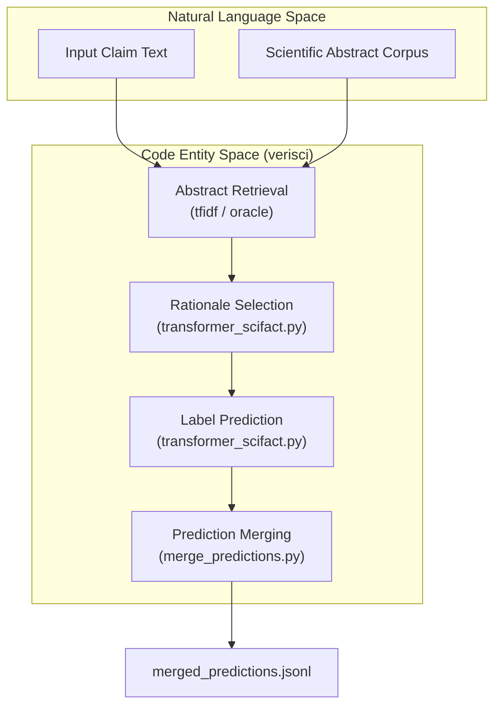
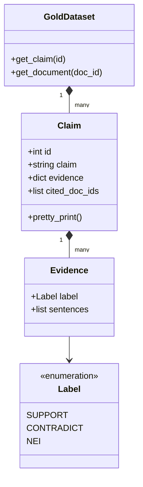

<!-- source: DeepWiki mcp.deepwiki.com · repo allenai/scifact · page 1 SciFact Overview · fetched 2026-10-26 -->

# SciFact Overview

Relevant source files

The following files were used as context for generating this wiki page:

- [.gitignore](.gitignore)
- [README.md](README.md)
- [doc/claims-with-citances.md](doc/claims-with-citances.md)
- [doc/data.md](doc/data.md)
- [doc/training.md](doc/training.md)

The SciFact project provides a dataset and a software pipeline for the verification of scientific claims. Given a claim, the system retrieves relevant scientific abstracts, identifies specific sentences that serve as evidence (rationales), and predicts whether the evidence supports or refutes the claim.

The project encompasses the original SciFact dataset, pre-trained transformer-based models (VeriSci), and an evaluation framework for both component-level and pipeline-level performance [README.md:1-11]().

## System Architecture

The SciFact verification process is structured as a three-stage pipeline. Data flows between these stages primarily via `.jsonl` files, allowing for modular execution and evaluation of each component.

### High-Level Component Flow
The following diagram illustrates the relationship between the logical pipeline stages and the corresponding code entities/scripts.

**Sources:** [README.md:77-85](), [doc/training.md:26-52]()

## Key Components

### 1. Abstract Retrieval
This stage identifies relevant documents from the `corpus.jsonl` for a given claim. The system supports "Oracle" retrieval (using gold-standard document IDs) for development and "Open" retrieval (using TF-IDF) for real-world inference [README.md:83-90]().

### 2. Rationale Selection
This module performs sentence-level binary classification. It identifies which sentences within a retrieved abstract provide evidence for or against the claim. Models are typically based on architectures like `roberta-large` or `scibert` [doc/training.md:13-15](), [doc/training.md:26-32]().

### 3. Label Prediction
The final stage takes the claim and the selected rationales to produce a verdict: **SUPPORT**, **REFUTE**, or **NOT_ENOUGH_INFO (NEI)**. The highest-performing configurations often involve transfer learning, such as pre-training on the FEVER dataset before fine-tuning on SciFact [README.md:152-157](), [doc/training.md:96-100]().

## Data Models and Schema

SciFact uses a structured JSONL format to represent claims and evidence. The `GoldDataset` class in the `verisci` library is the primary interface for interacting with this data [doc/data.md:93-100]().

### Core Data Entities
The diagram below maps the JSON schema elements to the internal data structures.

**Sources:** [doc/data.md:15-30](), [doc/data.md:93-100]()

## Getting Started

To set up the environment and run the pipeline:
1.  **Environment:** Create a conda environment and install dependencies from `requirements.txt` [README.md:37-55]().
2.  **Data:** Download the corpus and claims using the provided `download-data.sh` script [README.md:98-101]().
3.  **Models:** Pre-trained models for rationale selection and label prediction can be retrieved via `download-model.sh` [README.md:140-143]().

For detailed setup instructions, see **[Getting Started: Installation & Environment Setup](#1.1)**.
For information on data formats and the claim generation task, see **[Dataset: Schema, Formats, and Claim Generation](#1.2)**.

**Sources:** [README.md:35-57](), [README.md:96-106](), [README.md:138-145]()

---

