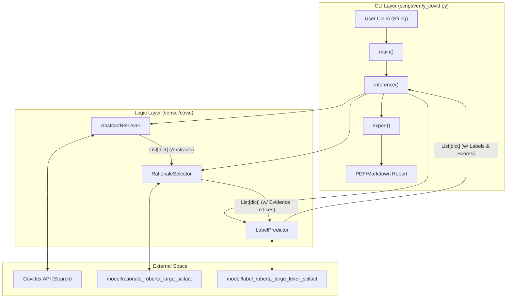
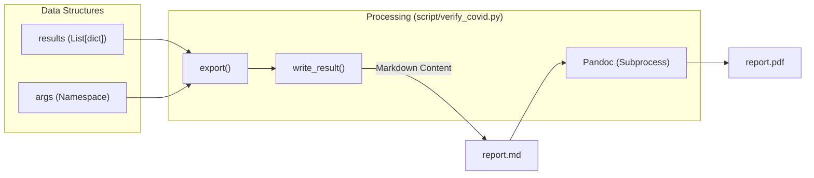

<!-- source: DeepWiki mcp.deepwiki.com · repo allenai/scifact · page 5.2 verify_covid.py CLI and Report Generation · fetched 2026-10-26 -->

# verify_covid.py CLI and Report Generation

Relevant source files

The following files were used as context for generating this wiki page:

- [README.md](README.md)
- [covid/claims.txt](covid/claims.txt)
- [doc/claims-with-citances.md](doc/claims-with-citances.md)
- [script/verify_covid.py](script/verify_covid.py)
- [verisci/covid/__init__.py](verisci/covid/__init__.py)
- [verisci/covid/abstract_retriever.py](verisci/covid/abstract_retriever.py)
- [verisci/covid/label_predictor.py](verisci/covid/label_predictor.py)
- [verisci/covid/rationale_selector.py](verisci/covid/rationale_selector.py)

The `verify_covid.py` script provides a specialized command-line interface for verifying arbitrary COVID-19 related claims against the CORD-19 corpus. Unlike the standard SciFact pipeline which operates on local JSONL files, this tool integrates with external APIs (Covidex) to retrieve real-time evidence and generates human-readable reports in Markdown or PDF formats.

### System Orchestration and Data Flow

The script is orchestrated by the `inference()` function, which manages the sequential execution of the three primary pipeline components: retrieval, selection, and prediction.

#### High-Level Pipeline Flow
The following diagram illustrates the transition from a natural language claim to a structured report, mapping the logical stages to their corresponding classes in the `verisci.covid` module.

**Claim Verification Logic Map**

**Sources:** [script/verify_covid.py:38-75](), [verisci/covid/__init__.py:1-3]()

---

### Command-Line Interface

The CLI is defined in `get_args()` using `argparse`. It supports a variety of configurations for document volume, selection strategy, and output formatting.

| Argument | Type | Default | Description |
| :--- | :--- | :--- | :--- |
| `claim` | `str` | N/A | The natural language claim to verify. |
| `report_file` | `str` | `"report"` | Output filename (without extension). |
| `--n_documents` | `int` | `20` | Number of abstracts to retrieve via Covidex. |
| `--rationale_selection_method` | `str` | `"topk"` | Method to select evidence: `topk` or `threshold`. |
| `--rationale_threshold` | `float` | `0.5` | Sigmoid threshold for `threshold` selection method. |
| `--label_threshold` | `float` | `0.5` | Minimum confidence to include a label prediction. |
| `--output_format` | `str` | `"pdf"` | Format of the final report (`pdf` or `markdown`). |
| `--keep_nei` | `flag` | `False` | If set, includes `NOT_ENOUGH_INFO` results in the report. |
| `--full_abstract` | `flag` | `False` | If set, prints the entire abstract with highlighted evidence. |
| `--device` | `str` | `None` | Execution device (e.g., `cuda`, `cpu`). |

**Sources:** [script/verify_covid.py:9-35]()

---

### Execution Logic: The `inference()` Function

The `inference()` function serves as the central controller. It initializes the models and coordinates the data transformation between components.

1.  **Model Initialization**: It hardcodes the best-performing models: `rationale_roberta_large_scifact` for selection and `label_roberta_large_fever_scifact` for prediction [script/verify_covid.py:42-43]().
2.  **Retrieval**: Calls `AbstractRetriever` to fetch `k` documents from Covidex based on the claim [script/verify_covid.py:64]().
3.  **Selection**: Passes the retrieved abstracts to `RationaleSelector` to identify specific evidence sentences [script/verify_covid.py:68]().
4.  **Prediction**: Passes the rationalized documents to `LabelPredictor` to determine if they SUPPORT or REFUTE the claim [script/verify_covid.py:72]().
5.  **Sorting**: The final results are sorted by `label_confidence` in descending order before being returned for export [script/verify_covid.py:74]().

**Sources:** [script/verify_covid.py:38-75]()

---

### Report Generation and Export

The `export()` function handles the conversion of model outputs into a readable format. 

#### Data Flow to Export

#### Export Implementation Details
*   **Markdown Generation**: The script first writes a Markdown file. It includes the original claim, the verification config (all CLI arguments), and a section for each piece of evidence [script/verify_covid.py:103-125]().
*   **Result Formatting**: `write_result()` formats individual evidence entries. It includes the paper title (linked to its URL), the decision label, confidence scores, and the evidence sentences [script/verify_covid.py:78-100]().
*   **Visual Highlighting**: If `--full_abstract` is enabled, evidence sentences are wrapped in `` tags within the Markdown [script/verify_covid.py:88-92]().
*   **PDF Conversion**: If the output format is `pdf`, the script executes a system call to `pandoc`. It converts the Markdown to PDF using the `html` transition format and subsequently deletes the intermediate Markdown file [script/verify_covid.py:126-130]().

**Sources:** [script/verify_covid.py:78-132]()

---

