# Page: Overview

# Overview

<details>
<summary>Relevant source files</summary>

The following files were used as context for generating this wiki page:

- [README.md](README.md)
- [how_to_use_data.ipynb](how_to_use_data.ipynb)
- [spoc-robot-training/version.py](spoc-robot-training/version.py)

</details>


This document provides an introduction to the SPOC (Simulation for Navigation and Manipulation) system, explaining its purpose, capabilities, and high-level architecture. SPOC is a comprehensive framework for training and evaluating robot navigation and manipulation agents in simulated environments, designed to enable effective transfer to real-world robots.

For detailed information about specific aspects of SPOC, refer to the relevant sections of this wiki:
- For system architecture details, see [System Architecture](#2)
- For training pipeline information, see [Training Pipeline](#3)
- For evaluation system details, see [Evaluation System](#4)

## What is SPOC?

SPOC (Simulation for Navigation and Manipulation) is an end-to-end system that enables training robotic agents to perform navigation and manipulation tasks in simulated environments, with the goal of transferring these capabilities to real-world robots. The system imitates shortest paths in simulation to provide efficient training data for tasks such as object navigation, pick-up, and fetch operations.

As described in the repository's name and documentation, SPOC focuses on "Imitating Shortest Paths in Simulation" to enable "Effective Navigation and Manipulation in the Real World."

Sources: [README.md:1-8]()

## System Purpose and Capabilities

SPOC supports a comprehensive range of robotic tasks through both training and evaluation pipelines:

- **Training capabilities**:
  - Offline training using PyTorch Lightning
  - Online reinforcement learning training using AllenAct
  - Support for various dataset mixtures and custom models

- **Evaluation capabilities**:
  - Online evaluation in simulated environments
  - Comprehensive metrics for assessing agent performance
  - Support for pretrained models

- **Environment and simulation**:
  - Based on AI2-THOR environment
  - Realistic simulation of the Stretch robot
  - Integration with Objaverse objects and ProcTHOR houses

Sources: [README.md:23-116]()

## System Architecture Overview

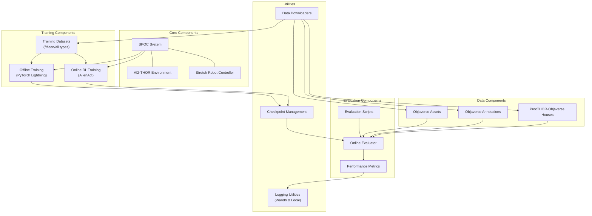

The SPOC system architecture consists of several interconnected components that work together to enable training and evaluation of robotic agents. The core components provide the simulation environment and robot control, while the training and evaluation components handle the machine learning aspects of the system.

Sources: [README.md:8-22](), [README.md:23-106]()

## Training and Evaluation Pipeline

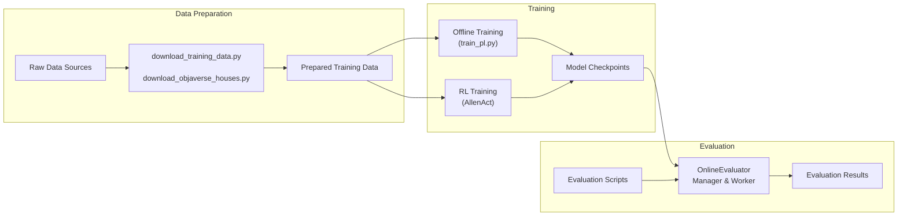

The training and evaluation pipeline in SPOC starts with data preparation, proceeds through model training (either offline or reinforcement learning), and concludes with evaluation of the trained models. The system provides scripts for downloading and preparing data, training models, and evaluating their performance.

Sources: [README.md:23-33](), [README.md:104-106](), [README.md:108-167]()

## Supported Tasks and Action Space

SPOC supports a variety of robotic tasks, including:

- Navigation to objects (ObjectNav)
- Picking up objects (Pickup)
- Fetching objects (Fetch)
- And other task types

The robot's action space includes:

| Action Category | Actions | Description |
|-----------------|---------|-------------|
| Base Movement | `move_ahead`, `move_back` | Move the robot base forward/backward |
| Base Rotation | `rotate_left`, `rotate_right`, `rotate_left_small`, `rotate_right_small` | Rotate the robot base in different increments |
| Arm Movement | `move_arm_up`, `move_arm_down`, `move_arm_out`, `move_arm_in` (and small variants) | Control the robot arm along different axes |
| Wrist Control | `wrist_open`, `wrist_close` | Rotate the wrist clockwise/counterclockwise |
| Task Control | `end`, `sub_done`, `pickup`, `dropoff` | Complete tasks, sub-tasks, or manipulate objects |

Sources: [README.md:79-102]()

## Data Formats and Processing

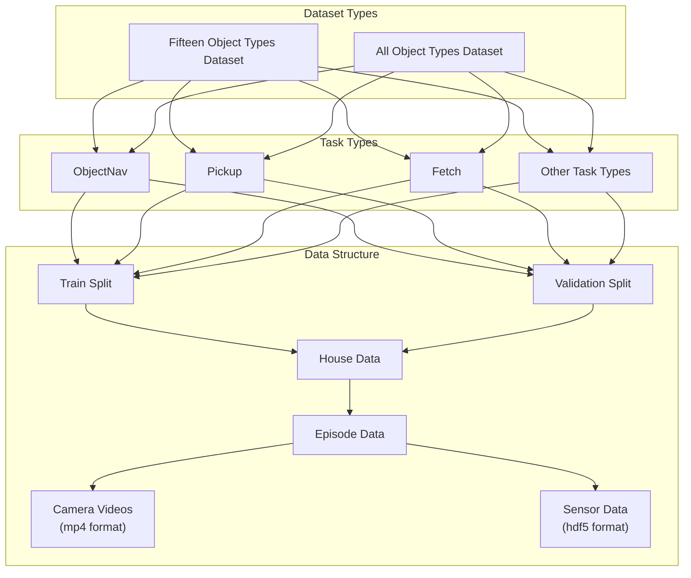

The SPOC system uses a structured dataset format that includes video data from navigation and manipulation cameras, as well as various sensor readings stored in HDF5 format. The dataset is organized by house ID and episode number, with separate directories for training and validation splits.

Key sensors include:
- Navigation and manipulation camera frames
- Object bounding boxes
- Agent location and orientation
- Task-specific metrics and status indicators
- Arm proprioceptive information

Sources: [README.md:26-78]()

## Downloading and Setup

To use SPOC, you need to:

1. Set up the Python environment:
   ```bash
   pip install -r requirements.txt
   pip install --extra-index-url https://ai2thor-pypi.allenai.org ai2thor==0+5d0ab8ab8760eb584c5ae659c2b2b951cab23246
   ```

2. Download necessary data:
   - Training data: `python -m scripts.download_training_data --save_dir /your/local/save/dir --types fifteen`
   - Objaverse assets and annotations:
     ```bash
     python -m objathor.dataset.download_annotations --version 2023_07_28 --path /path/to/objaverse_assets
     python -m objathor.dataset.download_assets --version 2023_07_28 --path /path/to/objaverse_assets
     ```
   - ProcTHOR-Objaverse houses: `python -m scripts.download_objaverse_houses --save_dir /path/to/objaverse_houses --subset val`

3. Set environment variables:
   ```bash
   export OBJAVERSE_HOUSES_DIR=/path/to/objaverse_houses
   export OBJAVERSE_DATA_DIR=/path/to/objaverse_assets
   ```

The system also supports Docker-based setup for containerized environments.

Sources: [README.md:10-21](), [README.md:25-33](), [README.md:120-163]()

## Versioning

SPOC follows semantic versioning principles, with the current version being 0.1.0 as indicated in the version file.

Sources: [spoc-robot-training/version.py:1-11]()

---

# Page: System Architecture

# System Architecture

<details>
<summary>Relevant source files</summary>

The following files were used as context for generating this wiki page:

- [README.md](README.md)
- [TRAINING_README.md](TRAINING_README.md)
- [how_to_use_data.ipynb](how_to_use_data.ipynb)
- [online_evaluation/online_evaluator.py](online_evaluation/online_evaluator.py)
- [training/offline/train_pl.py](training/offline/train_pl.py)

</details>


This document provides a comprehensive overview of the SPOC (Simulation for Navigation and Manipulation) system architecture, explaining how the main components interact to enable effective robot navigation and manipulation in both simulated and real environments. The architecture is designed to support both offline training from demonstration data and online reinforcement learning approaches.

For an introduction to the SPOC system and its capabilities, see [Overview](#1). For details on setting up the system, see [Setup and Installation](#8).

## Core System Components

The SPOC system architecture consists of several interconnected components that work together for training and evaluating robotic agents.

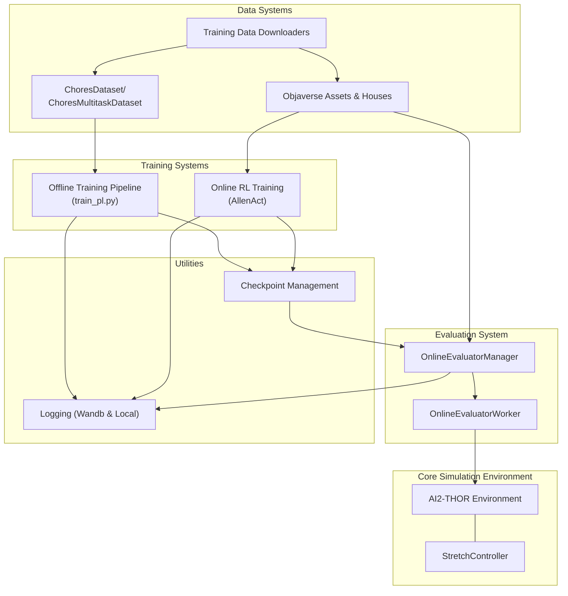

Sources: [README.md:8-8](), [online_evaluation/online_evaluator.py:190-190](), [training/offline/train_pl.py:75-75]()

The core components include:

1. **Simulation Environment**: Built on AI2-THOR, providing a realistic 3D environment where the Stretch robot can navigate and interact with objects.

2. **Training Systems**: Two training approaches supported:
   - **Offline Training Pipeline**: Uses PyTorch Lightning for supervised learning from demonstrations.
   - **Online RL Training**: Uses AllenAct for reinforcement learning in simulation.

3. **Evaluation System**: The `OnlineEvaluatorManager` coordinates multiple `OnlineEvaluatorWorker` instances to evaluate trained models in parallel.

4. **Data Systems**: Handles dataset management, including downloading and preprocessing training data.

5. **Utilities**: Common utilities used across the system, including checkpoint management and logging.

## Data Flow Architecture

The following diagram illustrates how data flows through the SPOC system during training and evaluation:

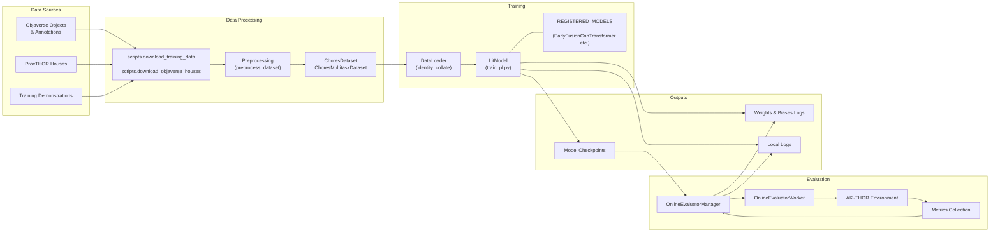

Sources: [README.md:26-53](), [training/offline/train_pl.py:320-345](), [online_evaluation/online_evaluator.py:404-588]()

Key data flows:

1. **Input Data**: Includes Objaverse objects, ProcTHOR houses, and training demonstrations.

2. **Data Processing**: Downloaded data is preprocessed and loaded into dataset classes (`ChoresDataset`, `ChoresMultitaskDataset`).

3. **Training Pipeline**: Datasets are fed into DataLoaders, which provide batches to the training model (`LitModel`).

4. **Model Checkpoints**: Trained models are saved as checkpoints, which can be loaded for evaluation.

5. **Evaluation Pipeline**: The `OnlineEvaluatorManager` loads model checkpoints and coordinates workers to evaluate models in simulation environments.

6. **Logging**: Results from both training and evaluation are logged locally or to Weights & Biases.

## Training System Architecture

The training system in SPOC supports both offline training from demonstrations and online reinforcement learning.

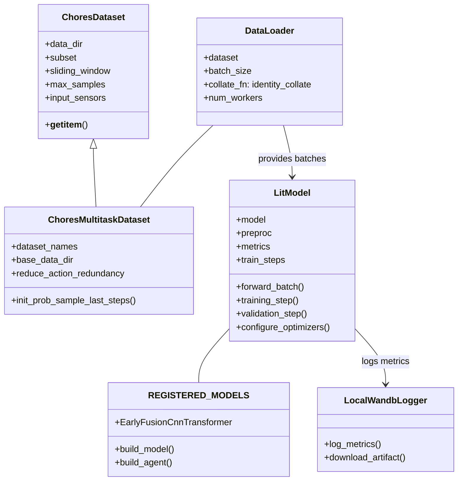

Sources: [training/offline/train_pl.py:75-317](), [TRAINING_README.md:12-38]()

The key components of the training system include:

1. **LitModel**: The PyTorch Lightning module that encapsulates the training logic, including forward pass, optimization, and metric calculation.

2. **REGISTERED_MODELS**: A registry of available model architectures, each with methods for building models and agents.

3. **Dataset Classes**: `ChoresDataset` and `ChoresMultitaskDataset` for loading and preprocessing training data.

4. **DataLoader**: Uses `identity_collate` to create batches of training data for the model.

5. **Logging**: Both Weights & Biases and local logging are supported for tracking training progress.

## Evaluation System Architecture

The evaluation system uses an `OnlineEvaluatorManager` to coordinate multiple workers for parallel evaluation.

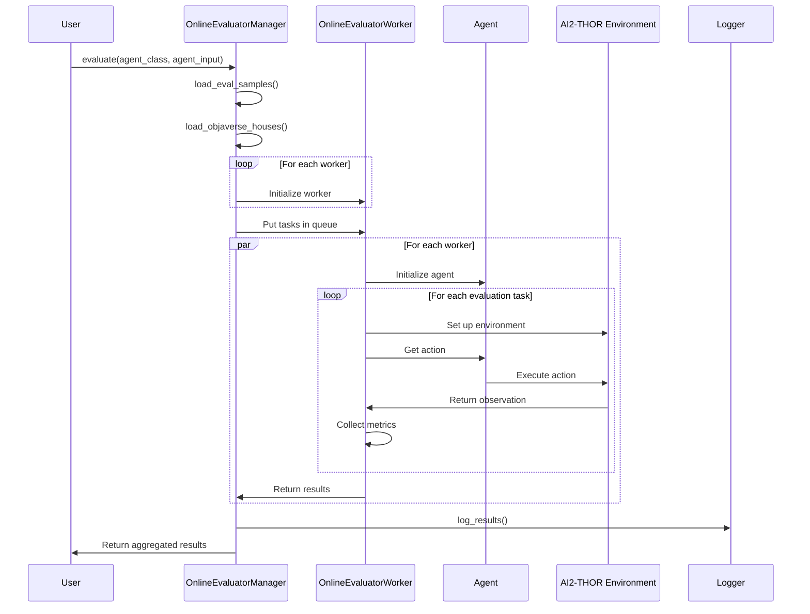

Sources: [online_evaluation/online_evaluator.py:190-644]()

Key components of the evaluation system:

1. **OnlineEvaluatorManager**: Manages the evaluation process, including distributing tasks to workers and aggregating results.

2. **OnlineEvaluatorWorker**: Executes evaluation tasks in simulation environments and collects metrics.

3. **Agent**: The trained model being evaluated, which receives observations and returns actions.

4. **AI2-THOR Environment**: The simulation environment where the agent operates.

5. **Logger**: Records evaluation results, either locally or to Weights & Biases.

## Component Interactions

The following diagram illustrates how the different components of the SPOC system interact with each other during training and evaluation:

```mermaid
graph TB
    subgraph "Training Pipeline"
        TRAIN_SCRIPT["training.offline.train_pl"]
        DATASET_MIXTURES["training.offline.dataset_mixtures"]
        CHORES_DATASET["training.offline.chores_dataset"]
        MODEL_REGISTRY["architecture.models.transformer_models"]
        CHECKPOINT_UTILS["training.offline.train_utils.get_latest_local_ckpt_pth"]
    end

    subgraph "Evaluation Pipeline"
        ONLINE_EVAL["training.offline.online_eval"]
        EVALUATOR_MANAGER["online_evaluation.online_evaluator.OnlineEvaluatorManager"]
        EVALUATOR_WORKER["online_evaluation.online_evaluator_worker.OnlineEvaluatorWorker"]
        EVAL_TYPES["online_evaluation.online_evaluation_types_and_utils"]
    end

    subgraph "Environment"
        AI2THOR["AI2-THOR"]
        STRETCH_CONTROLLER["StretchController"]
        TASK_REGISTRY["tasks.REGISTERED_TASKS"]
    end

    subgraph "Utilities"
        LOGGING_UTILS["online_evaluation.local_logging_utils.LocalWandbLogger"]
        DOWNLOAD_SCRIPTS["scripts.download_training_data
        scripts.download_objaverse_houses"]
    end

    TRAIN_SCRIPT --> DATASET_MIXTURES: gets dataset mixture
    DATASET_MIXTURES --> CHORES_DATASET: configures dataset
    TRAIN_SCRIPT --> MODEL_REGISTRY: loads model
    TRAIN_SCRIPT --> CHECKPOINT_UTILS: loads/saves checkpoints
    TRAIN_SCRIPT --> LOGGING_UTILS: logs metrics
    
    ONLINE_EVAL --> EVALUATOR_MANAGER: initializes
    EVALUATOR_MANAGER --> EVALUATOR_WORKER: distributes tasks
    EVALUATOR_WORKER --> EVAL_TYPES: processes samples
    EVALUATOR_WORKER --> AI2THOR: runs simulation
    EVALUATOR_WORKER --> STRETCH_CONTROLLER: controls robot
    EVALUATOR_MANAGER --> TASK_REGISTRY: gets task definitions
    
    DOWNLOAD_SCRIPTS --> CHORES_DATASET: provides data
    DOWNLOAD_SCRIPTS --> EVALUATOR_MANAGER: provides evaluation data
    
    EVALUATOR_MANAGER --> LOGGING_UTILS: logs results
```

Sources: [training/offline/train_pl.py:1-494](), [online_evaluation/online_evaluator.py:1-644](), [TRAINING_README.md:1-181]()

## System Workflow

### Training Workflow

The training workflow involves the following steps:

1. **Data Preparation**:
   - Download training data using `scripts.download_training_data`
   - Preprocess the dataset using `scripts.preprocess_dataset`

2. **Model Configuration**:
   - Select model architecture from `REGISTERED_MODELS`
   - Configure model parameters and training hyperparameters

3. **Training Execution**:
   - Initialize `LitModel` with the selected model
   - Create data loaders for training and validation data
   - Execute training using PyTorch Lightning Trainer
   - Periodically validate model performance
   - Save model checkpoints

### Evaluation Workflow

The evaluation workflow involves the following steps:

1. **Data Preparation**:
   - Download Objaverse assets and annotations
   - Download ProcTHOR-Objaverse houses

2. **Model Loading**:
   - Load a trained model checkpoint

3. **Evaluation Execution**:
   - Initialize `OnlineEvaluatorManager`
   - Configure evaluation parameters (task types, number of workers, etc.)
   - Distribute evaluation tasks to `OnlineEvaluatorWorker` instances
   - Execute evaluation in simulation environments
   - Collect and aggregate metrics
   - Log results

## Conclusion

The SPOC system architecture is designed to support the full lifecycle of robot navigation and manipulation research, from data collection and preprocessing to model training and evaluation. The modular design allows for flexibility in experiment configuration, and the parallel evaluation system enables efficient assessment of model performance.

For details on the training pipeline, see [Training Pipeline](#3). For information about the evaluation system, see [Evaluation System](#4).

Sources: [README.md:1-184](), [training/offline/train_pl.py:1-494](), [online_evaluation/online_evaluator.py:1-644](), [TRAINING_README.md:1-181]()

---

# Page: Training Pipeline

# Training Pipeline

<details>
<summary>Relevant source files</summary>

The following files were used as context for generating this wiki page:

- [TRAINING_README.md](TRAINING_README.md)
- [training/offline/train_pl.py](training/offline/train_pl.py)

</details>


The SPOC-Robot-Training repository provides a comprehensive training pipeline for teaching robots to perform navigation and manipulation tasks. This document explains the architecture and components of the training pipeline, including both offline training using PyTorch Lightning and online reinforcement learning (RL) training using AllenAct.

For information about evaluating trained models, see [Evaluation System](#4).

## Training Pipeline Overview

The SPOC training pipeline supports two primary training approaches:

1. **Offline Training**: Supervised learning from demonstration data using PyTorch Lightning
2. **Online RL Training**: Reinforcement learning in simulation using AllenAct

These approaches can be used independently or complementarily depending on the task requirements.

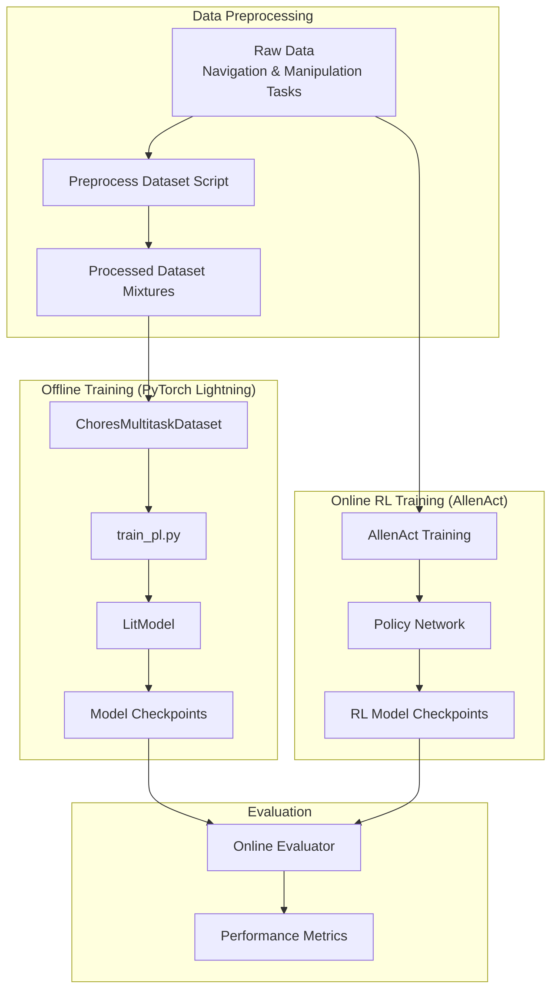

Sources:
- [training/offline/train_pl.py]()
- [TRAINING_README.md]()

## Data Preprocessing

Before training, raw data must be preprocessed to create metadata for the dataset. The preprocessing step generates necessary files for the training pipeline.

```bash
python -m scripts.preprocess_dataset --dataset_lists DATASETNAMES --dataset_path /data/datasets
```

This generates `house_id_to_sub_house_id_train.json` and `house_id_to_sub_house_id_val.json` files for each dataset.

Sources:
- [TRAINING_README.md:1-10]()

## Offline Training with PyTorch Lightning

The offline training pipeline uses PyTorch Lightning for training models based on demonstration data. It supports various model architectures, dataset mixtures, and configurable training parameters.

### Training Process Architecture

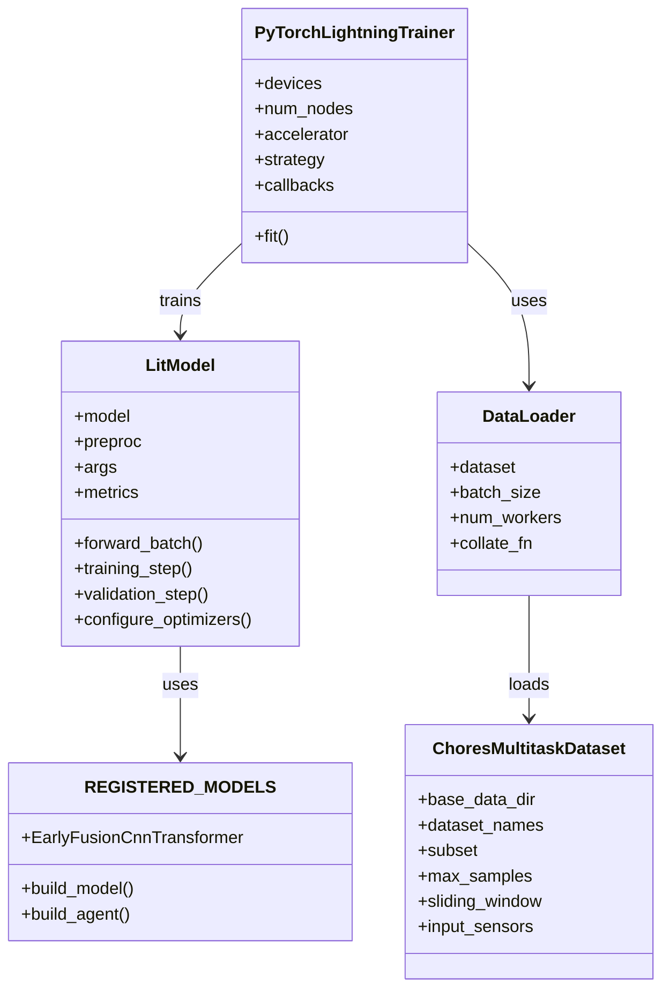

Sources:
- [training/offline/train_pl.py:75-272]()
- [training/offline/train_pl.py:324-345]()

### Configuration Options

The offline training pipeline supports numerous configuration options that can be specified via command-line arguments:

| Parameter | Description | Default |
| --- | --- | --- |
| `--model` | Model architecture | EarlyFusionCnnTransformer |
| `--model_version` | Model size/variant | small_3 |
| `--dataset_version` | Dataset mixture to use | object_nav_v0.3 |
| `--data_dir` | Data directory | /data/datasets |
| `--output_dir` | Results directory | /data/results |
| `--max_samples` | Maximum training samples | 100000 |
| `--eval_max_samples` | Maximum evaluation samples | 1600 |
| `--eval_every` | Evaluation frequency (steps) | 500 |
| `--save_every` | Checkpoint saving frequency (steps) | 2000 |
| `--per_gpu_batch` | Batch size per GPU | 16 |
| `--lr` | Learning rate | 0.0001 |
| `--sliding_window` | Context window size | 50 |
| `--precision` | Training precision | 32-true or 16-mixed |

Sources:
- [training/offline/train_pl.py:24-66]()

### Running Offline Training

To run offline training, use the `train_pl.py` script with the desired configuration:

```bash
python -m training.offline.train_pl --dataset_version DATASET_NAME --eval_every 50 --precision PRECISION_TYPE --input_sensors LIST_OF_SENSORS --per_gpu_batch PER_GPU_BATCH_SIZE --sliding_window 50 --model MODEL_NAME --model_version base --lr BASE_LEARNING_RATE
```

Example with detailed parameters:

```bash
python -m training.offline.train_pl --max_samples 10000 --eval_max_samples 1600 --eval_every 500 --save_every 2000 --model_version siglip_base_3 --sliding_window 4 --per_gpu_batch 3 --lr 0.0002 --data_dir /data/datasets --dataset_version CHORES --model EarlyFusionCnnTransformer --input_sensors raw_navigation_camera raw_manipulation_camera last_actions an_object_is_in_hand --precision 16-mixed --loss action --max_epochs 100 --resume_local --output_dir /path/to/save/logs --num_nodes 1
```

Sources:
- [TRAINING_README.md:12-38]()

### Training Pipeline Flow

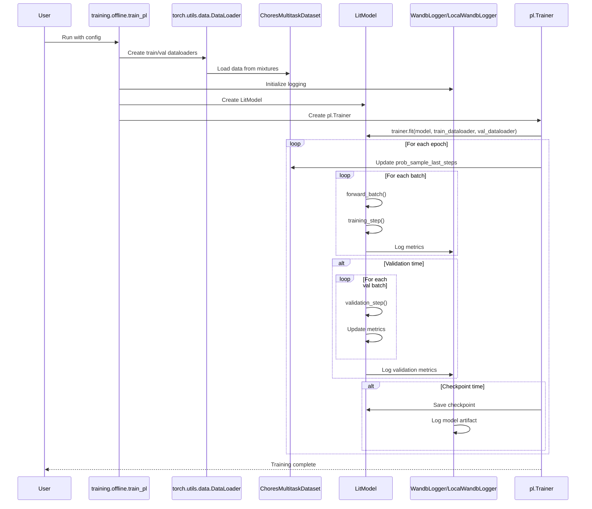

Sources:
- [training/offline/train_pl.py:348-470]()

### Logging and Checkpointing

The training pipeline supports two logging approaches:

1. **Weights & Biases (wandb)**: For online tracking of experiments
   ```bash
   --wandb_logging True --wandb_entity_name ENTITY --wandb_project_name PROJECT
   ```

2. **Local Logging**: For offline tracking
   ```bash
   --wandb_logging False --output_dir /path/to/save/logs
   ```

Checkpoints are automatically saved every `save_every` steps and can be used to resume training or for evaluation.

Sources:
- [TRAINING_README.md:41-60]()
- [training/offline/train_pl.py:413-419]()

## Online RL Training with AllenAct

The repository also supports online reinforcement learning training using the AllenAct framework. This approach trains agents through interaction with the environment rather than from demonstration data.

### Running Online RL Training

To train an RL agent:

```bash
python -m allenact.main training/online/siglip_vitb_gru_rgb_augment_objectnav
```

Results are saved to the `experiment_output` directory. Wandb logging can be enabled via environment variables:

```bash
export WANDB_PROJECT=YOUR_WANDB_PROJECT_NAME
export WANDB_ENTITY=YOUR_WANDB_ENTITY_NAME
python -m allenact.main training/online/siglip_vitb_gru_rgb_augment_objectnav --callbacks wandb_logging_callback
```

Sources:
- [TRAINING_README.md:106-129]()

## Dataset Mixtures

The training pipeline supports training on multiple datasets simultaneously by defining dataset mixtures. Mixtures are defined in `training/offline/dataset_mixtures.py` and can be specified during training.

Example of defining and using a dataset mixture:

1. Define a mixture in `dataset_mixtures.py`:
   ```python
   TWO_TASK_MIX = ['ObjectNavType', 'ObjectNavDescription']
   ```

2. Use the mixture during training:
   ```bash
   --dataset_version TWO_TASK_MIX
   ```

This allows for multi-task learning across different dataset types.

Sources:
- [TRAINING_README.md:38]()
- [training/offline/train_pl.py:327]()

## Dataset and Model Architecture Integration

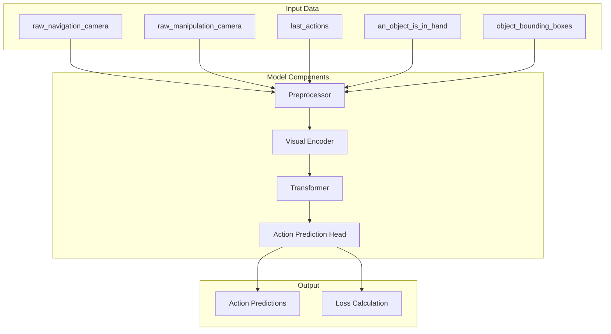

Sources:
- [training/offline/train_pl.py:139-141]()
- [TRAINING_README.md:93-101]()

## Creating Custom Models

To extend the training pipeline with custom models:

1. Define a new model class in `architecture/models/transformer_models` that includes:
   - A class for the model architecture
   - A `forward(self, model_inputs, actions)` method that returns a dictionary with "logits" and "loss"
   - A class method `build_model` that returns the model and preprocessor
   - A class method `build_agent` for online evaluation

2. Register the model in `architecture/models/transformer_models/__init__.py`

3. Implement the `Agent` class for caching inputs during online evaluation

Models can then be selected during training using the `--model` argument.

Sources:
- [TRAINING_README.md:89-104]()

## Pretrained Models

The repository provides pretrained models that can be downloaded and evaluated:

```bash
python -m scripts.download_trained_ckpt --save_dir /path/to/local/checkpoints --ckpt_ids SigLIP-ViTb-3-CHORES-S
```

Available models include:
- DINOv2-ViTs-3-CHORES-S
- SigLIP-ViTb-3-CHORES-L/S
- SigLIP-ViTb-3-CHORESNav-L/S
- SigLIP-ViTb-3-double-det-CHORES-L/S

These models can be evaluated using the online evaluation system.

Sources:
- [TRAINING_README.md:140-180]()

## Related Pages

- For detailed information about the offline training approach, see [Offline Training with PyTorch Lightning](#3.1)
- For details on online RL training, see [Online RL Training](#3.2)
- For information about custom models and dataset mixtures, see [Custom Models and Dataset Mixtures](#3.3)
- For evaluation of trained models, see [Evaluation System](#4)

---

# Page: Offline Training with PyTorch Lightning

# Offline Training with PyTorch Lightning

<details>
<summary>Relevant source files</summary>

The following files were used as context for generating this wiki page:

- [TRAINING_README.md](TRAINING_README.md)
- [training/offline/train_pl.py](training/offline/train_pl.py)
- [training/offline/train_utils.py](training/offline/train_utils.py)

</details>


This document describes the offline training system implemented in the SPOC-Robot-Training repository using PyTorch Lightning. The offline training system is used to train models on pre-collected datasets, as opposed to the online reinforcement learning approach covered in [Online RL Training](#3.2).

## Purpose and Scope

The offline training pipeline enables training of multi-task robotic models through imitation learning (behavioral cloning) on datasets of demonstration trajectories. It supports various model architectures, dataset mixtures, and training configurations.

Sources: [training/offline/train_pl.py:1-493]()

## System Architecture

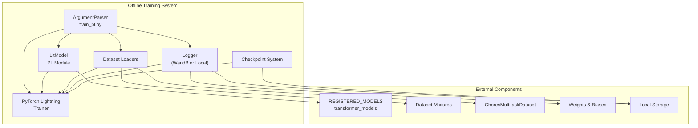

Sources: [training/offline/train_pl.py:24-66](), [training/offline/train_pl.py:75-317](), [training/offline/train_pl.py:348-470]()

## Training Process Flow

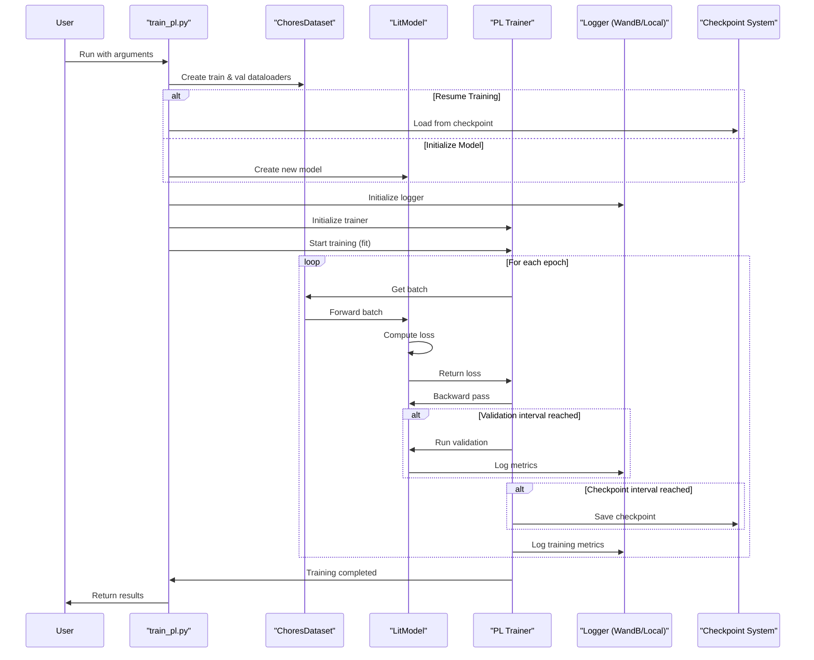

Sources: [training/offline/train_pl.py:348-470](), [training/offline/train_pl.py:143-174](), [training/offline/train_pl.py:221-246]()

## Key Components

### 1. LitModel Class

The `LitModel` class is a PyTorch Lightning module that handles the model training process. It:

- Creates the model and preprocessor
- Defines training and validation logic
- Computes metrics
- Logs results and videos
- Handles checkpoint saving/loading

```python
class LitModel(pl.LightningModule):
    def __init__(self, args):
        # Initialize model and preprocessor
        # Configure metrics
        
    def training_step(self, batch, batch_idx):
        # Process batch
        # Compute loss
        # Log metrics
        
    def validation_step(self, batch, batch_idx):
        # Process batch
        # Compute metrics
```

Sources: [training/offline/train_pl.py:75-317]()

### 2. Data Loading

The system uses `ChoresMultitaskDataset` for loading data from various datasets. It supports:

- Multiple dataset mixtures
- Sliding window approach for sequential data
- Various input sensors
- Batch collation and preprocessing

```python
def get_dataloader(subset: str, args):
    dataset = ChoresMultitaskDataset(
        base_data_dir=args.data_dir,
        dataset_names=get_mixture_by_name(args.dataset_version),
        subset=subset,
        max_samples=args.max_samples if subset == "train" else args.eval_max_samples,
        sliding_window=args.sliding_window,
        input_sensors=args.input_sensors,
        reduce_action_redundancy=args.reduce_action_redundancy if subset == "train" else False,
    )
    
    return DataLoader(...)
```

Sources: [training/offline/train_pl.py:324-345]()

### 3. Logging System

The training system supports two logging backends:

- **Weights & Biases (WandB)**: For online experiment tracking
- **Local WandB Logger**: For offline experiment tracking with WandB-compatible format

The logging system captures:
- Metrics (loss, F1 scores, etc.)
- Videos of agent behavior
- Model checkpoints

Sources: [training/offline/train_pl.py:375-397](), [training/offline/train_pl.py:99-131]()

### 4. Checkpoint Management

The system includes functionality for:

- Saving model checkpoints at regular intervals
- Loading from local or remote checkpoints
- Resuming training from a checkpoint
- Initializing a model from an existing checkpoint

```python
# Checkpoint callback
checkpoint_callback = pl.callbacks.ModelCheckpoint(
    dirpath=args.exp_dir,
    filename="checkpoint_{train_steps:.0f}",
    save_top_k=-1,
    verbose=True,
    every_n_train_steps=args.save_every,
)
```

Sources: [training/offline/train_pl.py:413-419](), [training/offline/train_utils.py:6-60]()

## Configuration Options

The training script supports many configuration options through command-line arguments:

| Category | Options | Description |
|----------|---------|-------------|
| **Model** | `--model`, `--model_version` | Model architecture and version |
| **Dataset** | `--dataset_version`, `--data_dir`, `--max_samples`, `--eval_max_samples` | Dataset configuration |
| **Training** | `--lr`, `--max_epochs`, `--per_gpu_batch`, `--sliding_window` | Training hyperparameters |
| **Logging** | `--wandb_logging`, `--wandb_project_name`, `--wandb_entity_name` | Logging configuration |
| **Checkpointing** | `--save_every`, `--resume`, `--resume_local`, `--init_model` | Checkpoint handling |
| **Input** | `--input_sensors` | List of sensor inputs to use |
| **Hardware** | `--precision`, `--num_nodes` | Hardware utilization settings |

Sources: [training/offline/train_pl.py:24-66]()

## Usage Guide

### Basic Training Command

To train a model using the PyTorch Lightning system:

```bash
python -m training.offline.train_pl \
    --model EarlyFusionCnnTransformer \
    --model_version siglip_base_3 \
    --dataset_version CHORES \
    --per_gpu_batch 3 \
    --lr 0.0002 \
    --sliding_window 4 \
    --input_sensors raw_navigation_camera raw_manipulation_camera last_actions an_object_is_in_hand \
    --precision 16-mixed \
    --wandb_logging True \
    --wandb_entity_name ENTITY \
    --wandb_project_name PROJECT
```

### Training with Multiple Datasets

To train on multiple datasets, define a mixture in `training/offline/dataset_mixtures.py` and reference it:

```bash
python -m training.offline.train_pl \
    --dataset_version TWO_TASK_MIX \
    # other arguments as above
```

### Resuming Training

To resume training from the latest local checkpoint:

```bash
python -m training.offline.train_pl \
    --resume_local \
    # other arguments as above
```

To resume from a specific WandB checkpoint:

```bash
python -m training.offline.train_pl \
    --resume \
    --run_id RUN_ID \
    --step STEP \
    # other arguments as above
```

Sources: [TRAINING_README.md:12-62]()

## Data and Model Flow

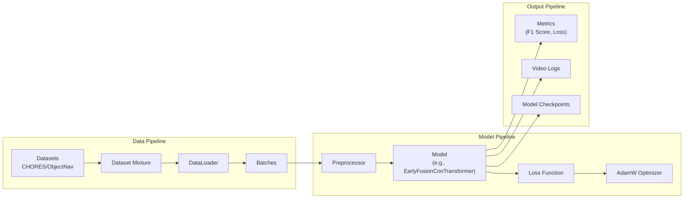

Sources: [training/offline/train_pl.py:139-174](), [training/offline/train_pl.py:268-272](), [training/offline/train_pl.py:413-419]()

## Metrics and Evaluation

During training, the system computes and logs the following metrics:

1. **Loss**: Action prediction loss and any custom losses defined by the model
2. **F1 Scores**:
   - Weighted F1 score across all action classes
   - Macro F1 score across all action classes 
   - Per-action F1 scores

Validation is performed at regular intervals (defined by `--eval_every`), allowing tracking of model performance throughout training.

Sources: [training/offline/train_pl.py:176-196](), [training/offline/train_pl.py:221-266]()

## Integration with Other Systems

The offline training system integrates with several other components of the SPOC framework:

1. **Model Architecture**: Uses models defined in `architecture/models/transformer_models`
2. **Dataset Mixtures**: Leverages dataset mixtures defined in `training/offline/dataset_mixtures.py`
3. **Online Evaluation**: Trained models can be evaluated using the [Online Evaluator](#4.1)
4. **Logging Utilities**: Uses both WandB and local logging systems

To customize the training process, users can:
- Create custom models (see [Custom Models and Dataset Mixtures](#3.3))
- Define new dataset mixtures
- Configure training hyperparameters

Sources: [training/offline/train_pl.py:17-21](), [TRAINING_README.md:89-101]()

---

# Page: Online RL Training

# Online RL Training

<details>
<summary>Relevant source files</summary>

The following files were used as context for generating this wiki page:

- [TRAINING_README.md](TRAINING_README.md)

</details>


This document explains the online reinforcement learning (RL) training system in the SPOC (Simulation for Navigation and Manipulation) framework. Online RL refers to the process where the agent learns through direct interaction with the environment, collecting new experiences and updating its policy accordingly. For information about offline training methods, see [Offline Training with PyTorch Lightning](#3.1).

## Overview

The online RL training system in SPOC uses [AllenAct](https://allenact.org), a modular and flexible framework for embodied AI research. This approach allows agents to learn navigation and manipulation policies directly through trial and error in simulated environments, as opposed to learning from pre-collected datasets in offline training.

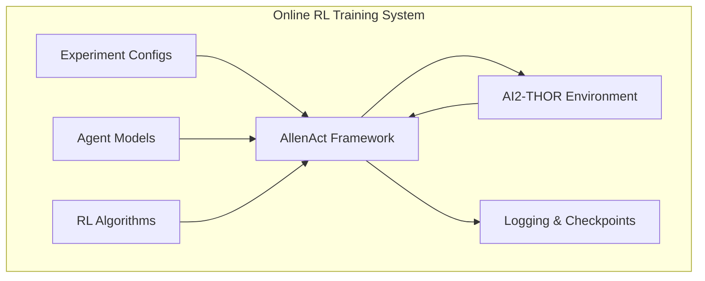

Sources: [TRAINING_README.md:107-129]()

## Environment Setup

Before training, you need to set up the necessary environment variables pointing to the required datasets:

```
export OBJAVERSE_DATA_DIR=/path/to/objaverse_assets
export OBJAVERSE_HOUSES_DIR=/path/to/objaverse_houses
```

You can optionally set up Weights & Biases for experiment tracking:

```
export WANDB_PROJECT=YOUR_WANDB_PROJECT_NAME
export WANDB_ENTITY=YOUR_WANDB_ENTITY_NAME
```

Sources: [TRAINING_README.md:108-113](), [TRAINING_README.md:124-128]()

## Training Process

The online RL training process involves running an experiment configuration that defines the environment, agent architecture, and learning algorithm.

### Training Workflow

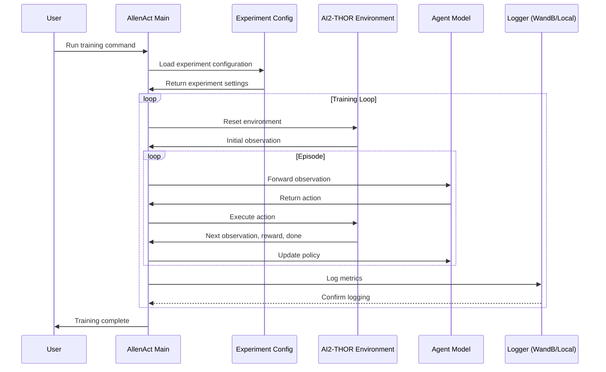

Sources: [TRAINING_README.md:114-119]()

### Running Training

To train a model using the online RL system, use the AllenAct main module with the specific experiment configuration:

```
python -m allenact.main training/online/siglip_vitb_gru_rgb_augment_objectnav
```

The results will be saved to the `experiment_output` directory by default.

To enable Weights & Biases logging:

```
python -m allenact.main training/online/siglip_vitb_gru_rgb_augment_objectnav --callbacks wandb_logging_callback
```

Sources: [TRAINING_README.md:114-129]()

## System Architecture

The online RL training system integrates several components within the SPOC framework:

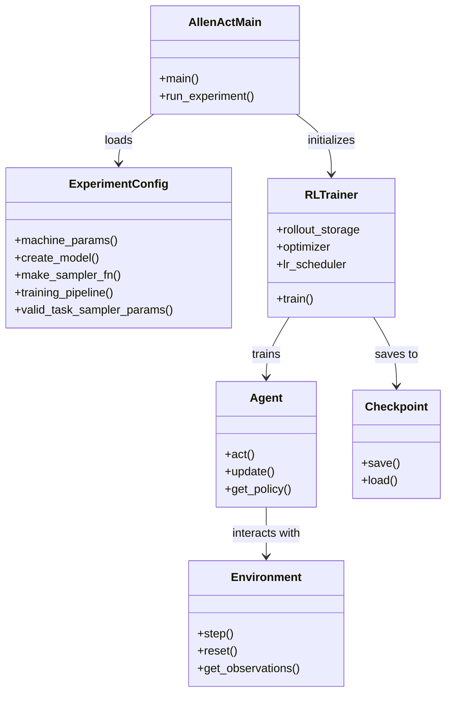

Sources: [TRAINING_README.md:114-129]()

## Experiment Configurations

The experiment configurations define the environment, model architecture, and training pipeline. In the SPOC repository, configurations are stored in the `training/online/` directory.

A typical configuration contains:

1. Environment parameters (AI2-THOR settings)
2. Model architecture (e.g., SigLIP vision encoder with GRU)
3. RL algorithm settings (e.g., PPO parameters)
4. Training pipeline configuration (learning rate, epochs, etc.)
5. Evaluation parameters

The example configuration mentioned in the documentation is `siglip_vitb_gru_rgb_augment_objectnav`, which uses a SigLIP vision transformer backbone with a GRU policy for object navigation tasks.

Sources: [TRAINING_README.md:118](), [TRAINING_README.md:134]()

## Evaluation

### Evaluating Trained Models

To evaluate a trained model from the online RL system:

```
python -m allenact.main training/online/siglip_vitb_gru_rgb_augment_objectnav -c /path/to/checkpoint --eval
```

The checkpoint can be found in the `experiment_output` directory after training.

Sources: [TRAINING_README.md:132-137]()

### Integration with Online Evaluator

The models trained using the online RL system can also be evaluated using the general Online Evaluator component of SPOC, allowing for consistent comparison with models trained through offline methods.

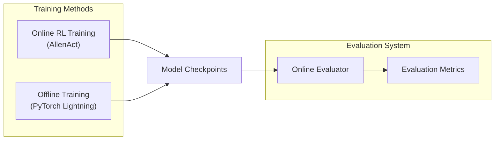

Sources: [TRAINING_README.md:64-86]()

## Comparison with Offline Training

The following table highlights the key differences between online RL training and offline training approaches in SPOC:

| Feature | Online RL Training | Offline Training |
|---------|------------------|-----------------|
| Framework | AllenAct | PyTorch Lightning |
| Learning Method | Reinforcement Learning | Supervised Learning (typically Behavioral Cloning) |
| Data Source | Generated during training through environment interaction | Pre-collected datasets |
| Update Frequency | Continuous (online) | Batch-based |
| Exploration | Agent explores environment directly | N/A (follows demonstration data) |
| Primary Config File | Experiment config in `training/online/` | Arguments to `train_pl.py` |
| Command Structure | `python -m allenact.main training/online/config` | `python -m training.offline.train_pl [args]` |

Sources: [TRAINING_README.md:12-38](), [TRAINING_README.md:107-129]()

## Summary

The Online RL Training component provides a reinforcement learning approach to training navigation and manipulation agents in the SPOC framework. It leverages the AllenAct framework to implement training workflows where agents learn directly from interaction with the AI2-THOR environment. This approach complements the offline training methodology, offering an alternative way to develop robust policies for embodied AI tasks.

Key benefits of the online RL approach include:
- Learning from direct environment interaction rather than fixed datasets
- Natural exploration of the environment
- No requirement for pre-collected demonstration data
- Potentially discovering strategies not present in demonstration data

For evaluation of models trained with either approach, see [Online Evaluator](#4.1) for details on the common evaluation framework.

Sources: [TRAINING_README.md:107-137]()

---

# Page: Custom Models and Dataset Mixtures

# Custom Models and Dataset Mixtures

<details>
<summary>Relevant source files</summary>

The following files were used as context for generating this wiki page:

- [TRAINING_README.md](TRAINING_README.md)
- [training/offline/train_pl.py](training/offline/train_pl.py)

</details>


## Purpose and Scope

This document details how to create custom models and work with dataset mixtures in the SPOC robot training system. It covers the process of defining new neural network architectures and combining multiple datasets for training. For information about offline training specifically, see [Offline Training with PyTorch Lightning](#3.1), and for online RL training, see [Online RL Training](#3.2).

## Dataset Mixtures

Dataset mixtures allow you to train models on combinations of different datasets simultaneously, which can improve generalization across task types and environments.

### Defining Dataset Mixtures

Dataset mixtures are defined in `training/offline/dataset_mixtures.py` as simple lists of dataset names.

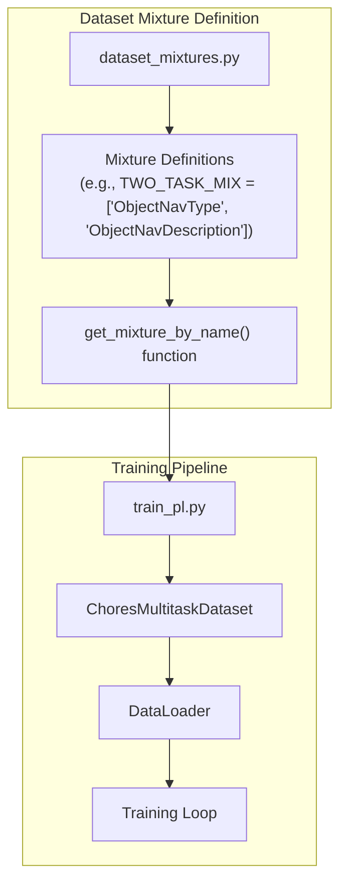

To create a new dataset mixture:

1. Open `training/offline/dataset_mixtures.py`
2. Define a new constant with a list of dataset names:
   ```python
   MY_CUSTOM_MIXTURE = ['DatasetA', 'DatasetB', 'DatasetC']
   ```

Sources: [training/offline/train_pl.py:20-20](), [training/offline/train_pl.py:327-335]()

### Using Dataset Mixtures

To use a dataset mixture in training, specify it with the `--dataset_version` argument:

```bash
python -m training.offline.train_pl --dataset_version MY_CUSTOM_MIXTURE
```

The training script dynamically loads the specified mixture:

```mermaid
sequenceDiagram
    participant User
    participant train_pl
    participant dataset_mixtures as "dataset_mixtures.py"
    participant ChoresMultitaskDataset
    participant DataLoader
    
    User->>train_pl: --dataset_version MY_CUSTOM_MIXTURE
    train_pl->>dataset_mixtures: get_mixture_by_name("MY_CUSTOM_MIXTURE")
    dataset_mixtures-->>train_pl: ["DatasetA", "DatasetB", "DatasetC"]
    train_pl->>ChoresMultitaskDataset: Initialize with dataset list
    ChoresMultitaskDataset-->>train_pl: Dataset instance
    train_pl->>DataLoader: Create with ChoresMultitaskDataset
    DataLoader-->>train_pl: Training data batches
    train_pl->>train_pl: Train model
```

During training, metrics are tracked for the combined performance across all datasets in the mixture.

Sources: [training/offline/train_pl.py:324-345](), [TRAINING_README.md:38-39]()

## Custom Models

The SPOC system allows defining custom neural network architectures to experiment with different approaches to visual navigation and manipulation.

### Model Requirements

Custom models must adhere to specific requirements:

1. A model class with appropriate implementation
2. A `forward()` method calculating loss and returning a dictionary with "actions_logits" and "loss"
3. A `build_model()` class method for initialization
4. A `build_agent()` class method for online evaluation
5. Registration in the model registry

### Creating a Custom Model

```mermaid
flowchart TD
    subgraph "Implementation Steps"
        A["Create model class in<br>architecture/models/transformer_models/"]
        B["Implement forward() method"]
        C["Implement build_model() method"]
        D["Implement build_agent() method"]
        E["Register in __init__.py"]
    end
    
    subgraph "Training Integration"
        F["REGISTERED_MODELS dictionary"]
        G["train_pl.py"]
        H["LitModel class"]
    end
    
    A --> B
    A --> C
    A --> D
    A --> E
    E --> F
    F --> G
    G --> H
```

To create a custom model:

1. Create a new file in `architecture/models/transformer_models/`
2. Implement a model class with required methods
3. Register the model in `architecture/models/transformer_models/__init__.py`

Sources: [training/offline/train_pl.py:17-17](), [training/offline/train_pl.py:80-85](), [TRAINING_README.md:89-105]()

### Required Model Methods

Your custom model should implement these key methods:

| Method | Purpose | Parameters |
|--------|---------|------------|
| `forward()` | Process inputs and compute loss | `model_inputs, actions=None` |
| `build_model()` | Initialize model and preprocessor | `model_version, input_sensors, loss, ckpt_pth=None` |
| `build_agent()` | Create agent for evaluation | `model_version, input_sensors, loss, device, sampling="greedy", ckpt_path=None` |

The `forward()` method should return a dictionary with at least:
- `actions_logits`: Predicted action logits
- `loss`: Training loss (when `actions` is provided)

Sources: [TRAINING_README.md:96-100](), [training/offline/train_pl.py:139-141]()

## Integration with Training Pipeline

The following diagram shows how custom models and dataset mixtures are integrated into the training pipeline:

```mermaid
flowchart LR
    subgraph "Command Line Arguments"
        A["--model"]
        B["--model_version"]
        C["--dataset_version"]
        D["--input_sensors"]
    end
    
    subgraph "Model Selection"
        E["REGISTERED_MODELS[args.model]"]
        F["build_model()"]
        G["Model and Preprocessor"]
    end
    
    subgraph "Dataset Selection"
        H["get_mixture_by_name(args.dataset_version)"]
        I["ChoresMultitaskDataset"]
        J["DataLoader"]
    end
    
    subgraph "Training Loop"
        K["LitModel"]
        L["forward_batch()"]
        M["training_step()"]
        N["validation_step()"]
    end
    
    A --> E
    B --> F
    D --> F
    E --> F
    F --> G
    G --> K
    
    C --> H
    H --> I
    I --> J
    J --> M
    
    K --> L
    L --> M
    M --> N
```

### Training Configuration

When training with custom models and dataset mixtures, these key arguments are available:

| Argument | Description | Example |
|----------|-------------|---------|
| `--model` | Model architecture name | `--model EarlyFusionCnnTransformer` |
| `--model_version` | Model variant (size/architecture) | `--model_version base` |
| `--dataset_version` | Dataset mixture name | `--dataset_version TWO_TASK_MIX` |
| `--input_sensors` | Input modalities | `--input_sensors raw_navigation_camera raw_manipulation_camera` |
| `--loss` | Loss function type | `--loss action` |

Sources: [training/offline/train_pl.py:24-66](), [training/offline/train_pl.py:80-85]()

### Complete Example

Here's a complete example of training a custom model on a dataset mixture:

```bash
python -m training.offline.train_pl \
  --model EarlyFusionCnnTransformer \
  --model_version siglip_base_3 \
  --dataset_version CHORES \
  --input_sensors raw_navigation_camera raw_manipulation_camera last_actions an_object_is_in_hand \
  --loss action \
  --per_gpu_batch 3 \
  --lr 0.0002 \
  --precision 16-mixed \
  --max_epochs 100
```

Sources: [TRAINING_README.md:34-36](), [training/offline/train_pl.py:473-493]()

## Debugging and Monitoring

The training system logs metrics for each dataset in the mixture, which helps identify if the model is learning effectively across all tasks. During training, you can monitor:

- Per-action F1 scores
- Overall F1 scores (weighted and macro)
- Loss values for each dataset
- Training frames processed

The system also logs sample videos showing model predictions alongside ground truth actions, helpful for debugging custom model behavior.

Sources: [training/offline/train_pl.py:151-169](), [training/offline/train_pl.py:98-131]()

---

# Page: Evaluation System

# Evaluation System

<details>
<summary>Relevant source files</summary>

The following files were used as context for generating this wiki page:

- [online_evaluation/online_evaluator.py](online_evaluation/online_evaluator.py)
- [training/offline/online_eval.py](training/offline/online_eval.py)

</details>


## Purpose and Scope

The Evaluation System is a core component of the SPOC (Simulation for Navigation and Manipulation) framework, designed to assess the performance of trained models on a variety of robotic tasks in simulated environments. This document covers the architecture, workflow, and usage of the evaluation system.

For information about running evaluations using specific scripts and command-line interfaces, see [Running Evaluations](#4.2). For details about the models being evaluated, see [Training Pipeline](#3).

Sources: [online_evaluation/online_evaluator.py:1-644]()

## Architecture Overview

The evaluation system is built around a manager-worker architecture that enables parallel evaluation across multiple environments and tasks. The system supports evaluation on different task types, with customizable metrics and visualization capabilities.

```mermaid
graph TD
    subgraph "Evaluation System Architecture"
        OEM["OnlineEvaluatorManager"]
        OEW["OnlineEvaluatorWorker"]
        MA["MetricAggregator"]
        RL["Results Logging"]
    end

    subgraph "Input Components"
        AC["Agent Class"]
        AI["Agent Input"]
        ES["Evaluation Samples"]
        HS["Houses"]
    end

    subgraph "Processing"
        TQ["Tasks Queue"]
        RQ["Results Queue"]
        PROC["Worker Processes"]
    end
    
    subgraph "Output Components"
        AGR["Aggregated Results"]
        VID["Video Recordings"]
        WAND["Wandb Logging"]
        LOC["Local Logging"]
    end

    OEM --> OEW
    OEM --> MA
    OEM --> RL
    
    AC --> OEM
    AI --> OEM
    ES --> OEM
    HS --> OEM
    
    OEM --> TQ
    TQ --> PROC
    PROC --> RQ
    RQ --> OEM
    
    OEM --> AGR
    OEM --> VID
    AGR --> WAND
    AGR --> LOC
```

Sources: [online_evaluation/online_evaluator.py:190-644](), [training/offline/online_eval.py:16-200]()

## Core Components

### OnlineEvaluatorManager

The `OnlineEvaluatorManager` class is the central coordinator of the evaluation process. It is responsible for:

1. Loading evaluation samples and houses
2. Initializing worker processes across available GPUs
3. Managing task distribution
4. Collecting and aggregating results
5. Logging metrics and visualizations

```mermaid
classDiagram
    class OnlineEvaluatorManager {
        +__init__(dataset_path, dataset_type, max_eps_len, eval_set_size, eval_subset, shuffle, seed, gpu_devices, num_workers, etc)
        +load_minival_eval_samples(list_of_tasks)
        +load_full_eval_samples(task_type)
        +load_procthor_houses()
        +load_objaverse_houses()
        +log_benchmark_stat()
        +evaluate(agent_class, agent_input)
        +accumulate_results(results_queue, task_type_to_results_list)
        +join_processes_and_log(procs, results_queue, num_tasks_per_type)
        +log_from_task_type_lists(task_type_to_results_list, upload)
        +log_aggregated_results(all_tasks_aggregated_results, upload)
    }
    
    class MetricAggregator {
        +__init__()
        +update(metric)
        +aggregate()
        +size()
    }
    
    OnlineEvaluatorManager -- MetricAggregator: uses
```

Sources: [online_evaluation/online_evaluator.py:190-644]()

### Metrics Collection and Aggregation

The evaluation system uses the `MetricAggregator` class to collect and process metrics from individual evaluation runs. Common metrics include:

| Metric Category | Description | Examples |
|----------------|-------------|----------|
| Task Success | Measures whether the task was completed successfully | Success rate |
| Efficiency | Measures how efficiently the task was completed | Episode length, time to completion |
| Extra Metrics | Task-specific measurements | Object-specific success rates, room visitation rates |

Sources: [online_evaluation/online_evaluator.py:79-91](), [online_evaluation/online_evaluator.py:93-97]()

## Evaluation Workflow

The following diagram illustrates the complete workflow of the evaluation system:

```mermaid
sequenceDiagram
    participant Main as Main Process
    participant OEM as OnlineEvaluatorManager
    participant Workers as Worker Processes
    participant Environment as AI2-THOR Environment
    participant Logger as Logging System

    Main->>OEM: initialize(config)
    OEM->>OEM: load_eval_samples()
    OEM->>OEM: load_houses()
    
    Main->>OEM: evaluate(agent_class, agent_input)
    
    OEM->>Workers: initialize workers
    
    loop For each task
        OEM->>Workers: put task in queue
    end
    
    loop For each worker
        OEM->>Workers: start_worker process
        Workers->>Workers: initialize agent
        
        loop Until queue empty
            Workers->>Workers: get task from queue
            Workers->>Environment: setup environment
            
            loop Until episode ends
                Workers->>Environment: agent step
                Environment->>Workers: observation
                Workers->>Workers: collect metrics
            end
            
            Workers->>OEM: return results via queue
        end
    end
    
    loop Until all workers finish
        OEM->>OEM: accumulate_results()
        OEM->>Logger: log_intermediate_results()
    end
    
    OEM->>Logger: log_final_results()
    OEM->>Main: return
```

Sources: [online_evaluation/online_evaluator.py:404-487](), [online_evaluation/online_evaluator.py:511-587]()

## Usage and Integration

The evaluation system is typically used through the `online_eval.py` script, which handles the setup of the evaluation manager and the loading of trained models.

### Configuration Parameters

The evaluation system can be configured with numerous parameters:

| Parameter | Description | Default |
|-----------|-------------|---------|
| dataset_path | Path to dataset | "/data/datasets" |
| dataset_type | Type of dataset | "" |
| max_eps_len | Maximum episode length | -1 (unlimited) |
| eval_set_size | Number of samples to evaluate | 200 |
| eval_subset | Subset to evaluate on | "minival" |
| shuffle | Whether to shuffle evaluation samples | False |
| gpu_devices | List of GPU devices to use | All available GPUs |
| num_workers | Number of parallel workers | Required parameter |
| house_set | Type of houses to use | "procthor" |
| input_sensors | List of input sensors for the agent | ["raw_navigation_camera", "raw_manipulation_camera"] |
| benchmark_revision | Benchmark revision to use | "chores-small" |

Sources: [training/offline/online_eval.py:16-59](), [online_evaluation/online_evaluator.py:191-236]()

### Integration with Training

The evaluation system is tightly integrated with the training pipeline, as it loads trained models and evaluates them. The typical integration flow is:

```mermaid
flowchart TD
    subgraph "Training System"
        TR["Training Run"]
        CKPT["Model Checkpoint"]
    end
    
    subgraph "Evaluation System"
        OE["online_eval.py"]
        OEM["OnlineEvaluatorManager"]
        W["Workers"]
    end
    
    subgraph "Results"
        WLOG["Wandb Logging"]
        LLOG["Local Logging"]
        VIZ["Visualizations"]
    end
    
    TR --> CKPT
    CKPT --> OE
    OE --> OEM
    OEM --> W
    W --> WLOG
    W --> LLOG
    W --> VIZ
```

Sources: [training/offline/online_eval.py:86-199]()

## Results Processing and Visualization

The evaluation system generates several types of outputs:

1. **Aggregated Metrics**: Overall performance statistics across all evaluation samples
2. **Task-Specific Metrics**: Breakdown of performance by task type
3. **Object-Specific Metrics**: Performance metrics for different object types
4. **Visualizations**: Video recordings of agent behavior during evaluation

These results are logged either to Weights & Biases (for online tracking) or to a local logging system.

```mermaid
graph TD
    subgraph "Results Processing"
        RA["Raw Results"]
        AM["Aggregated Metrics"]
        TSM["Task-Specific Metrics"]
        OSM["Object-Specific Metrics"]
        VR["Video Recordings"]
    end
    
    subgraph "Logging Systems"
        WB["Weights & Biases"]
        LL["Local Logging"]
    end
    
    RA --> AM
    RA --> TSM
    RA --> OSM
    RA --> VR
    
    AM --> WB
    TSM --> WB
    OSM --> WB
    VR --> WB
    
    AM --> LL
    TSM --> LL
    OSM --> LL
    VR --> LL
```

Sources: [online_evaluation/online_evaluator.py:100-187](), [online_evaluation/online_evaluator.py:588-643]()

## Implementation Details

### Parallel Evaluation

The evaluation system uses Python's multiprocessing module to distribute evaluation tasks across multiple processes and GPUs:

```python
# Create processes for each worker
for worker_id in self.workers:
    proc = mp.Process(
        target=start_worker,
        args=(
            self.workers[worker_id],
            agent_class,
            agent_input,
            worker_to_gpu[worker_id],
            tasks_queue,
            results_queue,
        ),
    )
    procs.append(proc)
    proc.start()
```

Sources: [online_evaluation/online_evaluator.py:473-486]()

### Results Collection

Results are collected asynchronously from worker processes through a results queue and accumulated until all evaluations are complete:

```python
def accumulate_results(self, results_queue, task_type_to_results_list):
    new_found_results = 0
    while True:
        try:
            task_metrics_video_info = results_queue.get(timeout=10)
        except EmptyQueueError:
            # No more results to read for now - exit
            break

        if task_metrics_video_info is None:
            self.num_ended_workers += 1
            continue

        metrics_info, video_info = task_metrics_video_info
        task_type = metrics_info["task_type"]

        new_found_results += 1
        task_type_to_results_list[task_type].append(task_metrics_video_info)

    return new_found_results
```

Sources: [online_evaluation/online_evaluator.py:490-509]()

## Summary

The evaluation system provides a comprehensive framework for assessing the performance of trained models in simulated environments. By supporting parallel evaluation across multiple tasks and environments, it enables efficient evaluation of model capabilities. The system's integration with both Weights & Biases and local logging systems provides flexibility in how results are tracked and analyzed.

---

# Page: Online Evaluator

# Online Evaluator

<details>
<summary>Relevant source files</summary>

The following files were used as context for generating this wiki page:

- [online_evaluation/online_evaluator.py](online_evaluation/online_evaluator.py)
- [training/offline/online_eval.py](training/offline/online_eval.py)

</details>


The Online Evaluator is a comprehensive system for evaluating trained agent models within the SPOC (Simulation for Navigation and Manipulation) framework. It provides parallel evaluation capabilities across multiple simulated environments, collecting performance metrics and visual recordings to assess model effectiveness on navigation and manipulation tasks.

For information about running specific evaluations with command-line scripts, see [Running Evaluations](#4.2). For details about available pretrained models, see [Pretrained Models](#4.3).

## System Overview

The Online Evaluator implements a manager-worker architecture to efficiently distribute evaluation tasks across multiple processes and GPUs. It interfaces with trained models, the AI2-THOR environment, and the Stretch robot controller to execute and assess agent performance on specified tasks.

```mermaid
flowchart TD
    subgraph "OnlineEvaluatorManager"
        LoadSamples["Load Evaluation Samples"]
        LoadHouses["Load Houses"]
        InitWorkers["Initialize Workers"]
        QueueTasks["Queue Tasks"]
        CollectResults["Collect Results"]
        AggregateMetrics["Aggregate Metrics"]
        LogResults["Log Results"]
    end

    subgraph "OnlineEvaluatorWorker"
        InitAgent["Initialize Agent"]
        ExecuteTask["Execute Task"]
        RecordMetrics["Record Metrics"]
        SaveVideo["Save Video"]
    end

    LoadSamples --> LoadHouses
    LoadHouses --> InitWorkers
    InitWorkers --> QueueTasks
    QueueTasks --> ExecuteTask
    ExecuteTask --> RecordMetrics
    RecordMetrics --> SaveVideo
    SaveVideo --> CollectResults
    CollectResults --> AggregateMetrics
    AggregateMetrics --> LogResults
```

Sources: [online_evaluation/online_evaluator.py:190-255](). [online_evaluation/online_evaluator.py:404-409]()

## Architecture Components

The Online Evaluator consists of two primary components:

1. **OnlineEvaluatorManager**: Orchestrates the entire evaluation process, managing workers and aggregating results
2. **OnlineEvaluatorWorker**: Executes individual evaluation tasks in parallel processes

```mermaid
classDiagram
    class OnlineEvaluatorManager {
        +__init__(dataset_path, dataset_type, max_eps_len, etc)
        +load_minival_eval_samples()
        +load_full_eval_samples()
        +load_procthor_houses()
        +load_objaverse_houses()
        +evaluate(agent_class, agent_input)
        +accumulate_results()
        +log_from_task_type_lists()
        +log_aggregated_results()
    }
    
    class OnlineEvaluatorWorker {
        +__init__(gpu_device, houses, max_eps_len, etc)
        +execute_task()
        +collect_metrics()
        +generate_video()
    }
    
    class MetricAggregator {
        +update(metric)
        +aggregate()
        +size()
    }
    
    OnlineEvaluatorManager --> OnlineEvaluatorWorker : manages
    OnlineEvaluatorManager --> MetricAggregator : uses
    OnlineEvaluatorWorker --> "Agent" : controls
```

Sources: [online_evaluation/online_evaluator.py:190-644](). [online_evaluation/online_evaluator.py:79-91]()

## Evaluation Process

### 1. Sample and House Loading

The OnlineEvaluatorManager loads evaluation samples and simulated houses needed for evaluation:

- **Evaluation Samples**: Can be loaded from:
  - Minival datasets (benchmark evaluations)
  - Full datasets (complete evaluation)
  
- **House Environments**: Can be loaded from:
  - ProcTHOR houses (procedurally generated environments)
  - Objaverse houses (houses populated with Objaverse objects)

```mermaid
flowchart LR
    subgraph "Evaluation Sample Sources"
        MinivalSamples["Minival Dataset\nvia Prior"]
        FullSamples["Full Dataset\nvia ChoresDataset"]
    end
    
    subgraph "House Environment Sources"
        ProcTHOR["ProcTHOR Houses"]
        Objaverse["Objaverse Houses"]
    end
    
    subgraph "OnlineEvaluatorManager"
        LoadSamples["load_minival_eval_samples()\nload_full_eval_samples()"]
        LoadHouses["load_procthor_houses()\nload_objaverse_houses()"]
    end
    
    MinivalSamples --> LoadSamples
    FullSamples --> LoadSamples
    ProcTHOR --> LoadHouses
    Objaverse --> LoadHouses
```

Sources: [online_evaluation/online_evaluator.py:275-328](). [online_evaluation/online_evaluator.py:329-397]()

### 2. Worker Management

The manager initializes worker processes and distributes evaluation tasks:

1. **Worker Initialization**: Creates worker processes assigned to specific GPUs
2. **Task Queue**: Fills a task queue with evaluation samples
3. **Parallel Execution**: Workers process tasks from the queue independently
4. **Results Collection**: Results are collected through a separate queue

```mermaid
sequenceDiagram
    participant Manager as OnlineEvaluatorManager
    participant TaskQueue as Tasks Queue
    participant Worker1 as Worker 1
    participant Worker2 as Worker 2
    participant ResultsQueue as Results Queue
    
    Manager->>TaskQueue: Queue all evaluation samples
    Manager->>Worker1: Initialize with GPU 0
    Manager->>Worker2: Initialize with GPU 1
    
    loop Until queue empty
        Worker1->>TaskQueue: Get next task
        Worker1->>Worker1: Execute task
        Worker1->>ResultsQueue: Return metrics and video
        
        Worker2->>TaskQueue: Get next task
        Worker2->>Worker2: Execute task
        Worker2->>ResultsQueue: Return metrics and video
    end
    
    Manager->>ResultsQueue: Collect all results
    Manager->>Manager: Aggregate metrics
    Manager->>Manager: Log to WandB
```

Sources: [online_evaluation/online_evaluator.py:404-488](). [online_evaluation/online_evaluator.py:511-587]()

### 3. Metrics Collection and Aggregation

The system collects various metrics from worker evaluations and aggregates them:

1. **Metric Collection**: Workers record metrics during task execution
2. **Aggregation**: The `MetricAggregator` class accumulates and averages metrics
3. **Logging**: Results are formatted and logged to WandB (or local alternative)

```mermaid
flowchart TD
    subgraph "MetricsFlow"
        WorkerMetrics["Worker Task Metrics"]
        MetricQueue["Results Queue"]
        MetricAggregator["MetricAggregator\nClass"]
        AggregatedResults["Aggregated Results"]
        WandBTables["WandB Tables"]
        
        WorkerMetrics --> MetricQueue
        MetricQueue --> MetricAggregator
        MetricAggregator --> AggregatedResults
        AggregatedResults --> WandBTables
    end
```

Sources: [online_evaluation/online_evaluator.py:79-91](). [online_evaluation/online_evaluator.py:100-187]()

## Configuration Options

The OnlineEvaluatorManager accepts various configuration parameters to customize the evaluation process:

| Parameter | Description | Default |
|-----------|-------------|---------|
| `dataset_path` | Path to dataset directory | `/data/datasets` |
| `dataset_type` | Type of dataset to use | `"object_nav_v0.3"` |
| `max_eps_len` | Maximum episode length (-1 for unlimited) | `-1` |
| `eval_set_size` | Number of evaluation samples to use | `200` |
| `eval_subset` | Dataset subset to use ("val", "minival", "train") | `"val"` |
| `shuffle` | Whether to shuffle evaluation samples | `True` |
| `gpu_devices` | List of GPU devices to use | `None` |
| `outdir` | Output directory for results | `/data/results/online_evaluation/OnlineEval-default` |
| `table_size` | Maximum number of videos to record | `200` |
| `house_set` | Type of houses to use ("procthor", "objaverse") | `"procthor"` |
| `num_workers` | Number of parallel worker processes | `1` |
| `benchmark_revision` | Benchmark version to use | `"chores-small"` |

Sources: [online_evaluation/online_evaluator.py:191-236](). [training/offline/online_eval.py:16-61]()

## Running an Evaluation

The main entry point for evaluation is the `evaluate` method of the `OnlineEvaluatorManager`:

```python
evaluator = OnlineEvaluatorManager(**eval_args)
evaluator.evaluate(agent_class, agent_input)
```

The method requires:
- `agent_class`: The model class to evaluate
- `agent_input`: Dictionary of agent initialization parameters

The evaluation process:
1. Initializes worker processes
2. Queues evaluation tasks
3. Collects and aggregates results
4. Logs results to WandB or locally

Sources: [online_evaluation/online_evaluator.py:404-488](). [training/offline/online_eval.py:198-199]()

## Integration with Training Pipeline

The Online Evaluator integrates with the training pipeline through the `online_eval.py` script, which:

1. Loads a trained model checkpoint
2. Configures the evaluator
3. Runs evaluation on specified tasks
4. Logs results to WandB or locally

```mermaid
flowchart LR
    subgraph "Training System"
        TrainModel["Train Model"]
        SaveCheckpoint["Save Checkpoint"]
    end
    
    subgraph "Evaluation System"
        LoadCheckpoint["Load Checkpoint"]
        OnlineEval["OnlineEvaluatorManager"]
        EvalResults["Evaluation Results"]
    end
    
    TrainModel --> SaveCheckpoint
    SaveCheckpoint --> LoadCheckpoint
    LoadCheckpoint --> OnlineEval
    OnlineEval --> EvalResults
    EvalResults --> WandB["WandB or Local Logging"]
```

Sources: [training/offline/online_eval.py:86-209]()

## Logging and Visualization

The Online Evaluator provides comprehensive logging capabilities:

### Metrics Logging

- **Task-level metrics**: Success rate, episode length, etc.
- **Object-level metrics**: Performance by object type
- **Aggregated metrics**: Overall performance across tasks

### Visual Logging

- **Video recordings**: Recordings of agent behavior
- **Topdown views**: Overhead visualizations of environment

All logs are uploaded to WandB (or stored locally) and organized into tables:
- `VideoTable/{task_type}`: Videos of agent behavior
- `PerObjectType/{task_type}`: Metrics broken down by object type
- `AggregatedResults/{task_type}`: Overall metrics for each task type
- `FullAggregatedResults`: Combined metrics across all task types

Sources: [online_evaluation/online_evaluator.py:100-187](). [online_evaluation/online_evaluator.py:588-644]()

## Handling Multiple Task Types

The Online Evaluator supports evaluating multiple task types in a single run:

1. Each task type is loaded separately
2. Samples are filtered by task type
3. Results are collected and aggregated by task type
4. Final results combine metrics across all task types

This allows for comprehensive evaluation of models across various navigation and manipulation tasks.

Sources: [online_evaluation/online_evaluator.py:54-76](). [training/offline/online_eval.py:168-177]()

---

# Page: Running Evaluations

# Running Evaluations

<details>
<summary>Relevant source files</summary>

The following files were used as context for generating this wiki page:

- [TRAINING_README.md](TRAINING_README.md)
- [scripts/eval_pretrained_model.sh](scripts/eval_pretrained_model.sh)

</details>


This document provides detailed instructions for running evaluations on trained models within the SPOC (Simulation for Navigation and Manipulation) system. It covers the process of preparing the necessary data, downloading pretrained models, configuring evaluation parameters, and executing evaluation runs. For information about the underlying evaluation system components, see [Online Evaluator](#4.1). For details about the available pretrained models, see [Pretrained Models](#4.3).

## Evaluation Workflow Overview

Before diving into specific commands, it's helpful to understand the overall evaluation process:

```mermaid
flowchart TD
    subgraph "Preparation"
        A["Download Objaverse\nAnnotations"] --> B["Download Objaverse\nAssets"]
        B --> C["Download Objaverse\nHouses"]
        C --> D["Download Pretrained\nModel Checkpoint"]
    end
    
    subgraph "Configuration"
        E["Set Environment\nVariables"] --> F["Configure Evaluation\nParameters"]
        F --> G["Specify Sensors\nand Task Types"]
    end
    
    subgraph "Execution"
        H["Run online_eval\nScript"] --> I["Monitor Evaluation\nProgress"]
        I --> J["View Results\nand Metrics"]
    end
    
    D --> E
    G --> H
```

Sources: [TRAINING_README.md:64-86](), [scripts/eval_pretrained_model.sh:1-41]()

## Preparing for Evaluation

Before running an evaluation, you need to ensure all required data and model checkpoints are available:

### 1. Setting Environment Variables

Define the base directories for Objaverse assets and houses:

```bash
export OBJAVERSE_DATA_BASE_DIR="objaverse_assets"
export OBJAVERSE_HOUSES_BASE_DIR="objaverse_houses"
export OBJAVERSE_DATA_DIR="objaverse_assets/2023_07_28"
export OBJAVERSE_HOUSES_DIR="objaverse_houses/houses_2023_07_28"
export CKPT_DIR="pretrained_models"
export PYTHONPATH="./"
```

Sources: [scripts/eval_pretrained_model.sh:1-6]()

### 2. Downloading Required Data

#### Downloading Objaverse Annotations and Assets

```bash
# Download annotations
python -m objathor.dataset.download_annotations --version 2023_07_28 --path $OBJAVERSE_DATA_BASE_DIR

# Download assets
python -m objathor.dataset.download_assets --version 2023_07_28 --path $OBJAVERSE_DATA_BASE_DIR
```

Sources: [scripts/eval_pretrained_model.sh:9-19]()

#### Downloading Objaverse Houses

```bash
python scripts/download_objaverse_houses.py --save_dir $OBJAVERSE_HOUSES_BASE_DIR --subset val
```

Sources: [scripts/eval_pretrained_model.sh:21-26]()

### 3. Downloading Pretrained Models

You can download specific pretrained models using the `download_trained_ckpt` script:

```bash
python -m scripts.download_trained_ckpt --save_dir $CKPT_DIR --ckpt_ids SigLIP-ViTb-3-CHORES-S
```

Omitting the `--ckpt_ids` parameter will download all available pretrained models:
- `DINOv2-ViTs-3-CHORES-S`
- `SigLIP-ViTb-3-CHORES-L`
- `SigLIP-ViTb-3-CHORES-S`
- `SigLIP-ViTb-3-CHORESNav-L`
- `SigLIP-ViTb-3-CHORESNav-S`
- `SigLIP-ViTb-3-double-det-CHORES-L`
- `SigLIP-ViTb-3-double-det-CHORES-S`

Sources: [TRAINING_README.md:140-148](), [scripts/eval_pretrained_model.sh:28-33]()

## Running Online Evaluations

The `online_eval` script is used to perform online evaluations of trained models. Here's the basic structure of the evaluation command:

```mermaid
classDiagram
    class "OnlineEvalCommand" {
        +training.offline.online_eval
        +Required Parameters
        +Optional Parameters
        +Input Sensors Configuration
        +Output Configuration
    }
    
    class "RequiredParameters" {
        +--eval_subset: Evaluation dataset subset
        +--output_basedir: Directory for output logs
        +--task_type: Type of task to evaluate
        +--input_sensors: List of input sensors
        +--house_set: House dataset to use
    }
    
    class "OptionalParameters" {
        +--shuffle: Shuffle evaluation tasks
        +--test_augmentation: Apply test-time augmentation
        +--num_workers: Number of evaluation workers
        +--gpu_devices: List of GPU IDs to use
    }
    
    class "CheckpointSpecification" {
        +--wandb_logging: Whether to use wandb logging
        +--training_run_id: ID of training run
        +--ckptStep: Checkpoint step to load (optional)
        +--local_checkpoint_dir: Directory with checkpoints
    }
    
    "OnlineEvalCommand" --> "RequiredParameters"
    "OnlineEvalCommand" --> "OptionalParameters"
    "OnlineEvalCommand" --> "CheckpointSpecification"
```

Sources: [TRAINING_README.md:64-86]()

### Basic Command Structure

```bash
python -m training.offline.online_eval [parameters]
```

### Key Parameters

| Parameter | Description | Example |
|-----------|-------------|---------|
| `--eval_subset` | Dataset subset to evaluate on | `minival` |
| `--output_basedir` | Directory to save evaluation logs | `/path/to/save/logs` |
| `--task_type` | Type of task to evaluate | `CHORES`, `CHORESNav`, `ObjectNavType` |
| `--input_sensors` | List of sensors to use as input | `raw_navigation_camera raw_manipulation_camera last_actions an_object_is_in_hand` |
| `--house_set` | House dataset to use | `objaverse` |
| `--num_workers` | Number of parallel evaluation workers | `10` |
| `--gpu_devices` | List of GPU IDs to use | `0 1` |
| `--training_run_id` | ID of the training run | `SigLIP-ViTb-3-CHORES-S` |
| `--ckptStep` | Specific checkpoint step to load (optional) | `1000` |
| `--shuffle` | Shuffle evaluation tasks (flag) | - |
| `--test_augmentation` | Apply test-time augmentation (flag) | - |

Sources: [TRAINING_README.md:66-71](), [scripts/eval_pretrained_model.sh:36-41]()

### Checkpoint Loading Options

#### Using Local Checkpoints

```bash
--wandb_logging False --training_run_id TRAINING_ID --ckptStep STEP_NUMBER --local_checkpoint_dir /path/to/local/checkpoints/
```

#### Using Weights & Biases (Wandb) Checkpoints

```bash
--wandb_logging True --wandb_entity_name WANDB_ENTITY_NAME --wandb_project_name WANDB_PROJECT_NAME --training_run_id TRAINING_ID
```

Sources: [TRAINING_README.md:76-86]()

## Model Input Configurations

Depending on the model you're evaluating, you'll need to configure the appropriate input sensors. There are two main configurations:

### 1. Models Without Detection

```bash
--input_sensors raw_navigation_camera raw_manipulation_camera last_actions an_object_is_in_hand
```

### 2. Models With Detection

```bash
--input_sensors raw_navigation_camera raw_manipulation_camera last_actions an_object_is_in_hand nav_task_relevant_object_bbox manip_task_relevant_object_bbox nav_accurate_object_bbox manip_accurate_object_bbox
```

Sources: [TRAINING_README.md:152-168]()

## Complete Evaluation Example

The repository provides a complete evaluation script that handles all the necessary steps:

```bash
bash scripts/evaluate_pretrained_model.sh
```

This script:
1. Sets up environment variables
2. Downloads Objaverse annotations and assets if not already present
3. Downloads Objaverse houses if not already present
4. Downloads the `SigLIP-ViTb-3-double-det-CHORES-S` checkpoint if not already present
5. Runs evaluation on the minival subset for ObjectNavType tasks

```mermaid
sequenceDiagram
    participant User
    participant Script as "evaluate_pretrained_model.sh"
    participant Downloader as "Download Scripts"
    participant Evaluator as "online_eval.py"
    participant THOR as "AI2-THOR Environment"
    
    User->>Script: Execute script
    
    Script->>Downloader: Download Objaverse annotations
    Downloader-->>Script: Annotations downloaded
    
    Script->>Downloader: Download Objaverse assets
    Downloader-->>Script: Assets downloaded
    
    Script->>Downloader: Download Objaverse houses
    Downloader-->>Script: Houses downloaded
    
    Script->>Downloader: Download checkpoint
    Downloader-->>Script: Checkpoint downloaded
    
    Script->>Evaluator: Start evaluation
    
    Evaluator->>THOR: Initialize environment
    THOR-->>Evaluator: Environment ready
    
    loop For each evaluation task
        Evaluator->>THOR: Execute agent action
        THOR-->>Evaluator: Return observation
        Evaluator->>Evaluator: Process & log results
    end
    
    Evaluator-->>Script: Evaluation complete
    Script-->>User: Finished
```

Sources: [scripts/eval_pretrained_model.sh:1-41](), [TRAINING_README.md:176-180]()

Here's the complete example command from the script:

```bash
python -m training.offline.online_eval --shuffle --eval_subset minival --output_basedir tmp_log \
 --test_augmentation --task_type ObjectNavType \
 --input_sensors raw_navigation_camera raw_manipulation_camera last_actions an_object_is_in_hand \
 nav_task_relevant_object_bbox manip_task_relevant_object_bbox nav_accurate_object_bbox manip_accurate_object_bbox \
 --house_set objaverse --wandb_logging False --num_workers 10 \
 --gpu_devices 0 1 --training_run_id SigLIP-ViTb-3-double-det-CHORES-S --local_checkpoint_dir $CKPT_DIR
```

Sources: [scripts/eval_pretrained_model.sh:36-41]()

---

# Page: Pretrained Models

# Pretrained Models

<details>
<summary>Relevant source files</summary>

The following files were used as context for generating this wiki page:

- [TRAINING_README.md](TRAINING_README.md)
- [scripts/download_trained_ckpt.py](scripts/download_trained_ckpt.py)

</details>


This document provides information about the pretrained models available for the SPOC system, including which models are available, how to download them, and how to use them for evaluation. For information about training your own models, see [Training Pipeline](#3).

## Available Pretrained Models

The SPOC system provides several pretrained models for robotic navigation and manipulation tasks within the CHORES benchmark. These models vary in architecture, training data, and detection capabilities.

| Model ID | Architecture | Training Data | Detection | Size |
|----------|-------------|--------------|-----------|------|
| DINOv2-ViTs-3-CHORES-S | DINOv2 ViT Small | CHORES | No | Small |
| SigLIP-ViTb-3-CHORES-L | SigLIP ViT Base | CHORES | No | Large |
| SigLIP-ViTb-3-CHORES-S | SigLIP ViT Base | CHORES | No | Small |
| SigLIP-ViTb-3-CHORESNav-L | SigLIP ViT Base | CHORESNav | No | Large |
| SigLIP-ViTb-3-CHORESNav-S | SigLIP ViT Base | CHORESNav | No | Small |
| SigLIP-ViTb-3-double-det-CHORES-L | SigLIP ViT Base | CHORES | Yes | Large |
| SigLIP-ViTb-3-double-det-CHORES-S | SigLIP ViT Base | CHORES | Yes | Small |

The naming convention follows the pattern:
- Architecture (DINOv2-ViTs or SigLIP-ViTb)
- Version (-3-)
- Training dataset (CHORES or CHORESNav)
- Model size (S for Small, L for Large)
- Detection capability (double-det indicates models that use detection)

"CHORES" models are trained on the full CHORES benchmark (navigation and manipulation tasks), while "CHORESNav" models focus specifically on navigation tasks.

Sources: [scripts/download_trained_ckpt.py:7-15]()

## Model Architecture Overview

```mermaid
graph TD
    subgraph "Pretrained Models"
        subgraph "Vision Encoder Types"
            DINO["DINOv2-ViTs\nVision Transformer Small"]
            SIGLIP["SigLIP-ViTb\nVision Transformer Base"]
        end
        
        subgraph "Task Specialization"
            CHORES["CHORES\nNavigation + Manipulation"]
            CHORESNAV["CHORESNav\nNavigation Only"]
        end
        
        subgraph "Detection Capability"
            NO_DET["Without Detection\nRaw Camera Inputs"]
            WITH_DET["With Detection\nCamera + Bounding Boxes"]
        end
        
        subgraph "Model Size"
            SMALL["Small\nFewer Parameters"]
            LARGE["Large\nMore Parameters"]
        end
    end
    
    DINO --> CHORES
    SIGLIP --> CHORES
    SIGLIP --> CHORESNAV
    
    CHORES --> NO_DET
    CHORES --> WITH_DET
    CHORESNAV --> NO_DET
    
    NO_DET --> SMALL
    NO_DET --> LARGE
    WITH_DET --> SMALL
    WITH_DET --> LARGE
```

Sources: [TRAINING_README.md:140-148]()

## Downloading Pretrained Models

To download the pretrained models, use the `scripts.download_trained_ckpt` script:

```bash
python -m scripts.download_trained_ckpt --save_dir /path/to/local/checkpoints --ckpt_ids SigLIP-ViTb-3-CHORES-S
```

To download all available models, omit the `--ckpt_ids` parameter:

```bash
python -m scripts.download_trained_ckpt --save_dir /path/to/local/checkpoints
```

The download process will create a directory structure with each model directory containing:
- `checkpoint_final.ckpt`: The model weights
- `config.yaml`: The model configuration file

Sources: [TRAINING_README.md:142-148](), [scripts/download_trained_ckpt.py:17-39]()

## Download Process Workflow

```mermaid
sequenceDiagram
    participant User
    participant Script as "download_trained_ckpt.py"
    participant Remote as "RemoteStorage"
    participant Local as "LocalFilesystem"
    
    User->>Script: Run with --save_dir and --ckpt_ids
    Script->>Script: Parse arguments
    alt No ckpt_ids specified
        Script->>Script: Use ALL_CKPT_IDS
    end
    loop For each ckpt_id
        Script->>Remote: Request checkpoint file
        Remote->>Script: Send checkpoint file
        Script->>Local: Save checkpoint file
        Script->>Remote: Request config file
        Remote->>Script: Send config file
        Script->>Local: Save config file
    end
    Script->>User: Download complete
```

Sources: [scripts/download_trained_ckpt.py:18-38]()

## Using Pretrained Models for Evaluation

After downloading the models, you can evaluate them using the `training.offline.online_eval` script. There are two types of models:

1. **Models without detection**: These use only raw camera inputs
2. **Models with detection**: These use both raw camera inputs and object bounding boxes

### Evaluating Models Without Detection

```bash
python -m training.offline.online_eval --shuffle --eval_subset minival --output_basedir /path/to/save/logs \
 --test_augmentation --task_type TASK_TYPE \
 --input_sensors raw_navigation_camera raw_manipulation_camera last_actions an_object_is_in_hand \
 --house_set objaverse --wandb_logging False --num_workers NUM_WORKERS \
 --gpu_devices LIST_OF_GPU_IDS --training_run_id TRAINING_ID --local_checkpoint_dir /path/to/local/checkpoints
```

Replace:
- `TASK_TYPE`: Specific task or one of `CHORES` or `CHORESNAV`
- `NUM_WORKERS`: Number of evaluation workers
- `LIST_OF_GPU_IDS`: List of GPU IDs to use (e.g., "0,1,2")
- `TRAINING_ID`: Model ID such as `SigLIP-ViTb-3-CHORES-S`

Sources: [TRAINING_README.md:153-158]()

### Evaluating Models With Detection

```bash
python -m training.offline.online_eval --shuffle --eval_subset minival --output_basedir /path/to/save/logs \
 --test_augmentation --task_type TASK_TYPE \
 --input_sensors raw_navigation_camera raw_manipulation_camera last_actions an_object_is_in_hand \
 nav_task_relevant_object_bbox manip_task_relevant_object_bbox nav_accurate_object_bbox manip_accurate_object_bbox \
 --house_set objaverse --wandb_logging False --num_workers NUM_WORKERS \
 --gpu_devices LIST_OF_GPU_IDS --training_run_id TRAINING_ID --local_checkpoint_dir /path/to/local/checkpoints
```

The key difference is the additional input sensors that provide bounding box information for the relevant objects in the environment.

Sources: [TRAINING_README.md:162-168]()

### Quick Evaluation Script

For convenience, you can use the provided evaluation script:

```bash
bash scripts/evaluate_pretrained_model.sh
```

This script downloads Objaverse assets, Objaverse houses, and the pretrained model `SigLIP-ViTb-3-double-det-CHORES-S`, and then evaluates the model on the minival set.

Sources: [TRAINING_README.md:177-179]()

## Evaluation System Architecture

```mermaid
graph TD
    subgraph "ModelDownload"
        download["scripts.download_trained_ckpt"]
        ckpt_ids["ALL_CKPT_IDS\nList of available models"]
        local_ckpt["Local checkpoint directory"]
    end
    
    subgraph "OnlineEvaluation"
        eval["training.offline.online_eval"]
        task_type["Task type\n(CHORES/CHORESNav)"]
        input_sensors["Input sensors configuration"]
        house_set["House set (objaverse)"]
    end
    
    subgraph "ModelInputs"
        cameras["Camera inputs\nnav_camera, manip_camera"]
        actions["Action inputs\nlast_actions, object_in_hand"]
        detection["Detection inputs (optional)\nobject_bbox sensors"]
    end
    
    subgraph "EvaluationResults"
        metrics["Task success metrics"]
        logs["Evaluation logs"]
    end
    
    download --> local_ckpt
    ckpt_ids --> download
    
    local_ckpt --> eval
    task_type --> eval
    input_sensors --> eval
    house_set --> eval
    
    cameras --> input_sensors
    actions --> input_sensors
    detection --> input_sensors
    
    eval --> metrics
    eval --> logs
```

Sources: [TRAINING_README.md:153-168](), [scripts/download_trained_ckpt.py:41-69]()

## Model Input-Output Structure

```mermaid
graph LR
    subgraph "ModelInputs"
        subgraph "BaseInputs"
            nav_cam["raw_navigation_camera"]
            manip_cam["raw_manipulation_camera"]
            actions["last_actions"]
            hand["an_object_is_in_hand"]
        end
        
        subgraph "DetectionInputs"
            nav_bbox["nav_task_relevant_object_bbox"]
            manip_bbox["manip_task_relevant_object_bbox"]
            nav_acc_bbox["nav_accurate_object_bbox"]
            manip_acc_bbox["manip_accurate_object_bbox"]
        end
    end
    
    subgraph "ModelProcessing"
        vision_encoder["Vision Encoder\n(DINOv2 or SigLIP)"]
        action_predictor["Action Predictor"]
    end
    
    subgraph "ModelOutput"
        next_action["Next Action Prediction"]
    end
    
    BaseInputs --> vision_encoder
    DetectionInputs --> vision_encoder
    vision_encoder --> action_predictor
    action_predictor --> next_action
```

Sources: [TRAINING_README.md:153-168]()

## Performance Considerations

When choosing a pretrained model, consider these trade-offs:

1. **Model size**: Larger models (L) generally perform better but require more computational resources.
2. **Detection capability**: Models with detection capability (double-det) have better performance for manipulation tasks but require additional preprocessing for bounding box extraction.
3. **Task specialization**: CHORES models are general-purpose for both navigation and manipulation, while CHORESNav models are specialized for navigation tasks.

For most use cases, the `SigLIP-ViTb-3-double-det-CHORES-S` model provides a good balance of performance and resource requirements, as it's pre-configured in the evaluation script.

Sources: [TRAINING_README.md:170-173]()

---

# Page: Data Management

# Data Management

<details>
<summary>Relevant source files</summary>

The following files were used as context for generating this wiki page:

- [README.md](README.md)
- [how_to_use_data.ipynb](how_to_use_data.ipynb)
- [utils/constants/objaverse_data_dirs.py](utils/constants/objaverse_data_dirs.py)

</details>


## Purpose and Scope

This document describes the data management aspects of the SPOC (Simulation for Navigation and Manipulation) system. It covers the different types of data used for training and evaluation, how to download and organize them, the format of the data, and how environment variables are configured to locate these data resources.

For information on how this data is used in training models, see [Training Pipeline](#3). For details on evaluation with these datasets, see [Evaluation System](#4).

## Data Types Overview

### SPOC Data Types

```mermaid
graph TD
    A["SPOC Data Types"]
    A --- TD["Training Data"]
    A --- OA["Objaverse Assets"]
    A --- POH["ProcTHOR-Objaverse Houses"]
    
    TD --- FIFTEEN["fifteen type<br>(15 object types)"]
    TD --- ALL["all type<br>(hundreds of object types)"]
    TD --- SENSORS["Sensor Data<br>(hdf5_sensors.hdf5)"]
    TD --- VIDEOS["Camera Videos<br>(navigation & manipulation)"]
    
    OA --- ASSETS["3D Assets<br>(39,663+ optimized objects)"]
    OA --- ANNOTATIONS["Annotations<br>(object metadata)"]
    
    POH --- TRAIN_HOUSES["Training Houses<br>(train.jsonl.gz)"]
    POH --- VAL_HOUSES["Validation Houses<br>(val.jsonl.gz)"]
```

Sources: [README.md:25-52]()

## Training Data

The SPOC system uses two main variants of training data:

1. **"fifteen" type**: Contains data for the agent navigating and fetching one of fifteen possible object types.
2. **"all" type**: Contains data for the agent navigating and fetching any object type (of many hundreds).

### Downloading Training Data

You can download the training data using the following command:

```bash
python -m scripts.download_training_data --save_dir /your/local/save/dir --types fifteen
```

To download the "all" type training data, change `fifteen` to `all`. By default, this downloads data for all 10 task types (ObjectNav, Pickup, Fetch, etc.). If you want to download data for specific task types, use the `--task_types` flag.

Sources: [README.md:25-33]()

### Training Data Structure

Once downloaded, the training data follows this directory structure:

```mermaid
graph TD
    ROOT["/{save_dir}/{fifteen|all}_type/"]
    ROOT --> TASK["/{TASK_TYPE}/"]
    
    TASK --> MAPPINGS["house_id_to_sub_house_id_train.json<br>house_id_to_sub_house_id_val.json"]
    TASK --> TRAIN["/train/"]
    TASK --> VAL["/val/"]
    
    TRAIN --> HOUSEID["/{HOUSEID}/"]
    VAL --> HOUSEID_VAL["/{HOUSEID}/"]
    
    HOUSEID --> HDF5["hdf5_sensors.hdf5"]
    HOUSEID --> NAV_CAM["raw_navigation_camera__{EPISODE_NUMBER}.mp4"]
    HOUSEID --> MANIP_CAM["raw_manipulation_camera__{EPISODE_NUMBER}.mp4"]
    
    HDF5 --> EPISODE["/{EPISODE_NUMBER}/"]
    EPISODE --> SENSOR["/{SENSOR_NAME}/"]
```

Sources: [README.md:34-52]()

### Sensor Definitions

The training data includes various sensors captured during agent trajectories:

| Sensor Name | Definition |
|-------------|------------|
| `an_object_is_in_hand` | Boolean indicating if an object is currently held |
| `house_index` | Index of the house in the dataset |
| `hypothetical_task_success` | Whether the task would be successful if the agent ended now |
| `last_action_is_random` | Whether the most recent action was chosen randomly |
| `last_action_str` | String representation of the last action performed |
| `last_action_success` | Whether the last action was successful |
| `last_agent_location` | Agent's location in world coordinates |
| `manip_accurate_object_bbox` | Target object's bounding box in manipulation camera (method 1) |
| `manip_task_relevant_object_bbox` | Target object's bounding box in manipulation camera (method 2) |
| `minimum_l2_target_distance` | Minimum Euclidean distance to target object/location |
| `minimum_visible_target_alignment` | Minimum turn angle needed to center object in navigation camera |
| `nav_accurate_object_bbox` | Target object's bounding box in navigation camera (method 1) |
| `nav_task_relevant_object_bbox` | Target object's bounding box in navigation camera (method 2) |
| `relative_arm_location_metadata` | Proprioceptive information about arm location |
| `room_current_seen` | Whether current room has been seen before |
| `rooms_seen` | Count of rooms visited by the agent |
| `templated_task_spec` | Dictionary of task information for natural language description |
| `visible_target_4m_count` | Count of targets visible within 4 meters |

Sources: [README.md:58-78]()

## Objaverse Assets and Annotations

Objaverse assets are optimized 3D objects used in the simulation environments. Along with the assets, annotations provide metadata about these objects.

### Downloading Objaverse Assets and Annotations

To download the optimized Objaverse assets and annotations:

```bash
python -m objathor.dataset.download_annotations --version 2023_07_28 --path /path/to/objaverse_assets
python -m objathor.dataset.download_assets --version 2023_07_28 --path /path/to/objaverse_assets
```

Sources: [README.md:125-128]()

### Objaverse Data Structure

This creates the following directory structure:

```mermaid
graph TD
    ROOT["/path/to/objaverse_assets/"]
    ROOT --> VERSION["2023_07_28/"]
    
    VERSION --> ANNOTATIONS["annotations.json.gz"]
    VERSION --> ASSETS_DIR["assets/"]
    
    ASSETS_DIR --> ASSET_ID["/{ASSET_ID}/"]
    
    ASSET_ID --> PKL["{ASSET_ID}.pkl.gz"]
    ASSET_ID --> ALBEDO["albedo.jpg"]
    ASSET_ID --> EMISSION["emission.jpg"]
    ASSET_ID --> NORMAL["normal.jpg"]
    ASSET_ID --> METADATA["thor_metadata.json"]
```

Sources: [README.md:131-143]()

## ProcTHOR-Objaverse Houses

ProcTHOR-Objaverse houses are pre-built simulation environments used for training and evaluation. These houses contain placements of Objaverse objects within procedurally generated floor plans.

### Downloading ProcTHOR-Objaverse Houses

To download the ProcTHOR-Objaverse houses:

```bash
python -m scripts.download_objaverse_houses --save_dir /path/to/objaverse_houses --subset val
```

This downloads the validation set of houses as `/path/to/objaverse_houses/val.jsonl.gz`. You can change `val` to `train` to download the training set of houses.

Sources: [README.md:147-151]()

## Data Flow in SPOC System

### Code-to-Data Relationships

```mermaid
flowchart LR
    subgraph "Data Sources"
        OBJ_ASSETS["Objaverse Assets"]
        OBJ_ANNOT["Objaverse Annotations"]
        HOUSES["ProcTHOR-Objaverse Houses"]
        TRAIN_DATA["Training Data"]
    end
    
    subgraph "Environment Variables"
        ENV_VARS["utils/constants/objaverse_data_dirs.py"]
        ENV_VARS --- OBJ_DATA_DIR["OBJAVERSE_DATA_DIR"]
        ENV_VARS --- OBJ_ASSETS_DIR["OBJAVERSE_ASSETS_DIR"]
        ENV_VARS --- OBJ_ANNOT_PATH["OBJAVERSE_ANNOTATIONS_PATH"]
        ENV_VARS --- OBJ_HOUSES_DIR["OBJAVERSE_HOUSES_DIR"]
    end
    
    subgraph "System Components"
        TRAINING["scripts.download_training_data"]
        EVAL["online_evaluator.py"]
        SIMULATION["AI2-THOR Environment"]
        DOWNLOAD_HOUSES["scripts.download_objaverse_houses"]
    end
    
    OBJ_ASSETS --> OBJ_ASSETS_DIR
    OBJ_ANNOT --> OBJ_ANNOT_PATH
    HOUSES --> OBJ_HOUSES_DIR
    TRAIN_DATA --> TRAINING
    
    OBJ_ASSETS_DIR --> SIMULATION
    OBJ_ANNOT_PATH --> SIMULATION
    OBJ_HOUSES_DIR --> SIMULATION
    
    SIMULATION --> TRAINING
    SIMULATION --> EVAL
    TRAINING --> EVAL
    
    DOWNLOAD_HOUSES --> HOUSES
```

Sources: [README.md:109-168](), [utils/constants/objaverse_data_dirs.py:1-36]()

## Environment Configuration

### Data Path Configuration System

```mermaid
classDiagram
    class ObjaverseDataDirs {
        +ASSETS_VERSION="2023_07_28"
        +OBJAVERSE_DATA_DIR
        +OBJAVERSE_ASSETS_DIR
        +OBJAVERSE_ANNOTATIONS_PATH
        +OBJAVERSE_HOUSES_DIR
    }
    
    class DownloadScripts {
        +scripts.download_training_data()
        +scripts.download_objaverse_houses()
    }
    
    class TrainingSystem {
        +train_pl.py
        +dataset_mixtures
    }
    
    class EvaluationSystem {
        +online_evaluator.py
        +evaluation_metrics
    }
    
    ObjaverseDataDirs --> DownloadScripts: provides paths for
    ObjaverseDataDirs --> TrainingSystem: configures data for
    ObjaverseDataDirs --> EvaluationSystem: configures data for
```

To use the downloaded data, set the following environment variables:

```bash
export OBJAVERSE_HOUSES_DIR=/path/to/objaverse_houses
export OBJAVERSE_DATA_DIR=/path/to/objaverse_assets
```

These variables are used throughout the codebase to locate the necessary data files. The system defines default paths, but setting these environment variables ensures the data is correctly located.

The relevant environment variables and their default values are defined in [utils/constants/objaverse_data_dirs.py:1-36](). Key constants include:

- `ASSETS_VERSION`: The version of Objaverse assets (currently "2023_07_28").
- `OBJAVERSE_DATA_DIR`: The directory containing Objaverse data, defaults to `~/.objathor-assets`.
- `OBJAVERSE_ASSETS_DIR`: The directory containing Objaverse assets, defaults to `$OBJAVERSE_DATA_DIR/assets`.
- `OBJAVERSE_ANNOTATIONS_PATH`: The path to the Objaverse annotations file, defaults to `$OBJAVERSE_DATA_DIR/annotations.json.gz`.
- `OBJAVERSE_HOUSES_DIR`: The directory containing ProcTHOR-Objaverse houses, no default.

Sources: [utils/constants/objaverse_data_dirs.py:1-36]()

## Working with the Data

You can see usage examples for the downloaded data in the provided jupyter notebook (`how_to_use_data.ipynb`).

For information on using the data for training, see the [Training Pipeline](#3) wiki page.
For information on evaluation using the downloaded data, see the [Evaluation System](#4) wiki page.

---

# Page: Dataset Structure

# Dataset Structure

<details>
<summary>Relevant source files</summary>

The following files were used as context for generating this wiki page:

- [README.md](README.md)
- [how_to_use_data.ipynb](how_to_use_data.ipynb)

</details>


## Purpose and Scope

This document provides a detailed overview of the dataset structures used in the SPOC (Simulation for Navigation and Manipulation) system. It covers the organization of training datasets, sensor data formats, and the evaluation datasets. For information about downloading and using these datasets, see [Downloading and Using Data](#5.2).

## Training Dataset Overview

The SPOC system uses two primary types of training datasets:

1. **Fifteen Type**: Contains data where the agent navigates and fetches one of fifteen possible object types.
2. **All Type**: Contains data where the agent navigates to and fetches any object type (from hundreds of possibilities).

Each dataset contains trajectory data from various task types (e.g., ObjectNav, Pickup, Fetch) across multiple simulated houses.

### Directory Structure

The training datasets follow a standardized hierarchical structure:

```mermaid
flowchart TD
    root["Dataset Root Directory"]
    type_dir["<fifteen OR all>_type"]
    task_dir["<TASK_TYPE>"]
    train["train"]
    val["val"]
    house["<HOUSEID>"]
    hdf5["hdf5_sensors.hdf5"]
    nav_video["raw_navigation_camera__<EPISODE_NUMBER>.mp4"]
    manip_video["raw_manipulation_camera__<EPISODE_NUMBER>.mp4"]
    episode["<EPISODE_NUMBER>"]
    sensor["<SENSOR_NAME>"]
    mapping1["house_id_to_sub_house_id_train.json"]
    mapping2["house_id_to_sub_house_id_val.json"]
    
    root --> type_dir
    type_dir --> task_dir
    task_dir --> mapping1
    task_dir --> mapping2
    task_dir --> train
    task_dir --> val
    train --> house
    val --> |"Same structure as train"|house
    house --> hdf5
    house --> nav_video
    house --> manip_video
    hdf5 --> episode
    episode --> sensor
```

**Training Dataset Directory Structure**

Sources: [README.md:36-52](). 

## Sensor Data

The dataset includes two primary types of sensor data:

1. **Video Recordings**: Stored as MP4 files for both navigation and manipulation cameras
2. **Non-visual Sensor Data**: Stored in HDF5 format containing various sensor readings

### HDF5 Sensor Data Structure

The HDF5 file contains multiple sensors organized by episode number and sensor name:

```mermaid
flowchart TD
    hdf5["hdf5_sensors.hdf5"]
    ep1["Episode 1"]
    ep2["Episode 2"]
    ep3["Episode n"]
    
    s1["an_object_is_in_hand"]
    s2["house_index"]
    s3["last_action_str"]
    s4["last_action_success"]
    s5["minimum_l2_target_distance"]
    s6["nav_accurate_object_bbox"]
    s7["manip_accurate_object_bbox"]
    s8["templated_task_spec"]
    s9["...other sensors"]
    
    hdf5 --> ep1
    hdf5 --> ep2
    hdf5 --> ep3
    
    ep1 --> s1
    ep1 --> s2
    ep1 --> s3
    ep1 --> s4
    ep1 --> s5
    ep1 --> s6
    ep1 --> s7
    ep1 --> s8
    ep1 --> s9
```

**HDF5 Sensor Data Organization**

Sources: [README.md:54-78]().

### Sensor Definitions

| Sensor Name | Definition |
|-------------|------------|
| `an_object_is_in_hand` | Boolean indicator if object is currently held |
| `house_index` | Index of house in dataset |
| `hypothetical_task_success` | Boolean indicating if task would be successful if agent issued "done" |
| `last_action_is_random` | Boolean indicating if most recent action was randomly chosen |
| `last_action_str` | String representation of last action performed |
| `last_action_success` | Boolean indicating if last action was successful |
| `last_agent_location` | Agent's location in world coordinate frame |
| `manip_accurate_object_bbox` | Bounding box for target object in manipulation camera (simulation method 1) |
| `manip_task_relevant_object_bbox` | Bounding box for target object in manipulation camera (simulation method 2) |
| `minimum_l2_target_distance` | Minimum Euclidean distance to target object/location |
| `minimum_visible_target_alignment` | Minimum degree needed to center object in navigation camera frame |
| `nav_accurate_object_bbox` | Bounding box for target object in navigation camera (simulation method 1) |
| `nav_task_relevant_object_bbox` | Bounding box for target object in navigation camera (simulation method 2) |
| `relative_arm_location_metadata` | Arm proprioceptive data in agent's coordinate frame |
| `room_current_seen` | Boolean indicating if current room has been seen before |
| `rooms_seen` | Count of rooms visited by agent |
| `templated_task_spec` | Dictionary of task information for generating natural language description |
| `visible_target_4m_count` | Count of targets visible within 4-meter radius |

Sources: [README.md:58-78]().

## Evaluation Dataset Structure

The evaluation datasets consist of:

1. **Objaverse Assets and Annotations**: 3D object models with metadata
2. **ProcTHOR-Objaverse Houses**: Procedurally generated houses populated with Objaverse objects

### Objaverse Assets Structure

```mermaid
flowchart TD
    root["Objaverse Assets Root"]
    version["2023_07_28"]
    annotations["annotations.json.gz"]
    assets["assets/"]
    asset_id["<ASSET_ID>/"]
    pkl["<ASSET_ID>.pkl.gz"]
    albedo["albedo.jpg"]
    emission["emission.jpg"]
    normal["normal.jpg"]
    metadata["thor_metadata.json"]
    
    root --> version
    version --> annotations
    version --> assets
    assets --> asset_id
    asset_id --> pkl
    asset_id --> albedo
    asset_id --> emission
    asset_id --> normal
    asset_id --> metadata
```

**Objaverse Assets Directory Structure**

Sources: [README.md:130-143]().

### ProcTHOR-Objaverse Houses

The ProcTHOR-Objaverse houses are stored as compressed JSONL files:

```
/path/to/objaverse_houses/
    train.jsonl.gz  # Training houses
    val.jsonl.gz    # Validation houses
```

Sources: [README.md:147-152]().

## Data Flow in Training and Evaluation

The following diagram illustrates how data flows through the SPOC system during training and evaluation:

```mermaid
flowchart LR
    subgraph "Training Data"
        fifteen["fifteen_type"]
        all["all_type"]
        train_hdf5["hdf5_sensors.hdf5"]
        train_mp4["Camera MP4 Files"]
    end
    
    subgraph "Evaluation Data"
        objaverse["Objaverse Assets"]
        procTHOR["ProcTHOR-Objaverse Houses"]
        annotations["Object Annotations"]
    end
    
    subgraph "Training Pipeline"
        download_training["download_training_data.py"]
        offline_training["train_pl.py"]
        dataset_mixtures["dataset_mixtures.py"]
    end
    
    subgraph "Evaluation Pipeline"
        download_assets["download_assets.py"]
        download_annotations["download_annotations.py"]
        download_houses["download_objaverse_houses.py"]
        online_evaluator["online_evaluator.py"]
    end
    
    fifteen --> download_training
    all --> download_training
    download_training --> train_hdf5
    download_training --> train_mp4
    train_hdf5 --> offline_training
    train_mp4 --> offline_training
    train_hdf5 --> dataset_mixtures
    train_mp4 --> dataset_mixtures
    dataset_mixtures --> offline_training
    
    download_assets --> objaverse
    download_annotations --> annotations
    download_houses --> procTHOR
    objaverse --> online_evaluator
    annotations --> online_evaluator
    procTHOR --> online_evaluator
```

**Data Flow in SPOC System**

Sources: [README.md:25-34](), [README.md:109-163]().

## Data Processing Flow

The following diagram shows how sensor data from the dataset is processed during training and evaluation:

```mermaid
flowchart LR
    subgraph "Dataset Inputs"
        nav_cam["Navigation Camera"]
        manip_cam["Manipulation Camera"]
        last_act["Last Action"]
        bbox["Object Bounding Boxes"]
        in_hand["Object In Hand"]
        sensors["Other Sensors"]
    end
    
    subgraph "Processing Pipeline"
        dataloader["DataLoader"]
        preprocessing["Sensor Preprocessing"]
        model["ML Model"]
    end
    
    subgraph "Outputs"
        preds["Action Predictions"]
        success["Task Success Metrics"]
    end
    
    nav_cam --> dataloader
    manip_cam --> dataloader
    last_act --> dataloader
    bbox --> dataloader
    in_hand --> dataloader
    sensors --> dataloader
    
    dataloader --> preprocessing
    preprocessing --> model
    model --> preds
    preds --> success
```

**Data Processing Flow**

Sources: [README.md:54-78]().

## Environment Variables and Data Access

To access the datasets, the following environment variables need to be set:

```
OBJAVERSE_HOUSES_DIR=/path/to/objaverse_houses
OBJAVERSE_DATA_DIR=/path/to/objaverse_assets
```

These variables point to the locations of the ProcTHOR-Objaverse houses and Objaverse assets respectively, allowing the system to locate and load the necessary data during training and evaluation.

Sources: [README.md:156-160]().

---

# Page: Downloading and Using Data

# Downloading and Using Data

<details>
<summary>Relevant source files</summary>

The following files were used as context for generating this wiki page:

- [README.md](README.md)
- [how_to_use_data.ipynb](how_to_use_data.ipynb)
- [utils/constants/objaverse_data_dirs.py](utils/constants/objaverse_data_dirs.py)

</details>


This page provides detailed instructions for downloading and setting up the various datasets and assets required by the SPOC system. It covers downloading training data, Objaverse assets, annotations, and ProcTHOR-Objaverse houses. For information about the dataset structure itself, see [Dataset Structure](#5.1).

## Data Components Overview

The SPOC system requires several data components to function properly:

1. **Training Data** - Task-specific datasets for training models
2. **Objaverse Assets** - 3D objects used in environments
3. **Objaverse Annotations** - Metadata about the 3D objects
4. **ProcTHOR-Objaverse Houses** - Procedurally generated house environments

```mermaid
flowchart TD
    subgraph "Required Data Components"
        TD["Training Data"]
        OA["Objaverse Assets"]
        OAN["Objaverse Annotations"]
        POH["ProcTHOR-Objaverse Houses"]
    end
    
    subgraph "Usage Scenarios"
        TR["Training"]
        EV["Evaluation"]
    end
    
    TD --> TR
    OA --> TR
    OA --> EV
    OAN --> TR
    OAN --> EV
    POH --> TR
    POH --> EV
```

Sources: [README.md:25-32](), [README.md:118-123]()

## Downloading Training Data

The SPOC system offers two types of training data: `fifteen` and `all`.

- `fifteen`: Agent navigates and fetches one of fifteen possible object types
- `all`: Agent navigates and fetches any object type (of many hundreds)

Use the following command to download training data:

```bash
python -m scripts.download_training_data --save_dir /your/local/save/dir --types fifteen
```

Change `fifteen` to `all` to download the more comprehensive dataset. By default, this will download data for all 10 task types (ObjectNav, Pickup, Fetch, etc.). To download only specific task types, use the `--task_types` flag.

Sources: [README.md:25-32]()

## Training Data Structure

After downloading, your data will be organized as follows:

```mermaid
flowchart TD
    Root["&lt;save_dir&gt;/&lt;fifteen or all&gt;_type"] --> TaskType["&lt;TASK_TYPE&gt;"]
    TaskType --> Maps1["house_id_to_sub_house_id_train.json"]
    TaskType --> Maps2["house_id_to_sub_house_id_val.json"]
    TaskType --> Train["train/"]
    TaskType --> Val["val/"]
    
    Train --> House["&lt;HOUSEID&gt;/"]
    House --> HDF5["hdf5_sensors.hdf5"]
    House --> Nav["raw_navigation_camera__&lt;EPISODE_NUMBER&gt;.mp4"]
    House --> Manip["raw_manipulation_camera__&lt;EPISODE_NUMBER&gt;.mp4"]
    
    HDF5 --> Episode["&lt;EPISODE_NUMBER&gt;/"]
    Episode --> Sensors["&lt;SENSOR_NAME&gt;"]
```

The `hdf5_sensors.hdf5` files contain all sensor values that are not camera frames, while the `.mp4` files contain videos of the agent's trajectories in the environments.

Sources: [README.md:35-52]()

## Downloading Objaverse Assets and Annotations

These assets provide the 3D objects used in environments. To download:

1. Choose a directory to store assets and annotations (e.g., `/path/to/objaverse_assets`)
2. Run the following commands:

```bash
python -m objathor.dataset.download_annotations --version 2023_07_28 --path /path/to/objaverse_assets
python -m objathor.dataset.download_assets --version 2023_07_28 --path /path/to/objaverse_assets
```

This creates the following directory structure:

```mermaid
flowchart TD
    Root["/path/to/objaverse_assets"] --> Version["2023_07_28/"]
    Version --> Annotations["annotations.json.gz"]
    Version --> Assets["assets/"]
    Assets --> Asset["&lt;asset_id&gt;/"]
    Asset --> Pkl["&lt;asset_id&gt;.pkl.gz"]
    Asset --> Albedo["albedo.jpg"]
    Asset --> Emission["emission.jpg"]
    Asset --> Normal["normal.jpg"]
    Asset --> Metadata["thor_metadata.json"]
```

Sources: [README.md:123-143](), [utils/constants/objaverse_data_dirs.py:1-36]()

## Downloading ProcTHOR-Objaverse Houses

To download the ProcTHOR-Objaverse houses, which serve as environments for training and evaluation:

```bash
python -m scripts.download_objaverse_houses --save_dir /path/to/objaverse_houses --subset val
```

This will download the validation set of houses to `/path/to/objaverse_houses/val.jsonl.gz`. You can change `val` to `train` to download the training set.

Sources: [README.md:147-152]()

## Setting Environment Variables

After downloading all required data, you need to set the following environment variables:

```bash
export OBJAVERSE_HOUSES_DIR=/path/to/objaverse_houses
export OBJAVERSE_DATA_DIR=/path/to/objaverse_assets
```

These environment variables allow the system to locate your data during training and evaluation.

```mermaid
flowchart LR
    subgraph "Environment Variables"
        OHD["OBJAVERSE_HOUSES_DIR"]
        ODD["OBJAVERSE_DATA_DIR"]
    end
    
    subgraph "Derived Paths"
        OAD["OBJAVERSE_ASSETS_DIR"]
        OAP["OBJAVERSE_ANNOTATIONS_PATH"]
    end
    
    subgraph "System Components"
        TR["Training Scripts"]
        EV["Evaluation Scripts"]
        DL["Data Loaders"]
    end
    
    OHD --> EV
    OHD --> TR
    ODD --> OAD
    ODD --> OAP
    OAD --> DL
    OAP --> DL
    DL --> TR
    DL --> EV
```

The system automatically derives additional paths from these variables:
- `OBJAVERSE_ASSETS_DIR`: Set to `OBJAVERSE_DATA_DIR/2023_07_28/assets`
- `OBJAVERSE_ANNOTATIONS_PATH`: Set to `OBJAVERSE_DATA_DIR/2023_07_28/annotations.json.gz`

Sources: [README.md:155-161](), [utils/constants/objaverse_data_dirs.py:4-30]()

## Data Component Interactions

The following diagram illustrates how the different data components interact with the SPOC system during training and evaluation:

```mermaid
flowchart TD
    subgraph "Data Components"
        TD["Training Data"]
        OA["Objaverse Assets"]
        OAN["Objaverse Annotations"]
        POH["ProcTHOR-Objaverse Houses"]
    end
    
    subgraph "Script Modules"
        DTO["scripts.download_training_data"]
        DOH["scripts.download_objaverse_houses"]
        DA["objathor.dataset.download_assets"]
        DAN["objathor.dataset.download_annotations"]
    end
    
    subgraph "System Modules"
        TPL["train_pl.py (Offline Training)"]
        OE["online_evaluator.py"]
        ES["Evaluation Scripts"]
    end
    
    DTO --> TD
    DOH --> POH
    DA --> OA
    DAN --> OAN
    
    TD --> TPL
    OA --> TPL
    OA --> OE
    OAN --> TPL
    OAN --> OE
    POH --> TPL
    POH --> OE
    
    OE --> ES
```

Sources: [README.md:104-166]()

## Using the Downloaded Data

After downloading all required components and setting the environment variables, you can:

1. **Run training** with the downloaded training data (see [Offline Training with PyTorch Lightning](#3.1))
2. **Perform evaluation** using the ProcTHOR-Objaverse houses and Objaverse assets (see [Running Evaluations](#4.2))
3. **Explore the data** using the provided example Jupyter notebook at `how_to_use_data.ipynb`

The `how_to_use_data.ipynb` notebook provides examples of how to access and use the downloaded data programmatically.

### Data Validation

You can verify your data setup is correct by checking the following paths exist:

| Environment Variable | Expected Path Content |
|----------------------|----------------------|
| `OBJAVERSE_HOUSES_DIR` | Contains `val.jsonl.gz` and/or `train.jsonl.gz` |
| `OBJAVERSE_DATA_DIR` | Contains `2023_07_28/` directory |
| `OBJAVERSE_DATA_DIR/2023_07_28/assets` | Contains asset directories (e.g., `000074a334c541878360457c672b6c2e/`) |
| `OBJAVERSE_DATA_DIR/2023_07_28/annotations.json.gz` | Compressed annotations file |

Sources: [README.md:163-164](), [utils/constants/objaverse_data_dirs.py:19-29]()

---

# Page: Environment and Robot Control

# Environment and Robot Control

<details>
<summary>Relevant source files</summary>

The following files were used as context for generating this wiki page:

- [README.md](README.md)
- [environment/stretch_controller.py](environment/stretch_controller.py)
- [how_to_use_data.ipynb](how_to_use_data.ipynb)

</details>


This document provides a comprehensive overview of the environment (AI2-THOR) and the Stretch robot controller used in the SPOC system. It covers the environment's configuration, the robot controller's features, and the action space available to the robot. For information about system architecture as a whole, see [System Architecture](#2).

## 1. Environment Overview

The SPOC system utilizes AI2-THOR as its simulation environment. AI2-THOR is a framework for interactive visual AI that provides a 3D simulation platform for training and testing embodied AI agents. In our system, it serves as the foundation for robot navigation and manipulation tasks.

The environment is powered by AI2-THOR and is configured to work specifically with the Stretch robot model. The simulation provides:

- Realistic physics simulation
- Realistic lighting and rendering
- Object interaction capabilities
- Navigation mesh generation for pathfinding

```mermaid
graph TD
    subgraph "Environment System"
        AI2THOR["AI2-THOR Controller"]
        SCENE["Scene (ProcTHOR Houses)"]
        OBJECTS["Objects (Objaverse)"]
        NAVMESH["Navigation Meshes"]
    end
    
    subgraph "Stretch Controller"
        CONTROLLER["StretchController Class"]
        NAV["Navigation Functions"]
        MANIP["Manipulation Functions"]
        SENSORS["Sensor Systems"]
        PATH["Path Planning"]
    end
    
    AI2THOR --- SCENE
    AI2THOR --- OBJECTS
    AI2THOR --- NAVMESH
    
    CONTROLLER --- AI2THOR
    CONTROLLER --- NAV
    CONTROLLER --- MANIP
    CONTROLLER --- SENSORS
    CONTROLLER --- PATH
```

Sources: [environment/stretch_controller.py:1-65](), [README.md:107-122]()

## 2. StretchController

The `StretchController` class is the central interface for controlling the Stretch robot in the AI2-THOR environment. It encapsulates the AI2-THOR controller and provides high-level methods for navigation, manipulation, and perception.

### 2.1 Initialization and Configuration

The controller initializes the AI2-THOR environment and configures it for the Stretch robot:

```mermaid
sequenceDiagram
    participant User
    participant StretchController as "StretchController"
    participant AI2THOR as "AI2-THOR Controller"
    
    User->>StretchController: __init__(initialize_controller=True, **kwargs)
    StretchController->>AI2THOR: Controller(**kwargs)
    StretchController->>AI2THOR: reset(scene)
    StretchController->>StretchController: calibrate_agent()
    StretchController->>AI2THOR: ToggleMagnetVisibility(visible=False)
    StretchController->>StretchController: set_object_filter([])
    StretchController->>StretchController: compute room_poly_map and room_type_dict
    StretchController->>AI2THOR: TeleportFull(**scene_metadata_agent)
    StretchController-->>User: Initialized controller ready
```

The initialization process includes:
- Creating an AI2-THOR controller
- Resetting to the specified scene
- Calibrating the agent with realistic camera settings
- Preparing navigation meshes for path planning
- Computing room polygons for spatial reasoning

Sources: [environment/stretch_controller.py:51-65](), [environment/stretch_controller.py:251-302]()

### 2.2 Sensor Systems

The Stretch robot has two primary camera sensors:

1. **Navigation Camera**: Front-facing camera used for navigation and environmental awareness
2. **Manipulation Camera**: Camera focused on the manipulation area (typically looking at the robot's arm)

Both cameras provide RGB images, and optionally depth and instance segmentation information.

```mermaid
graph LR
    subgraph "Sensor Systems"
        NAV_CAM["Navigation Camera"]
        MANIP_CAM["Manipulation Camera"]
        DEPTH["Depth Sensors"]
        SEG["Instance Segmentation"]
        ARM_PROP["Arm Proprioception"]
    end
    
    NAV_CAM --> RGB_NAV["RGB Image\n(navigation_camera)"]
    NAV_CAM --> DEPTH_NAV["Depth Map\n(navigation_depth_frame)"]
    NAV_CAM --> SEG_NAV["Instance Masks\n(navigation_camera_segmentation)"]
    
    MANIP_CAM --> RGB_MANIP["RGB Image\n(manipulation_camera)"]
    MANIP_CAM --> DEPTH_MANIP["Depth Map\n(manipulation_depth_frame)"]
    MANIP_CAM --> SEG_MANIP["Instance Masks\n(manipulation_camera_segmentation)"]
    
    ARM_PROP --> ARM_STATE["Arm State\n(get_relative_stretch_current_arm_state)"]
    ARM_PROP --> WRIST["Wrist Position/Rotation\n(get_arm_wrist_position,\nget_arm_wrist_rotation)"]
```

Methods to access these sensors:
- `navigation_camera` and `manipulation_camera` for RGB images
- `navigation_depth_frame` and `manipulation_depth_frame` for depth information
- `navigation_camera_segmentation` and `manipulation_camera_segmentation` for instance masks
- `get_relative_stretch_current_arm_state()` for arm proprioception data
- `get_arm_wrist_position()` and `get_arm_wrist_rotation()` for wrist information

Sources: [environment/stretch_controller.py:113-182](), [environment/stretch_controller.py:652-673]()

## 3. Action Space

The robot's action space is defined by a set of discrete actions that control its movement and interaction capabilities. These actions are categorized into navigation, arm control, and object interaction.

```mermaid
graph TD
    subgraph "Robot Action Space"
        subgraph "Navigation Actions"
            MOVE_AHEAD["move_ahead (m)"]
            MOVE_BACK["move_back (b)"]
            ROTATE_LEFT["rotate_left (l)"]
            ROTATE_RIGHT["rotate_right (r)"]
            ROTATE_LEFT_SMALL["rotate_left_small (ls)"]
            ROTATE_RIGHT_SMALL["rotate_right_small (rs)"]
        end
        
        subgraph "Arm Control Actions"
            ARM_UP["move_arm_up (yp)"]
            ARM_DOWN["move_arm_down (ym)"]
            ARM_OUT["move_arm_out (zp)"]
            ARM_IN["move_arm_in (zm)"]
            ARM_UP_SMALL["move_arm_up_small (yps)"]
            ARM_DOWN_SMALL["move_arm_down_small (yms)"]
            ARM_OUT_SMALL["move_arm_out_small (zps)"]
            ARM_IN_SMALL["move_arm_in_small (zms)"]
            WRIST_OPEN["wrist_open (wp)"]
            WRIST_CLOSE["wrist_close (wm)"]
        end
        
        subgraph "Interaction Actions"
            PICKUP["pickup (p)"]
            DROPOFF["dropoff (d)"]
            END["end (end)"]
            SUB_DONE["sub_done (sub_done)"]
        end
    end

    AGENT_STEP["agent_step(action)"] --> MOVE_AHEAD
    AGENT_STEP --> MOVE_BACK
    AGENT_STEP --> ROTATE_LEFT
    AGENT_STEP --> ROTATE_RIGHT
    AGENT_STEP --> ROTATE_LEFT_SMALL
    AGENT_STEP --> ROTATE_RIGHT_SMALL
    AGENT_STEP --> ARM_UP
    AGENT_STEP --> ARM_DOWN
    AGENT_STEP --> ARM_OUT
    AGENT_STEP --> ARM_IN
    AGENT_STEP --> ARM_UP_SMALL
    AGENT_STEP --> ARM_DOWN_SMALL
    AGENT_STEP --> ARM_OUT_SMALL
    AGENT_STEP --> ARM_IN_SMALL
    AGENT_STEP --> WRIST_OPEN
    AGENT_STEP --> WRIST_CLOSE
    AGENT_STEP --> PICKUP
    AGENT_STEP --> DROPOFF
```

The action space is implemented through the `agent_step(action)` method which processes these commands:

| Action Category | Actions | Description |
|----------------|---------|-------------|
| Navigation | `move_ahead`, `move_back` | Move the base forward or backward by 0.2 meters |
| Navigation | `rotate_left`, `rotate_right` | Rotate the base by 30° |
| Navigation | `rotate_left_small`, `rotate_right_small` | Rotate the base by 6° |
| Arm Control | `move_arm_up`, `move_arm_down` | Move the arm up or down by 0.1 meters |
| Arm Control | `move_arm_out`, `move_arm_in` | Extend or retract the arm by 0.1 meters |
| Arm Control | `move_arm_*_small` variants | Same movements but by 0.02 meters |
| Wrist Control | `wrist_open`, `wrist_close` | Rotate the wrist by 10° |
| Interaction | `pickup`, `dropoff` | Grasp or release objects |
| Task Control | `end`, `sub_done` | Signal task completion |

Sources: [environment/stretch_controller.py:505-650](), [README.md:79-102]()

## 4. Object Interaction and Environment Perception

The StretchController provides methods for interacting with objects and perceiving the environment:

### 4.1 Object Perception

```mermaid
graph TB
    subgraph "Object Perception Methods"
        GET_OBJECTS["get_objects()"]
        GET_OBJECT["get_object(object_id)"]
        GET_VIS["get_visible_objects(which_camera, max_distance)"]
        GET_OBJ_SYNSET["get_objects_of_synset_list(synsets, include_hyponyms)"]
        IS_VIS["object_is_visible_in_camera(object_id, which_camera)"]
        GET_MASK["get_segmentation_mask_of_object(object_id, which_camera)"]
    end
    
    GET_OBJECTS --> ALL_OBJECTS["List of all SPOCObjects"]
    GET_OBJECT --> SINGLE_OBJECT["Single SPOCObject with metadata"]
    GET_VIS --> VIS_OBJECTS["List of visible object IDs"]
    GET_OBJ_SYNSET --> OBJECTS_BY_TYPE["Objects filtered by semantic type"]
    IS_VIS --> VISIBILITY["Boolean: is object visible?"]
    GET_MASK --> MASK["Object segmentation mask"]
```

The controller maintains a comprehensive understanding of objects in the environment through methods like:
- `get_objects()`: Retrieves all objects in the scene
- `get_object(object_id)`: Gets detailed information about a specific object
- `get_visible_objects()`: Identifies which objects are visible to the robot
- `object_is_visible_in_camera()`: Checks if a specific object is visible

Sources: [environment/stretch_controller.py:304-374](), [environment/stretch_controller.py:410-459]()

### 4.2 Object Manipulation

The robot can interact with objects through:
- `get_objects_in_hand_sphere()`: Identifies objects that can be picked up
- `get_held_objects()`: Returns objects currently held by the robot
- `dist_from_arm_sphere_center_to_obj()`: Measures distance from the arm to an object

Sources: [environment/stretch_controller.py:86-111]()

## 5. Path Planning and Navigation

A key feature of the StretchController is its path planning capabilities, which allow the robot to navigate efficiently around the environment:

```mermaid
graph TD
    subgraph "Path Planning System"
        GET_PATH_OBJ["get_shortest_path_to_object(object_id)"]
        GET_PATH_POINT["get_shortest_path_to_point(target_position)"]
        GET_PATH_ROOM["get_shortest_path_to_room(room_id)"]
        PATH_EXISTS["does_some_shortest_path_to_object_exist(object_id)"]
        CLOSEST_OBJ["get_closest_object_from_ids(object_ids)"]
        CLOSEST_ROOM["find_closest_room_of_list(room_ids)"]
    end
    
    GET_PATH_OBJ --> AI2THOR["AI2-THOR GetShortestPath"]
    GET_PATH_POINT --> AI2THOR
    
    AI2THOR --> RAW_PATH["Raw Path Corners"]
    RAW_PATH --> SNAP["snap_to_skeleton()"]
    SNAP --> IMPROVED_PATH["Improved Path"]
    
    GET_PATH_ROOM --> ROOM_TRIANGULATION["triangulate_room_polygon()"]
    ROOM_TRIANGULATION --> CANDIDATE_POINTS["Candidate Points"]
    CANDIDATE_POINTS --> GET_PATH_POINT
    
    PATH_EXISTS --> BOOLEAN["Boolean: path exists?"]
    CLOSEST_OBJ --> OBJECT_ID["Closest reachable object ID"]
    CLOSEST_ROOM --> ROOM_ID["Closest reachable room ID"]
```

Key path planning methods:
- `get_shortest_path_to_object()`: Finds a path to reach a specific object
- `get_shortest_path_to_point()`: Finds a path to a specific location
- `get_shortest_path_to_room()`: Finds a path to enter a room
- `does_some_shortest_path_to_object_exist()`: Quickly checks if an object is reachable
- `get_closest_object_from_ids()`: Identifies the closest reachable object from a list

These methods leverage AI2-THOR's navigation meshes and can optionally improve paths using `snap_to_skeleton()` to create more natural movement patterns.

Sources: [environment/stretch_controller.py:676-916]()

## 6. Stochastic Controller

For more realistic robot behavior, the system provides a `StretchStochasticController` class that extends the base controller by adding random noise to movement actions:

```python
class StretchStochasticController(StretchController):
    def __init__(self, **kwargs):
        super().__init__(**kwargs)
        self.last_rand_action_kwargs = None

    def step(self, **kwargs):
        if "action" in kwargs and kwargs["action"] in ["MoveAhead", "RotateAgent"]:
            rand = np.random.normal(0, 1, 1)[0]

            if "action" in kwargs and kwargs["action"] == "MoveAgent":
                kwargs["ahead"] += 0.01 * rand
            if "action" in kwargs and kwargs["action"] == "RotateAgent":
                kwargs["degrees"] += 0.5 * rand

            self.last_rand_action_kwargs = kwargs
        return super(StretchStochasticController, self).step(**kwargs)
```

This controller adds Gaussian noise to movement and rotation actions, making the robot's behavior more realistic by simulating imperfect actuation:
- For movement: adds noise with standard deviation of 0.01 meters
- For rotation: adds noise with standard deviation of 0.5 degrees

Sources: [environment/stretch_controller.py:919-934]()

## 7. Room and Spatial Understanding

The controller maintains a spatial understanding of the environment through:
- `room_poly_map`: Contains polygon representations of all rooms
- `room_type_dict`: Maps room IDs to their types (bedroom, kitchen, etc.)
- `get_objects_room_id_and_type()`: Identifies which room an object is in
- `get_candidate_points_in_room()`: Finds navigable points within a room

These capabilities enable the robot to reason about the environment's structure and efficiently navigate between rooms and objects.

Sources: [environment/stretch_controller.py:829-916]()

---

# Page: Stretch Controller

# Stretch Controller

<details>
<summary>Relevant source files</summary>

The following files were used as context for generating this wiki page:

- [environment/stretch_controller.py](environment/stretch_controller.py)

</details>


The Stretch Controller is a core component of the SPOC (Simulation for Navigation and Manipulation) system that provides an interface for controlling the Stretch robot within the AI2-THOR simulation environment. It handles robot movement, perception, object interaction, and path planning. This documentation covers the implementation details and functionality of the `StretchController` class.

For information about the action space available to the robot, see [Action Space](#6.2).

## Overview

The Stretch Controller serves as a bridge between high-level robot control commands and the AI2-THOR simulation environment. It provides methods for:

1. Initializing and configuring the robot in a simulated environment
2. Accessing perception data from navigation and manipulation cameras
3. Controlling the robot's base movement and arm manipulation
4. Interacting with objects (picking up and dropping)
5. Path planning and navigation through the environment
6. Environment perception and scene understanding

```mermaid
classDiagram
    class StretchController {
        +controller: AI2THOR Controller
        +room_poly_map: Dict[str, Polygon]
        +room_type_dict: Dict[str, str]
        +navigation_camera() Frame
        +manipulation_camera() Frame
        +agent_step(action) Event
        +get_shortest_path_to_object(object_id) List[Vector3]
        +get_shortest_path_to_point(target_position) List[Vector3]
        +get_shortest_path_to_room(room_id) List[Vector3]
        +get_visible_objects() List[str]
        +get_objects() List[SPOCObject]
        +reset(scene) Event
    }
    
    class AI2THORController {
        +step(action, **kwargs) Event
        +reset(scene) Event
    }
    
    class StretchStochasticController {
        +last_rand_action_kwargs
        +step(**kwargs) Event
    }
    
    StretchController --> AI2THORController: uses
    StretchStochasticController --|> StretchController: extends
```

Sources: [environment/stretch_controller.py:51-918]()

## Initialization and Configuration

The `StretchController` is initialized with AI2-THOR configuration parameters and can be set up with a specific scene. During initialization, it configures the camera field of view and establishes the controller connection to AI2-THOR.

```python
def __init__(self, initialize_controller=True, **kwargs):
    # Configuration setup
    if initialize_controller:
        self.controller = Controller(**kwargs)  # AI2-THOR controller
        # Additional initialization...
```

The `reset` method loads a new scene and calibrates the agent:

```python
def reset(self, scene):
    # Reset to new scene
    reset_event = self.controller.reset(scene=scene)
    self.calibrate_agent()
    # Additional scene setup...
```

The `calibrate_agent` method sets up the agent's initial posture and camera settings:

```python
def calibrate_agent(self):
    self.step(action="Teleport", horizon=0, standing=True)
    # Configure camera mounts and field of view
    # Set gripper openness
```

Sources: [environment/stretch_controller.py:51-67](), [environment/stretch_controller.py:251-302](), [environment/stretch_controller.py:227-249]()

## Camera Systems

The Stretch Controller provides access to two camera perspectives:

```mermaid
graph TD
    subgraph "Stretch Robot Perception"
        NAV["Navigation Camera\n(First-Person View)"]
        MANIP["Manipulation Camera\n(Third-Person View)"]
        DEPTH["Depth Frames"]
        SEG["Segmentation Masks"]
    end
    
    ROBOT["StretchController"] --- NAV
    ROBOT --- MANIP
    NAV --- NAV_DEPTH["Navigation Depth"]
    NAV --- NAV_SEG["Navigation Segmentation"]
    MANIP --- MANIP_DEPTH["Manipulation Depth"]
    MANIP --- MANIP_SEG["Manipulation Segmentation"]
    
    NAV_DEPTH --- DEPTH
    MANIP_DEPTH --- DEPTH
    NAV_SEG --- SEG
    MANIP_SEG --- SEG
```

### Navigation Camera

Provides a first-person view from the robot's perspective:

```python
@property
def navigation_camera(self):
    frame = self.controller.last_event.frame
    cutoff = round(frame.shape[1] * 6 / 396)
    return frame[:, cutoff:-cutoff, :]
```

### Manipulation Camera

Provides a third-person view useful for object manipulation:

```python
@property
def manipulation_camera(self):
    frame = self.controller.last_event.third_party_camera_frames[0]
    cutoff = round(frame.shape[1] * 6 / 396)
    return frame[:, cutoff:-cutoff, :3]
```

Both cameras also provide:
- Depth frames: `navigation_depth_frame` and `manipulation_depth_frame`
- Segmentation masks: `navigation_camera_segmentation` and `manipulation_camera_segmentation`

Sources: [environment/stretch_controller.py:114-161]()

## Robot Movement and Control

The `agent_step` method serves as the main interface for controlling the robot. It supports various action types and translates them into the appropriate AI2-THOR commands.

```mermaid
flowchart TD
    subgraph "agent_step Action Categories"
        MOVE["Movement Actions\n- move_ahead\n- move_back"]
        ROTATE["Rotation Actions\n- rotate_left/right\n- rotate_left/right_small"]
        ARM["Arm Actions\n- move_arm_up/down\n- move_arm_in/out\n- move_arm_*_small"]
        WRIST["Wrist Actions\n- wrist_open\n- wrist_close"]
        OBJECT["Object Actions\n- pickup\n- dropoff"]
    end
    
    ACTION["agent_step(action)"] --> MOVE
    ACTION --> ROTATE
    ACTION --> ARM
    ACTION --> WRIST
    ACTION --> OBJECT
    
    MOVE --> THOR["AI2-THOR Controller"]
    ROTATE --> THOR
    ARM --> THOR
    WRIST --> THOR
    OBJECT --> THOR
```

Movement types include:

| Action Type | Description | Implementation Method |
|-------------|-------------|------------------------|
| Base Movement | Moving the robot forward/backward | `MoveAgent` |
| Base Rotation | Rotating the robot left/right | `RotateAgent` |
| Arm Movement | Moving the arm up/down/in/out | `MoveArm` |
| Wrist Rotation | Opening/closing the gripper | `RotateWristRelative` |
| Object Interaction | Picking up or dropping objects | `PickupObject`/`ReleaseObject` |

The controller also tracks the state of the robot before and after each action to verify that actions were successful.

Sources: [environment/stretch_controller.py:505-650]()

## Object Interaction

The controller provides methods to interact with objects in the environment:

### Object Detection

```python
# Get objects visible to the robot
def get_visible_objects(self, which_camera="nav", maximum_distance=2, filter_object_ids=None)

# Get objects in the robot's hand sphere (within reach)
def get_objects_in_hand_sphere(self)

# Check if an object is visible enough for interaction
def is_object_visible_enough_for_interaction(self, object_id, manipulation_camera=True)
```

### Object Manipulation

```python
# Get objects currently held by the robot
def get_held_objects(self)

# Calculate distance from arm to an object
def dist_from_arm_sphere_center_to_obj(self, object_id)
```

Sources: [environment/stretch_controller.py:86-112](), [environment/stretch_controller.py:304-362]()

## Environment Perception

The controller provides methods to perceive and understand the environment:

```python
# Get all objects in the scene
def get_objects(self) -> List[SPOCObject]

# Get a specific object by ID
def get_object(self, object_id, include_receptacle_info=False)

# Get objects of a specific type
def get_objects_of_synset_list(self, target_object_synsets, include_hyponyms, all_objs=None)

# Get object position
def get_object_position(self, object_id)
```

The controller also tracks room information:
- `room_poly_map`: Dictionary mapping room IDs to polygon representations
- `room_type_dict`: Dictionary mapping room IDs to room types

Sources: [environment/stretch_controller.py:364-469](), [environment/stretch_controller.py:890-896]()

## Path Planning

A significant portion of the controller's functionality is dedicated to path planning and navigation:

```mermaid
flowchart LR
    subgraph "Path Planning Methods"
        OBJ["get_shortest_path_to_object()"]
        POINT["get_shortest_path_to_point()"]
        ROOM["get_shortest_path_to_room()"]
    end
    
    PLAN["Path Planning Request"] --> CHECK["Check navmesh IDs"]
    CHECK --> OBJ
    CHECK --> POINT
    CHECK --> ROOM
    
    OBJ --> THOR["AI2-THOR GetShortestPath"]
    POINT --> THOR["AI2-THOR GetShortestPathToPoint"]
    ROOM --> CAND["Generate Room Candidate Points"]
    CAND --> POINT
    
    THOR --> IMPROVE["Attempt Path Improvement\nsnap_to_skeleton()"]
    IMPROVE --> PATH["Path as List of Vector3"]
```

### Key Path Planning Methods

| Method | Purpose | Description |
|--------|---------|-------------|
| `get_shortest_path_to_object` | Navigate to an object | Finds a path from current position to a specified object |
| `get_shortest_path_to_point` | Navigate to a point | Finds a path from current position to a specified point |
| `get_shortest_path_to_room` | Navigate to a room | Finds a path from current position to a specified room |
| `get_closest_object_from_ids` | Find closest object | Identifies which of several objects is closest |
| `find_closest_room_of_list` | Find closest room | Identifies which of several rooms is closest |

Sources: [environment/stretch_controller.py:676-916]()

## Stochastic Controller

A specialized subclass, `StretchStochasticController`, extends the main controller to add randomness to robot movements:

```python
class StretchStochasticController(StretchController):
    def __init__(self, **kwargs):
        super().__init__(**kwargs)
        self.last_rand_action_kwargs = None

    def step(self, **kwargs):
        # Add randomness to movement and rotation
        if "action" in kwargs and kwargs["action"] in ["MoveAhead", "RotateAgent"]:
            rand = np.random.normal(0, 1, 1)[0]
            # Apply random adjustment to movement/rotation
            # ...
        return super(StretchStochasticController, self).step(**kwargs)
```

The stochastic controller is useful for robustness testing and training models that can handle real-world uncertainty.

Sources: [environment/stretch_controller.py:919-934]()

## Usage Example

Below is a simplified example of how the Stretch Controller might be used:

```python
# Initialize the controller
controller = StretchController(
    renderDepthImage=True,
    renderInstanceSegmentation=True,
    # Other AI2-THOR initialization parameters
)

# Reset to a specific scene
controller.reset(scene_json)

# Move the robot
controller.agent_step(THORActions.move_ahead)
controller.agent_step(THORActions.rotate_right)

# Move the arm
controller.agent_step(THORActions.move_arm_out)
controller.agent_step(THORActions.move_arm_up)

# Interact with an object
visible_objects = controller.get_visible_objects()
if visible_objects:
    object_id = visible_objects[0]
    if controller.is_object_visible_enough_for_interaction(object_id):
        controller.agent_step(THORActions.pickup)

# Navigate to a specific object
target_object_id = "Apple|1|2"
path = controller.get_shortest_path_to_object(target_object_id)
if path:
    # Navigate along the path
    # ...
```

Sources: [environment/stretch_controller.py:51-918]()

---

# Page: Action Space

# Action Space

<details>
<summary>Relevant source files</summary>

The following files were used as context for generating this wiki page:

- [README.md](README.md)
- [environment/stretch_controller.py](environment/stretch_controller.py)
- [how_to_use_data.ipynb](how_to_use_data.ipynb)

</details>


## Purpose and Scope

This document provides a comprehensive overview of the action space available to the robot in the SPOC (Simulation for Navigation and Manipulation) system. It details the discrete actions that the robot can execute, how these actions are implemented, and their effects on the environment. For information about the Stretch Controller that executes these actions, see [Stretch Controller](#6.1).

## Discrete Action Space Overview

The SPOC system implements a discrete action space with commands for navigation, arm manipulation, wrist rotation, and object interaction. These actions are mapped to specific movements and rotations in the simulated environment.

```mermaid
flowchart TD
    subgraph "Action Categories"
        NAV["Navigation Actions"]
        ARM["Arm Manipulation"]
        WRIST["Wrist Actions"]
        OBJ["Object Interaction"]
        TASK["Task Completion"]
    end

    subgraph "Navigation Actions"
        MOVE_AHEAD["move_ahead (m)"]
        MOVE_BACK["move_back (b)"]
        ROT_LEFT["rotate_left (l)"]
        ROT_RIGHT["rotate_right (r)"]
        ROT_LEFT_S["rotate_left_small (ls)"]
        ROT_RIGHT_S["rotate_right_small (rs)"]
    end

    subgraph "Arm Manipulation"
        ARM_UP["move_arm_up (yp)"]
        ARM_DOWN["move_arm_down (ym)"]
        ARM_OUT["move_arm_out (zp)"]
        ARM_IN["move_arm_in (zm)"]
        ARM_UP_S["move_arm_up_small (yps)"]
        ARM_DOWN_S["move_arm_down_small (yms)"]
        ARM_OUT_S["move_arm_out_small (zps)"]
        ARM_IN_S["move_arm_in_small (zms)"]
    end

    subgraph "Wrist Actions"
        WRIST_OPEN["wrist_open (wp)"]
        WRIST_CLOSE["wrist_close (wm)"]
    end

    subgraph "Object Interaction"
        PICKUP["pickup (p)"]
        DROPOFF["dropoff (d)"]
    end

    subgraph "Task Completion"
        END["end (end)"]
        SUB_DONE["sub_done (sub_done)"]
    end

    NAV --> MOVE_AHEAD
    NAV --> MOVE_BACK
    NAV --> ROT_LEFT
    NAV --> ROT_RIGHT
    NAV --> ROT_LEFT_S
    NAV --> ROT_RIGHT_S
    
    ARM --> ARM_UP
    ARM --> ARM_DOWN
    ARM --> ARM_OUT
    ARM --> ARM_IN
    ARM --> ARM_UP_S
    ARM --> ARM_DOWN_S
    ARM --> ARM_OUT_S
    ARM --> ARM_IN_S
    
    WRIST --> WRIST_OPEN
    WRIST --> WRIST_CLOSE
    
    OBJ --> PICKUP
    OBJ --> DROPOFF
    
    TASK --> END
    TASK --> SUB_DONE
```

Sources: [README.md:79-102]()

## Detailed Action Specifications

The following table provides details for each discrete action in the system:

| Action Category | Action Name | Short Code | Description | Implementation |
|----------------|------------|-----------|-------------|----------------|
| **Navigation** | move_ahead | m | Move the agent's base forward by 0.2 meters | MoveAgent with ahead=AGENT_MOVEMENT_CONSTANT |
| **Navigation** | move_back | b | Move the agent's base backward by 0.2 meters | MoveAgent with ahead=-AGENT_MOVEMENT_CONSTANT |
| **Navigation** | rotate_left | l | Rotate the agent's base left by 30° | RotateAgent with degrees=-AGENT_ROTATION_DEG |
| **Navigation** | rotate_right | r | Rotate the agent's base right by 30° | RotateAgent with degrees=AGENT_ROTATION_DEG |
| **Navigation** | rotate_left_small | ls | Rotate the agent's base left by 6° | RotateAgent with degrees=-AGENT_ROTATION_DEG/5 |
| **Navigation** | rotate_right_small | rs | Rotate the agent's base right by 6° | RotateAgent with degrees=AGENT_ROTATION_DEG/5 |
| **Arm Manipulation** | move_arm_up | yp | Move the arm up by 0.1 meters | MoveArm with y+=ARM_MOVE_CONSTANT |
| **Arm Manipulation** | move_arm_down | ym | Move the arm down by 0.1 meters | MoveArm with y-=ARM_MOVE_CONSTANT |
| **Arm Manipulation** | move_arm_out | zp | Extend the arm outward by 0.1 meters | MoveArm with z+=ARM_MOVE_CONSTANT |
| **Arm Manipulation** | move_arm_in | zm | Retract the arm inward by 0.1 meters | MoveArm with z-=ARM_MOVE_CONSTANT |
| **Arm Manipulation** | move_arm_up_small | yps | Move the arm up by 0.02 meters | MoveArm with y+=ARM_MOVE_CONSTANT/5 |
| **Arm Manipulation** | move_arm_down_small | yms | Move the arm down by 0.02 meters | MoveArm with y-=ARM_MOVE_CONSTANT/5 |
| **Arm Manipulation** | move_arm_out_small | zps | Extend the arm outward by 0.02 meters | MoveArm with z+=ARM_MOVE_CONSTANT/5 |
| **Arm Manipulation** | move_arm_in_small | zms | Retract the arm inward by 0.02 meters | MoveArm with z-=ARM_MOVE_CONSTANT/5 |
| **Wrist Actions** | wrist_open | wp | Rotate the wrist counterclockwise by 10° | RotateWristRelative with yaw=-WRIST_ROTATION |
| **Wrist Actions** | wrist_close | wm | Rotate the wrist clockwise by 10° | RotateWristRelative with yaw=WRIST_ROTATION |
| **Object Interaction** | pickup | p | Initiate a grasp action to pick up an object | PickupObject |
| **Object Interaction** | dropoff | d | Execute a release action to drop an object | ReleaseObject followed by AdvancePhysicsStep |
| **Task Completion** | end | end | Signal the end of a task | Logical marker, no physical effect |
| **Task Completion** | sub_done | sub_done | Mark a sub-task as complete | Logical marker, no physical effect |

Sources: [README.md:79-102](), [environment/stretch_controller.py:505-650]()

## Action Implementation in the Codebase

The action space is implemented in the `StretchController` class, primarily in the `agent_step` method. This method translates the high-level action commands into specific AI2-THOR environment commands.

```mermaid
sequenceDiagram
    participant Agent as "Agent"
    participant Controller as "StretchController"
    participant AI2THOR as "AI2-THOR Environment"
    
    Agent->>Controller: agent_step(action)
    Note over Controller: Store current agent pose
    
    alt Navigation Action
        Controller->>AI2THOR: MoveAgent/RotateAgent
    else Arm Manipulation Action
        Controller->>AI2THOR: MoveArm with position changes
    else Wrist Action
        Controller->>AI2THOR: RotateWristRelative
    else Object Interaction
        Controller->>AI2THOR: PickupObject/ReleaseObject
    end
    
    AI2THOR-->>Controller: Return event
    Note over Controller: Check action success by comparing poses
    Controller-->>Agent: Return event with success flag
```

Sources: [environment/stretch_controller.py:505-650]()

## Action Execution Details

When an action is executed, the `agent_step` method follows these steps:

1. Capture the agent's full pose before the action
2. Convert the high-level action to the appropriate AI2-THOR command
3. Execute the command in the AI2-THOR environment
4. Capture the agent's full pose after the action
5. Verify the action success by checking if the position/rotation changed sufficiently
6. Return the event with the updated success flag

For arm manipulation actions, the controller modifies the relative position of the arm in the agent's coordinate frame. The action has specific constraints for the movement distance, defined by constants like `ARM_MOVE_CONSTANT` and `AGENT_ROTATION_DEG`.

Wrist actions rotate the wrist joint within specific bounds (`STRETCH_WRIST_BOUND_1` and `STRETCH_WRIST_BOUND_2`), ensuring the wrist stays within its operational range.

For object interaction, the `dropoff` action includes an additional step to advance the physics simulation to allow the dropped object to settle.

Sources: [environment/stretch_controller.py:505-650]()

## Action Space Constants and Parameters

The movement and rotation parameters for the actions are defined by several constants:

```mermaid
classDiagram
    class ActionConstants {
        +AGENT_MOVEMENT_CONSTANT: 0.2 meters
        +AGENT_ROTATION_DEG: 30 degrees
        +ARM_MOVE_CONSTANT: 0.1 meters
        +WRIST_ROTATION: 10 degrees
        +STRETCH_WRIST_BOUND_1: Lower bound
        +STRETCH_WRIST_BOUND_2: Upper bound
    }
    
    class ActionCategories {
        +MOVE_ACTIONS: [move_ahead, move_back]
        +ROTATE_ACTIONS: [rotate_left, rotate_right, rotate_left_small, rotate_right_small]
        +ARM_ACTIONS: [move_arm_up, move_arm_down, move_arm_out, move_arm_in, 
                      move_arm_up_small, move_arm_down_small, 
                      move_arm_out_small, move_arm_in_small]
    }
    
    ActionConstants --> ActionCategories: Defines parameters for
```

Sources: [environment/stretch_controller.py:16-27](), [environment/stretch_controller.py:518-523](), [environment/stretch_controller.py:536-545]()

## Action Space Integration with the Training Pipeline

The action space is used in the training pipeline, where models learn to predict the appropriate actions for various tasks. The actions are encoded as discrete values, with each action having a unique identifier.

```mermaid
flowchart TD
    subgraph "Model Training Pipeline"
        INPUT["Input Sensors\n- Navigation Camera\n- Manipulation Camera\n- Object Bounding Boxes\n- Last Action Taken"]
        MODEL["Policy Model"]
        ACTION_PRED["Action Prediction"]
        ENV["Environment Step\n(AI2-THOR)"]
        REWARD["Reward Calculation"]
    end
    
    subgraph "Action Space Integration"
        ACTION_ENCODER["Action Encoding"]
        ACTION_DECODER["Action Decoding"]
        STRETCH_CONTROLLER["StretchController.agent_step()"]
    end
    
    INPUT --> MODEL
    MODEL --> ACTION_PRED
    ACTION_PRED --> ACTION_DECODER
    ACTION_DECODER --> STRETCH_CONTROLLER
    STRETCH_CONTROLLER --> ENV
    ENV --> REWARD
    REWARD --> MODEL
    
    ACTION_ENCODER --> INPUT: Encodes last action
```

Sources: [environment/stretch_controller.py:505-650](), [README.md:79-102]()

## Validation of Action Success

The `StretchController` includes mechanisms to validate whether actions were successful:

1. For navigation actions (`MOVE_ACTIONS`), success is determined by a position change of at least 0.01 meters
2. For rotation actions (`ROTATE_ACTIONS`), success requires a rotation change of at least 2 degrees
3. For arm actions (`ARM_ACTIONS`), success is validated by an arm movement of at least 0.001 meters
4. For wrist actions, success is determined by a wrist rotation change of at least 0.001 radians

This validation ensures that actions have actually had an effect on the agent's state, accounting for potential collisions or constraints in the environment.

Sources: [environment/stretch_controller.py:610-649]()

## Stochastic Controller Variant

The SPOC system also includes a `StretchStochasticController` class that introduces randomness to navigation actions. This variant adds Gaussian noise to movement and rotation actions, which can help with robustness during training.

When using the stochastic controller:
- Movement commands have random noise with σ=0.01 added to the distance
- Rotation commands have random noise with σ=0.5 added to the angle

This stochasticity helps the agent learn policies that are more robust to minor variations in movement execution.

Sources: [environment/stretch_controller.py:919-934]()

---

# Page: Utilities

# Utilities

<details>
<summary>Relevant source files</summary>

The following files were used as context for generating this wiki page:

- [online_evaluation/local_logging_utils.py](online_evaluation/local_logging_utils.py)
- [training/offline/train_utils.py](training/offline/train_utils.py)

</details>


This page provides an overview of the utility systems used throughout the SPOC-Robot-Training codebase. These utilities provide essential functionality for experiment tracking, logging, and checkpoint management that support both the training and evaluation systems.

For information about specific subsystems, see:
- [Logging Utilities](#7.1)
- [Checkpoint Management](#7.2)

## Overview

The Utilities component consists of two primary subsystems:

1. **Logging Utilities**: Provides flexible logging capabilities that support both Weights & Biases (WandB) for online tracking and a local alternative for offline use.
2. **Checkpoint Management**: Handles saving, loading, and managing model checkpoints during training and evaluation.

These utilities are designed to be modular and interoperable with the rest of the SPOC system, serving as essential infrastructure for both training and evaluation workflows.

```mermaid
flowchart TD
    subgraph "SPOC System Components"
        TRAIN["Training Pipeline"]
        EVAL["Evaluation System"]
        UTILS["Utilities"]
    end

    subgraph "Utilities"
        LOG["Logging Utilities"]
        CKPT["Checkpoint Management"]
    end

    TRAIN --> LOG["Local/WandB Logger"]
    TRAIN --> CKPT["Checkpoint Loading/Saving"]
    EVAL --> LOG
    EVAL --> CKPT

    LOG --> WANDB["WandB Service\n(Optional)"]
    LOG --> LOCAL["Local Storage"]
    CKPT --> LOCAL
```

Sources: [online_evaluation/local_logging_utils.py](https://github.com/allenai/spoc-robot-training/blob/main/online_evaluation/local_logging_utils.py), [training/offline/train_utils.py](https://github.com/allenai/spoc-robot-training/blob/main/training/offline/train_utils.py)

## Logging Utilities

The logging utilities provide a consistent interface for experiment tracking, regardless of whether you're using Weights & Biases (WandB) or a local logging solution. This flexibility allows users to choose the most appropriate logging method for their environment without changing their code.

### Architecture

```mermaid
classDiagram
    class "LocalWandbLogger" {
        +project: str
        +entity: str
        +name: str
        +save_dir: str
        +config: dict
        +log_model: bool
        +experiment: LocalWandb
        +log_metrics(metrics, step)
        +version: str
    }
    
    class "LocalWandb" {
        +project: str
        +entity: str
        +name: str
        +save_dir: str
        +config: dict
        +run_id: str
        +log_config(config)
        +log(dict_to_log, step)
        +log_artifact(artifact, aliases)
        +Table(columns)
        +Video(video_path)
        +Image(image_path)
    }
    
    class "LocalTable" {
        +columns: list
        +rows: list
        +add_data(*data)
        +get_dataframe()
    }
    
    class "LoadLocalWandb" {
        +run_id: str
        +save_dir: str
        +config: dict
        +get_checkpoint(ckpt_step)
        +load_config()
    }
    
    class "pl.loggers.WandbLogger" {
        +log_metrics(metrics, step)
        +experiment: wandb.Run
    }
    
    "LocalWandbLogger" --|> "pl.loggers.WandbLogger": extends
    "LocalWandbLogger" --> "LocalWandb": creates
    "LocalWandb" --> "LocalTable": uses
    "LoadLocalWandb" --> "LocalWandb": loads
```

Sources: [online_evaluation/local_logging_utils.py:16-222](https://github.com/allenai/spoc-robot-training/blob/main/online_evaluation/local_logging_utils.py)

### Key Components

#### LocalWandbLogger

`LocalWandbLogger` is a PyTorch Lightning logger that extends the standard WandB logger but provides the option to log data locally instead of to the WandB servers. This is particularly useful for offline environments or when you want to avoid the network overhead of WandB.

```python
logger = LocalWandbLogger(
    project="spoc-project",
    entity="my-entity",
    name="experiment-name",
    save_dir="./logs",
    config=config_dict,
    log_model=True
)
```

Sources: [online_evaluation/local_logging_utils.py:20-67](https://github.com/allenai/spoc-robot-training/blob/main/online_evaluation/local_logging_utils.py)

#### LocalWandb

`LocalWandb` is the core class that mimics the WandB interface but saves data locally. It provides methods for logging metrics, artifacts, tables, videos, and images.

```python
local_wandb = LocalWandb(
    project="spoc-project",
    entity="my-entity",
    name="experiment-name",
    save_dir="./logs",
    config=config_dict
)

# Log metrics
local_wandb.log({"loss": 0.5, "accuracy": 0.9}, step=100)

# Log a table
table = LocalWandb.Table(["column1", "column2"])
table.add_data("value1", "value2")
local_wandb.log({"my_table": table})
```

Sources: [online_evaluation/local_logging_utils.py:98-189](https://github.com/allenai/spoc-robot-training/blob/main/online_evaluation/local_logging_utils.py)

#### LoadLocalWandb

`LoadLocalWandb` provides functionality to load data from previously saved local WandB runs, including configurations and checkpoints.

```python
loader = LoadLocalWandb(run_id="abcd1234", save_dir="./logs")
config = loader.config  # Load the configuration
checkpoint_path = loader.get_checkpoint(ckpt_step=1000)  # Get a specific checkpoint
```

Sources: [online_evaluation/local_logging_utils.py:69-95](https://github.com/allenai/spoc-robot-training/blob/main/online_evaluation/local_logging_utils.py)

#### LocalTable

`LocalTable` is a utility class for creating and displaying tables locally, similar to WandB's Table class. It provides a simple way to organize and display tabular data.

```python
table = LocalTable(["column1", "column2"])
table.add_data("value1", "value2")
table.add_data("value3", "value4")
print(table)  # Displays a pretty-formatted table
```

Sources: [online_evaluation/local_logging_utils.py:192-215](https://github.com/allenai/spoc-robot-training/blob/main/online_evaluation/local_logging_utils.py)

## Checkpoint Management

The checkpoint management utilities provide functionality for loading, saving, and managing model checkpoints during training and evaluation.

### Architecture

```mermaid
flowchart TD
    subgraph "Checkpoint Management"
        LOAD["load_pl_ckpt\nLoads checkpoint into model"]
        GET["get_latest_local_ckpt_pth\nFinds latest checkpoint"]
        LOADLOCAL["LoadLocalWandb\nLoads checkpoint from local WandB run"]
    end
    
    MODEL["PyTorch Model"] --> LOAD
    CKPTDIR["Checkpoint Directory"] --> GET
    GET --> CKPTPATH["Checkpoint Path"]
    CKPTPATH --> LOAD
    LOAD --> LOADEDMODEL["Loaded Model"]
    
    RUNID["Run ID"] --> LOADLOCAL
    SAVEDIR["Save Directory"] --> LOADLOCAL
    LOADLOCAL --> CONFIG["Configuration"]
    LOADLOCAL --> CKPTPATH
```

Sources: [training/offline/train_utils.py:6-60](https://github.com/allenai/spoc-robot-training/blob/main/training/offline/train_utils.py), [online_evaluation/local_logging_utils.py:69-95](https://github.com/allenai/spoc-robot-training/blob/main/online_evaluation/local_logging_utils.py)

### Key Functions

#### load_pl_ckpt

`load_pl_ckpt` loads a PyTorch Lightning checkpoint into a model, with options for handling mismatches between the checkpoint and model architectures. This function is particularly useful when loading pretrained models or resuming training from a checkpoint.

```python
load_pl_ckpt(
    model,               # The model to load the checkpoint into
    ckpt_pth,            # Path to the checkpoint file
    ckpt_prefix="model.", # Prefix for the model parameters in the checkpoint
    verbose=False        # Whether to print detailed information about parameter matching
)
```

The function provides detailed logging of which parameters were loaded, which parameters exist in the model but not in the checkpoint, and which parameters exist in the checkpoint but not in the model.

Sources: [training/offline/train_utils.py:6-48](https://github.com/allenai/spoc-robot-training/blob/main/training/offline/train_utils.py)

#### get_latest_local_ckpt_pth

`get_latest_local_ckpt_pth` finds the latest checkpoint in a directory based on the step count in the filename. This is useful for resuming training from the latest checkpoint or evaluating the most recent model.

```python
latest_checkpoint_path = get_latest_local_ckpt_pth(ckpt_dir)
```

The function sorts the checkpoint files by the step count and returns the path to the latest one. If no checkpoints exist, it returns `None`.

Sources: [training/offline/train_utils.py:51-60](https://github.com/allenai/spoc-robot-training/blob/main/training/offline/train_utils.py)

## Usage Workflow

The following sequence diagram illustrates how the utilities are used in a typical training and evaluation workflow:

```mermaid
sequenceDiagram
    participant User
    participant TrainScript as Training Script
    participant Logger as LocalWandbLogger
    participant LocalWandb
    participant LocalFS as Local File System
    participant ModelCheckpoint as Checkpoint Callback
    participant EvalScript as Evaluation Script
    participant LoadLocalWandb
    
    User->>TrainScript: Run training
    TrainScript->>Logger: Initialize logger(project, name, save_dir, config)
    Logger->>LocalWandb: Create experiment
    LocalWandb->>LocalFS: Create run directory
    LocalWandb->>LocalFS: Save config.yaml
    
    TrainScript->>ModelCheckpoint: Initialize checkpoint callback
    
    loop For each training step
        TrainScript->>Logger: log_metrics(metrics, step)
        Logger->>LocalWandb: log(metrics, step)
        LocalWandb->>LocalFS: Write to logs.txt
        
        alt Every checkpoint interval
            ModelCheckpoint->>LocalFS: Save checkpoint
        end
    end
    
    User->>EvalScript: Run evaluation
    EvalScript->>LoadLocalWandb: Initialize(run_id, save_dir)
    LoadLocalWandb->>LocalFS: Read config.yaml
    LoadLocalWandb->>EvalScript: Return config
    
    EvalScript->>LoadLocalWandb: get_checkpoint(ckpt_step)
    LoadLocalWandb->>LocalFS: Find checkpoint file
    LoadLocalWandb->>EvalScript: Return checkpoint path
    
    EvalScript->>EvalScript: load_pl_ckpt(model, checkpoint_path)
    
    loop For each evaluation task
        EvalScript->>Logger: log_metrics(eval_metrics, step)
        Logger->>LocalWandb: log(eval_metrics, step)
        LocalWandb->>LocalFS: Write to logs.txt
    end
    
    EvalScript->>User: Return evaluation results
```

Sources: [online_evaluation/local_logging_utils.py](https://github.com/allenai/spoc-robot-training/blob/main/online_evaluation/local_logging_utils.py), [training/offline/train_utils.py](https://github.com/allenai/spoc-robot-training/blob/main/training/offline/train_utils.py)

## Integration with SPOC System

The utilities are designed to integrate seamlessly with the rest of the SPOC system, particularly the training and evaluation components. The following table summarizes the key integration points:

| Component | Utility Used | Purpose |
|-----------|--------------|---------|
| Offline Training | `LocalWandbLogger` | Log training metrics and visualizations |
| Offline Training | `load_pl_ckpt` | Resume training from checkpoints |
| Offline Training | `get_latest_local_ckpt_pth` | Find the latest checkpoint |
| Online Evaluation | `LocalWandbLogger` | Log evaluation metrics and results |
| Online Evaluation | `load_pl_ckpt` | Load trained models for evaluation |
| Online Evaluation | `LoadLocalWandb` | Load configurations from previous runs |

Sources: [online_evaluation/local_logging_utils.py](https://github.com/allenai/spoc-robot-training/blob/main/online_evaluation/local_logging_utils.py), [training/offline/train_utils.py](https://github.com/allenai/spoc-robot-training/blob/main/training/offline/train_utils.py)

---

# Page: Logging Utilities

# Logging Utilities

<details>
<summary>Relevant source files</summary>

The following files were used as context for generating this wiki page:

- [TRAINING_README.md](TRAINING_README.md)
- [online_evaluation/local_logging_utils.py](online_evaluation/local_logging_utils.py)

</details>


## Purpose and Scope

This document describes the logging utilities available in the SPOC robot training system. These utilities provide mechanisms for tracking metrics, storing experimental configurations, and saving model artifacts during both training and evaluation. The logging system supports both online logging through Weights & Biases (wandb) and local file-based logging through a custom implementation.

For information about checkpoint management specifically, see [Checkpoint Management](#7.2).

## Logging System Architecture

The SPOC system provides a flexible logging architecture that allows developers to choose between logging to Weights & Biases (wandb) for online tracking or a local file system for offline use. The system is designed to be compatible with PyTorch Lightning's logging interfaces while providing additional capabilities.

```mermaid
flowchart TD
    subgraph "Training & Evaluation"
        TRAIN["Training Pipeline"]
        EVAL["Evaluation Pipeline"]
    end

    subgraph "Logging Utilities"
        LWL["LocalWandbLogger"]
        LW["LocalWandb"]
        LT["LocalTable"]
        LLW["LoadLocalWandb"]
    end

    subgraph "Storage Options"
        WANDB["Weights & Biases\n(Online)"]
        LOCAL["Local File System"]
    end

    TRAIN --> LWL
    EVAL --> LW
    LWL --> LW
    LW --> LT
    LW --> LOCAL
    LWL --> WANDB
    LLW --> LOCAL
```

**Diagram: Logging System Architecture**

Sources: [online_evaluation/local_logging_utils.py:1-223](), [TRAINING_README.md:41-58]()

## Key Components

### LocalWandbLogger

`LocalWandbLogger` extends PyTorch Lightning's WandbLogger to provide a seamless way to switch between wandb and local logging. It initializes with standard wandb parameters, but if wandb logging is disabled, it redirects all logs to a local directory.

```mermaid
classDiagram
    class LoggerInfo {
        +project: str
        +entity: str
        +name: str
        +save_dir: str
        +config: dict
        +log_model: bool
    }
    
    class "LocalWandbLogger" {
        +logger_info: LoggerInfo
        +_save_dir: str
        +_run_id: str
        +_experiment: LocalWandb or WandbRun
        +experiment(): LocalWandb or WandbRun
        +log_metrics(metrics, step): void
        +version: str
    }
    
    class "pl.loggers.wandb.WandbLogger" {
    }
    
    "LocalWandbLogger" --|> "pl.loggers.wandb.WandbLogger"
    "LocalWandbLogger" o-- "LoggerInfo"
```

**Diagram: LocalWandbLogger Class Structure**

Sources: [online_evaluation/local_logging_utils.py:16-67]()

### LocalWandb

The `LocalWandb` class implements a local file-based alternative to wandb's online logging functionality. It provides methods for logging metrics, configurations, tables, and artifacts to a local directory.

```mermaid
classDiagram
    class "LocalWandb" {
        +project: str
        +entity: str
        +name: str
        +save_dir: str
        +config: dict
        +run_id: str
        +full_dir: str
        +log_config(config): void
        +write_logs(dict_to_log, step): void
        +log(dict_to_log, step): void
        +log_artifact(artifact, aliases): void
        +Table(columns): LocalTable
        +Video(video_path): str
        +Image(image_path): str
    }
    
    class "LocalTable" {
        +columns: list
        +rows: list
        +add_data(*data): void
        +get_dataframe(): str
        +get_local_table_from_wandb_table(wandb_table): LocalTable
    }
    
    "LocalWandb" --> "LocalTable": creates
```

**Diagram: LocalWandb and LocalTable Classes**

Sources: [online_evaluation/local_logging_utils.py:98-189](), [online_evaluation/local_logging_utils.py:192-216]()

### LoadLocalWandb

The `LoadLocalWandb` class is used for loading configuration and checkpoint files that were saved by a previous run using `LocalWandb`. It's particularly useful during evaluation when you need to load a trained model.

Sources: [online_evaluation/local_logging_utils.py:69-95]()

## Configuration and Usage

### Configuring Logging for Training

During training, you can configure the logging system using command-line arguments:

For local logging:
```bash
--wandb_logging False --output_dir /path/to/save/logs
```

For wandb logging:
```bash
--wandb_logging True --wandb_entity_name WANDB_ENTITY_NAME --wandb_project_NAME WANDB_PROJECT_NAME
```

You can also set the local directory where wandb will save files before uploading:
```bash
export WANDB_DIR=/local/path/to/save/files
```

Sources: [TRAINING_README.md:41-58]()

### Configuring Logging for Evaluation

For evaluation, similar options are available:

For local logging:
```bash
--wandb_logging False --training_run_id TRAINING_ID --ckptStep STEP_NUMBER --local_checkpoint_dir /path/to/local/checkpoints/
```

For wandb logging:
```bash
--wandb_logging True --wandb_entity_name WANDB_ENTITY_NAME --wandb_project_name WANDB_PROJECT_NAME --training_run_id TRAINING_ID
```

Sources: [TRAINING_README.md:64-86]()

## Logging Flow During Training and Evaluation

```mermaid
sequenceDiagram
    participant "User" as U
    participant "TrainingScript" as TS
    participant "LocalWandbLogger" as LWL
    participant "LocalWandb" as LW
    participant "FileSystem" as FS
    
    U->>TS: Configure and start training
    TS->>LWL: Initialize logger with config
    LWL->>LW: Create experiment
    LW->>FS: Create log directory
    LW->>FS: Save configuration file
    
    loop For each training step
        TS->>LWL: Log metrics
        LWL->>LW: Forward metrics
        LW->>FS: Write logs to files
    end
    
    TS->>LWL: Save checkpoint
    LW->>FS: Save model weights
    
    Note over U, FS: Later during evaluation
    
    U->>TS: Configure and start evaluation
    TS->>LoadLocalWandb: Load configuration and checkpoint
    LoadLocalWandb->>FS: Read config from disk
    LoadLocalWandb->>FS: Get checkpoint path
    LoadLocalWandb-->>TS: Return loaded config and checkpoint
    TS->>LW: Initialize logger for evaluation
    
    loop For each evaluation task
        TS->>LW: Log evaluation metrics
        LW->>FS: Write evaluation results
    end
```

**Diagram: Logging Flow During Training and Evaluation**

Sources: [online_evaluation/local_logging_utils.py:1-223](), [TRAINING_README.md:41-86]()

## Data Types and Logging Methods

The logging system supports various types of data:

### Metrics
Numerical values, strings, and dictionaries can be logged using the `log_metrics()` or `log()` methods.

### Tables
Tabular data can be logged using the `LocalTable` class, which provides a local alternative to wandb's Table.

```python
table = LocalWandb.Table(columns=["Column1", "Column2"])
table.add_data("Value1", "Value2")
```

### Media
Images and videos can be logged using the `LocalWandb.Image()` and `LocalWandb.Video()` methods, which store the file paths.

### Configuration
Model and experiment configurations are logged using `log_config()`, which stores them as YAML files.

Sources: [online_evaluation/local_logging_utils.py:172-189](), [online_evaluation/local_logging_utils.py:130-132]()

## Local Directory Structure

When using local logging, files are organized in the following structure:

```
/path/to/save/logs/
└── RUN_ID/
    ├── config.yaml      # Experiment configuration
    ├── logs.txt         # Logged metrics and messages
    ├── checkpoint_train_steps={step}.ckpt  # Model checkpoints
    └── checkpoint_final.ckpt              # Final model checkpoint
```

Sources: [online_evaluation/local_logging_utils.py:125-127](), [online_evaluation/local_logging_utils.py:130-153](), [online_evaluation/local_logging_utils.py:75-83]()

## Best Practices

1. **Consistent Logging**: Use the same logging configuration throughout a project to maintain consistency.

2. **Meaningful Run IDs**: If not using auto-generated IDs, choose descriptive run IDs that reflect the experiment's purpose.

3. **Log Essential Metrics**: Log only metrics that are necessary for evaluation and analysis to avoid clutter.

4. **Local Backup**: Even when using wandb, set the `WANDB_DIR` environment variable to keep local backups of experiment data.

5. **Checkpoint Integration**: Configure checkpoints to be saved at regular intervals alongside logged metrics for coherent model versioning.

Sources: [TRAINING_README.md:41-58]()

---

# Page: Checkpoint Management

# Checkpoint Management

<details>
<summary>Relevant source files</summary>

The following files were used as context for generating this wiki page:

- [scripts/download_trained_ckpt.py](scripts/download_trained_ckpt.py)
- [training/offline/train_utils.py](training/offline/train_utils.py)

</details>


This document describes the checkpoint management system for the SPOC-Robot-Training codebase. The system provides utilities for loading, finding, and downloading model checkpoints, which is essential for both training continuation and evaluation of trained models. For information about logging systems that track training metrics, see [Logging Utilities](#7.1).

## Overview

The checkpoint management system consists of utilities for three main tasks:

1. Loading checkpoints into models for continued training or evaluation
2. Finding local checkpoints on disk to resume training
3. Downloading pre-trained checkpoints from remote storage

```mermaid
flowchart TD
    subgraph "Checkpoint Management System"
        LC["load_pl_ckpt()"]
        FL["get_latest_local_ckpt_pth()"]
        DL["download_trained_ckpt.py"]
    end

    subgraph "Storage"
        LOCAL["Local Checkpoint Files (.ckpt)"]
        REMOTE["Remote Storage\n(R2 Cloud Storage)"]
    end

    subgraph "Usage"
        TRAIN["Training\n(PyTorch Lightning)"]
        EVAL["Evaluation\n(Online Evaluator)"]
    end

    REMOTE -->|"download_ckpt()"| LOCAL
    LOCAL -->|"get_latest_local_ckpt_pth()"| FL
    FL -->|"Returns path"| TRAIN
    FL -->|"Returns path"| EVAL
    LOCAL -->|"load_pl_ckpt()"| LC
    LC -->|"Loads weights"| TRAIN
    LC -->|"Loads weights"| EVAL
    DL -->|"Initiates download"| REMOTE
```

Sources: [training/offline/train_utils.py:1-61](), [scripts/download_trained_ckpt.py:1-74]()

## Loading Checkpoints

The `load_pl_ckpt()` function provides a flexible way to load PyTorch Lightning checkpoints into model objects. It handles parameter mapping, reports on parameter matching, and manages cases where checkpoint parameters might not perfectly match the model's architecture.

```mermaid
flowchart TD
    START["Start loading checkpoint"] --> LOAD["Load checkpoint state dict"]
    LOAD --> INIT["Initialize new state dict with current model state"]
    INIT --> FIND["Find parameters to load\n(matching prefix)"]
    FIND --> COPY["Copy parameters from checkpoint to new state dict"]
    COPY --> LOAD_MODEL["Load state dict into model"]
    LOAD_MODEL --> REPORT["Optional: Report parameter status"]
    REPORT --> END["End: Model loaded with checkpoint weights"]
```

### Key Features

- **Prefix Handling**: Supports customizable state dictionary key prefixes for flexible loading
- **Verbose Reporting**: Can report parameters that were:
  - Found and loaded from the checkpoint
  - Present in the model but not in the checkpoint
  - Present in the checkpoint but not in the model
- **Selective Loading**: Only transfers parameters that exist in both the model and checkpoint

### Usage Example

```python
# Load a checkpoint into a model
load_pl_ckpt(
    model=my_model,
    ckpt_pth="path/to/checkpoint.ckpt",
    ckpt_prefix="model.",  # Default prefix in PyTorch Lightning
    verbose=True  # To see detailed parameter matching information
)
```

Sources: [training/offline/train_utils.py:6-48]()

## Finding Latest Checkpoints

When resuming training or selecting the most recent checkpoint for evaluation, the `get_latest_local_ckpt_pth()` function automatically identifies the most recent checkpoint in a directory.

```mermaid
flowchart TD
    START["get_latest_local_ckpt_pth(ckpt_dir)"] --> CHECK["Check if directory exists"]
    CHECK -->|"No"| RETURN_NONE["Return None"]
    CHECK -->|"Yes"| FIND["Find all .ckpt files in directory"]
    FIND -->|"No files found"| RETURN_NONE
    FIND -->|"Files found"| SORT["Sort files by step number\n(extracted from filename)"]
    SORT --> RETURN_PATH["Return path to most recent checkpoint"]
```

### Sorting Logic

The function sorts checkpoint files based on the step number embedded in the filename format `epoch=X.ckpt` or similar, ensuring the most recent checkpoint (with the highest step number) is returned.

### Usage Example

```python
# Get the latest checkpoint from a directory
latest_ckpt = get_latest_local_ckpt_pth("/path/to/checkpoints/")
if latest_ckpt is not None:
    print(f"Found latest checkpoint: {latest_ckpt}")
    # Now you can load this checkpoint
    load_pl_ckpt(model, latest_ckpt)
```

Sources: [training/offline/train_utils.py:51-60]()

## Downloading Pre-trained Checkpoints

The `download_trained_ckpt.py` script facilitates downloading pre-trained model checkpoints from remote storage. This is particularly useful for evaluation or for initializing training with pre-trained weights.

```mermaid
sequenceDiagram
    participant User
    participant Script as download_trained_ckpt.py
    participant Pool as Multiprocessing Pool
    participant Storage as Remote R2 Storage
    participant Local as Local File System
    
    User->>Script: Run with checkpoint IDs
    Script->>Script: Parse arguments
    Script->>Script: Prepare download arguments
    Script->>Pool: Create worker pool
    Pool->>Storage: Request checkpoint files
    Storage->>Local: Download checkpoint_final.ckpt
    Storage->>Local: Download config.yaml
    Pool->>Script: Complete downloads
    Script->>User: Return success
```

### Available Checkpoints

The script maintains a list of pre-defined checkpoint IDs that can be downloaded:

| Checkpoint ID | Description |
|---------------|-------------|
| DINOv2-ViTs-3-CHORES-S | DINOv2 ViT-small model trained on CHORES dataset |
| SigLIP-ViTb-3-CHORES-L | SigLIP ViT-base model trained on large CHORES dataset |
| SigLIP-ViTb-3-CHORES-S | SigLIP ViT-base model trained on small CHORES dataset |
| SigLIP-ViTb-3-CHORESNav-L | SigLIP Navigation model trained on large dataset |
| SigLIP-ViTb-3-CHORESNav-S | SigLIP Navigation model trained on small dataset |
| SigLIP-ViTb-3-double-det-CHORES-L | SigLIP model with double detection on large dataset |
| SigLIP-ViTb-3-double-det-CHORES-S | SigLIP model with double detection on small dataset |

### Usage

The script can be run from the command line with the following options:

```bash
python scripts/download_trained_ckpt.py --save_dir /path/to/save --ckpt_ids SigLIP-ViTb-3-CHORES-S --num 2
```

Options:
- `--save_dir`: Directory to save the checkpoints (required)
- `--ckpt_ids`: List of checkpoint IDs to download (optional, downloads all if not specified)
- `--num` or `-n`: Number of parallel downloads (default: 1)

### Downloaded Files

For each checkpoint, the script downloads:
1. `checkpoint_final.ckpt`: The model weights file
2. `config.yaml`: Configuration file containing model and training parameters

Sources: [scripts/download_trained_ckpt.py:1-74]()

## Integration with Training and Evaluation

The checkpoint management system integrates with both the training and evaluation workflows in the SPOC-Robot-Training system.

```mermaid
flowchart TD
    subgraph "Training Workflow"
        TRAIN_START["Start training"]
        TRAIN_CKPT["Check for existing checkpoint"]
        TRAIN_RESUME["Resume from checkpoint"]
        TRAIN_SAVE["Save checkpoints during training"]
    end

    subgraph "Evaluation Workflow"
        EVAL_START["Start evaluation"]
        EVAL_DOWNLOAD["Download pre-trained checkpoint"]
        EVAL_LOAD["Load checkpoint into model"]
        EVAL_RUN["Run evaluation with loaded model"]
    end

    subgraph "Checkpoint Management"
        FIND_CKPT["get_latest_local_ckpt_pth()"]
        LOAD_CKPT["load_pl_ckpt()"]
        DL_CKPT["download_trained_ckpt.py"]
    end

    TRAIN_START --> TRAIN_CKPT
    TRAIN_CKPT --> FIND_CKPT
    FIND_CKPT --> TRAIN_RESUME
    TRAIN_RESUME --> LOAD_CKPT
    TRAIN_SAVE --> FIND_CKPT

    EVAL_START --> EVAL_DOWNLOAD
    EVAL_DOWNLOAD --> DL_CKPT
    EVAL_LOAD --> LOAD_CKPT
    DL_CKPT --> EVAL_LOAD
    LOAD_CKPT --> EVAL_RUN
```

Sources: [training/offline/train_utils.py:1-61](), [scripts/download_trained_ckpt.py:1-74]()

## Best Practices

When working with checkpoints in the SPOC-Robot-Training system, consider the following best practices:

1. **Regular Checkpointing**: Configure PyTorch Lightning to save checkpoints at regular intervals during training

2. **Version Control**: Keep track of which checkpoint versions correspond to which experiment configurations

3. **Checkpoint Selection**: When downloading pre-trained checkpoints, select the appropriate model based on your task requirements (navigation vs. manipulation)

4. **Parameter Verification**: Use the verbose option in `load_pl_ckpt()` when loading checkpoints into custom or modified models to ensure parameter compatibility

5. **Consistent Naming**: Maintain consistent checkpoint naming conventions to enable automatic latest checkpoint detection

Sources: [training/offline/train_utils.py:1-61](), [scripts/download_trained_ckpt.py:1-74]()

---

# Page: Setup and Installation

# Setup and Installation

<details>
<summary>Relevant source files</summary>

The following files were used as context for generating this wiki page:

- [README.md](README.md)
- [docker/requirements.txt](docker/requirements.txt)
- [how_to_use_data.ipynb](how_to_use_data.ipynb)
- [spoc-robot-training/__init__.py](spoc-robot-training/__init__.py)

</details>


## Purpose and Scope

This document provides comprehensive instructions for setting up and installing the SPOC (Simulation for Navigation and Manipulation) system. It covers both local installation and Docker-based setup, along with the configuration of necessary environment variables and downloading required datasets for training and evaluation.

For information about running training after installation, see [Training Pipeline](#3).
For information about running evaluations after installation, see [Evaluation System](#4).

## Installation Methods Overview

### System Requirements

- Python 3.9 or higher (as indicated by the repository badge)
- CUDA-compatible GPU (recommended for training and efficient inference)
- Sufficient disk space for datasets and model checkpoints

### Installation Options

SPOC supports two installation methods: direct local installation or using Docker containers.

Installation Methods Diagram
```mermaid
flowchart TD
    Start["Installation Options"]
    Local["Local Installation\n(pip install)"]
    Docker["Docker Installation\n(Containerized)"]
    
    Start --> Local
    Start --> Docker
    
    subgraph "Local Setup Process"
        L1["Install Python 3.9+"]
        L2["Install Requirements"]
        L3["Install AI2-THOR\nSpecific Version"]
        L4["Set Environment Variables"]
    end
    
    subgraph "Docker Setup Process"
        D1["Install Docker"]
        D2["Build Docker Image"]
        D3["Run Container with\nVolume Mounts"]
    end
    
    Local --> L1
    L1 --> L2
    L2 --> L3
    L3 --> L4
    
    Docker --> D1
    D1 --> D2
    D2 --> D3
```

Sources: [README.md:10-21]()

## Local Installation

Follow these steps to install SPOC directly on your system:

1. Ensure Python 3.9+ is installed on your system
2. Clone the repository:
   ```bash
   git clone https://github.com/allenai/spoc-robot-training.git
   cd spoc-robot-training
   ```

3. Install the required Python packages:
   ```bash
   pip install -r requirements.txt
   ```

4. Install the specific version of AI2-THOR:
   ```bash
   pip install --extra-index-url https://ai2thor-pypi.allenai.org ai2thor==0+5d0ab8ab8760eb584c5ae659c2b2b951cab23246
   ```

Sources: [README.md:12-17]()

## Docker Installation

Using Docker provides a more consistent environment across different systems:

1. Ensure Docker is installed on your system
2. Navigate to the Docker directory in the repository:
   ```bash
   cd docker
   ```

3. Follow the instructions in the Docker README to build and run the container

Sources: [README.md:19-21]()

## Dependency Architecture

The SPOC system relies on several key dependencies that are installed during the setup process, as defined in the requirements files:

Dependencies Diagram
```mermaid
classDiagram
    class "Core Dependencies" {
        +Python 3.9+
        +PyTorch 2.0.1
        +torchvision
        +AI2-THOR (specific version)
    }
    
    class "Machine Learning Stack" {
        +Lightning
        +xformers
        +allenact 0.5.4
        +CLIP
        +transformers
    }
    
    class "Utility Libraries" {
        +wandb
        +opencv-python
        +h5py
        +objathor
        +numpy
        +matplotlib
    }
    
    class "Data Processing Tools" {
        +trimesh
        +objaverse
        +compress_pickle
        +compress_json
        +h5py
    }
    
    "Core Dependencies" --> "Machine Learning Stack": enables
    "Core Dependencies" --> "Utility Libraries": supports
    "Core Dependencies" --> "Data Processing Tools": powers
```

Sources: [docker/requirements.txt:1-82]()

## Downloading Required Data

After installation, you'll need to download several datasets to train and evaluate models.

### Data Components Relationship

Data Flow Diagram
```mermaid
flowchart TD
    subgraph "Data Components"
        ObjAssets["Objaverse Assets\nscripts.download_assets"]
        ObjAnnotations["Objaverse Annotations\nscripts.download_annotations"]
        ProcHouses["ProcTHOR Houses\nscripts.download_objaverse_houses"]
        TrainData["Training Data\nscripts.download_training_data"]
    end
    
    subgraph "Environment Configuration"
        EnvVars["Environment Variables\nOBJAVERSE_HOUSES_DIR\nOBJAVERSE_DATA_DIR"]
    end
    
    TrainingProcess["Training Process\ntrain_pl.py"]
    EvalProcess["Evaluation Process\nonline_evaluator.py"]
    
    ObjAssets --> EnvVars
    ObjAnnotations --> EnvVars
    ProcHouses --> EnvVars
    
    EnvVars --> EvalProcess
    TrainData --> TrainingProcess
    
    EvalProcess --> ObjAssets: uses
    EvalProcess --> ObjAnnotations: uses
    EvalProcess --> ProcHouses: uses
```

Sources: [README.md:108-164]()

### Objaverse Assets and Annotations

To download the optimized Objaverse assets and annotations:

```bash
python -m objathor.dataset.download_annotations --version 2023_07_28 --path /path/to/objaverse_assets
python -m objathor.dataset.download_assets --version 2023_07_28 --path /path/to/objaverse_assets
```

This will create the following directory structure:
```
/path/to/objaverse_assets
    2023_07_28
        annotations.json.gz                              # The annotations for each object
        assets
            000074a334c541878360457c672b6c2e             # asset id
                000074a334c541878360457c672b6c2e.pkl.gz
                albedo.jpg
                emission.jpg
                normal.jpg
                thor_metadata.json
            ... #  39663 more asset directories
```

Sources: [README.md:125-144]()

### ProcTHOR-Objaverse Houses

To download the ProcTHOR-Objaverse houses:

```bash
python -m scripts.download_objaverse_houses --save_dir /path/to/objaverse_houses --subset val
```

You can replace `val` with `train` to download the training set of houses. This will save the houses as `/path/to/objaverse_houses/val.jsonl.gz`.

Sources: [README.md:146-151]()

### Training Data

To download the training data:

```bash
python -m scripts.download_training_data --save_dir /your/local/save/dir --types fifteen
```

You can replace `fifteen` with `all` to download all object types training data. By default, you will download data for all 10 task types (ObjectNav, Pickup, Fetch, etc); if you'd only like to download data for a subset of task types, use the `--task_types` flag.

Sources: [README.md:25-33]()

#### Dataset Structure

Once downloaded, the training data will have the following directory structure:

```
/your/local/save/dir/<fifteen OR all>_type
    <TASK_TYPE>
        house_id_to_sub_house_id_train.json # Mapping needed for train data loading
        house_id_to_sub_house_id_val.json   # Mapping needed for val data loading
        train
            <HOUSEID>
                hdf5_sensors.hdf5 -- containing all the sensors that are not videos
                    <EPISODE_NUMBER>
                        <SENSOR_NAME>
                raw_navigation_camera__<EPISODE_NUMBER>.mp4
                raw_manipulation_camera__<EPISODE_NUMBER>.mp4
        val
            # Same structure as train
```

The dataset includes various sensors data stored in HDF5 format and camera recordings as MP4 files.

Sources: [README.md:35-52]()

## Setting Up Environment Variables

For the SPOC system to function correctly, particularly during evaluation, you'll need to set specific environment variables:

```bash
# Path to the directory containing the ProcTHOR-Objaverse houses
export OBJAVERSE_HOUSES_DIR=/path/to/objaverse_houses

# Path to the directory containing the Objaverse assets and annotations
export OBJAVERSE_DATA_DIR=/path/to/objaverse_assets
```

These environment variables should be set whenever you run evaluation scripts. For persistent configuration, add these lines to your `.bashrc` or `.bash_profile` file.

Sources: [README.md:154-160]()

## Sensor Data Overview

The training data contains several sensors, with the following definitions:

| Sensor Name | Definition |
|-------------|------------|
| `an_object_is_in_hand` | Indicates whether an object is currently being held in hand |
| `house_index` | Indicates the index of the house in the dataset |
| `hypothetical_task_success` | Indicates whether the task will be successful if the agent would have issued done at this step |
| `last_action_is_random` | Indicates if the most recent action taken was chosen randomly |
| `last_action_str` | A string representation of the last action performed |
| `last_action_success` | Indicates whether the last action performed was successful |
| `last_agent_location` | Indicates agent's location in the world coordinate frame |
| `manip_accurate_object_bbox` | Bounding box for target object in manipulation camera (first calculation method) |
| `manip_task_relevant_object_bbox` | Bounding box for target object in manipulation camera (second calculation method) |
| `minimum_l2_target_distance` | The minimum Euclidean (L2) distance to the target object or location |
| `minimum_visible_target_alignment` | Minimum degree to turn to center object in navigation camera frame (if visible) |
| `nav_accurate_object_bbox` | Bounding box for target object in navigation camera (first calculation method) |
| `nav_task_relevant_object_bbox` | Bounding box for target object in navigation camera (second calculation method) |
| `relative_arm_location_metadata` | Arm proprioceptive, relative location of arm in agent's coordinate frame |
| `room_current_seen` | Indicates whether this room has been seen before or not |
| `rooms_seen` | Count of rooms that have been visited by the agent |
| `templated_task_spec` | Dictionary of task information, used to generate natural language task description |
| `visible_target_4m_count` | Count of targets visible within a 4-meter radius or distance |

Sources: [README.md:54-78]()

## Action Space

The SPOC system uses the following discrete action space:

| Action Name | Key | Description |
|-------------|-----|-------------|
| **move_ahead** | `m` | Move the agent's base forward by 0.2 meters |
| **move_back** | `b` | Move the agent's base backward by 0.2 meters |
| **rotate_left** | `l` | Rotate the agent's base left by 30° |
| **rotate_right** | `r` | Rotate the agent's base right by 30° |
| **rotate_left_small** | `ls` | Rotate the agent's base left by 6° |
| **rotate_right_small** | `rs` | Rotate the agent's base right by 6° |
| **move_arm_up** | `yp` | Move the arm up by 0.1 meters |
| **move_arm_down** | `ym` | Move the arm down by 0.1 meters |
| **move_arm_out** | `zp` | Extend the arm outward by 0.1 meters |
| **move_arm_in** | `zm` | Retract the arm inward by 0.1 meters |
| **move_arm_up_small** | `yps` | Move the arm up by 0.02 meters |
| **move_arm_down_small** | `yms` | Move the arm down by 0.02 meters |
| **move_arm_out_small** | `zps` | Extend the arm outward by 0.02 meters |
| **move_arm_in_small** | `zms` | Retract the arm inward by 0.02 meters |
| **wrist_open** | `wp` | Rotate the wrist counterclockwise by 10° |
| **wrist_close** | `wm` | Rotate the wrist clockwise by 10° |
| **end** | `end` | Signal the end of a task |
| **sub_done** | `sub_done` | Mark a sub-task as complete |
| **pickup** | `p` | Initiate a grasp action to pick up an object |
| **dropoff** | `d` | Execute a release action to drop an object |

Sources: [README.md:79-102]()

## Installation Verification

After completing the installation, you can verify your setup by:

1. Ensuring all required packages are installed:
   ```bash
   pip list | grep -E 'torch|ai2thor|objathor|allenact'
   ```

2. Checking that environment variables are properly set:
   ```bash
   echo $OBJAVERSE_HOUSES_DIR
   echo $OBJAVERSE_DATA_DIR
   ```

3. Running a basic test (if available)

## Troubleshooting

### Common Issues

- **AI2-THOR Version Errors**: Ensure you've installed the exact version specified in the README
- **Environment Variable Issues**: Verify that the environment variables are correctly set
- **CUDA Compatibility Problems**: Check that your PyTorch installation is compatible with your CUDA version
- **Disk Space Issues**: Downloading all assets, houses, and training data requires significant disk space

### Installation Process Flowchart

Complete Installation Flowchart
```mermaid
flowchart TB
    Start["Begin Installation"]
    InstallDeps["Install Core Dependencies\n(Python, PyTorch, etc.)"]
    InstallAI2THOR["Install AI2-THOR\n(Specific Version)"]
    DownloadAssets["Download Objaverse Assets\n(objathor.dataset.download_assets)"]
    DownloadAnnotations["Download Objaverse Annotations\n(objathor.dataset.download_annotations)"]
    DownloadHouses["Download ProcTHOR Houses\n(scripts.download_objaverse_houses)"]
    DownloadTrainData["Download Training Data\n(scripts.download_training_data)"]
    SetEnvVars["Set Environment Variables\n(OBJAVERSE_HOUSES_DIR, OBJAVERSE_DATA_DIR)"]
    VerifyInstall["Verify Installation"]
    End["Installation Complete"]
    
    Start --> InstallDeps
    InstallDeps --> InstallAI2THOR
    InstallAI2THOR --> DownloadAssets
    InstallAI2THOR --> DownloadAnnotations
    InstallAI2THOR --> DownloadHouses
    InstallAI2THOR --> DownloadTrainData
    
    DownloadAssets --> SetEnvVars
    DownloadAnnotations --> SetEnvVars
    DownloadHouses --> SetEnvVars
    DownloadTrainData --> VerifyInstall
    
    SetEnvVars --> VerifyInstall
    VerifyInstall --> End
```

Sources: [README.md:10-102]()