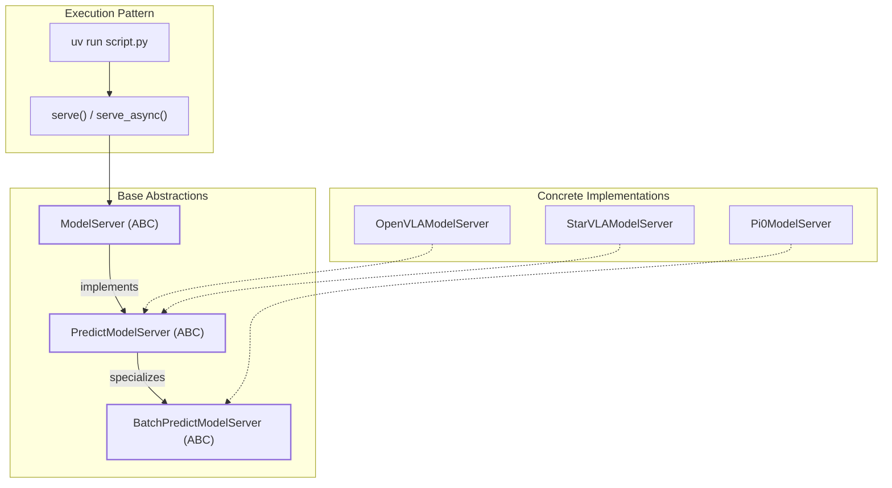

<!-- source: DeepWiki mcp.deepwiki.com · repo allenai/vla-evaluation-harness · page 3 Model Servers · fetched 2026-10-26 -->

# Model Servers

<details>
<summary>Relevant source files</summary>

The following files were used as context for generating this wiki page:

- [README.md](README.md)
- [configs/model_servers/starvla_groot_simpler.yaml](configs/model_servers/starvla_groot_simpler.yaml)
- [leaderboard/README.md](leaderboard/README.md)
- [src/vla_eval/model_servers/starvla.py](src/vla_eval/model_servers/starvla.py)

</details>


The model server subsystem is a decoupled, high-performance inference layer designed to host Vision-Language-Action (VLA) models independently of the simulation benchmarks. By separating the model's heavy GPU dependencies from the benchmark's complex simulation environments, the harness avoids "dependency hell" and enables massive throughput via batched inference.

## Two-Tier Hierarchy

The subsystem is built on a two-tier Abstract Base Class (ABC) hierarchy that separates the low-level communication and session management from the high-level model prediction logic.


*Sources: [src/vla_eval/model_servers/base.py:15-35](), [src/vla_eval/model_servers/predict.py:22-45](), [src/vla_eval/model_servers/batch_predict.py:25-50]()*

### 1. ModelServer (The Protocol Layer)
The `ModelServer` base class defines the core lifecycle hooks for any model interaction. It handles raw `Observation` inputs and returns `Action` outputs, while managing session state via `SessionContext`.
*   **`on_episode_start`**: Called when a new episode begins.
*   **`on_observation`**: The primary entry point for generating actions.
*   **`on_episode_end`**: Called for cleanup or metric logging.

### 2. PredictModelServer (The Inference Layer)
Most implementations inherit from `PredictModelServer`. This class abstracts away the `SessionContext` and provides a simplified `predict()` method. It also includes built-in support for **Action Chunking**, allowing models to return multiple future steps that are buffered and played back by the client.

For details on the base API and session management, see **[Model Server API](#3.1)**.

---

## The uv Script Pattern (PEP 723)

To ensure "Zero Setup" portability, every built-in model server is implemented as a standalone Python script using the [PEP 723](https://peps.python.org/pep-0723) inline metadata format. This allows the `uv` package manager to automatically create a virtual environment with the exact dependencies required by a specific model (e.g., specific versions of `torch`, `transformers`, or custom CUDA kernels) without affecting the host system or other models.

**Example Script Header:**
```python
# /// script
# requires-python = "~=3.11"
# dependencies = [
#     "vla-eval",
#     "starvla",
#     "torch>=2.0",
# ]
# [tool.uv.sources]
# vla-eval = { path = "../../.." }
# ///
```
*Sources: [src/vla_eval/model_servers/starvla.py:1-29](), [README.md:38-39]()*

---

## High-Throughput Batching

The `BatchPredictModelServer` is the engine behind the harness's **47x throughput** gains. It implements a producer-consumer pattern where multiple benchmark shards (clients) send observations to a shared `_BatchQueue`. A background `_dispatch_loop` aggregates these requests into a single tensor, performs a single GPU forward pass, and dispatches results back to the respective clients.

| Parameter | Description |
| :--- | :--- |
| `max_batch_size` | The maximum number of observations to aggregate before forcing a forward pass. |
| `max_wait_time` | The maximum time (in seconds) to wait for a batch to fill before processing a partial batch. |

For details on the batching loop and action blending strategies, see **[Batching and Action Chunking](#3.2)**.

---

## Built-in Implementations

The harness ships with a wide variety of pre-configured model servers in `src/vla_eval/model_servers/`. These are registered in the `SERVER_REGISTRY` and can be launched via the `vla-eval serve` command using YAML configurations found in `configs/model_servers/`.

**Key Implementations:**
*   **OpenVLA**: Standard VLA baseline.
*   **π₀ (Pi0)**: Flow-matching based VLA.
*   **StarVLA**: Support for Qwen-based frameworks (GR00T, OFT, PI, Fast).
*   **CogACT**: Action-chunking transformer.

For a full catalog and configuration reference, see **[Built-in Model Server Implementations](#3.3)**.

---

## Sub-Pages

| Page | Description |
| :--- | :--- |
| **[Model Server API](#3.1)** | Details on `ModelServer` hooks, `SessionContext`, and the WebSocket/HTTP control plane. |
| **[Batching and Action Chunking](#3.2)** | Internals of the `BatchPredictModelServer` and `ActionChunkBuffer` blending (EMA, Average). |
| **[Built-in Model Server Implementations](#3.3)** | Technical details and dependency requirements for all supported VLA models. |

*Sources: [README.md:13-15](), [README.md:97-98]()*

---

