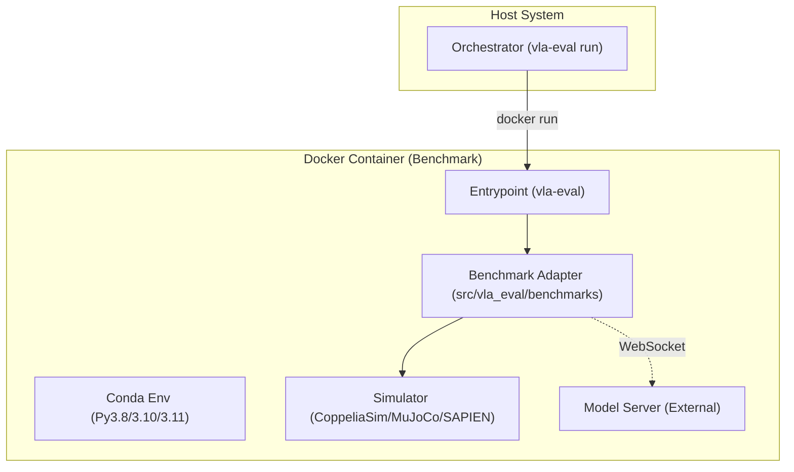
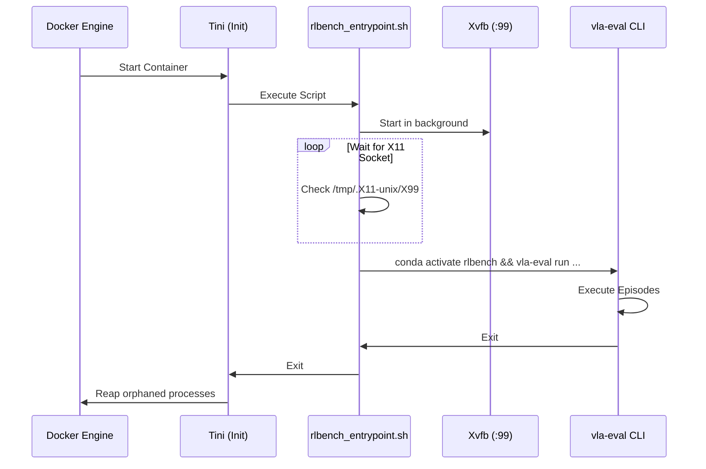

<!-- source: DeepWiki mcp.deepwiki.com · repo allenai/vla-evaluation-harness · page 4.3 Docker Packaging for Benchmarks · fetched 2026-10-26 -->

# Docker Packaging for Benchmarks

Relevant source files

The following files were used as context for generating this wiki page:

- [.dockerignore](.dockerignore)
- [docker/Dockerfile.calvin](docker/Dockerfile.calvin)
- [docker/Dockerfile.kinetix](docker/Dockerfile.kinetix)
- [docker/Dockerfile.libero](docker/Dockerfile.libero)
- [docker/Dockerfile.libero_mem](docker/Dockerfile.libero_mem)
- [docker/Dockerfile.libero_pro](docker/Dockerfile.libero_pro)
- [docker/Dockerfile.maniskill2](docker/Dockerfile.maniskill2)
- [docker/Dockerfile.mikasa_robo](docker/Dockerfile.mikasa_robo)
- [docker/Dockerfile.rlbench](docker/Dockerfile.rlbench)
- [docker/Dockerfile.robocasa](docker/Dockerfile.robocasa)
- [docker/Dockerfile.robocerebra](docker/Dockerfile.robocerebra)
- [docker/Dockerfile.robotwin](docker/Dockerfile.robotwin)
- [docker/Dockerfile.simpler](docker/Dockerfile.simpler)
- [docker/Dockerfile.vlabench](docker/Dockerfile.vlabench)
- [docker/rlbench_entrypoint.sh](docker/rlbench_entrypoint.sh)
- [src/vla_eval/types.py](src/vla_eval/types.py)

The `vla-evaluation-harness` uses a containerized approach to manage the diverse and often conflicting dependencies of robotics benchmarks. Each benchmark is isolated into its own Docker image, ensuring that legacy Python versions (e.g., 3.8 for RLBench/LIBERO), specific simulator binaries (CoppeliaSim, MuJoCo), and system-level drivers do not interfere with the model serving environment or other benchmarks.

### Container Architecture

All benchmark containers are built upon a unified base image and follow a standardized layout for the evaluation harness installation.

#### Base Image and Registry
The standard base image is `nvidia/cuda:12.1.1-runtime-ubuntu22.04` (aliased as `ghcr.io/allenai/vla-evaluation-harness/base:latest`). This provides the necessary CUDA runtime for benchmarks that utilize GPU acceleration for rendering (e.g., ManiSkill2, RoboCasa) or physics (e.g., Kinetix). Images are hosted on the GitHub Container Registry (`ghcr.io`).

#### Standard Container Layout
Each Dockerfile typically performs the following steps:
1.  **System Dependencies**: Installs required libraries via `apt-get` (e.g., `xvfb` for headless rendering, `libfftw3-dev` for CALVIN).
2.  **Conda Environment**: Creates a dedicated environment with the Python version required by the upstream benchmark [docker/Dockerfile.rlbench:32-33]().
3.  **Benchmark Installation**: Clones the benchmark source and installs it in editable mode [docker/Dockerfile.libero:22-24]().
4.  **Harness Integration**: Copies the `vla-eval` source code into `/workspace` and installs it using `uv pip` to provide the `vla-eval` entrypoint inside the container [docker/Dockerfile.calvin:50-55]().

**Benchmark Container Topology**

Sources: [docker/Dockerfile.rlbench:5-60](), [docker/Dockerfile.calvin:1-60](), [docker/Dockerfile.maniskill2:4-40]()

---

### Per-Benchmark Implementation Details

Different benchmarks require specific handling for assets, simulators, and display servers.

| Benchmark | Base Python | Simulator | Special Requirements |
| :--- | :--- | :--- | :--- |
| **RLBench** | 3.8 | CoppeliaSim 4.1.0 | Xvfb for headless GLX rendering, `tini` for process reaping. |
| **CALVIN** | 3.8 | PyBullet | Embedded validation data (17KB), `setuptools==57.5.0` for legacy builds. |
| **LIBERO** | 3.8 | MuJoCo | Pre-configured `.libero/config.yaml` to suppress interactive prompts. |
| **ManiSkill2** | 3.10 | SAPIEN | Embedded YCB/EGAD assets (~360MB) to avoid runtime downloads. |
| **RoboCasa** | 3.11 | MuJoCo | Automatic download of ~10GB kitchen assets during build. |
| **Kinetix** | 3.11 | JAX-based | Custom level files from the RTC repository. |

#### Headless Rendering with Xvfb
Benchmarks like RLBench require a functional X display even in headless mode. The `docker/rlbench_entrypoint.sh` script initializes a virtual framebuffer before launching the evaluation.

Sources: [docker/rlbench_entrypoint.sh:1-19](), [docker/Dockerfile.rlbench:54-59]()

---

### Data Handling and Initialization

To ensure reproducibility and speed up execution, certain benchmarks include pre-generated data or specific configuration files.

*   **Init States**: `LIBERO-Mem` requires initial state files that take ~43 minutes to generate. These are pre-generated and copied into the image at `docker/init_states/libero_mem/` [docker/Dockerfile.libero_mem:31-33]().
*   **Validation Data**: CALVIN's language-conditioned tasks rely on a specific validation dataset, which is embedded directly into the image at `/data/calvin/dataset/validation/` [docker/Dockerfile.calvin:46-47]().
*   **Build Optimization**: The `.dockerignore` file uses a "deny-all, whitelist-specific" strategy to keep image sizes small, only including necessary source code, configs, and initialization data [/.dockerignore:1-10]().

### Entrypoints and Execution

The `ENTRYPOINT` for most benchmark containers is configured to use `conda run --no-capture-output`. This ensures that logs from the `vla-eval` process are streamed directly to the host's stdout/stderr.

**Example Entrypoint Configuration:**
*   **Standard**: `ENTRYPOINT ["conda", "run", "--no-capture-output", "-n", "libero", "vla-eval"]` [docker/Dockerfile.libero:43]()
*   **RLBench (Special)**: Uses `tini` as the init process to handle signal forwarding and cleanup of CoppeliaSim child processes [docker/Dockerfile.rlbench:59]().

**Data Flow: Observation and Action Types**
The containerized benchmark communicates with the model server using the types defined in `src/vla_eval/types.py`.

| Entity | Code Symbol | Content |
| :--- | :--- | :--- |
| **Observation** | `Observation` | `dict` containing `images` (HWC arrays), `task_description` (str), and `state` (proprioception) [src/vla_eval/types.py:14-36](). |
| **Action** | `Action` | `dict` containing `actions` (np.ndarray) [src/vla_eval/types.py:38-44](). |
| **Task** | `Task` | `dict` with `name` and `suite` strings [src/vla_eval/types.py:46-53](). |
| **Result** | `EpisodeResult` | `dict` with at least a `"success": bool` key [src/vla_eval/types.py:55-60](). |

Sources: [src/vla_eval/types.py:1-61](), [docker/Dockerfile.libero:43-44](), [docker/Dockerfile.calvin:58-59]()

---

