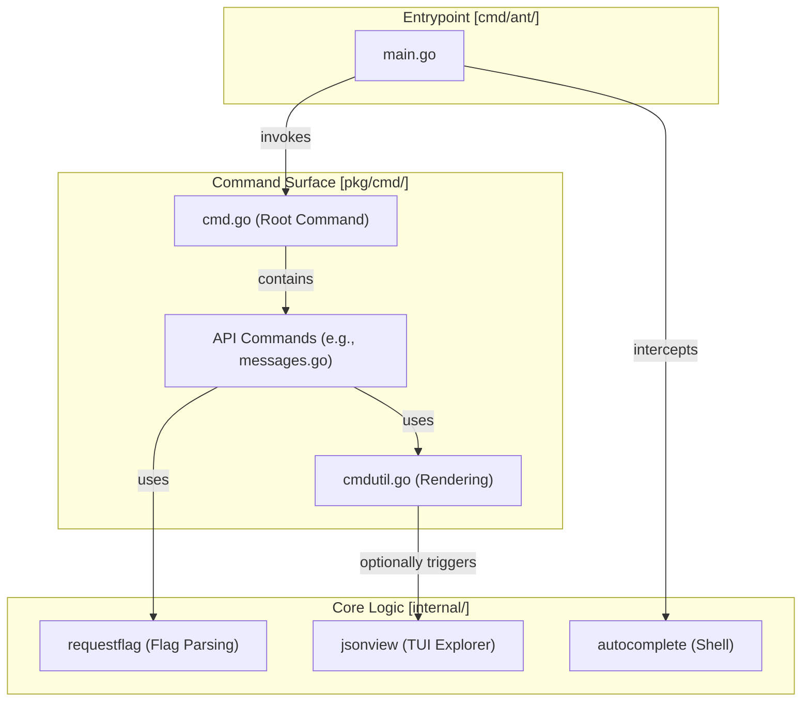
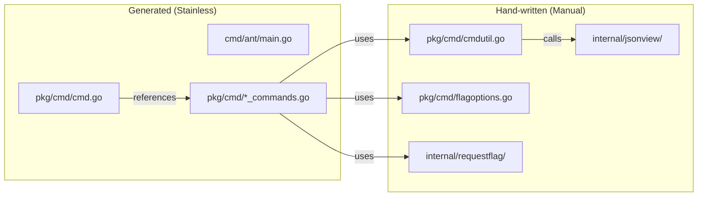

<!-- source: DeepWiki mcp.deepwiki.com · repo anthropics/anthropic-cli · page 1.2 Project Layout · fetched 2026-10-26 -->

# Project Layout

Relevant source files

The following files were used as context for generating this wiki page:

- [.stats.yml](.stats.yml)
- [cmd/ant/main.go](cmd/ant/main.go)
- [go.mod](go.mod)
- [pkg/cmd/cmd.go](pkg/cmd/cmd.go)

This page describes the directory structure and organization of the Anthropic CLI (`ant`) repository. The project is structured to separate the generated API command surface from hand-written core logic, utilities, and developer tooling.

## Directory Structure Overview

The repository follows standard Go project layouts with specific directories dedicated to the `urfave/cli` implementation and internal shared logic.

| Directory | Purpose | Key Contents |
| :--- | :--- | :--- |
| `cmd/ant/` | Main entrypoint | `main.go` |
| `pkg/cmd/` | Command definitions | API resource commands, `cmd.go`, `cmdutil.go` |
| `internal/` | Private shared logic | `requestflag`, `autocomplete`, `jsonview`, `mocktest` |
| `scripts/` | Developer tooling | Build, test, and linting scripts |

### Component Interaction Diagram
The following diagram illustrates how different parts of the repository interact to fulfill a CLI request.

"CLI Request Pipeline"

**Sources:** [cmd/ant/main.go:19-33](), [pkg/cmd/cmd.go:26-85](), [internal/requestflag/request_flag.go:1-20]()

---

## cmd/ant/ (Entrypoint)

The `cmd/ant/` directory contains the `main` package and the primary entrypoint for the application.

*   **`main.go`**: Responsible for initializing the `urfave/cli` application, handling environment-level overrides (like `ANTHROPIC_BASE_URL`), and managing the global error handling strategy. It differentiates between standard Go errors and `anthropic.Error` types to provide formatted JSON error output when available [cmd/ant/main.go:19-60]().

**Sources:** [cmd/ant/main.go:19-60]()

---

## pkg/cmd/ (Command Implementations)

This directory contains the bulk of the CLI's functional logic. It is a mix of hand-written utilities and files generated from the OpenAPI specification.

*   **`cmd.go`**: Defines the root `ant` command and wires together the hierarchical tree of subcommands (e.g., `messages`, `beta:models`) [pkg/cmd/cmd.go:26-272]().
*   **API Resource Files**: Files like `messages.go` or `betamessage.go` (referenced in `cmd.go`) contain the specific `cli.Command` definitions for API endpoints.
*   **`cmdutil.go`**: Contains shared helpers for the command-line interface, including JSON rendering (`ShowJSON`), output formatting logic, and binary file download handling.
*   **`flagoptions.go`**: Implements the logic for the `flagOptions` pipeline, which handles file embedding (`@filename`) and stdin merging for request bodies.

**Sources:** [pkg/cmd/cmd.go:26-272](), [cmd/ant/main.go:13-16]()

---

## internal/ (Private Utilities)

The `internal/` directory contains packages that are not intended for use by external projects but provide critical shared functionality within the CLI.

*   **`requestflag/`**: Implements a generic flag system that maps CLI flags directly to API request structures, supporting nested paths (e.g., `--message.role`) [pkg/cmd/cmd.go:16-16]().
*   **`jsonview/`**: A `bubbletea`-based TUI for interactive exploration of JSON responses when the `explore` format is used.
*   **`autocomplete/`**: Manages shell completion logic for Bash, Zsh, Fish, and PowerShell, including the generation of completion scripts [pkg/cmd/cmd.go:15-15]().
*   **`mocktest/`**: Provides infrastructure for integration testing against a mock API server.
*   **`debugmiddleware/`**: Implements HTTP middleware for logging requests and responses when the `--debug` flag is active.

**Sources:** [pkg/cmd/cmd.go:15-16](), [internal/requestflag/request_flag.go:1-20]()

---

## Generated vs. Hand-written Files

The project uses [Stainless](https://www.stainlessapi.com) to generate the API client and command structures from an OpenAPI specification.

*   **Generated Files**: Typically contain a header: `// File generated from our OpenAPI spec by Stainless`. These include the core command definitions in `pkg/cmd/` and the entrypoint in `cmd/ant/main.go` [cmd/ant/main.go:1-1](), [pkg/cmd/cmd.go:1-1]().
*   **Hand-written Files**: Files like `pkg/cmd/cmdutil.go`, `pkg/cmd/flagoptions.go`, and the entire `internal/` directory are hand-maintained to provide the CLI's unique user experience (TUI, file embedding, etc.).
*   **`.stats.yml`**: Tracks the state of the OpenAPI generation, including the spec URL and the number of configured endpoints [stats.yml:1-4]().

"Code Entity Mapping: Generated vs Hand-written"

**Sources:** [.stats.yml:1-4](), [cmd/ant/main.go:1-1](), [pkg/cmd/cmd.go:1-1]()

---

## scripts/ (Developer Tooling)

The `scripts/` directory contains automation for the development lifecycle.

*   **`run`**: A wrapper to run the CLI locally using `go run ./cmd/ant`.
*   **`bootstrap`**: Sets up the local development environment.
*   **`test` / `mock`**: Runs the test suite, often involving the `mocktest` internal package and a mock server.
*   **`build`**: Compiles the binary for the local platform.

**Sources:** [go.mod:1-20]() (Module dependencies used by scripts)

---

