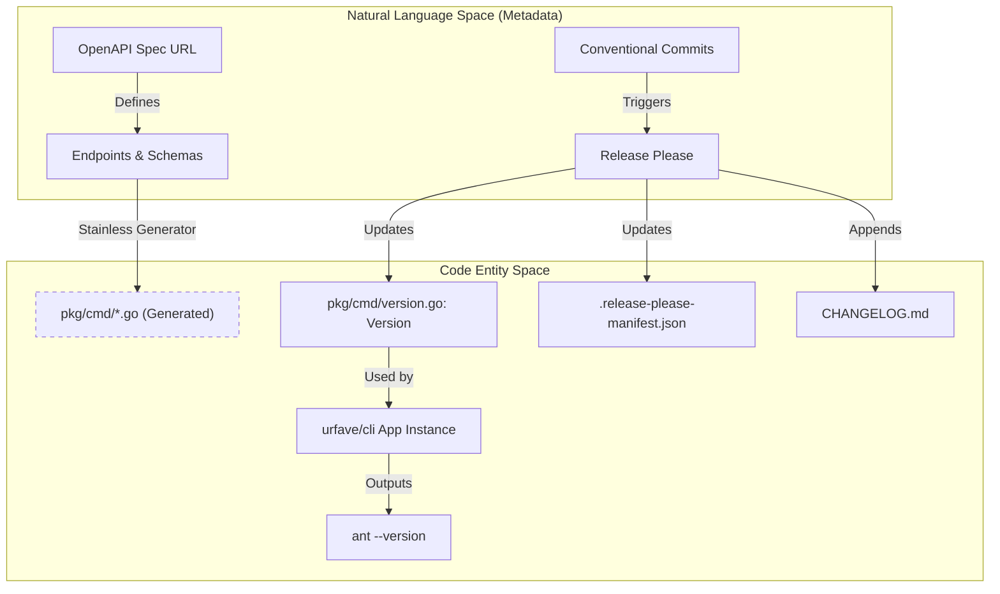
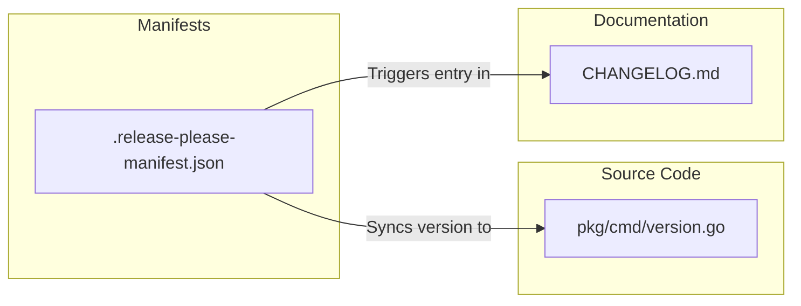

<!-- source: DeepWiki mcp.deepwiki.com · repo anthropics/anthropic-cli · page 8 SDK Generation and Versioning · fetched 2026-10-26 -->

# SDK Generation and Versioning

<details>
<summary>Relevant source files</summary>

The following files were used as context for generating this wiki page:

- [.release-please-manifest.json](.release-please-manifest.json)
- [.stats.yml](.stats.yml)
- [CHANGELOG.md](CHANGELOG.md)
- [go.mod](go.mod)
- [go.sum](go.sum)
- [pkg/cmd/version.go](pkg/cmd/version.go)

</details>


The Anthropic CLI (`ant`) is primarily a generated tool. It leverages the **Stainless** engine to transform an OpenAPI specification into a functional Go CLI. This approach ensures that the CLI remains in lockstep with the Anthropic API while minimizing manual maintenance of boilerplate request/response logic.

## Stainless Generation Workflow

The core of the CLI's command structure is derived from the Anthropic OpenAPI specification. Stainless processes this specification and applies a configuration layer to produce the Go source code found in `pkg/cmd/`.

### Generation Metadata (`.stats.yml`)

The `.stats.yml` file serves as the "fingerprint" for the current state of the generated code. It tracks exactly which version of the API spec and configuration were used.

| Field | Description |
| :--- | :--- |
| `configured_endpoints` | The total number of API endpoints mapped to CLI commands. |
| `openapi_spec_url` | The permanent Google Storage URL for the specific YAML spec used. |
| `openapi_spec_hash` | An MD5/SHA hash of the OpenAPI specification file. |
| `config_hash` | A hash of the Stainless configuration used to tune the generation. |

**Sources:**
- [`.stats.yml:1-4`]()

### Generated vs. Hand-written Files

Most files in the repository contain a header indicating they are generated.

*   **Generated Files:** These include almost all resource-specific commands in `pkg/cmd/` (e.g., `message.go`, `model.go`) and the `Version` constant in `pkg/cmd/version.go`. These files should not be edited manually as changes will be overwritten.
*   **Hand-written Files:** Logic that cannot be expressed in OpenAPI—such as the TUI JSON explorer (`internal/jsonview`), complex flag merging (`pkg/cmd/flagoptions.go`), and custom output formatting (`pkg/cmd/cmdutil.go`)—is maintained manually.

**Sources:**
- [`pkg/cmd/version.go:1-1`]()

## Versioning Mechanism

The CLI follows Semantic Versioning (SemVer). The version state is synchronized across several files to ensure consistent reporting via the `--version` flag and proper release tagging.

### The Version Constant

The source of truth for the binary's version at runtime is the `Version` constant.

```go
package cmd

const Version = "1.1.0" // x-release-please-version
```

The comment `// x-release-please-version` is a sentinel used by the Release Please automation to locate and update the string during the release process.

**Sources:**
- [`pkg/cmd/version.go:5-5`]()

### Dependency Management

The CLI depends on the `anthropic-sdk-go`, which is also a Stainless-generated artifact. The version of the SDK used is managed in `go.mod`.

**Sources:**
- [`go.mod:6-6`]()
- [`go.sum:1-2`]()

## Release Automation

The project uses **Release Please** and **GoReleaser** to automate the delivery of new versions.

### Release Please

Release Please parses the git log for [Conventional Commits](https://www.conventionalcommits.org) and automatically maintains:
1.  **`CHANGELOG.md`**: Summarizes features, fixes, and chores.
2.  **`.release-please-manifest.json`**: Tracks the current version of the root package.
3.  **`pkg/cmd/version.go`**: Updates the `Version` constant.

When a "Release PR" is merged, Release Please creates a GitHub Tag (e.g., `v1.1.0`).

### Code Entity to Release Flow

The following diagram illustrates how a change in the OpenAPI spec eventually manifests as a tagged release in the code entities.

**Diagram: Generation and Release Data Flow**


**Sources:**
- [`.stats.yml:2-2`]()
- [`pkg/cmd/version.go:5-5`]()
- [`.release-please-manifest.json:1-3`]()
- [`CHANGELOG.md:1-23`]()

### Release Manifest and Changelog

The `.release-please-manifest.json` file acts as the internal registry for the versioning bot, while `CHANGELOG.md` provides the human-readable history.

**Diagram: Version Synchronization**


**Sources:**
- [`.release-please-manifest.json:1-3`]()
- [`pkg/cmd/version.go:5-5`]()
- [`CHANGELOG.md:3-16`]()

---

