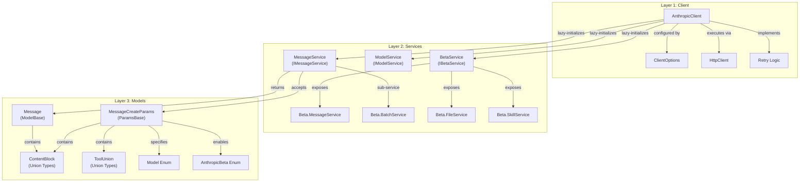
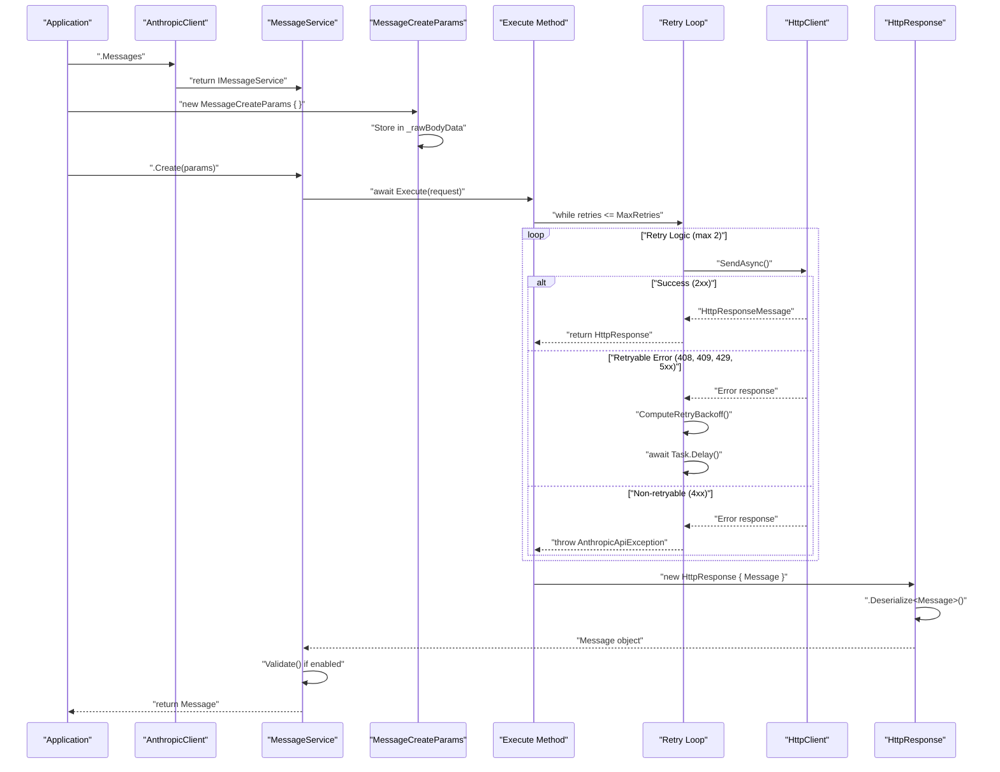
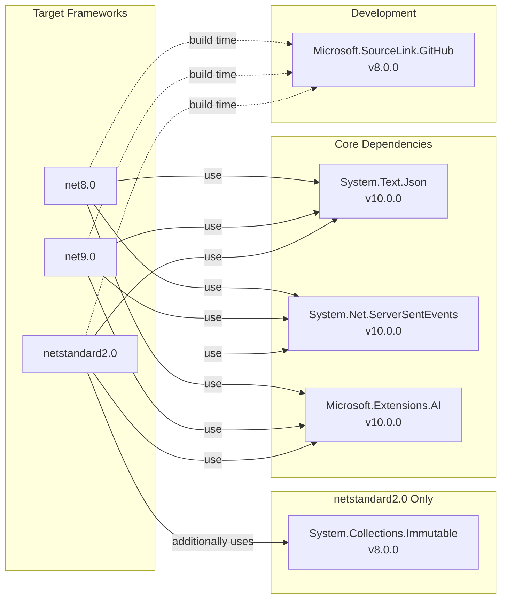

<!-- source: DeepWiki mcp.deepwiki.com · repo anthropics/anthropic-sdk-csharp · page 1 Overview · fetched 2026-10-26 -->

# Overview

Relevant source files

The following files were used as context for generating this wiki page:

- [.release-please-manifest.json](.release-please-manifest.json)
- [.stats.yml](.stats.yml)
- [CHANGELOG.md](CHANGELOG.md)
- [README.md](README.md)
- [examples/ChatClientExample/ChatClientExample.csproj](examples/ChatClientExample/ChatClientExample.csproj)
- [release-please-config.json](release-please-config.json)
- [src/Anthropic.Foundry/Anthropic.Foundry.csproj](src/Anthropic.Foundry/Anthropic.Foundry.csproj)
- [src/Anthropic.Foundry/AnthropicFoundryClient.cs](src/Anthropic.Foundry/AnthropicFoundryClient.cs)
- [src/Anthropic.Foundry/CHANGELOG.md](src/Anthropic.Foundry/CHANGELOG.md)
- [src/Anthropic.Tests/TestBase.cs](src/Anthropic.Tests/TestBase.cs)
- [src/Anthropic/Anthropic.csproj](src/Anthropic/Anthropic.csproj)
- [src/Anthropic/AnthropicClient.cs](src/Anthropic/AnthropicClient.cs)
- [src/Anthropic/CHANGELOG.md](src/Anthropic/CHANGELOG.md)
- [src/Anthropic/Core/ClientOptions.cs](src/Anthropic/Core/ClientOptions.cs)
- [src/Anthropic/Core/EnvironmentUrl.cs](src/Anthropic/Core/EnvironmentUrl.cs)
- [src/Anthropic/IAnthropicClient.cs](src/Anthropic/IAnthropicClient.cs)
- [src/Anthropic/Models/Beta/AnthropicBeta.cs](src/Anthropic/Models/Beta/AnthropicBeta.cs)
- [src/Anthropic/Models/Messages/Model.cs](src/Anthropic/Models/Messages/Model.cs)
- [src/logo.png](src/logo.png)

This document introduces the Anthropic C# SDK repository, its two-package architecture, and the fundamental system design that enables C# applications to interact with the Anthropic API.

For installation and configuration details, see [Getting Started](#2). For detailed API usage, see [API Services](#4). For ecosystem integrations including IChatClient and MCP, see [Ecosystem Integration](#8).

## Repository Structure

The repository at https://github.com/anthropics/anthropic-sdk-csharp produces two NuGet packages from a monorepo structure:

| Package | Current Version | Purpose | Project Path |
|---------|-----------------|---------|--------------|
| `Anthropic` | 12.0.1 | Core SDK for Anthropic API access | [src/Anthropic/Anthropic.csproj]() |
| `Anthropic.Foundry` | 0.2.0 | Azure-hosted API deployment support | [src/Anthropic.Foundry/Anthropic.Foundry.csproj]() |

Both packages are currently in **prerelease** status ([release-please-config.json:9-10]()), with automated versioning managed through release-please ([.release-please-manifest.json]()).

**Sources:** [.release-please-manifest.json](), [src/Anthropic/Anthropic.csproj:1-55](), [src/Anthropic.Foundry/Anthropic.Foundry.csproj:1-44](), [README.md:1-21]()

## Package Architecture

```mermaid
graph TB
    subgraph "Anthropic Package (Core SDK)"
        AnthropicClient["AnthropicClient<br/>Main Entry Point"]
        ClientOptions["ClientOptions<br/>Configuration Record"]
        
        subgraph "Service Layer"
            IMessageService["IMessageService<br/>Message Operations"]
            IModelService["IModelService<br/>Model Information"]
            IBetaService["IBetaService<br/>Beta Features Gateway"]
        end
        
        subgraph "Infrastructure"
            ParamsBase["ParamsBase<br/>Request Construction"]
            ModelBase["ModelBase<br/>Response Deserialization"]
            HttpResponse["HttpResponse<br/>HTTP Response Wrapper"]
        end
    end
    
    subgraph "Anthropic.Foundry Package"
        AnthropicFoundryClient["AnthropicFoundryClient<br/>Azure Client"]
        IAnthropicFoundryCredentials["IAnthropicFoundryCredentials<br/>Azure Authentication"]
    end
    
    subgraph "External Dependencies"
        STJ["System.Text.Json<br/>v10.0.0"]
        SSE["System.Net.ServerSentEvents<br/>v10.0.0"]
        MSAI["Microsoft.Extensions.AI.Abstractions<br/>v10.0.0"]
        AzureIdentity["Azure.Identity<br/>v1.17.0"]
    end
    
    AnthropicClient -->|"exposes"| IMessageService
    AnthropicClient -->|"exposes"| IModelService
    AnthropicClient -->|"exposes"| IBetaService
    AnthropicClient -->|"configured by"| ClientOptions
    AnthropicClient -->|"uses"| ParamsBase
    AnthropicClient -->|"returns"| ModelBase
    AnthropicClient -->|"executes via"| HttpResponse
    
    AnthropicFoundryClient -->|"extends"| AnthropicClient
    AnthropicFoundryClient -->|"requires"| IAnthropicFoundryCredentials
    
    AnthropicClient -.->|"depends on"| STJ
    AnthropicClient -.->|"depends on"| SSE
    AnthropicClient -.->|"depends on"| MSAI
    
    AnthropicFoundryClient -.->|"depends on"| AzureIdentity
```

**Anthropic Package (Core SDK)**

The main `Anthropic` package provides complete API access through the `AnthropicClient` class ([src/Anthropic/AnthropicClient.cs:15]()), which exposes three primary services:
- `Messages` - Message creation, streaming, and token counting ([src/Anthropic/AnthropicClient.cs:82-85]())
- `Models` - Model retrieval and listing ([src/Anthropic/AnthropicClient.cs:87-91]())
- `Beta` - Beta feature access ([src/Anthropic/AnthropicClient.cs:93-97]())

**Anthropic.Foundry Package (Azure Extension)**

The `Anthropic.Foundry` package provides `AnthropicFoundryClient` ([src/Anthropic.Foundry/AnthropicFoundryClient.cs:8]()), which extends `AnthropicClient` to support Azure-hosted Anthropic API deployments with Azure Active Directory authentication through `IAnthropicFoundryCredentials` ([src/Anthropic.Foundry/AnthropicFoundryClient.cs:10]()).

**Sources:** [src/Anthropic/AnthropicClient.cs:15-325](), [src/Anthropic.Foundry/AnthropicFoundryClient.cs:8-65](), [src/Anthropic/Anthropic.csproj:47-50](), [src/Anthropic.Foundry/Anthropic.Foundry.csproj:9-17]()

## Three-Layer Architecture

**Layer 1: Client Layer**

The `AnthropicClient` ([src/Anthropic/AnthropicClient.cs:15]()) manages HTTP communication, configuration, and retry logic. It maintains:
- `ClientOptions` record ([src/Anthropic/Core/ClientOptions.cs]()) containing API keys, base URL, timeout, and retry settings
- `HttpClient` instance for connection pooling ([src/Anthropic/AnthropicClient.cs:27-31]())
- Exponential backoff retry mechanism ([src/Anthropic/AnthropicClient.cs:220-234]())

**Layer 2: Service Layer**

Services are exposed as properties on the client and implement domain-specific interfaces:
- `MessageService` implements `IMessageService` ([src/Anthropic/Services/MessageService.cs:16]())
- `ModelService` implements `IModelService`
- `BetaService` implements `IBetaService`

Services are instantiated lazily using `Lazy<T>` ([src/Anthropic/AnthropicClient.cs:81-97]()).

**Layer 3: Model Layer**

All request parameters inherit from `ParamsBase` ([src/Anthropic/Core/ParamsBase.cs:14]()) and all responses inherit from `ModelBase`. The model layer uses:
- `FreezableDictionary<K,V>` ([src/Anthropic/Core/FreezableDictionary.cs:16]()) for immutable raw data storage
- `ApiEnum<TRaw,TEnum>` ([src/Anthropic/Core/ApiEnum.cs:24]()) for forward-compatible enum handling
- Union types for polymorphic content (documented in [Data Models Reference](#9))

**Sources:** [src/Anthropic/AnthropicClient.cs:15-325](), [src/Anthropic/Core/ParamsBase.cs:14-276](), [src/Anthropic/Core/ModelBase.cs](), [src/Anthropic/Core/FreezableDictionary.cs:16-166](), [src/Anthropic/Core/ApiEnum.cs:24-88]()

## Request Execution Flow

The execution flow implements resilient HTTP communication:

1. **Service Invocation**: Applications call service methods with `ParamsBase`-derived request objects ([src/Anthropic/Services/MessageService.cs:39-64]())
2. **Request Construction**: Parameters build URLs, headers, and body content ([src/Anthropic/Core/ParamsBase.cs:54-184]())
3. **Retry Loop**: The client retries up to `MaxRetries` times (default 2) with exponential backoff ([src/Anthropic/AnthropicClient.cs:106-152]())
4. **Backoff Calculation**: Uses API-provided `Retry-After` headers or exponential backoff with jitter ([src/Anthropic/AnthropicClient.cs:220-274]())
5. **Deserialization**: Responses are deserialized using `System.Text.Json` ([src/Anthropic/Core/HttpResponse.cs:17-38]())
6. **Validation**: Optional validation checks response structure ([src/Anthropic/Services/MessageService.cs:59-62]())

**Sources:** [src/Anthropic/AnthropicClient.cs:100-152](), [src/Anthropic/Services/MessageService.cs:39-64](), [src/Anthropic/Core/ParamsBase.cs:54-184](), [src/Anthropic/Core/HttpResponse.cs:17-38]()

## Technology Stack and Dependencies

**Framework Support**

The SDK targets three frameworks ([src/Anthropic/Anthropic.csproj:32]()):
- **.NET 8.0** - Modern .NET with full async support
- **.NET 9.0** - Latest .NET features
- **.NET Standard 2.0** - Maximum compatibility (including .NET Framework 4.6.2+)

**Core Dependencies**

| Package | Version | Purpose |
|---------|---------|---------|
| System.Text.Json | 10.0.0 | JSON serialization/deserialization |
| System.Net.ServerSentEvents | 10.0.0 | Server-Sent Events (SSE) streaming support |
| Microsoft.Extensions.AI.Abstractions | 10.0.0 | IChatClient interface implementation |
| System.Collections.Immutable | 8.0.0 | Immutable collections (netstandard2.0 only) |

The SDK uses C# 12 language features ([src/Anthropic/Anthropic.csproj:33]()) with nullable reference types enabled ([src/Anthropic/Anthropic.csproj:37]()).

**Sources:** [src/Anthropic/Anthropic.csproj:32-54](), [src/Anthropic.Foundry/Anthropic.Foundry.csproj:3-18]()

## Model and Enum Reference

The SDK provides strongly-typed enums for API configuration:

**Model Enum**

The `Model` enum ([src/Anthropic/Models/Messages/Model.cs:13]()) defines all available Claude models:

| Model Family | Current Versions | Purpose |
|--------------|------------------|---------|
| Claude Opus 4.5 | `ClaudeOpus4_5_20251101`, `ClaudeOpus4_5` | Premium intelligence with practical performance |
| Claude Sonnet 4.5 | `ClaudeSonnet4_5_20250929`, `ClaudeSonnet4_5` | Best for agents and coding |
| Claude Haiku 4.5 | `ClaudeHaiku4_5_20251001`, `ClaudeHaiku4_5` | Hybrid model with instant response and thinking |
| Legacy Models | `Claude_3_Opus_20240229`, `Claude_3_Haiku_20240307` | Deprecated (EOL Jan 5, 2026) |

**AnthropicBeta Enum**

The `AnthropicBeta` enum ([src/Anthropic/Models/Beta/AnthropicBeta.cs:9]()) controls beta feature access via request headers:

| Beta Feature | Enum Value | Purpose |
|--------------|------------|---------|
| Message Batches | `MessageBatches2024_09_24` | Batch processing |
| Prompt Caching | `PromptCaching2024_07_31` | Cache frequently used prompts |
| Computer Use | `ComputerUse2025_01_24` | Computer control tools |
| Token Counting | `TokenCounting2024_11_01` | Token usage analysis |
| Context Management | `ContextManagement2025_06_27` | Edit conversation context |
| Skills API | `Skills2025_10_02` | Hosted capabilities |
| MCP Client | `MCPClient2025_11_20` | Model Context Protocol integration |

**Sources:** [src/Anthropic/Models/Messages/Model.cs:13-126](), [src/Anthropic/Models/Beta/AnthropicBeta.cs:9-30]()

## Development Status and Versioning

**Current Status**: Both packages are in **prerelease beta** ([release-please-config.json:9-10]()):
- Main package version: 12.0.1 ([.release-please-manifest.json:2]())
- Foundry package version: 0.2.0 ([.release-please-manifest.json:3]())

The version numbers are >= 10.0 due to a package transition from the community-maintained `tryAGI.Anthropic` package ([README.md:3-9]()). Despite the version number, this SDK is in early beta and may contain breaking changes in minor releases.

**Versioning Strategy**

The repository uses [release-please](https://github.com/googleapis/release-please) for automated versioning:
- Prerelease mode enabled ([release-please-config.json:9-10]())
- Conventional commit-based changelog generation ([release-please-config.json:15-62]())
- Independent package versioning ([release-please-config.json:2-5]())
- Automated version bumps in `.csproj` files ([release-please-config.json:64-71]())

**Distribution**

Both packages are published to [NuGet.org](https://www.nuget.org):
- Package metadata includes source link for debugging ([src/Anthropic/Anthropic.csproj:26-30]())
- XML documentation files are generated ([src/Anthropic/Anthropic.csproj:20]())
- MIT licensed ([src/Anthropic/Anthropic.csproj:12]())

**Sources:** [.release-please-manifest.json](), [release-please-config.json:1-72](), [README.md:3-19](), [src/Anthropic/Anthropic.csproj:1-55]()

## API Version and Headers

The SDK communicates with the Anthropic API using versioned headers:

**Default API Version**: `2023-06-01` ([src/Anthropic/Core/ParamsBase.cs:30]())

**Standard Headers** (sent with every request):

| Header | Value | Source |
|--------|-------|--------|
| `anthropic-version` | `2023-06-01` | [ParamsBase.cs:30]() |
| `User-Agent` | `AnthropicClient/C# {version}` | [ParamsBase.cs:214]() |
| `X-Api-Key` | From `APIKey` option | [ParamsBase.cs:202]() |
| `Authorization` | `Bearer {token}` (if `AuthToken` set) | [ParamsBase.cs:206]() |
| `X-Stainless-*` | Runtime, OS, architecture metadata | [ParamsBase.cs:22-29]() |

Beta features are enabled by adding the corresponding `AnthropicBeta` enum values to request headers (see [Beta Services](#4.4) for details).

**Sources:** [src/Anthropic/Core/ParamsBase.cs:16-212]()

---

