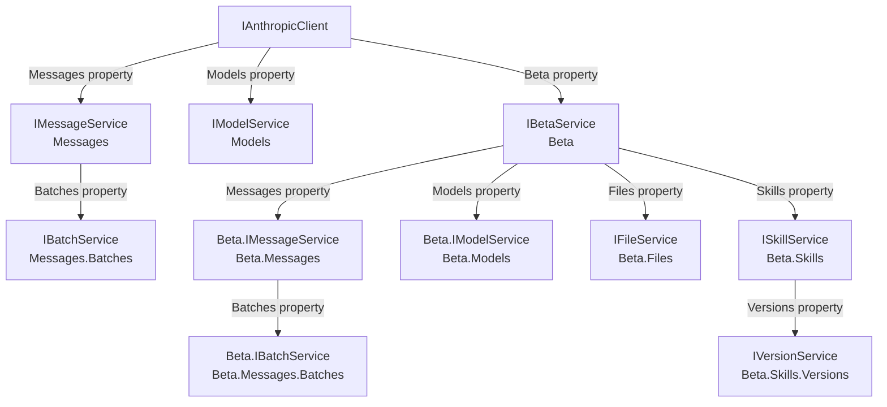
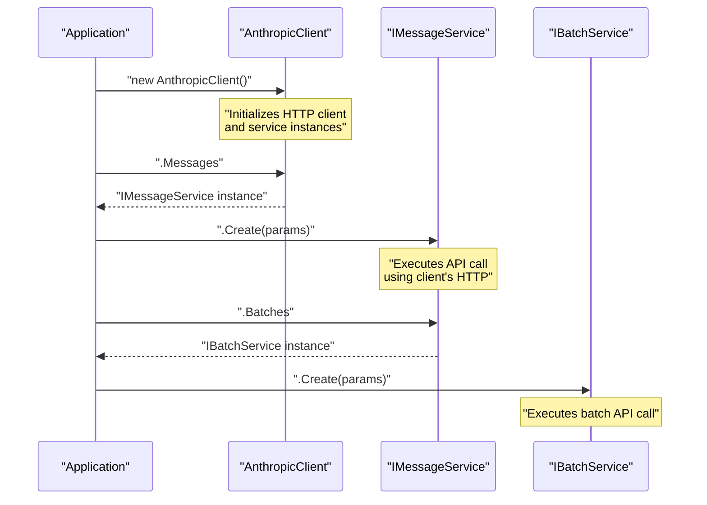
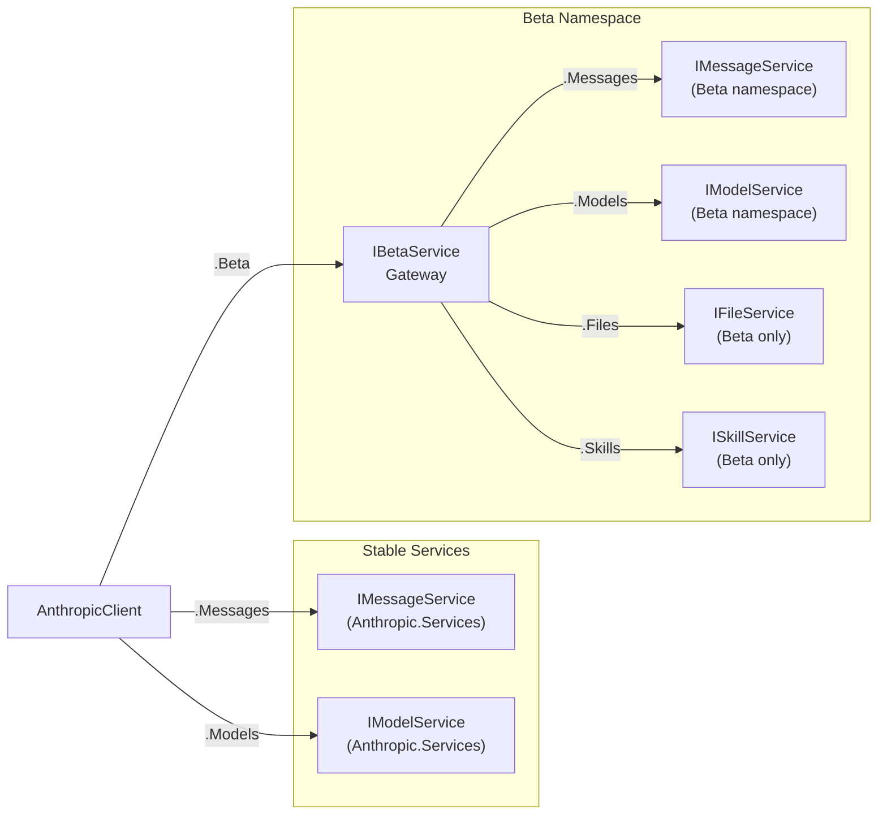
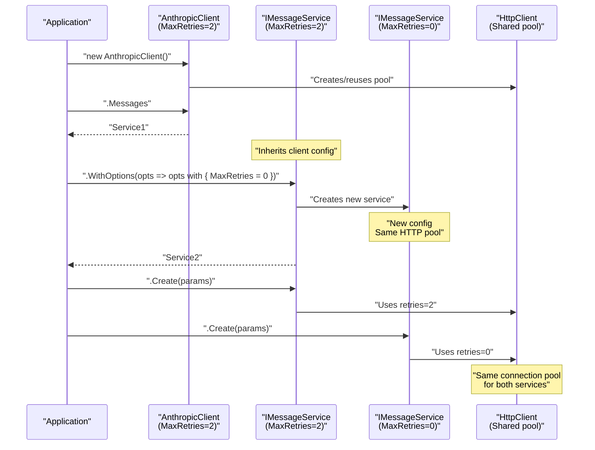
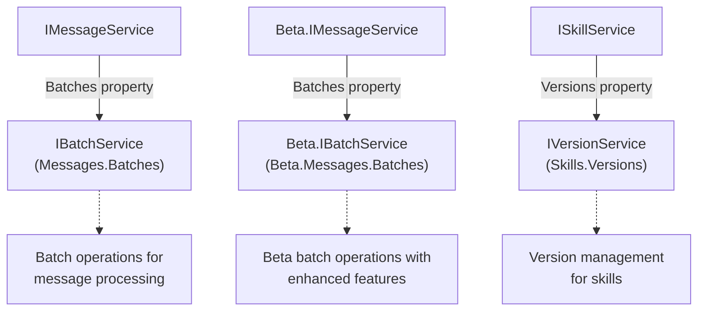

<!-- source: DeepWiki mcp.deepwiki.com · repo anthropics/anthropic-sdk-csharp · page 4 API Services · fetched 2026-10-26 -->

# API Services

<details>
<summary>Relevant source files</summary>

The following files were used as context for generating this wiki page:

- [src/Anthropic.Tests/AnthropicTestClients.cs](src/Anthropic.Tests/AnthropicTestClients.cs)
- [src/Anthropic.Tests/Services/Beta/FileServiceTest.cs](src/Anthropic.Tests/Services/Beta/FileServiceTest.cs)
- [src/Anthropic.Tests/Services/Beta/MessageServiceTest.cs](src/Anthropic.Tests/Services/Beta/MessageServiceTest.cs)
- [src/Anthropic.Tests/Services/Beta/Messages/BatchServiceTest.cs](src/Anthropic.Tests/Services/Beta/Messages/BatchServiceTest.cs)
- [src/Anthropic.Tests/Services/Beta/ModelServiceTest.cs](src/Anthropic.Tests/Services/Beta/ModelServiceTest.cs)
- [src/Anthropic.Tests/Services/Beta/SkillServiceTest.cs](src/Anthropic.Tests/Services/Beta/SkillServiceTest.cs)
- [src/Anthropic.Tests/Services/Beta/Skills/VersionServiceTest.cs](src/Anthropic.Tests/Services/Beta/Skills/VersionServiceTest.cs)
- [src/Anthropic.Tests/Services/MessageServiceTest.cs](src/Anthropic.Tests/Services/MessageServiceTest.cs)
- [src/Anthropic.Tests/Services/Messages/BatchServiceTest.cs](src/Anthropic.Tests/Services/Messages/BatchServiceTest.cs)
- [src/Anthropic.Tests/Services/ModelServiceTest.cs](src/Anthropic.Tests/Services/ModelServiceTest.cs)
- [src/Anthropic/Core/ApiEnum.cs](src/Anthropic/Core/ApiEnum.cs)
- [src/Anthropic/Core/FreezableDictionary.cs](src/Anthropic/Core/FreezableDictionary.cs)
- [src/Anthropic/Core/HttpResponse.cs](src/Anthropic/Core/HttpResponse.cs)
- [src/Anthropic/Core/ParamsBase.cs](src/Anthropic/Core/ParamsBase.cs)
- [src/Anthropic/Services/Beta/MessageService.cs](src/Anthropic/Services/Beta/MessageService.cs)
- [src/Anthropic/Services/MessageService.cs](src/Anthropic/Services/MessageService.cs)

</details>


This document provides a comprehensive guide to the API services exposed by the Anthropic C# SDK. Services are the primary way to interact with the Anthropic API, organizing operations into logical groupings (Messages, Models, Files, etc.). Each service is accessed as a property on the `AnthropicClient` and provides strongly-typed methods for API operations.

For detailed information about specific services and their methods, see:
- Message creation and streaming: [Messages Service](#4.1)
- Batch message processing: [Batch Processing](#4.2)
- Model retrieval and listing: [Models Service](#4.3)
- Experimental features: [Beta Services](#4.4)

For information about client configuration and initialization, see [Client Layer](#3.1).

## Service Architecture

The SDK organizes API operations into a hierarchical service structure. All services are exposed through the `IAnthropicClient` interface and implement consistent patterns for configuration, error handling, and async operations.

### Service Hierarchy

The following diagram shows the complete service hierarchy available in the SDK:



**Sources:** [src/Anthropic/IAnthropicClient.cs:1-102](), [src/Anthropic/Services/IMessageService.cs:1-68](), [src/Anthropic/Services/IModelService.cs:1-52](), [src/Anthropic/Services/IBetaService.cs:1-29]()

### Service Interface Design

All service interfaces follow consistent design patterns:

| Pattern | Description | Example Interface |
|---------|-------------|-------------------|
| **Interface naming** | Services are exposed as interfaces prefixed with `I` | `IMessageService`, `IModelService` |
| **Namespace organization** | Stable services in `Anthropic.Services`, beta in `Anthropic.Services.Beta` | `Anthropic.Services.Messages` for sub-services |
| **WithOptions method** | Every service provides configuration scoping | `WithOptions(Func<ClientOptions, ClientOptions>)` |
| **CancellationToken support** | All async methods accept cancellation tokens | `Create(params, CancellationToken)` |
| **Sub-service properties** | Hierarchical services accessed via properties | `Messages.Batches`, `Skills.Versions` |

**Sources:** [src/Anthropic/Services/IMessageService.cs:16-24](), [src/Anthropic/Services/IModelService.cs:14-21](), [src/Anthropic/Services/IBetaService.cs:12-19]()

## Accessing Services

Services are accessed through properties on the `IAnthropicClient` interface. The client instance manages HTTP connections, authentication, and retry logic, which are shared across all services.

### Service Access Pattern



**Sources:** [examples/MessagesExample/Program.cs:1-31](), [src/Anthropic/IAnthropicClient.cs:87-91]()

### Code Example: Service Access

The following example demonstrates accessing multiple services from a single client:

```csharp
// Initialize client once
var client = new AnthropicClient();

// Access Messages service
var message = await client.Messages.Create(new MessageCreateParams
{
    MaxTokens = 1024,
    Messages = [new() { Content = "Hello", Role = Role.User }],
    Model = "claude-sonnet-4-5"
});

// Access Models service
var models = await client.Models.List();

// Access Batch service (sub-service of Messages)
var batch = await client.Messages.Batches.Create(new BatchCreateParams
{
    Requests = [/* batch requests */]
});

// Access Beta services
var betaMessage = await client.Beta.Messages.Create(/* params *);
var skills = await client.Beta.Skills.List();
```

**Sources:** [examples/MessagesExample/Program.cs:5-20](), [src/Anthropic.Tests/Services/MessageServiceTest.cs:14-25]()

## Stable vs Beta Services

The SDK distinguishes between stable APIs and experimental beta features through service organization.

### Service Comparison

| Aspect | Stable Services | Beta Services |
|--------|----------------|---------------|
| **Access path** | `client.Messages`, `client.Models` | `client.Beta.Messages`, `client.Beta.Files` |
| **Namespace** | `Anthropic.Services` | `Anthropic.Services.Beta` |
| **Stability** | Production-ready, versioned | Experimental, subject to change |
| **Model types** | `Message`, `Model`, etc. | `BetaMessage`, `BetaModelInfo`, etc. |
| **API versions** | Default Anthropic API | Requires beta headers via `AnthropicBeta` enum |

**Sources:** [src/Anthropic/Services/IBetaService.cs:1-29](), [src/Anthropic/Services/IMessageService.cs:1-68](), [src/Anthropic/Services/Beta/IMessageService.cs:1-70]()

### Beta Service Structure



**Sources:** [src/Anthropic/IAnthropicClient.cs:87-91](), [src/Anthropic/Services/IBetaService.cs:20-28]()

## Service Configuration with WithOptions

Every service interface provides a `WithOptions` method that creates a new service instance with modified configuration while preserving the underlying HTTP connection pool. This enables scoped configuration changes without creating new HTTP clients.

### WithOptions Pattern



**Sources:** [src/Anthropic/Services/IMessageService.cs:18-23](), [src/Anthropic/IAnthropicClient.cs:80-85]()

### Configuration Scope Table

| Configuration Source | Scope | Example |
|---------------------|-------|---------|
| `new AnthropicClient(options)` | All services from this client | Sets base URL, API key, default retries |
| `client.WithOptions(modifier)` | New client instance and its services | Override timeout for specific operations |
| `service.WithOptions(modifier)` | New service instance only | Disable retries for a single service |
| `Execute(request, cancellationToken)` | Single request | Set timeout per-request via cancellation token |

**Sources:** [src/Anthropic/IAnthropicClient.cs:80-85](), [src/Anthropic.Tests/Services/MessageServiceTest.cs:14-25]()

## Service Operations Overview

Each service provides methods for specific API operations. All operations are asynchronous and return strongly-typed response objects.

### Common Operation Patterns

| Operation Type | Method Pattern | Returns | Example Service |
|---------------|----------------|---------|-----------------|
| **Create** | `Create(CreateParams, CancellationToken)` | Resource object | `Messages.Create()` |
| **Retrieve** | `Retrieve(string id, RetrieveParams?, CancellationToken)` | Resource object | `Models.Retrieve()` |
| **List** | `List(ListParams?, CancellationToken)` | Paginated response | `Messages.Batches.List()` |
| **Delete** | `Delete(string id, DeleteParams?, CancellationToken)` | Deleted object | `Beta.Files.Delete()` |
| **Stream** | `CreateStreaming(CreateParams, CancellationToken)` | `IAsyncEnumerable<Event>` | `Messages.CreateStreaming()` |
| **Count** | `CountTokens(CountParams, CancellationToken)` | Count object | `Messages.CountTokens()` |

**Sources:** [src/Anthropic/Services/IMessageService.cs:27-66](), [src/Anthropic/Services/IModelService.cs:24-51](), [src/Anthropic/Services/Messages/IBatchService.cs:24-132]()

### Method Overloads

Many service methods provide convenience overloads for common use cases:

```csharp
// Full parameter object
Task<MessageBatch> Retrieve(
    BatchRetrieveParams parameters,
    CancellationToken cancellationToken = default
);

// Convenience overload with required ID as positional parameter
Task<MessageBatch> Retrieve(
    string messageBatchID,
    BatchRetrieveParams? parameters = null,
    CancellationToken cancellationToken = default
);
```

**Sources:** [src/Anthropic/Services/Messages/IBatchService.cs:45-55](), [src/Anthropic/Services/IModelService.cs:29-39]()

## Sub-Services

Some services expose sub-services for related operations. Sub-services are accessed as properties on their parent service.

### Sub-Service Hierarchy



**Sources:** [src/Anthropic/Services/IMessageService.cs:25](), [src/Anthropic/Services/Beta/IMessageService.cs:27](), [src/Anthropic/Services/Beta/ISkillService.cs:24]()

### Sub-Service Example

```csharp
// Access batch operations via Messages service
var batch = await client.Messages.Batches.Create(new BatchCreateParams
{
    Requests = [/* ... */]
});

// Retrieve batch status
var status = await client.Messages.Batches.Retrieve("batch_id");

// Stream batch results
await foreach (var result in client.Messages.Batches.ResultsStreaming("batch_id"))
{
    // Process individual batch result
}

// Access skill versions via Skills service
var version = await client.Beta.Skills.Versions.Create("skill_id", new VersionCreateParams
{
    // Version parameters
});
```

**Sources:** [src/Anthropic.Tests/Services/Messages/BatchServiceTest.cs:16-94](), [src/Anthropic/Services/Messages/IBatchService.cs:1-133]()

## Service Interface Reference

### IMessageService

The Messages service handles message creation, streaming, and token counting.

**Location:** [src/Anthropic/Services/IMessageService.cs:1-68]()

**Key Methods:**
- `Create(MessageCreateParams)` - Create a message
- `CreateStreaming(MessageCreateParams)` - Stream message creation
- `CountTokens(MessageCountTokensParams)` - Count tokens without creating

**Sub-Services:**
- `Batches` (IBatchService) - Batch message processing

**Sources:** [src/Anthropic/Services/IMessageService.cs:1-68]()

### IModelService

The Models service provides model information and listing.

**Location:** [src/Anthropic/Services/IModelService.cs:1-52]()

**Key Methods:**
- `Retrieve(string modelID)` - Get information about a specific model
- `List(ModelListParams?)` - List available models

**Sources:** [src/Anthropic/Services/IModelService.cs:1-52]()

### IBetaService

The Beta service is a gateway to experimental API features.

**Location:** [src/Anthropic/Services/IBetaService.cs:1-29]()

**Sub-Services:**
- `Models` (Beta.IModelService) - Beta model operations
- `Messages` (Beta.IMessageService) - Beta message operations with enhanced features
- `Files` (IFileService) - File management (beta only)
- `Skills` (ISkillService) - Skills API (beta only)

**Sources:** [src/Anthropic/Services/IBetaService.cs:1-29]()

### IBatchService

The Batch service handles batch processing of messages.

**Location:** [src/Anthropic/Services/Messages/IBatchService.cs:1-133]()

**Key Methods:**
- `Create(BatchCreateParams)` - Create a message batch
- `Retrieve(string messageBatchID)` - Get batch status
- `List(BatchListParams?)` - List batches
- `Delete(string messageBatchID)` - Delete a batch
- `Cancel(string messageBatchID)` - Cancel a batch
- `ResultsStreaming(string messageBatchID)` - Stream batch results

**Sources:** [src/Anthropic/Services/Messages/IBatchService.cs:1-133]()

### IFileService (Beta)

The Files service manages file uploads for use with the API.

**Location:** [src/Anthropic/Services/Beta/IFileService.cs:1-76]()

**Key Methods:**
- `List(FileListParams?)` - List files
- `Delete(string fileID)` - Delete a file
- `Download(string fileID)` - Download file content
- `RetrieveMetadata(string fileID)` - Get file metadata

**Sources:** [src/Anthropic/Services/Beta/IFileService.cs:1-76]()

### ISkillService (Beta)

The Skills service manages hosted AI capabilities.

**Location:** [src/Anthropic/Services/Beta/ISkillService.cs:1-72]()

**Key Methods:**
- `Create(SkillCreateParams?)` - Create a skill
- `Retrieve(string skillID)` - Get skill details
- `List(SkillListParams?)` - List skills
- `Delete(string skillID)` - Delete a skill

**Sub-Services:**
- `Versions` (IVersionService) - Skill version management

**Sources:** [src/Anthropic/Services/Beta/ISkillService.cs:1-72]()

## Testing Services

The SDK includes comprehensive test coverage for all services using the `AnthropicTestClients` and `AnthropicTestData` attributes.

**Test Examples:**
- Message service tests: [src/Anthropic.Tests/Services/MessageServiceTest.cs:1-60]()
- Batch service tests: [src/Anthropic.Tests/Services/Messages/BatchServiceTest.cs:1-140]()

**Sources:** [src/Anthropic.Tests/Services/MessageServiceTest.cs:1-60](), [src/Anthropic.Tests/Services/Messages/BatchServiceTest.cs:1-140]()

---

