# Page: Overview

# Overview

<details>
<summary>Relevant source files</summary>

The following files were used as context for generating this wiki page:

- [.release-please-manifest.json](.release-please-manifest.json)
- [.stats.yml](.stats.yml)
- [CHANGELOG.md](CHANGELOG.md)
- [README.md](README.md)
- [examples/ChatClientExample/ChatClientExample.csproj](examples/ChatClientExample/ChatClientExample.csproj)
- [release-please-config.json](release-please-config.json)
- [src/Anthropic.Foundry/Anthropic.Foundry.csproj](src/Anthropic.Foundry/Anthropic.Foundry.csproj)
- [src/Anthropic.Foundry/AnthropicFoundryClient.cs](src/Anthropic.Foundry/AnthropicFoundryClient.cs)
- [src/Anthropic.Foundry/CHANGELOG.md](src/Anthropic.Foundry/CHANGELOG.md)
- [src/Anthropic.Tests/TestBase.cs](src/Anthropic.Tests/TestBase.cs)
- [src/Anthropic/Anthropic.csproj](src/Anthropic/Anthropic.csproj)
- [src/Anthropic/AnthropicClient.cs](src/Anthropic/AnthropicClient.cs)
- [src/Anthropic/CHANGELOG.md](src/Anthropic/CHANGELOG.md)
- [src/Anthropic/Core/ClientOptions.cs](src/Anthropic/Core/ClientOptions.cs)
- [src/Anthropic/Core/EnvironmentUrl.cs](src/Anthropic/Core/EnvironmentUrl.cs)
- [src/Anthropic/IAnthropicClient.cs](src/Anthropic/IAnthropicClient.cs)
- [src/Anthropic/Models/Beta/AnthropicBeta.cs](src/Anthropic/Models/Beta/AnthropicBeta.cs)
- [src/Anthropic/Models/Messages/Model.cs](src/Anthropic/Models/Messages/Model.cs)
- [src/logo.png](src/logo.png)

</details>


This document introduces the Anthropic C# SDK repository, its two-package architecture, and the fundamental system design that enables C# applications to interact with the Anthropic API.

For installation and configuration details, see [Getting Started](#2). For detailed API usage, see [API Services](#4). For ecosystem integrations including IChatClient and MCP, see [Ecosystem Integration](#8).

## Repository Structure

The repository at https://github.com/anthropics/anthropic-sdk-csharp produces two NuGet packages from a monorepo structure:

| Package | Current Version | Purpose | Project Path |
|---------|-----------------|---------|--------------|
| `Anthropic` | 12.0.1 | Core SDK for Anthropic API access | [src/Anthropic/Anthropic.csproj]() |
| `Anthropic.Foundry` | 0.2.0 | Azure-hosted API deployment support | [src/Anthropic.Foundry/Anthropic.Foundry.csproj]() |

Both packages are currently in **prerelease** status ([release-please-config.json:9-10]()), with automated versioning managed through release-please ([.release-please-manifest.json]()).

**Sources:** [.release-please-manifest.json](), [src/Anthropic/Anthropic.csproj:1-55](), [src/Anthropic.Foundry/Anthropic.Foundry.csproj:1-44](), [README.md:1-21]()

## Package Architecture

```mermaid
graph TB
    subgraph "Anthropic Package (Core SDK)"
        AnthropicClient["AnthropicClient<br/>Main Entry Point"]
        ClientOptions["ClientOptions<br/>Configuration Record"]
        
        subgraph "Service Layer"
            IMessageService["IMessageService<br/>Message Operations"]
            IModelService["IModelService<br/>Model Information"]
            IBetaService["IBetaService<br/>Beta Features Gateway"]
        end
        
        subgraph "Infrastructure"
            ParamsBase["ParamsBase<br/>Request Construction"]
            ModelBase["ModelBase<br/>Response Deserialization"]
            HttpResponse["HttpResponse<br/>HTTP Response Wrapper"]
        end
    end
    
    subgraph "Anthropic.Foundry Package"
        AnthropicFoundryClient["AnthropicFoundryClient<br/>Azure Client"]
        IAnthropicFoundryCredentials["IAnthropicFoundryCredentials<br/>Azure Authentication"]
    end
    
    subgraph "External Dependencies"
        STJ["System.Text.Json<br/>v10.0.0"]
        SSE["System.Net.ServerSentEvents<br/>v10.0.0"]
        MSAI["Microsoft.Extensions.AI.Abstractions<br/>v10.0.0"]
        AzureIdentity["Azure.Identity<br/>v1.17.0"]
    end
    
    AnthropicClient -->|"exposes"| IMessageService
    AnthropicClient -->|"exposes"| IModelService
    AnthropicClient -->|"exposes"| IBetaService
    AnthropicClient -->|"configured by"| ClientOptions
    AnthropicClient -->|"uses"| ParamsBase
    AnthropicClient -->|"returns"| ModelBase
    AnthropicClient -->|"executes via"| HttpResponse
    
    AnthropicFoundryClient -->|"extends"| AnthropicClient
    AnthropicFoundryClient -->|"requires"| IAnthropicFoundryCredentials
    
    AnthropicClient -.->|"depends on"| STJ
    AnthropicClient -.->|"depends on"| SSE
    AnthropicClient -.->|"depends on"| MSAI
    
    AnthropicFoundryClient -.->|"depends on"| AzureIdentity
```

**Anthropic Package (Core SDK)**

The main `Anthropic` package provides complete API access through the `AnthropicClient` class ([src/Anthropic/AnthropicClient.cs:15]()), which exposes three primary services:
- `Messages` - Message creation, streaming, and token counting ([src/Anthropic/AnthropicClient.cs:82-85]())
- `Models` - Model retrieval and listing ([src/Anthropic/AnthropicClient.cs:87-91]())
- `Beta` - Beta feature access ([src/Anthropic/AnthropicClient.cs:93-97]())

**Anthropic.Foundry Package (Azure Extension)**

The `Anthropic.Foundry` package provides `AnthropicFoundryClient` ([src/Anthropic.Foundry/AnthropicFoundryClient.cs:8]()), which extends `AnthropicClient` to support Azure-hosted Anthropic API deployments with Azure Active Directory authentication through `IAnthropicFoundryCredentials` ([src/Anthropic.Foundry/AnthropicFoundryClient.cs:10]()).

**Sources:** [src/Anthropic/AnthropicClient.cs:15-325](), [src/Anthropic.Foundry/AnthropicFoundryClient.cs:8-65](), [src/Anthropic/Anthropic.csproj:47-50](), [src/Anthropic.Foundry/Anthropic.Foundry.csproj:9-17]()

## Three-Layer Architecture

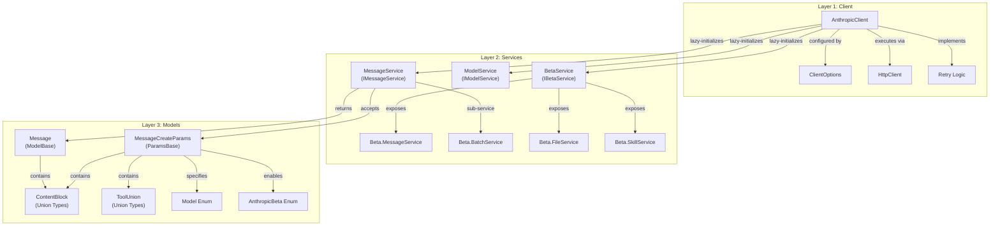

**Layer 1: Client Layer**

The `AnthropicClient` ([src/Anthropic/AnthropicClient.cs:15]()) manages HTTP communication, configuration, and retry logic. It maintains:
- `ClientOptions` record ([src/Anthropic/Core/ClientOptions.cs]()) containing API keys, base URL, timeout, and retry settings
- `HttpClient` instance for connection pooling ([src/Anthropic/AnthropicClient.cs:27-31]())
- Exponential backoff retry mechanism ([src/Anthropic/AnthropicClient.cs:220-234]())

**Layer 2: Service Layer**

Services are exposed as properties on the client and implement domain-specific interfaces:
- `MessageService` implements `IMessageService` ([src/Anthropic/Services/MessageService.cs:16]())
- `ModelService` implements `IModelService`
- `BetaService` implements `IBetaService`

Services are instantiated lazily using `Lazy<T>` ([src/Anthropic/AnthropicClient.cs:81-97]()).

**Layer 3: Model Layer**

All request parameters inherit from `ParamsBase` ([src/Anthropic/Core/ParamsBase.cs:14]()) and all responses inherit from `ModelBase`. The model layer uses:
- `FreezableDictionary<K,V>` ([src/Anthropic/Core/FreezableDictionary.cs:16]()) for immutable raw data storage
- `ApiEnum<TRaw,TEnum>` ([src/Anthropic/Core/ApiEnum.cs:24]()) for forward-compatible enum handling
- Union types for polymorphic content (documented in [Data Models Reference](#9))

**Sources:** [src/Anthropic/AnthropicClient.cs:15-325](), [src/Anthropic/Core/ParamsBase.cs:14-276](), [src/Anthropic/Core/ModelBase.cs](), [src/Anthropic/Core/FreezableDictionary.cs:16-166](), [src/Anthropic/Core/ApiEnum.cs:24-88]()

## Request Execution Flow

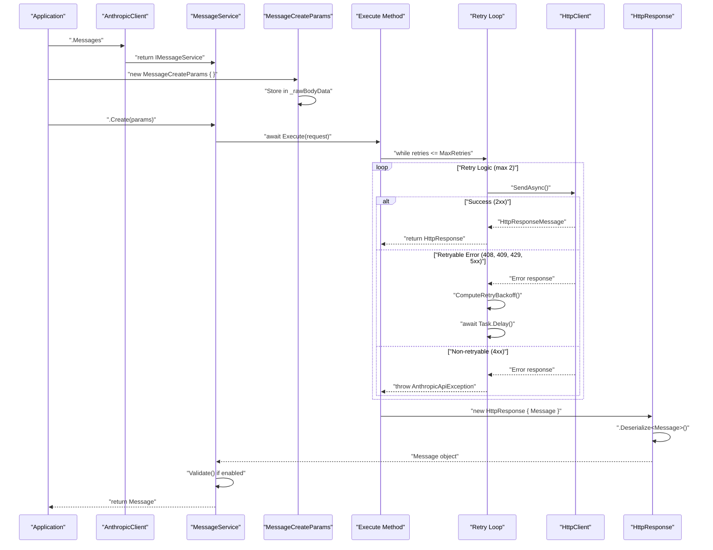

The execution flow implements resilient HTTP communication:

1. **Service Invocation**: Applications call service methods with `ParamsBase`-derived request objects ([src/Anthropic/Services/MessageService.cs:39-64]())
2. **Request Construction**: Parameters build URLs, headers, and body content ([src/Anthropic/Core/ParamsBase.cs:54-184]())
3. **Retry Loop**: The client retries up to `MaxRetries` times (default 2) with exponential backoff ([src/Anthropic/AnthropicClient.cs:106-152]())
4. **Backoff Calculation**: Uses API-provided `Retry-After` headers or exponential backoff with jitter ([src/Anthropic/AnthropicClient.cs:220-274]())
5. **Deserialization**: Responses are deserialized using `System.Text.Json` ([src/Anthropic/Core/HttpResponse.cs:17-38]())
6. **Validation**: Optional validation checks response structure ([src/Anthropic/Services/MessageService.cs:59-62]())

**Sources:** [src/Anthropic/AnthropicClient.cs:100-152](), [src/Anthropic/Services/MessageService.cs:39-64](), [src/Anthropic/Core/ParamsBase.cs:54-184](), [src/Anthropic/Core/HttpResponse.cs:17-38]()

## Technology Stack and Dependencies

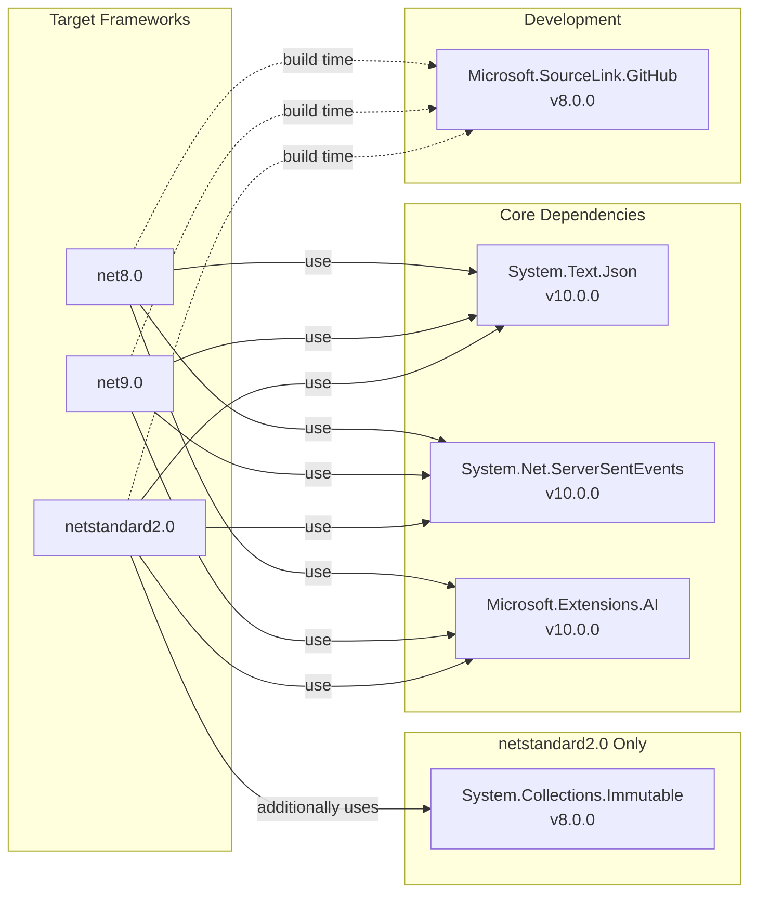

**Framework Support**

The SDK targets three frameworks ([src/Anthropic/Anthropic.csproj:32]()):
- **.NET 8.0** - Modern .NET with full async support
- **.NET 9.0** - Latest .NET features
- **.NET Standard 2.0** - Maximum compatibility (including .NET Framework 4.6.2+)

**Core Dependencies**

| Package | Version | Purpose |
|---------|---------|---------|
| System.Text.Json | 10.0.0 | JSON serialization/deserialization |
| System.Net.ServerSentEvents | 10.0.0 | Server-Sent Events (SSE) streaming support |
| Microsoft.Extensions.AI.Abstractions | 10.0.0 | IChatClient interface implementation |
| System.Collections.Immutable | 8.0.0 | Immutable collections (netstandard2.0 only) |

The SDK uses C# 12 language features ([src/Anthropic/Anthropic.csproj:33]()) with nullable reference types enabled ([src/Anthropic/Anthropic.csproj:37]()).

**Sources:** [src/Anthropic/Anthropic.csproj:32-54](), [src/Anthropic.Foundry/Anthropic.Foundry.csproj:3-18]()

## Model and Enum Reference

The SDK provides strongly-typed enums for API configuration:

**Model Enum**

The `Model` enum ([src/Anthropic/Models/Messages/Model.cs:13]()) defines all available Claude models:

| Model Family | Current Versions | Purpose |
|--------------|------------------|---------|
| Claude Opus 4.5 | `ClaudeOpus4_5_20251101`, `ClaudeOpus4_5` | Premium intelligence with practical performance |
| Claude Sonnet 4.5 | `ClaudeSonnet4_5_20250929`, `ClaudeSonnet4_5` | Best for agents and coding |
| Claude Haiku 4.5 | `ClaudeHaiku4_5_20251001`, `ClaudeHaiku4_5` | Hybrid model with instant response and thinking |
| Legacy Models | `Claude_3_Opus_20240229`, `Claude_3_Haiku_20240307` | Deprecated (EOL Jan 5, 2026) |

**AnthropicBeta Enum**

The `AnthropicBeta` enum ([src/Anthropic/Models/Beta/AnthropicBeta.cs:9]()) controls beta feature access via request headers:

| Beta Feature | Enum Value | Purpose |
|--------------|------------|---------|
| Message Batches | `MessageBatches2024_09_24` | Batch processing |
| Prompt Caching | `PromptCaching2024_07_31` | Cache frequently used prompts |
| Computer Use | `ComputerUse2025_01_24` | Computer control tools |
| Token Counting | `TokenCounting2024_11_01` | Token usage analysis |
| Context Management | `ContextManagement2025_06_27` | Edit conversation context |
| Skills API | `Skills2025_10_02` | Hosted capabilities |
| MCP Client | `MCPClient2025_11_20` | Model Context Protocol integration |

**Sources:** [src/Anthropic/Models/Messages/Model.cs:13-126](), [src/Anthropic/Models/Beta/AnthropicBeta.cs:9-30]()

## Development Status and Versioning

**Current Status**: Both packages are in **prerelease beta** ([release-please-config.json:9-10]()):
- Main package version: 12.0.1 ([.release-please-manifest.json:2]())
- Foundry package version: 0.2.0 ([.release-please-manifest.json:3]())

The version numbers are >= 10.0 due to a package transition from the community-maintained `tryAGI.Anthropic` package ([README.md:3-9]()). Despite the version number, this SDK is in early beta and may contain breaking changes in minor releases.

**Versioning Strategy**

The repository uses [release-please](https://github.com/googleapis/release-please) for automated versioning:
- Prerelease mode enabled ([release-please-config.json:9-10]())
- Conventional commit-based changelog generation ([release-please-config.json:15-62]())
- Independent package versioning ([release-please-config.json:2-5]())
- Automated version bumps in `.csproj` files ([release-please-config.json:64-71]())

**Distribution**

Both packages are published to [NuGet.org](https://www.nuget.org):
- Package metadata includes source link for debugging ([src/Anthropic/Anthropic.csproj:26-30]())
- XML documentation files are generated ([src/Anthropic/Anthropic.csproj:20]())
- MIT licensed ([src/Anthropic/Anthropic.csproj:12]())

**Sources:** [.release-please-manifest.json](), [release-please-config.json:1-72](), [README.md:3-19](), [src/Anthropic/Anthropic.csproj:1-55]()

## API Version and Headers

The SDK communicates with the Anthropic API using versioned headers:

**Default API Version**: `2023-06-01` ([src/Anthropic/Core/ParamsBase.cs:30]())

**Standard Headers** (sent with every request):

| Header | Value | Source |
|--------|-------|--------|
| `anthropic-version` | `2023-06-01` | [ParamsBase.cs:30]() |
| `User-Agent` | `AnthropicClient/C# {version}` | [ParamsBase.cs:214]() |
| `X-Api-Key` | From `APIKey` option | [ParamsBase.cs:202]() |
| `Authorization` | `Bearer {token}` (if `AuthToken` set) | [ParamsBase.cs:206]() |
| `X-Stainless-*` | Runtime, OS, architecture metadata | [ParamsBase.cs:22-29]() |

Beta features are enabled by adding the corresponding `AnthropicBeta` enum values to request headers (see [Beta Services](#4.4) for details).

**Sources:** [src/Anthropic/Core/ParamsBase.cs:16-212]()

---

# Page: Getting Started

# Getting Started

<details>
<summary>Relevant source files</summary>

The following files were used as context for generating this wiki page:

- [README.md](README.md)
- [examples/MessagesExample/MessagesExample.csproj](examples/MessagesExample/MessagesExample.csproj)
- [examples/MessagesExample/Program.cs](examples/MessagesExample/Program.cs)
- [examples/MessagesStreamingExample/MessagesStreamingExample.csproj](examples/MessagesStreamingExample/MessagesStreamingExample.csproj)
- [examples/MessagesStreamingExample/Program.cs](examples/MessagesStreamingExample/Program.cs)
- [examples/ThinkingExample/Program.cs](examples/ThinkingExample/Program.cs)
- [examples/ThinkingExample/ThinkingExample.csproj](examples/ThinkingExample/ThinkingExample.csproj)
- [examples/ThinkingStreamingExample/Program.cs](examples/ThinkingStreamingExample/Program.cs)
- [examples/ThinkingStreamingExample/ThinkingStreamingExample.csproj](examples/ThinkingStreamingExample/ThinkingStreamingExample.csproj)
- [src/Anthropic.Foundry/AnthropicFoundryClient.cs](src/Anthropic.Foundry/AnthropicFoundryClient.cs)
- [src/Anthropic.Tests/TestBase.cs](src/Anthropic.Tests/TestBase.cs)
- [src/Anthropic/AnthropicClient.cs](src/Anthropic/AnthropicClient.cs)
- [src/Anthropic/Core/ClientOptions.cs](src/Anthropic/Core/ClientOptions.cs)
- [src/Anthropic/Core/EnvironmentUrl.cs](src/Anthropic/Core/EnvironmentUrl.cs)
- [src/Anthropic/IAnthropicClient.cs](src/Anthropic/IAnthropicClient.cs)

</details>


This document provides an introduction to installing and using the Anthropic C# SDK. It covers package installation, basic client configuration, and your first API requests. For detailed information on specific topics, see the child pages: [Installation](#2.1), [Configuration](#2.2), and [Quick Start Examples](#2.3).

The Anthropic C# SDK is currently in **beta** (version 12.0.1 as of this writing). While functional and tested, it may undergo breaking changes in future releases. The SDK provides convenient access to the Anthropic REST API from .NET applications.

**Sources:** [README.md:1-23](), [src/Anthropic/Anthropic.csproj:1-10]()

---

## Package Overview

The SDK consists of two NuGet packages:

| Package | Version | Purpose |
|---------|---------|---------|
| `Anthropic` | 12.0.1 | Core SDK for Anthropic API access |
| `Anthropic.Foundry` | 0.2.0 | Azure-hosted Anthropic deployments |

Both packages target **.NET Standard 2.0**, making them compatible with:
- .NET 8.0+
- .NET Framework 4.6.1+
- .NET Core 2.0+

The core `Anthropic` package depends on:
- `System.Text.Json` (v10.0.0) - JSON serialization
- `System.Net.ServerSentEvents` (v10.0.0) - Streaming support
- `Microsoft.Extensions.AI.Abstractions` (v10.0.0) - Standard AI abstractions

**Sources:** [src/Anthropic/Anthropic.csproj:32-54](), [.release-please-manifest.json:1-4](), [release-please-config.json:1-12]()

---

## Package Architecture

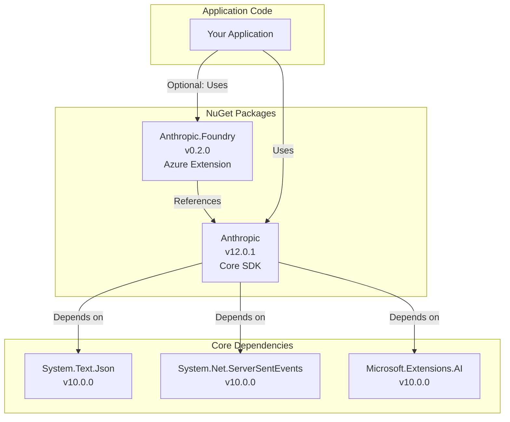

**Package Dependency Structure**

**Sources:** [src/Anthropic/Anthropic.csproj:43-54](), [README.md:1-23]()

---

## Installation

Install the core SDK via NuGet:

```bash
dotnet add package Anthropic
```

For Azure-hosted deployments, additionally install:

```bash
dotnet add package Anthropic.Foundry
```

This adds the necessary package references to your `.csproj` file. The SDK supports .NET Standard 2.0 and later, ensuring broad compatibility across .NET ecosystems.

For detailed installation instructions including target framework considerations, see [Installation](#2.1).

**Sources:** [README.md:25-31](), [examples/MessagesExample/MessagesExample.csproj:8-11]()

---

## Basic Configuration

The SDK uses the `AnthropicClient` class as the primary entry point. Configuration can be done via environment variables or programmatically.

### Environment Variable Configuration

```csharp
using Anthropic;

// Reads ANTHROPIC_API_KEY, ANTHROPIC_AUTH_TOKEN, and ANTHROPIC_BASE_URL
AnthropicClient client = new();
```

### Manual Configuration

```csharp
using Anthropic;

AnthropicClient client = new() 
{ 
    APIKey = "my-anthropic-api-key",
    BaseUrl = new Uri("https://api.anthropic.com")
};
```

| Property | Environment Variable | Required | Default |
|----------|---------------------|----------|---------|
| `APIKey` | `ANTHROPIC_API_KEY` | false | - |
| `AuthToken` | `ANTHROPIC_AUTH_TOKEN` | false | - |
| `BaseUrl` | `ANTHROPIC_BASE_URL` | true | `https://api.anthropic.com` |

For advanced configuration options including retries, timeouts, and the `WithOptions` pattern, see [Configuration](#2.2).

**Sources:** [README.md:67-95](), [examples/MessagesExample/Program.cs:4-8]()

---

## Client Instantiation Flow

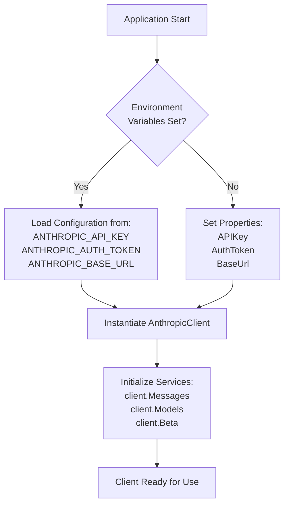

**AnthropicClient Initialization Process**

**Sources:** [README.md:67-95](), [examples/MessagesExample/Program.cs:4-8]()

---

## Your First Request

### Creating a Message

The most common operation is creating a message using the `Messages.Create` method. Here's a minimal example:

```csharp
using Anthropic;
using Anthropic.Models.Messages;

AnthropicClient client = new();

MessageCreateParams parameters = new()
{
    MaxTokens = 1024,
    Messages =
    [
        new()
        {
            Role = Role.User,
            Content = "Hello, Claude",
        },
    ],
    Model = Model.ClaudeOpus4_5_20251101,
};

Message message = await client.Messages.Create(parameters);

Console.WriteLine(message);
```

The key components:
- `MessageCreateParams` - Request configuration
- `Role.User` - Message sender role
- `Model.ClaudeOpus4_5_20251101` - AI model to use
- `client.Messages.Create()` - Synchronous API call
- `Message` - Response object containing generated content

**Sources:** [README.md:37-65](), [examples/MessagesExample/Program.cs:10-30]()

---

### Streaming Responses

For real-time content generation, use `CreateStreaming`:

```csharp
using Anthropic;
using Anthropic.Models.Messages;

AnthropicClient client = new();

MessageCreateParams parameters = new()
{
    MaxTokens = 1024,
    Messages =
    [
        new()
        {
            Role = Role.User,
            Content = "Hello, Claude",
        },
    ],
    Model = Model.ClaudeOpus4_5_20251101,
};

await foreach (var event in client.Messages.CreateStreaming(parameters))
{
    Console.WriteLine(event);
}
```

The `CreateStreaming` method returns an `IAsyncEnumerable<RawMessageStreamEvent>`, allowing you to process chunks as they arrive using the `await foreach` pattern.

**Sources:** [README.md:126-156](), [examples/MessagesStreamingExample/Program.cs:1-28]()

---

## Request Flow Diagram

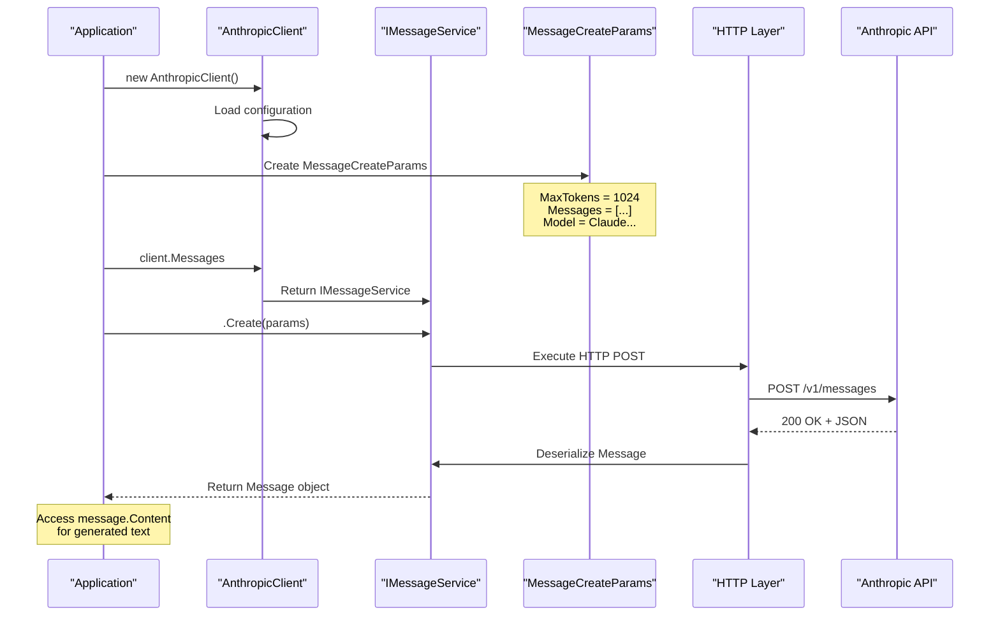

**Standard Message Creation Flow**

**Sources:** [examples/MessagesExample/Program.cs:1-31](), [README.md:120-125]()

---

## Streaming Flow Diagram

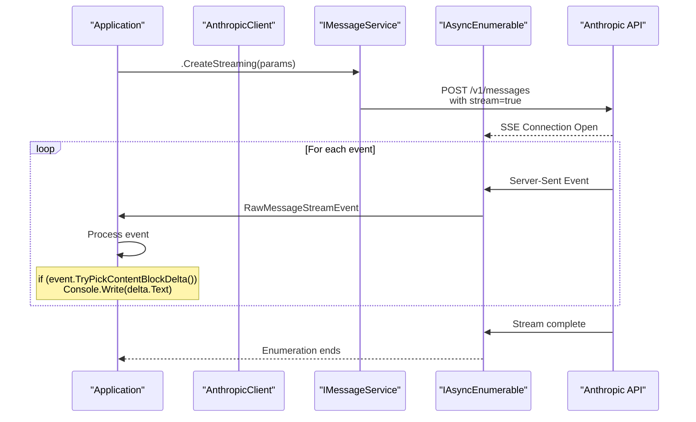

**Streaming Message Creation Flow**

**Sources:** [examples/MessagesStreamingExample/Program.cs:1-28](), [README.md:126-156]()

---

## Code Entity Reference

The following table maps natural language concepts to concrete code entities:

| Concept | Code Entity | Location |
|---------|-------------|----------|
| Main client | `AnthropicClient` | Core SDK |
| Message service | `IMessageService` | `client.Messages` |
| Request parameters | `MessageCreateParams` | Parameter object |
| User message | `Role.User` | Enum value |
| AI model | `Model.ClaudeOpus4_5_20251101` | Enum value |
| Response object | `Message` | Return type |
| Streaming events | `RawMessageStreamEvent` | Stream element type |
| Content extraction | `message.Content` | Property access |
| Text blocks | `TextBlock` | Content block type |
| Azure client | `AnthropicFoundryClient` | Foundry package |

**Sources:** [README.md:37-156](), [examples/MessagesExample/Program.cs:1-31]()

---

## Next Steps

This page provided a basic overview of installation and usage. For more detailed information:

- **[Installation](#2.1)** - Target frameworks, dependency management, package versioning
- **[Configuration](#2.2)** - ClientOptions, WithOptions pattern, retries, timeouts
- **[Quick Start Examples](#2.3)** - Complete runnable examples for common scenarios

For API-specific functionality, see:
- **[API Services](#4)** - Comprehensive guide to all available services
- **[Working with Messages](#5)** - Deep dive into message creation and handling
- **[Tools and Function Calling](#6)** - Integrating tools with Claude

**Sources:** [README.md:1-356]()

---

# Page: Installation

# Installation

<details>
<summary>Relevant source files</summary>

The following files were used as context for generating this wiki page:

- [.release-please-manifest.json](.release-please-manifest.json)
- [CHANGELOG.md](CHANGELOG.md)
- [examples/ChatClientExample/ChatClientExample.csproj](examples/ChatClientExample/ChatClientExample.csproj)
- [release-please-config.json](release-please-config.json)
- [src/Anthropic.Foundry/Anthropic.Foundry.csproj](src/Anthropic.Foundry/Anthropic.Foundry.csproj)
- [src/Anthropic.Foundry/CHANGELOG.md](src/Anthropic.Foundry/CHANGELOG.md)
- [src/Anthropic/Anthropic.csproj](src/Anthropic/Anthropic.csproj)
- [src/Anthropic/CHANGELOG.md](src/Anthropic/CHANGELOG.md)
- [src/logo.png](src/logo.png)

</details>


This document describes how to install the Anthropic C# SDK packages from NuGet. The SDK is distributed as two separate packages: the core `Anthropic` package for general use, and the `Anthropic.Foundry` extension package for Azure integration. For information about configuring these packages after installation, see [Configuration](#2.2).

---

## Package Overview

The Anthropic C# SDK consists of two NuGet packages that can be installed independently:

| Package | Current Version | Purpose | Dependencies |
|---------|----------------|---------|--------------|
| `Anthropic` | 12.1.0 | Core SDK with full Anthropic API support | System.Text.Json, System.Net.ServerSentEvents, Microsoft.Extensions.AI.Abstractions |
| `Anthropic.Foundry` | 0.3.0 | Azure Foundry integration (extends core package) | Anthropic, Azure.Identity |

**Sources:** [src/Anthropic/Anthropic.csproj:1-26](), [src/Anthropic.Foundry/Anthropic.Foundry.csproj:1-21](), [.release-please-manifest.json:1-5]()

---

## Framework Requirements

Both packages support multi-framework targeting:

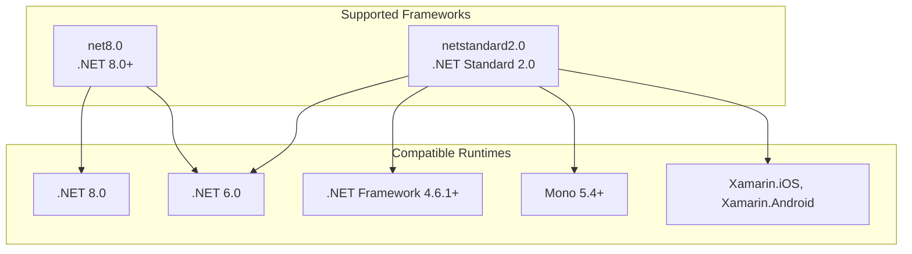

**Diagram: Framework Compatibility Matrix**

The SDK targets both `net8.0` and `netstandard2.0`, providing broad compatibility across modern .NET and legacy .NET Framework applications.

**Sources:** [src/Anthropic/Anthropic.csproj:1-26](), [src/Anthropic.Foundry/Anthropic.Foundry.csproj:1-21]()

---

## Installing the Core Package

### Using .NET CLI

```bash
dotnet add package Anthropic --version 12.1.0
```

### Using Package Manager Console

```powershell
Install-Package Anthropic -Version 12.1.0
```

### Using PackageReference

Add the following to your `.csproj` file:

```xml
<PackageReference Include="Anthropic" Version="12.1.0" />
```

**Sources:** [src/Anthropic/Anthropic.csproj:1-26](), [examples/ChatClientExample/ChatClientExample.csproj:1-13]()

---

## Installing the Foundry Package (Azure Support)

The `Anthropic.Foundry` package extends the core SDK with Azure-specific functionality. It automatically includes the core `Anthropic` package as a dependency.

### Using .NET CLI

```bash
dotnet add package Anthropic.Foundry --version 0.3.0
```

### Using Package Manager Console

```powershell
Install-Package Anthropic.Foundry -Version 0.3.0
```

### Using PackageReference

```xml
<PackageReference Include="Anthropic.Foundry" Version="0.3.0" />
```

**Note:** When you install `Anthropic.Foundry`, the core `Anthropic` package (version 12.1.0) is automatically installed as a transitive dependency.

**Sources:** [src/Anthropic.Foundry/Anthropic.Foundry.csproj:1-21]()

---

## Package Dependency Graph

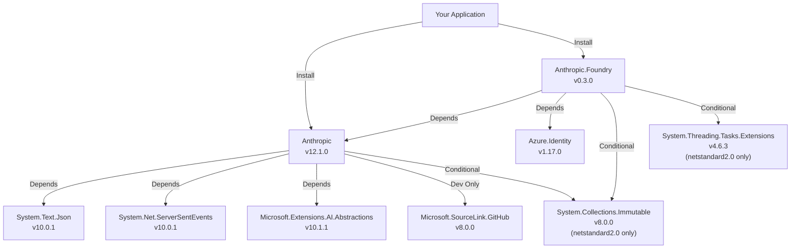

**Diagram: Package Dependency Resolution**

### Automatic Dependencies

When you install the Anthropic packages, NuGet automatically resolves and installs the following dependencies:

#### For `Anthropic` package:
- `System.Text.Json` (v10.0.1) - JSON serialization/deserialization
- `System.Net.ServerSentEvents` (v10.0.1) - Server-Sent Events for streaming
- `Microsoft.Extensions.AI.Abstractions` (v10.1.1) - Microsoft AI abstractions for `IChatClient` support
- `System.Collections.Immutable` (v8.0.0) - Only for `netstandard2.0` targets

#### For `Anthropic.Foundry` package:
- All dependencies from `Anthropic` (transitive)
- `Azure.Identity` (v1.17.0) - Azure authentication
- `System.Threading.Tasks.Extensions` (v4.6.3) - Only for `netstandard2.0` targets

**Sources:** [src/Anthropic/Anthropic.csproj:14-26](), [src/Anthropic.Foundry/Anthropic.Foundry.csproj:10-20]()

---

## Installation Methods Comparison

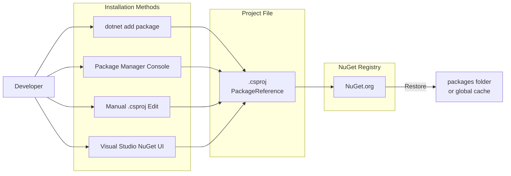

**Diagram: Package Installation Flow**

All installation methods ultimately modify the `.csproj` file to add a `<PackageReference>` element, which NuGet uses during package restoration.

**Sources:** [examples/ChatClientExample/ChatClientExample.csproj:1-13]()

---

## Verification

After installation, verify the packages are correctly referenced in your project:

### Check .csproj File

Your project file should contain references similar to:

```xml
<ItemGroup>
  <PackageReference Include="Anthropic" Version="12.1.0" />
  <!-- Optional: Only if using Azure Foundry -->
  <PackageReference Include="Anthropic.Foundry" Version="0.3.0" />
</ItemGroup>
```

### Check Installed Packages

Using .NET CLI:
```bash
dotnet list package
```

Expected output (core package only):
```
Project 'YourProject' has the following package references
   [net8.0]:
   Top-level Package                               Requested   Resolved
   > Anthropic                                     12.1.0      12.1.0
```

Expected output (with Foundry):
```
Project 'YourProject' has the following package references
   [net8.0]:
   Top-level Package                               Requested   Resolved
   > Anthropic.Foundry                             0.3.0       0.3.0
   
   Transitive Package                              Resolved
   > Anthropic                                     12.1.0
   > Azure.Identity                                1.17.0
```

**Sources:** [examples/ChatClientExample/ChatClientExample.csproj:1-13]()

---

## Version History

The SDK follows semantic versioning. Key milestones:

| Version | Release Date | Notes |
|---------|-------------|-------|
| 12.1.0 | 2026-01-06 | Added `EnvironmentUrl` support, multipart form data |
| 12.0.1 | 2025-12-18 | Documentation fixes |
| 12.0.0 | 2025-12-10 | Breaking changes: readonly types for properties |
| 11.0.0 | 2025-12-01 | Breaking changes: readonly types, improved csproj |
| 10.4.0 | 2025-11-25 | Added .NET Standard 2.0 support |

For complete version history, see [Breaking Changes Log](#11.1).

**Sources:** [CHANGELOG.md:1-350](), [src/Anthropic/CHANGELOG.md:1-163](), [src/Anthropic.Foundry/CHANGELOG.md:1-78]()

---

## Framework-Specific Considerations

### .NET Standard 2.0 Targets

When targeting `netstandard2.0`, additional packages are automatically included:

- `System.Collections.Immutable` (v8.0.0) - Required for immutable collections support
- `System.Threading.Tasks.Extensions` (v4.6.3) - Only for Foundry package

These are conditionally included via:

```xml
<ItemGroup Condition="'$(TargetFramework)' == 'netstandard2.0'">
  <PackageReference Include="System.Collections.Immutable" Version="8.0.0"/>
</ItemGroup>
```

**Sources:** [src/Anthropic/Anthropic.csproj:23-26](), [src/Anthropic.Foundry/Anthropic.Foundry.csproj:16-20]()

---

## Package Metadata

The published NuGet packages include:

- **Package Icon**: `logo.png` ([src/logo.png:1-350]())
- **Package Readme**: `README.md` from repository root
- **SourceLink**: Enabled for debugging support via `Microsoft.SourceLink.GitHub`
- **Debug Symbols**: Embedded in packages for enhanced debugging experience

The `StainlessMainProject` property in [src/Anthropic/Anthropic.csproj:8]() indicates this is the primary package in the repository.

**Sources:** [src/Anthropic/Anthropic.csproj:1-26](), [src/Anthropic.Foundry/Anthropic.Foundry.csproj:1-21]()

---

## Next Steps

After installing the packages:

1. Configure the client with your API key - see [Configuration](#2.2)
2. Try basic examples - see [Quick Start Examples](#2.3)
3. Learn about the client architecture - see [Client Layer](#3.1)

---

# Page: Configuration

# Configuration

<details>
<summary>Relevant source files</summary>

The following files were used as context for generating this wiki page:

- [.release-please-manifest.json](.release-please-manifest.json)
- [CHANGELOG.md](CHANGELOG.md)
- [README.md](README.md)
- [examples/ChatClientExample/ChatClientExample.csproj](examples/ChatClientExample/ChatClientExample.csproj)
- [release-please-config.json](release-please-config.json)
- [src/Anthropic.Foundry/Anthropic.Foundry.csproj](src/Anthropic.Foundry/Anthropic.Foundry.csproj)
- [src/Anthropic.Foundry/AnthropicFoundryClient.cs](src/Anthropic.Foundry/AnthropicFoundryClient.cs)
- [src/Anthropic.Foundry/CHANGELOG.md](src/Anthropic.Foundry/CHANGELOG.md)
- [src/Anthropic.Tests/TestBase.cs](src/Anthropic.Tests/TestBase.cs)
- [src/Anthropic/Anthropic.csproj](src/Anthropic/Anthropic.csproj)
- [src/Anthropic/AnthropicClient.cs](src/Anthropic/AnthropicClient.cs)
- [src/Anthropic/CHANGELOG.md](src/Anthropic/CHANGELOG.md)
- [src/Anthropic/Core/ClientOptions.cs](src/Anthropic/Core/ClientOptions.cs)
- [src/Anthropic/Core/EnvironmentUrl.cs](src/Anthropic/Core/EnvironmentUrl.cs)
- [src/Anthropic/IAnthropicClient.cs](src/Anthropic/IAnthropicClient.cs)
- [src/logo.png](src/logo.png)

</details>


This page documents how to configure the `AnthropicClient` and `AnthropicFoundryClient` instances, including environment variable support, direct property assignment, the `ClientOptions` structure, and the `WithOptions` pattern for temporary configuration changes. For information about using the configured client to make API calls, see [Quick Start Examples](#2.3). For Azure-specific deployment configuration, see [Azure Foundry Client](#8.3).

## Configuration Overview

The SDK provides three approaches to client configuration:

1. **Environment Variables**: Automatic resolution from system environment
2. **Direct Property Assignment**: Explicit initialization using object initializers
3. **Hybrid Approach**: Combination of environment variables with property overrides

Configuration is encapsulated in the `ClientOptions` struct and exposed through properties on `IAnthropicClient`.

**Configuration Flow Diagram**

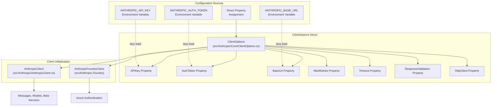

Sources: [src/Anthropic/Core/ClientOptions.cs:1-97](), [src/Anthropic/AnthropicClient.cs:28-83](), [README.md:67-95]()

## Client Initialization Options

### Environment Variable Configuration

The SDK automatically resolves configuration from environment variables when no explicit values are provided:

```csharp
// Reads from ANTHROPIC_API_KEY, ANTHROPIC_AUTH_TOKEN, ANTHROPIC_BASE_URL
AnthropicClient client = new();
```

The `ClientOptions` struct uses `Lazy<T>` fields to defer environment variable resolution until first access:

| Property | Environment Variable | Required | Default Value |
|----------|---------------------|----------|---------------|
| `APIKey` | `ANTHROPIC_API_KEY` | false | null |
| `AuthToken` | `ANTHROPIC_AUTH_TOKEN` | false | null |
| `BaseUrl` | `ANTHROPIC_BASE_URL` | false | `EnvironmentUrl.Production`<br/>("https://api.anthropic.com") |

Sources: [README.md:69-76](), [src/Anthropic/Core/ClientOptions.cs:81-95](), [src/Anthropic/Core/EnvironmentUrl.cs:1-7]()

### Direct Property Assignment

Configuration can be explicitly set using object initializer syntax:

```csharp
AnthropicClient client = new() 
{ 
    APIKey = "my-anthropic-api-key",
    BaseUrl = "https://example.com",
    MaxRetries = 3,
    Timeout = TimeSpan.FromSeconds(30)
};
```

Sources: [README.md:78-84](), [src/Anthropic/AnthropicClient.cs:66-77]()

### Hybrid Configuration

Environment variables can be selectively overridden:

```csharp
// Uses ANTHROPIC_API_KEY and ANTHROPIC_AUTH_TOKEN from environment
// but overrides BaseUrl and Timeout
AnthropicClient client = new() 
{ 
    BaseUrl = "https://custom.endpoint.com",
    Timeout = TimeSpan.FromMinutes(5)
};
```

Sources: [README.md:86-95]()

## Configuration Properties

### Authentication Properties

**APIKey and AuthToken**

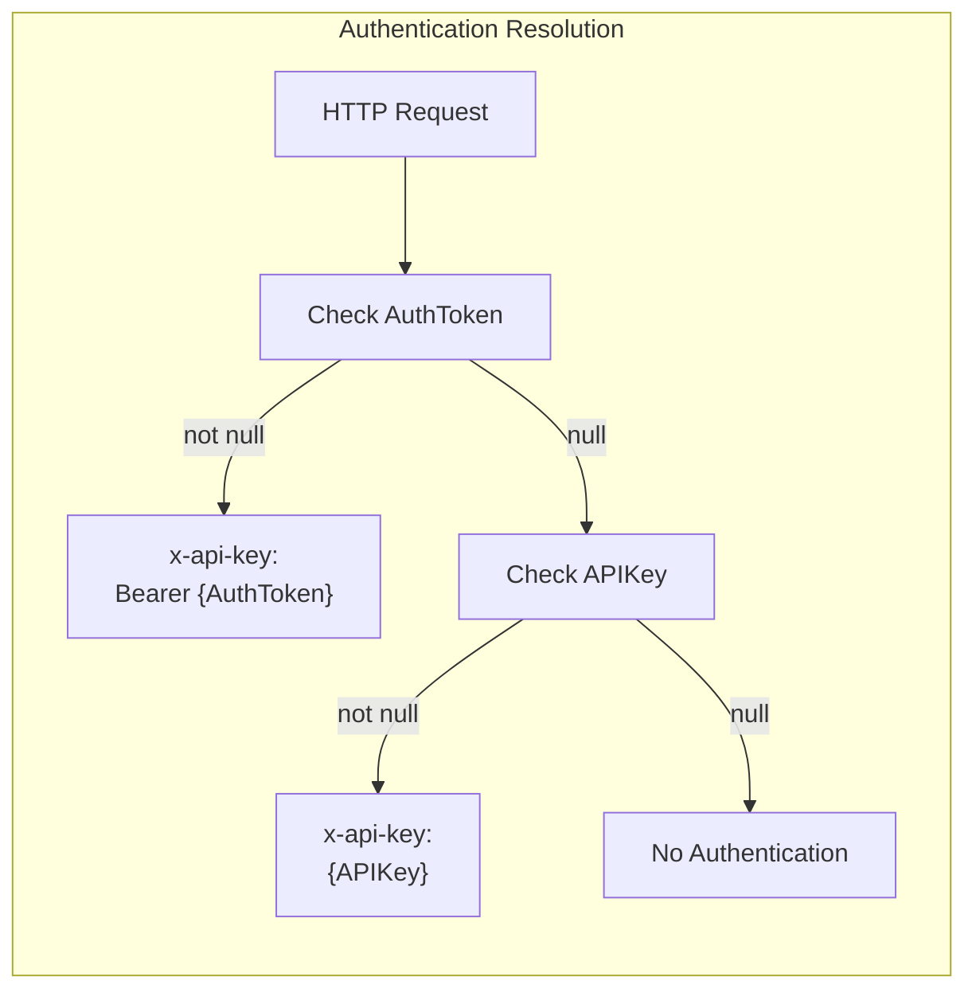

The SDK supports two authentication modes:
- **APIKey**: Direct API key authentication (most common)
- **AuthToken**: Bearer token authentication

Both properties are nullable and resolve from environment variables by default. The authentication header is constructed in the request parameter classes.

Sources: [src/Anthropic/Core/ClientOptions.cs:81-95](), [src/Anthropic/AnthropicClient.cs:66-77](), [README.md:90-94]()

### BaseUrl Property

The `BaseUrl` property determines the API endpoint:

**Default Resolution Order:**
1. Explicitly set value
2. `ANTHROPIC_BASE_URL` environment variable
3. `EnvironmentUrl.Production` constant ("https://api.anthropic.com")

The property uses a `Lazy<string>` field for deferred resolution:

```
ClientOptions._baseUrl: Lazy<string>
    └─> Environment.GetEnvironmentVariable("ANTHROPIC_BASE_URL") 
        ?? EnvironmentUrl.Production
```

Sources: [src/Anthropic/Core/ClientOptions.cs:26-39](), [src/Anthropic/IAnthropicClient.cs:29-34]()

### HttpClient Property

The `HttpClient` property allows reuse of existing HTTP connection pools:

**Default Behavior**: A new `HttpClient` instance is created if not provided.

**Custom HttpClient Usage:**
```csharp
using HttpClient sharedClient = new();
AnthropicClient client = new() { HttpClient = sharedClient };
```

**Important**: The client does NOT dispose the `HttpClient` if provided externally. When using the default client, disposal occurs when the `AnthropicClient` is disposed.

Sources: [src/Anthropic/Core/ClientOptions.cs:22-24](), [src/Anthropic/AnthropicClient.cs:31-35]()

### MaxRetries Property

Controls automatic retry behavior with exponential backoff:

**Default**: `2` (defined in `ClientOptions.DefaultMaxRetries`)

**Retried Error Types:**
- Connection errors (I/O failures)
- 408 Request Timeout
- 409 Conflict
- 429 Rate Limit
- 5xx server errors

**Set to `0`** to disable retries entirely, including API-instructed retries.

The retry logic is implemented in `AnthropicClient.Execute<T>()` with backoff calculation in `ComputeRetryBackoff()`:

```
backoff = min(0.5 * 2^(retries-1), 8.0) seconds
jitter = 1.0 - (0.25 * random)
actual_backoff = backoff * jitter
```

Sources: [src/Anthropic/Core/ClientOptions.cs:50-69](), [src/Anthropic/AnthropicClient.cs:104-156](), [src/Anthropic/AnthropicClient.cs:224-238](), [README.md:242-276]()

### Timeout Property

Sets the maximum duration for a single HTTP call (excluding retries):

**Default**: `TimeSpan.FromMinutes(10)` (defined in `ClientOptions.DefaultTimeout`)

The timeout applies to:
- DNS resolution
- Connection establishment
- Request body transmission
- Server processing
- Response body reading

Timeout enforcement uses `CancellationTokenSource` in `ExecuteOnce()`:

```
using CancellationTokenSource timeoutCts = new(Timeout ?? DefaultTimeout);
```

Sources: [src/Anthropic/Core/ClientOptions.cs:71-79](), [src/Anthropic/AnthropicClient.cs:197-199](), [README.md:278-303]()

### ResponseValidation Property

Controls upfront response validation:

**Default**: `false` (lazy validation)

When `false`:
- Validation occurs only when properties are accessed
- Missing required fields throw `AnthropicInvalidDataException` on access

When `true`:
- Full response shape is validated before returning
- Calls `Validate()` method on response models

**Explicit Validation:**
```csharp
var message = await client.Messages.Create(parameters);
message.Validate(); // Throws if response is malformed
```

Sources: [src/Anthropic/Core/ClientOptions.cs:41-48](), [src/Anthropic/IAnthropicClient.cs:36-43](), [README.md:309-342]()

## Configuration Properties Reference Table

| Property | Type | Default | Environment Variable | Nullable | Description |
|----------|------|---------|---------------------|----------|-------------|
| `APIKey` | `string?` | null | `ANTHROPIC_API_KEY` | Yes | API key for authentication |
| `AuthToken` | `string?` | null | `ANTHROPIC_AUTH_TOKEN` | Yes | Bearer token for authentication |
| `BaseUrl` | `string` | `EnvironmentUrl.Production` | `ANTHROPIC_BASE_URL` | No | API endpoint URL |
| `HttpClient` | `HttpClient` | new instance | - | No | HTTP client for requests |
| `MaxRetries` | `int?` | 2 | - | Yes | Maximum retry attempts |
| `Timeout` | `TimeSpan?` | 10 minutes | - | Yes | Per-request timeout |
| `ResponseValidation` | `bool` | false | - | No | Upfront validation flag |

Sources: [src/Anthropic/Core/ClientOptions.cs:9-96](), [src/Anthropic/IAnthropicClient.cs:22-78]()

## The WithOptions Pattern

The `WithOptions()` method creates a temporary client view with modified configuration while reusing connection and thread pools:

**WithOptions Execution Flow**

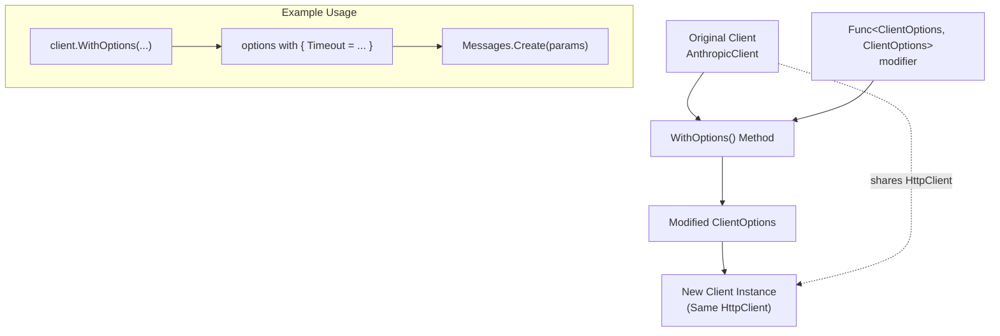

**Basic Usage:**

```csharp
var message = await client
    .WithOptions(options => options with 
    { 
        BaseUrl = "https://example.com",
        Timeout = TimeSpan.FromSeconds(42) 
    })
    .Messages.Create(parameters);
```

The pattern uses C# record-style `with` expressions for immutable updates. The original client remains unmodified.

**Implementation Details:**

The method is defined on `IAnthropicClient` and returns a new client instance:

```
IAnthropicClient WithOptions(Func<ClientOptions, ClientOptions> modifier)
    └─> new AnthropicClient(modifier(_options))
```

For `AnthropicFoundryClient`, the method preserves the Azure credentials:

```
IAnthropicClient WithOptions(...)
    └─> new AnthropicFoundryClient(_azureCredentials, modifier(_options))
```

Sources: [src/Anthropic/IAnthropicClient.cs:80-85](), [src/Anthropic/AnthropicClient.cs:80-83](), [src/Anthropic.Foundry/AnthropicFoundryClient.cs:49-52](), [README.md:96-119]()

## Azure Foundry Configuration

The `AnthropicFoundryClient` extends `AnthropicClient` with Azure-specific configuration:

**Foundry Configuration Architecture**

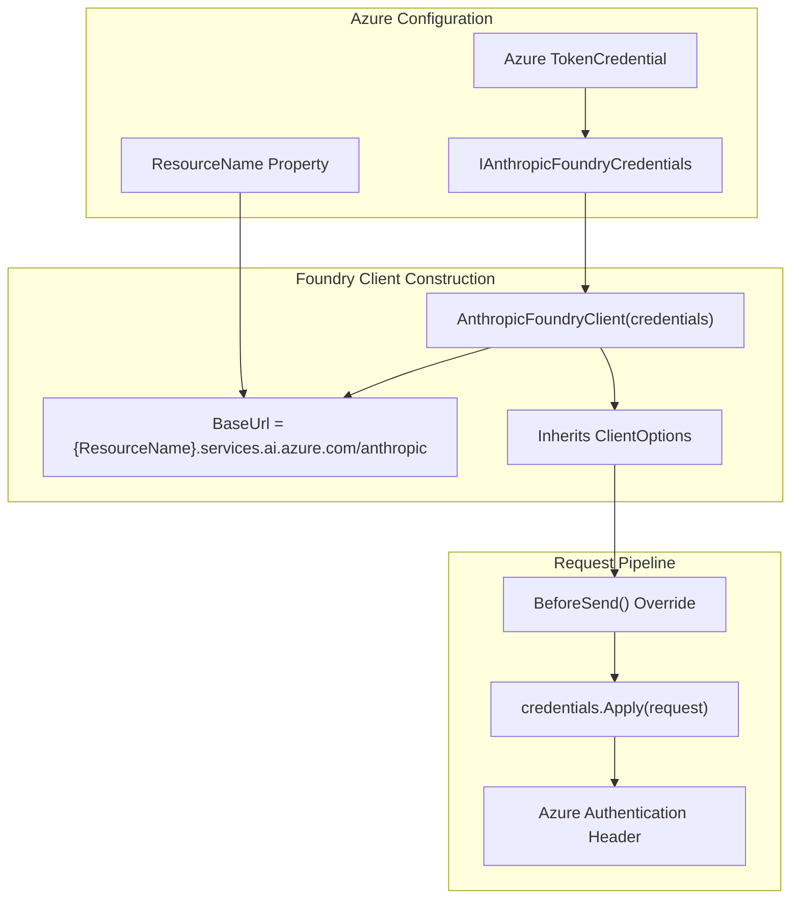

**Key Differences from Standard Client:**

1. **BaseUrl**: Automatically set to `https://{ResourceName}.services.ai.azure.com/anthropic`
2. **Authentication**: Uses Azure credentials instead of APIKey
3. **APIKey Property**: Throws `NotSupportedException` when accessed

**Initialization:**

```csharp
IAnthropicFoundryCredentials credentials = // ... (see Azure Foundry Client docs)
AnthropicFoundryClient client = new(credentials);
```

The `WithOptions()` method on `AnthropicFoundryClient` preserves the Azure credentials while modifying other options.

**APIKey Restriction:**

```csharp
[Obsolete("The APIKey property is not supported...", true)]
public override string? APIKey 
{
    get => throw new NotSupportedException(...);
    init => throw new NotSupportedException(...);
}
```

Sources: [src/Anthropic.Foundry/AnthropicFoundryClient.cs:1-65](), [src/Anthropic.Foundry/Anthropic.Foundry.csproj:1-21]()

## Configuration Resolution Implementation

The `ClientOptions` struct uses lazy initialization to defer environment variable resolution:

**Lazy Resolution Pattern**

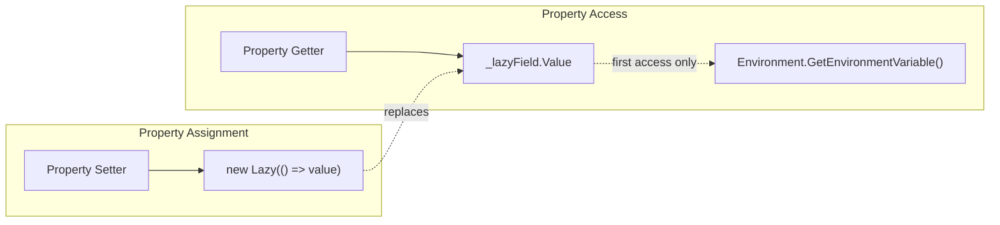

**Example Implementation** (APIKey property):

```
Lazy<string?> _apiKey = new(() => Environment.GetEnvironmentVariable("ANTHROPIC_API_KEY"));

public string? APIKey
{
    readonly get { return _apiKey.Value; }  // Lazy evaluation
    set { _apiKey = new(() => value); }      // Replace lazy instance
}
```

This pattern ensures:
- Environment variables are read only when needed
- Explicit assignments bypass environment lookup
- Thread-safe lazy initialization via `Lazy<T>`

Sources: [src/Anthropic/Core/ClientOptions.cs:26-95]()

## Default Values Summary

| Configuration | Default Value | Source |
|--------------|---------------|--------|
| `MaxRetries` | 2 | `ClientOptions.DefaultMaxRetries` |
| `Timeout` | 10 minutes | `ClientOptions.DefaultTimeout` |
| `BaseUrl` | "https://api.anthropic.com" | `EnvironmentUrl.Production` |
| `HttpClient` | new instance | `new HttpClient()` |
| `ResponseValidation` | false | struct default |
| `APIKey` | null | environment or null |
| `AuthToken` | null | environment or null |

Sources: [src/Anthropic/Core/ClientOptions.cs:12-24](), [src/Anthropic/Core/EnvironmentUrl.cs:5]()

---

# Page: Quick Start Examples

# Quick Start Examples

<details>
<summary>Relevant source files</summary>

The following files were used as context for generating this wiki page:

- [README.md](README.md)
- [examples/MessagesExample/MessagesExample.csproj](examples/MessagesExample/MessagesExample.csproj)
- [examples/MessagesExample/Program.cs](examples/MessagesExample/Program.cs)
- [examples/MessagesStreamingExample/MessagesStreamingExample.csproj](examples/MessagesStreamingExample/MessagesStreamingExample.csproj)
- [examples/MessagesStreamingExample/Program.cs](examples/MessagesStreamingExample/Program.cs)
- [examples/ThinkingExample/Program.cs](examples/ThinkingExample/Program.cs)
- [examples/ThinkingExample/ThinkingExample.csproj](examples/ThinkingExample/ThinkingExample.csproj)
- [examples/ThinkingStreamingExample/Program.cs](examples/ThinkingStreamingExample/Program.cs)
- [examples/ThinkingStreamingExample/ThinkingStreamingExample.csproj](examples/ThinkingStreamingExample/ThinkingStreamingExample.csproj)
- [src/Anthropic.Foundry/AnthropicFoundryClient.cs](src/Anthropic.Foundry/AnthropicFoundryClient.cs)
- [src/Anthropic.Tests/TestBase.cs](src/Anthropic.Tests/TestBase.cs)
- [src/Anthropic/AnthropicClient.cs](src/Anthropic/AnthropicClient.cs)
- [src/Anthropic/Core/ClientOptions.cs](src/Anthropic/Core/ClientOptions.cs)
- [src/Anthropic/Core/EnvironmentUrl.cs](src/Anthropic/Core/EnvironmentUrl.cs)
- [src/Anthropic/IAnthropicClient.cs](src/Anthropic/IAnthropicClient.cs)

</details>


## Purpose and Scope

This page provides practical, runnable examples demonstrating the most common SDK operations. These examples show how to initialize clients, create messages, stream responses, and work with advanced features like thinking/reasoning.

For detailed configuration options, see [Configuration](#2.2). For comprehensive service documentation, see [API Services](#4). For tool usage patterns, see [Tools and Function Calling](#6).

## Client Initialization

### Standard Anthropic Client

The `AnthropicClient` can be initialized with environment variables or explicit configuration:

**Environment Variable Configuration** ([README.md:69-76]()):
```csharp
using Anthropic;

// Reads from ANTHROPIC_API_KEY, ANTHROPIC_AUTH_TOKEN, ANTHROPIC_BASE_URL
AnthropicClient client = new();
```

**Explicit Configuration** ([README.md:78-84]()):
```csharp
using Anthropic;

AnthropicClient client = new() { APIKey = "my-anthropic-api-key" };
```

### Azure Foundry Client

For Azure-hosted deployments, use `AnthropicFoundryClient` ([examples/MessagesExample/Program.cs:7-8]()):
```csharp
using Anthropic.Foundry;

AnthropicFoundryClient client = new(
    new AnthropicFoundryApiKeyCredentials("API-TOKEN", "RESOURCE-NAME")
);
```

**Sources:** [README.md:69-95](), [src/Anthropic/AnthropicClient.cs:321-335](), [src/Anthropic.Foundry/AnthropicFoundryClient.cs:10-22](), [examples/MessagesExample/Program.cs:5-8]()

---

## Basic Message Creation

### Simple Synchronous Request

The most common operation is creating a message with `IMessageService.Create`:

```csharp
using Anthropic;
using Anthropic.Models.Messages;

AnthropicClient client = new();

MessageCreateParams parameters = new()
{
    MaxTokens = 1024,
    Messages =
    [
        new()
        {
            Role = Role.User,
            Content = "Hello, Claude",
        },
    ],
    Model = Model.ClaudeOpus4_5_20251101,
};

var message = await client.Messages.Create(parameters);
Console.WriteLine(message);
```

**Key Components:**
- `MessageCreateParams`: Request parameter object containing model, messages, and configuration
- `Role.User`: Indicates the message sender (user vs assistant)
- `Model` enum: Type-safe model selection (see [Model Selection](#9.3))
- `IMessageService.Create`: Returns `Task<Message>` with the complete response

### Message Creation Flow

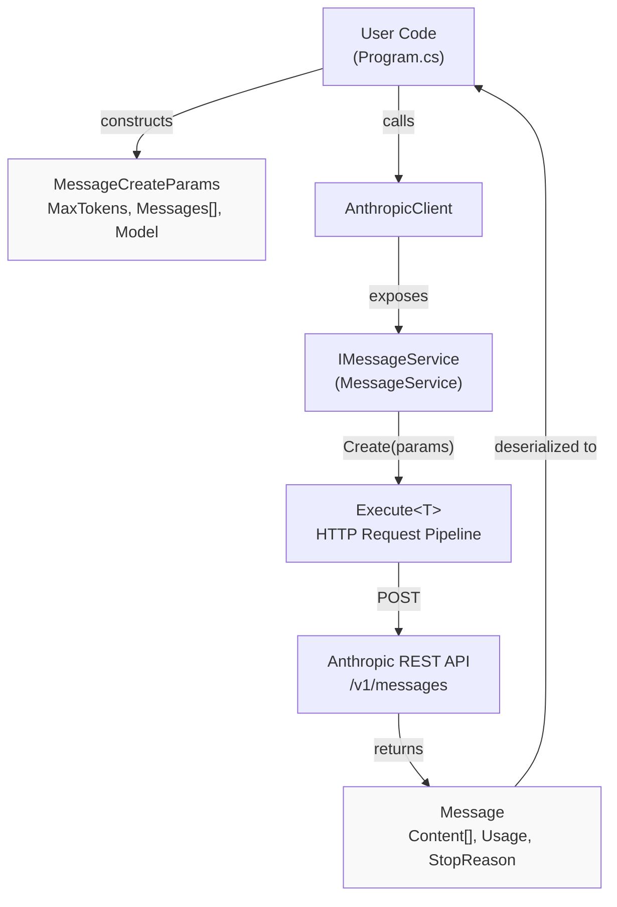

**Sources:** [README.md:41-65](), [examples/MessagesExample/Program.cs:10-30]()

### Extracting Response Content

Messages contain a `Content` array with typed blocks ([examples/MessagesExample/Program.cs:22-28]()):

```csharp
var message = string.Join(
    "",
    response
        .Content.Where(message => message.Value is TextBlock)
        .Select(message => message.Value as TextBlock)
        .Select((textBlock) => textBlock.Text)
);

Console.WriteLine(message);
```

For content block types and structure, see [Content Blocks](#5.3).

**Sources:** [examples/MessagesExample/Program.cs:10-31](), [README.md:41-65]()

---

## Streaming Responses

### Server-Sent Events (SSE) Streaming

Use `IMessageService.CreateStreaming` to process response chunks as they arrive:

```csharp
using Anthropic;
using Anthropic.Models.Messages;

AnthropicClient client = new();

MessageCreateParams parameters = new()
{
    MaxTokens = 2048,
    Messages =
    [
        new() { Content = "Tell me a story about building the best SDK!", Role = Role.User },
    ],
    Model = Model.Claude4Sonnet20250514,
};

IAsyncEnumerable<RawMessageStreamEvent> responseUpdates = 
    client.Messages.CreateStreaming(parameters);

await foreach (RawMessageStreamEvent rawEvent in responseUpdates)
{
    if (rawEvent.TryPickContentBlockDelta(out var delta) && 
        delta.Delta.TryPickText(out var text))
    {
        Console.Write(text.Text);
    }
}
```

**Key Components:**
- `IMessageService.CreateStreaming`: Returns `IAsyncEnumerable<RawMessageStreamEvent>`
- `RawMessageStreamEvent`: Discriminated union of event types (start, delta, stop, etc.)
- `TryPickContentBlockDelta`: Type-safe extraction of delta events
- `TryPickText`: Extracts text content from the delta

### Streaming Event Processing Flow

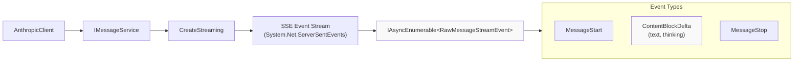

For detailed streaming documentation, see [Streaming Responses](#5.2).

**Sources:** [README.md:128-156](), [examples/MessagesStreamingExample/Program.cs:1-28]()

---

## Advanced Features

### Thinking and Reasoning

Enable extended reasoning with `ThinkingConfigEnabled`:

```csharp
using Anthropic;
using Anthropic.Models.Messages;

AnthropicClient client = new();

MessageCreateParams parameters = new()
{
    MaxTokens = 2048,
    Messages =
    [
        new() { Content = "Tell me a story about building the best SDK!", Role = Role.User },
    ],
    Model = Model.Claude4Sonnet20250514,
    Thinking = new ThinkingConfigEnabled() { BudgetTokens = 1024 },
};

var response = await client.Messages.Create(parameters);

foreach (ContentBlock block in response.Content)
{
    if (block.TryPickThinking(out ThinkingBlock? thinking))
    {
        Console.WriteLine($"Thinking: {thinking.Thinking}");
    }
    else if (block.TryPickText(out TextBlock? text))
    {
        Console.WriteLine($"Text: {text.Text}");
    }
}
```

**Key Components:**
- `ThinkingConfigEnabled`: Enables thinking with token budget allocation
- `ThinkingBlock`: Contains the model's reasoning process
- `TryPickThinking`: Type-safe extraction of thinking content blocks

### Thinking Stream Processing

For streaming thinking content ([examples/ThinkingStreamingExample/Program.cs:22-35]()):

```csharp
await foreach (RawMessageStreamEvent rawEvent in responseUpdates)
{
    if (rawEvent.TryPickContentBlockDelta(out var delta))
    {
        if (delta.Delta.TryPickThinking(out var thinkingDelta))
        {
            Console.Write(thinkingDelta.Thinking);
        }
        else if (delta.Delta.TryPickText(out var textDelta))
        {
            Console.Write(textDelta.Text);
        }
    }
}
```

For comprehensive thinking documentation, see [Thinking and Reasoning](#7.2).

**Sources:** [examples/ThinkingExample/Program.cs:1-38](), [examples/ThinkingStreamingExample/Program.cs:1-36]()

---

## Configuration Modification

### Temporary Option Changes

Use `WithOptions` to create a modified client view without affecting the original:

```csharp
using System;

var message = await client
    .WithOptions(options =>
        options with
        {
            BaseUrl = "https://example.com",
            Timeout = TimeSpan.FromSeconds(42),
        }
    )
    .Messages.Create(parameters);

Console.WriteLine(message);
```

**Key Properties:**
- `BaseUrl`: Override the API endpoint
- `Timeout`: Custom timeout per request
- `MaxRetries`: Retry configuration

The `WithOptions` method returns a new `IAnthropicClient` instance without modifying the original ([src/Anthropic/AnthropicClient.cs:80-83]()).

### Configuration Options Mapping

| Parameter | Type | Purpose | Default |
|-----------|------|---------|---------|
| `BaseUrl` | `string` | API endpoint URL | `https://api.anthropic.com` |
| `Timeout` | `TimeSpan?` | Request timeout | 10 minutes |
| `MaxRetries` | `int?` | Retry attempts | 2 |
| `ResponseValidation` | `bool` | Upfront validation | `false` |
| `APIKey` | `string?` | Authentication key | From `ANTHROPIC_API_KEY` |
| `AuthToken` | `string?` | Bearer token | From `ANTHROPIC_AUTH_TOKEN` |

For complete configuration details, see [Configuration](#2.2).

**Sources:** [README.md:96-118](), [src/Anthropic/IAnthropicClient.cs:80-85](), [src/Anthropic/Core/ClientOptions.cs:9-96]()

---

## Client Architecture Overview

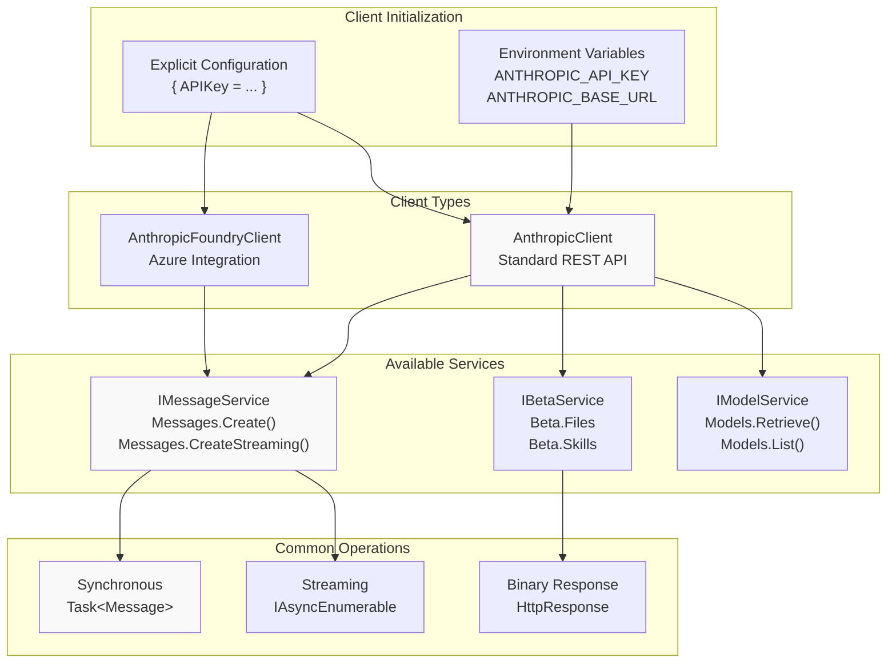

**Sources:** [src/Anthropic/AnthropicClient.cs:15-335](), [src/Anthropic/IAnthropicClient.cs:22-101](), [src/Anthropic.Foundry/AnthropicFoundryClient.cs:8-64]()

---

## Key Type References

### Core Client Types

| Type | Location | Purpose |
|------|----------|---------|
| `AnthropicClient` | [src/Anthropic/AnthropicClient.cs:15]() | Main SDK client implementation |
| `IAnthropicClient` | [src/Anthropic/IAnthropicClient.cs:22]() | Client interface for abstraction |
| `AnthropicFoundryClient` | [src/Anthropic.Foundry/AnthropicFoundryClient.cs:8]() | Azure-specific client |
| `ClientOptions` | [src/Anthropic/Core/ClientOptions.cs:9]() | Configuration structure |

### Message Types

| Type | Purpose | Usage |
|------|---------|-------|
| `MessageCreateParams` | Request parameters | Input to `Create` and `CreateStreaming` |
| `Message` | Complete response | Returned by `Create` method |
| `RawMessageStreamEvent` | Stream event | Yielded by `CreateStreaming` method |
| `ContentBlock` | Response content | Union of text, thinking, tool use, etc. |
| `TextBlock` | Text content | Extracted via `TryPickText` |
| `ThinkingBlock` | Reasoning content | Extracted via `TryPickThinking` |

### Service Interfaces

| Interface | Exposed By | Methods |
|-----------|------------|---------|
| `IMessageService` | `client.Messages` | `Create`, `CreateStreaming`, `CountTokens` |
| `IModelService` | `client.Models` | `Retrieve`, `List` |
| `IBetaService` | `client.Beta` | Access to beta features |

**Sources:** [src/Anthropic/AnthropicClient.cs:85-101](), [src/Anthropic/IAnthropicClient.cs:87-91]()

---

## Example Project Structure

The SDK includes runnable examples in the `examples/` directory:

| Example | Project File | Demonstrates |
|---------|--------------|-------------|
| `MessagesExample` | [examples/MessagesExample/MessagesExample.csproj:1-12]() | Basic message creation |
| `MessagesStreamingExample` | [examples/MessagesStreamingExample/MessagesStreamingExample.csproj:1-11]() | SSE streaming |
| `ThinkingExample` | [examples/ThinkingExample/ThinkingExample.csproj:1-11]() | Extended reasoning (sync) |
| `ThinkingStreamingExample` | [examples/ThinkingStreamingExample/ThinkingStreamingExample.csproj:1-11]() | Extended reasoning (stream) |

All examples target .NET 8.0 and reference the SDK projects directly.

**Sources:** [examples/MessagesExample/MessagesExample.csproj:1-12](), [examples/MessagesStreamingExample/MessagesStreamingExample.csproj:1-11](), [examples/ThinkingExample/ThinkingExample.csproj:1-11](), [examples/ThinkingStreamingExample/ThinkingStreamingExample.csproj:1-11]()

---

# Page: Core Architecture

# Core Architecture

<details>
<summary>Relevant source files</summary>

The following files were used as context for generating this wiki page:

- [README.md](README.md)
- [src/Anthropic.Foundry/AnthropicFoundryClient.cs](src/Anthropic.Foundry/AnthropicFoundryClient.cs)
- [src/Anthropic.Tests/TestBase.cs](src/Anthropic.Tests/TestBase.cs)
- [src/Anthropic/AnthropicClient.cs](src/Anthropic/AnthropicClient.cs)
- [src/Anthropic/Core/ApiEnum.cs](src/Anthropic/Core/ApiEnum.cs)
- [src/Anthropic/Core/ClientOptions.cs](src/Anthropic/Core/ClientOptions.cs)
- [src/Anthropic/Core/EnvironmentUrl.cs](src/Anthropic/Core/EnvironmentUrl.cs)
- [src/Anthropic/Core/FreezableDictionary.cs](src/Anthropic/Core/FreezableDictionary.cs)
- [src/Anthropic/Core/HttpResponse.cs](src/Anthropic/Core/HttpResponse.cs)
- [src/Anthropic/Core/ParamsBase.cs](src/Anthropic/Core/ParamsBase.cs)
- [src/Anthropic/IAnthropicClient.cs](src/Anthropic/IAnthropicClient.cs)
- [src/Anthropic/Services/Beta/MessageService.cs](src/Anthropic/Services/Beta/MessageService.cs)
- [src/Anthropic/Services/MessageService.cs](src/Anthropic/Services/MessageService.cs)

</details>


This document describes the internal architecture of the Anthropic C# SDK, including the client layer, service layer, request/response processing pipeline, and core infrastructure types. The architecture is organized into distinct layers with clear separation of concerns, enabling robust HTTP communication, automatic retry logic, and type-safe API interactions.

For information about specific API services (Messages, Batches, Models), see [API Services](#4). For details on data model infrastructure and type system, see [Data Models Reference](#9). For integration with external systems like Microsoft.Extensions.AI and Azure, see [Ecosystem Integration](#8).

## Architecture Overview

The SDK follows a layered architecture pattern with the following primary components:

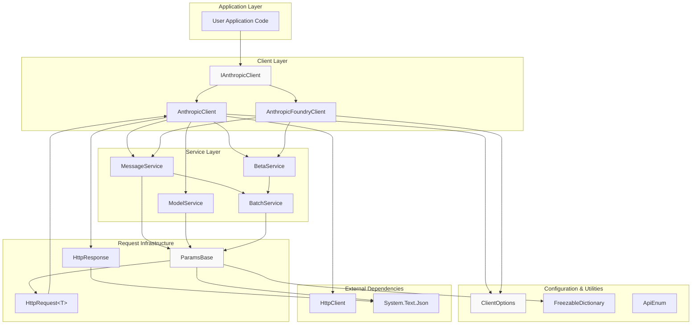

**Sources:** [src/Anthropic/AnthropicClient.cs](), [src/Anthropic/IAnthropicClient.cs](), [src/Anthropic.Foundry/AnthropicFoundryClient.cs](), [src/Anthropic/Services/MessageService.cs]()

## Core Components

### Client Layer

The client layer provides the primary interface for interacting with the Anthropic API. It consists of three main types:

| Type | Purpose | Key Features |
|------|---------|--------------|
| `IAnthropicClient` | Interface defining the client contract | Exposes service properties, `Execute` method, `WithOptions` pattern |
| `AnthropicClient` | Standard implementation for Anthropic API | HTTP execution, retry logic, timeout management, service initialization |
| `AnthropicFoundryClient` | Azure-specialized implementation | Azure authentication, custom base URL construction, credential management |

The `IAnthropicClient` interface [src/Anthropic/IAnthropicClient.cs:22-101]() defines the contract with properties for configuration (`BaseUrl`, `MaxRetries`, `Timeout`, `ResponseValidation`) and service accessors (`Messages`, `Models`, `Beta`). It also declares the `Execute<T>` method [src/Anthropic/IAnthropicClient.cs:96-100]() which is the core request execution method.

`AnthropicClient` [src/Anthropic/AnthropicClient.cs:15-335]() implements this interface and manages:
- HTTP client lifecycle [src/Anthropic/AnthropicClient.cs:31-35]()
- Configuration through `ClientOptions` [src/Anthropic/AnthropicClient.cs:28]()
- Lazy initialization of services [src/Anthropic/AnthropicClient.cs:85-101]()
- Request execution with retry logic [src/Anthropic/AnthropicClient.cs:104-156]()

`AnthropicFoundryClient` [src/Anthropic.Foundry/AnthropicFoundryClient.cs:8-64]() extends `AnthropicClient` to provide Azure-specific functionality:
- Accepts `IAnthropicFoundryCredentials` for authentication [src/Anthropic.Foundry/AnthropicFoundryClient.cs:17-22]()
- Constructs Azure-specific base URLs [src/Anthropic.Foundry/AnthropicFoundryClient.cs:21]()
- Injects credentials into requests via `BeforeSend` hook [src/Anthropic.Foundry/AnthropicFoundryClient.cs:54-63]()

**Sources:** [src/Anthropic/IAnthropicClient.cs](), [src/Anthropic/AnthropicClient.cs](), [src/Anthropic.Foundry/AnthropicFoundryClient.cs]()

### Service Layer

Services act as proxies between the client and API endpoints, encapsulating specific API functionality:

```mermaid
graph LR
    CLIENT["AnthropicClient"]
    
    subgraph "Service Proxies"
        MSG["MessageService"]
        MODEL["ModelService"]
        BETA["BetaService"]
    end
    
    subgraph "Nested Services"
        MSG_BATCH["Messages.BatchService"]
        BETA_MSG["Beta.MessageService"]
        BETA_BATCH["Beta.Batches.BatchService"]
        BETA_FILES["Beta.FileService"]
        BETA_SKILLS["Beta.SkillService"]
    end
    
    CLIENT --> MSG
    CLIENT --> MODEL
    CLIENT --> BETA
    
    MSG --> MSG_BATCH
    BETA --> BETA_MSG
    BETA_MSG --> BETA_BATCH
    BETA --> BETA_FILES
    BETA --> BETA_SKILLS
```

Each service:
- Holds a reference to the parent `IAnthropicClient` [src/Anthropic/Services/MessageService.cs:24]()
- Constructs appropriate `ParamsBase` instances for requests
- Calls `client.Execute<T>()` to send requests [src/Anthropic/Services/MessageService.cs:49-62]()
- Deserializes responses using `HttpResponse.Deserialize<T>()` [src/Anthropic/Services/MessageService.cs:58]()
- Supports `WithOptions` pattern for per-request configuration [src/Anthropic/Services/MessageService.cs:19-22]()

Services are lazily initialized [src/Anthropic/AnthropicClient.cs:325-327]() to minimize overhead when only specific API functionality is needed.

**Sources:** [src/Anthropic/AnthropicClient.cs:85-101](), [src/Anthropic/Services/MessageService.cs](), [src/Anthropic/Services/Beta/MessageService.cs]()

### Request and Response Infrastructure

The request/response infrastructure handles HTTP communication and data transformation:

| Type | Purpose | Location |
|------|---------|----------|
| `ParamsBase` | Abstract base for all request parameters | [src/Anthropic/Core/ParamsBase.cs]() |
| `HttpRequest<T>` | Container for HTTP method and parameters | [src/Anthropic/Core/HttpRequest.cs]() |
| `HttpResponse` | Wrapper around `HttpResponseMessage` with deserialization | [src/Anthropic/Core/HttpResponse.cs]() |
| `ClientOptions` | Configuration struct for client behavior | [src/Anthropic/Core/ClientOptions.cs]() |

**ParamsBase** [src/Anthropic/Core/ParamsBase.cs:14-276]() is the abstract base class for all request parameters. It:
- Stores query and header data in `FreezableDictionary<string, JsonElement>` [src/Anthropic/Core/ParamsBase.cs:34-36]()
- Defines abstract `Url(ClientOptions)` method for URL construction [src/Anthropic/Core/ParamsBase.cs:54]()
- Provides `BodyContent()` for HTTP body generation [src/Anthropic/Core/ParamsBase.cs:188-191]()
- Adds default headers including API keys and user-agent [src/Anthropic/Core/ParamsBase.cs:193-212]()
- Contains static methods for query string and header serialization [src/Anthropic/Core/ParamsBase.cs:56-184]()

**HttpResponse** [src/Anthropic/Core/HttpResponse.cs:11-67]() wraps `HttpResponseMessage` and provides:
- Async deserialization to typed objects [src/Anthropic/Core/HttpResponse.cs:17-38]()
- Stream access for binary responses [src/Anthropic/Core/HttpResponse.cs:40-51]()
- String content reading [src/Anthropic/Core/HttpResponse.cs:53-64]()
- Cancellation token propagation [src/Anthropic/Core/HttpResponse.cs:15]()

**ClientOptions** [src/Anthropic/Core/ClientOptions.cs:9-96]() is a struct containing:
- `HttpClient` instance [src/Anthropic/Core/ClientOptions.cs:24]()
- `BaseUrl` (defaults to environment variable or production URL) [src/Anthropic/Core/ClientOptions.cs:26-39]()
- `MaxRetries` and `Timeout` settings [src/Anthropic/Core/ClientOptions.cs:69,79]()
- `APIKey` and `AuthToken` credentials [src/Anthropic/Core/ClientOptions.cs:81-95]()
- `ResponseValidation` flag [src/Anthropic/Core/ClientOptions.cs:48]()

**Sources:** [src/Anthropic/Core/ParamsBase.cs](), [src/Anthropic/Core/HttpResponse.cs](), [src/Anthropic/Core/ClientOptions.cs]()

### Supporting Types

**FreezableDictionary<K, V>** [src/Anthropic/Core/FreezableDictionary.cs:16-166]() is a specialized dictionary that:
- Allows mutation during initialization [src/Anthropic/Core/FreezableDictionary.cs:66-99]()
- Can be frozen to prevent further changes [src/Anthropic/Core/FreezableDictionary.cs:52-63]()
- Throws `InvalidOperationException` on mutation after freezing [src/Anthropic/Core/FreezableDictionary.cs:30]()
- Used for request parameters to ensure immutability after creation

**ApiEnum<TRaw, TEnum>** [src/Anthropic/Core/ApiEnum.cs:24-88]() wraps enum values to handle:
- Unknown enum values from newer API versions [src/Anthropic/Core/ApiEnum.cs:28-37]()
- Safe deserialization with `Raw()` and `Value()` accessors [src/Anthropic/Core/ApiEnum.cs:39-52]()
- Validation that throws `AnthropicInvalidDataException` for invalid values [src/Anthropic/Core/ApiEnum.cs:61-67]()
- Implicit conversion operators for ergonomic usage [src/Anthropic/Core/ApiEnum.cs:79-87]()

**Sources:** [src/Anthropic/Core/FreezableDictionary.cs](), [src/Anthropic/Core/ApiEnum.cs]()

## Request Execution Flow

The following diagram illustrates how a request flows through the SDK from service call to HTTP response:

```mermaid
sequenceDiagram
    participant App as "Application Code"
    participant Svc as "MessageService"
    participant Client as "AnthropicClient"
    participant Retry as "Execute (Retry Loop)"
    participant Hook as "BeforeSend/AfterSend"
    participant HTTP as "HttpClient"
    participant API as "Anthropic API"
    
    App->>Svc: Create(MessageCreateParams)
    Svc->>Svc: Construct HttpRequest<T>
    Svc->>Client: WithOptions(modifier)
    Client-->>Svc: Modified client instance
    Svc->>Retry: Execute(request, cancellationToken)
    
    loop Retry Attempts (max 2)
        Retry->>Retry: ExecuteOnce(request, retryCount)
        Retry->>Retry: Build HttpRequestMessage
        Retry->>Retry: Add headers from ParamsBase
        Retry->>Retry: Add retry count header
        Retry->>Hook: BeforeSend(request, message, token)
        Hook-->>Retry: Continue
        Retry->>HTTP: SendAsync(message, token)
        HTTP->>API: HTTP POST /v1/messages
        API-->>HTTP: 200 OK + JSON
        HTTP-->>Retry: HttpResponseMessage
        Retry->>Hook: AfterSend(request, response, token)
        Hook-->>Retry: Continue
        
        alt Success
            Retry-->>Svc: HttpResponse
        else Retryable Error
            Retry->>Retry: ComputeRetryBackoff(retries)
            Retry->>Retry: Task.Delay(backoff)
        else Non-Retryable Error
            Retry-->>Svc: Throw AnthropicApiException
        end
    end
    
    Svc->>Svc: response.Deserialize<Message>()
    Svc->>Svc: message.Validate() if enabled
    Svc-->>App: Message
```

**Sources:** [src/Anthropic/AnthropicClient.cs:104-156](), [src/Anthropic/AnthropicClient.cs:178-222](), [src/Anthropic/Services/MessageService.cs:39-64]()

### Retry Logic

The `Execute` method [src/Anthropic/AnthropicClient.cs:104-156]() implements retry logic with exponential backoff:

1. **Retry Conditions** [src/Anthropic/AnthropicClient.cs:280-313]():
   - Connection errors (IOException, AnthropicIOException)
   - 408 Request Timeout
   - 409 Conflict  
   - 429 Rate Limit
   - 5xx server errors

2. **Backoff Calculation** [src/Anthropic/AnthropicClient.cs:224-238]():
   - Checks for `Retry-After-Ms` or `Retry-After` headers [src/Anthropic/AnthropicClient.cs:240-278]()
   - Falls back to exponential backoff: `0.5 * 2^(retries-1)` seconds, capped at 8 seconds
   - Applies jitter: multiplies by random factor between 0.75 and 1.0

3. **Retry Count**: Defaults to 2 retries [src/Anthropic/Core/ClientOptions.cs:14](), configurable via `MaxRetries`

**Sources:** [src/Anthropic/AnthropicClient.cs:104-156](), [src/Anthropic/AnthropicClient.cs:224-313]()

## Client Configuration and Options

The SDK supports flexible configuration through multiple mechanisms:

### Configuration Sources

```mermaid
graph TB
    subgraph "Configuration Priority"
        ENV["Environment Variables<br/>ANTHROPIC_API_KEY<br/>ANTHROPIC_BASE_URL<br/>ANTHROPIC_AUTH_TOKEN"]
        INIT["Constructor Initialization<br/>new AnthropicClient { APIKey = ... }"]
        WITH["WithOptions Pattern<br/>client.WithOptions(...)"]
    end
    
    subgraph "ClientOptions Structure"
        CO["ClientOptions"]
        HTTP["HttpClient"]
        BASE["BaseUrl"]
        RETRY["MaxRetries"]
        TIMEOUT["Timeout"]
        VALID["ResponseValidation"]
        KEY["APIKey"]
        AUTH["AuthToken"]
    end
    
    ENV --> CO
    INIT --> CO
    WITH --> CO
    
    CO --> HTTP
    CO --> BASE
    CO --> RETRY
    CO --> TIMEOUT
    CO --> VALID
    CO --> KEY
    CO --> AUTH
```

**Environment Variables** [src/Anthropic/Core/ClientOptions.cs:26-95]():
- `ANTHROPIC_BASE_URL` → `BaseUrl` (default: `"https://api.anthropic.com"`)
- `ANTHROPIC_API_KEY` → `APIKey`
- `ANTHROPIC_AUTH_TOKEN` → `AuthToken`

**Constructor Initialization** [src/Anthropic/AnthropicClient.cs:321-334]():
```csharp
AnthropicClient client = new() 
{ 
    APIKey = "my-api-key",
    MaxRetries = 3,
    Timeout = TimeSpan.FromSeconds(30)
};
```

**WithOptions Pattern** [src/Anthropic/AnthropicClient.cs:80-83]():
Creates a new client instance with modified options while reusing HTTP connection pools:
```csharp
var response = await client
    .WithOptions(options => options with { Timeout = TimeSpan.FromSeconds(42) })
    .Messages.Create(parameters);
```

The `WithOptions` pattern is implemented at both the client level [src/Anthropic/AnthropicClient.cs:80-83]() and service level [src/Anthropic/Services/MessageService.cs:19-22](), allowing configuration changes to be scoped to specific operations.

**Sources:** [src/Anthropic/Core/ClientOptions.cs](), [src/Anthropic/AnthropicClient.cs:80-83](), [README.md:96-119]()

## Client Lifecycle Hooks

`AnthropicClient` provides virtual hook methods for request/response interception:

- **BeforeSend** [src/Anthropic/AnthropicClient.cs:158-166](): Called before sending each HTTP request, allowing modification of `HttpRequestMessage`
- **AfterSend** [src/Anthropic/AnthropicClient.cs:168-176](): Called after receiving each HTTP response, allowing inspection of `HttpResponseMessage`

`AnthropicFoundryClient` uses `BeforeSend` to inject Azure credentials [src/Anthropic.Foundry/AnthropicFoundryClient.cs:54-63]():
```csharp
protected override ValueTask BeforeSend<T>(
    HttpRequest<T> request,
    HttpRequestMessage requestMessage,
    CancellationToken cancellationToken)
{
    _azureCredentials.Apply(requestMessage);
    return default;
}
```

These hooks enable extending the client for custom authentication schemes, logging, or telemetry without modifying core execution logic.

**Sources:** [src/Anthropic/AnthropicClient.cs:158-176](), [src/Anthropic.Foundry/AnthropicFoundryClient.cs:54-63]()

## Thread Safety and Instance Reuse

The architecture is designed for singleton client instances:

- `HttpClient` connection pooling benefits from reuse [src/Anthropic/IAnthropicClient.cs:13-16]()
- Services are lazily initialized and cached [src/Anthropic/AnthropicClient.cs:85-101]()
- `ClientOptions` uses `Lazy<T>` for thread-safe initialization [src/Anthropic/Core/ClientOptions.cs:26-95]()
- `FreezableDictionary` prevents mutation after initialization [src/Anthropic/Core/FreezableDictionary.cs:46-63]()

**Sources:** [src/Anthropic/IAnthropicClient.cs:13-16](), [src/Anthropic/AnthropicClient.cs:85-101](), [src/Anthropic/Core/ClientOptions.cs]()

---

# Page: Client Layer

# Client Layer

<details>
<summary>Relevant source files</summary>

The following files were used as context for generating this wiki page:

- [README.md](README.md)
- [src/Anthropic.Foundry/AnthropicFoundryClient.cs](src/Anthropic.Foundry/AnthropicFoundryClient.cs)
- [src/Anthropic.Tests/TestBase.cs](src/Anthropic.Tests/TestBase.cs)
- [src/Anthropic/AnthropicClient.cs](src/Anthropic/AnthropicClient.cs)
- [src/Anthropic/Core/ClientOptions.cs](src/Anthropic/Core/ClientOptions.cs)
- [src/Anthropic/Core/EnvironmentUrl.cs](src/Anthropic/Core/EnvironmentUrl.cs)
- [src/Anthropic/IAnthropicClient.cs](src/Anthropic/IAnthropicClient.cs)

</details>


## Purpose and Scope

The Client Layer provides the primary entry point for interacting with the Anthropic REST API. It manages HTTP communication, authentication, retry logic, and exposes service interfaces for API operations. This document covers `AnthropicClient`, `AnthropicFoundryClient`, client configuration patterns, and the request execution pipeline.

For information about the services exposed by clients (Messages, Models, Beta), see [Service Layer](#3.2). For details on request/response processing, see [Request and Response Flow](#3.3).

---

## Client Architecture

```mermaid
classDiagram
    class IAnthropicClient {
        <<interface>>
        +HttpClient HttpClient
        +Uri BaseUrl
        +bool ResponseValidation
        +int? MaxRetries
        +TimeSpan? Timeout
        +string? APIKey
        +string? AuthToken
        +IMessageService Messages
        +IModelService Models
        +IBetaService Beta
        +WithOptions(modifier) IAnthropicClient
        +Execute(request) Task~HttpResponse~
    }

    class AnthropicClient {
        -ClientOptions _options
        -Lazy~IMessageService~ _messages
        -Lazy~IModelService~ _models
        -Lazy~IBetaService~ _beta
        -static Random _threadLocalRandom
        +AnthropicClient()
        +AnthropicClient(options)
        #BeforeSend(request, requestMessage) ValueTask
        #AfterSend(request, responseMessage) ValueTask
        -ExecuteOnce(request, retryCount) Task~HttpResponse~
        -static ComputeRetryBackoff(retries, response) TimeSpan
        -static ShouldRetry(response) bool
        -static ShouldRetry(exception) bool
    }

    class AnthropicFoundryClient {
        -IAnthropicFoundryCredentials _azureCredentials
        +AnthropicFoundryClient(azureCredentials)
        +APIKey [NotSupported]
        #BeforeSend(request, requestMessage) ValueTask
    }

    class ClientOptions {
        +HttpClient HttpClient
        +Uri BaseUrl
        +bool ResponseValidation
        +int? MaxRetries
        +TimeSpan? Timeout
        +string? APIKey
        +string? AuthToken
        +static int DefaultMaxRetries
        +static TimeSpan DefaultTimeout
    }

    IAnthropicClient <|.. AnthropicClient
    AnthropicClient <|-- AnthropicFoundryClient
    AnthropicClient --> ClientOptions : uses
    AnthropicClient --> IMessageService : exposes
    AnthropicClient --> IModelService : exposes
    AnthropicClient --> IBetaService : exposes
```

**Sources:** [src/Anthropic/IAnthropicClient.cs:10-101](), [src/Anthropic/AnthropicClient.cs:15-325](), [src/Anthropic.Foundry/AnthropicFoundryClient.cs:8-65]()

---

## Core Client Classes

### AnthropicClient

The `AnthropicClient` class is the primary implementation of `IAnthropicClient`. It manages HTTP communication with the Anthropic API, including authentication, retry logic, and connection pooling.

**Key Characteristics:**

| Property | Type | Description |
|----------|------|-------------|
| `HttpClient` | `HttpClient` | The underlying HTTP client (reusable across instances) |
| `BaseUrl` | `Uri` | API base URL (default: https://api.anthropic.com) |
| `ResponseValidation` | `bool` | Whether to validate response schemas upfront |
| `MaxRetries` | `int?` | Maximum retry attempts (default: 2) |
| `Timeout` | `TimeSpan?` | Request timeout (default: 10 minutes) |
| `APIKey` | `string?` | Anthropic API key (from `ANTHROPIC_API_KEY` env var) |
| `AuthToken` | `string?` | Bearer token for authentication |

**Sources:** [src/Anthropic/AnthropicClient.cs:24-73](), [src/Anthropic/IAnthropicClient.cs:24-78]()

### IAnthropicClient Interface

`IAnthropicClient` defines the contract for all client implementations. It exposes configuration properties, service access points, and the core `Execute` method for HTTP requests.

**Important Note:** The interface documentation warns against external inheritance:
> "Do not inherit from this type outside the SDK unless you're okay with breaking changes in non-major versions."

**Sources:** [src/Anthropic/IAnthropicClient.cs:10-101]()

### AnthropicFoundryClient

`AnthropicFoundryClient` extends `AnthropicClient` for Azure-hosted Anthropic API deployments. It uses Azure credentials instead of API keys and automatically configures the base URL from Azure resource information.

**Key Differences:**
- Uses `IAnthropicFoundryCredentials` instead of API keys
- Base URL format: `https://{resourceName}.services.ai.azure.com/anthropic`
- `APIKey` property throws `NotSupportedException`
- Applies Azure authentication in `BeforeSend` hook

**Sources:** [src/Anthropic.Foundry/AnthropicFoundryClient.cs:8-65]()

---

## Client Initialization

```mermaid
sequenceDiagram
    participant App as Application
    participant Client as AnthropicClient
    participant Options as ClientOptions
    participant Env as Environment

    App->>Client: new AnthropicClient()
    Client->>Options: new ClientOptions()
    Options->>Env: Read ANTHROPIC_API_KEY
    Env-->>Options: API key value
    Options->>Env: Read ANTHROPIC_BASE_URL
    Env-->>Options: Base URL (optional)
    Options-->>Client: configured options
    Client->>Client: Initialize lazy services
    Note over Client: _messages = Lazy(() => new MessageService(this))
    Note over Client: _models = Lazy(() => new ModelService(this))
    Note over Client: _beta = Lazy(() => new BetaService(this))
    Client-->>App: client instance
```

**Sources:** [src/Anthropic/AnthropicClient.cs:311-324]()

### Default Constructor

The parameterless constructor creates a client with default options:

```csharp
// AnthropicClient.cs:311-318
public AnthropicClient()
{
    _options = new();
    
    _messages = new(() => new MessageService(this));
    _models = new(() => new ModelService(this));
    _beta = new(() => new BetaService(this));
}
```

`ClientOptions` automatically loads configuration from environment variables:
- `ANTHROPIC_API_KEY` → `APIKey`
- `ANTHROPIC_BASE_URL` → `BaseUrl`

**Sources:** [src/Anthropic/AnthropicClient.cs:311-318]()

### Explicit Configuration Constructor

For explicit configuration, use the constructor that accepts `ClientOptions`:

```csharp
// AnthropicClient.cs:320-324
public AnthropicClient(ClientOptions options)
    : this()
{
    _options = options;
}
```

This allows programmatic configuration while preserving the lazy service initialization.

**Sources:** [src/Anthropic/AnthropicClient.cs:320-324]()

---

## The WithOptions Pattern

The `WithOptions` method enables immutable configuration changes while reusing connection pools. This is critical for performance, as creating new `HttpClient` instances for each configuration change would exhaust system resources.

```mermaid
graph LR
    Client1["Original Client<br/>MaxRetries = 2<br/>Timeout = 10min<br/>HttpClient = Pool1"]
    
    Modifier["WithOptions(opts => opts with {<br/>  MaxRetries = 5,<br/>  Timeout = 30sec<br/>})"]
    
    Client2["New Client<br/>MaxRetries = 5<br/>Timeout = 30sec<br/>HttpClient = Pool1 (reused)"]
    
    Client1 -->|immutable| Modifier
    Modifier -->|creates| Client2
    
    Pool["Shared Connection Pool"]
    Client1 -.->|uses| Pool
    Client2 -.->|reuses| Pool
```

**Implementation:**

```csharp
// AnthropicClient.cs:76-79
public virtual IAnthropicClient WithOptions(Func<ClientOptions, ClientOptions> modifier)
{
    return new AnthropicClient(modifier(this._options));
}
```

**Usage Example:**

```csharp
var client = new AnthropicClient();

// Create a new client with custom timeout (reuses HttpClient)
var customClient = client.WithOptions(opts => opts with 
{ 
    Timeout = TimeSpan.FromSeconds(30) 
});
```

**Sources:** [src/Anthropic/AnthropicClient.cs:76-79]()

---

## Service Access

The client exposes three main service interfaces through lazy-loaded properties:

```mermaid
graph TB
    Client["AnthropicClient"]
    
    Messages["Messages<br/>IMessageService"]
    Models["Models<br/>IModelService"]
    Beta["Beta<br/>IBetaService"]
    
    Batches["Messages.Batches<br/>IBatchService"]
    BetaMessages["Beta.Messages<br/>IMessageService"]
    BetaBatches["Beta.Messages.Batches<br/>IBatchService"]
    BetaModels["Beta.Models<br/>IModelService"]
    BetaFiles["Beta.Files<br/>IFileService"]
    BetaSkills["Beta.Skills<br/>ISkillService"]
    
    Client --> Messages
    Client --> Models
    Client --> Beta
    
    Messages --> Batches
    Beta --> BetaMessages
    Beta --> BetaModels
    Beta --> BetaFiles
    Beta --> BetaSkills
    BetaMessages --> BetaBatches
```

**Property Implementations:**

| Service | Property | Lazy Initialization |
|---------|----------|---------------------|
| `IMessageService` | `Messages` | `new(() => new MessageService(this))` |
| `IModelService` | `Models` | `new(() => new ModelService(this))` |
| `IBetaService` | `Beta` | `new(() => new BetaService(this))` |

Each service is initialized only when first accessed, reducing startup overhead.

**Sources:** [src/Anthropic/AnthropicClient.cs:81-97](), [src/Anthropic/AnthropicClient.cs:315-317]()

---

## HTTP Request Execution Pipeline

The `Execute` method orchestrates the complete request lifecycle, including retries and error handling.

```mermaid
sequenceDiagram
    participant Service as MessageService
    participant Client as AnthropicClient
    participant Execute as Execute()
    participant ExecuteOnce as ExecuteOnce()
    participant HttpClient as HttpClient
    participant API as Anthropic API

    Service->>Client: Execute(request)
    Client->>Execute: Start execution loop
    
    loop Retry Loop (max 2 retries)
        Execute->>ExecuteOnce: Attempt request
        ExecuteOnce->>ExecuteOnce: BeforeSend hook
        ExecuteOnce->>HttpClient: SendAsync
        HttpClient->>API: HTTP Request
        
        alt Success (2xx)
            API-->>HttpClient: 200 OK
            HttpClient-->>ExecuteOnce: Response
            ExecuteOnce->>ExecuteOnce: AfterSend hook
            ExecuteOnce-->>Execute: HttpResponse
            Execute-->>Client: Return response
        else Retryable Error (408, 409, 429, 5xx)
            API-->>HttpClient: Error response
            HttpClient-->>ExecuteOnce: Error
            ExecuteOnce-->>Execute: HttpResponse or Exception
            Execute->>Execute: ShouldRetry() = true
            Execute->>Execute: ComputeRetryBackoff()
            Execute->>Execute: Task.Delay(backoff)
        else Non-retryable Error (4xx)
            API-->>HttpClient: Error response
            HttpClient-->>ExecuteOnce: Error
            ExecuteOnce-->>Execute: HttpResponse
            Execute->>Execute: ShouldRetry() = false
            Execute->>Execute: Throw ApiException
        end
    end
```

**Sources:** [src/Anthropic/AnthropicClient.cs:100-152]()

### Execute Method

The `Execute` method handles the complete request lifecycle with automatic retries:

```csharp
// AnthropicClient.cs:100-152 (simplified)
public async Task<HttpResponse> Execute<T>(
    HttpRequest<T> request,
    CancellationToken cancellationToken = default)
    where T : ParamsBase
{
    var maxRetries = this.MaxRetries ?? ClientOptions.DefaultMaxRetries;
    var retries = 0;
    
    while (true)
    {
        HttpResponse? response = null;
        try
        {
            response = await ExecuteOnce(request, retries, cancellationToken);
        }
        catch (Exception e)
        {
            if (++retries > maxRetries || !ShouldRetry(e))
                throw;
        }
        
        if (response != null && (++retries > maxRetries || !ShouldRetry(response)))
        {
            if (response.Message.IsSuccessStatusCode)
                return response;
            
            throw AnthropicExceptionFactory.CreateApiException(
                response.Message.StatusCode,
                await response.ReadAsString(cancellationToken));
        }
        
        var backoff = ComputeRetryBackoff(retries, response);
        response?.Dispose();
        await Task.Delay(backoff, cancellationToken);
    }
}
```

**Sources:** [src/Anthropic/AnthropicClient.cs:100-152]()

### Retry Logic

The client automatically retries requests for transient errors with exponential backoff.

**Retryable Status Codes:**

| Status Code | Reason | Retry? |
|-------------|--------|--------|
| 408 | Request Timeout | ✓ |
| 409 | Conflict (lock timeout) | ✓ |
| 429 | Rate Limit | ✓ |
| 5xx | Internal Server Error | ✓ |
| Other 4xx | Client Error | ✗ |
| IOException | Network Error | ✓ |

**Sources:** [src/Anthropic/AnthropicClient.cs:276-309]()

### Backoff Strategy

The retry backoff algorithm combines exponential backoff with jitter to prevent thundering herd problems:

```csharp
// AnthropicClient.cs:220-234 (simplified)
static TimeSpan ComputeRetryBackoff(int retries, HttpResponse? response)
{
    // Check for Retry-After-Ms or Retry-After headers
    TimeSpan? apiBackoff = ParseRetryAfterMsHeader(response) 
                        ?? ParseRetryAfterHeader(response);
    if (apiBackoff != null && apiBackoff < TimeSpan.FromMinutes(1))
        return (TimeSpan)apiBackoff;
    
    // Exponential backoff: 0.5 * 2^(retries-1), max 8 seconds
    var backoffSeconds = Math.Min(0.5 * Math.Pow(2.0, retries - 1), 8.0);
    
    // Add jitter: 75-100% of computed backoff
    var jitter = 1.0 - 0.25 * Random.NextDouble();
    return TimeSpan.FromSeconds(backoffSeconds * jitter);
}
```

**Backoff Timeline:**

| Retry | Base Backoff | With Jitter Range |
|-------|--------------|-------------------|
| 1 | 0.5s | 0.375s - 0.5s |
| 2 | 1.0s | 0.75s - 1.0s |
| 3 | 2.0s | 1.5s - 2.0s |
| 4+ | 8.0s (max) | 6.0s - 8.0s |

**Sources:** [src/Anthropic/AnthropicClient.cs:220-274]()

### ExecuteOnce Method

`ExecuteOnce` handles a single HTTP request attempt with timeout and cancellation support:

```csharp
// AnthropicClient.cs:174-218 (simplified)
async Task<HttpResponse> ExecuteOnce<T>(
    HttpRequest<T> request,
    int retryCount,
    CancellationToken cancellationToken = default)
    where T : ParamsBase
{
    using HttpRequestMessage requestMessage = new(
        request.Method,
        request.Params.Url(this._options))
    {
        Content = request.Params.BodyContent(),
    };
    
    request.Params.AddHeadersToRequest(requestMessage, this._options);
    requestMessage.Headers.Add("x-stainless-retry-count", retryCount.ToString());
    
    using CancellationTokenSource timeoutCts = new(
        this.Timeout ?? ClientOptions.DefaultTimeout);
    using var cts = CancellationTokenSource.CreateLinkedTokenSource(
        timeoutCts.Token, cancellationToken);
    
    await BeforeSend(request, requestMessage, cts.Token);
    
    HttpResponseMessage responseMessage = await this.HttpClient.SendAsync(
        requestMessage,
        HttpCompletionOption.ResponseHeadersRead,
        cts.Token);
    
    await AfterSend(request, responseMessage, cts.Token);
    
    return new() { Message = responseMessage, CancellationToken = cts.Token };
}
```

**Sources:** [src/Anthropic/AnthropicClient.cs:174-218]()

### Hook Points

Clients provide virtual hook methods for customization:

**BeforeSend:**
- Called before sending each HTTP request
- Useful for adding custom headers, logging, or authentication
- Default implementation: no-op

**AfterSend:**
- Called after receiving HTTP response headers
- Useful for logging, metrics collection
- Default implementation: no-op

**Sources:** [src/Anthropic/AnthropicClient.cs:154-172]()

---

## Azure Foundry Client

The `AnthropicFoundryClient` specializes `AnthropicClient` for Azure-hosted deployments.

### Initialization

```mermaid
sequenceDiagram
    participant App as Application
    participant Creds as IAnthropicFoundryCredentials
    participant Client as AnthropicFoundryClient
    participant Azure as Azure Identity

    App->>Creds: FromEnv() or custom
    Creds->>Azure: Resolve credentials
    Azure-->>Creds: Token provider
    App->>Client: new AnthropicFoundryClient(creds)
    Client->>Client: Set BaseUrl from resource name
    Note over Client: BaseUrl = https://{resource}.services.ai.azure.com/anthropic
    Client-->>App: client instance
```

**Constructor:**

```csharp
// AnthropicFoundryClient.cs:17-23
public AnthropicFoundryClient(IAnthropicFoundryCredentials azureCredentials)
{
    _azureCredentials = azureCredentials 
        ?? throw new ArgumentNullException(nameof(azureCredentials));
    var url = $"https://{azureCredentials.ResourceName}.services.ai.azure.com/anthropic";
    BaseUrl = new Uri(url, UriKind.Absolute);
}
```

**Sources:** [src/Anthropic.Foundry/AnthropicFoundryClient.cs:17-23]()

### Authentication Flow

The Azure client overrides `BeforeSend` to apply Azure authentication:

```csharp
// AnthropicFoundryClient.cs:55-64
protected override ValueTask BeforeSend<T>(
    HttpRequest<T> request,
    HttpRequestMessage requestMessage,
    CancellationToken cancellationToken)
{
    _azureCredentials.Apply(requestMessage);
    return default;
}
```

Azure credentials replace the standard API key mechanism. Attempting to access the `APIKey` property throws `NotSupportedException`:

```csharp
// AnthropicFoundryClient.cs:35-48
[Obsolete("The APIKey property is not supported in this configuration.", true)]
public override string? APIKey
{
    get => throw new NotSupportedException(
        $"The {nameof(APIKey)} property is not supported in this configuration.");
    init => throw new NotSupportedException(
        $"The {nameof(APIKey)} property is not supported in this configuration.");
}
```

**Sources:** [src/Anthropic.Foundry/AnthropicFoundryClient.cs:35-64]()

### WithOptions Override

The Azure client preserves credential information when creating modified instances:

```csharp
// AnthropicFoundryClient.cs:50-53
public override IAnthropicClient WithOptions(Func<ClientOptions, ClientOptions> modifier)
{
    return new AnthropicFoundryClient(_azureCredentials, modifier(_options));
}
```

**Sources:** [src/Anthropic.Foundry/AnthropicFoundryClient.cs:50-53]()

---

## Connection Pool Management

The client layer emphasizes connection pool reuse for optimal performance:

```mermaid
graph TB
    subgraph "Application Code"
        Client1["Client 1<br/>Timeout = 10min"]
        Client2["Client 2<br/>(via WithOptions)<br/>Timeout = 30sec"]
        Client3["Client 3<br/>(via WithOptions)<br/>MaxRetries = 5"]
    end
    
    subgraph "Shared Infrastructure"
        HttpClient["HttpClient Instance"]
        Pool["TCP Connection Pool"]
    end
    
    subgraph "Network"
        API["Anthropic API<br/>api.anthropic.com"]
    end
    
    Client1 --> HttpClient
    Client2 --> HttpClient
    Client3 --> HttpClient
    HttpClient --> Pool
    Pool --> API
    
    Note1["Each client instance<br/>maintains separate configuration<br/>but shares connections"]
    Note1 -.-> Client1
    Note1 -.-> Client2
    Note1 -.-> Client3
```

**Best Practice:** Create a single `AnthropicClient` instance and reuse it throughout your application. Use `WithOptions` to create configuration variants without creating new connection pools.

**Why This Matters:**
- Each `HttpClient` maintains its own DNS resolution cache
- Connection pooling occurs at the `HttpClient` level
- Creating many `HttpClient` instances exhausts system resources
- `WithOptions` creates new client instances but reuses the underlying `HttpClient`

**Sources:** [src/Anthropic/IAnthropicClient.cs:10-21]()

---

## Summary

The Client Layer provides a robust foundation for API communication:

| Component | Responsibility |
|-----------|----------------|
| `AnthropicClient` | Core HTTP client with retry logic and service access |
| `AnthropicFoundryClient` | Azure-specific authentication and URL configuration |
| `IAnthropicClient` | Contract for client implementations |
| `ClientOptions` | Configuration container (API keys, timeouts, retries) |
| `WithOptions` | Immutable configuration pattern with connection reuse |
| `Execute` | Request orchestration with automatic retries |

**Key Design Patterns:**
- **Lazy Initialization:** Services are created only when accessed
- **Immutability:** Configuration changes create new client instances
- **Resource Reuse:** Connection pools are shared across client variants
- **Extensibility:** Virtual hooks (`BeforeSend`/`AfterSend`) enable customization
- **Resilience:** Automatic retries with exponential backoff and jitter

**Sources:** [src/Anthropic/AnthropicClient.cs:15-325](), [src/Anthropic.Foundry/AnthropicFoundryClient.cs:8-65](), [src/Anthropic/IAnthropicClient.cs:10-101]()

---

# Page: Service Layer

# Service Layer

<details>
<summary>Relevant source files</summary>

The following files were used as context for generating this wiki page:

- [src/Anthropic.Tests/AnthropicTestClients.cs](src/Anthropic.Tests/AnthropicTestClients.cs)
- [src/Anthropic.Tests/Services/Beta/FileServiceTest.cs](src/Anthropic.Tests/Services/Beta/FileServiceTest.cs)
- [src/Anthropic.Tests/Services/Beta/MessageServiceTest.cs](src/Anthropic.Tests/Services/Beta/MessageServiceTest.cs)
- [src/Anthropic.Tests/Services/Beta/Messages/BatchServiceTest.cs](src/Anthropic.Tests/Services/Beta/Messages/BatchServiceTest.cs)
- [src/Anthropic.Tests/Services/Beta/ModelServiceTest.cs](src/Anthropic.Tests/Services/Beta/ModelServiceTest.cs)
- [src/Anthropic.Tests/Services/Beta/SkillServiceTest.cs](src/Anthropic.Tests/Services/Beta/SkillServiceTest.cs)
- [src/Anthropic.Tests/Services/Beta/Skills/VersionServiceTest.cs](src/Anthropic.Tests/Services/Beta/Skills/VersionServiceTest.cs)
- [src/Anthropic.Tests/Services/MessageServiceTest.cs](src/Anthropic.Tests/Services/MessageServiceTest.cs)
- [src/Anthropic.Tests/Services/Messages/BatchServiceTest.cs](src/Anthropic.Tests/Services/Messages/BatchServiceTest.cs)
- [src/Anthropic.Tests/Services/ModelServiceTest.cs](src/Anthropic.Tests/Services/ModelServiceTest.cs)
- [src/Anthropic/Core/ApiEnum.cs](src/Anthropic/Core/ApiEnum.cs)
- [src/Anthropic/Core/FreezableDictionary.cs](src/Anthropic/Core/FreezableDictionary.cs)
- [src/Anthropic/Core/HttpResponse.cs](src/Anthropic/Core/HttpResponse.cs)
- [src/Anthropic/Core/ParamsBase.cs](src/Anthropic/Core/ParamsBase.cs)
- [src/Anthropic/Services/Beta/MessageService.cs](src/Anthropic/Services/Beta/MessageService.cs)
- [src/Anthropic/Services/MessageService.cs](src/Anthropic/Services/MessageService.cs)

</details>


## Purpose and Scope

The Service Layer organizes Anthropic API operations into domain-specific interfaces, providing a type-safe abstraction over HTTP requests and responses. Services are responsible for constructing request parameters, invoking the HTTP client, deserializing responses, and optionally validating returned data.

For information about the client that instantiates these services, see [Client Layer](#3.1). For details on how requests are constructed and executed, see [Request and Response Flow](#3.3). For API-specific documentation, see [API Services](#4).

## Service Architecture

### Top-Level Service Hierarchy

The SDK exposes three top-level services through `IAnthropicClient`:

```mermaid
graph TB
    subgraph "AnthropicClient"
        Client["AnthropicClient"]
    end
    
    subgraph "Top-Level Services"
        Messages["IMessageService<br/>Messages property"]
        Models["IModelService<br/>Models property"]
        Beta["IBetaService<br/>Beta property"]
    end
    
    subgraph "Message Sub-Services"
        MsgBatch["IBatchService<br/>Messages.Batches"]
    end
    
    subgraph "Beta Services Namespace"
        BetaMsg["Beta::IMessageService<br/>Beta.Messages"]
        BetaModel["Beta::IModelService<br/>Beta.Models"]
        BetaFile["Beta::IFileService<br/>Beta.Files"]
        BetaSkill["Beta::ISkillService<br/>Beta.Skills"]
    end
    
    subgraph "Beta Sub-Services"
        BetaBatch["Beta::IBatchService<br/>Beta.Messages.Batches"]
        BetaVersion["Beta::IVersionService<br/>Beta.Skills.Versions"]
    end
    
    Client -->|exposes| Messages
    Client -->|exposes| Models
    Client -->|exposes| Beta
    
    Messages -->|sub-service| MsgBatch
    
    Beta -->|exposes| BetaMsg
    Beta -->|exposes| BetaModel
    Beta -->|exposes| BetaFile
    Beta -->|exposes| BetaSkill
    
    BetaMsg -->|sub-service| BetaBatch
    BetaSkill -->|sub-service| BetaVersion
```

**Sources:** [src/Anthropic/IAnthropicClient.cs:87-91](), [src/Anthropic/Services/IMessageService.cs:25](), [src/Anthropic/Services/IBetaService.cs:21-27]()

### Service Interfaces and Implementations

Each service is defined by an interface and implemented by a concrete class:

| Service Domain | Interface | Implementation | Location |
|----------------|-----------|----------------|----------|
| Messages | `IMessageService` | `MessageService` | [src/Anthropic/Services/MessageService.cs]() |
| Models | `IModelService` | `ModelService` | [src/Anthropic/Services/]() |
| Beta Gateway | `IBetaService` | `BetaService` | [src/Anthropic/Services/]() |
| Beta Messages | `Beta::IMessageService` | `Beta::MessageService` | [src/Anthropic/Services/Beta/MessageService.cs]() |
| Beta Models | `Beta::IModelService` | `Beta::ModelService` | [src/Anthropic/Services/Beta/]() |
| Beta Files | `Beta::IFileService` | `Beta::FileService` | [src/Anthropic/Services/Beta/]() |
| Beta Skills | `Beta::ISkillService` | `Beta::SkillService` | [src/Anthropic/Services/Beta/]() |
| Batches | `IBatchService` | `BatchService` | [src/Anthropic/Services/Messages/]() |
| Beta Batches | `Beta::IBatchService` | `Beta::BatchService` | [src/Anthropic/Services/Beta/Messages/]() |
| Skill Versions | `Beta::IVersionService` | `Beta::VersionService` | [src/Anthropic/Services/Beta/Skills/]() |

All service interfaces include documentation stating they should not be inherited outside the SDK to allow for non-breaking additions in minor versions.

**Sources:** [src/Anthropic/Services/IMessageService.cs:11-15](), [src/Anthropic/Services/IModelService.cs:9-13](), [src/Anthropic/Services/IBetaService.cs:7-11]()

## Service Implementation Pattern

### Client Reference and Lazy Initialization

Services hold an internal reference to the `IAnthropicClient` and use lazy initialization for sub-services:

```mermaid
graph LR
    subgraph "AnthropicClient Initialization"
        Constructor["AnthropicClient()<br/>constructor"]
        MessagesLazy["Lazy&lt;IMessageService&gt;<br/>_messages field"]
        ModelsLazy["Lazy&lt;IModelService&gt;<br/>_models field"]
        BetaLazy["Lazy&lt;IBetaService&gt;<br/>_beta field"]
    end
    
    subgraph "Service Creation"
        MessageSvc["new MessageService(this)"]
        ModelSvc["new ModelService(this)"]
        BetaSvc["new BetaService(this)"]
    end
    
    subgraph "Property Access"
        MessagesProp["Messages property<br/>get => _messages.Value"]
        ModelsProp["Models property<br/>get => _models.Value"]
        BetaProp["Beta property<br/>get => _beta.Value"]
    end
    
    Constructor -->|initializes| MessagesLazy
    Constructor -->|initializes| ModelsLazy
    Constructor -->|initializes| BetaLazy
    
    MessagesLazy -.->|creates on first access| MessageSvc
    ModelsLazy -.->|creates on first access| ModelSvc
    BetaLazy -.->|creates on first access| BetaSvc
    
    MessagesProp -->|triggers lazy| MessagesLazy
    ModelsProp -->|triggers lazy| ModelsLazy
    BetaProp -->|triggers lazy| BetaLazy
```

The lazy initialization pattern ensures services are only created when accessed:

- [src/Anthropic/AnthropicClient.cs:81-84]() - `_messages` lazy field and `Messages` property
- [src/Anthropic/AnthropicClient.cs:87-90]() - `_models` lazy field and `Models` property  
- [src/Anthropic/AnthropicClient.cs:93-96]() - `_beta` lazy field and `Beta` property
- [src/Anthropic/AnthropicClient.cs:315-317]() - Lazy fields initialized in constructor

Each service implementation receives the client in its constructor:

- [src/Anthropic/Services/MessageService.cs:24-30]() - `MessageService` stores `_client` reference
- [src/Anthropic/Services/Beta/MessageService.cs:28-34]() - Beta `MessageService` stores `_client` reference

**Sources:** [src/Anthropic/AnthropicClient.cs:81-96](), [src/Anthropic/AnthropicClient.cs:311-318](), [src/Anthropic/Services/MessageService.cs:24-30]()

### Request Execution Flow

Services follow a consistent pattern for executing requests:

```mermaid
sequenceDiagram
    participant App as "Application Code"
    participant Svc as "Service<br/>(e.g., MessageService)"
    participant Client as "IAnthropicClient"
    participant Http as "HTTP Layer"
    
    App->>Svc: Create(parameters)
    Svc->>Svc: Construct HttpRequest<T><br/>with parameters
    
    alt Needs Extended Timeout
        Svc->>Client: WithOptions(opts => opts with { Timeout = ... })
        Client-->>Svc: Modified client instance
    end
    
    Svc->>Client: Execute(request, cancellationToken)
    Client->>Http: ExecuteOnce with retries
    Http-->>Client: HttpResponse
    Client-->>Svc: HttpResponse
    
    Svc->>Svc: response.Deserialize<T>()
    
    alt ResponseValidation Enabled
        Svc->>Svc: result.Validate()
    end
    
    Svc-->>App: Deserialized result
```

Example from `MessageService.Create`:

1. **Request Construction** - [src/Anthropic/Services/MessageService.cs:44-48]() creates `HttpRequest<MessageCreateParams>`
2. **Timeout Override** - [src/Anthropic/Services/MessageService.cs:49-56]() applies 10-minute timeout for message operations
3. **Execution** - [src/Anthropic/Services/MessageService.cs:60]() calls `_client.Execute()`
4. **Deserialization** - [src/Anthropic/Services/MessageService.cs:58]() deserializes response
5. **Optional Validation** - [src/Anthropic/Services/MessageService.cs:59-62]() validates if `ResponseValidation` is enabled

The same pattern applies to Beta services at [src/Anthropic/Services/Beta/MessageService.cs:43-69]().

**Sources:** [src/Anthropic/Services/MessageService.cs:38-63](), [src/Anthropic/Services/Beta/MessageService.cs:42-70]()

## Beta Services Namespace

### Beta Service Structure

The `IBetaService` acts as a namespace gateway for experimental API features:

```mermaid
graph TB
    subgraph "Beta Service Gateway"
        BetaSvc["BetaService<br/>implements IBetaService"]
    end
    
    subgraph "Beta Services"
        BetaMsg["MessageService<br/>namespace: Beta"]
        BetaModel["ModelService<br/>namespace: Beta"]
        BetaFile["FileService<br/>namespace: Beta"]
        BetaSkill["SkillService<br/>namespace: Beta"]
    end
    
    subgraph "Service Features"
        MsgFeatures["• Context Management<br/>• Enhanced Content Blocks<br/>• Extended Tool Types"]
        ModelFeatures["• BetaModelInfo responses"]
        FileFeatures["• File upload/download<br/>• Metadata retrieval"]
        SkillFeatures["• Skill CRUD operations<br/>• Version management"]
    end
    
    BetaSvc -->|exposes| BetaMsg
    BetaSvc -->|exposes| BetaModel
    BetaSvc -->|exposes| BetaFile
    BetaSvc -->|exposes| BetaSkill
    
    BetaMsg -.->|provides| MsgFeatures
    BetaModel -.->|provides| ModelFeatures
    BetaFile -.->|provides| FileFeatures
    BetaSkill -.->|provides| SkillFeatures
```

Beta services share the same interface names as stable services but reside in the `Anthropic.Services.Beta` namespace. The Beta message service returns `BetaMessage` instead of `Message`, providing access to experimental features like context management and enhanced tool types.

**Sources:** [src/Anthropic/Services/IBetaService.cs:21-27](), [src/Anthropic/Services/Beta/IMessageService.cs:10-69]()

### Beta vs Stable Services

| Aspect | Stable Services | Beta Services |
|--------|----------------|---------------|
| Namespace | `Anthropic.Services` | `Anthropic.Services.Beta` |
| Response Types | `Message`, `ModelInfo` | `BetaMessage`, `BetaModelInfo` |
| Content Blocks | 6 types | 14 types |
| Tool Types | 6 types | 17+ types |
| Special Features | None | Context Management, Skills, Files |
| API Stability | Stable | Experimental |

**Sources:** [src/Anthropic/Services/Beta/IMessageService.cs](), [src/Anthropic/Services/IMessageService.cs]()

## Sub-Services

### Batch Services Architecture

Both stable and beta message services expose a `Batches` sub-service for batch processing operations:

```mermaid
graph TB
    subgraph "Stable Messages"
        StableMsg["IMessageService"]
        StableBatch["IBatchService<br/>Messages.Batches"]
    end
    
    subgraph "Beta Messages"
        BetaMsg["Beta::IMessageService"]
        BetaBatch["Beta::IBatchService<br/>Beta.Messages.Batches"]
    end
    
    subgraph "Batch Operations"
        Create["Create(BatchCreateParams)"]
        Retrieve["Retrieve(messageBatchID)"]
        List["List(BatchListParams)"]
        Delete["Delete(messageBatchID)"]
        Cancel["Cancel(messageBatchID)"]
        Results["ResultsStreaming(messageBatchID)"]
    end
    
    StableMsg -->|exposes| StableBatch
    BetaMsg -->|exposes| BetaBatch
    
    StableBatch -.->|implements| Create
    StableBatch -.->|implements| Retrieve
    StableBatch -.->|implements| List
    StableBatch -.->|implements| Delete
    StableBatch -.->|implements| Cancel
    StableBatch -.->|implements| Results
```

Batch services are lazily initialized like top-level services:

- [src/Anthropic/Services/MessageService.cs:32-36]() - Stable batch service initialization
- [src/Anthropic/Services/Beta/MessageService.cs:36-40]() - Beta batch service initialization

Each batch service provides identical operations but works with namespace-specific types (`MessageBatch` vs `BetaMessageBatch`).

**Sources:** [src/Anthropic/Services/Messages/IBatchService.cs:15-132](), [src/Anthropic/Services/Beta/Messages/IBatchService.cs:15-132]()

### Skills and Versions Hierarchy

The Beta Skills service includes a nested `Versions` sub-service for managing skill versions:

```mermaid
graph TB
    subgraph "Beta Skills Service"
        SkillSvc["ISkillService<br/>Beta.Skills"]
        VersionSvc["IVersionService<br/>Beta.Skills.Versions"]
    end
    
    subgraph "Skill Operations"
        SkillCreate["Create skill"]
        SkillRetrieve["Retrieve skill"]
        SkillList["List skills"]
        SkillDelete["Delete skill"]
    end
    
    subgraph "Version Operations"
        VerCreate["Create version"]
        VerRetrieve["Retrieve version"]
        VerList["List versions"]
        VerDelete["Delete version"]
    end
    
    SkillSvc -->|exposes| VersionSvc
    SkillSvc -.->|implements| SkillCreate
    SkillSvc -.->|implements| SkillRetrieve
    SkillSvc -.->|implements| SkillList
    SkillSvc -.->|implements| SkillDelete
    
    VersionSvc -.->|implements| VerCreate
    VersionSvc -.->|implements| VerRetrieve
    VersionSvc -.->|implements| VerList
    VersionSvc -.->|implements| VerDelete
```

The hierarchical structure reflects the API's resource nesting, where versions belong to specific skills.

**Sources:** [src/Anthropic/Services/Beta/ISkillService.cs:24](), [src/Anthropic/Services/Beta/Skills/IVersionService.cs:14-82]()

## WithOptions Pattern

### Service-Level Configuration

All services expose a `WithOptions` method that returns a new service instance with modified client options:

```mermaid
graph LR
    subgraph "Original Service"
        OrigSvc["Service<br/>with _client"]
    end
    
    subgraph "Modifier Function"
        Modifier["Func&lt;ClientOptions, ClientOptions&gt;<br/>e.g., opts => opts with { Timeout = ... }"]
    end
    
    subgraph "Modified Client"
        NewClient["client.WithOptions(modifier)<br/>Returns new client instance"]
    end
    
    subgraph "New Service"
        NewSvc["new Service(modifiedClient)<br/>Same type, different config"]
    end
    
    OrigSvc -->|calls| Modifier
    Modifier -->|applies to| NewClient
    NewClient -->|passed to| NewSvc
    NewSvc -.->|returned to caller| OrigSvc
```

Example implementation from `MessageService`:

```csharp
public IMessageService WithOptions(Func<ClientOptions, ClientOptions> modifier)
{
    return new MessageService(this._client.WithOptions(modifier));
}
```

This pattern allows per-operation configuration without mutating the original service:

- [src/Anthropic/Services/MessageService.cs:19-22]() - Stable message service `WithOptions`
- [src/Anthropic/Services/Beta/MessageService.cs:19-26]() - Beta message service `WithOptions`

The pattern is used internally when services need to override default timeouts, as seen in [src/Anthropic/Services/MessageService.cs:49-56]() where message operations get a 10-minute timeout.

**Sources:** [src/Anthropic/Services/MessageService.cs:19-22](), [src/Anthropic/AnthropicClient.cs:76-79]()

## Common Service Operations

### Standard Service Methods

Services expose type-safe methods for each API endpoint:

| Method Pattern | Purpose | Return Type | Example |
|----------------|---------|-------------|---------|
| `Create(params)` | Create a resource | `Task<TResource>` | [src/Anthropic/Services/MessageService.cs:39-63]() |
| `CreateStreaming(params)` | Create with streaming | `IAsyncEnumerable<TEvent>` | [src/Anthropic/Services/MessageService.cs:67-103]() |
| `Retrieve(id, params)` | Get single resource | `Task<TResource>` | [src/Anthropic/Services/IModelService.cs:29-39]() |
| `List(params)` | List resources | `Task<TPageResponse>` | [src/Anthropic/Services/IModelService.cs:47-50]() |
| `Delete(id, params)` | Delete resource | `Task<TDeleted>` | [src/Anthropic/Services/Beta/IFileService.cs:34-44]() |
| `CountTokens(params)` | Count tokens | `Task<TTokensCount>` | [src/Anthropic/Services/MessageService.cs:107-128]() |

Each method typically provides both a full-parameter overload and a convenience overload with optional parameters.

**Sources:** [src/Anthropic/Services/IMessageService.cs:17-67](), [src/Anthropic/Services/IModelService.cs:14-51](), [src/Anthropic/Services/Beta/IFileService.cs:14-75]()

### Streaming Operations

Services that support streaming return `IAsyncEnumerable<T>` for incremental data processing:

```mermaid
sequenceDiagram
    participant App as "Application"
    participant Svc as "MessageService"
    participant SSE as "SSE Helper"
    participant HTTP as "HTTP Response"
    
    App->>Svc: CreateStreaming(params)
    Svc->>Svc: Modify params to add<br/>stream = true
    Svc->>HTTP: Execute request
    HTTP-->>Svc: HttpResponseMessage
    
    Svc->>SSE: Sse.Enumerate<RawMessageStreamEvent>
    
    loop For each SSE event
        SSE->>HTTP: Read next event
        HTTP-->>SSE: Event data
        SSE->>SSE: Deserialize event
        
        alt ResponseValidation Enabled
            SSE->>SSE: event.Validate()
        end
        
        SSE-->>App: yield return event
    end
```

The streaming pattern modifies request parameters to include `"stream": true` before execution:

- [src/Anthropic/Services/MessageService.cs:72-78]() - Adds stream flag to parameters
- [src/Anthropic/Services/MessageService.cs:94-102]() - Enumerates SSE events with validation

**Sources:** [src/Anthropic/Services/MessageService.cs:67-103](), [src/Anthropic/Services/Beta/MessageService.cs:73-112]()

## Response Validation

Services optionally validate responses when `ResponseValidation` is enabled on the client:

```csharp
if (this._client.ResponseValidation)
{
    message.Validate();
}
```

Validation checks:
- Required fields are present
- Enum values are recognized
- Union type discriminators are valid

This occurs at:
- [src/Anthropic/Services/MessageService.cs:59-62]() - After `Create` deserialization
- [src/Anthropic/Services/MessageService.cs:98-101]() - For each streaming event
- [src/Anthropic/Services/MessageService.cs:123-126]() - After `CountTokens` deserialization

Validation is disabled by default for performance, allowing gradual access to response fields that validates on-demand.

**Sources:** [src/Anthropic/Services/MessageService.cs:59-62](), [src/Anthropic/AnthropicClient.cs:41-45]()

---

# Page: Request and Response Flow

# Request and Response Flow

<details>
<summary>Relevant source files</summary>

The following files were used as context for generating this wiki page:

- [README.md](README.md)
- [src/Anthropic.Foundry/AnthropicFoundryClient.cs](src/Anthropic.Foundry/AnthropicFoundryClient.cs)
- [src/Anthropic.Tests/TestBase.cs](src/Anthropic.Tests/TestBase.cs)
- [src/Anthropic/AnthropicClient.cs](src/Anthropic/AnthropicClient.cs)
- [src/Anthropic/Core/ApiEnum.cs](src/Anthropic/Core/ApiEnum.cs)
- [src/Anthropic/Core/ClientOptions.cs](src/Anthropic/Core/ClientOptions.cs)
- [src/Anthropic/Core/EnvironmentUrl.cs](src/Anthropic/Core/EnvironmentUrl.cs)
- [src/Anthropic/Core/FreezableDictionary.cs](src/Anthropic/Core/FreezableDictionary.cs)
- [src/Anthropic/Core/HttpResponse.cs](src/Anthropic/Core/HttpResponse.cs)
- [src/Anthropic/Core/ParamsBase.cs](src/Anthropic/Core/ParamsBase.cs)
- [src/Anthropic/IAnthropicClient.cs](src/Anthropic/IAnthropicClient.cs)
- [src/Anthropic/Services/Beta/MessageService.cs](src/Anthropic/Services/Beta/MessageService.cs)
- [src/Anthropic/Services/MessageService.cs](src/Anthropic/Services/MessageService.cs)

</details>


This document describes the complete lifecycle of HTTP requests in the Anthropic C# SDK, from parameter construction through response deserialization and validation. It covers request building, execution, retry logic, and response handling.

For information about error handling and exception types, see [Error Handling](#3.4). For details on specific API services, see [API Services](#4).

## Overview

Every API call in the SDK follows a consistent request-response flow:

1. **Request Construction** - Parameters are assembled into `ParamsBase` objects with headers, query strings, and body content
2. **Request Execution** - The `AnthropicClient.Execute` method sends the HTTP request with timeout and cancellation support
3. **Retry Logic** - Failed requests are automatically retried with exponential backoff for transient errors
4. **Response Processing** - Successful responses are deserialized into strongly-typed objects and optionally validated

```mermaid
flowchart TB
    Start["Application Code"] --> Params["Construct MessageCreateParams"]
    Params --> Service["Call IMessageService.Create()"]
    Service --> Execute["AnthropicClient.Execute()"]
    Execute --> Build["Build HttpRequestMessage"]
    Build --> BeforeSend["BeforeSend Hook"]
    BeforeSend --> Send["HttpClient.SendAsync()"]
    Send --> CheckStatus{"Success?"}
    CheckStatus -->|Yes| AfterSend["AfterSend Hook"]
    CheckStatus -->|No| ShouldRetry{"Retryable?"}
    ShouldRetry -->|Yes| Backoff["Compute Backoff"]
    Backoff --> Wait["Wait with Jitter"]
    Wait --> Build
    ShouldRetry -->|No| ThrowError["Throw AnthropicException"]
    AfterSend --> Deserialize["HttpResponse.Deserialize()"]
    Deserialize --> Validate{"Validation Enabled?"}
    Validate -->|Yes| ValidateModel["ModelBase.Validate()"]
    Validate -->|No| Return["Return Typed Object"]
    ValidateModel --> Return
```

**Sources:** [src/Anthropic/AnthropicClient.cs:100-152](), [src/Anthropic/Services/MessageService.cs:39-64]()

## Request Construction

### Parameter Objects

All API operations accept parameters through strongly-typed classes inheriting from `ParamsBase`. These classes maintain three key data structures:

- **`_rawQueryData`** - Query string parameters as JSON elements
- **`_rawHeaderData`** - HTTP headers as JSON elements  
- **`RawBodyData`** - Request body fields (in derived classes)

```mermaid
classDiagram
    class ParamsBase {
        -FreezableDictionary~string,JsonElement~ _rawQueryData
        -FreezableDictionary~string,JsonElement~ _rawHeaderData
        +IReadOnlyDictionary~string,JsonElement~ RawQueryData
        +IReadOnlyDictionary~string,JsonElement~ RawHeaderData
        +Uri Url(ClientOptions)
        +StringContent BodyContent()
        +AddHeadersToRequest(HttpRequestMessage, ClientOptions)
    }
    class MessageCreateParams {
        +IReadOnlyDictionary~string,JsonElement~ RawBodyData
        +Uri Url(ClientOptions)
        +StringContent BodyContent()
    }
    ParamsBase <|-- MessageCreateParams
```

**Sources:** [src/Anthropic/Core/ParamsBase.cs:14-276]()

### URL Construction

The `Url()` method on parameter objects builds the complete request URI by combining:

1. Base URL from `ClientOptions.BaseUrl` (default: `https://api.anthropic.com`)
2. API path (e.g., `/v1/messages`)
3. Query string from `_rawQueryData`

Query parameters are serialized with special handling for different JSON value types:

| JsonValueKind | Serialization |
|---------------|---------------|
| String/Number | Direct toString() |
| Boolean | `"true"` or `"false"` |
| Array | Comma-separated values |
| Object | Nested bracket notation: `key[nested]=value` |

**Sources:** [src/Anthropic/Core/ParamsBase.cs:160-184]()

### Header Assembly

Headers are added to the `HttpRequestMessage` in two phases:

**Default Headers** (added by `AddDefaultHeaders`):

```
User-Agent: AnthropicClient/C# {version}
X-Stainless-Lang: csharp
X-Stainless-OS: {Windows|MacOS|Linux}
X-Stainless-Runtime: {.NET Core|.NET Framework}
X-Stainless-Runtime-Version: {version}
anthropic-version: 2023-06-01
X-Api-Key: {from ClientOptions.APIKey}
Authorization: Bearer {from ClientOptions.AuthToken}
X-Stainless-Timeout: {timeout in seconds}
```

**Custom Headers** from `_rawHeaderData` in the parameter object, which may include:

- `anthropic-beta` - Beta feature flags
- `content-type` - Always `application/json` for POST requests
- Request-specific headers

**Sources:** [src/Anthropic/Core/ParamsBase.cs:193-212](), [src/Anthropic/Core/ParamsBase.cs:16-32]()

### Body Content

For POST requests, the body content is serialized from the parameter object's `RawBodyData`:

```
Content-Type: application/json
Body: {serialized parameter fields}
```

The `BodyContent()` method returns a `StringContent` with UTF-8 encoding.

**Sources:** [src/Anthropic/Core/ParamsBase.cs:188-191]()

## Request Execution

### Execute Method Flow

The `AnthropicClient.Execute<T>()` method orchestrates the complete request lifecycle:

```mermaid
sequenceDiagram
    participant S as Service (MessageService)
    participant C as AnthropicClient
    participant H as HttpClient
    participant A as Anthropic API

    S->>C: Execute(HttpRequest)
    loop Retry Loop (max 3 attempts)
        C->>C: ExecuteOnce()
        C->>C: Build HttpRequestMessage
        C->>C: Add headers & query params
        C->>C: BeforeSend hook
        C->>H: SendAsync(request, cancellationToken)
        H->>A: HTTP Request
        A-->>H: HTTP Response
        H-->>C: HttpResponseMessage
        C->>C: AfterSend hook
        alt Success (2xx)
            C-->>S: Return HttpResponse
        else Retryable Error (408, 409, 429, 5xx)
            C->>C: Compute backoff
            C->>C: Task.Delay(backoff)
        else Non-Retryable Error (4xx)
            C-->>S: Throw AnthropicException
        end
    end
```

**Sources:** [src/Anthropic/AnthropicClient.cs:100-152](), [src/Anthropic/AnthropicClient.cs:174-218]()

### Timeout and Cancellation

Each request has two cancellation tokens:

1. **Timeout Token** - Created from `ClientOptions.Timeout` (default: 10 minutes for messages, 60 seconds for other endpoints)
2. **Caller Token** - Passed by the caller to abort the operation

These are linked using `CancellationTokenSource.CreateLinkedTokenSource()`:

**Sources:** [src/Anthropic/AnthropicClient.cs:193-199]()

### BeforeSend and AfterSend Hooks

Virtual methods allow subclasses to inject custom logic:

- **`BeforeSend()`** - Called before sending the HTTP request. The `AnthropicFoundryClient` uses this to apply Azure authentication headers.
- **`AfterSend()`** - Called after receiving the response but before processing.

```mermaid
classDiagram
    class AnthropicClient {
        #ValueTask BeforeSend(request, requestMessage, cancellationToken)
        #ValueTask AfterSend(request, responseMessage, cancellationToken)
    }
    class AnthropicFoundryClient {
        #ValueTask BeforeSend(request, requestMessage, cancellationToken)
    }
    AnthropicClient <|-- AnthropicFoundryClient
```

**Sources:** [src/Anthropic/AnthropicClient.cs:154-172](), [src/Anthropic.Foundry/AnthropicFoundryClient.cs:55-64]()

## Retry Logic

### Retryable Conditions

The SDK automatically retries requests that fail due to transient errors. Retry decisions are made by two methods:

**`ShouldRetry(HttpResponse)`** - Status code based:

| Status Code | Retry? | Reason |
|-------------|--------|---------|
| 408 | Yes | Request timeout |
| 409 | Yes | Lock timeout |
| 429 | Yes* | Rate limit (not on .NET Standard 2.0) |
| 5xx | Yes | Server errors |
| Other | No | Client errors or success |

*Note: 429 is not retried on .NET Standard 2.0 due to platform limitations.

**`ShouldRetry(Exception)`** - Exception based:
- `IOException` - Network I/O errors
- `AnthropicIOException` - SDK I/O wrapper errors

The API can override retry behavior using the `X-Should-Retry` response header.

**Sources:** [src/Anthropic/AnthropicClient.cs:276-309]()

### Retry Configuration

Retry attempts are controlled by `ClientOptions.MaxRetries` (default: 2, meaning 3 total attempts including the initial request).

```mermaid
flowchart LR
    Attempt1["Attempt 1<br/>(Initial)"] --> Check1{"Success?"}
    Check1 -->|No + Retryable| Wait1["Wait 0.5s<br/>± 25% jitter"]
    Wait1 --> Attempt2["Attempt 2<br/>(Retry 1)"]
    Attempt2 --> Check2{"Success?"}
    Check2 -->|No + Retryable| Wait2["Wait 1s<br/>± 25% jitter"]
    Wait2 --> Attempt3["Attempt 3<br/>(Retry 2)"]
    Attempt3 --> Check3{"Success?"}
    Check1 -->|Yes| Success["Return Response"]
    Check2 -->|Yes| Success
    Check3 -->|Yes| Success
    Check1 -->|No + Not Retryable| Error["Throw Exception"]
    Check2 -->|No + Not Retryable| Error
    Check3 -->|No| Error
```

**Sources:** [src/Anthropic/AnthropicClient.cs:106-151]()

### Backoff Calculation

The `ComputeRetryBackoff()` method implements exponential backoff with jitter:

```
base_delay = min(0.5 * 2^(retries - 1), 8.0) seconds
jitter = random(0.75 to 1.0)
actual_delay = base_delay * jitter
```

| Retry Number | Base Delay | Range with Jitter | Max |
|--------------|------------|-------------------|-----|
| 1 | 0.5s | 0.375s - 0.5s | 0.5s |
| 2 | 1.0s | 0.75s - 1.0s | 1.0s |
| 3 | 2.0s | 1.5s - 2.0s | 2.0s |
| 4 | 4.0s | 3.0s - 4.0s | 4.0s |
| 5+ | 8.0s | 6.0s - 8.0s | 8.0s (cap) |

**Retry-After Headers** take precedence if present and reasonable (< 60 seconds):
- `Retry-After-Ms` - Milliseconds to wait
- `Retry-After` - Seconds to wait or HTTP date

**Sources:** [src/Anthropic/AnthropicClient.cs:220-274]()

## Response Processing

### HttpResponse Wrapper

The `HttpResponse` class wraps `HttpResponseMessage` and provides deserialization methods:

```mermaid
classDiagram
    class HttpResponse {
        +HttpResponseMessage Message
        +CancellationToken CancellationToken
        +Task~T~ Deserialize~T~(cancellationToken)
        +Task~Stream~ ReadAsStream(cancellationToken)
        +Task~string~ ReadAsString(cancellationToken)
        +void Dispose()
    }
    class ModelBase {
        +IReadOnlyDictionary~string,JsonElement~ RawData
        +void Validate()
    }
    HttpResponse --> ModelBase : deserializes to
```

**Sources:** [src/Anthropic/Core/HttpResponse.cs:11-70]()

### Deserialization Process

The `Deserialize<T>()` method performs JSON deserialization using `System.Text.Json`:

1. Read response stream asynchronously
2. Deserialize using `ModelBase.SerializerOptions` with custom converters
3. Throw `AnthropicInvalidDataException` if result is null

Custom JSON converters handle:
- **`ApiEnumConverter`** - Enums that may have unknown values
- **`ModelConverter`** - Complex model objects with raw data preservation

**Sources:** [src/Anthropic/Core/HttpResponse.cs:17-38](), [src/Anthropic/Core/ModelBase.cs:34-112]()

### Response Validation

If `ClientOptions.ResponseValidation` is enabled, the service calls `Validate()` on the deserialized object:

```mermaid
flowchart LR
    Deserialize["Deserialize~T~()"] --> CheckValidation{"ResponseValidation<br/>Enabled?"}
    CheckValidation -->|No| Return["Return T"]
    CheckValidation -->|Yes| Validate["T.Validate()"]
    Validate --> CheckFields{"All Required<br/>Fields Present?"}
    CheckFields -->|Yes| Return
    CheckFields -->|No| ThrowInvalid["Throw<br/>AnthropicInvalidDataException"]
```

Validation checks:
- All required fields are present
- Field values match expected types
- Enum values are recognized (if using `ApiEnum`)

**Sources:** [src/Anthropic/Services/MessageService.cs:59-62](), [src/Anthropic/Core/ModelBase.cs:255-264]()

### Error Response Handling

Non-success status codes trigger error handling:

1. Read response body as string
2. Pass to `AnthropicExceptionFactory.CreateApiException(statusCode, body)`
3. Factory creates appropriate exception type based on status code
4. Original `HttpResponse` is disposed

**Sources:** [src/Anthropic/AnthropicClient.cs:131-145]()

## Service-Level Usage

Services like `MessageService` consume this infrastructure by:

1. Constructing parameter objects
2. Creating `HttpRequest<TParams>` wrappers
3. Optionally modifying client options (e.g., extending timeout for long operations)
4. Calling `Execute()` and awaiting the result
5. Deserializing and validating the response

Example from `MessageService.Create()`:

```mermaid
sequenceDiagram
    participant App as Application
    participant MS as MessageService
    participant AC as AnthropicClient
    participant HR as HttpResponse

    App->>MS: Create(MessageCreateParams)
    MS->>MS: Create HttpRequest~MessageCreateParams~
    MS->>AC: WithOptions(opts => 10min timeout)
    AC-->>MS: New client instance
    MS->>AC: Execute(request, cancellationToken)
    AC-->>MS: HttpResponse
    MS->>HR: Deserialize~Message~(cancellationToken)
    HR-->>MS: Message object
    alt ResponseValidation == true
        MS->>MS: Message.Validate()
    end
    MS-->>App: Return Message
```

**Sources:** [src/Anthropic/Services/MessageService.cs:39-64](), [src/Anthropic/Services/Beta/MessageService.cs:43-70]()

## Streaming Responses

Streaming responses follow a modified flow using Server-Sent Events (SSE):

1. Set `stream=true` in request body by modifying `RawBodyData`
2. Execute request normally to get `HttpResponse`
3. Use `Sse.Enumerate<T>()` to parse SSE stream
4. Yield events one at a time with optional validation

The streaming flow maintains the same retry and error handling semantics, but processes the response incrementally.

**Sources:** [src/Anthropic/Services/MessageService.cs:67-104]()

## Connection Pooling and Reuse

The SDK reuses `HttpClient` instances to benefit from connection pooling:

- `ClientOptions.HttpClient` holds the shared HTTP client
- `WithOptions()` creates new `AnthropicClient` instances but preserves the `HttpClient`
- This allows request-specific option changes without losing connection pool benefits

```mermaid
graph TB
    ClientA["AnthropicClient A<br/>(10s timeout)"]
    ClientB["AnthropicClient B<br/>(600s timeout)"]
    Pool["Shared HttpClient<br/>Connection Pool"]
    
    ClientA -->|Uses| Pool
    ClientB -->|Uses| Pool
    
    Pool --> Conn1["Connection 1"]
    Pool --> Conn2["Connection 2"]
    Pool --> ConnN["Connection N"]
```

**Sources:** [src/Anthropic/AnthropicClient.cs:76-79]()

---

# Page: Error Handling

# Error Handling

<details>
<summary>Relevant source files</summary>

The following files were used as context for generating this wiki page:

- [README.md](README.md)
- [src/Anthropic.Foundry/AnthropicFoundryClient.cs](src/Anthropic.Foundry/AnthropicFoundryClient.cs)
- [src/Anthropic.Tests/Models/Beta/BetaErrorTest.cs](src/Anthropic.Tests/Models/Beta/BetaErrorTest.cs)
- [src/Anthropic.Tests/Models/Beta/Messages/Batches/BetaMessageBatchResultTest.cs](src/Anthropic.Tests/Models/Beta/Messages/Batches/BetaMessageBatchResultTest.cs)
- [src/Anthropic.Tests/Models/Beta/Messages/BetaBashCodeExecutionToolResultBlockParamTest.cs](src/Anthropic.Tests/Models/Beta/Messages/BetaBashCodeExecutionToolResultBlockParamTest.cs)
- [src/Anthropic.Tests/Models/Beta/Messages/BetaBashCodeExecutionToolResultBlockTest.cs](src/Anthropic.Tests/Models/Beta/Messages/BetaBashCodeExecutionToolResultBlockTest.cs)
- [src/Anthropic.Tests/Models/Beta/Messages/BetaCitationsDeltaTest.cs](src/Anthropic.Tests/Models/Beta/Messages/BetaCitationsDeltaTest.cs)
- [src/Anthropic.Tests/Models/Beta/Messages/BetaClearToolUses20250919EditTest.cs](src/Anthropic.Tests/Models/Beta/Messages/BetaClearToolUses20250919EditTest.cs)
- [src/Anthropic.Tests/Models/Beta/Messages/BetaCodeExecutionToolResultBlockContentTest.cs](src/Anthropic.Tests/Models/Beta/Messages/BetaCodeExecutionToolResultBlockContentTest.cs)
- [src/Anthropic.Tests/Models/Beta/Messages/BetaCodeExecutionToolResultBlockParamContentTest.cs](src/Anthropic.Tests/Models/Beta/Messages/BetaCodeExecutionToolResultBlockParamContentTest.cs)
- [src/Anthropic.Tests/Models/Beta/Messages/BetaContentBlockParamTest.cs](src/Anthropic.Tests/Models/Beta/Messages/BetaContentBlockParamTest.cs)
- [src/Anthropic.Tests/Models/Beta/Messages/BetaContextManagementConfigTest.cs](src/Anthropic.Tests/Models/Beta/Messages/BetaContextManagementConfigTest.cs)
- [src/Anthropic.Tests/TestBase.cs](src/Anthropic.Tests/TestBase.cs)
- [src/Anthropic/AnthropicClient.cs](src/Anthropic/AnthropicClient.cs)
- [src/Anthropic/Core/ClientOptions.cs](src/Anthropic/Core/ClientOptions.cs)
- [src/Anthropic/Core/EnvironmentUrl.cs](src/Anthropic/Core/EnvironmentUrl.cs)
- [src/Anthropic/IAnthropicClient.cs](src/Anthropic/IAnthropicClient.cs)

</details>


This page documents the SDK's exception hierarchy, retry behavior, and error handling patterns. It covers how HTTP errors are transformed into typed exceptions, how the SDK automatically retries transient failures, and how to handle errors in application code.

For information about request and response flow, see [Request and Response Flow](#3.3). For information about client configuration including retry settings, see [Configuration](#2.2).

## Exception Hierarchy

The SDK defines a hierarchy of exception types to represent different failure modes. All SDK exceptions inherit from `AnthropicException`, allowing applications to catch all SDK-specific errors with a single catch block if desired.

```mermaid
graph TB
    Exception["System.Exception"]
    AnthropicException["AnthropicException<br/>(Base for all SDK exceptions)"]
    
    ApiException["AnthropicApiException<br/>(Base for API errors)"]
    FourXX["Anthropic4xxException<br/>(Base for 4xx errors)"]
    
    BadRequest["AnthropicBadRequestException<br/>HTTP 400"]
    Unauthorized["AnthropicUnauthorizedException<br/>HTTP 401"]
    Forbidden["AnthropicForbiddenException<br/>HTTP 403"]
    NotFound["AnthropicNotFoundException<br/>HTTP 404"]
    Unprocessable["AnthropicUnprocessableEntityException<br/>HTTP 422"]
    RateLimit["AnthropicRateLimitException<br/>HTTP 429"]
    
    FiveXX["Anthropic5xxException<br/>HTTP 5xx"]
    UnexpectedStatus["AnthropicUnexpectedStatusCodeException<br/>(Other status codes)"]
    
    SseException["AnthropicSseException<br/>(SSE streaming errors)"]
    IoException["AnthropicIOException<br/>(Network I/O errors)"]
    InvalidDataException["AnthropicInvalidDataException<br/>(Data validation errors)"]
    
    Exception --> AnthropicException
    AnthropicException --> ApiException
    AnthropicException --> SseException
    AnthropicException --> IoException
    AnthropicException --> InvalidDataException
    
    ApiException --> FourXX
    ApiException --> FiveXX
    ApiException --> UnexpectedStatus
    
    FourXX --> BadRequest
    FourXX --> Unauthorized
    FourXX --> Forbidden
    FourXX --> NotFound
    FourXX --> Unprocessable
    FourXX --> RateLimit
```

**Exception Hierarchy**

| Exception Type | HTTP Status | Description |
|----------------|-------------|-------------|
| `AnthropicBadRequestException` | 400 | Invalid request parameters |
| `AnthropicUnauthorizedException` | 401 | Missing or invalid API key |
| `AnthropicForbiddenException` | 403 | Insufficient permissions |
| `AnthropicNotFoundException` | 404 | Resource not found |
| `AnthropicUnprocessableEntityException` | 422 | Valid request but semantic errors |
| `AnthropicRateLimitException` | 429 | Rate limit exceeded |
| `Anthropic5xxException` | 5xx | Server-side errors |
| `AnthropicUnexpectedStatusCodeException` | Other | Unexpected HTTP status codes |

**Sources:** [README.md:213-239](), [AnthropicClient.cs:133-141]()

## API Error Creation Flow

When the SDK receives an error response from the API, it follows a specific flow to transform the HTTP response into a typed exception.

```mermaid
sequenceDiagram
    participant Client as "AnthropicClient.Execute"
    participant ShouldRetry as "ShouldRetry(HttpResponse)"
    participant Factory as "AnthropicExceptionFactory"
    participant ReadString as "response.ReadAsString"
    
    Client->>Client: "Execute HTTP request"
    Client->>ShouldRetry: "Check if retryable"
    
    alt Response is retryable and retries remain
        ShouldRetry-->>Client: "true"
        Client->>Client: "Compute backoff"
        Client->>Client: "Delay and retry"
    else Response is not retryable or max retries exceeded
        ShouldRetry-->>Client: "false"
        
        alt Response is not successful
            Client->>ReadString: "Get response body"
            ReadString-->>Client: "string body"
            Client->>Factory: "CreateApiException(statusCode, body)"
            Factory-->>Client: "Typed exception"
            Client->>Client: "throw exception"
        else Response is successful
            Client-->>Client: "Return HttpResponse"
        end
    end
```

**API Error Creation Flow**

The SDK creates typed exceptions based on HTTP status codes. The response body is read as a string and passed to `AnthropicExceptionFactory.CreateApiException`, which instantiates the appropriate exception subclass.

**Sources:** [AnthropicClient.cs:124-146]()

## Retry Behavior

The SDK automatically retries transient failures with exponential backoff. This improves resilience against temporary network issues and server errors without requiring application-level retry logic.

```mermaid
graph TB
    Execute["Execute&lt;T&gt;<br/>(HttpRequest)"]
    InitRetries["retries = 0"]
    ExecuteOnce["ExecuteOnce<br/>(makes HTTP call)"]
    CheckException["Exception thrown?"]
    CheckResponse["Response received?"]
    
    ShouldRetryEx["ShouldRetry<br/>(Exception)"]
    ShouldRetryResp["ShouldRetry<br/>(HttpResponse)"]
    
    IncrementRetries["retries++"]
    CheckMaxRetries["retries > MaxRetries?"]
    CheckMaxRetriesResp["retries > MaxRetries?"]
    
    ComputeBackoff["ComputeRetryBackoff<br/>(retries, response)"]
    Delay["Task.Delay(backoff)"]
    
    ThrowEx["throw exception"]
    CreateApiEx["AnthropicExceptionFactory<br/>.CreateApiException"]
    ReturnSuccess["Return HttpResponse"]
    
    Execute --> InitRetries
    InitRetries --> ExecuteOnce
    ExecuteOnce --> CheckException
    
    CheckException -->|"Exception"| ShouldRetryEx
    CheckException -->|"No exception"| CheckResponse
    
    ShouldRetryEx -->|"Not retryable"| ThrowEx
    ShouldRetryEx -->|"Retryable"| IncrementRetries
    
    IncrementRetries --> CheckMaxRetries
    CheckMaxRetries -->|"Yes"| ThrowEx
    CheckMaxRetries -->|"No"| ComputeBackoff
    
    CheckResponse -->|"Response received"| ShouldRetryResp
    CheckResponse -->|"No response"| ComputeBackoff
    
    ShouldRetryResp -->|"Not retryable"| IncrementRetries
    ShouldRetryResp -->|"Retryable"| CheckMaxRetriesResp
    
    CheckMaxRetriesResp -->|"Yes"| CreateApiEx
    CheckMaxRetriesResp -->|"No"| ComputeBackoff
    
    CreateApiEx --> ThrowEx
    ShouldRetryResp -->|"Success and max retries"| ReturnSuccess
    
    ComputeBackoff --> Delay
    Delay --> ExecuteOnce
```

**Retry Decision Flow**

### Retryable Conditions

The SDK determines whether to retry based on exception type or HTTP status code:

**Exception-Based Retry**
- `IOException` - Network I/O failures
- `AnthropicIOException` - SDK-wrapped I/O errors

**Response-Based Retry**
- HTTP 408 (Request Timeout)
- HTTP 409 (Conflict)
- HTTP 429 (Rate Limit) - Not retried on .NET Standard 2.0
- HTTP 5xx (Server Errors)

**Sources:** [AnthropicClient.cs:276-309]()

### Backoff Computation

The SDK computes retry delays using exponential backoff with jitter to prevent thundering herd problems:

```mermaid
graph LR
    Start["ComputeRetryBackoff"]
    CheckHeaders["ParseRetryAfterMsHeader"]
    RetryAfterMs["Retry-After-Ms<br/>header present?"]
    RetryAfter["ParseRetryAfterHeader"]
    RetryAfterPresent["Retry-After<br/>header present?"]
    ApiBackoff["Use API delay<br/>(if < 1 minute)"]
    ExponentialBackoff["Exponential backoff:<br/>Math.Min(0.5 * 2^(retries-1), 8.0)"]
    ApplyJitter["Apply jitter:<br/>1.0 - 0.25 * Random.NextDouble()"]
    Return["Return TimeSpan"]
    
    Start --> CheckHeaders
    CheckHeaders --> RetryAfterMs
    RetryAfterMs -->|"Yes"| ApiBackoff
    RetryAfterMs -->|"No"| RetryAfter
    RetryAfter --> RetryAfterPresent
    RetryAfterPresent -->|"Yes"| ApiBackoff
    RetryAfterPresent -->|"No"| ExponentialBackoff
    ApiBackoff --> Return
    ExponentialBackoff --> ApplyJitter
    ApplyJitter --> Return
```

**Backoff Computation Algorithm**

The backoff algorithm respects the following headers from the API:
- `Retry-After-Ms`: Milliseconds to wait (takes precedence)
- `Retry-After`: Seconds to wait or absolute timestamp

If the API specifies a reasonable delay (< 1 minute), the SDK uses that value. Otherwise, it applies exponential backoff: `0.5 * 2^(retries-1)` seconds, capped at 8 seconds, with 0-25% jitter.

**Sources:** [AnthropicClient.cs:224-238](), [AnthropicClient.cs:240-256](), [AnthropicClient.cs:258-278]()

### Configuration

Retry behavior can be configured at the client level or per-request:

```csharp
// Configure globally
AnthropicClient client = new() { MaxRetries = 3 };

// Configure per-request
var message = await client
    .WithOptions(options => options with { MaxRetries = 5 })
    .Messages.Create(parameters);
```

The default is 2 retries (3 total attempts). Set `MaxRetries = 0` to disable retries.

**Sources:** [README.md:242-276](), [AnthropicClient.cs:106]()

## I/O and Network Errors

Network-level failures are wrapped in `AnthropicIOException` to distinguish them from API-level errors.

```mermaid
graph TB
    Send["HttpClient.SendAsync"]
    Catch["catch HttpRequestException"]
    WrapIO["new AnthropicIOException<br/>(message, innerException)"]
    Throw["throw"]
    
    ReadStream["response.ReadAsStream"]
    CatchRead["catch HttpRequestException"]
    WrapReadIO["new AnthropicIOException<br/>(message, innerException)"]
    ThrowRead["throw"]
    
    Send --> Catch
    Catch --> WrapIO
    WrapIO --> Throw
    
    ReadStream --> CatchRead
    CatchRead --> WrapReadIO
    WrapReadIO --> ThrowRead
```

**I/O Exception Wrapping**

The SDK wraps `HttpRequestException` in two locations:
1. During HTTP request execution in `ExecuteOnce` at [AnthropicClient.cs:217-220]()
2. During API error creation when reading the response body at [AnthropicClient.cs:139-145]()

This provides a consistent exception type for network errors that can be caught separately from API errors.

**Sources:** [AnthropicClient.cs:217-220](), [AnthropicClient.cs:139-145](), [README.md:234]()

## SSE Streaming Errors

Server-Sent Events (SSE) streaming introduces a unique error scenario: the initial HTTP response succeeds (200 OK), but errors occur while reading the event stream. These are represented by `AnthropicSseException`.

```mermaid
sequenceDiagram
    participant App as "Application"
    participant Service as "MessageService"
    participant Client as "AnthropicClient"
    participant Sse as "Sse.Enumerate"
    participant API as "Anthropic API"
    
    App->>Service: "CreateStreaming(params)"
    Service->>Client: "Execute(request)"
    Client->>API: "HTTP POST"
    API-->>Client: "200 OK (headers)"
    Client-->>Service: "HttpResponse"
    Service->>Sse: "Enumerate<T>(responseMessage)"
    
    loop For each SSE event
        Sse->>API: "Read next event"
        alt Valid event
            API-->>Sse: "Event data"
            Sse->>Sse: "Deserialize to T"
            Sse-->>App: "yield return event"
        else Error event or parse failure
            API-->>Sse: "Error or malformed data"
            Sse->>Sse: "throw AnthropicSseException"
            Sse-->>App: "Exception propagates"
        end
    end
```

**SSE Error Flow**

Because SSE errors occur after the HTTP response has been returned successfully, they cannot be represented as HTTP status code exceptions. Instead, they are thrown as `AnthropicSseException` while enumerating the stream.

**Sources:** [README.md:232]()

## Response Validation

The SDK performs lazy validation of response data. By default, validation only occurs when accessing properties. Optional strict validation can be enabled to validate responses immediately.

```mermaid
graph TB
    Deserialize["HttpResponse.Deserialize&lt;T&gt;"]
    CheckValidation["ClientOptions<br/>.ResponseValidation<br/>enabled?"]
    CallValidate["model.Validate()"]
    Return["Return model"]
    
    AccessProperty["Access property"]
    PropertyNull["Property is null<br/>but required?"]
    ThrowInvalid["throw<br/>AnthropicInvalidDataException"]
    ReturnValue["Return value"]
    
    Deserialize --> CheckValidation
    CheckValidation -->|"Yes"| CallValidate
    CheckValidation -->|"No"| Return
    CallValidate --> Return
    
    Return -.->|"Later"| AccessProperty
    AccessProperty --> PropertyNull
    PropertyNull -->|"Yes"| ThrowInvalid
    PropertyNull -->|"No"| ReturnValue
```

**Response Validation Flow**

### Lazy Validation (Default)

By default, the SDK does not throw exceptions for invalid response data until you access it:

```csharp
var message = await client.Messages.Create(parameters);
// No exception yet, even if response is invalid

var text = message.Content[0].Text; 
// AnthropicInvalidDataException may be thrown here
```

### Strict Validation

Enable strict validation to catch errors immediately:

```csharp
// Enable globally
AnthropicClient client = new() { ResponseValidation = true };

// Enable per-request
var message = await client
    .WithOptions(options => options with { ResponseValidation = true })
    .Messages.Create(parameters);

// Or validate manually
message.Validate(); // throws if invalid
```

When validation is enabled, the SDK calls `Validate()` on response objects after deserialization. This method recursively validates all properties and throws `AnthropicInvalidDataException` if any required field is missing or has an unexpected type.

**Sources:** [README.md:307-342](), [ClientOptions.cs:42-48]()

## Error Handling Patterns

### Basic Error Handling

Catch specific exception types to handle different failure modes:

```csharp
try 
{
    var message = await client.Messages.Create(parameters);
}
catch (AnthropicRateLimitException e)
{
    // Handle rate limiting - maybe implement additional backoff
    await Task.Delay(TimeSpan.FromSeconds(60));
}
catch (AnthropicUnauthorizedException e)
{
    // Handle authentication errors - check API key
    logger.LogError("Invalid API key");
}
catch (Anthropic4xxException e)
{
    // Handle all other client errors
    logger.LogError($"Client error: {e.Message}");
}
catch (Anthropic5xxException e)
{
    // Handle server errors - maybe retry manually
    logger.LogError($"Server error: {e.Message}");
}
catch (AnthropicIOException e)
{
    // Handle network errors
    logger.LogError($"Network error: {e.Message}");
}
catch (AnthropicException e)
{
    // Catch-all for any SDK errors
    logger.LogError($"SDK error: {e.Message}");
}
```

### Streaming Error Handling

SSE streaming requires special consideration because errors can occur mid-stream:

```csharp
try 
{
    await foreach (var streamEvent in client.Messages.CreateStreaming(parameters))
    {
        // Process each event
        Console.WriteLine(streamEvent);
    }
}
catch (AnthropicSseException e)
{
    // Handle streaming-specific errors
    logger.LogError($"Stream error: {e.Message}");
}
catch (AnthropicIOException e)
{
    // Handle network errors during streaming
    logger.LogError($"Network error during stream: {e.Message}");
}
```

### Validation Error Handling

When using strict validation or manual validation, catch `AnthropicInvalidDataException`:

```csharp
try 
{
    var message = await client.Messages.Create(parameters);
    message.Validate(); // Explicitly validate
}
catch (AnthropicInvalidDataException e)
{
    // Handle unexpected response format
    logger.LogError($"Invalid response: {e.Message}");
    // May indicate SDK/API version mismatch
}
```

**Sources:** [README.md:213-239]()

## Server-Controlled Retry Behavior

The API can explicitly instruct the SDK whether to retry a request via the `X-Should-Retry` response header. This overrides the SDK's default retry logic.

```mermaid
graph TB
    CheckHeader["ShouldRetry(HttpResponse)"]
    HeaderPresent["X-Should-Retry<br/>header present?"]
    ParseBool["bool.TryParse(header)"]
    ReturnHeader["Return header value"]
    CheckStatus["Check StatusCode"]
    
    CheckHeader --> HeaderPresent
    HeaderPresent -->|"Yes"| ParseBool
    ParseBool --> ReturnHeader
    HeaderPresent -->|"No"| CheckStatus
    
    CheckStatus -->|"408, 409, 429, 5xx"| ReturnTrue["Return true"]
    CheckStatus -->|"Other"| ReturnFalse["Return false"]
```

**Server-Controlled Retry Logic**

The `ShouldRetry` method first checks for the `X-Should-Retry` header. If present and parseable as a boolean, that value is used. Otherwise, the SDK falls back to status code-based logic.

**Sources:** [AnthropicClient.cs:280-308]()

## Exception Context and Debugging

The SDK includes metadata in request headers to aid debugging:

| Header | Value | Purpose |
|--------|-------|---------|
| `x-stainless-retry-count` | Retry attempt number | Tracks which retry attempt failed |
| `X-Stainless-Timeout` | Request timeout in seconds | Shows timeout configuration |
| `User-Agent` | SDK name and version | Identifies SDK version |
| `X-Stainless-Runtime` | Runtime name | Identifies .NET runtime |
| `X-Stainless-Runtime-Version` | Runtime version | Identifies .NET version |

These headers are automatically included in every request and can be viewed in exception details or HTTP logs for troubleshooting.

**Sources:** [ParamsBase.cs:16-32](), [AnthropicClient.cs:189-192]()

---

# Page: API Services

# API Services

<details>
<summary>Relevant source files</summary>

The following files were used as context for generating this wiki page:

- [src/Anthropic.Tests/AnthropicTestClients.cs](src/Anthropic.Tests/AnthropicTestClients.cs)
- [src/Anthropic.Tests/Services/Beta/FileServiceTest.cs](src/Anthropic.Tests/Services/Beta/FileServiceTest.cs)
- [src/Anthropic.Tests/Services/Beta/MessageServiceTest.cs](src/Anthropic.Tests/Services/Beta/MessageServiceTest.cs)
- [src/Anthropic.Tests/Services/Beta/Messages/BatchServiceTest.cs](src/Anthropic.Tests/Services/Beta/Messages/BatchServiceTest.cs)
- [src/Anthropic.Tests/Services/Beta/ModelServiceTest.cs](src/Anthropic.Tests/Services/Beta/ModelServiceTest.cs)
- [src/Anthropic.Tests/Services/Beta/SkillServiceTest.cs](src/Anthropic.Tests/Services/Beta/SkillServiceTest.cs)
- [src/Anthropic.Tests/Services/Beta/Skills/VersionServiceTest.cs](src/Anthropic.Tests/Services/Beta/Skills/VersionServiceTest.cs)
- [src/Anthropic.Tests/Services/MessageServiceTest.cs](src/Anthropic.Tests/Services/MessageServiceTest.cs)
- [src/Anthropic.Tests/Services/Messages/BatchServiceTest.cs](src/Anthropic.Tests/Services/Messages/BatchServiceTest.cs)
- [src/Anthropic.Tests/Services/ModelServiceTest.cs](src/Anthropic.Tests/Services/ModelServiceTest.cs)
- [src/Anthropic/Core/ApiEnum.cs](src/Anthropic/Core/ApiEnum.cs)
- [src/Anthropic/Core/FreezableDictionary.cs](src/Anthropic/Core/FreezableDictionary.cs)
- [src/Anthropic/Core/HttpResponse.cs](src/Anthropic/Core/HttpResponse.cs)
- [src/Anthropic/Core/ParamsBase.cs](src/Anthropic/Core/ParamsBase.cs)
- [src/Anthropic/Services/Beta/MessageService.cs](src/Anthropic/Services/Beta/MessageService.cs)
- [src/Anthropic/Services/MessageService.cs](src/Anthropic/Services/MessageService.cs)

</details>


This document provides a comprehensive guide to the API services exposed by the Anthropic C# SDK. Services are the primary way to interact with the Anthropic API, organizing operations into logical groupings (Messages, Models, Files, etc.). Each service is accessed as a property on the `AnthropicClient` and provides strongly-typed methods for API operations.

For detailed information about specific services and their methods, see:
- Message creation and streaming: [Messages Service](#4.1)
- Batch message processing: [Batch Processing](#4.2)
- Model retrieval and listing: [Models Service](#4.3)
- Experimental features: [Beta Services](#4.4)

For information about client configuration and initialization, see [Client Layer](#3.1).

## Service Architecture

The SDK organizes API operations into a hierarchical service structure. All services are exposed through the `IAnthropicClient` interface and implement consistent patterns for configuration, error handling, and async operations.

### Service Hierarchy

The following diagram shows the complete service hierarchy available in the SDK:

```mermaid
graph TB
    Client["IAnthropicClient"]
    
    Messages["IMessageService<br/>Messages"]
    Models["IModelService<br/>Models"]
    Beta["IBetaService<br/>Beta"]
    
    MessagesBatches["IBatchService<br/>Messages.Batches"]
    
    BetaMessages["Beta.IMessageService<br/>Beta.Messages"]
    BetaModels["Beta.IModelService<br/>Beta.Models"]
    BetaFiles["IFileService<br/>Beta.Files"]
    BetaSkills["ISkillService<br/>Beta.Skills"]
    
    BetaMessagesBatches["Beta.IBatchService<br/>Beta.Messages.Batches"]
    SkillVersions["IVersionService<br/>Beta.Skills.Versions"]
    
    Client -->|"Messages property"| Messages
    Client -->|"Models property"| Models
    Client -->|"Beta property"| Beta
    
    Messages -->|"Batches property"| MessagesBatches
    
    Beta -->|"Messages property"| BetaMessages
    Beta -->|"Models property"| BetaModels
    Beta -->|"Files property"| BetaFiles
    Beta -->|"Skills property"| BetaSkills
    
    BetaMessages -->|"Batches property"| BetaMessagesBatches
    BetaSkills -->|"Versions property"| SkillVersions
```

**Sources:** [src/Anthropic/IAnthropicClient.cs:1-102](), [src/Anthropic/Services/IMessageService.cs:1-68](), [src/Anthropic/Services/IModelService.cs:1-52](), [src/Anthropic/Services/IBetaService.cs:1-29]()

### Service Interface Design

All service interfaces follow consistent design patterns:

| Pattern | Description | Example Interface |
|---------|-------------|-------------------|
| **Interface naming** | Services are exposed as interfaces prefixed with `I` | `IMessageService`, `IModelService` |
| **Namespace organization** | Stable services in `Anthropic.Services`, beta in `Anthropic.Services.Beta` | `Anthropic.Services.Messages` for sub-services |
| **WithOptions method** | Every service provides configuration scoping | `WithOptions(Func<ClientOptions, ClientOptions>)` |
| **CancellationToken support** | All async methods accept cancellation tokens | `Create(params, CancellationToken)` |
| **Sub-service properties** | Hierarchical services accessed via properties | `Messages.Batches`, `Skills.Versions` |

**Sources:** [src/Anthropic/Services/IMessageService.cs:16-24](), [src/Anthropic/Services/IModelService.cs:14-21](), [src/Anthropic/Services/IBetaService.cs:12-19]()

## Accessing Services

Services are accessed through properties on the `IAnthropicClient` interface. The client instance manages HTTP connections, authentication, and retry logic, which are shared across all services.

### Service Access Pattern

```mermaid
sequenceDiagram
    participant App as "Application"
    participant Client as "AnthropicClient"
    participant MessageService as "IMessageService"
    participant BatchService as "IBatchService"
    
    App->>Client: "new AnthropicClient()"
    Note over Client: "Initializes HTTP client<br/>and service instances"
    
    App->>Client: ".Messages"
    Client-->>App: "IMessageService instance"
    
    App->>MessageService: ".Create(params)"
    Note over MessageService: "Executes API call<br/>using client's HTTP"
    
    App->>MessageService: ".Batches"
    MessageService-->>App: "IBatchService instance"
    
    App->>BatchService: ".Create(params)"
    Note over BatchService: "Executes batch API call"
```

**Sources:** [examples/MessagesExample/Program.cs:1-31](), [src/Anthropic/IAnthropicClient.cs:87-91]()

### Code Example: Service Access

The following example demonstrates accessing multiple services from a single client:

```csharp
// Initialize client once
var client = new AnthropicClient();

// Access Messages service
var message = await client.Messages.Create(new MessageCreateParams
{
    MaxTokens = 1024,
    Messages = [new() { Content = "Hello", Role = Role.User }],
    Model = "claude-sonnet-4-5"
});

// Access Models service
var models = await client.Models.List();

// Access Batch service (sub-service of Messages)
var batch = await client.Messages.Batches.Create(new BatchCreateParams
{
    Requests = [/* batch requests */]
});

// Access Beta services
var betaMessage = await client.Beta.Messages.Create(/* params *);
var skills = await client.Beta.Skills.List();
```

**Sources:** [examples/MessagesExample/Program.cs:5-20](), [src/Anthropic.Tests/Services/MessageServiceTest.cs:14-25]()

## Stable vs Beta Services

The SDK distinguishes between stable APIs and experimental beta features through service organization.

### Service Comparison

| Aspect | Stable Services | Beta Services |
|--------|----------------|---------------|
| **Access path** | `client.Messages`, `client.Models` | `client.Beta.Messages`, `client.Beta.Files` |
| **Namespace** | `Anthropic.Services` | `Anthropic.Services.Beta` |
| **Stability** | Production-ready, versioned | Experimental, subject to change |
| **Model types** | `Message`, `Model`, etc. | `BetaMessage`, `BetaModelInfo`, etc. |
| **API versions** | Default Anthropic API | Requires beta headers via `AnthropicBeta` enum |

**Sources:** [src/Anthropic/Services/IBetaService.cs:1-29](), [src/Anthropic/Services/IMessageService.cs:1-68](), [src/Anthropic/Services/Beta/IMessageService.cs:1-70]()

### Beta Service Structure

```mermaid
graph LR
    subgraph "Stable Services"
        StableMessages["IMessageService<br/>(Anthropic.Services)"]
        StableModels["IModelService<br/>(Anthropic.Services)"]
    end
    
    subgraph "Beta Namespace"
        BetaService["IBetaService<br/>Gateway"]
        
        BetaMessages["IMessageService<br/>(Beta namespace)"]
        BetaModels["IModelService<br/>(Beta namespace)"]
        BetaFiles["IFileService<br/>(Beta only)"]
        BetaSkills["ISkillService<br/>(Beta only)"]
    end
    
    Client["AnthropicClient"]
    
    Client -->|".Messages"| StableMessages
    Client -->|".Models"| StableModels
    Client -->|".Beta"| BetaService
    
    BetaService -->|".Messages"| BetaMessages
    BetaService -->|".Models"| BetaModels
    BetaService -->|".Files"| BetaFiles
    BetaService -->|".Skills"| BetaSkills
```

**Sources:** [src/Anthropic/IAnthropicClient.cs:87-91](), [src/Anthropic/Services/IBetaService.cs:20-28]()

## Service Configuration with WithOptions

Every service interface provides a `WithOptions` method that creates a new service instance with modified configuration while preserving the underlying HTTP connection pool. This enables scoped configuration changes without creating new HTTP clients.

### WithOptions Pattern

```mermaid
sequenceDiagram
    participant App as "Application"
    participant Client as "AnthropicClient<br/>(MaxRetries=2)"
    participant Service1 as "IMessageService<br/>(MaxRetries=2)"
    participant Service2 as "IMessageService<br/>(MaxRetries=0)"
    participant HTTP as "HttpClient<br/>(Shared pool)"
    
    App->>Client: "new AnthropicClient()"
    Client->>HTTP: "Creates/reuses pool"
    
    App->>Client: ".Messages"
    Client-->>App: "Service1"
    Note over Service1: "Inherits client config"
    
    App->>Service1: ".WithOptions(opts => opts with { MaxRetries = 0 })"
    Service1->>Service2: "Creates new service"
    Note over Service2: "New config<br/>Same HTTP pool"
    Service1-->>App: "Service2"
    
    App->>Service1: ".Create(params)"
    Service1->>HTTP: "Uses retries=2"
    
    App->>Service2: ".Create(params)"
    Service2->>HTTP: "Uses retries=0"
    Note over HTTP: "Same connection pool<br/>for both services"
```

**Sources:** [src/Anthropic/Services/IMessageService.cs:18-23](), [src/Anthropic/IAnthropicClient.cs:80-85]()

### Configuration Scope Table

| Configuration Source | Scope | Example |
|---------------------|-------|---------|
| `new AnthropicClient(options)` | All services from this client | Sets base URL, API key, default retries |
| `client.WithOptions(modifier)` | New client instance and its services | Override timeout for specific operations |
| `service.WithOptions(modifier)` | New service instance only | Disable retries for a single service |
| `Execute(request, cancellationToken)` | Single request | Set timeout per-request via cancellation token |

**Sources:** [src/Anthropic/IAnthropicClient.cs:80-85](), [src/Anthropic.Tests/Services/MessageServiceTest.cs:14-25]()

## Service Operations Overview

Each service provides methods for specific API operations. All operations are asynchronous and return strongly-typed response objects.

### Common Operation Patterns

| Operation Type | Method Pattern | Returns | Example Service |
|---------------|----------------|---------|-----------------|
| **Create** | `Create(CreateParams, CancellationToken)` | Resource object | `Messages.Create()` |
| **Retrieve** | `Retrieve(string id, RetrieveParams?, CancellationToken)` | Resource object | `Models.Retrieve()` |
| **List** | `List(ListParams?, CancellationToken)` | Paginated response | `Messages.Batches.List()` |
| **Delete** | `Delete(string id, DeleteParams?, CancellationToken)` | Deleted object | `Beta.Files.Delete()` |
| **Stream** | `CreateStreaming(CreateParams, CancellationToken)` | `IAsyncEnumerable<Event>` | `Messages.CreateStreaming()` |
| **Count** | `CountTokens(CountParams, CancellationToken)` | Count object | `Messages.CountTokens()` |

**Sources:** [src/Anthropic/Services/IMessageService.cs:27-66](), [src/Anthropic/Services/IModelService.cs:24-51](), [src/Anthropic/Services/Messages/IBatchService.cs:24-132]()

### Method Overloads

Many service methods provide convenience overloads for common use cases:

```csharp
// Full parameter object
Task<MessageBatch> Retrieve(
    BatchRetrieveParams parameters,
    CancellationToken cancellationToken = default
);

// Convenience overload with required ID as positional parameter
Task<MessageBatch> Retrieve(
    string messageBatchID,
    BatchRetrieveParams? parameters = null,
    CancellationToken cancellationToken = default
);
```

**Sources:** [src/Anthropic/Services/Messages/IBatchService.cs:45-55](), [src/Anthropic/Services/IModelService.cs:29-39]()

## Sub-Services

Some services expose sub-services for related operations. Sub-services are accessed as properties on their parent service.

### Sub-Service Hierarchy

```mermaid
graph TB
    Messages["IMessageService"]
    MessagesBatches["IBatchService<br/>(Messages.Batches)"]
    
    BetaMessages["Beta.IMessageService"]
    BetaMessagesBatches["Beta.IBatchService<br/>(Beta.Messages.Batches)"]
    
    Skills["ISkillService"]
    SkillVersions["IVersionService<br/>(Skills.Versions)"]
    
    Messages -->|"Batches property"| MessagesBatches
    BetaMessages -->|"Batches property"| BetaMessagesBatches
    Skills -->|"Versions property"| SkillVersions
    
    Note1["Batch operations for<br/>message processing"]
    Note2["Beta batch operations with<br/>enhanced features"]
    Note3["Version management<br/>for skills"]
    
    MessagesBatches -.-> Note1
    BetaMessagesBatches -.-> Note2
    SkillVersions -.-> Note3
```

**Sources:** [src/Anthropic/Services/IMessageService.cs:25](), [src/Anthropic/Services/Beta/IMessageService.cs:27](), [src/Anthropic/Services/Beta/ISkillService.cs:24]()

### Sub-Service Example

```csharp
// Access batch operations via Messages service
var batch = await client.Messages.Batches.Create(new BatchCreateParams
{
    Requests = [/* ... */]
});

// Retrieve batch status
var status = await client.Messages.Batches.Retrieve("batch_id");

// Stream batch results
await foreach (var result in client.Messages.Batches.ResultsStreaming("batch_id"))
{
    // Process individual batch result
}

// Access skill versions via Skills service
var version = await client.Beta.Skills.Versions.Create("skill_id", new VersionCreateParams
{
    // Version parameters
});
```

**Sources:** [src/Anthropic.Tests/Services/Messages/BatchServiceTest.cs:16-94](), [src/Anthropic/Services/Messages/IBatchService.cs:1-133]()

## Service Interface Reference

### IMessageService

The Messages service handles message creation, streaming, and token counting.

**Location:** [src/Anthropic/Services/IMessageService.cs:1-68]()

**Key Methods:**
- `Create(MessageCreateParams)` - Create a message
- `CreateStreaming(MessageCreateParams)` - Stream message creation
- `CountTokens(MessageCountTokensParams)` - Count tokens without creating

**Sub-Services:**
- `Batches` (IBatchService) - Batch message processing

**Sources:** [src/Anthropic/Services/IMessageService.cs:1-68]()

### IModelService

The Models service provides model information and listing.

**Location:** [src/Anthropic/Services/IModelService.cs:1-52]()

**Key Methods:**
- `Retrieve(string modelID)` - Get information about a specific model
- `List(ModelListParams?)` - List available models

**Sources:** [src/Anthropic/Services/IModelService.cs:1-52]()

### IBetaService

The Beta service is a gateway to experimental API features.

**Location:** [src/Anthropic/Services/IBetaService.cs:1-29]()

**Sub-Services:**
- `Models` (Beta.IModelService) - Beta model operations
- `Messages` (Beta.IMessageService) - Beta message operations with enhanced features
- `Files` (IFileService) - File management (beta only)
- `Skills` (ISkillService) - Skills API (beta only)

**Sources:** [src/Anthropic/Services/IBetaService.cs:1-29]()

### IBatchService

The Batch service handles batch processing of messages.

**Location:** [src/Anthropic/Services/Messages/IBatchService.cs:1-133]()

**Key Methods:**
- `Create(BatchCreateParams)` - Create a message batch
- `Retrieve(string messageBatchID)` - Get batch status
- `List(BatchListParams?)` - List batches
- `Delete(string messageBatchID)` - Delete a batch
- `Cancel(string messageBatchID)` - Cancel a batch
- `ResultsStreaming(string messageBatchID)` - Stream batch results

**Sources:** [src/Anthropic/Services/Messages/IBatchService.cs:1-133]()

### IFileService (Beta)

The Files service manages file uploads for use with the API.

**Location:** [src/Anthropic/Services/Beta/IFileService.cs:1-76]()

**Key Methods:**
- `List(FileListParams?)` - List files
- `Delete(string fileID)` - Delete a file
- `Download(string fileID)` - Download file content
- `RetrieveMetadata(string fileID)` - Get file metadata

**Sources:** [src/Anthropic/Services/Beta/IFileService.cs:1-76]()

### ISkillService (Beta)

The Skills service manages hosted AI capabilities.

**Location:** [src/Anthropic/Services/Beta/ISkillService.cs:1-72]()

**Key Methods:**
- `Create(SkillCreateParams?)` - Create a skill
- `Retrieve(string skillID)` - Get skill details
- `List(SkillListParams?)` - List skills
- `Delete(string skillID)` - Delete a skill

**Sub-Services:**
- `Versions` (IVersionService) - Skill version management

**Sources:** [src/Anthropic/Services/Beta/ISkillService.cs:1-72]()

## Testing Services

The SDK includes comprehensive test coverage for all services using the `AnthropicTestClients` and `AnthropicTestData` attributes.

**Test Examples:**
- Message service tests: [src/Anthropic.Tests/Services/MessageServiceTest.cs:1-60]()
- Batch service tests: [src/Anthropic.Tests/Services/Messages/BatchServiceTest.cs:1-140]()

**Sources:** [src/Anthropic.Tests/Services/MessageServiceTest.cs:1-60](), [src/Anthropic.Tests/Services/Messages/BatchServiceTest.cs:1-140]()

---

# Page: Messages Service

# Messages Service

<details>
<summary>Relevant source files</summary>

The following files were used as context for generating this wiki page:

- [examples/MessagesExample/MessagesExample.csproj](examples/MessagesExample/MessagesExample.csproj)
- [examples/MessagesExample/Program.cs](examples/MessagesExample/Program.cs)
- [examples/MessagesStreamingExample/MessagesStreamingExample.csproj](examples/MessagesStreamingExample/MessagesStreamingExample.csproj)
- [examples/MessagesStreamingExample/Program.cs](examples/MessagesStreamingExample/Program.cs)
- [examples/ThinkingExample/Program.cs](examples/ThinkingExample/Program.cs)
- [examples/ThinkingExample/ThinkingExample.csproj](examples/ThinkingExample/ThinkingExample.csproj)
- [examples/ThinkingStreamingExample/Program.cs](examples/ThinkingStreamingExample/Program.cs)
- [examples/ThinkingStreamingExample/ThinkingStreamingExample.csproj](examples/ThinkingStreamingExample/ThinkingStreamingExample.csproj)
- [src/Anthropic.Tests/AnthropicTestClients.cs](src/Anthropic.Tests/AnthropicTestClients.cs)
- [src/Anthropic.Tests/Services/Beta/FileServiceTest.cs](src/Anthropic.Tests/Services/Beta/FileServiceTest.cs)
- [src/Anthropic.Tests/Services/Beta/MessageServiceTest.cs](src/Anthropic.Tests/Services/Beta/MessageServiceTest.cs)
- [src/Anthropic.Tests/Services/Beta/Messages/BatchServiceTest.cs](src/Anthropic.Tests/Services/Beta/Messages/BatchServiceTest.cs)
- [src/Anthropic.Tests/Services/Beta/ModelServiceTest.cs](src/Anthropic.Tests/Services/Beta/ModelServiceTest.cs)
- [src/Anthropic.Tests/Services/Beta/SkillServiceTest.cs](src/Anthropic.Tests/Services/Beta/SkillServiceTest.cs)
- [src/Anthropic.Tests/Services/Beta/Skills/VersionServiceTest.cs](src/Anthropic.Tests/Services/Beta/Skills/VersionServiceTest.cs)
- [src/Anthropic.Tests/Services/MessageServiceTest.cs](src/Anthropic.Tests/Services/MessageServiceTest.cs)
- [src/Anthropic.Tests/Services/Messages/BatchServiceTest.cs](src/Anthropic.Tests/Services/Messages/BatchServiceTest.cs)
- [src/Anthropic.Tests/Services/ModelServiceTest.cs](src/Anthropic.Tests/Services/ModelServiceTest.cs)
- [src/Anthropic/Core/ApiEnum.cs](src/Anthropic/Core/ApiEnum.cs)
- [src/Anthropic/Core/FreezableDictionary.cs](src/Anthropic/Core/FreezableDictionary.cs)
- [src/Anthropic/Core/HttpResponse.cs](src/Anthropic/Core/HttpResponse.cs)
- [src/Anthropic/Core/ParamsBase.cs](src/Anthropic/Core/ParamsBase.cs)
- [src/Anthropic/Services/Beta/MessageService.cs](src/Anthropic/Services/Beta/MessageService.cs)
- [src/Anthropic/Services/MessageService.cs](src/Anthropic/Services/MessageService.cs)

</details>


The Messages Service is the primary interface for interacting with Claude AI models to create conversational messages. This service provides synchronous message creation, streaming responses, and token counting capabilities. It is accessed through the `IAnthropicClient.Messages` property and handles all communication with the `/messages` API endpoint.

For information about batch processing of messages, see [Batch Processing](#4.2). For details about message parameters and content types, see [Message Parameters](#5.1) and [Content Blocks](#5.3). For streaming-specific details, see [Streaming Responses](#5.2).

## Service Architecture

The Messages Service follows a proxy pattern where the service acts as an intermediary between the client and the API endpoint. Both stable and beta versions share the same operational structure but differ in their type systems.

```mermaid
graph TB
    subgraph "Client Layer"
        AC["AnthropicClient"]
        IAC["IAnthropicClient"]
    end
    
    subgraph "Service Layer"
        IMS["IMessageService"]
        MS["MessageService"]
        IBMS["IBetaService.IMessageService"]
        BMS["Beta.MessageService"]
    end
    
    subgraph "Sub-Services"
        IBS["IBatchService"]
        BS["BatchService"]
        IBBS["IBeta.IBatchService"]
        BBS["Beta.BatchService"]
    end
    
    subgraph "Parameters"
        MCP["MessageCreateParams"]
        MCTP["MessageCountTokensParams"]
    end
    
    subgraph "Responses"
        MSG["Message"]
        BMSG["BetaMessage"]
        RMSE["RawMessageStreamEvent"]
        BRMSE["BetaRawMessageStreamEvent"]
        MTC["MessageTokensCount"]
        BMTC["BetaMessageTokensCount"]
    end
    
    AC --> IAC
    IAC --> IMS
    IAC --> IBMS
    IMS --> MS
    IBMS --> BMS
    
    MS --> IBS
    BMS --> IBBS
    IBS --> BS
    IBBS --> BBS
    
    MS --> MCP
    MS --> MCTP
    BMS --> MCP
    BMS --> MCTP
    
    MCP --> MSG
    MCP --> RMSE
    MCTP --> MTC
    
    MCP --> BMSG
    MCP --> BRMSE
    MCTP --> BMTC
```

**Sources:** [src/Anthropic/Services/MessageService.cs:16-129](), [src/Anthropic/Services/Beta/MessageService.cs:16-138]()

### Service Interface

The `IMessageService` interface defines three core operations and provides access to the Batches sub-service:

| Method | Return Type | Purpose |
|--------|------------|---------|
| `Create` | `Task<Message>` | Creates a single message synchronously |
| `CreateStreaming` | `IAsyncEnumerable<RawMessageStreamEvent>` | Creates a message with streaming response |
| `CountTokens` | `Task<MessageTokensCount>` | Counts tokens in a request without creating a message |
| `Batches` | `IBatchService` | Provides access to batch processing operations |
| `WithOptions` | `IMessageService` | Creates a new service instance with modified client options |

The service implementation is located at [src/Anthropic/Services/MessageService.cs:16]() for the stable API and [src/Anthropic/Services/Beta/MessageService.cs:16]() for the beta API.

**Sources:** [src/Anthropic/Services/MessageService.cs:16-36](), [src/Anthropic/Services/Beta/MessageService.cs:16-40]()

### Service Initialization

The `MessageService` is instantiated by the client and maintains a reference to its parent `IAnthropicClient`. The Batches sub-service is lazily initialized to avoid creating unnecessary objects:

```mermaid
graph LR
    subgraph "Initialization Flow"
        CLIENT["AnthropicClient"]
        MS_CTOR["MessageService(IAnthropicClient)"]
        LAZY["Lazy&lt;IBatchService&gt;"]
        BS_CTOR["BatchService(IAnthropicClient)"]
        BS["IBatchService Instance"]
    end
    
    CLIENT -->|"passes client reference"| MS_CTOR
    MS_CTOR -->|"stores _client"| LAZY
    LAZY -->|"on first access"| BS_CTOR
    BS_CTOR -->|"creates"| BS
```

**Sources:** [src/Anthropic/Services/MessageService.cs:26-36](), [src/Anthropic/Services/Beta/MessageService.cs:30-40]()

## Create Operation

The `Create` method sends a synchronous message request and returns a complete `Message` response. This operation applies a default timeout of 10 minutes if no timeout is configured.

### Method Signature

```csharp
Task<Message> Create(
    MessageCreateParams parameters,
    CancellationToken cancellationToken = default
)
```

**Sources:** [src/Anthropic/Services/MessageService.cs:39-64]()

### Execution Flow

```mermaid
sequenceDiagram
    participant Client as MessageService
    participant Options as WithOptions
    participant Execute as IAnthropicClient.Execute
    participant API as Anthropic API
    participant Response as HttpResponse
    
    Client->>Options: Apply 10-minute timeout
    Options->>Execute: HttpRequest<MessageCreateParams>
    Execute->>API: POST /messages
    API-->>Execute: HTTP Response
    Execute-->>Response: HttpResponse
    Response->>Response: Deserialize<Message>
    Response->>Response: Validate() if enabled
    Response-->>Client: Message
```

**Sources:** [src/Anthropic/Services/MessageService.cs:39-64]()

### Implementation Details

The Create operation follows this sequence:

1. **Request Construction** - Creates an `HttpRequest<MessageCreateParams>` with HTTP POST method [src/Anthropic/Services/MessageService.cs:44-48]()
2. **Timeout Application** - Applies a 10-minute timeout using `WithOptions` if no timeout is set [src/Anthropic/Services/MessageService.cs:50-55]()
3. **Execution** - Calls `IAnthropicClient.Execute` with retry logic and exponential backoff [src/Anthropic/Services/MessageService.cs:56-57]()
4. **Deserialization** - Deserializes the HTTP response to a `Message` object [src/Anthropic/Services/MessageService.cs:58]()
5. **Validation** - Optionally validates the response if `ResponseValidation` is enabled [src/Anthropic/Services/MessageService.cs:59-62]()

**Sources:** [src/Anthropic/Services/MessageService.cs:39-64](), [src/Anthropic/Services/Beta/MessageService.cs:43-70]()

### Usage Example

The following example from the MessagesExample project demonstrates basic usage:

```csharp
MessageCreateParams parameters = new()
{
    MaxTokens = 2048,
    Messages = [new() { Content = "Tell me a story", Role = Role.User }],
    Model = "claude-sonnet-4-5",
};

var response = await client.Messages.Create(parameters);
```

**Sources:** [examples/MessagesExample/Program.cs:10-20]()

## CreateStreaming Operation

The `CreateStreaming` method enables streaming message responses using Server-Sent Events (SSE). This allows processing message content incrementally as it is generated, rather than waiting for the complete response.

### Method Signature

```csharp
IAsyncEnumerable<RawMessageStreamEvent> CreateStreaming(
    MessageCreateParams parameters,
    CancellationToken cancellationToken = default
)
```

**Sources:** [src/Anthropic/Services/MessageService.cs:67-104]()

### Stream Processing Flow

```mermaid
graph TB
    subgraph "Parameter Modification"
        PARAMS["MessageCreateParams"]
        CLONE["Clone RawBodyData"]
        STREAM["Add stream: true"]
        NEWPARAMS["Modified MessageCreateParams"]
    end
    
    subgraph "HTTP Execution"
        REQUEST["HttpRequest"]
        TIMEOUT["Apply 10min timeout"]
        EXEC["Execute with retries"]
        HTTP["HttpResponseMessage"]
    end
    
    subgraph "Stream Processing"
        SSE["Sse.Enumerate"]
        EVENTS["RawMessageStreamEvent"]
        VALIDATE["Validate if enabled"]
        YIELD["yield return"]
    end
    
    PARAMS --> CLONE
    CLONE --> STREAM
    STREAM --> NEWPARAMS
    
    NEWPARAMS --> REQUEST
    REQUEST --> TIMEOUT
    TIMEOUT --> EXEC
    EXEC --> HTTP
    
    HTTP --> SSE
    SSE --> EVENTS
    EVENTS --> VALIDATE
    VALIDATE --> YIELD
```

**Sources:** [src/Anthropic/Services/MessageService.cs:67-104]()

### Implementation Details

The streaming operation differs from the synchronous Create in several ways:

1. **Parameter Modification** - The `stream` field is automatically set to `true` in the request body by cloning `RawBodyData` and adding the stream flag [src/Anthropic/Services/MessageService.cs:72-78]()

2. **SSE Processing** - The response is processed using `Sse.Enumerate<RawMessageStreamEvent>` which parses Server-Sent Events [src/Anthropic/Services/MessageService.cs:94-96]()

3. **Event Validation** - Each event is optionally validated before yielding [src/Anthropic/Services/MessageService.cs:98-101]()

4. **Async Enumeration** - Returns events via `yield return` allowing consumers to process incrementally [src/Anthropic/Services/MessageService.cs:102]()

**Sources:** [src/Anthropic/Services/MessageService.cs:67-104](), [src/Anthropic/Services/Beta/MessageService.cs:73-113]()

### Stream Event Types

The `RawMessageStreamEvent` is a discriminated union containing various event types. Common events include:

- `MessageStart` - Initial message metadata
- `ContentBlockStart` - Beginning of a content block
- `ContentBlockDelta` - Incremental content updates
- `ContentBlockStop` - End of a content block
- `MessageDelta` - Message-level updates (usage metrics)
- `MessageStop` - End of message

**Sources:** [examples/MessagesStreamingExample/Program.cs:17-27](), [examples/ThinkingStreamingExample/Program.cs:18-35]()

### Streaming Usage Example

```csharp
IAsyncEnumerable<RawMessageStreamEvent> responseUpdates = 
    client.Messages.CreateStreaming(parameters);

await foreach (RawMessageStreamEvent rawEvent in responseUpdates)
{
    if (rawEvent.TryPickContentBlockDelta(out var delta) && 
        delta.Delta.TryPickText(out var text))
    {
        Console.Write(text.Text);
    }
}
```

**Sources:** [examples/MessagesStreamingExample/Program.cs:17-27]()

## CountTokens Operation

The `CountTokens` method calculates the number of tokens that would be consumed by a message request without actually creating the message. This is useful for estimating costs and managing token budgets.

### Method Signature

```csharp
Task<MessageTokensCount> CountTokens(
    MessageCountTokensParams parameters,
    CancellationToken cancellationToken = default
)
```

**Sources:** [src/Anthropic/Services/MessageService.cs:107-128]()

### Execution Pattern

The CountTokens operation follows a similar pattern to Create but uses different parameter and response types:

```mermaid
graph LR
    PARAMS["MessageCountTokensParams"]
    REQUEST["HttpRequest"]
    EXEC["Execute"]
    DESER["Deserialize"]
    VALIDATE["Validate"]
    RESULT["MessageTokensCount"]
    
    PARAMS --> REQUEST
    REQUEST --> EXEC
    EXEC --> DESER
    DESER --> VALIDATE
    VALIDATE --> RESULT
```

**Sources:** [src/Anthropic/Services/MessageService.cs:107-128]()

### Implementation Details

Key differences from the Create operation:

1. **No Timeout Override** - Uses the client's default timeout without applying the 10-minute override [src/Anthropic/Services/MessageService.cs:117-119]()

2. **Parameter Type** - Accepts `MessageCountTokensParams` which contains a subset of `MessageCreateParams` fields [src/Anthropic/Services/MessageService.cs:108]()

3. **Response Type** - Returns `MessageTokensCount` containing token usage information [src/Anthropic/Services/MessageService.cs:120-122]()

**Sources:** [src/Anthropic/Services/MessageService.cs:107-128](), [src/Anthropic/Services/Beta/MessageService.cs:116-137]()

### Usage Example

```csharp
var messageTokensCount = await client.Messages.CountTokens(
    new()
    {
        Messages = [new() { Content = "string", Role = Role.User }],
        Model = "claude-sonnet-4-5",
    }
);
```

**Sources:** [src/Anthropic.Tests/Services/MessageServiceTest.cs:56-63]()

## Request and Response Processing

### HttpRequest Construction

All operations construct an `HttpRequest<TParams>` object that encapsulates the HTTP method and parameters. The generic parameter type varies by operation:

| Operation | Parameter Type | HTTP Method | Endpoint |
|-----------|---------------|-------------|----------|
| Create | `MessageCreateParams` | POST | `/messages` |
| CreateStreaming | `MessageCreateParams` | POST | `/messages` |
| CountTokens | `MessageCountTokensParams` | POST | `/messages/count_tokens` |

**Sources:** [src/Anthropic/Services/MessageService.cs:44-48,80-84,112-116]()

### Parameter Serialization

Parameters inherit from `ParamsBase` which provides:

- **RawBodyData** - Freezable dictionary of JSON elements for the request body [src/Anthropic/Core/ParamsBase.cs:34]()
- **RawHeaderData** - Freezable dictionary of JSON elements for headers [src/Anthropic/Core/ParamsBase.cs:36]()
- **RawQueryData** - Freezable dictionary of JSON elements for query parameters [src/Anthropic/Core/ParamsBase.cs:34]()

The `FreezableDictionary` allows mutation during initialization via `init` properties, then freezes to prevent further modification:

```mermaid
graph LR
    INIT["Object Initialization"]
    MUTABLE["Mutable Dictionary"]
    FREEZE["Freeze()"]
    READONLY["IReadOnlyDictionary"]
    
    INIT -->|"init properties"| MUTABLE
    MUTABLE -->|"on access"| FREEZE
    FREEZE --> READONLY
```

**Sources:** [src/Anthropic/Core/ParamsBase.cs:34-52](), [src/Anthropic/Core/FreezableDictionary.cs:16-63]()

### Response Deserialization

The `HttpResponse` class wraps the HTTP response and provides deserialization through `System.Text.Json`:

1. **Stream Reading** - Reads the response content as a stream [src/Anthropic/Core/HttpResponse.cs:40-51]()
2. **JSON Deserialization** - Uses `JsonSerializer.DeserializeAsync<T>` with `ModelBase.SerializerOptions` [src/Anthropic/Core/HttpResponse.cs:25-30]()
3. **Null Validation** - Throws `AnthropicInvalidDataException` if the response is null [src/Anthropic/Core/HttpResponse.cs:32]()
4. **Error Wrapping** - Wraps `HttpRequestException` as `AnthropicIOException` [src/Anthropic/Core/HttpResponse.cs:34-37]()

**Sources:** [src/Anthropic/Core/HttpResponse.cs:17-38]()

### Response Validation

If `IAnthropicClient.ResponseValidation` is enabled, each response object's `Validate()` method is called. This verifies:

- Enum values are within known ranges (using `ApiEnum<TRaw, TEnum>` wrapper)
- Required fields are present
- Union types contain valid discriminators

**Sources:** [src/Anthropic/Services/MessageService.cs:59-62,98-101,123-126](), [src/Anthropic/Core/ApiEnum.cs:61-67]()

## Configuration and Timeout Management

### WithOptions Pattern

The `WithOptions` method creates a new service instance with modified client options. This enables per-request configuration without mutating the original client:

```csharp
public IMessageService WithOptions(Func<ClientOptions, ClientOptions> modifier)
{
    return new MessageService(this._client.WithOptions(modifier));
}
```

**Sources:** [src/Anthropic/Services/MessageService.cs:19-22]()

### Timeout Handling

Create and CreateStreaming operations apply a special timeout handling strategy:

```mermaid
graph TB
    OPTIONS["ClientOptions"]
    CHECK{"Timeout != null?"}
    USE_EXISTING["Use existing timeout"]
    APPLY_10MIN["Apply 10 minute timeout"]
    EXECUTE["Execute request"]
    
    OPTIONS --> CHECK
    CHECK -->|"Yes"| USE_EXISTING
    CHECK -->|"No"| APPLY_10MIN
    USE_EXISTING --> EXECUTE
    APPLY_10MIN --> EXECUTE
```

The 10-minute default timeout for message operations is applied using the `WithOptions` pattern:

```csharp
await this._client.WithOptions(options =>
    options with
    {
        Timeout = options.Timeout ?? TimeSpan.FromMinutes(10),
    }
).Execute(request, cancellationToken)
```

This ensures that long-running message generation operations have sufficient time to complete, while still respecting explicitly configured timeouts.

**Sources:** [src/Anthropic/Services/MessageService.cs:50-55,86-91](), [src/Anthropic/Services/Beta/MessageService.cs:54-59,92-97]()

## Beta vs Stable Service Differences

The SDK provides parallel implementations of the Messages Service for stable and beta APIs. Both share the same operational logic but differ in type systems:

### Type System Differences

| Aspect | Stable API | Beta API |
|--------|-----------|----------|
| Namespace | `Anthropic.Models.Messages` | `Anthropic.Models.Beta.Messages` |
| Response Type | `Message` | `BetaMessage` |
| Stream Event | `RawMessageStreamEvent` | `BetaRawMessageStreamEvent` |
| Token Count | `MessageTokensCount` | `BetaMessageTokensCount` |
| Parameter Types | Shared | Shared |

**Sources:** [src/Anthropic/Services/MessageService.cs:10](), [src/Anthropic/Services/Beta/MessageService.cs:10]()

### Beta-Specific Features

The Beta API includes additional features not available in the stable API:

- **Container System** - `BetaContainer` with skills integration
- **Context Management** - `BetaContextManagementConfig` with edits and triggers
- **MCP Servers** - `BetaMCPServer` configuration
- **Output Configuration** - `OutputConfig` with effort settings
- **Extended Tools** - Additional tool types and configurations

These features are documented in the Beta Services section ([#4.4](#4.4)) and Advanced Features sections ([#7](#7)).

**Sources:** [src/Anthropic.Tests/Services/Beta/Messages/BatchServiceTest.cs:29-139]()

### Service Access Paths

```mermaid
graph TB
    CLIENT["IAnthropicClient"]
    STABLE["client.Messages"]
    BETA["client.Beta.Messages"]
    
    STABLE_CREATE["Create(params) → Message"]
    STABLE_STREAM["CreateStreaming(params) → RawMessageStreamEvent"]
    STABLE_COUNT["CountTokens(params) → MessageTokensCount"]
    
    BETA_CREATE["Create(params) → BetaMessage"]
    BETA_STREAM["CreateStreaming(params) → BetaRawMessageStreamEvent"]
    BETA_COUNT["CountTokens(params) → BetaMessageTokensCount"]
    
    CLIENT --> STABLE
    CLIENT --> BETA
    
    STABLE --> STABLE_CREATE
    STABLE --> STABLE_STREAM
    STABLE --> STABLE_COUNT
    
    BETA --> BETA_CREATE
    BETA --> BETA_STREAM
    BETA --> BETA_COUNT
```

**Sources:** [src/Anthropic.Tests/Services/MessageServiceTest.cs:14-65](), [src/Anthropic.Tests/Services/Beta/MessageServiceTest.cs:12-59]()

## Testing and Validation

### Test Infrastructure

The Messages Service is tested using the `AnthropicTestClientsAttribute` which provisions both `AnthropicClient` and `AnthropicFoundryClient` instances:

```csharp
[Theory]
[AnthropicTestClients]
[AnthropicTestData(TestSupportTypes.Anthropic, "Claude3_7SonnetLatest")]
[AnthropicTestData(TestSupportTypes.Foundry, "claude-sonnet-4-5")]
public async Task Create_Works(IAnthropicClient client, string modelName)
```

This attribute injects client instances configured to use a test API endpoint (default: `http://localhost:4010`) which is typically a Prism mock server.

**Sources:** [src/Anthropic.Tests/Services/MessageServiceTest.cs:10-26](), [src/Anthropic.Tests/AnthropicTestClients.cs:12-73]()

### Test Coverage

The service tests validate:

1. **Operation Execution** - Each method executes without exceptions
2. **Response Deserialization** - Responses deserialize to expected types
3. **Response Validation** - `Validate()` methods execute successfully
4. **Multi-Client Support** - Operations work with both Anthropic and Foundry clients
5. **Model Compatibility** - Different model names are handled correctly

**Sources:** [src/Anthropic.Tests/Services/MessageServiceTest.cs:14-65](), [src/Anthropic.Tests/Services/Beta/MessageServiceTest.cs:12-59]()

### Validation Pattern

All test methods follow this pattern:

```csharp
var response = await client.Messages.Create(parameters, cancellationToken);
response.Validate();
```

The `Validate()` method throws `AnthropicInvalidDataException` if the response contains invalid data, ensuring that API contract violations are detected during testing.

**Sources:** [src/Anthropic.Tests/Services/MessageServiceTest.cs:25](), [src/Anthropic/Core/ApiEnum.cs:61-67]()

---

# Page: Batch Processing

# Batch Processing

<details>
<summary>Relevant source files</summary>

The following files were used as context for generating this wiki page:

- [src/Anthropic.Tests/AnthropicTestClients.cs](src/Anthropic.Tests/AnthropicTestClients.cs)
- [src/Anthropic.Tests/Models/Beta/Messages/Batches/BatchCreateParamsTest.cs](src/Anthropic.Tests/Models/Beta/Messages/Batches/BatchCreateParamsTest.cs)
- [src/Anthropic.Tests/Models/Beta/Messages/BetaClearThinking20251015EditTest.cs](src/Anthropic.Tests/Models/Beta/Messages/BetaClearThinking20251015EditTest.cs)
- [src/Anthropic.Tests/Models/Beta/Messages/BetaMessageParamTest.cs](src/Anthropic.Tests/Models/Beta/Messages/BetaMessageParamTest.cs)
- [src/Anthropic.Tests/Models/Beta/Messages/BetaServerToolUseBlockParamTest.cs](src/Anthropic.Tests/Models/Beta/Messages/BetaServerToolUseBlockParamTest.cs)
- [src/Anthropic.Tests/Models/Beta/Messages/BetaServerToolUseBlockTest.cs](src/Anthropic.Tests/Models/Beta/Messages/BetaServerToolUseBlockTest.cs)
- [src/Anthropic.Tests/Models/Beta/Messages/MessageCreateParamsTest.cs](src/Anthropic.Tests/Models/Beta/Messages/MessageCreateParamsTest.cs)
- [src/Anthropic.Tests/Models/Messages/Batches/BatchCreateParamsTest.cs](src/Anthropic.Tests/Models/Messages/Batches/BatchCreateParamsTest.cs)
- [src/Anthropic.Tests/Models/Messages/MessageCreateParamsTest.cs](src/Anthropic.Tests/Models/Messages/MessageCreateParamsTest.cs)
- [src/Anthropic.Tests/Models/Messages/MessageParamTest.cs](src/Anthropic.Tests/Models/Messages/MessageParamTest.cs)
- [src/Anthropic.Tests/Services/Beta/FileServiceTest.cs](src/Anthropic.Tests/Services/Beta/FileServiceTest.cs)
- [src/Anthropic.Tests/Services/Beta/MessageServiceTest.cs](src/Anthropic.Tests/Services/Beta/MessageServiceTest.cs)
- [src/Anthropic.Tests/Services/Beta/Messages/BatchServiceTest.cs](src/Anthropic.Tests/Services/Beta/Messages/BatchServiceTest.cs)
- [src/Anthropic.Tests/Services/Beta/ModelServiceTest.cs](src/Anthropic.Tests/Services/Beta/ModelServiceTest.cs)
- [src/Anthropic.Tests/Services/Beta/SkillServiceTest.cs](src/Anthropic.Tests/Services/Beta/SkillServiceTest.cs)
- [src/Anthropic.Tests/Services/Beta/Skills/VersionServiceTest.cs](src/Anthropic.Tests/Services/Beta/Skills/VersionServiceTest.cs)
- [src/Anthropic.Tests/Services/MessageServiceTest.cs](src/Anthropic.Tests/Services/MessageServiceTest.cs)
- [src/Anthropic.Tests/Services/Messages/BatchServiceTest.cs](src/Anthropic.Tests/Services/Messages/BatchServiceTest.cs)
- [src/Anthropic.Tests/Services/ModelServiceTest.cs](src/Anthropic.Tests/Services/ModelServiceTest.cs)

</details>


The Batch Processing service enables efficient submission of multiple message requests in a single API call, with asynchronous result retrieval. This approach optimizes costs and throughput for bulk message generation workloads. For single message operations, see [Messages Service](#4.1).

## Overview

The Batches service allows you to submit up to thousands of individual message requests as a single batch job. The API processes these requests asynchronously and makes results available for retrieval. This is particularly useful for:

- Large-scale content generation
- Bulk evaluation or testing scenarios
- Cost-optimized batch workloads where immediate responses are not required

The SDK provides both stable and beta batch APIs, with the beta version supporting additional features such as container management, context management, and MCP server integration.

Sources: [src/Anthropic.Tests/Services/Messages/BatchServiceTest.cs:1-156]()

## Service Architecture

```mermaid
graph TB
    Client["IAnthropicClient"]
    MessagesService["Messages Service"]
    BatchesService["Batches Service"]
    
    Client -->|".Messages"| MessagesService
    MessagesService -->|".Batches"| BatchesService
    
    subgraph "Batch Operations"
        Create["Create(BatchCreateParams)"]
        Retrieve["Retrieve(batchId)"]
        List["List(ListParams)"]
        Cancel["Cancel(batchId)"]
        Delete["Delete(batchId)"]
        Results["ResultsStreaming(batchId)"]
    end
    
    BatchesService --> Create
    BatchesService --> Retrieve
    BatchesService --> List
    BatchesService --> Cancel
    BatchesService --> Delete
    BatchesService --> Results
    
    subgraph "Request Models"
        BatchCreateParams["BatchCreateParams"]
        RequestArray["Requests[]"]
        Request["Request"]
        Params["Params (MessageCreateParams)"]
    end
    
    Create --> BatchCreateParams
    BatchCreateParams --> RequestArray
    RequestArray --> Request
    Request -->|"CustomID"| Request
    Request -->|"Params"| Params
    
    subgraph "Response Models"
        MessageBatch["MessageBatch"]
        DeletedBatch["DeletedMessageBatch"]
        PageResponse["Page<MessageBatch>"]
        IndividualResponse["MessageBatchIndividualResponse"]
    end
    
    Create --> MessageBatch
    Retrieve --> MessageBatch
    List --> PageResponse
    Cancel --> MessageBatch
    Delete --> DeletedBatch
    Results --> IndividualResponse
```

Sources: [src/Anthropic.Tests/Services/Messages/BatchServiceTest.cs:12-155]()

## Accessing the Batch Service

The batch service is accessed through the `Messages.Batches` property on the client instance:

```csharp
var client = new AnthropicClient();
var batchService = client.Messages.Batches;
```

For beta features:
```csharp
var betaBatchService = client.Beta.Messages.Batches;
```

Sources: [src/Anthropic.Tests/Services/Messages/BatchServiceTest.cs:18](), [src/Anthropic.Tests/Services/Beta/Messages/BatchServiceTest.cs:16]()

## Creating Batch Jobs

### Request Structure

A batch job consists of an array of individual requests, each with a unique custom ID and message parameters:

```mermaid
graph LR
    BatchCreate["BatchCreateParams"]
    Requests["Requests[]"]
    Request1["Request"]
    Request2["Request"]
    RequestN["Request..."]
    
    BatchCreate --> Requests
    Requests --> Request1
    Requests --> Request2
    Requests --> RequestN
    
    subgraph "Individual Request"
        CustomID["CustomID: string"]
        Params["Params: MessageCreateParams"]
    end
    
    Request1 --> CustomID
    Request1 --> Params
```

Sources: [src/Anthropic.Tests/Models/Messages/Batches/BatchCreateParamsTest.cs:15-72]()

### Creating a Batch

| Parameter | Type | Description |
|-----------|------|-------------|
| `Requests` | `List<Request>` | Array of individual message requests |
| `Request.CustomID` | `string` | User-defined identifier for tracking individual requests |
| `Request.Params` | `Params` | Message creation parameters (identical to `MessageCreateParams`) |

Example invocation:

```csharp
var messageBatch = await client.Messages.Batches.Create(
    new BatchCreateParams()
    {
        Requests = [
            new Request()
            {
                CustomID = "my-custom-id-1",
                Params = new Params()
                {
                    MaxTokens = 1024,
                    Messages = [
                        new MessageParam() { 
                            Content = "Hello, world", 
                            Role = Role.User 
                        }
                    ],
                    Model = Model.ClaudeOpus4_5_20251101
                }
            }
        ]
    },
    cancellationToken
);
```

Sources: [src/Anthropic.Tests/Services/Messages/BatchServiceTest.cs:18-93]()

### Request Parameters

The `Params` object within each `Request` accepts all standard message creation parameters:

| Parameter | Type | Description |
|-----------|------|-------------|
| `MaxTokens` | `long` | Maximum tokens to generate |
| `Messages` | `List<MessageParam>` | Conversation messages |
| `Model` | `ApiEnum<string, Model>` | Model identifier |
| `Metadata` | `Metadata` | Request metadata |
| `ServiceTier` | `ApiEnum<string, ServiceTier>` | Service tier (Auto/StandardOnly) |
| `StopSequences` | `List<string>` | Stop sequences |
| `Stream` | `bool` | Enable streaming (typically false for batches) |
| `System` | `ParamsSystem` | System prompts |
| `Temperature` | `double` | Sampling temperature |
| `Thinking` | `ThinkingConfigParam` | Thinking configuration |
| `ToolChoice` | `ToolChoice` | Tool selection strategy |
| `Tools` | `List<ToolUnion>` | Available tools |
| `TopK` | `long` | Top-K sampling |
| `TopP` | `double` | Top-P sampling |

Sources: [src/Anthropic.Tests/Services/Messages/BatchServiceTest.cs:26-88](), [src/Anthropic.Tests/Models/Messages/Batches/BatchCreateParamsTest.cs:18-71]()

## Managing Batch Jobs

### Retrieving Batch Status

Retrieve the current status and metadata of a batch job:

```csharp
var messageBatch = await client.Messages.Batches.Retrieve(
    "message_batch_id",
    new RetrieveParams(),
    cancellationToken
);
```

Sources: [src/Anthropic.Tests/Services/Messages/BatchServiceTest.cs:99-106]()

### Listing Batches

List all batch jobs with pagination support:

```csharp
var page = await client.Messages.Batches.List(
    new ListParams(), 
    cancellationToken
);
```

The response is a `Page<MessageBatch>` object containing batch metadata.

Sources: [src/Anthropic.Tests/Services/Messages/BatchServiceTest.cs:111-114]()

### Canceling Batches

Cancel an in-progress batch job:

```csharp
var messageBatch = await client.Messages.Batches.Cancel(
    "message_batch_id",
    new CancelParams(),
    cancellationToken
);
```

Sources: [src/Anthropic.Tests/Services/Messages/BatchServiceTest.cs:131-138]()

### Deleting Batches

Delete a completed or canceled batch job:

```csharp
var deletedMessageBatch = await client.Messages.Batches.Delete(
    "message_batch_id",
    new DeleteParams(),
    cancellationToken
);
```

Sources: [src/Anthropic.Tests/Services/Messages/BatchServiceTest.cs:119-126]()

## Retrieving Results

### Streaming Results

Results are retrieved as a stream of individual responses using the `ResultsStreaming` method:

```csharp
var stream = client.Messages.Batches.ResultsStreaming(
    "message_batch_id",
    new ResultsStreamingParams(),
    cancellationToken
);

await foreach (var messageBatchIndividualResponse in stream)
{
    // Process individual response
    // Response includes CustomID to correlate with original request
}
```

The stream returns `MessageBatchIndividualResponse` objects in JSONL (JSON Lines) format, where each response can be matched to the original request via the `CustomID` field.

Sources: [src/Anthropic.Tests/Services/Messages/BatchServiceTest.cs:143-155]()

## Beta Batch Features

The beta batch service (`client.Beta.Messages.Batches`) supports all standard batch operations plus additional experimental features in the request parameters:

### Beta-Specific Parameters

| Parameter | Type | Description |
|-----------|------|-------------|
| `Container` | `BetaContainerParams` or `string` | Container and skills configuration |
| `ContextManagement` | `BetaContextManagementConfig` | Context editing and pruning |
| `MCPServers` | `List<BetaMCPServer>` | Model Context Protocol server configuration |
| `OutputConfig` | `BetaOutputConfig` | Output generation configuration |
| `OutputFormat` | `BetaOutputFormat` | Structured output schema |

### Container Configuration

```csharp
Container = new BetaContainerParams()
{
    ID = "container-id",
    Skills = [
        new BetaSkillParams()
        {
            SkillID = "skill-id",
            Type = BetaSkillParamsType.Anthropic,
            Version = "version"
        }
    ]
}
```

Sources: [src/Anthropic.Tests/Services/Beta/Messages/BatchServiceTest.cs:29-41]()

### Context Management

```csharp
ContextManagement = new BetaContextManagementConfig()
{
    Edits = [
        new BetaClearToolUses20250919Edit()
        {
            ClearAtLeast = new(0),
            ClearToolInputs = true,
            ExcludeTools = ["tool-name"],
            Keep = new(0),
            Trigger = new BetaInputTokensTrigger(1)
        }
    ]
}
```

Sources: [src/Anthropic.Tests/Services/Beta/Messages/BatchServiceTest.cs:42-54]()

### MCP Server Configuration

```csharp
MCPServers = [
    new BetaMCPServer()
    {
        Name = "server-name",
        URL = "server-url",
        AuthorizationToken = "token",
        ToolConfiguration = new BetaMCPServerToolConfiguration()
        {
            AllowedTools = ["tool1", "tool2"],
            Enabled = true
        }
    }
]
```

Sources: [src/Anthropic.Tests/Services/Beta/Messages/BatchServiceTest.cs:56-69]()

## Operation Flow Diagram

```mermaid
sequenceDiagram
    participant App as "Application"
    participant Client as "AnthropicClient"
    participant Batches as "Batches Service"
    participant API as "Anthropic API"
    
    App->>Client: Create batch request
    App->>Client: .Messages.Batches.Create(BatchCreateParams)
    Client->>Batches: Forward request
    Batches->>API: POST /v1/messages/batches
    API-->>Batches: MessageBatch (with ID)
    Batches-->>Client: MessageBatch
    Client-->>App: MessageBatch
    
    Note over App,API: Wait for processing...
    
    App->>Client: .Messages.Batches.Retrieve(batchId)
    Client->>Batches: Forward request
    Batches->>API: GET /v1/messages/batches/{id}
    API-->>Batches: MessageBatch (with status)
    Batches-->>Client: MessageBatch
    Client-->>App: MessageBatch
    
    alt Batch Complete
        App->>Client: .Messages.Batches.ResultsStreaming(batchId)
        Client->>Batches: Forward request
        Batches->>API: GET /v1/messages/batches/{id}/results
        API-->>Batches: Stream JSONL responses
        loop For each result
            Batches-->>App: MessageBatchIndividualResponse
        end
    else Cancel if needed
        App->>Client: .Messages.Batches.Cancel(batchId)
        Client->>Batches: Forward request
        Batches->>API: POST /v1/messages/batches/{id}/cancel
        API-->>Batches: MessageBatch (canceled)
        Batches-->>App: MessageBatch
    end
```

Sources: [src/Anthropic.Tests/Services/Messages/BatchServiceTest.cs:12-155]()

## Data Model Hierarchy

```mermaid
graph TD
    BatchCreateParams["BatchCreateParams"]
    RequestList["Requests: List&lt;Request&gt;"]
    Request["Request"]
    CustomID["CustomID: string"]
    Params["Params: MessageCreateParams"]
    
    MessageBatch["MessageBatch<br/>(Response)"]
    BatchID["ID: string"]
    ProcessingStatus["ProcessingStatus: enum"]
    
    IndividualResponse["MessageBatchIndividualResponse"]
    ResponseCustomID["CustomID: string"]
    Result["Result: Message"]
    
    BatchCreateParams --> RequestList
    RequestList --> Request
    Request --> CustomID
    Request --> Params
    
    Params -.inherits all fields from.-> MessageCreateParams["MessageCreateParams<br/>(See section 5.1)"]
    
    MessageBatch --> BatchID
    MessageBatch --> ProcessingStatus
    
    IndividualResponse --> ResponseCustomID
    IndividualResponse --> Result
```

Sources: [src/Anthropic.Tests/Models/Messages/Batches/BatchCreateParamsTest.cs:10-391](), [src/Anthropic.Tests/Models/Beta/Messages/Batches/BatchCreateParamsTest.cs:10-722]()

## Client Support

Both `AnthropicClient` and `AnthropicFoundryClient` support batch operations:

| Client Type | Access Path |
|-------------|-------------|
| Standard | `client.Messages.Batches` |
| Beta | `client.Beta.Messages.Batches` |
| Azure Foundry | `foundryClient.Messages.Batches` |

All clients support the same batch operation methods (Create, Retrieve, List, Cancel, Delete, ResultsStreaming).

Sources: [src/Anthropic.Tests/AnthropicTestClients.cs:37-69]()

## Key Differences: Standard vs Beta

| Feature | Standard | Beta |
|---------|----------|------|
| Basic batch operations | ✓ | ✓ |
| Container/Skills | ✗ | ✓ |
| Context Management | ✗ | ✓ |
| MCP Servers | ✗ | ✓ |
| Output Format Schema | ✗ | ✓ |
| Tool allowed callers | ✗ | ✓ |
| Tool defer loading | ✗ | ✓ |

Sources: [src/Anthropic.Tests/Services/Messages/BatchServiceTest.cs:16-94](), [src/Anthropic.Tests/Services/Beta/Messages/BatchServiceTest.cs:14-145]()

---

# Page: Models Service

# Models Service

<details>
<summary>Relevant source files</summary>

The following files were used as context for generating this wiki page:

- [.stats.yml](.stats.yml)
- [src/Anthropic.Tests/AnthropicTestClients.cs](src/Anthropic.Tests/AnthropicTestClients.cs)
- [src/Anthropic.Tests/Services/Beta/FileServiceTest.cs](src/Anthropic.Tests/Services/Beta/FileServiceTest.cs)
- [src/Anthropic.Tests/Services/Beta/MessageServiceTest.cs](src/Anthropic.Tests/Services/Beta/MessageServiceTest.cs)
- [src/Anthropic.Tests/Services/Beta/Messages/BatchServiceTest.cs](src/Anthropic.Tests/Services/Beta/Messages/BatchServiceTest.cs)
- [src/Anthropic.Tests/Services/Beta/ModelServiceTest.cs](src/Anthropic.Tests/Services/Beta/ModelServiceTest.cs)
- [src/Anthropic.Tests/Services/Beta/SkillServiceTest.cs](src/Anthropic.Tests/Services/Beta/SkillServiceTest.cs)
- [src/Anthropic.Tests/Services/Beta/Skills/VersionServiceTest.cs](src/Anthropic.Tests/Services/Beta/Skills/VersionServiceTest.cs)
- [src/Anthropic.Tests/Services/MessageServiceTest.cs](src/Anthropic.Tests/Services/MessageServiceTest.cs)
- [src/Anthropic.Tests/Services/Messages/BatchServiceTest.cs](src/Anthropic.Tests/Services/Messages/BatchServiceTest.cs)
- [src/Anthropic.Tests/Services/ModelServiceTest.cs](src/Anthropic.Tests/Services/ModelServiceTest.cs)
- [src/Anthropic/Models/Beta/AnthropicBeta.cs](src/Anthropic/Models/Beta/AnthropicBeta.cs)
- [src/Anthropic/Models/Messages/Model.cs](src/Anthropic/Models/Messages/Model.cs)

</details>


This document describes the Models Service API, which provides operations for retrieving information about available AI models and listing models accessible through the Anthropic API. For creating messages with specific models, see [Messages Service](#4.1). For beta-specific model features, see [Beta Services](#4.4).

## Overview

The Models Service exposes two primary operations:
- **Retrieve**: Get detailed information about a specific model by ID or resolve a model alias
- **List**: Enumerate all available models in the API

The service is accessible through both stable (`IModelService`) and beta (`Beta::IModelService`) interfaces, with identical method signatures. Both return model information objects containing metadata about context windows, capabilities, and release dates.

Sources: [src/Anthropic/Services/IModelService.cs:9-51](), [src/Anthropic/Services/Beta/IModelService.cs:9-53]()

## Service Architecture

```mermaid
graph TB
    subgraph "Client Layer"
        AC["AnthropicClient"]
        IAC["IAnthropicClient"]
    end
    
    subgraph "Stable API"
        IMS["IModelService"]
        MS["ModelService (implementation)"]
        MR["ModelRetrieveParams"]
        ML["ModelListParams"]
        MI["ModelInfo"]
        MLP["ModelListPageResponse"]
    end
    
    subgraph "Beta API"
        IBETA["IBetaService"]
        BIMS["Beta::IModelService"]
        BMS["Beta::ModelService (implementation)"]
        BMI["BetaModelInfo"]
        BMLP["Beta::ModelListPageResponse"]
    end
    
    IAC -->|"Models property"| IMS
    AC -.->|implements| IAC
    IMS -->|implemented by| MS
    
    IAC -->|"Beta property"| IBETA
    IBETA -->|"Models property"| BIMS
    BIMS -->|implemented by| BMS
    
    MS -->|accepts| MR
    MS -->|accepts| ML
    MS -->|returns| MI
    MS -->|returns| MLP
    
    BMS -->|accepts| MR
    BMS -->|accepts| ML
    BMS -->|returns| BMI
    BMS -->|returns| BMLP
```

**Diagram: Models Service in SDK Architecture**

The Models Service is accessed via `client.Models` for stable API operations or `client.Beta.Models` for beta features. Both services share the same parameter types but return different response types with potentially different schemas.

Sources: [src/Anthropic/IAnthropicClient.cs:89](), [src/Anthropic/Services/IModelService.cs:14](), [src/Anthropic/Services/Beta/IModelService.cs:14](), [src/Anthropic/Services/IBetaService.cs:21]()

## IModelService Interface

The `IModelService` interface defines the contract for model operations:

| Method | Parameters | Return Type | Purpose |
|--------|------------|-------------|---------|
| `Retrieve` | `ModelRetrieveParams` | `Task<ModelInfo>` | Get information about a specific model |
| `Retrieve` | `string modelID`, `ModelRetrieveParams?` | `Task<ModelInfo>` | Convenience overload with explicit model ID |
| `List` | `ModelListParams?` | `Task<ModelListPageResponse>` | List all available models |
| `WithOptions` | `Func<ClientOptions, ClientOptions>` | `IModelService` | Create modified service instance |

All methods support `CancellationToken` for async cancellation.

Sources: [src/Anthropic/Services/IModelService.cs:14-51]()

### Beta Models Service

The beta variant `Beta::IModelService` has an identical interface signature but returns `BetaModelInfo` and `Beta::ModelListPageResponse` types, which may contain additional fields or experimental metadata.

Sources: [src/Anthropic/Services/Beta/IModelService.cs:14-53]()

## Retrieving Model Information

### Basic Retrieval

The `Retrieve` method fetches metadata about a specific model:

```csharp
// Using ModelRetrieveParams
var modelInfo = await client.Models.Retrieve(
    new ModelRetrieveParams { ModelID = "claude-opus-4-5" }
);

// Using convenience overload
var modelInfo = await client.Models.Retrieve("claude-opus-4-5");
```

### Model Resolution

The retrieve operation can resolve model aliases to specific versioned model IDs. For example, `"claude-opus-4-5"` might resolve to `"claude-opus-4-5-20251101"`.

Sources: [src/Anthropic/Services/IModelService.cs:23-39]()

### Request Flow

```mermaid
sequenceDiagram
    participant App as "Application"
    participant Client as "AnthropicClient"
    participant Service as "ModelService"
    participant HTTP as "HTTP Layer"
    participant API as "Anthropic API"
    
    App->>Client: Models.Retrieve(modelID)
    Client->>Service: Retrieve(params)
    Service->>Service: Build ModelRetrieveParams
    Service->>HTTP: Execute GET /v1/models/{id}
    
    HTTP->>API: HTTP GET Request
    API-->>HTTP: 200 OK + ModelInfo JSON
    
    HTTP->>HTTP: Deserialize to ModelInfo
    HTTP-->>Service: ModelInfo object
    Service-->>Client: ModelInfo
    Client-->>App: ModelInfo
    
    Note over HTTP,API: Retry logic applies<br/>for transient errors
```

**Diagram: Model Retrieval Request Flow**

Sources: [src/Anthropic/Services/IModelService.cs:28-32]()

## Listing Available Models

### List Operation

The `List` method returns all models available to the authenticated account:

```csharp
// List all models
var response = await client.Models.List();

// Access model data
foreach (var model in response.Data)
{
    Console.WriteLine($"Model: {model.ID}, Type: {model.Type}");
}

// Handle pagination if needed
if (response.HasMore)
{
    var nextPage = await client.Models.List(
        new ModelListParams 
        { 
            BeforeID = response.LastID,
            Limit = 20 
        }
    );
}
```

### ModelListPageResponse Structure

The response contains:
- `Data`: Array of `ModelInfo` objects
- `HasMore`: Boolean indicating more results available
- `FirstID`: ID of first model in current page
- `LastID`: ID of last model in current page

Sources: [src/Anthropic/Services/IModelService.cs:41-50]()

### Sorting and Ordering

Models are returned with the most recently released models first. This ordering is fixed and cannot be customized via parameters.

Sources: [src/Anthropic/Services/IModelService.cs:44-46]()

## Model Enum

The SDK provides a strongly-typed `Model` enum defining all supported model identifiers:

```mermaid
graph TD
    Model["Model enum<br/>(23 values)"]
    
    Model --> Opus["Opus Tier"]
    Model --> Sonnet["Sonnet Tier"]
    Model --> Haiku["Haiku Tier"]
    
    Opus --> O45["ClaudeOpus4_5<br/>ClaudeOpus4_5_20251101"]
    Opus --> O40["ClaudeOpus4_0<br/>ClaudeOpus4_20250514<br/>Claude4Opus20250514"]
    Opus --> O41["ClaudeOpus4_1_20250805"]
    Opus --> O3["Claude3OpusLatest<br/>Claude_3_Opus_20240229<br/>[DEPRECATED]"]
    
    Sonnet --> S45["ClaudeSonnet4_5<br/>ClaudeSonnet4_5_20250929"]
    Sonnet --> S40["ClaudeSonnet4_20250514<br/>ClaudeSonnet4_0<br/>Claude4Sonnet20250514"]
    Sonnet --> S37["Claude3_7SonnetLatest<br/>Claude3_7Sonnet20250219<br/>[DEPRECATED]"]
    
    Haiku --> H45["ClaudeHaiku4_5<br/>ClaudeHaiku4_5_20251001"]
    Haiku --> H35["Claude3_5HaikuLatest<br/>Claude3_5Haiku20241022"]
    Haiku --> H3["Claude_3_Haiku_20240307"]
```

**Diagram: Model Enum Hierarchy**

Sources: [src/Anthropic/Models/Messages/Model.cs:13-126]()

### Model Categories

| Tier | Description | Use Cases |
|------|-------------|-----------|
| **Opus** | Premium models with maximum intelligence | Complex reasoning, research, detailed analysis |
| **Sonnet** | High-performance models | Coding, real-world agents, balanced tasks |
| **Haiku** | Fastest models | Near-instant responses, high-throughput scenarios |

### Model Naming Convention

Models follow these naming patterns:
- `Claude{Tier}{Version}_{DateVersion}`: e.g., `ClaudeOpus4_5_20251101`
- `Claude{Tier}{Version}`: Aliased version, e.g., `ClaudeOpus4_5`
- `Claude_{Generation}_{Tier}_{DateVersion}`: Legacy format, e.g., `Claude_3_Opus_20240229`

Sources: [src/Anthropic/Models/Messages/Model.cs:13-126]()

### JSON Serialization

The `Model` enum uses a custom `JsonConverter` to map between C# enum values and API string identifiers:

```csharp
// Enum value: Model.ClaudeOpus4_5_20251101
// JSON string: "claude-opus-4-5-20251101"
```

The converter handles:
- Enum-to-string serialization for requests
- String-to-enum deserialization for responses
- Invalid model handling (returns `-1` enum value)

Sources: [src/Anthropic/Models/Messages/Model.cs:128-195]()

### Deprecated Models

Several models are marked with `[System::Obsolete]` attributes:

| Model | End-of-Life Date | Recommendation |
|-------|------------------|----------------|
| `Claude3_7SonnetLatest` | February 19, 2026 | Migrate to `ClaudeSonnet4_5` or newer |
| `Claude3_7Sonnet20250219` | February 19, 2026 | Migrate to `ClaudeSonnet4_5` or newer |
| `Claude3OpusLatest` | January 5, 2026 | Migrate to `ClaudeOpus4_5` or newer |
| `Claude_3_Opus_20240229` | January 5, 2026 | Migrate to `ClaudeOpus4_5` or newer |

Using deprecated models generates compiler warnings. See [Deprecated Features](#11.2) for migration guidance.

Sources: [src/Anthropic/Models/Messages/Model.cs:28-120]()

## WithOptions Pattern

Both stable and beta Models services support the `WithOptions` pattern for request-level configuration:

```csharp
// Create a service instance with custom timeout
var customModels = client.Models.WithOptions(opts => opts with 
{ 
    Timeout = TimeSpan.FromSeconds(30),
    MaxRetries = 5 
});

// Use the customized service
var model = await customModels.Retrieve("claude-opus-4-5");
```

This creates a new service instance with modified settings while leaving the original client unchanged. Connection pools and HTTP clients are reused for efficiency.

Sources: [src/Anthropic/Services/IModelService.cs:16-21](), [src/Anthropic/Services/Beta/IModelService.cs:16-23]()

## Beta vs Stable Service Comparison

```mermaid
graph LR
    subgraph "Stable Service"
        StableClient["client.Models"]
        StableRetrieve["Retrieve()"]
        StableList["List()"]
        StableInfo["ModelInfo"]
        StableResponse["ModelListPageResponse"]
    end
    
    subgraph "Beta Service"
        BetaClient["client.Beta.Models"]
        BetaRetrieve["Retrieve()"]
        BetaList["List()"]
        BetaInfo["BetaModelInfo"]
        BetaResponse["Beta::ModelListPageResponse"]
    end
    
    StableClient --> StableRetrieve
    StableClient --> StableList
    StableRetrieve --> StableInfo
    StableList --> StableResponse
    
    BetaClient --> BetaRetrieve
    BetaClient --> BetaList
    BetaRetrieve --> BetaInfo
    BetaList --> BetaResponse
    
    StableInfo -.->|"may have fewer fields"| BetaInfo
    StableResponse -.->|"may have fewer fields"| BetaResponse
```

**Diagram: Stable vs Beta Models Service**

| Aspect | Stable Service | Beta Service |
|--------|---------------|--------------|
| Access Path | `client.Models` | `client.Beta.Models` |
| Interface | `IModelService` | `Beta::IModelService` |
| Return Types | `ModelInfo`, `ModelListPageResponse` | `BetaModelInfo`, `Beta::ModelListPageResponse` |
| Parameter Types | Shared (`ModelRetrieveParams`, `ModelListParams`) | Shared (same types) |
| Stability | Production-ready | May include experimental fields |

The beta service may expose additional model metadata or experimental capabilities not yet available in the stable API.

Sources: [src/Anthropic/Services/IModelService.cs:14](), [src/Anthropic/Services/Beta/IModelService.cs:14]()

## Usage Examples

### Checking Model Availability

```csharp
// Check if a specific model is available
try 
{
    var model = await client.Models.Retrieve("claude-opus-4-5");
    Console.WriteLine($"Model {model.ID} is available");
    Console.WriteLine($"Context window: {model.ContextWindow} tokens");
}
catch (AnthropicException ex) when (ex.StatusCode == 404)
{
    Console.WriteLine("Model not found or not accessible");
}
```

### Listing Models with Pagination

```csharp
var allModels = new List<ModelInfo>();
ModelListPageResponse? response = null;

do
{
    response = await client.Models.List(
        response?.LastID != null 
            ? new ModelListParams { BeforeID = response.LastID }
            : null
    );
    allModels.AddRange(response.Data);
} 
while (response.HasMore);

Console.WriteLine($"Total models available: {allModels.Count}");
```

### Beta Service Usage

```csharp
// Access potentially experimental model metadata
var betaModel = await client.Beta.Models.Retrieve("claude-opus-4-5");

// BetaModelInfo may contain additional fields not in ModelInfo
// Check the specific beta features you need
```

Sources: [src/Anthropic/Services/IModelService.cs:23-50](), [src/Anthropic/Services/Beta/IModelService.cs:25-52]()

## API Endpoints

The Models Service maps to these Anthropic API endpoints:

| Operation | HTTP Method | Endpoint | Response |
|-----------|-------------|----------|----------|
| Retrieve | `GET` | `/v1/models/{model_id}` | Single `ModelInfo` object |
| List | `GET` | `/v1/models` | Paginated list of `ModelInfo` objects |

Both endpoints support the standard retry and timeout behavior configured in `ClientOptions`. See [Request and Response Flow](#3.3) for details on retry logic.

Sources: [src/Anthropic/Services/IModelService.cs:24-28](), [src/Anthropic/Services/IModelService.cs:41-44]()

## Error Handling

Models Service operations follow the standard SDK error handling patterns:

- **404 Not Found**: Model ID does not exist or is not accessible to the account
- **401 Unauthorized**: Invalid API key or authentication token
- **429 Rate Limit**: Too many requests (automatically retried with backoff)
- **5xx Server Errors**: API service issues (automatically retried)

All operations throw `AnthropicException` or its subclasses on failure. See [Error Handling](#3.4) for comprehensive exception documentation.

Sources: [src/Anthropic/Services/IModelService.cs:14-51]()

---

# Page: Beta Services

# Beta Services

<details>
<summary>Relevant source files</summary>

The following files were used as context for generating this wiki page:

- [src/Anthropic.Tests/AnthropicTestClients.cs](src/Anthropic.Tests/AnthropicTestClients.cs)
- [src/Anthropic.Tests/Models/Beta/BetaErrorTest.cs](src/Anthropic.Tests/Models/Beta/BetaErrorTest.cs)
- [src/Anthropic.Tests/Models/Beta/Messages/Batches/BetaMessageBatchResultTest.cs](src/Anthropic.Tests/Models/Beta/Messages/Batches/BetaMessageBatchResultTest.cs)
- [src/Anthropic.Tests/Models/Beta/Messages/BetaBashCodeExecutionToolResultBlockParamTest.cs](src/Anthropic.Tests/Models/Beta/Messages/BetaBashCodeExecutionToolResultBlockParamTest.cs)
- [src/Anthropic.Tests/Models/Beta/Messages/BetaBashCodeExecutionToolResultBlockTest.cs](src/Anthropic.Tests/Models/Beta/Messages/BetaBashCodeExecutionToolResultBlockTest.cs)
- [src/Anthropic.Tests/Models/Beta/Messages/BetaCitationsDeltaTest.cs](src/Anthropic.Tests/Models/Beta/Messages/BetaCitationsDeltaTest.cs)
- [src/Anthropic.Tests/Models/Beta/Messages/BetaClearToolUses20250919EditTest.cs](src/Anthropic.Tests/Models/Beta/Messages/BetaClearToolUses20250919EditTest.cs)
- [src/Anthropic.Tests/Models/Beta/Messages/BetaCodeExecutionToolResultBlockContentTest.cs](src/Anthropic.Tests/Models/Beta/Messages/BetaCodeExecutionToolResultBlockContentTest.cs)
- [src/Anthropic.Tests/Models/Beta/Messages/BetaCodeExecutionToolResultBlockParamContentTest.cs](src/Anthropic.Tests/Models/Beta/Messages/BetaCodeExecutionToolResultBlockParamContentTest.cs)
- [src/Anthropic.Tests/Models/Beta/Messages/BetaContentBlockParamTest.cs](src/Anthropic.Tests/Models/Beta/Messages/BetaContentBlockParamTest.cs)
- [src/Anthropic.Tests/Models/Beta/Messages/BetaContextManagementConfigTest.cs](src/Anthropic.Tests/Models/Beta/Messages/BetaContextManagementConfigTest.cs)
- [src/Anthropic.Tests/Services/Beta/FileServiceTest.cs](src/Anthropic.Tests/Services/Beta/FileServiceTest.cs)
- [src/Anthropic.Tests/Services/Beta/MessageServiceTest.cs](src/Anthropic.Tests/Services/Beta/MessageServiceTest.cs)
- [src/Anthropic.Tests/Services/Beta/Messages/BatchServiceTest.cs](src/Anthropic.Tests/Services/Beta/Messages/BatchServiceTest.cs)
- [src/Anthropic.Tests/Services/Beta/ModelServiceTest.cs](src/Anthropic.Tests/Services/Beta/ModelServiceTest.cs)
- [src/Anthropic.Tests/Services/Beta/SkillServiceTest.cs](src/Anthropic.Tests/Services/Beta/SkillServiceTest.cs)
- [src/Anthropic.Tests/Services/Beta/Skills/VersionServiceTest.cs](src/Anthropic.Tests/Services/Beta/Skills/VersionServiceTest.cs)
- [src/Anthropic.Tests/Services/MessageServiceTest.cs](src/Anthropic.Tests/Services/MessageServiceTest.cs)
- [src/Anthropic.Tests/Services/Messages/BatchServiceTest.cs](src/Anthropic.Tests/Services/Messages/BatchServiceTest.cs)
- [src/Anthropic.Tests/Services/ModelServiceTest.cs](src/Anthropic.Tests/Services/ModelServiceTest.cs)

</details>


This page documents the beta API services exposed through `IBetaService`, which provide experimental and preview features that may change before general availability. Beta services include enhanced message capabilities, file management, skills hosting, and beta versions of core services.

For stable message and model APIs, see [Messages Service](#4.1) and [Models Service](#4.3). For batch processing with beta features, see [Batch Processing](#4.2).

## Overview

Beta services are accessed via the `Beta` property on `AnthropicClient` and expose four main sub-services:

```mermaid
graph TB
    Client["AnthropicClient"]
    BetaService["IBetaService<br/>(client.Beta)"]
    
    Models["Beta.Models<br/>IModelService"]
    Messages["Beta.Messages<br/>IMessageService"]
    Files["Beta.Files<br/>IFileService"]
    Skills["Beta.Skills<br/>ISkillService"]
    
    Batches["Messages.Batches<br/>IBatchService"]
    Versions["Skills.Versions<br/>IVersionService"]
    
    Client --> BetaService
    BetaService --> Models
    BetaService --> Messages
    BetaService --> Files
    BetaService --> Skills
    
    Messages --> Batches
    Skills --> Versions
```

**Sources:** [src/Anthropic/Services/IBetaService.cs:1-29](), [src/Anthropic/IAnthropicClient.cs:91]()

## Beta Models Service

The beta models service provides the same functionality as the stable models service but may return additional metadata or support experimental model features.

### Interface

| Method | Description | Return Type |
|--------|-------------|-------------|
| `Retrieve(modelID)` | Get information about a specific model | `Task<BetaModelInfo>` |
| `List()` | List available models | `Task<ModelListPageResponse>` |

The `BetaModelInfo` response may include additional fields not present in the stable `ModelInfo` type, such as experimental capabilities or feature flags.

**Sources:** [src/Anthropic/Services/Beta/IModelService.cs:1-54]()

## Beta Messages Service

The beta messages service extends the standard messages API with experimental features like context management, container-based request reuse, and enhanced tool capabilities.

### Key Enhancements

```mermaid
graph LR
    MessageService["Beta.Messages"]
    
    Create["Create()<br/>BetaMessage"]
    Stream["CreateStreaming()<br/>BetaRawMessageStreamEvent"]
    Count["CountTokens()<br/>BetaMessageTokensCount"]
    Batches["Batches<br/>IBatchService"]
    
    MessageService --> Create
    MessageService --> Stream
    MessageService --> Count
    MessageService --> Batches
    
    Create -.->|returns| BetaContentBlocks["14 BetaContentBlock types<br/>vs 6 stable types"]
    Create -.->|supports| BetaTools["17 BetaToolUnion types<br/>vs 6 stable types"]
    Create -.->|uses| Context["BetaContextManagementConfig"]
    Create -.->|uses| Container["BetaContainerParams"]
```

### Method Signatures

| Method | Parameters | Return Type |
|--------|------------|-------------|
| `Create` | `MessageCreateParams` | `Task<BetaMessage>` |
| `CreateStreaming` | `MessageCreateParams` | `IAsyncEnumerable<BetaRawMessageStreamEvent>` |
| `CountTokens` | `MessageCountTokensParams` | `Task<BetaMessageTokensCount>` |

### Beta-Specific Features

The beta messages service accepts the same `MessageCreateParams` as the stable API, but when used through the beta service, additional fields become available:

- **Context Management**: `ContextManagement` property for editing conversation history
- **Container Support**: `Container` property for request reuse and skills integration
- **MCP Servers**: `MCPServers` property for Model Context Protocol integration
- **Output Configuration**: `OutputConfig` property for controlling reasoning effort
- **Enhanced Tools**: Support for web search, code execution, and MCP toolsets

**Sources:** [src/Anthropic/Services/Beta/IMessageService.cs:1-70](), [src/Anthropic.Tests/Models/Beta/Messages/Batches/BatchCreateParamsTest.cs:18-126]()

## Files Service

The Files API allows uploading, listing, and managing files that can be referenced in messages for document processing, citations, and RAG (Retrieval Augmented Generation) workflows.

### File Operations

```mermaid
graph TB
    FileService["IFileService<br/>(Beta.Files)"]
    
    List["List()<br/>FileListPageResponse"]
    Retrieve["RetrieveMetadata(fileID)<br/>FileMetadata"]
    Download["Download(fileID)<br/>HttpResponse"]
    Delete["Delete(fileID)<br/>DeletedFile"]
    
    FileService --> List
    FileService --> Retrieve
    FileService --> Download
    FileService --> Delete
    
    List -.->|returns| FileMetadata
    Retrieve -.->|includes| Properties["filename<br/>size<br/>created_at<br/>content_type"]
```

### Interface Methods

| Method | Description | Return Type |
|--------|-------------|-------------|
| `List()` | List all uploaded files | `Task<FileListPageResponse>` |
| `RetrieveMetadata(fileID)` | Get file metadata without downloading content | `Task<FileMetadata>` |
| `Download(fileID)` | Download file content | `Task<HttpResponse>` |
| `Delete(fileID)` | Delete a file | `Task<DeletedFile>` |

### Usage Pattern

Files uploaded through this API can be referenced in messages using document content blocks with citations. The Files API requires the `FilesAPI2025_04_14` beta feature to be enabled.

**Sources:** [src/Anthropic/Services/Beta/IFileService.cs:1-76]()

## Skills Service

The Skills API enables creating, managing, and versioning hosted capabilities that can be invoked by Claude during message generation. Skills are reusable code packages that extend Claude's capabilities.

### Service Hierarchy

```mermaid
graph TB
    SkillService["ISkillService<br/>(Beta.Skills)"]
    VersionService["IVersionService<br/>(Skills.Versions)"]
    
    Create["Create()<br/>SkillCreateResponse"]
    Retrieve["Retrieve(skillID)<br/>SkillRetrieveResponse"]
    List["List()<br/>SkillListPageResponse"]
    Delete["Delete(skillID)<br/>SkillDeleteResponse"]
    
    VCreate["Create(skillID)<br/>VersionCreateResponse"]
    VRetrieve["Retrieve(version)<br/>VersionRetrieveResponse"]
    VList["List(skillID)<br/>VersionListPageResponse"]
    VDelete["Delete(version)<br/>VersionDeleteResponse"]
    
    SkillService --> Create
    SkillService --> Retrieve
    SkillService --> List
    SkillService --> Delete
    SkillService --> VersionService
    
    VersionService --> VCreate
    VersionService --> VRetrieve
    VersionService --> VList
    VersionService --> VDelete
```

### Skill Management Operations

| Service | Method | Description | Return Type |
|---------|--------|-------------|-------------|
| Skills | `Create()` | Create a new skill | `Task<SkillCreateResponse>` |
| Skills | `Retrieve(skillID)` | Get skill details | `Task<SkillRetrieveResponse>` |
| Skills | `List()` | List all skills | `Task<SkillListPageResponse>` |
| Skills | `Delete(skillID)` | Delete a skill | `Task<SkillDeleteResponse>` |
| Versions | `Create(skillID)` | Create a new skill version | `Task<VersionCreateResponse>` |
| Versions | `Retrieve(version)` | Get version details | `Task<VersionRetrieveResponse>` |
| Versions | `List(skillID)` | List all versions | `Task<VersionListPageResponse>` |
| Versions | `Delete(version)` | Delete a version | `Task<VersionDeleteResponse>` |

### Container-Based Usage

Skills are invoked through the container system in message requests. The `BetaContainerParams` type specifies which skills should be available:

```
Container = new BetaContainerParams()
{
    ID = "container-id",
    Skills = [
        new() {
            SkillID = "skill-id",
            Type = BetaSkillParamsType.Anthropic,
            Version = "1.0.0"
        }
    ]
}
```

**Sources:** [src/Anthropic/Services/Beta/ISkillService.cs:1-72](), [src/Anthropic/Services/Beta/Skills/IVersionService.cs:1-83](), [src/Anthropic.Tests/Models/Beta/Messages/Batches/BatchCreateParamsTest.cs:23-35]()

## Enabling Beta Features

Beta features must be explicitly enabled via the `AnthropicBeta` enum. Each beta feature has a version date indicating when it was introduced.

### Beta Feature Catalog

| Beta Feature | Enum Value | Description |
|--------------|------------|-------------|
| Message Batches | `MessageBatches2024_09_24` | Batch message processing |
| Prompt Caching | `PromptCaching2024_07_31` | Cache prompts for efficiency |
| Computer Use | `ComputerUse2024_10_22`<br/>`ComputerUse2025_01_24` | Computer interaction tools |
| PDFs | `PDFs2024_09_25` | PDF document processing |
| Token Counting | `TokenCounting2024_11_01` | Token counting API |
| Token Efficient Tools | `TokenEfficientTools2025_02_19` | Optimized tool definitions |
| Output 128k | `Output128k2025_02_19` | Extended output length |
| Files API | `FilesAPI2025_04_14` | File upload and management |
| MCP Client | `MCPClient2025_04_04`<br/>`MCPClient2025_11_20` | Model Context Protocol support |
| Full Thinking | `DevFullThinking2025_05_14` | Detailed reasoning output |
| Interleaved Thinking | `InterleavedThinking2025_05_14` | Mixed thinking and content |
| Code Execution | `CodeExecution2025_05_22` | Execute code in sandboxed environment |
| Extended Cache TTL | `ExtendedCacheTTL2025_04_11` | Longer cache lifetimes |
| Context 1M | `Context1m2025_08_07` | 1 million token context window |
| Context Management | `ContextManagement2025_06_27` | Edit conversation history |
| Model Context Window Exceeded | `ModelContextWindowExceeded2025_08_26` | Graceful handling of context overflow |
| Skills | `Skills2025_10_02` | Skills API for hosted capabilities |

### Feature Versioning

```mermaid
graph LR
    BetaEnum["AnthropicBeta enum"]
    Serializer["AnthropicBetaConverter"]
    Header["anthropic-beta header"]
    
    BetaEnum -->|converts to| Serializer
    Serializer -->|produces| Header
    
    Header -.->|example values| Values["message-batches-2024-09-24<br/>prompt-caching-2024-07-31<br/>files-api-2025-04-14<br/>skills-2025-10-02"]
```

The `AnthropicBeta` enum values are converted to kebab-case header values. For example, `AnthropicBeta.FilesAPI2025_04_14` becomes `"files-api-2025-04-14"` in the HTTP request header.

**Sources:** [src/Anthropic/Models/Beta/AnthropicBeta.cs:1-104]()

## Context Management (Beta)

Context management is a beta feature that allows editing the conversation history to optimize token usage and control information flow. This feature is accessed through the `ContextManagement` property in `MessageCreateParams`.

### Edit Operations

```mermaid
graph TB
    ContextConfig["BetaContextManagementConfig"]
    Edits["Edits: List&lt;Edit&gt;"]
    
    ClearToolUses["BetaClearToolUses20250919Edit"]
    ClearThinking["BetaClearThinking20251015Edit"]
    
    ContextConfig --> Edits
    Edits --> ClearToolUses
    Edits --> ClearThinking
    
    ClearToolUses -.->|properties| ToolProps["ClearAtLeast<br/>ClearToolInputs<br/>ExcludeTools<br/>Keep<br/>Trigger"]
    ClearThinking -.->|properties| ThinkProps["Keep: BetaThinkingTurns"]
```

### Clear Tool Uses Edit

The `BetaClearToolUses20250919Edit` type removes tool use history from the conversation context based on configurable triggers and filters:

| Property | Type | Description |
|----------|------|-------------|
| `ClearAtLeast` | `BetaInputTokensClearAtLeast?` | Minimum tokens to clear |
| `ClearToolInputs` | `bool` or `List<string>` | Whether to clear tool inputs (all or specific tools) |
| `ExcludeTools` | `List<string>?` | Tool names to exclude from clearing |
| `Keep` | `BetaToolUsesKeep?` | Number of recent tool uses to retain |
| `Trigger` | `Trigger?` | When to apply the edit (input tokens or tool uses) |

### Clear Thinking Edit

The `BetaClearThinking20251015Edit` type removes thinking blocks from the conversation history:

| Property | Type | Description |
|----------|------|-------------|
| `Keep` | `BetaThinkingTurns?` | Number of recent thinking turns to retain |

### Trigger Types

Edits can be triggered based on:
- **Input Tokens**: `BetaInputTokensTrigger(threshold)` - Apply when input token count exceeds threshold
- **Tool Uses**: `BetaToolUsesTrigger(count)` - Apply after a certain number of tool invocations

**Sources:** [src/Anthropic.Tests/Models/Beta/Messages/BetaContextManagementConfigTest.cs:1-230](), [src/Anthropic.Tests/Models/Beta/Messages/BetaClearToolUses20250919EditTest.cs:1-320]()

## Beta vs Stable Services

The following table summarizes the differences between beta and stable service interfaces:

| Aspect | Stable API | Beta API |
|--------|------------|----------|
| Access | `client.Messages`, `client.Models` | `client.Beta.Messages`, `client.Beta.Models` |
| Message Response | `Message` (6 content block types) | `BetaMessage` (14 content block types) |
| Tool Support | `ToolUnion` (6 types) | `BetaToolUnion` (17 types) |
| Content Blocks | Basic text, image, tool use | + thinking, citations, search results |
| Context Management | Not available | `BetaContextManagementConfig` |
| Container System | Not available | `BetaContainerParams` for skills |
| Files API | Not available | `Beta.Files` service |
| Skills API | Not available | `Beta.Skills` service |
| Batch Processing | `Messages.Batches` | `Beta.Messages.Batches` |

**Sources:** [src/Anthropic/Services/IBetaService.cs:1-29](), [src/Anthropic/IAnthropicClient.cs:87-91]()

## WithOptions Pattern

All beta services support the `WithOptions` pattern for per-request configuration:

```mermaid
graph LR
    Service["IBetaService"]
    Modified["Modified IBetaService"]
    Modifier["Func&lt;ClientOptions, ClientOptions&gt;"]
    
    Service -->|WithOptions| Modifier
    Modifier -->|returns| Modified
    
    Modified -.->|properties| Props["Models<br/>Messages<br/>Files<br/>Skills"]
```

This allows creating modified service instances with different base URLs, timeouts, or beta features enabled without affecting the original client instance.

**Sources:** [src/Anthropic/Services/IBetaService.cs:14-19](), [src/Anthropic/Services/Beta/IMessageService.cs:18-25](), [src/Anthropic/Services/Beta/IModelService.cs:17-23]()

---

# Page: Working with Messages

# Working with Messages

<details>
<summary>Relevant source files</summary>

The following files were used as context for generating this wiki page:

- [src/Anthropic.Tests/Models/Beta/Messages/Batches/BatchCreateParamsTest.cs](src/Anthropic.Tests/Models/Beta/Messages/Batches/BatchCreateParamsTest.cs)
- [src/Anthropic.Tests/Models/Beta/Messages/BetaClearThinking20251015EditTest.cs](src/Anthropic.Tests/Models/Beta/Messages/BetaClearThinking20251015EditTest.cs)
- [src/Anthropic.Tests/Models/Beta/Messages/BetaMessageParamTest.cs](src/Anthropic.Tests/Models/Beta/Messages/BetaMessageParamTest.cs)
- [src/Anthropic.Tests/Models/Beta/Messages/BetaMessageTest.cs](src/Anthropic.Tests/Models/Beta/Messages/BetaMessageTest.cs)
- [src/Anthropic.Tests/Models/Beta/Messages/BetaServerToolUseBlockParamTest.cs](src/Anthropic.Tests/Models/Beta/Messages/BetaServerToolUseBlockParamTest.cs)
- [src/Anthropic.Tests/Models/Beta/Messages/BetaServerToolUseBlockTest.cs](src/Anthropic.Tests/Models/Beta/Messages/BetaServerToolUseBlockTest.cs)
- [src/Anthropic.Tests/Models/Beta/Messages/MessageCreateParamsTest.cs](src/Anthropic.Tests/Models/Beta/Messages/MessageCreateParamsTest.cs)
- [src/Anthropic.Tests/Models/Messages/Batches/BatchCreateParamsTest.cs](src/Anthropic.Tests/Models/Messages/Batches/BatchCreateParamsTest.cs)
- [src/Anthropic.Tests/Models/Messages/MessageCreateParamsTest.cs](src/Anthropic.Tests/Models/Messages/MessageCreateParamsTest.cs)
- [src/Anthropic.Tests/Models/Messages/MessageParamTest.cs](src/Anthropic.Tests/Models/Messages/MessageParamTest.cs)
- [src/Anthropic.Tests/Models/Messages/MessageTest.cs](src/Anthropic.Tests/Models/Messages/MessageTest.cs)

</details>


This page provides a comprehensive guide to creating and managing messages using the Anthropic C# SDK. It covers the core Messages API, including synchronous message creation, token counting, and batch processing. For streaming responses, see [Streaming Responses](#5.2). For detailed parameter configuration, see [Message Parameters](#5.1). For content block types and citation handling, see [Content Blocks](#5.3) and [Citations and Source Attribution](#5.4).

## Overview

The Messages API enables conversational interactions with Claude models through the `IMessageService` interface. Messages are created by sending a list of conversational turns (user and assistant messages) along with configuration parameters, and Claude generates the next message in the conversation.

The SDK provides two API variants:
- **Standard API**: Production-ready features accessed via `client.Messages`
- **Beta API**: Experimental features accessed via `client.Beta.Messages`

## Message Service Architecture

```mermaid
graph TB
    Client["AnthropicClient"]
    MsgService["IMessageService<br/>(client.Messages)"]
    BetaMsgService["Beta::IMessageService<br/>(client.Beta.Messages)"]
    BatchService["IBatchService<br/>(client.Messages.Batches)"]
    BetaBatchService["Beta::IBatchService<br/>(client.Beta.Messages.Batches)"]
    
    Client -->|"exposes"| MsgService
    Client -->|"exposes"| BetaMsgService
    MsgService -->|"sub-service"| BatchService
    BetaMsgService -->|"sub-service"| BetaBatchService
    
    MsgService -->|"Create(params)"| CreateAPI["POST /v1/messages"]
    MsgService -->|"CreateStreaming(params)"| StreamAPI["POST /v1/messages<br/>(stream=true)"]
    MsgService -->|"CountTokens(params)"| CountAPI["POST /v1/messages/count_tokens"]
    
    BetaMsgService -->|"Create(params)"| BetaCreateAPI["POST /v1/messages?beta=true"]
    BetaMsgService -->|"CreateStreaming(params)"| BetaStreamAPI["POST /v1/messages?beta=true<br/>(stream=true)"]
    BetaMsgService -->|"CountTokens(params)"| BetaCountAPI["POST /v1/messages/count_tokens?beta=true"]
    
    BatchService -->|"Create(params)"| BatchCreateAPI["POST /v1/messages/batches"]
    BatchService -->|"Retrieve(id)"| BatchRetrieveAPI["GET /v1/messages/batches/{id}"]
    BatchService -->|"List()"| BatchListAPI["GET /v1/messages/batches"]
```

**Sources**: [src/Anthropic/Models/Messages/MessageCreateParams.cs:432-437](), [src/Anthropic/Models/Beta/Messages/MessageCreateParams.cs:554-562](), [src/Anthropic/Models/Messages/MessageCountTokensParams.cs:283-290](), [src/Anthropic/Models/Messages/Batches/BatchCreateParams.cs:89-96]()

## Core Message Service Methods

The `IMessageService` interface provides three primary operations:

| Method | Purpose | Returns | API Endpoint |
|--------|---------|---------|-------------|
| `Create` | Create a message synchronously | `Message` | `/v1/messages` |
| `CreateStreaming` | Stream message generation | `IAsyncEnumerable<RawMessageStreamEvent>` | `/v1/messages` |
| `CountTokens` | Count tokens without creating message | `MessageTokensCount` | `/v1/messages/count_tokens` |

### Message Creation Flow

```mermaid
sequenceDiagram
    participant App as "Application"
    participant Params as "MessageCreateParams"
    participant Service as "IMessageService"
    participant HTTP as "HTTP Layer"
    participant API as "Anthropic API"
    participant Response as "Message"
    
    App->>Params: "new MessageCreateParams { MaxTokens, Messages, Model }"
    Params->>Params: "Validate required fields"
    App->>Service: "Create(params)"
    Service->>Params: "Url(options)"
    Params-->>Service: "/v1/messages"
    Service->>Params: "BodyContent()"
    Params-->>Service: "JSON body"
    Service->>Params: "AddHeadersToRequest()"
    Params-->>Service: "Headers added"
    Service->>HTTP: "ExecuteAsync(request)"
    HTTP->>API: "POST /v1/messages"
    API-->>HTTP: "200 OK + JSON"
    HTTP->>Response: "Deserialize JSON"
    Response->>Response: "Validate()"
    HTTP-->>Service: "Message object"
    Service-->>App: "Message"
```

**Sources**: [examples/MessagesExample/Program.cs:10-30](), [src/Anthropic.Tests/Services/MessageServiceTest.cs:14-25](), [src/Anthropic/Models/Messages/MessageCreateParams.cs:432-452]()

## Basic Message Creation

### Simple Message Example

The most basic message creation requires three parameters: `MaxTokens`, `Messages`, and `Model`.

```csharp
// From examples/MessagesExample/Program.cs:10-20
MessageCreateParams parameters = new()
{
    MaxTokens = 2048,
    Messages =
    [
        new() { Content = "Tell me a story about building the best SDK!", Role = Role.User },
    ],
    Model = "claude-sonnet-4-5",
};

var response = await client.Messages.Create(parameters);
```

**Sources**: [examples/MessagesExample/Program.cs:10-20]()

### Processing Message Responses

Messages contain a `Content` collection that holds various content blocks. To extract text:

```csharp
// From examples/MessagesExample/Program.cs:22-28
var message = string.Join(
    "",
    response
        .Content.Where(message => message.Value is TextBlock)
        .Select(message => message.Value as TextBlock)
        .Select((textBlock) => textBlock.Text)
);
```

**Sources**: [examples/MessagesExample/Program.cs:22-28]()

## Request Parameters Structure

### MessageCreateParams Hierarchy

```mermaid
graph TB
    ParamsBase["ParamsBase"]
    MsgParams["MessageCreateParams"]
    BetaMsgParams["Beta::MessageCreateParams"]
    
    ParamsBase --> MsgParams
    ParamsBase --> BetaMsgParams
    
    MsgParams -->|"required"| MaxTokens["MaxTokens: long"]
    MsgParams -->|"required"| Messages["Messages: IReadOnlyList<MessageParam>"]
    MsgParams -->|"required"| Model["Model: ApiEnum<string, Model>"]
    
    MsgParams -->|"optional"| System["System: MessageCreateParamsSystem"]
    MsgParams -->|"optional"| Temperature["Temperature: double?"]
    MsgParams -->|"optional"| Tools["Tools: IReadOnlyList<ToolUnion>"]
    MsgParams -->|"optional"| ToolChoice["ToolChoice: ToolChoice?"]
    MsgParams -->|"optional"| Thinking["Thinking: ThinkingConfigParam?"]
    MsgParams -->|"optional"| StopSequences["StopSequences: IReadOnlyList<string>"]
    MsgParams -->|"optional"| TopK["TopK: long?"]
    MsgParams -->|"optional"| TopP["TopP: double?"]
    MsgParams -->|"optional"| Metadata["Metadata: Metadata?"]
    MsgParams -->|"optional"| ServiceTier["ServiceTier: ApiEnum<ServiceTier>?"]
    
    BetaMsgParams -->|"additional"| Container["Container: Container?"]
    BetaMsgParams -->|"additional"| ContextMgmt["ContextManagement: BetaContextManagementConfig?"]
    BetaMsgParams -->|"additional"| MCPServers["MCPServers: IReadOnlyList<...>"]
    BetaMsgParams -->|"additional"| OutputConfig["OutputConfig: BetaOutputConfig?"]
    BetaMsgParams -->|"additional"| OutputFormat["OutputFormat: BetaJSONOutputFormat?"]
    BetaMsgParams -->|"additional"| Betas["Betas: IReadOnlyList<AnthropicBeta>"]
```

**Sources**: [src/Anthropic/Models/Messages/MessageCreateParams.cs:23-453](), [src/Anthropic/Models/Beta/Messages/MessageCreateParams.cs:24-577]()

### Required Parameters

| Parameter | Type | Description |
|-----------|------|-------------|
| `MaxTokens` | `long` | Maximum tokens to generate before stopping |
| `Messages` | `IReadOnlyList<MessageParam>` | Alternating user/assistant conversation turns |
| `Model` | `ApiEnum<string, Model>` | Claude model identifier (e.g., "claude-sonnet-4-5") |

**Sources**: [src/Anthropic/Models/Messages/MessageCreateParams.cs:31-111]()

### Optional Parameters

| Parameter | Type | Default | Description |
|-----------|------|---------|-------------|
| `System` | `MessageCreateParamsSystem?` | `null` | System prompt (string or TextBlockParam list) |
| `Temperature` | `double?` | `1.0` | Randomness (0.0-1.0) |
| `StopSequences` | `IReadOnlyList<string>?` | `null` | Custom stop sequences |
| `TopK` | `long?` | `null` | Sample from top K tokens |
| `TopP` | `double?` | `null` | Nucleus sampling threshold |
| `Tools` | `IReadOnlyList<ToolUnion>?` | `null` | Tool definitions |
| `ToolChoice` | `ToolChoice?` | `null` | Tool selection strategy |
| `Thinking` | `ThinkingConfigParam?` | `null` | Extended thinking configuration |
| `Metadata` | `Metadata?` | `null` | Request metadata (e.g., user_id) |
| `ServiceTier` | `ApiEnum<ServiceTier>?` | `null` | Priority vs. standard capacity |

**Sources**: [src/Anthropic/Models/Messages/MessageCreateParams.cs:113-383]()

## Token Counting

Before creating a message, you can count the number of tokens it will consume using `CountTokens`:

```csharp
// From src/Anthropic.Tests/Services/MessageServiceTest.cs:52-58
var messageTokensCount = await client.Messages.CountTokens(
    new() { 
        Messages = [new() { Content = "string", Role = Role.User }], 
        Model = modelName 
    }
);
```

The `MessageCountTokensParams` class accepts similar parameters to `MessageCreateParams` but does not require `MaxTokens` since no message is being generated.

**Sources**: [src/Anthropic.Tests/Services/MessageServiceTest.cs:48-58](), [src/Anthropic/Models/Messages/MessageCountTokensParams.cs:15-306]()

## Batch Processing

For processing multiple messages asynchronously, use the batch API:

```mermaid
graph LR
    Create["Create Batch<br/>POST /v1/messages/batches"]
    Processing["Processing<br/>(up to 24 hours)"]
    Retrieve["Retrieve Status<br/>GET /v1/messages/batches/{id}"]
    Results["Results Streaming<br/>GET /v1/messages/batches/{id}/results"]
    
    Create --> Processing
    Processing --> Retrieve
    Retrieve -->|"if completed"| Results
    Retrieve -->|"if in progress"| Retrieve
```

### Creating a Batch

```csharp
// From src/Anthropic.Tests/Services/Messages/BatchServiceTest.cs:16-93
var messageBatch = await client.Messages.Batches.Create(
    new()
    {
        Requests =
        [
            new()
            {
                CustomID = "my-custom-id-1",
                Params = new()
                {
                    MaxTokens = 1024,
                    Messages = [new() { Content = "Hello, world", Role = Role.User }],
                    Model = modelName,
                    // ... additional parameters
                }
            },
        ]
    }
);
```

### Batch Operations

| Method | Purpose | Endpoint |
|--------|---------|----------|
| `Create(BatchCreateParams)` | Create a new batch | `POST /v1/messages/batches` |
| `Retrieve(string id)` | Get batch status | `GET /v1/messages/batches/{id}` |
| `List()` | List all batches | `GET /v1/messages/batches` |
| `Cancel(string id)` | Cancel a batch | `POST /v1/messages/batches/{id}/cancel` |
| `Delete(string id)` | Delete a batch | `DELETE /v1/messages/batches/{id}` |
| `ResultsStreaming(string id)` | Stream batch results | `GET /v1/messages/batches/{id}/results` |

**Sources**: [src/Anthropic.Tests/Services/Messages/BatchServiceTest.cs:10-139](), [src/Anthropic/Models/Messages/Batches/BatchCreateParams.cs:14-112]()

## Beta Features

The Beta Messages API provides experimental features not yet available in the standard API:

### Context Management

Context management allows controlling conversation history across multiple requests:

```mermaid
graph TB
    ContextMgmt["BetaContextManagementConfig"]
    Edits["Edits: IReadOnlyList<Edit>"]
    
    ContextMgmt --> Edits
    
    Edits -->|"variant"| ClearTools["BetaClearToolUses20250919Edit"]
    Edits -->|"variant"| ClearThinking["BetaClearThinking20251015Edit"]
    
    ClearTools --> Trigger["Trigger: input_tokens | tool_uses"]
    ClearTools --> Keep["Keep: BetaToolUsesKeep"]
    ClearTools --> Exclude["ExcludeTools: List<string>"]
    ClearTools --> ClearInputs["ClearToolInputs: bool | List<string>"]
    ClearTools --> ClearAtLeast["ClearAtLeast: BetaInputTokensClearAtLeast"]
```

Context management configuration is set via `MessageCreateParams.ContextManagement`:

| Edit Type | Purpose | Configuration |
|-----------|---------|---------------|
| `BetaClearToolUses20250919Edit` | Clear tool use history | Trigger, Keep, ExcludeTools, ClearToolInputs |
| `BetaClearThinking20251015Edit` | Clear thinking blocks | Trigger conditions |

**Sources**: [src/Anthropic/Models/Beta/Messages/MessageCreateParams.cs:137-148](), [src/Anthropic/Models/Beta/Messages/BetaContextManagementConfig.cs:15-350](), [src/Anthropic/Models/Beta/Messages/BetaClearToolUses20250919Edit.cs:12-654]()

### Container System

Containers enable request reuse across multiple message calls:

```csharp
// Beta feature
var params = new Beta.MessageCreateParams
{
    Container = new BetaContainerParams { /* ... */ },
    // OR
    Container = "container-id-string",
    // ... other parameters
};
```

The `Container` property is a union type accepting either `BetaContainerParams` or a string identifier.

**Sources**: [src/Anthropic/Models/Beta/Messages/MessageCreateParams.cs:125-130]()

### MCP Server Integration

The Beta API supports Model Context Protocol (MCP) servers for external tool integration:

```csharp
var params = new Beta.MessageCreateParams
{
    MCPServers = 
    [
        new BetaRequestMCPServerURLDefinition { /* server config */ }
    ],
    // ... other parameters
};
```

**Sources**: [src/Anthropic/Models/Beta/Messages/MessageCreateParams.cs:152-171]()

### Output Configuration

Control model effort and output format:

```csharp
var params = new Beta.MessageCreateParams
{
    OutputConfig = new BetaOutputConfig { /* effort settings */ },
    OutputFormat = new BetaJSONOutputFormat { /* schema */ },
    // ... other parameters
};
```

**Sources**: [src/Anthropic/Models/Beta/Messages/MessageCreateParams.cs:194-224]()

## Data Model Infrastructure

### ParamsBase and ModelBase

```mermaid
graph TB
    ParamsBase["ParamsBase<br/>Request Building"]
    ModelBase["ModelBase<br/>JSON Serialization"]
    
    MsgCreateParams["MessageCreateParams"]
    MsgCountParams["MessageCountTokensParams"]
    BatchParams["BatchCreateParams"]
    
    Message["Message"]
    MessageBatch["MessageBatch"]
    TokensCount["MessageTokensCount"]
    
    ParamsBase --> MsgCreateParams
    ParamsBase --> MsgCountParams
    ParamsBase --> BatchParams
    
    ModelBase --> Message
    ModelBase --> MessageBatch
    ModelBase --> TokensCount
    
    MsgCreateParams -->|"stores"| RawBodyData["_rawBodyData<br/>FreezableDictionary"]
    MsgCreateParams -->|"stores"| RawHeaderData["_rawHeaderData<br/>FreezableDictionary"]
    MsgCreateParams -->|"stores"| RawQueryData["_rawQueryData<br/>FreezableDictionary"]
    
    MsgCreateParams -->|"implements"| Url["Url(ClientOptions)"]
    MsgCreateParams -->|"implements"| BodyContent["BodyContent()"]
    MsgCreateParams -->|"implements"| AddHeaders["AddHeadersToRequest()"]
```

All request parameter classes inherit from `ParamsBase` and use a dictionary-based storage model with property accessors. This allows flexible JSON serialization while maintaining type safety.

**Sources**: [src/Anthropic/Models/Messages/MessageCreateParams.cs:23-453](), [src/Anthropic/Models/Messages/MessageCreateParams.cs:25-29]()

### Union Types

The SDK extensively uses union types for polymorphic data:

| Union Type | Variants | Usage |
|------------|----------|-------|
| `MessageCreateParamsSystem` | `string`, `IReadOnlyList<TextBlockParam>` | System prompt |
| `ServiceTier` | `Auto`, `StandardOnly` | Capacity selection |
| `Container` | `BetaContainerParams`, `string` | Container reference |
| `ToolUnion` | 6 standard tool types | Tool definitions |
| `BetaToolUnion` | 17 beta tool types | Extended tool definitions |

Union types provide `TryPickX()`, `Switch()`, and `Match()` methods for type-safe variant handling.

**Sources**: [src/Anthropic/Models/Messages/MessageCreateParams.cs:454-754](), [src/Anthropic/Models/Beta/Messages/MessageCreateParams.cs:579-811]()

## Standard vs. Beta API Comparison

| Feature | Standard API | Beta API | Accessed Via |
|---------|--------------|----------|--------------|
| Message Creation | ✓ | ✓ | `client.Messages.Create` / `client.Beta.Messages.Create` |
| Streaming | ✓ | ✓ | `client.Messages.CreateStreaming` / `client.Beta.Messages.CreateStreaming` |
| Token Counting | ✓ | ✓ | `client.Messages.CountTokens` / `client.Beta.Messages.CountTokens` |
| Batch Processing | ✓ | ✓ | `client.Messages.Batches` / `client.Beta.Messages.Batches` |
| Context Management | ✗ | ✓ | `params.ContextManagement` |
| Container System | ✗ | ✓ | `params.Container` |
| MCP Servers | ✗ | ✓ | `params.MCPServers` |
| Output Config | ✗ | ✓ | `params.OutputConfig` / `params.OutputFormat` |
| Extended Tools | 6 types | 17 types | `params.Tools` |

Beta features require setting the `anthropic-beta` header via the `Betas` parameter or are automatically set when using Beta-specific APIs.

**Sources**: [src/Anthropic/Models/Messages/MessageCreateParams.cs:1-453](), [src/Anthropic/Models/Beta/Messages/MessageCreateParams.cs:1-577]()

## URL Construction and API Endpoints

The parameter classes construct their URLs dynamically:

```csharp
// Standard API
public override Uri Url(ClientOptions options)
{
    return new UriBuilder(
        options.BaseUrl.ToString().TrimEnd('/') + "/v1/messages"
    ) { Query = this.QueryString(options) }.Uri;
}

// Beta API
public override Uri Url(ClientOptions options)
{
    return new UriBuilder(
        options.BaseUrl.ToString().TrimEnd('/') + "/v1/messages?beta=true"
    ) { Query = this.QueryString(options) }.Uri;
}
```

**Sources**: [src/Anthropic/Models/Messages/MessageCreateParams.cs:432-438](), [src/Anthropic/Models/Beta/Messages/MessageCreateParams.cs:554-562]()

---

# Page: Message Parameters

# Message Parameters

<details>
<summary>Relevant source files</summary>

The following files were used as context for generating this wiki page:

- [src/Anthropic.Tests/Models/Beta/Messages/Batches/BatchCreateParamsTest.cs](src/Anthropic.Tests/Models/Beta/Messages/Batches/BatchCreateParamsTest.cs)
- [src/Anthropic.Tests/Models/Beta/Messages/BetaClearThinking20251015EditTest.cs](src/Anthropic.Tests/Models/Beta/Messages/BetaClearThinking20251015EditTest.cs)
- [src/Anthropic.Tests/Models/Beta/Messages/BetaMessageParamTest.cs](src/Anthropic.Tests/Models/Beta/Messages/BetaMessageParamTest.cs)
- [src/Anthropic.Tests/Models/Beta/Messages/BetaServerToolUseBlockParamTest.cs](src/Anthropic.Tests/Models/Beta/Messages/BetaServerToolUseBlockParamTest.cs)
- [src/Anthropic.Tests/Models/Beta/Messages/BetaServerToolUseBlockTest.cs](src/Anthropic.Tests/Models/Beta/Messages/BetaServerToolUseBlockTest.cs)
- [src/Anthropic.Tests/Models/Beta/Messages/MessageCreateParamsTest.cs](src/Anthropic.Tests/Models/Beta/Messages/MessageCreateParamsTest.cs)
- [src/Anthropic.Tests/Models/Messages/Batches/BatchCreateParamsTest.cs](src/Anthropic.Tests/Models/Messages/Batches/BatchCreateParamsTest.cs)
- [src/Anthropic.Tests/Models/Messages/MessageCreateParamsTest.cs](src/Anthropic.Tests/Models/Messages/MessageCreateParamsTest.cs)
- [src/Anthropic.Tests/Models/Messages/MessageParamTest.cs](src/Anthropic.Tests/Models/Messages/MessageParamTest.cs)

</details>


This page documents the parameter classes used to configure message creation requests to the Anthropic API. These classes define the input structure for creating messages, counting tokens, and batch processing operations.

For information about the response objects returned from message creation, see [Content Blocks](#5.3). For details on how to use streaming responses, see [Streaming Responses](#5.2). For tool configuration details, see [Tool Types](#6.1).

## Overview

Message parameter classes inherit from `ParamsBase` and provide strongly-typed configuration for API requests. The SDK provides separate implementations for standard and beta API versions, located in:

- Standard API: `Anthropic.Models.Messages` namespace
- Beta API: `Anthropic.Models.Beta.Messages` namespace

The primary parameter classes are:

| Class | Purpose | Endpoint |
|-------|---------|----------|
| `MessageCreateParams` | Create a single message | `/v1/messages` |
| `MessageCountTokensParams` | Count tokens without creating message | `/v1/messages/count_tokens` |
| `BatchCreateParams` | Create multiple messages in batch | `/v1/messages/batches` |

**Sources:** [src/Anthropic/Models/Messages/MessageCreateParams.cs:23](), [src/Anthropic/Models/Beta/Messages/MessageCreateParams.cs:24](), [src/Anthropic/Models/Messages/MessageCountTokensParams.cs:23]()

## MessageCreateParams Architecture

```mermaid
graph TB
    ParamsBase["ParamsBase<br/>(Core infrastructure)"]
    
    MessageCreateParams["MessageCreateParams<br/>Standard API"]
    BetaMessageCreateParams["Beta::MessageCreateParams<br/>Beta API"]
    
    MessageCountTokensParams["MessageCountTokensParams"]
    BetaMessageCountTokensParams["Beta::MessageCountTokensParams"]
    
    BatchCreateParams["BatchCreateParams"]
    BetaBatchCreateParams["Beta::BatchCreateParams"]
    
    ParamsBase --> MessageCreateParams
    ParamsBase --> BetaMessageCreateParams
    ParamsBase --> MessageCountTokensParams
    ParamsBase --> BetaMessageCountTokensParams
    ParamsBase --> BatchCreateParams
    ParamsBase --> BetaBatchCreateParams
    
    MessageCreateParams --> RawBodyData["_rawBodyData<br/>FreezableDictionary"]
    MessageCreateParams --> RawHeaderData["_rawHeaderData<br/>FreezableDictionary"]
    
    BetaMessageCreateParams --> BetaFeatures["Beta-only features:<br/>Container<br/>ContextManagement<br/>MCPServers<br/>OutputConfig<br/>OutputFormat"]
```

**Sources:** [src/Anthropic/Models/Messages/MessageCreateParams.cs:23-24](), [src/Anthropic/Models/Beta/Messages/MessageCreateParams.cs:24-25]()

## Required Parameters

All message creation requests must specify three required parameters:

### MaxTokens

```csharp
public required long MaxTokens { get; init; }
```

Specifies the absolute maximum number of tokens to generate. The model may stop before reaching this limit. Different models have different maximum values.

**Sources:** [src/Anthropic/Models/Messages/MessageCreateParams.cs:31-44](), [src/Anthropic/Models/Beta/Messages/MessageCreateParams.cs:32-45]()

### Messages

```csharp
public required IReadOnlyList<MessageParam> Messages { get; init; }
```

A list of input messages representing the conversational history. Messages must alternate between `user` and `assistant` roles. Each message contains:
- `Role` - either `User` or `Assistant`
- `Content` - either a string or list of content blocks

The SDK supports up to 100,000 messages in a single request. Consecutive messages with the same role are automatically combined.

**Sources:** [src/Anthropic/Models/Messages/MessageCreateParams.cs:46-101](), [src/Anthropic/Models/Beta/Messages/MessageCreateParams.cs:47-105]()

### Model

```csharp
public required ApiEnum<string, Model> Model { get; init; }
```

Specifies which Claude model to use for completion. The `ApiEnum<string, Model>` type allows both predefined enum values and custom string values for forward compatibility.

**Sources:** [src/Anthropic/Models/Messages/MessageCreateParams.cs:103-111](), [src/Anthropic/Models/Beta/Messages/MessageCreateParams.cs:107-121]()

## Example: Basic Message Creation

```csharp
MessageCreateParams parameters = new()
{
    MaxTokens = 2048,
    Messages = [
        new() { Content = "Tell me a story", Role = Role.User }
    ],
    Model = "claude-sonnet-4-5"
};

var response = await client.Messages.Create(parameters);
```

**Sources:** [examples/MessagesExample/Program.cs:10-20]()

## Sampling Parameters

Parameters that control the randomness and creativity of model outputs:

### Temperature

```csharp
public double? Temperature { get; init; }
```

Controls randomness injection. Range: `0.0` to `1.0`. Default: `1.0`.
- Lower values (closer to 0.0): More deterministic, better for analytical tasks
- Higher values (closer to 1.0): More creative, better for generative tasks

Even at `temperature = 0.0`, results are not fully deterministic.

**Sources:** [src/Anthropic/Models/Messages/MessageCreateParams.cs:209-231]()

### TopK

```csharp
public long? TopK { get; init; }
```

Samples only from the top K options for each token. Removes "long tail" low-probability responses. Recommended for advanced use cases only.

**Sources:** [src/Anthropic/Models/Messages/MessageCreateParams.cs:339-358]()

### TopP

```csharp
public double? TopP { get; init; }
```

Uses nucleus sampling to cut off the cumulative probability distribution at a threshold. Should not be used simultaneously with `Temperature`.

**Sources:** [src/Anthropic/Models/Messages/MessageCreateParams.cs:360-383]()

## System Prompt Configuration

```mermaid
graph LR
    MessageCreateParams["MessageCreateParams"]
    System["System property<br/>MessageCreateParamsSystem"]
    
    StringVariant["string<br/>(simple prompt)"]
    BlocksVariant["IReadOnlyList<TextBlockParam><br/>(structured prompt)"]
    
    MessageCreateParams --> System
    System --> StringVariant
    System --> BlocksVariant
    
    TextBlockParam["TextBlockParam<br/>Text<br/>CacheControl<br/>Citations"]
    BlocksVariant --> TextBlockParam
```

The `System` parameter is a union type supporting two variants:

1. **String variant**: Simple text prompt
2. **Block list variant**: Structured prompt with cache control and citations

```csharp
// String variant
parameters.System = "You are a helpful assistant.";

// Block list variant
parameters.System = new List<TextBlockParam>
{
    new() 
    { 
        Text = "You are a helpful assistant.",
        CacheControl = new() { TTL = TTL.TTL5m }
    }
};
```

**Sources:** [src/Anthropic/Models/Messages/MessageCreateParams.cs:183-207](), [src/Anthropic/Models/Messages/MessageCreateParams.cs:455-665]()

## Tool Configuration

### Tools Parameter

```csharp
public IReadOnlyList<ToolUnion>? Tools { get; init; }
```

Defines tools the model may use. The standard API uses `ToolUnion` (6 tool types), while the beta API uses `BetaToolUnion` (17+ tool types including web search, code execution, and MCP toolsets).

Each tool definition includes:
- `Name` - Tool identifier
- `Description` - Optional but recommended
- `InputSchema` - JSON Schema for tool input
- `CacheControl` - Optional cache configuration

**Sources:** [src/Anthropic/Models/Messages/MessageCreateParams.cs:278-337]()

### ToolChoice Parameter

```csharp
public ToolChoice? ToolChoice { get; init; }
```

Controls how the model uses tools:
- `ToolChoiceAuto` - Model decides whether to use tools
- `ToolChoiceAny` - Model must use at least one tool
- `ToolChoiceTool` - Model must use a specific tool

**Sources:** [src/Anthropic/Models/Messages/MessageCreateParams.cs:260-276]()

## Beta-Specific Parameters

The beta API extends `MessageCreateParams` with additional configuration options:

```mermaid
graph TB
    BetaParams["Beta::MessageCreateParams"]
    
    Container["Container<br/>Request reuse identifier"]
    ContextMgmt["ContextManagement<br/>Context editing config"]
    MCPServers["MCPServers<br/>External tool servers"]
    OutputConfig["OutputConfig<br/>Effort settings"]
    OutputFormat["OutputFormat<br/>JSON schema output"]
    
    BetaParams --> Container
    BetaParams --> ContextMgmt
    BetaParams --> MCPServers
    BetaParams --> OutputConfig
    BetaParams --> OutputFormat
    
    ContextMgmt --> Edits["Edit union:<br/>ClearToolUses<br/>ClearThinking"]
    
    OutputConfig --> Effort["Effort enum:<br/>Low<br/>Medium<br/>High"]
```

**Sources:** [src/Anthropic/Models/Beta/Messages/MessageCreateParams.cs:124-209]()

### Container

```csharp
public Container? Container { get; init; }
```

Union type supporting:
- `BetaContainerParams` - Structured container configuration
- `string` - Simple container identifier

Enables request reuse across multiple API calls by maintaining context.

**Sources:** [src/Anthropic/Models/Beta/Messages/MessageCreateParams.cs:124-130](), [src/Anthropic/Models/Beta/Messages/MessageCreateParams.cs:580-761]()

### ContextManagement

```csharp
public BetaContextManagementConfig? ContextManagement { get; init; }
```

Controls how Claude manages context across requests. Supports edits like:
- `ClearToolUses` - Remove tool use history
- `ClearThinking` - Remove reasoning traces

Each edit can specify triggers based on token count or tool use count.

**Sources:** [src/Anthropic/Models/Beta/Messages/MessageCreateParams.cs:132-148](), [src/Anthropic/Models/Beta/Messages/BetaContextManagementConfig.cs:15-68]()

### MCPServers

```csharp
public IReadOnlyList<BetaRequestMCPServerURLDefinition>? MCPServers { get; init; }
```

Defines Model Context Protocol (MCP) servers to utilize for external tool capabilities. Each server definition includes URL and authentication configuration.

**Sources:** [src/Anthropic/Models/Beta/Messages/MessageCreateParams.cs:150-171]()

### OutputConfig

```csharp
public BetaOutputConfig? OutputConfig { get; init; }
```

Controls model output characteristics, particularly the effort level (`Low`, `Medium`, `High`) the model should apply to its response.

**Sources:** [src/Anthropic/Models/Beta/Messages/MessageCreateParams.cs:190-209]()

### OutputFormat

```csharp
public BetaJSONOutputFormat? OutputFormat { get; init; }
```

Specifies a JSON schema for structured output format, enabling the model to return responses conforming to a predefined schema.

**Sources:** [src/Anthropic/Models/Beta/Messages/MessageCreateParams.cs:211-224]()

## Additional Configuration

### StopSequences

```csharp
public IReadOnlyList<string>? StopSequences { get; init; }
```

Custom text sequences that trigger generation stop. When encountered, `stop_reason` becomes `"stop_sequence"`.

**Sources:** [src/Anthropic/Models/Messages/MessageCreateParams.cs:157-181]()

### Metadata

```csharp
public Metadata? Metadata { get; init; }
```

Object containing metadata about the request, such as `UserID` for tracking and analytics.

**Sources:** [src/Anthropic/Models/Messages/MessageCreateParams.cs:113-128]()

### ServiceTier

```csharp
public ApiEnum<string, ServiceTier>? ServiceTier { get; init; }
```

Enum controlling capacity priority:
- `ServiceTier.Auto` - Automatic selection
- `ServiceTier.StandardOnly` - Standard capacity only

**Sources:** [src/Anthropic/Models/Messages/MessageCreateParams.cs:130-155](), [src/Anthropic/Models/Messages/MessageCreateParams.cs:455-467]()

### Thinking Configuration

```csharp
public ThinkingConfigParam? Thinking { get; init; }
```

Enables extended thinking mode, where responses include `thinking` content blocks showing Claude's reasoning process. Requires minimum 1,024 token budget and counts toward `max_tokens`.

**Sources:** [src/Anthropic/Models/Messages/MessageCreateParams.cs:233-258]()

## Parameter Serialization

```mermaid
graph TB
    MessageCreateParams["MessageCreateParams"]
    RawBodyData["_rawBodyData<br/>FreezableDictionary<string, JsonElement>"]
    RawHeaderData["_rawHeaderData<br/>FreezableDictionary<string, JsonElement>"]
    
    Properties["Properties:<br/>MaxTokens<br/>Messages<br/>Model<br/>..."]
    
    GetSet["ModelBase.Get/Set<br/>Property accessors"]
    Serialize["JsonSerializer.Serialize<br/>Request body"]
    
    MessageCreateParams --> RawBodyData
    MessageCreateParams --> RawHeaderData
    Properties --> GetSet
    GetSet --> RawBodyData
    RawBodyData --> Serialize
    
    HttpRequest["HttpRequestMessage<br/>Body + Headers"]
    Serialize --> HttpRequest
```

Parameters use a dictionary-backed storage model where:

1. Properties are stored in `_rawBodyData` or `_rawHeaderData` as `JsonElement`
2. Getters use `ModelBase.GetNotNullClass<T>()` or `ModelBase.GetNullableClass<T>()`
3. Setters use `ModelBase.Set()` to update dictionaries
4. Serialization occurs via `BodyContent()` method

**Sources:** [src/Anthropic/Models/Messages/MessageCreateParams.cs:24-28](), [src/Anthropic/Models/Messages/MessageCreateParams.cs:440-443]()

## Request Construction Flow

```mermaid
sequenceDiagram
    participant App as "Application"
    participant Params as "MessageCreateParams"
    participant ModelBase as "ModelBase"
    participant Dict as "_rawBodyData"
    participant HTTP as "HttpRequestMessage"
    
    App->>Params: new MessageCreateParams { ... }
    Params->>ModelBase: Set(dict, "max_tokens", value)
    ModelBase->>Dict: Store JsonElement
    
    App->>Params: Url(options)
    Params-->>App: /v1/messages URI
    
    App->>Params: BodyContent()
    Params->>Dict: JsonSerializer.Serialize(RawBodyData)
    Dict-->>Params: StringContent
    Params-->>App: Request body
    
    App->>Params: AddHeadersToRequest(request, options)
    Params->>HTTP: Add default headers
    Params->>HTTP: Add custom headers from _rawHeaderData
```

**Sources:** [src/Anthropic/Models/Messages/MessageCreateParams.cs:432-452]()

## MessageCountTokensParams

A specialized parameter class for token counting without message creation:

```csharp
public sealed record class MessageCountTokensParams : ParamsBase
{
    public required IReadOnlyList<MessageParam> Messages { get; init; }
    public required ApiEnum<string, Model> Model { get; init; }
    public MessageCountTokensParamsSystem? System { get; init; }
    public ThinkingConfigParam? Thinking { get; init; }
    public ToolChoice? ToolChoice { get; init; }
    public IReadOnlyList<MessageCountTokensTool>? Tools { get; init; }
}
```

This class omits generation parameters (Temperature, MaxTokens, StopSequences) but includes configuration needed for accurate token counting.

**Sources:** [src/Anthropic/Models/Messages/MessageCountTokensParams.cs:23-235]()

## Batch Processing Parameters

```mermaid
graph TB
    BatchCreateParams["BatchCreateParams"]
    Requests["Requests<br/>IReadOnlyList<Request>"]
    Request["Request<br/>CustomID + Params"]
    Params["Params<br/>(nested MessageCreateParams)"]
    
    BatchCreateParams --> Requests
    Requests --> Request
    Request --> CustomID["CustomID<br/>string"]
    Request --> Params
    
    Params --> AllMessageParams["MaxTokens<br/>Messages<br/>Model<br/>System<br/>Tools<br/>..."]
```

`BatchCreateParams` enables batch processing of multiple message requests:

```csharp
var batch = await client.Messages.Batches.Create(new()
{
    Requests = [
        new()
        {
            CustomID = "request-1",
            Params = new()
            {
                MaxTokens = 1024,
                Messages = [...],
                Model = modelName
            }
        }
    ]
});
```

Each request contains:
- `CustomID` - Unique identifier for matching results
- `Params` - Full message creation parameters

**Sources:** [src/Anthropic/Models/Messages/Batches/BatchCreateParams.cs:24-112](), [src/Anthropic/Models/Messages/Batches/BatchCreateParams.cs:114-171]()

## Validation

Parameter objects support validation via the `Validate()` method:

```csharp
public override void Validate()
{
    _ = this.MaxTokens;  // Check required property
    _ = this.Messages;
    _ = this.Model;
    
    foreach (var message in this.Messages)
    {
        message.Validate();  // Recursive validation
    }
    
    this.Tools?.ForEach(tool => tool.Validate());
}
```

Validation ensures:
- Required properties are set
- Enum values are valid
- Nested objects pass validation
- Union types contain known variants

**Sources:** Test files demonstrate validation: [src/Anthropic.Tests/Services/MessageServiceTest.cs:24](), [src/Anthropic.Tests/Services/Messages/BatchServiceTest.cs:93]()

## Parameter Reuse and Immutability

Parameter classes are `record` types with `init`-only properties, enabling immutability and structural equality:

```csharp
// Create base parameters
var baseParams = new MessageCreateParams()
{
    MaxTokens = 1024,
    Model = "claude-sonnet-4-5",
    Messages = [...]
};

// Copy with modifications
var modifiedParams = baseParams with 
{ 
    Temperature = 0.5,
    TopP = 0.9 
};
```

The `WithOptions` pattern on clients creates new client instances sharing connection pools while allowing parameter customization.

**Sources:** [src/Anthropic/Models/Messages/MessageCreateParams.cs:385-402]()

---

# Page: Streaming Responses

# Streaming Responses

<details>
<summary>Relevant source files</summary>

The following files were used as context for generating this wiki page:

- [examples/MessagesExample/MessagesExample.csproj](examples/MessagesExample/MessagesExample.csproj)
- [examples/MessagesExample/Program.cs](examples/MessagesExample/Program.cs)
- [examples/MessagesStreamingExample/MessagesStreamingExample.csproj](examples/MessagesStreamingExample/MessagesStreamingExample.csproj)
- [examples/MessagesStreamingExample/Program.cs](examples/MessagesStreamingExample/Program.cs)
- [examples/ThinkingExample/Program.cs](examples/ThinkingExample/Program.cs)
- [examples/ThinkingExample/ThinkingExample.csproj](examples/ThinkingExample/ThinkingExample.csproj)
- [examples/ThinkingStreamingExample/Program.cs](examples/ThinkingStreamingExample/Program.cs)
- [examples/ThinkingStreamingExample/ThinkingStreamingExample.csproj](examples/ThinkingStreamingExample/ThinkingStreamingExample.csproj)
- [src/Anthropic/Core/ApiEnum.cs](src/Anthropic/Core/ApiEnum.cs)
- [src/Anthropic/Core/FreezableDictionary.cs](src/Anthropic/Core/FreezableDictionary.cs)
- [src/Anthropic/Core/HttpResponse.cs](src/Anthropic/Core/HttpResponse.cs)
- [src/Anthropic/Core/ParamsBase.cs](src/Anthropic/Core/ParamsBase.cs)
- [src/Anthropic/Services/Beta/MessageService.cs](src/Anthropic/Services/Beta/MessageService.cs)
- [src/Anthropic/Services/MessageService.cs](src/Anthropic/Services/MessageService.cs)

</details>


## Purpose and Scope

This page documents the streaming response functionality in the Anthropic C# SDK, which allows applications to receive incremental message content as it is generated rather than waiting for complete responses. Streaming is essential for building responsive user interfaces that display content progressively.

This page covers the `CreateStreaming` method on `IMessageService`, stream event types, and processing patterns. For general message creation without streaming, see [Message Parameters](#5.1). For beta-specific streaming features including enhanced thinking and citations, see [Beta Services](#4.4).

**Sources:** [src/Anthropic/Services/MessageService.cs:67-104](), [examples/MessagesStreamingExample/Program.cs:1-28]()

## Streaming Architecture Overview

The SDK implements streaming using Server-Sent Events (SSE), yielding events as an `IAsyncEnumerable` that applications can consume with `await foreach`. The streaming architecture automatically handles request modification, HTTP response parsing, and event deserialization.

```mermaid
sequenceDiagram
    participant App as "Application Code"
    participant Service as "MessageService"
    participant Client as "AnthropicClient"
    participant SSE as "Sse.Enumerate"
    participant API as "Anthropic API"
    
    App->>Service: "CreateStreaming(params)"
    Service->>Service: "Copy params.RawBodyData"
    Service->>Service: "Add stream=true to body"
    Service->>Service: "Create new MessageCreateParams"
    Service->>Client: "Execute(request)"
    Note over Client: "Timeout: 10 minutes"
    Client->>API: "POST /v1/messages"
    Note over API: "Stream: true"
    
    loop "For each SSE event"
        API-->>Client: "Server-Sent Event"
        Client-->>SSE: "HttpResponseMessage"
        SSE->>SSE: "Parse SSE format"
        SSE->>SSE: "Deserialize to RawMessageStreamEvent"
        SSE->>Service: "Validate() if enabled"
        Service-->>App: "yield return event"
        App->>App: "Process event"
    end
    
    API-->>Client: "Connection closed"
    Client-->>Service: "Complete enumeration"
```

**Sources:** [src/Anthropic/Services/MessageService.cs:67-104](), [src/Anthropic/AnthropicClient.cs:100-152]()

## Code Entity Relationships

```mermaid
graph TB
    IMessageService["IMessageService<br/>(Interface)"]
    MessageService["MessageService<br/>(Implementation)"]
    MessageCreateParams["MessageCreateParams<br/>(Request)"]
    RawMessageStreamEvent["RawMessageStreamEvent<br/>(Union Type)"]
    SseUtil["Sse.Enumerate&lt;T&gt;<br/>(Utility)"]
    
    IMessageService -->|"declares"| CreateStreaming["CreateStreaming()<br/>IAsyncEnumerable"]
    MessageService -->|"implements"| IMessageService
    MessageService -->|"accepts"| MessageCreateParams
    MessageService -->|"modifies body"| StreamFlag["stream: true"]
    MessageService -->|"uses"| SseUtil
    SseUtil -->|"yields"| RawMessageStreamEvent
    
    RawMessageStreamEvent -->|"event types"| MessageStart["message_start"]
    RawMessageStreamEvent -->|"event types"| ContentBlockStart["content_block_start"]
    RawMessageStreamEvent -->|"event types"| ContentBlockDelta["content_block_delta"]
    RawMessageStreamEvent -->|"event types"| ContentBlockStop["content_block_stop"]
    RawMessageStreamEvent -->|"event types"| MessageDelta["message_delta"]
    RawMessageStreamEvent -->|"event types"| MessageStop["message_stop"]
    
    ContentBlockDelta -->|"delta types"| TextDelta["TextDelta"]
    ContentBlockDelta -->|"delta types"| ThinkingDelta["ThinkingDelta"]
    ContentBlockDelta -->|"delta types"| ToolUseDelta["InputJsonDelta"]
```

**Sources:** [src/Anthropic/Services/MessageService.cs:16-129]()

## Initiating Streaming Requests

### Basic Streaming

To stream a message response, call `CreateStreaming` on the `Messages` service. The method signature returns an `IAsyncEnumerable<RawMessageStreamEvent>`:

```csharp
// From examples/MessagesStreamingExample/Program.cs
IAsyncEnumerable<RawMessageStreamEvent> responseUpdates = client.Messages.CreateStreaming(
    parameters
);
```

The SDK automatically modifies the request to include `stream: true` in the body. Applications do not need to manually set this flag.

**Sources:** [src/Anthropic/Services/MessageService.cs:67-78](), [examples/MessagesStreamingExample/Program.cs:17-19]()

### Beta Streaming

For beta features including enhanced thinking and citations, use the beta message service:

```csharp
IAsyncEnumerable<BetaRawMessageStreamEvent> responseUpdates = 
    client.Beta.Messages.CreateStreaming(parameters);
```

The beta variant returns `BetaRawMessageStreamEvent` which includes additional event types and enhanced content blocks.

**Sources:** [src/Anthropic/Services/Beta/MessageService.cs:73-113]()

### Request Modification

The streaming implementation modifies parameters internally:

| Step | Operation | Location |
|------|-----------|----------|
| 1. Copy raw body data | `Enumerable.ToDictionary(parameters.RawBodyData, ...)` | Line 72 |
| 2. Add streaming flag | `rawBodyData["stream"] = JsonSerializer.Deserialize<JsonElement>("true")` | Line 73 |
| 3. Reconstruct params | `MessageCreateParams.FromRawUnchecked(...)` | Lines 74-78 |
| 4. Execute request | Standard HTTP request with 10-minute timeout | Lines 85-98 |

**Sources:** [src/Anthropic/Services/MessageService.cs:72-78]()

## Processing Stream Events

### Event Enumeration Pattern

Consume stream events using C#'s `await foreach` pattern:

```csharp
await foreach (RawMessageStreamEvent rawEvent in responseUpdates)
{
    // Process event
}
```

Each iteration receives a single `RawMessageStreamEvent` representing one SSE event from the API.

**Sources:** [examples/MessagesStreamingExample/Program.cs:21-27]()

### Event Type Discrimination

`RawMessageStreamEvent` is a discriminated union type. Use the `TryPick*` methods to safely extract specific event types:

```csharp
if (rawEvent.TryPickContentBlockDelta(out var delta))
{
    // Process delta event
}
```

Available discriminators:
- `TryPickMessageStart(out MessageStartEvent)`
- `TryPickContentBlockStart(out ContentBlockStartEvent)`
- `TryPickContentBlockDelta(out ContentBlockDeltaEvent)`
- `TryPickContentBlockStop(out ContentBlockStopEvent)`
- `TryPickMessageDelta(out MessageDeltaEvent)`
- `TryPickMessageStop(out MessageStopEvent)`

**Sources:** [examples/MessagesStreamingExample/Program.cs:22-23]()

### Content Delta Extraction

Content block deltas contain the actual incremental content. Further discriminate the delta type:

```csharp
if (rawEvent.TryPickContentBlockDelta(out var delta))
{
    if (delta.Delta.TryPickText(out var textDelta))
    {
        Console.Write(textDelta.Text);
    }
    else if (delta.Delta.TryPickThinking(out var thinkingDelta))
    {
        Console.Write(thinkingDelta.Thinking);
    }
}
```

**Sources:** [examples/ThinkingStreamingExample/Program.cs:22-35]()

## Stream Event Types

```mermaid
graph TD
    RawMessageStreamEvent["RawMessageStreamEvent<br/>(Union Root)"]
    
    MessageStart["MessageStartEvent<br/>type: message_start"]
    ContentBlockStart["ContentBlockStartEvent<br/>type: content_block_start"]
    ContentBlockDelta["ContentBlockDeltaEvent<br/>type: content_block_delta"]
    ContentBlockStop["ContentBlockStopEvent<br/>type: content_block_stop"]
    MessageDelta["MessageDeltaEvent<br/>type: message_delta"]
    MessageStop["MessageStopEvent<br/>type: message_stop"]
    
    DeltaUnion["Delta Union<br/>(nested discriminator)"]
    TextDelta["TextDelta<br/>type: text_delta"]
    ThinkingDelta["ThinkingDelta<br/>type: thinking_delta"]
    InputJsonDelta["InputJsonDelta<br/>type: input_json_delta"]
    
    RawMessageStreamEvent --> MessageStart
    RawMessageStreamEvent --> ContentBlockStart
    RawMessageStreamEvent --> ContentBlockDelta
    RawMessageStreamEvent --> ContentBlockStop
    RawMessageStreamEvent --> MessageDelta
    RawMessageStreamEvent --> MessageStop
    
    ContentBlockDelta --> DeltaUnion
    DeltaUnion --> TextDelta
    DeltaUnion --> ThinkingDelta
    DeltaUnion --> InputJsonDelta
    
    TextDelta -->|"contains"| TextField["Text: string"]
    ThinkingDelta -->|"contains"| ThinkingField["Thinking: string"]
    InputJsonDelta -->|"contains"| JsonField["PartialJson: string"]
```

### Event Lifecycle

| Event Type | Purpose | Occurrence |
|------------|---------|------------|
| `message_start` | Initiates stream, provides message metadata | Once at start |
| `content_block_start` | Begins a new content block | Once per block |
| `content_block_delta` | Incremental content within a block | Multiple per block |
| `content_block_stop` | Completes a content block | Once per block |
| `message_delta` | Updates message-level metadata (usage, stop_reason) | Once near end |
| `message_stop` | Terminates the stream | Once at end |

### Delta Content Types

| Delta Type | Field | Purpose | Example Use Case |
|------------|-------|---------|------------------|
| `TextDelta` | `Text` | Incremental text response | Standard conversation |
| `ThinkingDelta` | `Thinking` | Incremental thinking/reasoning | Extended thinking mode |
| `InputJsonDelta` | `PartialJson` | Tool invocation JSON fragments | Tool use streaming |

**Sources:** [examples/MessagesStreamingExample/Program.cs:22-26](), [examples/ThinkingStreamingExample/Program.cs:22-35]()

## Response Validation

The SDK optionally validates each streamed event if `ResponseValidation` is enabled on the client:

```csharp
// In MessageService.CreateStreaming
if (this._client.ResponseValidation)
{
    message.Validate();
}
```

Validation occurs per event before yielding. This verifies that:
- Event structure matches expected schema
- Required fields are present
- Enum values are recognized

Enable validation via `ClientOptions`:

```csharp
var client = new AnthropicClient() { ResponseValidation = true };
```

**Sources:** [src/Anthropic/Services/MessageService.cs:98-101]()

## Timeout Configuration

Streaming requests use an extended default timeout of 10 minutes to accommodate long-running generation:

```csharp
._client.WithOptions(options =>
    options with
    {
        Timeout = options.Timeout ?? TimeSpan.FromMinutes(10),
    }
)
```

This can be overridden via `ClientOptions.Timeout` before initiating the stream.

**Sources:** [src/Anthropic/Services/MessageService.cs:86-90]()

## Server-Sent Events (SSE) Processing

The SDK uses an internal `Sse.Enumerate<T>` utility to parse SSE format:

```csharp
await foreach (
    var message in Sse.Enumerate<RawMessageStreamEvent>(response.Message, cancellationToken)
)
```

This utility:
1. Reads the `HttpResponseMessage` content stream
2. Parses SSE framing (data:, event:, id: fields)
3. Deserializes JSON payloads to `RawMessageStreamEvent`
4. Yields events as they arrive

The implementation handles SSE protocol details including event boundaries, reconnection tokens, and UTF-8 decoding.

**Sources:** [src/Anthropic/Services/MessageService.cs:94-96]()

## Error Handling in Streams

### Network Errors

Network failures during streaming trigger standard SDK exceptions:
- `AnthropicIOException` - I/O errors during HTTP communication
- `HttpRequestException` - HTTP-level failures

These exceptions propagate from the `await foreach` loop.

### Cancellation

Pass a `CancellationToken` to gracefully terminate streaming:

```csharp
await foreach (var event in responseUpdates.WithCancellation(cancellationToken))
{
    // Process event
}
```

Cancellation closes the HTTP connection and completes the enumeration.

**Sources:** [src/Anthropic/Services/MessageService.cs:69]()

### Validation Errors

If `ResponseValidation` is enabled, invalid events throw `AnthropicInvalidDataException` during enumeration:

```csharp
try
{
    await foreach (var event in responseUpdates)
    {
        // Process
    }
}
catch (AnthropicInvalidDataException ex)
{
    // Handle validation failure
}
```

**Sources:** [src/Anthropic/Services/MessageService.cs:98-101]()

## Complete Streaming Example

```mermaid
flowchart TD
    Start["Application Start"]
    CreateParams["Create MessageCreateParams<br/>MaxTokens, Messages, Model"]
    InitStream["Call CreateStreaming()"]
    ModifyParams["SDK: Add stream=true"]
    ExecuteRequest["SDK: POST to API"]
    
    ReceiveEvent["Receive SSE Event"]
    ParseEvent["Parse RawMessageStreamEvent"]
    CheckType{"Event Type?"}
    
    MessageStart["message_start<br/>Initialize display"]
    BlockStart["content_block_start<br/>Prepare for content"]
    BlockDelta["content_block_delta<br/>Extract delta"]
    CheckDelta{"Delta Type?"}
    TextDelta["TextDelta<br/>Display text"]
    ThinkingDelta["ThinkingDelta<br/>Display thinking"]
    BlockStop["content_block_stop<br/>Finalize block"]
    MessageStop["message_stop<br/>Complete"]
    
    Start --> CreateParams
    CreateParams --> InitStream
    InitStream --> ModifyParams
    ModifyParams --> ExecuteRequest
    ExecuteRequest --> ReceiveEvent
    ReceiveEvent --> ParseEvent
    ParseEvent --> CheckType
    
    CheckType -->|"message_start"| MessageStart
    CheckType -->|"content_block_start"| BlockStart
    CheckType -->|"content_block_delta"| BlockDelta
    CheckType -->|"content_block_stop"| BlockStop
    CheckType -->|"message_stop"| MessageStop
    
    MessageStart --> ReceiveEvent
    BlockStart --> ReceiveEvent
    
    BlockDelta --> CheckDelta
    CheckDelta -->|"text_delta"| TextDelta
    CheckDelta -->|"thinking_delta"| ThinkingDelta
    
    TextDelta --> ReceiveEvent
    ThinkingDelta --> ReceiveEvent
    BlockStop --> ReceiveEvent
    MessageStop --> End["Complete"]
```

**Sources:** [examples/MessagesStreamingExample/Program.cs:1-28](), [examples/ThinkingStreamingExample/Program.cs:1-36]()

## Beta Streaming Differences

The beta message service (`client.Beta.Messages.CreateStreaming`) returns `BetaRawMessageStreamEvent` instead of `RawMessageStreamEvent`. Key differences:

| Feature | Standard | Beta |
|---------|----------|------|
| Event type | `RawMessageStreamEvent` | `BetaRawMessageStreamEvent` |
| Content blocks | 6 types (text, image, etc.) | 14 types (includes citations, search results) |
| Citation streaming | Not available | Character-level citation deltas |
| Enhanced thinking | Basic thinking blocks | Redacted thinking support |

The streaming mechanics are identical; only the event payload structure differs.

**Sources:** [src/Anthropic/Services/Beta/MessageService.cs:73-113]()

---

# Page: Content Blocks

# Content Blocks

<details>
<summary>Relevant source files</summary>

The following files were used as context for generating this wiki page:

- [src/Anthropic.Tests/Models/Beta/BetaErrorTest.cs](src/Anthropic.Tests/Models/Beta/BetaErrorTest.cs)
- [src/Anthropic.Tests/Models/Beta/Messages/Batches/BatchCreateParamsTest.cs](src/Anthropic.Tests/Models/Beta/Messages/Batches/BatchCreateParamsTest.cs)
- [src/Anthropic.Tests/Models/Beta/Messages/Batches/BetaMessageBatchResultTest.cs](src/Anthropic.Tests/Models/Beta/Messages/Batches/BetaMessageBatchResultTest.cs)
- [src/Anthropic.Tests/Models/Beta/Messages/BetaBashCodeExecutionToolResultBlockParamTest.cs](src/Anthropic.Tests/Models/Beta/Messages/BetaBashCodeExecutionToolResultBlockParamTest.cs)
- [src/Anthropic.Tests/Models/Beta/Messages/BetaBashCodeExecutionToolResultBlockTest.cs](src/Anthropic.Tests/Models/Beta/Messages/BetaBashCodeExecutionToolResultBlockTest.cs)
- [src/Anthropic.Tests/Models/Beta/Messages/BetaCitationsDeltaTest.cs](src/Anthropic.Tests/Models/Beta/Messages/BetaCitationsDeltaTest.cs)
- [src/Anthropic.Tests/Models/Beta/Messages/BetaClearThinking20251015EditTest.cs](src/Anthropic.Tests/Models/Beta/Messages/BetaClearThinking20251015EditTest.cs)
- [src/Anthropic.Tests/Models/Beta/Messages/BetaClearToolUses20250919EditTest.cs](src/Anthropic.Tests/Models/Beta/Messages/BetaClearToolUses20250919EditTest.cs)
- [src/Anthropic.Tests/Models/Beta/Messages/BetaCodeExecutionToolResultBlockContentTest.cs](src/Anthropic.Tests/Models/Beta/Messages/BetaCodeExecutionToolResultBlockContentTest.cs)
- [src/Anthropic.Tests/Models/Beta/Messages/BetaCodeExecutionToolResultBlockParamContentTest.cs](src/Anthropic.Tests/Models/Beta/Messages/BetaCodeExecutionToolResultBlockParamContentTest.cs)
- [src/Anthropic.Tests/Models/Beta/Messages/BetaContentBlockParamTest.cs](src/Anthropic.Tests/Models/Beta/Messages/BetaContentBlockParamTest.cs)
- [src/Anthropic.Tests/Models/Beta/Messages/BetaContextManagementConfigTest.cs](src/Anthropic.Tests/Models/Beta/Messages/BetaContextManagementConfigTest.cs)
- [src/Anthropic.Tests/Models/Beta/Messages/BetaMessageParamTest.cs](src/Anthropic.Tests/Models/Beta/Messages/BetaMessageParamTest.cs)
- [src/Anthropic.Tests/Models/Beta/Messages/BetaServerToolUseBlockParamTest.cs](src/Anthropic.Tests/Models/Beta/Messages/BetaServerToolUseBlockParamTest.cs)
- [src/Anthropic.Tests/Models/Beta/Messages/BetaServerToolUseBlockTest.cs](src/Anthropic.Tests/Models/Beta/Messages/BetaServerToolUseBlockTest.cs)
- [src/Anthropic.Tests/Models/Beta/Messages/MessageCreateParamsTest.cs](src/Anthropic.Tests/Models/Beta/Messages/MessageCreateParamsTest.cs)
- [src/Anthropic.Tests/Models/Messages/Batches/BatchCreateParamsTest.cs](src/Anthropic.Tests/Models/Messages/Batches/BatchCreateParamsTest.cs)
- [src/Anthropic.Tests/Models/Messages/MessageCreateParamsTest.cs](src/Anthropic.Tests/Models/Messages/MessageCreateParamsTest.cs)
- [src/Anthropic.Tests/Models/Messages/MessageParamTest.cs](src/Anthropic.Tests/Models/Messages/MessageParamTest.cs)

</details>


Content blocks represent the polymorphic content types that can appear in messages exchanged with Claude. The SDK implements a discriminated union pattern where `ContentBlock` (stable) and `BetaContentBlock` (beta) types can contain one of multiple concrete variants. The stable API provides 6 content block types for responses, while the beta API extends this to 14 response types and 18 request parameter types.

All content blocks use a `type` field discriminator for JSON serialization/deserialization. The SDK provides type-safe access through `TryPick*` methods, exhaustive `Switch` handlers, and `Match<T>` pattern matching.

For citations embedded in text blocks, see page 5.4. For tool-related content blocks, see section 6.

## Union Type Architecture

Content blocks implement a discriminated union pattern through wrapper types that hold one concrete variant. The `Value` property stores the variant, while pattern matching methods provide type-safe access.

**Union Type Hierarchy:**

```mermaid
graph TB
    subgraph "Response Types"
        ContentBlock["ContentBlock<br/>(stable API)"]
        BetaContentBlock["BetaContentBlock<br/>(beta API)"]
    end
    
    subgraph "Request Types"
        ContentBlockParam["ContentBlockParam<br/>(stable API)"]
        BetaContentBlockParam["BetaContentBlockParam<br/>(beta API)"]
    end
    
    subgraph "Concrete Variants"
        V1["TextBlock<br/>TextBlockParam"]
        V2["ThinkingBlock<br/>ThinkingBlockParam"]
        V3["ToolUseBlock<br/>ToolUseBlockParam"]
        V4["...14 total beta variants"]
    end
    
    ContentBlock -->|"6 variants"| V1
    BetaContentBlock -->|"14 variants"| V2
    ContentBlockParam -->|"6 variants"| V1
    BetaContentBlockParam -->|"18 variants"| V3
    
    BetaContentBlock -->|"additional"| V4
    BetaContentBlockParam -->|"additional"| V4
```

**Union Pattern Methods:**

| Method Pattern | Return Type | Purpose | Behavior on Unknown |
|----------------|-------------|---------|---------------------|
| `TryPick{Variant}(out var x)` | `bool` | Type checking with output | Returns `false` |
| `Switch(...)` | `void` | Exhaustive handling | Throws `AnthropicInvalidDataException` |
| `Match<T>(...)` | `T` | Pattern matching with return | Throws `AnthropicInvalidDataException` |
| `Validate()` | `void` | Validation | Throws on unknown variant |

**Sources:** [src/Anthropic/Models/Messages/ContentBlock.cs:1-375](), [src/Anthropic/Models/Beta/Messages/BetaContentBlock.cs:1-748](), [src/Anthropic/Models/Beta/Messages/BetaContentBlockParam.cs:1-1100]()

## Stable API Content Blocks

The `ContentBlock` union type wraps 6 response variants. Each variant includes a `Type` property with a constant JSON discriminator value.

**Stable Content Block Variants:**

| Type Discriminator | Class Name | Key Properties | Use Case |
|-------------------|------------|----------------|----------|
| `"text"` | `TextBlock` | `Text: string` | Plain text responses |
| `"thinking"` | `ThinkingBlock` | `Thinking: string` | Extended reasoning content |
| `"redacted_thinking"` | `RedactedThinkingBlock` | `Data: string` | Privacy-redacted reasoning |
| `"tool_use"` | `ToolUseBlock` | `ID: string`<br/>`Name: string`<br/>`Input: Dictionary<string, JsonElement>` | Custom tool invocation |
| `"server_tool_use"` | `ServerToolUseBlock` | `ID: string`<br/>`Name: string`<br/>`Input: Dictionary<string, JsonElement>` | Server-side tool invocation |
| `"web_search_tool_result"` | `WebSearchToolResultBlock` | `ToolUseID: string`<br/>`Content: List<WebSearchResultBlock>` | Web search results |

**Type Hierarchy:**

```mermaid
graph TB
    Message["Message.Content<br/>List&lt;ContentBlock&gt;"]
    
    ContentBlock["ContentBlock<br/>(union wrapper)"]
    
    Message -->|"contains list of"| ContentBlock
    
    ContentBlock -->|"TryPickText"| TextBlock["TextBlock<br/>Text: string<br/>Type: 'text'"]
    ContentBlock -->|"TryPickThinking"| ThinkingBlock["ThinkingBlock<br/>Thinking: string<br/>Type: 'thinking'"]
    ContentBlock -->|"TryPickRedactedThinking"| RedactedThinkingBlock["RedactedThinkingBlock<br/>Data: string<br/>Type: 'redacted_thinking'"]
    ContentBlock -->|"TryPickToolUse"| ToolUseBlock["ToolUseBlock<br/>ID, Name, Input<br/>Type: 'tool_use'"]
    ContentBlock -->|"TryPickServerToolUse"| ServerToolUseBlock["ServerToolUseBlock<br/>ID, Name, Input<br/>Type: 'server_tool_use'"]
    ContentBlock -->|"TryPickWebSearchToolResult"| WebSearchToolResultBlock["WebSearchToolResultBlock<br/>ToolUseID, Content<br/>Type: 'web_search_tool_result'"]
```

**Accessing Content Blocks:**

```csharp
// Iterate through Message.Content
foreach (var block in message.Content)
{
    // Use TryPick methods for type-safe access
    if (block.TryPickText(out var textBlock))
    {
        Console.WriteLine(textBlock.Text);
    }
    else if (block.TryPickToolUse(out var toolUseBlock))
    {
        Console.WriteLine($"Tool: {toolUseBlock.Name}");
        // toolUseBlock.Input is Dictionary<string, JsonElement>
    }
}
```

**Sources:** [src/Anthropic/Models/Messages/ContentBlock.cs:9-375](), [src/Anthropic.Tests/Models/Messages/MessageParamTest.cs:58-135]()

## Beta API Content Blocks

The `BetaContentBlock` union extends the stable API to 14 response variants, adding citations, specialized tool results, and container support.

**Beta Content Block Response Variants:**

```mermaid
graph TB
    BetaContentBlock["BetaContentBlock<br/>(union wrapper)"]
    
    subgraph "Text & Thinking (3)"
        BetaTextBlock["BetaTextBlock<br/>Text + Citations"]
        BetaThinkingBlock["BetaThinkingBlock<br/>Thinking"]
        BetaRedactedThinkingBlock["BetaRedactedThinkingBlock<br/>Data"]
    end
    
    subgraph "Tool Use (3)"
        BetaToolUseBlock["BetaToolUseBlock<br/>ID, Name, Input"]
        BetaServerToolUseBlock["BetaServerToolUseBlock<br/>ID, Name, Input, Caller"]
        BetaMCPToolUseBlock["BetaMCPToolUseBlock<br/>ID, Name, ServerName, Input"]
    end
    
    subgraph "Web Tool Results (2)"
        BetaWebSearchToolResultBlock["BetaWebSearchToolResultBlock<br/>ToolUseID, Content"]
        BetaWebFetchToolResultBlock["BetaWebFetchToolResultBlock<br/>ToolUseID, Content"]
    end
    
    subgraph "Code Execution Results (3)"
        BetaCodeExecutionToolResultBlock["BetaCodeExecutionToolResultBlock<br/>ToolUseID, Content"]
        BetaBashCodeExecutionToolResultBlock["BetaBashCodeExecutionToolResultBlock<br/>ToolUseID, Content"]
        BetaTextEditorCodeExecutionToolResultBlock["BetaTextEditorCodeExecutionToolResultBlock<br/>ToolUseID, Content"]
    end
    
    subgraph "Other Results (2)"
        BetaToolSearchToolResultBlock["BetaToolSearchToolResultBlock<br/>ToolUseID, Content"]
        BetaMCPToolResultBlock["BetaMCPToolResultBlock<br/>ToolUseID, Content, IsError"]
    end
    
    subgraph "Container (1)"
        BetaContainerUploadBlock["BetaContainerUploadBlock<br/>FileID"]
    end
    
    BetaContentBlock --> BetaTextBlock
    BetaContentBlock --> BetaThinkingBlock
    BetaContentBlock --> BetaRedactedThinkingBlock
    BetaContentBlock --> BetaToolUseBlock
    BetaContentBlock --> BetaServerToolUseBlock
    BetaContentBlock --> BetaMCPToolUseBlock
    BetaContentBlock --> BetaWebSearchToolResultBlock
    BetaContentBlock --> BetaWebFetchToolResultBlock
    BetaContentBlock --> BetaCodeExecutionToolResultBlock
    BetaContentBlock --> BetaBashCodeExecutionToolResultBlock
    BetaContentBlock --> BetaTextEditorCodeExecutionToolResultBlock
    BetaContentBlock --> BetaToolSearchToolResultBlock
    BetaContentBlock --> BetaMCPToolResultBlock
    BetaContentBlock --> BetaContainerUploadBlock
```

**Beta-Specific Features:**

| Feature | Class | Key Properties |
|---------|-------|----------------|
| Citations in text | `BetaTextBlock` | `Citations: List<BetaTextCitation>?` |
| Server tool caller tracking | `BetaServerToolUseBlock` | `Caller: BetaServerToolUseBlockCaller` (union of `BetaDirectCaller` or `BetaServerToolCaller`) |
| MCP server integration | `BetaMCPToolUseBlock` | `ServerName: string` identifies MCP server |
| Container file uploads | `BetaContainerUploadBlock` | `FileID: string` references uploaded file |
| Web fetch tool results | `BetaWebFetchToolResultBlock` | Content union: success or error |
| Code execution variants | `BetaCodeExecutionToolResultBlock`<br/>`BetaBashCodeExecutionToolResultBlock`<br/>`BetaTextEditorCodeExecutionToolResultBlock` | Different execution environments |
| Tool search results | `BetaToolSearchToolResultBlock` | Search within tool definitions |

**Sources:** [src/Anthropic/Models/Beta/Messages/BetaContentBlock.cs:9-748](), [src/Anthropic.Tests/Models/Beta/Messages/Batches/BetaMessageBatchResultTest.cs:1-227]()

## Content Block Parameters (Request)

Request content blocks use `ContentBlockParam` (stable, 6 variants) or `BetaContentBlockParam` (beta, 18 variants) union types. The beta API adds input-only variants like `BetaImageBlockParam` and `BetaRequestDocumentBlock`.

**Beta Content Block Parameter Variants (18 total):**

| Type Discriminator | Class Name | Key Properties | Direction |
|-------------------|------------|----------------|-----------|
| `"text"` | `BetaTextBlockParam` | `Text: string`<br/>`Citations: List<BetaCitationParam>?`<br/>`CacheControl: BetaCacheControlEphemeral?` | User input |
| `"image"` | `BetaImageBlockParam` | `Source: BetaImageBlockParamSource` (union)<br/>`CacheControl: BetaCacheControlEphemeral?` | User input |
| `"document"` | `BetaRequestDocumentBlock` | `Source: BetaRequestDocumentBlockSource` (union)<br/>`Title: string?`<br/>`Context: string?`<br/>`Citations: BetaCitationsConfig?`<br/>`CacheControl: BetaCacheControlEphemeral?` | User input |
| `"search_result"` | `BetaSearchResultBlockParam` | `Content: List<BetaTextBlockParam>`<br/>`Source: string`<br/>`Title: string`<br/>`Citations: BetaCitationsConfig?`<br/>`CacheControl: BetaCacheControlEphemeral?` | User input |
| `"thinking"` | `BetaThinkingBlockParam` | `Thinking: string`<br/>`Signature: string?` | Assistant context |
| `"redacted_thinking"` | `BetaRedactedThinkingBlockParam` | `Data: string` | Assistant context |
| `"tool_use"` | `BetaToolUseBlockParam` | `ID: string`<br/>`Name: string`<br/>`Input: Dictionary<string, JsonElement>`<br/>`Caller: BetaToolUseBlockParamCaller?`<br/>`CacheControl: BetaCacheControlEphemeral?` | Assistant output |
| `"tool_result"` | `BetaToolResultBlockParam` | `ToolUseID: string`<br/>`Content: BetaToolResultBlockParamContent` (union)<br/>`IsError: bool?`<br/>`CacheControl: BetaCacheControlEphemeral?` | User input |
| `"server_tool_use"` | `BetaServerToolUseBlockParam` | `ID: string`<br/>`Name: BetaServerToolUseBlockParamName` (enum)<br/>`Input: Dictionary<string, JsonElement>`<br/>`Caller: BetaServerToolUseBlockParamCaller?`<br/>`CacheControl: BetaCacheControlEphemeral?` | Assistant output |
| `"web_search_tool_result"` | `BetaWebSearchToolResultBlockParam` | `ToolUseID: string`<br/>`Content: BetaWebSearchToolResultBlockParamContent` (union)<br/>`CacheControl: BetaCacheControlEphemeral?` | User input |
| `"web_fetch_tool_result"` | `BetaWebFetchToolResultBlockParam` | `ToolUseID: string`<br/>`Content: BetaWebFetchToolResultBlockParamContent` (union)<br/>`CacheControl: BetaCacheControlEphemeral?` | User input |
| `"code_execution_tool_result"` | `BetaCodeExecutionToolResultBlockParam` | `ToolUseID: string`<br/>`Content: BetaCodeExecutionToolResultBlockParamContent` (union)<br/>`CacheControl: BetaCacheControlEphemeral?` | User input |
| `"bash_code_execution_tool_result"` | `BetaBashCodeExecutionToolResultBlockParam` | `ToolUseID: string`<br/>`Content: BetaBashCodeExecutionToolResultBlockParamContent` (union)<br/>`CacheControl: BetaCacheControlEphemeral?` | User input |
| `"text_editor_code_execution_tool_result"` | `BetaTextEditorCodeExecutionToolResultBlockParam` | `ToolUseID: string`<br/>`Content: BetaTextEditorCodeExecutionToolResultBlockParamContent` (union)<br/>`CacheControl: BetaCacheControlEphemeral?` | User input |
| `"tool_search_tool_result"` | `BetaToolSearchToolResultBlockParam` | `ToolUseID: string`<br/>`Content: BetaToolSearchToolResultBlockParamContent` (union)<br/>`CacheControl: BetaCacheControlEphemeral?` | User input |
| `"mcp_tool_use"` | `BetaMCPToolUseBlockParam` | `ID: string`<br/>`Name: string`<br/>`ServerName: string`<br/>`Input: Dictionary<string, JsonElement>`<br/>`CacheControl: BetaCacheControlEphemeral?` | Assistant output |
| `"mcp_tool_result"` | `BetaRequestMCPToolResultBlockParam` | `ToolUseID: string`<br/>`Content: BetaMCPToolResultBlockParamContent` (union)<br/>`IsError: bool?`<br/>`CacheControl: BetaCacheControlEphemeral?` | User input |
| `"container_upload"` | `BetaContainerUploadBlockParam` | `FileID: string`<br/>`CacheControl: BetaCacheControlEphemeral?` | User input |

**Content Block Parameter Structure:**

```mermaid
graph TB
    BetaContentBlockParam["BetaContentBlockParam<br/>(union of 18 variants)"]
    
    subgraph "User Input Blocks"
        TextParam["BetaTextBlockParam<br/>Text + Citations"]
        ImageParam["BetaImageBlockParam<br/>Source (base64/url)"]
        DocParam["BetaRequestDocumentBlock<br/>PDF source"]
        SearchParam["BetaSearchResultBlockParam<br/>Search content"]
        ContainerParam["BetaContainerUploadBlockParam<br/>FileID"]
    end
    
    subgraph "Tool Result Blocks (8 types)"
        ToolResultParam["BetaToolResultBlockParam"]
        WebSearchResultParam["BetaWebSearchToolResultBlockParam"]
        WebFetchResultParam["BetaWebFetchToolResultBlockParam"]
        CodeExecResultParam["BetaCodeExecutionToolResultBlockParam"]
        BashExecResultParam["BetaBashCodeExecutionToolResultBlockParam"]
        TextEditorResultParam["BetaTextEditorCodeExecutionToolResultBlockParam"]
        ToolSearchResultParam["BetaToolSearchToolResultBlockParam"]
        MCPResultParam["BetaRequestMCPToolResultBlockParam"]
    end
    
    subgraph "Assistant Context Blocks"
        ThinkingParam["BetaThinkingBlockParam"]
        RedactedParam["BetaRedactedThinkingBlockParam"]
        ToolUseParam["BetaToolUseBlockParam"]
        ServerToolUseParam["BetaServerToolUseBlockParam"]
        MCPToolUseParam["BetaMCPToolUseBlockParam"]
    end
    
    subgraph "Cache Control"
        CacheControl["BetaCacheControlEphemeral<br/>TTL: TTL.TTL5m or TTL.TTL1h"]
    end
    
    BetaContentBlockParam --> TextParam
    BetaContentBlockParam --> ImageParam
    BetaContentBlockParam --> DocParam
    BetaContentBlockParam --> SearchParam
    BetaContentBlockParam --> ContainerParam
    BetaContentBlockParam --> ToolResultParam
    BetaContentBlockParam --> WebSearchResultParam
    BetaContentBlockParam --> WebFetchResultParam
    BetaContentBlockParam --> CodeExecResultParam
    BetaContentBlockParam --> BashExecResultParam
    BetaContentBlockParam --> TextEditorResultParam
    BetaContentBlockParam --> ToolSearchResultParam
    BetaContentBlockParam --> MCPResultParam
    BetaContentBlockParam --> ThinkingParam
    BetaContentBlockParam --> RedactedParam
    BetaContentBlockParam --> ToolUseParam
    BetaContentBlockParam --> ServerToolUseParam
    BetaContentBlockParam --> MCPToolUseParam
    
    TextParam -.->|"optional property"| CacheControl
    ImageParam -.->|"optional property"| CacheControl
    DocParam -.->|"optional property"| CacheControl
    ToolUseParam -.->|"optional property"| CacheControl
    ToolResultParam -.->|"optional property"| CacheControl
```

**Cache Control Usage:**

Most content block parameters support `BetaCacheControlEphemeral` with TTL values:

```csharp
// Text block with 5-minute cache
new BetaTextBlockParam
{
    Text = "Large context document...",
    CacheControl = new BetaCacheControlEphemeral { TTL = TTL.TTL5m }
}

// Image block with 1-hour cache
new BetaImageBlockParam
{
    Source = new BetaBase64ImageSource 
    { 
        Data = base64EncodedImage,
        MediaType = MediaType.ImageJPEG
    },
    CacheControl = new BetaCacheControlEphemeral { TTL = TTL.TTL1h }
}
```

**Sources:** [src/Anthropic/Models/Beta/Messages/BetaContentBlockParam.cs:9-1100](), [src/Anthropic.Tests/Models/Beta/Messages/BetaContentBlockParamTest.cs:1-690](), [src/Anthropic.Tests/Models/Beta/Messages/Batches/BatchCreateParamsTest.cs:1-723]()

## Citations in Text Blocks

`BetaTextBlock` and `BetaTextBlockParam` include an optional `Citations` property containing source attribution. Citations use discriminated unions: `BetaTextCitation` (responses) and `BetaCitationParam` (requests), each with 5 location variants.

**Citation Location Variants:**

| Type Discriminator | Class Name | Key Properties | Use Case |
|-------------------|------------|----------------|----------|
| `"char_location"` | `BetaCitationCharLocation`<br/>`BetaCitationCharLocationParam` | `StartCharIndex: long`<br/>`EndCharIndex: long`<br/>`FileID: string?`<br/>`DocumentIndex: long`<br/>`DocumentTitle: string?`<br/>`CitedText: string` | Character-level text references |
| `"page_location"` | `BetaCitationPageLocation`<br/>`BetaCitationPageLocationParam` | `StartPageNumber: long`<br/>`EndPageNumber: long`<br/>`FileID: string?`<br/>`DocumentIndex: long`<br/>`DocumentTitle: string?`<br/>`CitedText: string` | PDF page references |
| `"content_block_location"` | `BetaCitationContentBlockLocation`<br/>`BetaCitationContentBlockLocationParam` | `StartBlockIndex: long`<br/>`EndBlockIndex: long`<br/>`FileID: string?`<br/>`DocumentIndex: long`<br/>`DocumentTitle: string?`<br/>`CitedText: string` | Content block references |
| `"web_search_result_location"` | `BetaCitationsWebSearchResultLocation`<br/>`BetaCitationsWebSearchResultLocationParam` | `EncryptedIndex: string`<br/>`URL: string`<br/>`Title: string`<br/>`CitedText: string` | Web search result references |
| `"search_result_location"` | `BetaCitationSearchResultLocation`<br/>`BetaCitationSearchResultLocationParam` | `SearchResultIndex: long`<br/>`StartBlockIndex: long`<br/>`EndBlockIndex: long`<br/>`Source: string`<br/>`Title: string`<br/>`CitedText: string` | Custom search result references |

**Citation Access Pattern:**

```csharp
// Access citations from BetaTextBlock
if (contentBlock.TryPickText(out var textBlock))
{
    Console.WriteLine($"Text: {textBlock.Text}");
    
    if (textBlock.Citations != null)
    {
        foreach (var citation in textBlock.Citations)
        {
            // Use Switch for exhaustive handling
            citation.Switch(
                charLocation: cl => 
                    Console.WriteLine($"Char citation: {cl.CitedText} at {cl.StartCharIndex}-{cl.EndCharIndex}"),
                pageLocation: pl => 
                    Console.WriteLine($"Page citation: {pl.CitedText} on pages {pl.StartPageNumber}-{pl.EndPageNumber}"),
                contentBlockLocation: cbl => 
                    Console.WriteLine($"Block citation: {cbl.CitedText} in blocks {cbl.StartBlockIndex}-{cbl.EndBlockIndex}"),
                citationsWebSearchResultLocation: wsl => 
                    Console.WriteLine($"Web citation: {wsl.CitedText} from {wsl.URL}"),
                citationSearchResultLocation: srl => 
                    Console.WriteLine($"Search citation: {srl.CitedText} from {srl.Source}")
            );
        }
    }
}
```

For comprehensive documentation on citation types, see page 5.4.

**Sources:** [src/Anthropic/Models/Beta/Messages/BetaTextBlock.cs:1-50](), [src/Anthropic/Models/Beta/Messages/BetaTextCitation.cs:1-577](), [src/Anthropic.Tests/Models/Beta/Messages/BetaCitationsDeltaTest.cs:116-298](), [src/Anthropic.Tests/Models/Messages/Batches/BatchCreateParamsTest.cs:29-43]()

## Pattern Matching and Type Safety

Content block unions provide three type-safe access patterns: `TryPick*`, `Switch`, and `Match<T>`. All methods validate the variant type at runtime.

**Pattern Matching Methods:**

```mermaid
graph TB
    Union["ContentBlock or BetaContentBlock<br/>(union instance)"]
    
    Union -->|"TryPick{Variant}(out T value)"| TryPick["TryPick Pattern"]
    Union -->|"Switch(Action&lt;T1&gt;, ..., Action&lt;TN&gt;)"| Switch["Switch Pattern"]
    Union -->|"Match&lt;TResult&gt;(Func&lt;T1, TResult&gt;, ..., Func&lt;TN, TResult&gt;)"| Match["Match Pattern"]
    
    TryPick -->|"returns true"| TryPickSuccess["out parameter set<br/>variant extracted"]
    TryPick -->|"returns false"| TryPickFail["variant type mismatch"]
    
    Switch -->|"variant matched"| SwitchAction["Action&lt;T&gt; executed<br/>returns void"]
    Switch -->|"unknown variant"| SwitchException["throws AnthropicInvalidDataException"]
    
    Match -->|"variant matched"| MatchResult["Func&lt;T, TResult&gt; executed<br/>returns TResult"]
    Match -->|"unknown variant"| MatchException["throws AnthropicInvalidDataException"]
```

### TryPick Pattern

`TryPick{Variant}(out T value)` attempts to extract a specific variant. Returns `true` if the variant matches, `false` otherwise. Use when you only care about specific variants:

```csharp
// Process only text and tool use blocks
foreach (var block in message.Content)
{
    if (block.TryPickText(out var textBlock))
    {
        Console.WriteLine($"Text: {textBlock.Text}");
    }
    else if (block.TryPickToolUse(out var toolUseBlock))
    {
        Console.WriteLine($"Tool: {toolUseBlock.Name}");
        var result = ExecuteTool(toolUseBlock.Name, toolUseBlock.Input);
        // Send tool result back to Claude
    }
    // Other variants silently ignored
}
```

**Available TryPick Methods (ContentBlock):**
- `TryPickText(out TextBlock value)`
- `TryPickThinking(out ThinkingBlock value)`
- `TryPickRedactedThinking(out RedactedThinkingBlock value)`
- `TryPickToolUse(out ToolUseBlock value)`
- `TryPickServerToolUse(out ServerToolUseBlock value)`
- `TryPickWebSearchToolResult(out WebSearchToolResultBlock value)`

### Switch Pattern

`Switch(Action<T1>, ..., Action<TN>)` calls the appropriate action for the variant. Throws `AnthropicInvalidDataException` if the variant is unknown. Use for exhaustive handling:

```csharp
// Handle all possible content block types
block.Switch(
    text: t => Console.WriteLine($"Text: {t.Text}"),
    thinking: th => Console.WriteLine($"Thinking: {th.Thinking}"),
    redactedThinking: rt => Console.WriteLine("Thinking redacted"),
    toolUse: tu => 
    {
        Console.WriteLine($"Tool use: {tu.Name}");
        ExecuteTool(tu.Name, tu.Input);
    },
    serverToolUse: stu => Console.WriteLine($"Server tool: {stu.Name}"),
    webSearchToolResult: wsr => 
    {
        Console.WriteLine("Web search results:");
        foreach (var result in wsr.Content)
        {
            Console.WriteLine($"  {result.Title}: {result.URL}");
        }
    }
);
```

### Match Pattern

`Match<TResult>(Func<T1, TResult>, ..., Func<TN, TResult>)` calls the appropriate function and returns a value. Throws `AnthropicInvalidDataException` if the variant is unknown. Use when you need to transform or compute from the variant:

```csharp
// Extract displayable text from any content block
var displayText = block.Match(
    text: t => t.Text,
    thinking: th => $"[Thinking: {th.Thinking}]",
    redactedThinking: rt => "[Thinking redacted]",
    toolUse: tu => $"[Using tool: {tu.Name}]",
    serverToolUse: stu => $"[Server tool: {stu.Name}]",
    webSearchToolResult: wsr => $"[{wsr.Content.Count} web search results]"
);
Console.WriteLine(displayText);

// Calculate token estimates
var estimatedTokens = block.Match(
    text: t => t.Text.Length / 4,  // Rough token estimate
    thinking: th => th.Thinking.Length / 4,
    redactedThinking: rt => rt.Data.Length / 4,
    toolUse: tu => JsonSerializer.Serialize(tu.Input).Length / 4,
    serverToolUse: stu => JsonSerializer.Serialize(stu.Input).Length / 4,
    webSearchToolResult: wsr => wsr.Content.Sum(r => r.Content.Length) / 4
);
```

### Validation

`Validate()` checks that the union contains a known variant and calls `Validate()` on the variant itself:

```csharp
try
{
    contentBlock.Validate();
    // Content block is valid
}
catch (AnthropicInvalidDataException ex)
{
    // Unknown variant type or variant validation failed
    Console.WriteLine($"Invalid content block: {ex.Message}");
}
```

**When to Use Each Pattern:**

| Pattern | Use When | Returns | Throws on Unknown |
|---------|----------|---------|-------------------|
| `TryPick*` | Interested in specific variants only | `bool` | No |
| `Switch` | Need exhaustive handling with side effects | `void` | Yes |
| `Match<T>` | Need exhaustive handling with return value | `T` | Yes |
| `Validate` | Need to verify variant is known | `void` | Yes |

**Sources:** [src/Anthropic/Models/Messages/ContentBlock.cs:92-324](), [src/Anthropic/Models/Beta/Messages/BetaContentBlock.cs:185-666](), [src/Anthropic.Tests/Models/Beta/Messages/BetaMessageParamTest.cs:58-135]()

## Code Execution Tool Result Blocks

The beta API provides three code execution result block types, each with a `Content` property that is a union of success or error results.

**Code Execution Result Block Types:**

| Block Type | Type Discriminator | Content Union | Success Properties | Error Type |
|------------|-------------------|---------------|-------------------|------------|
| `BetaCodeExecutionToolResultBlock` | `"code_execution_tool_result"` | `BetaCodeExecutionToolResultBlockContent` | `BetaCodeExecutionResultBlock`:<br/>`ReturnCode: long`<br/>`Stdout: string?`<br/>`Stderr: string?`<br/>`Content: List<BetaContentFile>` | `BetaCodeExecutionToolResultError`:<br/>`ErrorCode: BetaCodeExecutionToolResultErrorCode` |
| `BetaBashCodeExecutionToolResultBlock` | `"bash_code_execution_tool_result"` | `Content` union | `BetaBashCodeExecutionResultBlock`:<br/>`ReturnCode: long`<br/>`Stdout: string?`<br/>`Stderr: string?`<br/>`Content: List<BetaContentFile>` | `BetaBashCodeExecutionToolResultError`:<br/>`ErrorCode: ErrorCode` |
| `BetaTextEditorCodeExecutionToolResultBlock` | `"text_editor_code_execution_tool_result"` | `BetaTextEditorCodeExecutionToolResultBlockContent` | `BetaTextEditorCodeExecutionResultBlock`:<br/>`Content: List<BetaContentFile>` | `BetaTextEditorCodeExecutionToolResultError`:<br/>`ErrorCode: BetaTextEditorCodeExecutionToolResultErrorCode`<br/>`ErrorMessage: string` |

**Common Block Properties:**

```csharp
// All three block types have these properties
public class BetaCodeExecutionToolResultBlock
{
    public BetaCodeExecutionToolResultBlockContent Content { get; set; }  // Union: success or error
    public string ToolUseID { get; set; }  // Links to tool use request
    public JsonElement Type { get; set; }  // "code_execution_tool_result"
}
```

**Content Union Structure:**

```mermaid
graph TB
    Block["BetaCodeExecutionToolResultBlock<br/>BetaBashCodeExecutionToolResultBlock<br/>BetaTextEditorCodeExecutionToolResultBlock"]
    
    Content["Content property<br/>(union type)"]
    
    Block -->|"has"| Content
    
    Content -->|"success variant"| Success["Success Result Block<br/>ReturnCode, Stdout, Stderr<br/>Content files"]
    Content -->|"error variant"| Error["Error Result<br/>ErrorCode enum"]
    
    Success -->|"files"| Files["List&lt;BetaContentFile&gt;<br/>FileID: string"]
    Error -->|"codes"| Codes["InvalidToolInput<br/>ToolExecutionError<br/>ToolTimeout<br/>ToolRateLimited"]
```

**Error Code Enums:**

All code execution errors use similar enum values:
- `InvalidToolInput`: Malformed input provided to tool
- `ToolExecutionError`: Execution failed during runtime
- `ToolTimeout`: Execution exceeded time limit
- `ToolRateLimited`: Too many execution requests

**Accessing Code Execution Results:**

```csharp
// Handle code execution result in response
if (contentBlock.TryPickCodeExecutionToolResult(out var codeResult))
{
    codeResult.Content.Switch(
        betaCodeExecutionToolResultError: error =>
            Console.WriteLine($"Code execution failed: {error.ErrorCode}"),
        betaCodeExecutionResultBlock: success =>
        {
            Console.WriteLine($"Return code: {success.ReturnCode}");
            Console.WriteLine($"Stdout: {success.Stdout}");
            Console.WriteLine($"Stderr: {success.Stderr}");
            foreach (var file in success.Content)
            {
                Console.WriteLine($"Output file: {file.FileID}");
            }
        }
    );
}

// Similar pattern for bash execution
if (contentBlock.TryPickBashCodeExecutionToolResult(out var bashResult))
{
    bashResult.Content.Switch(
        betaBashCodeExecutionToolResultError: error =>
            Console.WriteLine($"Bash execution error: {error.ErrorCode}"),
        betaBashCodeExecutionResultBlock: success =>
            ProcessBashOutput(success.ReturnCode, success.Stdout, success.Stderr)
    );
}

// Text editor has different success structure
if (contentBlock.TryPickTextEditorCodeExecutionToolResult(out var editorResult))
{
    editorResult.Content.Switch(
        betaTextEditorCodeExecutionToolResultError: error =>
            Console.WriteLine($"Error: {error.ErrorCode} - {error.ErrorMessage}"),
        betaTextEditorCodeExecutionResultBlock: success =>
        {
            foreach (var file in success.Content)
            {
                Console.WriteLine($"Modified file: {file.FileID}");
            }
        }
    );
}
```

**Sources:** [src/Anthropic/Models/Beta/Messages/BetaContentBlock.cs:135-160](), [src/Anthropic.Tests/Models/Beta/Messages/BetaBashCodeExecutionToolResultBlockTest.cs:1-137](), [src/Anthropic.Tests/Models/Beta/Messages/BetaCodeExecutionToolResultBlockContentTest.cs:1-69]()

## Container and MCP Integration

The beta API includes specialized content blocks for container-based workflows and Model Context Protocol (MCP) integration.

### Container Upload Blocks

`BetaContainerUploadBlock` represents files uploaded to a container for reuse across multiple messages:

| Property | Type | Description |
|----------|------|-------------|
| `Type` | `JsonElement` | Always `"container_upload"` |
| `FileID` | `string` | Unique identifier for uploaded file |
| `CacheControl` | `BetaCacheControlEphemeral?` | Optional cache control |

### MCP Tool Blocks

MCP integration enables Claude to use tools from external servers following the Model Context Protocol:

```mermaid
graph LR
    subgraph "MCP Tool Use"
        MCPTU["BetaMCPToolUseBlock<br/>BetaMCPToolUseBlockParam"]
    end
    
    subgraph "MCP Tool Result"
        MCPTR["BetaMCPToolResultBlock<br/>BetaRequestMCPToolResultBlockParam"]
    end
    
    MCPTU -->|properties| MCPTUProps["ID: string<br/>Name: string<br/>ServerName: string<br/>Input: Dict"]
    MCPTR -->|properties| MCPTRProps["ToolUseID: string<br/>Content: string or blocks<br/>IsError: bool?"]
    
    Claude["Claude Model"] -->|initiates| MCPTU
    MCPTU -->|sent to| MCPServer["MCP Server"]
    MCPServer -->|returns| MCPTR
    MCPTR -->|sent to| Claude
```

**Key Differences from Regular Tools:**

- `ServerName`: Identifies which MCP server provides the tool
- Server-managed tool discovery and execution
- Integration with external tool ecosystems

**Sources:** [src/Anthropic/Models/Beta/Messages/BetaContentBlock.cs:162-177](), [src/Anthropic.Tests/Models/Beta/Messages/BetaContentBlockParamTest.cs:277-308]()

---

# Page: Citations and Source Attribution

# Citations and Source Attribution

<details>
<summary>Relevant source files</summary>

The following files were used as context for generating this wiki page:

- [src/Anthropic.Tests/Models/Beta/BetaErrorTest.cs](src/Anthropic.Tests/Models/Beta/BetaErrorTest.cs)
- [src/Anthropic.Tests/Models/Beta/Messages/Batches/BetaMessageBatchResultTest.cs](src/Anthropic.Tests/Models/Beta/Messages/Batches/BetaMessageBatchResultTest.cs)
- [src/Anthropic.Tests/Models/Beta/Messages/BetaBashCodeExecutionToolResultBlockParamTest.cs](src/Anthropic.Tests/Models/Beta/Messages/BetaBashCodeExecutionToolResultBlockParamTest.cs)
- [src/Anthropic.Tests/Models/Beta/Messages/BetaBashCodeExecutionToolResultBlockTest.cs](src/Anthropic.Tests/Models/Beta/Messages/BetaBashCodeExecutionToolResultBlockTest.cs)
- [src/Anthropic.Tests/Models/Beta/Messages/BetaCitationsDeltaTest.cs](src/Anthropic.Tests/Models/Beta/Messages/BetaCitationsDeltaTest.cs)
- [src/Anthropic.Tests/Models/Beta/Messages/BetaClearToolUses20250919EditTest.cs](src/Anthropic.Tests/Models/Beta/Messages/BetaClearToolUses20250919EditTest.cs)
- [src/Anthropic.Tests/Models/Beta/Messages/BetaCodeExecutionToolResultBlockContentTest.cs](src/Anthropic.Tests/Models/Beta/Messages/BetaCodeExecutionToolResultBlockContentTest.cs)
- [src/Anthropic.Tests/Models/Beta/Messages/BetaCodeExecutionToolResultBlockParamContentTest.cs](src/Anthropic.Tests/Models/Beta/Messages/BetaCodeExecutionToolResultBlockParamContentTest.cs)
- [src/Anthropic.Tests/Models/Beta/Messages/BetaContentBlockParamTest.cs](src/Anthropic.Tests/Models/Beta/Messages/BetaContentBlockParamTest.cs)
- [src/Anthropic.Tests/Models/Beta/Messages/BetaContextManagementConfigTest.cs](src/Anthropic.Tests/Models/Beta/Messages/BetaContextManagementConfigTest.cs)
- [src/Anthropic.Tests/Models/Beta/Messages/BetaMessageTest.cs](src/Anthropic.Tests/Models/Beta/Messages/BetaMessageTest.cs)
- [src/Anthropic.Tests/Models/Messages/MessageTest.cs](src/Anthropic.Tests/Models/Messages/MessageTest.cs)

</details>


This page documents the citation and source attribution system in the Anthropic SDK. Citations enable Claude to reference specific locations in source materials (documents, web search results, search results) when generating responses, providing transparency and verifiability for information presented in messages.

For information about content blocks in general, see [Content Blocks](#5.3). For document upload and handling, see [Beta Services](#4.4).

## Overview

The citation system is a **beta feature** that allows Claude to attribute generated text to specific locations in source documents or search results. Citations are represented as structured objects that specify:

- What text was cited
- Where the citation came from (file, web search, etc.)
- Precise location information (character ranges, page numbers, block indices)

Citations appear as properties on text content blocks in API responses and can be included in request content blocks when providing source material with pre-existing citations.

**Sources:** [src/Anthropic/Models/Beta/Messages/BetaTextCitation.cs:1-586](), [src/Anthropic/Models/Beta/Messages/BetaTextCitationParam.cs:1-586]()

## Citation Location Type System

```mermaid
graph TB
    subgraph "Request Citations"
        TCP["BetaTextCitationParam<br/>Union Type"]
        CCLP["BetaCitationCharLocationParam"]
        CPLP["BetaCitationPageLocationParam"]
        CCBLP["BetaCitationContentBlockLocationParam"]
        CWSLP["BetaCitationWebSearchResultLocationParam"]
        CSRLP["BetaCitationSearchResultLocationParam"]
        
        TCP -->|"type: char_location"| CCLP
        TCP -->|"type: page_location"| CPLP
        TCP -->|"type: content_block_location"| CCBLP
        TCP -->|"type: web_search_result_location"| CWSLP
        TCP -->|"type: search_result_location"| CSRLP
    end
    
    subgraph "Response Citations"
        TC["BetaTextCitation<br/>Union Type"]
        CCL["BetaCitationCharLocation"]
        CPL["BetaCitationPageLocation"]
        CCBL["BetaCitationContentBlockLocation"]
        CWSL["BetaCitationsWebSearchResultLocation"]
        CSRL["BetaCitationSearchResultLocation"]
        
        TC -->|"type: char_location"| CCL
        TC -->|"type: page_location"| CPL
        TC -->|"type: content_block_location"| CCBL
        TC -->|"type: web_search_result_location"| CWSL
        TC -->|"type: search_result_location"| CSRL
    end
    
    subgraph "Document Citations"
        CCLP
        CPLP
        CCBLP
    end
    
    subgraph "Web/Search Citations"
        CWSLP
        CSRLP
    end
```

**Sources:** [src/Anthropic/Models/Beta/Messages/BetaTextCitation.cs:9-428](), [src/Anthropic/Models/Beta/Messages/BetaTextCitationParam.cs:9-434]()

### Character Location Citations

Character location citations reference a specific character range within a document, identified by start and end character indices.

| Property | Type | Description |
|----------|------|-------------|
| `CitedText` | `string` | The actual text being cited |
| `DocumentIndex` | `long` | Index of the document in the input |
| `DocumentTitle` | `string?` | Optional title of the document |
| `FileID` | `string` | ID of the uploaded file |
| `StartCharIndex` | `long` | Starting character position (0-indexed) |
| `EndCharIndex` | `long` | Ending character position (exclusive) |
| `Type` | `JsonElement` | Always `"char_location"` |

**Sources:** [src/Anthropic/Models/Beta/Messages/BetaTextCitation.cs:133-137](), [src/Anthropic.Tests/Models/Beta/Messages/BetaCitationsDeltaTest.cs:13-22]()

### Page Location Citations

Page location citations reference a range of pages within a document, useful for PDF documents and other paginated materials.

| Property | Type | Description |
|----------|------|-------------|
| `CitedText` | `string` | The actual text being cited |
| `DocumentIndex` | `long` | Index of the document in the input |
| `DocumentTitle` | `string?` | Optional title of the document |
| `FileID` | `string` | ID of the uploaded file |
| `StartPageNumber` | `long` | Starting page number (1-indexed) |
| `EndPageNumber` | `long` | Ending page number (inclusive) |
| `Type` | `JsonElement` | Always `"page_location"` |

**Sources:** [src/Anthropic/Models/Beta/Messages/BetaTextCitation.cs:139-143](), [src/Anthropic.Tests/Models/Beta/Messages/BetaCitationsDeltaTest.cs:135-150]()

### Content Block Location Citations

Content block location citations reference a range of content blocks within a document, useful when documents are structured into discrete blocks.

| Property | Type | Description |
|----------|------|-------------|
| `CitedText` | `string` | The actual text being cited |
| `DocumentIndex` | `long` | Index of the document in the input |
| `DocumentTitle` | `string?` | Optional title of the document |
| `FileID` | `string` | ID of the uploaded file |
| `StartBlockIndex` | `long` | Starting block index (0-indexed) |
| `EndBlockIndex` | `long` | Ending block index (inclusive) |
| `Type` | `JsonElement` | Always `"content_block_location"` |

**Sources:** [src/Anthropic/Models/Beta/Messages/BetaTextCitation.cs:145-149](), [src/Anthropic.Tests/Models/Beta/Messages/BetaCitationsDeltaTest.cs:153-167]()

### Web Search Result Location Citations

Web search result location citations reference content from web search results, using encrypted indices to protect user privacy.

| Property | Type | Description |
|----------|------|-------------|
| `CitedText` | `string` | The actual text being cited |
| `EncryptedIndex` | `string` | Encrypted index of the search result |
| `Title` | `string` | Title of the web page |
| `URL` | `string` | URL of the web page |
| `Type` | `JsonElement` | Always `"web_search_result_location"` |

**Sources:** [src/Anthropic/Models/Beta/Messages/BetaTextCitation.cs:151-155](), [src/Anthropic.Tests/Models/Beta/Messages/BetaCitationsDeltaTest.cs:169-182]()

### Search Result Location Citations

Search result location citations reference content from generic search results, identified by block ranges within the result.

| Property | Type | Description |
|----------|------|-------------|
| `CitedText` | `string` | The actual text being cited |
| `SearchResultIndex` | `long` | Index of the search result |
| `Source` | `string` | Source identifier for the search result |
| `Title` | `string` | Title of the search result |
| `StartBlockIndex` | `long` | Starting block index within the result |
| `EndBlockIndex` | `long` | Ending block index within the result |
| `Type` | `JsonElement` | Always `"search_result_location"` |

**Sources:** [src/Anthropic/Models/Beta/Messages/BetaTextCitation.cs:157-161](), [src/Anthropic.Tests/Models/Beta/Messages/BetaCitationsDeltaTest.cs:184-199]()

## Citation Union Type Pattern

```mermaid
graph LR
    subgraph "Union Type API"
        TryPick["TryPick Methods"]
        Switch["Switch Method"]
        Match["Match Method"]
        Validate["Validate Method"]
    end
    
    subgraph "Internal Structure"
        Value["object? Value"]
        Json["JsonElement Json"]
    end
    
    subgraph "Variant Detection"
        TypeProp["type property"]
        Deserializer["JsonConverter"]
    end
    
    TryPick -->|"checks Value type"| Value
    Switch -->|"pattern matches"| Value
    Match -->|"returns result"| Value
    Validate -->|"checks variant"| Value
    
    Deserializer -->|"reads"| TypeProp
    Deserializer -->|"creates"| Value
```

Both `BetaTextCitation` and `BetaTextCitationParam` use discriminated union types that provide type-safe handling of the five citation location variants.

### Working with Citation Unions

**TryPick Pattern:**
```csharp
if (citation.TryPickCitationCharLocation(out var charLocation))
{
    // Work with character-based citation
    Console.WriteLine($"Cited text: {charLocation.CitedText}");
    Console.WriteLine($"Range: {charLocation.StartCharIndex}-{charLocation.EndCharIndex}");
}
else if (citation.TryPickCitationPageLocation(out var pageLocation))
{
    // Work with page-based citation
    Console.WriteLine($"Pages: {pageLocation.StartPageNumber}-{pageLocation.EndPageNumber}");
}
```

**Switch Pattern:**
```csharp
citation.Switch(
    citationCharLocation: (loc) => ProcessCharLocation(loc),
    citationPageLocation: (loc) => ProcessPageLocation(loc),
    citationContentBlockLocation: (loc) => ProcessBlockLocation(loc),
    citationsWebSearchResultLocation: (loc) => ProcessWebLocation(loc),
    citationSearchResultLocation: (loc) => ProcessSearchLocation(loc)
);
```

**Match Pattern:**
```csharp
string summary = citation.Match(
    citationCharLocation: (loc) => $"Chars {loc.StartCharIndex}-{loc.EndCharIndex}",
    citationPageLocation: (loc) => $"Pages {loc.StartPageNumber}-{loc.EndPageNumber}",
    citationContentBlockLocation: (loc) => $"Blocks {loc.StartBlockIndex}-{loc.EndBlockIndex}",
    citationsWebSearchResultLocation: (loc) => $"Web: {loc.URL}",
    citationSearchResultLocation: (loc) => $"Result: {loc.Title}"
);
```

**Sources:** [src/Anthropic/Models/Beta/Messages/BetaTextCitation.cs:163-277](), [src/Anthropic/Models/Beta/Messages/BetaTextCitation.cs:278-378](), [src/Anthropic/Models/Beta/Messages/BetaTextCitationParam.cs:158-276]()

## Citations in Content Blocks

```mermaid
graph TB
    subgraph "Text Content with Citations"
        BTB["BetaTextBlock<br/>(Response)"]
        BTBP["BetaTextBlockParam<br/>(Request)"]
        
        BTB -->|"Citations property"| CitList1["List&lt;BetaTextCitation&gt;"]
        BTBP -->|"Citations property"| CitList2["List&lt;BetaTextCitationParam&gt;"]
    end
    
    subgraph "Search Result Content"
        SRBP["BetaSearchResultBlockParam"]
        SRBC["Content property"]
        
        SRBP --> SRBC
        SRBC -->|"contains"| TextBlocks["List&lt;BetaTextBlockParam&gt;"]
        TextBlocks -->|"each can have"| CitList2
    end
    
    subgraph "Document Input"
        RDB["BetaRequestDocumentBlock"]
        CitConfig["Citations property"]
        
        RDB --> CitConfig
        CitConfig -->|"Enabled = true"| EnableCitations["Enables citation generation"]
    end
```

### Text Blocks with Citations

The `BetaTextBlock` (response) and `BetaTextBlockParam` (request) content blocks include a `Citations` property that holds a list of citation objects. Each citation references a portion of the text content.

**Response Text Block:**
```csharp
BetaTextBlock textBlock = // from API response
if (textBlock.Citations != null)
{
    foreach (var citation in textBlock.Citations)
    {
        Console.WriteLine($"Cited: '{citation.CitedText}'");
        // Access common properties across all citation types
        Console.WriteLine($"Document index: {citation.DocumentIndex}");
    }
}
```

**Sources:** [src/Anthropic/Models/Beta/Messages/BetaContentBlock.cs:93-97](), [src/Anthropic.Tests/Models/Beta/Messages/BetaContentBlockParamTest.cs:10-31]()

### Search Result Blocks with Citations

`BetaSearchResultBlockParam` allows providing search results as input, where each result can contain text blocks with citations:

```csharp
var searchResult = new BetaSearchResultBlockParam
{
    Title = "Source Article",
    Source = "https://example.com",
    Content = new List<BetaTextBlockParam>
    {
        new()
        {
            Text = "Important information from the article.",
            Citations = new List<BetaTextCitationParam>
            {
                new BetaCitationCharLocationParam
                {
                    CitedText = "Important information",
                    DocumentIndex = 0,
                    DocumentTitle = "Source Article",
                    StartCharIndex = 0,
                    EndCharIndex = 21
                }
            }
        }
    }
};
```

**Sources:** [src/Anthropic.Tests/Models/Beta/Messages/BetaContentBlockParamTest.cs:67-98](), [src/Anthropic/Models/Beta/Messages/BetaContentBlockParam.cs:204-208]()

### Enabling Citations for Documents

When uploading documents via `BetaRequestDocumentBlock`, citations can be enabled by setting the `Citations` configuration:

```csharp
var documentBlock = new BetaRequestDocumentBlock
{
    Source = new BetaBase64PDFSource("U3RhaW5sZXNzIHJvY2tz"),
    Title = "Research Paper",
    Context = "This is a research paper about AI",
    Citations = new BetaCitationsConfig { Enabled = true }
};
```

**Sources:** [src/Anthropic.Tests/Models/Beta/Messages/BetaContentBlockParamTest.cs:51-64]()

## Streaming Citations

When using streaming message creation, citations are delivered incrementally via `BetaCitationsDelta` events.

```mermaid
graph LR
    StreamStart["Stream Start"]
    ContentBlock["Content Block"]
    TextDelta["Text Delta Events"]
    CitationDelta["BetaCitationsDelta Event"]
    StreamEnd["Stream End"]
    
    StreamStart --> ContentBlock
    ContentBlock --> TextDelta
    TextDelta --> CitationDelta
    CitationDelta -->|"Citation property"| CitationUnion["BetaTextCitation<br/>(one of 5 types)"]
    CitationDelta --> StreamEnd
```

### BetaCitationsDelta Structure

| Property | Type | Description |
|----------|------|-------------|
| `Type` | `JsonElement` | Always `"citations_delta"` |
| `Citation` | `BetaTextCitation` | The citation being added (union of 5 types) |

**Example:**
```csharp
await foreach (var streamEvent in stream)
{
    if (streamEvent.TryPickContentBlockDelta(out var delta))
    {
        if (delta.Delta.TryPickCitationsDelta(out var citationsDelta))
        {
            var citation = citationsDelta.Citation;
            citation.Switch(
                citationCharLocation: (loc) => 
                    Console.WriteLine($"Citation: {loc.CitedText} [{loc.StartCharIndex}:{loc.EndCharIndex}]"),
                citationPageLocation: (loc) => 
                    Console.WriteLine($"Citation: {loc.CitedText} [p.{loc.StartPageNumber}-{loc.EndPageNumber}]"),
                // ... handle other citation types
            );
        }
    }
}
```

**Sources:** [src/Anthropic.Tests/Models/Beta/Messages/BetaCitationsDeltaTest.cs:6-114]()

## Common Citation Properties

All citation types share certain common properties accessible via the union type's properties:

| Property | Available On | Description |
|----------|-------------|-------------|
| `CitedText` | All types | The text being cited |
| `DocumentIndex` | Document citations | Index of the document (char, page, block) |
| `DocumentTitle` | Document citations | Title of the document (char, page, block) |
| `FileID` | Document citations | File ID (char, page, block) |
| `Type` | All types | Discriminator identifying the citation type |
| `Title` | Web/search citations | Title of the result |
| `StartBlockIndex` | Block/search citations | Starting block index |
| `EndBlockIndex` | Block/search citations | Ending block index |

These properties use nullable return types (`string?`, `long?`) when not available for all citation variants, returning `null` for inapplicable types.

**Sources:** [src/Anthropic/Models/Beta/Messages/BetaTextCitation.cs:21-131](), [src/Anthropic/Models/Beta/Messages/BetaTextCitationParam.cs:21-117]()

## Citation Validation

Both request and response citation types implement validation via the `Validate()` method:

```csharp
// Validate a citation union
citation.Validate(); // Throws AnthropicInvalidDataException if invalid

// Validate works for all variants
BetaTextCitationParam citation = new BetaCitationCharLocationParam
{
    CitedText = "example",
    DocumentIndex = 0,
    StartCharIndex = 0,
    EndCharIndex = 7
};
citation.Validate(); // Ensures the variant is valid
```

Validation ensures:
1. The citation union contains a known variant
2. The variant itself passes its own validation rules
3. Required properties are present

**Sources:** [src/Anthropic/Models/Beta/Messages/BetaTextCitation.cs:392-417](), [src/Anthropic/Models/Beta/Messages/BetaTextCitationParam.cs:408-423](), [src/Anthropic.Tests/Models/Beta/Messages/BetaCitationsDeltaTest.cs:97-113]()

## JSON Serialization

Citations use custom JSON converters (`BetaTextCitationConverter`, `BetaTextCitationParamConverter`) that deserialize based on the `type` discriminator property:

- `"char_location"` → Character location citation
- `"page_location"` → Page location citation  
- `"content_block_location"` → Content block location citation
- `"web_search_result_location"` → Web search result citation
- `"search_result_location"` → Search result citation

The converters attempt to deserialize to each type based on the discriminator, falling back to raw `JsonElement` storage if deserialization fails. This ensures forward compatibility with new citation types.

**Sources:** [src/Anthropic/Models/Beta/Messages/BetaTextCitation.cs:430-577](), [src/Anthropic/Models/Beta/Messages/BetaTextCitationParam.cs:436-585]()

---

# Page: Tools and Function Calling

# Tools and Function Calling

<details>
<summary>Relevant source files</summary>

The following files were used as context for generating this wiki page:

- [src/Anthropic.Tests/Models/Beta/Messages/Batches/BatchCreateParamsTest.cs](src/Anthropic.Tests/Models/Beta/Messages/Batches/BatchCreateParamsTest.cs)
- [src/Anthropic.Tests/Models/Beta/Messages/BetaClearThinking20251015EditTest.cs](src/Anthropic.Tests/Models/Beta/Messages/BetaClearThinking20251015EditTest.cs)
- [src/Anthropic.Tests/Models/Beta/Messages/BetaMessageParamTest.cs](src/Anthropic.Tests/Models/Beta/Messages/BetaMessageParamTest.cs)
- [src/Anthropic.Tests/Models/Beta/Messages/BetaServerToolUseBlockParamTest.cs](src/Anthropic.Tests/Models/Beta/Messages/BetaServerToolUseBlockParamTest.cs)
- [src/Anthropic.Tests/Models/Beta/Messages/BetaServerToolUseBlockTest.cs](src/Anthropic.Tests/Models/Beta/Messages/BetaServerToolUseBlockTest.cs)
- [src/Anthropic.Tests/Models/Beta/Messages/MessageCreateParamsTest.cs](src/Anthropic.Tests/Models/Beta/Messages/MessageCreateParamsTest.cs)
- [src/Anthropic.Tests/Models/Messages/Batches/BatchCreateParamsTest.cs](src/Anthropic.Tests/Models/Messages/Batches/BatchCreateParamsTest.cs)
- [src/Anthropic.Tests/Models/Messages/MessageCreateParamsTest.cs](src/Anthropic.Tests/Models/Messages/MessageCreateParamsTest.cs)
- [src/Anthropic.Tests/Models/Messages/MessageParamTest.cs](src/Anthropic.Tests/Models/Messages/MessageParamTest.cs)
- [src/Anthropic/Models/Beta/Messages/BetaToolUnion.cs](src/Anthropic/Models/Beta/Messages/BetaToolUnion.cs)
- [src/Anthropic/Models/Messages/MessageCountTokensTool.cs](src/Anthropic/Models/Messages/MessageCountTokensTool.cs)
- [src/Anthropic/Models/Messages/ToolTextEditor20250429.cs](src/Anthropic/Models/Messages/ToolTextEditor20250429.cs)
- [src/Anthropic/Models/Messages/ToolUnion.cs](src/Anthropic/Models/Messages/ToolUnion.cs)

</details>


This document covers the tool integration system in the Anthropic C# SDK, including tool definitions, execution flow, and function calling capabilities. Tools enable Claude to interact with external systems and execute code during message generation.

For information about message creation and streaming, see [Working with Messages](#5). For Model Context Protocol integration, see [Model Context Protocol (MCP)](#8.2). For code execution and web tool specifics, see [Code Execution Tools](#6.3) and [Web Tools](#6.4).

## Overview

The SDK provides a type-safe union-based architecture for tool integration, supporting both custom user-defined tools and built-in Anthropic tools. Tools are specified in message creation requests and Claude can request their execution, returning structured results that influence subsequent generation.

**Tool Categories:**
- **Custom Tools**: User-defined with JSON schemas
- **Code Execution**: Bash, text editor, general code execution
- **Web Tools**: Search, fetch
- **Computer Use**: Desktop interaction capabilities
- **Search Tools**: BM25 and regex-based search
- **Memory Tools**: Context persistence
- **MCP Toolsets**: External server tool collections

Sources: [src/Anthropic/Models/Messages/ToolUnion.cs:1-465](), [src/Anthropic/Models/Beta/Messages/BetaToolUnion.cs:1-1078]()

## Tool Type System Architecture

```mermaid
graph TB
    subgraph "Standard API"
        ToolUnion["ToolUnion<br/>(6 variants)"]
        Tool["Tool<br/>(Custom)"]
        Bash124["ToolBash20250124"]
        TextEd124["ToolTextEditor20250124"]
        TextEd429["ToolTextEditor20250429"]
        TextEd728["ToolTextEditor20250728"]
        WebSearch["WebSearchTool20250305"]
    end
    
    subgraph "Beta API"
        BetaToolUnion["BetaToolUnion<br/>(17 variants)"]
        BetaTool["BetaTool<br/>(Custom)"]
        BetaBash22["BetaToolBash20241022"]
        BetaBash124["BetaToolBash20250124"]
        CodeExec522["BetaCodeExecutionTool20250522"]
        CodeExec825["BetaCodeExecutionTool20250825"]
        CompUse22["BetaToolComputerUse20241022"]
        Memory["BetaMemoryTool20250818"]
        CompUse124["BetaToolComputerUse20250124"]
        TextEd22["BetaToolTextEditor20241022"]
        CompUse1124["BetaToolComputerUse20251124"]
        BetaTextEd124["BetaToolTextEditor20250124"]
        BetaTextEd429["BetaToolTextEditor20250429"]
        BetaTextEd728["BetaToolTextEditor20250728"]
        BetaWebSearch["BetaWebSearchTool20250305"]
        WebFetch["BetaWebFetchTool20250910"]
        SearchBM25["BetaToolSearchToolBm25_20251119"]
        SearchRegex["BetaToolSearchToolRegex20251119"]
        MCPToolset["BetaMCPToolset"]
    end
    
    subgraph "Token Counting"
        CountTokensTool["MessageCountTokensTool<br/>(6 variants)"]
    end
    
    subgraph "Shared Properties"
        CacheControl["CacheControlEphemeral<br/>TTL: 5m | 1h"]
        DeferLoading["DeferLoading<br/>bool?"]
        Strict["Strict<br/>bool?"]
    end
    
    ToolUnion --> Tool
    ToolUnion --> Bash124
    ToolUnion --> TextEd124
    ToolUnion --> TextEd429
    ToolUnion --> TextEd728
    ToolUnion --> WebSearch
    
    BetaToolUnion --> BetaTool
    BetaToolUnion --> BetaBash22
    BetaToolUnion --> BetaBash124
    BetaToolUnion --> CodeExec522
    BetaToolUnion --> CodeExec825
    BetaToolUnion --> CompUse22
    BetaToolUnion --> Memory
    BetaToolUnion --> CompUse124
    BetaToolUnion --> TextEd22
    BetaToolUnion --> CompUse1124
    BetaToolUnion --> BetaTextEd124
    BetaToolUnion --> BetaTextEd429
    BetaToolUnion --> BetaTextEd728
    BetaToolUnion --> BetaWebSearch
    BetaToolUnion --> WebFetch
    BetaToolUnion --> SearchBM25
    BetaToolUnion --> SearchRegex
    BetaToolUnion --> MCPToolset
    
    Tool -.-> CacheControl
    BetaTool -.-> CacheControl
    BetaTool -.-> DeferLoading
    BetaTool -.-> Strict
```

**Tool Union Pattern**

All tool types use a discriminated union pattern providing type-safe variant handling:

| Method | Purpose | Return Type |
|--------|---------|-------------|
| `TryPickTool(out Tool value)` | Check if instance is specific variant | `bool` |
| `Switch(...)` | Execute action for actual variant | `void` |
| `Match<T>(...)` | Execute function for actual variant | `T` |
| `Validate()` | Ensure variant and data validity | `void` |

Sources: [src/Anthropic/Models/Messages/ToolUnion.cs:10-358](), [src/Anthropic/Models/Beta/Messages/BetaToolUnion.cs:9-1078]()

## Tool Versioning Strategy

Tools are versioned with date-based suffixes to enable controlled API evolution:

| Tool Family | Versions | Purpose |
|-------------|----------|---------|
| Bash | `20241022`, `20250124` | Shell command execution |
| TextEditor | `20241022`, `20250124`, `20250429`, `20250728` | File editing operations |
| CodeExecution | `20250522`, `20250825` | General code execution |
| ComputerUse | `20241022`, `20250124`, `20251124` | Desktop automation |
| WebSearch | `20250305` | Web search queries |
| WebFetch | `20250910` | Web page retrieval |
| SearchTools | `20251119` | Document search (BM25, regex) |
| Memory | `20250818` | Context persistence |

Sources: [src/Anthropic/Models/Messages/ToolUnion.cs:42-70](), [src/Anthropic/Models/Beta/Messages/BetaToolUnion.cs:216-322]()

## Custom Tool Definition

Custom tools are defined using the `Tool` or `BetaTool` classes with JSON schemas:

```csharp
// Standard custom tool
var weatherTool = new Tool()
{
    Name = "get_weather",
    Description = "Get current weather for a location",
    InputSchema = new Dictionary<string, JsonElement>
    {
        { "type", JsonSerializer.SerializeToElement("object") },
        { "properties", JsonSerializer.SerializeToElement(new {
            location = new { 
                type = "string", 
                description = "City name" 
            },
            unit = new { 
                type = "string", 
                enum = new[] { "celsius", "fahrenheit" } 
            }
        })},
        { "required", JsonSerializer.SerializeToElement(new[] { "location" }) }
    },
    CacheControl = new CacheControlEphemeral { TTL = TTL.TTL5m }
};

// Beta custom tool with additional options
var betaTool = new BetaTool()
{
    Name = "search_database",
    Description = "Search internal database",
    InputSchema = schemaDict,
    DeferLoading = false,
    Strict = true,
    CacheControl = new BetaCacheControlEphemeral { TTL = TTL.TTL1h }
};
```

**Tool Schema Properties:**

| Property | Type | Required | Description |
|----------|------|----------|-------------|
| `Name` | `string` | Yes | Tool identifier for invocation |
| `Description` | `string` | No | Natural language description |
| `InputSchema` | `Dictionary<string, JsonElement>` | Yes | JSON schema for tool input |
| `CacheControl` | `CacheControlEphemeral` | No | Prompt caching configuration |
| `DeferLoading` | `bool?` | No | (Beta) Delay tool loading |
| `Strict` | `bool?` | No | (Beta) Enforce strict schema validation |

Sources: [src/Anthropic/Models/Messages/Tool.cs](), [src/Anthropic/Models/Beta/Messages/BetaTool.cs]()

## Tool Execution Flow

```mermaid
sequenceDiagram
    participant App as Application
    participant SDK as AnthropicClient
    participant API as Anthropic API
    participant ToolExec as Tool Executor
    
    App->>SDK: MessageCreateParams<br/>with Tools
    Note over App,SDK: Tools: [ToolUnion]<br/>or [BetaToolUnion]
    
    SDK->>API: POST /messages
    Note over SDK,API: Tools serialized to JSON
    
    API-->>SDK: Message with<br/>ToolUseBlock
    Note over API,SDK: StopReason: tool_use
    
    SDK-->>App: Message response
    App->>App: Extract ToolUseBlock
    Note over App: ID, Name, Input
    
    App->>ToolExec: Execute tool
    ToolExec-->>App: Tool result
    
    App->>SDK: Continue conversation<br/>with ToolResultBlockParam
    Note over App,SDK: Content includes<br/>tool_use + tool_result
    
    SDK->>API: POST /messages
    API-->>SDK: Final response
    SDK-->>App: Complete message
```

**Flow States:**

1. **Tool Specification**: Tools provided in `MessageCreateParams.Tools`
2. **Tool Use Request**: API responds with `StopReason.ToolUse` and `ToolUseBlock`
3. **Tool Execution**: Application executes requested tool
4. **Result Submission**: Application sends `ToolResultBlockParam` in next turn
5. **Completion**: API processes result and continues generation

Sources: [src/Anthropic/Models/Messages/MessageCreateParams.cs](), [src/Anthropic/Models/Messages/ContentBlock.cs]()

## Built-in Tool Types

### Code Execution Tools

**ToolBash20250124 / BetaToolBash20250124**

Execute bash shell commands in sandboxed environment:

```csharp
var bashTool = new ToolBash20250124()
{
    CacheControl = new CacheControlEphemeral { TTL = TTL.TTL5m }
};

// Result handling
var bashResult = new BetaBashCodeExecutionToolResultBlockParam
{
    ToolUseID = "toolu_123",
    Content = new BetaBashCodeExecutionResultBlockParam
    {
        Stdout = "command output",
        Stderr = "error output",
        ReturnCode = 0,
        Content = new[] { new BetaFileRefOutput("file_id") }
    }
};
```

**BetaCodeExecutionTool20250522 / BetaCodeExecutionTool20250825**

General purpose code execution across multiple languages:

```csharp
var codeExecTool = new BetaCodeExecutionTool20250825();

// Error result
var errorResult = new BetaCodeExecutionToolResultBlockParam
{
    ToolUseID = "toolu_456",
    Content = new BetaCodeExecutionToolResultErrorParam(
        BetaCodeExecutionToolResultErrorCode.InvalidToolInput
    )
};
```

**Error Codes:**

| Code | Description |
|------|-------------|
| `InvalidToolInput` | Malformed input parameters |
| `ExecutionError` | Runtime execution failure |
| `Timeout` | Execution exceeded time limit |

Sources: [src/Anthropic/Models/Messages/ToolBash20250124.cs](), [src/Anthropic/Models/Beta/Messages/BetaCodeExecutionTool20250825.cs](), [src/Anthropic.Tests/Models/Beta/Messages/BetaBashCodeExecutionToolResultBlockTest.cs:1-136]()

### Text Editor Tools

**ToolTextEditor Family**

File editing operations with version-specific capabilities:

```csharp
// Version 20250429 - String replacement based editing
var textEditorTool = new ToolTextEditor20250429()
{
    CacheControl = new CacheControlEphemeral { TTL = TTL.TTL5m }
};
// Name: "str_replace_based_edit_tool"

// Version 20250728 - Advanced editing
var advancedEditor = new ToolTextEditor20250728();

// Error handling
var editorError = new BetaTextEditorCodeExecutionToolResultErrorParam
{
    ErrorCode = BetaTextEditorCodeExecutionToolResultErrorParamErrorCode.InvalidToolInput,
    ErrorMessage = "File not found"
};
```

Sources: [src/Anthropic/Models/Messages/ToolTextEditor20250429.cs:1-108](), [src/Anthropic/Models/Messages/ToolTextEditor20250728.cs]()

### Web Tools

**WebSearchTool20250305 / BetaWebSearchTool20250305**

Perform web searches with result limits:

```csharp
var webSearchTool = new BetaWebSearchTool20250305()
{
    MaxUses = 5,
    CacheControl = new BetaCacheControlEphemeral { TTL = TTL.TTL1h }
};

// Search result handling
var searchResult = new BetaWebSearchToolResultBlockParam
{
    ToolUseID = "srvtoolu_789",
    Content = new BetaWebSearchToolResultContent(
        new[]
        {
            new BetaWebSearchToolResultItem
            {
                Title = "Result Title",
                URL = "https://example.com",
                EncryptedContent = "encrypted_content",
                PageAge = "2 days ago"
            }
        }
    )
};
```

**BetaWebFetchTool20250910**

Retrieve specific web pages:

```csharp
var webFetchTool = new BetaWebFetchTool20250910()
{
    MaxUses = 10
};

// Error result
var fetchError = new BetaWebFetchToolResultErrorBlockParam(
    BetaWebFetchToolResultErrorCode.InvalidURL
);
```

**Web Tool Error Codes:**

| Code | Description |
|------|-------------|
| `InvalidToolInput` | Invalid parameters |
| `InvalidURL` | Malformed URL |
| `Timeout` | Request timeout |
| `FetchError` | Network or server error |

Sources: [src/Anthropic/Models/Messages/WebSearchTool20250305.cs](), [src/Anthropic/Models/Beta/Messages/BetaWebSearchTool20250305.cs](), [src/Anthropic/Models/Beta/Messages/BetaWebFetchTool20250910.cs]()

### Computer Use Tools

**BetaToolComputerUse Family**

Desktop automation with mouse, keyboard, and screen capture:

```csharp
var computerUse = new BetaToolComputerUse20251124()
{
    DisplayHeightPx = 768,
    DisplayWidthPx = 1024,
    DisplayNumber = 1,
    CacheControl = new BetaCacheControlEphemeral { TTL = TTL.TTL5m }
};
```

**Display Configuration Properties:**

| Property | Type | Description |
|----------|------|-------------|
| `DisplayHeightPx` | `long?` | Screen height in pixels |
| `DisplayWidthPx` | `long?` | Screen width in pixels |
| `DisplayNumber` | `long?` | Display identifier for multi-monitor |

Sources: [src/Anthropic/Models/Beta/Messages/BetaToolComputerUse20251124.cs](), [src/Anthropic/Models/Beta/Messages/BetaToolComputerUse20250124.cs]()

### Search Tools

**BetaToolSearchToolBm25_20251119**

BM25 algorithm-based document search:

```csharp
var bm25Search = new BetaToolSearchToolBm25_20251119()
{
    DeferLoading = false,
    Strict = true
};
```

**BetaToolSearchToolRegex20251119**

Regex pattern-based search:

```csharp
var regexSearch = new BetaToolSearchToolRegex20251119();

// Result with error
var searchError = new BetaToolSearchToolResultErrorParam(
    BetaToolSearchToolResultErrorParamErrorCode.InvalidToolInput
);
```

Sources: [src/Anthropic/Models/Beta/Messages/BetaToolSearchToolBm25_20251119.cs](), [src/Anthropic/Models/Beta/Messages/BetaToolSearchToolRegex20251119.cs]()

### Memory Tools

**BetaMemoryTool20250818**

Context persistence across conversations:

```csharp
var memoryTool = new BetaMemoryTool20250818()
{
    DeferLoading = false,
    CacheControl = new BetaCacheControlEphemeral { TTL = TTL.TTL1h }
};
```

Sources: [src/Anthropic/Models/Beta/Messages/BetaMemoryTool20250818.cs]()

### MCP Toolsets

**BetaMCPToolset**

Group of tools from Model Context Protocol server:

```csharp
var mcpToolset = new BetaMCPToolset()
{
    ServerName = "my-mcp-server",
    CacheControl = new BetaCacheControlEphemeral { TTL = TTL.TTL5m },
    // Per-tool overrides available
    PerToolOverrides = new Dictionary<string, BetaMCPToolOverride>
    {
        { "tool_name", new BetaMCPToolOverride { Enabled = true } }
    }
};

// Tool use from MCP
var mcpToolUse = new BetaMCPToolUseBlockParam
{
    ID = "toolu_mcp_123",
    Name = "tool_name",
    ServerName = "my-mcp-server",
    Input = new Dictionary<string, JsonElement>
    {
        { "param1", JsonSerializer.SerializeToElement("value1") }
    }
};

// Result submission
var mcpResult = new BetaRequestMCPToolResultBlockParam
{
    ToolUseID = "toolu_mcp_123",
    Content = "result content",
    IsError = false
};
```

Sources: [src/Anthropic/Models/Beta/Messages/BetaMCPToolset.cs](), [src/Anthropic/Models/Beta/Messages/BetaMCPToolUseBlockParam.cs]()

## Tool Result Handling

### Standard Tool Results

**ToolResultBlockParam**

Generic tool result for custom tools:

```csharp
// Success result
var toolResult = new ToolResultBlockParam()
{
    ToolUseID = "toolu_abc123",
    Content = "Tool execution completed successfully",
    IsError = false,
    CacheControl = new CacheControlEphemeral { TTL = TTL.TTL5m }
};

// Error result
var errorResult = new ToolResultBlockParam()
{
    ToolUseID = "toolu_abc123",
    Content = "Error: Invalid input parameters",
    IsError = true
};

// Structured content
var structuredResult = new ToolResultBlockParam()
{
    ToolUseID = "toolu_abc123",
    Content = new ContentBlockParam[]
    {
        new TextBlockParam { Text = "Operation completed" },
        new ImageBlockParam { Source = imageSource }
    }
};
```

Sources: [src/Anthropic/Models/Messages/ToolResultBlockParam.cs](), [src/Anthropic/Models/Beta/Messages/BetaToolResultBlockParam.cs]()

### Server Tool Results

Server tools (web search, web fetch, code execution) have specialized result types:

```csharp
// Web search result
var webSearchResult = new BetaWebSearchToolResultBlockParam
{
    ToolUseID = "srvtoolu_123",
    Content = new BetaWebSearchToolResultContent(results)
};

// Web fetch result
var webFetchResult = new BetaWebFetchToolResultBlockParam
{
    ToolUseID = "srvtoolu_456",
    Content = new BetaWebFetchToolResultContentBlockParam
    {
        URL = "https://example.com",
        Content = "Page content",
        Metadata = metadata
    }
};

// Code execution result
var codeResult = new BetaCodeExecutionToolResultBlockParam
{
    ToolUseID = "srvtoolu_789",
    Content = new BetaCodeExecutionResultBlockParam
    {
        Stdout = "output",
        Stderr = "",
        ReturnCode = 0
    }
};
```

Sources: [src/Anthropic/Models/Beta/Messages/BetaWebSearchToolResultBlockParam.cs](), [src/Anthropic/Models/Beta/Messages/BetaWebFetchToolResultBlockParam.cs](), [src/Anthropic/Models/Beta/Messages/BetaCodeExecutionToolResultBlockParam.cs]()

## Error Handling Patterns

### Error Code Enumerations

Different tool families have specific error code types:

| Error Type | Codes |
|------------|-------|
| `ErrorCode` | `InvalidToolInput` |
| `BetaCodeExecutionToolResultErrorCode` | `InvalidToolInput`, `ExecutionError`, `Timeout` |
| `BetaBashCodeExecutionToolResultErrorParamErrorCode` | `InvalidToolInput` |
| `BetaWebFetchToolResultErrorCode` | `InvalidToolInput`, `InvalidURL`, `Timeout`, `FetchError` |
| `BetaToolSearchToolResultErrorParamErrorCode` | `InvalidToolInput` |

### Error Result Construction

```csharp
// Generic tool error
var genericError = new ToolResultBlockParam
{
    ToolUseID = "toolu_123",
    Content = "Error description",
    IsError = true
};

// Typed code execution error
var codeError = new BetaCodeExecutionToolResultErrorParam(
    BetaCodeExecutionToolResultErrorCode.Timeout
);

// Bash error
var bashError = new BetaBashCodeExecutionToolResultErrorParam(
    BetaBashCodeExecutionToolResultErrorParamErrorCode.InvalidToolInput
);

// Web fetch error
var fetchError = new BetaWebFetchToolResultErrorBlockParam(
    BetaWebFetchToolResultErrorCode.InvalidURL
);

// Text editor error with message
var editorError = new BetaTextEditorCodeExecutionToolResultErrorParam
{
    ErrorCode = BetaTextEditorCodeExecutionToolResultErrorParamErrorCode.InvalidToolInput,
    ErrorMessage = "File path does not exist"
};
```

Sources: [src/Anthropic/Models/Messages/ErrorCode.cs](), [src/Anthropic/Models/Beta/Messages/BetaCodeExecutionToolResultErrorCode.cs](), [src/Anthropic.Tests/Models/Beta/Messages/BetaBashCodeExecutionToolResultBlockTest.cs:84-135]()

## Advanced Tool Configuration

### Cache Control for Tools

Tools support prompt caching to optimize repeated tool definitions:

```csharp
// 5-minute TTL
var tool = new Tool
{
    Name = "calculator",
    InputSchema = schema,
    CacheControl = new CacheControlEphemeral { TTL = TTL.TTL5m }
};

// 1-hour TTL for beta tools
var betaTool = new BetaTool
{
    Name = "search",
    InputSchema = schema,
    CacheControl = new BetaCacheControlEphemeral { TTL = TTL.TTL1h }
};
```

**TTL Options:**

| Value | Duration | Use Case |
|-------|----------|----------|
| `TTL.TTL5m` | 5 minutes | Short sessions |
| `TTL.TTL1h` | 1 hour | Long sessions |

Sources: [src/Anthropic/Models/Messages/CacheControlEphemeral.cs](), [src/Anthropic/Models/Messages/TTL.cs]()

### Deferred Loading (Beta)

Delay tool loading until first use:

```csharp
var tool = new BetaTool
{
    Name = "heavy_tool",
    InputSchema = schema,
    DeferLoading = true  // Load on first invocation
};
```

Sources: [src/Anthropic/Models/Beta/Messages/BetaTool.cs]()

### Strict Mode (Beta)

Enforce strict JSON schema validation:

```csharp
var tool = new BetaTool
{
    Name = "typed_tool",
    InputSchema = strictSchema,
    Strict = true  // Enable strict validation
};
```

Sources: [src/Anthropic/Models/Beta/Messages/BetaTool.cs]()

## Union Type Pattern Methods

All tool unions (`ToolUnion`, `BetaToolUnion`, `MessageCountTokensTool`) provide consistent methods for variant handling:

### Variant Detection

```csharp
ToolUnion toolUnion = GetTool();

// Check specific variant
if (toolUnion.TryPickTool(out var customTool))
{
    // Handle custom tool
    Console.WriteLine($"Tool: {customTool.Name}");
}
else if (toolUnion.TryPickBash20250124(out var bashTool))
{
    // Handle bash tool
    ExecuteBashTool(bashTool);
}
else if (toolUnion.TryPickWebSearchTool20250305(out var webSearch))
{
    // Handle web search
    var maxUses = webSearch.MaxUses;
}
```

Sources: [src/Anthropic/Models/Messages/ToolUnion.cs:92-201]()

### Exhaustive Handling with Switch

```csharp
toolUnion.Switch(
    tool: (t) => HandleCustomTool(t),
    bash20250124: (t) => HandleBashTool(t),
    textEditor20250124: (t) => HandleTextEditor(t),
    textEditor20250429: (t) => HandleTextEditor(t),
    textEditor20250728: (t) => HandleTextEditor(t),
    webSearchTool20250305: (t) => HandleWebSearch(t)
);
```

Sources: [src/Anthropic/Models/Messages/ToolUnion.cs:227-261]()

### Mapping with Match

```csharp
string toolName = toolUnion.Match(
    tool: (t) => t.Name,
    bash20250124: (t) => "bash_tool",
    textEditor20250124: (t) => "text_editor_v1",
    textEditor20250429: (t) => "text_editor_v2",
    textEditor20250728: (t) => "text_editor_v3",
    webSearchTool20250305: (t) => "web_search"
);
```

Sources: [src/Anthropic/Models/Messages/ToolUnion.cs:288-309]()

### Validation

```csharp
// Throws AnthropicInvalidDataException if:
// 1. No variant matched (unknown tool type)
// 2. Variant data invalid (e.g., missing required fields)
toolUnion.Validate();
```

Sources: [src/Anthropic/Models/Messages/ToolUnion.cs:333-347]()

## Token Counting for Tools

The `MessageCountTokensTool` union supports token analysis for tool definitions:

```csharp
var countParams = new MessageCountTokensParams()
{
    Model = Model.ClaudeSonnet4_0_20251022,
    Messages = messages,
    Tools = new MessageCountTokensTool[]
    {
        new Tool { Name = "calculator", InputSchema = schema },
        new ToolBash20250124(),
        new WebSearchTool20250305()
    }
};

var tokenCount = await client.Messages.CountTokens(countParams);
Console.WriteLine($"Input tokens: {tokenCount.InputTokens}");
```

Sources: [src/Anthropic/Models/Messages/MessageCountTokensTool.cs:1-471](), [src/Anthropic/Models/Messages/MessageCountTokensParams.cs]()

## Complete Tool Usage Example

```csharp
// Define tools
var tools = new ToolUnion[]
{
    new Tool
    {
        Name = "get_stock_price",
        Description = "Get current stock price",
        InputSchema = new Dictionary<string, JsonElement>
        {
            { "type", JsonSerializer.SerializeToElement("object") },
            { "properties", JsonSerializer.SerializeToElement(new {
                symbol = new { type = "string", description = "Stock symbol" }
            })},
            { "required", JsonSerializer.SerializeToElement(new[] { "symbol" }) }
        },
        CacheControl = new CacheControlEphemeral { TTL = TTL.TTL5m }
    },
    new ToolBash20250124(),
    new WebSearchTool20250305()
};

// Initial request
var message = await client.Messages.Create(new MessageCreateParams
{
    Model = Model.ClaudeSonnet4_0_20251022,
    MaxTokens = 1024,
    Messages = new[]
    {
        new MessageParam
        {
            Role = Role.User,
            Content = "What's the stock price for AAPL?"
        }
    },
    Tools = tools
});

// Check for tool use
if (message.StopReason == StopReason.ToolUse)
{
    var toolUseBlocks = message.Content
        .Where(c => c.TryPickToolUse(out _))
        .ToList();
    
    foreach (var contentBlock in toolUseBlocks)
    {
        if (contentBlock.TryPickToolUse(out var toolUse))
        {
            // Execute tool
            var result = ExecuteTool(toolUse.Name, toolUse.Input);
            
            // Continue conversation with result
            var followUp = await client.Messages.Create(new MessageCreateParams
            {
                Model = Model.ClaudeSonnet4_0_20251022,
                MaxTokens = 1024,
                Messages = new[]
                {
                    new MessageParam { Role = Role.User, Content = "What's the stock price for AAPL?" },
                    new MessageParam { Role = Role.Assistant, Content = message.Content },
                    new MessageParam
                    {
                        Role = Role.User,
                        Content = new ContentBlockParam[]
                        {
                            new ToolResultBlockParam
                            {
                                ToolUseID = toolUse.ID,
                                Content = result,
                                IsError = false
                            }
                        }
                    }
                },
                Tools = tools
            });
        }
    }
}
```

Sources: [src/Anthropic/Models/Messages/MessageCreateParams.cs](), [src/Anthropic/Models/Messages/ContentBlock.cs](), [src/Anthropic/Models/Messages/ToolResultBlockParam.cs]()

---

# Page: Tool Types

# Tool Types

<details>
<summary>Relevant source files</summary>

The following files were used as context for generating this wiki page:

- [src/Anthropic.Tests/Models/Beta/Messages/Batches/BatchCreateParamsTest.cs](src/Anthropic.Tests/Models/Beta/Messages/Batches/BatchCreateParamsTest.cs)
- [src/Anthropic.Tests/Models/Beta/Messages/BetaClearThinking20251015EditTest.cs](src/Anthropic.Tests/Models/Beta/Messages/BetaClearThinking20251015EditTest.cs)
- [src/Anthropic.Tests/Models/Beta/Messages/BetaMessageParamTest.cs](src/Anthropic.Tests/Models/Beta/Messages/BetaMessageParamTest.cs)
- [src/Anthropic.Tests/Models/Beta/Messages/BetaServerToolUseBlockParamTest.cs](src/Anthropic.Tests/Models/Beta/Messages/BetaServerToolUseBlockParamTest.cs)
- [src/Anthropic.Tests/Models/Beta/Messages/BetaServerToolUseBlockTest.cs](src/Anthropic.Tests/Models/Beta/Messages/BetaServerToolUseBlockTest.cs)
- [src/Anthropic.Tests/Models/Beta/Messages/MessageCreateParamsTest.cs](src/Anthropic.Tests/Models/Beta/Messages/MessageCreateParamsTest.cs)
- [src/Anthropic.Tests/Models/Messages/Batches/BatchCreateParamsTest.cs](src/Anthropic.Tests/Models/Messages/Batches/BatchCreateParamsTest.cs)
- [src/Anthropic.Tests/Models/Messages/MessageCreateParamsTest.cs](src/Anthropic.Tests/Models/Messages/MessageCreateParamsTest.cs)
- [src/Anthropic.Tests/Models/Messages/MessageParamTest.cs](src/Anthropic.Tests/Models/Messages/MessageParamTest.cs)
- [src/Anthropic/Models/Beta/Messages/BetaToolUnion.cs](src/Anthropic/Models/Beta/Messages/BetaToolUnion.cs)
- [src/Anthropic/Models/Messages/MessageCountTokensTool.cs](src/Anthropic/Models/Messages/MessageCountTokensTool.cs)
- [src/Anthropic/Models/Messages/ToolTextEditor20250429.cs](src/Anthropic/Models/Messages/ToolTextEditor20250429.cs)
- [src/Anthropic/Models/Messages/ToolUnion.cs](src/Anthropic/Models/Messages/ToolUnion.cs)

</details>


This page documents the tool type system in the Anthropic C# SDK. Tools enable Claude to execute actions like running code, searching the web, or calling custom functions. The SDK provides three union types for representing tools: `ToolUnion` for standard API usage, `BetaToolUnion` for beta features, and `MessageCountTokensTool` for token counting operations. Each union type contains multiple tool variants with distinct capabilities.

For information about tool execution flow and handling tool results, see [Tool Execution Flow](#6.2). For details on code execution tools specifically, see [Code Execution Tools](#6.3). For web-based tools, see [Web Tools](#6.4).

## Union Type Architecture

The SDK uses a discriminated union pattern to represent different tool types in a type-safe manner. Each union type wraps multiple concrete tool variants and provides pattern matching methods for working with them.

**Standard vs Beta Tool Types**

```mermaid
graph TB
    subgraph "Standard Tool Types"
        ToolUnion["ToolUnion<br/>(6 variants)"]
        MessageCountTokensTool["MessageCountTokensTool<br/>(6 variants)"]
    end
    
    subgraph "Beta Tool Types"
        BetaToolUnion["BetaToolUnion<br/>(17 variants)"]
    end
    
    subgraph "Common Variants"
        Tool["Tool<br/>Custom function"]
        Bash["ToolBash20250124<br/>Bash execution"]
        TextEditor124["ToolTextEditor20250124"]
        TextEditor429["ToolTextEditor20250429"]
        TextEditor728["ToolTextEditor20250728"]
        WebSearch["WebSearchTool20250305"]
    end
    
    subgraph "Beta-Only Variants"
        BetaTool["BetaTool"]
        ComputerUse["BetaToolComputerUse variants"]
        CodeExec["BetaCodeExecutionTool variants"]
        Memory["BetaMemoryTool20250818"]
        WebFetch["BetaWebFetchTool20250910"]
        SearchTools["BetaToolSearchTool variants"]
        MCPToolset["BetaMCPToolset"]
    end
    
    ToolUnion -.-> Tool
    ToolUnion -.-> Bash
    ToolUnion -.-> TextEditor124
    ToolUnion -.-> TextEditor429
    ToolUnion -.-> TextEditor728
    ToolUnion -.-> WebSearch
    
    MessageCountTokensTool -.-> Tool
    MessageCountTokensTool -.-> Bash
    MessageCountTokensTool -.-> TextEditor124
    MessageCountTokensTool -.-> TextEditor429
    MessageCountTokensTool -.-> TextEditor728
    MessageCountTokensTool -.-> WebSearch
    
    BetaToolUnion -.-> BetaTool
    BetaToolUnion -.-> Bash
    BetaToolUnion -.-> ComputerUse
    BetaToolUnion -.-> CodeExec
    BetaToolUnion -.-> Memory
    BetaToolUnion -.-> TextEditor124
    BetaToolUnion -.-> TextEditor429
    BetaToolUnion -.-> TextEditor728
    BetaToolUnion -.-> WebSearch
    BetaToolUnion -.-> WebFetch
    BetaToolUnion -.-> SearchTools
    BetaToolUnion -.-> MCPToolset
```

**Sources:** [src/Anthropic/Models/Messages/ToolUnion.cs:10-464](), [src/Anthropic/Models/Beta/Messages/BetaToolUnion.cs:16-1016](), [src/Anthropic/Models/Messages/MessageCountTokensTool.cs:10-470]()

## ToolUnion - Standard Tools

`ToolUnion` provides the standard set of tools available in the stable API. It contains 6 tool variants that can be used without beta headers.

| Tool Variant | Class Name | Purpose | Version Date |
|--------------|------------|---------|--------------|
| Custom Tool | `Tool` | User-defined function with JSON schema | N/A |
| Bash Execution | `ToolBash20250124` | Execute bash commands | 2025-01-24 |
| Text Editor (v1) | `ToolTextEditor20250124` | File editing operations | 2025-01-24 |
| Text Editor (v2) | `ToolTextEditor20250429` | Enhanced file editing | 2025-04-29 |
| Text Editor (v3) | `ToolTextEditor20250728` | Latest file editing | 2025-07-28 |
| Web Search | `WebSearchTool20250305` | Search the web | 2025-03-05 |

**ToolUnion Pattern Matching Methods**

```mermaid
graph LR
    ToolUnion["ToolUnion"]
    
    subgraph "Extraction Methods"
        TryPick["TryPickTool()<br/>TryPickBash20250124()<br/>TryPickTextEditor*()<br/>TryPickWebSearchTool20250305()"]
    end
    
    subgraph "Exhaustive Handling"
        Switch["Switch()<br/>Calls action for variant"]
        Match["Match()<br/>Returns result from variant"]
    end
    
    subgraph "Properties"
        CacheControl["CacheControl property<br/>Unified across variants"]
    end
    
    ToolUnion --> TryPick
    ToolUnion --> Switch
    ToolUnion --> Match
    ToolUnion --> CacheControl
```

The `ToolUnion` class [src/Anthropic/Models/Messages/ToolUnion.cs:10-358]() provides several ways to work with tool variants:

- **TryPick methods** [src/Anthropic/Models/Messages/ToolUnion.cs:92-201]() - Extract a specific variant if present
- **Switch method** [src/Anthropic/Models/Messages/ToolUnion.cs:227-261]() - Execute an action based on the variant
- **Match method** [src/Anthropic/Models/Messages/ToolUnion.cs:288-309]() - Transform the variant and return a result
- **CacheControl property** [src/Anthropic/Models/Messages/ToolUnion.cs:21-34]() - Unified access to cache control settings

**Sources:** [src/Anthropic/Models/Messages/ToolUnion.cs:1-464]()

## BetaToolUnion - Beta Tools

`BetaToolUnion` extends the tool system with 17 variants including experimental and beta features. It requires beta API headers to use.

**Beta Tool Variants**

```mermaid
graph TB
    BetaToolUnion["BetaToolUnion"]
    
    subgraph "Custom & Standard"
        BetaTool["BetaTool"]
        Bash1["BetaToolBash20241022"]
        Bash2["BetaToolBash20250124"]
    end
    
    subgraph "Text Editors"
        TE1["BetaToolTextEditor20241022"]
        TE2["BetaToolTextEditor20250124"]
        TE3["BetaToolTextEditor20250429"]
        TE4["BetaToolTextEditor20250728"]
    end
    
    subgraph "Computer Use"
        CU1["BetaToolComputerUse20241022"]
        CU2["BetaToolComputerUse20250124"]
        CU3["BetaToolComputerUse20251124"]
    end
    
    subgraph "Code Execution"
        CE1["BetaCodeExecutionTool20250522"]
        CE2["BetaCodeExecutionTool20250825"]
    end
    
    subgraph "Web & Search"
        WebSearch["BetaWebSearchTool20250305"]
        WebFetch["BetaWebFetchTool20250910"]
        SearchBM25["BetaToolSearchToolBm25_20251119"]
        SearchRegex["BetaToolSearchToolRegex20251119"]
    end
    
    subgraph "Advanced"
        Memory["BetaMemoryTool20250818"]
        MCP["BetaMCPToolset"]
    end
    
    BetaToolUnion --> BetaTool
    BetaToolUnion --> Bash1
    BetaToolUnion --> Bash2
    BetaToolUnion --> TE1
    BetaToolUnion --> TE2
    BetaToolUnion --> TE3
    BetaToolUnion --> TE4
    BetaToolUnion --> CU1
    BetaToolUnion --> CU2
    BetaToolUnion --> CU3
    BetaToolUnion --> CE1
    BetaToolUnion --> CE2
    BetaToolUnion --> WebSearch
    BetaToolUnion --> WebFetch
    BetaToolUnion --> SearchBM25
    BetaToolUnion --> SearchRegex
    BetaToolUnion --> Memory
    BetaToolUnion --> MCP
```

**BetaToolUnion Additional Properties**

The `BetaToolUnion` [src/Anthropic/Models/Beta/Messages/BetaToolUnion.cs:16-1016]() exposes additional properties beyond `CacheControl`:

- **DeferLoading** [src/Anthropic/Models/Beta/Messages/BetaToolUnion.cs:54-79]() - Delay tool initialization
- **Strict** [src/Anthropic/Models/Beta/Messages/BetaToolUnion.cs:81-106]() - Enforce strict schema validation
- **DisplayHeightPx** [src/Anthropic/Models/Beta/Messages/BetaToolUnion.cs:108-133]() - Screen height for computer use tools
- **DisplayWidthPx** [src/Anthropic/Models/Beta/Messages/BetaToolUnion.cs:135-160]() - Screen width for computer use tools
- **DisplayNumber** [src/Anthropic/Models/Beta/Messages/BetaToolUnion.cs:162-187]() - Display identifier for computer use
- **MaxUses** [src/Anthropic/Models/Beta/Messages/BetaToolUnion.cs:189-214]() - Usage limits for web tools

**Sources:** [src/Anthropic/Models/Beta/Messages/BetaToolUnion.cs:1-1016]()

## MessageCountTokensTool

`MessageCountTokensTool` is a specialized union type used with the token counting API. It contains the same 6 variants as `ToolUnion` but is used specifically for the `CountTokens` operation.

**Usage Context**

```mermaid
graph LR
    MessageCountTokensParams["MessageCountTokensParams"]
    MessageCountTokensTool["MessageCountTokensTool<br/>(6 variants)"]
    CountTokensAPI["IMessageService.CountTokens()"]
    
    MessageCountTokensParams -->|"Tools property"| MessageCountTokensTool
    MessageCountTokensParams --> CountTokensAPI
```

The `MessageCountTokensTool` union [src/Anthropic/Models/Messages/MessageCountTokensTool.cs:10-470]() has identical structure to `ToolUnion` but serves a distinct purpose in token counting scenarios where the SDK needs to calculate token usage for tool definitions without executing them.

**Sources:** [src/Anthropic/Models/Messages/MessageCountTokensTool.cs:1-470]()

## Standard Tool Variants

### Tool - Custom Functions

`Tool` represents a user-defined function with a JSON schema. This is the most flexible tool type for custom integrations.

**Tool Structure**

```mermaid
graph TB
    Tool["Tool"]
    
    Tool --> Name["Name: string<br/>Function identifier"]
    Tool --> Description["Description: string<br/>What the function does"]
    Tool --> InputSchema["InputSchema: JsonElement<br/>JSON Schema for parameters"]
    Tool --> CacheControl["CacheControl: CacheControlEphemeral?<br/>Cache settings"]
```

**Sources:** Referenced in [src/Anthropic/Models/Messages/ToolUnion.cs:92-96]()

### ToolBash20250124 - Bash Execution

Executes bash commands in a sandboxed environment. This tool allows Claude to run shell commands.

**Sources:** [src/Anthropic/Models/Messages/ToolUnion.cs:42-46](), [src/Anthropic/Models/Messages/ToolUnion.cs:113-117]()

### Text Editor Tools

Three versions of text editor tools with progressive improvements:

| Version | Class Name | Constant Name | Features |
|---------|------------|---------------|----------|
| v1 | `ToolTextEditor20250124` | `"str_replace_based_edit_tool"` | Basic file editing |
| v2 | `ToolTextEditor20250429` | `"str_replace_based_edit_tool"` | Enhanced editing |
| v3 | `ToolTextEditor20250728` | `"str_replace_based_edit_tool"` | Latest improvements |

Each text editor tool has a fixed `Name` property [src/Anthropic/Models/Messages/ToolTextEditor20250429.cs:19-23]() set to `"str_replace_based_edit_tool"` and a `Type` property identifying its version [src/Anthropic/Models/Messages/ToolTextEditor20250429.cs:26-29]().

**Sources:** [src/Anthropic/Models/Messages/ToolTextEditor20250429.cs:1-108]()

### WebSearchTool20250305

Enables Claude to search the web for information. This tool integrates with Anthropic's web search service.

**Sources:** [src/Anthropic/Models/Messages/ToolUnion.cs:66-70](), [src/Anthropic/Models/Messages/ToolUnion.cs:197-201]()

## Beta-Only Tool Variants

### Computer Use Tools

Computer use tools enable Claude to control a computer via screenshots and keyboard/mouse actions. Three versions are available:

- **BetaToolComputerUse20241022** [src/Anthropic/Models/Beta/Messages/BetaToolUnion.cs:246-250]()
- **BetaToolComputerUse20250124** [src/Anthropic/Models/Beta/Messages/BetaToolUnion.cs:258-262]()
- **BetaToolComputerUse20251124** [src/Anthropic/Models/Beta/Messages/BetaToolUnion.cs:270-274]()

These tools support display configuration via `DisplayHeightPx`, `DisplayWidthPx`, and `DisplayNumber` properties.

**Sources:** [src/Anthropic/Models/Beta/Messages/BetaToolUnion.cs:108-187]()

### Code Execution Tools

General-purpose code execution beyond bash:

- **BetaCodeExecutionTool20250522** [src/Anthropic/Models/Beta/Messages/BetaToolUnion.cs:234-238]()
- **BetaCodeExecutionTool20250825** [src/Anthropic/Models/Beta/Messages/BetaToolUnion.cs:240-244]()

**Sources:** [src/Anthropic/Models/Beta/Messages/BetaToolUnion.cs:234-244]()

### BetaMemoryTool20250818

Enables Claude to store and retrieve information across conversations.

**Sources:** [src/Anthropic/Models/Beta/Messages/BetaToolUnion.cs:252-256](), [src/Anthropic/Models/Beta/Messages/BetaToolUnion.cs:476-480]()

### Web Fetch Tool

**BetaWebFetchTool20250910** fetches content from specific URLs. Unlike web search, this retrieves the full content of a known URL.

The tool supports a `MaxUses` property [src/Anthropic/Models/Beta/Messages/BetaToolUnion.cs:189-214]() to limit the number of fetch operations.

**Sources:** [src/Anthropic/Models/Beta/Messages/BetaToolUnion.cs:300-304]()

### Search Tools

Advanced search capabilities with different algorithms:

- **BetaToolSearchToolBm25_20251119** - BM25 ranking algorithm [src/Anthropic/Models/Beta/Messages/BetaToolUnion.cs:306-310]()
- **BetaToolSearchToolRegex20251119** - Regex-based search [src/Anthropic/Models/Beta/Messages/BetaToolUnion.cs:312-316]()

**Sources:** [src/Anthropic/Models/Beta/Messages/BetaToolUnion.cs:306-316]()

### BetaMCPToolset

**BetaMCPToolset** represents a collection of tools from a Model Context Protocol (MCP) server. This enables integration with external tool providers.

**MCP Toolset Structure**

```mermaid
graph TB
    BetaMCPToolset["BetaMCPToolset"]
    
    BetaMCPToolset --> ServerName["ServerName: string<br/>MCP server identifier"]
    BetaMCPToolset --> CacheControl["CacheControl: BetaCacheControlEphemeral?"]
    BetaMCPToolset --> Config["Configuration options"]
    
    Config --> Enabled["Enabled: bool?<br/>Per-tool overrides"]
    Config --> DeferLoading["DeferLoading: bool?<br/>Per-tool overrides"]
```

The MCP toolset is unique in that it does not have individual `DeferLoading` or `Strict` properties [src/Anthropic/Models/Beta/Messages/BetaToolUnion.cs:76](), [src/Anthropic/Models/Beta/Messages/BetaToolUnion.cs:103](), returning `null` instead. This is because MCP toolsets configure these properties per-tool rather than at the toolset level.

**Sources:** [src/Anthropic/Models/Beta/Messages/BetaToolUnion.cs:318-322](), [src/Anthropic/Models/Beta/Messages/BetaToolUnion.cs:717-721](), [src/Anthropic/Models/Beta/Messages/BetaToolUnion.cs:9-14]()

## Working with Tool Unions

### Pattern Matching

All three union types provide consistent pattern matching APIs.

**TryPick Methods**

Check if the union contains a specific variant:

```csharp
// Example code structure (do not execute)
if (toolUnion.TryPickTool(out var customTool))
{
    // customTool is of type Tool
}
else if (toolUnion.TryPickBash20250124(out var bashTool))
{
    // bashTool is of type ToolBash20250124
}
```

**Sources:** [src/Anthropic/Models/Messages/ToolUnion.cs:92-201]()

**Switch Method**

Execute different code for each variant:

```csharp
// Example code structure (do not execute)
toolUnion.Switch(
    tool: (t) => { /* handle custom tool */ },
    bash20250124: (b) => { /* handle bash */ },
    textEditor20250124: (te) => { /* handle editor v1 */ },
    textEditor20250429: (te) => { /* handle editor v2 */ },
    textEditor20250728: (te) => { /* handle editor v3 */ },
    webSearchTool20250305: (ws) => { /* handle web search */ }
);
```

**Sources:** [src/Anthropic/Models/Messages/ToolUnion.cs:227-261]()

**Match Method**

Transform the variant and return a result:

```csharp
// Example code structure (do not execute)
string toolName = toolUnion.Match(
    tool: (t) => t.Name,
    bash20250124: (b) => "bash",
    textEditor20250124: (te) => "text_editor_v1",
    textEditor20250429: (te) => "text_editor_v2",
    textEditor20250728: (te) => "text_editor_v3",
    webSearchTool20250305: (ws) => "web_search"
);
```

**Sources:** [src/Anthropic/Models/Messages/ToolUnion.cs:288-309]()

### Validation

All union types implement validation through the `Validate()` method [src/Anthropic/Models/Messages/ToolUnion.cs:333-347](), which ensures:

1. The union was constructed with a known variant
2. The underlying variant itself is valid

The validation process uses the `Switch` method to delegate to each variant's `Validate()` method.

**Sources:** [src/Anthropic/Models/Messages/ToolUnion.cs:333-347]()

### Serialization

Tool unions use custom JSON converters that attempt deserialization into each variant in sequence:

**ToolUnion Deserialization Flow**

```mermaid
graph TB
    JSON["JSON Input"]
    Converter["ToolUnionConverter.Read()"]
    
    Try1["Try deserialize as Tool"]
    Try2["Try deserialize as ToolBash20250124"]
    Try3["Try deserialize as ToolTextEditor20250124"]
    Try4["Try deserialize as ToolTextEditor20250429"]
    Try5["Try deserialize as ToolTextEditor20250728"]
    Try6["Try deserialize as WebSearchTool20250305"]
    Fallback["Store raw JsonElement"]
    
    JSON --> Converter
    Converter --> Try1
    Try1 -->|Success| Return1["Return ToolUnion(Tool)"]
    Try1 -->|Fail| Try2
    Try2 -->|Success| Return2["Return ToolUnion(ToolBash)"]
    Try2 -->|Fail| Try3
    Try3 -->|Success| Return3["Return ToolUnion(TextEditor1)"]
    Try3 -->|Fail| Try4
    Try4 -->|Success| Return4["Return ToolUnion(TextEditor2)"]
    Try4 -->|Fail| Try5
    Try5 -->|Success| Return5["Return ToolUnion(TextEditor3)"]
    Try5 -->|Fail| Try6
    Try6 -->|Success| Return6["Return ToolUnion(WebSearch)"]
    Try6 -->|Fail| Fallback
    Fallback --> Return7["Return ToolUnion(JsonElement)"]
```

The converter [src/Anthropic/Models/Messages/ToolUnion.cs:360-464]() attempts to deserialize into each variant type in order. Each attempt validates the deserialized object before accepting it. If all attempts fail, the raw JSON is stored and will cause validation to fail later.

**Sources:** [src/Anthropic/Models/Messages/ToolUnion.cs:360-464]()

## Cache Control Support

All tool variants support prompt caching via the `CacheControl` property. The union types expose a unified `CacheControl` property [src/Anthropic/Models/Messages/ToolUnion.cs:21-34]() that delegates to the underlying variant using the `Match` method.

Cache control allows tools to be cached with ephemeral TTLs (`5m` or `1h`) to reduce latency and costs when tools are reused across requests. See [Cache Control](#7.4) for more details.

**Sources:** [src/Anthropic/Models/Messages/ToolUnion.cs:21-34]()

## Version Dating Convention

Many tool types include version dates in their class names (e.g., `ToolBash20250124`, `ToolTextEditor20250429`). These dates represent the API version when the tool was introduced or last modified. The SDK supports multiple versions simultaneously to allow gradual migration between tool implementations as they evolve.

**Sources:** [src/Anthropic/Models/Messages/ToolUnion.cs:42-70](), [src/Anthropic/Models/Messages/ToolTextEditor20250429.cs:11]()

---

# Page: Tool Execution Flow

# Tool Execution Flow

<details>
<summary>Relevant source files</summary>

The following files were used as context for generating this wiki page:

- [examples/ChatClientExample/Program.cs](examples/ChatClientExample/Program.cs)
- [src/Anthropic.Tests/AnthropicClientBetaExtensionsTests.cs](src/Anthropic.Tests/AnthropicClientBetaExtensionsTests.cs)
- [src/Anthropic.Tests/AnthropicClientExtensionsTests.cs](src/Anthropic.Tests/AnthropicClientExtensionsTests.cs)
- [src/Anthropic.Tests/AnthropicClientExtensionsTestsBase.cs](src/Anthropic.Tests/AnthropicClientExtensionsTestsBase.cs)
- [src/Anthropic.Tests/Models/Beta/Messages/Batches/BatchCreateParamsTest.cs](src/Anthropic.Tests/Models/Beta/Messages/Batches/BatchCreateParamsTest.cs)
- [src/Anthropic.Tests/Models/Beta/Messages/BetaClearThinking20251015EditTest.cs](src/Anthropic.Tests/Models/Beta/Messages/BetaClearThinking20251015EditTest.cs)
- [src/Anthropic.Tests/Models/Beta/Messages/BetaMessageParamTest.cs](src/Anthropic.Tests/Models/Beta/Messages/BetaMessageParamTest.cs)
- [src/Anthropic.Tests/Models/Beta/Messages/BetaServerToolUseBlockParamTest.cs](src/Anthropic.Tests/Models/Beta/Messages/BetaServerToolUseBlockParamTest.cs)
- [src/Anthropic.Tests/Models/Beta/Messages/BetaServerToolUseBlockTest.cs](src/Anthropic.Tests/Models/Beta/Messages/BetaServerToolUseBlockTest.cs)
- [src/Anthropic.Tests/Models/Beta/Messages/MessageCreateParamsTest.cs](src/Anthropic.Tests/Models/Beta/Messages/MessageCreateParamsTest.cs)
- [src/Anthropic.Tests/Models/Messages/Batches/BatchCreateParamsTest.cs](src/Anthropic.Tests/Models/Messages/Batches/BatchCreateParamsTest.cs)
- [src/Anthropic.Tests/Models/Messages/MessageCreateParamsTest.cs](src/Anthropic.Tests/Models/Messages/MessageCreateParamsTest.cs)
- [src/Anthropic.Tests/Models/Messages/MessageParamTest.cs](src/Anthropic.Tests/Models/Messages/MessageParamTest.cs)
- [src/Anthropic/AnthropicClientExtensions.cs](src/Anthropic/AnthropicClientExtensions.cs)
- [src/Anthropic/Models/Beta/Messages/BetaToolUnion.cs](src/Anthropic/Models/Beta/Messages/BetaToolUnion.cs)
- [src/Anthropic/Models/Messages/MessageCountTokensTool.cs](src/Anthropic/Models/Messages/MessageCountTokensTool.cs)
- [src/Anthropic/Models/Messages/ToolTextEditor20250429.cs](src/Anthropic/Models/Messages/ToolTextEditor20250429.cs)
- [src/Anthropic/Models/Messages/ToolUnion.cs](src/Anthropic/Models/Messages/ToolUnion.cs)
- [src/Anthropic/Services/Beta/Messages/AnthropicBetaClientExtensions.cs](src/Anthropic/Services/Beta/Messages/AnthropicBetaClientExtensions.cs)

</details>


## Purpose and Scope

This document explains the complete lifecycle of tool execution in the Anthropic SDK, from defining tools in requests to handling tool results and errors. It covers the request-response cycle, content block types, error handling patterns, and best practices for implementing tool-enabled applications.

For information about specific tool types and their schemas, see [Tool Types](#6.1). For details on code execution tools, see [Code Execution Tools](#6.3), and for web-related tools, see [Web Tools](#6.4).

## Overview of Tool Execution Lifecycle

Tool execution follows a multi-turn conversation pattern where the model requests tool use and the application provides results:

```mermaid
sequenceDiagram
    participant App as "Application"
    participant API as "Anthropic API"
    participant Model as "Claude Model"
    
    App->>API: "POST /messages<br/>MessageCreateParams"<br/>tools: [ToolUnion definitions]<br/>messages: [user prompt]
    API->>Model: "Process with tools"
    Model->>API: "Decision to use tool"
    API->>App: "Message Response"<br/>stop_reason: "tool_use"<br/>content: [ToolUseBlock]
    
    Note over App: "Extract tool_use.id<br/>tool_use.name<br/>tool_use.input"
    Note over App: "Execute tool locally"
    
    App->>API: "POST /messages<br/>MessageCreateParams"<br/>messages: [previous + ToolResultBlockParam]
    API->>Model: "Continue with results"
    Model->>API: "Generate response"
    API->>App: "Message Response"<br/>stop_reason: "end_turn"<br/>content: [TextBlock]
```

**Sources:** Architecture understanding from repository structure

The lifecycle consists of five phases:

1. **Tool Definition**: Application defines available tools in the request
2. **Tool Use Request**: Model responds with `tool_use` content blocks
3. **Tool Execution**: Application executes the requested tools
4. **Tool Result Response**: Application sends tool results back
5. **Continuation**: Model processes results and continues generation

## Tool Definition Phase

Tools are defined using union types that encapsulate different tool variants.

### Standard Tool Union

The `ToolUnion` class supports 6 tool variants [src/Anthropic/Models/Messages/ToolUnion.cs:10-358]():

- `Tool` - Custom user-defined tools with JSON schema
- `ToolBash20250124` - Bash command execution
- `ToolTextEditor20250124` - Text editor operations (version 20250124)
- `ToolTextEditor20250429` - Text editor operations (version 20250429) 
- `ToolTextEditor20250728` - Text editor operations (version 20250728)
- `WebSearchTool20250305` - Web search capabilities

### Beta Tool Union

The `BetaToolUnion` class provides 17 tool variants [src/Anthropic/Models/Beta/Messages/BetaToolUnion.cs:16-1169](), including:

- `BetaTool` - Custom user-defined tools
- `BetaToolBash20241022`, `BetaToolBash20250124` - Bash execution (multiple versions)
- `BetaCodeExecutionTool20250522`, `BetaCodeExecutionTool20250825` - General code execution
- `BetaToolComputerUse20241022`, `BetaToolComputerUse20250124`, `BetaToolComputerUse20251124` - Computer control
- `BetaToolTextEditor20241022`, `BetaToolTextEditor20250124`, `BetaToolTextEditor20250429`, `BetaToolTextEditor20250728` - Text editing
- `BetaWebSearchTool20250305` - Web search
- `BetaWebFetchTool20250910` - Web content fetching
- `BetaToolSearchToolBm25_20251119`, `BetaToolSearchToolRegex20251119` - Search tools
- `BetaMemoryTool20250818` - Memory management
- `BetaMCPToolset` - Model Context Protocol toolsets

### Tool Properties

Tools defined in unions share common properties accessed through helper methods [src/Anthropic/Models/Messages/ToolUnion.cs:21-34]():

- `CacheControl` - Ephemeral cache settings (5m or 1h TTL)
- Tool-specific configuration (varies by type)

**Sources:**
- [src/Anthropic/Models/Messages/ToolUnion.cs:1-464]()
- [src/Anthropic/Models/Beta/Messages/BetaToolUnion.cs:1-1169]()
- [src/Anthropic/Models/Messages/MessageCountTokensTool.cs:1-470]()

## Tool Use Content Blocks

When the model decides to use a tool, it returns content blocks that specify which tool to invoke and with what parameters.

### Custom Tool Use Block

For custom tools, the response contains a `BetaToolUseBlockParam` [src/Anthropic.Tests/Models/Beta/Messages/BetaContentBlockParamTest.cs:117-133]():

```
Properties:
- ID: string (unique identifier for this tool use)
- Name: string (tool name matching tool definition)
- Input: Dictionary<string, JsonElement> (tool parameters)
- CacheControl: BetaCacheControlEphemeral (optional)
- Caller: BetaDirectCaller (caller information)
```

### Server Tool Use Block

For server-side tools (web search, code execution), the response contains a `BetaServerToolUseBlockParam` [src/Anthropic.Tests/Models/Beta/Messages/BetaContentBlockParamTest.cs:151-167]():

```
Properties:
- ID: string (prefixed with "srvtoolu_")
- Name: BetaServerToolUseBlockParamName enum
- Input: Dictionary<string, JsonElement>
- CacheControl: BetaCacheControlEphemeral (optional)
- Caller: BetaDirectCaller
```

### MCP Tool Use Block

For Model Context Protocol tools, the response contains a `BetaMCPToolUseBlockParam` [src/Anthropic.Tests/Models/Beta/Messages/BetaContentBlockParamTest.cs:277-293]():

```
Properties:
- ID: string (unique identifier)
- Name: string (MCP tool name)
- ServerName: string (MCP server name)
- Input: Dictionary<string, JsonElement>
- CacheControl: BetaCacheControlEphemeral (optional)
```

**Sources:**
- [src/Anthropic.Tests/Models/Beta/Messages/BetaContentBlockParamTest.cs:1-690]()

## Tool Result Content Blocks

After executing a tool, the application must send back a tool result using the appropriate result block type. Each tool type has a specific result block structure.

### Tool Result Types Reference

```mermaid
graph TB
    subgraph "Tool Result Block Types"
        Base["Tool Result Blocks"]
        
        Base --> Custom["BetaToolResultBlockParam"]
        Base --> Bash["BetaBashCodeExecutionToolResultBlockParam"]
        Base --> Code["BetaCodeExecutionToolResultBlockParam"]
        Base --> Editor["BetaTextEditorCodeExecutionToolResultBlockParam"]
        Base --> WebSearch["BetaWebSearchToolResultBlockParam"]
        Base --> WebFetch["BetaWebFetchToolResultBlockParam"]
        Base --> Search["BetaToolSearchToolResultBlockParam"]
        Base --> MCP["BetaRequestMCPToolResultBlockParam"]
        
        Custom --> CustomContent["Content: string or structured<br/>IsError: bool"]
        Bash --> BashContent["Content: Union<br/>- Error: BetaBashCodeExecutionToolResultErrorParam<br/>- Success: BetaBashCodeExecutionResultBlockParam"]
        Code --> CodeContent["Content: Union<br/>- Error: BetaCodeExecutionToolResultErrorParam<br/>- Success: BetaCodeExecutionResultBlockParam"]
        Editor --> EditorContent["Content: Union<br/>- Error: BetaTextEditorCodeExecutionToolResultErrorParam<br/>- Success: result block"]
        WebSearch --> WebSearchContent["Content: Array of search results<br/>(title, URL, encrypted_content)"]
        WebFetch --> WebFetchContent["Content: Union<br/>- Error: BetaWebFetchToolResultErrorBlockParam<br/>- Success: fetched content"]
        Search --> SearchContent["Content: Union<br/>- Error: BetaToolSearchToolResultErrorParam<br/>- Success: search results"]
        MCP --> MCPContent["Content: string or structured<br/>IsError: bool"]
    end
```

**Sources:**
- [src/Anthropic.Tests/Models/Beta/Messages/BetaContentBlockParamTest.cs:1-690]()

### Standard Tool Result

For custom tools, use `BetaToolResultBlockParam` [src/Anthropic.Tests/Models/Beta/Messages/BetaContentBlockParamTest.cs:136-148]():

```
Required:
- ToolUseID: string (matches tool_use.id)
- Content: string or structured content

Optional:
- IsError: bool (indicates execution failure)
- CacheControl: BetaCacheControlEphemeral
```

### Bash Code Execution Result

For bash tools, use `BetaBashCodeExecutionToolResultBlockParam` [src/Anthropic.Tests/Models/Beta/Messages/BetaBashCodeExecutionToolResultBlockParamTest.cs:11-103]():

```
Required:
- ToolUseID: string
- Content: BetaBashCodeExecutionToolResultBlockParamContent union
  * On error: BetaBashCodeExecutionToolResultErrorParam
    - ErrorCode: BetaBashCodeExecutionToolResultErrorParamErrorCode
  * On success: BetaBashCodeExecutionResultBlockParam
    - Content: Array<BetaContainerUploadBlockParam> (file references)
    - ReturnCode: int
    - Stderr: string
    - Stdout: string

Optional:
- CacheControl: BetaCacheControlEphemeral
```

### Code Execution Result

For general code execution, use `BetaCodeExecutionToolResultBlockParam` [src/Anthropic.Tests/Models/Beta/Messages/BetaContentBlockParamTest.cs:210-223]():

```
Required:
- ToolUseID: string
- Content: BetaCodeExecutionToolResultBlockParamContent union
  * Error: BetaCodeExecutionToolResultErrorParam
  * Success: BetaCodeExecutionResultBlockParam

Optional:
- CacheControl: BetaCacheControlEphemeral
```

### Text Editor Result

For text editor tools, use `BetaTextEditorCodeExecutionToolResultBlockParam` [src/Anthropic.Tests/Models/Beta/Messages/BetaContentBlockParamTest.cs:242-258]():

```
Required:
- ToolUseID: string
- Content: union type
  * Error: BetaTextEditorCodeExecutionToolResultErrorParam
    - ErrorCode: BetaTextEditorCodeExecutionToolResultErrorParamErrorCode
    - ErrorMessage: string

Optional:
- CacheControl: BetaCacheControlEphemeral
```

### Web Search Result

For web search, use `BetaWebSearchToolResultBlockParam` [src/Anthropic.Tests/Models/Beta/Messages/BetaContentBlockParamTest.cs:170-191]():

```
Required:
- ToolUseID: string
- Content: array of search result objects
  * EncryptedContent: string
  * Title: string
  * URL: string
  * PageAge: string (optional)

Optional:
- CacheControl: BetaCacheControlEphemeral
```

### Web Fetch Result

For web fetch, use `BetaWebFetchToolResultBlockParam` [src/Anthropic.Tests/Models/Beta/Messages/BetaContentBlockParamTest.cs:194-207]():

```
Required:
- ToolUseID: string
- Content: BetaWebFetchToolResultBlockParamContent union
  * Error: BetaWebFetchToolResultErrorBlockParam
  * Success: fetched content block

Optional:
- CacheControl: BetaCacheControlEphemeral
```

### Tool Search Result

For search tools, use `BetaToolSearchToolResultBlockParam` [src/Anthropic.Tests/Models/Beta/Messages/BetaContentBlockParamTest.cs:261-274]():

```
Required:
- ToolUseID: string
- Content: BetaToolSearchToolResultBlockParamContent union
  * Error: BetaToolSearchToolResultErrorParam
  * Success: search results

Optional:
- CacheControl: BetaCacheControlEphemeral
```

### MCP Tool Result

For MCP tools, use `BetaRequestMCPToolResultBlockParam` [src/Anthropic.Tests/Models/Beta/Messages/BetaContentBlockParamTest.cs:296-308]():

```
Required:
- ToolUseID: string
- Content: string or structured content

Optional:
- IsError: bool
- CacheControl: BetaCacheControlEphemeral
```

**Sources:**
- [src/Anthropic.Tests/Models/Beta/Messages/BetaBashCodeExecutionToolResultBlockTest.cs:1-136]()
- [src/Anthropic.Tests/Models/Beta/Messages/BetaBashCodeExecutionToolResultBlockParamTest.cs:1-230]()
- [src/Anthropic.Tests/Models/Beta/Messages/BetaCodeExecutionToolResultBlockParamContentTest.cs:1-70]()
- [src/Anthropic.Tests/Models/Beta/Messages/BetaCodeExecutionToolResultBlockContentTest.cs:1-70]()
- [src/Anthropic.Tests/Models/Beta/Messages/BetaContentBlockParamTest.cs:1-690]()

## Error Handling

Tool execution can fail at multiple points. The SDK provides structured error handling through specific error types and codes.

### Tool-Level Errors

```mermaid
graph LR
    ToolExec["Tool Execution"]
    
    ToolExec --> Success["Success Path<br/>Return result content"]
    ToolExec --> Error["Error Path<br/>Return error block"]
    
    Error --> BashErr["BetaBashCodeExecutionToolResultError<br/>ErrorCode: InvalidToolInput"]
    Error --> CodeErr["BetaCodeExecutionToolResultError<br/>ErrorCode enum"]
    Error --> EditorErr["BetaTextEditorCodeExecutionToolResultErrorParam<br/>ErrorCode + ErrorMessage"]
    Error --> WebErr["BetaWebFetchToolResultErrorBlockParam<br/>ErrorCode enum"]
    Error --> SearchErr["BetaToolSearchToolResultErrorParam<br/>ErrorCode enum"]
    Error --> GenericErr["IsError: true<br/>Content: error message"]
```

**Sources:** Error handling patterns from test files

### Bash Code Execution Errors

`BetaBashCodeExecutionToolResultError` with error code enum [src/Anthropic.Tests/Models/Beta/Messages/BetaBashCodeExecutionToolResultBlockTest.cs:18]():

- `InvalidToolInput` - The tool input parameters were invalid

Usage example [src/Anthropic.Tests/Models/Beta/Messages/BetaBashCodeExecutionToolResultBlockTest.cs:88-91]():
```
Content value = new(
    new BetaBashCodeExecutionToolResultError(ErrorCode.InvalidToolInput)
);
```

### Code Execution Errors

`BetaCodeExecutionToolResultError` with `BetaCodeExecutionToolResultErrorCode` enum [src/Anthropic.Tests/Models/Beta/Messages/BetaCodeExecutionToolResultBlockContentTest.cs:9-17]():

- `InvalidToolInput` - Invalid input parameters

### Text Editor Errors

`BetaTextEditorCodeExecutionToolResultErrorParam` provides both error code and human-readable message [src/Anthropic.Tests/Models/Beta/Messages/BetaContentBlockParamTest.cs:247-252]():

```
Properties:
- ErrorCode: BetaTextEditorCodeExecutionToolResultErrorParamErrorCode
- ErrorMessage: string
```

Error codes include:
- `InvalidToolInput` - Invalid input parameters

### Web Fetch Errors

`BetaWebFetchToolResultErrorBlockParam` with `BetaWebFetchToolResultErrorCode` enum:

- `InvalidToolInput` - Invalid input parameters

### Tool Search Errors

`BetaToolSearchToolResultErrorParam` with error code enum:

- `InvalidToolInput` - Invalid input parameters

**Sources:**
- [src/Anthropic.Tests/Models/Beta/Messages/BetaBashCodeExecutionToolResultBlockTest.cs:1-136]()
- [src/Anthropic.Tests/Models/Beta/Messages/BetaCodeExecutionToolResultBlockContentTest.cs:1-70]()
- [src/Anthropic.Tests/Models/Beta/Messages/BetaContentBlockParamTest.cs:1-690]()

### API-Level Errors

When the API itself returns an error, it uses the `BetaError` union type [src/Anthropic.Tests/Models/Beta/BetaErrorTest.cs:7-160]():

| Error Type | Description |
|------------|-------------|
| `BetaInvalidRequestError` | Invalid request parameters or malformed request |
| `BetaAuthenticationError` | Authentication failure (invalid API key) |
| `BetaBillingError` | Billing-related issues (insufficient credits) |
| `BetaPermissionError` | Permission denied for requested resource |
| `BetaNotFoundError` | Requested resource not found |
| `BetaRateLimitError` | Rate limit exceeded |
| `BetaGatewayTimeoutError` | Gateway timeout during request processing |
| `BetaAPIError` | General API error |
| `BetaOverloadedError` | Service temporarily overloaded |

**Sources:**
- [src/Anthropic.Tests/Models/Beta/BetaErrorTest.cs:1-160]()

### Batch Processing Errors

For batch message processing, results can be in various states [src/Anthropic.Tests/Models/Beta/Messages/Batches/BetaMessageBatchResultTest.cs:10-227]():

| Result State | Type | Description |
|--------------|------|-------------|
| Succeeded | `BetaMessageBatchSucceededResult` | Successful execution with message response |
| Errored | `BetaMessageBatchErroredResult` | Execution failed with `BetaErrorResponse` |
| Canceled | `BetaMessageBatchCanceledResult` | Request was canceled before processing |
| Expired | `BetaMessageBatchExpiredResult` | Request expired before processing completed |

**Sources:**
- [src/Anthropic.Tests/Models/Beta/Messages/Batches/BetaMessageBatchResultTest.cs:1-227]()

## Stop Reasons

The `StopReason` field in message responses indicates why generation stopped [src/Anthropic.Tests/Models/Beta/Messages/Batches/BetaMessageBatchResultTest.cs:63]():

| Stop Reason | Description | Next Action |
|-------------|-------------|-------------|
| `EndTurn` | Natural completion of response | Generation complete |
| `ToolUse` | Model wants to use a tool | Execute tool and send results |
| `MaxTokens` | Hit configured token limit | Consider increasing limit or summarizing |
| `StopSequence` | Hit a configured stop sequence | Natural stop point reached |

**Sources:**
- [src/Anthropic.Tests/Models/Beta/Messages/Batches/BetaMessageBatchResultTest.cs:1-227]()

## Union Type Pattern for Tool Handling

The SDK uses discriminated union types for type-safe tool handling. Union types provide multiple ways to access and validate their contained variants.

### Pattern: Switch for Side Effects

The `Switch` method calls different handlers based on the union's variant [src/Anthropic/Models/Messages/ToolUnion.cs:227-261]():

```csharp
toolUnion.Switch(
    tool: (Tool value) => 
    {
        // Handle custom tool
        Console.WriteLine($"Custom tool: {value.Name}");
    },
    bash20250124: (ToolBash20250124 value) => 
    {
        // Handle bash tool
        ExecuteBashCommand(value);
    },
    textEditor20250124: (ToolTextEditor20250124 value) => 
    {
        // Handle text editor v1
    },
    textEditor20250429: (ToolTextEditor20250429 value) => 
    {
        // Handle text editor v2
    },
    textEditor20250728: (ToolTextEditor20250728 value) => 
    {
        // Handle text editor v3
    },
    webSearchTool20250305: (WebSearchTool20250305 value) => 
    {
        // Handle web search
    }
);
```

### Pattern: Match for Return Values

The `Match` method calls handlers and returns a result [src/Anthropic/Models/Messages/ToolUnion.cs:288-309]():

```csharp
var toolType = toolUnion.Match<string>(
    tool: (Tool value) => "custom",
    bash20250124: (ToolBash20250124 value) => "bash",
    textEditor20250124: (ToolTextEditor20250124 value) => "text_editor_v1",
    textEditor20250429: (ToolTextEditor20250429 value) => "text_editor_v2",
    textEditor20250728: (ToolTextEditor20250728 value) => "text_editor_v3",
    webSearchTool20250305: (WebSearchTool20250305 value) => "web_search"
);
```

### Pattern: TryPick for Specific Variants

To check if a union contains a specific type without handling all variants [src/Anthropic/Models/Messages/ToolUnion.cs:92-96]():

```csharp
if (toolUnion.TryPickTool(out var customTool))
{
    // Handle custom tool only
    Console.WriteLine($"Custom tool: {customTool.Name}");
}
else if (toolUnion.TryPickBash20250124(out var bashTool))
{
    // Handle bash tool
}
```

### Validation

Union types provide a `Validate()` method [src/Anthropic/Models/Messages/ToolUnion.cs:333-347]():

```csharp
public void Validate()
{
    if (this.Value == null)
    {
        throw new AnthropicInvalidDataException(
            "Data did not match any variant of ToolUnion"
        );
    }
    this.Switch(
        (tool) => tool.Validate(),
        (bash20250124) => bash20250124.Validate(),
        // ... validates each variant
    );
}
```

This ensures:
1. The union was constructed with a known variant
2. The variant itself passes its own validation rules

This is particularly important for instances deserialized from API responses.

**Sources:**
- [src/Anthropic/Models/Messages/ToolUnion.cs:1-464]()
- [src/Anthropic/Models/Beta/Messages/BetaToolUnion.cs:1-1169]()

## Complete Execution Flow Diagram

```mermaid
graph TB
    subgraph "Phase 1: Tool Definition"
        ToolDef["Define ToolUnion or BetaToolUnion"]
        MsgParams["MessageCreateParams<br/>tools: [tool definitions]<br/>messages: [user message]"]
        ToolDef --> MsgParams
    end
    
    subgraph "Phase 2: Model Processing"
        APICall["API: POST /messages"]
        ModelResp["Message Response"]
        CheckStop{"stop_reason?"}
        
        MsgParams --> APICall
        APICall --> ModelResp
        ModelResp --> CheckStop
    end
    
    subgraph "Phase 3: Tool Use Branch"
        ToolUseStop["stop_reason: 'tool_use'"]
        ExtractID["Extract tool_use.id"]
        ExtractName["Extract tool_use.name"]
        ExtractInput["Extract tool_use.input"]
        
        CheckStop -->|"tool_use"| ToolUseStop
        ToolUseStop --> ExtractID
        ToolUseStop --> ExtractName
        ToolUseStop --> ExtractInput
    end
    
    subgraph "Phase 4: Tool Execution"
        Match["Match tool type using Switch/Match"]
        Execute["Execute tool logic"]
        CheckResult{"Execution<br/>result?"}
        BuildSuccess["Build success result block"]
        BuildError["Build error result block<br/>(set IsError or use error type)"]
        
        ExtractName --> Match
        ExtractInput --> Match
        Match --> Execute
        Execute --> CheckResult
        CheckResult -->|"success"| BuildSuccess
        CheckResult -->|"error"| BuildError
    end
    
    subgraph "Phase 5: Result Submission"
        ToolResult["ToolResultBlockParam<br/>or specific result type<br/>(tool_use_id matches)"]
        NextMsg["MessageCreateParams<br/>messages: [previous + tool result]"]
        NextAPI["API: POST /messages"]
        
        BuildSuccess --> ToolResult
        BuildError --> ToolResult
        ExtractID --> ToolResult
        ToolResult --> NextMsg
        NextMsg --> NextAPI
    end
    
    subgraph "Phase 6: Completion"
        FinalResp["Message Response"]
        EndTurn["stop_reason: 'end_turn'"]
        TextContent["content: [TextBlock]"]
        
        NextAPI --> FinalResp
        CheckStop -->|"end_turn"| EndTurn
        FinalResp --> EndTurn
        EndTurn --> TextContent
    end
```

**Sources:**
- [src/Anthropic/Models/Messages/ToolUnion.cs:1-464]()
- [src/Anthropic.Tests/Models/Beta/Messages/BetaContentBlockParamTest.cs:1-690]()
- [src/Anthropic.Tests/Models/Beta/Messages/BetaBashCodeExecutionToolResultBlockParamTest.cs:1-230]()

## Cache Control in Tool Execution

Tool results support cache control to optimize token usage in multi-turn conversations.

### Cache Control Settings

The `CacheControl` property accepts `BetaCacheControlEphemeral` with TTL values [src/Anthropic.Tests/Models/Beta/Messages/BetaBashCodeExecutionToolResultBlockParamTest.cs:17-28]():

```csharp
new BetaBashCodeExecutionToolResultBlockParam
{
    Content = /* ... */,
    ToolUseID = "srvtoolu_SQfNkl1n_JR_",
    CacheControl = new() { TTL = TTL.TTL5m }
};
```

Available TTL values:
- `TTL.TTL5m` - 5 minute ephemeral cache (for short-lived data)
- `TTL.TTL1h` - 1 hour ephemeral cache (for longer-lived data)

### Where Cache Control Applies

Cache control can be applied at multiple points:

1. **Tool Definitions** - Cache the tool schema itself [src/Anthropic/Models/Messages/ToolUnion.cs:21-34]()
2. **Tool Results** - Cache the result of tool execution for reuse
3. **Content Blocks** - Cache any content block in messages

### Cache Control Benefits

- Reduces token consumption in subsequent requests
- Improves latency for repeated tool executions
- Particularly useful for expensive operations (file processing, web searches)

**Sources:**
- [src/Anthropic.Tests/Models/Beta/Messages/BetaBashCodeExecutionToolResultBlockParamTest.cs:1-230]()
- [src/Anthropic/Models/Messages/ToolUnion.cs:1-464]()

## Context Management with Tool History

The beta API supports context management edits to control tool use history [src/Anthropic.Tests/Models/Beta/Messages/Batches/BetaMessageBatchResultTest.cs:54-61]():

```csharp
ContextManagement = new(
    [
        new BetaClearToolUses20250919EditResponse()
        {
            ClearedInputTokens = 0,
            ClearedToolUses = 0,
        }
    ]
)
```

This enables:
- **Token Optimization**: Remove old tool use blocks from context to save tokens
- **Thinking Cleanup**: Clear thinking blocks associated with tool decisions
- **Selective History**: Maintain important context while reducing consumption

For detailed information on context management features, see [Context Management](#7.1).

**Sources:**
- [src/Anthropic.Tests/Models/Beta/Messages/Batches/BetaMessageBatchResultTest.cs:1-227]()
- [src/Anthropic.Tests/Models/Beta/Messages/BetaClearThinking20251015EditTest.cs:1-217]()

## Best Practices

### 1. Match tool_use_id Exactly

The `ToolUseID` in result blocks must exactly match the `ID` from the corresponding `tool_use` block [src/Anthropic.Tests/Models/Beta/Messages/BetaBashCodeExecutionToolResultBlockParamTest.cs:14-16]():

```
Tool Use Block:
- ID: "srvtoolu_SQfNkl1n_JR_"

Tool Result Block:
- ToolUseID: "srvtoolu_SQfNkl1n_JR_"  // Must match exactly
```

### 2. Use Type-Specific Result Blocks

Rather than generic `ToolResultBlockParam`, use the specific result block type for each tool:

- Bash → `BetaBashCodeExecutionToolResultBlockParam`
- Code execution → `BetaCodeExecutionToolResultBlockParam`
- Text editor → `BetaTextEditorCodeExecutionToolResultBlockParam`
- Web search → `BetaWebSearchToolResultBlockParam`
- Web fetch → `BetaWebFetchToolResultBlockParam`
- MCP → `BetaRequestMCPToolResultBlockParam`

This ensures proper validation and type safety.

### 3. Provide Structured Error Information

When tools fail, use structured error blocks with specific error codes [src/Anthropic.Tests/Models/Beta/Messages/BetaBashCodeExecutionToolResultBlockParamTest.cs:92-103]():

```csharp
// Good: Structured error
Content = new BetaBashCodeExecutionToolResultErrorParam(
    BetaBashCodeExecutionToolResultErrorParamErrorCode.InvalidToolInput
)

// Avoid: Generic error message
Content = "Error: something went wrong"
```

### 4. Validate Deserialized Union Types

After deserializing tool definitions or results from JSON, always validate [src/Anthropic/Models/Messages/ToolUnion.cs:333-347]():

```csharp
var toolUnion = JsonSerializer.Deserialize<ToolUnion>(json);
toolUnion.Validate();  // Ensures valid variant and data
```

### 5. Handle All Stop Reasons

Check `stop_reason` to determine the appropriate action [src/Anthropic.Tests/Models/Beta/Messages/Batches/BetaMessageBatchResultTest.cs:63]():

```csharp
switch (response.StopReason)
{
    case BetaStopReason.ToolUse:
        // Execute tools and send results
        break;
    case BetaStopReason.EndTurn:
        // Generation complete
        break;
    case BetaStopReason.MaxTokens:
        // Consider increasing token limit
        break;
    case BetaStopReason.StopSequence:
        // Natural stop point reached
        break;
}
```

### 6. Leverage Cache Control for Expensive Operations

Set appropriate cache TTL values for expensive tool executions [src/Anthropic.Tests/Models/Beta/Messages/BetaBashCodeExecutionToolResultBlockParamTest.cs:17]():

```csharp
// Long-running or expensive operation
CacheControl = new() { TTL = TTL.TTL1h }

// Fast or frequently-changing operation
CacheControl = new() { TTL = TTL.TTL5m }
```

### 7. Use Union Type Helpers

Leverage `Switch`, `Match`, and `TryPick` methods for type-safe variant handling [src/Anthropic/Models/Messages/ToolUnion.cs:92-309]():

```csharp
// Pattern matching with early exit
if (toolUnion.TryPickTool(out var customTool))
{
    return HandleCustomTool(customTool);
}

// Exhaustive handling
return toolUnion.Match<string>(
    tool: t => HandleCustom(t),
    bash20250124: b => HandleBash(b),
    // ... handle all variants
);
```

**Sources:**
- [src/Anthropic/Models/Messages/ToolUnion.cs:1-464]()
- [src/Anthropic.Tests/Models/Beta/Messages/BetaBashCodeExecutionToolResultBlockParamTest.cs:1-230]()
- [src/Anthropic.Tests/Models/Beta/Messages/Batches/BetaMessageBatchResultTest.cs:1-227]()

---

# Page: Code Execution Tools

# Code Execution Tools

<details>
<summary>Relevant source files</summary>

The following files were used as context for generating this wiki page:

- [src/Anthropic.Tests/Models/Beta/BetaErrorTest.cs](src/Anthropic.Tests/Models/Beta/BetaErrorTest.cs)
- [src/Anthropic.Tests/Models/Beta/Messages/Batches/BatchCreateParamsTest.cs](src/Anthropic.Tests/Models/Beta/Messages/Batches/BatchCreateParamsTest.cs)
- [src/Anthropic.Tests/Models/Beta/Messages/Batches/BetaMessageBatchResultTest.cs](src/Anthropic.Tests/Models/Beta/Messages/Batches/BetaMessageBatchResultTest.cs)
- [src/Anthropic.Tests/Models/Beta/Messages/BetaBashCodeExecutionToolResultBlockParamTest.cs](src/Anthropic.Tests/Models/Beta/Messages/BetaBashCodeExecutionToolResultBlockParamTest.cs)
- [src/Anthropic.Tests/Models/Beta/Messages/BetaBashCodeExecutionToolResultBlockTest.cs](src/Anthropic.Tests/Models/Beta/Messages/BetaBashCodeExecutionToolResultBlockTest.cs)
- [src/Anthropic.Tests/Models/Beta/Messages/BetaCitationsDeltaTest.cs](src/Anthropic.Tests/Models/Beta/Messages/BetaCitationsDeltaTest.cs)
- [src/Anthropic.Tests/Models/Beta/Messages/BetaClearThinking20251015EditTest.cs](src/Anthropic.Tests/Models/Beta/Messages/BetaClearThinking20251015EditTest.cs)
- [src/Anthropic.Tests/Models/Beta/Messages/BetaClearToolUses20250919EditTest.cs](src/Anthropic.Tests/Models/Beta/Messages/BetaClearToolUses20250919EditTest.cs)
- [src/Anthropic.Tests/Models/Beta/Messages/BetaCodeExecutionToolResultBlockContentTest.cs](src/Anthropic.Tests/Models/Beta/Messages/BetaCodeExecutionToolResultBlockContentTest.cs)
- [src/Anthropic.Tests/Models/Beta/Messages/BetaCodeExecutionToolResultBlockParamContentTest.cs](src/Anthropic.Tests/Models/Beta/Messages/BetaCodeExecutionToolResultBlockParamContentTest.cs)
- [src/Anthropic.Tests/Models/Beta/Messages/BetaContentBlockParamTest.cs](src/Anthropic.Tests/Models/Beta/Messages/BetaContentBlockParamTest.cs)
- [src/Anthropic.Tests/Models/Beta/Messages/BetaContextManagementConfigTest.cs](src/Anthropic.Tests/Models/Beta/Messages/BetaContextManagementConfigTest.cs)
- [src/Anthropic.Tests/Models/Beta/Messages/BetaMessageParamTest.cs](src/Anthropic.Tests/Models/Beta/Messages/BetaMessageParamTest.cs)
- [src/Anthropic.Tests/Models/Beta/Messages/BetaServerToolUseBlockParamTest.cs](src/Anthropic.Tests/Models/Beta/Messages/BetaServerToolUseBlockParamTest.cs)
- [src/Anthropic.Tests/Models/Beta/Messages/BetaServerToolUseBlockTest.cs](src/Anthropic.Tests/Models/Beta/Messages/BetaServerToolUseBlockTest.cs)
- [src/Anthropic.Tests/Models/Beta/Messages/MessageCreateParamsTest.cs](src/Anthropic.Tests/Models/Beta/Messages/MessageCreateParamsTest.cs)
- [src/Anthropic.Tests/Models/Messages/Batches/BatchCreateParamsTest.cs](src/Anthropic.Tests/Models/Messages/Batches/BatchCreateParamsTest.cs)
- [src/Anthropic.Tests/Models/Messages/MessageCreateParamsTest.cs](src/Anthropic.Tests/Models/Messages/MessageCreateParamsTest.cs)
- [src/Anthropic.Tests/Models/Messages/MessageParamTest.cs](src/Anthropic.Tests/Models/Messages/MessageParamTest.cs)

</details>


This page documents the code execution tool capabilities available in the Anthropic C# SDK. These tools enable Claude to execute code, run bash commands, and edit files within controlled environments. 

For general tool integration patterns and custom tool definitions, see [Tool Types](#6.1). For understanding the broader tool execution lifecycle, see [Tool Execution Flow](#6.2).

## Overview

Code execution tools provide Claude with the ability to:
- Execute bash commands via versioned bash tool implementations
- Edit files using text editor tools with multiple command strategies
- Run general code execution through dedicated code execution tools

These tools are available in both stable and beta API versions, with the beta versions offering additional features and newer tool variants. All code execution tools return structured results containing stdout, stderr, return codes, and file references.

**Sources:** [src/Anthropic/Models/Messages/ToolUnion.cs:1-465](), [src/Anthropic/Models/Beta/Messages/BetaToolUnion.cs:1-100]()

## Tool Type Hierarchy

The SDK organizes code execution tools through discriminated union types that support multiple versioned implementations:

```mermaid
graph TB
    subgraph "Stable API (ToolUnion)"
        ToolUnion["ToolUnion<br/>(6 variants)"]
        Tool["Tool<br/>(custom tools)"]
        Bash20250124["ToolBash20250124<br/>(bash execution)"]
        TextEditor20250124["ToolTextEditor20250124"]
        TextEditor20250429["ToolTextEditor20250429"]
        TextEditor20250728["ToolTextEditor20250728"]
        WebSearch["WebSearchTool20250305"]
    end
    
    subgraph "Beta API (BetaToolUnion)"
        BetaToolUnion["BetaToolUnion<br/>(17 variants)"]
        BetaBash20241022["BetaToolBash20241022"]
        BetaBash20250124["BetaToolBash20250124"]
        BetaCodeExec20250522["BetaCodeExecutionTool20250522"]
        BetaCodeExec20250825["BetaCodeExecutionTool20250825"]
        BetaTextEditor20241022["BetaToolTextEditor20241022"]
        BetaTextEditor20250124["BetaToolTextEditor20250124"]
        BetaTextEditor20250429["BetaToolTextEditor20250429"]
        BetaTextEditor20250728["BetaToolTextEditor20250728"]
    end
    
    ToolUnion --> Tool
    ToolUnion --> Bash20250124
    ToolUnion --> TextEditor20250124
    ToolUnion --> TextEditor20250429
    ToolUnion --> TextEditor20250728
    ToolUnion --> WebSearch
    
    BetaToolUnion --> BetaBash20241022
    BetaToolUnion --> BetaBash20250124
    BetaToolUnion --> BetaCodeExec20250522
    BetaToolUnion --> BetaCodeExec20250825
    BetaToolUnion --> BetaTextEditor20241022
    BetaToolUnion --> BetaTextEditor20250124
    BetaToolUnion --> BetaTextEditor20250429
    BetaToolUnion --> BetaTextEditor20250728
    
    style ToolUnion fill:#e1f5ff,stroke:#0066cc,stroke-width:2px
    style BetaToolUnion fill:#fff4e1,stroke:#ff9900,stroke-width:2px
```

**Sources:** [src/Anthropic/Models/Messages/ToolUnion.cs:10-358](), [src/Anthropic/Models/Beta/Messages/BetaToolUnion.cs:16-1100]()

## Bash Execution Tools

Bash tools allow Claude to execute bash commands and receive results including stdout, stderr, and return codes.

### Stable API: ToolBash20250124

The stable bash tool is accessed through `ToolBash20250124` and is part of the `ToolUnion` discriminated union.

| Property | Type | Description |
|----------|------|-------------|
| `Name` | `JsonElement` | Tool name (constant: specific bash tool identifier) |
| `Type` | `JsonElement` | Tool type identifier |
| `CacheControl` | `CacheControlEphemeral?` | Optional cache control settings |

The tool can be instantiated and added to message parameters:

```csharp
var bashTool = new ToolBash20250124();
// CacheControl can be set for prompt caching
bashTool.CacheControl = new CacheControlEphemeral { TTL = TTL.TTL5m };
```

**Sources:** [src/Anthropic/Models/Messages/ToolUnion.cs:42-46]()

### Beta API: BetaToolBash20241022 and BetaToolBash20250124

The beta API includes multiple versions of bash tools:

- `BetaToolBash20241022` - Earlier beta version
- `BetaToolBash20250124` - Latest beta version matching stable API date

Both support additional beta-specific features:

| Property | Type | Description |
|----------|------|-------------|
| `DeferLoading` | `bool?` | Whether to defer tool loading |
| `Strict` | `bool?` | Enable strict mode validation |

**Sources:** [src/Anthropic/Models/Beta/Messages/BetaToolUnion.cs:222-232]()

### Bash Tool Results

When Claude executes a bash command, the result is returned as a `BetaBashCodeExecutionToolResultBlock`:

```mermaid
graph LR
    Request["BetaBashCodeExecutionToolResultBlockParam"]
    Content["BetaBashCodeExecutionToolResultBlockParamContent"]
    Error["BetaBashCodeExecutionToolResultErrorParam"]
    Success["BetaBashCodeExecutionResultBlockParam"]
    
    Request -->|"Content"| Content
    Content -->|"Error variant"| Error
    Content -->|"Success variant"| Success
    
    Error -->|"ErrorCode"| ErrorCodeEnum["ErrorCode.InvalidToolInput<br/>ErrorCode.Timeout<br/>etc."]
    Success -->|"ReturnCode"| ReturnCode["int (exit code)"]
    Success -->|"Stdout"| Stdout["string"]
    Success -->|"Stderr"| Stderr["string"]
    Success -->|"Content"| FileRefs["List<BetaFileToolResultBlockParam>"]
```

The content union type discriminates between error and success results:

**Error Result:**
```csharp
new BetaBashCodeExecutionToolResultBlockParam
{
    Content = new BetaBashCodeExecutionToolResultErrorParam(
        BetaBashCodeExecutionToolResultErrorParamErrorCode.InvalidToolInput
    ),
    ToolUseID = "srvtoolu_12345",
    CacheControl = new() { TTL = TTL.TTL5m }
}
```

**Success Result:**
```csharp
new BetaBashCodeExecutionToolResultBlockParam
{
    Content = new BetaBashCodeExecutionResultBlockParam
    {
        ReturnCode = 0,
        Stdout = "command output",
        Stderr = "",
        Content = [new BetaFileToolResultBlockParam("file_id_123")]
    },
    ToolUseID = "srvtoolu_12345"
}
```

**Sources:** [src/Anthropic.Tests/Models/Beta/Messages/BetaBashCodeExecutionToolResultBlockParamTest.cs:11-102]()

## Text Editor Tools

Text editor tools enable Claude to edit files programmatically. Multiple versions exist with different editing strategies.

### Version Overview

| Version | Tool Class | Name Constant | Description |
|---------|-----------|---------------|-------------|
| 20241022 | `BetaToolTextEditor20241022` | Beta only | Early beta version |
| 20250124 | `ToolTextEditor20250124` / `BetaToolTextEditor20250124` | Both APIs | Initial stable version |
| 20250429 | `ToolTextEditor20250429` / `BetaToolTextEditor20250429` | Both APIs | String-replace based editing |
| 20250728 | `ToolTextEditor20250728` / `BetaToolTextEditor20250728` | Both APIs | Latest version |

### ToolTextEditor20250429 Example

The 20250429 version uses a string-replace based editing strategy:

```csharp
var textEditorTool = new ToolTextEditor20250429
{
    CacheControl = new CacheControlEphemeral { TTL = TTL.TTL1h }
};
```

Key characteristics:
- Tool name: `"str_replace_based_edit_tool"`
- Type identifier: `"text_editor_20250429"`
- Supports cache control for repeated operations

**Sources:** [src/Anthropic/Models/Messages/ToolTextEditor20250429.cs:1-108]()

### Text Editor Tool Results

Text editor execution results follow a similar pattern to bash tools:

```mermaid
graph TB
    ToolResult["BetaTextEditorCodeExecutionToolResultBlockParam"]
    Content["BetaTextEditorCodeExecutionToolResultBlockParamContent"]
    Error["BetaTextEditorCodeExecutionToolResultErrorParam"]
    Success["BetaTextEditorCodeExecutionResultBlockParam"]
    
    ToolResult -->|"Content property"| Content
    ToolResult -->|"ToolUseID"| ToolUseID["string (tool_use_id)"]
    ToolResult -->|"CacheControl"| CacheControl["BetaCacheControlEphemeral"]
    
    Content -->|"Error case"| Error
    Content -->|"Success case"| Success
    
    Error -->|"ErrorCode"| ErrorCode["BetaTextEditorCodeExecutionToolResultErrorParamErrorCode"]
    Error -->|"ErrorMessage"| ErrorMessage["string"]
    
    Success -->|"ReturnCode"| ReturnCode["int"]
    Success -->|"Stdout"| Stdout["string"]
    Success -->|"Stderr"| Stderr["string"]
    Success -->|"Content"| Files["List<BetaFileToolResultBlockParam>"]
```

**Sources:** [src/Anthropic.Tests/Models/Beta/Messages/BetaContentBlockParamTest.cs:242-258]()

## General Code Execution Tools

The beta API includes dedicated code execution tools that are distinct from bash and text editor tools.

### BetaCodeExecutionTool20250522 and BetaCodeExecutionTool20250825

These tools provide general-purpose code execution capabilities:

```csharp
// Version 20250522
var codeExecTool = new BetaCodeExecutionTool20250522
{
    CacheControl = new BetaCacheControlEphemeral { TTL = TTL.TTL5m },
    DeferLoading = false,
    Strict = true
};

// Version 20250825 (latest)
var latestCodeExecTool = new BetaCodeExecutionTool20250825
{
    CacheControl = new BetaCacheControlEphemeral { TTL = TTL.TTL1h }
};
```

**Sources:** [src/Anthropic/Models/Beta/Messages/BetaToolUnion.cs:233-244]()

### Code Execution Results

Results are structured as `BetaCodeExecutionToolResultBlockParam`:

**Error Handling:**
```csharp
new BetaCodeExecutionToolResultBlockParam
{
    Content = new BetaCodeExecutionToolResultErrorParam(
        BetaCodeExecutionToolResultErrorCode.InvalidToolInput
    ),
    ToolUseID = "srvtoolu_abc123",
    CacheControl = new() { TTL = TTL.TTL5m }
}
```

**Success Result:**
```csharp
new BetaCodeExecutionToolResultBlockParam
{
    Content = new BetaCodeExecutionResultBlockParam
    {
        ReturnCode = 0,
        Stdout = "execution output",
        Stderr = "warning messages",
        Content = [new BetaFileToolResultBlockParam("file_id")]
    },
    ToolUseID = "srvtoolu_abc123"
}
```

**Sources:** [src/Anthropic.Tests/Models/Beta/Messages/BetaCodeExecutionToolResultBlockParamContentTest.cs:9-68]()

## Result Block Structure

All code execution tools share a common result structure through union types:

```mermaid
graph TB
    subgraph "Tool Result Content Union"
        Content["BetaCodeExecutionToolResultBlockContent"]
        ErrorVariant["BetaCodeExecutionToolResultError"]
        SuccessVariant["BetaCodeExecutionResultBlock"]
    end
    
    subgraph "Error Details"
        ErrorVariant -->|"ErrorCode"| ErrorCodes["InvalidToolInput<br/>Timeout<br/>ExecutionError<br/>etc."]
    end
    
    subgraph "Success Details"
        SuccessVariant -->|"ReturnCode"| RC["int (exit status)"]
        SuccessVariant -->|"Stdout"| SO["string (standard output)"]
        SuccessVariant -->|"Stderr"| SE["string (standard error)"]
        SuccessVariant -->|"Content"| Files["List<BetaFileToolResultBlockParam>"]
        
        Files -->|"each item"| FileBlock["BetaFileToolResultBlockParam"]
        FileBlock -->|"FileID"| FileID["string (file reference)"]
    end
    
    Content -->|"TryPickError"| ErrorVariant
    Content -->|"TryPickResultBlock"| SuccessVariant
```

### Validation Pattern

All tool result types implement validation:

```csharp
var result = new BetaCodeExecutionToolResultBlockParam
{
    Content = /* ... */,
    ToolUseID = "srvtoolu_12345"
};

// Validate the result structure
result.Validate();
```

The validation ensures:
- Required fields are present
- Union type contains a valid variant
- Nested objects are valid
- Constant fields match expected values

**Sources:** [src/Anthropic.Tests/Models/Beta/Messages/BetaCodeExecutionToolResultBlockContentTest.cs:1-70]()

## Working with Tool Results in Messages

Code execution tool results are included in message content as part of the conversation flow:

```mermaid
sequenceDiagram
    participant App as "Application"
    participant SDK as "AnthropicClient"
    participant API as "Claude API"
    
    App->>SDK: Create message with bash tool
    SDK->>API: POST /messages (tools=[ToolBash20250124])
    API-->>SDK: Response with tool_use block
    
    Note over App: Claude requests bash execution
    
    App->>App: Execute bash command locally
    App->>App: Create BetaBashCodeExecutionToolResultBlockParam
    
    App->>SDK: Create message with tool result
    SDK->>API: POST /messages (tool_result content)
    API-->>SDK: Response with final answer
    
    App-->>App: Process final response
```

### Content Block Integration

Tool results are added to message parameters as content blocks:

```csharp
var messageParams = new BetaMessageCreateParams
{
    Model = Model.ClaudeSonnet4_20250514,
    MaxTokens = 1024,
    Messages = new[]
    {
        new BetaMessageParam
        {
            Role = Role.User,
            Content = "Execute: ls -la"
        },
        new BetaMessageParam
        {
            Role = Role.Assistant,
            Content = new BetaContentBlockParam[]
            {
                new BetaServerToolUseBlockParam
                {
                    ID = "srvtoolu_123",
                    Name = BetaServerToolUseBlockParamName.BashCommand,
                    Input = new Dictionary<string, JsonElement>
                    {
                        ["command"] = JsonSerializer.SerializeToElement("ls -la")
                    }
                }
            }
        },
        new BetaMessageParam
        {
            Role = Role.User,
            Content = new BetaContentBlockParam[]
            {
                new BetaBashCodeExecutionToolResultBlockParam
                {
                    ToolUseID = "srvtoolu_123",
                    Content = new BetaBashCodeExecutionResultBlockParam
                    {
                        ReturnCode = 0,
                        Stdout = "total 48\ndrwxr-xr-x...",
                        Stderr = ""
                    }
                }
            }
        }
    },
    Tools = new BetaToolUnion[]
    {
        new BetaToolBash20250124()
    }
};
```

**Sources:** [src/Anthropic.Tests/Models/Beta/Messages/BetaContentBlockParamTest.cs:226-239]()

## Tool Versioning Strategy

Code execution tools use date-based versioning to track API evolution:

| Version Pattern | Example | Purpose |
|----------------|---------|---------|
| YYYYMMDD | 20250124 | Release date identifier |
| Beta prefix | BetaToolBash20241022 | Beta API variant |
| Stable suffix | ToolBash20250124 | Stable API variant |

### Migration Between Versions

When newer tool versions are released:

1. **Backward Compatibility**: Old versions continue to work
2. **Explicit Versioning**: Applications choose specific versions
3. **Gradual Migration**: Can test new versions in beta before stable promotion

```csharp
// Using stable API with latest version
var tools = new ToolUnion[]
{
    new ToolTextEditor20250728(), // Latest stable text editor
    new ToolBash20250124()        // Latest stable bash
};

// Using beta API with experimental versions
var betaTools = new BetaToolUnion[]
{
    new BetaCodeExecutionTool20250825(), // Latest general code execution
    new BetaToolTextEditor20250728()      // Latest text editor in beta
};
```

**Sources:** [src/Anthropic/Models/Messages/ToolUnion.cs:42-70](), [src/Anthropic/Models/Beta/Messages/BetaToolUnion.cs:228-292]()

## Error Codes Reference

Code execution tools return standardized error codes:

### Common Error Codes

| Error Code | Description | Applicable Tools |
|-----------|-------------|------------------|
| `InvalidToolInput` | Tool input validation failed | All tools |
| `Timeout` | Execution exceeded time limit | Bash, CodeExecution |
| `ExecutionError` | Runtime execution failure | All tools |
| `FileNotFound` | Referenced file not accessible | TextEditor |
| `PermissionDenied` | Insufficient permissions | Bash, CodeExecution |

### Error Code Usage

```csharp
// Check for specific error types
var result = /* ... get tool result ... */;

if (result.Content.TryPickError(out var error))
{
    switch (error.ErrorCode)
    {
        case BetaCodeExecutionToolResultErrorCode.InvalidToolInput:
            // Handle invalid input
            break;
        case BetaCodeExecutionToolResultErrorCode.Timeout:
            // Handle timeout
            break;
        default:
            // Handle other errors
            break;
    }
}
else if (result.Content.TryPickResultBlock(out var success))
{
    // Process successful execution
    var output = success.Stdout;
    var returnCode = success.ReturnCode;
}
```

**Sources:** [src/Anthropic.Tests/Models/Beta/Messages/BetaBashCodeExecutionToolResultBlockTest.cs:15-22]()

## Cache Control Integration

All code execution tools support prompt caching through the `CacheControl` property:

```csharp
var tool = new ToolBash20250124
{
    CacheControl = new CacheControlEphemeral
    {
        TTL = TTL.TTL5m  // 5-minute cache
        // or TTL.TTL1h for 1-hour cache
    }
};
```

Cache control enables:
- Reduced latency for repeated tool definitions
- Lower token costs for frequently used tools
- Improved performance in multi-turn conversations

For detailed caching strategies, see [Cache Control](#7.4).

**Sources:** [src/Anthropic/Models/Messages/ToolTextEditor20250429.cs:34-41]()

## Pattern Matching on Tool Unions

The `ToolUnion` and `BetaToolUnion` types provide pattern matching methods:

### Switch Pattern

```csharp
toolUnion.Switch(
    tool: (customTool) => { /* handle custom tool */ },
    bash20250124: (bashTool) => { /* handle bash */ },
    textEditor20250124: (editorTool) => { /* handle text editor v1 */ },
    textEditor20250429: (editorTool) => { /* handle text editor v2 */ },
    textEditor20250728: (editorTool) => { /* handle text editor v3 */ },
    webSearchTool20250305: (searchTool) => { /* handle web search */ }
);
```

### Match Pattern with Return Value

```csharp
var toolName = toolUnion.Match(
    tool: (t) => t.Name,
    bash20250124: (_) => "bash_tool",
    textEditor20250124: (_) => "text_editor_v1",
    textEditor20250429: (_) => "text_editor_v2",
    textEditor20250728: (_) => "text_editor_v3",
    webSearchTool20250305: (_) => "web_search"
);
```

### TryPick Pattern

```csharp
if (toolUnion.TryPickBash20250124(out var bashTool))
{
    // Work specifically with bash tool
    var cacheControl = bashTool.CacheControl;
}
else if (toolUnion.TryPickTextEditor20250728(out var editorTool))
{
    // Work specifically with latest text editor
}
```

**Sources:** [src/Anthropic/Models/Messages/ToolUnion.cs:227-310]()

## Best Practices

### Tool Selection

1. **Use Latest Versions**: Prefer newer tool versions for enhanced capabilities
2. **Explicit Versioning**: Always specify exact tool versions for reproducibility
3. **Beta for Experimentation**: Use beta tools when testing new features

### Result Handling

1. **Always Validate**: Call `Validate()` on tool results before processing
2. **Handle Both Variants**: Check for both error and success cases
3. **Inspect Return Codes**: Even successful executions may have non-zero return codes

### Performance Optimization

1. **Enable Caching**: Set `CacheControl` on frequently used tools
2. **Reuse Tool Definitions**: Share tool instances across messages when possible
3. **Defer Loading**: Use `DeferLoading` in beta tools to optimize initialization

**Sources:** [src/Anthropic.Tests/Models/Beta/Messages/BetaContentBlockParamTest.cs:90-103]()

---

# Page: Web Tools

# Web Tools

<details>
<summary>Relevant source files</summary>

The following files were used as context for generating this wiki page:

- [src/Anthropic.Tests/Models/Beta/BetaErrorTest.cs](src/Anthropic.Tests/Models/Beta/BetaErrorTest.cs)
- [src/Anthropic.Tests/Models/Beta/Messages/Batches/BetaMessageBatchResultTest.cs](src/Anthropic.Tests/Models/Beta/Messages/Batches/BetaMessageBatchResultTest.cs)
- [src/Anthropic.Tests/Models/Beta/Messages/BetaBashCodeExecutionToolResultBlockParamTest.cs](src/Anthropic.Tests/Models/Beta/Messages/BetaBashCodeExecutionToolResultBlockParamTest.cs)
- [src/Anthropic.Tests/Models/Beta/Messages/BetaBashCodeExecutionToolResultBlockTest.cs](src/Anthropic.Tests/Models/Beta/Messages/BetaBashCodeExecutionToolResultBlockTest.cs)
- [src/Anthropic.Tests/Models/Beta/Messages/BetaCitationsDeltaTest.cs](src/Anthropic.Tests/Models/Beta/Messages/BetaCitationsDeltaTest.cs)
- [src/Anthropic.Tests/Models/Beta/Messages/BetaClearToolUses20250919EditTest.cs](src/Anthropic.Tests/Models/Beta/Messages/BetaClearToolUses20250919EditTest.cs)
- [src/Anthropic.Tests/Models/Beta/Messages/BetaCodeExecutionToolResultBlockContentTest.cs](src/Anthropic.Tests/Models/Beta/Messages/BetaCodeExecutionToolResultBlockContentTest.cs)
- [src/Anthropic.Tests/Models/Beta/Messages/BetaCodeExecutionToolResultBlockParamContentTest.cs](src/Anthropic.Tests/Models/Beta/Messages/BetaCodeExecutionToolResultBlockParamContentTest.cs)
- [src/Anthropic.Tests/Models/Beta/Messages/BetaContentBlockParamTest.cs](src/Anthropic.Tests/Models/Beta/Messages/BetaContentBlockParamTest.cs)
- [src/Anthropic.Tests/Models/Beta/Messages/BetaContextManagementConfigTest.cs](src/Anthropic.Tests/Models/Beta/Messages/BetaContextManagementConfigTest.cs)
- [src/Anthropic/Models/Beta/Messages/BetaToolUnion.cs](src/Anthropic/Models/Beta/Messages/BetaToolUnion.cs)
- [src/Anthropic/Models/Messages/MessageCountTokensTool.cs](src/Anthropic/Models/Messages/MessageCountTokensTool.cs)
- [src/Anthropic/Models/Messages/ToolTextEditor20250429.cs](src/Anthropic/Models/Messages/ToolTextEditor20250429.cs)
- [src/Anthropic/Models/Messages/ToolUnion.cs](src/Anthropic/Models/Messages/ToolUnion.cs)

</details>


This page documents the web-related tools available in the Anthropic C# SDK, including web search and web fetch capabilities. These tools enable Claude to retrieve and process information from the internet during conversations.

For information about other tool types such as code execution tools, see [Code Execution Tools](#6.3). For general tool configuration and execution patterns, see [Tool Types](#6.1) and [Tool Execution Flow](#6.2).

## Overview

The SDK provides two primary web tools:

| Tool | API Level | Purpose | Version Identifier |
|------|-----------|---------|-------------------|
| `WebSearchTool20250305` | Stable | Performs web searches and returns results | `web_search_20250305` |
| `BetaWebSearchTool20250305` | Beta | Web search with advanced features | `web_search_20250305` |
| `BetaWebFetchTool20250910` | Beta | Fetches and processes web page content | `web_fetch_20250910` |

Web tools are included in the discriminated union types `ToolUnion` (stable API) and `BetaToolUnion` (beta API), allowing type-safe configuration alongside custom tools, code execution tools, and other server-side tools.

**Sources:** [src/Anthropic/Models/Messages/ToolUnion.cs:10-70](), [src/Anthropic/Models/Beta/Messages/BetaToolUnion.cs:9-322]()

## Tool Variants and Hierarchy

```mermaid
graph TB
    subgraph "Stable API"
        ToolUnion["ToolUnion"]
        WebSearchTool["WebSearchTool20250305<br/>Type: web_search_20250305"]
    end
    
    subgraph "Beta API"
        BetaToolUnion["BetaToolUnion"]
        BetaWebSearchTool["BetaWebSearchTool20250305<br/>Type: web_search_20250305"]
        BetaWebFetchTool["BetaWebFetchTool20250910<br/>Type: web_fetch_20250910"]
    end
    
    subgraph "Common Properties"
        CacheControl["CacheControl<br/>- TTL options"]
        MaxUses["MaxUses<br/>- Request limits"]
        DeferLoading["DeferLoading<br/>- Lazy initialization"]
        Strict["Strict<br/>- Schema validation"]
    end
    
    ToolUnion --> WebSearchTool
    BetaToolUnion --> BetaWebSearchTool
    BetaToolUnion --> BetaWebFetchTool
    
    WebSearchTool --> CacheControl
    BetaWebSearchTool --> CacheControl
    BetaWebSearchTool --> MaxUses
    BetaWebSearchTool --> DeferLoading
    BetaWebSearchTool --> Strict
    BetaWebFetchTool --> CacheControl
    BetaWebFetchTool --> MaxUses
    BetaWebFetchTool --> DeferLoading
    BetaWebFetchTool --> Strict
```

**Sources:** [src/Anthropic/Models/Messages/ToolUnion.cs:21-34](), [src/Anthropic/Models/Beta/Messages/BetaToolUnion.cs:27-214]()

## Web Search Tool

### Tool Definition

The web search tool is defined in both stable and beta APIs. The beta version provides additional configuration options for controlling usage and caching behavior.

**Stable API (`WebSearchTool20250305`):**
- Accessible via `ToolUnion` in `MessageCreateParams.Tools`
- Supports cache control for prompt caching
- Type discriminator: `"web_search_20250305"`

**Beta API (`BetaWebSearchTool20250305`):**
- Accessible via `BetaToolUnion` in `BetaMessageCreateParams.Tools`
- Includes `MaxUses` property to limit the number of search requests per conversation
- Supports deferred loading and strict schema validation
- Type discriminator: `"web_search_20250305"`

**Sources:** [src/Anthropic/Models/Messages/ToolUnion.cs:66-70](), [src/Anthropic/Models/Beta/Messages/BetaToolUnion.cs:294-298]()

### Configuration Properties

The beta web search tool exposes the following configuration properties through `BetaToolUnion`:

| Property | Type | Description | Access Pattern |
|----------|------|-------------|----------------|
| `CacheControl` | `BetaCacheControlEphemeral?` | Cache breakpoint configuration | Via `Match` or `TryPickWebSearchTool20250305` |
| `MaxUses` | `long?` | Maximum number of web search requests allowed | Direct property on `BetaToolUnion` |
| `DeferLoading` | `bool?` | Whether to defer tool initialization | Direct property on `BetaToolUnion` |
| `Strict` | `bool?` | Enable strict JSON schema validation | Direct property on `BetaToolUnion` |

The `MaxUses` property is particularly important for controlling costs and rate limits when using web search functionality.

**Sources:** [src/Anthropic/Models/Beta/Messages/BetaToolUnion.cs:189-214]()

### Tool Usage Pattern

```mermaid
graph LR
    subgraph "Request Phase"
        ToolDef["Tool Definition<br/>BetaWebSearchTool20250305<br/>in BetaToolUnion"]
        MessageParams["BetaMessageCreateParams<br/>Tools array"]
    end
    
    subgraph "Execution Phase"
        ServerToolUse["BetaServerToolUseBlockParam<br/>Name: WebSearch<br/>ID: srvtoolu_*"]
        APICall["Anthropic API<br/>/messages endpoint"]
    end
    
    subgraph "Response Phase"
        ToolResult["BetaWebSearchToolResultBlockParam<br/>ToolUseID: srvtoolu_*"]
        SearchResults["List of<br/>BetaWebSearchResultBlockParam"]
    end
    
    ToolDef --> MessageParams
    MessageParams --> APICall
    APICall --> ServerToolUse
    ServerToolUse --> ToolResult
    ToolResult --> SearchResults
```

**Sources:** [src/Anthropic.Tests/Models/Beta/Messages/BetaContentBlockParamTest.cs:170-191]()

### Web Search Results

Web search results are returned via `BetaWebSearchToolResultBlockParam`, which contains a content union that can represent either successful results or errors.

**Result Structure (`BetaWebSearchResultBlockParam`):**

| Property | Type | Description |
|----------|------|-------------|
| `EncryptedContent` | `string` | Encrypted web page content for model processing |
| `Title` | `string` | Page title |
| `URL` | `string` | Source URL |
| `PageAge` | `string?` | Temporal metadata about the page |

The `EncryptedContent` field contains encrypted web page text that Claude can process securely. This encryption ensures that sensitive web content is not exposed directly while still allowing the model to extract information.

**Sources:** [src/Anthropic.Tests/Models/Beta/Messages/BetaContentBlockParamTest.cs:170-191](), [src/Anthropic.Tests/Models/Beta/Messages/BetaContentBlockParamTest.cs:510-535]()

### Tool Result Integration

Web search results can be provided back to the model in subsequent messages using `BetaWebSearchToolResultBlockParam`:

```mermaid
graph TB
    subgraph "Tool Result Block"
        ResultBlock["BetaWebSearchToolResultBlockParam<br/>Type: web_search_tool_result"]
        ToolUseID["ToolUseID<br/>Links to ServerToolUse"]
        ContentUnion["Content<br/>Union Type"]
        CacheCtrl["CacheControl<br/>Optional"]
    end
    
    subgraph "Content Variants"
        SuccessContent["List of WebSearchResultBlockParam<br/>- EncryptedContent<br/>- Title<br/>- URL<br/>- PageAge"]
        ErrorContent["ErrorBlockParam<br/>- ErrorCode"]
    end
    
    ResultBlock --> ToolUseID
    ResultBlock --> ContentUnion
    ResultBlock --> CacheCtrl
    ContentUnion --> SuccessContent
    ContentUnion --> ErrorContent
```

**Sources:** [src/Anthropic.Tests/Models/Beta/Messages/BetaContentBlockParamTest.cs:170-191]()

## Web Fetch Tool

The web fetch tool is available only in the beta API and provides functionality to retrieve and process specific web pages.

### Tool Definition

`BetaWebFetchTool20250910` is accessible via `BetaToolUnion` and includes:
- Type discriminator: `"web_fetch_20250910"`
- `MaxUses` property for rate limiting
- Cache control support
- Deferred loading and strict schema validation

**Sources:** [src/Anthropic/Models/Beta/Messages/BetaToolUnion.cs:300-304]()

### Configuration

The web fetch tool shares the same configuration pattern as web search:

| Property | Type | Purpose |
|----------|------|---------|
| `CacheControl` | `BetaCacheControlEphemeral?` | Enable prompt caching at this tool definition |
| `MaxUses` | `long?` | Limit the number of fetch requests (typically 2-10) |
| `DeferLoading` | `bool?` | Defer tool initialization until first use |
| `Strict` | `bool?` | Enforce strict JSON schema validation |

**Sources:** [src/Anthropic/Models/Beta/Messages/BetaToolUnion.cs:189-214]()

### Web Fetch Results

Web fetch results are returned via `BetaWebFetchToolResultBlockParam`, which uses a content union to represent success or error states.

**Result Content Variants:**
1. **Success Result** - Contains fetched web page content (structure varies by implementation)
2. **Error Result** - `BetaWebFetchToolResultErrorBlockParam` with error code

**Error Codes:**
- `BetaWebFetchToolResultErrorCode.InvalidToolInput` - Malformed input parameters
- Additional error codes for network failures, timeouts, etc.

**Sources:** [src/Anthropic.Tests/Models/Beta/Messages/BetaContentBlockParamTest.cs:194-207](), [src/Anthropic.Tests/Models/Beta/Messages/BetaContentBlockParamTest.cs:538-554]()

## Citations for Web Search Results

Web search results support specialized citation types that reference encrypted search result content.

### Citation Types

```mermaid
graph TB
    subgraph "Citation Union"
        Citation["Citation<br/>Discriminated Union"]
    end
    
    subgraph "Web-Specific Citation"
        WebCitation["BetaCitationsWebSearchResultLocation<br/>Type: web_search_result"]
        
        CitedText["CitedText<br/>Extracted text"]
        EncryptedIndex["EncryptedIndex<br/>Result identifier"]
        Title["Title<br/>Page title"]
        URL["URL<br/>Source URL"]
    end
    
    subgraph "Other Citation Types"
        CharLocation["BetaCitationCharLocation"]
        PageLocation["BetaCitationPageLocation"]
        BlockLocation["BetaCitationContentBlockLocation"]
        SearchLocation["BetaCitationSearchResultLocation"]
    end
    
    Citation --> WebCitation
    Citation --> CharLocation
    Citation --> PageLocation
    Citation --> BlockLocation
    Citation --> SearchLocation
    
    WebCitation --> CitedText
    WebCitation --> EncryptedIndex
    WebCitation --> Title
    WebCitation --> URL
```

**Sources:** [src/Anthropic.Tests/Models/Beta/Messages/BetaCitationsDeltaTest.cs:170-182](), [src/Anthropic.Tests/Models/Beta/Messages/BetaCitationsDeltaTest.cs:262-277]()

### Web Search Citation Structure

`BetaCitationsWebSearchResultLocation` provides attribution for content extracted from web search results:

| Property | Type | Description |
|----------|------|-------------|
| `CitedText` | `string` | The specific text that was cited |
| `EncryptedIndex` | `string` | Encrypted identifier linking to the search result |
| `Title` | `string` | Title of the source page |
| `URL` | `string` | Source URL |

The `EncryptedIndex` property securely references the search result without exposing sensitive information about which specific result was used.

**Sources:** [src/Anthropic.Tests/Models/Beta/Messages/BetaCitationsDeltaTest.cs:170-182]()

## Error Handling

Web tools can fail for various reasons including network issues, invalid inputs, or rate limits. Errors are returned via specialized error block parameters.

### Error Flow

```mermaid
graph LR
    subgraph "Tool Execution"
        ToolUse["ServerToolUseBlockParam<br/>or BetaServerToolUseBlockParam"]
        APIExec["API Execution"]
    end
    
    subgraph "Error Detection"
        ErrorCheck{Error?}
    end
    
    subgraph "Error Result"
        WebSearchError["BetaWebSearchToolResultBlockParam<br/>Content: Error"]
        WebFetchError["BetaWebFetchToolResultBlockParam<br/>Content: Error"]
    end
    
    subgraph "Error Codes"
        InvalidInput["InvalidToolInput"]
        OtherErrors["Network/Timeout/etc"]
    end
    
    ToolUse --> APIExec
    APIExec --> ErrorCheck
    ErrorCheck -->|Yes| WebSearchError
    ErrorCheck -->|Yes| WebFetchError
    WebSearchError --> InvalidInput
    WebSearchError --> OtherErrors
    WebFetchError --> InvalidInput
    WebFetchError --> OtherErrors
```

**Sources:** [src/Anthropic.Tests/Models/Beta/Messages/BetaContentBlockParamTest.cs:194-207]()

### Error Code Handling

Error codes are represented as enumerations:
- `BetaWebFetchToolResultErrorCode.InvalidToolInput` - Invalid parameters provided to the tool
- Additional error codes for specific failure modes (network errors, authentication failures, rate limits)

When processing tool results, applications should check for error content and handle it appropriately, potentially retrying with corrected parameters or informing the user of the failure.

**Sources:** [src/Anthropic.Tests/Models/Beta/Messages/BetaContentBlockParamTest.cs:194-207]()

## Integration with Content Blocks

Web tool results integrate into the broader content block system, allowing them to be mixed with other content types in messages.

### Content Block Union

Web tool results are variants in the `BetaContentBlockParam` union:

```mermaid
graph TB
    subgraph "BetaContentBlockParam Union"
        ContentUnion["BetaContentBlockParam"]
    end
    
    subgraph "Web Tool Results"
        WebSearchResult["BetaWebSearchToolResultBlockParam<br/>Type: web_search_tool_result"]
        WebFetchResult["BetaWebFetchToolResultBlockParam<br/>Type: web_fetch_tool_result"]
    end
    
    subgraph "Other Content Types"
        Text["BetaTextBlockParam"]
        Image["BetaImageBlockParam"]
        ToolUse["BetaToolUseBlockParam"]
        ToolResult["BetaToolResultBlockParam"]
        Others["Document, Thinking, etc."]
    end
    
    ContentUnion --> WebSearchResult
    ContentUnion --> WebFetchResult
    ContentUnion --> Text
    ContentUnion --> Image
    ContentUnion --> ToolUse
    ContentUnion --> ToolResult
    ContentUnion --> Others
```

**Sources:** [src/Anthropic.Tests/Models/Beta/Messages/BetaContentBlockParamTest.cs:170-207]()

### Message Construction Pattern

To use web tools in a conversation:

1. **Define the tool** in `BetaMessageCreateParams.Tools` using `BetaToolUnion`
2. **Receive server tool use** - Claude will use `BetaServerToolUseBlockParam` with `Name = WebSearch` or `Name = WebFetch`
3. **Return results** - Provide `BetaWebSearchToolResultBlockParam` or `BetaWebFetchToolResultBlockParam` in the next message's content array
4. **Process citations** - Extract `BetaCitationsWebSearchResultLocation` from response citations if available

**Sources:** [src/Anthropic.Tests/Models/Beta/Messages/BetaContentBlockParamTest.cs:170-191]()

## Usage Metrics

Web tool usage is tracked in the `Usage` metrics returned with each message response.

### Server Tool Use Metrics

The `BetaUsage` object includes a `ServerToolUse` property that tracks web tool requests:

```mermaid
graph TB
    subgraph "BetaUsage"
        Usage["BetaUsage"]
        ServerToolUse["ServerToolUse"]
    end
    
    subgraph "Web Tool Metrics"
        WebSearchReqs["WebSearchRequests<br/>Count of search queries"]
        WebFetchReqs["WebFetchRequests<br/>Count of fetch operations"]
    end
    
    subgraph "Other Metrics"
        InputTokens["InputTokens"]
        OutputTokens["OutputTokens"]
        CacheMetrics["Cache metrics"]
    end
    
    Usage --> ServerToolUse
    Usage --> InputTokens
    Usage --> OutputTokens
    Usage --> CacheMetrics
    
    ServerToolUse --> WebSearchReqs
    ServerToolUse --> WebFetchReqs
```

These metrics help track costs and ensure compliance with `MaxUses` limits configured on the tools.

**Sources:** [src/Anthropic.Tests/Models/Beta/Messages/Batches/BetaMessageBatchResultTest.cs:76-77]()

## Tool Identification Patterns

Web tools use specific naming and ID patterns that distinguish them from custom tools.

### Server Tool Use Block

When Claude invokes a web tool, it uses `BetaServerToolUseBlockParam` with:
- `Name` property set to an enum value: `BetaServerToolUseBlockParamName.WebSearch` or `BetaServerToolUseBlockParamName.WebFetch`
- `ID` property prefixed with `"srvtoolu_"` (e.g., `"srvtoolu_SQfNkl1n_JR_"`)
- `Input` dictionary containing tool-specific parameters

This differs from custom tools which use `BetaToolUseBlockParam` with arbitrary names.

**Sources:** [src/Anthropic.Tests/Models/Beta/Messages/BetaContentBlockParamTest.cs:152-167]()

## Cache Control Integration

Web tools support prompt caching through the `CacheControl` property, allowing tool definitions to serve as cache breakpoints.

### Cache Configuration

Both `WebSearchTool20250305` and the beta variants support `CacheControlEphemeral` with TTL options:
- `TTL.TTL5m` - 5-minute cache lifetime
- `TTL.TTL1h` - 1-hour cache lifetime

Setting cache control on web tool definitions can improve performance when the same tool configuration is reused across multiple requests.

**Sources:** [src/Anthropic/Models/Messages/ToolUnion.cs:21-34](), [src/Anthropic.Tests/Models/Beta/Messages/BetaContentBlockParamTest.cs:186-188]()

---

# Page: Advanced Features

# Advanced Features

<details>
<summary>Relevant source files</summary>

The following files were used as context for generating this wiki page:

- [examples/MessagesExample/MessagesExample.csproj](examples/MessagesExample/MessagesExample.csproj)
- [examples/MessagesExample/Program.cs](examples/MessagesExample/Program.cs)
- [examples/MessagesStreamingExample/MessagesStreamingExample.csproj](examples/MessagesStreamingExample/MessagesStreamingExample.csproj)
- [examples/MessagesStreamingExample/Program.cs](examples/MessagesStreamingExample/Program.cs)
- [examples/ThinkingExample/Program.cs](examples/ThinkingExample/Program.cs)
- [examples/ThinkingExample/ThinkingExample.csproj](examples/ThinkingExample/ThinkingExample.csproj)
- [examples/ThinkingStreamingExample/Program.cs](examples/ThinkingStreamingExample/Program.cs)
- [examples/ThinkingStreamingExample/ThinkingStreamingExample.csproj](examples/ThinkingStreamingExample/ThinkingStreamingExample.csproj)
- [src/Anthropic.Tests/Models/Beta/BetaErrorTest.cs](src/Anthropic.Tests/Models/Beta/BetaErrorTest.cs)
- [src/Anthropic.Tests/Models/Beta/Messages/Batches/BetaMessageBatchResultTest.cs](src/Anthropic.Tests/Models/Beta/Messages/Batches/BetaMessageBatchResultTest.cs)
- [src/Anthropic.Tests/Models/Beta/Messages/BetaBashCodeExecutionToolResultBlockParamTest.cs](src/Anthropic.Tests/Models/Beta/Messages/BetaBashCodeExecutionToolResultBlockParamTest.cs)
- [src/Anthropic.Tests/Models/Beta/Messages/BetaBashCodeExecutionToolResultBlockTest.cs](src/Anthropic.Tests/Models/Beta/Messages/BetaBashCodeExecutionToolResultBlockTest.cs)
- [src/Anthropic.Tests/Models/Beta/Messages/BetaCitationsDeltaTest.cs](src/Anthropic.Tests/Models/Beta/Messages/BetaCitationsDeltaTest.cs)
- [src/Anthropic.Tests/Models/Beta/Messages/BetaClearToolUses20250919EditTest.cs](src/Anthropic.Tests/Models/Beta/Messages/BetaClearToolUses20250919EditTest.cs)
- [src/Anthropic.Tests/Models/Beta/Messages/BetaCodeExecutionToolResultBlockContentTest.cs](src/Anthropic.Tests/Models/Beta/Messages/BetaCodeExecutionToolResultBlockContentTest.cs)
- [src/Anthropic.Tests/Models/Beta/Messages/BetaCodeExecutionToolResultBlockParamContentTest.cs](src/Anthropic.Tests/Models/Beta/Messages/BetaCodeExecutionToolResultBlockParamContentTest.cs)
- [src/Anthropic.Tests/Models/Beta/Messages/BetaContentBlockParamTest.cs](src/Anthropic.Tests/Models/Beta/Messages/BetaContentBlockParamTest.cs)
- [src/Anthropic.Tests/Models/Beta/Messages/BetaContextManagementConfigTest.cs](src/Anthropic.Tests/Models/Beta/Messages/BetaContextManagementConfigTest.cs)

</details>


This page documents sophisticated SDK capabilities designed for advanced use cases including context management, extended thinking, container-based request reuse, and prompt caching. These features are primarily available through the Beta API and enable fine-grained control over Claude's behavior, memory management, and performance optimization.

For basic message creation and streaming, see [Working with Messages](#5). For tool integration, see [Tools and Function Calling](#6). For beta-specific APIs like Files and Skills, see [Beta Services](#4.4).

---

## Overview

The SDK exposes several advanced features that provide enhanced control over request processing:

| Feature | Purpose | API Surface | Beta Required |
|---------|---------|-------------|---------------|
| Context Management | Control how conversation history is cleared between turns | `BetaContextManagementConfig` | Yes |
| Extended Thinking | Enable Claude's reasoning process in responses | `BetaThinkingConfigParam` | Yes (some models) |
| Container System | Reuse request state across multiple API calls | `BetaContainerParams` | Yes |
| Cache Control | Reduce costs and latency via prompt caching | `CacheControl` with `TTL` | No |
| Output Configuration | Control response effort level | `BetaOutputConfig` | Yes |
| Service Tiers | Choose between priority and standard capacity | `ServiceTier` enum | No |

**Sources:**
- [src/Anthropic/Models/Beta/Messages/MessageCreateParams.cs:1-577]()
- [src/Anthropic/Models/Beta/Messages/BetaContextManagementConfig.cs:1-350]()

---

## Context Management

Context management allows precise control over conversation history, enabling applications to clear tool uses, thinking content, or other elements when context windows grow large. This is essential for long-running conversations that would otherwise exceed token limits.

### Configuration Structure

```mermaid
graph TB
    subgraph "Request Configuration"
        MsgParams["MessageCreateParams"]
        CtxMgmt["ContextManagement<br/>(BetaContextManagementConfig)"]
    end
    
    subgraph "Edit Types"
        EditUnion["Edit Union"]
        ClearTools["BetaClearToolUses20250919Edit"]
        ClearThink["BetaClearThinking20251015Edit"]
    end
    
    subgraph "Trigger Conditions"
        TriggerUnion["Trigger Union"]
        InputTokens["BetaInputTokensTrigger"]
        ToolUses["BetaToolUsesTrigger"]
    end
    
    subgraph "Configuration Options"
        ClearAtLeast["ClearAtLeast<br/>(min tokens to clear)"]
        Keep["Keep<br/>(items to retain)"]
        ExcludeTools["ExcludeTools<br/>(preserve specific tools)"]
        ClearInputs["ClearToolInputs<br/>(bool or string list)"]
    end
    
    MsgParams -->|contains| CtxMgmt
    CtxMgmt -->|"Edits: List<Edit>"| EditUnion
    EditUnion -->|variant 1| ClearTools
    EditUnion -->|variant 2| ClearThink
    
    ClearTools -->|"Trigger?"| TriggerUnion
    TriggerUnion -->|input_tokens| InputTokens
    TriggerUnion -->|tool_uses| ToolUses
    
    ClearTools -->|optional config| ClearAtLeast
    ClearTools -->|optional config| Keep
    ClearTools -->|optional config| ExcludeTools
    ClearTools -->|optional config| ClearInputs
```

**Diagram: Context Management Configuration Hierarchy**

**Sources:**
- [src/Anthropic/Models/Beta/Messages/MessageCreateParams.cs:132-148]()
- [src/Anthropic/Models/Beta/Messages/BetaContextManagementConfig.cs:10-77]()
- [src/Anthropic/Models/Beta/Messages/BetaClearToolUses20250919Edit.cs:1-649]()

### Clearing Tool Uses

The `BetaClearToolUses20250919Edit` edit type removes tool use history from conversation context. This helps manage token usage in tool-heavy workflows.

| Property | Type | Description |
|----------|------|-------------|
| `ClearAtLeast` | `BetaInputTokensClearAtLeast?` | Minimum tokens that must be cleared for edit to apply |
| `ClearToolInputs` | `ClearToolInputs?` | Boolean (clear all) or list of tool names (clear specific) |
| `ExcludeTools` | `IReadOnlyList<string>?` | Tool names to preserve from clearing |
| `Keep` | `BetaToolUsesKeep?` | Number of recent tool uses to retain |
| `Trigger` | `Trigger?` | Condition that activates clearing (input tokens or tool use count) |

The `ClearToolInputs` property uses a union type that accepts either:
- `bool` - Clear all tool inputs if `true`
- `IReadOnlyList<string>` - Specific tool input IDs to clear

The `Trigger` property determines when clearing occurs:
- `BetaInputTokensTrigger` - Triggers when input token count reaches threshold
- `BetaToolUsesTrigger` - Triggers when tool use count reaches threshold

**Sources:**
- [src/Anthropic/Models/Beta/Messages/BetaClearToolUses20250919Edit.cs:16-154]()
- [src/Anthropic/Models/Beta/Messages/BetaClearToolUses20250919Edit.cs:156-378]()
- [src/Anthropic/Models/Beta/Messages/BetaClearToolUses20250919Edit.cs:380-649]()

### Clearing Thinking Content

The `BetaClearThinking20251015Edit` edit type removes extended thinking blocks from conversation history, useful for managing context when using the thinking feature extensively.

```mermaid
graph LR
    Edit["BetaClearThinking20251015Edit"]
    Keep["Keep<br/>(BetaThinkingTurns)"]
    Type["type = 'clear_thinking_20251015'"]
    
    Edit -->|property| Keep
    Edit -->|constant| Type
```

**Diagram: Clear Thinking Edit Structure**

**Sources:**
- [src/Anthropic/Models/Beta/Messages/BetaContextManagementConfig.cs:196-199]()

### Response Tracking

After a request with context management, the response includes `BetaContextManagementResponse` showing which edits were applied:

```mermaid
graph TB
    Response["BetaContextManagementResponse"]
    AppliedEdits["AppliedEdits<br/>(List<AppliedEdit>)"]
    
    ClearToolsResp["BetaClearToolUses20250919EditResponse"]
    ClearThinkResp["BetaClearThinking20251015EditResponse"]
    
    Response -->|contains| AppliedEdits
    AppliedEdits -->|variant 1| ClearToolsResp
    AppliedEdits -->|variant 2| ClearThinkResp
    
    ClearToolsResp -->|"ClearedInputTokens: long"| TokenCount["Token count cleared"]
    ClearThinkResp -->|"ClearedInputTokens: long"| TokenCount2["Token count cleared"]
```

**Diagram: Context Management Response Structure**

**Sources:**
- [src/Anthropic/Models/Beta/Messages/BetaContextManagementResponse.cs:1-385]()

---

## Extended Thinking and Reasoning

Extended thinking enables Claude to show its reasoning process in `thinking` content blocks before providing a final answer. This feature is configured via the `Thinking` parameter in `MessageCreateParams`. For comprehensive details on thinking blocks, redacted thinking, and response processing, see [Thinking and Reasoning](#7.2).

### Configuration Structure

```mermaid
graph TB
    MsgParams["MessageCreateParams"]
    ThinkingProp["Thinking property<br/>(ThinkingConfigParam union)"]
    
    EnabledCfg["ThinkingConfigEnabled"]
    DisabledCfg["ThinkingConfigDisabled"]
    
    BudgetProp["BudgetTokens: long"]
    MinBudget["Minimum: 1024 tokens"]
    
    MsgParams -->|optional| ThinkingProp
    ThinkingProp -->|variant| EnabledCfg
    ThinkingProp -->|variant| DisabledCfg
    
    EnabledCfg -->|contains| BudgetProp
    BudgetProp -->|constraint| MinBudget
```

**Diagram: Thinking Configuration in MessageCreateParams**

### Basic Usage Example

The SDK includes example applications demonstrating thinking feature usage:

| Example | Purpose | Key Types |
|---------|---------|-----------|
| `ThinkingExample/Program.cs` | Non-streaming thinking responses | `ThinkingConfigEnabled`, `ThinkingBlock` |
| `ThinkingStreamingExample/Program.cs` | Streaming thinking deltas | `ThinkingConfigEnabled`, `ThinkingDelta` |

The thinking budget specifies how many tokens Claude can allocate to reasoning. This counts toward the overall `MaxTokens` limit. The minimum budget is 1024 tokens.

```csharp
// From ThinkingExample/Program.cs
Thinking = new ThinkingConfigEnabled() { BudgetTokens = 1024 }
```

Response content blocks include thinking via the `ThinkingBlock` type, which can be extracted using `TryPickThinking()`:

```csharp
// From ThinkingExample/Program.cs
if (block.TryPickThinking(out ThinkingBlock? thinking))
{
    Console.WriteLine($"Thinking: {thinking.Thinking}");
}
```

**Sources:**
- [examples/ThinkingExample/Program.cs:1-38]()
- [examples/ThinkingStreamingExample/Program.cs:1-36]()
- [src/Anthropic/Models/Messages/MessageCreateParams.cs:232-258]()

---

## Container System

Containers enable request state reuse across multiple API calls, improving efficiency for stateful interactions. The container system is integrated with the Skills API for maintaining execution context across conversation turns. For comprehensive container lifecycle management and expiration details, see [Container System](#7.3).

### Container Configuration Types

```mermaid
graph TB
    MsgParams["MessageCreateParams<br/>(Beta)"]
    ContainerUnion["Container property<br/>(union type)"]
    
    ContainerParams["BetaContainerParams"]
    ContainerID["string<br/>(existing container ID)"]
    
    IDProp["ID: string"]
    SkillsList["Skills: List&lt;BetaSkillParams&gt;"]
    
    SkillParams["BetaSkillParams"]
    SkillID["SkillID: string"]
    TypeProp["Type: BetaSkillParamsType"]
    VersionProp["Version: string"]
    
    MsgParams -->|optional| ContainerUnion
    ContainerUnion -->|"new container"| ContainerParams
    ContainerUnion -->|"reuse existing"| ContainerID
    
    ContainerParams -->|required| IDProp
    ContainerParams -->|optional| SkillsList
    
    SkillsList -->|contains| SkillParams
    SkillParams --> SkillID
    SkillParams --> TypeProp
    SkillParams --> VersionProp
```

**Diagram: Container Property Structure in MessageCreateParams**

### Container Response Fields

Responses include container metadata via the `BetaContainer` type:

| Property | Type | Description |
|----------|------|-------------|
| `ID` | `string` | Unique container identifier for reuse |
| `ExpiresAt` | `DateTimeOffset` | Container expiration timestamp |
| `Skills` | `List<BetaSkill>?` | Active skills in container |

Container IDs from responses can be passed to subsequent requests to maintain state.

**Sources:**
- [src/Anthropic/Models/Beta/Messages/MessageCreateParams.cs:123-130]()
- [src/Anthropic/Models/Beta/Messages/MessageCreateParams.cs:579-761]()
- [src/Anthropic.Tests/Models/Beta/Messages/Batches/BetaMessageBatchResultTest.cs:20-33]()

---

## Prompt Caching

Prompt caching reduces costs and latency by caching frequently reused content such as system prompts, tool definitions, and conversation context. Cache entries use configurable time-to-live (TTL) values. For detailed caching strategies and usage metrics, see [Cache Control](#7.4).

### Cache Control Types

```mermaid
graph TB
    CacheCtrl["CacheControlEphemeral /<br/>BetaCacheControlEphemeral"]
    TTLEnum["TTL enum"]
    
    TTL5m["TTL.TTL5m"]
    TTL1h["TTL.TTL1h"]
    
    TypeProp["Type: 'ephemeral'"]
    
    CacheCtrl -->|contains| TypeProp
    CacheCtrl -->|contains| TTLEnum
    
    TTLEnum -->|"5 minute cache"| TTL5m
    TTLEnum -->|"1 hour cache"| TTL1h
```

**Diagram: CacheControlEphemeral Structure**

### Cacheable Content Types

Cache control can be applied to multiple content types via their `CacheControl` property:

| Content Type | Example Class | Location |
|--------------|---------------|----------|
| System Prompts | `BetaTextBlockParam` | System prompt text blocks |
| Tool Definitions | `BetaTool`, `Tool` | Individual tool configurations |
| Message Content | `BetaContentBlockParam` | User/assistant message blocks |
| Tool Results | `BetaToolResultBlockParam` | Tool execution results |
| Search Results | `BetaSearchResultBlockParam` | Web search result blocks |

The `CacheControl` property is optional on all supported types, enabling selective caching at granular levels.

### Usage Metrics

Cache usage is reported in response `Usage` objects:

| Metric | Property | Description |
|--------|----------|-------------|
| Cache Creation | `CacheCreationInputTokens` | Tokens used to create cache entries |
| Cache Reads | `CacheReadInputTokens` | Tokens loaded from cache |
| TTL-Specific Creation | `CacheCreation.Ephemeral5mInputTokens` | Tokens cached with 5m TTL |
| TTL-Specific Creation | `CacheCreation.Ephemeral1hInputTokens` | Tokens cached with 1h TTL |

**Sources:**
- [src/Anthropic.Tests/Models/Beta/Messages/BetaContentBlockParamTest.cs:43-44]()
- [src/Anthropic.Tests/Models/Beta/Messages/BetaBashCodeExecutionToolResultBlockParamTest.cs:17-18]()
- [src/Anthropic.Tests/Models/Beta/Messages/Batches/BetaMessageBatchResultTest.cs:68-76]()

---

## Output Configuration

The `BetaOutputConfig` type controls Claude's response generation characteristics, particularly the computational effort applied to reasoning and response quality. This configuration is available in beta messages and batch processing requests.

### Configuration Structure

```mermaid
graph TB
    OutputConfig["BetaOutputConfig"]
    EffortProp["Effort property"]
    EffortEnum["Effort enum"]
    
    Low["Effort.Low"]
    Medium["Effort.Medium"]
    High["Effort.High"]
    
    OutputConfig -->|contains| EffortProp
    EffortProp -->|type| EffortEnum
    
    EffortEnum -->|value| Low
    EffortEnum -->|value| Medium
    EffortEnum -->|value| High
    
    MsgParams["MessageCreateParams<br/>(Beta)"]
    BatchParams["BatchCreateParams<br/>(Beta)"]
    CountParams["MessageCountTokensParams<br/>(Beta)"]
    
    MsgParams -->|"OutputConfig?"| OutputConfig
    BatchParams -->|"OutputConfig?"| OutputConfig
    CountParams -->|"OutputConfig?"| OutputConfig
```

**Diagram: BetaOutputConfig Usage Across Request Types**

### Effort Levels

The `Effort` enum controls computational resource allocation:

| Effort Level | Behavior |
|--------------|----------|
| `Effort.Low` | Faster responses, reduced reasoning depth |
| `Effort.Medium` | Balanced speed and reasoning quality |
| `Effort.High` | Maximum reasoning depth, longer processing time |

Higher effort levels may produce more thorough responses but consume additional tokens and processing time. The effort setting influences both thinking token usage and output token generation.

**Sources:**
- [src/Anthropic/Models/Beta/Messages/MessageCreateParams.cs:190-209]()
- [src/Anthropic.Tests/Models/Beta/Messages/Batches/BatchCreateParamsTest.cs:61]()

---

## Service Tiers

Service tiers provide capacity management by allowing applications to select between priority processing (when available) and standard capacity. The `ServiceTier` enum is available in both standard and beta message requests.

### Configuration Usage

```mermaid
graph TB
    ServiceTierEnum["ServiceTier enum"]
    
    Auto["ServiceTier.Auto"]
    StandardOnly["ServiceTier.StandardOnly"]
    
    ServiceTierEnum -->|value| Auto
    ServiceTierEnum -->|value| StandardOnly
    
    MsgParams["MessageCreateParams"]
    BetaMsgParams["MessageCreateParams<br/>(Beta)"]
    BatchParams["BatchCreateParams"]
    
    MsgParams -->|"ServiceTier?"| ServiceTierEnum
    BetaMsgParams -->|"ServiceTier?"| ServiceTierEnum
    BatchParams -->|"ServiceTier?"| ServiceTierEnum
    
    Auto -.->|"priority available"| Priority["Priority capacity"]
    Auto -.->|"priority unavailable"| Standard["Standard capacity"]
    StandardOnly -.->|always| Standard
```

**Diagram: ServiceTier Usage in Request Types**

### Enum Values and Behavior

| Enum Value | JSON Wire Value | Description |
|------------|-----------------|-------------|
| `ServiceTier.Auto` | `"auto"` | Uses priority capacity if available; automatically falls back to standard capacity when priority is unavailable |
| `ServiceTier.StandardOnly` | `"standard_only"` | Exclusively uses standard capacity; never attempts priority capacity |

### Response Service Tier Reporting

Responses include the actual service tier used via the `Usage.ServiceTier` property:

- Standard API: `UsageServiceTier.Standard`
- Beta API: `BetaUsageServiceTier.Standard` or `BetaUsageServiceTier.Auto`

Priority capacity may offer reduced latency during high-demand periods. Standard capacity provides consistent availability with predictable pricing.

**Sources:**
- [src/Anthropic/Models/Beta/Messages/MessageCreateParams.cs:226-251]()
- [src/Anthropic/Models/Beta/Messages/MessageCreateParams.cs:812-855]()
- [src/Anthropic.Tests/Models/Beta/Messages/Batches/BetaMessageBatchResultTest.cs:77]()

---

## Beta Feature Activation

Advanced features often require beta API access, enabled via the `Betas` header. The SDK provides the `AnthropicBeta` enum for type-safe feature activation.

### Beta Header Configuration

```mermaid
graph TB
    MsgParams["MessageCreateParams"]
    BatchParams["BatchCreateParams"]
    
    BetasProperty["Betas: List&lt;AnthropicBeta&gt;"]
    
    BetaEnum["AnthropicBeta enum"]
    
    HTTPHeader["anthropic-beta<br/>HTTP header"]
    
    MsgParams -->|optional| BetasProperty
    BatchParams -->|optional| BetasProperty
    
    BetasProperty -->|contains| BetaEnum
    BetasProperty -->|"serialized to"| HTTPHeader
    
    BetaEnum -->|example| PromptCaching["PromptCaching_2024_07_31"]
    BetaEnum -->|example| MessageBatches["MessageBatches_2024_09_24"]
    BetaEnum -->|example| ContextMgmt["ContextManagement_2025_01_01"]
    BetaEnum -->|example| ComputerUse["ComputerUse_2025_01_10"]
```

**Diagram: Beta Feature Activation via Betas Property**

### Beta Feature Examples

The `AnthropicBeta` enum defines available beta features:

| Enum Value | Wire Format | Feature |
|------------|-------------|---------|
| `AnthropicBeta.PromptCaching_2024_07_31` | `"prompt-caching-2024-07-31"` | Prompt caching with TTL |
| `AnthropicBeta.MessageBatches_2024_09_24` | `"message-batches-2024-09-24"` | Batch message processing |
| `AnthropicBeta.ContextManagement_2025_01_01` | `"context-management-2025-01-01"` | Context editing and clearing |
| `AnthropicBeta.ComputerUse_2025_01_10` | `"computer-use-2025-01-10"` | Computer interaction tools |

Multiple beta features can be activated simultaneously. The SDK serializes the list as comma-separated values in the `anthropic-beta` HTTP header.

**Sources:**
- [src/Anthropic/Models/Beta/Messages/MessageCreateParams.cs:484-505]()
- [src/Anthropic/Models/Beta/Messages/Batches/BatchCreateParams.cs:44-65]()

---

## Feature Compatibility Matrix

```mermaid
graph TB
    subgraph "Beta API Features"
        CtxMgmt["Context Management"]
        OutputCfg["Output Configuration"]
        Container["Container System"]
        ExtThinking["Extended Thinking<br/>(some models)"]
    end
    
    subgraph "Stable API Features"
        StdThinking["Basic Thinking"]
        CacheCtrl["Cache Control"]
        ServiceTiers["Service Tiers"]
    end
    
    subgraph "Shared Features"
        MCPServers["MCP Server Integration"]
        ToolDefs["Tool Definitions"]
        Metadata["Request Metadata"]
    end
    
    BetaParams["Beta MessageCreateParams"] -->|supports| CtxMgmt
    BetaParams -->|supports| OutputCfg
    BetaParams -->|supports| Container
    BetaParams -->|supports| ExtThinking
    
    StdParams["Standard MessageCreateParams"] -->|supports| StdThinking
    StdParams -->|supports| CacheCtrl
    StdParams -->|supports| ServiceTiers
    
    BetaParams -->|also supports| Shared["Shared Features"]
    StdParams -->|also supports| Shared
    
    Shared -->|includes| MCPServers
    Shared -->|includes| ToolDefs
    Shared -->|includes| Metadata
```

**Diagram: Feature Availability by API Version**

Both beta and standard APIs support core features like tools and metadata. Advanced features like context management and output configuration require the beta API, while features like cache control and service tiers are available in both.

**Sources:**
- [src/Anthropic/Models/Beta/Messages/MessageCreateParams.cs:1-577]()
- [src/Anthropic/Models/Messages/MessageCreateParams.cs:1-588]()

---

# Page: Context Management

# Context Management

<details>
<summary>Relevant source files</summary>

The following files were used as context for generating this wiki page:

- [src/Anthropic.Tests/Models/Beta/BetaErrorTest.cs](src/Anthropic.Tests/Models/Beta/BetaErrorTest.cs)
- [src/Anthropic.Tests/Models/Beta/Messages/Batches/BatchCreateParamsTest.cs](src/Anthropic.Tests/Models/Beta/Messages/Batches/BatchCreateParamsTest.cs)
- [src/Anthropic.Tests/Models/Beta/Messages/Batches/BetaMessageBatchResultTest.cs](src/Anthropic.Tests/Models/Beta/Messages/Batches/BetaMessageBatchResultTest.cs)
- [src/Anthropic.Tests/Models/Beta/Messages/BetaBashCodeExecutionToolResultBlockParamTest.cs](src/Anthropic.Tests/Models/Beta/Messages/BetaBashCodeExecutionToolResultBlockParamTest.cs)
- [src/Anthropic.Tests/Models/Beta/Messages/BetaBashCodeExecutionToolResultBlockTest.cs](src/Anthropic.Tests/Models/Beta/Messages/BetaBashCodeExecutionToolResultBlockTest.cs)
- [src/Anthropic.Tests/Models/Beta/Messages/BetaCitationsDeltaTest.cs](src/Anthropic.Tests/Models/Beta/Messages/BetaCitationsDeltaTest.cs)
- [src/Anthropic.Tests/Models/Beta/Messages/BetaClearThinking20251015EditTest.cs](src/Anthropic.Tests/Models/Beta/Messages/BetaClearThinking20251015EditTest.cs)
- [src/Anthropic.Tests/Models/Beta/Messages/BetaClearToolUses20250919EditTest.cs](src/Anthropic.Tests/Models/Beta/Messages/BetaClearToolUses20250919EditTest.cs)
- [src/Anthropic.Tests/Models/Beta/Messages/BetaCodeExecutionToolResultBlockContentTest.cs](src/Anthropic.Tests/Models/Beta/Messages/BetaCodeExecutionToolResultBlockContentTest.cs)
- [src/Anthropic.Tests/Models/Beta/Messages/BetaCodeExecutionToolResultBlockParamContentTest.cs](src/Anthropic.Tests/Models/Beta/Messages/BetaCodeExecutionToolResultBlockParamContentTest.cs)
- [src/Anthropic.Tests/Models/Beta/Messages/BetaContentBlockParamTest.cs](src/Anthropic.Tests/Models/Beta/Messages/BetaContentBlockParamTest.cs)
- [src/Anthropic.Tests/Models/Beta/Messages/BetaContextManagementConfigTest.cs](src/Anthropic.Tests/Models/Beta/Messages/BetaContextManagementConfigTest.cs)
- [src/Anthropic.Tests/Models/Beta/Messages/BetaMessageParamTest.cs](src/Anthropic.Tests/Models/Beta/Messages/BetaMessageParamTest.cs)
- [src/Anthropic.Tests/Models/Beta/Messages/BetaServerToolUseBlockParamTest.cs](src/Anthropic.Tests/Models/Beta/Messages/BetaServerToolUseBlockParamTest.cs)
- [src/Anthropic.Tests/Models/Beta/Messages/BetaServerToolUseBlockTest.cs](src/Anthropic.Tests/Models/Beta/Messages/BetaServerToolUseBlockTest.cs)
- [src/Anthropic.Tests/Models/Beta/Messages/MessageCreateParamsTest.cs](src/Anthropic.Tests/Models/Beta/Messages/MessageCreateParamsTest.cs)
- [src/Anthropic.Tests/Models/Messages/Batches/BatchCreateParamsTest.cs](src/Anthropic.Tests/Models/Messages/Batches/BatchCreateParamsTest.cs)
- [src/Anthropic.Tests/Models/Messages/MessageCreateParamsTest.cs](src/Anthropic.Tests/Models/Messages/MessageCreateParamsTest.cs)
- [src/Anthropic.Tests/Models/Messages/MessageParamTest.cs](src/Anthropic.Tests/Models/Messages/MessageParamTest.cs)

</details>


Context management is a beta feature in the Anthropic C# SDK that enables automatic pruning and editing of conversation context to stay within token limits and optimize API performance. This feature allows developers to configure rules for removing tool uses, thinking blocks, and other content from the conversation history based on configurable triggers.

For information about tool execution and tool blocks, see [Tools and Function Calling](#6). For information about thinking and reasoning features, see [Thinking and Reasoning](#7.2).

## Overview

Context management provides automated control over the conversation context sent to Claude by defining edit operations that execute when specific conditions are met. This is particularly useful for long-running conversations where token limits may be exceeded or when certain parts of the conversation history are no longer relevant.

The context management system operates through:
- **Configuration**: `BetaContextManagementConfig` defines the edit rules
- **Edits**: Specific operations like clearing tool uses or thinking blocks
- **Triggers**: Conditions that determine when edits are applied
- **Response Tracking**: Information about what was cleared in the API response

Sources: [src/Anthropic.Tests/Models/Beta/Messages/BetaContextManagementConfigTest.cs:1-175](), [src/Anthropic.Tests/Models/Beta/Messages/Batches/BatchCreateParamsTest.cs:36-49]()

## Context Management Architecture

```mermaid
graph TB
    subgraph "Request Configuration"
        MCP["MessageCreateParams"]
        CMC["BetaContextManagementConfig"]
        EDITS["Edits: List&lt;Edit&gt;"]
    end
    
    subgraph "Edit Union Types"
        EDIT["Edit (Union)"]
        CTU["BetaClearToolUses20250919Edit"]
        CT["BetaClearThinking20251015Edit"]
    end
    
    subgraph "Tool Use Edit Properties"
        CTU_CA["ClearAtLeast: BetaInputTokensClearAtLeast"]
        CTU_CTI["ClearToolInputs: bool | List&lt;string&gt;"]
        CTU_ET["ExcludeTools: List&lt;string&gt;"]
        CTU_K["Keep: BetaToolUsesKeep"]
        CTU_T["Trigger: Trigger (Union)"]
    end
    
    subgraph "Thinking Edit Properties"
        CT_K["Keep: Keep (Union)"]
    end
    
    subgraph "Trigger Types"
        TRIG["Trigger (Union)"]
        IT["BetaInputTokensTrigger"]
        TUT["BetaToolUsesTrigger"]
    end
    
    subgraph "Keep Types"
        KEEP["Keep (Union)"]
        TT["BetaThinkingTurns"]
        ATT["BetaAllThinkingTurns"]
        ALL["UnionMember2 ('all')"]
    end
    
    MCP --> CMC
    CMC --> EDITS
    EDITS --> EDIT
    EDIT --> CTU
    EDIT --> CT
    
    CTU --> CTU_CA
    CTU --> CTU_CTI
    CTU --> CTU_ET
    CTU --> CTU_K
    CTU --> CTU_T
    
    CT --> CT_K
    
    CTU_T --> TRIG
    TRIG --> IT
    TRIG --> TUT
    
    CT_K --> KEEP
    KEEP --> TT
    KEEP --> ATT
    KEEP --> ALL
```

Sources: [src/Anthropic.Tests/Models/Beta/Messages/BetaContextManagementConfigTest.cs:8-175](), [src/Anthropic.Tests/Models/Beta/Messages/BetaClearToolUses20250919EditTest.cs:1-320](), [src/Anthropic.Tests/Models/Beta/Messages/BetaClearThinking20251015EditTest.cs:1-221]()

## Configuration Structure

### BetaContextManagementConfig

The `BetaContextManagementConfig` class is the top-level configuration object for context management. It contains a list of edit operations that will be applied to the conversation context.

**Properties:**
| Property | Type | Required | Description |
|----------|------|----------|-------------|
| `Edits` | `List<Edit>` | No | List of edit operations to apply to context |

The `Edits` property is optional and nullable. If not set, it will not appear in the serialized JSON. Setting it to `null` explicitly will omit it from the request.

```csharp
// Example configuration with multiple edits
var config = new BetaContextManagementConfig
{
    Edits = [
        new BetaClearToolUses20250919Edit()
        {
            ClearAtLeast = new(0),
            ClearToolInputs = true,
            ExcludeTools = ["important_tool"],
            Keep = new(2),
            Trigger = new BetaInputTokensTrigger(100000)
        },
        new BetaClearThinking20251015Edit()
        {
            Keep = new BetaThinkingTurns(1)
        }
    ]
};
```

Sources: [src/Anthropic.Tests/Models/Beta/Messages/BetaContextManagementConfigTest.cs:8-175]()

### Edit Union Type

The `Edit` union type represents different kinds of context editing operations. Currently supported edit types:

| Edit Type | Purpose | Version Date |
|-----------|---------|--------------|
| `BetaClearToolUses20250919Edit` | Clear tool use blocks from context | 2025-09-19 |
| `BetaClearThinking20251015Edit` | Clear thinking blocks from context | 2025-10-15 |

Sources: [src/Anthropic.Tests/Models/Beta/Messages/BetaContextManagementConfigTest.cs:177-230]()

## Tool Use Clearing

### BetaClearToolUses20250919Edit

The `BetaClearToolUses20250919Edit` class removes tool use blocks and their results from the conversation history to reduce token usage. This is useful when tool executions are no longer relevant to the current conversation context.

**Properties:**

| Property | Type | Required | Description |
|----------|------|----------|-------------|
| `Type` | `JsonElement` | Yes (auto) | Always `"clear_tool_uses_20250919"` |
| `ClearAtLeast` | `BetaInputTokensClearAtLeast?` | No | Minimum number of input tokens to clear |
| `ClearToolInputs` | `ClearToolInputs?` | No | Whether to clear tool inputs (bool or list of tool names) |
| `ExcludeTools` | `List<string>?` | No | Tool names to exclude from clearing |
| `Keep` | `BetaToolUsesKeep?` | No | Number of most recent tool uses to keep |
| `Trigger` | `Trigger?` | No | Condition that triggers this edit |

**ClearToolInputs Union Type:**
- `bool`: If `true`, clear all tool inputs; if `false`, keep all tool inputs
- `List<string>`: List of specific tool names whose inputs should be cleared

**Example Usage:**

```csharp
// Clear tool uses when input tokens exceed 100,000
// Keep the 2 most recent tool uses
// Clear inputs for specific tools
var edit = new BetaClearToolUses20250919Edit
{
    ClearAtLeast = new(5000),          // Clear at least 5000 tokens
    ClearToolInputs = ["data_fetch"],  // Only clear inputs from data_fetch tool
    ExcludeTools = ["critical_tool"],  // Never clear critical_tool
    Keep = new(2),                     // Keep 2 most recent tool uses
    Trigger = new BetaInputTokensTrigger(100000)  // Trigger at 100k input tokens
};
```

Sources: [src/Anthropic.Tests/Models/Beta/Messages/BetaClearToolUses20250919EditTest.cs:1-320](), [src/Anthropic.Tests/Models/Beta/Messages/Batches/BatchCreateParamsTest.cs:36-49]()

### Tool Use Clearing Flow

```mermaid
graph TB
    START["Conversation History"]
    TRIGGER{"Trigger Condition<br/>Met?"}
    EVALUATE["Evaluate Edit Rules"]
    EXCLUDE{"Tool in<br/>ExcludeTools?"}
    KEEP_CHECK{"Within Keep<br/>Count?"}
    CLEAR_INPUT{"ClearToolInputs<br/>Applies?"}
    CLEAR_FULL["Clear Tool Use Block"]
    CLEAR_INP["Clear Tool Input Only"]
    KEEP_BLOCK["Keep Tool Use Block"]
    RESULT["Modified Context"]
    
    START --> TRIGGER
    TRIGGER -->|No| KEEP_BLOCK
    TRIGGER -->|Yes| EVALUATE
    EVALUATE --> EXCLUDE
    EXCLUDE -->|Yes| KEEP_BLOCK
    EXCLUDE -->|No| KEEP_CHECK
    KEEP_CHECK -->|Yes| KEEP_BLOCK
    KEEP_CHECK -->|No| CLEAR_INPUT
    CLEAR_INPUT -->|Yes| CLEAR_INP
    CLEAR_INPUT -->|No| CLEAR_FULL
    CLEAR_INP --> RESULT
    CLEAR_FULL --> RESULT
    KEEP_BLOCK --> RESULT
```

Sources: [src/Anthropic.Tests/Models/Beta/Messages/BetaClearToolUses20250919EditTest.cs:1-320]()

## Thinking Block Clearing

### BetaClearThinking20251015Edit

The `BetaClearThinking20251015Edit` class removes thinking blocks from the conversation history. Thinking blocks contain Claude's internal reasoning process and can consume significant tokens in long conversations.

**Properties:**

| Property | Type | Required | Description |
|----------|------|----------|-------------|
| `Type` | `JsonElement` | Yes (auto) | Always `"clear_thinking_20251015"` |
| `Keep` | `Keep?` | No | Specifies what thinking content to retain |

**Keep Union Type:**

The `Keep` union determines what thinking blocks to preserve:

| Type | Description | Example |
|------|-------------|---------|
| `BetaThinkingTurns` | Keep the most recent N conversation turns with thinking | `new BetaThinkingTurns(3)` |
| `BetaAllThinkingTurns` | Keep all thinking blocks | `new BetaAllThinkingTurns()` |
| `UnionMember2` ("all") | Keep all thinking content (constant) | `new UnionMember2()` |

**Example Usage:**

```csharp
// Keep only the last thinking turn
var edit = new BetaClearThinking20251015Edit
{
    Keep = new BetaThinkingTurns(1)
};

// Keep all thinking blocks
var keepAllEdit = new BetaClearThinking20251015Edit
{
    Keep = new BetaAllThinkingTurns()
};

// Keep everything using the constant
var keepConstantEdit = new BetaClearThinking20251015Edit
{
    Keep = new UnionMember2()  // "all"
};
```

Sources: [src/Anthropic.Tests/Models/Beta/Messages/BetaClearThinking20251015EditTest.cs:1-221]()

## Triggers

Triggers define the conditions under which context edits are applied. The SDK supports two trigger types through the `Trigger` union type.

### Trigger Types

```mermaid
graph LR
    subgraph "Trigger Union"
        TRIG["Trigger"]
        IT["BetaInputTokensTrigger"]
        TUT["BetaToolUsesTrigger"]
    end
    
    TRIG --> IT
    TRIG --> TUT
    
    IT --> IT_VAL["Value: long<br/>(token count)"]
    TUT --> TUT_VAL["Value: long<br/>(tool use count)"]
```

Sources: [src/Anthropic.Tests/Models/Beta/Messages/BetaClearToolUses20250919EditTest.cs:284-319]()

### BetaInputTokensTrigger

Triggers the edit when the input token count reaches or exceeds the specified value.

```csharp
// Trigger when input tokens reach 100,000
var trigger = new BetaInputTokensTrigger(100000);
```

**Properties:**
- `Value` (`long`): The input token threshold

### BetaToolUsesTrigger

Triggers the edit when the number of tool use blocks reaches or exceeds the specified value.

```csharp
// Trigger when there are 50 or more tool uses in the context
var trigger = new BetaToolUsesTrigger(50);
```

**Properties:**
- `Value` (`long`): The tool use count threshold

Sources: [src/Anthropic.Tests/Models/Beta/Messages/BetaClearToolUses20250919EditTest.cs:284-319]()

## Integration with Messages API

Context management is configured through the `ContextManagement` property on beta message creation parameters.

### Usage in MessageCreateParams

```mermaid
graph TB
    CLIENT["AnthropicClient"]
    BETA["client.Beta"]
    MSG["Beta.Messages"]
    CREATE["Messages.Create()"]
    
    PARAMS["MessageCreateParams"]
    CTX_MGT["ContextManagement:<br/>BetaContextManagementConfig"]
    EDITS["Edits: List&lt;Edit&gt;"]
    
    CLIENT --> BETA
    BETA --> MSG
    MSG --> CREATE
    CREATE --> PARAMS
    PARAMS --> CTX_MGT
    CTX_MGT --> EDITS
    
    RESPONSE["BetaMessage Response"]
    CTX_RESP["ContextManagement:<br/>List&lt;EditResponse&gt;"]
    
    CREATE --> RESPONSE
    RESPONSE --> CTX_RESP
    
    CTX_RESP --> CTU_RESP["BetaClearToolUses20250919EditResponse"]
    CTX_RESP --> CT_RESP["BetaClearThinking20251015EditResponse"]
    
    CTU_RESP --> CLEARED_TOKENS["ClearedInputTokens: long"]
    CTU_RESP --> CLEARED_USES["ClearedToolUses: long"]
```

Sources: [src/Anthropic.Tests/Models/Beta/Messages/Batches/BatchCreateParamsTest.cs:36-49](), [src/Anthropic.Tests/Models/Beta/Messages/Batches/BetaMessageBatchResultTest.cs:53-59]()

### Example: Complete Message Creation with Context Management

```csharp
var messageParams = new MessageCreateParams
{
    Model = Model.ClaudeOpus4_5_20251101,
    MaxTokens = 1024,
    Messages = [
        new() { Content = "Hello, world", Role = Role.User }
    ],
    ContextManagement = new BetaContextManagementConfig
    {
        Edits = [
            new BetaClearToolUses20250919Edit
            {
                ClearAtLeast = new(1000),
                ClearToolInputs = true,
                ExcludeTools = ["important_tool"],
                Keep = new(5),
                Trigger = new BetaInputTokensTrigger(80000)
            },
            new BetaClearThinking20251015Edit
            {
                Keep = new BetaThinkingTurns(2)
            }
        ]
    }
};
```

Sources: [src/Anthropic.Tests/Models/Beta/Messages/Batches/BatchCreateParamsTest.cs:18-49]()

### Response Tracking

When context management edits are applied, the API response includes information about what was cleared:

```csharp
// Response includes context management results
// BetaClearToolUses20250919EditResponse
var response = new BetaClearToolUses20250919EditResponse
{
    ClearedInputTokens = 15000,  // Tokens removed
    ClearedToolUses = 10         // Tool use blocks removed
};
```

Sources: [src/Anthropic.Tests/Models/Beta/Messages/Batches/BetaMessageBatchResultTest.cs:55-59]()

## Batch Processing Support

Context management is fully supported in batch processing through the `BetaMessageBatch` API. Each request in a batch can have its own context management configuration.

```csharp
var batchRequest = new Request
{
    CustomID = "my-request-1",
    Params = new Params
    {
        MaxTokens = 1024,
        Messages = [new() { Content = "Hello", Role = Role.User }],
        Model = Model.ClaudeOpus4_5_20251101,
        ContextManagement = new BetaContextManagementConfig
        {
            Edits = [
                new BetaClearToolUses20250919Edit
                {
                    Keep = new(3),
                    Trigger = new BetaInputTokensTrigger(50000)
                }
            ]
        }
    }
};
```

Sources: [src/Anthropic.Tests/Models/Beta/Messages/Batches/BatchCreateParamsTest.cs:14-127]()

## Type Hierarchy Reference

```mermaid
classDiagram
    class BetaContextManagementConfig {
        +List~Edit~? Edits
    }
    
    class Edit {
        <<union>>
    }
    
    class BetaClearToolUses20250919Edit {
        +JsonElement Type
        +BetaInputTokensClearAtLeast? ClearAtLeast
        +ClearToolInputs? ClearToolInputs
        +List~string~? ExcludeTools
        +BetaToolUsesKeep? Keep
        +Trigger? Trigger
    }
    
    class BetaClearThinking20251015Edit {
        +JsonElement Type
        +Keep? Keep
    }
    
    class ClearToolInputs {
        <<union>>
    }
    
    class Trigger {
        <<union>>
    }
    
    class BetaInputTokensTrigger {
        +long Value
    }
    
    class BetaToolUsesTrigger {
        +long Value
    }
    
    class Keep {
        <<union>>
    }
    
    class BetaThinkingTurns {
        +long Value
    }
    
    class BetaAllThinkingTurns {
    }
    
    class UnionMember2 {
        +"all"
    }
    
    BetaContextManagementConfig --> Edit
    Edit <|-- BetaClearToolUses20250919Edit
    Edit <|-- BetaClearThinking20251015Edit
    BetaClearToolUses20250919Edit --> ClearToolInputs
    BetaClearToolUses20250919Edit --> Trigger
    BetaClearThinking20251015Edit --> Keep
    Trigger <|-- BetaInputTokensTrigger
    Trigger <|-- BetaToolUsesTrigger
    Keep <|-- BetaThinkingTurns
    Keep <|-- BetaAllThinkingTurns
    Keep <|-- UnionMember2
```

Sources: [src/Anthropic.Tests/Models/Beta/Messages/BetaContextManagementConfigTest.cs:1-175](), [src/Anthropic.Tests/Models/Beta/Messages/BetaClearToolUses20250919EditTest.cs:1-320](), [src/Anthropic.Tests/Models/Beta/Messages/BetaClearThinking20251015EditTest.cs:1-221]()

## Serialization Behavior

Context management types follow the SDK's standard serialization patterns:

### Optional Property Handling

Optional properties have specific serialization behaviors:

**Optional Non-Nullable Properties:**
- When unset: Property does not appear in serialized JSON
- When set to `null`: Property does not appear in serialized JSON
- Example: `Edits`, `Trigger`, `Keep`

**Optional Nullable Properties:**
- When unset: Property does not appear in serialized JSON  
- When set to `null`: Property appears in JSON as `null`
- Example: `ClearAtLeast`, `ClearToolInputs`, `ExcludeTools`

```csharp
// Property not set - not in JSON
var config1 = new BetaContextManagementConfig { };
// JSON: {}

// Property explicitly null - not in JSON (optional non-nullable)
var config2 = new BetaContextManagementConfig { Edits = null };
// JSON: {}

// Property explicitly null - appears as null (optional nullable)
var edit = new BetaClearToolUses20250919Edit 
{ 
    Trigger = new BetaInputTokensTrigger(1000),
    ClearAtLeast = null  // Appears as "clear_at_least": null
};
```

Sources: [src/Anthropic.Tests/Models/Beta/Messages/BetaContextManagementConfigTest.cs:135-174](), [src/Anthropic.Tests/Models/Beta/Messages/BetaClearToolUses20250919EditTest.cs:114-244]()

---

# Page: Thinking and Reasoning

# Thinking and Reasoning

<details>
<summary>Relevant source files</summary>

The following files were used as context for generating this wiki page:

- [examples/MessagesExample/MessagesExample.csproj](examples/MessagesExample/MessagesExample.csproj)
- [examples/MessagesExample/Program.cs](examples/MessagesExample/Program.cs)
- [examples/MessagesStreamingExample/MessagesStreamingExample.csproj](examples/MessagesStreamingExample/MessagesStreamingExample.csproj)
- [examples/MessagesStreamingExample/Program.cs](examples/MessagesStreamingExample/Program.cs)
- [examples/ThinkingExample/Program.cs](examples/ThinkingExample/Program.cs)
- [examples/ThinkingExample/ThinkingExample.csproj](examples/ThinkingExample/ThinkingExample.csproj)
- [examples/ThinkingStreamingExample/Program.cs](examples/ThinkingStreamingExample/Program.cs)
- [examples/ThinkingStreamingExample/ThinkingStreamingExample.csproj](examples/ThinkingStreamingExample/ThinkingStreamingExample.csproj)
- [src/Anthropic.Tests/Models/Beta/BetaErrorTest.cs](src/Anthropic.Tests/Models/Beta/BetaErrorTest.cs)
- [src/Anthropic.Tests/Models/Beta/Messages/Batches/BetaMessageBatchResultTest.cs](src/Anthropic.Tests/Models/Beta/Messages/Batches/BetaMessageBatchResultTest.cs)
- [src/Anthropic.Tests/Models/Beta/Messages/BetaBashCodeExecutionToolResultBlockParamTest.cs](src/Anthropic.Tests/Models/Beta/Messages/BetaBashCodeExecutionToolResultBlockParamTest.cs)
- [src/Anthropic.Tests/Models/Beta/Messages/BetaBashCodeExecutionToolResultBlockTest.cs](src/Anthropic.Tests/Models/Beta/Messages/BetaBashCodeExecutionToolResultBlockTest.cs)
- [src/Anthropic.Tests/Models/Beta/Messages/BetaCitationsDeltaTest.cs](src/Anthropic.Tests/Models/Beta/Messages/BetaCitationsDeltaTest.cs)
- [src/Anthropic.Tests/Models/Beta/Messages/BetaClearToolUses20250919EditTest.cs](src/Anthropic.Tests/Models/Beta/Messages/BetaClearToolUses20250919EditTest.cs)
- [src/Anthropic.Tests/Models/Beta/Messages/BetaCodeExecutionToolResultBlockContentTest.cs](src/Anthropic.Tests/Models/Beta/Messages/BetaCodeExecutionToolResultBlockContentTest.cs)
- [src/Anthropic.Tests/Models/Beta/Messages/BetaCodeExecutionToolResultBlockParamContentTest.cs](src/Anthropic.Tests/Models/Beta/Messages/BetaCodeExecutionToolResultBlockParamContentTest.cs)
- [src/Anthropic.Tests/Models/Beta/Messages/BetaContentBlockParamTest.cs](src/Anthropic.Tests/Models/Beta/Messages/BetaContentBlockParamTest.cs)
- [src/Anthropic.Tests/Models/Beta/Messages/BetaContextManagementConfigTest.cs](src/Anthropic.Tests/Models/Beta/Messages/BetaContextManagementConfigTest.cs)

</details>


This page documents the thinking and reasoning feature, which allows Claude to expose its internal reasoning process before generating final responses. This feature enables the model to "think out loud" about complex problems, showing its step-by-step reasoning in dedicated content blocks.

For information about clearing thinking blocks in conversation history, see [Context Management](#7.1). For details on content block types in general, see [Content Blocks](#5.3).

## Overview

The thinking feature provides access to Claude's chain-of-thought reasoning. When enabled, the model generates `ThinkingBlock` content that contains its reasoning process before producing the final text response. This is particularly useful for:

- Understanding how the model arrived at its answer
- Debugging unexpected model behavior  
- Improving transparency in decision-making processes
- Enabling more complex reasoning tasks

The thinking feature is available in both standard and beta APIs, with additional context management capabilities in beta.

**Sources:** [examples/ThinkingExample/Program.cs:1-38](), [examples/ThinkingStreamingExample/Program.cs:1-36]()

## Configuration

### Enabling Thinking

Thinking is enabled via the `Thinking` property in `MessageCreateParams` using the `ThinkingConfigEnabled` class:

```csharp
var parameters = new MessageCreateParams
{
    MaxTokens = 2048,
    Messages = [new() { Content = "Explain quantum computing", Role = Role.User }],
    Model = Model.Claude4Sonnet20250514,
    Thinking = new ThinkingConfigEnabled() { BudgetTokens = 1024 }
};
```

### Configuration Properties

| Property | Type | Description | Required |
|----------|------|-------------|----------|
| `BudgetTokens` | `long` | Maximum tokens allocated for thinking content | Yes |

The `BudgetTokens` value controls how much reasoning the model can generate. Higher values allow more detailed reasoning but consume more tokens from the overall response budget.

**Sources:** [examples/ThinkingExample/Program.cs:7-16](), [examples/ThinkingStreamingExample/Program.cs:7-16](), [src/Anthropic.Tests/Models/Messages/Batches/BatchCreateParamsTest.cs:48]()

## Thinking Content Flow

The following diagram shows how thinking configuration flows through the request-response cycle:

```mermaid
graph TB
    subgraph "Request Configuration"
        MCP["MessageCreateParams"]
        TCE["ThinkingConfigEnabled"]
        BT["BudgetTokens: long"]
    end
    
    subgraph "API Processing"
        API["Anthropic API"]
        Model["Claude Model"]
    end
    
    subgraph "Response Content"
        Msg["Message"]
        Content["Content: List<ContentBlock>"]
        TB["ThinkingBlock"]
        TextB["TextBlock"]
    end
    
    MCP -->|"Thinking property"| TCE
    TCE -->|configures| BT
    MCP -->|sent to| API
    API -->|processed by| Model
    Model -->|generates| Msg
    Msg -->|contains| Content
    Content -->|includes| TB
    Content -->|includes| TextB
    TB -->|"Type: thinking"| ThinkingText["Thinking: string"]
    TextB -->|"Type: text"| ResponseText["Text: string"]
```

**Sources:** [examples/ThinkingExample/Program.cs:7-30]()

## Response Handling

### Non-Streaming Responses

In non-streaming mode, thinking content appears as `ThinkingBlock` instances in the `Message.Content` collection:

```csharp
var response = await client.Messages.Create(parameters);

foreach (ContentBlock block in response.Content)
{
    if (block.TryPickThinking(out ThinkingBlock? thinking))
    {
        Console.WriteLine($"Thinking: {thinking.Thinking}");
    }
    else if (block.TryPickText(out TextBlock? text))
    {
        Console.WriteLine($"Text: {text.Text}");
    }
}
```

The `ThinkingBlock` class contains:
- `Thinking` (string): The model's reasoning text
- `Type` (string): Always set to "thinking"

**Sources:** [examples/ThinkingExample/Program.cs:18-30]()

### Streaming Responses

In streaming mode, thinking content is delivered incrementally through `ThinkingDelta` events:

```csharp
IAsyncEnumerable<RawMessageStreamEvent> responseUpdates = 
    client.Messages.CreateStreaming(parameters);

await foreach (RawMessageStreamEvent rawEvent in responseUpdates)
{
    if (rawEvent.TryPickContentBlockDelta(out var delta))
    {
        if (delta.Delta.TryPickThinking(out var thinkingDelta))
        {
            Console.Write(thinkingDelta.Thinking);
        }
        else if (delta.Delta.TryPickText(out var textDelta))
        {
            Console.Write(textDelta.Text);
        }
    }
}
```

**Sources:** [examples/ThinkingStreamingExample/Program.cs:18-35]()

## Content Block Type Hierarchy

The following diagram shows how thinking blocks fit into the content type system:

```mermaid
graph TB
    subgraph "Union Types"
        CB["ContentBlock Union"]
        CBD["ContentBlockDelta Union"]
    end
    
    subgraph "Thinking Types"
        TB["ThinkingBlock"]
        TD["ThinkingDelta"]
    end
    
    subgraph "Other Content Types"
        TextB["TextBlock"]
        TextD["TextDelta"]
        TUB["ToolUseBlock"]
    end
    
    subgraph "Properties"
        ThinkProp["Thinking: string"]
        TypeProp["Type: 'thinking'"]
    end
    
    CB -->|variant| TB
    CB -->|variant| TextB
    CB -->|variant| TUB
    CBD -->|variant| TD
    CBD -->|variant| TextD
    
    TB -->|contains| ThinkProp
    TB -->|contains| TypeProp
    TD -->|contains| ThinkProp
    
    TB -.->|streaming counterpart| TD
```

**Sources:** [examples/ThinkingExample/Program.cs:20-29](), [examples/ThinkingStreamingExample/Program.cs:22-34]()

## Beta Features

### Clear Thinking Edit

The beta API provides `BetaClearThinking20251015Edit` for managing thinking history in multi-turn conversations through the context management system.

#### BetaClearThinking20251015Edit Class

| Property | Type | Description | Required |
|----------|------|-------------|----------|
| `Type` | `string` | Always "clear_thinking_20251015" | Auto-set |
| `Keep` | `BetaThinkingTurns?` | Number of thinking turns to retain | Optional |

#### Keep Property

The `Keep` property uses the `BetaThinkingTurns` wrapper type to specify how many recent thinking turns to preserve:

```csharp
var edit = new BetaClearThinking20251015Edit 
{ 
    Keep = new BetaThinkingTurns(1) 
};
```

When `Keep` is omitted or set to null, all thinking history is cleared.

**Sources:** [src/Anthropic.Tests/Models/Beta/Messages/BetaContextManagementConfigTest.cs:196-229]()

### Context Management Integration

Thinking edits are configured through `BetaContextManagementConfig`:

```csharp
var contextManagement = new BetaContextManagementConfig
{
    Edits = 
    [
        new BetaClearThinking20251015Edit 
        { 
            Keep = new BetaThinkingTurns(1) 
        }
    ]
};

var parameters = new BetaMessageCreateParams
{
    MaxTokens = 2048,
    Messages = [...],
    Model = Model.Claude4Sonnet20250514,
    ContextManagement = contextManagement,
    Thinking = new BetaThinkingConfigEnabled(1024)
};
```

**Sources:** [src/Anthropic.Tests/Models/Beta/Messages/BetaContextManagementConfigTest.cs:9-132]()

## Union Type Structure

The `Edit` union type supports multiple edit operations including thinking management:

```mermaid
graph TB
    subgraph "Edit Union Type"
        Edit["Edit Union"]
        BCTU["BetaClearToolUses20250919Edit"]
        BCT["BetaClearThinking20251015Edit"]
    end
    
    subgraph "Clear Thinking Properties"
        Type["Type: 'clear_thinking_20251015'"]
        Keep["Keep: BetaThinkingTurns?"]
    end
    
    subgraph "Keep Value Types"
        BTT["BetaThinkingTurns"]
        TurnCount["Turns: int"]
    end
    
    Edit -->|variant| BCTU
    Edit -->|variant| BCT
    
    BCT -->|has| Type
    BCT -->|has| Keep
    
    Keep -->|wraps| BTT
    BTT -->|contains| TurnCount
```

**Sources:** [src/Anthropic.Tests/Models/Beta/Messages/BetaContextManagementConfigTest.cs:177-230]()

## Standard vs Beta API Comparison

| Feature | Standard API | Beta API |
|---------|--------------|----------|
| Thinking Configuration | `ThinkingConfigEnabled` | `BetaThinkingConfigEnabled` |
| Content Block Type | `ThinkingBlock` | `BetaThinkingBlock` |
| Context Management | Not available | `BetaClearThinking20251015Edit` |
| History Control | Not available | `Keep` property for selective retention |
| Namespace | `Anthropic.Models.Messages` | `Anthropic.Models.Beta.Messages` |

The beta API provides additional capabilities for managing thinking blocks in conversation history, particularly useful for long-running multi-turn interactions where selective history retention is needed.

**Sources:** [src/Anthropic.Tests/Models/Messages/Batches/BatchCreateParamsTest.cs:48](), [src/Anthropic.Tests/Models/Beta/Messages/Batches/BatchCreateParamsTest.cs:93]()

## Token Budget Considerations

The `BudgetTokens` value in `ThinkingConfigEnabled` allocates tokens specifically for thinking content. This budget is separate from but counted toward the `MaxTokens` limit:

- **Total Response Tokens** = Thinking Tokens + Text Tokens
- **Thinking Budget** ≤ BudgetTokens
- **Total Tokens** ≤ MaxTokens

If the model's reasoning requires more tokens than allocated in `BudgetTokens`, the thinking content will be truncated. Setting `BudgetTokens` too high may leave insufficient tokens for the final response text.

**Sources:** [examples/ThinkingExample/Program.cs:9](), [examples/ThinkingStreamingExample/Program.cs:9]()

## Validation and Serialization

The thinking configuration classes inherit from `ModelBase` and support:

- JSON serialization/deserialization roundtripping
- Validation via `Validate()` method
- Optional property handling (null vs omitted)
- Type-safe discriminated unions

Test coverage ensures proper behavior for:
- Field roundtrip through serialization
- Optional nullable properties (set vs unset)
- Optional non-nullable properties (null interpretation)
- Union type discrimination

**Sources:** [src/Anthropic.Tests/Models/Beta/Messages/BetaContextManagementConfigTest.cs:44-174](), [src/Anthropic.Tests/Models/Messages/Batches/BatchCreateParamsTest.cs:135-391]()

---

# Page: Container System

# Container System

<details>
<summary>Relevant source files</summary>

The following files were used as context for generating this wiki page:

- [src/Anthropic.Tests/Models/Beta/BetaErrorTest.cs](src/Anthropic.Tests/Models/Beta/BetaErrorTest.cs)
- [src/Anthropic.Tests/Models/Beta/Messages/Batches/BetaMessageBatchResultTest.cs](src/Anthropic.Tests/Models/Beta/Messages/Batches/BetaMessageBatchResultTest.cs)
- [src/Anthropic.Tests/Models/Beta/Messages/BetaBashCodeExecutionToolResultBlockParamTest.cs](src/Anthropic.Tests/Models/Beta/Messages/BetaBashCodeExecutionToolResultBlockParamTest.cs)
- [src/Anthropic.Tests/Models/Beta/Messages/BetaBashCodeExecutionToolResultBlockTest.cs](src/Anthropic.Tests/Models/Beta/Messages/BetaBashCodeExecutionToolResultBlockTest.cs)
- [src/Anthropic.Tests/Models/Beta/Messages/BetaCitationsDeltaTest.cs](src/Anthropic.Tests/Models/Beta/Messages/BetaCitationsDeltaTest.cs)
- [src/Anthropic.Tests/Models/Beta/Messages/BetaClearToolUses20250919EditTest.cs](src/Anthropic.Tests/Models/Beta/Messages/BetaClearToolUses20250919EditTest.cs)
- [src/Anthropic.Tests/Models/Beta/Messages/BetaCodeExecutionToolResultBlockContentTest.cs](src/Anthropic.Tests/Models/Beta/Messages/BetaCodeExecutionToolResultBlockContentTest.cs)
- [src/Anthropic.Tests/Models/Beta/Messages/BetaCodeExecutionToolResultBlockParamContentTest.cs](src/Anthropic.Tests/Models/Beta/Messages/BetaCodeExecutionToolResultBlockParamContentTest.cs)
- [src/Anthropic.Tests/Models/Beta/Messages/BetaContentBlockParamTest.cs](src/Anthropic.Tests/Models/Beta/Messages/BetaContentBlockParamTest.cs)
- [src/Anthropic.Tests/Models/Beta/Messages/BetaContextManagementConfigTest.cs](src/Anthropic.Tests/Models/Beta/Messages/BetaContextManagementConfigTest.cs)
- [src/Anthropic.Tests/Models/Beta/Messages/BetaMessageTest.cs](src/Anthropic.Tests/Models/Beta/Messages/BetaMessageTest.cs)
- [src/Anthropic.Tests/Models/Messages/MessageTest.cs](src/Anthropic.Tests/Models/Messages/MessageTest.cs)

</details>


## Purpose and Scope

This document explains the Container System in the Anthropic C# SDK's beta features. The Container System provides isolated execution environments with versioned skills that can be attached to beta messages. This page covers `BetaContainer` structure, skill management, container lifecycle, and integration with the beta messaging API.

For information about context management and token pruning, see [Context Management](#7.1). For cache control features, see [Cache Control](#7.4).

---

## Overview

The Container System is a beta feature that enables stateful, long-lived execution contexts for AI interactions. Containers encapsulate a set of versioned skills and maintain their own lifecycle with expiration timestamps. They are exclusively available through the beta API and appear in `BetaMessage` responses.

**Key Concepts:**
- **Container**: An isolated environment with a unique ID, expiration time, and associated skills
- **Skills**: Versioned capabilities (e.g., "Anthropic" type skills) that define what operations the container can perform
- **Container Uploads**: Content blocks for uploading files into a container's context
- **Expiration**: Automatic cleanup after a defined time period

---

## BetaContainer Structure

### Core Components

The `BetaContainer` class represents a container instance returned in beta message responses.

```mermaid
classDiagram
    class BetaContainer {
        +string ID
        +DateTimeOffset ExpiresAt
        +List~Skill~ Skills
    }
    
    class Skill {
        +string SkillID
        +Type Type
        +string Version
    }
    
    class Type {
        <<enumeration>>
        Anthropic
    }
    
    BetaContainer --> "0..*" Skill
    Skill --> Type
```

**Sources:**
- [src/Anthropic.Tests/Models/Beta/Messages/BetaMessageTest.cs:18-31]()

### Properties

| Property | Type | Description |
|----------|------|-------------|
| `ID` | `string` | Unique identifier for the container (e.g., "container_xyz") |
| `ExpiresAt` | `DateTimeOffset` | Timestamp when the container will be automatically cleaned up |
| `Skills` | `List<Skill>` | Array of skills available within this container |

### Example Structure

```csharp
var container = new BetaContainer
{
    ID = "container_abc123",
    ExpiresAt = DateTimeOffset.Parse("2019-12-27T18:11:19.117Z"),
    Skills = 
    [
        new()
        {
            SkillID = "skill_001",
            Type = Messages.Type.Anthropic,
            Version = "1.0.0"
        }
    ]
};
```

**Sources:**
- [src/Anthropic.Tests/Models/Beta/Messages/BetaMessageTest.cs:18-31]()
- [src/Anthropic.Tests/Models/Beta/Messages/BetaMessageTest.cs:287-300]()

---

## Skills System

### Skill Definition

Each skill within a container represents a versioned capability. Skills are identified by three components:

```mermaid
graph LR
    SkillObject["Skill Object"]
    SkillID["SkillID<br/>string"]
    Type["Type<br/>enum"]
    Version["Version<br/>string"]
    
    SkillObject --> SkillID
    SkillObject --> Type
    SkillObject --> Version
    
    Type --> Anthropic["Anthropic"]
```

**Sources:**
- [src/Anthropic.Tests/Models/Beta/Messages/BetaMessageTest.cs:22-30]()

### Skill Properties

| Property | Type | Description |
|----------|------|-------------|
| `SkillID` | `string` | Unique identifier for this skill instance |
| `Type` | `Type` enum | The skill type (currently supports `Anthropic`) |
| `Version` | `string` | Version string for the skill implementation |

### Skill Types

The `Type` enumeration defines skill categories. Currently documented:
- **`Anthropic`**: Anthropic-provided skills

**Sources:**
- [src/Anthropic.Tests/Models/Beta/Messages/BetaMessageTest.cs:27]()
- [src/Anthropic.Tests/Models/Beta/Messages/Batches/BetaMessageBatchResultTest.cs:29]()

### Multiple Skills

Containers can have multiple skills simultaneously. Each skill is independently versioned:

```csharp
Skills = 
[
    new() { SkillID = "skill_001", Type = Type.Anthropic, Version = "1.0.0" },
    new() { SkillID = "skill_002", Type = Type.Anthropic, Version = "2.1.0" }
]
```

**Sources:**
- [src/Anthropic.Tests/Models/Beta/Messages/BetaMessageTest.cs:22-30]()

---

## Container Integration with BetaMessage

### Message Response Structure

Containers appear in `BetaMessage` responses, providing context about the execution environment used:

```mermaid
graph TB
    BetaMessage["BetaMessage"]
    Container["Container<br/>BetaContainer"]
    Content["Content<br/>List&lt;BetaContentBlock&gt;"]
    Usage["Usage<br/>BetaUsage"]
    ContextMgmt["ContextManagement<br/>BetaContextManagementResponse"]
    
    BetaMessage --> Container
    BetaMessage --> Content
    BetaMessage --> Usage
    BetaMessage --> ContextMgmt
    
    Container --> ID["ID: string"]
    Container --> ExpiresAt["ExpiresAt: DateTimeOffset"]
    Container --> Skills["Skills: List&lt;Skill&gt;"]
```

**Sources:**
- [src/Anthropic.Tests/Models/Beta/Messages/BetaMessageTest.cs:15-73]()

### Accessing Container Information

```csharp
// From a beta message response
BetaMessage message = await client.Beta.Messages.CreateAsync(params);

if (message.Container != null)
{
    string containerId = message.Container.ID;
    DateTimeOffset expiration = message.Container.ExpiresAt;
    
    foreach (var skill in message.Container.Skills)
    {
        Console.WriteLine($"Skill: {skill.SkillID} v{skill.Version}");
    }
}
```

**Sources:**
- [src/Anthropic.Tests/Models/Beta/Messages/BetaMessageTest.cs:134-147]()
- [src/Anthropic.Tests/Models/Beta/Messages/BetaMessageTest.cs:345-358]()

---

## Container Uploads

### BetaContainerUploadBlockParam

The `BetaContainerUploadBlockParam` content block type enables uploading files into a container's context.

```mermaid
classDiagram
    class BetaContentBlockParam {
        <<union>>
    }
    
    class BetaContainerUploadBlockParam {
        +string FileID
        +BetaCacheControlEphemeral CacheControl
        +JsonElement Type
    }
    
    class BetaCacheControlEphemeral {
        +TTL TTL
    }
    
    BetaContentBlockParam <|-- BetaContainerUploadBlockParam
    BetaContainerUploadBlockParam --> BetaCacheControlEphemeral
```

**Sources:**
- [src/Anthropic.Tests/Models/Beta/Messages/BetaContentBlockParamTest.cs:311-321]()

### Upload Properties

| Property | Type | Required | Description |
|----------|------|----------|-------------|
| `FileID` | `string` | Yes | ID of the file to upload into the container |
| `CacheControl` | `BetaCacheControlEphemeral` | No | Cache control settings for the uploaded content |
| `Type` | `JsonElement` | Auto | Always `"container_upload"` |

### Usage Example

```csharp
var uploadBlock = new BetaContainerUploadBlockParam
{
    FileID = "file_xyz789",
    CacheControl = new() { TTL = TTL.TTL5m }
};

// Include in message parameters
var messageParams = new BetaMessageCreateParams
{
    Messages = 
    [
        new()
        {
            Role = "user",
            Content = new BetaContentBlockParam(uploadBlock)
        }
    ],
    // ... other parameters
};
```

**Sources:**
- [src/Anthropic.Tests/Models/Beta/Messages/BetaContentBlockParamTest.cs:313-320]()
- [src/Anthropic.Tests/Models/Beta/Messages/BetaContentBlockParamTest.cs:676-689]()

---

## Container Lifecycle

### Creation and Expiration Flow

```mermaid
sequenceDiagram
    participant Client as SDK Client
    participant API as Beta Messages API
    participant Container as Container Runtime
    
    Client->>API: CreateAsync(BetaMessageCreateParams)
    API->>Container: Initialize Container
    Container-->>API: Container Created<br/>(ID, ExpiresAt, Skills)
    API-->>Client: BetaMessage with Container
    
    Note over Client,Container: Container is Active
    
    Client->>API: Subsequent Request<br/>(with Container context)
    API->>Container: Use Existing Container
    Container-->>API: Response
    API-->>Client: BetaMessage
    
    Note over Container: Time passes...
    Note over Container: ExpiresAt reached
    Container->>Container: Automatic Cleanup
```

**Sources:**
- [src/Anthropic.Tests/Models/Beta/Messages/BetaMessageTest.cs:18-31]()

### Expiration Handling

Containers have a defined lifetime specified by the `ExpiresAt` timestamp:

```csharp
// Check container expiration
if (message.Container != null)
{
    TimeSpan timeUntilExpiration = message.Container.ExpiresAt - DateTimeOffset.UtcNow;
    
    if (timeUntilExpiration.TotalMinutes < 5)
    {
        Console.WriteLine("Container will expire soon");
    }
}
```

**Important Considerations:**
- Containers automatically clean up at expiration time
- Expired containers cannot be reused
- Plan multi-turn interactions within the container's lifetime

**Sources:**
- [src/Anthropic.Tests/Models/Beta/Messages/BetaMessageTest.cs:21]()
- [src/Anthropic.Tests/Models/Beta/Messages/BetaMessageTest.cs:79]()

---

## Serialization and Validation

### Roundtrip Serialization

The container system fully supports JSON serialization and deserialization:

```csharp
// Serialize
string json = JsonSerializer.Serialize(message);

// Deserialize
var deserialized = JsonSerializer.Deserialize<BetaMessage>(json);

// Container is preserved
Assert.Equal(message.Container, deserialized.Container);
```

**Sources:**
- [src/Anthropic.Tests/Models/Beta/Messages/BetaMessageTest.cs:150-217]()

### Validation

Containers undergo validation to ensure data integrity:

```csharp
var container = new BetaContainer
{
    ID = "container_abc",
    ExpiresAt = DateTimeOffset.UtcNow.AddHours(24),
    Skills = 
    [
        new() 
        { 
            SkillID = "skill_001", 
            Type = Type.Anthropic, 
            Version = "1.0.0" 
        }
    ]
};

// Validate structure
container.Validate(); // Throws if invalid
```

**Sources:**
- [src/Anthropic.Tests/Models/Beta/Messages/BetaMessageTest.cs:362-425]()

---

## Batch Processing Support

Containers are supported in batch processing operations through `BetaMessageBatchResult`:

```mermaid
graph TB
    BetaBatch["BetaMessageBatch"]
    Result["BetaMessageBatchResult<br/>(union type)"]
    
    Success["BetaMessageBatchSucceededResult"]
    Errored["BetaMessageBatchErroredResult"]
    Canceled["BetaMessageBatchCanceledResult"]
    Expired["BetaMessageBatchExpiredResult"]
    
    BetaBatch --> Result
    Result --> Success
    Result --> Errored
    Result --> Canceled
    Result --> Expired
    
    Success --> BetaMessage
    BetaMessage --> Container["Container<br/>with ID, ExpiresAt, Skills"]
```

**Sources:**
- [src/Anthropic.Tests/Models/Beta/Messages/Batches/BetaMessageBatchResultTest.cs:13-83]()
- [src/Anthropic.Tests/Models/Beta/Messages/Batches/BetaMessageBatchResultTest.cs:115-188]()

### Batch Result Structure

When batch operations succeed, the resulting `BetaMessage` includes full container information:

```csharp
BetaMessageBatchResult result = // ... from batch processing

if (result.Succeeded != null)
{
    BetaMessage message = result.Succeeded.Message;
    
    if (message.Container != null)
    {
        string containerId = message.Container.ID;
        // Container persists across batch operations
    }
}
```

**Sources:**
- [src/Anthropic.Tests/Models/Beta/Messages/Batches/BetaMessageBatchResultTest.cs:17-82]()
- [src/Anthropic.Tests/Models/Beta/Messages/Batches/BetaMessageBatchResultTest.cs:118-183]()

---

## Integration Points

### Related Beta Features

The Container System integrates with other beta features:

| Feature | Relationship | Page Reference |
|---------|-------------|----------------|
| Context Management | Containers maintain context across edits | [Context Management](#7.1) |
| Thinking | Containers can cache thinking state | [Thinking and Reasoning](#7.2) |
| Cache Control | Container uploads support cache control | [Cache Control](#7.4) |
| Skills Service | Manages skill versions and availability | [Beta Services](#4.4) |

**Sources:**
- [src/Anthropic.Tests/Models/Beta/Messages/BetaMessageTest.cs:51-60]()
- [src/Anthropic.Tests/Models/Beta/Messages/BetaContentBlockParamTest.cs:311-321]()

### Content Block Union Type

`BetaContainerUploadBlockParam` is one variant in the `BetaContentBlockParam` union:

```mermaid
graph TB
    Union["BetaContentBlockParam<br/>(discriminated union)"]
    
    Text["BetaTextBlockParam"]
    Image["BetaImageBlockParam"]
    Document["BetaRequestDocumentBlock"]
    Container["BetaContainerUploadBlockParam"]
    ToolUse["BetaToolUseBlockParam"]
    Others["...other variants"]
    
    Union --> Text
    Union --> Image
    Union --> Document
    Union --> Container
    Union --> ToolUse
    Union --> Others
```

**Sources:**
- [src/Anthropic.Tests/Models/Beta/Messages/BetaContentBlockParamTest.cs:8-690]()
- [src/Anthropic.Tests/Models/Beta/Messages/BetaContentBlockParamTest.cs:311-321]()

---

## Summary

The Container System provides:
- **Isolation**: Separate execution environments with unique IDs
- **Skills Management**: Versioned capabilities attached to containers
- **Lifecycle Control**: Automatic expiration and cleanup
- **Upload Support**: File integration via `BetaContainerUploadBlockParam`
- **Batch Compatibility**: Full support in batch processing workflows

Containers are returned in `BetaMessage` responses and enable stateful, multi-turn interactions with well-defined lifecycles. They integrate seamlessly with other beta features including context management, caching, and the skills service.

**Key Implementation Files:**
- Container models: Located in `Anthropic.Models.Beta.Messages` namespace
- Union types: `BetaContentBlockParam` for upload blocks
- Response types: `BetaMessage.Container` property

**Sources:**
- [src/Anthropic.Tests/Models/Beta/Messages/BetaMessageTest.cs:1-427]()
- [src/Anthropic.Tests/Models/Beta/Messages/BetaContentBlockParamTest.cs:1-690]()
- [src/Anthropic.Tests/Models/Beta/Messages/Batches/BetaMessageBatchResultTest.cs:1-228]()

---

# Page: Cache Control

# Cache Control

<details>
<summary>Relevant source files</summary>

The following files were used as context for generating this wiki page:

- [.csharpierignore](.csharpierignore)
- [src/Anthropic.Tests/Anthropic.Tests.csproj](src/Anthropic.Tests/Anthropic.Tests.csproj)
- [src/Anthropic.Tests/Models/Beta/AnthropicBetaTest.cs](src/Anthropic.Tests/Models/Beta/AnthropicBetaTest.cs)
- [src/Anthropic.Tests/Models/Beta/BetaErrorTest.cs](src/Anthropic.Tests/Models/Beta/BetaErrorTest.cs)
- [src/Anthropic.Tests/Models/Beta/Files/DeletedFileTest.cs](src/Anthropic.Tests/Models/Beta/Files/DeletedFileTest.cs)
- [src/Anthropic.Tests/Models/Beta/Messages/Batches/BetaMessageBatchResultTest.cs](src/Anthropic.Tests/Models/Beta/Messages/Batches/BetaMessageBatchResultTest.cs)
- [src/Anthropic.Tests/Models/Beta/Messages/Batches/BetaMessageBatchTest.cs](src/Anthropic.Tests/Models/Beta/Messages/Batches/BetaMessageBatchTest.cs)
- [src/Anthropic.Tests/Models/Beta/Messages/BetaBase64ImageSourceTest.cs](src/Anthropic.Tests/Models/Beta/Messages/BetaBase64ImageSourceTest.cs)
- [src/Anthropic.Tests/Models/Beta/Messages/BetaBashCodeExecutionToolResultBlockParamTest.cs](src/Anthropic.Tests/Models/Beta/Messages/BetaBashCodeExecutionToolResultBlockParamTest.cs)
- [src/Anthropic.Tests/Models/Beta/Messages/BetaBashCodeExecutionToolResultBlockTest.cs](src/Anthropic.Tests/Models/Beta/Messages/BetaBashCodeExecutionToolResultBlockTest.cs)
- [src/Anthropic.Tests/Models/Beta/Messages/BetaBashCodeExecutionToolResultErrorParamTest.cs](src/Anthropic.Tests/Models/Beta/Messages/BetaBashCodeExecutionToolResultErrorParamTest.cs)
- [src/Anthropic.Tests/Models/Beta/Messages/BetaBashCodeExecutionToolResultErrorTest.cs](src/Anthropic.Tests/Models/Beta/Messages/BetaBashCodeExecutionToolResultErrorTest.cs)
- [src/Anthropic.Tests/Models/Beta/Messages/BetaCacheControlEphemeralTest.cs](src/Anthropic.Tests/Models/Beta/Messages/BetaCacheControlEphemeralTest.cs)
- [src/Anthropic.Tests/Models/Beta/Messages/BetaCitationsDeltaTest.cs](src/Anthropic.Tests/Models/Beta/Messages/BetaCitationsDeltaTest.cs)
- [src/Anthropic.Tests/Models/Beta/Messages/BetaClearToolUses20250919EditTest.cs](src/Anthropic.Tests/Models/Beta/Messages/BetaClearToolUses20250919EditTest.cs)
- [src/Anthropic.Tests/Models/Beta/Messages/BetaCodeExecutionToolResultBlockContentTest.cs](src/Anthropic.Tests/Models/Beta/Messages/BetaCodeExecutionToolResultBlockContentTest.cs)
- [src/Anthropic.Tests/Models/Beta/Messages/BetaCodeExecutionToolResultBlockParamContentTest.cs](src/Anthropic.Tests/Models/Beta/Messages/BetaCodeExecutionToolResultBlockParamContentTest.cs)
- [src/Anthropic.Tests/Models/Beta/Messages/BetaContentBlockParamTest.cs](src/Anthropic.Tests/Models/Beta/Messages/BetaContentBlockParamTest.cs)
- [src/Anthropic.Tests/Models/Beta/Messages/BetaContextManagementConfigTest.cs](src/Anthropic.Tests/Models/Beta/Messages/BetaContextManagementConfigTest.cs)

</details>


This document covers prompt caching functionality in the Anthropic SDK, including the `CacheControlEphemeral` and `BetaCacheControlEphemeral` types, TTL (Time To Live) configuration options, and cache usage metrics. Prompt caching allows you to mark portions of your requests for reuse across multiple API calls, reducing latency and token consumption.

For information about context management and automatic pruning of cached content, see [Context Management](#7.1). For details about message parameters and request construction, see [Message Parameters](#5.1).

## Overview

The SDK provides prompt caching capabilities through cache control objects that can be attached to various content blocks in message requests. Caching is particularly useful for:

- Reusing system prompts across multiple conversations
- Caching large documents or knowledge bases
- Maintaining tool definitions across requests
- Preserving conversation context efficiently

Cache control is available in both stable and beta APIs, with the beta version requiring the `AnthropicBeta.PromptCaching2024_07_31` or `AnthropicBeta.ExtendedCacheTTL2025_04_11` feature flags.

**Sources:** [src/Anthropic.Tests/Models/Beta/Messages/BetaCacheControlEphemeralTest.cs:1-157](), [src/Anthropic.Tests/Models/Beta/AnthropicBetaTest.cs:1-99]()

## Cache Control Structure

```mermaid
graph TB
    subgraph "Cache Control Types"
        CCE["CacheControlEphemeral<br/>(Stable API)"]
        BCCE["BetaCacheControlEphemeral<br/>(Beta API)"]
    end
    
    subgraph "Properties"
        TYPE["Type: 'ephemeral'<br/>(Fixed Value)"]
        TTL["TTL Property<br/>ApiEnum&lt;string, TTL&gt;"]
    end
    
    subgraph "TTL Values"
        TTL5M["TTL.TTL5m<br/>'5m'"]
        TTL1H["TTL.TTL1h<br/>'1h'"]
    end
    
    CCE --> TYPE
    CCE --> TTL
    BCCE --> TYPE
    BCCE --> TTL
    
    TTL --> TTL5M
    TTL --> TTL1H
    
    style CCE fill:#f9f9f9
    style BCCE fill:#f9f9f9
```

**Diagram: Cache Control Type Hierarchy**

Both `CacheControlEphemeral` and `BetaCacheControlEphemeral` share the same structure:

| Property | Type | Description |
|----------|------|-------------|
| `Type` | `JsonElement` | Always serialized as `"ephemeral"` |
| `TTL` | `ApiEnum<string, TTL>` | Optional. Time-to-live duration for the cache |

The `TTL` property is optional and can be left unset, in which case the API uses its default caching behavior.

**Sources:** [src/Anthropic.Tests/Models/Beta/Messages/BetaCacheControlEphemeralTest.cs:10-97]()

## TTL Options

The SDK provides two TTL (Time To Live) duration options through the `TTL` enumeration:

| Value | String Representation | Description |
|-------|----------------------|-------------|
| `TTL.TTL5m` | `"5m"` | Cache expires after 5 minutes |
| `TTL.TTL1h` | `"1h"` | Cache expires after 1 hour |

### TTL Usage Example

```csharp
// Setting 5-minute TTL
var cacheControl = new BetaCacheControlEphemeral 
{ 
    TTL = TTL.TTL5m 
};

// Setting 1-hour TTL (requires ExtendedCacheTTL2025_04_11 beta feature)
var extendedCacheControl = new BetaCacheControlEphemeral 
{ 
    TTL = TTL.TTL1h 
};
```

The extended 1-hour TTL option requires enabling the `AnthropicBeta.ExtendedCacheTTL2025_04_11` beta feature flag.

**Sources:** [src/Anthropic.Tests/Models/Beta/Messages/BetaCacheControlEphemeralTest.cs:100-156](), [src/Anthropic.Tests/Models/Beta/AnthropicBetaTest.cs:64]()

## Cacheable Content Types

```mermaid
graph LR
    subgraph "Request Content Blocks"
        TEXT["BetaTextBlockParam"]
        IMAGE["BetaImageBlockParam"]
        DOC["BetaRequestDocumentBlock"]
        SEARCH["BetaSearchResultBlockParam"]
        TOOL_USE["BetaToolUseBlockParam"]
        TOOL_RESULT["BetaToolResultBlockParam"]
        SERVER_TOOL["BetaServerToolUseBlockParam"]
        MCP_TOOL["BetaMCPToolUseBlockParam"]
        BASH_RESULT["BetaBashCodeExecutionToolResultBlockParam"]
        CODE_RESULT["BetaCodeExecutionToolResultBlockParam"]
        WEB_RESULT["BetaWebSearchToolResultBlockParam"]
        CONTAINER["BetaContainerUploadBlockParam"]
    end
    
    subgraph "Cache Control Property"
        CC["CacheControl Property<br/>BetaCacheControlEphemeral"]
    end
    
    TEXT --> CC
    IMAGE --> CC
    DOC --> CC
    SEARCH --> CC
    TOOL_USE --> CC
    TOOL_RESULT --> CC
    SERVER_TOOL --> CC
    MCP_TOOL --> CC
    BASH_RESULT --> CC
    CODE_RESULT --> CC
    WEB_RESULT --> CC
    CONTAINER --> CC
```

**Diagram: Content Types Supporting Cache Control**

Cache control can be attached to numerous content block types in message requests. The following classes include a `CacheControl` property of type `BetaCacheControlEphemeral`:

### Text and Media Content
- `BetaTextBlockParam` - Text content blocks
- `BetaImageBlockParam` - Image content blocks
- `BetaRequestDocumentBlock` - PDF and document uploads

### Search Results
- `BetaSearchResultBlockParam` - Search result content

### Tool Content
- `BetaToolUseBlockParam` - Standard tool invocations
- `BetaToolResultBlockParam` - Standard tool results
- `BetaServerToolUseBlockParam` - Server-side tool invocations
- `BetaMCPToolUseBlockParam` - MCP (Model Context Protocol) tool usage
- `BetaRequestMCPToolResultBlockParam` - MCP tool results

### Code Execution Results
- `BetaBashCodeExecutionToolResultBlockParam` - Bash code execution results
- `BetaCodeExecutionToolResultBlockParam` - Generic code execution results
- `BetaTextEditorCodeExecutionToolResultBlockParam` - Text editor code execution results
- `BetaToolSearchToolResultBlockParam` - Tool search results

### Web Tool Results
- `BetaWebSearchToolResultBlockParam` - Web search results
- `BetaWebFetchToolResultBlockParam` - Web fetch results

### Container Content
- `BetaContainerUploadBlockParam` - Container file uploads

**Sources:** [src/Anthropic.Tests/Models/Beta/Messages/BetaContentBlockParamTest.cs:1-690](), [src/Anthropic.Tests/Models/Beta/Messages/BetaBashCodeExecutionToolResultBlockParamTest.cs:1-229]()

## Cache Usage Metrics

```mermaid
graph TB
    subgraph "Response Message"
        MSG["BetaMessage"]
        USAGE["Usage Property<br/>BetaUsage"]
    end
    
    subgraph "Cache Metrics"
        CACHE_CREATE["CacheCreation Object"]
        CACHE_CREATE_TOKENS["CacheCreationInputTokens<br/>int"]
        CACHE_READ_TOKENS["CacheReadInputTokens<br/>int"]
    end
    
    subgraph "TTL-Specific Metrics"
        EPH_5M["Ephemeral5mInputTokens<br/>int"]
        EPH_1H["Ephemeral1hInputTokens<br/>int"]
    end
    
    MSG --> USAGE
    USAGE --> CACHE_CREATE
    USAGE --> CACHE_CREATE_TOKENS
    USAGE --> CACHE_READ_TOKENS
    
    CACHE_CREATE --> EPH_5M
    CACHE_CREATE --> EPH_1H
```

**Diagram: Cache Usage Metrics Structure**

When cached content is used, the API returns detailed metrics in the response's `Usage` object:

| Metric | Type | Description |
|--------|------|-------------|
| `CacheCreationInputTokens` | `int` | Total tokens written to cache |
| `CacheReadInputTokens` | `int` | Total tokens read from cache |
| `CacheCreation.Ephemeral5mInputTokens` | `int` | Tokens cached with 5-minute TTL |
| `CacheCreation.Ephemeral1hInputTokens` | `int` | Tokens cached with 1-hour TTL |

### Example Usage Metrics

From test data, a typical cache-enabled response includes:

```csharp
Usage = new()
{
    CacheCreation = new()
    {
        Ephemeral1hInputTokens = 0,
        Ephemeral5mInputTokens = 0,
    },
    CacheCreationInputTokens = 2051,  // Tokens written to cache
    CacheReadInputTokens = 2051,      // Tokens read from cache
    InputTokens = 2095,               // Total input tokens
    OutputTokens = 503,               // Total output tokens
}
```

These metrics help track cache efficiency and understand token consumption patterns across cached and non-cached content.

**Sources:** [src/Anthropic.Tests/Models/Beta/Messages/Batches/BetaMessageBatchResultTest.cs:66-77]()

## Cache Control Serialization

The SDK handles cache control serialization automatically through the `ModelBase` infrastructure:

```mermaid
graph LR
    subgraph "Serialization Flow"
        PARAM["Content Block Parameter<br/>with CacheControl"]
        FREEZE["FreezableDictionary<br/>RawData"]
        JSON["JSON Output"]
    end
    
    subgraph "Optional Property Handling"
        UNSET["CacheControl = null<br/>(not set)"]
        SET_NULL["CacheControl = null<br/>(explicitly set)"]
        SET_VALUE["CacheControl = new()<br/>(with value)"]
    end
    
    PARAM --> FREEZE
    FREEZE --> JSON
    
    UNSET -.omitted from JSON.-> FREEZE
    SET_NULL -.included as null.-> FREEZE
    SET_VALUE -.included with value.-> FREEZE
```

**Diagram: Cache Control Property Serialization Behavior**

### Optional Property Behavior

The `CacheControl` property is nullable and optional. The SDK distinguishes between:

1. **Unset (default)**: Property not assigned - omitted from JSON request
2. **Explicitly null**: Property assigned `null` - included in JSON as `null`
3. **Set with value**: Property assigned an object - included in JSON with full value

This behavior is validated through test patterns:

```csharp
// Case 1: Unset - not included in raw data
var model = new BetaBashCodeExecutionToolResultBlockParam
{
    Content = /* ... */,
    ToolUseID = "srvtoolu_SQfNkl1n_JR_",
    // CacheControl not set
};
Assert.Null(model.CacheControl);
Assert.False(model.RawData.ContainsKey("cache_control"));

// Case 2: Explicitly null - included in raw data
var modelWithNull = new BetaBashCodeExecutionToolResultBlockParam
{
    Content = /* ... */,
    ToolUseID = "srvtoolu_SQfNkl1n_JR_",
    CacheControl = null,
};
Assert.Null(modelWithNull.CacheControl);
Assert.True(modelWithNull.RawData.ContainsKey("cache_control"));
```

**Sources:** [src/Anthropic.Tests/Models/Beta/Messages/BetaBashCodeExecutionToolResultBlockParamTest.cs:105-165]()

## Integration with Beta Features

Cache control requires specific beta feature flags depending on the functionality used:

| Feature Flag | Purpose |
|-------------|---------|
| `AnthropicBeta.PromptCaching2024_07_31` | Basic prompt caching support |
| `AnthropicBeta.ExtendedCacheTTL2025_04_11` | Extended 1-hour TTL option |

These flags must be set when initializing the client or creating messages:

```csharp
var client = new AnthropicClient(apiKey: "...");

var messageParams = new BetaMessageCreateParams
{
    Model = Model.ClaudeSonnet4_5_20251022,
    MaxTokens = 1024,
    Messages = 
    [
        new BetaMessageParam
        {
            Role = Role.User,
            Content = 
            [
                new BetaTextBlockParam
                {
                    Text = "Cached content here",
                    CacheControl = new BetaCacheControlEphemeral 
                    { 
                        TTL = TTL.TTL1h 
                    }
                }
            ]
        }
    ]
};

// Beta features are automatically handled by the Beta service
var response = await client.Beta.Messages.Create(
    messageParams,
    // ExtendedCacheTTL feature is automatically included when needed
);
```

**Sources:** [src/Anthropic.Tests/Models/Beta/AnthropicBetaTest.cs:11-29]()

## Common Usage Patterns

### Pattern 1: Caching System Prompts

System prompts are ideal candidates for caching as they often remain constant across many requests:

```csharp
var messageParams = new BetaMessageCreateParams
{
    Model = Model.ClaudeSonnet4_5_20251022,
    MaxTokens = 1024,
    System = 
    [
        new BetaTextBlockParam
        {
            Text = "You are a helpful assistant with expertise in...",
            CacheControl = new BetaCacheControlEphemeral { TTL = TTL.TTL5m }
        }
    ],
    Messages = [/* user messages */]
};
```

### Pattern 2: Caching Documents

Large documents can be cached to avoid retransmitting them with each request:

```csharp
var documentBlock = new BetaRequestDocumentBlock
{
    Source = new BetaBase64PDFSource("U3RhaW5sZXNzIHJvY2tz"),
    Title = "Reference Manual",
    CacheControl = new BetaCacheControlEphemeral { TTL = TTL.TTL1h }
};
```

### Pattern 3: Caching Tool Definitions

Tool definitions can be cached when using the same tools across multiple requests:

```csharp
var toolUseBlock = new BetaToolUseBlockParam
{
    ID = "tool_123",
    Name = "calculator",
    Input = new Dictionary<string, JsonElement>
    {
        { "expression", JsonSerializer.SerializeToElement("2 + 2") }
    },
    CacheControl = new BetaCacheControlEphemeral { TTL = TTL.TTL5m }
};
```

**Sources:** [src/Anthropic.Tests/Models/Beta/Messages/BetaContentBlockParamTest.cs:9-689]()

## Validation and Error Handling

The SDK validates cache control objects through the `Validate()` method inherited from `ModelBase`:

```csharp
var cacheControl = new BetaCacheControlEphemeral { TTL = TTL.TTL5m };
cacheControl.Validate(); // Validates TTL is a known value

// Invalid TTL values throw AnthropicInvalidDataException
var invalidTTL = JsonSerializer.Deserialize<ApiEnum<string, TTL>>(
    JsonSerializer.Deserialize<JsonElement>("\"invalid value\""),
    ModelBase.SerializerOptions
);
Assert.Throws<AnthropicInvalidDataException>(() => invalidTTL.Validate());
```

The validation ensures:
- TTL values are recognized enum members (`TTL5m` or `TTL1h`)
- Required properties are set when applicable
- Type discriminators are correctly serialized

**Sources:** [src/Anthropic.Tests/Models/Beta/Messages/BetaCacheControlEphemeralTest.cs:49-156]()

---

# Page: Ecosystem Integration

# Ecosystem Integration

<details>
<summary>Relevant source files</summary>

The following files were used as context for generating this wiki page:

- [README.md](README.md)
- [examples/ChatClientExample/Program.cs](examples/ChatClientExample/Program.cs)
- [src/Anthropic.Foundry/AnthropicFoundryClient.cs](src/Anthropic.Foundry/AnthropicFoundryClient.cs)
- [src/Anthropic.Tests/AnthropicClientBetaExtensionsTests.cs](src/Anthropic.Tests/AnthropicClientBetaExtensionsTests.cs)
- [src/Anthropic.Tests/AnthropicClientExtensionsTests.cs](src/Anthropic.Tests/AnthropicClientExtensionsTests.cs)
- [src/Anthropic.Tests/AnthropicClientExtensionsTestsBase.cs](src/Anthropic.Tests/AnthropicClientExtensionsTestsBase.cs)
- [src/Anthropic.Tests/TestBase.cs](src/Anthropic.Tests/TestBase.cs)
- [src/Anthropic/AnthropicClient.cs](src/Anthropic/AnthropicClient.cs)
- [src/Anthropic/AnthropicClientExtensions.cs](src/Anthropic/AnthropicClientExtensions.cs)
- [src/Anthropic/Core/ClientOptions.cs](src/Anthropic/Core/ClientOptions.cs)
- [src/Anthropic/Core/EnvironmentUrl.cs](src/Anthropic/Core/EnvironmentUrl.cs)
- [src/Anthropic/IAnthropicClient.cs](src/Anthropic/IAnthropicClient.cs)
- [src/Anthropic/Services/Beta/Messages/AnthropicBetaClientExtensions.cs](src/Anthropic/Services/Beta/Messages/AnthropicBetaClientExtensions.cs)

</details>


This document describes how the Anthropic C# SDK integrates with external frameworks, protocols, and platforms to enable broader ecosystem compatibility and advanced use cases.

The SDK provides three primary integration points:
1. **Microsoft.Extensions.AI abstractions** for AI provider portability
2. **Model Context Protocol (MCP)** for connecting to external tool servers
3. **Azure Foundry Client** for Azure-hosted API deployments

For detailed implementation guides on using Messages and Tools within these integrations, see [Working with Messages](#5) and [Tools and Function Calling](#6). For specific integration details, see [Microsoft.Extensions.AI (IChatClient)](#8.1), [Model Context Protocol (MCP)](#8.2), and [Azure Foundry Client](#8.3).

## Integration Architecture

```mermaid
graph TB
    subgraph "Application Layer"
        App["Application Code"]
        ChatApp["Chat Application"]
    end
    
    subgraph "Microsoft.Extensions.AI Abstraction"
        IChatClient["IChatClient Interface"]
        ChatOptions["ChatOptions"]
        AITool["AITool"]
        ChatMessage["ChatMessage"]
    end
    
    subgraph "Anthropic SDK"
        AnthropicClient["AnthropicClient"]
        BetaService["IBetaService"]
        AsIChatClient["AsIChatClient() Extension"]
        MessageService["IMessageService"]
    end
    
    subgraph "Integration Extensions"
        AIFunctionFactory["AIFunctionFactory"]
        FunctionInvocation["UseFunctionInvocation()"]
        HostedMcpServerTool["HostedMcpServerTool"]
        HostedWebSearchTool["HostedWebSearchTool"]
    end
    
    subgraph "External Systems"
        McpClient["McpClient\nModel Context Protocol"]
        McpServer["MCP Server\nExternal Tools"]
        AzureFoundry["Azure Foundry\nAzure-hosted API"]
    end
    
    App -->|uses| AnthropicClient
    ChatApp -->|uses| IChatClient
    
    AnthropicClient -->|wraps via| AsIChatClient
    BetaService -->|wraps via| AsIChatClient
    AsIChatClient -->|returns| IChatClient
    
    IChatClient -->|accepts| ChatOptions
    ChatOptions -->|contains| AITool
    IChatClient -->|accepts| ChatMessage
    
    IChatClient -->|calls| MessageService
    MessageService -->|owned by| AnthropicClient
    
    AITool -->|created by| AIFunctionFactory
    ChatApp -->|uses| FunctionInvocation
    
    AITool -->|can be| HostedMcpServerTool
    AITool -->|can be| HostedWebSearchTool
    
    HostedMcpServerTool -->|connects to| McpServer
    McpClient -->|discovers tools from| McpServer
    
    AnthropicClient -->|can extend to| AzureFoundry
    
    style IChatClient fill:#e1f5ff,stroke:#0066cc,stroke-width:3px
    style AnthropicClient fill:#e1f5ff,stroke:#0066cc,stroke-width:2px
    style AsIChatClient fill:#d4edda,stroke:#28a745
    style HostedMcpServerTool fill:#fff4e1,stroke:#ff9900
```

**Integration Flow Architecture**: This diagram shows how the SDK bridges application code to the Anthropic API through the Microsoft.Extensions.AI abstraction layer. The `AsIChatClient()` extension method converts `AnthropicClient` or `IBetaService` into an `IChatClient` implementation. Applications can use either the native SDK directly or the standard `IChatClient` interface. External integrations like MCP servers and Azure Foundry extend functionality without changing the core API.

Sources: [src/Anthropic/AnthropicClientExtensions.cs:19-52](), [src/Anthropic/Services/Beta/Messages/AnthropicBetaClientExtensions.cs:69-102](), [README.md:158-183]()

## Microsoft.Extensions.AI Integration

The SDK implements the `IChatClient` interface from the `Microsoft.Extensions.AI.Abstractions` library, providing a standardized way to interact with AI models across different providers.

### Conversion Process

```mermaid
sequenceDiagram
    participant App as "Application"
    participant IChatClient as "IChatClient"
    participant Extensions as "AsIChatClient() Extension"
    participant AnthropicClient as "AnthropicClient"
    participant MessageService as "IMessageService"
    participant API as "Anthropic API"
    
    App->>AnthropicClient: new AnthropicClient()
    App->>Extensions: .AsIChatClient("claude-haiku-4-5")
    Extensions->>IChatClient: Create wrapper instance
    Extensions-->>App: Return IChatClient
    
    App->>IChatClient: GetResponseAsync(messages, options)
    IChatClient->>IChatClient: Convert ChatMessage to MessageParam
    IChatClient->>IChatClient: Convert ChatOptions to MessageCreateParams
    IChatClient->>IChatClient: Convert AITool to ToolUnion
    
    IChatClient->>AnthropicClient: Access underlying client
    AnthropicClient->>MessageService: .Messages.Create(params)
    MessageService->>API: HTTP POST /messages
    API-->>MessageService: Message response
    MessageService-->>IChatClient: Message object
    
    IChatClient->>IChatClient: Convert Message to ChatResponse
    IChatClient->>IChatClient: Convert ContentBlock to AIContent
    IChatClient-->>App: Return ChatResponse
```

**Type Conversion Flow**: This sequence shows how `AsIChatClient()` creates a wrapper that translates between Microsoft.Extensions.AI types (`ChatMessage`, `ChatOptions`, `AITool`) and Anthropic SDK types (`MessageParam`, `MessageCreateParams`, `ToolUnion`). The wrapper delegates to the underlying `IMessageService` for API communication.

Sources: [src/Anthropic/AnthropicClientExtensions.cs:83-172](), [src/Anthropic/Services/Beta/Messages/AnthropicBetaClientExtensions.cs:133-254]()

### Key Extension Methods

| Extension Method | Target Type | Purpose | Return Type |
|-----------------|-------------|---------|-------------|
| `AsIChatClient()` | `IAnthropicClient` | Wraps standard client as IChatClient | `IChatClient` |
| `AsIChatClient()` | `IBetaService` | Wraps beta service as IChatClient | `IChatClient` |
| `AsAITool()` | `ToolUnion` | Wraps Anthropic tool as AITool | `AITool` |
| `AsAITool()` | `BetaToolUnion` | Wraps beta tool as AITool | `AITool` |
| `AsAITool()` | `BetaSkillParams` | Wraps skill as AITool | `AITool` |

Sources: [src/Anthropic/AnthropicClientExtensions.cs:32-81](), [src/Anthropic/Services/Beta/Messages/AnthropicBetaClientExtensions.cs:22-131]()

### Client Metadata and Service Discovery

The `IChatClient` implementation supports service discovery through the `GetService()` method, allowing access to metadata and the underlying Anthropic client:

```mermaid
graph LR
    IChatClient["IChatClient.GetService()"]
    ChatClientMetadata["ChatClientMetadata<br/>ProviderName: 'anthropic'<br/>ProviderUri: BaseUrl<br/>DefaultModelId"]
    AnthropicClient["AnthropicClient<br/>Original client instance"]
    BetaService["IBetaService<br/>Beta service instance"]
    Self["IChatClient<br/>Self reference"]
    
    IChatClient -->|typeof ChatClientMetadata| ChatClientMetadata
    IChatClient -->|typeof AnthropicClient| AnthropicClient
    IChatClient -->|typeof IBetaService| BetaService
    IChatClient -->|typeof IChatClient| Self
```

**Service Discovery Pattern**: The `GetService()` method provides type-based access to the underlying infrastructure. Applications can retrieve the original `AnthropicClient` or `IBetaService` to access native SDK features while maintaining portability through `IChatClient`.

Sources: [src/Anthropic/AnthropicClientExtensions.cs:100-128](), [src/Anthropic/Services/Beta/Messages/AnthropicBetaClientExtensions.cs:176-213]()

## Model Context Protocol Support

The SDK supports the Model Context Protocol (MCP) specification, enabling Claude to access tools from external MCP servers. This integration works through the `HostedMcpServerTool` type from Microsoft.Extensions.AI.

### MCP Tool Integration

```mermaid
graph TB
    subgraph "Application"
        ChatOptions["ChatOptions.Tools"]
        HostedMcpServerTool["HostedMcpServerTool<br/>ServerName, URL, AllowedTools"]
    end
    
    subgraph "SDK Extension Layer"
        BetaIChatClient["IChatClient from Beta.AsIChatClient()"]
        ToolConverter["Tool Conversion Logic"]
    end
    
    subgraph "Anthropic API Request"
        MessageCreateParams["BetaMessageCreateParams"]
        McpServers["mcp_servers array"]
        BetaMCPServer["BetaMCPServer<br/>name, url, tool_configuration"]
    end
    
    subgraph "MCP Server"
        McpClient["McpClient<br/>from MCP C# SDK"]
        McpServerEndpoint["MCP Server Endpoint<br/>External Tools"]
        McpTools["Tool Definitions"]
    end
    
    ChatOptions -->|contains| HostedMcpServerTool
    HostedMcpServerTool -->|processed by| BetaIChatClient
    BetaIChatClient -->|converts to| ToolConverter
    ToolConverter -->|creates| BetaMCPServer
    BetaMCPServer -->|added to| McpServers
    McpServers -->|part of| MessageCreateParams
    
    McpClient -->|connects to| McpServerEndpoint
    McpClient -->|discovers| McpTools
    McpTools -->|can be wrapped as| HostedMcpServerTool
    
    McpServerEndpoint -.->|referenced by URL| BetaMCPServer
```

**MCP Integration Architecture**: When an application provides `HostedMcpServerTool` instances in `ChatOptions.Tools`, the SDK converts them to `BetaMCPServer` objects in the API request. The Anthropic API connects to the specified MCP server URL and accesses available tools. The `McpClient` can also discover tools from MCP servers and wrap them for use with the SDK.

Sources: [src/Anthropic/Services/Beta/Messages/AnthropicBetaClientExtensions.cs:1143-1228](), [README.md:165-183]()

### MCP Tool Types in Responses

```mermaid
graph LR
    subgraph "API Response Content Blocks"
        BetaMCPToolUseBlock["BetaMCPToolUseBlock<br/>id, name, server_name, input"]
        BetaMCPToolResultBlock["BetaMCPToolResultBlock<br/>tool_use_id, is_error, content"]
    end
    
    subgraph "Microsoft.Extensions.AI Types"
        McpServerToolCallContent["McpServerToolCallContent<br/>CallId, ToolName, ServerName, Arguments"]
        McpServerToolResultContent["McpServerToolResultContent<br/>CallId, Output"]
    end
    
    BetaMCPToolUseBlock -->|converts to| McpServerToolCallContent
    BetaMCPToolResultBlock -->|converts to| McpServerToolResultContent
    
    McpServerToolCallContent -->|RawRepresentation| BetaMCPToolUseBlock
    McpServerToolResultContent -->|RawRepresentation| BetaMCPToolResultBlock
```

**MCP Content Block Conversion**: The SDK converts MCP-specific content blocks from API responses into standard Microsoft.Extensions.AI types. The original Anthropic types are preserved in the `RawRepresentation` property for applications that need native SDK access.

Sources: [src/Anthropic/Services/Beta/Messages/AnthropicBetaClientExtensions.cs:958-1026]()

### MCP Configuration Options

| Property | Type | Purpose |
|----------|------|---------|
| `ServerName` | `string` | Identifier for the MCP server |
| `Url` | `Uri` | HTTP endpoint of the MCP server |
| `AllowedTools` | `IEnumerable<string>?` | Optional whitelist of tool names |
| `Enabled` | `bool` | Whether tool configuration is enabled (default: true when AllowedTools provided) |

The `AllowedTools` property enables fine-grained control over which tools from an MCP server can be used by the model.

Sources: [src/Anthropic/Services/Beta/Messages/AnthropicBetaClientExtensions.cs:1143-1228]()

## Azure Foundry Client

The `Anthropic.Foundry` package extends the core SDK with Azure-specific authentication and configuration for accessing Anthropic models deployed on Azure AI Foundry.

### Package Structure

```mermaid
graph TB
    subgraph "Anthropic.Foundry Package"
        AnthropicFoundryClient["AnthropicFoundryClient"]
        FoundryClientOptions["Extends ClientOptions"]
        AzureAuth["Azure Authentication"]
    end
    
    subgraph "Anthropic Core Package"
        AnthropicClient["AnthropicClient"]
        ClientOptions["ClientOptions"]
        IMessageService["IMessageService"]
    end
    
    subgraph "Azure Services"
        AzureAIFoundry["Azure AI Foundry"]
        AzureTokenCredential["Azure Token Credential"]
    end
    
    AnthropicFoundryClient -->|extends| AnthropicClient
    FoundryClientOptions -->|extends| ClientOptions
    AnthropicFoundryClient -->|uses| AzureAuth
    
    AzureAuth -->|authenticates with| AzureTokenCredential
    AzureTokenCredential -->|provides access to| AzureAIFoundry
    
    AnthropicFoundryClient -->|exposes| IMessageService
    AnthropicFoundryClient -->|configured by| FoundryClientOptions
```

**Azure Foundry Extension Architecture**: The `AnthropicFoundryClient` extends the base `AnthropicClient` with Azure-specific authentication mechanisms. It maintains full compatibility with the core SDK APIs while adding Azure token credential support.

Sources: [.release-please-manifest.json:1-4](), [src/Anthropic/Anthropic.csproj:1-55](), [src/Anthropic.Foundry/CHANGELOG.md:1-59]()

### Package Versioning

| Package | Current Version | Status |
|---------|----------------|--------|
| `Anthropic` | 12.0.1 | Beta - Core SDK |
| `Anthropic.Foundry` | 0.2.0 | Beta - Azure extension |

Both packages follow prerelease versioning and are managed independently through the release-please automation system.

Sources: [.release-please-manifest.json:1-4](), [release-please-config.json:1-72]()

## Integration Usage Patterns

### Basic IChatClient Usage

The following example demonstrates the fundamental pattern for using the SDK through the `IChatClient` abstraction:

```csharp
// From examples/ChatClientExample/Program.cs
IChatClient chatClient = new AnthropicClient()
    .AsIChatClient("claude-haiku-4-5")
    .AsBuilder()
    .UseFunctionInvocation()
    .Build();
```

This pattern:
1. Creates an `AnthropicClient` (configured from environment variables)
2. Converts it to `IChatClient` with a default model
3. Uses the builder pattern to add middleware (`UseFunctionInvocation()`)
4. Results in a client that can automatically invoke tools

Sources: [examples/ChatClientExample/Program.cs:1-33]()

### MCP Integration Pattern

```mermaid
sequenceDiagram
    participant App as "Application"
    participant McpClient as "McpClient"
    participant McpServer as "MCP Server"
    participant IChatClient as "IChatClient"
    participant API as "Anthropic API"
    
    App->>McpClient: CreateAsync(HttpClientTransport)
    McpClient->>McpServer: Connect via HTTP
    McpServer-->>McpClient: Connection established
    
    App->>McpClient: ListToolsAsync()
    McpClient->>McpServer: Request tool list
    McpServer-->>McpClient: Tool definitions
    McpClient-->>App: IEnumerable<AITool>
    
    App->>App: Create ChatOptions with tools
    App->>IChatClient: GetResponseAsync(message, options)
    IChatClient->>API: Send request with MCP server config
    API->>McpServer: Execute tool calls
    McpServer-->>API: Tool results
    API-->>IChatClient: Response with results
    IChatClient-->>App: ChatResponse
```

**MCP Integration Flow**: Applications connect to MCP servers using the `McpClient` from the MCP C# SDK, discover available tools, and pass them to the Anthropic SDK through `ChatOptions`. The Anthropic API connects directly to the MCP server during request processing.

Sources: [README.md:165-183](), [src/Anthropic.Tests/AnthropicClientBetaExtensionsTests.cs:113-169]()

### Tool Type Conversion

The SDK provides multiple paths for integrating tools:

| Source Tool Type | Conversion Method | Target Type | Use Case |
|-----------------|-------------------|-------------|----------|
| C# Function | `AIFunctionFactory.Create()` | `AIFunction` | Custom application functions |
| `ToolUnion` | `.AsAITool()` | `AITool` (wrapper) | Native Anthropic tools |
| `BetaToolUnion` | `.AsAITool()` | `AITool` (wrapper) | Beta Anthropic tools |
| `BetaSkillParams` | `.AsAITool()` | `AITool` (wrapper) | Hosted Anthropic skills |
| MCP Server | `McpClient.ListToolsAsync()` | `IEnumerable<AITool>` | External MCP tools |
| - | `new HostedMcpServerTool()` | `HostedMcpServerTool` | Direct MCP server reference |

The wrapper types (`AsAITool()`) preserve the original Anthropic types in `RawRepresentation` and are only understood by Anthropic's `IChatClient` implementation.

Sources: [src/Anthropic/AnthropicClientExtensions.cs:54-81](), [src/Anthropic/Services/Beta/Messages/AnthropicBetaClientExtensions.cs:22-131]()

### Response Format Integration

The beta `IChatClient` supports structured output through `ChatOptions.ResponseFormat`:

```mermaid
graph LR
    ChatOptions["ChatOptions"]
    ResponseFormat["ResponseFormat"]
    AIJsonSchemaTransformCache["AIJsonSchemaTransformCache"]
    BetaOutputConfig["BetaOutputConfig"]
    MessageCreateParams["BetaMessageCreateParams"]
    
    ChatOptions -->|contains| ResponseFormat
    ResponseFormat -->|transformed by| AIJsonSchemaTransformCache
    AIJsonSchemaTransformCache -->|creates| BetaOutputConfig
    BetaOutputConfig -->|added to| MessageCreateParams
    
    AIJsonSchemaTransformCache -->|removes unsupported properties| UnsupportedProps["minimum, maximum,<br/>multipleOf, minLength,<br/>maxLength"]
```

**Response Format Transformation**: The SDK transforms JSON schemas from `ChatOptions.ResponseFormat` to remove properties unsupported by Anthropic's structured output API (minimum, maximum, multipleOf, minLength, maxLength). The transformed schema is included in the request as `BetaOutputConfig`.

Sources: [src/Anthropic/Services/Beta/Messages/AnthropicBetaClientExtensions.cs:141-168]()

## Cross-Package Dependencies

```mermaid
graph TB
    subgraph "Application Dependencies"
        App["User Application"]
    end
    
    subgraph "NuGet Package Dependencies"
        Anthropic["Anthropic 12.0.1"]
        AnthropicFoundry["Anthropic.Foundry 0.2.0"]
        MEAI["Microsoft.Extensions.AI.Abstractions 10.0.0"]
        STJ["System.Text.Json 10.0.0"]
        SSE["System.Net.ServerSentEvents 10.0.0"]
    end
    
    subgraph "Optional External Dependencies"
        MEAIFull["Microsoft.Extensions.AI 10.0.0"]
        MCP["ModelContextProtocol"]
    end
    
    App -->|references| Anthropic
    App -->|optionally references| AnthropicFoundry
    App -->|optionally references| MEAIFull
    App -->|optionally references| MCP
    
    Anthropic -->|depends on| MEAI
    Anthropic -->|depends on| STJ
    Anthropic -->|depends on| SSE
    
    AnthropicFoundry -->|depends on| Anthropic
    
    MEAIFull -->|includes| MEAI
    MEAIFull -->|provides middleware| FunctionInvocation["UseFunctionInvocation()"]
```

**Package Dependency Graph**: The core `Anthropic` package has minimal dependencies: Microsoft.Extensions.AI.Abstractions for `IChatClient` interface, System.Text.Json for serialization, and System.Net.ServerSentEvents for streaming. Applications can optionally reference the full `Microsoft.Extensions.AI` package for middleware like `UseFunctionInvocation()`, or the `ModelContextProtocol` package for MCP client capabilities.

Sources: [src/Anthropic/Anthropic.csproj:43-54](), [examples/ChatClientExample/ChatClientExample.csproj:1-12]()

## Integration Testing Patterns

The SDK test suite demonstrates integration patterns through the `AnthropicClientExtensionsTestsBase` abstract class, which provides common test infrastructure for both standard and beta client extensions:

```mermaid
graph TB
    TestBase["AnthropicClientExtensionsTestsBase<br/>Abstract test infrastructure"]
    StandardTests["AnthropicClientExtensionsTests<br/>Tests for AnthropicClient.AsIChatClient()"]
    BetaTests["AnthropicClientBetaExtensionsTests<br/>Tests for Beta.AsIChatClient()"]
    
    VerbatimHandler["VerbatimHttpHandler<br/>Mock HTTP handler for testing"]
    CreateChatClient["CreateChatClient() abstract method<br/>Implemented by derived tests"]
    
    TestBase -->|inherited by| StandardTests
    TestBase -->|inherited by| BetaTests
    
    TestBase -->|uses| VerbatimHandler
    TestBase -->|defines| CreateChatClient
    
    StandardTests -->|implements| CreateChatClient
    BetaTests -->|implements| CreateChatClient
    
    StandardTests -->|tests| AnthropicClientConversion["AnthropicClient → IChatClient"]
    BetaTests -->|tests| BetaServiceConversion["IBetaService → IChatClient"]
```

**Test Architecture Pattern**: The test suite uses template method pattern to test both standard and beta client extensions with identical test cases. The abstract `CreateChatClient()` method allows each test class to specify which conversion path to test while sharing common verification logic.

Sources: [src/Anthropic.Tests/AnthropicClientExtensionsTestsBase.cs:17-39](), [src/Anthropic.Tests/AnthropicClientExtensionsTests.cs:13-22](), [src/Anthropic.Tests/AnthropicClientBetaExtensionsTests.cs:16-22]()

---

# Page: Microsoft.Extensions.AI (IChatClient)

# Microsoft.Extensions.AI (IChatClient)

<details>
<summary>Relevant source files</summary>

The following files were used as context for generating this wiki page:

- [examples/ChatClientExample/Program.cs](examples/ChatClientExample/Program.cs)
- [examples/MessagesExample/MessagesExample.csproj](examples/MessagesExample/MessagesExample.csproj)
- [examples/MessagesExample/Program.cs](examples/MessagesExample/Program.cs)
- [examples/MessagesStreamingExample/MessagesStreamingExample.csproj](examples/MessagesStreamingExample/MessagesStreamingExample.csproj)
- [examples/MessagesStreamingExample/Program.cs](examples/MessagesStreamingExample/Program.cs)
- [examples/ThinkingExample/Program.cs](examples/ThinkingExample/Program.cs)
- [examples/ThinkingExample/ThinkingExample.csproj](examples/ThinkingExample/ThinkingExample.csproj)
- [examples/ThinkingStreamingExample/Program.cs](examples/ThinkingStreamingExample/Program.cs)
- [examples/ThinkingStreamingExample/ThinkingStreamingExample.csproj](examples/ThinkingStreamingExample/ThinkingStreamingExample.csproj)
- [src/Anthropic.Tests/AnthropicClientBetaExtensionsTests.cs](src/Anthropic.Tests/AnthropicClientBetaExtensionsTests.cs)
- [src/Anthropic.Tests/AnthropicClientExtensionsTests.cs](src/Anthropic.Tests/AnthropicClientExtensionsTests.cs)
- [src/Anthropic.Tests/AnthropicClientExtensionsTestsBase.cs](src/Anthropic.Tests/AnthropicClientExtensionsTestsBase.cs)
- [src/Anthropic/AnthropicClientExtensions.cs](src/Anthropic/AnthropicClientExtensions.cs)
- [src/Anthropic/Services/Beta/Messages/AnthropicBetaClientExtensions.cs](src/Anthropic/Services/Beta/Messages/AnthropicBetaClientExtensions.cs)

</details>


## Overview

This page documents the SDK's integration with the `Microsoft.Extensions.AI` abstraction layer. The SDK provides `IChatClient` adapters that enable `AnthropicClient` and `IBetaService` to work with any library or framework that supports the standard `IChatClient` interface.

**Purpose:** Enable interoperability with the broader .NET AI ecosystem by exposing Anthropic's API through a standardized interface.

**Scope:** This page covers the `AsIChatClient()` extension methods, content mapping, tool integration, and streaming support. For direct SDK usage without the abstraction, see [Messages Service](#4.1). For Model Context Protocol integration specifically, see [Model Context Protocol (MCP)](#8.2).

**Key Benefits:**
- **Portability:** Switch between AI providers with minimal code changes
- **Ecosystem Integration:** Use middleware, logging, and function invocation builders from `Microsoft.Extensions.AI`
- **Standardized Tools:** Leverage common tool abstractions like `AIFunction`, `HostedWebSearchTool`, and `HostedMcpServerTool`

Sources: [README.md:158-183](), [src/Anthropic/Anthropic.csproj:49]()

## Extension Methods

The SDK provides two primary extension methods for creating `IChatClient` instances:

### AsIChatClient for IAnthropicClient

```csharp
public static IChatClient AsIChatClient(
    this IAnthropicClient client,
    string? defaultModelId = null,
    int? defaultMaxOutputTokens = null
)
```

Creates an `IChatClient` wrapper for the standard Messages API.

**Parameters:**
- `defaultModelId` - Model ID to use when not specified in `ChatOptions`. Required if not provided per-request.
- `defaultMaxOutputTokens` - Default token limit (defaults to 1024 if not specified)

**Example:**
```csharp
IChatClient chatClient = new AnthropicClient()
    .AsIChatClient("claude-haiku-4-5");
```

Sources: [src/Anthropic/AnthropicClientExtensions.cs:32-52]()

### AsIChatClient for IBetaService

```csharp
public static IChatClient AsIChatClient(
    this IBetaService betaService,
    string? defaultModelId = null,
    int? defaultMaxOutputTokens = null
)
```

Creates an `IChatClient` wrapper for the Beta Messages API, providing access to experimental features like:
- Skills API integration
- Hosted MCP server tools
- Enhanced citation support
- Advanced tool configurations

**Example:**
```csharp
IChatClient chatClient = new AnthropicClient()
    .Beta
    .AsIChatClient("claude-sonnet-4-5-20250929");
```

Sources: [src/Anthropic/Services/Beta/Messages/AnthropicBetaClientExtensions.cs:82-102]()

## Architecture

### IChatClient Wrapper Implementation

```mermaid
graph TB
    subgraph "Public API"
        IChatClient["IChatClient Interface"]
        ChatOptions["ChatOptions"]
        ChatMessage["ChatMessage"]
        ChatResponse["ChatResponse"]
    end
    
    subgraph "Internal Implementation"
        AnthropicChatClient["AnthropicChatClient (private class)"]
        ContentMapper["Content Mapping Logic"]
        ToolMapper["Tool Mapping Logic"]
    end
    
    subgraph "Anthropic SDK"
        IAnthropicClient["IAnthropicClient"]
        IMessageService["IMessageService"]
        MessageCreateParams["MessageCreateParams"]
        Message["Message"]
    end
    
    IChatClient -->|wraps| AnthropicChatClient
    AnthropicChatClient -->|delegates to| IAnthropicClient
    ChatOptions -->|transforms via| ContentMapper
    ChatOptions -->|transforms via| ToolMapper
    ContentMapper -->|produces| MessageCreateParams
    ToolMapper -->|produces| MessageCreateParams
    IAnthropicClient -->|calls| IMessageService
    IMessageService -->|returns| Message
    Message -->|transforms to| ChatResponse
```

**Key Components:**
- **AnthropicChatClient** - Private class implementing `IChatClient` at [src/Anthropic/AnthropicClientExtensions.cs:83-680]()
- **Content Mapping** - Transforms between `ChatMessage` and `MessageParam` at [src/Anthropic/AnthropicClientExtensions.cs:390-680]()
- **Tool Mapping** - Converts `AITool` instances to Anthropic tool formats at [src/Anthropic/AnthropicClientExtensions.cs:686-957]()

Sources: [src/Anthropic/AnthropicClientExtensions.cs:83-957]()

### Request Flow Diagram

```mermaid
sequenceDiagram
    participant App as "Application"
    participant IChatClient as "IChatClient"
    participant Mapper as "Content/Tool Mapper"
    participant SDK as "IAnthropicClient"
    participant API as "Anthropic API"
    
    App->>IChatClient: GetResponseAsync(messages, options)
    IChatClient->>Mapper: CreateMessageParams(messages)
    Mapper->>Mapper: Convert ChatMessage to MessageParam
    Mapper->>Mapper: Extract system messages
    IChatClient->>Mapper: GetMessageCreateParams(params, options)
    Mapper->>Mapper: Map ChatOptions to MessageCreateParams
    Mapper->>Mapper: Convert AITool to ToolUnion
    Mapper-->>IChatClient: MessageCreateParams
    IChatClient->>SDK: Messages.Create(params)
    SDK->>API: HTTP POST /v1/messages
    API-->>SDK: Message response
    SDK-->>IChatClient: Message
    IChatClient->>IChatClient: Convert Message to ChatResponse
    IChatClient-->>App: ChatResponse
```

Sources: [src/Anthropic/AnthropicClientExtensions.cs:131-172]()

## Content Mapping

### ChatMessage to MessageParam Conversion

The `IChatClient` implementation converts between Microsoft.Extensions.AI types and Anthropic types:

| Microsoft.Extensions.AI | Anthropic SDK | Notes |
|------------------------|---------------|-------|
| `ChatMessage` | `MessageParam` | Container for role and content |
| `ChatRole.System` | `system` parameter | Extracted separately from messages array |
| `ChatRole.User` | `Role.User` | User message |
| `ChatRole.Assistant` | `Role.Assistant` | Assistant message, trailing whitespace trimmed |
| `TextContent` | `TextBlockParam` | Plain text content |
| `TextReasoningContent` | `ThinkingBlockParam` or `RedactedThinkingBlockParam` | Extended thinking support |
| `DataContent` (image) | `ImageBlockParam` | Base64-encoded images |
| `DataContent` (PDF) | `DocumentBlockParam` | Base64-encoded PDFs |
| `DataContent` (text) | `DocumentBlockParam` | Plain text documents |
| `UriContent` (image) | `ImageBlockParam` with URL | Image from URL |
| `UriContent` (PDF) | `DocumentBlockParam` with URL | PDF from URL |
| `HostedFileContent` | `RequestDocumentBlock` (Beta) | File ID reference |
| `FunctionCallContent` | `ToolUseBlockParam` | Tool invocation request |
| `FunctionResultContent` | `ToolResultBlockParam` | Tool execution result |

Sources: [src/Anthropic/AnthropicClientExtensions.cs:390-680]()

### System Message Handling

System messages are extracted from the message list and set via the `System` parameter:

```csharp
// Input: ChatMessage with ChatRole.System
new ChatMessage(ChatRole.System, "You are a helpful assistant.")

// Output: MessageCreateParams.System
System = new List<TextBlockParam> 
{
    new() { Text = "You are a helpful assistant." }
}
```

Multiple system messages are combined into a list. The API sees these as sequential system instructions.

Sources: [src/Anthropic/AnthropicClientExtensions.cs:400-410]()

### Image and Document Content

**Images:**
```csharp
// DataContent with base64
new DataContent("image/jpeg", base64Data)
// Maps to:
new ImageBlockParam() 
{
    Source = new(new Base64ImageSource() 
    {
        Data = base64Data,
        MediaType = "image/jpeg"
    })
}

// UriContent with URL
new UriContent(new Uri("https://example.com/image.jpg"), "image/jpeg")
// Maps to:
new ImageBlockParam() 
{
    Source = new(new URLImageSource() 
    {
        URL = "https://example.com/image.jpg"
    })
}
```

**Documents:**
```csharp
// PDF via DataContent
new DataContent("application/pdf", pdfBytes)
// Maps to:
new DocumentBlockParam() 
{
    Source = new(new Base64PDFSource() { Data = base64PdfData })
}

// Plain text via DataContent
new DataContent("text/plain", textBytes)
// Maps to:
new DocumentBlockParam() 
{
    Source = new(new PlainTextSource() { Data = textString })
}
```

Sources: [src/Anthropic/AnthropicClientExtensions.cs:455-521]()

### Thinking and Reasoning Content

The SDK maps `TextReasoningContent` to Anthropic's thinking blocks:

```csharp
// With thinking text and signature
new TextReasoningContent("Let me analyze this...")
{
    ProtectedData = "signature_xyz"
}
// Maps to:
new ThinkingBlockParam() 
{
    Thinking = "Let me analyze this...",
    Signature = "signature_xyz"
}

// Redacted thinking (signature only)
new TextReasoningContent(null)
{
    ProtectedData = "redacted_data"
}
// Maps to:
new RedactedThinkingBlockParam() 
{
    Data = "redacted_data"
}
```

Sources: [src/Anthropic/AnthropicClientExtensions.cs:439-453]()

## Tool Integration

### AIFunction to Tool Conversion

Standard `AIFunction` instances are automatically converted to Anthropic's custom tool format:

```csharp
ChatOptions options = new()
{
    Tools = 
    [
        AIFunctionFactory.Create(
            (string location) => GetWeather(location),
            "get_weather",
            "Gets the weather for a location"
        )
    ]
};

// Converts to:
new Tool() 
{
    Name = "get_weather",
    Description = "Gets the weather for a location",
    InputSchema = /* JSON schema from function signature */
}
```

The schema transformation removes properties unsupported by Claude:
- `minimum`
- `maximum`
- `multipleOf`
- `minLength`
- `maxLength`

And sets `additionalProperties: false` by default.

Sources: [src/Anthropic/AnthropicClientExtensions.cs:686-786](), [src/Anthropic/Services/Beta/Messages/AnthropicBetaClientExtensions.cs:141-168]()

### Hosted Web Search Tool

The `HostedWebSearchTool` from Microsoft.Extensions.AI maps to Anthropic's web search:

```csharp
ChatOptions options = new()
{
    Tools = [new HostedWebSearchTool()]
};

// Converts to:
new WebSearchTool20250305() { /* web search configuration */ }
```

With domain restrictions:
```csharp
new HostedWebSearchTool() 
{
    AllowedDomains = ["wikipedia.org", "github.com"]
}

// Converts to:
new WebSearchTool20250305() 
{
    AllowedDomains = ["wikipedia.org", "github.com"]
}
```

Sources: [src/Anthropic/AnthropicClientExtensions.cs:828-843]()

### Hosted MCP Server Tool (Beta Only)

The Beta `IChatClient` supports `HostedMcpServerTool` for MCP integration:

```csharp
ChatOptions options = new()
{
    Tools = 
    [
        new HostedMcpServerTool(
            "my-server", 
            new Uri("https://mcp.example.com/server")
        )
        {
            AllowedTools = ["tool1", "tool2"]
        }
    ]
};

// Converts to:
new BetaMCPServer() 
{
    Name = "mcp",
    Type = BetaMCPServerType.Url,
    Url = "https://mcp.example.com/server",
    ToolConfiguration = new() 
    {
        Enabled = true,
        AllowedTools = ["tool1", "tool2"]
    }
}
```

Multiple MCP servers can be specified in a single request.

Sources: [src/Anthropic/Services/Beta/Messages/AnthropicBetaClientExtensions.cs:827-903]()

### Hosted File Search Tool (Beta Only)

File search tools are converted to Anthropic's file upload/search mechanism:

```csharp
ChatOptions options = new()
{
    Tools = 
    [
        new HostedFileSearchTool() 
        {
            Files = [fileId1, fileId2]
        }
    ]
};

// Uploads files and configures search tool
```

Sources: [src/Anthropic/Services/Beta/Messages/AnthropicBetaClientExtensions.cs:904-953]()

### Custom Tool Wrappers

Both standard and beta clients provide `AsAITool()` extension methods for wrapping native tool types:

**Standard API:**
```csharp
// Wrap a ToolUnion
ToolUnion webSearch = new WebSearchTool20250305() 
{
    AllowedDomains = ["github.com"]
};

ChatOptions options = new()
{
    Tools = [webSearch.AsAITool()]
};
```

**Beta API:**
```csharp
// Wrap a BetaToolUnion
BetaToolUnion codeExec = new BetaCodeExecutionTool20250826();

ChatOptions options = new()
{
    Tools = [codeExec.AsAITool()]
};

// Wrap a skill
BetaSkillParams skill = new() 
{
    Type = BetaSkillParamsType.Anthropic,
    SkillID = "pptx",
    Version = "latest"
};

ChatOptions options = new()
{
    Tools = [skill.AsAITool()]
};
```

These wrappers preserve the original tool instance via `GetService<T>()`:

```csharp
AITool aiTool = webSearch.AsAITool();
ToolUnion? original = aiTool.GetService<ToolUnion>();
```

Sources: [src/Anthropic/AnthropicClientExtensions.cs:73-81](), [src/Anthropic/Services/Beta/Messages/AnthropicBetaClientExtensions.cs:59-67, 104-131]()

## Streaming Support

### GetStreamingResponseAsync

The `IChatClient` implementation supports streaming via `GetStreamingResponseAsync()`:

```csharp
await foreach (var update in chatClient.GetStreamingResponseAsync(
    "Tell me a story", 
    options))
{
    Console.Write(update);
}
```

**Stream Event Processing:**

```mermaid
graph TB
    subgraph "Stream Events"
        MessageStart["RawMessageStartEvent"]
        ContentStart["RawContentBlockStartEvent"]
        ContentDelta["RawContentBlockDeltaEvent"]
        ContentStop["RawContentBlockStopEvent"]
        MessageDelta["RawMessageDeltaEvent"]
    end
    
    subgraph "ChatResponseUpdate"
        TextUpdate["TextContent updates"]
        ThinkingUpdate["TextReasoningContent updates"]
        ToolUpdate["FunctionCallContent (assembled)"]
        UsageUpdate["UsageContent (final)"]
    end
    
    MessageStart -->|"extracts usage"| UsageUpdate
    ContentStart -->|"text block"| TextUpdate
    ContentStart -->|"thinking block"| ThinkingUpdate
    ContentStart -->|"tool use block"| ToolUpdate
    ContentDelta -->|"text delta"| TextUpdate
    ContentDelta -->|"thinking delta"| ThinkingUpdate
    ContentDelta -->|"input JSON delta"| ToolUpdate
    ContentStop -->|"finalizes"| ToolUpdate
    MessageDelta -->|"output tokens"| UsageUpdate
```

**Key Behaviors:**
- Text and thinking deltas are yielded immediately as separate `ChatResponseUpdate` instances
- Tool calls are assembled incrementally and yielded once when `ContentBlockStop` is received
- Usage information is accumulated throughout the stream and yielded as a final `UsageContent` update
- Finish reason is set when `MessageDelta` event provides `StopReason`

Sources: [src/Anthropic/AnthropicClientExtensions.cs:175-388]()

### Streaming Tool Calls

Tool calls require special handling during streaming:

```csharp
Dictionary<long, StreamingFunctionData>? streamingFunctions = null;

// On ContentBlockStart with ToolUseBlock:
streamingFunctions[contentBlockStart.Index] = new()
{
    CallId = toolUse.ID,
    Name = toolUse.Name,
};

// On ContentBlockDelta with InputJSONDelta:
if (streamingFunctions.TryGetValue(index, out var functionData))
{
    functionData.Arguments.Append(inputDelta.PartialJSON);
}

// On ContentBlockStop:
foreach (var sf in streamingFunctions)
{
    yield return new ChatResponseUpdate(ChatRole.Assistant,
    [
        FunctionCallContent.CreateFromParsedArguments(
            sf.Value.Arguments.ToString(),
            sf.Value.CallId,
            sf.Value.Name,
            json => JsonSerializer.Deserialize(json, ...)
        )
    ]);
}
```

Sources: [src/Anthropic/AnthropicClientExtensions.cs:282-363]()

## Response Formats and Structured Outputs

### JSON Schema Transformation

The `IChatClient` implementation automatically transforms JSON schemas to comply with Claude's structured output constraints:

```csharp
ChatOptions options = new()
{
    ResponseFormat = ChatResponseFormat.Json(
        new JsonElement(/* your JSON schema *)
    )
};

// Schema is automatically transformed to:
// - Set additionalProperties: false
// - Remove unsupported properties (minimum, maximum, etc.)
```

The transformation uses `AIJsonSchemaTransformCache` with the following rules:
1. **Disallow additional properties** - Sets `additionalProperties: false` on all objects
2. **Remove numeric constraints** - Removes `minimum`, `maximum`, `multipleOf`
3. **Remove string length constraints** - Removes `minLength`, `maxLength`

Sources: [src/Anthropic/Services/Beta/Messages/AnthropicBetaClientExtensions.cs:141-168]()

### Structured Output Example

```csharp
public class PersonInfo
{
    public string Name { get; set; }
    public int Age { get; set; }
}

ChatOptions options = new()
{
    ResponseFormat = ChatResponseFormat.ForType<PersonInfo>()
};

ChatResponse response = await chatClient.GetResponseAsync(
    "Tell me about Albert Einstein", 
    options
);

// Response contains structured JSON matching PersonInfo schema
```

The Beta `IChatClient` automatically configures the response format via `BetaOutputFormatJSONSchema`.

Sources: [src/Anthropic/Services/Beta/Messages/AnthropicBetaClientExtensions.cs:755-801]()

## Service Retrieval

### GetService Method

The `IChatClient` wrapper implements `IServiceProvider` via the `GetService()` method:

```csharp
IChatClient chatClient = client.AsIChatClient("claude-haiku-4-5");

// Retrieve metadata
ChatClientMetadata? metadata = chatClient.GetService<ChatClientMetadata>();
// Provider name: "anthropic"
// Provider URI: https://api.anthropic.com/
// Model ID: "claude-haiku-4-5"

// Retrieve underlying client
IAnthropicClient? anthropicClient = chatClient.GetService<IAnthropicClient>();
AnthropicClient? concreteClient = chatClient.GetService<AnthropicClient>();

// Retrieve the IChatClient itself
IChatClient? self = chatClient.GetService<IChatClient>();
```

For Beta clients:
```csharp
IChatClient betaChatClient = client.Beta.AsIChatClient("claude-sonnet-4-5-20250929");

// Retrieve beta service
IBetaService? betaService = betaChatClient.GetService<IBetaService>();
```

**Notes:**
- Returns `null` if service key is non-null
- Returns `null` if type is not supported
- Throws `ArgumentNullException` if `serviceType` is null

Sources: [src/Anthropic/AnthropicClientExtensions.cs:100-128](), [src/Anthropic/Services/Beta/Messages/AnthropicBetaClientExtensions.cs:179-213]()

## Advanced Features

### RawRepresentationFactory

The `ChatOptions.RawRepresentationFactory` allows pre-configuring request parameters:

```csharp
ChatOptions options = new()
{
    RawRepresentationFactory = _ => new MessageCreateParams()
    {
        MaxTokens = 2048,
        Model = "claude-haiku-4-5",
        Messages = 
        [
            new MessageParam()
            {
                Role = Role.User,
                Content = new MessageParamContent(
                    [new TextBlockParam() { Text = "Context from factory" }]
                )
            }
        ]
    }
};

// The factory-provided MessageCreateParams is used as the base,
// then additional messages from GetResponseAsync are appended
ChatResponse response = await chatClient.GetResponseAsync(
    "New question", 
    options
);
```

**Merging Behavior:**
- Messages from the factory are prepended to messages from the call
- System messages are merged (factory system + call system)
- Other parameters from the factory take precedence unless overridden by `ChatOptions`

Sources: [src/Anthropic/AnthropicClientExtensions.cs:958-1021]()

### Raw Representation Access

Both requests and responses preserve their native Anthropic SDK representations:

**Response Raw Representation:**
```csharp
ChatResponse response = await chatClient.GetResponseAsync("Test");

// Access the underlying Message object
Message? rawMessage = response.RawRepresentation as Message;
string messageId = rawMessage.ID;
```

**Content Raw Representation:**
```csharp
foreach (AIContent content in response.Messages[0].Contents)
{
    switch (content)
    {
        case TextContent tc:
            TextBlock? rawBlock = tc.RawRepresentation as TextBlock;
            break;
            
        case FunctionCallContent fcc:
            ToolUseBlock? rawToolUse = fcc.RawRepresentation as ToolUseBlock;
            break;
    }
}
```

**Beta-Specific Content:**
```csharp
// Beta IChatClient provides access to beta-specific blocks
BetaMessage? betaMessage = response.RawRepresentation as BetaMessage;

foreach (AIContent content in response.Messages[0].Contents)
{
    if (content is McpServerToolCallContent mcpCall)
    {
        BetaMCPToolUseBlock? rawMcp = mcpCall.RawRepresentation as BetaMCPToolUseBlock;
    }
}
```

Sources: [src/Anthropic/AnthropicClientExtensions.cs:157-171](), [src/Anthropic/Services/Beta/Messages/AnthropicBetaClientExtensions.cs:239-253]()

## Usage Examples

### Basic Chat Completion

```csharp
using Anthropic;
using Microsoft.Extensions.AI;

IChatClient chatClient = new AnthropicClient()
    .AsIChatClient("claude-haiku-4-5");

ChatResponse response = await chatClient.GetResponseAsync("What is 2+2?");

Console.WriteLine(response.Messages[0].Text);
// Output: "4"
```

Sources: [examples/ChatClientExample/Program.cs:1-33]()

### Chat with Function Calling

```csharp
IChatClient chatClient = new AnthropicClient()
    .AsIChatClient("claude-haiku-4-5")
    .AsBuilder()
    .UseFunctionInvocation()  // Automatic tool execution
    .Build();

ChatOptions options = new()
{
    Tools = 
    [
        AIFunctionFactory.Create(
            () => Environment.UserName,
            "get_current_user_name",
            "Gets the current user's name."
        )
    ]
};

ChatResponse response = await chatClient.GetResponseAsync(
    "Write a haiku about the current user's name", 
    options
);
```

Sources: [examples/ChatClientExample/Program.cs:1-33]()

### Streaming with Tools

```csharp
IChatClient chatClient = new AnthropicClient()
    .AsIChatClient("claude-haiku-4-5")
    .AsBuilder()
    .UseFunctionInvocation()
    .Build();

await foreach (var update in chatClient.GetStreamingResponseAsync(
    "Tell me a story",
    options))
{
    Console.Write(update);
}
```

Sources: [examples/ChatClientExample/Program.cs:23-32]()

### Using MCP Servers (Beta)

```csharp
using Anthropic;
using Microsoft.Extensions.AI;

IChatClient chatClient = new AnthropicClient()
    .Beta
    .AsIChatClient("claude-sonnet-4-5-20250929")
    .AsBuilder()
    .UseFunctionInvocation()
    .Build();

ChatOptions options = new()
{
    Tools = 
    [
        new HostedMcpServerTool(
            "learning-server",
            new Uri("https://learn.microsoft.com/api/mcp")
        )
    ]
};

ChatResponse response = await chatClient.GetResponseAsync(
    "Tell me about IChatClient",
    options
);
```

Sources: [README.md:165-183]()

### Structured Outputs (Beta)

```csharp
public class WeatherInfo
{
    public string Location { get; set; }
    public int Temperature { get; set; }
    public string Conditions { get; set; }
}

IChatClient chatClient = new AnthropicClient()
    .Beta
    .AsIChatClient("claude-sonnet-4-5-20250929");

ChatOptions options = new()
{
    ResponseFormat = ChatResponseFormat.ForType<WeatherInfo>()
};

ChatResponse response = await chatClient.GetResponseAsync(
    "What's the weather in San Francisco?",
    options
);

// Parse structured response
WeatherInfo? weather = JsonSerializer.Deserialize<WeatherInfo>(
    response.Messages[0].Text
);
```

Sources: [src/Anthropic.Tests/AnthropicClientBetaExtensionsTests.cs:493-574]()

### Using Skills (Beta)

```csharp
IChatClient chatClient = new AnthropicClient()
    .Beta
    .AsIChatClient("claude-sonnet-4-5-20250929");

ChatOptions options = new()
{
    Tools = 
    [
        new BetaSkillParams 
        { 
            Type = BetaSkillParamsType.Anthropic,
            SkillID = "pptx",
            Version = "latest"
        }.AsAITool(),
        
        new BetaSkillParams 
        { 
            Type = BetaSkillParamsType.Anthropic,
            SkillID = "xlsx",
            Version = "latest"
        }.AsAITool()
    ]
};

// Skills are automatically configured in the container
// Code execution tool is automatically added if needed
ChatResponse response = await chatClient.GetResponseAsync(
    "Create a PowerPoint presentation about AI",
    options
);
```

Sources: [src/Anthropic/Services/Beta/Messages/AnthropicBetaClientExtensions.cs:23-67]()

## Key Differences: Standard vs Beta IChatClient

| Feature | Standard IChatClient | Beta IChatClient |
|---------|---------------------|------------------|
| Base Client | `IAnthropicClient` | `IBetaService` |
| Tool Types | `ToolUnion` (6 types) | `BetaToolUnion` (17+ types) |
| MCP Servers | Not supported | `HostedMcpServerTool` |
| File Search | Not supported | `HostedFileSearchTool` |
| Skills | Not supported | `BetaSkillParams.AsAITool()` |
| Structured Outputs | Not supported | `BetaOutputFormatJSONSchema` |
| Content Types | Basic (text, images, documents) | Extended (citations, search results) |
| Response Objects | `Message` | `BetaMessage` |
| API Namespace | `Anthropic.Models.Messages` | `Anthropic.Models.Beta.Messages` |

Sources: [src/Anthropic/AnthropicClientExtensions.cs:32-52](), [src/Anthropic/Services/Beta/Messages/AnthropicBetaClientExtensions.cs:82-102]()

---

# Page: Model Context Protocol (MCP)

# Model Context Protocol (MCP)

<details>
<summary>Relevant source files</summary>

The following files were used as context for generating this wiki page:

- [src/Anthropic.Tests/Models/Beta/BetaErrorTest.cs](src/Anthropic.Tests/Models/Beta/BetaErrorTest.cs)
- [src/Anthropic.Tests/Models/Beta/Messages/Batches/BatchCreateParamsTest.cs](src/Anthropic.Tests/Models/Beta/Messages/Batches/BatchCreateParamsTest.cs)
- [src/Anthropic.Tests/Models/Beta/Messages/Batches/BetaMessageBatchResultTest.cs](src/Anthropic.Tests/Models/Beta/Messages/Batches/BetaMessageBatchResultTest.cs)
- [src/Anthropic.Tests/Models/Beta/Messages/BetaBashCodeExecutionToolResultBlockParamTest.cs](src/Anthropic.Tests/Models/Beta/Messages/BetaBashCodeExecutionToolResultBlockParamTest.cs)
- [src/Anthropic.Tests/Models/Beta/Messages/BetaBashCodeExecutionToolResultBlockTest.cs](src/Anthropic.Tests/Models/Beta/Messages/BetaBashCodeExecutionToolResultBlockTest.cs)
- [src/Anthropic.Tests/Models/Beta/Messages/BetaCitationsDeltaTest.cs](src/Anthropic.Tests/Models/Beta/Messages/BetaCitationsDeltaTest.cs)
- [src/Anthropic.Tests/Models/Beta/Messages/BetaClearThinking20251015EditTest.cs](src/Anthropic.Tests/Models/Beta/Messages/BetaClearThinking20251015EditTest.cs)
- [src/Anthropic.Tests/Models/Beta/Messages/BetaClearToolUses20250919EditTest.cs](src/Anthropic.Tests/Models/Beta/Messages/BetaClearToolUses20250919EditTest.cs)
- [src/Anthropic.Tests/Models/Beta/Messages/BetaCodeExecutionToolResultBlockContentTest.cs](src/Anthropic.Tests/Models/Beta/Messages/BetaCodeExecutionToolResultBlockContentTest.cs)
- [src/Anthropic.Tests/Models/Beta/Messages/BetaCodeExecutionToolResultBlockParamContentTest.cs](src/Anthropic.Tests/Models/Beta/Messages/BetaCodeExecutionToolResultBlockParamContentTest.cs)
- [src/Anthropic.Tests/Models/Beta/Messages/BetaContentBlockParamTest.cs](src/Anthropic.Tests/Models/Beta/Messages/BetaContentBlockParamTest.cs)
- [src/Anthropic.Tests/Models/Beta/Messages/BetaContextManagementConfigTest.cs](src/Anthropic.Tests/Models/Beta/Messages/BetaContextManagementConfigTest.cs)
- [src/Anthropic.Tests/Models/Beta/Messages/BetaMessageParamTest.cs](src/Anthropic.Tests/Models/Beta/Messages/BetaMessageParamTest.cs)
- [src/Anthropic.Tests/Models/Beta/Messages/BetaServerToolUseBlockParamTest.cs](src/Anthropic.Tests/Models/Beta/Messages/BetaServerToolUseBlockParamTest.cs)
- [src/Anthropic.Tests/Models/Beta/Messages/BetaServerToolUseBlockTest.cs](src/Anthropic.Tests/Models/Beta/Messages/BetaServerToolUseBlockTest.cs)
- [src/Anthropic.Tests/Models/Beta/Messages/MessageCreateParamsTest.cs](src/Anthropic.Tests/Models/Beta/Messages/MessageCreateParamsTest.cs)
- [src/Anthropic.Tests/Models/Messages/Batches/BatchCreateParamsTest.cs](src/Anthropic.Tests/Models/Messages/Batches/BatchCreateParamsTest.cs)
- [src/Anthropic.Tests/Models/Messages/MessageCreateParamsTest.cs](src/Anthropic.Tests/Models/Messages/MessageCreateParamsTest.cs)
- [src/Anthropic.Tests/Models/Messages/MessageParamTest.cs](src/Anthropic.Tests/Models/Messages/MessageParamTest.cs)

</details>


## Purpose and Scope

This document describes how the Anthropic C# SDK integrates with the Model Context Protocol (MCP) to enable Claude to access external tools and data sources through MCP servers. MCP is a protocol for connecting AI models to external capabilities via standardized tool definitions.

The SDK provides two integration pathways:
1. **External MCP servers** via `Microsoft.Extensions.AI` abstractions (standard approach)
2. **Anthropic-hosted MCP servers** via the Beta API (managed infrastructure)

For general information about the `IChatClient` abstraction layer, see [Microsoft.Extensions.AI (IChatClient)](#8.1). For Beta API features, see [Beta Services](#4.4).

---

## Integration Architecture

**MCP Integration Layers**

```mermaid
graph TB
    subgraph "Application Layer"
        App["Application Code"]
    end
    
    subgraph "Microsoft.Extensions.AI"
        IChatClient["IChatClient<br/>Standard abstraction"]
        AITool["AITool<br/>Tool wrapper"]
        ChatOptions["ChatOptions<br/>Tools configuration"]
    end
    
    subgraph "External MCP (Standard)"
        McpClient["McpClient<br/>ModelContextProtocol.Client"]
        HttpTransport["HttpTransport<br/>Server communication"]
        McpTools["MCP tool definitions<br/>from ListToolsAsync()"]
    end
    
    subgraph "Anthropic SDK"
        AnthropicClient["AnthropicClient"]
        BetaService["IBetaService"]
        AsIChatClient["AsIChatClient()<br/>Extension method"]
    end
    
    subgraph "Beta API (Hosted MCP)"
        HostedMcpTool["HostedMcpServerTool<br/>Anthropic-hosted"]
        BetaMcpServer["BetaMCPServerParams<br/>Server configuration"]
        BetaMcpContent["BetaMCPToolUseBlock<br/>BetaMCPToolResultBlock"]
    end
    
    subgraph "Anthropic API"
        MessagesAPI["Messages API"]
        BetaMessagesAPI["Beta Messages API<br/>with MCP support"]
    end
    
    App -->|uses| IChatClient
    App -->|creates| McpClient
    App -->|creates| HostedMcpTool
    
    AnthropicClient -->|extends to| IChatClient
    BetaService -->|extends to| IChatClient
    AsIChatClient -->|wraps| AnthropicClient
    AsIChatClient -->|wraps| BetaService
    
    McpClient -->|communicates via| HttpTransport
    McpClient -->|lists| McpTools
    McpTools -->|wrapped as| AITool
    AITool -->|added to| ChatOptions
    
    HostedMcpTool -->|wrapped as| AITool
    HostedMcpTool -->|converts to| BetaMcpServer
    BetaMcpServer -->|sent to| BetaMessagesAPI
    
    IChatClient -->|invokes| MessagesAPI
    IChatClient -->|invokes| BetaMessagesAPI
    
    BetaMessagesAPI -->|returns| BetaMcpContent
```

**Sources:** [README.md:158-183](), [src/Anthropic/Services/Beta/Messages/AnthropicBetaClientExtensions.cs:1-103]()

---

## MCP via Microsoft.Extensions.AI

The standard approach uses the external `ModelContextProtocol.Client` package to connect to MCP servers and expose their tools through the `IChatClient` abstraction.

### Key Components

| Component | Package | Purpose |
|-----------|---------|---------|
| `McpClient` | `ModelContextProtocol.Client` | Connects to MCP servers via HTTP/SSE |
| `IChatClient` | `Microsoft.Extensions.AI` | Universal AI chat interface |
| `AITool` | `Microsoft.Extensions.AI.Abstractions` | Tool definition wrapper |
| `ChatOptions` | `Microsoft.Extensions.AI` | Request configuration with tools |

### External MCP Flow

```mermaid
sequenceDiagram
    participant App as Application
    participant McpClient as McpClient
    participant McpServer as MCP Server
    participant IChatClient as IChatClient
    participant Claude as Anthropic API
    
    App->>McpClient: CreateAsync(HttpClientTransport)
    McpClient->>McpServer: Connect via HTTP
    McpServer-->>McpClient: Connection established
    
    App->>McpClient: ListToolsAsync()
    McpClient->>McpServer: GET /tools
    McpServer-->>McpClient: Tool definitions
    McpClient-->>App: AITool[] tools
    
    App->>IChatClient: GetResponseAsync(message, ChatOptions with tools)
    IChatClient->>Claude: POST /messages with tool definitions
    Claude-->>IChatClient: Response with tool_use
    
    IChatClient->>App: FunctionCallContent
    App->>McpClient: CallToolAsync(name, args)
    McpClient->>McpServer: POST /call-tool
    McpServer-->>McpClient: Tool result
    McpClient-->>App: Tool result
    
    App->>IChatClient: GetResponseAsync(with tool result)
    IChatClient->>Claude: POST /messages with tool_result
    Claude-->>IChatClient: Final response
```

**Sources:** [README.md:158-183](), [examples/ChatClientExample/Program.cs:1-33]()

### Code Example

The SDK uses `Microsoft.Extensions.AI` to enable MCP integration:

```csharp
// Connect to external MCP server
McpClient learningServer = await McpClient.CreateAsync(
    new HttpClientTransport(new() { 
        Endpoint = new("https://learn.microsoft.com/api/mcp") 
    }));

// Get IChatClient from Anthropic SDK
IChatClient chatClient = new AnthropicClient()
    .AsIChatClient("claude-haiku-4-5")
    .AsBuilder()
    .UseFunctionInvocation()  // Enables automatic tool calling
    .Build();

// List MCP tools and add to chat options
ChatOptions options = new() { 
    Tools = [.. await learningServer.ListToolsAsync()] 
};

// Claude can now use MCP server tools
ChatResponse response = await chatClient.GetResponseAsync(
    "Tell me about IChatClient", 
    options);
```

**Sources:** [README.md:165-183](), [examples/ChatClientExample/Program.cs:4-22]()

### Requirements

- **NuGet Packages:**
  - `Anthropic` (this SDK)
  - `Microsoft.Extensions.AI` version 10.0.0+
  - `ModelContextProtocol.Client` (external MCP SDK)

- **API Compatibility:**
  - Works with both standard and Beta APIs
  - External MCP servers must implement MCP protocol

**Sources:** [src/Anthropic/Anthropic.csproj:49](), [examples/ChatClientExample/ChatClientExample.csproj:4]()

---

## Beta API: Hosted MCP Servers

The Beta API provides native support for Anthropic-hosted MCP servers through `HostedMcpServerTool`, eliminating the need to manage external MCP infrastructure.

### HostedMcpServerTool Structure

```mermaid
classDiagram
    class HostedMcpServerTool {
        +string Name
        +Uri ServerUri
        +IList~string~? AllowedTools
        +AsAITool() AITool
    }
    
    class BetaMCPServerParams {
        +string Name
        +BetaMCPServerParamsType Type
        +string URL
        +BetaMCPServerToolConfiguration? ToolConfiguration
    }
    
    class BetaMCPServerToolConfiguration {
        +bool Enabled
        +IReadOnlyList~string~ AllowedTools
    }
    
    class AITool {
        +string Name
        +object GetService(Type, object?)
    }
    
    HostedMcpServerTool --|> AITool : wraps as
    HostedMcpServerTool --> BetaMCPServerParams : converts to
    BetaMCPServerParams --> BetaMCPServerToolConfiguration : contains
```

**Sources:** [src/Anthropic.Tests/AnthropicClientBetaExtensionsTests.cs:112-305]()

### Hosted MCP Request Flow

```mermaid
sequenceDiagram
    participant App as Application
    participant IChatClient as IChatClient (Beta)
    participant SDK as AnthropicBetaClientExtensions
    participant API as Beta Messages API
    
    App->>App: Create HostedMcpServerTool
    App->>IChatClient: GetResponseAsync(ChatOptions with HostedMcpServerTool)
    
    IChatClient->>SDK: Process ChatOptions.Tools
    SDK->>SDK: Convert HostedMcpServerTool to BetaMCPServerParams
    SDK->>SDK: Build mcp_servers array
    
    SDK->>API: POST /messages with mcp_servers
    Note over API: API manages MCP server connection
    API-->>SDK: Response with mcp_tool_use blocks
    
    SDK->>SDK: Convert BetaMCPToolUseBlock to McpServerToolCallContent
    SDK-->>IChatClient: ChatResponse with MCP content
    IChatClient-->>App: McpServerToolCallContent
```

**Sources:** [src/Anthropic/Services/Beta/Messages/AnthropicBetaClientExtensions.cs:82-102](), [src/Anthropic.Tests/AnthropicClientBetaExtensionsTests.cs:112-169]()

### Code Example: Single Hosted MCP Server

```csharp
// Get Beta IChatClient
IChatClient chatClient = new AnthropicClient()
    .Beta
    .AsIChatClient("claude-sonnet-4-5-20250929");

// Configure Anthropic-hosted MCP server
ChatOptions options = new()
{
    Tools = 
    [
        new HostedMcpServerTool(
            "my-mcp-server", 
            new Uri("https://mcp.example.com/server"))
    ]
};

ChatResponse response = await chatClient.GetResponseAsync(
    "Use the MCP server", 
    options);
```

**Sources:** [src/Anthropic.Tests/AnthropicClientBetaExtensionsTests.cs:112-169]()

### Code Example: Tool Filtering

Limit which tools from an MCP server Claude can access:

```csharp
ChatOptions options = new()
{
    Tools = 
    [
        new HostedMcpServerTool(
            "my-mcp-server", 
            new Uri("https://mcp.example.com/server"))
        {
            AllowedTools = ["search", "fetch", "summarize"]
        }
    ]
};
```

This generates a request with `tool_configuration`:

```json
{
  "mcp_servers": [{
    "name": "mcp",
    "type": "url",
    "url": "https://mcp.example.com/server",
    "tool_configuration": {
      "enabled": true,
      "allowed_tools": ["search", "fetch", "summarize"]
    }
  }]
}
```

**Sources:** [src/Anthropic.Tests/AnthropicClientBetaExtensionsTests.cs:171-233]()

### Code Example: Multiple MCP Servers

The Beta API supports multiple hosted MCP servers in a single request:

```csharp
ChatOptions options = new()
{
    Tools = 
    [
        new HostedMcpServerTool(
            "server1", 
            new Uri("https://server1.example.com")),
        
        new HostedMcpServerTool(
            "server2", 
            new Uri("https://server2.example.com"))
        {
            AllowedTools = ["tool_a", "tool_b"]
        }
    ]
};
```

**Sources:** [src/Anthropic.Tests/AnthropicClientBetaExtensionsTests.cs:235-305]()

---

## MCP Content Types

The Beta API defines specialized content blocks for MCP tool interactions.

### MCP Content Block Types

| Content Type | SDK Class | Purpose | Direction |
|-------------|-----------|---------|-----------|
| MCP Tool Use | `BetaMCPToolUseBlock` | Request to call MCP tool | Assistant → User |
| MCP Tool Result | `BetaMCPToolResultBlock` | Result from MCP tool | User → Assistant |

### MCP Tool Use Block

When Claude wants to call an MCP tool, the response contains a `BetaMCPToolUseBlock`:

```mermaid
classDiagram
    class BetaMCPToolUseBlock {
        +string ID
        +string Name
        +string ServerName
        +Dictionary~string,JsonElement~ Input
        +BetaMCPToolUseBlockType Type = "mcp_tool_use"
    }
    
    class McpServerToolCallContent {
        +string CallId
        +string ToolName
        +string ServerName
        +IDictionary~string,object?~ Arguments
        +object? RawRepresentation
    }
    
    BetaMCPToolUseBlock --> McpServerToolCallContent : converted to
```

**API Response Example:**

```json
{
  "content": [{
    "type": "mcp_tool_use",
    "id": "mcp_call_123",
    "name": "search",
    "server_name": "my-mcp-server",
    "input": {
      "query": "test query"
    }
  }]
}
```

The SDK converts this to `McpServerToolCallContent` for use with `Microsoft.Extensions.AI`:

```csharp
McpServerToolCallContent mcpToolCall = (McpServerToolCallContent)
    response.Messages[0].Contents[0];

Assert.Equal("mcp_call_123", mcpToolCall.CallId);
Assert.Equal("search", mcpToolCall.ToolName);
Assert.Equal("my-mcp-server", mcpToolCall.ServerName);
```

**Sources:** [src/Anthropic.Tests/AnthropicClientBetaExtensionsTests.cs:379-434]()

### MCP Tool Result Block

MCP tool results are returned using `BetaMCPToolResultBlock`:

```mermaid
classDiagram
    class BetaMCPToolResultBlock {
        +string ToolUseID
        +bool IsError
        +IReadOnlyList~BetaContentBlockParam~ Content
        +BetaMCPToolResultBlockType Type = "mcp_tool_result"
    }
    
    class McpServerToolResultContent {
        +string CallId
        +IList~AIContent~ Output
        +object? RawRepresentation
    }
    
    BetaMCPToolResultBlock --> McpServerToolResultContent : converted to
```

**API Response Example:**

```json
{
  "content": [{
    "type": "mcp_tool_result",
    "tool_use_id": "mcp_call_456",
    "is_error": false,
    "content": [{
      "type": "text",
      "text": "Result from MCP tool"
    }]
  }]
}
```

The SDK converts this to `McpServerToolResultContent`:

```csharp
McpServerToolResultContent mcpResult = (McpServerToolResultContent)
    response.Messages[0].Contents[0];

Assert.Equal("mcp_call_456", mcpResult.CallId);
Assert.Single(mcpResult.Output);
Assert.Equal("Result from MCP tool", 
    ((TextContent)mcpResult.Output[0]).Text);
```

**Sources:** [src/Anthropic.Tests/AnthropicClientBetaExtensionsTests.cs:436-490]()

---

## Comparison: External vs Hosted MCP

### Feature Comparison

| Feature | External MCP | Hosted MCP (Beta) |
|---------|-------------|-------------------|
| **Setup Complexity** | Requires external MCP server | Anthropic manages infrastructure |
| **Package Dependencies** | `ModelContextProtocol.Client` required | Only `Anthropic` SDK needed |
| **Server Management** | You deploy and maintain | Anthropic hosts and maintains |
| **Tool Discovery** | `McpClient.ListToolsAsync()` | Automatic via server URL |
| **API Compatibility** | Standard and Beta APIs | Beta API only |
| **Tool Filtering** | Client-side filtering | Server-side `AllowedTools` |
| **Content Types** | Standard `FunctionCallContent` | Specialized `McpServerToolCallContent` |
| **Use Case** | Custom/private MCP servers | Anthropic-approved MCP servers |

### When to Use External MCP

Use the external MCP approach when:
- You need to connect to custom or private MCP servers
- You want standard `Microsoft.Extensions.AI` compatibility
- You're using existing MCP infrastructure
- You need full control over MCP server lifecycle

### When to Use Hosted MCP

Use the hosted MCP approach when:
- You want Anthropic to manage MCP infrastructure
- You're using Anthropic-approved MCP servers
- You want server-side tool filtering
- You prefer simplified deployment

**Sources:** [README.md:158-183](), [src/Anthropic.Tests/AnthropicClientBetaExtensionsTests.cs:112-490]()

---

## Raw Tool Wrapping

For advanced scenarios, you can wrap raw `BetaToolUnion` instances as `AITool` objects.

### AsAITool Extension Method

The `AsAITool()` extension method allows any `BetaToolUnion` to be used with `IChatClient`:

```csharp
public static AITool AsAITool(this BetaToolUnion tool)
```

**Key Points:**
- Only works with `IChatClient` instances from this SDK
- Does not convert to portable `Microsoft.Extensions.AI` types
- Useful for Anthropic-specific tool types without standard equivalents

**Example:**

```csharp
BetaToolUnion customTool = new BetaWebSearchTool20250305() 
{ 
    AllowedDomains = ["github.com"] 
};

ChatOptions options = new() 
{ 
    Tools = [customTool.AsAITool()] 
};
```

**Preferred Alternatives:**

When portable types exist, use them instead:
- `AIFunction` for custom functions
- `HostedWebSearchTool` for web search
- `HostedMcpServerTool` for MCP servers
- `HostedFileSearchTool` for file search

**Sources:** [src/Anthropic/Services/Beta/Messages/AnthropicBetaClientExtensions.cs:104-132](), [src/Anthropic/AnthropicClientExtensions.cs:54-81]()

---

## Integration Testing

The SDK includes comprehensive tests demonstrating MCP integration patterns.

### Test Coverage

| Test | File | Lines | Purpose |
|------|------|-------|---------|
| Single Hosted MCP Server | `AnthropicClientBetaExtensionsTests.cs` | 112-169 | Basic MCP server usage |
| Tool Filtering | `AnthropicClientBetaExtensionsTests.cs` | 171-233 | `AllowedTools` configuration |
| Multiple MCP Servers | `AnthropicClientBetaExtensionsTests.cs` | 235-305 | Multiple server handling |
| MCP Tool Use Block | `AnthropicClientBetaExtensionsTests.cs` | 379-434 | Tool call content parsing |
| MCP Tool Result Block | `AnthropicClientBetaExtensionsTests.cs` | 436-490 | Tool result content parsing |

### Test Pattern

All MCP tests follow this pattern:

1. Create `VerbatimHttpHandler` with expected request/response
2. Initialize `IChatClient` from `AnthropicClient.Beta`
3. Configure `ChatOptions` with MCP tools
4. Send request via `GetResponseAsync()`
5. Assert content types and properties

**Sources:** [src/Anthropic.Tests/AnthropicClientBetaExtensionsTests.cs:1-490]()

---

# Page: Azure Foundry Client

# Azure Foundry Client

<details>
<summary>Relevant source files</summary>

The following files were used as context for generating this wiki page:

- [.release-please-manifest.json](.release-please-manifest.json)
- [CHANGELOG.md](CHANGELOG.md)
- [README.md](README.md)
- [examples/ChatClientExample/ChatClientExample.csproj](examples/ChatClientExample/ChatClientExample.csproj)
- [release-please-config.json](release-please-config.json)
- [src/Anthropic.Foundry/Anthropic.Foundry.csproj](src/Anthropic.Foundry/Anthropic.Foundry.csproj)
- [src/Anthropic.Foundry/AnthropicFoundryClient.cs](src/Anthropic.Foundry/AnthropicFoundryClient.cs)
- [src/Anthropic.Foundry/CHANGELOG.md](src/Anthropic.Foundry/CHANGELOG.md)
- [src/Anthropic.Tests/TestBase.cs](src/Anthropic.Tests/TestBase.cs)
- [src/Anthropic/Anthropic.csproj](src/Anthropic/Anthropic.csproj)
- [src/Anthropic/AnthropicClient.cs](src/Anthropic/AnthropicClient.cs)
- [src/Anthropic/CHANGELOG.md](src/Anthropic/CHANGELOG.md)
- [src/Anthropic/Core/ClientOptions.cs](src/Anthropic/Core/ClientOptions.cs)
- [src/Anthropic/Core/EnvironmentUrl.cs](src/Anthropic/Core/EnvironmentUrl.cs)
- [src/Anthropic/IAnthropicClient.cs](src/Anthropic/IAnthropicClient.cs)
- [src/logo.png](src/logo.png)

</details>


## Purpose and Scope

This page documents the Azure Foundry integration for the Anthropic C# SDK, specifically covering the `AnthropicFoundryClient` class and its associated credential management system. The Foundry client enables applications to invoke the Azure-hosted Anthropic API using Azure-native authentication mechanisms.

For core client configuration and behavior, see [Client Layer](#3.1). For general authentication and API configuration, see [Configuration](#2.2).

**Sources:** [src/Anthropic.Foundry/AnthropicFoundryClient.cs:1-64](), [README.md:1-356]()

---

## Package Structure

The Azure Foundry integration is distributed as a separate NuGet package `Anthropic.Foundry` (currently version 0.3.0), which depends on the core `Anthropic` package (version 12.1.0). This allows the core SDK to remain lightweight while providing Azure integration as an opt-in feature.

### Dependencies

| Package | Version | Purpose |
|---------|---------|---------|
| `Anthropic` | 12.1.0 | Core SDK functionality |
| `Azure.Identity` | 1.17.0 | Azure authentication primitives |
| `System.Collections.Immutable` | 8.0.0 | .NET Standard 2.0 compatibility |
| `System.Threading.Tasks.Extensions` | 4.6.3 | .NET Standard 2.0 async support |

**Sources:** [src/Anthropic.Foundry/Anthropic.Foundry.csproj:1-21](), [.release-please-manifest.json:1-4]()

---

## Architecture Overview

```mermaid
graph TB
    subgraph "Application Code"
        APP["Application"]
    end
    
    subgraph "Anthropic.Foundry Package"
        AFC["AnthropicFoundryClient"]
        ICRED["IAnthropicFoundryCredentials"]
        IMPL["Credential Implementations"]
    end
    
    subgraph "Anthropic Core Package"
        AC["AnthropicClient"]
        IFACE["IAnthropicClient"]
        OPTS["ClientOptions"]
        EXEC["Execute Method"]
    end
    
    subgraph "Azure Integration"
        AZ_ID["Azure.Identity"]
        TOKEN["TokenCredential"]
        ENV["Environment Variables"]
    end
    
    subgraph "Azure Services"
        FOUNDRY["Azure Foundry Endpoint<br/>{resource}.services.ai.azure.com/anthropic"]
    end
    
    APP --> AFC
    AFC --> ICRED
    ICRED --> IMPL
    IMPL --> AZ_ID
    IMPL --> ENV
    
    AFC -.extends.-> AC
    AC -.implements.-> IFACE
    AFC --> OPTS
    
    AFC --> EXEC
    EXEC --> FOUNDRY
    
    AZ_ID --> TOKEN
    TOKEN -.provides.-> FOUNDRY
    
    style AFC fill:#FFE4B5
    style ICRED fill:#FFE4B5
    style FOUNDRY fill:#E6E6FA
```

**Diagram: Azure Foundry Client Architecture**

The `AnthropicFoundryClient` extends the base `AnthropicClient` class, overriding key behaviors to support Azure-specific authentication and endpoint construction. The credential management is abstracted through the `IAnthropicFoundryCredentials` interface, allowing for flexible authentication strategies.

**Sources:** [src/Anthropic.Foundry/AnthropicFoundryClient.cs:1-64](), [src/Anthropic/AnthropicClient.cs:1-335]()

---

## AnthropicFoundryClient Class

The `AnthropicFoundryClient` class provides Azure-specific functionality while maintaining compatibility with the core SDK's service layer and API methods.

### Class Declaration

```
namespace: Anthropic.Foundry
class: AnthropicFoundryClient : AnthropicClient
```

**Sources:** [src/Anthropic.Foundry/AnthropicFoundryClient.cs:3-8]()

### Constructor

The client requires an `IAnthropicFoundryCredentials` instance at construction time. The BaseUrl is automatically constructed from the credential's `ResourceName` property:

```
BaseUrl = $"https://{azureCredentials.ResourceName}.services.ai.azure.com/anthropic"
```

**Pattern:** `https://{ResourceName}.services.ai.azure.com/anthropic`

The constructor validates that credentials are not null and configures the base URL. A secondary private constructor accepts both credentials and `ClientOptions` for use with the `WithOptions` pattern.

**Sources:** [src/Anthropic.Foundry/AnthropicFoundryClient.cs:12-32]()

### Property Overrides

#### APIKey Property

The `APIKey` property is marked as `[Obsolete]` and throws `NotSupportedException` when accessed:

```csharp
[Obsolete("The {nameof(APIKey)} property is not supported in this configuration.", true)]
public override string? APIKey
{
    get => throw new NotSupportedException(...);
    init => throw new NotSupportedException(...);
}
```

This prevents confusion between standard API key authentication and Azure credential-based authentication.

**Sources:** [src/Anthropic.Foundry/AnthropicFoundryClient.cs:34-46]()

### Method Overrides

#### WithOptions

Returns a new `AnthropicFoundryClient` instance with modified options while preserving the credential configuration:

```csharp
public override IAnthropicClient WithOptions(Func<ClientOptions, ClientOptions> modifier)
{
    return new AnthropicFoundryClient(_azureCredentials, modifier(_options));
}
```

**Sources:** [src/Anthropic.Foundry/AnthropicFoundryClient.cs:49-52]()

#### BeforeSend

The `BeforeSend` method is overridden to inject Azure credentials into each HTTP request before it is sent:

```csharp
protected override ValueTask BeforeSend<T>(
    HttpRequest<T> request,
    HttpRequestMessage requestMessage,
    CancellationToken cancellationToken)
{
    _azureCredentials.Apply(requestMessage);
    return default;
}
```

This hook ensures that every request includes the necessary Azure authentication headers or tokens without requiring manual intervention.

**Sources:** [src/Anthropic.Foundry/AnthropicFoundryClient.cs:54-63]()

---

## Credential Management

### IAnthropicFoundryCredentials Interface

The `IAnthropicFoundryCredentials` interface abstracts credential provisioning and application. While the interface definition is not included in the provided files, its contract can be inferred from usage:

#### Interface Contract

| Member | Type | Purpose |
|--------|------|---------|
| `ResourceName` | `string` | Azure resource name for URL construction |
| `Apply(HttpRequestMessage)` | `void` | Injects authentication into the request |
| `FromEnv()` | `static` | Factory method for environment-based credentials |

**Sources:** [src/Anthropic.Foundry/AnthropicFoundryClient.cs:10-22]()

### Credential Lifecycle

```mermaid
sequenceDiagram
    participant App as "Application"
    participant Cred as "IAnthropicFoundryCredentials"
    participant AFC as "AnthropicFoundryClient"
    participant Req as "HttpRequestMessage"
    participant Azure as "Azure Foundry API"
    
    App->>Cred: Create credentials<br/>(FromEnv or custom)
    App->>AFC: new AnthropicFoundryClient(credentials)
    AFC->>AFC: Set BaseUrl from<br/>credentials.ResourceName
    
    App->>AFC: Messages.Create(params)
    AFC->>Req: Build HTTP request
    AFC->>Cred: Apply(requestMessage)
    Cred->>Req: Add authentication headers
    AFC->>Azure: Send authenticated request
    Azure-->>AFC: Response
    AFC-->>App: Message result
```

**Diagram: Credential Application Flow**

Credentials are applied to every request through the `BeforeSend` lifecycle hook, ensuring consistent authentication across all API calls.

**Sources:** [src/Anthropic.Foundry/AnthropicFoundryClient.cs:54-63](), [src/Anthropic/AnthropicClient.cs:158-176]()

---

## Azure Authentication

The Foundry client leverages the `Azure.Identity` library for Azure-native authentication mechanisms. This enables several authentication strategies:

### Authentication Methods

| Method | Use Case | Configuration Source |
|--------|----------|---------------------|
| Managed Identity | Azure-hosted applications | Azure infrastructure |
| Service Principal | CI/CD pipelines, automation | Client ID, Secret, Tenant ID |
| DefaultAzureCredential | Development/production flexibility | Multiple sources (chained) |
| Environment-based | Explicit configuration | Environment variables |

### Environment Variables

The credential implementation can read from environment variables to support the `FromEnv()` factory method. While specific variable names are not provided in the files, typical patterns include:

- `AZURE_TENANT_ID`
- `AZURE_CLIENT_ID`
- `AZURE_CLIENT_SECRET`
- Azure resource name configuration

**Sources:** [src/Anthropic.Foundry/Anthropic.Foundry.csproj:14](), [src/Anthropic.Foundry/AnthropicFoundryClient.cs:15]()

---

## Resource URL Configuration

### URL Construction

The client constructs the Azure Foundry API endpoint using the resource name from the credentials:

```
Base URL Pattern: https://{ResourceName}.services.ai.azure.com/anthropic
```

#### Example URLs

| Resource Name | Resulting Base URL |
|---------------|-------------------|
| `my-anthropic-resource` | `https://my-anthropic-resource.services.ai.azure.com/anthropic` |
| `prod-claude-east` | `https://prod-claude-east.services.ai.azure.com/anthropic` |
| `dev-ai-westus` | `https://dev-ai-westus.services.ai.azure.com/anthropic` |

### API Path Handling

The base URL includes the `/anthropic` path prefix. Service-specific paths are appended to this base:

```mermaid
graph LR
    BASE["Base URL<br/>https://resource.services.ai.azure.com/anthropic"]
    MSG["/v1/messages"]
    BATCH["/v1/messages/batches"]
    MODEL["/v1/models"]
    
    BASE --> MSG
    BASE --> BATCH
    BASE --> MODEL
    
    MSG --> FULL_MSG["Full URL:<br/>https://resource.services.ai.azure.com<br/>/anthropic/v1/messages"]
    BATCH --> FULL_BATCH["Full URL:<br/>https://resource.services.ai.azure.com<br/>/anthropic/v1/messages/batches"]
    MODEL --> FULL_MODEL["Full URL:<br/>https://resource.services.ai.azure.com<br/>/anthropic/v1/models"]
```

**Diagram: URL Path Construction**

**Sources:** [src/Anthropic.Foundry/AnthropicFoundryClient.cs:21](), [src/Anthropic/Core/ClientOptions.cs:26-38]()

---

## Request Execution Flow

```mermaid
sequenceDiagram
    participant App as "Application"
    participant AFC as "AnthropicFoundryClient"
    participant BeforeSend as "BeforeSend Override"
    participant Cred as "IAnthropicFoundryCredentials"
    participant Base as "AnthropicClient.Execute"
    participant HTTP as "HttpClient"
    participant Azure as "Azure Foundry API"
    
    App->>AFC: Messages.Create(params)
    AFC->>Base: Execute(request)
    
    loop Retry Loop
        Base->>Base: Build HttpRequestMessage<br/>with Azure URL
        Base->>BeforeSend: BeforeSend hook
        BeforeSend->>Cred: Apply(requestMessage)
        Cred->>BeforeSend: Credentials applied
        BeforeSend-->>Base: Continue
        
        Base->>HTTP: SendAsync(request)
        HTTP->>Azure: HTTP Request with<br/>Azure auth headers
        Azure-->>HTTP: HTTP Response
        HTTP-->>Base: HttpResponseMessage
        
        alt Success
            Base-->>AFC: Return response
        else Retryable Error
            Base->>Base: Compute backoff
            Base->>Base: Retry
        else Non-retryable Error
            Base-->>AFC: Throw exception
        end
    end
    
    AFC-->>App: Return message
```

**Diagram: Request Execution with Azure Authentication**

The credential application occurs within the retry loop, ensuring that each retry attempt includes fresh authentication tokens if token refresh is implemented in the credential provider.

**Sources:** [src/Anthropic.Foundry/AnthropicFoundryClient.cs:54-63](), [src/Anthropic/AnthropicClient.cs:104-156](), [src/Anthropic/AnthropicClient.cs:178-222]()

---

## Deployment Scenarios

### Scenario 1: Azure App Service with Managed Identity

```mermaid
graph TB
    subgraph "Azure App Service"
        APP["ASP.NET Application"]
        AFC["AnthropicFoundryClient"]
        MI["Managed Identity"]
    end
    
    subgraph "Azure Infrastructure"
        RBAC["RBAC Permissions"]
        FOUNDRY["Azure Foundry Service"]
    end
    
    APP --> AFC
    AFC --> MI
    MI --> RBAC
    RBAC --> FOUNDRY
    
    style MI fill:#E6E6FA
    style FOUNDRY fill:#E6E6FA
```

**Diagram: Managed Identity Deployment**

In this scenario, the application uses Azure Managed Identity for authentication, eliminating the need to manage credentials in code or configuration files. The App Service's managed identity is granted appropriate RBAC permissions to access the Foundry resource.

### Scenario 2: Local Development with Service Principal

During local development, developers can use service principal credentials stored in environment variables or Azure CLI credentials. The `DefaultAzureCredential` pattern supports seamless transition between development and production environments.

### Scenario 3: Azure Functions with System-Assigned Identity

Azure Functions can use the Foundry client with system-assigned managed identities, enabling serverless Claude API access without credential management.

**Sources:** [src/Anthropic.Foundry/AnthropicFoundryClient.cs:1-64](), [src/Anthropic.Foundry/Anthropic.Foundry.csproj:14]()

---

## Differences from AnthropicClient

### Comparison Table

| Aspect | AnthropicClient | AnthropicFoundryClient |
|--------|-----------------|------------------------|
| **Authentication** | API Key (`ANTHROPIC_API_KEY`) | Azure credentials (Managed Identity, Service Principal) |
| **Base URL** | `https://api.anthropic.com` | `https://{resource}.services.ai.azure.com/anthropic` |
| **APIKey Property** | Supported | Not supported (throws exception) |
| **AuthToken Property** | Supported | Inherited (unused) |
| **Credential Application** | Headers added by base class | Applied via `BeforeSend` override |
| **Configuration** | Environment variables or manual | Credential object required at construction |
| **Package** | `Anthropic` | `Anthropic.Foundry` (extends `Anthropic`) |

### Inheritance Behavior

```mermaid
classDiagram
    class IAnthropicClient {
        <<interface>>
        +HttpClient HttpClient
        +string BaseUrl
        +bool ResponseValidation
        +int? MaxRetries
        +TimeSpan? Timeout
        +string? APIKey
        +string? AuthToken
        +WithOptions(modifier) IAnthropicClient
        +Execute(request) HttpResponse
        +Messages IMessageService
        +Models IModelService
        +Beta IBetaService
    }
    
    class AnthropicClient {
        #ClientOptions _options
        +Messages IMessageService
        +Models IModelService
        +Beta IBetaService
        +Execute(request) HttpResponse
        #BeforeSend(request)
        #AfterSend(request)
    }
    
    class AnthropicFoundryClient {
        -IAnthropicFoundryCredentials _azureCredentials
        +APIKey [Obsolete]
        +WithOptions(modifier) IAnthropicClient
        #BeforeSend(request)
    }
    
    IAnthropicClient <|.. AnthropicClient : implements
    AnthropicClient <|-- AnthropicFoundryClient : extends
```

**Diagram: Class Inheritance Hierarchy**

The `AnthropicFoundryClient` inherits all service properties and methods from `AnthropicClient`, meaning it provides access to the same `Messages`, `Models`, and `Beta` services. The primary differences are in authentication, URL construction, and the `APIKey` property constraint.

**Sources:** [src/Anthropic.Foundry/AnthropicFoundryClient.cs:8](), [src/Anthropic/AnthropicClient.cs:15](), [src/Anthropic/IAnthropicClient.cs:22]()

---

## Service Access and Compatibility

### Service Layer Access

The Foundry client provides identical service access to the base client:

```csharp
// All service methods work identically
var message = await foundryClient.Messages.Create(params);
var models = await foundryClient.Models.List();
var betaMessage = await foundryClient.Beta.Messages.Create(params);
```

### WithOptions Compatibility

The `WithOptions` pattern is fully supported and returns an `AnthropicFoundryClient` instance:

```csharp
var modifiedClient = foundryClient.WithOptions(options => options with 
{
    Timeout = TimeSpan.FromSeconds(30),
    MaxRetries = 5
});

// modifiedClient is AnthropicFoundryClient with same credentials
```

The returned client maintains the same Azure credentials while applying the modified options.

**Sources:** [src/Anthropic.Foundry/AnthropicFoundryClient.cs:49-52](), [README.md:98-118]()

---

## Error Handling

### Authentication Errors

Authentication failures manifest as HTTP 401 or 403 responses, which are handled by the base client's exception system (see [Error Handling](#3.4)). The credential provider may also throw exceptions during token acquisition.

### Resource Configuration Errors

Invalid resource names result in DNS resolution failures or HTTP 404 responses when the Azure Foundry service cannot be reached. These are wrapped in `AnthropicIOException` or `AnthropicNotFoundException` depending on the failure mode.

**Sources:** [src/Anthropic/AnthropicClient.cs:135-145](), [README.md:213-238]()

---

## Version Compatibility

The Foundry package follows independent versioning from the core SDK:

| Release | Anthropic Version | Foundry Version | Notes |
|---------|------------------|-----------------|-------|
| Current | 12.1.0 | 0.3.0 | Production ready |
| Previous | 12.0.0 | 0.2.0 | `WithOptions` return type fix |
| Initial | 11.0.0 | 0.1.0 | Initial Azure integration |

Breaking changes in the Foundry package are tracked separately from the core SDK. Applications using the Foundry client should specify both package versions in their dependencies.

**Sources:** [.release-please-manifest.json:1-4](), [src/Anthropic.Foundry/CHANGELOG.md:1-78](), [CHANGELOG.md:1-350]()

---

## Testing Considerations

The `TestBase` class and test infrastructure support both standard and Foundry client configurations:

```csharp
[AnthropicTestClients]
public async Task TestMethod(IAnthropicClient client)
{
    // Test works with both AnthropicClient and AnthropicFoundryClient
}
```

The `AnthropicTestClientsAttribute` can provision either client type based on test configuration, allowing tests to verify Azure integration without code duplication.

**Sources:** [src/Anthropic.Tests/TestBase.cs:1-23]()

---

# Page: Data Models Reference

# Data Models Reference

<details>
<summary>Relevant source files</summary>

The following files were used as context for generating this wiki page:

- [.stats.yml](.stats.yml)
- [src/Anthropic/Core/ApiEnum.cs](src/Anthropic/Core/ApiEnum.cs)
- [src/Anthropic/Core/FreezableDictionary.cs](src/Anthropic/Core/FreezableDictionary.cs)
- [src/Anthropic/Core/HttpResponse.cs](src/Anthropic/Core/HttpResponse.cs)
- [src/Anthropic/Core/ParamsBase.cs](src/Anthropic/Core/ParamsBase.cs)
- [src/Anthropic/Models/Beta/AnthropicBeta.cs](src/Anthropic/Models/Beta/AnthropicBeta.cs)
- [src/Anthropic/Models/Messages/Model.cs](src/Anthropic/Models/Messages/Model.cs)
- [src/Anthropic/Services/Beta/MessageService.cs](src/Anthropic/Services/Beta/MessageService.cs)
- [src/Anthropic/Services/MessageService.cs](src/Anthropic/Services/MessageService.cs)

</details>


## Purpose and Scope

This page provides a comprehensive reference for all data models, types, and enumerations in the Anthropic C# SDK. It documents the foundational infrastructure classes (`ModelBase`, `ParamsBase`, `FreezableDictionary`, `ApiEnum`), type-safe enumerations (`Model`, `AnthropicBeta`), serialization mechanisms, and the union type pattern used throughout the SDK.

For information about:
- How models are used in message creation and response handling, see [Working with Messages](#5)
- Tool-related types and union structures, see [Tools and Function Calling](#6)
- Advanced feature types like context management and thinking blocks, see [Advanced Features](#7)
- Integration-specific type conversions for IChatClient, see [Microsoft.Extensions.AI (IChatClient)](#8.1)

The SDK's detailed sub-topics are covered in:
- Base infrastructure implementation details: [Model Base Infrastructure](#9.1)
- Discriminated union patterns: [Union Types](#9.2)
- Complete Model enum catalog: [Model Selection](#9.3)
- Complete beta features catalog: [Beta Features Enum](#9.4)

## Type System Architecture

The SDK employs a layered type system with several architectural patterns working together:

### Architecture Overview

```mermaid
graph TB
    subgraph "Base Infrastructure Layer"
        ModelBase["ModelBase<br/>Response serialization"]
        ParamsBase["ParamsBase<br/>Request parameters"]
        FreezableDictionary["FreezableDictionary&lt;K,V&gt;<br/>Mutable-then-frozen"]
        ApiEnum["ApiEnum&lt;TRaw,TEnum&gt;<br/>Forward-compatible enums"]
    end
    
    subgraph "Type-Safe Enumerations"
        Model["Model enum<br/>20 model variants"]
        AnthropicBeta["AnthropicBeta enum<br/>19 beta features"]
        ServiceTier["ServiceTier enum<br/>Auto/Standard"]
    end
    
    subgraph "Request Parameter Types"
        MessageCreateParams["MessageCreateParams"]
        BatchCreateParams["BatchCreateParams"]
        MessageCountTokensParams["MessageCountTokensParams"]
    end
    
    subgraph "Response Model Types"
        Message["Message"]
        BetaMessage["BetaMessage"]
        MessageTokensCount["MessageTokensCount"]
        BatchResult["BatchResult"]
    end
    
    subgraph "Union Types"
        ContentBlockParam["ContentBlockParam<br/>Union"]
        ToolUnion["ToolUnion<br/>Union"]
        BetaToolUnion["BetaToolUnion<br/>Union"]
    end
    
    subgraph "Content Variants"
        TextBlockParam["TextBlockParam"]
        ImageBlockParam["ImageBlockParam"]
        ToolUseBlockParam["ToolUseBlockParam"]
        ToolResultBlockParam["ToolResultBlockParam"]
    end
    
    subgraph "Tool Variants"
        Tool["Tool<br/>Custom"]
        BashTool["BashCodeExecutionTool"]
        WebSearchTool["WebSearchTool"]
        MCPToolset["MCPToolset"]
    end
    
    ParamsBase --> MessageCreateParams
    ParamsBase --> BatchCreateParams
    ParamsBase --> FreezableDictionary
    
    MessageCreateParams --> Model
    MessageCreateParams --> ContentBlockParam
    MessageCreateParams --> ToolUnion
    MessageCreateParams --> AnthropicBeta
    
    ContentBlockParam --> TextBlockParam
    ContentBlockParam --> ImageBlockParam
    ContentBlockParam --> ToolUseBlockParam
    ContentBlockParam --> ToolResultBlockParam
    
    ToolUnion --> Tool
    ToolUnion --> BashTool
    BetaToolUnion --> WebSearchTool
    BetaToolUnion --> MCPToolset
    
    Message --> ModelBase
    BetaMessage --> ModelBase
    MessageTokensCount --> ModelBase
```

Sources: [src/Anthropic/Core/ParamsBase.cs](), [src/Anthropic/Core/FreezableDictionary.cs](), [src/Anthropic/Core/ApiEnum.cs](), [src/Anthropic/Models/Messages/Model.cs](), [src/Anthropic/Models/Beta/AnthropicBeta.cs]()

### Key Architectural Patterns

1. **Base Infrastructure**: `ModelBase`, `ParamsBase`, and `FreezableDictionary` provide foundational serialization and parameter handling
2. **Type-Safe Enumerations**: `Model` and `AnthropicBeta` enums with custom JSON converters for API compatibility
3. **Discriminated Unions**: Union types for polymorphic content blocks and tool definitions
4. **API Enum Wrapper**: `ApiEnum<TRaw, TEnum>` for gracefully handling unknown enum values from newer API versions
5. **Parallel Type Hierarchies**: Separate type sets for stable API (`Message`, `Tool`) and beta API (`BetaMessage`, `BetaTool`)

## Core Infrastructure Types

### ModelBase

Foundation class for all response models. Provides shared `JsonSerializerOptions` configuration and standardized serialization/deserialization behavior. All response types inherit from this base.

### ParamsBase

Abstract base class for all request parameter types located at [src/Anthropic/Core/ParamsBase.cs:14-276](). Key responsibilities:

- Maintains three `FreezableDictionary` instances for headers, query parameters, and body data
- Provides abstract `Url(ClientOptions)` method for URL construction
- Converts `JsonElement` values to HTTP headers via `AddHeaderElementToRequest()`
- Converts `JsonElement` values to query string via `AddQueryElementToCollection()`
- Adds default headers including User-Agent, API version, and runtime metadata

Default headers automatically added at [src/Anthropic/Core/ParamsBase.cs:16-31]():
- `User-Agent`: Package name and version
- `X-Stainless-Arch`: OS architecture (x32, x64, arm, arm64)
- `X-Stainless-Lang`: "csharp"
- `X-Stainless-OS`: Operating system (Windows, MacOS, Linux)
- `X-Stainless-Package-Version`: SDK version
- `X-Stainless-Runtime`: Runtime name and version
- `anthropic-version`: "2023-06-01"

### FreezableDictionary<K, V>

A dictionary that can be mutated during construction, then frozen to prevent further modifications, located at [src/Anthropic/Core/FreezableDictionary.cs:16-166]().

**Key Features:**
- Allows modification during object initialization via `init` properties
- `Freeze()` method converts to `FrozenDictionary` and returns `IReadOnlyDictionary<K, V>`
- Throws `InvalidOperationException` on mutation attempts after freezing
- Used internally by `ParamsBase` for `RawHeaderData`, `RawQueryData`, and `RawBodyData`

**Lifecycle:**
1. Construction: `new FreezableDictionary<K, V>()`
2. Mutation: Set values via indexer or `Add()`
3. Freezing: Call `Freeze()` or access via `RawHeaderData`/`RawQueryData`/`RawBodyData` properties
4. Read-only: All operations return frozen dictionary values

Sources: [src/Anthropic/Core/FreezableDictionary.cs:16-166]()

### ApiEnum<TRaw, TEnum>

Wrapper type for handling enum values that may be outside the range of known enum members, located at [src/Anthropic/Core/ApiEnum.cs:24-88]().

**Usage Pattern:**
```
ApiEnum<string, Model> modelValue = responseData.Model;

// Get enum value (returns (Model)(-1) if unknown)
Model model = modelValue.Value();

// Get raw string value
string rawModel = modelValue.Raw();

// Access JsonElement directly
JsonElement json = modelValue.Json;

// Validate known member
modelValue.Validate(); // throws if unknown
```

**Key Methods:**
- `.Value()`: Returns `TEnum` member or `(TEnum)(-1)` if unknown
- `.Raw()`: Returns `TRaw` value, throws `AnthropicInvalidDataException` if type mismatch
- `.Json`: Property exposing underlying `JsonElement`
- `.Validate()`: Throws `AnthropicInvalidDataException` if value is not a defined enum member

**Implicit Operators:**
- `TRaw` → `ApiEnum<TRaw, TEnum>`
- `TEnum` → `ApiEnum<TRaw, TEnum>`
- `ApiEnum<TRaw, TEnum>` → `TRaw`
- `ApiEnum<TRaw, TEnum>` → `TEnum`

Sources: [src/Anthropic/Core/ApiEnum.cs:24-88]()

### HttpResponse

Wrapper for `HttpResponseMessage` providing deserialization and stream access, located at [src/Anthropic/Core/HttpResponse.cs:11-67]().

**Key Methods:**
- `Deserialize<T>(CancellationToken)`: Async deserialization using `ModelBase.SerializerOptions`
- `ReadAsStream(CancellationToken)`: Returns response content as `Stream`
- `ReadAsString(CancellationToken)`: Returns response content as `string`

**Properties:**
- `Message`: The underlying `HttpResponseMessage`
- `CancellationToken`: Cancellation token for the operation

Sources: [src/Anthropic/Core/HttpResponse.cs:11-67]()

## Model Enumeration

The `Model` enum at [src/Anthropic/Models/Messages/Model.cs:13-126]() defines all available Claude model variants.

### Model Variants Table

| C# Enum Member | JSON Value | Status | Description |
|----------------|------------|--------|-------------|
| `ClaudeOpus4_5_20251101` | `claude-opus-4-5-20251101` | Current | Premium model combining maximum intelligence with practical performance |
| `ClaudeOpus4_5` | `claude-opus-4-5` | Current | Premium model combining maximum intelligence with practical performance |
| `Claude3_7SonnetLatest` | `claude-3-7-sonnet-latest` | **Deprecated** | EOL: February 19, 2026 |
| `Claude3_7Sonnet20250219` | `claude-3-7-sonnet-20250219` | **Deprecated** | EOL: February 19, 2026 |
| `Claude3_5HaikuLatest` | `claude-3-5-haiku-latest` | Current | Fastest and most compact model for near-instant responsiveness |
| `Claude3_5Haiku20241022` | `claude-3-5-haiku-20241022` | Current | Our fastest model |
| `ClaudeHaiku4_5` | `claude-haiku-4-5` | Current | Hybrid model, capable of near-instant responses and extended thinking |
| `ClaudeHaiku4_5_20251001` | `claude-haiku-4-5-20251001` | Current | Hybrid model, capable of near-instant responses and extended thinking |
| `ClaudeSonnet4_20250514` | `claude-sonnet-4-20250514` | Current | High-performance model with extended thinking |
| `ClaudeSonnet4_0` | `claude-sonnet-4-0` | Current | High-performance model with extended thinking |
| `Claude4Sonnet20250514` | `claude-4-sonnet-20250514` | Current | High-performance model with extended thinking |
| `ClaudeSonnet4_5` | `claude-sonnet-4-5` | Current | Our best model for real-world agents and coding |
| `ClaudeSonnet4_5_20250929` | `claude-sonnet-4-5-20250929` | Current | Our best model for real-world agents and coding |
| `ClaudeOpus4_0` | `claude-opus-4-0` | Current | Our most capable model |
| `ClaudeOpus4_20250514` | `claude-opus-4-20250514` | Current | Our most capable model |
| `Claude4Opus20250514` | `claude-4-opus-20250514` | Current | Our most capable model |
| `ClaudeOpus4_1_20250805` | `claude-opus-4-1-20250805` | Current | Our most capable model |
| `Claude3OpusLatest` | `claude-3-opus-latest` | **Deprecated** | EOL: January 5, 2026 |
| `Claude_3_Opus_20240229` | `claude-3-opus-20240229` | **Deprecated** | EOL: January 5, 2026 |
| `Claude_3_Haiku_20240307` | `claude-3-haiku-20240307` | Current | Previous most fast and cost-effective |

### Custom Serialization

The `Model` enum uses `ModelConverter` at [src/Anthropic/Models/Messages/Model.cs:128-195]() for JSON serialization:

**Deserialization (`Read` method):**
- Maps JSON strings to enum members via switch expression
- Returns `(Model)(-1)` for unknown model strings
- Enables forward compatibility when API introduces new models

**Serialization (`Write` method):**
- Maps enum members to JSON strings
- Throws `AnthropicInvalidDataException` for invalid enum values
- Ensures only valid models are sent to API

Sources: [src/Anthropic/Models/Messages/Model.cs:13-195]()

## AnthropicBeta Enumeration

The `AnthropicBeta` enum at [src/Anthropic/Models/Beta/AnthropicBeta.cs:9-30]() represents beta features enabled via the `anthropic-beta` header.

### Beta Features Table

| C# Enum Member | JSON Value | Feature |
|----------------|------------|---------|
| `MessageBatches2024_09_24` | `message-batches-2024-09-24` | Batch processing for messages |
| `PromptCaching2024_07_31` | `prompt-caching-2024-07-31` | Cache frequently used prompts |
| `ComputerUse2024_10_22` | `computer-use-2024-10-22` | Computer interaction tools |
| `ComputerUse2025_01_24` | `computer-use-2025-01-24` | Computer interaction tools (updated) |
| `PDFs2024_09_25` | `pdfs-2024-09-25` | PDF document support |
| `TokenCounting2024_11_01` | `token-counting-2024-11-01` | Token counting API |
| `TokenEfficientTools2025_02_19` | `token-efficient-tools-2025-02-19` | Efficient tool definitions |
| `Output128k2025_02_19` | `output-128k-2025-02-19` | Extended output context window |
| `FilesAPI2025_04_14` | `files-api-2025-04-14` | Files service for document upload |
| `MCPClient2025_04_04` | `mcp-client-2025-04-04` | Model Context Protocol integration |
| `MCPClient2025_11_20` | `mcp-client-2025-11-20` | Model Context Protocol (updated) |
| `DevFullThinking2025_05_14` | `dev-full-thinking-2025-05-14` | Development thinking mode |
| `InterleavedThinking2025_05_14` | `interleaved-thinking-2025-05-14` | Interleaved thinking blocks |
| `CodeExecution2025_05_22` | `code-execution-2025-05-22` | Code execution tools |
| `ExtendedCacheTTL2025_04_11` | `extended-cache-ttl-2025-04-11` | Extended cache TTL options (5m, 1h) |
| `Context1m2025_08_07` | `context-1m-2025-08-07` | 1 million token context window |
| `ContextManagement2025_06_27` | `context-management-2025-06-27` | Context management features |
| `ModelContextWindowExceeded2025_08_26` | `model-context-window-exceeded-2025-08-26` | Context window exceeded handling |
| `Skills2025_10_02` | `skills-2025-10-02` | Skills system for containers |

### Custom Serialization

The `AnthropicBeta` enum uses `AnthropicBetaConverter` at [src/Anthropic/Models/Beta/AnthropicBeta.cs:32-103]():
- Follows same serialization pattern as `ModelConverter`
- Returns `(AnthropicBeta)(-1)` for unknown beta feature strings
- Throws `AnthropicInvalidDataException` on serialization of invalid values

Sources: [src/Anthropic/Models/Beta/AnthropicBeta.cs:8-103]()

## Request Parameter Types

All request parameter types inherit from `ParamsBase` and follow a consistent pattern for managing request data.

### Request Parameter Architecture

```mermaid
graph TB
    subgraph "Parameter Construction Flow"
        InitProps["Object Initializer<br/>Set properties"]
        InternalDict["Internal mutation<br/>FreezableDictionary"]
        FreezeCall["Property access<br/>triggers Freeze"]
        FrozenState["Frozen state<br/>IReadOnlyDictionary"]
    end
    
    subgraph "FreezableDictionary Layers"
        RawHeaderData["RawHeaderData<br/>Headers as JsonElement"]
        RawQueryData["RawQueryData<br/>Query params as JsonElement"]
        RawBodyData["RawBodyData<br/>Body content as JsonElement"]
    end
    
    subgraph "HTTP Request Construction"
        UrlMethod["Url()<br/>Constructs endpoint URL"]
        AddHeaders["AddHeadersToRequest()<br/>Adds headers to HttpRequestMessage"]
        BodyContent["BodyContent()<br/>Creates HttpContent"]
    end
    
    subgraph "Transmission"
        HttpRequest["HttpRequestMessage"]
        Execute["AnthropicClient.Execute()"]
    end
    
    InitProps --> InternalDict
    InternalDict --> RawHeaderData
    InternalDict --> RawQueryData
    InternalDict --> RawBodyData
    
    RawHeaderData --> FreezeCall
    RawQueryData --> FreezeCall
    RawBodyData --> FreezeCall
    
    FreezeCall --> FrozenState
    
    FrozenState --> UrlMethod
    FrozenState --> AddHeaders
    FrozenState --> BodyContent
    
    UrlMethod --> HttpRequest
    AddHeaders --> HttpRequest
    BodyContent --> HttpRequest
    
    HttpRequest --> Execute
```

Sources: [src/Anthropic/Core/ParamsBase.cs:14-276]()

### Key Parameter Types

| Type | Purpose | Key Properties |
|------|---------|----------------|
| `MessageCreateParams` | Create message requests | `Model`, `Messages`, `MaxTokens`, `System`, `Temperature`, `Tools`, `Metadata` |
| `MessageCountTokensParams` | Count tokens before sending | `Model`, `Messages`, `System`, `Tools` |
| `BatchCreateParams` | Batch processing requests | `Requests` (array of request objects) |
| `ModelRetrieveParams` | Retrieve model information | `ModelId` |
| `BetaMessageCreateParams` | Beta message creation | Extends standard params with beta-specific fields |

### Parameter Lifecycle

1. **Construction**: Create instance with object initializer syntax
2. **Property Setting**: Properties modify internal `FreezableDictionary` instances
3. **Freezing**: When passed to service method, accessing `RawHeaderData`/`RawQueryData`/`RawBodyData` freezes dictionaries
4. **Serialization**: `JsonElement` values converted to HTTP request components
5. **Transmission**: HTTP request sent to Anthropic API

### Example Usage in Service

From [src/Anthropic/Services/MessageService.cs:39-64]():
```csharp
public async Task<Message> Create(
    MessageCreateParams parameters,
    CancellationToken cancellationToken = default
)
{
    HttpRequest<MessageCreateParams> request = new()
    {
        Method = HttpMethod.Post,
        Params = parameters,
    };
    using var response = await this._client.WithOptions(options => 
        options with { Timeout = options.Timeout ?? TimeSpan.FromMinutes(10) })
        .Execute(request, cancellationToken)
        .ConfigureAwait(false);
    var message = await response.Deserialize<Message>(cancellationToken);
    if (this._client.ResponseValidation)
    {
        message.Validate();
    }
    return message;
}
```

Sources: [src/Anthropic/Services/MessageService.cs:39-64](), [src/Anthropic/Services/Beta/MessageService.cs:43-70]()

## Response Model Types

Response models inherit from `ModelBase` and represent API responses with standardized deserialization.

### Response Model Hierarchy

```mermaid
graph TB
    subgraph "Standard API Response Models"
        Message["Message<br/>Complete message response"]
        MessageTokensCount["MessageTokensCount<br/>Token count result"]
        RawMessageStreamEvent["RawMessageStreamEvent<br/>Streaming event"]
    end
    
    subgraph "Beta API Response Models"
        BetaMessage["BetaMessage<br/>Beta message response"]
        BetaMessageTokensCount["BetaMessageTokensCount<br/>Beta token count"]
        BetaRawMessageStreamEvent["BetaRawMessageStreamEvent<br/>Beta streaming event"]
    end
    
    subgraph "Batch API Response Models"
        BatchResult["BatchResult<br/>Batch result"]
        BatchRequestCounts["BatchRequestCounts<br/>Request statistics"]
    end
    
    subgraph "Model API Response Models"
        ModelInfo["ModelInfo<br/>Model metadata"]
        ModelListResponse["ModelListResponse<br/>List of models"]
    end
    
    subgraph "Common Response Components"
        ContentBlocks["Content[]<br/>ContentBlock array"]
        Usage["Usage<br/>Token usage metrics"]
        Citations["Citations[]<br/>Source citations"]
    end
    
    Message --> ContentBlocks
    Message --> Usage
    Message --> Citations
    
    BetaMessage --> BetaContentBlocks["Content[]<br/>BetaContentBlock array"]
    BetaMessage --> BetaUsage["Usage<br/>BetaUsage metrics"]
    BetaMessage --> BetaCitations["Citations[]<br/>Beta citations"]
```

Sources: [src/Anthropic/Services/MessageService.cs:58-63](), [src/Anthropic/Services/Beta/MessageService.cs:62-69]()

### Response Validation

Response models support validation via the `Validate()` method. When `ResponseValidation` is enabled on the client:

```csharp
// From MessageService.Create
var message = await response.Deserialize<Message>(cancellationToken);
if (this._client.ResponseValidation)
{
    message.Validate();
}
return message;
```

The `Validate()` method checks that:
- All enum values are defined members (not `(TEnum)(-1)`)
- Required fields are present
- Data types match expected types

Sources: [src/Anthropic/Services/MessageService.cs:58-63]()

## Serialization System

### Serialization and Deserialization Flow

```mermaid
graph LR
    subgraph "Request Serialization"
        ParamObj["MessageCreateParams<br/>C# object"]
        ToJson["Property getters<br/>populate FreezableDictionary"]
        JsonElem["JsonElement values<br/>in dictionaries"]
        HttpReq["HttpRequestMessage<br/>headers + body"]
    end
    
    subgraph "Response Deserialization"
        HttpResp["HttpResponseMessage"]
        Stream["Response stream"]
        JsonDeser["JsonSerializer.DeserializeAsync"]
        RespObj["Message<br/>C# object"]
    end
    
    subgraph "Serializer Options"
        SerializerOpts["ModelBase.SerializerOptions<br/>Converters + policies"]
    end
    
    ParamObj --> ToJson
    ToJson --> JsonElem
    JsonElem --> SerializerOpts
    SerializerOpts --> HttpReq
    
    HttpResp --> Stream
    Stream --> JsonDeser
    JsonDeser --> SerializerOpts
    SerializerOpts --> RespObj
```

Sources: [src/Anthropic/Core/HttpResponse.cs:17-38](), [src/Anthropic/Core/ParamsBase.cs:56-158]()

### JsonSerializerOptions Configuration

All serialization uses `ModelBase.SerializerOptions` which includes:
- Property name case-insensitive matching
- Camel case property naming policy
- Number handling for strings
- Custom converters for enums (`ModelConverter`, `AnthropicBetaConverter`)
- Custom converters for union types (`ApiEnumConverter<TRaw, TEnum>`)

### Custom JSON Converters

| Converter Class | Applied To | Purpose |
|-----------------|------------|---------|
| `ModelConverter` | `Model` enum | Maps enum members ↔ JSON strings like `"claude-opus-4-5"` |
| `AnthropicBetaConverter` | `AnthropicBeta` enum | Maps enum members ↔ JSON strings like `"message-batches-2024-09-24"` |
| `ApiEnumConverter<TRaw, TEnum>` | `ApiEnum<TRaw, TEnum>` | Wraps/unwraps `JsonElement` for forward compatibility |

### Request Serialization Details

From [src/Anthropic/Core/ParamsBase.cs:56-108](), request parameters are serialized in stages:

1. **Query Parameters**: `AddQueryElementToCollection()` converts `JsonElement` to query string
   - Strings, numbers, booleans → direct string conversion
   - Arrays → comma-separated values
   - Objects → flattened key[subkey] format

2. **Headers**: `AddHeaderElementToRequest()` converts `JsonElement` to HTTP headers
   - Strings, numbers, booleans → direct string conversion
   - Arrays → multiple header values with same key
   - Objects → dot-notation keys (key.subkey)

3. **Body**: `BodyContent()` returns `HttpContent` with JSON body

### Response Deserialization Details

From [src/Anthropic/Core/HttpResponse.cs:17-38](), responses are deserialized:

```csharp
public async Task<T> Deserialize<T>(CancellationToken cancellationToken = default)
{
    return await JsonSerializer.DeserializeAsync<T>(
        await this.ReadAsStream(cts.Token),
        ModelBase.SerializerOptions,
        cts.Token
    ) ?? throw new AnthropicInvalidDataException("Response cannot be null");
}
```

Sources: [src/Anthropic/Core/HttpResponse.cs:17-38](), [src/Anthropic/Core/ParamsBase.cs:56-158]()

## Union Type Pattern

The SDK uses discriminated union types extensively for polymorphic API structures like content blocks and tools.

### Union Type Architecture

```mermaid
graph TB
    subgraph "Content Block Union Types"
        ContentBlockParam["ContentBlockParam<br/>Union base"]
        TextBlockParam["TextBlockParam<br/>Text content"]
        ImageBlockParam["ImageBlockParam<br/>Image content"]
        DocumentBlockParam["DocumentBlockParam<br/>PDF/document"]
        ToolUseBlockParam["ToolUseBlockParam<br/>Tool invocation"]
        ToolResultBlockParam["ToolResultBlockParam<br/>Tool result"]
        ThinkingBlockParam["ThinkingBlockParam<br/>Thinking process"]
    end
    
    subgraph "Tool Union Types"
        ToolUnion["ToolUnion<br/>Union base"]
        Tool["Tool<br/>Custom tool"]
        BashTool["BashCodeExecutionTool<br/>Bash execution"]
        TextEditorTool["TextEditorCodeExecutionTool<br/>Text editing"]
        CodeExecutionTool["CodeExecutionTool<br/>Code execution"]
    end
    
    subgraph "Beta Tool Union Types"
        BetaToolUnion["BetaToolUnion<br/>Beta union base"]
        BetaTool["BetaTool<br/>Beta custom tool"]
        WebSearchTool["WebSearchTool20250305<br/>Web search"]
        MCPToolset["MCPToolset<br/>MCP tools"]
    end
    
    subgraph "Union Pattern Methods"
        IsType["IsTypeX()<br/>Boolean check"]
        AsType["AsTypeX()<br/>Cast or throw"]
        TryType["TryTypeX(out TypeX)<br/>Try-cast pattern"]
    end
    
    ContentBlockParam --> TextBlockParam
    ContentBlockParam --> ImageBlockParam
    ContentBlockParam --> DocumentBlockParam
    ContentBlockParam --> ToolUseBlockParam
    ContentBlockParam --> ToolResultBlockParam
    ContentBlockParam --> ThinkingBlockParam
    
    ToolUnion --> Tool
    ToolUnion --> BashTool
    ToolUnion --> TextEditorTool
    ToolUnion --> CodeExecutionTool
    
    BetaToolUnion --> BetaTool
    BetaToolUnion --> WebSearchTool
    BetaToolUnion --> MCPToolset
    
    ContentBlockParam --> IsType
    ContentBlockParam --> AsType
    ContentBlockParam --> TryType
```

Sources: Inferred from architecture patterns

### Union Type Methods

Each union type provides three method patterns for type checking and casting:

1. **`IsTypeX()` methods**: Return `bool` indicating if instance is of specific variant
2. **`AsTypeX()` methods**: Cast to specific variant, throw exception if wrong type
3. **`TryTypeX(out TypeX)` methods**: Try-cast pattern, returns `bool` and outputs value if successful

### Parallel Union Hierarchies

The SDK maintains parallel type hierarchies for stable and beta APIs to allow independent evolution:

| Stable API Type | Beta API Type | Purpose |
|-----------------|---------------|---------|
| `ToolUnion` | `BetaToolUnion` | Tool type discriminated union |
| `ContentBlock` | `BetaContentBlock` | Response content blocks |
| `ContentBlockParam` | `BetaContentBlockParam` | Request content blocks |
| `Message` | `BetaMessage` | Complete message response |
| `Tool` | `BetaTool` | Custom tool definition |
| `Edit` | `BetaEdit` | Context management edits |
| `Citation` | `BetaCitation` | Source citations |

This design allows:
- Beta features to evolve without breaking stable API
- Type-safe usage of beta-specific features
- Clear separation of stable vs experimental APIs
- Independent versioning of feature sets

Sources: Inferred from architecture patterns

## Type System Summary

The data model architecture provides:

### Key Design Principles

1. **Immutability After Initialization**: `FreezableDictionary` allows property setting during construction, then freezes for thread-safety
2. **Type Safety**: Strong typing with enums and union types prevents runtime errors
3. **Forward Compatibility**: `ApiEnum` wrapper handles unknown enum values gracefully when API is newer than SDK
4. **Parallel Hierarchies**: Separate stable/beta type trees enable independent evolution
5. **Consistent Serialization**: Centralized `JsonSerializerOptions` and custom converters ensure uniform JSON handling
6. **Validation Support**: Response models validate enum values when `ResponseValidation` is enabled
7. **Raw Access**: Access to underlying `JsonElement` for debugging and compatibility scenarios

### Type System Capabilities

```mermaid
graph TB
    subgraph "Type Safety Features"
        StrongTyping["Strong Typing<br/>Compile-time checking"]
        UnionTypes["Union Types<br/>Discriminated unions"]
        EnumTypes["Type-safe Enums<br/>Model, AnthropicBeta"]
    end
    
    subgraph "Flexibility Features"
        ApiEnumWrapper["ApiEnum Wrapper<br/>Forward compatibility"]
        RawAccess["JsonElement Access<br/>Debugging support"]
        ParallelHierarchies["Parallel Hierarchies<br/>Stable vs Beta"]
    end
    
    subgraph "Safety Features"
        Immutability["Immutability<br/>After initialization"]
        Validation["Response Validation<br/>Enum checking"]
        CustomConverters["Custom Converters<br/>Controlled serialization"]
    end
    
    StrongTyping --> CompileTime["Compile-time<br/>error detection"]
    UnionTypes --> TypeSafe["Type-safe<br/>polymorphism"]
    EnumTypes --> APICompatible["API-compatible<br/>serialization"]
    
    ApiEnumWrapper --> ForwardCompat["Forward compatibility<br/>with newer APIs"]
    RawAccess --> Debugging["Debugging<br/>and inspection"]
    ParallelHierarchies --> Independent["Independent<br/>evolution"]
    
    Immutability --> ThreadSafe["Thread-safe<br/>after freeze"]
    Validation --> RuntimeSafe["Runtime<br/>safety checks"]
    CustomConverters --> Predictable["Predictable<br/>JSON format"]
```

Sources: [src/Anthropic/Core/ParamsBase.cs](), [src/Anthropic/Core/FreezableDictionary.cs](), [src/Anthropic/Core/ApiEnum.cs](), [src/Anthropic/Models/Messages/Model.cs](), [src/Anthropic/Models/Beta/AnthropicBeta.cs]()

For detailed information on specific model categories, see:
- Infrastructure class implementations: [Model Base Infrastructure](#9.1)
- Union type patterns and usage: [Union Types](#9.2)
- Complete Model enum reference and deprecations: [Model Selection](#9.3)
- Complete AnthropicBeta enum reference: [Beta Features Enum](#9.4)

---

# Page: Model Base Infrastructure

# Model Base Infrastructure

<details>
<summary>Relevant source files</summary>

The following files were used as context for generating this wiki page:

- [.csharpierignore](.csharpierignore)
- [src/Anthropic.Tests/Anthropic.Tests.csproj](src/Anthropic.Tests/Anthropic.Tests.csproj)
- [src/Anthropic.Tests/Models/Beta/AnthropicBetaTest.cs](src/Anthropic.Tests/Models/Beta/AnthropicBetaTest.cs)
- [src/Anthropic.Tests/Models/Beta/Files/DeletedFileTest.cs](src/Anthropic.Tests/Models/Beta/Files/DeletedFileTest.cs)
- [src/Anthropic.Tests/Models/Beta/Messages/Batches/BetaMessageBatchTest.cs](src/Anthropic.Tests/Models/Beta/Messages/Batches/BetaMessageBatchTest.cs)
- [src/Anthropic.Tests/Models/Beta/Messages/BetaBase64ImageSourceTest.cs](src/Anthropic.Tests/Models/Beta/Messages/BetaBase64ImageSourceTest.cs)
- [src/Anthropic.Tests/Models/Beta/Messages/BetaBashCodeExecutionToolResultErrorParamTest.cs](src/Anthropic.Tests/Models/Beta/Messages/BetaBashCodeExecutionToolResultErrorParamTest.cs)
- [src/Anthropic.Tests/Models/Beta/Messages/BetaBashCodeExecutionToolResultErrorTest.cs](src/Anthropic.Tests/Models/Beta/Messages/BetaBashCodeExecutionToolResultErrorTest.cs)
- [src/Anthropic.Tests/Models/Beta/Messages/BetaCacheControlEphemeralTest.cs](src/Anthropic.Tests/Models/Beta/Messages/BetaCacheControlEphemeralTest.cs)
- [src/Anthropic/Core/ApiEnum.cs](src/Anthropic/Core/ApiEnum.cs)
- [src/Anthropic/Core/FreezableDictionary.cs](src/Anthropic/Core/FreezableDictionary.cs)
- [src/Anthropic/Core/HttpResponse.cs](src/Anthropic/Core/HttpResponse.cs)
- [src/Anthropic/Core/ParamsBase.cs](src/Anthropic/Core/ParamsBase.cs)
- [src/Anthropic/Services/Beta/MessageService.cs](src/Anthropic/Services/Beta/MessageService.cs)
- [src/Anthropic/Services/MessageService.cs](src/Anthropic/Services/MessageService.cs)

</details>


This document explains the core serialization infrastructure that underpins all data models in the SDK, including `ModelBase`, `ParamsBase`, and their supporting components. These base classes provide JSON serialization, deserialization, validation, and raw data access for both request parameters and response objects.

For specific model types (like union types), see [Union Types](#9.2). For information about using models in API calls, see [Request and Response Flow](#3.3).

## Overview

The model base infrastructure provides two abstract base classes:

- **`ModelBase`** - Base class for all API response objects (e.g., `Message`, `MessageBatch`)
- **`ParamsBase`** - Base class for all API request parameters (e.g., `MessageCreateParams`)

Both classes store their data in a `FreezableDictionary<string, JsonElement>`, enabling:
1. **Forward compatibility** - Unknown properties from newer API versions are preserved
2. **Raw data access** - Direct access to underlying JSON for advanced use cases
3. **Type-safe deserialization** - Strongly-typed properties with validation
4. **Immutability** - Data can be frozen after construction to prevent modification

**Sources:** [src/Anthropic/Core/ModelBase.cs:1-289](), [src/Anthropic/Core/ParamsBase.cs:1-277]()

## ModelBase Class

`ModelBase` is the abstract base class for all API response objects. It provides JSON serialization infrastructure, validation, and raw data access.

### Core Structure

```mermaid
classDiagram
    class ModelBase {
        <<abstract>>
        -FreezableDictionary~string, JsonElement~ _rawData
        +IReadOnlyDictionary~string, JsonElement~ RawData
        +static JsonSerializerOptions SerializerOptions
        +abstract Validate()
        +ToString() string
        +Equals(ModelBase) bool
        +GetHashCode() int
        #static Set~T~(dictionary, key, value)
        #static GetNotNullClass~T~(dictionary, key)
        #static GetNotNullStruct~T~(dictionary, key)
        #static GetNullableClass~T~(dictionary, key)
        #static GetNullableStruct~T~(dictionary, key)
    }
    
    class Message {
        +string Id
        +Role Role
        +List~ContentBlock~ Content
        +override Validate()
    }
    
    class MessageBatch {
        +string Id
        +ProcessingStatus ProcessingStatus
        +override Validate()
    }
    
    class BetaMessage {
        +string Id
        +List~BetaContentBlock~ Content
        +override Validate()
    }
    
    ModelBase <|-- Message
    ModelBase <|-- MessageBatch
    ModelBase <|-- BetaMessage
```

**Sources:** [src/Anthropic/Core/ModelBase.cs:17-265]()

### Key Properties and Methods

| Member | Type | Description |
|--------|------|-------------|
| `_rawData` | `FreezableDictionary<string, JsonElement>` | Private backing storage for all properties |
| `RawData` | `IReadOnlyDictionary<string, JsonElement>` | Public read-only access to raw JSON data |
| `SerializerOptions` | `static JsonSerializerOptions` | Global JSON serialization settings |
| `Validate()` | `abstract void` | Validates required fields and types |
| `ToString()` | `string` | Returns pretty-printed JSON |

**Sources:** [src/Anthropic/Core/ModelBase.cs:17-289]()

### JSON Serialization Configuration

The `SerializerOptions` static field [src/Anthropic/Core/ModelBase.cs:34-112]() configures all JSON converters used throughout the SDK:

```mermaid
graph TB
    SerializerOptions["SerializerOptions<br/>(static JsonSerializerOptions)"]
    
    SerializerOptions --> ApiEnumConverters["ApiEnum Converters<br/>(MediaType, Role, Model, etc.)"]
    SerializerOptions --> ToStringOptions["_toStringSerializerOptions<br/>(WriteIndented = true)"]
    
    ApiEnumConverters --> MediaType["ApiEnumConverter&lt;string, MediaType&gt;"]
    ApiEnumConverters --> Role["ApiEnumConverter&lt;string, Role&gt;"]
    ApiEnumConverters --> Model["ApiEnumConverter&lt;string, Model&gt;"]
    ApiEnumConverters --> Others["... 50+ enum converters"]
    
    note1["Handles enums with forward compatibility"]
    note2["Used by ToString() for pretty-printing"]
    
    ApiEnumConverters -.-> note1
    ToStringOptions -.-> note2
```

The `SerializerOptions` includes converters for over 50 enum types across the Messages, Beta, and Files namespaces.

**Sources:** [src/Anthropic/Core/ModelBase.cs:34-112]()

### Helper Methods for Property Access

`ModelBase` provides protected static methods for safe property access from the raw data dictionary:

```mermaid
graph LR
    Dictionary["IReadOnlyDictionary&lt;string, JsonElement&gt;"]
    
    Dictionary --> GetNotNullClass["GetNotNullClass&lt;T&gt;(dict, key)<br/>Returns: T (class)"]
    Dictionary --> GetNotNullStruct["GetNotNullStruct&lt;T&gt;(dict, key)<br/>Returns: T (struct)"]
    Dictionary --> GetNullableClass["GetNullableClass&lt;T&gt;(dict, key)<br/>Returns: T? (class)"]
    Dictionary --> GetNullableStruct["GetNullableStruct&lt;T&gt;(dict, key)<br/>Returns: T? (struct)"]
    
    GetNotNullClass --> Throws1["Throws if key absent or null"]
    GetNotNullStruct --> Throws2["Throws if key absent or null"]
    GetNullableClass --> Returns1["Returns null if key absent"]
    GetNullableStruct --> Returns2["Returns null if key absent"]
    
    Set["Set&lt;T&gt;(dict, key, value)"]
    Set --> Serializes["Serializes value to JsonElement"]
```

These methods throw `AnthropicInvalidDataException` when:
- A required key is missing
- A value is null when required
- A value cannot be deserialized to the expected type

**Sources:** [src/Anthropic/Core/ModelBase.cs:119-220]()

### Validation System

Each `ModelBase` subclass must implement `Validate()` to verify:
1. All required properties are present
2. All properties are of the expected type
3. Nested objects are also valid

Validation is automatically invoked when `ResponseValidation` is enabled on the client [src/Anthropic/AnthropicClient.cs:41-45]().

**Sources:** [src/Anthropic/Core/ModelBase.cs:255-264]()

## ParamsBase Class

`ParamsBase` is the abstract base class for all API request parameters. It manages query parameters, headers, and request body serialization.

### Core Structure

```mermaid
classDiagram
    class ParamsBase {
        <<abstract>>
        -FreezableDictionary~string, JsonElement~ _rawQueryData
        -FreezableDictionary~string, JsonElement~ _rawHeaderData
        +IReadOnlyDictionary~string, JsonElement~ RawQueryData
        +IReadOnlyDictionary~string, JsonElement~ RawHeaderData
        +static IReadOnlyDictionary~string, string~ defaultHeaders
        +abstract Uri Url(ClientOptions)
        #string QueryString(ClientOptions)
        #abstract AddHeadersToRequest(HttpRequestMessage, ClientOptions)
        #virtual StringContent BodyContent()
        #static AddDefaultHeaders(HttpRequestMessage, ClientOptions)
        #static AddQueryElementToCollection(collection, key, element)
        #static AddHeaderElementToRequest(request, key, element)
    }
    
    class MessageCreateParams {
        +int MaxTokens
        +List~MessageParam~ Messages
        +Model Model
        +override Uri Url(ClientOptions)
        +override AddHeadersToRequest(request, options)
    }
    
    class MessageCountTokensParams {
        +List~MessageParam~ Messages
        +Model Model
        +override Uri Url(ClientOptions)
    }
    
    ParamsBase <|-- MessageCreateParams
    ParamsBase <|-- MessageCountTokensParams
```

**Sources:** [src/Anthropic/Core/ParamsBase.cs:14-276]()

### Default Headers

`ParamsBase` maintains a static set of default headers [src/Anthropic/Core/ParamsBase.cs:16-32]() added to all requests:

| Header | Value | Purpose |
|--------|-------|---------|
| `User-Agent` | `AnthropicClient/C# {version}` | Client identification |
| `X-Stainless-Lang` | `csharp` | Language identifier |
| `X-Stainless-OS` | Windows/MacOS/Linux | Operating system |
| `X-Stainless-Arch` | x64/arm64/etc | CPU architecture |
| `X-Stainless-Runtime` | .NET Framework/.NET | Runtime name |
| `X-Stainless-Runtime-Version` | 8.0/9.0/etc | Runtime version |
| `X-Stainless-Package-Version` | 12.0.1 | SDK version |
| `anthropic-version` | 2023-06-01 | API version |

Additionally, authentication headers are added based on `ClientOptions`:
- `X-Api-Key: {APIKey}` if `APIKey` is set
- `Authorization: Bearer {AuthToken}` if `AuthToken` is set

**Sources:** [src/Anthropic/Core/ParamsBase.cs:16-212]()

### Query and Header Serialization

```mermaid
graph TB
    RawQueryData["_rawQueryData<br/>(FreezableDictionary)"]
    RawHeaderData["_rawHeaderData<br/>(FreezableDictionary)"]
    
    RawQueryData --> QueryString["QueryString(options)"]
    RawHeaderData --> AddHeadersToRequest["AddHeadersToRequest(request, options)"]
    
    QueryString --> AddQueryElement["AddQueryElementToCollection(collection, key, element)"]
    AddHeadersToRequest --> AddHeaderElement["AddHeaderElementToRequest(request, key, element)"]
    
    AddQueryElement --> Primitives["Primitives: string, number, bool"]
    AddQueryElement --> Objects["Objects: key[subkey]=value"]
    AddQueryElement --> Arrays["Arrays: comma-separated"]
    
    AddHeaderElement --> SingleValue["Single Value: Add once"]
    AddHeaderElement --> MultiValue["Array: Add multiple times"]
    AddHeaderElement --> Nested["Object: Dot notation (key.subkey)"]
```

**Sources:** [src/Anthropic/Core/ParamsBase.cs:56-184]()

## ApiEnum Type Wrapper

`ApiEnum<TRaw, TEnum>` is a serializable enum wrapper that handles forward compatibility with API versions that may return unknown enum values [src/Anthropic/Core/ApiEnum.cs:8-88]().

### Core Design

```mermaid
classDiagram
    class ApiEnum~TRaw,TEnum~ {
        +JsonElement Json
        +TRaw Raw()
        +TEnum Value()
        +void Validate()
        +bool Equals(ApiEnum)
        +int GetHashCode()
        +implicit operator TRaw
        +implicit operator TEnum
        +implicit operator ApiEnum from TRaw
        +implicit operator ApiEnum from TEnum
    }
    
    class ApiEnumConverter~TRaw,TEnum~ {
        +ApiEnum Read(reader, type, options)
        +void Write(writer, value, options)
    }
    
    class Model_Example {
        "Uses: ApiEnum&lt;string, Model&gt;"
    }
    
    class Role_Example {
        "Uses: ApiEnum&lt;string, Role&gt;"
    }
    
    class MediaType_Example {
        "Uses: ApiEnum&lt;string, MediaType&gt;"
    }
    
    ApiEnum --> ApiEnumConverter : "serialized by"
    Model_Example --> ApiEnum
    Role_Example --> ApiEnum
    MediaType_Example --> ApiEnum
```

**Sources:** [src/Anthropic/Core/ApiEnum.cs:8-110]()

### Key Methods

| Method | Return Type | Description |
|--------|-------------|-------------|
| `Raw()` | `TRaw` | Returns raw value (e.g., string for string-based enums). Throws if type mismatch. |
| `Value()` | `TEnum` | Returns enum member, or `(TEnum)(-1)` if unknown value |
| `Validate()` | `void` | Throws `AnthropicInvalidDataException` if value not in enum |

**Sources:** [src/Anthropic/Core/ApiEnum.cs:39-67]()

### Implicit Conversions

`ApiEnum` provides implicit operators [src/Anthropic/Core/ApiEnum.cs:79-87]() enabling transparent usage:

```
// Enum to ApiEnum (automatic)
ApiEnum<string, Model> model = Model.Claude35Sonnet20240620;

// ApiEnum to enum (automatic)
Model model = apiEnumInstance;

// ApiEnum to raw (automatic)  
string rawValue = apiEnumInstance;
```

This allows most code to treat `ApiEnum` instances as regular enums while preserving the underlying `JsonElement` for unknown values.

**Sources:** [src/Anthropic/Core/ApiEnum.cs:79-87]()

### Forward Compatibility Pattern

```mermaid
graph TB
    API["API Response<br/>{\"model\": \"claude-4-opus\"}"]
    Deserialize["JsonSerializer.Deserialize&lt;Message&gt;()"]
    ApiEnum["ApiEnum&lt;string, Model&gt;<br/>Json = \"claude-4-opus\""]
    
    API --> Deserialize
    Deserialize --> ApiEnum
    
    ApiEnum --> Value["Value() returns (Model)(-1)<br/>(unknown enum value)"]
    ApiEnum --> Raw["Raw() returns \"claude-4-opus\"<br/>(string value preserved)"]
    ApiEnum --> Validate["Validate() throws<br/>AnthropicInvalidDataException"]
    
    note1["SDK on older version<br/>doesn't know about claude-4-opus"]
    note2["Raw value accessible for logging<br/>or custom handling"]
    
    Deserialize -.-> note1
    Raw -.-> note2
```

**Sources:** [src/Anthropic/Core/ApiEnum.cs:8-67]()

### Usage in Tests

The test files demonstrate the validation and serialization patterns [src/Anthropic.Tests/Models/Beta/Messages/BetaCacheControlEphemeralTest.cs:100-156]():

| Test Pattern | Purpose |
|--------------|---------|
| `Validation_Works` | Verifies known enum values pass validation |
| `InvalidEnumValidationThrows_Works` | Verifies unknown values throw on validation |
| `SerializationRoundtrip_Works` | Ensures known values serialize/deserialize correctly |
| `InvalidEnumSerializationRoundtrip_Works` | Ensures unknown values preserve raw data through roundtrip |

**Sources:** [src/Anthropic.Tests/Models/Beta/Messages/BetaCacheControlEphemeralTest.cs:100-156](), [src/Anthropic.Tests/Models/Beta/AnthropicBetaTest.cs:8-98]()

## JsonElement Handling

All model properties are stored as `JsonElement` instances in the backing `FreezableDictionary<string, JsonElement>`. This provides:

### Type Flexibility

```mermaid
graph LR
    JsonElement["JsonElement<br/>(in _rawData)"]
    
    JsonElement --> String["JsonElement.GetString()<br/>→ string"]
    JsonElement --> Int["JsonElement.GetInt32()<br/>→ int"]
    JsonElement --> Bool["JsonElement.GetBoolean()<br/>→ bool"]
    JsonElement --> Object["JsonSerializer.Deserialize&lt;T&gt;<br/>→ complex type"]
    JsonElement --> Array["EnumerateArray()<br/>→ IEnumerable&lt;JsonElement&gt;"]
    
    note1["All property types flow through<br/>JsonElement serialization"]
    JsonElement -.-> note1
```

**Sources:** [src/Anthropic/Core/ModelBase.cs:119-220]()

### Property Access Pattern

The `ModelBase` helper methods deserialize `JsonElement` values on demand [src/Anthropic/Core/ModelBase.cs:119-220]():

```
// From _rawData["id"] (JsonElement)
// To string via JsonSerializer.Deserialize<string>
string id = GetNotNullClass<string>(_rawData, "id");

// From _rawData["temperature"] (JsonElement)  
// To double? via JsonSerializer.Deserialize<double?>
double? temperature = GetNullableStruct<double>(_rawData, "temperature");
```

This lazy deserialization allows:
- **Preservation of unknown fields** - Undocumented properties remain in `_rawData`
- **Type safety** - Deserialize exceptions caught and wrapped in `AnthropicInvalidDataException`
- **Nullable semantics** - Distinguish between absent, null, and present values

**Sources:** [src/Anthropic/Core/ModelBase.cs:119-220]()

## Supporting Infrastructure

### FreezableDictionary

`FreezableDictionary<K, V>` is a mutable dictionary that can be frozen into an immutable `FrozenDictionary<K, V>` [src/Anthropic/Core/FreezableDictionary.cs:16-166]():

```mermaid
stateDiagram-v2
    [*] --> Mutable: "new FreezableDictionary()"
    Mutable --> Mutable: "Add(key, value)"
    Mutable --> Mutable: "this[key] = value"
    Mutable --> Mutable: "Remove(key)"
    Mutable --> Frozen: "Freeze()"
    Frozen --> Frozen: "Read operations only"
    
    note right of Mutable
        Backed by Dictionary&lt;K, V&gt;
        All mutations allowed
    end note
    
    note right of Frozen
        Backed by FrozenDictionary&lt;K, V&gt;
        Throws InvalidOperationException on mutation
    end note
```

This enables:
1. **Init-only properties** - Properties can be set during object initialization via `init` accessors
2. **Immutability** - Once frozen (via `RawData` property), data cannot be modified
3. **Performance** - `FrozenDictionary` provides faster lookups than `Dictionary`

**Sources:** [src/Anthropic/Core/FreezableDictionary.cs:10-166]()

### ModelConverter

`ModelConverter<TModel, TFromRaw>` is a custom `JsonConverter` that deserializes JSON into `ModelBase` subclasses [src/Anthropic/Core/ModelConverter.cs:8-32]():

```mermaid
graph LR
    JSON["JSON<br/>(Stream/String)"]
    JsonSerializer["JsonSerializer.Deserialize"]
    RawDict["Dictionary&lt;string, JsonElement&gt;"]
    FromRaw["IFromRaw&lt;TModel&gt;.FromRawUnchecked()"]
    Model["TModel instance"]
    
    JSON --> JsonSerializer
    JsonSerializer --> RawDict
    RawDict --> FromRaw
    FromRaw --> Model
    
    note1["Step 1: Parse JSON to dictionary"]
    note2["Step 2: Construct model from raw data"]
    
    JsonSerializer -.-> note1
    FromRaw -.-> note2
```

Each `ModelBase` subclass provides a companion `IFromRaw<T>` implementation that constructs instances from raw JSON dictionaries without validation.

**Sources:** [src/Anthropic/Core/ModelConverter.cs:8-32]()

### IFromRaw Interface

The `IFromRaw<T>` interface [src/Anthropic/Core/ModelBase.cs:275-288]() defines a factory pattern for constructing models from raw data:

```mermaid
classDiagram
    class IFromRaw~T~ {
        <<interface>>
        +T FromRawUnchecked(IReadOnlyDictionary~string, JsonElement~ rawData)
    }
    
    class MessageFromRaw {
        +Message FromRawUnchecked(rawData)
    }
    
    class ModelConverter~TModel, TFromRaw~ {
        +TModel Read(reader, type, options)
        +Write(writer, value, options)
    }
    
    IFromRaw <|.. MessageFromRaw
    ModelConverter ..> IFromRaw : uses
    
    note for IFromRaw "Factory instance pattern<br/>(not static abstract methods)<br/>for .NET Standard 2.0 compatibility"
```

**Sources:** [src/Anthropic/Core/ModelBase.cs:267-288]()

## Serialization Flow

### Deserialization (API Response → Model)

```mermaid
sequenceDiagram
    participant HttpResponse
    participant JsonSerializer
    participant ModelConverter
    participant IFromRaw
    participant ModelBase
    participant App
    
    App->>HttpResponse: Deserialize<Message>()
    HttpResponse->>JsonSerializer: DeserializeAsync<Message>(stream)
    JsonSerializer->>ModelConverter: Read(reader, type, options)
    ModelConverter->>JsonSerializer: Deserialize<Dictionary>(reader)
    JsonSerializer-->>ModelConverter: rawData
    ModelConverter->>IFromRaw: new MessageFromRaw().FromRawUnchecked(rawData)
    IFromRaw->>ModelBase: new Message() with _rawData = rawData
    ModelBase-->>IFromRaw: Message instance
    IFromRaw-->>ModelConverter: Message instance
    ModelConverter-->>JsonSerializer: Message instance
    JsonSerializer-->>HttpResponse: Message instance
    
    alt ResponseValidation enabled
        HttpResponse->>ModelBase: Validate()
        ModelBase-->>HttpResponse: void or throws
    end
    
    HttpResponse-->>App: Message instance
```

**Sources:** [src/Anthropic/Core/HttpResponse.cs:17-38](), [src/Anthropic/Core/ModelConverter.cs:12-26]()

### Serialization (Model → JSON)

```mermaid
sequenceDiagram
    participant App
    participant JsonSerializer
    participant ModelConverter~TModel,TFromRaw~
    participant ModelBase
    participant FreezableDictionary~string,JsonElement~
    
    App->>JsonSerializer: "Serialize(model)"
    JsonSerializer->>ModelConverter~TModel,TFromRaw~: "Write(writer, model, options)"
    ModelConverter~TModel,TFromRaw~->>ModelBase: "model.RawData"
    ModelBase->>FreezableDictionary~string,JsonElement~: "Freeze()"
    FreezableDictionary~string,JsonElement~-->>ModelBase: "IReadOnlyDictionary&lt;string,JsonElement&gt;"
    ModelBase-->>ModelConverter~TModel,TFromRaw~: "RawData"
    ModelConverter~TModel,TFromRaw~->>JsonSerializer: "Serialize(writer, RawData, options)"
    JsonSerializer-->>ModelConverter~TModel,TFromRaw~: "void"
    ModelConverter~TModel,TFromRaw~-->>JsonSerializer: "void"
    JsonSerializer-->>App: "JSON string"
```

**Sources:** [src/Anthropic/Core/ModelConverter.cs:28-31]()

## Raw Data Access Patterns

Both `ModelBase` and `ParamsBase` expose raw data for advanced scenarios:

### Reading Unknown Properties

```mermaid
graph TB
    Model["Model instance<br/>(e.g., Message)"]
    RawData["model.RawData<br/>(IReadOnlyDictionary&lt;string,JsonElement&gt;)"]
    TryGetValue["rawData.TryGetValue(key, out element)"]
    Deserialize["JsonSerializer.Deserialize&lt;T&gt;(element,<br/>ModelBase.SerializerOptions)"]
    Value["T value"]
    
    Model --> RawData
    RawData --> TryGetValue
    TryGetValue -->|"true"| Deserialize
    TryGetValue -->|"false"| Null["null"]
    Deserialize --> Value
    
    note1["Accessing properties not in SDK<br/>(forward compatibility)"]
    TryGetValue -.-> note1
```

This enables accessing newer API properties before SDK support is added.

**Sources:** [src/Anthropic/Core/ModelBase.cs:26-32]()

### Constructing Models with Unknown Data

Each params class provides a static `FromRawUnchecked()` method [src/Anthropic/Services/MessageService.cs:74-78]() accepting raw dictionaries for headers, query, and body:

```
MessageCreateParams.FromRawUnchecked(
    rawHeaderData: new Dictionary<string, JsonElement>(),
    rawQueryData: new Dictionary<string, JsonElement>(),
    rawBodyData: new Dictionary<string, JsonElement> 
    {
        ["undocumented_field"] = JsonSerializer.SerializeToElement("value")
    }
)
```

This pattern is used internally for streaming requests [src/Anthropic/Services/MessageService.cs:72-78]() where `stream: true` must be added to the body:

```
var rawBodyData = Enumerable.ToDictionary(parameters.RawBodyData, e => e.Key, e => e.Value);
rawBodyData["stream"] = JsonSerializer.Deserialize<JsonElement>("true");
parameters = MessageCreateParams.FromRawUnchecked(
    parameters.RawHeaderData,
    parameters.RawQueryData,
    rawBodyData
);
```

**Sources:** [src/Anthropic/Services/MessageService.cs:67-78](), [src/Anthropic/Services/Beta/MessageService.cs:73-84]()

## Design Patterns

### Record Class Pattern

Both `ModelBase` and `ParamsBase` use the `record class` pattern [src/Anthropic/Core/ModelBase.cs:17](), [src/Anthropic/Core/ParamsBase.cs:14]() which provides:

1. **Immutable by default** - Properties are typically `init`-only
2. **Value-based equality** - Overridden `Equals()` compares `RawData` contents [src/Anthropic/Core/ModelBase.cs:227-248]()
3. **Copy constructors** - Enable non-destructive mutation patterns
4. **Deconstruction** - Not used in this codebase, but available

### Copy Constructor Pattern

Both base classes provide protected copy constructors [src/Anthropic/Core/ModelBase.cs:21-24](), [src/Anthropic/Core/ParamsBase.cs:38-42]() that copy the backing dictionaries:

```mermaid
graph LR
    Original["Original instance<br/>_rawData = {a:1, b:2}"]
    CopyConstructor["protected ParamsBase(ParamsBase other)"]
    Spread["this._rawHeaderData = [.. other._rawHeaderData]<br/>this._rawQueryData = [.. other._rawQueryData]"]
    NewInstance["New instance<br/>_rawData = {a:1, b:2}"]
    
    Original --> CopyConstructor
    CopyConstructor --> Spread
    Spread --> NewInstance
    
    note1["Collection expression spread operator<br/>Creates shallow copy of dictionaries<br/>Enables 'with' expressions"]
    Spread -.-> note1
```

This enables the `with` expression pattern for creating modified copies while preserving immutability.

**Sources:** [src/Anthropic/Core/ModelBase.cs:21-24](), [src/Anthropic/Core/ParamsBase.cs:38-42]()

### Exception Handling

The infrastructure uses `AnthropicInvalidDataException` for all data validation failures [src/Anthropic/Core/ModelBase.cs:131-146]():

| Scenario | Exception Message |
|----------|------------------|
| Missing required property | `'{key}' cannot be absent` |
| Null required property | `'{key}' cannot be null` |
| Type mismatch | `'{key}' must be of type {type}` |
| Invalid enum value | `Invalid enum value` |

**Sources:** [src/Anthropic/Core/ModelBase.cs:119-220](), [src/Anthropic/Core/ApiEnum.cs:61-67]()

## Summary

The model base infrastructure provides:

1. **Type-safe serialization** via `ModelBase.SerializerOptions` with 50+ custom converters
2. **Forward compatibility** by preserving unknown JSON properties in `RawData`
3. **Validation** through abstract `Validate()` methods on each model
4. **Immutability** using `FreezableDictionary` and record classes
5. **Request construction** via `ParamsBase` with query/header/body management
6. **Raw data access** for advanced scenarios and future API features

This design balances type safety with flexibility, enabling the SDK to work with both current and future API versions without breaking changes.

**Sources:** [src/Anthropic/Core/ModelBase.cs:1-289](), [src/Anthropic/Core/ParamsBase.cs:1-277](), [src/Anthropic/Core/FreezableDictionary.cs:1-167](), [src/Anthropic/Core/ModelConverter.cs:1-33]()

---

# Page: Union Types

# Union Types

<details>
<summary>Relevant source files</summary>

The following files were used as context for generating this wiki page:

- [src/Anthropic.Tests/Models/Beta/BetaErrorTest.cs](src/Anthropic.Tests/Models/Beta/BetaErrorTest.cs)
- [src/Anthropic.Tests/Models/Beta/Messages/Batches/BetaMessageBatchResultTest.cs](src/Anthropic.Tests/Models/Beta/Messages/Batches/BetaMessageBatchResultTest.cs)
- [src/Anthropic.Tests/Models/Beta/Messages/BetaBashCodeExecutionToolResultBlockParamTest.cs](src/Anthropic.Tests/Models/Beta/Messages/BetaBashCodeExecutionToolResultBlockParamTest.cs)
- [src/Anthropic.Tests/Models/Beta/Messages/BetaBashCodeExecutionToolResultBlockTest.cs](src/Anthropic.Tests/Models/Beta/Messages/BetaBashCodeExecutionToolResultBlockTest.cs)
- [src/Anthropic.Tests/Models/Beta/Messages/BetaCitationsDeltaTest.cs](src/Anthropic.Tests/Models/Beta/Messages/BetaCitationsDeltaTest.cs)
- [src/Anthropic.Tests/Models/Beta/Messages/BetaClearToolUses20250919EditTest.cs](src/Anthropic.Tests/Models/Beta/Messages/BetaClearToolUses20250919EditTest.cs)
- [src/Anthropic.Tests/Models/Beta/Messages/BetaCodeExecutionToolResultBlockContentTest.cs](src/Anthropic.Tests/Models/Beta/Messages/BetaCodeExecutionToolResultBlockContentTest.cs)
- [src/Anthropic.Tests/Models/Beta/Messages/BetaCodeExecutionToolResultBlockParamContentTest.cs](src/Anthropic.Tests/Models/Beta/Messages/BetaCodeExecutionToolResultBlockParamContentTest.cs)
- [src/Anthropic.Tests/Models/Beta/Messages/BetaContentBlockParamTest.cs](src/Anthropic.Tests/Models/Beta/Messages/BetaContentBlockParamTest.cs)
- [src/Anthropic.Tests/Models/Beta/Messages/BetaContextManagementConfigTest.cs](src/Anthropic.Tests/Models/Beta/Messages/BetaContextManagementConfigTest.cs)
- [src/Anthropic/Models/Beta/Messages/BetaToolUnion.cs](src/Anthropic/Models/Beta/Messages/BetaToolUnion.cs)
- [src/Anthropic/Models/Messages/MessageCountTokensTool.cs](src/Anthropic/Models/Messages/MessageCountTokensTool.cs)
- [src/Anthropic/Models/Messages/ToolTextEditor20250429.cs](src/Anthropic/Models/Messages/ToolTextEditor20250429.cs)
- [src/Anthropic/Models/Messages/ToolUnion.cs](src/Anthropic/Models/Messages/ToolUnion.cs)

</details>


This page documents the discriminated union pattern used throughout the Anthropic C# SDK to represent polymorphic API structures. Union types provide type-safe handling of JSON data that can take multiple shapes based on a discriminator field.

For information about the base infrastructure that union types build upon, see [Model Base Infrastructure](#9.1). For specific enumerations like `Model` and `AnthropicBeta`, see [Model Selection](#9.3) and [Beta Features Enum](#9.4).

## Purpose and Scope

Union types in this SDK solve the problem of representing API response fields that can contain different types of objects. For example, a tool can be a custom `Tool`, a bash tool `ToolBash20250124`, a text editor tool, a web search tool, or an MCP toolset. Rather than using a base class hierarchy or loosely-typed `object` properties, the SDK uses discriminated union types that:

- Provide compile-time type safety when working with polymorphic data
- Enable exhaustive pattern matching through `Switch` and `Match` methods
- Support safe variant extraction through `TryPick*` methods
- Preserve the original JSON for equality comparisons and serialization
- Handle unknown variants gracefully during deserialization

## Core Architecture

### Union Type Structure

All union types in the SDK follow a consistent implementation pattern. Each union type is a record class that wraps one of several possible variant types.

```mermaid
classDiagram
    class ToolUnion {
        +object? Value
        -JsonElement? _element
        +JsonElement Json
        +CacheControlEphemeral? CacheControl
        +ToolUnion(Tool)
        +ToolUnion(ToolBash20250124)
        +ToolUnion(ToolTextEditor20250124)
        +ToolUnion(JsonElement)
        +bool TryPickTool(out Tool?)
        +bool TryPickBash20250124(out ToolBash20250124?)
        +void Switch(actions...)
        +T Match~T~(funcs...)
        +void Validate()
        +bool Equals(ToolUnion?)
    }
    
    class Tool {
        +string Name
        +string Description
        +JsonElement InputSchema
    }
    
    class ToolBash20250124 {
        +JsonElement Name
        +JsonElement Type
        +CacheControlEphemeral? CacheControl
    }
    
    class ToolTextEditor20250124 {
        +JsonElement Name
        +JsonElement Type
        +CacheControlEphemeral? CacheControl
    }
    
    class WebSearchTool20250305 {
        +JsonElement Name
        +JsonElement Type
        +CacheControlEphemeral? CacheControl
    }
    
    ToolUnion --> Tool : variant
    ToolUnion --> ToolBash20250124 : variant
    ToolUnion --> ToolTextEditor20250124 : variant
    ToolUnion --> WebSearchTool20250305 : variant
```

**Sources:** [src/Anthropic/Models/Messages/ToolUnion.cs:10-358]()

### Key Components

| Component | Purpose | Example |
|-----------|---------|---------|
| `Value` property | Holds the actual variant instance as `object?` | [src/Anthropic/Models/Messages/ToolUnion.cs:12]() |
| `_element` field | Caches the JSON representation | [src/Anthropic/Models/Messages/ToolUnion.cs:14]() |
| `Json` property | Provides access to JSON element (lazy serialization) | [src/Anthropic/Models/Messages/ToolUnion.cs:16-19]() |
| Variant constructors | Create union from specific variant type | [src/Anthropic/Models/Messages/ToolUnion.cs:36-70]() |
| `JsonElement` constructor | Create union from raw JSON during deserialization | [src/Anthropic/Models/Messages/ToolUnion.cs:72-75]() |
| `TryPick*` methods | Safe variant extraction with null checking | [src/Anthropic/Models/Messages/ToolUnion.cs:92-201]() |
| `Switch` method | Execute action based on variant type | [src/Anthropic/Models/Messages/ToolUnion.cs:227-261]() |
| `Match<T>` method | Return value based on variant type | [src/Anthropic/Models/Messages/ToolUnion.cs:288-309]() |
| Implicit operators | Enable automatic conversion from variant to union | [src/Anthropic/Models/Messages/ToolUnion.cs:311-321]() |
| `Validate` method | Validates the contained variant | [src/Anthropic/Models/Messages/ToolUnion.cs:333-347]() |
| `Equals` method | JSON-based equality comparison | [src/Anthropic/Models/Messages/ToolUnion.cs:349-352]() |

**Sources:** [src/Anthropic/Models/Messages/ToolUnion.cs:10-358]()

## Common Union Types

### Tool Unions

```mermaid
graph TB
    subgraph "ToolUnion Variants"
        TU["ToolUnion"]
        T1["Tool<br/>(Custom)"]
        T2["ToolBash20250124"]
        T3["ToolTextEditor20250124"]
        T4["ToolTextEditor20250429"]
        T5["ToolTextEditor20250728"]
        T6["WebSearchTool20250305"]
        
        TU --> T1
        TU --> T2
        TU --> T3
        TU --> T4
        TU --> T5
        TU --> T6
    end
    
    subgraph "BetaToolUnion Variants"
        BTU["BetaToolUnion"]
        BT1["BetaTool"]
        BT2["BetaToolBash20241022"]
        BT3["BetaToolBash20250124"]
        BT4["BetaCodeExecutionTool20250522"]
        BT5["BetaCodeExecutionTool20250825"]
        BT6["BetaToolComputerUse20241022"]
        BT7["BetaMemoryTool20250818"]
        BT8["BetaToolComputerUse20250124"]
        BT9["BetaToolTextEditor20241022"]
        BT10["BetaToolComputerUse20251124"]
        BT11["BetaToolTextEditor20250124"]
        BT12["BetaToolTextEditor20250429"]
        BT13["BetaToolTextEditor20250728"]
        BT14["BetaWebSearchTool20250305"]
        BT15["BetaWebFetchTool20250910"]
        BT16["BetaToolSearchToolBm25_20251119"]
        BT17["BetaToolSearchToolRegex20251119"]
        BT18["BetaMCPToolset"]
        
        BTU --> BT1
        BTU --> BT2
        BTU --> BT3
        BTU --> BT4
        BTU --> BT5
        BTU --> BT6
        BTU --> BT7
        BTU --> BT8
        BTU --> BT9
        BTU --> BT10
        BTU --> BT11
        BTU --> BT12
        BTU --> BT13
        BTU --> BT14
        BTU --> BT15
        BTU --> BT16
        BTU --> BT17
        BTU --> BT18
    end
```

**Sources:** [src/Anthropic/Models/Messages/ToolUnion.cs:36-70](), [src/Anthropic/Models/Beta/Messages/BetaToolUnion.cs:216-322]()

### Content Block Unions

The `BetaContentBlockParam` union represents different types of content that can be included in messages:

| Variant Type | Purpose |
|--------------|---------|
| `BetaTextBlockParam` | Plain text content with optional citations |
| `BetaImageBlockParam` | Image content with base64 data or URL source |
| `BetaRequestDocumentBlock` | PDF document with optional citation extraction |
| `BetaSearchResultBlockParam` | Search result with title, source, and content |
| `BetaThinkingBlockParam` | Extended thinking content with signature |
| `BetaRedactedThinkingBlockParam` | Redacted thinking content for privacy |
| `BetaToolUseBlockParam` | Tool invocation with input parameters |
| `BetaToolResultBlockParam` | Tool execution results |
| `BetaServerToolUseBlockParam` | Server-side tool invocation |
| `BetaWebSearchToolResultBlockParam` | Web search tool results |
| `BetaWebFetchToolResultBlockParam` | Web fetch tool results |
| `BetaCodeExecutionToolResultBlockParam` | Code execution results |
| `BetaBashCodeExecutionToolResultBlockParam` | Bash execution results |
| `BetaTextEditorCodeExecutionToolResultBlockParam` | Text editor tool results |
| `BetaToolSearchToolResultBlockParam` | Search tool results |
| `BetaMCPToolUseBlockParam` | MCP tool invocation |
| `BetaRequestMCPToolResultBlockParam` | MCP tool results |
| `BetaContainerUploadBlockParam` | Container file upload |

**Sources:** [src/Anthropic.Tests/Models/Beta/Messages/BetaContentBlockParamTest.cs:9-622]()

### Context Management Unions

```mermaid
graph LR
    subgraph "Edit Union"
        E["Edit"]
        E1["BetaClearToolUses20250919Edit"]
        E2["BetaClearThinking20251015Edit"]
        E --> E1
        E --> E2
    end
    
    subgraph "Trigger Union"
        T["Trigger"]
        T1["BetaInputTokensTrigger"]
        T2["BetaToolUsesTrigger"]
        T --> T1
        T --> T2
    end
    
    subgraph "ClearToolInputs Union"
        C["ClearToolInputs"]
        C1["bool"]
        C2["List&lt;string&gt;"]
        C --> C1
        C --> C2
    end
```

**Sources:** [src/Anthropic.Tests/Models/Beta/Messages/BetaClearToolUses20250919EditTest.cs:247-319]()

### Error and Result Unions

```mermaid
graph TB
    subgraph "BetaError Variants"
        BE["BetaError"]
        BE1["BetaInvalidRequestError"]
        BE2["BetaAuthenticationError"]
        BE3["BetaBillingError"]
        BE4["BetaPermissionError"]
        BE5["BetaNotFoundError"]
        BE6["BetaRateLimitError"]
        BE7["BetaGatewayTimeoutError"]
        BE8["BetaAPIError"]
        BE9["BetaOverloadedError"]
        
        BE --> BE1
        BE --> BE2
        BE --> BE3
        BE --> BE4
        BE --> BE5
        BE --> BE6
        BE --> BE7
        BE --> BE8
        BE --> BE9
    end
    
    subgraph "BetaMessageBatchResult Variants"
        BMR["BetaMessageBatchResult"]
        BMR1["BetaMessageBatchSucceededResult"]
        BMR2["BetaMessageBatchErroredResult"]
        BMR3["BetaMessageBatchCanceledResult"]
        BMR4["BetaMessageBatchExpiredResult"]
        
        BMR --> BMR1
        BMR --> BMR2
        BMR --> BMR3
        BMR --> BMR4
    end
```

**Sources:** [src/Anthropic.Tests/Models/Beta/BetaErrorTest.cs:7-160](), [src/Anthropic.Tests/Models/Beta/Messages/Batches/BetaMessageBatchResultTest.cs:10-227]()

### Citation Unions

The `Citation` union represents different ways to locate cited content:

```mermaid
graph TB
    C["Citation"]
    C1["BetaCitationCharLocation<br/>Character-based location"]
    C2["BetaCitationPageLocation<br/>Page-based location"]
    C3["BetaCitationContentBlockLocation<br/>Block-based location"]
    C4["BetaCitationsWebSearchResultLocation<br/>Web search result"]
    C5["BetaCitationSearchResultLocation<br/>Search result location"]
    
    C --> C1
    C --> C2
    C --> C3
    C --> C4
    C --> C5
```

**Sources:** [src/Anthropic.Tests/Models/Beta/Messages/BetaCitationsDeltaTest.cs:116-298]()

## Working with Union Types

### Variant Extraction with TryPick

Use `TryPick*` methods to safely extract a specific variant:

```csharp
// Example: Checking if a tool union contains a custom Tool
if (toolUnion.TryPickTool(out var customTool))
{
    // customTool is of type Tool
    Console.WriteLine($"Tool name: {customTool.Name}");
}
else if (toolUnion.TryPickBash20250124(out var bashTool))
{
    // bashTool is of type ToolBash20250124
    Console.WriteLine("Bash tool detected");
}
```

Each `TryPick*` method returns `bool` and uses the `[NotNullWhen(true)]` attribute for proper null handling. The method performs a type check using `as` operator and returns whether the cast succeeded.

**Sources:** [src/Anthropic/Models/Messages/ToolUnion.cs:92-96](), [src/Anthropic/Models/Messages/ToolUnion.cs:113-117]()

### Pattern Matching with Switch

The `Switch` method executes an action based on the variant type, requiring handlers for all possible variants:

```csharp
toolUnion.Switch(
    tool: (Tool t) => {
        // Handle custom tool
        ProcessCustomTool(t);
    },
    bash20250124: (ToolBash20250124 t) => {
        // Handle bash tool
        ExecuteBashCommand(t);
    },
    textEditor20250124: (ToolTextEditor20250124 t) => {
        // Handle text editor tool
        EditText(t);
    },
    textEditor20250429: (ToolTextEditor20250429 t) => {
        // Handle newer text editor
        EditTextV2(t);
    },
    textEditor20250728: (ToolTextEditor20250728 t) => {
        // Handle latest text editor
        EditTextV3(t);
    },
    webSearchTool20250305: (WebSearchTool20250305 t) => {
        // Handle web search
        PerformSearch(t);
    }
);
```

If the union contains an unknown variant (e.g., from raw JSON that didn't match any expected shape), `Switch` throws `AnthropicInvalidDataException`.

**Sources:** [src/Anthropic/Models/Messages/ToolUnion.cs:227-261]()

### Pattern Matching with Match

The `Match<T>` method is similar to `Switch` but returns a value, enabling functional-style programming:

```csharp
string toolDescription = toolUnion.Match<string>(
    tool: (t) => $"Custom tool: {t.Name}",
    bash20250124: (t) => "Bash execution tool",
    textEditor20250124: (t) => "Text editor tool v1",
    textEditor20250429: (t) => "Text editor tool v2",
    textEditor20250728: (t) => "Text editor tool v3",
    webSearchTool20250305: (t) => "Web search tool"
);

// Extract common properties across variants
CacheControlEphemeral? cacheControl = toolUnion.Match<CacheControlEphemeral?>(
    tool: (x) => x.CacheControl,
    bash20250124: (x) => x.CacheControl,
    textEditor20250124: (x) => x.CacheControl,
    textEditor20250429: (x) => x.CacheControl,
    textEditor20250728: (x) => x.CacheControl,
    webSearchTool20250305: (x) => x.CacheControl
);
```

The SDK uses `Match` internally to implement shared property accessors. For example, `ToolUnion.CacheControl` uses `Match` to extract the cache control from whichever variant is present.

**Sources:** [src/Anthropic/Models/Messages/ToolUnion.cs:288-309](), [src/Anthropic/Models/Messages/ToolUnion.cs:21-34]()

### Implicit Conversions

Union types provide implicit operators for convenient construction:

```csharp
// Implicit conversion from variant to union
Tool customTool = new Tool { 
    Name = "my_tool", 
    Description = "A custom tool",
    InputSchema = /* ... */
};

ToolUnion union = customTool; // Implicit conversion

// Can be used directly in collections
List<ToolUnion> tools = new List<ToolUnion>
{
    new Tool { /* ... */ },
    new ToolBash20250124(),
    new WebSearchTool20250305()
};
```

**Sources:** [src/Anthropic/Models/Messages/ToolUnion.cs:311-321]()

## Serialization and Deserialization

### Deserialization Process

Union types use custom `JsonConverter` implementations that attempt to deserialize the JSON as each variant type in sequence:

```mermaid
flowchart TD
    Start["JsonConverter.Read"]
    Deserialize["Deserialize JsonElement"]
    TryVariant1["Try deserialize as Variant 1"]
    Validate1["Validate variant"]
    Success1["Return union with Variant 1"]
    TryVariant2["Try deserialize as Variant 2"]
    Validate2["Validate variant"]
    Success2["Return union with Variant 2"]
    TryVariantN["Try deserialize as Variant N"]
    ValidateN["Validate variant"]
    SuccessN["Return union with Variant N"]
    Unknown["Return union with JsonElement<br/>(unknown variant)"]
    
    Start --> Deserialize
    Deserialize --> TryVariant1
    TryVariant1 --> Validate1
    Validate1 -->|Valid| Success1
    Validate1 -->|Invalid or Exception| TryVariant2
    TryVariant2 --> Validate2
    Validate2 -->|Valid| Success2
    Validate2 -->|Invalid or Exception| TryVariantN
    TryVariantN --> ValidateN
    ValidateN -->|Valid| SuccessN
    ValidateN -->|Invalid or Exception| Unknown
```

The converter catches both `JsonException` and `AnthropicInvalidDataException` when attempting each variant, ensuring that a failed deserialization attempt doesn't abort the process.

**Sources:** [src/Anthropic/Models/Messages/ToolUnion.cs:362-453]()

### Serialization Process

Serialization is straightforward - the union type serializes its cached `Json` property:

```csharp
public override void Write(
    Utf8JsonWriter writer,
    ToolUnion value,
    JsonSerializerOptions options
)
{
    JsonSerializer.Serialize(writer, value.Json, options);
}
```

The `Json` property lazily serializes the `Value` if `_element` is null, then caches the result.

**Sources:** [src/Anthropic/Models/Messages/ToolUnion.cs:456-463](), [src/Anthropic/Models/Messages/ToolUnion.cs:16-19]()

### Handling Unknown Variants

When deserialization fails for all known variants, the union is constructed with the raw `JsonElement`:

```csharp
public ToolUnion(JsonElement element)
{
    this._element = element;
}
```

This allows the SDK to preserve unknown data from API responses, which is important for forward compatibility. The `Value` property remains `null` in this case.

When working with such unions:
- `TryPick*` methods will all return `false`
- `Switch` and `Match` throw `AnthropicInvalidDataException`
- `Validate` throws `AnthropicInvalidDataException`
- The JSON is still preserved and can be accessed via the `Json` property

**Sources:** [src/Anthropic/Models/Messages/ToolUnion.cs:72-75](), [src/Anthropic/Models/Messages/ToolUnion.cs:335-338]()

## Validation and Error Handling

### Validating Union Contents

The `Validate` method ensures the union contains a known variant and that the variant itself is valid:

```csharp
public void Validate()
{
    if (this.Value == null)
    {
        throw new AnthropicInvalidDataException("Data did not match any variant of ToolUnion");
    }
    this.Switch(
        (tool) => tool.Validate(),
        (bash20250124) => bash20250124.Validate(),
        (textEditor20250124) => textEditor20250124.Validate(),
        (textEditor20250429) => textEditor20250429.Validate(),
        (textEditor20250728) => textEditor20250728.Validate(),
        (webSearchTool20250305) => webSearchTool20250305.Validate()
    );
}
```

This two-level validation:
1. Checks that the union contains a recognized variant (not an unknown JSON element)
2. Delegates to the variant's own `Validate` method to check variant-specific constraints

**Sources:** [src/Anthropic/Models/Messages/ToolUnion.cs:333-347]()

### Equality Comparison

Union types use JSON-based equality rather than structural equality:

```csharp
public virtual bool Equals(ToolUnion? other)
{
    return other != null && JsonElement.DeepEquals(this.Json, other.Json);
}
```

This approach:
- Works correctly even with unknown variants (which only have JSON)
- Handles all variants uniformly without variant-specific equality logic
- Preserves semantic equality for deserialized and re-serialized objects
- Returns consistent results even when the same logical value is represented by different in-memory objects

The hash code implementation returns a constant value to maintain the contract that equal objects have equal hash codes, though this makes union types unsuitable as dictionary keys.

**Sources:** [src/Anthropic/Models/Messages/ToolUnion.cs:349-357]()

## Union Type Naming Conventions

Union type names in the SDK follow patterns:

| Pattern | Example | Purpose |
|---------|---------|---------|
| `*Union` | `ToolUnion`, `BetaToolUnion` | Primary unions for tool definitions |
| `*Content` | `BetaCodeExecutionToolResultBlockContent` | Union for content within a block |
| `*Result` | `BetaMessageBatchResult` | Union for operation outcomes |
| Plain name | `Edit`, `Trigger`, `Citation` | Context-specific unions |

Beta versions of union types are prefixed with `Beta` and often have more variants than their stable counterparts, reflecting experimental features.

**Sources:** [src/Anthropic/Models/Messages/ToolUnion.cs:10](), [src/Anthropic/Models/Beta/Messages/BetaToolUnion.cs:16](), [src/Anthropic.Tests/Models/Beta/Messages/BetaCodeExecutionToolResultBlockContentTest.cs:6]()

## Testing Union Types

The test suite validates union types through multiple patterns:

### Validation Tests

Each variant can be validated independently:

```csharp
[Fact]
public void BetaClearToolUses20250919ValidationWorks()
{
    Edit value = new(
        new BetaClearToolUses20250919Edit()
        {
            ClearAtLeast = new(0),
            ClearToolInputs = true,
            ExcludeTools = ["string"],
            Keep = new(0),
            Trigger = new BetaInputTokensTrigger(1),
        }
    );
    value.Validate();
}
```

**Sources:** [src/Anthropic.Tests/Models/Beta/Messages/BetaContextManagementConfigTest.cs:179-193]()

### Serialization Roundtrip Tests

Tests verify that union types can be serialized and deserialized without data loss:

```csharp
[Fact]
public void BetaInputTokensSerializationRoundtripWorks()
{
    Trigger value = new(new BetaInputTokensTrigger(1));
    string element = JsonSerializer.Serialize(value);
    var deserialized = JsonSerializer.Deserialize<Trigger>(element);

    Assert.Equal(value, deserialized);
}
```

**Sources:** [src/Anthropic.Tests/Models/Beta/Messages/BetaClearToolUses20250919EditTest.cs:300-308]()

---

# Page: Model Selection

# Model Selection

<details>
<summary>Relevant source files</summary>

The following files were used as context for generating this wiki page:

- [.csharpierignore](.csharpierignore)
- [.stats.yml](.stats.yml)
- [src/Anthropic.Tests/Anthropic.Tests.csproj](src/Anthropic.Tests/Anthropic.Tests.csproj)
- [src/Anthropic.Tests/Models/Beta/AnthropicBetaTest.cs](src/Anthropic.Tests/Models/Beta/AnthropicBetaTest.cs)
- [src/Anthropic.Tests/Models/Beta/Files/DeletedFileTest.cs](src/Anthropic.Tests/Models/Beta/Files/DeletedFileTest.cs)
- [src/Anthropic.Tests/Models/Beta/Messages/Batches/BetaMessageBatchTest.cs](src/Anthropic.Tests/Models/Beta/Messages/Batches/BetaMessageBatchTest.cs)
- [src/Anthropic.Tests/Models/Beta/Messages/BetaBase64ImageSourceTest.cs](src/Anthropic.Tests/Models/Beta/Messages/BetaBase64ImageSourceTest.cs)
- [src/Anthropic.Tests/Models/Beta/Messages/BetaBashCodeExecutionToolResultErrorParamTest.cs](src/Anthropic.Tests/Models/Beta/Messages/BetaBashCodeExecutionToolResultErrorParamTest.cs)
- [src/Anthropic.Tests/Models/Beta/Messages/BetaBashCodeExecutionToolResultErrorTest.cs](src/Anthropic.Tests/Models/Beta/Messages/BetaBashCodeExecutionToolResultErrorTest.cs)
- [src/Anthropic.Tests/Models/Beta/Messages/BetaCacheControlEphemeralTest.cs](src/Anthropic.Tests/Models/Beta/Messages/BetaCacheControlEphemeralTest.cs)
- [src/Anthropic/Models/Beta/AnthropicBeta.cs](src/Anthropic/Models/Beta/AnthropicBeta.cs)
- [src/Anthropic/Models/Messages/Model.cs](src/Anthropic/Models/Messages/Model.cs)

</details>


This document provides a technical reference for the `Model` enum defined in the Anthropic C# SDK. It explains the available Claude model variants, their characteristics, naming conventions, and how to specify models in API requests. For information about constructing message requests, see [Message Parameters](#5.1). For details on beta feature flags that may affect model behavior, see [Beta Features Enum](#9.4).

---

## Overview

The `Model` enum serves as a strongly-typed enumeration of all supported Claude AI models. It is defined in [src/Anthropic/Models/Messages/Model.cs:13-126]() and represents the model identifiers used by the Anthropic API. When creating messages, batch operations, or token counting requests, you must specify which model to use via this enum.

```mermaid
graph TB
    subgraph "Application Code"
        App["User Application"]
        MessageParams["MessageCreateParams"]
    end
    
    subgraph "SDK Layer"
        ModelEnum["Model Enum<br/>(Model.cs)"]
        Converter["ModelConverter1<br/>JSON Serialization"]
    end
    
    subgraph "API Layer"
        APIString["API Model String<br/>e.g., 'claude-opus-4-5'"]
        AnthropicAPI["Anthropic REST API"]
    end
    
    App --> MessageParams
    MessageParams -->|"Model property"| ModelEnum
    ModelEnum --> Converter
    Converter -->|"Serialize"| APIString
    APIString --> AnthropicAPI
```

**Sources:** [src/Anthropic/Models/Messages/Model.cs:1-196]()

---

## Model Families

Claude models are organized into three primary families, each optimized for different use cases:

### Opus Family (Maximum Capability)

The most capable models in the Claude lineup, designed for complex reasoning and analysis tasks.

| Enum Member | API String | Description | Status |
|-------------|------------|-------------|--------|
| `ClaudeOpus4_5_20251101` | `claude-opus-4-5-20251101` | Premium model combining maximum intelligence with practical performance | Current |
| `ClaudeOpus4_5` | `claude-opus-4-5` | Alias for latest Opus 4.5 | Current |
| `ClaudeOpus4_0` | `claude-opus-4-0` | Opus 4.0 version | Current |
| `ClaudeOpus4_20250514` | `claude-opus-4-20250514` | Dated Opus 4.0 variant | Current |
| `Claude4Opus20250514` | `claude-4-opus-20250514` | Alternative naming for Opus 4.0 | Current |
| `ClaudeOpus4_1_20250805` | `claude-opus-4-1-20250805` | Opus 4.1 variant | Current |
| `Claude3OpusLatest` | `claude-3-opus-latest` | Claude 3 Opus (Excels at writing and complex tasks) | Deprecated (EOL: Jan 5, 2026) |
| `Claude_3_Opus_20240229` | `claude-3-opus-20240229` | Claude 3 Opus dated release | Deprecated (EOL: Jan 5, 2026) |

### Sonnet Family (Balanced Performance)

High-performance models optimized for real-world agents, coding tasks, and extended thinking.

| Enum Member | API String | Description | Status |
|-------------|------------|-------------|--------|
| `ClaudeSonnet4_5` | `claude-sonnet-4-5` | Best model for real-world agents and coding | Current |
| `ClaudeSonnet4_5_20250929` | `claude-sonnet-4-5-20250929` | Dated Sonnet 4.5 release | Current |
| `ClaudeSonnet4_20250514` | `claude-sonnet-4-20250514` | Sonnet 4.0 with extended thinking | Current |
| `ClaudeSonnet4_0` | `claude-sonnet-4-0` | Alias for Sonnet 4.0 | Current |
| `Claude4Sonnet20250514` | `claude-4-sonnet-20250514` | Alternative naming for Sonnet 4.0 | Current |
| `Claude3_7SonnetLatest` | `claude-3-7-sonnet-latest` | Claude 3.7 with early extended thinking | Deprecated (EOL: Feb 19, 2026) |
| `Claude3_7Sonnet20250219` | `claude-3-7-sonnet-20250219` | Dated Claude 3.7 release | Deprecated (EOL: Feb 19, 2026) |

### Haiku Family (Speed & Efficiency)

Fastest and most cost-effective models designed for near-instant responsiveness.

| Enum Member | API String | Description | Status |
|-------------|------------|-------------|--------|
| `ClaudeHaiku4_5` | `claude-haiku-4-5` | Hybrid model with near-instant responses and extended thinking | Current |
| `ClaudeHaiku4_5_20251001` | `claude-haiku-4-5-20251001` | Dated Haiku 4.5 release | Current |
| `Claude3_5HaikuLatest` | `claude-3-5-haiku-latest` | Fastest and most compact model | Current |
| `Claude3_5Haiku20241022` | `claude-3-5-haiku-20241022` | Dated Haiku 3.5 release | Current |
| `Claude_3_Haiku_20240307` | `claude-3-haiku-20240307` | Previous fast and cost-effective model | Current |

**Sources:** [src/Anthropic/Models/Messages/Model.cs:14-126]()

---

## Model Naming Conventions

```mermaid
graph LR
    subgraph "Enum Member Format"
        Family["Family Name<br/>(Opus/Sonnet/Haiku)"]
        Version["Version Number<br/>(3, 3.5, 4, 4.5)"]
        Date["Release Date<br/>(YYYYMMDD)"]
    end
    
    subgraph "API String Format"
        APIFamily["claude-{family}"]
        APIVersion["{version}"]
        APIDate["{date}"]
    end
    
    Family --> APIFamily
    Version --> APIVersion
    Date --> APIDate
    
    subgraph "Examples"
        Ex1["ClaudeOpus4_5_20251101<br/>→ claude-opus-4-5-20251101"]
        Ex2["ClaudeSonnet4_0<br/>→ claude-sonnet-4-0"]
        Ex3["Claude3_5Haiku20241022<br/>→ claude-3-5-haiku-20241022"]
    end
```

The SDK uses three naming patterns:

1. **Version-only aliases**: `ClaudeOpus4_5` → `claude-opus-4-5` (points to latest release)
2. **Dated releases**: `ClaudeOpus4_5_20251101` → `claude-opus-4-5-20251101` (specific release)
3. **Alternative formats**: Some models have multiple enum members mapping to the same API string for backwards compatibility

**Sources:** [src/Anthropic/Models/Messages/Model.cs:14-126](), [src/Anthropic/Models/Messages/Model.cs:136-159]()

---

## Using Models in Message Requests

The `Model` enum is used as a required parameter when creating messages:

```mermaid
sequenceDiagram
    participant App as Application Code
    participant Params as MessageCreateParams
    participant Enum as Model Enum
    participant Conv as ModelConverter1
    participant API as HTTP Request
    
    App->>Params: new MessageCreateParams { Model = ... }
    Params->>Enum: Model.ClaudeOpus4_5
    Enum->>Conv: Serialize to JSON
    Conv->>API: "claude-opus-4-5"
    Note over API: Sent in request body
```

### Basic Usage

When constructing a `MessageCreateParams` object, specify the model via the `Model` property:

```csharp
// Using the Model enum
MessageCreateParams parameters = new()
{
    Model = Model.ClaudeOpus4_5_20251101,
    MaxTokens = 1024,
    Messages = [...]
};
```

The enum is defined at [src/Anthropic/Models/Messages/Model.cs:13]() with the attribute:
```csharp
[JsonConverter(typeof(ModelConverter1))]
public enum Model
```

**Sources:** [README.md:42-65](), [src/Anthropic/Models/Messages/Model.cs:8-13]()

---

## Deprecation and Model Lifecycle

Some models are marked with the `[Obsolete]` attribute to indicate they will be removed from service:

```mermaid
graph TB
    subgraph "Deprecated Models"
        C37S["Claude3_7SonnetLatest<br/>Claude3_7Sonnet20250219<br/>EOL: Feb 19, 2026"]
        C3O["Claude3OpusLatest<br/>Claude_3_Opus_20240229<br/>EOL: Jan 5, 2026"]
    end
    
    subgraph "Migration Targets"
        C45S["ClaudeSonnet4_5<br/>Current Sonnet"]
        C45O["ClaudeOpus4_5<br/>Current Opus"]
    end
    
    C37S -.->|"Migrate to"| C45S
    C3O -.->|"Migrate to"| C45O
    
    style C37S fill:#fff,stroke:#f00,stroke-width:2px
    style C3O fill:#fff,stroke:#f00,stroke-width:2px
```

### Deprecation Attributes

Models marked for deprecation include the `[System::Obsolete]` attribute with a message indicating the end-of-life date:

- **Claude 3.7 Sonnet variants**: [src/Anthropic/Models/Messages/Model.cs:28-39]()
  - `Claude3_7SonnetLatest`
  - `Claude3_7Sonnet20250219`
  - EOL: February 19, 2026

- **Claude 3 Opus variants**: [src/Anthropic/Models/Messages/Model.cs:109-120]()
  - `Claude3OpusLatest`
  - `Claude_3_Opus_20240229`
  - EOL: January 5, 2026

The deprecation message directs users to visit the model deprecations documentation for migration guidance.

**Sources:** [src/Anthropic/Models/Messages/Model.cs:28-30](), [src/Anthropic/Models/Messages/Model.cs:109-111](), [CHANGELOG.md:229]()

---

## JSON Serialization Implementation

The `Model` enum uses a custom JSON converter to map enum values to API string identifiers:

```mermaid
graph TB
    subgraph "Serialization (Write)"
        EnumVal["Model.ClaudeOpus4_5"]
        Converter["ModelConverter1.Write()"]
        StringVal["'claude-opus-4-5'"]
        
        EnumVal --> Converter
        Converter --> StringVal
    end
    
    subgraph "Deserialization (Read)"
        JsonStr["'claude-opus-4-5'"]
        ConvRead["ModelConverter1.Read()"]
        EnumResult["Model.ClaudeOpus4_5"]
        
        JsonStr --> ConvRead
        ConvRead --> EnumResult
    end
    
    subgraph "Error Handling"
        InvalidStr["Unknown String"]
        ConvErr["Read()"]
        NegOne["(Model)(-1)"]
        
        InvalidStr --> ConvErr
        ConvErr --> NegOne
    end
```

### Converter Implementation

The `ModelConverter1` class at [src/Anthropic/Models/Messages/Model.cs:128-195]() provides bidirectional conversion:

**Deserialization** ([src/Anthropic/Models/Messages/Model.cs:130-160]()):
- Uses a switch expression to map JSON strings to enum values
- Returns `(Model)(-1)` for unknown model strings (forward compatibility)

**Serialization** ([src/Anthropic/Models/Messages/Model.cs:162-194]()):
- Uses a switch expression to map enum values to JSON strings
- Throws `AnthropicInvalidDataException` for invalid enum values

### Forward Compatibility

When the API returns an unknown model string, the deserializer returns `(Model)(-1)` rather than throwing an exception. This allows the SDK to handle new models that may be added to the API before the SDK is updated.

**Sources:** [src/Anthropic/Models/Messages/Model.cs:128-195](), [src/Anthropic/Models/Messages/Model.cs:158](), [src/Anthropic/Models/Messages/Model.cs:188-190]()

---

## Model Selection Guidelines

### By Use Case

| Use Case | Recommended Model | Rationale |
|----------|------------------|-----------|
| Complex reasoning, analysis | `ClaudeOpus4_5` | Maximum intelligence and capability |
| Production agents, coding | `ClaudeSonnet4_5` | Best balance of performance and capability |
| High-throughput, latency-sensitive | `ClaudeHaiku4_5` or `Claude3_5HaikuLatest` | Fastest response times |
| Cost optimization | `ClaudeHaiku4_5` | Most cost-effective with good capability |
| Extended thinking tasks | `ClaudeSonnet4_20250514` or `ClaudeHaiku4_5` | Supports extended reasoning |

### Version Selection Strategy

```mermaid
graph TD
    Start["Select Model Family"]
    
    Start --> Opus["Need Maximum<br/>Capability?"]
    Start --> Balance["Need Balanced<br/>Performance?"]
    Start --> Speed["Need Maximum<br/>Speed?"]
    
    Opus -->|"Yes"| UseOpus["ClaudeOpus4_5"]
    Balance -->|"Yes"| UseSonnet["ClaudeSonnet4_5"]
    Speed -->|"Yes"| UseHaiku["ClaudeHaiku4_5"]
    
    UseOpus --> DatePin["Pin to Date?"]
    UseSonnet --> DatePin
    UseHaiku --> DatePin
    
    DatePin -->|"Yes<br/>(Reproducible)"| Dated["Use dated variant<br/>e.g., _20251101"]
    DatePin -->|"No<br/>(Latest features)"| Alias["Use version alias<br/>e.g., 4_5"]
```

**Pinning to dated releases** (e.g., `ClaudeOpus4_5_20251101`) ensures reproducible behavior, while **using version aliases** (e.g., `ClaudeOpus4_5`) automatically uses the latest release in that version family.

**Sources:** [src/Anthropic/Models/Messages/Model.cs:14-126](), [README.md:59]()

---

## Integration Points

The `Model` enum is used in the following SDK components:

| Component | Usage | File Reference |
|-----------|-------|----------------|
| `MessageCreateParams` | Required parameter for message creation | [src/Anthropic/Models/Messages/MessageCreateParams.cs]() |
| `MessageCountTokensParams` | Model specification for token counting | [src/Anthropic/Models/Messages/MessageCountTokensParams.cs]() |
| `BatchCreateParams` | Model selection for batch operations | [src/Anthropic/Models/Batches/BatchCreateParams.cs]() |
| Beta services | Model specification for beta API features | Beta namespace |

### Example: Message Creation

From the README at [README.md:42-65]():

```csharp
MessageCreateParams parameters = new()
{
    MaxTokens = 1024,
    Messages = [...],
    Model = Model.ClaudeOpus4_5_20251101,  // Model selection here
};

var message = await client.Messages.Create(parameters);
```

**Sources:** [README.md:42-65](), [src/Anthropic/Models/Messages/Model.cs:8-11]()

---

## Version History

The Model enum has evolved across SDK releases:

| SDK Version | Notable Model Changes |
|-------------|----------------------|
| 10.3.0 | Added Claude Opus 4.5, Effort, Advanced Tool Use support |
| 10.1.0 | Added Foundry client support |
| 0.1.0 | Added Claude Opus 4.1, context management features |
| Initial | Claude 3 Opus, Sonnet 3.5, Haiku 3.5 support |

**Sources:** [CHANGELOG.md:72-78](), [CHANGELOG.md:243-249](), [.release-please-manifest.json:1-4](), [src/Anthropic/Anthropic.csproj:7]()

---

# Page: Beta Features Enum

# Beta Features Enum

<details>
<summary>Relevant source files</summary>

The following files were used as context for generating this wiki page:

- [.csharpierignore](.csharpierignore)
- [.stats.yml](.stats.yml)
- [src/Anthropic.Tests/Anthropic.Tests.csproj](src/Anthropic.Tests/Anthropic.Tests.csproj)
- [src/Anthropic.Tests/Models/Beta/AnthropicBetaTest.cs](src/Anthropic.Tests/Models/Beta/AnthropicBetaTest.cs)
- [src/Anthropic.Tests/Models/Beta/Files/DeletedFileTest.cs](src/Anthropic.Tests/Models/Beta/Files/DeletedFileTest.cs)
- [src/Anthropic.Tests/Models/Beta/Messages/Batches/BetaMessageBatchTest.cs](src/Anthropic.Tests/Models/Beta/Messages/Batches/BetaMessageBatchTest.cs)
- [src/Anthropic.Tests/Models/Beta/Messages/BetaBase64ImageSourceTest.cs](src/Anthropic.Tests/Models/Beta/Messages/BetaBase64ImageSourceTest.cs)
- [src/Anthropic.Tests/Models/Beta/Messages/BetaBashCodeExecutionToolResultErrorParamTest.cs](src/Anthropic.Tests/Models/Beta/Messages/BetaBashCodeExecutionToolResultErrorParamTest.cs)
- [src/Anthropic.Tests/Models/Beta/Messages/BetaBashCodeExecutionToolResultErrorTest.cs](src/Anthropic.Tests/Models/Beta/Messages/BetaBashCodeExecutionToolResultErrorTest.cs)
- [src/Anthropic.Tests/Models/Beta/Messages/BetaCacheControlEphemeralTest.cs](src/Anthropic.Tests/Models/Beta/Messages/BetaCacheControlEphemeralTest.cs)
- [src/Anthropic/Models/Beta/AnthropicBeta.cs](src/Anthropic/Models/Beta/AnthropicBeta.cs)
- [src/Anthropic/Models/Messages/Model.cs](src/Anthropic/Models/Messages/Model.cs)

</details>


This page documents the `AnthropicBeta` enum, which defines available beta API features that can be enabled via request headers. For information about beta-specific services and endpoints, see [Beta Services](#4.4). For context management and other advanced beta features, see [Context Management](#7.1).

## Purpose and Scope

The `AnthropicBeta` enum provides type-safe access to Anthropic's experimental API features. Each enum value corresponds to a specific beta feature version that must be explicitly requested through the `anthropic-beta` HTTP header. This mechanism allows the SDK to access new capabilities while maintaining stability for production features.

## Enum Definition

The `AnthropicBeta` enum is defined in [src/Anthropic/Models/Beta/AnthropicBeta.cs:9-30]() and includes a custom JSON converter for header serialization.

```mermaid
graph TB
    subgraph "Type System"
        Enum["AnthropicBeta enum<br/>(C# type)"]
        Values["20+ enum values<br/>e.g., MessageBatches2024_09_24"]
        Converter["AnthropicBetaConverter<br/>JsonConverter"]
    end
    
    subgraph "Wire Format"
        Header["anthropic-beta header"]
        StringValue["String values<br/>e.g., 'message-batches-2024-09-24'"]
    end
    
    subgraph "Usage"
        Params["MessageCreateParams<br/>MessageCountTokensParams<br/>BatchCreateParams"]
        BetasProp["Betas property<br/>IReadOnlyList&lt;ApiEnum&lt;string,AnthropicBeta&gt;&gt;?"]
    end
    
    Enum -->|contains| Values
    Enum -->|serialized by| Converter
    Converter -->|produces| StringValue
    StringValue -->|sent as| Header
    
    Params -->|has| BetasProp
    BetasProp -->|accepts| Enum
```

**Sources:** [src/Anthropic/Models/Beta/AnthropicBeta.cs:9-30](), [src/Anthropic/Models/Beta/Messages/MessageCreateParams.cs:487-505]()

## Available Beta Features

The following table lists all beta features defined in the enum, their string representations, and primary use cases:

| Enum Value | String Representation | Feature Area | Description |
|------------|----------------------|--------------|-------------|
| `MessageBatches2024_09_24` | `message-batches-2024-09-24` | Batch Processing | Batch message creation requests |
| `PromptCaching2024_07_31` | `prompt-caching-2024-07-31` | Caching | Cache control with ephemeral TTLs |
| `ComputerUse2024_10_22` | `computer-use-2024-10-22` | Tools | Computer interaction tools (v1) |
| `ComputerUse2025_01_24` | `computer-use-2025-01-24` | Tools | Computer interaction tools (v2) |
| `PDFs2024_09_25` | `pdfs-2024-09-25` | Content | PDF document processing |
| `TokenCounting2024_11_01` | `token-counting-2024-11-01` | Tokens | Token counting API |
| `TokenEfficientTools2025_02_19` | `token-efficient-tools-2025-02-19` | Tools | Optimized tool representations |
| `Output128k2025_02_19` | `output-128k-2025-02-19` | Output | Extended output token limit |
| `FilesAPI2025_04_14` | `files-api-2025-04-14` | Files | File upload and management |
| `MCPClient2025_04_04` | `mcp-client-2025-04-04` | MCP | Model Context Protocol (v1) |
| `MCPClient2025_11_20` | `mcp-client-2025-11-20` | MCP | Model Context Protocol (v2) |
| `DevFullThinking2025_05_14` | `dev-full-thinking-2025-05-14` | Thinking | Full thinking mode access |
| `InterleavedThinking2025_05_14` | `interleaved-thinking-2025-05-14` | Thinking | Interleaved thinking blocks |
| `CodeExecution2025_05_22` | `code-execution-2025-05-22` | Tools | Server-side code execution |
| `ExtendedCacheTTL2025_04_11` | `extended-cache-ttl-2025-04-11` | Caching | Longer cache TTL options |
| `Context1m2025_08_07` | `context-1m-2025-08-07` | Context | 1 million token context window |
| `ContextManagement2025_06_27` | `context-management-2025-06-27` | Context | Context editing operations |
| `ModelContextWindowExceeded2025_08_26` | `model-context-window-exceeded-2025-08-26` | Error Handling | Context window overflow handling |
| `Skills2025_10_02` | `skills-2025-10-02` | Skills | Hosted capabilities API |

**Sources:** [src/Anthropic/Models/Beta/AnthropicBeta.cs:10-30]()

## Usage in Request Parameters

Beta features are enabled by setting the `Betas` property on request parameter objects. The property accepts a list of `ApiEnum<string, AnthropicBeta>` values, allowing for multiple beta features to be enabled simultaneously.

```mermaid
graph LR
    subgraph "Parameter Classes with Beta Support"
        MCP["MessageCreateParams"]
        BMCP["Beta::MessageCreateParams"]
        MCTP["MessageCountTokensParams"]
        BMCTP["Beta::MessageCountTokensParams"]
        BCP["BatchCreateParams"]
        BBCP["Beta::BatchCreateParams"]
    end
    
    subgraph "Beta Header Property"
        BetasProp["Betas<br/>IReadOnlyList&lt;ApiEnum&lt;string,AnthropicBeta&gt;&gt;?"]
        HeaderData["RawHeaderData<br/>anthropic-beta"]
    end
    
    subgraph "Request Flow"
        Request["HttpRequestMessage"]
        Header["anthropic-beta: value1,value2"]
    end
    
    MCP -.->|has optional| BetasProp
    BMCP -->|always beta enabled| BetasProp
    MCTP -.->|has optional| BetasProp
    BMCTP -->|always beta enabled| BetasProp
    BCP -.->|has optional| BetasProp
    BBCP -->|always beta enabled| BetasProp
    
    BetasProp -->|stored in| HeaderData
    HeaderData -->|added to| Request
    Request -->|sends| Header
```

**Sources:** [src/Anthropic/Models/Beta/Messages/MessageCreateParams.cs:487-505](), [src/Anthropic/Models/Messages/MessageCreateParams.cs:1-453](), [src/Anthropic/Models/Beta/Messages/BatchCreateParams.cs:47-65]()

### Example: Enabling Single Beta Feature

```csharp
var messageParams = new MessageCreateParams
{
    Model = Model.ClaudeSonnet4_5,
    MaxTokens = 1024,
    Messages = messages,
    Betas = new[] { AnthropicBeta.PromptCaching2024_07_31 }
};
```

### Example: Enabling Multiple Beta Features

```csharp
var messageParams = new Beta.Messages.MessageCreateParams
{
    Model = Model.ClaudeSonnet4_5,
    MaxTokens = 1024,
    Messages = messages,
    Betas = new[]
    {
        AnthropicBeta.ContextManagement2025_06_27,
        AnthropicBeta.ExtendedCacheTTL2025_04_11,
        AnthropicBeta.TokenEfficientTools2025_02_19
    }
};
```

**Sources:** [src/Anthropic/Models/Beta/Messages/MessageCreateParams.cs:487-505]()

## Header Serialization

The `AnthropicBetaConverter` class handles bidirectional conversion between enum values and their wire-format string representations.

```mermaid
graph TB
    subgraph "Serialization (C# to JSON)"
        EnumWrite["AnthropicBeta enum value"]
        WriteMethod["Write method"]
        StringWrite["JSON string"]
        
        EnumWrite -->|input to| WriteMethod
        WriteMethod -->|switch expression| StringWrite
    end
    
    subgraph "Deserialization (JSON to C#)"
        StringRead["JSON string"]
        ReadMethod["Read method"]
        EnumRead["AnthropicBeta enum value"]
        Invalid["(AnthropicBeta)(-1)"]
        
        StringRead -->|input to| ReadMethod
        ReadMethod -->|switch expression| EnumRead
        ReadMethod -->|unknown value| Invalid
    end
    
    subgraph "Mapping Examples"
        E1["MessageBatches2024_09_24"]
        S1["'message-batches-2024-09-24'"]
        E2["PromptCaching2024_07_31"]
        S2["'prompt-caching-2024-07-31'"]
        
        E1 <-->|bidirectional| S1
        E2 <-->|bidirectional| S2
    end
```

**Sources:** [src/Anthropic/Models/Beta/AnthropicBeta.cs:32-103]()

### Serialization Logic

The converter implements a switch-based mapping:

| Direction | Method | Line Reference |
|-----------|--------|----------------|
| JSON → Enum | `Read(ref Utf8JsonReader, Type, JsonSerializerOptions)` | [src/Anthropic/Models/Beta/AnthropicBeta.cs:34-64]() |
| Enum → JSON | `Write(Utf8JsonWriter, AnthropicBeta, JsonSerializerOptions)` | [src/Anthropic/Models/Beta/AnthropicBeta.cs:66-102]() |

**Invalid Value Handling:** Unknown string values are deserialized to `(AnthropicBeta)(-1)`, while invalid enum values during serialization throw `AnthropicInvalidDataException` [src/Anthropic/Models/Beta/AnthropicBeta.cs:96-98]().

**Sources:** [src/Anthropic/Models/Beta/AnthropicBeta.cs:32-103]()

## Beta Feature Versioning

Each beta feature includes a date-based version identifier in its name, following the pattern `{FeatureName}{YYYY_MM_DD}`. This versioning system allows:

1. **Multiple concurrent versions** - Different versions of the same feature can coexist
2. **Breaking changes** - New versions can introduce incompatible changes
3. **Migration tracking** - Applications can upgrade incrementally by feature
4. **Stability signaling** - Date indicates when the version was introduced

```mermaid
graph LR
    subgraph "Version Evolution Example: MCP Client"
        V1["MCPClient2025_04_04<br/>(April 2025)"]
        V2["MCPClient2025_11_20<br/>(November 2025)"]
        
        V1 -->|superseded by| V2
    end
    
    subgraph "Version Evolution Example: Computer Use"
        C1["ComputerUse2024_10_22<br/>(October 2024)"]
        C2["ComputerUse2025_01_24<br/>(January 2025)"]
        
        C1 -->|superseded by| C2
    end
    
    subgraph "Client Application"
        App["Application Code"]
        Config["Beta Feature Selection"]
        
        App -->|configures| Config
        Config -.->|pins to version| V1
        Config -.->|or upgrades to| V2
    end
```

**Sources:** [src/Anthropic/Models/Beta/AnthropicBeta.cs:10-30]()

## Integration with Parameter Classes

The `Betas` property is consistently implemented across parameter classes that support beta features:

```mermaid
graph TB
    subgraph "ParamsBase Hierarchy"
        PB["ParamsBase<br/>(base class)"]
        HD["_rawHeaderData<br/>FreezableDictionary"]
    end
    
    subgraph "Message Parameters"
        MCP["MessageCreateParams"]
        BMCP["Beta::MessageCreateParams"]
        MCTP["MessageCountTokensParams"]
        BMCTP["Beta::MessageCountTokensParams"]
    end
    
    subgraph "Batch Parameters"
        BCP["Messages::Batches::BatchCreateParams"]
        BBCP["Beta::Messages::Batches::BatchCreateParams"]
    end
    
    subgraph "Betas Property Pattern"
        Getter["get: ModelBase.GetNullableClass<br/>(RawHeaderData, 'anthropic-beta')"]
        Setter["init: ModelBase.Set<br/>(_rawHeaderData, 'anthropic-beta', value)"]
    end
    
    PB -->|base for| MCP
    PB -->|base for| BMCP
    PB -->|base for| MCTP
    PB -->|base for| BMCTP
    PB -->|base for| BCP
    PB -->|base for| BBCP
    
    PB -->|contains| HD
    HD -->|stores| Getter
    HD -->|stores| Setter
    
    MCP -->|implements| Getter
    MCP -->|implements| Setter
```

**Sources:** [src/Anthropic/Models/Beta/Messages/MessageCreateParams.cs:487-505](), [src/Anthropic/Models/Messages/MessageCreateParams.cs:1-453](), [src/Anthropic/Models/Beta/Messages/BatchCreateParams.cs:47-65]()

### Property Implementation Pattern

All parameter classes use a consistent implementation pattern:

1. **Storage**: Beta values are stored in `RawHeaderData` dictionary with key `"anthropic-beta"`
2. **Getter**: Retrieves nullable list via `ModelBase.GetNullableClass`
3. **Setter**: Stores value via `ModelBase.Set` if non-null
4. **Type**: `IReadOnlyList<ApiEnum<string, AnthropicBeta>>?`

**Sources:** [src/Anthropic/Models/Beta/Messages/MessageCreateParams.cs:487-505](), [src/Anthropic/Models/Beta/Messages/MessageCountTokensParams.cs:323-341]()

## Request Header Construction

When a request is sent, the beta features are serialized into the HTTP header:

```mermaid
sequenceDiagram
    participant App as Application Code
    participant Params as MessageCreateParams
    participant PB as ParamsBase
    participant Request as HttpRequestMessage
    participant API as Anthropic API
    
    App->>Params: Set Betas property
    Params->>Params: Store in _rawHeaderData["anthropic-beta"]
    
    App->>Params: Execute request
    Params->>PB: AddHeadersToRequest(request, options)
    PB->>PB: Iterate RawHeaderData
    PB->>Request: Add header "anthropic-beta"
    Note over Request: Value: "prompt-caching-2024-07-31,<br/>context-management-2025-06-27"
    
    Request->>API: HTTP POST with headers
    API-->>Request: Response
```

**Sources:** [src/Anthropic/Models/Beta/Messages/MessageCreateParams.cs:569-576](), [src/Anthropic/Models/Messages/MessageCreateParams.cs:445-452]()

### Header Format

Multiple beta features are combined into a single comma-separated header value:

- Single feature: `anthropic-beta: message-batches-2024-09-24`
- Multiple features: `anthropic-beta: prompt-caching-2024-07-31,context-management-2025-06-27`

**Sources:** [src/Anthropic/Models/Beta/Messages/MessageCreateParams.cs:569-576]()

## Relationship to Beta Services

Beta features enabled via the enum correspond to functionality accessed through beta-specific service interfaces:

```mermaid
graph TB
    subgraph "Beta Enum Values (Header Control)"
        FilesEnum["FilesAPI2025_04_14"]
        SkillsEnum["Skills2025_10_02"]
        ContextEnum["ContextManagement2025_06_27"]
        MCPEnum["MCPClient2025_11_20"]
    end
    
    subgraph "Beta Services (API Access)"
        BetaService["IBetaService"]
        FileService["IFileService"]
        SkillService["ISkillService"]
        BetaMsgService["Beta::IMessageService"]
    end
    
    subgraph "Feature Implementation"
        Files["File Operations"]
        Skills["Hosted Skills"]
        Context["Context Management"]
        MCP["MCP Integration"]
    end
    
    FilesEnum -.->|enables| Files
    SkillsEnum -.->|enables| Skills
    ContextEnum -.->|enables| Context
    MCPEnum -.->|enables| MCP
    
    BetaService -->|exposes| FileService
    BetaService -->|exposes| SkillService
    BetaService -->|exposes| BetaMsgService
    
    FileService -->|implements| Files
    SkillService -->|implements| Skills
    BetaMsgService -->|implements| Context
    BetaMsgService -->|implements| MCP
```

**Sources:** [src/Anthropic/Models/Beta/AnthropicBeta.cs:10-30]()

## Error Handling

If an unknown beta feature string is received during deserialization, the converter assigns the sentinel value `(AnthropicBeta)(-1)` [src/Anthropic/Models/Beta/AnthropicBeta.cs:62](). During serialization, attempting to write an invalid enum value throws `AnthropicInvalidDataException` [src/Anthropic/Models/Beta/AnthropicBeta.cs:96-98]().

**Sources:** [src/Anthropic/Models/Beta/AnthropicBeta.cs:32-103]()

---

# Page: Development Guide

# Development Guide

<details>
<summary>Relevant source files</summary>

The following files were used as context for generating this wiki page:

- [.csharpierignore](.csharpierignore)
- [.editorconfig](.editorconfig)
- [.github/workflows/ci.yml](.github/workflows/ci.yml)
- [.github/workflows/publish-nuget.yml](.github/workflows/publish-nuget.yml)
- [src/Anthropic.Tests/Anthropic.Tests.csproj](src/Anthropic.Tests/Anthropic.Tests.csproj)
- [src/Anthropic.Tests/Models/Beta/AnthropicBetaTest.cs](src/Anthropic.Tests/Models/Beta/AnthropicBetaTest.cs)
- [src/Anthropic.Tests/Models/Beta/Files/DeletedFileTest.cs](src/Anthropic.Tests/Models/Beta/Files/DeletedFileTest.cs)
- [src/Anthropic.Tests/Models/Beta/Messages/Batches/BetaMessageBatchTest.cs](src/Anthropic.Tests/Models/Beta/Messages/Batches/BetaMessageBatchTest.cs)
- [src/Anthropic.Tests/Models/Beta/Messages/BetaBase64ImageSourceTest.cs](src/Anthropic.Tests/Models/Beta/Messages/BetaBase64ImageSourceTest.cs)
- [src/Anthropic.Tests/Models/Beta/Messages/BetaBashCodeExecutionToolResultErrorParamTest.cs](src/Anthropic.Tests/Models/Beta/Messages/BetaBashCodeExecutionToolResultErrorParamTest.cs)
- [src/Anthropic.Tests/Models/Beta/Messages/BetaBashCodeExecutionToolResultErrorTest.cs](src/Anthropic.Tests/Models/Beta/Messages/BetaBashCodeExecutionToolResultErrorTest.cs)
- [src/Anthropic.Tests/Models/Beta/Messages/BetaCacheControlEphemeralTest.cs](src/Anthropic.Tests/Models/Beta/Messages/BetaCacheControlEphemeralTest.cs)

</details>


This document provides an overview of the development infrastructure and workflows for contributors working on the Anthropic C# SDK itself. It covers the repository structure, development environment setup, build and test processes, CI/CD pipeline, and release automation.

For information about using the SDK in your applications, see [Getting Started](#2). For details about specific development tasks, see:
- [Development Environment](#10.1) - Setting up dev containers and VS Code
- [Building and Testing](#10.2) - Running builds and tests locally
- [CI/CD Pipeline](#10.3) - Understanding the automated workflows
- [Release Process](#10.4) - How releases are managed and published

## Repository Organization

The repository is structured as a multi-project solution with two primary NuGet packages, comprehensive test suites, and example applications.

```mermaid
graph TB
    Root["Repository Root"]
    
    Root --> Src["src/"]
    Root --> Examples["examples/"]
    Root --> Scripts["scripts/"]
    Root --> DevContainer[".devcontainer/"]
    Root --> GitHub[".github/workflows/"]
    Root --> Config["Configuration Files"]
    
    Src --> AnthropicProj["Anthropic/Anthropic.csproj"]
    Src --> FoundryProj["Anthropic.Foundry/Anthropic.Foundry.csproj"]
    Src --> TestsProj["Anthropic.Tests/Anthropic.Tests.csproj"]
    
    Examples --> ExamplesSln["Anthropic.Examples.sln"]
    Examples --> MessagesEx["MessagesExample/"]
    Examples --> StreamingEx["MessagesStreamingExample/"]
    Examples --> ThinkingEx["ThinkingExample/"]
    Examples --> ChatClientEx["ChatClientExample/"]
    
    Scripts --> Bootstrap["bootstrap"]
    Scripts --> Build["build"]
    Scripts --> Lint["lint"]
    Scripts --> Test["test"]
    
    GitHub --> CiYml["ci.yml"]
    GitHub --> PublishYml["publish-nuget.yml"]
    GitHub --> ReleaseYml["release-please.yml"]
    
    DevContainer --> DevJson["devcontainer.json"]
    
    Config --> EditorConfig[".editorconfig"]
    Config --> Sln["Anthropic.sln"]
    Config --> Manifest[".release-please-manifest.json"]
    Config --> VSCodeExt[".vscode/extensions.json"]
    
    style AnthropicProj fill:#e1f5ff
    style FoundryProj fill:#e1f5ff
    style TestsProj fill:#fff4e1
    style CiYml fill:#d4edda
    style PublishYml fill:#d4edda
```

**Sources:** [Anthropic.sln:1-70](), [examples/Anthropic.Examples.sln:1-91](), [.devcontainer/devcontainer.json:1-16](), [.github/workflows/ci.yml:1-67](), [.github/workflows/publish-nuget.yml:1-31]()

### Project Structure

| Directory/File | Purpose |
|---------------|---------|
| `src/Anthropic/` | Core SDK package implementation |
| `src/Anthropic.Foundry/` | Azure Foundry authentication extension |
| `src/Anthropic.Tests/` | Unit and integration test suite |
| `examples/` | Example applications demonstrating SDK usage |
| `scripts/` | Build automation scripts (bootstrap, build, lint, test) |
| `.devcontainer/` | VS Code dev container configuration |
| `.github/workflows/` | GitHub Actions CI/CD workflows |
| `.editorconfig` | Code style and formatting rules |
| `Anthropic.sln` | Main solution file containing SDK and tests |

**Sources:** [Anthropic.sln:6-13](), [examples/Anthropic.Examples.sln:6-15]()

## Development Workflow

The standard development workflow follows a pull request model with automated quality gates. All changes must pass linting, building, and testing before merge.

```mermaid
flowchart TB
    DevStart["Developer starts work"]
    
    DevStart --> Clone["Clone repository"]
    Clone --> Container["Open in Dev Container<br/>(VS Code)"]
    Container --> Bootstrap["Run ./scripts/bootstrap"]
    
    Bootstrap --> Develop["Write code"]
    
    Develop --> LocalLint["Run ./scripts/lint"]
    LocalLint --> LocalBuild["Run ./scripts/build"]
    LocalBuild --> LocalTest["Run ./scripts/test"]
    
    LocalTest --> Commit["Commit changes<br/>(Conventional Commits format)"]
    Commit --> Push["Push to branch"]
    Push --> PR["Create Pull Request"]
    
    PR --> CITrigger{{"CI Workflow Triggered"}}
    
    CITrigger --> ParallelJobs["Parallel CI Jobs"]
    
    ParallelJobs --> LintJob["lint job<br/>depot-ubuntu-24.04<br/>./scripts/lint"]
    ParallelJobs --> BuildJob["build job<br/>depot-ubuntu-24.04<br/>./scripts/build"]
    ParallelJobs --> TestJob["test job<br/>depot-windows-2022<br/>./scripts/test"]
    
    LintJob --> CheckPass{{"All jobs pass?"}}
    BuildJob --> CheckPass
    TestJob --> CheckPass
    
    CheckPass -->|No| FixIssues["Fix issues"]
    FixIssues --> Develop
    
    CheckPass -->|Yes| Merge["Merge to main"]
    Merge --> ReleasePlease["release-please automation"]
    
    ReleasePlease --> Version["Update version files<br/>CHANGELOG.md<br/>.release-please-manifest.json"]
    
    style Container fill:#e1f5ff
    style CITrigger fill:#d4edda
    style ReleasePlease fill:#fff4e1
```

**Sources:** [.github/workflows/ci.yml:1-67](), [.devcontainer/devcontainer.json:1-16]()

### Development Environment

The repository includes a preconfigured dev container that provides a consistent development environment with .NET 8.0 and 9.0 support. The dev container automatically installs recommended VS Code extensions on startup.

**Dev Container Configuration:**
- Base image: `mcr.microsoft.com/devcontainers/dotnet:1-9.0-noble`
- .NET versions: 8.0.x and 9.0.x (via features)
- Node.js: Included for Prism mock server
- Auto-installs VS Code extensions from [.vscode/extensions.json:1-10]()

**Recommended VS Code Extensions:**
- `ms-dotnettools.csharp` - C# language support
- `editorconfig.editorconfig` - EditorConfig support
- `github.vscode-github-actions` - GitHub Actions integration
- `ms-dotnettools.vscode-dotnet-runtime` - .NET runtime management
- `ms-dotnettools.csdevkit` - C# Dev Kit

**Sources:** [.devcontainer/devcontainer.json:1-16](), [.vscode/extensions.json:1-10]()

## Code Standards and Quality

The repository enforces code style and quality through `.editorconfig` and automated linting. All code must conform to these standards before merge.

### EditorConfig Rules

The `.editorconfig` file defines code formatting standards:

| Setting | Value | Scope |
|---------|-------|-------|
| Indentation style | Spaces | All files |
| Indent size | 4 spaces | C# files |
| Indent size | 2 spaces | XML files |
| End of line | CRLF | C# files |
| Final newline | Required | C# files |

**Diagnostic Suppressions:**
- `CA1510` - ArgumentNullException throw helper not required
- `IDE0060` - Unused parameters (for resources with no methods)
- `IDE1006` - Naming convention exceptions
- `IDE0290` - Primary constructors not preferred
- `IDE0057`, `CA1866`, `CA1847`, `CA2263` - .NET Standard 2.0 compatibility

**Sources:** [.editorconfig:1-34]()

### Build Scripts

The repository includes shell scripts for common development tasks:

| Script | Purpose | Platform |
|--------|---------|----------|
| `./scripts/bootstrap` | Install dependencies and setup environment | Linux/macOS |
| `./scripts/build` | Build all projects in Release configuration | Linux/macOS |
| `./scripts/lint` | Run code style and quality checks | Linux/macOS |
| `./scripts/test` | Execute test suite across all target frameworks | Linux/macOS |

**Sources:** [.github/workflows/ci.yml:30-34](), [.github/workflows/ci.yml:49-50](), [.github/workflows/ci.yml:65-66]()

## CI/CD Pipeline Architecture

The CI pipeline consists of three parallel jobs that run on every push and pull request (except for generated branches). The pipeline uses specialized depot runners for faster execution.

```mermaid
graph TB
    subgraph Triggers["Workflow Triggers"]
        PushEvent["Push to main<br/>(excludes generated/**, codegen/**)"]
        PREvent["Pull Request<br/>(excludes stl-preview-**)"]
    end
    
    subgraph CIJobs["CI Jobs (Parallel)"]
        direction TB
        
        LintJob["lint job"]
        BuildJob["build job"]
        TestJob["test job"]
        
        LintJob --> LintSteps["Setup .NET 8.0.x<br/>./scripts/bootstrap<br/>./scripts/lint"]
        BuildJob --> BuildSteps["Setup .NET 8.0.x<br/>./scripts/build"]
        TestJob --> TestSteps["Setup .NET 8.0.x<br/>./scripts/test"]
    end
    
    subgraph Runners["GitHub Runners"]
        DepotUbuntu["depot-ubuntu-24.04<br/>(lint, build)"]
        DepotWindows["depot-windows-2022<br/>(test)"]
        FallbackUbuntu["ubuntu-latest<br/>(fork fallback)"]
        FallbackWindows["windows-latest<br/>(fork fallback)"]
    end
    
    PushEvent --> CIJobs
    PREvent --> CIJobs
    
    LintJob -.-> DepotUbuntu
    BuildJob -.-> DepotUbuntu
    TestJob -.-> DepotWindows
    
    LintJob -.-> FallbackUbuntu
    BuildJob -.-> FallbackUbuntu
    TestJob -.-> FallbackWindows
    
    style PushEvent fill:#d4edda
    style PREvent fill:#d4edda
    style LintJob fill:#fff4e1
    style BuildJob fill:#fff4e1
    style TestJob fill:#fff4e1
```

**Sources:** [.github/workflows/ci.yml:1-67]()

### CI Job Details

**Lint Job:**
- Runner: `depot-ubuntu-24.04` (or `ubuntu-latest` for forks)
- Timeout: 10 minutes
- Steps:
  1. Checkout repository via `actions/checkout@v4`
  2. Setup .NET 8.0.x via `actions/setup-dotnet@v3`
  3. Run `./scripts/bootstrap`
  4. Run `./scripts/lint`

**Build Job:**
- Runner: `depot-ubuntu-24.04` (or `ubuntu-latest` for forks)
- Timeout: 10 minutes
- Steps:
  1. Checkout repository via `actions/checkout@v4`
  2. Setup .NET 8.0.x via `actions/setup-dotnet@v3`
  3. Run `./scripts/build`

**Test Job:**
- Runner: `depot-windows-2022` (or `windows-latest` for forks)
- Timeout: 10 minutes
- Steps:
  1. Checkout repository via `actions/checkout@v4`
  2. Setup .NET 8.0.x via `actions/setup-dotnet@v5`
  3. Run `./scripts/test`

**Branch Exclusions:**
- `generated`, `codegen/**`, `integrated/**` - Excluded from push triggers
- `stl-preview-head/**`, `stl-preview-base/**` - Excluded from all triggers

**Sources:** [.github/workflows/ci.yml:2-14](), [.github/workflows/ci.yml:16-67]()

## Release and Publication

The repository uses `release-please` for automated version management and NuGet publication. Releases are created automatically based on conventional commit messages, but NuGet publication requires manual triggering.

```mermaid
sequenceDiagram
    participant Dev as "Developer"
    participant Main as "main branch"
    participant RP as "release-please"
    participant GH as "GitHub Release"
    participant Workflow as "publish-nuget.yml"
    participant NuGet as "NuGet.org"
    
    Dev->>Main: "Merge PR with conventional commits"
    Main->>RP: "Trigger release-please"
    RP->>RP: "Analyze commits since last release"
    RP->>RP: "Calculate new version (SemVer)"
    
    RP->>Main: "Update .release-please-manifest.json"
    RP->>Main: "Update CHANGELOG.md"
    RP->>Main: "Update version in .csproj files"
    
    RP->>GH: "Create GitHub Release"
    GH->>GH: "Tag: v{version}"
    
    Note over Dev,Workflow: Manual Step Required
    Dev->>Workflow: "Manually trigger workflow"
    
    Workflow->>Workflow: "Checkout repository"
    Workflow->>Workflow: "Setup .NET 8.0.x"
    Workflow->>Workflow: "dotnet pack --configuration Release"
    
    Workflow->>NuGet: "dotnet nuget push *.nupkg"
    Note over Workflow,NuGet: "Uses ANTHROPIC_NUGET_API_KEY secret"
    
    NuGet->>NuGet: "Publish Anthropic v12.0.1"
    NuGet->>NuGet: "Publish Anthropic.Foundry v0.2.0"
```

**Sources:** [.github/workflows/publish-nuget.yml:1-31]()

### NuGet Publishing Workflow

The `publish-nuget.yml` workflow is a manual workflow that publishes packages to NuGet.org:

**Trigger:** `workflow_dispatch` (manual trigger only)

**Steps:**
1. Checkout repository via `actions/checkout@v4`
2. Setup .NET 8.0.x via `actions/setup-dotnet@v5`
3. Build and pack: `dotnet pack --configuration Release --output artifacts/packages`
4. Publish: `dotnet nuget push artifacts/packages/*.nupkg --source https://api.nuget.org/v3/index.json --api-key $NUGET_API_KEY`

**Secrets Required:**
- `ANTHROPIC_NUGET_API_KEY` (primary)
- `NUGET_API_KEY` (fallback)

**Sources:** [.github/workflows/publish-nuget.yml:1-31]()

## Multi-Framework Support

The SDK supports multiple .NET target frameworks, requiring testing across different runtime versions to ensure compatibility.

| Target Framework | .NET Version | Support Status |
|-----------------|--------------|----------------|
| `netstandard2.0` | .NET Standard 2.0 | Full support |
| `net8.0` | .NET 8.0 | Full support |
| `net9.0` | .NET 9.0 | Full support |

The dev container includes both .NET 8.0 and 9.0 to facilitate multi-framework development and testing. The CI pipeline runs tests on Windows to ensure compatibility across all target frameworks.

**Sources:** [.devcontainer/devcontainer.json:11-14](), [.github/workflows/ci.yml:52-66]()

## Solution Files

The repository contains two solution files for different purposes:

**Anthropic.sln** - Main development solution:
- `Anthropic` project (Core SDK)
- `Anthropic.Foundry` project (Azure extension)
- `Anthropic.Tests` project (Test suite)

**examples/Anthropic.Examples.sln** - Examples solution:
- `MessagesExample` - Basic message creation
- `MessagesStreamingExample` - Streaming responses
- `ThinkingExample` - Extended thinking feature
- `ThinkingStreamingExample` - Streaming with thinking
- `ChatClientExample` - IChatClient integration

Both solutions support multiple build configurations: Debug/Release with Any CPU/x64/x86 platforms.

**Sources:** [Anthropic.sln:1-70](), [examples/Anthropic.Examples.sln:1-91]()

## Getting Started as a Contributor

To begin contributing to the SDK:

1. **Fork and clone** the repository
2. **Open in VS Code** and reopen in the dev container when prompted
3. **Run bootstrap** to install dependencies: `./scripts/bootstrap`
4. **Make changes** following the code standards in `.editorconfig`
5. **Test locally** using the build scripts:
   - `./scripts/lint` - Check code style
   - `./scripts/build` - Build all projects
   - `./scripts/test` - Run test suite
6. **Commit** using conventional commit format (e.g., `feat:`, `fix:`, `docs:`)
7. **Create a pull request** - CI will automatically run all quality checks
8. **Address feedback** and wait for approval

For detailed information about specific development tasks, see the child pages of this guide:
- [Development Environment](#10.1)
- [Building and Testing](#10.2)
- [CI/CD Pipeline](#10.3)
- [Release Process](#10.4)

**Sources:** [.github/workflows/ci.yml:1-67](), [.devcontainer/devcontainer.json:1-16](), [.editorconfig:1-34]()

---

# Page: Development Environment

# Development Environment

<details>
<summary>Relevant source files</summary>

The following files were used as context for generating this wiki page:

- [.csharpierignore](.csharpierignore)
- [.editorconfig](.editorconfig)
- [.github/workflows/ci.yml](.github/workflows/ci.yml)
- [.github/workflows/publish-nuget.yml](.github/workflows/publish-nuget.yml)
- [src/Anthropic.Tests/Anthropic.Tests.csproj](src/Anthropic.Tests/Anthropic.Tests.csproj)
- [src/Anthropic.Tests/Models/Beta/AnthropicBetaTest.cs](src/Anthropic.Tests/Models/Beta/AnthropicBetaTest.cs)
- [src/Anthropic.Tests/Models/Beta/Files/DeletedFileTest.cs](src/Anthropic.Tests/Models/Beta/Files/DeletedFileTest.cs)
- [src/Anthropic.Tests/Models/Beta/Messages/Batches/BetaMessageBatchTest.cs](src/Anthropic.Tests/Models/Beta/Messages/Batches/BetaMessageBatchTest.cs)
- [src/Anthropic.Tests/Models/Beta/Messages/BetaBase64ImageSourceTest.cs](src/Anthropic.Tests/Models/Beta/Messages/BetaBase64ImageSourceTest.cs)
- [src/Anthropic.Tests/Models/Beta/Messages/BetaBashCodeExecutionToolResultErrorParamTest.cs](src/Anthropic.Tests/Models/Beta/Messages/BetaBashCodeExecutionToolResultErrorParamTest.cs)
- [src/Anthropic.Tests/Models/Beta/Messages/BetaBashCodeExecutionToolResultErrorTest.cs](src/Anthropic.Tests/Models/Beta/Messages/BetaBashCodeExecutionToolResultErrorTest.cs)
- [src/Anthropic.Tests/Models/Beta/Messages/BetaCacheControlEphemeralTest.cs](src/Anthropic.Tests/Models/Beta/Messages/BetaCacheControlEphemeralTest.cs)

</details>


This document describes the local development environment setup for the Anthropic C# SDK repository. It covers development container configuration, Visual Studio Code extensions, and code style enforcement through `.editorconfig`. For information about building and testing the SDK, see [Building and Testing](#10.2). For CI/CD pipeline details, see [CI/CD Pipeline](#10.3).

---

## Prerequisites

The SDK requires the following tools for local development:

| Requirement | Version | Purpose |
|------------|---------|---------|
| .NET SDK | 8.0.x | Primary development and build toolchain |
| Docker | Latest | Optional - for dev container support |
| Visual Studio Code | Latest | Recommended IDE with extension support |
| Visual Studio 2022 | Latest | Alternative IDE with full C# support |

The SDK targets multiple frameworks ([src/Anthropic.Tests/Anthropic.Tests.csproj:9]()):
- **net8.0** - .NET 8.0 runtime (tests SDK's net8.0 DLL)
- **net472** - .NET Framework 4.7.2 (tests SDK's netstandard2.0 DLL)

Both target frameworks ensure the SDK functions correctly across modern .NET and legacy .NET Framework environments.

Sources: [src/Anthropic.Tests/Anthropic.Tests.csproj:1-26](), [.github/workflows/ci.yml:26-28]()
</thinking>

<old_str>
</old_str>
<new_str>
## EditorConfig Settings

Code style is enforced through [.editorconfig:1-34](), which applies automatically in Visual Studio, Visual Studio Code (via the EditorConfig extension), and other compatible editors.

```mermaid
graph TB
    Root[".editorconfig<br/>root = true"]
    
    subgraph AllFiles["All Files [*]"]
        IndentStyle["indent_style = space"]
    end
    
    subgraph XMLFiles["XML Files [*.xml]"]
        XMLIndent["indent_size = 2"]
    end
    
    subgraph CSharpFiles["C# Files [*.cs]"]
        BasicStyle["indent_size = 4<br/>tab_width = 4<br/>end_of_line = crlf<br/>insert_final_newline = true"]
        
        subgraph StyleDiagnostics["Style Diagnostics Suppressed"]
            CA1510["CA1510: none<br/>ArgumentNullException helper"]
            IDE0060["IDE0060: none<br/>Unused parameters"]
            IDE1006["IDE1006: none<br/>Naming conventions"]
            IDE0290["IDE0290: none<br/>Primary constructors"]
        end
        
        subgraph NetStandard20["NET Standard 2.0 Compatibility"]
            IDE0057["IDE0057: none<br/>.Substring usage"]
            CA1866["CA1866: none<br/>.StartsWith with char"]
            CA1847["CA1847: none<br/>.Contains with char"]
            CA2263["CA2263: none<br/>Non-generic Enum.IsDefined"]
        end
    end
    
    Root --> AllFiles
    Root --> XMLFiles
    Root --> CSharpFiles
    CSharpFiles --> BasicStyle
    BasicStyle --> StyleDiagnostics
    BasicStyle --> NetStandard20
```

**EditorConfig Rule Organization**

Sources: [.editorconfig:1-34]()

### File-Specific Rules

The configuration applies different rules based on file type:

#### Global Rules ([.editorconfig:4-5]())
All files use space-based indentation.

#### XML Files ([.editorconfig:8-9]())
Project files and other XML use 2-space indents for compact structure representation.

#### C# Source Files ([.editorconfig:12-34]())

**Basic Formatting**
- Indent size: 4 spaces ([.editorconfig:17]())
- Tab width: 4 characters ([.editorconfig:18]())
- Line endings: CRLF (Windows-style) ([.editorconfig:21]())
- Final newline: Required ([.editorconfig:22]())

### Diagnostic Suppressions

The SDK suppresses specific .NET code analyzers to support its design patterns and multi-framework targets.

#### Style Suppressions

These diagnostics are disabled to accommodate SDK-specific patterns:

| Diagnostic | Line | Reason |
|-----------|------|--------|
| `CA1510` | [.editorconfig:24]() | SDK does not use ArgumentNullException throw helpers |
| `IDE0060` | [.editorconfig:25]() | Some resources have no methods but retain parameters |
| `IDE1006` | [.editorconfig:26]() | API compatibility requires non-conventional C# names |
| `IDE0290` | [.editorconfig:27]() | Primary constructors are not used in generated code |

#### .NET Standard 2.0 Compatibility Suppressions

These diagnostics are disabled to maintain compatibility with .NET Standard 2.0, which lacks modern API overloads:

| Diagnostic | Line | Purpose | Modern Alternative |
|-----------|------|---------|-------------------|
| `IDE0057` | [.editorconfig:30]() | Allow `.Substring(...)` usage | Range operator `[..]` |
| `CA1866` | [.editorconfig:31]() | Allow `.StartsWith(string)` with single char | `.StartsWith(char)` |
| `CA1847` | [.editorconfig:32]() | Allow `.Contains(string)` with single char | `.Contains(char)` |
| `CA2263` | [.editorconfig:33]() | Allow non-generic `Enum.IsDefined(...)` | Generic overload |

The .NET Standard 2.0 suppressions ([.editorconfig:29-33]()) enable the SDK to compile for netstandard2.0 while using modern .NET 8.0 development tools.

Sources: [.editorconfig:1-34]()

---

## Code Formatting with CSharpier

The repository uses CSharpier for automatic code formatting. CSharpier is an opinionated C# code formatter that ensures consistent style across the codebase.

```mermaid
graph LR
    CSharpier["CSharpier<br/>Code Formatter"]
    
    subgraph Formatted["Formatted Files"]
        CSharpFiles["*.cs files"]
    end
    
    subgraph Excluded["Excluded via .csharpierignore"]
        CsprojFiles["*.csproj"]
        PropsFiles["*.props"]
    end
    
    CSharpier --> CSharpFiles
    CSharpier -.ignores.-> CsprojFiles
    CSharpier -.ignores.-> PropsFiles
```

**CSharpier Formatting Scope**

Sources: [.csharpierignore:1-3]()

### Formatting Exclusions

The [.csharpierignore:1-3]() file specifies which files should not be formatted:

```
*.csproj
*.props
```

These exclusions prevent CSharpier from modifying XML-based project files and MSBuild property files, which have their own formatting conventions managed by Visual Studio and other project tools.

### Running CSharpier

CSharpier runs automatically in the CI pipeline via `./scripts/lint` ([.github/workflows/ci.yml:34]()). For local development:

```bash
# Check formatting (no changes)
dotnet csharpier . --check

# Apply formatting
dotnet csharpier .
```

The formatter respects EditorConfig settings where possible, ensuring consistency between automatic formatting and manual editor behavior.

Sources: [.csharpierignore:1-3](), [.github/workflows/ci.yml:33-34]()

---

## Development Container Configuration

The repository provides a standardized development environment using Visual Studio Code Dev Containers. This ensures consistent tooling and dependencies across all development machines.

### Container Specification

```mermaid
graph TB
    subgraph "Dev Container"
        BaseImage["mcr.microsoft.com/devcontainers/dotnet:1-9.0-noble"]
        
        subgraph "Features"
            NodeFeature["ghcr.io/devcontainers/features/node:1"]
            DotNetFeature["ghcr.io/devcontainers/features/dotnet:2"]
        end
        
        subgraph "Runtime Versions"
            DotNet8["dotnet 8.0"]
            DotNet9["dotnet 9.0"]
        end
        
        PostAttach["postAttachCommand"]
        ExtensionInstall["Auto-install VS Code extensions"]
    end
    
    BaseImage --> NodeFeature
    BaseImage --> DotNetFeature
    DotNetFeature --> DotNet8
    DotNetFeature --> DotNet9
    PostAttach --> ExtensionInstall
    ExtensionInstall -.->|"reads"| ExtensionsJson[".vscode/extensions.json"]
```

**Dev Container Setup Flow**

Sources: [.devcontainer/devcontainer.json:1-16]()

The dev container is defined in [.devcontainer/devcontainer.json:1-16]() with the following characteristics:

| Property | Value | Description |
|----------|-------|-------------|
| `name` | `"C# (.NET)"` | Container display name |
| `image` | `mcr.microsoft.com/devcontainers/dotnet:1-9.0-noble` | Base image with .NET 9.0 on Ubuntu Noble |
| `workspaceFolder` | `/workspaces/${localWorkspaceFolderBasename}` | Mounted workspace location |
| `postAttachCommand` | Extension auto-install script | Automatically installs recommended extensions |

### Installed Features

The container includes two key features:

1. **Node.js Feature** ([.devcontainer/devcontainer.json:10]())
   - Required for the Prism mock server used in testing
   - Provides npm and Node.js runtime

2. **Additional .NET Versions** ([.devcontainer/devcontainer.json:11-14]())
   - Primary version: 9.0 (from base image)
   - Additional version: 8.0
   - Enables multi-targeting and cross-version testing

### Extension Auto-Installation

The dev container automatically installs VS Code extensions on attach using a post-attach command ([.devcontainer/devcontainer.json:6]()):

```bash
cat .vscode/extensions.json | jq -r .recommendations[] | xargs -n 1 code --install-extension
```

This command parses [.vscode/extensions.json:1-11]() and installs all recommended extensions, ensuring a consistent development experience.

Sources: [.devcontainer/devcontainer.json:1-16]()

---

## Visual Studio Code Extensions

The repository specifies a set of recommended extensions for optimal development experience:

```mermaid
graph LR
    VSCode["Visual Studio Code"]
    
    subgraph "Recommended Extensions"
        CSharp["ms-dotnettools.csharp"]
        EditorConfig["editorconfig.editorconfig"]
        GitHubActions["github.vscode-github-actions"]
        DotNetRuntime["ms-dotnettools.vscode-dotnet-runtime"]
        CSDevKit["ms-dotnettools.csdevkit"]
    end
    
    VSCode --> CSharp
    VSCode --> EditorConfig
    VSCode --> GitHubActions
    VSCode --> DotNetRuntime
    VSCode --> CSDevKit
    
    CSharp --> CodeAnalysis["Code analysis & IntelliSense"]
    EditorConfig --> StyleEnforcement["Style enforcement"]
    GitHubActions --> WorkflowEditing["Workflow editing & validation"]
    DotNetRuntime --> RuntimeManagement[".NET runtime management"]
    CSDevKit --> TestExplorer["Test explorer & debugging"]
```

**VS Code Extension Dependencies**

Sources: [.vscode/extensions.json:1-11]()

### Extension Details

| Extension ID | Purpose | Key Features |
|-------------|---------|--------------|
| `ms-dotnettools.csharp` | C# language support | IntelliSense, syntax highlighting, debugging |
| `editorconfig.editorconfig` | EditorConfig support | Automatic code style enforcement |
| `github.vscode-github-actions` | GitHub Actions integration | Workflow validation and editing |
| `ms-dotnettools.vscode-dotnet-runtime` | .NET runtime management | Automatic SDK acquisition |
| `ms-dotnettools.csdevkit` | C# Dev Kit | Test explorer, solution view, enhanced debugging |

The configuration explicitly defines no unwanted recommendations ([.vscode/extensions.json:9]()), allowing all suggested extensions to be installed.

Sources: [.vscode/extensions.json:1-11]()

---

## Code Style Enforcement

Code style is enforced through [.editorconfig:1-34](), which applies automatically in compatible editors including Visual Studio Code (via the EditorConfig extension) and Visual Studio.

```mermaid
graph TB
    EditorConfig[".editorconfig"]
    
    subgraph "Global Rules"
        IndentStyle["indent_style = space"]
    end
    
    subgraph "XML Files (*.xml)"
        XMLIndent["indent_size = 2"]
    end
    
    subgraph "C# Files (*.cs)"
        CSharpIndent["indent_size = 4"]
        TabWidth["tab_width = 4"]
        LineEnding["end_of_line = crlf"]
        FinalNewline["insert_final_newline = true"]
        
        subgraph "Diagnostic Suppressions"
            CA1510["CA1510: none - ArgumentNullException helper"]
            IDE0060["IDE0060: none - Unused parameters"]
            IDE1006["IDE1006: none - Naming conventions"]
            IDE0290["IDE0290: none - Primary constructors"]
            NetStandard["Multiple rules for .NET Standard 2.0"]
        end
    end
    
    EditorConfig --> IndentStyle
    EditorConfig --> XMLIndent
    EditorConfig --> CSharpIndent
    
    CSharpIndent --> TabWidth
    CSharpIndent --> LineEnding
    CSharpIndent --> FinalNewline
    CSharpIndent --> CA1510
    CSharpIndent --> IDE0060
    CSharpIndent --> IDE1006
    CSharpIndent --> IDE0290
    CSharpIndent --> NetStandard
```

**EditorConfig Rule Hierarchy**

Sources: [.editorconfig:1-34]()

### Style Rules

#### All Files
- **Indentation**: Space-based indentation ([.editorconfig:5]())

#### XML Files
- **Indent Size**: 2 spaces ([.editorconfig:9]())

#### C# Files
- **Indent Size**: 4 spaces ([.editorconfig:17]())
- **Tab Width**: 4 characters ([.editorconfig:18]())
- **Line Ending**: CRLF (Windows-style) ([.editorconfig:21]())
- **Final Newline**: Required ([.editorconfig:22]())

### Diagnostic Suppressions

The configuration suppresses specific .NET analyzers to accommodate the SDK's design patterns and .NET Standard 2.0 compatibility:

| Diagnostic | Severity | Reason |
|-----------|----------|--------|
| `CA1510` | `none` | ArgumentNullException throw helper not used |
| `IDE0060` | `none` | Resources with no methods but retained parameters |
| `IDE1006` | `none` | Names may not follow C# conventions (API compatibility) |
| `IDE0290` | `none` | Primary constructors not preferred |
| `IDE0057` | `none` | `.Substring(...)` used for .NET Standard 2.0 |
| `CA1866` | `none` | `.StartsWith(...)` with single character for compatibility |
| `CA1847` | `none` | `.Contains(...)` with single character for compatibility |
| `CA2263` | `none` | Non-generic `Enum.IsDefined(...)` for compatibility |

The .NET Standard 2.0-related suppressions ([.editorconfig:29-33]()) allow the SDK to maintain compatibility with older frameworks while using modern development tools.

Sources: [.editorconfig:1-34]()

---

## Solution Structure

The repository contains two Visual Studio solution files that organize the codebase:

### Main SDK Solution

```mermaid
graph TB
    MainSolution["Anthropic.sln"]
    
    subgraph "src Folder"
        AnthropicProject["Anthropic.csproj"]
        AnthropicTestsProject["Anthropic.Tests.csproj"]
        FoundryProject["Anthropic.Foundry.csproj"]
    end
    
    subgraph "Build Configurations"
        Debug["Debug|Any CPU / x64 / x86"]
        Release["Release|Any CPU / x64 / x86"]
    end
    
    MainSolution --> AnthropicProject
    MainSolution --> AnthropicTestsProject
    MainSolution --> FoundryProject
    
    AnthropicProject --> Debug
    AnthropicProject --> Release
    AnthropicTestsProject --> Debug
    AnthropicTestsProject --> Release
    FoundryProject --> Debug
    FoundryProject --> Release
```

**Main Solution Project Structure**

Sources: [Anthropic.sln:1-70]()

The main solution ([Anthropic.sln:1-70]()) contains three projects organized within a `src` folder:

1. **Anthropic** ([Anthropic.sln:6]())
   - Core SDK implementation
   - Project GUID: `{5816A0C1-3BA1-454E-8D08-85B23DEF309D}`

2. **Anthropic.Tests** ([Anthropic.sln:8]())
   - Unit and integration tests
   - Project GUID: `{0732C8A6-7313-4C33-AE2E-FFAA82EFB481}`

3. **Anthropic.Foundry** ([Anthropic.sln:12]())
   - Azure Foundry client extension
   - Project GUID: `{DD0E539D-6D5F-45EB-A807-01BE0A443604}`

All projects support three build configurations across three platform targets:
- Debug|Any CPU, Debug|x64, Debug|x86
- Release|Any CPU, Release|x64, Release|x86

### Examples Solution

The examples solution ([examples/Anthropic.Examples.sln:1-91]()) contains five demonstration projects:

| Project | Purpose |
|---------|---------|
| `MessagesExample` | Basic message creation |
| `MessagesStreamingExample` | Streaming message responses |
| `ThinkingExample` | Non-streaming thinking feature |
| `ThinkingStreamingExample` | Streaming thinking responses |
| `ChatClientExample` | Microsoft.Extensions.AI integration |

Each example project is configured with the same build configurations and platform targets as the main solution.

Sources: [Anthropic.sln:1-70](), [examples/Anthropic.Examples.sln:1-91]()

---

## CI Environment Compatibility

The development environment is designed to match the CI pipeline configuration to ensure local builds behave identically to automated builds:

```mermaid
graph LR
    DevEnvironment["Local Dev Environment"]
    
    subgraph "CI Pipeline Runners"
        LintBuild["depot-ubuntu-24.04"]
        Test["depot-windows-2022"]
    end
    
    subgraph "Shared Configuration"
        DotNet8["dotnet 8.0.x"]
        Scripts["./scripts/bootstrap, lint, build, test"]
    end
    
    DevEnvironment --> DotNet8
    LintBuild --> DotNet8
    Test --> DotNet8
    
    DevEnvironment --> Scripts
    LintBuild --> Scripts
    Test --> Scripts
```

**Development and CI Environment Alignment**

Sources: [.github/workflows/ci.yml:1-67]()

The CI pipeline ([.github/workflows/ci.yml:1-67]()) runs three parallel jobs:

1. **Lint Job** ([.github/workflows/ci.yml:16-34]())
   - Runs on Ubuntu 24.04
   - Uses .NET 8.0.x
   - Executes `./scripts/bootstrap` and `./scripts/lint`

2. **Build Job** ([.github/workflows/ci.yml:35-50]())
   - Runs on Ubuntu 24.04
   - Uses .NET 8.0.x
   - Executes `./scripts/build`

3. **Test Job** ([.github/workflows/ci.yml:52-66]())
   - Runs on Windows Server 2022
   - Uses .NET 8.0.x
   - Executes `./scripts/test`

The dev container's .NET 8.0 installation ([.devcontainer/devcontainer.json:12]()) ensures local development matches the CI environment's runtime version, while .NET 9.0 support enables testing future compatibility.

Sources: [.github/workflows/ci.yml:1-67](), [.devcontainer/devcontainer.json:1-16]()

---

## Getting Started

To set up the development environment:

1. **Clone the repository**
   ```bash
   git clone https://github.com/anthropics/anthropic-sdk-csharp.git
   cd anthropic-sdk-csharp
   ```

2. **Open in VS Code**
   - Open the repository folder in Visual Studio Code
   - When prompted, click "Reopen in Container" to use the dev container
   - Alternatively, use Command Palette: "Dev Containers: Reopen in Container"

3. **Wait for container initialization**
   - The dev container will build and start automatically
   - Extensions will be installed via the post-attach command
   - All .NET SDKs and Node.js will be available

4. **Verify setup**
   - Open a terminal in VS Code
   - Run `dotnet --list-sdks` to confirm both .NET 8.0 and 9.0 are installed
   - Run `node --version` to confirm Node.js is available

5. **Build the solution**
   - See [Building and Testing](#10.2) for detailed build instructions

The `.editorconfig` rules will automatically apply when editing files in VS Code (via the EditorConfig extension) or Visual Studio, ensuring consistent code formatting across all contributions.

Sources: [.devcontainer/devcontainer.json:1-16](), [.vscode/extensions.json:1-11](), [.editorconfig:1-34]()

---

# Page: Building and Testing

# Building and Testing

<details>
<summary>Relevant source files</summary>

The following files were used as context for generating this wiki page:

- [.csharpierignore](.csharpierignore)
- [.editorconfig](.editorconfig)
- [.github/workflows/ci.yml](.github/workflows/ci.yml)
- [.github/workflows/publish-nuget.yml](.github/workflows/publish-nuget.yml)
- [src/Anthropic.Tests/Anthropic.Tests.csproj](src/Anthropic.Tests/Anthropic.Tests.csproj)
- [src/Anthropic.Tests/Models/Beta/AnthropicBetaTest.cs](src/Anthropic.Tests/Models/Beta/AnthropicBetaTest.cs)
- [src/Anthropic.Tests/Models/Beta/Files/DeletedFileTest.cs](src/Anthropic.Tests/Models/Beta/Files/DeletedFileTest.cs)
- [src/Anthropic.Tests/Models/Beta/Messages/Batches/BetaMessageBatchTest.cs](src/Anthropic.Tests/Models/Beta/Messages/Batches/BetaMessageBatchTest.cs)
- [src/Anthropic.Tests/Models/Beta/Messages/BetaBase64ImageSourceTest.cs](src/Anthropic.Tests/Models/Beta/Messages/BetaBase64ImageSourceTest.cs)
- [src/Anthropic.Tests/Models/Beta/Messages/BetaBashCodeExecutionToolResultErrorParamTest.cs](src/Anthropic.Tests/Models/Beta/Messages/BetaBashCodeExecutionToolResultErrorParamTest.cs)
- [src/Anthropic.Tests/Models/Beta/Messages/BetaBashCodeExecutionToolResultErrorTest.cs](src/Anthropic.Tests/Models/Beta/Messages/BetaBashCodeExecutionToolResultErrorTest.cs)
- [src/Anthropic.Tests/Models/Beta/Messages/BetaCacheControlEphemeralTest.cs](src/Anthropic.Tests/Models/Beta/Messages/BetaCacheControlEphemeralTest.cs)

</details>


This document explains how to build the Anthropic C# SDK and run its test suite across multiple .NET framework versions. It covers the build system, test infrastructure, local development workflows, and CI/CD integration.

For information about the development environment setup (dev containers, editors), see [Development Environment](#10.1). For details about the CI/CD pipeline and release automation, see [CI/CD Pipeline](#10.3).

## Overview

The SDK uses standard .NET build tooling with MSBuild-based project files. The build system supports multiple target frameworks (netstandard2.0, net6.0, net8.0, net9.0) and includes a comprehensive test suite that validates both the core Anthropic package and the Anthropic.Foundry extension.

## Build System Architecture

```mermaid
graph TB
    subgraph "Source Projects"
        AnthropicProj["Anthropic.csproj<br/>(SDK Package)"]
        FoundryProj["Anthropic.Foundry.csproj<br/>(Azure Extension)"]
        TestProj["Anthropic.Tests.csproj<br/>(Test Suite)"]
    end
    
    subgraph "Build Scripts"
        Bootstrap["scripts/bootstrap<br/>(Restore Dependencies)"]
        BuildScript["scripts/build<br/>(Compile SDK)"]
        TestScript["scripts/test<br/>(Run Tests)"]
        LintScript["scripts/lint<br/>(Code Quality)"]
    end
    
    subgraph "Build Outputs"
        Net8["net8.0 DLL"]
        Net6["net6.0 DLL"]
        NetStd["netstandard2.0 DLL"]
        Net9["net9.0 DLL"]
    end
    
    subgraph "Test Execution"
        Net8Tests["Tests on net8.0<br/>(Uses net8.0 DLL)"]
        Net462Tests["Tests on net462<br/>(Uses netstandard2.0 DLL)"]
    end
    
    Bootstrap --> AnthropicProj
    Bootstrap --> FoundryProj
    Bootstrap --> TestProj
    
    BuildScript --> AnthropicProj
    BuildScript --> FoundryProj
    
    AnthropicProj --> Net8
    AnthropicProj --> Net6
    AnthropicProj --> NetStd
    AnthropicProj --> Net9
    
    TestProj --> Net8Tests
    TestProj --> Net462Tests
    
    Net8Tests -.->|Uses| Net8
    Net462Tests -.->|Uses| NetStd
    
    TestScript --> Net8Tests
    TestScript --> Net462Tests
    
    LintScript -.->|Validates| AnthropicProj
    LintScript -.->|Validates| FoundryProj
```

**Build System Flow**: The SDK provides shell scripts in the `scripts/` directory that orchestrate the build process. The `bootstrap` script restores NuGet dependencies, the `build` script compiles the SDK projects, and the `test` script runs the test suite. The Anthropic package produces DLLs for four target frameworks, while tests run on two frameworks to validate both modern (.NET 8.0) and legacy (.NET Framework 4.6.2) compatibility.

Sources: [.github/workflows/ci.yml:22-50](), [src/Anthropic.Tests/Anthropic.Tests.csproj:1-30]()

## Building the SDK Locally

### Prerequisites

- .NET SDK 8.0 or later
- All platforms: Linux, macOS, Windows

### Build Commands

The SDK provides convenience scripts for building:

```bash
# Restore dependencies
./scripts/bootstrap

# Build all projects
./scripts/build
```

These scripts internally invoke `dotnet` commands with appropriate configurations. The build process:

1. **Restores NuGet packages** for all projects
2. **Compiles the Anthropic package** for all target frameworks (netstandard2.0, net6.0, net8.0, net9.0)
3. **Compiles the Anthropic.Foundry package** with its Azure-specific dependencies
4. **Produces build artifacts** in each project's `bin/` directory

### Manual Build

You can also use standard `dotnet` commands directly:

```bash
# Build all projects
dotnet build

# Build specific project
dotnet build src/Anthropic/Anthropic.csproj

# Build in Release mode
dotnet build --configuration Release
```

Sources: [.github/workflows/ci.yml:30-50]()

## Test Project Structure

```mermaid
graph TB
    subgraph "Test Project Configuration"
        TestCsproj["Anthropic.Tests.csproj"]
        
        TargetFrameworks["TargetFrameworks:<br/>net8.0;net462"]
        IsTestProject["IsTestProject: true"]
        IsPackable["IsPackable: false"]
    end
    
    subgraph "Package References"
        XUnit["xunit 2.5.3<br/>(Test Framework)"]
        XUnitRunner["xunit.runner.visualstudio 2.5.3<br/>(Test Runner)"]
        MsTestSdk["Microsoft.NET.Test.Sdk 17.8.0<br/>(Test Host)"]
        Coverlet["coverlet.collector 6.0.0<br/>(Coverage)"]
    end
    
    subgraph "Project References"
        AnthropicRef["ProjectReference:<br/>Anthropic.csproj"]
        FoundryRef["ProjectReference:<br/>Anthropic.Foundry.csproj"]
    end
    
    subgraph "Compiler Configuration"
        NoWarn["NoWarn: xUnit1004, 0618<br/>(Skipped tests, Deprecations)"]
        LangVersion["LangVersion: 12"]
        Nullable["Nullable: enable"]
        ImplicitUsings["ImplicitUsings: disable"]
    end
    
    TestCsproj --> TargetFrameworks
    TestCsproj --> IsTestProject
    TestCsproj --> IsPackable
    
    TestCsproj --> XUnit
    TestCsproj --> XUnitRunner
    TestCsproj --> MsTestSdk
    TestCsproj --> Coverlet
    
    TestCsproj --> AnthropicRef
    TestCsproj --> FoundryRef
    
    TestCsproj --> NoWarn
    TestCsproj --> LangVersion
    TestCsproj --> Nullable
    TestCsproj --> ImplicitUsings
```

**Test Project Configuration**: The test project [src/Anthropic.Tests/Anthropic.Tests.csproj:1-30]() is configured as a multi-targeting test project that validates SDK functionality across different .NET versions. It targets `net8.0` (which uses the SDK's net8.0 DLL) and `net462` (which uses the SDK's netstandard2.0 DLL). The project uses xUnit as its test framework and explicitly disables warnings for skipped tests (`xUnit1004`) and deprecated API usage (`0618`), since the SDK may reference its own deprecated symbols during testing.

Sources: [src/Anthropic.Tests/Anthropic.Tests.csproj:1-30]()

### Test Framework Details

| Configuration | Value | Purpose |
|---------------|-------|---------|
| **Test Framework** | xUnit 2.5.3 | Assertion and test organization framework |
| **Test Runner** | xunit.runner.visualstudio | Visual Studio Test Explorer integration |
| **Test Host** | Microsoft.NET.Test.Sdk | Test execution infrastructure |
| **Coverage Tool** | coverlet.collector | Code coverage collection |
| **Language Version** | C# 12 | Modern C# features support |
| **Nullable Context** | Enabled | Null reference type checking |
| **Implicit Usings** | Disabled | Explicit namespace control |

Sources: [src/Anthropic.Tests/Anthropic.Tests.csproj:19-28]()

## Running Tests

### Using Test Scripts

The SDK provides a test script that runs the complete test suite:

```bash
./scripts/test
```

This script executes tests on all configured target frameworks sequentially.

### Manual Test Execution

You can also use `dotnet test` commands directly:

```bash
# Run all tests on all frameworks
dotnet test

# Run tests on specific framework
dotnet test --framework net8.0
dotnet test --framework net462

# Run with verbose output
dotnet test --verbosity detailed

# Run specific test project
dotnet test src/Anthropic.Tests/Anthropic.Tests.csproj
```

Sources: [.github/workflows/ci.yml:52-66]()

## Multi-Framework Testing Strategy

```mermaid
graph LR
    subgraph "Test Target Frameworks"
        Net8["net8.0<br/>(Modern .NET)"]
        Net462["net462<br/>(.NET Framework)"]
    end
    
    subgraph "SDK Target Frameworks"
        SdkNet8["net8.0 DLL"]
        SdkNet6["net6.0 DLL"]
        SdkNetStd["netstandard2.0 DLL"]
        SdkNet9["net9.0 DLL"]
    end
    
    subgraph "Validation Coverage"
        ModernAPIs["Modern .NET APIs:<br/>System.Net.ServerSentEvents"]
        LegacyCompat["Legacy Compatibility:<br/>.NET Framework 4.6.2+"]
        NetStdCompat["NetStandard 2.0:<br/>Broad compatibility"]
    end
    
    Net8 -->|Uses| SdkNet8
    Net462 -->|Uses| SdkNetStd
    
    Net8 -.->|Validates| ModernAPIs
    Net462 -.->|Validates| LegacyCompat
    Net462 -.->|Validates| NetStdCompat
    
    SdkNet6 -.->|Runtime| NetStdCompat
    SdkNet9 -.->|Runtime| ModernAPIs
```

**Multi-Framework Testing Approach**: The test suite [src/Anthropic.Tests/Anthropic.Tests.csproj:6-8]() uses a strategic two-framework approach. Tests run on `net8.0` to validate the SDK's net8.0 build with modern .NET APIs, and on `net462` to validate the SDK's netstandard2.0 build for legacy compatibility. This ensures the SDK works correctly on both modern .NET platforms and older .NET Framework applications.

Sources: [src/Anthropic.Tests/Anthropic.Tests.csproj:6-8]()

### Why These Frameworks?

| Framework | SDK Build Tested | Purpose |
|-----------|-----------------|---------|
| **net8.0** | net8.0 DLL | Validates modern .NET functionality, including System.Net.ServerSentEvents for streaming |
| **net462** | netstandard2.0 DLL | Validates .NET Framework compatibility and ensures netstandard2.0 build works correctly |

The SDK produces builds for net6.0 and net9.0 as well, but these don't require separate test runs since they share API surface with net8.0. The netstandard2.0 build is the most restrictive and ensures maximum compatibility.

Sources: [src/Anthropic.Tests/Anthropic.Tests.csproj:6-8]()

## Compiler Diagnostics Configuration

The SDK uses [.editorconfig:1-34]() to configure compiler warnings and code style enforcement. Key diagnostics settings:

| Diagnostic | Severity | Reason |
|------------|----------|--------|
| `CA1510` | None | ArgumentNullException throw helper not available in netstandard2.0 |
| `IDE0060` | None | Resources with no methods generate unused parameter warnings |
| `IDE1006` | None | API names may not match C# naming conventions |
| `IDE0290` | None | SDK doesn't use primary constructors |
| `IDE0057` | None | `.Substring()` required for .NET Standard 2.0 |
| `CA1866` | None | `.StartsWith()` with single char required for netstandard2.0 |
| `CA1847` | None | `.Contains()` with single char required for netstandard2.0 |
| `CA2263` | None | Non-generic `Enum.IsDefined()` required for netstandard2.0 |

The test project [src/Anthropic.Tests/Anthropic.Tests.csproj:14-17]() additionally suppresses:
- `xUnit1004`: Skipped test warnings (tests may be conditionally skipped)
- `0618`: Deprecation warnings (tests validate deprecated APIs)

Sources: [.editorconfig:24-34](), [src/Anthropic.Tests/Anthropic.Tests.csproj:13-17]()

## CI/CD Test Execution

```mermaid
sequenceDiagram
    participant GH as "GitHub Actions"
    participant Runner as "depot-windows-2022"
    participant DotNet as ".NET SDK 8.0"
    participant TestScript as "scripts/test"
    participant TestProj as "Anthropic.Tests.csproj"
    participant XUnit as "xUnit Runner"
    
    GH->>Runner: "Trigger test job"
    Runner->>DotNet: "Setup .NET 8.0"
    DotNet-->>Runner: "Ready"
    
    Runner->>TestScript: "Execute ./scripts/test"
    TestScript->>TestProj: "dotnet test"
    
    TestProj->>XUnit: "Run tests on net8.0"
    XUnit->>XUnit: "Execute test cases"
    XUnit-->>TestProj: "Results"
    
    TestProj->>XUnit: "Run tests on net462"
    XUnit->>XUnit: "Execute test cases"
    XUnit-->>TestProj: "Results"
    
    TestProj-->>TestScript: "Combined results"
    TestScript-->>Runner: "Success/Failure"
    Runner-->>GH: "Job status"
    
    Note over Runner,XUnit: "Windows runner required<br/>for net462 tests"
```

**CI Test Execution Flow**: The CI pipeline [.github/workflows/ci.yml:52-66]() runs tests on a Windows runner (`depot-windows-2022`) because .NET Framework 4.6.2 tests require Windows. The test job sets up .NET 8.0 SDK, then executes the `./scripts/test` script which runs tests on both `net8.0` and `net462` frameworks sequentially. Test failures cause the CI pipeline to fail, preventing merges of broken code.

Sources: [.github/workflows/ci.yml:52-66]()

### CI Job Configuration

The test job in [.github/workflows/ci.yml:52-66]() is configured as follows:

| Configuration | Value | Purpose |
|---------------|-------|---------|
| **Job Name** | `test` | Identifies the test job in CI logs |
| **Timeout** | 10 minutes | Prevents hung tests from blocking CI |
| **Runner** | `depot-windows-2022` (or `windows-latest` for forks) | Windows required for .NET Framework tests |
| **Trigger Condition** | Push or fork PR | Runs on main repo pushes and fork PRs |
| **.NET Version** | 8.0.x | Primary SDK version for building and testing |

Sources: [.github/workflows/ci.yml:52-66]()

## Build and Test Integration

```mermaid
graph TB
    subgraph "Developer Workflow"
        DevEdit["1. Edit code"]
        DevBuild["2. ./scripts/build"]
        DevTest["3. ./scripts/test"]
        DevLint["4. ./scripts/lint"]
    end
    
    subgraph "CI Workflow"
        CITrigger["Push/PR trigger"]
        CILint["Lint job<br/>(depot-ubuntu-24.04)"]
        CIBuild["Build job<br/>(depot-ubuntu-24.04)"]
        CITest["Test job<br/>(depot-windows-2022)"]
    end
    
    subgraph "Validation Gates"
        LintPass["Lint passed"]
        BuildPass["Build passed"]
        TestPass["Tests passed"]
        MergeReady["Ready to merge"]
    end
    
    DevEdit --> DevBuild
    DevBuild --> DevTest
    DevTest --> DevLint
    DevLint --> CITrigger
    
    CITrigger -->|Parallel| CILint
    CITrigger -->|Parallel| CIBuild
    CITrigger -->|Parallel| CITest
    
    CILint --> LintPass
    CIBuild --> BuildPass
    CITest --> TestPass
    
    LintPass --> MergeReady
    BuildPass --> MergeReady
    TestPass --> MergeReady
```

**Complete Development Flow**: Developers run build and test scripts locally before pushing code. Upon push or PR creation, CI runs three parallel jobs [.github/workflows/ci.yml:15-66](): lint (Ubuntu), build (Ubuntu), and test (Windows). All three must pass before code can be merged. The parallel execution speeds up validation while the sequential local workflow ensures developers catch issues early.

Sources: [.github/workflows/ci.yml:15-66]()

## Package Build and Packing

While building compiles the code, packaging creates distributable NuGet packages:

```bash
# Create NuGet packages
dotnet pack --configuration Release --output ./artifacts/packages
```

This command [.github/workflows/publish-nuget.yml:21-23]() generates `.nupkg` files for both the Anthropic and Anthropic.Foundry packages in the specified output directory. The Release configuration ensures optimized builds suitable for distribution.

Sources: [.github/workflows/publish-nuget.yml:20-23]()

## Common Build and Test Scenarios

### Scenario 1: Local Development Iteration

```bash
# Full rebuild and test cycle
./scripts/build && ./scripts/test

# Test specific framework
dotnet test --framework net8.0

# Test with detailed output
dotnet test --verbosity detailed
```

### Scenario 2: Validating Cross-Framework Compatibility

```bash
# Build all frameworks
dotnet build

# Run tests on both frameworks
dotnet test --framework net8.0
dotnet test --framework net462

# Verify specific API works on old framework
dotnet test --framework net462 --filter FullyQualifiedName~MyTest
```

### Scenario 3: Pre-Commit Validation

```bash
# Run complete validation suite
./scripts/lint && ./scripts/build && ./scripts/test
```

This mimics what CI will run and catches issues before pushing.

Sources: [.github/workflows/ci.yml:22-66]()

## Troubleshooting

### Build Failures

| Issue | Cause | Solution |
|-------|-------|----------|
| **Missing dependencies** | NuGet restore failed | Run `./scripts/bootstrap` |
| **Compiler errors** | Syntax or type errors | Check error messages, verify .NET SDK version |
| **Framework not found** | Missing .NET Framework on Linux/macOS | net462 tests require Windows |

### Test Failures

| Issue | Cause | Solution |
|-------|-------|----------|
| **All tests fail on net462** | Running on non-Windows OS | Use Windows or skip net462 tests |
| **Timeout in CI** | Tests hung | Check for infinite loops or network issues |
| **Inconsistent failures** | Race conditions | Review test isolation and async handling |

Sources: [src/Anthropic.Tests/Anthropic.Tests.csproj:6-8](), [.github/workflows/ci.yml:52-66]()

---

# Page: CI/CD Pipeline

# CI/CD Pipeline

<details>
<summary>Relevant source files</summary>

The following files were used as context for generating this wiki page:

- [.editorconfig](.editorconfig)
- [.github/workflows/ci.yml](.github/workflows/ci.yml)
- [.github/workflows/publish-nuget.yml](.github/workflows/publish-nuget.yml)

</details>


This document describes the automated CI/CD pipeline for the Anthropic C# SDK, implemented through GitHub Actions workflows. The pipeline handles linting, building, testing, and package publishing to NuGet. For information about the release automation and versioning strategy, see [Release Process](#10.4). For details about running builds and tests locally, see [Building and Testing](#10.2).

## Overview

The CI/CD pipeline consists of two primary GitHub Actions workflows:

1. **CI Workflow** (`.github/workflows/ci.yml`) - Automatically runs on push and pull request events, executing lint, build, and test jobs in parallel
2. **Publish to NuGet Workflow** (`.github/workflows/publish-nuget.yml`) - Manual workflow for publishing packages to NuGet after releases

The pipeline integrates with the release-please automation system (documented in [Release Process](#10.4)) to manage versioning and changelog generation.

Sources: [.github/workflows/ci.yml](), [.github/workflows/publish-nuget.yml](), [release-please-config.json]()

## CI Workflow Architecture

The CI workflow is defined in `.github/workflows/ci.yml` and executes three parallel jobs: lint, build, and test. Each job runs independently to provide fast feedback on code quality, compilation success, and test coverage.

```mermaid
graph TB
    subgraph "Event Triggers"
        Push["Push to branches<br/>(excluding generated/*)"]
        PR["Pull Request<br/>(excluding stl-preview-*)"]
    end
    
    subgraph "Parallel Jobs"
        Lint["Lint Job<br/>depot-ubuntu-24.04<br/>timeout: 10min"]
        Build["Build Job<br/>depot-ubuntu-24.04<br/>timeout: 10min"]
        Test["Test Job<br/>depot-windows-2022<br/>timeout: 10min"]
    end
    
    subgraph "Job Steps"
        LintSteps["1. Checkout<br/>2. Setup .NET 8.0<br/>3. ./scripts/bootstrap<br/>4. ./scripts/lint"]
        BuildSteps["1. Checkout<br/>2. Setup .NET 8.0<br/>3. ./scripts/build"]
        TestSteps["1. Checkout<br/>2. Setup .NET 8.0<br/>3. ./scripts/test"]
    end
    
    Push --> Lint
    Push --> Build
    Push --> Test
    PR --> Lint
    PR --> Build
    PR --> Test
    
    Lint --> LintSteps
    Build --> BuildSteps
    Test --> TestSteps
```

**CI Workflow Job Execution Flow**

Sources: [.github/workflows/ci.yml:1-67]()

## Lint Job

The lint job enforces code style and formatting standards. It runs on Ubuntu using depot runners for improved performance.

### Configuration

| Property | Value |
|----------|-------|
| Runner | `depot-ubuntu-24.04` (or `ubuntu-latest` for forks) |
| Timeout | 10 minutes |
| .NET Version | 8.0.x |
| Trigger Condition | Push or fork pull requests |

### Execution Steps

1. **Checkout** - Uses `actions/checkout@v4` to clone the repository
2. **Setup .NET** - Configures .NET 8.0.x SDK via `actions/setup-dotnet@v3`
3. **Bootstrap** - Runs `./scripts/bootstrap` to install dependencies (e.g., CSharpier)
4. **Run Lints** - Executes `./scripts/lint` to validate code formatting

### Code Style Enforcement

The lint job validates against `.editorconfig` rules, which define:

- **Indentation**: 4 spaces for C#, 2 spaces for XML
- **Line Endings**: CRLF
- **Disabled Diagnostics**: CA1510, IDE0060, IDE1006, IDE0290, and .NET Standard 2.0 compatibility rules

```mermaid
flowchart LR
    Bootstrap["./scripts/bootstrap"]
    Lint["./scripts/lint"]
    EditorConfig[".editorconfig"]
    CSharpier["CSharpier<br/>(installed during bootstrap)"]
    
    Bootstrap --> CSharpier
    CSharpier --> Lint
    EditorConfig --> Lint
    Lint --> Pass["✓ Pass"]
    Lint --> Fail["✗ Fail<br/>(blocks merge)"]
```

**Lint Job Dependency Flow**

Sources: [.github/workflows/ci.yml:16-34](), [.editorconfig:1-34]()

## Build Job

The build job compiles the SDK for all target frameworks to verify successful compilation across .NET 8, .NET 9, and .NET Standard 2.0.

### Configuration

| Property | Value |
|----------|-------|
| Runner | `depot-ubuntu-24.04` (or `ubuntu-latest` for forks) |
| Timeout | 10 minutes |
| .NET Version | 8.0.x |
| Target Frameworks | `net8.0`, `net9.0`, `netstandard2.0` |

### Execution Steps

1. **Checkout** - Clones repository with `actions/checkout@v4`
2. **Setup .NET** - Installs .NET 8.0.x SDK via `actions/setup-dotnet@v3`
3. **Build SDK** - Runs `./scripts/build` which executes `dotnet build` for all projects

### Build Targets

The build compiles two packages as defined in the repository structure:

- **Anthropic** (`src/Anthropic/Anthropic.csproj`) - Core SDK at version 12.0.1
- **Anthropic.Foundry** (`src/Anthropic.Foundry/`) - Azure Foundry extension at version 0.2.0

Sources: [.github/workflows/ci.yml:35-50](), [src/Anthropic/Anthropic.csproj:32](), [.release-please-manifest.json:1-4]()

## Test Job

The test job runs the SDK's test suite on Windows to ensure compatibility with Windows-specific .NET runtime behaviors.

### Configuration

| Property | Value |
|----------|-------|
| Runner | `depot-windows-2022` (or `windows-latest` for forks) |
| Timeout | 10 minutes |
| .NET Version | 8.0.x |
| Trigger Condition | Push or fork pull requests |

### Execution Steps

1. **Checkout** - Uses `actions/checkout@v4`
2. **Setup .NET** - Configures .NET 8.0.x via `actions/setup-dotnet@v5`
3. **Run Tests** - Executes `./scripts/test` to run all test suites

### Platform-Specific Testing

The test job specifically runs on Windows (`depot-windows-2022`) while lint and build run on Linux (`depot-ubuntu-24.04`). This provides cross-platform validation since:

- Linux validation occurs during lint and build
- Windows validation occurs during test execution
- The SDK targets .NET Standard 2.0 and must work on both platforms

```mermaid
graph LR
    subgraph "Linux Runners"
        LintLinux["Lint<br/>depot-ubuntu-24.04"]
        BuildLinux["Build<br/>depot-ubuntu-24.04"]
    end
    
    subgraph "Windows Runner"
        TestWindows["Test<br/>depot-windows-2022"]
    end
    
    LintLinux --> Validation["Cross-platform<br/>Validation"]
    BuildLinux --> Validation
    TestWindows --> Validation
```

**Cross-Platform CI Coverage**

Sources: [.github/workflows/ci.yml:52-67]()

## Workflow Triggering and Branch Filtering

The CI workflow uses sophisticated branch filtering to avoid running on generated or preview branches.

### Trigger Configuration

```mermaid
flowchart TD
    Push["Push Event"]
    PR["Pull Request Event"]
    
    Push --> FilterPush{"Branch Filter"}
    PR --> FilterPR{"Branch Filter"}
    
    FilterPush --> |"Exclude"| ExcludedPush["- generated<br/>- codegen/**<br/>- integrated/**<br/>- stl-preview-*/**"]
    FilterPush --> |"Include"| AllowedPush["main and<br/>other branches"]
    
    FilterPR --> |"Exclude"| ExcludedPR["- stl-preview-head/**<br/>- stl-preview-base/**"]
    FilterPR --> |"Include"| AllowedPR["All other<br/>branches"]
    
    AllowedPush --> ForkCheck{"Is fork PR?"}
    AllowedPR --> ForkCheck
    
    ForkCheck --> |"Yes"| Run["Run CI Jobs"]
    ForkCheck --> |"No (push)"| Run
    ForkCheck --> |"No (internal PR)"| Skip["Skip<br/>(security)"]
```

**Branch Filtering Logic**

### Excluded Branches

The following branches are excluded from CI execution:

| Branch Pattern | Reason |
|----------------|--------|
| `generated` | Auto-generated code branches |
| `codegen/**` | Code generation workspace branches |
| `integrated/**` | Integration testing branches |
| `stl-preview-head/**` | Stainless preview head branches |
| `stl-preview-base/**` | Stainless preview base branches |

### Fork Handling

The workflow includes a fork safety check: `if: github.event_name == 'push' || github.event.pull_request.head.repo.fork`

This ensures that:
- All push events trigger CI
- Pull requests from forks trigger CI (common open-source contribution pattern)
- Internal pull requests from the same repository skip CI (to prevent duplicate runs)

Sources: [.github/workflows/ci.yml:2-13](), [.github/workflows/ci.yml:20](), [.github/workflows/ci.yml:39](), [.github/workflows/ci.yml:56]()

## Runner Infrastructure

The workflow uses conditional runner selection based on repository context, leveraging depot runners for the official repository and GitHub-hosted runners for forks.

```mermaid
graph TB
    RepoCheck{"Repository"}
    
    RepoCheck --> |"stainless-sdks/<br/>anthropic-csharp"| Depot["Depot Runners"]
    RepoCheck --> |"Other/<br/>forks"| GitHub["GitHub-Hosted Runners"]
    
    Depot --> DepotUbuntu["depot-ubuntu-24.04<br/>(lint, build)"]
    Depot --> DepotWindows["depot-windows-2022<br/>(test)"]
    
    GitHub --> GitHubUbuntu["ubuntu-latest<br/>(lint, build)"]
    GitHub --> GitHubWindows["windows-latest<br/>(test)"]
```

**Runner Selection Strategy**

### Runner Selection Syntax

The runner is selected using a ternary expression in the workflow YAML:

```yaml
runs-on: ${{ github.repository == 'stainless-sdks/anthropic-csharp' && 'depot-ubuntu-24.04' || 'ubuntu-latest' }}
```

### Depot vs GitHub-Hosted Runners

| Runner Type | Usage | Benefits |
|-------------|-------|----------|
| **depot-ubuntu-24.04** | Official repository lint/build | Faster execution, consistent environment |
| **depot-windows-2022** | Official repository test | Windows-specific testing, better performance |
| **ubuntu-latest** | Fork lint/build | Free for open-source forks |
| **windows-latest** | Fork test | Free for open-source forks |

Sources: [.github/workflows/ci.yml:19](), [.github/workflows/ci.yml:38](), [.github/workflows/ci.yml:55]()

## NuGet Publishing Workflow

The NuGet publishing workflow provides a manual mechanism to publish packages to NuGet.org. This workflow is typically triggered after release-please creates a release tag (see [Release Process](#10.4)).

### Workflow Configuration

| Property | Value |
|----------|-------|
| File | `.github/workflows/publish-nuget.yml` |
| Trigger | Manual (`workflow_dispatch`) |
| Runner | `ubuntu-latest` |
| .NET Version | 8.0.x |

### Publishing Flow

```mermaid
sequenceDiagram
    participant Dev as Developer
    participant GH as GitHub Actions
    participant Build as Build Process
    participant NuGet as NuGet.org
    
    Dev->>GH: Manually trigger workflow<br/>via GitHub UI
    GH->>GH: Checkout repository
    GH->>GH: Setup .NET 8.0.x
    GH->>Build: dotnet pack --configuration Release
    Build->>Build: Build Anthropic.csproj<br/>(v12.0.1)
    Build->>Build: Build Anthropic.Foundry.csproj<br/>(v0.2.0)
    Build->>GH: Output .nupkg files to<br/>artifacts/packages/
    GH->>NuGet: dotnet nuget push *.nupkg<br/>--source nuget.org<br/>--api-key $NUGET_API_KEY
    NuGet->>NuGet: Publish Anthropic v12.0.1
    NuGet->>NuGet: Publish Anthropic.Foundry v0.2.0
```

**NuGet Publishing Sequence**

### Execution Steps

1. **Checkout** - Clones repository using `actions/checkout@v4`
2. **Setup .NET** - Installs .NET 8.0.x SDK via `actions/setup-dotnet@v5`
3. **Build and Pack** - Runs `dotnet pack --configuration Release --output artifacts/packages`
4. **Publish** - Pushes `.nupkg` files to NuGet.org using API key from secrets

### API Key Configuration

The workflow retrieves the NuGet API key from GitHub Secrets with fallback:

```yaml
env:
  NUGET_API_KEY: ${{ secrets.ANTHROPIC_NUGET_API_KEY || secrets.NUGET_API_KEY }}
```

This supports two secret names:
- `ANTHROPIC_NUGET_API_KEY` (preferred)
- `NUGET_API_KEY` (fallback)

### Manual Trigger URL

The workflow can be triggered by navigating to:
```
https://www.github.com/anthropics/anthropic-sdk-csharp/actions/workflows/publish-nuget.yml
```

Sources: [.github/workflows/publish-nuget.yml:1-31]()

## Package Metadata and Configuration

Both packages include comprehensive metadata defined in their `.csproj` files, which is included in the published NuGet packages.

### Core Package Metadata (Anthropic)

The `Anthropic` package configuration includes:

| Property | Value |
|----------|--------|
| **AssemblyName** | `Anthropic` |
| **PackageId** | `Anthropic` |
| **VersionPrefix** | `12.0.1` (managed by release-please) |
| **Description** | "The official .NET library for the Anthropic API." |
| **PackageLicenseExpression** | `MIT` |
| **RepositoryUrl** | `https://www.github.com/anthropics/anthropic-sdk-csharp` |
| **TargetFrameworks** | `net8.0;net9.0;netstandard2.0` |

### Build Configuration

Both packages use consistent build settings:

```xml
<PropertyGroup>
  <Deterministic>true</Deterministic>
  <Nullable>enable</Nullable>
  <TreatWarningsAsErrors>true</TreatWarningsAsErrors>
  <GenerateDocumentationFile>true</GenerateDocumentationFile>
  <PublishRepositoryUrl>true</PublishRepositoryUrl>
  <EmbedUntrackedSources>true</EmbedUntrackedSources>
  <IncludeSymbols>true</IncludeSymbols>
  <DebugType>embedded</DebugType>
</PropertyGroup>
```

These settings enable:
- Deterministic builds for reproducibility
- Nullable reference type checking
- Warnings treated as errors (enforced by CI)
- XML documentation generation
- Source link support for debugging
- Embedded debug symbols in the package

Sources: [src/Anthropic/Anthropic.csproj:1-55]()

## Release Please Integration

The CI/CD pipeline integrates with release-please for automated version management. The configuration is split across two files:

### Version Manifest

`.release-please-manifest.json` tracks the current version of each package:

```json
{
  "src/Anthropic": "12.0.1",
  "src/Anthropic.Foundry": "0.2.0"
}
```

### Release Configuration

`release-please-config.json` defines the release behavior:

```mermaid
graph TB
    Config["release-please-config.json"]
    
    Config --> Versioning["Versioning: prerelease<br/>prerelease: true"]
    Config --> Packages["Packages:<br/>- src/Anthropic<br/>- src/Anthropic.Foundry"]
    Config --> Tags["Tag Format:<br/>include-v-in-tag: true<br/>include-component-in-tag: true"]
    Config --> Changelog["Changelog Sections:<br/>- Features<br/>- Bug Fixes<br/>- Performance<br/>- Chores<br/>- etc."]
    Config --> ExtraFiles["Extra Files:<br/>Update VersionPrefix in<br/>**/*.csproj"]
    
    Versioning --> PRCreate["Creates Release PR"]
    Packages --> PRCreate
    Tags --> TagFormat["Tag: v12.0.1 or<br/>Foundry-v0.2.0"]
    Changelog --> ChangelogGen["Generates CHANGELOG.md"]
    ExtraFiles --> CsprojUpdate["Updates .csproj<br/>VersionPrefix"]
```

**Release Please Configuration Structure**

### Key Configuration Elements

| Setting | Value | Purpose |
|---------|-------|---------|
| `versioning` | `"prerelease"` | Uses prerelease versioning strategy |
| `prerelease` | `true` | Marks releases as prerelease on GitHub |
| `include-v-in-tag` | `true` | Tags include "v" prefix (e.g., `v12.0.1`) |
| `include-component-in-tag` | `true` | Foundry uses component prefix (e.g., `Foundry-v0.2.0`) |
| `bump-minor-pre-major` | `true` | Bumps minor version before 1.0.0 |
| `release-type` | `"csharp"` | Uses C#-specific release strategies |

### Version Update Mechanism

The `extra-files` configuration uses XPath to update `.csproj` files:

```json
{
  "type": "xml",
  "path": "**/*.csproj",
  "xpath": "//Project/PropertyGroup/VersionPrefix",
  "glob": true
}
```

This ensures that when release-please updates versions, it modifies the `<VersionPrefix>` element in all `.csproj` files, which is then used during `dotnet pack`.

Sources: [release-please-config.json:1-72](), [.release-please-manifest.json:1-4]()

## CI/CD Complete Flow

The following diagram illustrates the complete CI/CD flow from code change to NuGet publication:

```mermaid
flowchart TD
    DevCommit["Developer commits<br/>to feature branch"]
    PushEvent["Push Event"]
    
    DevCommit --> PushEvent
    PushEvent --> BranchFilter{"Branch<br/>excluded?"}
    
    BranchFilter --> |"Yes"| SkipCI["Skip CI"]
    BranchFilter --> |"No"| ParallelJobs["Parallel Jobs"]
    
    ParallelJobs --> Lint["Lint Job<br/>depot-ubuntu-24.04<br/>./scripts/lint"]
    ParallelJobs --> Build["Build Job<br/>depot-ubuntu-24.04<br/>./scripts/build"]
    ParallelJobs --> Test["Test Job<br/>depot-windows-2022<br/>./scripts/test"]
    
    Lint --> LintResult{"Pass?"}
    Build --> BuildResult{"Pass?"}
    Test --> TestResult{"Pass?"}
    
    LintResult --> |"No"| BlockMerge["Block Merge"]
    BuildResult --> |"No"| BlockMerge
    TestResult --> |"No"| BlockMerge
    
    LintResult --> |"Yes"| AllPass{"All jobs<br/>passed?"}
    BuildResult --> |"Yes"| AllPass
    TestResult --> |"Yes"| AllPass
    
    AllPass --> |"Yes"| AllowMerge["Allow Merge<br/>to main"]
    AllPass --> |"No"| BlockMerge
    
    AllowMerge --> MergeMain["Merge to main"]
    MergeMain --> ReleasePlease["release-please<br/>analyzes commits"]
    
    ReleasePlease --> ReleasePR["Creates/Updates<br/>Release PR"]
    ReleasePR --> PRMerge["Maintainer merges<br/>Release PR"]
    PRMerge --> TagCreate["release-please creates<br/>release tag:<br/>v12.0.1 or<br/>Foundry-v0.2.0"]
    
    TagCreate --> ManualTrigger["Maintainer manually<br/>triggers publish-nuget.yml"]
    ManualTrigger --> DotnetPack["dotnet pack<br/>--configuration Release"]
    DotnetPack --> DotnetPush["dotnet nuget push<br/>--api-key $NUGET_API_KEY"]
    DotnetPush --> Published["Published to<br/>NuGet.org:<br/>- Anthropic v12.0.1<br/>- Anthropic.Foundry v0.2.0"]
```

**End-to-End CI/CD Pipeline**

Sources: [.github/workflows/ci.yml](), [.github/workflows/publish-nuget.yml](), [release-please-config.json]()

## Job Timeout and Failure Handling

All CI jobs have consistent timeout and failure characteristics:

### Timeout Configuration

Each job specifies a 10-minute timeout:

```yaml
timeout-minutes: 10
```

This prevents jobs from hanging indefinitely and consuming runner resources. If a job exceeds 10 minutes, GitHub Actions automatically terminates it and marks it as failed.

### Failure Impact

The CI workflow uses implicit job dependencies:

- Jobs run in parallel
- Any job failure blocks PR merging
- All jobs must pass for the overall workflow to succeed
- Failed jobs appear as red X marks on the GitHub PR

### Retry Behavior

GitHub Actions does not automatically retry failed jobs. Developers must:
1. Fix the issue causing the failure
2. Push new commits to trigger a fresh CI run
3. Or manually re-run failed jobs from the GitHub Actions UI

Sources: [.github/workflows/ci.yml:17](), [.github/workflows/ci.yml:36](), [.github/workflows/ci.yml:53]()

## Script Dependencies

The CI workflow relies on three shell scripts that must be maintained alongside the workflow definitions:

| Script | Purpose | Called By |
|--------|---------|-----------|
| `./scripts/bootstrap` | Install dependencies (e.g., CSharpier) | Lint job |
| `./scripts/lint` | Execute formatting validation | Lint job |
| `./scripts/build` | Compile all projects | Build job |
| `./scripts/test` | Run test suite | Test job |

These scripts provide a consistent interface between the CI workflow and the actual build/test operations, allowing developers to run the same commands locally as CI uses (see [Building and Testing](#10.2)).

Sources: [.github/workflows/ci.yml:31](), [.github/workflows/ci.yml:34](), [.github/workflows/ci.yml:50](), [.github/workflows/ci.yml:66]()

---

# Page: Release Process

# Release Process

<details>
<summary>Relevant source files</summary>

The following files were used as context for generating this wiki page:

- [.editorconfig](.editorconfig)
- [.github/workflows/ci.yml](.github/workflows/ci.yml)
- [.github/workflows/publish-nuget.yml](.github/workflows/publish-nuget.yml)
- [.release-please-manifest.json](.release-please-manifest.json)
- [CHANGELOG.md](CHANGELOG.md)
- [examples/ChatClientExample/ChatClientExample.csproj](examples/ChatClientExample/ChatClientExample.csproj)
- [release-please-config.json](release-please-config.json)
- [src/Anthropic.Foundry/Anthropic.Foundry.csproj](src/Anthropic.Foundry/Anthropic.Foundry.csproj)
- [src/Anthropic.Foundry/CHANGELOG.md](src/Anthropic.Foundry/CHANGELOG.md)
- [src/Anthropic/Anthropic.csproj](src/Anthropic/Anthropic.csproj)
- [src/Anthropic/CHANGELOG.md](src/Anthropic/CHANGELOG.md)
- [src/logo.png](src/logo.png)

</details>


This document describes the automated release management system for the Anthropic C# SDK, including version control, changelog generation, and NuGet package publishing. For information about the CI/CD pipeline execution, see [CI/CD Pipeline](#10.3). For details on building and packaging the SDK, see [Building and Testing](#10.2).

## Overview

The SDK uses **release-please** automation to manage releases across two independent NuGet packages: `Anthropic` (core SDK) and `Anthropic.Foundry` (Azure integration). The system automatically generates changelogs from conventional commit messages, updates version numbers across project files, and creates release pull requests. Publishing to NuGet.org is performed through a manual workflow dispatch.

**Current Versions:**
- Anthropic: 12.1.0
- Anthropic.Foundry: 0.3.0

Sources: [.release-please-manifest.json:1-4](), [src/Anthropic/Anthropic.csproj:7](), [src/Anthropic.Foundry/Anthropic.Foundry.csproj:6]()

## Release Automation Architecture

```mermaid
graph TB
    subgraph "Version Control"
        COMMITS["Git Commits<br/>(Conventional Commits)"]
        MAIN["main branch"]
    end
    
    subgraph "Release Please Configuration"
        MANIFEST[".release-please-manifest.json<br/>Anthropic: 12.1.0<br/>Foundry: 0.3.0"]
        CONFIG["release-please-config.json<br/>versioning: prerelease<br/>release-type: csharp"]
    end
    
    subgraph "Automated Updates"
        PR["Release PR<br/>Automated Changelog<br/>Version Bumps"]
        CHANGELOG_MAIN["CHANGELOG.md"]
        CHANGELOG_ANT["src/Anthropic/CHANGELOG.md"]
        CHANGELOG_FND["src/Anthropic.Foundry/CHANGELOG.md"]
        CSPROJ_ANT["src/Anthropic/Anthropic.csproj<br/>VersionPrefix property"]
        CSPROJ_FND["src/Anthropic.Foundry/Anthropic.Foundry.csproj<br/>Version property"]
    end
    
    subgraph "Manual Publishing"
        WORKFLOW["publish-nuget.yml<br/>workflow_dispatch"]
        BUILD["dotnet pack<br/>--configuration Release"]
        PUSH["dotnet nuget push<br/>--source nuget.org"]
    end
    
    subgraph "Artifacts"
        NUPKG["*.nupkg files<br/>artifacts/packages/"]
        NUGET["NuGet.org<br/>Public Registry"]
    end
    
    COMMITS --> MAIN
    MAIN --> MANIFEST
    MANIFEST --> CONFIG
    CONFIG --> PR
    
    PR --> CHANGELOG_MAIN
    PR --> CHANGELOG_ANT
    PR --> CHANGELOG_FND
    PR --> CSPROJ_ANT
    PR --> CSPROJ_FND
    
    CSPROJ_ANT --> WORKFLOW
    CSPROJ_FND --> WORKFLOW
    WORKFLOW --> BUILD
    BUILD --> NUPKG
    NUPKG --> PUSH
    PUSH --> NUGET
```

**Diagram: Release automation flow from commits to NuGet publication**

Sources: [.release-please-manifest.json:1-4](), [release-please-config.json:1-72](), [.github/workflows/publish-nuget.yml:1-31]()

## Version Management

### Release Please Manifest

The `.release-please-manifest.json` file tracks the current version for each package independently:

```json
{
  "src/Anthropic": "12.1.0",
  "src/Anthropic.Foundry": "0.3.0"
}
```

Each package path maps to its semantic version. The manifest is automatically updated when release PRs are merged.

Sources: [.release-please-manifest.json:1-4]()

### Configuration Schema

The `release-please-config.json` defines behavior for both packages:

| Configuration Key | Value | Description |
|------------------|-------|-------------|
| `packages` | `src/Anthropic`, `src/Anthropic.Foundry` | Package directories |
| `versioning` | `prerelease` | Version strategy |
| `prerelease` | `true` | Enable prerelease mode |
| `release-type` | `csharp` | Language-specific rules |
| `include-v-in-tag` | `true` | Tag format: `v12.1.0` |
| `include-component-in-tag` | `true` | Tag format: `Anthropic-v12.1.0` |
| `bump-minor-pre-major` | `true` | Bump minor for v0.x.x |
| `bump-patch-for-minor-pre-major` | `false` | Don't bump patch for minor |

Sources: [release-please-config.json:1-12]()

### Version Update Targets

The `extra-files` configuration specifies additional files to update beyond default targets:

```json
{
  "type": "xml",
  "path": "**/*.csproj",
  "xpath": "//Project/PropertyGroup/VersionPrefix",
  "glob": true
}
```

This XPath selector updates the `<VersionPrefix>` element in all `.csproj` files:
- [src/Anthropic/Anthropic.csproj:7]() - Uses `VersionPrefix`
- [src/Anthropic.Foundry/Anthropic.Foundry.csproj:6]() - Uses `Version`

Sources: [release-please-config.json:64-71](), [src/Anthropic/Anthropic.csproj:7](), [src/Anthropic.Foundry/Anthropic.Foundry.csproj:6]()

## Changelog Generation

### Conventional Commit Mapping

Release-please parses commit messages following conventional commit format and categorizes them into changelog sections:

```mermaid
graph LR
    subgraph "Commit Types"
        FEAT["feat:<br/>New features"]
        FIX["fix:<br/>Bug fixes"]
        PERF["perf:<br/>Performance"]
        CHORE["chore:<br/>Maintenance"]
        DOCS["docs:<br/>Documentation"]
        REFACTOR["refactor:<br/>Code changes"]
    end
    
    subgraph "Changelog Sections"
        FEATURES["### Features"]
        BUGFIXES["### Bug Fixes"]
        PERFORMANCE["### Performance Improvements"]
        CHORES["### Chores"]
        DOCUMENTATION["### Documentation"]
        REFACTORS["### Refactors"]
    end
    
    FEAT --> FEATURES
    FIX --> BUGFIXES
    PERF --> PERFORMANCE
    CHORE --> CHORES
    DOCS --> DOCUMENTATION
    REFACTOR --> REFACTORS
```

**Diagram: Commit type to changelog section mapping**

The complete section configuration from [release-please-config.json:15-61]():

| Commit Type | Changelog Section | Visibility |
|-------------|------------------|------------|
| `feat` | Features | Visible |
| `fix` | Bug Fixes | Visible |
| `perf` | Performance Improvements | Visible |
| `revert` | Reverts | Visible |
| `chore` | Chores | Visible |
| `docs` | Documentation | Visible |
| `style` | Styles | Visible |
| `refactor` | Refactors | Visible |
| `test` | Tests | Hidden |
| `build` | Build System | Visible |
| `ci` | Continuous Integration | Hidden |

Sources: [release-please-config.json:15-61]()

### Multi-Package Changelog Structure

The SDK maintains three separate changelog files:

```mermaid
graph TB
    subgraph "Repository Root"
        MAIN_LOG["CHANGELOG.md<br/>Combined history<br/>All packages"]
    end
    
    subgraph "Package: Anthropic"
        ANT_LOG["src/Anthropic/CHANGELOG.md<br/>Anthropic-specific history"]
        ANT_VER["Version: 12.1.0"]
    end
    
    subgraph "Package: Foundry"
        FND_LOG["src/Anthropic.Foundry/CHANGELOG.md<br/>Foundry-specific history"]
        FND_VER["Version: 0.3.0"]
    end
    
    MAIN_LOG --> ANT_LOG
    MAIN_LOG --> FND_LOG
    ANT_LOG --> ANT_VER
    FND_LOG --> FND_VER
```

**Diagram: Changelog file hierarchy and scope**

Each changelog follows the format:
```markdown
## {version} (YYYY-MM-DD)

Full Changelog: [previous...current](github-compare-url)

### ⚠ BREAKING CHANGES

* Description of breaking change

### Features

* **scope:** description ([commit-hash](commit-url))

### Bug Fixes

* **scope:** description ([commit-hash](commit-url))
```

Sources: [CHANGELOG.md:1-350](), [src/Anthropic/CHANGELOG.md:1-163](), [src/Anthropic.Foundry/CHANGELOG.md:1-78]()

## Release Pull Request Workflow

### Pull Request Structure

Release-please creates automated PRs with the title pattern:
```
release: ${version}
```

As specified in [release-please-config.json:14](), with header "Automated Release PR" [release-please-config.json:13]().

The PR includes:
1. Updated version in `.release-please-manifest.json`
2. Updated version in all `.csproj` files
3. New changelog entries in all three changelog files
4. Git tags for each released package

### Version Bumping Strategy

For prerelease mode (v0.x.x and below):

| Change Type | Version Increment | Example |
|-------------|------------------|---------|
| Breaking (`BREAKING CHANGE:`) | Minor | 0.2.0 → 0.3.0 |
| Feature (`feat:`) | Minor | 0.2.0 → 0.3.0 |
| Fix (`fix:`) | Patch | 0.2.0 → 0.2.1 |
| Other | Patch | 0.2.0 → 0.2.1 |

For stable releases (v1.0.0+):

| Change Type | Version Increment | Example |
|-------------|------------------|---------|
| Breaking | Major | 1.2.0 → 2.0.0 |
| Feature | Minor | 1.2.0 → 1.3.0 |
| Fix | Patch | 1.2.0 → 1.2.1 |

Sources: [release-please-config.json:9-12]()

## NuGet Publishing Process

### Manual Publishing Workflow

Publishing is triggered manually via GitHub Actions workflow dispatch:

```mermaid
graph TB
    DISPATCH["Workflow Dispatch<br/>publish-nuget.yml<br/>Manual Trigger"]
    CHECKOUT["actions/checkout@v4<br/>Clone repository"]
    SETUP["actions/setup-dotnet@v5<br/>Install .NET 8.0.x"]
    PACK["dotnet pack<br/>--configuration Release<br/>--output artifacts/packages"]
    
    subgraph "Package Artifacts"
        PKG1["Anthropic.{version}.nupkg"]
        PKG2["Anthropic.Foundry.{version}.nupkg"]
    end
    
    PUSH["dotnet nuget push<br/>--source nuget.org<br/>--api-key NUGET_API_KEY"]
    REGISTRY["NuGet.org<br/>Public Registry"]
    
    DISPATCH --> CHECKOUT
    CHECKOUT --> SETUP
    SETUP --> PACK
    PACK --> PKG1
    PACK --> PKG2
    PKG1 --> PUSH
    PKG2 --> PUSH
    PUSH --> REGISTRY
```

**Diagram: Manual NuGet publishing workflow steps**

Sources: [.github/workflows/publish-nuget.yml:1-31]()

### Publishing Workflow Configuration

The workflow runs on `ubuntu-latest` and executes the following steps:

**Step 1: Build and Pack**
```bash
dotnet pack \
  --configuration Release \
  --output "${{github.workspace}}/artifacts/packages"
```

This generates `.nupkg` files for both packages using the `Release` configuration. The package metadata comes from `.csproj` properties:
- [src/Anthropic/Anthropic.csproj:9-12]() - Description, PackageReadmeFile, PackageIcon
- [src/Anthropic.Foundry/Anthropic.Foundry.csproj:7]() - PackageIcon

**Step 2: Publish to NuGet**
```bash
dotnet nuget push \
  ${{ github.workspace }}/artifacts/packages/*.nupkg \
  --source https://api.nuget.org/v3/index.json \
  --api-key $NUGET_API_KEY
```

The API key is stored as a GitHub secret: `ANTHROPIC_NUGET_API_KEY` (with fallback to `NUGET_API_KEY`).

Sources: [.github/workflows/publish-nuget.yml:21-31]()

### Package Metadata

Both packages include standardized metadata:

| Property | Anthropic | Foundry |
|----------|-----------|---------|
| PackageId | `Anthropic` | `Anthropic.Foundry` |
| Description | "The official .NET library for the Anthropic API." | (Inherited from main) |
| PackageIcon | `logo.png` | `logo.png` |
| PackageReadmeFile | `README.md` | (None specified) |
| TargetFrameworks | `net8.0`, `netstandard2.0` | `net8.0`, `netstandard2.0` |

The logo is included via:
```xml
<None Include="..\logo.png" Pack="true" PackagePath="\" />
```

Sources: [src/Anthropic/Anthropic.csproj:3-13](), [src/Anthropic.Foundry/Anthropic.Foundry.csproj:3-11](), [src/logo.png:1]()

## Version History Examples

### Breaking Change Release (v11.0.0)

From [CHANGELOG.md:3-45]():

```markdown
## 11.0.0 (2025-12-01)

### ⚠ BREAKING CHANGES

* **client:** use readonly types for properties

### Features

* **client:** improve csproj

### Bug Fixes

* **client:** update custom code for readonly
* release please config for foundry
```

This release included:
- Breaking change requiring property migration
- Configuration improvements
- Multi-package release coordination

### Feature Release (v12.1.0)

From [src/Anthropic/CHANGELOG.md:3-26]():

```markdown
## 12.1.0 (2026-01-06)

### Features

* **client:** add EnvironmentUrl
* **client:** add multipart form data support

### Bug Fixes

* **internal:** test nullability warnings

### Chores

* **internal:** share csproj properties with dir build props
```

This release added new features without breaking changes, resulting in a minor version bump.

Sources: [CHANGELOG.md:1-350](), [src/Anthropic/CHANGELOG.md:1-163]()

## Release Process Steps

### Step-by-Step Release Procedure

**1. Development Phase**
- Commit changes using conventional commit format
- Ensure CI passes ([CI/CD Pipeline](#10.3))
- Merge PRs to `main` branch

**2. Automated Release PR Creation**
- Release-please bot analyzes commits since last release
- Generates changelog entries from commit messages
- Updates version in `.release-please-manifest.json`
- Updates `VersionPrefix` in `.csproj` files via XPath
- Creates release PR with title "release: {version}"

**3. Release PR Review**
- Review generated changelog for accuracy
- Verify version bumps are appropriate
- Check that breaking changes are properly documented
- Merge PR when approved

**4. Tag Creation**
- Git tags are automatically created on merge
- Format: `Anthropic-v{version}` and `Foundry-v{version}`
- Includes component name due to `include-component-in-tag: true`

**5. NuGet Publishing**
- Navigate to Actions → Publish to NuGet workflow
- Click "Run workflow" → "Run workflow" button
- Workflow builds packages in Release configuration
- Publishes to NuGet.org using API key
- Packages become publicly available

Sources: [release-please-config.json:7-8](), [.github/workflows/publish-nuget.yml:1-31]()

## Troubleshooting

### Common Issues

**Failed Version Update in .csproj**

If version doesn't update, verify XPath selector matches project structure:
- Anthropic uses `<VersionPrefix>` at [src/Anthropic/Anthropic.csproj:7]()
- Foundry uses `<Version>` at [src/Anthropic.Foundry/Anthropic.Foundry.csproj:6]()

The XPath `//Project/PropertyGroup/VersionPrefix` may not match both patterns.

**Publishing Failures**

From [.github/workflows/publish-nuget.yml:29-31](), the workflow requires:
1. Valid NuGet API key in secrets (`ANTHROPIC_NUGET_API_KEY`)
2. Successful `dotnet pack` with no build errors
3. Network access to `https://api.nuget.org/v3/index.json`

**Changelog Generation Issues**

Ensure commits follow format:
```
type(scope): description

Detailed explanation

BREAKING CHANGE: description of breaking change
```

Types must match [release-please-config.json:15-61]() configuration.

Sources: [release-please-config.json:64-71](), [.github/workflows/publish-nuget.yml:26-31]()

## Configuration Reference

### Complete release-please-config.json Structure

```json
{
  "packages": {
    "src/Anthropic": {},
    "src/Anthropic.Foundry": {}
  },
  "$schema": "https://raw.githubusercontent.com/stainless-api/release-please/main/schemas/config.json",
  "include-v-in-tag": true,
  "include-component-in-tag": true,
  "versioning": "prerelease",
  "prerelease": true,
  "bump-minor-pre-major": true,
  "bump-patch-for-minor-pre-major": false,
  "pull-request-header": "Automated Release PR",
  "pull-request-title-pattern": "release: ${version}",
  "release-type": "csharp",
  "extra-files": [...]
}
```

### Environment Variables

| Variable | Usage | Required |
|----------|-------|----------|
| `ANTHROPIC_NUGET_API_KEY` | NuGet.org API key (primary) | Yes (publishing) |
| `NUGET_API_KEY` | NuGet.org API key (fallback) | Alternative |

Sources: [release-please-config.json:1-72](), [.github/workflows/publish-nuget.yml:31]()

---

# Page: Migration Guides

# Migration Guides

<details>
<summary>Relevant source files</summary>

The following files were used as context for generating this wiki page:

- [.release-please-manifest.json](.release-please-manifest.json)
- [.stats.yml](.stats.yml)
- [CHANGELOG.md](CHANGELOG.md)
- [examples/ChatClientExample/ChatClientExample.csproj](examples/ChatClientExample/ChatClientExample.csproj)
- [release-please-config.json](release-please-config.json)
- [src/Anthropic.Foundry/Anthropic.Foundry.csproj](src/Anthropic.Foundry/Anthropic.Foundry.csproj)
- [src/Anthropic.Foundry/CHANGELOG.md](src/Anthropic.Foundry/CHANGELOG.md)
- [src/Anthropic/Anthropic.csproj](src/Anthropic/Anthropic.csproj)
- [src/Anthropic/CHANGELOG.md](src/Anthropic/CHANGELOG.md)
- [src/Anthropic/Models/Beta/AnthropicBeta.cs](src/Anthropic/Models/Beta/AnthropicBeta.cs)
- [src/Anthropic/Models/Messages/Model.cs](src/Anthropic/Models/Messages/Model.cs)
- [src/logo.png](src/logo.png)

</details>


This document helps users migrate between versions of the Anthropic C# SDK by documenting breaking changes, deprecated features, and providing migration strategies. It covers version-specific changes from the initial release (v0.1.0) through current versions (Anthropic v12.1.0 and Anthropic.Foundry v0.3.0). For general getting started information, see [Getting Started](#2). For development and contribution information, see [Development Guide](#10).

## Version Evolution Timeline

The following diagram shows the major version progression and key breaking changes across SDK versions:

```mermaid
graph LR
    V01["v0.1.0<br/>2025-10-27<br/>Initial Release"]
    V02["v0.2.0<br/>2025-11-05<br/>Immutable Models"]
    V10["v10.0.1<br/>2025-11-18<br/>Package Rename"]
    V11["v11.0.0<br/>2025-12-01<br/>Readonly Properties"]
    V12["v12.0.0<br/>2025-12-10<br/>Stable API"]
    V121["v12.1.0<br/>2026-01-06<br/>Current"]
    
    V01 --> V02
    V02 --> V10
    V10 --> V11
    V11 --> V12
    V12 --> V121
    
    V02 -.->|"BREAKING"| BC1["Models Immutable"]
    V10 -.->|"BREAKING"| BC2["DateTimeOffset<br/>Namespace Changes<br/>Type Renames"]
    V11 -.->|"BREAKING"| BC3["Readonly Properties"]
    V12 -.->|"FEATURE"| F1["Foundry Client<br/>Opus 4.5<br/>Advanced Features"]
```

**Version Progression and Breaking Changes**
This diagram shows the SDK's version history with major breaking changes indicated. The transition from v0.2.0 to v10.0.1 included a package rename from an internal name to "Anthropic". Version 11.0.0 introduced readonly properties, while v12.0.0 stabilized the API surface.

Sources: [CHANGELOG.md:1-350](), [src/Anthropic/CHANGELOG.md:1-163]()

## Package Architecture Changes

```mermaid
graph TB
    subgraph "Pre-v10.1.0"
        SINGLE["Anthropic Package Only"]
    end
    
    subgraph "Post-v10.1.0"
        MAIN["Anthropic v12.1.0<br/>Core SDK"]
        FOUNDRY["Anthropic.Foundry v0.3.0<br/>Azure Integration"]
        MAIN --> FOUNDRY
    end
    
    SINGLE -.->|"v10.1.0"| MAIN
```

**Package Split Timeline**
Starting with version 10.1.0 (2025-11-18), the SDK introduced a separate `Anthropic.Foundry` package for Azure integration. Existing users are unaffected unless they need Azure Foundry features.

Sources: [CHANGELOG.md:128-134](), [src/Anthropic.Foundry/CHANGELOG.md:1-78]()

## Breaking Changes by Version

### Version 11.0.0: Readonly Types (2025-12-01)

**Impact:** High - Affects all model and parameter instantiation

**Change:** All model properties changed from mutable to readonly (`get; set;` to `get; init;`)

**Before:**
```csharp
var message = new Message
{
    Id = "msg_123",
    Content = contentBlocks,
    Model = Model.ClaudeSonnet4_5,
    Role = MessageRole.Assistant
};

// Mutation was allowed
message.Model = Model.ClaudeOpus4_5;
```

**After:**
```csharp
// Object initializer still works
var message = new Message
{
    Id = "msg_123",
    Content = contentBlocks,
    Model = Model.ClaudeSonnet4_5,
    Role = MessageRole.Assistant
};

// Mutation no longer allowed - use with expression
message = message with { Model = Model.ClaudeOpus4_5 };
```

**Migration Strategy:**
1. Replace property mutations with `with` expressions
2. Update test code that relied on property setters
3. Use constructor patterns for complex object initialization

**Files Modified:** All files in [src/Anthropic/Models/]()

Sources: [CHANGELOG.md:3-22](), [src/Anthropic/CHANGELOG.md:35-42]()

### Version 10.0.1: Multiple Breaking Changes (2025-11-18)

#### Package Rename

**Impact:** High - Affects all using directives

**Before:**
```csharp
using ClaudeSDK;
using ClaudeSDK.Messages;
```

**After:**
```csharp
using Anthropic;
using Anthropic.Models.Messages;
```

**Migration Strategy:** Global find-and-replace across solution

Sources: [CHANGELOG.md:136-151]()

#### DateTime to DateTimeOffset

**Impact:** Medium - Affects timestamp handling

**Change:** All `DateTime` properties changed to `DateTimeOffset`

**Before:**
```csharp
DateTime expiresAt = batch.ExpiresAt;
DateTime createdAt = message.CreatedAt;
```

**After:**
```csharp
DateTimeOffset expiresAt = batch.ExpiresAt;
DateTimeOffset createdAt = message.CreatedAt;

// For timezone-aware operations
var utcTime = expiresAt.UtcDateTime;
var localTime = expiresAt.LocalDateTime;
```

**Migration Strategy:**
1. Replace `DateTime` types with `DateTimeOffset` in variable declarations
2. Update serialization/deserialization code
3. Use `.UtcDateTime` or `.LocalDateTime` when DateTime is required

Sources: [CHANGELOG.md:142-175]()

#### Service Namespace Flattening

**Impact:** Medium - Affects service access patterns

**Before:**
```csharp
client.Messages.Messages.Create(params);
client.Batches.Batches.List();
```

**After:**
```csharp
client.Messages.Create(params);
client.Batches.List();
```

**Migration Strategy:** Remove duplicate namespace segment in service calls

Sources: [CHANGELOG.md:144](), [CHANGELOG.md:203-205]()

#### Type Name Improvements

**Impact:** Low to Medium - Affects specific type references

**Changes:**
- Various internal type names refined for clarity
- Parameter and response model naming standardized

**Migration Strategy:** Update type references based on compiler errors. Most changes are to internal types and don't affect public API usage.

Sources: [CHANGELOG.md:142-206]()

### Version 0.2.0: Immutable Models (2025-11-05)

**Impact:** High - Affects all model instantiation

**Change:** Models changed from mutable classes to immutable records

**Before:**
```csharp
var params = new MessageCreateParams();
params.Model = Model.ClaudeSonnet4_5;
params.MaxTokens = 1024;
params.Messages = messages;
```

**After:**
```csharp
var params = new MessageCreateParams
{
    Model = Model.ClaudeSonnet4_5,
    MaxTokens = 1024,
    Messages = messages
};

// Or use with expression for modifications
params = params with { MaxTokens = 2048 };
```

**Migration Strategy:**
1. Convert imperative property setting to object initializers
2. Use `with` expressions for modifications
3. Update builder patterns to use `with` expressions

Sources: [CHANGELOG.md:210-239]()

## Model Deprecation Timeline

```mermaid
gantt
    title Deprecated Model EOL Timeline
    dateFormat YYYY-MM-DD
    axisFormat %Y-%m-%d
    
    section Claude 3 Models
    Claude 3 Opus EOL           :crit, 2026-01-05, 1d
    Claude 3.7 Sonnet EOL       :crit, 2026-02-19, 1d
    
    section Migration Window
    Claude 3 Opus Migration     :active, 2025-11-18, 2026-01-05
    Claude 3.7 Sonnet Migration :active, 2025-11-18, 2026-02-19
```

**Model Deprecation Schedule**
This timeline shows end-of-life dates for deprecated models and migration windows. Users should migrate before the EOL dates to avoid service disruptions.

Sources: [src/Anthropic/Models/Messages/Model.cs:28-125]()

### Deprecated Models Reference

The following table lists all deprecated models with their EOL dates and recommended replacements:

| Deprecated Model | EOL Date | Recommended Replacement | Migration Notes |
|-----------------|----------|------------------------|-----------------|
| `Claude3OpusLatest` | 2026-01-05 | `ClaudeOpus4_5` or `ClaudeOpus4_0` | Upgrade to Claude 4 series for improved performance |
| `Claude_3_Opus_20240229` | 2026-01-05 | `ClaudeOpus4_5_20251101` | Specific dated model replacement |
| `Claude3_7SonnetLatest` | 2026-02-19 | `ClaudeSonnet4_5` | Upgrade to Claude 4 Sonnet for extended thinking |
| `Claude3_7Sonnet20250219` | 2026-02-19 | `ClaudeSonnet4_5_20250929` | Specific dated model replacement |

Sources: [src/Anthropic/Models/Messages/Model.cs:28-125]()

### Model Migration Code Patterns

```mermaid
graph LR
    subgraph "Deprecated Models"
        D1["Claude3OpusLatest"]
        D2["Claude3_7SonnetLatest"]
    end
    
    subgraph "Current Models"
        C1["ClaudeOpus4_5"]
        C2["ClaudeSonnet4_5"]
        C3["ClaudeHaiku4_5"]
    end
    
    subgraph "Capabilities"
        CAP1["Maximum<br/>Intelligence"]
        CAP2["Extended<br/>Thinking"]
        CAP3["Hybrid<br/>Response"]
    end
    
    D1 -.->|"Migrate to"| C1
    D2 -.->|"Migrate to"| C2
    
    C1 --> CAP1
    C2 --> CAP2
    C3 --> CAP3
```

**Model Migration Paths**
This diagram shows recommended migration paths from deprecated models to current models, along with their key capabilities.

Sources: [src/Anthropic/Models/Messages/Model.cs:15-95]()

**Migration Example:**

Before (using deprecated model):
```csharp
var response = await client.Messages.Create(new MessageCreateParams
{
    Model = Model.Claude3OpusLatest, // Deprecated
    MaxTokens = 1024,
    Messages = messages
});
```

After (using current model):
```csharp
var response = await client.Messages.Create(new MessageCreateParams
{
    Model = Model.ClaudeOpus4_5, // Current
    MaxTokens = 1024,
    Messages = messages
});
```

For date-specific models:
```csharp
// Old
Model = Model.Claude_3_Opus_20240229

// New
Model = Model.ClaudeOpus4_5_20251101
```

Sources: [src/Anthropic/Models/Messages/Model.cs:1-196]()

## Framework Target Changes

### .NET Standard 2.0 Support (v10.4.0)

**Added:** 2025-11-25

**Impact:** Expanded framework compatibility

Starting with version 10.4.0, the SDK added `.NET Standard 2.0` support alongside `net8.0`, enabling use in:
- .NET Framework 4.6.2+
- .NET Core 2.0+
- Xamarin.iOS 10.14+
- Xamarin.Android 8.0+

**Migration for Legacy Projects:**

```xml
<!-- Before: Required .NET 8.0 -->
<TargetFramework>net8.0</TargetFramework>

<!-- After: Can use .NET Framework -->
<TargetFramework>net462</TargetFramework>
<PackageReference Include="Anthropic" Version="12.1.0" />
```

**Known Limitations:**
- Some advanced features may have limited compatibility on .NET Standard 2.0
- Diagnostic suppressions added for .NET Standard 2.0 target ([src/Anthropic/Anthropic.csproj:23-26]())

Sources: [CHANGELOG.md:46-64](), [src/Anthropic/Anthropic.csproj:1-27](), [src/Anthropic.Foundry/Anthropic.Foundry.csproj:16-19]()

## Beta Feature Evolution

```mermaid
graph TB
    subgraph "AnthropicBeta Enum Evolution"
        B1["MessageBatches2024_09_24"]
        B2["PromptCaching2024_07_31"]
        B3["ComputerUse2024_10_22"]
        B4["ComputerUse2025_01_24"]
        B5["PDFs2024_09_25"]
        B6["TokenCounting2024_11_01"]
        B7["TokenEfficientTools2025_02_19"]
        B8["Output128k2025_02_19"]
        B9["FilesAPI2025_04_14"]
        B10["MCPClient2025_04_04"]
        B11["MCPClient2025_11_20"]
        B12["DevFullThinking2025_05_14"]
        B13["InterleavedThinking2025_05_14"]
        B14["CodeExecution2025_05_22"]
        B15["ExtendedCacheTTL2025_04_11"]
        B16["Context1m2025_08_07"]
        B17["ContextManagement2025_06_27"]
        B18["ModelContextWindowExceeded2025_08_26"]
        B19["Skills2025_10_02"]
    end
    
    B3 -.->|"Superseded"| B4
    B10 -.->|"Updated"| B11
```

**Beta Feature Version Updates**
Several beta features have received versioned updates. When migrating, update to the latest version of each beta feature for improved functionality.

**Migration Pattern:**
```csharp
// Old
var client = new AnthropicClient(options)
    .WithOptions(o => o.AnthropicBeta = new[] 
    { 
        AnthropicBeta.ComputerUse2024_10_22  // Old version
    });

// New
var client = new AnthropicClient(options)
    .WithOptions(o => o.AnthropicBeta = new[] 
    { 
        AnthropicBeta.ComputerUse2025_01_24  // Updated version
    });
```

Sources: [src/Anthropic/Models/Beta/AnthropicBeta.cs:1-104]()

## Azure Foundry Client Migration

For users who need Azure deployment support added in v10.1.0:

**Installation:**
```bash
dotnet add package Anthropic.Foundry --version 0.3.0
```

**Migration from Standard Client:**

Before:
```csharp
var client = new AnthropicClient(new ClientOptions
{
    ApiKey = Environment.GetEnvironmentVariable("ANTHROPIC_API_KEY")
});
```

After (Azure Foundry):
```csharp
using Anthropic.Foundry;
using Azure.Identity;

var client = new AnthropicFoundryClient(
    credentials: new DefaultAzureCredential(),
    resourceId: "your-foundry-resource-id",
    options: new ClientOptions()
);

// Or with explicit endpoint
var client = new AnthropicFoundryClient(
    credentials: new DefaultAzureCredential(),
    endpoint: new Uri("https://your-resource.services.ai.azure.com"),
    options: new ClientOptions()
);
```

**API Compatibility:**
- All standard API methods work identically
- `AnthropicFoundryClient` extends `AnthropicClient`
- Uses Azure authentication instead of API keys

Sources: [src/Anthropic.Foundry/Anthropic.Foundry.csproj:1-21](), [CHANGELOG.md:128-134](), [src/Anthropic.Foundry/CHANGELOG.md:22-78]()

## Common Migration Scenarios

### Scenario 1: Upgrading from v0.x to v12.x

```mermaid
graph LR
    V0["v0.x Application"]
    STEP1["1. Update package name<br/>and namespaces"]
    STEP2["2. Convert to<br/>immutable patterns"]
    STEP3["3. Update DateTime<br/>to DateTimeOffset"]
    STEP4["4. Flatten service<br/>namespaces"]
    STEP5["5. Apply readonly<br/>property patterns"]
    V12["v12.x Application"]
    
    V0 --> STEP1
    STEP1 --> STEP2
    STEP2 --> STEP3
    STEP3 --> STEP4
    STEP4 --> STEP5
    STEP5 --> V12
```

**Step-by-Step Migration:**

1. **Update Package Reference:**
   ```xml
   <!-- Remove old package -->
   <!-- <PackageReference Include="ClaudeSDK" Version="0.2.0" /> -->
   
   <!-- Add new package -->
   <PackageReference Include="Anthropic" Version="12.1.0" />
   ```

2. **Update Namespaces:**
   - Find: `using ClaudeSDK`
   - Replace: `using Anthropic`

3. **Convert to Immutable Patterns:**
   - Replace property mutations with object initializers or `with` expressions
   - Update builder patterns

4. **Update DateTime Types:**
   - Replace `DateTime` with `DateTimeOffset`
   - Update comparisons and serialization

5. **Flatten Service Calls:**
   - Remove duplicate namespace segments in service method calls

6. **Apply Readonly Patterns:**
   - Use `with` expressions instead of property setters

Sources: [CHANGELOG.md:1-350]()

### Scenario 2: Migrating Deprecated Models

**Bulk Model Update Script (PowerShell):**
```powershell
# Update deprecated model references
Get-ChildItem -Path . -Include *.cs -Recurse | ForEach-Object {
    (Get-Content $_) `
        -replace 'Model\.Claude3OpusLatest', 'Model.ClaudeOpus4_5' `
        -replace 'Model\.Claude_3_Opus_20240229', 'Model.ClaudeOpus4_5_20251101' `
        -replace 'Model\.Claude3_7SonnetLatest', 'Model.ClaudeSonnet4_5' `
        -replace 'Model\.Claude3_7Sonnet20250219', 'Model.ClaudeSonnet4_5_20250929' |
    Set-Content $_
}
```

Sources: [src/Anthropic/Models/Messages/Model.cs:28-125]()

### Scenario 3: Handling Removed Endpoints

Certain endpoints were removed or consolidated. Check [CHANGELOG.md:307]() for specific endpoint changes.

**Migration Strategy:**
1. Review changelog for removed endpoints
2. Identify equivalent functionality in current API
3. Update method calls to use replacement endpoints

## Testing Migration Changes

### Unit Test Updates

```csharp
// Before: Tests relied on property mutations
[Fact]
public void TestMessageModification()
{
    var message = new Message();
    message.Model = Model.ClaudeSonnet4_5;  // Mutation
    Assert.Equal(Model.ClaudeSonnet4_5, message.Model);
}

// After: Tests use with expressions
[Fact]
public void TestMessageModification()
{
    var message = new Message
    {
        Model = Model.ClaudeSonnet4_5
    };
    
    var modified = message with { Model = Model.ClaudeOpus4_5 };
    Assert.Equal(Model.ClaudeOpus4_5, modified.Model);
    Assert.Equal(Model.ClaudeSonnet4_5, message.Model); // Original unchanged
}
```

### Integration Test Updates

Update integration tests to handle DateTimeOffset:
```csharp
// Before
var expirationTime = DateTime.UtcNow.AddHours(1);
Assert.True(batch.ExpiresAt > expirationTime);

// After
var expirationTime = DateTimeOffset.UtcNow.AddHours(1);
Assert.True(batch.ExpiresAt > expirationTime);
```

Sources: [src/Anthropic/CHANGELOG.md:1-163]()

## Version Compatibility Matrix

| SDK Version | .NET 8.0 | .NET Standard 2.0 | .NET Framework 4.6.2+ | Package Name | Foundry Support |
|------------|----------|-------------------|-----------------------|--------------|-----------------|
| v0.1.0 - v0.2.0 | ✓ | ✗ | ✗ | Internal | ✗ |
| v10.0.1 - v10.3.0 | ✓ | ✗ | ✗ | Anthropic | ✗ |
| v10.4.0 - v11.0.0 | ✓ | ✓ | ✓ | Anthropic | ✓ |
| v12.0.0+ | ✓ | ✓ | ✓ | Anthropic | ✓ |

Sources: [CHANGELOG.md:1-350](), [src/Anthropic/Anthropic.csproj:1-27]()

## Rollback Strategies

If migration issues arise, consider these rollback approaches:

### Gradual Migration
```csharp
// Keep old version for legacy code
#if LEGACY_VERSION
using OldAnthropicSDK;
#else
using Anthropic;
#endif
```

### Adapter Pattern
Create adapter classes to maintain old interfaces:
```csharp
public class LegacyMessageAdapter
{
    private readonly AnthropicClient _client;
    
    public LegacyMessageAdapter(AnthropicClient client)
    {
        _client = client;
    }
    
    // Provide old-style mutable interface
    public LegacyMessage CreateMessage()
    {
        return new LegacyMessage(_client);
    }
}
```

## Getting Help

For migration assistance:
- Review full changelogs: [src/Anthropic/CHANGELOG.md]() and [CHANGELOG.md]()
- Check model documentation: [src/Anthropic/Models/Messages/Model.cs]()
- Report migration issues: https://github.com/anthropics/anthropic-sdk-csharp/issues
- Review deprecation documentation: https://docs.anthropic.com/en/docs/resources/model-deprecations

Sources: [CHANGELOG.md:1-350](), [src/Anthropic/CHANGELOG.md:1-163](), [src/Anthropic/Models/Messages/Model.cs:28-125]()

---

# Page: Breaking Changes Log

# Breaking Changes Log

<details>
<summary>Relevant source files</summary>

The following files were used as context for generating this wiki page:

- [.release-please-manifest.json](.release-please-manifest.json)
- [CHANGELOG.md](CHANGELOG.md)
- [examples/ChatClientExample/ChatClientExample.csproj](examples/ChatClientExample/ChatClientExample.csproj)
- [release-please-config.json](release-please-config.json)
- [src/Anthropic.Foundry/Anthropic.Foundry.csproj](src/Anthropic.Foundry/Anthropic.Foundry.csproj)
- [src/Anthropic.Foundry/CHANGELOG.md](src/Anthropic.Foundry/CHANGELOG.md)
- [src/Anthropic/Anthropic.csproj](src/Anthropic/Anthropic.csproj)
- [src/Anthropic/CHANGELOG.md](src/Anthropic/CHANGELOG.md)
- [src/logo.png](src/logo.png)

</details>


This page documents all breaking changes in the Anthropic C# SDK across versions, providing migration instructions and code examples for each change. The SDK is currently in beta, and breaking changes may occur more frequently than in a stable release.

**Related Pages:**
- For deprecated features and alternatives, see [Deprecated Features](#11.2)
- For general migration strategies, see [Migration Guides](#11)
- For release process details, see [Release Process](#10.4)

## Purpose and Scope

This document catalogs breaking API changes in the `Anthropic` and `Anthropic.Foundry` packages, organized chronologically by version. Each breaking change includes:

- **Description**: What changed and why
- **Affected Components**: Which classes, namespaces, or types are impacted
- **Migration Path**: Step-by-step instructions to update existing code
- **Code Examples**: Before/after comparisons

**Important:** During the beta period, breaking changes may occur in minor or patch releases. Once the SDK reaches stable release (v1.0), it will follow SemVer conventions strictly.

---

## Version Timeline and Breaking Changes

```mermaid
timeline
    title SDK Breaking Changes Timeline
    section Package Transition
        v3.X and below : "tryAGI.Anthropic package" : "Community-built SDK"
        v10.0.1 : "Official Anthropic package" : "Package name change" : "Namespace flattening" : "DateTime to DateTimeOffset" : "Type name improvements" : "Null handling changes"
    section Type System Evolution
        v0.2.0 : "Models made immutable" : "Constructor-based initialization"
        v11.0.0 : "Properties made readonly" : "Init-only setters removed"
    section Current
        v12.0.1 : "Latest stable beta" : ".NET Standard 2.0 support" : "Performance optimizations"
```

Sources: [CHANGELOG.md:1-356](), [README.md:3-19](), [src/Anthropic/Anthropic.csproj:7]()

---

## Package Transition (v3.X → v10.0.1)

### Overview

**Version:** v10.0.1 (Released 2025-11-18)

The most significant breaking change was the package name transition. Version 10.0.1 marks the first official Anthropic SDK release, replacing the community-built `tryAGI.Anthropic` package that used versions 3.X and below.

### Package Name Change

```mermaid
graph LR
    Old["tryAGI.Anthropic<br/>Versions 1.0 - 3.X"] -->|"Migrated to"| New["Anthropic<br/>Versions 10.0.1+"]
    Old -->|"Community fork continues as"| Fork["tryAGI.Anthropic<br/>Separate package"]
    
    New -->|"Extended by"| Foundry["Anthropic.Foundry<br/>Azure support"]
```

Sources: [README.md:3-9]()

### Migration Instructions

**1. Update NuGet Package Reference**

Remove the old package:
```bash
dotnet remove package tryAGI.Anthropic
```

Add the official package:
```bash
dotnet add package Anthropic
```

**2. Update Using Statements**

The root namespace remains `Anthropic`, so most using statements are unchanged. However, service namespaces were flattened (see below).

**3. Review API Differences**

While the core API remains similar, review all breaking changes listed in subsequent sections, as v10.0.1 included multiple structural changes.

Sources: [README.md:25-31](), [CHANGELOG.md:137-209]()

---

## Version 10.0.1 Breaking Changes

### 1. Service Namespace Flattening

**Change:** Service interfaces moved from nested namespaces to flat structure.

**Before (v0.X):**
```
Anthropic.Services.Messages.IMessageService
Anthropic.Services.Models.IModelService
Anthropic.Services.Beta.IBetaService
```

**After (v10.0.1+):**
```
Anthropic.Services.IMessageService
Anthropic.Services.IModelService
Anthropic.Services.IBetaService
```

**Migration:**

Update using statements:
```csharp
// Before
using Anthropic.Services.Messages;
using Anthropic.Services.Models;

// After
using Anthropic.Services;
```

No code changes required beyond using statements, as services are accessed through client properties.

Sources: [CHANGELOG.md:205](), [CHANGELOG.md:144]()

### 2. DateTime to DateTimeOffset

**Change:** All date/time properties now use `DateTimeOffset` instead of `DateTime` for proper timezone handling.

**Affected Types:**
- `Message.CreatedAt`
- `MessageBatch.CreatedAt`
- `MessageBatch.ExpiresAt`
- `MessageBatch.EndedAt`
- All timestamp fields in response models

```mermaid
graph TB
    subgraph "Before v10.0.1"
        OldMessage["Message"] -->|"DateTime"| OldProp["CreatedAt"]
    end
    
    subgraph "After v10.0.1"
        NewMessage["Message"] -->|"DateTimeOffset"| NewProp["CreatedAt"]
    end
    
    OldProp -.->|"Migration required"| NewProp
```

**Migration:**

```csharp
// Before: DateTime comparison
DateTime messageTime = message.CreatedAt;
if (messageTime > DateTime.UtcNow.AddHours(-1)) { }

// After: DateTimeOffset comparison
DateTimeOffset messageTime = message.CreatedAt;
if (messageTime > DateTimeOffset.UtcNow.AddHours(-1)) { }

// Converting from DateTime to DateTimeOffset
DateTime localTime = DateTime.Now;
DateTimeOffset offsetTime = new DateTimeOffset(localTime);
```

**Why This Change:** `DateTimeOffset` provides proper timezone information and prevents ambiguity when comparing times across timezones.

Sources: [CHANGELOG.md:175](), [CHANGELOG.md:143]()

### 3. Type Name Improvements

**Change:** Several types renamed for clarity and consistency.

**Key Renames:**

| Old Name | New Name | Component |
|----------|----------|-----------|
| `StreamEvent` | `RawMessageStreamEvent` | Message streaming |
| `BetaStreamEvent` | `RawBetaMessageStreamEvent` | Beta message streaming |
| Various union type names | More descriptive names | Throughout SDK |

**Migration:**

```csharp
// Before
await foreach (StreamEvent evt in client.Messages.CreateStreaming(params)) {
    // Handle event
}

// After
await foreach (RawMessageStreamEvent evt in client.Messages.CreateStreaming(params)) {
    // Handle event
}
```

Sources: [CHANGELOG.md:206](), [CHANGELOG.md:142]()

### 4. Null Handling Changes

**Change:** Certain properties now interpret `null` as "omitted from request" rather than "explicitly set to null".

**Affected Properties:**
- Optional request parameters in `MessageCreateParams`
- Optional fields in `ClientOptions`
- Various optional configuration properties

**Migration:**

```csharp
// Before: Could set null explicitly
var params = new MessageCreateParams
{
    Temperature = null,  // Treated as explicit null
    MaxTokens = 1024
};

// After: Don't set property if you want it omitted
var params = new MessageCreateParams
{
    // Don't set Temperature at all
    MaxTokens = 1024
};

// Or use default value explicitly if API supports it
var params = new MessageCreateParams
{
    Temperature = 1.0,  // Use default
    MaxTokens = 1024
};
```

**Why This Change:** Aligns with API expectations where omitted fields use server defaults, while explicit `null` may have different semantics.

Sources: [CHANGELOG.md:174](), [CHANGELOG.md:145]()

---

## Version 11.0.0 Breaking Changes

### Readonly Properties

**Version:** v11.0.0 (Released 2025-12-01)

**Change:** All model and response properties changed from init-only setters to fully readonly fields.

```mermaid
graph TB
    subgraph "Type System Evolution"
        V0["v0.2.0<br/>Mutable Properties"] -->|"Breaking Change"| V02["v0.2.0<br/>Immutable Models<br/>init setters"]
        V02 -->|"Breaking Change"| V11["v11.0.0<br/>Readonly Properties<br/>Constructor-only"]
    end
    
    subgraph "Property Access Pattern"
        V11 --> Read["✓ Read properties"]
        V11 --> NoInit["✗ No init setters"]
        V11 --> NoSet["✗ No setters"]
    end
```

Sources: [CHANGELOG.md:3-21](), [src/Anthropic/Anthropic.csproj:7]()

### Impact on Model Construction

**Before v11.0.0:**
```csharp
// Could use object initializer with init setters
var message = new MessageParam
{
    Role = Role.User,
    Content = "Hello, Claude"
};

// Could modify after construction
var params = new MessageCreateParams
{
    Model = Model.ClaudeSonnet4_5
};
params.MaxTokens = 1024;  // Allowed with init
```

**After v11.0.0:**
```csharp
// Must use constructor or helper methods
var message = new MessageParam(
    role: Role.User,
    content: "Hello, Claude"
);

// All properties must be set in constructor/initializer
var params = new MessageCreateParams
{
    Model = Model.ClaudeSonnet4_5,
    MaxTokens = 1024,  // Must set here
    Messages = new[] { message }
};
// params.MaxTokens = 2048;  // ERROR: readonly property
```

### Migration Strategy

**1. Update Object Initialization**

Convert all object initializers to include all required properties upfront:

```csharp
// Before
var params = new MessageCreateParams();
params.Model = Model.ClaudeSonnet4_5;
params.MaxTokens = 1024;
params.Messages = messages;

// After
var params = new MessageCreateParams
{
    Model = Model.ClaudeSonnet4_5,
    MaxTokens = 1024,
    Messages = messages
};
```

**2. Use Builder Pattern for Complex Objects**

For complex configurations, consider creating helper methods:

```csharp
public static class MessageParamsBuilder
{
    public static MessageCreateParams BuildStandard(
        Model model,
        int maxTokens,
        IEnumerable<MessageParam> messages)
    {
        return new MessageCreateParams
        {
            Model = model,
            MaxTokens = maxTokens,
            Messages = messages.ToList()
        };
    }
}
```

**3. Update Test Code**

Test code often uses incremental object construction:

```csharp
// Before
var testParams = new MessageCreateParams();
testParams.Model = Model.ClaudeHaiku4_5;
testParams.MaxTokens = 100;
// ... more setup

// After - use object initializer or test builder
var testParams = new MessageCreateParams
{
    Model = Model.ClaudeHaiku4_5,
    MaxTokens = 100,
    Messages = TestData.DefaultMessages
};
```

Sources: [CHANGELOG.md:9](), [CHANGELOG.md:19]()

---

## Version 0.2.0 Breaking Changes

### Immutable Models

**Version:** v0.2.0 (Released 2025-11-05)

**Change:** Response models changed from mutable to immutable using init-only setters.

**Before v0.2.0:**
```csharp
// Could modify response objects
var message = await client.Messages.Create(params);
message.Role = Role.Assistant;  // Allowed
```

**After v0.2.0:**
```csharp
// Response objects are immutable
var message = await client.Messages.Create(params);
// message.Role = Role.Assistant;  // ERROR: init-only setter
```

**Why This Change:** 
- Prevents accidental modification of API responses
- Enables thread-safe usage of response objects
- Aligns with functional programming patterns

Sources: [CHANGELOG.md:217](), [CHANGELOG.md:223]()

---

## Model and Enum Deprecations

### Deprecated Models

Several older Claude models have been deprecated with end-of-life dates:

```mermaid
graph TB
    subgraph "Deprecated Models"
        Opus3["Claude 3 Opus<br/>claude-3-opus-20240229"] -->|"EOL: 2026-01-05"| OpusNew["Claude Opus 4.5<br/>claude-opus-4-5"]
        Opus3Latest["Claude 3 Opus Latest<br/>claude-3-opus-latest"] -->|"EOL: 2026-01-05"| OpusNew
        
        Sonnet37["Claude 3.7 Sonnet<br/>claude-3-7-sonnet-20250219"] -->|"EOL: 2026-02-19"| SonnetNew["Claude Sonnet 4.5<br/>claude-sonnet-4-5"]
        Sonnet37Latest["Claude 3.7 Sonnet Latest<br/>claude-3-7-sonnet-latest"] -->|"EOL: 2026-02-19"| SonnetNew
    end
    
    style Opus3 fill:#f9f9f9,stroke:#cc0000,stroke-dasharray: 5 5
    style Opus3Latest fill:#f9f9f9,stroke:#cc0000,stroke-dasharray: 5 5
    style Sonnet37 fill:#f9f9f9,stroke:#cc0000,stroke-dasharray: 5 5
    style Sonnet37Latest fill:#f9f9f9,stroke:#cc0000,stroke-dasharray: 5 5
```

**Deprecated Model Enum Values:**

| Enum Value | String Identifier | EOL Date | Recommended Alternative |
|------------|-------------------|----------|-------------------------|
| `Model.Claude3OpusLatest` | `claude-3-opus-latest` | 2026-01-05 | `Model.ClaudeOpus4_5` |
| `Model.Claude_3_Opus_20240229` | `claude-3-opus-20240229` | 2026-01-05 | `Model.ClaudeOpus4_5` |
| `Model.Claude3_7SonnetLatest` | `claude-3-7-sonnet-latest` | 2026-02-19 | `Model.ClaudeSonnet4_5` |
| `Model.Claude3_7Sonnet20250219` | `claude-3-7-sonnet-20250219` | 2026-02-19 | `Model.ClaudeSonnet4_5` |

**Migration:**

```csharp
// Before - using deprecated model
var params = new MessageCreateParams
{
    Model = Model.Claude_3_Opus_20240229,  // Deprecated
    MaxTokens = 1024
};

// After - using current model
var params = new MessageCreateParams
{
    Model = Model.ClaudeOpus4_5,  // Current
    MaxTokens = 1024
};
```

Sources: [src/Anthropic/Models/Messages/Model.cs:28-120](), [CHANGELOG.md:229]()

---

## Breaking Changes by Component

### Client and Configuration

```mermaid
graph TB
    subgraph "AnthropicClient Changes"
        Init["Client Initialization"] -->|"v10.0.1"| EnvVars["Environment Variable Names<br/>ANTHROPIC_API_KEY<br/>ANTHROPIC_AUTH_TOKEN<br/>ANTHROPIC_BASE_URL"]
        
        Options["ClientOptions"] -->|"v10.0.1"| NullHandling["Null = Omitted<br/>Don't set optional properties"]
        
        Timeout["Timeout"] -->|"v0.2.0"| DefaultTimeout["Default: 10 minutes<br/>Configurable via Timeout property"]
        
        Retry["Retry Logic"] -->|"v10.0.1"| RetryConfig["MaxRetries: 2<br/>Exponential backoff<br/>Max 8s backoff"]
    end
    
    subgraph "WithOptions Pattern"
        Original["Original Client"] -->|"WithOptions()"| Modified["Modified Client<br/>Reuses connection pool"]
        Modified -.->|"Unchanged"| Original
    end
```

**No Breaking Changes in:**
- `WithOptions()` method signature
- Environment variable names
- Retry configuration API
- Timeout configuration API

Sources: [README.md:68-118](), [CHANGELOG.md:224]()

### Service Layer

**Namespace Flattening (v10.0.1):**

| Service | Old Namespace | New Namespace |
|---------|---------------|---------------|
| Messages | `Anthropic.Services.Messages` | `Anthropic.Services` |
| Models | `Anthropic.Services.Models` | `Anthropic.Services` |
| Beta | `Anthropic.Services.Beta` | `Anthropic.Services` |
| Batches | `Anthropic.Services.Batches` | `Anthropic.Services` (sub-service) |

**Service Interface Names (Unchanged):**
- `IMessageService`
- `IModelService`
- `IBetaService`
- `IBatchService`

Sources: [CHANGELOG.md:205]()

### Request Parameters

```mermaid
graph LR
    subgraph "Parameter Construction Evolution"
        V0["v0.1.0<br/>Mutable"] --> V02["v0.2.0<br/>Init-only"]
        V02 --> V11["v11.0.0<br/>Readonly"]
    end
    
    subgraph "MessageCreateParams"
        V11 --> Required["Required Properties<br/>MaxTokens<br/>Messages<br/>Model"]
        V11 --> Optional["Optional Properties<br/>Stream<br/>Temperature<br/>System<br/>Tools"]
    end
```

**Breaking Change Pattern:**

Each version tightened immutability:
- v0.1.0: Fully mutable after construction
- v0.2.0: Init-only setters (immutable after initialization)
- v11.0.0: Fully readonly (constructor/initializer only)

Sources: [CHANGELOG.md:217](), [CHANGELOG.md:9]()

### Response Models

**Immutability Changes:**

All response types follow the same evolution:
- `Message`
- `MessageBatch`
- `ContentBlock` variants
- `Usage` statistics
- Error responses

**No changes to:**
- Property names
- Property types (except `DateTime` → `DateTimeOffset`)
- JSON serialization format
- Response structure

Sources: [CHANGELOG.md:175]()

---

## Beta Features Breaking Changes

### Beta Header Management

The `AnthropicBeta` enum has grown significantly but no breaking changes to existing values:

**Current Beta Features (v12.0.1):**

```mermaid
graph TB
    subgraph "Beta Feature Categories"
        Core["Core Features<br/>MessageBatches2024_09_24<br/>PromptCaching2024_07_31<br/>TokenCounting2024_11_01"]
        
        Computer["Computer Use<br/>ComputerUse2024_10_22<br/>ComputerUse2025_01_24"]
        
        Tools["Tool Features<br/>CodeExecution2025_05_22<br/>MCPClient2025_04_04<br/>MCPClient2025_11_20"]
        
        Context["Context Management<br/>Context1m2025_08_07<br/>ContextManagement2025_06_27<br/>ModelContextWindowExceeded2025_08_26"]
        
        Output["Output Features<br/>Output128k2025_02_19<br/>TokenEfficientTools2025_02_19<br/>InterleavedThinking2025_05_14<br/>DevFullThinking2025_05_14"]
        
        Skills["Skills API<br/>Skills2025_10_02"]
        
        Files["Files API<br/>FilesAPI2025_04_14<br/>PDFs2024_09_25"]
        
        Cache["Cache Extensions<br/>ExtendedCacheTTL2025_04_11"]
    end
```

**No Breaking Changes:** New beta features are additive. Existing beta headers remain valid.

Sources: [src/Anthropic/Models/Beta/AnthropicBeta.cs:9-30]()

---

## Migration Checklist

Use this checklist when upgrading between major versions:

### Migrating from tryAGI.Anthropic to Anthropic v10+

- [ ] Update package reference from `tryAGI.Anthropic` to `Anthropic`
- [ ] Update all using statements (remove nested service namespaces)
- [ ] Replace `DateTime` with `DateTimeOffset` in time comparisons
- [ ] Update any code that sets properties to `null` explicitly
- [ ] Test with updated type names (especially streaming events)
- [ ] Review deprecated model usage and plan migration

### Upgrading from v10.X to v11.0.0

- [ ] Update all object initializers to set all properties upfront
- [ ] Remove any code that modifies properties after initialization
- [ ] Update test code to use full object initializers
- [ ] Consider implementing builder pattern for complex objects
- [ ] Verify no code attempts to mutate response objects

### Upgrading from v0.X to v10.0.1

- [ ] Combine all breaking changes from tryAGI migration
- [ ] Update immutable model handling (if coming from pre-v0.2.0)
- [ ] Apply namespace flattening changes
- [ ] Update DateTime to DateTimeOffset
- [ ] Review and test null handling behavior

---

## Forward Compatibility

### Preparing for Future Breaking Changes

During the beta period, follow these practices to minimize migration effort:

**1. Use Object Initializers Exclusively**
```csharp
// Good - resilient to property changes
var params = new MessageCreateParams
{
    Model = Model.ClaudeSonnet4_5,
    MaxTokens = 1024,
    Messages = messages
};

// Avoid - breaks if properties become readonly
var params = new MessageCreateParams();
params.Model = Model.ClaudeSonnet4_5;
```

**2. Don't Rely on Mutable Responses**
```csharp
// Good - treat responses as immutable
var message = await client.Messages.Create(params);
var modifiedMessage = new MessageData 
{
    Role = message.Role,
    Content = modifiedContent
};

// Avoid - assumes mutability
var message = await client.Messages.Create(params);
message.Content = modifiedContent;  // May break
```

**3. Use Strong Typing**
```csharp
// Good - catch breaking changes at compile time
Model model = Model.ClaudeSonnet4_5;
DateTimeOffset timestamp = message.CreatedAt;

// Avoid - masks type changes
var model = Model.ClaudeSonnet4_5;
var timestamp = message.CreatedAt;
```

**4. Avoid Reflection on SDK Types**
```csharp
// Avoid - breaks on structural changes
typeof(MessageCreateParams).GetProperty("Model").SetValue(params, model);

// Good - use public API
var params = new MessageCreateParams { Model = model };
```

Sources: [README.md:344-355]()

---

## Reporting Issues

If you encounter undocumented breaking changes or need migration assistance:

1. Check the [GitHub Issues](https://github.com/anthropics/anthropic-sdk-csharp/issues) for existing reports
2. Review the [full CHANGELOG.md](https://github.com/anthropics/anthropic-sdk-csharp/blob/main/CHANGELOG.md)
3. File a new issue with:
   - Source version and target version
   - Specific code that breaks
   - Expected vs actual behavior
   - Stack trace if applicable

The SDK team actively monitors issues and provides migration guidance during the beta period.

Sources: [README.md:19]()

---

# Page: Deprecated Features

# Deprecated Features

<details>
<summary>Relevant source files</summary>

The following files were used as context for generating this wiki page:

- [.release-please-manifest.json](.release-please-manifest.json)
- [.stats.yml](.stats.yml)
- [CHANGELOG.md](CHANGELOG.md)
- [examples/ChatClientExample/ChatClientExample.csproj](examples/ChatClientExample/ChatClientExample.csproj)
- [release-please-config.json](release-please-config.json)
- [src/Anthropic.Foundry/Anthropic.Foundry.csproj](src/Anthropic.Foundry/Anthropic.Foundry.csproj)
- [src/Anthropic.Foundry/CHANGELOG.md](src/Anthropic.Foundry/CHANGELOG.md)
- [src/Anthropic/Anthropic.csproj](src/Anthropic/Anthropic.csproj)
- [src/Anthropic/CHANGELOG.md](src/Anthropic/CHANGELOG.md)
- [src/Anthropic/Models/Beta/AnthropicBeta.cs](src/Anthropic/Models/Beta/AnthropicBeta.cs)
- [src/Anthropic/Models/Messages/Model.cs](src/Anthropic/Models/Messages/Model.cs)
- [src/logo.png](src/logo.png)

</details>


This document catalogs all deprecated features in the Anthropic C# SDK, including AI models, methods, and configuration options that are scheduled for removal or have reached end-of-life. For information about breaking changes across SDK versions, see [Breaking Changes Log](#11.1).

---

## Overview

The SDK uses standard .NET deprecation attributes (`[System.Obsolete]`) to mark features that are no longer recommended for use. Deprecated features remain functional but will trigger compiler warnings unless explicitly suppressed. The SDK itself disables these warnings internally to avoid issues when referencing its own deprecated symbols [src/Anthropic/Anthropic.csproj:40-41]().

All deprecation notices include:
- **End-of-life date**: When the feature will no longer be supported by the Anthropic API
- **Migration guidance**: Links to documentation for recommended alternatives
- **Reason**: Context for why the feature is being deprecated

---

## Deprecated AI Models

### Model Deprecation Timeline

The primary deprecated features in the SDK are AI model identifiers in the `Model` enum. These models have been superseded by newer versions with improved capabilities.

```mermaid
gantt
    title "AI Model Deprecation Timeline"
    dateFormat YYYY-MM-DD
    section Claude 3 Series
    "claude-3-opus-20240229" :done, opus3, 2024-02-29, 2026-01-05
    "claude-3-opus-latest" :done, opus3latest, 2024-02-29, 2026-01-05
    section Claude 3.7 Series
    "claude-3-7-sonnet-20250219" :active, sonnet37, 2025-02-19, 2026-02-19
    "claude-3-7-sonnet-latest" :active, sonnet37latest, 2025-02-19, 2026-02-19
    section Current Models
    "claude-opus-4-5" :crit, current, 2025-11-01, 2027-01-01
    "claude-sonnet-4-5" :crit, current2, 2025-09-29, 2027-01-01
    "claude-haiku-4-5" :crit, current3, 2025-10-01, 2027-01-01
```

**Sources:** [CHANGELOG.md:229](), [src/Anthropic/Models/Messages/Model.cs:1-196]()

### Deprecated Model Enum Values

The following table documents all deprecated model identifiers in the `Model` enum:

| Enum Value | String Identifier | End-of-Life Date | Deprecated In | Replacement |
|------------|-------------------|------------------|---------------|-------------|
| `Claude3_7SonnetLatest` | `claude-3-7-sonnet-latest` | February 19, 2026 | v0.2.0 | `ClaudeSonnet4_5` |
| `Claude3_7Sonnet20250219` | `claude-3-7-sonnet-20250219` | February 19, 2026 | v0.2.0 | `ClaudeSonnet4_5_20250929` |
| `Claude3OpusLatest` | `claude-3-opus-latest` | January 5, 2026 | v0.2.0 | `ClaudeOpus4_5` |
| `Claude_3_Opus_20240229` | `claude-3-opus-20240229` | January 5, 2026 | v0.2.0 | `ClaudeOpus4_5_20251101` |

**Sources:** [src/Anthropic/Models/Messages/Model.cs:28-120]()

---

## Model Enum Implementation

### Code Structure for Deprecated Models

The `Model` enum in the SDK uses the standard .NET `[System.Obsolete]` attribute to mark deprecated values. Here's how deprecation is implemented:

```mermaid
classDiagram
    class Model {
        <<enumeration>>
        +ClaudeOpus4_5_20251101
        +ClaudeSonnet4_5_20250929
        +ClaudeHaiku4_5_20251001
        +Claude3_7SonnetLatest [Obsolete]
        +Claude3_7Sonnet20250219 [Obsolete]
        +Claude3OpusLatest [Obsolete]
        +Claude_3_Opus_20240229 [Obsolete]
        +Claude_3_Haiku_20240307
    }
    
    class ModelConverter1 {
        <<JsonConverter>>
        +Read() Model
        +Write() void
    }
    
    class ObsoleteAttribute {
        +string Message
        +bool IsError
    }
    
    Model ..|> ModelConverter1 : "serialized by"
    Model --> ObsoleteAttribute : "decorated with"
    
    note for Model "Defined in src/Anthropic/Models/Messages/Model.cs"
    note for ModelConverter1 "Handles JSON serialization\nLines 128-195"
    note for ObsoleteAttribute "System.Obsolete with\nmigration guidance"
```

**Sources:** [src/Anthropic/Models/Messages/Model.cs:1-196]()

### Deprecation Attribute Format

Each deprecated model uses a consistent format for the obsolete attribute:

```mermaid
graph LR
    A["Model Enum Value"] --> B["System.Obsolete Attribute"]
    B --> C["EOL Date Message"]
    B --> D["Migration Link"]
    
    C --> E["Will reach end-of-life on<br/>[DATE]"]
    D --> F["https://docs.anthropic.com/en/docs/<br/>resources/model-deprecations"]
    
    E --> G["Compiler Warning"]
    F --> G
```

The deprecation message format is:
```
"Will reach end-of-life on [DATE]. Please migrate to a newer model. Visit https://docs.anthropic.com/en/docs/resources/model-deprecations for more information."
```

**Sources:** [src/Anthropic/Models/Messages/Model.cs:28-120]()

---

## Model Serialization and Deserialization

### JSON Conversion for Deprecated Models

The `ModelConverter1` class handles JSON serialization for all model values, including deprecated ones. Deprecated models continue to serialize and deserialize correctly:

```mermaid
sequenceDiagram
    participant App as "Application Code"
    participant Enum as "Model Enum"
    participant Conv as "ModelConverter1"
    participant JSON as "JSON String"
    
    Note over App: Using deprecated model
    App->>Enum: Model.Claude3OpusLatest
    Note over Enum: Compiler warning issued
    
    App->>Conv: Write(Model.Claude3OpusLatest)
    Conv->>JSON: "claude-3-opus-latest"
    Note over JSON: Valid API string
    
    JSON->>Conv: Read("claude-3-opus-latest")
    Conv->>Enum: Model.Claude3OpusLatest
    Enum->>App: Deprecated enum value
    Note over App: Continues to work
```

**Key Points:**
- Deprecated models continue to serialize to valid API strings [src/Anthropic/Models/Messages/Model.cs:162-194]()
- JSON deserialization recognizes deprecated model strings [src/Anthropic/Models/Messages/Model.cs:136-159]()
- No runtime errors occur when using deprecated models (only compile-time warnings)
- The converter uses a simple switch expression for bidirectional mapping

**Sources:** [src/Anthropic/Models/Messages/Model.cs:128-195]()

---

## Compiler Warning Suppression

### SDK Internal Handling

The SDK suppresses deprecation warnings in its own code to avoid cascading warnings when the codebase references its own deprecated symbols:

```mermaid
graph TB
    subgraph "Anthropic.csproj Configuration"
        A["<NoWarn>$(NoWarn),0618</NoWarn>"]
    end
    
    subgraph "Effect on SDK Code"
        B["SDK can reference<br/>deprecated models"]
        C["No warnings in<br/>SDK compilation"]
        D["Backward compatibility<br/>maintained"]
    end
    
    subgraph "Effect on Consumer Code"
        E["Applications receive<br/>compiler warnings"]
        F["CS0618 warning<br/>for each usage"]
        G["Migration guidance<br/>in warning message"]
    end
    
    A --> B
    A --> C
    A --> D
    
    B -.->|"Applications still see"| E
    C -.->|"Applications still see"| F
    D -.->|"Applications still see"| G
```

**Configuration Details:**
- Warning code `0618` is suppressed for SDK internal code [src/Anthropic/Anthropic.csproj:40-41]()
- Test projects also suppress this warning [src/Anthropic.Tests/Anthropic.Tests.csproj:16-17]()
- Consumer applications will still receive warnings when using deprecated features
- Comment explicitly states: "Disable deprecation warnings since we may reference our own deprecated symbols"

**Sources:** [src/Anthropic/Anthropic.csproj:40-41](), [src/Anthropic.Tests/Anthropic.Tests.csproj:16-17]()

---

## Migration Strategies

### Upgrading from Deprecated Models

```mermaid
graph TB
    subgraph "Deprecated Claude 3 Opus"
        A["Claude_3_Opus_20240229"]
        B["Claude3OpusLatest"]
    end
    
    subgraph "Deprecated Claude 3.7 Sonnet"
        C["Claude3_7Sonnet20250219"]
        D["Claude3_7SonnetLatest"]
    end
    
    subgraph "Current Models"
        E["ClaudeOpus4_5_20251101<br/>(Premium Intelligence)"]
        F["ClaudeSonnet4_5_20250929<br/>(Agents & Coding)"]
        G["ClaudeHaiku4_5_20251001<br/>(Fast Responses)"]
    end
    
    A -->|"Migrate to"| E
    B -->|"Migrate to"| E
    C -->|"Migrate to"| F
    D -->|"Migrate to"| F
    
    style A fill:#fff3cd
    style B fill:#fff3cd
    style C fill:#fff3cd
    style D fill:#fff3cd
    style E fill:#d4edda
    style F fill:#d4edda
    style G fill:#d4edda
```

### Step-by-Step Migration Process

1. **Identify Usage**: Search codebase for deprecated model identifiers
2. **Review Capabilities**: Compare deprecated model with recommended replacement
3. **Update Code**: Replace enum value with current equivalent
4. **Test**: Verify output quality and performance with new model
5. **Monitor**: Track API usage and costs after migration

### Code Example: Before and After

**Before (Deprecated):**
```csharp
MessageCreateParams parameters = new()
{
    MaxTokens = 1024,
    Messages = [ /* ... */ ],
    Model = Model.Claude3OpusLatest // Compiler warning CS0618
};
```

**After (Current):**
```csharp
MessageCreateParams parameters = new()
{
    MaxTokens = 1024,
    Messages = [ /* ... */ ],
    Model = Model.ClaudeOpus4_5 // No warning
};
```

**Sources:** [src/Anthropic/Models/Messages/Model.cs:18-112](), [README.md:48-64]()

---

## Removed Models

### Previously Deprecated Models No Longer Available

Some models were fully removed from the SDK in version 0.1.0 after their deprecation period ended. These models are no longer present in the codebase:

```mermaid
timeline
    title Model Lifecycle: Deprecation to Removal
    2024-02-29 : Claude 3 Opus Released
               : Initial model identifiers
    2025-05-14 : Marked as Deprecated
               : Obsolete attributes added
               : Compiler warnings issued
    2025-10-27 : Removed from SDK
               : No longer in Model enum
               : Cannot be used in new code
```

According to the changelog, "older deprecated models" were removed in version 0.1.0 [CHANGELOG.md:258](). These models are no longer available in the current SDK version and will cause compilation errors if referenced.

**Sources:** [CHANGELOG.md:258]()

---

## Beta Feature Deprecation

### AnthropicBeta Enum Stability

The `AnthropicBeta` enum [src/Anthropic/Models/Beta/AnthropicBeta.cs:1-104]() contains beta feature identifiers. While none are currently marked as deprecated, beta features follow a different lifecycle:

```mermaid
graph LR
    A["Beta Release"] --> B["Testing Period"]
    B --> C["Graduation to GA"]
    B --> D["Deprecation"]
    
    C --> E["Feature Available<br/>Without Beta Flag"]
    D --> F["Obsolete Attribute"]
    F --> G["Scheduled Removal"]
    
    style A fill:#fff3cd
    style C fill:#d4edda
    style D fill:#f8d7da
```

**Beta Feature Lifecycle:**
- **Experimental**: Requires beta flag in API headers
- **Stable**: May graduate to general availability (GA)
- **Deprecated**: Marked obsolete if superseded or discontinued
- **Removed**: Eventually removed after deprecation period

Currently, all beta features in `AnthropicBeta` enum [src/Anthropic/Models/Beta/AnthropicBeta.cs:10-30]() are active and not deprecated.

**Sources:** [src/Anthropic/Models/Beta/AnthropicBeta.cs:1-104](), [CHANGELOG.md:1-356]()

---

## Handling Deprecation Warnings

### Application-Level Warning Suppression

If you need to temporarily suppress deprecation warnings in your application code (not recommended for production):

**Option 1: Project-wide suppression (csproj)**
```xml
<PropertyGroup>
    <NoWarn>$(NoWarn),0618</NoWarn>
</PropertyGroup>
```

**Option 2: File-level suppression**
```csharp
#pragma warning disable CS0618
using Anthropic.Models.Messages;
#pragma warning restore CS0618
```

**Option 3: Statement-level suppression**
```csharp
#pragma warning disable CS0618
Model model = Model.Claude3OpusLatest;
#pragma warning restore CS0618
```

### Recommended Approach

Instead of suppressing warnings, migrate to current models:
1. **Treat warnings as errors** during development to prevent deprecated code from being committed
2. **Schedule migration work** before end-of-life dates
3. **Monitor Anthropic documentation** for new deprecation announcements at https://docs.anthropic.com/en/docs/resources/model-deprecations

**Sources:** [src/Anthropic/Anthropic.csproj:40-41](), [src/Anthropic/Models/Messages/Model.cs:28-120]()

---

## Summary Table

### All Deprecated Features

| Feature Type | Identifier | Status | EOL Date | Replacement | Migration Priority |
|-------------|------------|---------|----------|-------------|-------------------|
| Model | `Claude3_7SonnetLatest` | Deprecated | Feb 19, 2026 | `ClaudeSonnet4_5` | Medium |
| Model | `Claude3_7Sonnet20250219` | Deprecated | Feb 19, 2026 | `ClaudeSonnet4_5_20250929` | Medium |
| Model | `Claude3OpusLatest` | Deprecated | Jan 5, 2026 | `ClaudeOpus4_5` | High |
| Model | `Claude_3_Opus_20240229` | Deprecated | Jan 5, 2026 | `ClaudeOpus4_5_20251101` | High |

**Priority Levels:**
- **High**: EOL date within 6 months - migrate immediately
- **Medium**: EOL date 6-12 months - schedule migration
- **Low**: EOL date beyond 12 months - monitor and plan

**Sources:** [src/Anthropic/Models/Messages/Model.cs:28-120](), [CHANGELOG.md:229]()