# Page: Overview

# Overview

<details>
<summary>Relevant source files</summary>

The following files were used as context for generating this wiki page:

- [.release-please-manifest.json](.release-please-manifest.json)
- [CHANGELOG.md](CHANGELOG.md)
- [README.md](README.md)
- [api.md](api.md)
- [examples/go.mod](examples/go.mod)
- [examples/go.sum](examples/go.sum)
- [go.mod](go.mod)
- [go.sum](go.sum)
- [internal/version.go](internal/version.go)
- [shared/constant/constants.go](shared/constant/constants.go)

</details>


This document provides a high-level introduction to the Anthropic Go SDK, its architecture, and core capabilities. The SDK enables Go applications to interact with Claude AI models through multiple deployment platforms.

For detailed information about specific features:
- Installation and basic usage patterns, see [Getting Started](#2)
- Client configuration options, see [Client Configuration](#3.1)
- API services and endpoints, see [Messages API](#4) and [Other Services](#8)
- Cloud platform integrations, see [Cloud Provider Integrations](#7.1)

## Purpose and Scope

The Anthropic Go SDK (`github.com/anthropics/anthropic-sdk-go`) is an officially supported library that provides type-safe access to Anthropic's Claude AI models. The SDK abstracts the complexities of API communication, request serialization, error handling, and streaming while maintaining idiomatic Go patterns.

**Key capabilities:**
- Synchronous and streaming message generation
- Tool calling and function execution
- Batch processing for high-volume workloads
- Multi-platform deployment (direct API, AWS Bedrock, Google Vertex AI)
- Prompt caching and context management
- Built-in retry logic and error handling

**Current version:** 1.26.0  
**Minimum Go version:** 1.22

Sources: [README.md:1-40](), [go.mod:1-6](), [internal/version.go:1-6]()

## Deployment Options

The SDK supports three deployment platforms, each accessed through the same `anthropic.Client` interface with platform-specific middleware:

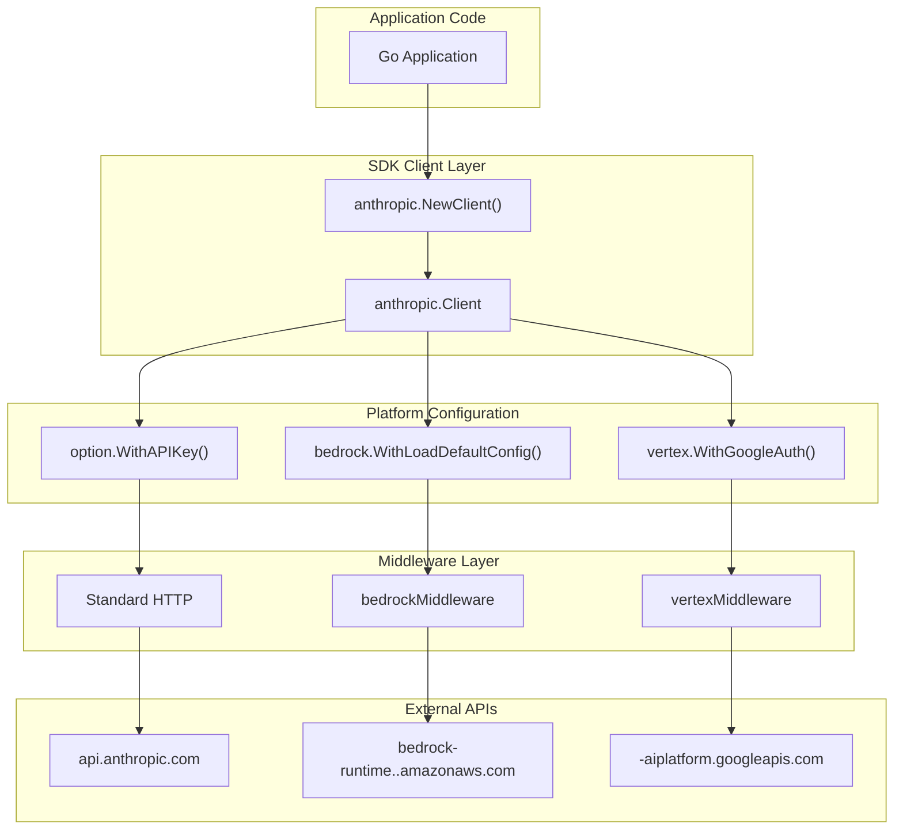

**Direct Anthropic API:**
- Default deployment option
- Requires `ANTHROPIC_API_KEY` environment variable or explicit configuration
- Configured via `option.WithAPIKey()`

**AWS Bedrock:**
- Integrates with AWS authentication (IAM or bearer tokens)
- Configured via `bedrock.WithLoadDefaultConfig()` or `bedrock.WithConfig()`
- Supports AWS SigV4 signing and custom EventStream decoding
- Base URL pattern: `https://bedrock-runtime.<region>.amazonaws.com`

**Google Vertex AI:**
- Integrates with Google Cloud authentication (Application Default Credentials)
- Configured via `vertex.WithGoogleAuth()` or `vertex.WithCredentials()`
- Base URL pattern: `https://<region>-aiplatform.googleapis.com`

Sources: [README.md:881-984](), [bedrock/bedrock.go](), [vertex/vertex.go]()

## Core Architecture

### Client and Services

The SDK follows a client-service pattern where `anthropic.Client` acts as the root object providing access to specialized service endpoints:

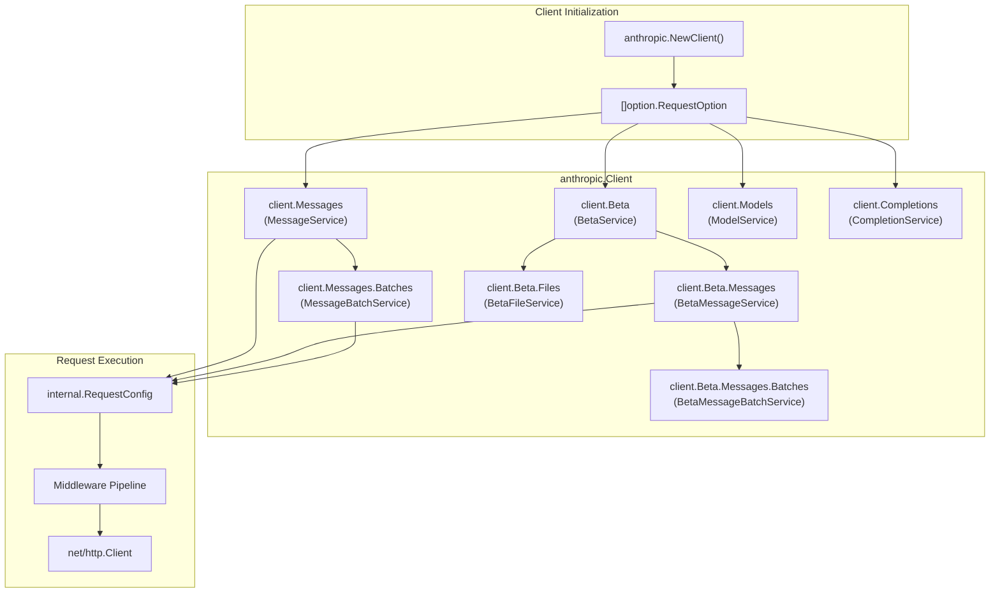

**Service hierarchy:**
- `client.Messages`: Core message creation API (stable)
- `client.Messages.Batches`: Asynchronous batch processing
- `client.Beta.Messages`: Beta message features (context management, extended thinking)
- `client.Beta.Messages.Batches`: Beta batch processing
- `client.Beta.Files`: File upload and management
- `client.Models`: Model information and listing
- `client.Completions`: Legacy text completions (deprecated)

Sources: [client.go](), [message.go](), [messagebatch.go](), [beta.go]()

### Type System

The SDK employs a comprehensive type system with discriminated unions for polymorphic content:

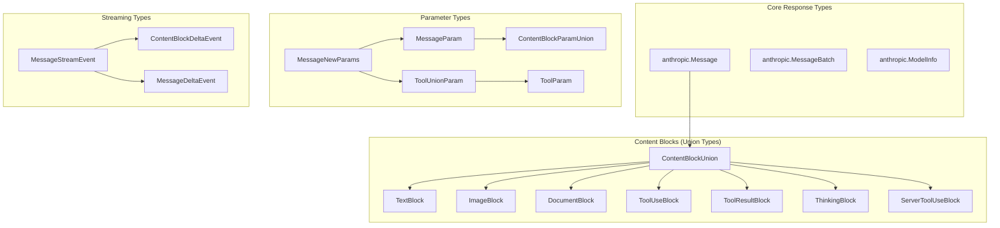

**Type categories:**
- **Response types**: Immutable structs with metadata fields (e.g., `Message`, `MessageBatch`)
- **Parameter types**: Request structs with `Param` suffix (e.g., `MessageNewParams`, `ToolParam`)
- **Union types**: Discriminated unions with `AsAny()` conversion methods
- **Streaming types**: Event-based delta types for real-time updates
- **Helper types**: Citations, cache control, metadata, usage statistics

Sources: [message.go](), [messageparam.go](), [tool.go](), [contentblock.go]()

## Key Features

### Messages API

The primary interface for conversational interactions. Supports:
- Synchronous message generation via `client.Messages.New()`
- Streaming responses via `client.Messages.NewStreaming()`
- System prompts, multi-turn conversations, and temperature control
- Content blocks: text, images, documents, tool use/results, thinking

**Example structure:**
```go
message, err := client.Messages.New(ctx, anthropic.MessageNewParams{
    Model:     anthropic.ModelClaudeSonnet4_5_20250929,
    MaxTokens: 1024,
    Messages: []anthropic.MessageParam{
        anthropic.NewUserMessage(
            anthropic.NewTextBlock("Query text"),
        ),
    },
})
```

Sources: [README.md:42-70](), [message.go]()

### Streaming Support

Server-sent events (SSE) streaming for real-time response generation:
- Event types: `message_start`, `content_block_start`, `content_block_delta`, `content_block_stop`, `message_delta`, `message_stop`
- Accumulator pattern via `Message.Accumulate()` for reconstructing complete messages
- Custom stream buffer handling for large responses

Sources: [README.md:123-160](), [messagestream.go]()

### Tool Calling

Comprehensive tool execution framework:
- Custom tool definitions with JSON schemas
- Tool choice strategies: `auto`, `any`, `tool`, `none`
- Server-side tools: web search, web fetch, code execution, bash, text editor
- Multi-turn conversation loops for tool execution
- Automatic tool runners in beta API via `toolrunner` package

Sources: [README.md:163-368](), [tool.go](), [toolrunner/]()

### Batch Processing

Asynchronous processing for high-volume workloads:
- Submit batches via `client.Messages.Batches.New()`
- Poll status via `client.Messages.Batches.Get()`
- Stream results as JSONL via `ResultsStreaming()`
- Per-request tracking with `custom_id` field
- Result types: `succeeded`, `errored`, `canceled`, `expired`

Sources: [README.md:587-623](), [messagebatch.go]()

### Beta Features

Experimental features accessed through `client.Beta`:
- Context management (automatic compaction, tool use clearing, thinking truncation)
- Extended thinking modes (adaptive, enabled, disabled)
- Model Context Protocol (MCP) integration
- Per-iteration usage tracking
- Advanced file handling

Sources: [beta.go](), [betamessage.go]()

## Request Execution Pipeline

The SDK implements a sophisticated request pipeline with retry logic, middleware support, and platform-specific transformations:

```mermaid
graph LR
    subgraph "Request Construction"
        Params["Parameter Struct"]
        Serialization["JSON/Multipart/Query<br/>Encoding"]
        Headers["Header Construction<br/>(User-Agent, Auth, Beta)"]
    end
    
    subgraph "Middleware Pipeline"
        CustomMW["Custom Middleware"]
        PlatformMW["Platform Middleware<br/>(Bedrock/Vertex)"]
        RetryMW["Retry Logic"]
    end
    
    subgraph "HTTP Execution"
        HTTPClient["http.Client.Do()"]
        Response["http.Response"]
    end
    
    subgraph "Response Processing"
        StatusCheck{{"Status<br/>Check"}}
        Deserialize["JSON Unmarshal"]
        ErrorConstruct["apierror.Error"]
    end
    
    Params --> Serialization
    Serialization --> Headers
    Headers --> CustomMW
    CustomMW --> PlatformMW
    PlatformMW --> RetryMW
    RetryMW --> HTTPClient
    HTTPClient --> Response
    Response --> StatusCheck
    StatusCheck -->|"2xx"| Deserialize
    StatusCheck -->|"4xx/5xx"| ErrorConstruct
    StatusCheck -->|"429/5xx<br/>(retry)"| RetryMW
```

**Pipeline stages:**
1. **Parameter encoding**: Polymorphic serialization based on content type
2. **Header construction**: Authentication, API versioning, beta flags
3. **Custom middleware**: User-provided request/response transformations
4. **Platform middleware**: Bedrock/Vertex-specific URL and body modifications
5. **Retry logic**: Exponential backoff with configurable max attempts (default: 2)
6. **HTTP execution**: Standard `net/http` client with timeout support
7. **Response handling**: Status-based branching with structured error types

Sources: [client.go](), [option/requestoption.go](), [internal/requestconfig.go]()

## Error Handling

The SDK provides structured error types with rich debugging context:

| Error Type | HTTP Status | Description |
|------------|-------------|-------------|
| `InvalidRequestError` | 400 | Malformed request parameters |
| `AuthenticationError` | 401 | Invalid or missing API key |
| `PermissionError` | 403 | Insufficient permissions |
| `NotFoundError` | 404 | Resource not found |
| `RateLimitError` | 429 | Rate limit exceeded |
| `OverloadedError` | 529 | Server overloaded |
| `APIError` | 500+ | Internal server error |
| `TimeoutError` | - | Request timeout |

**Error structure (`anthropic.Error`):**
- `StatusCode`: HTTP status code
- `RequestID`: Unique request identifier for support
- `Type`: Error type discriminator
- `Message`: Human-readable error message
- `DumpRequest()`: Serialized HTTP request
- `DumpResponse()`: Serialized HTTP response

Sources: [README.md:624-660](), [error.go](), [shared/errorobject.go]()

## Package Structure

```
anthropic-sdk-go/
├── anthropic.go           # Client and core types
├── message.go             # Messages API
├── messagebatch.go        # Batch processing
├── beta.go                # Beta features
├── model.go               # Models API
├── completion.go          # Legacy completions
├── bedrock/               # AWS Bedrock integration
├── vertex/                # Google Vertex AI integration
├── toolrunner/            # Automatic tool execution
├── option/                # Request options
├── internal/              # Internal utilities
│   ├── requestconfig.go   # Request configuration
│   ├── retry.go           # Retry logic
│   ├── apijson/           # JSON encoding
│   └── encoding/          # Parameter encoding
└── shared/                # Shared types and constants
    ├── errorobject.go     # Error types
    └── constant/          # Type constants
```

Sources: Repository file structure

## Dependencies

The SDK has minimal external dependencies:

| Package | Purpose |
|---------|---------|
| `github.com/tidwall/gjson` | JSON path queries |
| `github.com/tidwall/sjson` | JSON path updates |
| `github.com/aws/aws-sdk-go-v2` | AWS Bedrock integration |
| `google.golang.org/api` | Google Vertex AI integration |
| `github.com/invopop/jsonschema` | Tool schema generation |

All core functionality uses only Go standard library packages (`net/http`, `encoding/json`, `context`, etc.).

Sources: [go.mod:7-21]()

---

# Page: Getting Started

# Getting Started

<details>
<summary>Relevant source files</summary>

The following files were used as context for generating this wiki page:

- [.release-please-manifest.json](.release-please-manifest.json)
- [CHANGELOG.md](CHANGELOG.md)
- [README.md](README.md)
- [internal/version.go](internal/version.go)
- [message.go](message.go)

</details>


This guide walks through installing the Anthropic Go SDK, configuring authentication, and sending your first API request to Claude. By the end, you'll understand how to initialize a client and create basic message exchanges.

For detailed information about configuration options, see [Client Configuration](#3.1). For advanced message features like streaming and tool use, see [Messages API](#4).

---

## Installation

The SDK is distributed as a standard Go module. Import it in your project:

```go
import (
    "github.com/anthropics/anthropic-sdk-go"
)
```

To pin to a specific version, use `go get`:

```sh
go get -u 'github.com/anthropics/anthropic-sdk-go@v1.26.0'
```

**Sources:** [README.md:12-32]()

---

## Requirements

The SDK requires **Go 1.22 or higher**. This minimum version is necessary to support the `omitzero` JSON semantics used throughout the SDK for request field handling.

**Sources:** [README.md:34-36](), [CHANGELOG.md:213]()

---

## API Key Configuration

The SDK requires an Anthropic API key for authentication. There are two methods to provide your key:

### Method 1: Environment Variable (Recommended)

Set the `ANTHROPIC_API_KEY` environment variable:

```sh
export ANTHROPIC_API_KEY='your-api-key-here'
```

The client automatically reads this variable during initialization via `os.LookupEnv()`.

### Method 2: Explicit Configuration

Pass the API key directly when creating the client:

```go
client := anthropic.NewClient(
    option.WithAPIKey("your-api-key-here"),
)
```

**Sources:** [README.md:54-56]()

---

## Client Initialization

### Basic Client Creation

The entry point for all SDK operations is the `anthropic.Client` struct, created via `anthropic.NewClient()`:

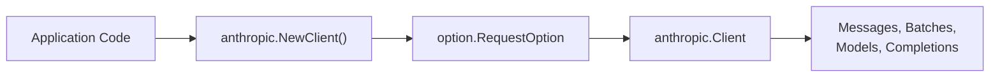

**Client Creation Flow**

The client constructor accepts variadic `option.RequestOption` parameters that configure global behavior:

| Option Function | Purpose | Example |
|----------------|---------|---------|
| `option.WithAPIKey()` | Set authentication key | `option.WithAPIKey("sk-...")` |
| `option.WithBaseURL()` | Override API endpoint | `option.WithBaseURL("https://custom.api.com")` |
| `option.WithHTTPClient()` | Provide custom HTTP client | `option.WithHTTPClient(customClient)` |
| `option.WithMaxRetries()` | Configure retry behavior | `option.WithMaxRetries(5)` |
| `option.WithRequestTimeout()` | Set per-request timeout | `option.WithRequestTimeout(30*time.Second)` |

### Minimal Example

```go
package main

import "github.com/anthropics/anthropic-sdk-go"

func main() {
    client := anthropic.NewClient()
    // Client is now ready to use
}
```

When no options are provided, the client uses:
- API key from `ANTHROPIC_API_KEY` environment variable
- Default base URL: `https://api.anthropic.com`
- Default retry count: 2 retries
- No per-request timeout (uses context timeout instead)

**Sources:** [README.md:53-56](), [message.go:24-43]()

---

## Sending Your First Message

### Message Creation Components

Creating a message requires three core components:

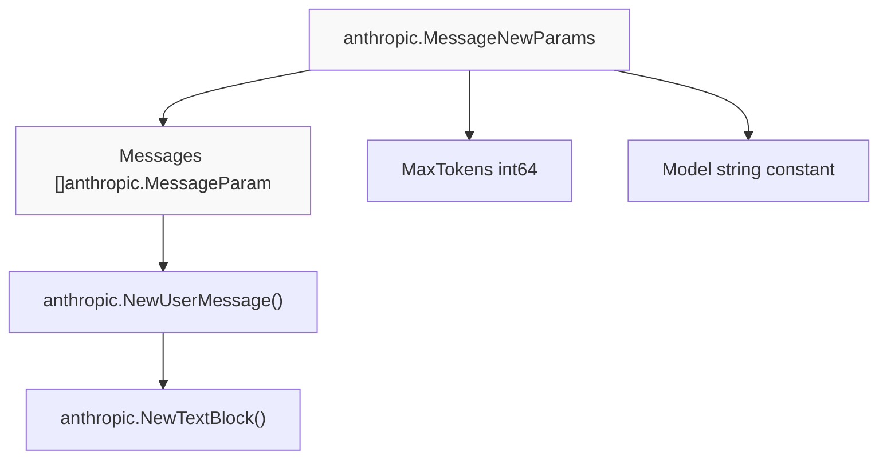

**Message Structure Mapping to Code**

### Complete Example

The following example demonstrates creating a simple question-answer interaction:

```go
package main

import (
    "context"
    "fmt"
    
    "github.com/anthropics/anthropic-sdk-go"
    "github.com/anthropics/anthropic-sdk-go/option"
)

func main() {
    client := anthropic.NewClient(
        option.WithAPIKey("my-anthropic-api-key"),
    )
    
    message, err := client.Messages.New(context.TODO(), anthropic.MessageNewParams{
        MaxTokens: 1024,
        Messages: []anthropic.MessageParam{
            anthropic.NewUserMessage(anthropic.NewTextBlock("What is a quaternion?")),
        },
        Model: anthropic.ModelClaudeSonnet4_5_20250929,
    })
    if err != nil {
        panic(err.Error())
    }
    fmt.Printf("%+v\n", message.Content)
}
```

### Parameter Breakdown

**Required Parameters:**

| Parameter | Type | Purpose | Example |
|-----------|------|---------|---------|
| `MaxTokens` | `int64` | Maximum response tokens | `1024` |
| `Messages` | `[]anthropic.MessageParam` | Conversation history | See below |
| `Model` | `string` | Model identifier | `anthropic.ModelClaudeSonnet4_5_20250929` |

**Helper Functions:**

- `anthropic.NewUserMessage()` - Creates a user message with content blocks
- `anthropic.NewTextBlock()` - Creates a text content block
- Both functions return properly typed structures for the `MessageNewParams`

**Available Model Constants:**

The SDK provides constants for all available models in [message.go:7866-7886](). Examples include:
- `anthropic.ModelClaudeSonnet4_5_20250929`
- `anthropic.ModelClaudeOpus4_6_20250925`
- `anthropic.ModelClaude3Opus20240229`

**Sources:** [README.md:42-70](), [message.go:45-69]()

---

## Understanding the Response

### Response Structure

The `client.Messages.New()` call returns two values:

```go
message, err := client.Messages.New(context.TODO(), params)
```

Where:
- `message` is a `*anthropic.Message` struct containing the response
- `err` is an error (see [Error Handling](#3.4) for details)

### Message Response Fields

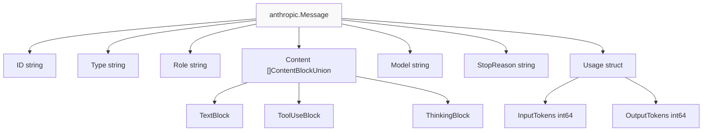

**Key Response Fields**

**Content Blocks:**

The `Content` field is a slice of `ContentBlockUnion`, which can contain different types of content. For a basic text response, access it as:

```go
for _, block := range message.Content {
    if textBlock, ok := block.AsAny().(anthropic.TextBlock); ok {
        fmt.Println(textBlock.Text)
    }
}
```

The `.AsAny()` method returns the concrete type of the content block. See [Content Blocks](#4.2) for all available types.

**Stop Reason:**

The `StopReason` field indicates why generation stopped:
- `"end_turn"` - Natural completion
- `"max_tokens"` - Hit token limit
- `"stop_sequence"` - Hit a stop sequence
- `"tool_use"` - Model wants to use a tool

**Usage Tracking:**

The `Usage` struct contains token consumption:
- `InputTokens` - Tokens in the request
- `OutputTokens` - Tokens in the response
- Additional fields for cache usage when caching is enabled

**Sources:** [message.go:7676-7722]()

---

## Multi-Turn Conversations

To maintain conversation context, append messages to a message history:

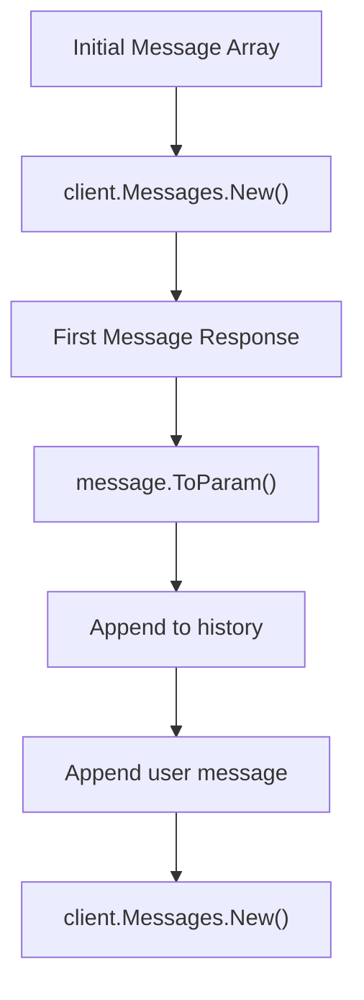

**Conversation Flow with Message History**

### Pattern

1. Start with initial user message
2. Get assistant response
3. Convert response to parameter format using `.ToParam()`
4. Append to message array
5. Add new user message
6. Send updated array in next request

### Example Structure

```go
messages := []anthropic.MessageParam{
    anthropic.NewUserMessage(anthropic.NewTextBlock("What is my first name?")),
}

// First request
message, err := client.Messages.New(context.TODO(), anthropic.MessageNewParams{
    Model:     anthropic.ModelClaudeSonnet4_5_20250929,
    Messages:  messages,
    MaxTokens: 1024,
})

// Append assistant response
messages = append(messages, message.ToParam())

// Append new user message
messages = append(messages, anthropic.NewUserMessage(
    anthropic.NewTextBlock("My full name is John Doe"),
))

// Second request with full history
message, err = client.Messages.New(context.TODO(), anthropic.MessageNewParams{
    Model:     anthropic.ModelClaudeSonnet4_5_20250929,
    Messages:  messages,
    MaxTokens: 1024,
})
```

**Key Method:**

- `message.ToParam()` - Converts a `Message` response into a `MessageParam` suitable for inclusion in the `Messages` array of subsequent requests

**Sources:** [README.md:72-103](), [message.go:7767-7774]()

---

## System Prompts

System prompts provide instructions that apply to the entire conversation. They are specified via the `System` parameter:

```go
message, err := client.Messages.New(context.TODO(), anthropic.MessageNewParams{
    Model:     anthropic.ModelClaudeSonnet4_5_20250929,
    MaxTokens: 1024,
    System: []anthropic.TextBlockParam{
        {Text: "Be very serious at all times."},
    },
    Messages: messages,
})
```

### System Parameter Structure

- Type: `[]anthropic.TextBlockParam`
- Accepts multiple text blocks for complex instructions
- Applied before all message exchanges
- Cannot be updated mid-conversation (send as part of each request)

**Sources:** [README.md:107-119]()

---

## Request Context and Timeouts

All SDK methods accept a `context.Context` as the first parameter for timeout and cancellation control:

### Context Timeout

```go
ctx, cancel := context.WithTimeout(context.Background(), 5*time.Minute)
defer cancel()

message, err := client.Messages.New(ctx, params)
```

### Per-Request Timeout

For retry-aware timeouts, use `option.WithRequestTimeout()`:

```go
message, err := client.Messages.New(
    ctx,
    params,
    option.WithRequestTimeout(20*time.Second), // Per-retry timeout
)
```

**Important Distinction:**

- **Context timeout**: Total time including all retries
- **Request timeout**: Maximum time per individual attempt

For non-streaming requests with large `MaxTokens`, the SDK automatically calculates appropriate timeouts to prevent network idle disconnections. See [message.go:55-64]() for the timeout calculation logic.

**Sources:** [README.md:662-689](), [message.go:55-64]()

---

## Next Steps

Now that you can send basic messages, explore:

- **[Streaming Messages](#4.3)** - Real-time response streaming with SSE
- **[Tool Calling](#5)** - Extend Claude with function calls
- **[Content Blocks](#4.2)** - Images, documents, and rich content
- **[Error Handling](#3.4)** - Robust error management
- **[Cloud Integrations](#7.1)** - Deploy on AWS Bedrock or Google Vertex AI

For complete API documentation, see the [official Anthropic API reference](https://docs.anthropic.com/claude/reference).

**Sources:** [README.md:1-1000]()

---

# Page: Core Concepts

# Core Concepts

<details>
<summary>Relevant source files</summary>

The following files were used as context for generating this wiki page:

- [.release-please-manifest.json](.release-please-manifest.json)
- [CHANGELOG.md](CHANGELOG.md)
- [README.md](README.md)
- [client.go](client.go)
- [internal/apierror/apierror.go](internal/apierror/apierror.go)
- [internal/apijson/subfield.go](internal/apijson/subfield.go)
- [internal/requestconfig/requestconfig.go](internal/requestconfig/requestconfig.go)
- [internal/version.go](internal/version.go)
- [option/requestoption.go](option/requestoption.go)
- [packages/pagination/pagination.go](packages/pagination/pagination.go)

</details>


This document explains the fundamental concepts and patterns that apply across all SDK functionality. These core concepts form the foundation for understanding how to configure clients, make requests, handle responses, and work with the SDK's type system.

**Child Pages:**
- [3.1 Client Configuration](#3.1) - How to configure the client with API keys, timeouts, retries, and custom options
- [3.2 Request and Response Handling](#3.2) - The request execution pipeline, response processing, and timeouts
- [3.3 Parameter Encoding](#3.3) - How parameters are serialized (JSON, multipart, query) and optional field handling
- [3.4 Error Handling](#3.4) - Error types, response structure, and debugging methods

For specific API usage, see [Messages API](#4), [Tool Calling](#5), and [Beta Services](#6).

## SDK Architecture Overview

The SDK is organized around a central `anthropic.Client` that provides access to API services through a service-oriented architecture. Each service corresponds to a set of related API endpoints.

**Client and Service Structure**

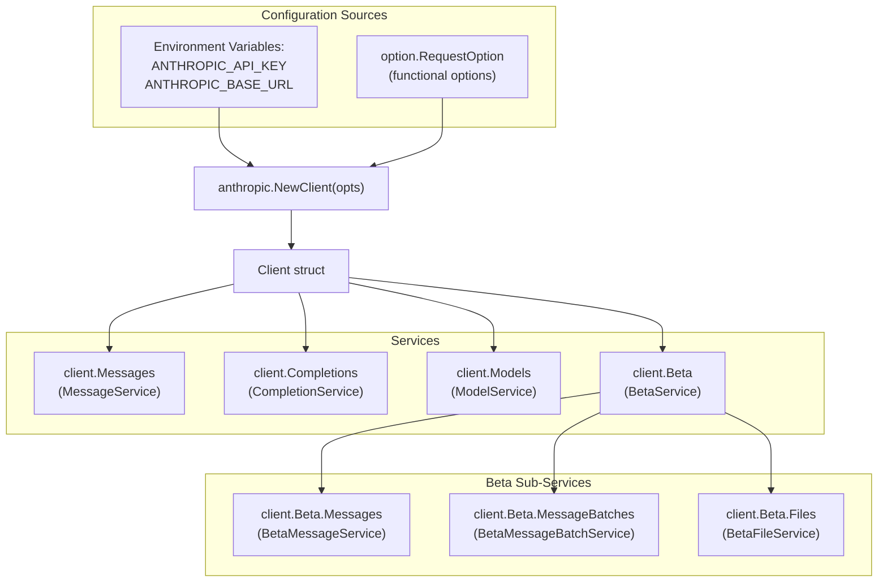

**Client Initialization Pattern**

The `anthropic.NewClient()` function creates a client with default configuration from environment variables, then applies any additional options passed as arguments. This pattern allows both simple usage with environment-based configuration and explicit control when needed.

```go
// Default initialization (uses environment variables)
client := anthropic.NewClient()

// Explicit configuration
client := anthropic.NewClient(
    option.WithAPIKey("sk-ant-..."),
    option.WithBaseURL("https://api.anthropic.com"),
    option.WithMaxRetries(5),
)
```

See [Client Configuration](#3.1) for detailed configuration options.

Sources: [client.go:28-61](), [client.go:32-44](), [README.md:43-68]()

## Request/Response Lifecycle

Every API call in the SDK follows a consistent lifecycle from request creation through response handling. Understanding this flow is essential for debugging and advanced usage.

**Request Execution Pipeline**

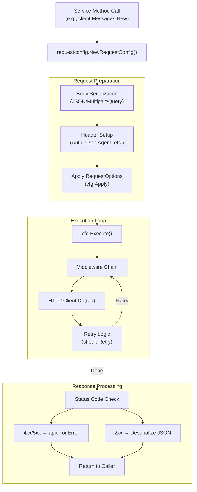

**Key Components**

| Component | Location | Purpose |
|-----------|----------|---------|
| `requestconfig.NewRequestConfig()` | [internal/requestconfig/requestconfig.go:90-191]() | Creates request configuration with serialization |
| `requestconfig.RequestConfig` | [internal/requestconfig/requestconfig.go:199-225]() | Holds request state (retries, timeout, headers, etc.) |
| `requestconfig.RequestConfig.Execute()` | [internal/requestconfig/requestconfig.go:377-558]() | Executes request with retry loop |
| `option.RequestOption` | [option/requestoption.go:18-23]() | Functional options pattern for configuration |
| `apierror.Error` | [internal/apierror/apierror.go:14-57]() | API error response structure |

**Retry Behavior**

The SDK automatically retries failed requests up to 2 times (configurable via `option.WithMaxRetries()`). Retry conditions include:
- Connection errors (no response received)
- HTTP 408 (Request Timeout)
- HTTP 409 (Conflict)
- HTTP 429 (Too Many Requests)
- HTTP 5xx (Server Errors)

The retry delay uses exponential backoff with jitter and respects `Retry-After` headers from the API.

See [Request and Response Handling](#3.2) for detailed information about the execution pipeline, retry logic, and timeout management.

Sources: [internal/requestconfig/requestconfig.go:377-558](), [internal/requestconfig/requestconfig.go:90-191](), [internal/requestconfig/requestconfig.go:241-266](), [internal/requestconfig/requestconfig.go:358-375]()

## Type System and Data Model

The SDK provides a rich type system that maps to the Anthropic API's data structures. This includes support for union types, optional parameters, and sophisticated serialization patterns.

**Type Categories**

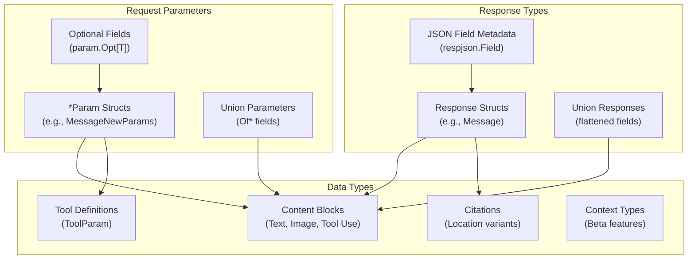

**Union Type Pattern**

The API uses union types extensively. The SDK represents these differently for requests vs. responses:

**Request Unions** use "Of" prefixed fields where only one should be set:
```go
type ContentBlockParamUnion struct {
    OfText     *TextBlockParam     `json:",omitzero,inline"`
    OfImage    *ImageBlockParam    `json:",omitzero,inline"`
    OfToolUse  *ToolUseBlockParam  `json:",omitzero,inline"`
    OfDocument *DocumentBlockParam `json:",omitzero,inline"`
}
```

**Response Unions** use flattened fields from all variants with a type discriminator:
```go
type ContentBlockUnion struct {
    Type    string  // "text", "image", "tool_use"
    Text    string  // from TextBlock
    Source  ...     // from ImageBlock
    Name    string  // from ToolUseBlock
    // ... other fields
}
```

Use `.AsAny()` to convert to the specific variant type for type-safe handling.

**Optional Parameters**

The SDK uses Go 1.24+ `omitzero` semantics for optional fields:

| Type | Required | Optional | Null |
|------|----------|----------|------|
| Primitives | `json:"field,required"` | `anthropic.String("val")` | `param.Null[string]()` |
| Structs | Direct value | `json:"field,omitzero"` | `param.NullStruct[T]()` |
| Slices/Maps | Direct value | `json:"field,omitzero"` | `param.Null[[]T]()` |

Helper constructors: `anthropic.String()`, `anthropic.Int()`, `anthropic.Bool()`, `anthropic.Float()`

Check presence with `param.IsOmitted(value)`.

See [Parameter Encoding](#3.3) for detailed serialization rules and format detection.

Sources: [README.md:370-410](), [README.md:432-460](), [README.md:522-559]()

## Authentication and Security

The SDK supports multiple authentication methods and security configurations.

### Authentication Methods

| Method | Environment Variable | Request Option | Header |
|---|---|---|---|
| API Key | `ANTHROPIC_API_KEY` | `option.WithAPIKey()` | `X-Api-Key` |
| Auth Token | `ANTHROPIC_AUTH_TOKEN` | `option.WithAuthToken()` | `Authorization: Bearer` |

### Default Headers

The SDK automatically sets several headers for API compatibility and debugging:

- `User-Agent`: Contains SDK version information
- `anthropic-version`: API version (`2023-06-01`)
- `X-Stainless-*`: Platform and runtime information
- `Accept`: `application/json`

Sources: [internal/requestconfig/requestconfig.go:27-31](), [internal/requestconfig/requestconfig.go:69-78](), [option/requestoption.go:270-284]()

---

# Page: Client Configuration

# Client Configuration

<details>
<summary>Relevant source files</summary>

The following files were used as context for generating this wiki page:

- [.release-please-manifest.json](.release-please-manifest.json)
- [CHANGELOG.md](CHANGELOG.md)
- [README.md](README.md)
- [client.go](client.go)
- [client_test.go](client_test.go)
- [completion_test.go](completion_test.go)
- [internal/apierror/apierror.go](internal/apierror/apierror.go)
- [internal/apijson/subfield.go](internal/apijson/subfield.go)
- [internal/requestconfig/requestconfig.go](internal/requestconfig/requestconfig.go)
- [internal/version.go](internal/version.go)
- [option/requestoption.go](option/requestoption.go)
- [packages/pagination/pagination.go](packages/pagination/pagination.go)
- [usage_test.go](usage_test.go)

</details>


This document covers how to configure the `anthropic.Client` with various options including authentication, base URLs, HTTP client customization, retry behavior, and other request settings. The configuration system uses a functional options pattern that allows flexible client setup for different environments and use cases.

For information about request and response handling mechanics, see [Request and Response Handling](#3.2). For advanced streaming configuration, see [Streaming Responses](#6.1).

## Overview

The Anthropic SDK uses a functional options pattern for client configuration, allowing you to customize authentication, networking, retry behavior, and other settings. Configuration is handled through the `RequestOption` interface and applied at client creation time or per-request.

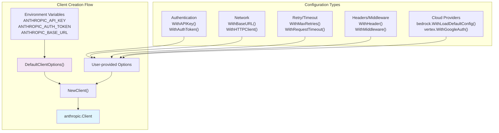

Sources: [client.go:46-57](), [client.go:28-40](), [option/requestoption.go:23]()

## Client Creation and Default Configuration

### Basic Client Creation

The primary method for creating a client is through `NewClient()`, which automatically loads default configuration from environment variables:

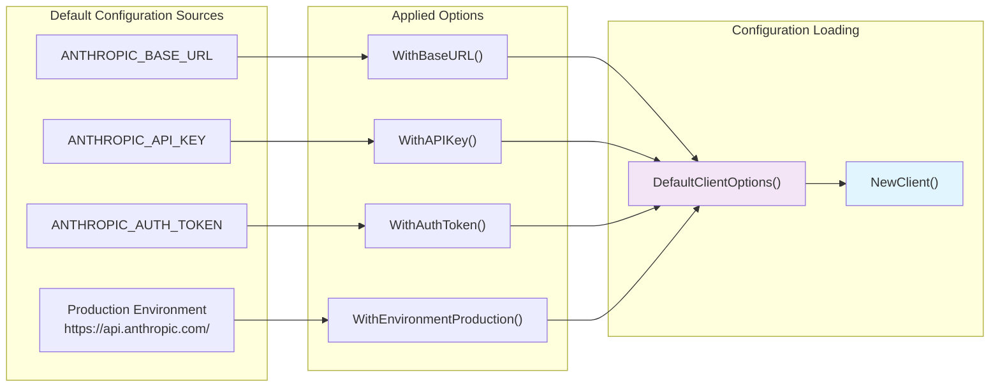

Sources: [client.go:28-40](), [client.go:42-57](), [option/requestoption.go:266-268]()

The `DefaultClientOptions()` function reads configuration in this order:
1. Sets production environment as default base URL
2. Overrides base URL if `ANTHROPIC_BASE_URL` is set
3. Sets API key if `ANTHROPIC_API_KEY` is present
4. Sets auth token if `ANTHROPIC_AUTH_TOKEN` is present

### Client Structure

The `Client` struct contains service instances and holds configuration options that are passed to all requests:

| Field | Type | Purpose |
|-------|------|---------|
| `Options` | `[]option.RequestOption` | Configuration applied to all requests |
| `Completions` | `CompletionService` | Legacy text completions API |
| `Messages` | `MessageService` | Modern messages API |
| `Models` | `ModelService` | Model information API |
| `Beta` | `BetaService` | Beta/experimental features |

The client provides HTTP verb methods (`Get`, `Post`, `Put`, `Patch`, `Delete`) for making custom requests while retaining the configured authentication, base URL, retries, and other options.

Sources: [client.go:17-23](), [client.go:90-126]()

## Authentication Configuration

### API Key Authentication

The primary authentication method uses the `X-Api-Key` header:

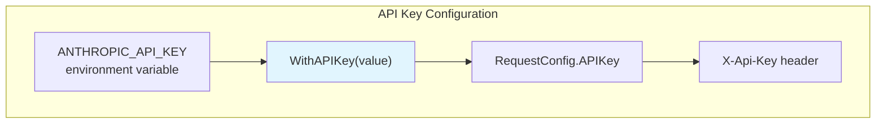

Sources: [option/requestoption.go:270-276](), [client.go:33-35]()

### Bearer Token Authentication

Alternative authentication using the `Authorization` header:

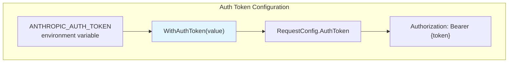

Sources: [option/requestoption.go:278-284](), [client.go:36-38]()

## Network Configuration

### Base URL Configuration

Base URL configuration supports both environment-based and programmatic setup:

| Configuration Method | Function | Purpose |
|---------------------|----------|---------|
| Environment Default | `WithEnvironmentProduction()` | Sets `https://api.anthropic.com/` |
| Environment Variable | `ANTHROPIC_BASE_URL` | Override via environment |
| Programmatic | `WithBaseURL(url)` | Direct URL specification |

Sources: [option/requestoption.go:28-41](), [option/requestoption.go:266-268]()

### HTTP Client Customization

The SDK supports custom HTTP clients for advanced networking requirements:

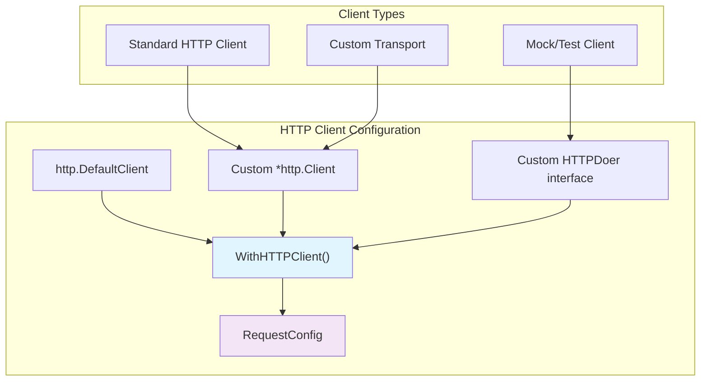

Sources: [option/requestoption.go:48-73](), [internal/requestconfig/requestconfig.go:193-195](), [internal/requestconfig/requestconfig.go:210-211]()

The `WithHTTPClient()` function accepts either an `*http.Client` or any type implementing the `HTTPDoer` interface with a `Do(*http.Request) (*http.Response, error)` method.

## Retry and Timeout Configuration

### Retry Configuration

The SDK implements automatic retry logic with exponential backoff:

| Configuration | Default | Function | Purpose |
|--------------|---------|----------|---------|
| Max Retries | 2 | `WithMaxRetries(n)` | Total retry attempts |
| Retry Conditions | HTTP 408, 409, 429, 5xx | Built-in logic | When to retry |
| Backoff Strategy | Exponential + jitter | `retryDelay()` | Delay between retries |

Sources: [internal/requestconfig/requestconfig.go:165](), [option/requestoption.go:98-106](), [internal/requestconfig/requestconfig.go:356-373]()

### Timeout Configuration

Request timeouts can be configured per-request or globally:

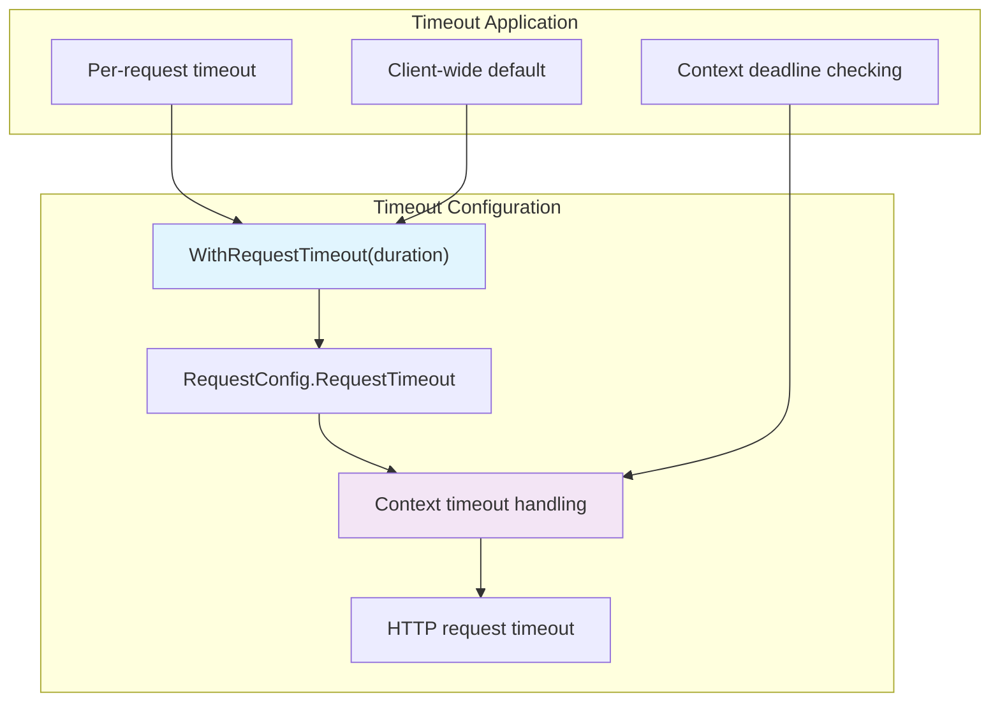

Sources: [option/requestoption.go:254-261](), [internal/requestconfig/requestconfig.go:181-186](), [internal/requestconfig/requestconfig.go:427-435]()

## Header and Middleware Configuration

### Header Management

The SDK provides flexible header manipulation:

| Function | Purpose | Behavior |
|----------|---------|----------|
| `WithHeader(key, value)` | Set header | Overwrites existing values |
| `WithHeaderAdd(key, value)` | Add header | Appends to existing values |
| `WithHeaderDel(key)` | Delete header | Removes all values for key |

Sources: [option/requestoption.go:110-132]()

### Default Headers

The SDK automatically sets several headers on all requests:

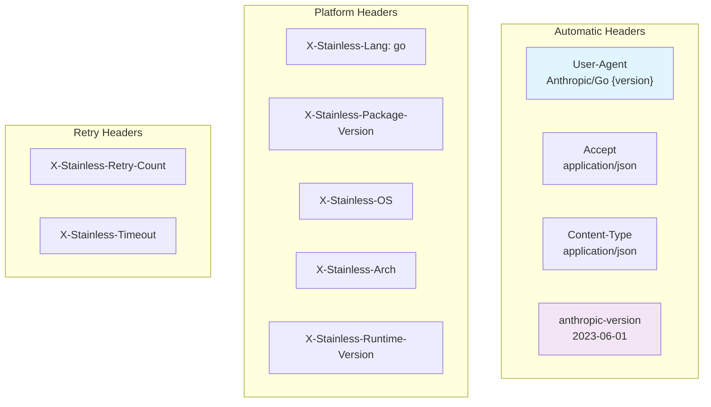

Sources: [README.md:38-66](), [option/requestoption.go:270-276](), [option/requestoption.go:278-284]()

### Middleware Support

The SDK supports HTTP middleware for request/response interception:

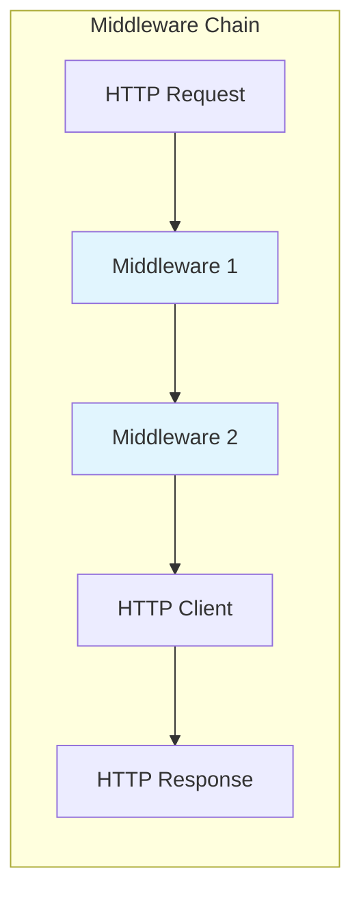

Sources: [option/requestoption.go:75-91](), [internal/requestconfig/requestconfig.go:225-237]()

Middleware functions have the signature `func(*http.Request, MiddlewareNext) (*http.Response, error)` and are applied in the order they're registered.

## Cloud Provider Configuration

### Amazon Bedrock Integration

The SDK supports Amazon Bedrock through special middleware configuration:

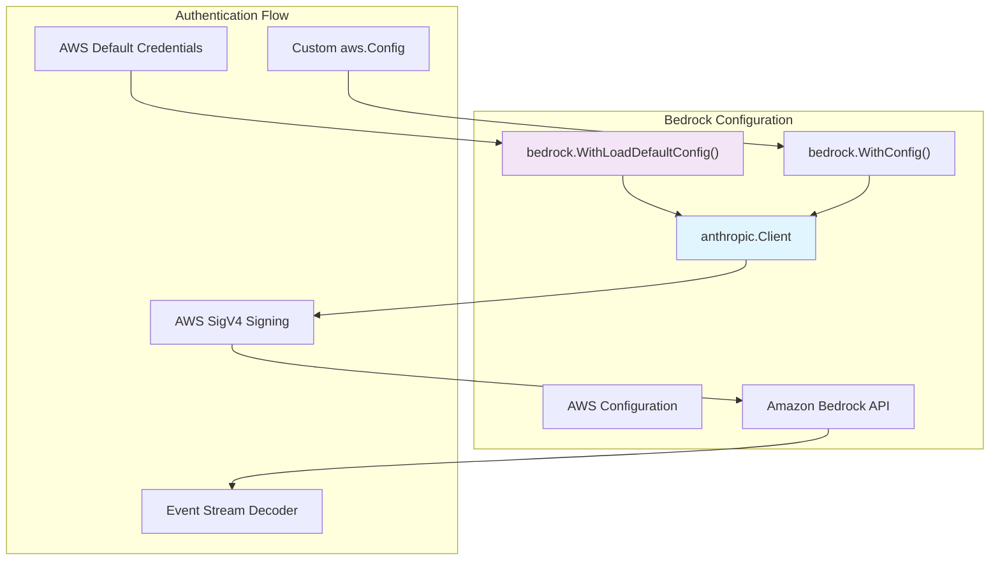

Sources: [README.md:808-834]()

### Google Vertex AI Integration

The SDK supports Google Vertex AI through authentication middleware:

```mermaid
graph TD
    subgraph "Vertex AI Configuration"
        GoogleCredentials["Google Credentials"]
        WithGoogleAuth["vertex.WithGoogleAuth()"]
        WithCredentials["vertex.WithCredentials()"]
        AnthropicClient["anthropic.Client"]
        VertexAPI["Google Vertex AI API"]
    end
    
    subgraph "Authentication Flow"
        ADC["Application Default Credentials"]
        CustomCreds["Custom google.Credentials"]
        ProjectID["Project ID"]
        Region["Region"]
    end
    
    ADC --> WithGoogleAuth
    CustomCreds --> WithCredentials
    ProjectID --> WithGoogleAuth
    Region --> WithGoogleAuth
    WithGoogleAuth --> AnthropicClient
    WithCredentials --> AnthropicClient
    AnthropicClient --> VertexAPI
    
    style AnthropicClient fill:#e1f5fe
    style WithGoogleAuth fill:#f3e5f5
```

Sources: [README.md:836-862]()

## Request-Level Configuration

### JSON Body Manipulation

For dynamic request body modification, the SDK provides JSON manipulation options:

| Function | Purpose |
|----------|---------|
| `WithJSONSet(key, value)` | Set JSON field using sjson syntax |
| `WithJSONDel(key)` | Delete JSON field |

Sources: [option/requestoption.go:170-212]()

### Query Parameter Management

URL query parameters can be manipulated similarly to headers:

| Function | Purpose |
|----------|---------|
| `WithQuery(key, value)` | Set query parameter |
| `WithQueryAdd(key, value)` | Add query parameter |
| `WithQueryDel(key)` | Delete query parameter |

Sources: [option/requestoption.go:136-164]()

### Response Handling Options

The SDK provides options for custom response handling:

| Function | Purpose |
|----------|---------|
| `WithResponseBodyInto(dst)` | Custom deserialization target |
| `WithResponseInto(dst)` | Access to raw `*http.Response` |
| `WithRequestBody(contentType, body)` | Custom request body |

Sources: [option/requestoption.go:216-249]()

## Configuration Lifecycle

### Request Configuration Flow

```mermaid
graph TD
    subgraph "Configuration Assembly"
        ClientOptions["Client.Options"]
        RequestOptions["Request-specific options"]
        NewRequestConfig["NewRequestConfig()"]
        ApplyOptions["Apply() method"]
        FinalConfig["Final RequestConfig"]
    end
    
    subgraph "Request Execution"
        Execute["Execute() method"]
        HTTPRequest["HTTP Request"]
        ResponseHandling["Response Processing"]
    end
    
    ClientOptions --> NewRequestConfig
    RequestOptions --> NewRequestConfig
    NewRequestConfig --> ApplyOptions
    ApplyOptions --> FinalConfig
    FinalConfig --> Execute
    Execute --> HTTPRequest
    HTTPRequest --> ResponseHandling
    
    style NewRequestConfig fill:#e1f5fe
    style Execute fill:#f3e5f5
```

Sources: [internal/requestconfig/requestconfig.go:90-189](), [internal/requestconfig/requestconfig.go:588-596](), [internal/requestconfig/requestconfig.go:375-551]()

The configuration system merges client-level options with request-specific options, with request options taking precedence. This allows for flexible override behavior while maintaining consistent defaults across all API calls.

---

# Page: Request and Response Handling

# Request and Response Handling

<details>
<summary>Relevant source files</summary>

The following files were used as context for generating this wiki page:

- [.release-please-manifest.json](.release-please-manifest.json)
- [CHANGELOG.md](CHANGELOG.md)
- [README.md](README.md)
- [client.go](client.go)
- [client_test.go](client_test.go)
- [completion_test.go](completion_test.go)
- [internal/apierror/apierror.go](internal/apierror/apierror.go)
- [internal/apijson/subfield.go](internal/apijson/subfield.go)
- [internal/requestconfig/requestconfig.go](internal/requestconfig/requestconfig.go)
- [internal/version.go](internal/version.go)
- [option/requestoption.go](option/requestoption.go)
- [packages/pagination/pagination.go](packages/pagination/pagination.go)
- [usage_test.go](usage_test.go)

</details>


This page documents the request execution pipeline in the Anthropic Go SDK, covering how requests are prepared, executed, retried on failure, and how responses are processed. This includes the mechanics of HTTP execution, retry logic with exponential backoff, timeout management, and response deserialization.

For information about configuring the client with API keys, base URLs, and retry settings, see [Client Configuration](#3.1). For details on how request parameters are serialized, see [Parameter Encoding](#3.3). For error types and debugging methods, see [Error Handling](#3.4).

## Request Lifecycle Overview

The SDK processes requests through a multi-stage pipeline that handles serialization, middleware application, HTTP execution, retry logic, and response deserialization.

```mermaid
graph TB
    Start["Application calls<br/>client.Messages.New()"]
    NewConfig["NewRequestConfig()<br/>creates RequestConfig"]
    Serialize["Serialize request body<br/>(JSON/Multipart/Query)"]
    SetHeaders["Set default headers<br/>(User-Agent, anthropic-version)"]
    ApplyOpts["Apply RequestOptions<br/>(headers, timeout, middleware)"]
    Execute["cfg.Execute()"]
    PrepURL["Resolve BaseURL + path"]
    PrepBody["Prepare request body<br/>(GetBody for retries)"]
    Middleware["Apply middleware chain"]
    HTTPDo["HTTP Client.Do()"]
    CheckRetry{"shouldRetry()?"}
    Delay["Sleep with<br/>exponential backoff"]
    RestoreBody["Restore body via<br/>GetBody()"]
    CheckStatus{"Status >= 400?"}
    BuildError["Construct apierror.Error"]
    Deserialize["Deserialize response<br/>into result struct"]
    Return["Return to caller"]
    
    Start --> NewConfig
    NewConfig --> Serialize
    Serialize --> SetHeaders
    SetHeaders --> ApplyOpts
    ApplyOpts --> Execute
    Execute --> PrepURL
    PrepURL --> PrepBody
    PrepBody --> Middleware
    Middleware --> HTTPDo
    HTTPDo --> CheckRetry
    CheckRetry -->|"Yes, attempts < max"| Delay
    Delay --> RestoreBody
    RestoreBody --> Middleware
    CheckRetry -->|"No or max reached"| CheckStatus
    CheckStatus -->|"Yes"| BuildError
    CheckStatus -->|"No"| Deserialize
    BuildError --> Return
    Deserialize --> Return
```

**Sources:** [internal/requestconfig/requestconfig.go:90-191](), [internal/requestconfig/requestconfig.go:377-558]()

## RequestConfig Structure

The `RequestConfig` struct represents all state for a single request, including HTTP details, retry settings, and deserialization targets.

| Field | Type | Purpose |
|-------|------|---------|
| `Request` | `*http.Request` | The HTTP request to execute |
| `Context` | `context.Context` | Context for cancellation/timeouts |
| `BaseURL` | `*url.URL` | Base URL for the API |
| `HTTPClient` | `*http.Client` | HTTP client for execution |
| `CustomHTTPDoer` | `HTTPDoer` | Alternative HTTP executor |
| `Middlewares` | `[]middleware` | Middleware chain to apply |
| `MaxRetries` | `int` | Maximum retry attempts (default: 2) |
| `RequestTimeout` | `time.Duration` | Per-request timeout |
| `Body` | `io.Reader` | Request body reader |
| `ResponseBodyInto` | `any` | Deserialization target |
| `ResponseInto` | `**http.Response` | Raw response target |
| `APIKey` | `string` | API key for authentication |
| `AuthToken` | `string` | Auth token for authentication |

**Sources:** [internal/requestconfig/requestconfig.go:199-225]()

## Request Preparation

The `NewRequestConfig` function constructs a `RequestConfig` from method, URL, body, and options. It automatically detects serialization format based on the body type.

```mermaid
graph TB
    Start["NewRequestConfig(ctx, method, url, body, dst, opts)"]
    CheckMarshaler{"body implements<br/>json.Marshaler?"}
    JSONMarshal["body.MarshalJSON()"]
    CheckForm{"body implements<br/>apiform.Marshaler?"}
    FormMarshal["body.MarshalMultipart()"]
    CheckQuery{"body implements<br/>apiquery.Queryer?"}
    QueryMarshal["body.URLQuery()"]
    CheckBytes{"body is []byte?"}
    BytesReader["bytes.NewBuffer(body)"]
    CheckReader{"body is io.Reader?"}
    UseReader["Use body as-is"]
    FallbackJSON["Fallback: json.Encode(body)"]
    CreateReq["http.NewRequestWithContext()"]
    SetHeaders["Set Content-Type, Accept<br/>User-Agent, anthropic-version<br/>X-Stainless-Retry-Count: 0"]
    CreateCfg["Create RequestConfig<br/>MaxRetries=2"]
    ApplyOpts["cfg.Apply(opts...)"]
    Return["Return *RequestConfig"]
    
    Start --> CheckMarshaler
    CheckMarshaler -->|Yes| JSONMarshal
    CheckMarshaler -->|No| CheckForm
    JSONMarshal --> CreateReq
    CheckForm -->|Yes| FormMarshal
    CheckForm -->|No| CheckQuery
    FormMarshal --> CreateReq
    CheckQuery -->|Yes| QueryMarshal
    CheckQuery -->|No| CheckBytes
    QueryMarshal --> CreateReq
    CheckBytes -->|Yes| BytesReader
    CheckBytes -->|No| CheckReader
    BytesReader --> CreateReq
    CheckReader -->|Yes| UseReader
    CheckReader -->|No| FallbackJSON
    UseReader --> CreateReq
    FallbackJSON --> CreateReq
    CreateReq --> SetHeaders
    SetHeaders --> CreateCfg
    CreateCfg --> ApplyOpts
    ApplyOpts --> Return
```

### Default Headers

The SDK sets several headers automatically:

- `User-Agent`: `"Anthropic/Go {version}"` - Identifies the SDK version
- `anthropic-version`: `"2023-06-01"` - API version
- `Accept`: `"application/json"` - Expected response format
- `Content-Type`: Set based on body serialization (JSON or multipart)
- `X-Stainless-Retry-Count`: `"0"` - Tracks retry attempts
- `X-Stainless-Timeout`: `"0"` - Placeholder for timeout tracking
- Platform headers: `X-Stainless-Lang`, `X-Stainless-OS`, `X-Stainless-Arch`, `X-Stainless-Runtime`

**Sources:** [internal/requestconfig/requestconfig.go:27-78](), [internal/requestconfig/requestconfig.go:90-191]()

## Request Execution Pipeline

The `Execute` method orchestrates the entire request lifecycle, including middleware application, HTTP execution, and retry logic.

```mermaid
graph TB
    Start["cfg.Execute()"]
    CheckBaseURL{"BaseURL set?"}
    UseDefault["Use DefaultBaseURL"]
    ParseURL["Parse full URL from<br/>BaseURL + Request.URL"]
    PrepBody["Prepare request body<br/>with GetBody"]
    SetupHandler["handler = HTTPClient.Do"]
    ApplyMW["Apply middleware chain<br/>(reverse order)"]
    StartLoop["For attempt = 0 to MaxRetries"]
    CheckTimeout{"RequestTimeout > 0<br/>and before deadline?"}
    CreateTimeout["context.WithTimeout()"]
    CloneReq["req = Request.Clone(ctx)"]
    SetRetryHeader["Set X-Stainless-Retry-Count"]
    CallHandler["handler(req)"]
    CheckCtxErr{"Context cancelled?"}
    ReturnCtxErr["Return ctx.Err()"]
    CheckShouldRetry{"shouldRetry() and<br/>attempt < MaxRetries?"}
    RestoreBody["Request.Body = GetBody()"]
    CloseBody["Close response body"]
    CalcDelay["Calculate retry delay<br/>(exponential backoff)"]
    Sleep["time.Sleep(delay)"]
    SaveResponse["Save *http.Response<br/>if requested"]
    CheckConnErr{"Connection error?"}
    ReturnConnErr["Return error"]
    Check4xx{"StatusCode >= 400?"}
    ReadBody["io.ReadAll(res.Body)"]
    BuildAPIErr["Build apierror.Error<br/>with request/response"]
    CheckDst{"ResponseBodyInto?"}
    ParseJSON["Deserialize JSON<br/>into ResponseBodyInto"]
    ReturnOK["Return nil"]
    
    Start --> CheckBaseURL
    CheckBaseURL -->|No| UseDefault
    CheckBaseURL -->|Yes| ParseURL
    UseDefault --> ParseURL
    ParseURL --> PrepBody
    PrepBody --> SetupHandler
    SetupHandler --> ApplyMW
    ApplyMW --> StartLoop
    StartLoop --> CheckTimeout
    CheckTimeout -->|Yes| CreateTimeout
    CheckTimeout -->|No| CloneReq
    CreateTimeout --> CloneReq
    CloneReq --> SetRetryHeader
    SetRetryHeader --> CallHandler
    CallHandler --> CheckCtxErr
    CheckCtxErr -->|Yes| ReturnCtxErr
    CheckCtxErr -->|No| CheckShouldRetry
    CheckShouldRetry -->|Yes| RestoreBody
    RestoreBody --> CloseBody
    CloseBody --> CalcDelay
    CalcDelay --> Sleep
    Sleep --> StartLoop
    CheckShouldRetry -->|No| SaveResponse
    SaveResponse --> CheckConnErr
    CheckConnErr -->|Yes| ReturnConnErr
    CheckConnErr -->|No| Check4xx
    Check4xx -->|Yes| ReadBody
    ReadBody --> BuildAPIErr
    BuildAPIErr --> ReturnCtxErr
    Check4xx -->|No| CheckDst
    CheckDst -->|Yes| ParseJSON
    CheckDst -->|No| ReturnOK
    ParseJSON --> ReturnOK
```

**Sources:** [internal/requestconfig/requestconfig.go:377-558]()

## Middleware Chain Application

Middlewares are applied in reverse order, creating a nested chain where each middleware calls the next.

```mermaid
graph LR
    MW1["Middleware 1"]
    MW2["Middleware 2"]
    MW3["Middleware 3"]
    HTTPDo["HTTP Client.Do"]
    
    MW1 -->|"next(req)"| MW2
    MW2 -->|"next(req)"| MW3
    MW3 -->|"next(req)"| HTTPDo
    HTTPDo -->|"response"| MW3
    MW3 -->|"response"| MW2
    MW2 -->|"response"| MW1
```

The `applyMiddleware` function wraps each middleware:

```mermaid
graph TB
    Input["middlewares = [mw1, mw2, mw3]<br/>handler = HTTPClient.Do"]
    Loop["For i = len-1 to 0"]
    Wrap["handler = applyMiddleware(mw[i], handler)"]
    Result["Final handler calls mw1 → mw2 → mw3 → HTTPClient.Do"]
    
    Input --> Loop
    Loop --> Wrap
    Wrap --> Loop
    Loop --> Result
```

**Sources:** [internal/requestconfig/requestconfig.go:235-239](), [internal/requestconfig/requestconfig.go:418-420]()

## Retry Mechanism

The SDK automatically retries certain failed requests with exponential backoff and jitter.

### Retry Decision Logic

The `shouldRetry` function determines if a request should be retried:

```mermaid
graph TB
    Start["shouldRetry(req, res)"]
    CheckGetBody{"req.Body != nil<br/>and GetBody == nil?"}
    NoRetry1["Return false<br/>(can't restore body)"]
    CheckNilRes{"res == nil?"}
    YesRetry1["Return true<br/>(connection error)"]
    CheckHeader{"x-should-retry<br/>header?"}
    HeaderTrue{"== 'true'?"}
    YesRetry2["Return true"]
    HeaderFalse{"== 'false'?"}
    NoRetry2["Return false"]
    CheckStatus{"StatusCode?"}
    YesRetry3["Return true<br/>(408, 409, 429, >=500)"]
    NoRetry3["Return false"]
    
    Start --> CheckGetBody
    CheckGetBody -->|Yes| NoRetry1
    CheckGetBody -->|No| CheckNilRes
    CheckNilRes -->|Yes| YesRetry1
    CheckNilRes -->|No| CheckHeader
    CheckHeader --> HeaderTrue
    CheckHeader --> HeaderFalse
    CheckHeader --> CheckStatus
    HeaderTrue -->|Yes| YesRetry2
    HeaderFalse -->|Yes| NoRetry2
    CheckStatus -->|408, 409, 429, >=500| YesRetry3
    CheckStatus -->|Other| NoRetry3
```

**Retryable Status Codes:**
- `408 Request Timeout`
- `409 Conflict`
- `429 Too Many Requests`
- `500+` (all server errors)

**Sources:** [internal/requestconfig/requestconfig.go:241-266]()

### Retry Delay Calculation

The `retryDelay` function calculates how long to wait before retrying:

```mermaid
graph TB
    Start["retryDelay(res, retryCount)"]
    CheckRetryAfter{"Retry-After-Ms or<br/>Retry-After header?"}
    ParseHeader["parseRetryAfterHeader(res)"]
    CheckValid{"Valid and < 1 minute?"}
    UseHeader["Return header value"]
    CalcExpo["delay = 0.5 * 2^retryCount seconds"]
    CheckMax{"delay > 8 seconds?"}
    Cap["delay = 8 seconds"]
    CalcJitter["jitter = random(0, delay/4)"]
    SubJitter["delay -= jitter"]
    Return["Return delay"]
    
    Start --> CheckRetryAfter
    CheckRetryAfter -->|Yes| ParseHeader
    CheckRetryAfter -->|No| CalcExpo
    ParseHeader --> CheckValid
    CheckValid -->|Yes| UseHeader
    CheckValid -->|No| CalcExpo
    CalcExpo --> CheckMax
    CheckMax -->|Yes| Cap
    CheckMax -->|No| CalcJitter
    Cap --> CalcJitter
    CalcJitter --> SubJitter
    SubJitter --> Return
```

**Exponential Backoff Formula:**
- Base delay: `0.5 * 2^retryCount` seconds
- Maximum delay: 8 seconds
- Jitter: Random reduction of 0-25% of delay

**Headers Parsed (in order of preference):**
1. `Retry-After-Ms` - Milliseconds (numeric)
2. `Retry-After` - Seconds (numeric) or HTTP date

**Sources:** [internal/requestconfig/requestconfig.go:268-321](), [internal/requestconfig/requestconfig.go:358-375]()

### Body Restoration

For retries to work, the request body must be restorable via `GetBody`:

```mermaid
graph TB
    Start["PrepBody in Execute()"]
    CheckBody{"Body != nil and<br/>Request.Body == nil?"}
    CheckType{"Body type?"}
    BytesBuffer["*bytes.Buffer"]
    SetGetBody1["GetBody = func()<br/>bytes.NewReader(b)"]
    BytesReader["*bytes.Reader"]
    SetGetBody2["GetBody = func()<br/>body.Seek(0, 0)"]
    ReadCloser["io.ReadCloser"]
    NoGetBody["Request.Body = body<br/>(no GetBody)"]
    Other["io.Reader"]
    WrapNopCloser["Request.Body =<br/>io.NopCloser(body)"]
    Done["Continue"]
    
    Start --> CheckBody
    CheckBody -->|Yes| CheckType
    CheckBody -->|No| Done
    CheckType --> BytesBuffer
    CheckType --> BytesReader
    CheckType --> ReadCloser
    CheckType --> Other
    BytesBuffer --> SetGetBody1
    BytesReader --> SetGetBody2
    ReadCloser --> NoGetBody
    Other --> WrapNopCloser
    SetGetBody1 --> Done
    SetGetBody2 --> Done
    NoGetBody --> Done
    WrapNopCloser --> Done
```

If `GetBody` is not set and `Body` is not nil, retries are disabled for that request.

**Sources:** [internal/requestconfig/requestconfig.go:391-412](), [internal/requestconfig/requestconfig.go:453-463]()

## Response Processing

After successful HTTP execution, the SDK processes the response based on status code and content type.

```mermaid
graph TB
    Start["Response received"]
    CheckStatus{"StatusCode >= 400?"}
    ReadErrBody["io.ReadAll(res.Body)"]
    CloseErrBody["res.Body.Close()"]
    BuildErr["apierror.Error{<br/>Request, Response,<br/>StatusCode, RequestID}"]
    UnmarshalErr["aerr.UnmarshalJSON(contents)"]
    ReturnErr["Return &aerr"]
    CheckDst{"ResponseBodyInto?"}
    AttachTimeout["Attach context cancel<br/>to response body"]
    ReturnOK1["Return nil<br/>(streaming/custom handling)"]
    ReadOKBody["io.ReadAll(res.Body)"]
    CloseOKBody["res.Body.Close()"]
    ParseMediaType["mime.ParseMediaType(Content-Type)"]
    CheckJSON{"Is JSON?"}
    CheckDstType{"Destination type?"}
    DstString["*string or **string"]
    DstBytes["*[]byte"]
    DstStruct["struct"]
    SetString["Set string from contents"]
    SetBytes["Set []byte from contents"]
    JSONDecode["json.Decode(contents)"]
    ReturnOK2["Return nil"]
    
    Start --> CheckStatus
    CheckStatus -->|Yes| ReadErrBody
    ReadErrBody --> CloseErrBody
    CloseErrBody --> BuildErr
    BuildErr --> UnmarshalErr
    UnmarshalErr --> ReturnErr
    CheckStatus -->|No| CheckDst
    CheckDst -->|No or **http.Response| AttachTimeout
    AttachTimeout --> ReturnOK1
    CheckDst -->|Yes| ReadOKBody
    ReadOKBody --> CloseOKBody
    CloseOKBody --> ParseMediaType
    ParseMediaType --> CheckJSON
    CheckJSON -->|No| CheckDstType
    CheckJSON -->|Yes| CheckDstType
    CheckDstType --> DstString
    CheckDstType --> DstBytes
    CheckDstType --> DstStruct
    DstString --> SetString
    DstBytes --> SetBytes
    DstStruct --> JSONDecode
    SetString --> ReturnOK2
    SetBytes --> ReturnOK2
    JSONDecode --> ReturnOK2
```

### Content Type Handling

The SDK handles different content types appropriately:

| Content-Type | Destination Type | Behavior |
|--------------|------------------|----------|
| `application/json` | `struct` | JSON decode into struct |
| `application/json` | `*[]byte` | Raw bytes |
| `application/json` | `*string` | JSON string |
| Other | `*string` or `**string` | Plain text string |
| Other | `*[]byte` | Raw bytes |
| Other | `struct` | Error: expected string/bytes |

**Sources:** [internal/requestconfig/requestconfig.go:489-556]()

### API Error Construction

When status code is >= 400, the SDK constructs an `apierror.Error`:

```mermaid
graph TB
    Start["StatusCode >= 400"]
    ReadBody["contents = io.ReadAll(body)"]
    CreateErr["aerr = apierror.Error{<br/>Request: cfg.Request,<br/>Response: res,<br/>StatusCode: res.StatusCode,<br/>RequestID: res.Header['request-id']}"]
    Unmarshal["aerr.UnmarshalJSON(contents)"]
    RepopBody["res.Body = io.NopCloser(<br/>bytes.NewBuffer(contents))"]
    Return["Return &aerr"]
    
    Start --> ReadBody
    ReadBody --> CreateErr
    CreateErr --> Unmarshal
    Unmarshal --> RepopBody
    RepopBody --> Return
```

The error contains the full request and response for debugging. The `Error()` method formats it as:

```
{METHOD} "{URL}": {STATUS} {STATUS_TEXT} (Request-ID: {ID}) {JSON_BODY}
```

**Sources:** [internal/requestconfig/requestconfig.go:489-507](), [internal/apierror/apierror.go:35-44]()

## Timeout Management

The SDK supports two types of timeouts that work together:

### Context Timeout

The context timeout spans all retry attempts:

```mermaid
graph TB
    Start["Context with timeout"]
    FirstAttempt["Attempt 1"]
    Retry1["Retry delay"]
    Attempt2["Attempt 2"]
    Retry2["Retry delay"]
    Attempt3["Attempt 3"]
    Deadline["Context deadline reached"]
    
    Start --> FirstAttempt
    FirstAttempt --> Retry1
    Retry1 --> Attempt2
    Attempt2 --> Retry2
    Retry2 --> Attempt3
    Attempt3 --> Deadline
```

**Sources:** [client_test.go:286-332]()

### Per-Request Timeout

The `RequestTimeout` applies to each individual attempt:

```mermaid
graph TB
    Start["RequestTimeout set"]
    Attempt1["Attempt 1<br/>(timeout applies)"]
    Timeout1["Timeout or completion"]
    Delay["Retry delay"]
    Attempt2["Attempt 2<br/>(timeout resets)"]
    Timeout2["Timeout or completion"]
    
    Start --> Attempt1
    Attempt1 --> Timeout1
    Timeout1 --> Delay
    Delay --> Attempt2
    Attempt2 --> Timeout2
```

The per-request timeout is enforced by creating a context with timeout for each attempt:

```mermaid
graph TB
    Check["Check RequestTimeout"]
    CheckDeadline{"RequestTimeout > 0<br/>and before ctx.Deadline()?"}
    CreateTimeout["ctx, cancel =<br/>context.WithTimeout(ctx,<br/>RequestTimeout)"]
    Clone["req = Request.Clone(ctx)"]
    Execute["handler(req)"]
    CheckCtx{"ctx.Err() != nil?"}
    ReturnErr["Return ctx.Err()"]
    Continue["Continue"]
    
    Check --> CheckDeadline
    CheckDeadline -->|Yes| CreateTimeout
    CheckDeadline -->|No| Clone
    CreateTimeout --> Clone
    Clone --> Execute
    Execute --> CheckCtx
    CheckCtx -->|Yes| ReturnErr
    CheckCtx -->|No| Continue
```

**Sources:** [internal/requestconfig/requestconfig.go:429-437](), [option/requestoption.go:252-262]()

### Timeout Header Tracking

The SDK sets `X-Stainless-Timeout` header to track the configured timeout:

```mermaid
graph TB
    Start["Apply options"]
    CheckHeader{"X-Stainless-Timeout<br/>still '0'?"}
    CheckTimeout{"RequestTimeout == 0?"}
    DeleteHeader["Delete header"]
    SetHeader["Set header to<br/>timeout seconds"]
    Continue["Continue"]
    
    Start --> CheckHeader
    CheckHeader -->|Yes| CheckTimeout
    CheckHeader -->|No (user modified)| Continue
    CheckTimeout -->|Yes| DeleteHeader
    CheckTimeout -->|No| SetHeader
    DeleteHeader --> Continue
    SetHeader --> Continue
```

**Sources:** [internal/requestconfig/requestconfig.go:182-188]()

### Streaming Response Timeout

For streaming responses, the timeout is attached to the response body via `bodyWithTimeout`:

```mermaid
graph TB
    Start["Response streaming"]
    CheckNoDst{"ResponseBodyInto<br/>is nil?"}
    CheckCancel{"cancel func exists?"}
    WrapBody["res.Body = bodyWithTimeout{<br/>rc: res.Body,<br/>stop: cancel}"]
    SetNil["cancel = nil<br/>(ownership transferred)"]
    Return["Return response"]
    OnClose["When body.Close() called"]
    StopTimer["stop() cancels timeout"]
    
    Start --> CheckNoDst
    CheckNoDst -->|Yes| CheckCancel
    CheckNoDst -->|No| Return
    CheckCancel -->|Yes| WrapBody
    CheckCancel -->|No| Return
    WrapBody --> SetNil
    SetNil --> Return
    Return --> OnClose
    OnClose --> StopTimer
```

The `bodyWithTimeout` wrapper ensures the timeout context is cancelled when the body is closed, preventing resource leaks.

**Sources:** [internal/requestconfig/requestconfig.go:334-356](), [internal/requestconfig/requestconfig.go:509-518]()

## Retry Count Header

The SDK tracks retry attempts via the `X-Stainless-Retry-Count` header:

```mermaid
graph TB
    Start["Start execution"]
    CheckDefault{"Header is '0'<br/>(default)?"}
    SetFlag["shouldSendRetryCount = true"]
    NoFlag["shouldSendRetryCount = false"]
    Loop["For each attempt"]
    CheckFlag{"shouldSendRetryCount?"}
    SetHeader["Set X-Stainless-Retry-Count<br/>to attempt number"]
    Skip["Don't modify header"]
    Execute["Execute request"]
    
    Start --> CheckDefault
    CheckDefault -->|Yes| SetFlag
    CheckDefault -->|No (user modified)| NoFlag
    SetFlag --> Loop
    NoFlag --> Loop
    Loop --> CheckFlag
    CheckFlag -->|Yes| SetHeader
    CheckFlag -->|No| Skip
    SetHeader --> Execute
    Skip --> Execute
```

This allows users to:
- Track retries in logs by inspecting the header
- Disable retry tracking by deleting the header
- Override retry count by setting a custom value

**Sources:** [internal/requestconfig/requestconfig.go:423-442](), [client_test.go:104-143](), [client_test.go:145-184]()

## Client Execution Methods

The `Client` provides convenience methods that wrap `Execute`:

| Method | HTTP Method | Usage |
|--------|-------------|-------|
| `Execute` | Any | `client.Execute(ctx, "POST", "/path", params, &result, opts...)` |
| `Get` | GET | `client.Get(ctx, "/path", params, &result, opts...)` |
| `Post` | POST | `client.Post(ctx, "/path", params, &result, opts...)` |
| `Put` | PUT | `client.Put(ctx, "/path", params, &result, opts...)` |
| `Patch` | PATCH | `client.Patch(ctx, "/path", params, &result, opts...)` |
| `Delete` | DELETE | `client.Delete(ctx, "/path", params, &result, opts...)` |

All methods:
- Accept a context for cancellation/timeout
- Merge client-level and request-level options
- Support custom request params and response types
- Return errors for failures

**Sources:** [client.go:94-130]()

## Response Body Access Patterns

The SDK supports multiple patterns for accessing response data:

### Automatic Deserialization

```go
var message anthropic.Message
err := client.Messages.New(ctx, params)
// message is populated with deserialized response
```

### Raw HTTP Response

```go
var resp *http.Response
_, err := client.Messages.New(ctx, params, 
    option.WithResponseInto(&resp))
// resp contains the full *http.Response
```

### Raw Response Body

```go
var body []byte
err := client.Get(ctx, "/path", nil, &body)
// body contains raw response bytes
```

### Streaming

```go
stream := client.Messages.NewStreaming(ctx, params)
for stream.Next() {
    event := stream.Current()
    // Process streaming events
}
```

**Sources:** [README.md:762-793](), [internal/requestconfig/requestconfig.go:479-481](), [internal/requestconfig/requestconfig.go:509-519]()

---

**Sources:** [internal/requestconfig/requestconfig.go:1-637](), [option/requestoption.go:1-286](), [client.go:1-158](), [internal/apierror/apierror.go:1-58](), [client_test.go:1-457]()

---

# Page: Parameter Encoding

# Parameter Encoding

<details>
<summary>Relevant source files</summary>

The following files were used as context for generating this wiki page:

- [.release-please-manifest.json](.release-please-manifest.json)
- [CHANGELOG.md](CHANGELOG.md)
- [README.md](README.md)
- [client.go](client.go)
- [internal/apierror/apierror.go](internal/apierror/apierror.go)
- [internal/apijson/subfield.go](internal/apijson/subfield.go)
- [internal/requestconfig/requestconfig.go](internal/requestconfig/requestconfig.go)
- [internal/version.go](internal/version.go)
- [option/requestoption.go](option/requestoption.go)
- [packages/pagination/pagination.go](packages/pagination/pagination.go)

</details>


This document describes how request parameters are serialized when making API calls with the Anthropic Go SDK. Parameter encoding determines how Go structs and values are converted into HTTP request bodies, query strings, and multipart form data.

For information about request execution and retry logic, see [Request and Response Handling](#3.2). For details on error handling, see [Error Handling](#3.4).

## Overview

The SDK supports three primary encoding strategies, selected automatically based on the parameter type:

| Encoding Strategy | Content-Type | Use Case | Interface |
|------------------|--------------|----------|-----------|
| JSON | `application/json` | Default for most API requests | `json.Marshaler` |
| Multipart | `multipart/form-data` | File uploads and mixed content | `apiform.Marshaler` |
| Query String | N/A (URL parameters) | GET requests, pagination | `apiquery.Queryer` |

The encoding strategy is determined during request construction in [internal/requestconfig/requestconfig.go:90-191]().

**Sources:** [internal/requestconfig/requestconfig.go:90-191](), [README.md:370-429]()

## Encoding Pipeline

```mermaid
flowchart TD
    Start["NewRequestConfig(body any)"] --> CheckMarshaler{"Implements\njson.Marshaler?"}
    
    CheckMarshaler -->|Yes| JSONMarshal["MarshalJSON()"]
    JSONMarshal --> SetJSON["Set Content-Type:\napplication/json"]
    SetJSON --> CreateReader["Create bytes.Buffer\nreader"]
    
    CheckMarshaler -->|No| CheckForm{"Implements\napiform.Marshaler?"}
    CheckForm -->|Yes| FormMarshal["MarshalMultipart()"]
    FormMarshal --> SetMultipart["Set Content-Type:\nmultipart/form-data"]
    SetMultipart --> CreateReader
    
    CheckForm -->|No| CheckQuery{"Implements\napiquery.Queryer?"}
    CheckQuery -->|Yes| QueryMarshal["URLQuery()"]
    QueryMarshal --> AppendQuery["Append to URL\nquery string"]
    AppendQuery --> NoBody["No request body"]
    
    CheckQuery -->|No| CheckBytes{"Is []byte?"}
    CheckBytes -->|Yes| DirectBytes["Use as-is"]
    DirectBytes --> CreateReader
    
    CheckBytes -->|No| CheckReader{"Is io.Reader?"}
    CheckReader -->|Yes| DirectReader["Use as-is"]
    DirectReader --> CreateReader
    
    CheckReader -->|No| FallbackJSON["Fallback:\njson.Encode()"]
    FallbackJSON --> SetJSON
    
    CreateReader --> RequestConfig["RequestConfig\nwith Body set"]
    NoBody --> RequestConfig
```

**Encoding Decision Tree**

The encoding strategy is selected by checking interfaces in order: `json.Marshaler`, `apiform.Marshaler`, `apiquery.Queryer`, then falling back to standard JSON encoding.

**Sources:** [internal/requestconfig/requestconfig.go:90-146]()

## JSON Encoding

JSON is the default encoding strategy for request bodies. The SDK uses Go 1.24+ `encoding/json` with `omitzero` semantics.

### Field Serialization Rules

**Required Fields:**

Required primitive fields use the `json:"...,required"` tag and are always serialized, even when they contain zero values:

```go
type MessageNewParams struct {
    MaxTokens int64  `json:"max_tokens,required"`
    Model     Model  `json:"model,required"`
}
```

**Optional Fields:**

Optional primitive types are wrapped in `param.Opt[T]` and use the `json:"...,omitzero"` tag:

```go
type ExampleParams struct {
    ID   string            `json:"id,required"`
    Name param.Opt[string] `json:"name,omitzero"`
}
```

Zero values of `param.Opt[T]`, maps, slices, structs, and string enums are omitted from serialization.

### Nullable Values

To send explicit `null` values instead of omitting fields:

- **Primitives:** Use `param.Null[T]()`
- **Structs:** Use `param.NullStruct[T]()`

Example from [README.md:400-409]():

```go
p.Name = param.Null[string]()        // Serializes as 'null'
p.Point = param.NullStruct[Point]()  // Serializes as 'null'

param.IsNull(p.Name)   // true
param.IsNull(p.Point)  // true
```

### HTML Escaping

By default, the JSON encoder escapes HTML characters. The fallback encoder at [internal/requestconfig/requestconfig.go:138-145]() uses:

```go
enc := json.NewEncoder(buf)
enc.SetEscapeHTML(true)
```

**Sources:** [README.md:370-409](), [internal/requestconfig/requestconfig.go:96-102](), [internal/requestconfig/requestconfig.go:138-145]()

## Multipart Encoding

Multipart encoding is used for file uploads and requests with mixed content types. Parameters implementing `apiform.Marshaler` are automatically encoded as `multipart/form-data`.

### Multipart Serialization

The encoding is handled at [internal/requestconfig/requestconfig.go:104-115]():

```go
if body, ok := body.(apiform.Marshaler); ok {
    var (
        content []byte
        err     error
    )
    content, contentType, err = body.MarshalMultipart()
    if err != nil {
        return nil, err
    }
    reader = bytes.NewBuffer(content)
    hasSerializationFunc = true
}
```

The `MarshalMultipart()` method returns:
- `[]byte`: The encoded multipart body
- `string`: The full `Content-Type` header (including boundary)
- `error`: Any encoding error

### File Uploads

File upload parameters accept `io.Reader` types. The SDK provides a helper for setting filename and content-type:

```go
// From README.md:710-723
file, err := os.Open("/path/to/file.json")
anthropic.BetaFileUploadParams{
    File: anthropic.File(file, "custom-name.json", "application/json"),
}

// Or from a string
anthropic.BetaFileUploadParams{
    File: anthropic.File(strings.NewReader("contents"), "name.json", "application/json"),
}
```

Files without custom names use "anonymous_file" and "application/octet-stream" as defaults.

**Sources:** [README.md:702-728](), [internal/requestconfig/requestconfig.go:104-115]()

## Query String Encoding

Query string encoding appends parameters to the URL. Parameters implementing `apiquery.Queryer` are serialized as query strings.

### Query Serialization

The encoding is handled at [internal/requestconfig/requestconfig.go:116-126]():

```go
if body, ok := body.(apiquery.Queryer); ok {
    hasSerializationFunc = true
    q, err := body.URLQuery()
    if err != nil {
        return nil, err
    }
    params := q.Encode()
    if params != "" {
        u = u + "?" + params
    }
}
```

The `URLQuery()` method returns `url.Values` which are then encoded using standard Go URL encoding.

### Runtime Query Manipulation

Query parameters can be added, modified, or deleted at request time using options from [option/requestoption.go:137-165]():

```go
// Set (overwrites existing)
option.WithQuery("limit", "20")

// Add (appends to existing)
option.WithQueryAdd("filter", "active")

// Delete
option.WithQueryDel("sort")
```

**Sources:** [internal/requestconfig/requestconfig.go:116-126](), [option/requestoption.go:137-165]()

## Union Types

Union types represent parameters that can be one of several variants. In request parameters, unions use a struct with "Of" prefixed fields.

### Union Parameter Structure

From [README.md:431-459]():

```go
type AnimalUnionParam struct {
    OfCat *Cat `json:",omitzero,inline"`
    OfDog *Dog `json:",omitzero,inline"`
}
```

**Rules:**
- Only one "Of" field can be non-zero
- Non-zero field is serialized (others omitted)
- Use `param.IsOmitted()` to check presence

### Accessing Union Properties

Unions provide getter methods for nested properties:

```go
animal := AnimalUnionParam{
    OfCat: &Cat{
        Name: "Whiskers",
        Owner: PersonParam{
            Address: AddressParam{Street: "3333 Coyote Hill Rd"},
        },
    },
}

// Mutating nested fields
if address := animal.GetOwner().GetAddress(); address != nil {
    address.ZipCode = 94304
}
```

**Sources:** [README.md:431-459]()

## Extra Fields and Overrides

The SDK provides escape hatches for sending non-conforming or undocumented parameters.

### SetExtraFields

From [README.md:411-429]():

```go
p.SetExtraFields(map[string]any{
    "x": 0.01,  // Override field type
})
```

**Warning:** Only use `SetExtraFields` with trusted data for security reasons.

### Override Entire Struct

To replace a parameter struct completely:

```go
custom := param.Override[anthropic.FooParams](12)  // Send number instead of object
```

### Runtime JSON Manipulation

The `option.WithJSONSet()` and `option.WithJSONDel()` options use [sjson](https://github.com/tidwall/sjson) syntax at [option/requestoption.go:171-213]():

```go
option.WithJSONSet("data.last_name", "Doe")    // Set nested field
option.WithJSONSet("some.json.path", map[string]string{"my": "object"})
option.WithJSONDel("optional_field")            // Remove field
```

These options modify the serialized JSON body after struct marshaling.

**Sources:** [README.md:411-429](), [option/requestoption.go:171-213]()

## Custom Request Bodies

For complete control over serialization, bypass parameter structs entirely using [option/requestoption.go:236-250]():

```go
option.WithRequestBody("application/json", body)
```

The `body` parameter accepts:
- `io.Reader`: Stream the content
- `[]byte`: Send raw bytes

This sets the `Content-Type` header and replaces the request body, bypassing all automatic encoding logic.

**Sources:** [option/requestoption.go:236-250]()

## Field Presence Detection

```mermaid
flowchart LR
    Field["Field Value"] --> CheckOpt{"Is param.Opt[T]?"}
    CheckOpt -->|Yes| OptCheck["param.IsOmitted()"]
    OptCheck --> OptPresent["Present if not omitted"]
    
    CheckOpt -->|No| CheckStruct{"Is struct/map/slice?"}
    CheckStruct -->|Yes| ZeroCheck["Check if zero value"]
    ZeroCheck --> StructPresent["Present if non-zero"]
    
    CheckStruct -->|No| RequiredTag{"Has 'required' tag?"}
    RequiredTag -->|Yes| AlwaysPresent["Always present"]
    RequiredTag -->|No| OmitZero["Omitted if zero"]
```

**Field Presence Rules**

The `param.IsOmitted(any)` function from [README.md:384]() can confirm the presence of any `omitzero` field.

**Sources:** [README.md:370-398]()

## Encoding Type Mapping

```mermaid
graph TB
    subgraph "Go Types"
        Struct["Struct with tags"]
        OptT["param.Opt[T]"]
        NullT["param.Null[T]()"]
        NullStruct["param.NullStruct[T]()"]
        Union["Union (Of* fields)"]
        FileReader["io.Reader (files)"]
    end
    
    subgraph "Encoding Interface Layer"
        JSONMarshaler["json.Marshaler"]
        FormMarshaler["apiform.Marshaler"]
        QueryMarshaler["apiquery.Queryer"]
    end
    
    subgraph "Wire Format"
        JSONBody["JSON body"]
        MultipartBody["Multipart body"]
        QueryString["URL query params"]
    end
    
    Struct --> JSONMarshaler
    OptT --> JSONMarshaler
    NullT --> JSONMarshaler
    NullStruct --> JSONMarshaler
    Union --> JSONMarshaler
    
    FileReader --> FormMarshaler
    
    Struct -.-> QueryMarshaler
    
    JSONMarshaler --> JSONBody
    FormMarshaler --> MultipartBody
    QueryMarshaler --> QueryString
```

**Type to Encoding Mapping**

Different Go types implement different marshaler interfaces to control their wire format representation.

**Sources:** [internal/requestconfig/requestconfig.go:90-146](), [README.md:370-459]()

## Implementation Reference

The core encoding logic resides in:

| Component | Path | Purpose |
|-----------|------|---------|
| Request Config | [internal/requestconfig/requestconfig.go:90-191]() | Main encoding dispatcher |
| JSON Tags | README.md examples | Field-level serialization control |
| Options | [option/requestoption.go]() | Runtime parameter manipulation |
| Form Encoding | `internal/apiform` | Multipart marshaling |
| Query Encoding | `internal/apiquery` | URL query marshaling |

The encoding pipeline at [internal/requestconfig/requestconfig.go:136-145]() provides the fallback JSON encoder:

```go
if body != nil && !hasSerializationFunc {
    buf := new(bytes.Buffer)
    enc := json.NewEncoder(buf)
    enc.SetEscapeHTML(true)
    if err := enc.Encode(body); err != nil {
        return nil, err
    }
    reader = buf
}
```

After encoding, the body is set in the request at [internal/requestconfig/requestconfig.go:391-412]().

**Sources:** [internal/requestconfig/requestconfig.go:90-191](), [internal/requestconfig/requestconfig.go:391-412]()

---

# Page: Error Handling

# Error Handling

<details>
<summary>Relevant source files</summary>

The following files were used as context for generating this wiki page:

- [.release-please-manifest.json](.release-please-manifest.json)
- [CHANGELOG.md](CHANGELOG.md)
- [README.md](README.md)
- [api.md](api.md)
- [client.go](client.go)
- [internal/apierror/apierror.go](internal/apierror/apierror.go)
- [internal/apijson/subfield.go](internal/apijson/subfield.go)
- [internal/requestconfig/requestconfig.go](internal/requestconfig/requestconfig.go)
- [internal/version.go](internal/version.go)
- [option/requestoption.go](option/requestoption.go)
- [packages/pagination/pagination.go](packages/pagination/pagination.go)
- [shared/constant/constants.go](shared/constant/constants.go)

</details>


This document describes how the Anthropic Go SDK handles errors from API requests, including error types, retry logic, error inspection capabilities, and best practices for handling failures. For information about request execution and response handling, see [Request and Response Handling](#3.2). For retry configuration options, see [Client Configuration](#3.1).

## Error Types

The SDK distinguishes between two categories of errors:

**API Errors** (`*anthropic.Error`) - Errors returned by the Anthropic API with HTTP status codes >= 400. These are wrapped in a structured error type that includes request context, response details, and the error body.

**Transport Errors** - Network failures, timeouts, and other transport-level errors (e.g., `*url.Error`, `*net.OpError`). These are returned unwrapped as-is from the underlying HTTP client.

The primary error type is defined in [internal/apierror/apierror.go:14-27]():

```go
type Error struct {
    JSON struct {
        ExtraFields map[string]respjson.Field
        raw         string
    }
    StatusCode int
    Request    *http.Request
    Response   *http.Response
    RequestID  string
}
```

| Field | Type | Description |
|-------|------|-------------|
| `StatusCode` | `int` | HTTP status code from the response |
| `Request` | `*http.Request` | The original HTTP request that failed |
| `Response` | `*http.Response` | The HTTP response containing the error |
| `RequestID` | `string` | Unique identifier from `request-id` header for troubleshooting with Anthropic support |
| `JSON` | struct | Contains raw JSON body and extra fields not defined in the struct |

Sources: [internal/apierror/apierror.go:14-27]()

## Error Response Format

### API Error Structure

```mermaid
graph TB
    ErrorResponse["apierror.Error"]
    StatusCode["StatusCode: int<br/>(400-599)"]
    RequestID["RequestID: string<br/>(from response header)"]
    HTTPRequest["Request: *http.Request<br/>(original request)"]
    HTTPResponse["Response: *http.Response<br/>(error response)"]
    JSONMeta["JSON.raw: string<br/>(error body)"]
    ExtraFields["JSON.ExtraFields<br/>(non-standard fields)"]
    
    ErrorResponse --> StatusCode
    ErrorResponse --> RequestID
    ErrorResponse --> HTTPRequest
    ErrorResponse --> HTTPResponse
    ErrorResponse --> JSONMeta
    ErrorResponse --> ExtraFields
```

**API Error Structure**

Sources: [internal/apierror/apierror.go:14-27]()

### Error Detection and Creation

The error detection logic is implemented in [internal/requestconfig/requestconfig.go:489-507]():

```mermaid
graph TB
    Execute["cfg.Execute()"]
    StatusCheck{"res.StatusCode >= 400?"}
    ReadBody["io.ReadAll(res.Body)"]
    CreateError["apierror.Error{<br/>StatusCode, Request,<br/>Response, RequestID}"]
    Unmarshal["aerr.UnmarshalJSON(contents)"]
    RepopBody["res.Body = io.NopCloser<br/>(bytes.NewBuffer(contents))"]
    ReturnError["return &aerr"]
    Success["Process success response"]
    
    Execute --> StatusCheck
    StatusCheck -->|Yes| ReadBody
    StatusCheck -->|No| Success
    ReadBody --> CreateError
    CreateError --> Unmarshal
    Unmarshal --> RepopBody
    RepopBody --> ReturnError
```

**Error Creation Flow in requestconfig.Execute()**

The error creation process:
1. Check if status code >= 400
2. Read response body contents
3. Construct `apierror.Error` with StatusCode, Request, Response, and RequestID (from `request-id` header)
4. Unmarshal JSON body into the error struct
5. Re-populate response body for debugging utilities
6. Return the error

Sources: [internal/requestconfig/requestconfig.go:489-507]()

## Retry Logic

The SDK automatically retries certain types of errors using exponential backoff with jitter. Retry behavior is configured via `MaxRetries` (default: 2).

### Retry Decision

The retry decision logic is in [internal/requestconfig/requestconfig.go:241-266]():

```mermaid
graph TB
    ShouldRetry{"shouldRetry(req, res)?"}
    CheckBody{"req.Body != nil &&<br/>req.GetBody == nil?"}
    NoResponse{"res == nil?<br/>(connection error)"}
    CheckHeader{"x-should-retry<br/>header?"}
    CheckStatus{"Status Code?"}
    
    Retry["Retry = true"]
    NoRetry["Retry = false"]
    
    ShouldRetry --> CheckBody
    CheckBody -->|Yes| NoRetry
    CheckBody -->|No| NoResponse
    NoResponse -->|Yes| Retry
    NoResponse -->|No| CheckHeader
    CheckHeader -->|"true"| Retry
    CheckHeader -->|"false"| NoRetry
    CheckHeader -->|not set| CheckStatus
    CheckStatus -->|408 Timeout| Retry
    CheckStatus -->|409 Conflict| Retry
    CheckStatus -->|429 Rate Limit| Retry
    CheckStatus -->|>=500 Server Error| Retry
    CheckStatus -->|Other| NoRetry
```

**Retry Decision Tree**

Retryable conditions:
- Connection errors (no response received)
- HTTP 408 Request Timeout
- HTTP 409 Conflict
- HTTP 429 Too Many Requests
- HTTP 5xx Server Errors

Non-retryable conditions:
- Request body cannot be restored (`GetBody == nil` and `Body != nil`)
- Header `x-should-retry: false` is set
- 4xx errors (except 408, 409, 429)

Sources: [internal/requestconfig/requestconfig.go:241-266]()

### Retry Delay Calculation

The delay between retries uses exponential backoff with jitter, implemented in [internal/requestconfig/requestconfig.go:358-375]():

```mermaid
graph TB
    CalcDelay["retryDelay(res, retryCount)"]
    ParseHeader{"Parse Retry-After<br/>headers?"}
    UseHeader["Use header value<br/>(if < 1 minute)"]
    CalcBackoff["delay = 0.5s * 2^retryCount"]
    CheckMax{"delay > 8s?"}
    Cap["delay = 8s"]
    AddJitter["jitter = random(0, delay/4)<br/>delay -= jitter"]
    Return["return delay"]
    
    CalcDelay --> ParseHeader
    ParseHeader -->|found & valid| UseHeader
    ParseHeader -->|not found| CalcBackoff
    UseHeader --> Return
    CalcBackoff --> CheckMax
    CheckMax -->|Yes| Cap
    CheckMax -->|No| AddJitter
    Cap --> AddJitter
    AddJitter --> Return
```

**Retry Delay Calculation**

The delay calculation:
1. Check for `Retry-After-Ms` or `Retry-After` headers
2. If present and reasonable (< 1 minute), use that value
3. Otherwise, use exponential backoff: `0.5 * 2^retryCount` seconds
4. Cap maximum delay at 8 seconds
5. Subtract random jitter (0 to 25% of delay)

Sources: [internal/requestconfig/requestconfig.go:268-321](), [internal/requestconfig/requestconfig.go:358-375]()

### Retry Loop Implementation

The retry loop is executed in [internal/requestconfig/requestconfig.go:427-471]():

```mermaid
graph TB
    Start["for retryCount = 0;<br/>retryCount <= MaxRetries;<br/>retryCount++"]
    SetTimeout{"RequestTimeout != 0 &&<br/>before deadline?"}
    CreateContext["ctx, cancel =<br/>context.WithTimeout"]
    CloneReq["req = cfg.Request.Clone(ctx)"]
    SetHeader["Set X-Stainless-Retry-Count"]
    Execute["res, err = handler(req)"]
    CheckCtxErr{"ctx.Err() != nil?"}
    CheckRetry{"shouldRetry(req, res) &&<br/>retryCount < MaxRetries?"}
    RestoreBody{"cfg.Request.GetBody<br/>!= nil?"}
    GetBody["cfg.Request.Body, err =<br/>cfg.Request.GetBody()"]
    CannotRetry["break (cannot restore body)"]
    CloseBody["res.Body.Close()"]
    Sleep["time.Sleep(retryDelay)"]
    BreakLoop["break"]
    ReturnErr["return ctx.Err()"]
    
    Start --> SetTimeout
    SetTimeout -->|Yes| CreateContext
    SetTimeout -->|No| CloneReq
    CreateContext --> CloneReq
    CloneReq --> SetHeader
    SetHeader --> Execute
    Execute --> CheckCtxErr
    CheckCtxErr -->|Yes| ReturnErr
    CheckCtxErr -->|No| CheckRetry
    CheckRetry -->|No| BreakLoop
    CheckRetry -->|Yes| RestoreBody
    RestoreBody -->|Yes| GetBody
    RestoreBody -->|No| CannotRetry
    GetBody --> CloseBody
    CloseBody --> Sleep
    Sleep --> Start
```

**Retry Loop Execution Flow**

Key aspects:
- Applies per-request timeout if configured
- Sends retry count in `X-Stainless-Retry-Count` header
- Restores request body via `GetBody()` before retrying
- Closes response body before next attempt
- Respects context cancellation

Sources: [internal/requestconfig/requestconfig.go:427-471]()

## Error Inspection and Debugging

### Type Assertion Pattern

The recommended pattern for handling API errors is using `errors.As` as shown in [README.md:634-656]():

```go
_, err := client.Messages.New(context.TODO(), anthropic.MessageNewParams{
    // ... params ...
})
if err != nil {
    var apierr *anthropic.Error
    if errors.As(err, &apierr) {
        println("Request ID:", apierr.RequestID)
        println(string(apierr.DumpRequest(true)))
        println(string(apierr.DumpResponse(true)))
    }
    panic(err.Error())
}
```

### Error Methods

The `apierror.Error` type provides several methods for debugging:

| Method | Signature | Purpose |
|--------|-----------|---------|
| `Error()` | `func (r *Error) Error() string` | Returns formatted error message with status, URL, request ID, and JSON body |
| `DumpRequest(body bool)` | `func (r *Error) DumpRequest(body bool) []byte` | Returns HTTP request dump (uses `httputil.DumpRequestOut`) |
| `DumpResponse(body bool)` | `func (r *Error) DumpResponse(body bool) []byte` | Returns HTTP response dump (uses `httputil.DumpResponse`) |
| `RawJSON()` | `func (r Error) RawJSON() string` | Returns raw JSON response body |

Sources: [internal/apierror/apierror.go:35-57]()

### Error Message Format

The `Error()` method constructs a message in this format (from [internal/apierror/apierror.go:35-44]()):

```
<METHOD> "<URL>": <STATUS_CODE> <STATUS_TEXT> (Request-ID: <REQUEST_ID>) <JSON_BODY>
```

Example:
```
POST "https://api.anthropic.com/v1/messages": 400 Bad Request (Request-ID: req_xxx) {"type":"error","error":{"type":"invalid_request_error","message":"..."}}
```

Sources: [internal/apierror/apierror.go:35-44]()

## Error Handling Flow

```mermaid
graph TB
    MakeRequest["client.Messages.New()"]
    Execute["cfg.Execute()"]
    RetryLoop["Retry loop<br/>(up to MaxRetries)"]
    HTTPDo["handler(req)"]
    CheckErr{"err != nil?"}
    CheckStatus{"StatusCode >= 400?"}
    ReadBody["Read response body"]
    CreateAPIError["Create apierror.Error<br/>with RequestID"]
    UnmarshalJSON["Unmarshal JSON body"]
    ReturnAPIError["return &apierr"]
    TransportError["return transport error<br/>(unwrapped)"]
    Success["Deserialize success<br/>response"]
    
    ShouldRetry{"shouldRetry() &&<br/>retries left?"}
    RestoreBody["Restore request body"]
    Delay["time.Sleep(retryDelay)"]
    
    MakeRequest --> Execute
    Execute --> RetryLoop
    RetryLoop --> HTTPDo
    HTTPDo --> CheckErr
    CheckErr -->|Yes| ShouldRetry
    CheckErr -->|No| CheckStatus
    ShouldRetry -->|Yes| RestoreBody
    ShouldRetry -->|No| TransportError
    RestoreBody --> Delay
    Delay --> RetryLoop
    CheckStatus -->|Yes| ReadBody
    CheckStatus -->|No| Success
    ReadBody --> CreateAPIError
    CreateAPIError --> UnmarshalJSON
    UnmarshalJSON --> ReturnAPIError
```

**Complete Error Handling Flow**

Sources: [internal/requestconfig/requestconfig.go:377-558]()

## Configuration Options

### Max Retries

Configure the maximum number of retry attempts using `option.WithMaxRetries()` from [option/requestoption.go:99-107]():

```go
// Configure at client level (default: 2)
client := anthropic.NewClient(
    option.WithMaxRetries(0), // disable retries
)

// Override per-request
client.Messages.New(
    context.TODO(),
    params,
    option.WithMaxRetries(5), // up to 5 retries
)
```

Sources: [option/requestoption.go:99-107](), [README.md:729-760]()

### Request Timeout

Set per-retry timeout using `option.WithRequestTimeout()` from [option/requestoption.go:255-262]():

```go
// Set timeout for each retry attempt (not total time)
client.Messages.New(
    ctx,
    params,
    option.WithRequestTimeout(20*time.Second),
)
```

Note: This sets the timeout per retry attempt. For total request timeout including all retries, use context timeout:

```go
ctx, cancel := context.WithTimeout(context.Background(), 5*time.Minute)
defer cancel()
client.Messages.New(ctx, params)
```

Sources: [option/requestoption.go:255-262](), [README.md:661-689]()

## HTTP Error Status Codes

The SDK handles various HTTP status codes, which can be inspected via `apierr.StatusCode`:

| Status Code | Retry? | Description |
|-------------|--------|-------------|
| 400 Bad Request | No | Invalid request parameters |
| 401 Unauthorized | No | Invalid or missing API key |
| 403 Forbidden | No | Permission denied |
| 404 Not Found | No | Resource not found |
| 408 Request Timeout | Yes | Request timed out |
| 409 Conflict | Yes | Resource conflict |
| 429 Too Many Requests | Yes | Rate limit exceeded |
| 500 Internal Server Error | Yes | Server error |
| 502 Bad Gateway | Yes | Gateway error |
| 503 Service Unavailable | Yes | Service temporarily unavailable |
| 504 Gateway Timeout | Yes | Gateway timeout |

Sources: [internal/requestconfig/requestconfig.go:262-266]()

## Best Practices

### 1. Always Check for Errors

```go
message, err := client.Messages.New(ctx, params)
if err != nil {
    // Handle error
    return err
}
```

### 2. Use Type Assertion for API Errors

```go
var apierr *anthropic.Error
if errors.As(err, &apierr) {
    // API error with structured data
    log.Printf("API error (Status %d, Request-ID: %s): %s",
        apierr.StatusCode,
        apierr.RequestID,
        apierr.RawJSON())
} else {
    // Transport or other error
    log.Printf("Transport error: %v", err)
}
```

### 3. Log Request IDs for Support

The `RequestID` field is essential for troubleshooting with Anthropic support:

```go
if errors.As(err, &apierr) {
    log.Printf("Request failed with ID: %s", apierr.RequestID)
}
```

### 4. Use Debug Dumps Judiciously

The `DumpRequest()` and `DumpResponse()` methods are helpful for debugging but may log sensitive data:

```go
if errors.As(err, &apierr) {
    // Only dump in development/debug mode
    if debugMode {
        log.Println(string(apierr.DumpRequest(true)))
        log.Println(string(apierr.DumpResponse(true)))
    }
}
```

### 5. Set Appropriate Timeouts

Balance request timeout vs. total timeout:

```go
// Total timeout across all retries
ctx, cancel := context.WithTimeout(context.Background(), 5*time.Minute)
defer cancel()

// Per-retry timeout
client.Messages.New(
    ctx,
    params,
    option.WithRequestTimeout(20*time.Second), // each attempt
)
```

### 6. Handle Context Cancellation

The SDK respects context cancellation and will return `ctx.Err()`:

```go
ctx, cancel := context.WithTimeout(context.Background(), 10*time.Second)
defer cancel()

_, err := client.Messages.New(ctx, params)
if err != nil {
    if errors.Is(err, context.DeadlineExceeded) {
        // Handle timeout specifically
    } else if errors.Is(err, context.Canceled) {
        // Handle cancellation
    }
}
```

Sources: [internal/requestconfig/requestconfig.go:445-447]()

### 7. Configure Retries Based on Use Case

- **Interactive applications**: Lower retries (0-1) for faster failures
- **Background jobs**: Higher retries (3-5) for resilience
- **Critical operations**: Consider implementing your own retry logic with exponential backoff

```go
// Interactive: fail fast
client := anthropic.NewClient(option.WithMaxRetries(0))

// Background: resilient
client := anthropic.NewClient(option.WithMaxRetries(5))
```

Sources: [option/requestoption.go:99-107](), [internal/requestconfig/requestconfig.go:167]()

---

# Page: Messages API

# Messages API

<details>
<summary>Relevant source files</summary>

The following files were used as context for generating this wiki page:

- [.release-please-manifest.json](.release-please-manifest.json)
- [CHANGELOG.md](CHANGELOG.md)
- [README.md](README.md)
- [internal/version.go](internal/version.go)
- [message.go](message.go)

</details>


The Messages API is the primary interface for conversational interactions with Claude models. It provides a structured way to send input messages and receive AI-generated responses. The API supports single queries, multi-turn conversations, system prompts, streaming responses, and asynchronous batch processing.

For detailed information on specific aspects of the Messages API:
- See page 4.1 for the `MessageService` interface and methods
- See page 4.2 for content block types and handling
- See page 4.3 for streaming message responses
- See page 4.4 for batch processing of messages

## Messages API Architecture

The Messages API is organized into several components that work together to provide flexible conversational capabilities:

```mermaid
graph TB
    Client["anthropic.Client"]
    MessageService["MessageService"]
    MessageBatchService["MessageBatchService"]
    
    subgraph "Request Types"
        MessageNewParams["MessageNewParams"]
        MessageParam["MessageParam[]"]
        ContentBlocks["ContentBlockParamUnion[]"]
        SystemPrompts["TextBlockParam[]"]
    end
    
    subgraph "Response Types"
        Message["Message"]
        MessageContent["ContentBlockUnion[]"]
        Usage["Usage"]
    end
    
    subgraph "Operations"
        New["Messages.New()"]
        Streaming["Messages.NewStreaming()"]
        CountTokens["Messages.CountTokens()"]
        Batches["Messages.Batches"]
    end
    
    Client --> MessageService
    MessageService --> MessageBatchService
    MessageService --> New
    MessageService --> Streaming
    MessageService --> CountTokens
    MessageService --> Batches
    
    MessageNewParams --> New
    MessageNewParams --> Streaming
    MessageParam --> MessageNewParams
    ContentBlocks --> MessageParam
    SystemPrompts --> MessageNewParams
    
    New --> Message
    Message --> MessageContent
    Message --> Usage
```

**Sources:** [message.go:24-43](), [README.md:42-68]()

## Basic Message Creation

The fundamental operation is creating a single message by sending a request to the `/v1/messages` endpoint. This is accessed through the `Messages.New()` method.

### Message Request Structure

```mermaid
graph LR
    MessageNewParams["MessageNewParams"]
    
    subgraph "Required Fields"
        Model["Model"]
        MaxTokens["MaxTokens"]
        Messages["Messages[]"]
    end
    
    subgraph "Optional Fields"
        System["System[]"]
        Temperature["Temperature"]
        TopP["TopP"]
        TopK["TopK"]
        StopSequences["StopSequences[]"]
        Tools["Tools[]"]
        Metadata["Metadata"]
    end
    
    MessageNewParams --> Model
    MessageNewParams --> MaxTokens
    MessageNewParams --> Messages
    MessageNewParams --> System
    MessageNewParams --> Temperature
    MessageNewParams --> Tools
```

**Sources:** [message.go:55-68](), [README.md:57-68]()

## Message Lifecycle

A typical message interaction follows this flow:

### Request Processing

```mermaid
sequenceDiagram
    participant App as "Application"
    participant Client as "anthropic.Client"
    participant MessageService as "MessageService"
    participant TimeoutCalc as "CalculateNonStreamingTimeout"
    participant API as "POST /v1/messages"
    
    App->>Client: Messages.New(ctx, params)
    Client->>MessageService: New(ctx, MessageNewParams)
    MessageService->>TimeoutCalc: Calculate timeout(maxTokens, model)
    TimeoutCalc-->>MessageService: timeout duration
    MessageService->>API: HTTP POST with body
    API-->>MessageService: Message response
    MessageService-->>Client: *Message
    Client-->>App: *Message with content
```

**Sources:** [message.go:55-68]()

### Response Structure

The `Message` response contains several key components:

| Field | Type | Description |
|-------|------|-------------|
| `ID` | `string` | Unique identifier for the message |
| `Type` | `string` | Always "message" |
| `Role` | `MessageRole` | Always "assistant" for responses |
| `Content` | `[]ContentBlockUnion` | Array of content blocks (text, images, tool use, etc.) |
| `Model` | `string` | The model that generated the response |
| `StopReason` | `MessageStopReason` | Reason the model stopped generating |
| `Usage` | `Usage` | Token usage information |

**Sources:** [message.go:1400-1500]()

## Message Parameters

The `MessageParam` type represents a single message in the conversation history. Each message has a role (user or assistant) and content.

### Message Roles

```mermaid
graph LR
    MessageParam["MessageParam"]
    
    subgraph "Role Types"
        User["MessageParamRoleUser"]
        Assistant["MessageParamRoleAssistant"]
    end
    
    subgraph "Content Types"
        Text["TextBlockParam"]
        Image["ImageBlockParam"]
        Document["DocumentBlockParam"]
        ToolUse["ToolUseBlockParam"]
        ToolResult["ToolResultBlockParam"]
    end
    
    MessageParam --> User
    MessageParam --> Assistant
    User --> Text
    User --> Image
    User --> Document
    User --> ToolResult
    Assistant --> Text
    Assistant --> ToolUse
```

**Sources:** [message.go:1500-1600](), [README.md:76-103]()

### Helper Constructors

The SDK provides convenient constructors for creating messages:

- `NewUserMessage(content...)` - Creates a user message with the given content blocks
- `NewAssistantMessage(content...)` - Creates an assistant message with the given content blocks
- `NewTextBlock(text)` - Creates a text content block

**Sources:** [README.md:60-62](), [README.md:77]()

## System Prompts

System prompts provide instructions that guide the model's behavior throughout the conversation. They are set at the request level via the `System` field in `MessageNewParams`.

### System Prompt Structure

System prompts are provided as an array of `TextBlockParam`:

```go
System: []anthropic.TextBlockParam{
    {Text: "Be very serious at all times."},
}
```

The system prompt remains consistent across all turns in a multi-turn conversation within the same request.

**Sources:** [README.md:108-120]()

## Multi-turn Conversations

The Messages API is stateless, meaning conversation history must be explicitly included in each request. To continue a conversation:

1. Maintain a message history array
2. Append the model's response to the history using `Message.ToParam()`
3. Add the new user message
4. Send the updated history in the next request

### Conversation Pattern

```mermaid
sequenceDiagram
    participant App
    participant History as "messages []MessageParam"
    participant API as "Messages.New()"
    
    App->>History: Add NewUserMessage("First question")
    App->>API: New(ctx, {Messages: history})
    API-->>App: response1
    App->>History: Append response1.ToParam()
    App->>History: Add NewUserMessage("Follow-up")
    App->>API: New(ctx, {Messages: history})
    API-->>App: response2
```

**Sources:** [README.md:76-103]()

## Token Counting

The `CountTokens()` method provides token count estimates for messages before sending them to the API. This is useful for:

- Validating requests are within model limits
- Estimating API costs
- Optimizing prompt engineering

The method uses the same parameters as `New()` but returns a `MessageTokensCount` response containing token usage information.

**Sources:** [message.go:93-105]()

## Model Selection

Messages are sent to specific Claude models by setting the `Model` field in `MessageNewParams`. The SDK provides constants for available models:

- `ModelClaudeSonnet4_5_20250929` - Claude Sonnet 4.5 (latest)
- `ModelClaudeSonnet4_20250514` - Claude Sonnet 4
- `ModelClaudeOpus4_6_20250217` - Claude Opus 4.6
- And other model versions

**Sources:** [README.md:62]()

## Timeout Handling

For non-streaming requests, the SDK automatically calculates appropriate timeouts based on the `MaxTokens` parameter and the selected model. This prevents premature timeouts for large responses.

The timeout calculation is performed by `CalculateNonStreamingTimeout()` which considers:
- The maximum number of tokens requested
- Model-specific generation speeds
- Network overhead

Applications can override this with custom timeout settings using `option.WithRequestTimeout()`.

**Sources:** [message.go:58-64](), [README.md:666-689]()

## Message Batch Service

The `MessageBatchService` provides asynchronous batch processing capabilities for handling multiple message requests efficiently.

### Batch Operations

| Method | HTTP Endpoint | Purpose | Return Type |
|--------|---------------|---------|-------------|
| `New()` | `POST /v1/messages/batches` | Create new batch | `*MessageBatch` |
| `Get()` | `GET /v1/messages/batches/{id}` | Retrieve batch status | `*MessageBatch` |
| `List()` | `GET /v1/messages/batches` | List batches with pagination | `pagination.Page[MessageBatch]` |
| `Delete()` | `DELETE /v1/messages/batches/{id}` | Delete batch | `*DeletedMessageBatch` |
| `Cancel()` | `POST /v1/messages/batches/{id}/cancel` | Cancel batch | `*MessageBatch` |
| `Results()` | `GET /v1/messages/batches/{id}/results` | Get batch results | `*MessageBatchIndividualResponse` |

### Batch Result Types

The batch service handles multiple result types through union types:

```mermaid
graph TD
    MessageBatchResultUnion["MessageBatchResultUnion"]
    
    subgraph "Success Results"
        Succeeded["MessageBatchSucceededResult"]
    end
    
    subgraph "Error Results"  
        Errored["MessageBatchErroredResult"]
        Canceled["MessageBatchCanceledResult"]
        Expired["MessageBatchExpiredResult"]
    end
    
    MessageBatchResultUnion --> Succeeded
    MessageBatchResultUnion --> Errored
    MessageBatchResultUnion --> Canceled
    MessageBatchResultUnion --> Expired
```

**Sources:** [api.md:107-128]()

## Model Service

The `ModelService` provides access to model information and capabilities, allowing applications to query available models and their specifications.

### Model Operations

| Method | HTTP Endpoint | Purpose | Return Type |
|--------|---------------|---------|-------------|
| `Get()` | `GET /v1/models/{model_id}` | Get specific model info | `*ModelInfo` |
| `List()` | `GET /v1/models` | List available models | `pagination.Page[ModelInfo]` |

### Model Information Structure

The service returns comprehensive model metadata through the `ModelInfo` type, enabling applications to make informed decisions about model selection and usage.

**Sources:** [api.md:130-140]()

## Completion Service (Legacy)

The `CompletionService` provides backward compatibility with the legacy completion API. This service is maintained for existing integrations but new applications should use the `MessageService` instead.

**Note:** This service is deprecated in favor of the Messages API for new implementations.

## Request Configuration Pattern

All core services follow a consistent pattern for request configuration and execution:

```mermaid
graph LR
    ServiceMethod["Service.Method()"]
    Options["option.RequestOption[]"]
    RequestConfig["requestconfig.ExecuteNewRequest()"]
    HTTPMethod["HTTP Method"]
    Path["API Path"]
    Body["Request Body"]
    Response["Response Type"]
    
    ServiceMethod --> Options
    ServiceMethod --> RequestConfig
    Options --> RequestConfig
    HTTPMethod --> RequestConfig
    Path --> RequestConfig  
    Body --> RequestConfig
    RequestConfig --> Response
```

This pattern ensures consistent behavior across all services for authentication, retries, timeouts, and error handling.

**Sources:** [message.go:64](), [message.go:98-99]()

---

# Page: Messages Service

# Messages Service

<details>
<summary>Relevant source files</summary>

The following files were used as context for generating this wiki page:

- [.release-please-manifest.json](.release-please-manifest.json)
- [CHANGELOG.md](CHANGELOG.md)
- [README.md](README.md)
- [internal/version.go](internal/version.go)
- [message.go](message.go)
- [message_test.go](message_test.go)

</details>


## Purpose and Scope

The Messages Service provides the core functionality for creating conversational messages with Claude models through the Messages API. This service implements synchronous message creation, streaming message generation, token counting, and supports various content types including text, images, documents, and tool interactions.

This document covers the stable Messages API located at `/v1/messages`. For experimental features, see [Beta Messages Service](#6.1). For batch processing, see [Message Batches Service](#4.4).

## Service Architecture

The `MessageService` struct provides methods for creating messages and accessing the batch processing sub-service:

```mermaid
graph TB
    subgraph "anthropic.MessageService"
        MS["MessageService struct<br/>message.go:24-33"] --> MSNew["New(ctx, MessageNewParams)<br/>→ *Message"]
        MS --> MSStreaming["NewStreaming(ctx, MessageNewParams)<br/>→ *ssestream.Stream"]
        MS --> MSTokens["CountTokens(ctx, MessageCountTokensParams)<br/>→ *MessageTokensCount"]
        MS --> MSBatches["Batches: MessageBatchService"]
    end
    
    subgraph "Request Parameters"
        MSNew --> MNP["MessageNewParams<br/>MaxTokens, Messages, Model, System, Tools"]
        MSStreaming --> MNP
        MSTokens --> MCTP["MessageCountTokensParams<br/>Messages, Model, System, Tools"]
    end
    
    subgraph "Request Content"
        MNP --> MP["MessageParam<br/>Role, Content"]
        MP --> CBP["[]ContentBlockParamUnion"]
        CBP --> TBP["TextBlockParam"]
        CBP --> IBP["ImageBlockParam"]
        CBP --> DBP["DocumentBlockParam"]
        CBP --> TUBP["ToolUseBlockParam"]
        CBP --> TRBP["ToolResultBlockParam"]
    end
    
    subgraph "Response Types"
        MSNew --> MSG["Message struct<br/>ID, Content, Role, Model, Usage"]
        MSStreaming --> SSE["ssestream.Stream[MessageStreamEventUnion]"]
        MSTokens --> MTC["MessageTokensCount<br/>InputTokens"]
        MSG --> CBU["[]ContentBlockUnion<br/>Text, Image, ToolUse, Thinking"]
    end
```

**Sources:** [message.go:24-33](), [message.go:55-69](), [message.go:81-91](), [message.go:100-105]()

## Core Methods

### New() - Synchronous Message Creation

The `New()` method sends a structured list of input messages to Claude and receives a complete response. It executes a POST request to `/v1/messages` with automatic timeout management.

```mermaid
graph LR
    subgraph "Request Preparation"
        PARAMS["MessageNewParams<br/>MaxTokens, Messages, Model"] --> TIMEOUT["CalculateNonStreamingTimeout()<br/>Based on MaxTokens and Model"]
        TIMEOUT --> OPTS["Append RequestTimeout option"]
    end
    
    subgraph "HTTP Execution"
        OPTS --> EXEC["requestconfig.ExecuteNewRequest()<br/>POST /v1/messages"]
        EXEC --> RESP["HTTP Response"]
    end
    
    subgraph "Response Handling"
        RESP --> DESER["JSON Deserialization"]
        DESER --> MSG["*Message<br/>ID, Content, Usage, StopReason"]
    end
```

The method automatically calculates an appropriate timeout based on `MaxTokens` and `Model` to prevent long-running requests from timing out. For models with known token generation limits, the method validates that `MaxTokens` does not exceed the limit and returns an error if it does.

**Sources:** [message.go:55-69](), [message.go:60-64]()

### NewStreaming() - Real-Time Streaming

The `NewStreaming()` method enables Server-Sent Events (SSE) streaming for real-time message generation. It sets `stream: true` in the request body and returns a stream of events.

```mermaid
graph LR
    subgraph "Stream Setup"
        PARAMS["MessageNewParams"] --> SET["option.WithJSONSet('stream', true)"]
        SET --> EXEC["requestconfig.ExecuteNewRequest()<br/>POST /v1/messages"]
    end
    
    subgraph "Stream Processing"
        EXEC --> RAW["*http.Response<br/>text/event-stream"]
        RAW --> DEC["ssestream.NewDecoder(raw)"]
        DEC --> STREAM["*ssestream.Stream[MessageStreamEventUnion]"]
    end
    
    subgraph "Event Types"
        STREAM --> MSE["message_start<br/>message_delta<br/>message_stop"]
        STREAM --> CBE["content_block_start<br/>content_block_delta<br/>content_block_stop"]
    end
```

**Sources:** [message.go:81-91](), [message.go:87-88]()

### CountTokens() - Token Estimation

The `CountTokens()` method counts the number of input tokens in a message without creating it. This is useful for cost estimation and determining if a message fits within model limits.

```mermaid
graph LR
    PARAMS["MessageCountTokensParams<br/>Messages, Model, System, Tools"] --> EXEC["requestconfig.ExecuteNewRequest()<br/>POST /v1/messages/count_tokens"]
    EXEC --> RESP["*MessageTokensCount<br/>InputTokens"]
```

**Sources:** [message.go:100-105]()

## Content Blocks

Content blocks represent the different types of content that can appear in messages. The SDK uses a discriminated union pattern with `ContentBlockParamUnion` for requests and `ContentBlockUnion` for responses.

### ContentBlockParamUnion - Request Content

```mermaid
graph TB
    subgraph "ContentBlockParamUnion Variants"
        CBU["ContentBlockParamUnion<br/>message.go:1304-1333"] --> OTX["OfText: *TextBlockParam"]
        CBU --> OIM["OfImage: *ImageBlockParam"]
        CBU --> ODC["OfDocument: *DocumentBlockParam"]
        CBU --> OTU["OfToolUse: *ToolUseBlockParam"]
        CBU --> OTR["OfToolResult: *ToolResultBlockParam"]
    end
    
    subgraph "Helper Constructors"
        OTX --> NTB["NewTextBlock(text)<br/>→ ContentBlockParamUnion"]
        OIM --> NIB["NewImageBlockBase64(mediaType, data)<br/>NewImageBlockURL(url)"]
        ODC --> NDB["NewDocumentBlock(source)"]
        OTU --> NTU["NewToolUseBlock(id, input, name)"]
        OTR --> NTR["NewToolResultBlock(toolUseID)"]
    end
```

Only one variant field can be non-zero. Use `param.IsOmitted()` to check which variant is set.

**Sources:** [message.go:1304-1333](), [message.go:1828-1854]()

### ContentBlockUnion - Response Content

```mermaid
graph TB
    subgraph "ContentBlockUnion Response Types"
        CBR["ContentBlockUnion<br/>message.go:2200-2265"] --> TEXT["Type: 'text'<br/>Text: string<br/>Citations: []TextCitationUnion"]
        CBR --> IMAGE["Type: 'image'<br/>Image: ImageBlock"]
        CBR --> TOOL_USE["Type: 'tool_use'<br/>ID, Name, Input: json.RawMessage"]
        CBR --> THINKING["Type: 'thinking'<br/>Thinking: string<br/>Signature: string"]
        CBR --> REDACTED["Type: 'redacted_thinking'<br/>Data: string"]
    end
    
    subgraph "Conversion Methods"
        CBR --> AS_ANY["AsAny() interface{}<br/>Returns typed variant"]
        CBR --> TO_PARAM["ToParam() ContentBlockParamUnion"]
    end
```

**Sources:** [message.go:2200-2265](), [message.go:2276-2293]()

### Helper Functions

The SDK provides helper functions to construct content blocks:

| Function | Signature | Description |
|----------|-----------|-------------|
| `NewTextBlock` | `(text string)` | Creates a text content block |
| `NewImageBlockBase64` | `(mediaType, data string)` | Creates an image block from base64 data |
| `NewImageBlockURL` | `(url string)` | Creates an image block from URL |
| `NewDocumentBlock` | `(source DocumentSourceParamUnion)` | Creates a document block |
| `NewToolUseBlock` | `(id string, input interface{}, name string)` | Creates a tool use block |
| `NewToolResultBlock` | `(toolUseID string)` | Creates a tool result block |
| `NewUserMessage` | `(content ...ContentBlockParamUnion)` | Creates a user message |
| `NewAssistantMessage` | `(content ...ContentBlockParamUnion)` | Creates an assistant message |

**Sources:** [message.go:1828-1854](), [message.go:1856-1883]()

## Token Counting

The `CountTokens()` method provides token count estimation without creating a message. This is useful for:
- Cost estimation before making requests
- Determining if a message fits within model context limits
- Planning conversation history truncation strategies

### MessageCountTokensParams

Similar to `MessageNewParams`, but does not include output-related fields like `MaxTokens` or `Temperature`:

```mermaid
graph LR
    subgraph "CountTokens Request"
        PARAMS["MessageCountTokensParams<br/>Messages, Model, System, Tools"] --> POST["POST /v1/messages/count_tokens"]
        POST --> RESP["MessageTokensCount<br/>InputTokens: int64"]
    end
    
    subgraph "Token Breakdown"
        RESP --> BASE["Base input tokens"]
        RESP --> SYSTEM["System prompt tokens"]
        RESP --> TOOLS["Tool definition tokens"]
        RESP --> CACHE["Cache read/write tokens"]
    end
```

**Sources:** [message.go:100-105](), [message.go:2297-2323](), [message_test.go:134-238]()

### Usage Example

```go
count, err := client.Messages.CountTokens(context.TODO(), anthropic.MessageCountTokensParams{
    Messages: []anthropic.MessageParam{{
        Content: []anthropic.ContentBlockParamUnion{{
            OfText: &anthropic.TextBlockParam{Text: "What is a quaternion?"},
        }},
        Role: anthropic.MessageParamRoleUser,
    }},
    Model: anthropic.ModelClaudeOpus4_6,
})

fmt.Printf("Input tokens: %d\n", count.InputTokens)
```

**Sources:** [message_test.go:146-169]()

## Timeout Management

The `New()` method implements automatic timeout calculation to prevent long-running requests from timing out while providing reasonable limits:

```mermaid
graph TB
    subgraph "CalculateNonStreamingTimeout"
        CALC["CalculateNonStreamingTimeout(maxTokens, model, opts)"] --> CHECK_OPT["Check if user provided<br/>WithRequestTimeout option"]
        CHECK_OPT -->|Yes| USE_USER["Return user's timeout"]
        CHECK_OPT -->|No| CHECK_LIMIT["Check ModelNonStreamingTokens[model]"]
    end
    
    subgraph "Model Limit Validation"
        CHECK_LIMIT -->|Limit exists| VALIDATE["if maxTokens > limit<br/>return error"]
        CHECK_LIMIT -->|No limit| COMPUTE
        VALIDATE -->|Within limit| COMPUTE
    end
    
    subgraph "Timeout Computation"
        COMPUTE["Calculate timeout<br/>maxTokens / 128000 * 3600s"] --> MIN_CHECK["max(timeout, 10 minutes)"]
        MIN_CHECK --> RETURN["Return timeout"]
    end
```

### Model-Specific Limits

Some Claude models have specific token limits for non-streaming requests, stored in `constant.ModelNonStreamingTokens`:

| Model | Non-Streaming Token Limit |
|-------|--------------------------|
| `claude-opus-4-20250514` | 8,192 |
| `claude-opus-4@20250514` (Vertex) | 8,192 |
| `anthropic.claude-opus-4-20250514-v1:0` (Bedrock) | 8,192 |

If `MaxTokens` exceeds the model's limit, the method returns an error recommending streaming instead.

**Sources:** [message.go:60-64](), [timeout.go:1-85](), [message_test.go:405-459](), [message_test.go:461-543]()

## Message Parameters

### MessageNewParams Structure

The `MessageNewParams` struct configures message creation requests. Required fields are marked with the `json:"...,required"` tag, while optional fields use `json:"...,omitzero"`.

| Field | Type | Required | Description |
|-------|------|----------|-------------|
| `MaxTokens` | `int64` | Yes | Maximum tokens to generate in the response |
| `Messages` | `[]MessageParam` | Yes | Conversation history with alternating user/assistant roles |
| `Model` | `Model` | Yes | Claude model identifier (e.g., `ModelClaudeOpus4_6`) |
| `System` | `[]TextBlockParam` | No | System prompt instructions |
| `Tools` | `[]ToolUnionParam` | No | Available tools for the model to use |
| `ToolChoice` | `ToolChoiceUnionParam` | No | Tool selection strategy (auto, any, specific tool) |
| `Temperature` | `param.Opt[float64]` | No | Sampling temperature (0.0-1.0) |
| `TopP` | `param.Opt[float64]` | No | Nucleus sampling threshold |
| `TopK` | `param.Opt[int64]` | No | Top-k sampling limit |
| `TopLogprobs` | `param.Opt[int64]` | No | Number of log probabilities to return |
| `StopSequences` | `[]string` | No | Custom stop sequences |
| `Metadata` | `MetadataParam` | No | Request metadata (e.g., `UserID`) |
| `ServiceTier` | `ServiceTier` | No | Service tier selection |
| `Thinking` | `ThinkingConfigParamUnion` | No | Extended thinking configuration |
| `OutputConfig` | `OutputConfigParam` | No | Output format and effort configuration |
| `CacheControl` | `CacheControlEphemeralParam` | No | Prompt caching configuration |

**Sources:** [message.go:1142-1292](), [message_test.go:31-124]()

### MessageParam - Conversation Messages

Each message in the conversation is represented by a `MessageParam` with a role and content:

```mermaid
graph LR
    subgraph "MessageParam Structure"
        MP["MessageParam"] --> ROLE["Role: MessageParamRole<br/>'user' or 'assistant'"]
        MP --> CONTENT["Content: []ContentBlockParamUnion"]
    end
    
    subgraph "Content Types"
        CONTENT --> TEXT["TextBlockParam<br/>Text, Citations, CacheControl"]
        CONTENT --> IMAGE["ImageBlockParam<br/>ImageSource, CacheControl"]
        CONTENT --> TOOL_USE["ToolUseBlockParam<br/>ID, Name, Input"]
        CONTENT --> TOOL_RESULT["ToolResultBlockParam<br/>ToolUseID, Content, IsError"]
        CONTENT --> DOC["DocumentBlockParam<br/>DocumentSource, CacheControl"]
    end
```

Messages must alternate between `user` and `assistant` roles, starting with a `user` message.

**Sources:** [message.go:1294-1302](), [README.md:76-103]()

### System Prompts

System prompts provide instructions that apply to the entire conversation. They are specified as an array of `TextBlockParam` and can include cache control breakpoints:

```go
system := []anthropic.TextBlockParam{{
    Text: "You are a helpful assistant that answers questions about physics.",
    CacheControl: anthropic.NewCacheControlEphemeralParam(),
}}
```

**Sources:** [message.go:1184-1186](), [README.md:110-119](), [message_test.go:72-86]()

## Advanced Features

### Cache Control

Prompt caching reduces costs and latency by reusing previously processed content. Apply cache breakpoints to system prompts, tools, or conversation history:

```go
params := anthropic.MessageNewParams{
    Model: anthropic.ModelClaudeOpus4_6,
    MaxTokens: 1024,
    System: []anthropic.TextBlockParam{{
        Text: "You are an expert in physics and mathematics.",
        CacheControl: anthropic.CacheControlEphemeralParam{
            Type: constant.Ephemeral,
            TTL: anthropic.CacheControlEphemeralTTLTTL5m, // 5 minutes
        },
    }},
    Messages: messages,
}
```

The `CacheControlEphemeralParam` struct supports two TTL values:
- `CacheControlEphemeralTTLTTL5m`: 5 minute cache
- `CacheControlEphemeralTTLTTL1h`: 1 hour cache

**Sources:** [message.go:469-499](), [message_test.go:37-39](), [message_test.go:54-56]()

### Citations

Text blocks can include citations that reference source documents:

```go
textBlock := anthropic.TextBlockParam{
    Text: "The speed of light is approximately 299,792,458 m/s.",
    Citations: []anthropic.TextCitationParamUnion{{
        OfCharLocation: &anthropic.CitationCharLocationParam{
            CitedText: "299,792,458 m/s",
            DocumentIndex: 0,
            DocumentTitle: anthropic.String("Physics Constants"),
            StartCharIndex: 100,
            EndCharIndex: 115,
        },
    }},
}
```

Citation types include character-based, page-based, and content block-based locations.

**Sources:** [message.go:536-583](), [message_test.go:40-48]()

### Metadata

Request metadata helps track usage and associate requests with user IDs:

```go
params.Metadata = anthropic.MetadataParam{
    UserID: anthropic.String("user-12345"),
}
```

**Sources:** [message.go:1887-1893](), [message_test.go:59-61]()

## Usage Examples

### Basic Message Creation

```go
message, err := client.Messages.New(context.TODO(), anthropic.MessageNewParams{
    MaxTokens: 1024,
    Messages: []anthropic.MessageParam{{
        Content: []anthropic.ContentBlockParamUnion{{
            OfText: &anthropic.TextBlockParam{Text: "What is a quaternion?"},
        }},
        Role: anthropic.MessageParamRoleUser,
    }},
    Model: anthropic.ModelClaude3_7SonnetLatest,
})
```

**Sources:** [README.md:53-66]()

### Streaming Messages

```go
stream := client.Messages.NewStreaming(context.TODO(), anthropic.MessageNewParams{
    Model:     anthropic.ModelClaude3_7SonnetLatest,
    MaxTokens: 1024,
    Messages: []anthropic.MessageParam{
        anthropic.NewUserMessage(anthropic.NewTextBlock(content)),
    },
})

for stream.Next() {
    event := stream.Current()
    message.Accumulate(event)
}
```

**Sources:** [README.md:128-157]()

### Token Counting

```go
count, err := client.Messages.CountTokens(context.TODO(), anthropic.MessageCountTokensParams{
    Messages: messages,
    Model: anthropic.ModelClaude3_7SonnetLatest,
})
```

**Sources:** [message.go:96-101](), [message_test.go:106-170]()

---

# Page: Content Blocks

# Content Blocks

<details>
<summary>Relevant source files</summary>

The following files were used as context for generating this wiki page:

- [aliases.go](aliases.go)
- [betamessage.go](betamessage.go)
- [betamessageutil.go](betamessageutil.go)
- [message.go](message.go)
- [messageutil.go](messageutil.go)

</details>


## Purpose and Scope

This page documents the content block system used in the Anthropic Go SDK's Messages API. Content blocks are the fundamental building blocks of messages, enabling heterogeneous content within a single message including text, images, documents, tool interactions, and model reasoning.

For information about the Messages API as a whole, see [Messages Service](#4.1). For tool-specific details, see [Tool Calling](#5). For streaming and accumulation patterns, see [Streaming Messages](#4.3).

## Overview

Content blocks represent individual pieces of content within a message. Each message contains an array of content blocks that can be of different types, allowing a single message to contain mixed content such as text alongside images, or tool results alongside thinking.

The SDK represents content blocks using a **discriminated union pattern**:
- **Response types** (`ContentBlockUnion`, `BetaContentBlockUnion`) represent content blocks received from the API
- **Parameter types** (`ContentBlockParamUnion`, `BetaContentBlockParamUnion`) represent content blocks sent to the API

All content blocks have a `Type` field that identifies their specific variant, enabling type-safe pattern matching and conversion.

```mermaid
graph TB
    Message["Message"]
    ContentArray["Content []ContentBlockUnion"]
    Union["ContentBlockUnion<br/>(discriminated union)"]
    
    TextBlock["TextBlock<br/>type='text'"]
    ImageBlock["ImageBlock<br/>type='image'"]
    ToolUseBlock["ToolUseBlock<br/>type='tool_use'"]
    ToolResultBlock["ToolResultBlock<br/>type='tool_result'"]
    ThinkingBlock["ThinkingBlock<br/>type='thinking'"]
    DocumentBlock["DocumentBlock<br/>type='document'"]
    ServerToolUse["ServerToolUseBlock<br/>type='server_tool_use'"]
    
    Message --> ContentArray
    ContentArray --> Union
    Union --> TextBlock
    Union --> ImageBlock
    Union --> ToolUseBlock
    Union --> ToolResultBlock
    Union --> ThinkingBlock
    Union --> DocumentBlock
    Union --> ServerToolUse
```

**Sources:** [message.go:4453-4463](), [message.go:4483-4491]()

## Basic Content Blocks

### TextBlock

`TextBlock` represents plain text content in a message. It is the most common content block type and can include citations for source attribution.

**Key fields:**
- `Text` (string): The text content
- `Type` (constant.Text): Always "text"
- `Citations` ([]TextCitationUnion): Optional source citations

**Parameter type:** `TextBlockParam`

```mermaid
graph LR
    TextBlock["TextBlock"]
    Text["Text string"]
    Type["Type constant.Text"]
    Citations["Citations []TextCitationUnion"]
    
    TextBlock --> Text
    TextBlock --> Type
    TextBlock --> Citations
    
    Citations --> CharLocation["CitationCharLocation"]
    Citations --> PageLocation["CitationPageLocation"]
    Citations --> ContentBlockLocation["CitationContentBlockLocation"]
    Citations --> WebSearchLocation["CitationsWebSearchResultLocation"]
    Citations --> SearchLocation["CitationsSearchResultLocation"]
```

**Sources:** [message.go:5733-5751](), [message.go:5753-5769](), [messageutil.go:201-217]()

### ImageBlock

`ImageBlock` represents image content, supporting multiple source types including base64-encoded data, URLs, and file references.

**Key fields:**
- `Source` (ImageBlockSourceUnion): The image source (discriminated union)
- `Type` (constant.Image): Always "image"

**Source variants:**
- `Base64ImageSource`: Inline base64-encoded image with media type
- `URLImageSource`: Image loaded from URL
- `FileImageSource`: Image from uploaded file (beta)

**Parameter type:** `ImageBlockParam`

**Sources:** [message.go:5322-5334](), [message.go:5336-5352]()

### DocumentBlock

`DocumentBlock` represents document content such as PDFs or plain text files, used for providing context to the model.

**Key fields:**
- `Source` (DocumentBlockSourceUnion): The document source (discriminated union)
- `Type` (constant.Document): Always "document"
- `Context` (string): Optional context about the document
- `Title` (string): Optional document title
- `Citations` (CitationsConfig): Citation configuration

**Source variants:**
- `Base64PDFSource`: Inline base64-encoded PDF
- `PlainTextSource`: Plain text document
- `ContentBlockSource`: Document built from content blocks
- `URLPDFSource`: PDF loaded from URL
- `FileDocumentSource`: Document from uploaded file (beta)

**Parameter type:** `DocumentBlockParam`, `Base64PDFBlockParam`

**Sources:** [message.go:4851-4873](), [message.go:4875-4892]()

## Tool-Related Content Blocks

### ToolUseBlock

`ToolUseBlock` represents the model's request to use a tool. It appears in assistant messages when the model decides to call a tool.

**Key fields:**
- `ID` (string): Unique identifier for this tool use
- `Name` (string): The tool name to execute
- `Input` (json.RawMessage): Tool input as JSON
- `Type` (constant.ToolUse): Always "tool_use"
- `Caller` (ToolUseBlockCallerUnion): Optional caller context (beta)

**Parameter type:** `ToolUseBlockParam`

**Conversion:** The `ToParam()` method creates `ToolUseBlockParam` from `ToolUseBlock`.

**Sources:** [message.go:6584-6603](), [message.go:6605-6623](), [messageutil.go:144-151]()

### ToolResultBlock

`ToolResultBlock` represents the result of a tool execution, sent back to the model in user messages.

**Key fields:**
- `ToolUseID` (string): ID of the corresponding `ToolUseBlock`
- `Content` ([]ToolResultBlockContentUnion): Result content (array of mixed content blocks)
- `Type` (constant.ToolResult): Always "tool_result"
- `IsError` (bool): Whether the result represents an error

**Content can include:**
- Text blocks
- Image blocks
- Document blocks
- Search result blocks
- Tool reference blocks

**Parameter type:** `ToolResultBlockParam`

**Sources:** [message.go:6659-6680](), [message.go:6682-6707]()

### ServerToolUseBlock

`ServerToolUseBlock` represents a server-side tool execution request. These are tools executed by Anthropic's servers rather than the client.

**Key fields:**
- `ID` (string): Unique identifier
- `Name` (ServerToolUseBlockName): Server tool name (e.g., "web_search_20241120", "code_execution_20250825")
- `Input` (json.RawMessage): Tool input
- `Type` (constant.ServerToolUse): Always "server_tool_use"

**Parameter type:** `ServerToolUseBlockParam`

```mermaid
graph TB
    ServerToolUse["ServerToolUseBlock"]
    Name["Name ServerToolUseBlockName"]
    
    ServerToolUse --> Name
    
    Name --> WebSearch["web_search_20241120"]
    Name --> WebSearch2["web_search_20260209"]
    Name --> WebFetch["web_fetch_20250227"]
    Name --> CodeExec["code_execution_20250825"]
    Name --> BashExec["bash_code_execution_20250825"]
    Name --> TextEditor["text_editor_20250825"]
    Name --> ToolSearch["tool_search_20250825"]
```

**Sources:** [message.go:6111-6129](), [message.go:6131-6151](), [messageutil.go:227-234]()

## Server Tool Result Content Blocks

Server-side tools return specialized result blocks that encapsulate their execution outcomes.

### WebSearchToolResultBlock

Contains web search results from the `web_search` server tool.

**Key fields:**
- `ToolUseID` (string): ID of the corresponding tool use
- `Content` (WebSearchToolResultBlockContentUnion): Array of search results or error
- `Type` (constant.WebSearchToolResult): Always "web_search_tool_result"

**Content variants:**
- Array of `WebSearchResultBlock` containing search results
- `WebSearchToolRequestError` indicating search failure

**Sources:** [message.go:7192-7209](), [message.go:7211-7236](), [messageutil.go:236-242]()

### WebFetchToolResultBlock

Contains content fetched from a URL by the `web_fetch` server tool.

**Key fields:**
- `ToolUseID` (string): ID of the corresponding tool use
- `Content` (WebFetchToolResultBlockContentUnion): Fetched content or error
- `Type` (constant.WebFetchToolResult): Always "web_fetch_tool_result"

**Sources:** [message.go:7326-7342](), [message.go:7344-7365](), [messageutil.go:300-305]()

### CodeExecutionToolResultBlock

Contains the results of Python code execution.

**Key fields:**
- `ToolUseID` (string): ID of the corresponding tool use
- `Content` (CodeExecutionToolResultBlockContentUnion): Execution result or error
- `Type` (constant.CodeExecutionToolResult): Always "code_execution_tool_result"

**Content structure (success):**
- `ReturnCode` (int64): Process exit code
- `Stdout` (string): Standard output
- `Stderr` (string): Standard error
- `Content` ([]CodeExecutionOutputBlock): Output file references

**Content structure (error):**
- `ErrorCode` (CodeExecutionToolResultErrorCode): Error type

**Sources:** [message.go:3843-3860](), [message.go:3862-3886](), [messageutil.go:345-364]()

### BashCodeExecutionToolResultBlock

Contains the results of bash command execution.

**Structure:** Similar to `CodeExecutionToolResultBlock` but specific to bash commands.

**Key fields:**
- `ToolUseID` (string): ID of the corresponding tool use
- `Content` (BashCodeExecutionToolResultBlockContentUnion): Result or error
- `Type` (constant.BashCodeExecutionToolResult): Always "bash_code_execution_tool_result"

**Sources:** [message.go:260-278](), [message.go:325-343](), [messageutil.go:314-336]()

### TextEditorCodeExecutionToolResultBlock

Contains the results of text file editing operations.

**Key fields:**
- `ToolUseID` (string): ID of the corresponding tool use
- `Content` (TextEditorCodeExecutionToolResultBlockContentUnion): Edit result or error
- `Type` (constant.TextEditorCodeExecutionToolResult): Always "text_editor_code_execution_tool_result"

**Sources:** [message.go:6485-6502](), [message.go:6504-6529](), [messageutil.go:373-386]()

### ToolSearchToolResultBlock

Contains tool discovery results from the `tool_search` server tool.

**Key fields:**
- `ToolUseID` (string): ID of the corresponding tool use
- `Content` (ToolSearchToolResultBlockContentUnion): Search results or error
- `Type` (constant.ToolSearchToolResult): Always "tool_search_tool_result"

**Content structure (success):**
- `ToolReferences` ([]ToolReferenceBlock): Array of discovered tools

**Sources:** [message.go:6711-6728](), [message.go:6730-6755](), [messageutil.go:388-406]()

## Thinking and Reasoning Blocks

### ThinkingBlock

`ThinkingBlock` contains the model's reasoning process, visible when extended thinking features are enabled.

**Key fields:**
- `Thinking` (string): The reasoning text
- `Signature` (string): Cryptographic signature verifying authenticity
- `Type` (constant.Thinking): Always "thinking"

**Parameter type:** `ThinkingBlockParam`

**Conversion:** The `ToParam()` method preserves thinking content and signature.

**Sources:** [message.go:6419-6435](), [message.go:6437-6455](), [messageutil.go:219-225]()

### RedactedThinkingBlock

`RedactedThinkingBlock` represents thinking content that has been redacted (hidden from the user).

**Key fields:**
- `Data` (string): Redacted/encrypted thinking data
- `Type` (constant.RedactedThinking): Always "redacted_thinking"

**Parameter type:** `RedactedThinkingBlockParam`

**Sources:** [message.go:6010-6025](), [message.go:6027-6043](), [messageutil.go:137-142]()

## Beta-Only Content Blocks

### CompactionBlock (Beta)

`BetaCompactionBlock` represents context that has been automatically compressed by the context management system.

**Key fields:**
- `Content` (BetaCompactionBlockContentUnion): Compacted content (string or structured)
- `Type` (constant.Compaction): Always "compaction"

**Parameter type:** `BetaCompactionBlockParam`

**Sources:** [betamessage.go:3615-3630](), [betamessage.go:3632-3647](), [betamessageutil.go:454-459]()

### MCPToolUseBlock (Beta)

`BetaMCPToolUseBlock` represents a tool execution request routed through the Model Context Protocol (MCP).

**Key fields:**
- `ID` (string): Unique identifier
- `Name` (string): Tool name
- `ServerName` (string): MCP server name
- `Input` (json.RawMessage): Tool input
- `Type` (constant.MCPToolUse): Always "mcp_tool_use"

**Parameter type:** `BetaMCPToolUseBlockParam`

**Sources:** [betamessage.go:7077-7096](), [betamessage.go:7098-7119](), [betamessageutil.go:313-321]()

### MCPToolResultBlock (Beta)

`BetaMCPToolResultBlock` represents the result from an MCP tool execution.

**Key fields:**
- `ToolUseID` (string): ID of the corresponding tool use
- `Content` (BetaMCPToolResultBlockContentUnion): Result content (string or structured)
- `Type` (constant.MCPToolResult): Always "mcp_tool_result"

**Parameter type:** `BetaRequestMCPToolResultBlockParam`

**Sources:** [betamessage.go:7123-7140](), [betamessage.go:7142-7167](), [betamessageutil.go:354-366]()

### ContainerUploadBlock

`ContainerUploadBlock` represents a file uploaded to a code execution container.

**Key fields:**
- `FileID` (string): The uploaded file's identifier
- `Type` (constant.ContainerUpload): Always "container_upload"

**Parameter type:** `ContainerUploadBlockParam`

**Sources:** [message.go:3956-3970](), [message.go:3972-3986](), [messageutil.go:307-312]()

## Content Block Union Types

### Response Unions

The SDK uses discriminated unions to represent content blocks in API responses:

**`ContentBlockUnion`** (stable API)
- Used in `Message.Content` field
- Contains all possible response content block types
- Use `AsAny()` to switch on the variant type

**`BetaContentBlockUnion`** (beta API)
- Used in `BetaMessage.Content` field
- Contains additional beta-specific content blocks
- Use `AsAny()` to switch on the variant type

```mermaid
graph TB
    subgraph "Response Union"
        CBU["ContentBlockUnion"]
        AsAny["AsAny() anyContentBlock"]
    end
    
    subgraph "Type Discrimination"
        TypeField["Type string field<br/>(discriminator)"]
    end
    
    subgraph "Variant Types"
        Text["TextBlock<br/>type='text'"]
        Image["ImageBlock<br/>type='image'"]
        ToolUse["ToolUseBlock<br/>type='tool_use'"]
        Thinking["ThinkingBlock<br/>type='thinking'"]
        Redacted["RedactedThinkingBlock<br/>type='redacted_thinking'"]
        ServerTool["ServerToolUseBlock<br/>type='server_tool_use'"]
    end
    
    CBU --> AsAny
    AsAny --> TypeField
    TypeField --> Text
    TypeField --> Image
    TypeField --> ToolUse
    TypeField --> Thinking
    TypeField --> Redacted
    TypeField --> ServerTool
```

**Example usage:**
```go
switch block := contentBlock.AsAny().(type) {
case anthropic.TextBlock:
    fmt.Println(block.Text)
case anthropic.ToolUseBlock:
    fmt.Printf("Tool: %s, ID: %s\n", block.Name, block.ID)
case anthropic.ThinkingBlock:
    fmt.Println("Thinking:", block.Thinking)
}
```

**Sources:** [message.go:4483-4541](), [message.go:4543-4563]()

### Parameter Unions

Parameter unions represent content blocks in API requests:

**`ContentBlockParamUnion`** (stable API)
- Used in `MessageParam.Content` field
- Constructed using variant fields (e.g., `OfText`, `OfToolUse`)
- Only one variant field should be non-zero

**`BetaContentBlockParamUnion`** (beta API)
- Used in `BetaMessageParam.Content` field
- Contains additional beta-specific content blocks

```mermaid
graph LR
    subgraph "Parameter Union Construction"
        ParamUnion["ContentBlockParamUnion"]
        
        OfText["OfText *TextBlockParam"]
        OfImage["OfImage *ImageBlockParam"]
        OfToolUse["OfToolUse *ToolUseBlockParam"]
        OfToolResult["OfToolResult *ToolResultBlockParam"]
    end
    
    ParamUnion --> OfText
    ParamUnion --> OfImage
    ParamUnion --> OfToolUse
    ParamUnion --> OfToolResult
    
    Note["Note: Only one<br/>field should be<br/>non-zero"]
```

**Example usage:**
```go
// Text block
textParam := ContentBlockParamUnion{
    OfText: &TextBlockParam{
        Text: "Hello",
        Type: "text",
    },
}

// Tool result block
toolResultParam := ContentBlockParamUnion{
    OfToolResult: &ToolResultBlockParam{
        ToolUseID: "tool_123",
        Content: []ToolResultBlockContentUnion{...},
        Type: "tool_result",
    },
}
```

**Sources:** [message.go:4565-4619](), [message.go:4621-4709]()

## Converting Content Blocks: ToParam Methods

The SDK provides `ToParam()` methods to convert response content blocks into parameter types that can be sent back to the API. This is commonly used in multi-turn conversations and tool execution loops.

### Pattern

Each content block type implements a `ToParam()` method:

```go
func (r TextBlock) ToParam() TextBlockParam
func (r ToolUseBlock) ToParam() ToolUseBlockParam
func (r ThinkingBlock) ToParam() ThinkingBlockParam
// ... etc
```

The union type also provides conversion:

```go
func (r ContentBlockUnion) ToParam() ContentBlockParamUnion
```

### Common Use Cases

**1. Echo back assistant messages:**
```go
message, _ := client.Messages.New(ctx, params)

// Convert message to param for conversation history
messageParam := message.ToParam()
```

**2. Convert tool use to tool result:**
```go
// Receive tool use from model
for _, block := range message.Content {
    if toolUse, ok := block.AsAny().(anthropic.ToolUseBlock); ok {
        // Execute tool...
        result := executeMyTool(toolUse)
        
        // Create tool result param
        toolResultParam := ContentBlockParamUnion{
            OfToolResult: &ToolResultBlockParam{
                ToolUseID: toolUse.ID,
                Content: []ToolResultBlockContentUnion{...},
                Type: "tool_result",
            },
        }
    }
}
```

### Implementation Details

The `ToParam()` methods handle:
- **Type preservation:** The `Type` field is copied to maintain the discriminator
- **Optional fields:** Using `param.Opt` for nullable/optional fields
- **Nested structures:** Citations, tool results, etc. are recursively converted
- **JSON preservation:** Some methods use `param.Override()` to preserve raw JSON

**Sources:** [messageutil.go:93-106](), [messageutil.go:107-135](), [messageutil.go:201-217]()

## Content Block Accumulation

When streaming messages, content blocks are built incrementally from delta events. The `Message.Accumulate()` method handles this reconstruction.

### Accumulation Process

```mermaid
graph TB
    Start["Stream Start"]
    StartEvent["MessageStartEvent"]
    BlockStart["ContentBlockStartEvent"]
    BlockDelta["ContentBlockDeltaEvent"]
    BlockStop["ContentBlockStopEvent"]
    MessageStop["MessageStopEvent"]
    
    Start --> StartEvent
    StartEvent --> BlockStart
    BlockStart --> BlockDelta
    BlockDelta --> BlockDelta
    BlockDelta --> BlockStop
    BlockStop --> BlockStart
    BlockStart --> MessageStop
    BlockStop --> MessageStop
    
    StartEvent -.->|"Initialize Message"| Msg["Message{}"]
    BlockStart -.->|"Append ContentBlock"| Msg
    BlockDelta -.->|"Update last ContentBlock"| Msg
    BlockStop -.->|"Finalize ContentBlock"| Msg
    MessageStop -.->|"Complete Message"| Msg
```

### Event Handling

The accumulation process handles different delta types:

**`TextDelta`:** Appends to `ContentBlock.Text`
**`InputJSONDelta`:** Appends to `ContentBlock.Input` (for tool use blocks)
**`ThinkingDelta`:** Appends to `ContentBlock.Thinking`
**`SignatureDelta`:** Appends to `ContentBlock.Signature`
**`CitationsDelta`:** Appends citation to `ContentBlock.Citations` array

### Example

```go
message := anthropic.Message{}
stream := client.Messages.NewStreaming(ctx, params)

for stream.Next() {
    event := stream.Current()
    err := message.Accumulate(event)
    if err != nil {
        return err
    }
}

// message now contains complete content blocks
for _, block := range message.Content {
    switch b := block.AsAny().(type) {
    case anthropic.TextBlock:
        fmt.Println("Final text:", b.Text)
    case anthropic.ToolUseBlock:
        fmt.Println("Tool:", b.Name, "Input:", string(b.Input))
    }
}
```

**Sources:** [messageutil.go:20-89](), [betamessageutil.go:20-93]()

## Content Block Type Reference

### Stable API Content Blocks

| Type | Constant | Purpose | Key Fields |
|------|----------|---------|-----------|
| `TextBlock` | `"text"` | Plain text content | `Text`, `Citations` |
| `ImageBlock` | `"image"` | Image content | `Source` (union) |
| `DocumentBlock` | `"document"` | Document content | `Source` (union), `Title`, `Context` |
| `ToolUseBlock` | `"tool_use"` | Tool execution request | `ID`, `Name`, `Input` |
| `ToolResultBlock` | `"tool_result"` | Tool execution result | `ToolUseID`, `Content`, `IsError` |
| `ThinkingBlock` | `"thinking"` | Model reasoning | `Thinking`, `Signature` |
| `RedactedThinkingBlock` | `"redacted_thinking"` | Redacted reasoning | `Data` |
| `ServerToolUseBlock` | `"server_tool_use"` | Server-side tool request | `Name`, `Input` |
| `WebSearchToolResultBlock` | `"web_search_tool_result"` | Web search results | `Content` (results or error) |
| `WebFetchToolResultBlock` | `"web_fetch_tool_result"` | Web fetch results | `Content` |
| `CodeExecutionToolResultBlock` | `"code_execution_tool_result"` | Code execution results | `Content` (result or error) |
| `BashCodeExecutionToolResultBlock` | `"bash_code_execution_tool_result"` | Bash execution results | `Content` (result or error) |
| `TextEditorCodeExecutionToolResultBlock` | `"text_editor_code_execution_tool_result"` | File edit results | `Content` (result or error) |
| `ToolSearchToolResultBlock` | `"tool_search_tool_result"` | Tool discovery results | `Content` (tools or error) |
| `ContainerUploadBlock` | `"container_upload"` | Uploaded file reference | `FileID` |

### Beta-Only Content Blocks

| Type | Constant | Purpose | Key Fields |
|------|----------|---------|-----------|
| `BetaCompactionBlock` | `"compaction"` | Compressed context | `Content` (string or structured) |
| `BetaMCPToolUseBlock` | `"mcp_tool_use"` | MCP tool request | `ID`, `Name`, `ServerName`, `Input` |
| `BetaMCPToolResultBlock` | `"mcp_tool_result"` | MCP tool result | `ToolUseID`, `Content` |

**Sources:** [message.go:1-100](), [betamessage.go:1-100]()

---

# Page: Streaming Messages

# Streaming Messages

<details>
<summary>Relevant source files</summary>

The following files were used as context for generating this wiki page:

- [.release-please-manifest.json](.release-please-manifest.json)
- [CHANGELOG.md](CHANGELOG.md)
- [README.md](README.md)
- [aliases.go](aliases.go)
- [betamessageutil.go](betamessageutil.go)
- [internal/version.go](internal/version.go)
- [message.go](message.go)
- [message_test.go](message_test.go)
- [messageutil.go](messageutil.go)

</details>


The streaming messages API enables real-time processing of Claude's responses as they are generated. Instead of waiting for a complete message, streaming delivers incremental events containing text deltas, tool uses, and metadata as they become available. This is critical for building responsive user interfaces and handling long-running responses.

Streaming is implemented through the `MessageService.NewStreaming()` method, which returns a `ssestream.Stream[MessageStreamEventUnion]` that processes Server-Sent Events (SSE) from the API.

For non-streaming message creation, see [Messages Service](#4.1). For asynchronous batch processing, see [Message Batches Service](#4.4).

## Creating a Streaming Request

The `NewStreaming()` method on `MessageService` initiates a streaming message request. It accepts the same `MessageNewParams` as the non-streaming `New()` method but automatically sets the `stream` parameter to `true` in the request body.

**Message Streaming Request Flow**
```mermaid
graph TD
    App["Application"] --> NewStreaming["MessageService.NewStreaming(ctx, params)"]
    NewStreaming --> AppendOpts["Append r.Options to opts"]
    AppendOpts --> SetStream["option.WithJSONSet('stream', true)"]
    SetStream --> ExecuteRequest["requestconfig.ExecuteNewRequest()"]
    ExecuteRequest --> HTTPPost["POST /v1/messages"]
    HTTPPost --> RawResponse["*http.Response<br/>(text/event-stream)"]
    RawResponse --> NewDecoder["ssestream.NewDecoder(raw)"]
    NewDecoder --> NewStream["ssestream.NewStream[MessageStreamEventUnion](decoder, err)"]
    NewStream --> ReturnStream["Return *ssestream.Stream"]
```

Sources: [message.go:81-91](), [README.md:126-158]()

The method signature is:

```go
func (r *MessageService) NewStreaming(
    ctx context.Context, 
    body MessageNewParams, 
    opts ...option.RequestOption
) *ssestream.Stream[MessageStreamEventUnion]
```

Sources: [message.go:81-91]()

## Stream Iteration

The returned `ssestream.Stream[MessageStreamEventUnion]` provides an iterator-style interface for processing events:

| Method | Return Type | Description |
|--------|-------------|-------------|
| `Next()` | `bool` | Advances to next event. Returns `true` if event is available, `false` if stream ended or error occurred |
| `Current()` | `MessageStreamEventUnion` | Returns the current event. Only valid after `Next()` returns `true` |
| `Err()` | `error` | Returns any error that occurred during streaming. Check after iteration completes |
| `Close()` | `error` | Closes the underlying HTTP connection. Should be called when done or on error |

**Typical iteration pattern:**

```go
stream := client.Messages.NewStreaming(ctx, params)
defer stream.Close()

for stream.Next() {
    event := stream.Current()
    // Process event
}

if err := stream.Err(); err != nil {
    // Handle error
}
```

Sources: [packages/ssestream/ssestream.go:147-198](), [README.md:138-157]()

## Event Types

Stream events are represented by the discriminated union `MessageStreamEventUnion`. Each event type indicates a different stage of message generation.

### Core Event Types

| Event Type | When Emitted | Key Fields |
|------------|--------------|------------|
| `MessageStartEvent` | When message generation begins | `message.id`, `message.role`, `message.model`, `message.usage` |
| `ContentBlockStartEvent` | When a content block begins | `index`, `content_block.type` (text, tool_use, thinking, etc.) |
| `ContentBlockDeltaEvent` | Incremental content within a block | `index`, `delta` (TextDelta, InputJSONDelta, ThinkingDelta, etc.) |
| `ContentBlockStopEvent` | When a content block completes | `index` |
| `MessageDeltaEvent` | Message-level updates during generation | `delta.stop_reason`, `delta.stop_sequence`, `usage.output_tokens` |
| `MessageStopEvent` | When message generation completes | (no additional fields) |

**Event Sequence Diagram**
```mermaid
sequenceDiagram
    participant API
    participant Stream as ssestream.Stream
    participant App as Application
    
    API->>Stream: MessageStartEvent
    Stream->>App: Next() = true, Current() returns MessageStartEvent
    
    API->>Stream: ContentBlockStartEvent (index=0)
    Stream->>App: Next() = true, Current() returns ContentBlockStartEvent
    
    API->>Stream: ContentBlockDeltaEvent (TextDelta)
    Stream->>App: Next() = true, Current() returns ContentBlockDeltaEvent
    
    API->>Stream: ContentBlockDeltaEvent (TextDelta)
    Stream->>App: Next() = true, Current() returns ContentBlockDeltaEvent
    
    API->>Stream: ContentBlockStopEvent (index=0)
    Stream->>App: Next() = true, Current() returns ContentBlockStopEvent
    
    API->>Stream: MessageDeltaEvent
    Stream->>App: Next() = true, Current() returns MessageDeltaEvent
    
    API->>Stream: MessageStopEvent
    Stream->>App: Next() = true, Current() returns MessageStopEvent
    
    API->>Stream: (stream closes)
    Stream->>App: Next() = false
```

Sources: [message.go:3800-4069](), [README.md:145-151]()

### Delta Types

The `ContentBlockDeltaEvent` contains a `delta` field which is itself a discriminated union with several variants:

| Delta Type | Purpose | Fields |
|------------|---------|--------|
| `TextDelta` | Incremental text content | `text` (string) |
| `InputJSONDelta` | Incremental tool input JSON | `partial_json` (string) |
| `ThinkingDelta` | Incremental thinking content | `thinking` (string) |
| `SignatureDelta` | Thinking signature | `signature` (string) |
| `CitationsDelta` | Citation information | `citation` (TextCitationUnion) |

Sources: [message.go:4189-4321]()

### Processing Events with Type Switching

Use the `AsAny()` method to type-switch on event variants:

```go
for stream.Next() {
    event := stream.Current()
    
    switch e := event.AsAny().(type) {
    case anthropic.MessageStartEvent:
        fmt.Printf("Message ID: %s\n", e.Message.ID)
    
    case anthropic.ContentBlockDeltaEvent:
        switch delta := e.Delta.AsAny().(type) {
        case anthropic.TextDelta:
            fmt.Print(delta.Text)
        case anthropic.InputJSONDelta:
            // Accumulate JSON
        }
    
    case anthropic.MessageStopEvent:
        fmt.Println("\nMessage complete")
    }
}
```

Sources: [README.md:145-152]()

## Message Accumulation Pattern

The SDK provides a convenient `Accumulate()` method on the `Message` type that builds a complete message incrementally from stream events. This is the recommended approach for most applications.

**Accumulation Flow**
```mermaid
graph TD
    InitMessage["message := anthropic.Message{}"] --> IterateStream["for stream.Next()"]
    IterateStream --> GetEvent["event := stream.Current()"]
    GetEvent --> Accumulate["message.Accumulate(event)"]
    
    Accumulate --> CheckEventType{"Event Type"}
    
    CheckEventType -->|"MessageStartEvent"| InitMessage2["Initialize message<br/>from event.Message"]
    CheckEventType -->|"ContentBlockStartEvent"| AppendBlock["Append new<br/>ContentBlockUnion"]
    CheckEventType -->|"ContentBlockDeltaEvent"| UpdateBlock["Update last block<br/>with delta"]
    CheckEventType -->|"MessageDeltaEvent"| UpdateUsage["Update stop_reason,<br/>usage.output_tokens"]
    CheckEventType -->|"MessageStopEvent"| Remarshal["Re-marshal message.JSON.raw"]
    
    InitMessage2 --> NextIter["Next iteration"]
    AppendBlock --> NextIter
    UpdateBlock --> NextIter
    UpdateUsage --> NextIter
    Remarshal --> NextIter
    
    NextIter --> IterateStream
```

Sources: [messageutil.go:20-89]()

### Accumulate Method

The `Accumulate()` method signature:

```go
func (acc *Message) Accumulate(event MessageStreamEventUnion) error
```

It handles each event type by:

1. **MessageStartEvent**: Initializes the message with metadata (id, role, model, usage)
2. **ContentBlockStartEvent**: Appends a new content block to `message.Content`
3. **ContentBlockDeltaEvent**: Updates the last content block based on delta type:
   - `TextDelta`: Appends text to `content_block.Text`
   - `InputJSONDelta`: Appends JSON to `content_block.Input`
   - `ThinkingDelta`: Appends to `content_block.Thinking`
   - `SignatureDelta`: Appends to `content_block.Signature`
   - `CitationsDelta`: Appends citation to `content_block.Citations`
4. **ContentBlockStopEvent**: Re-marshals the content block's JSON
5. **MessageDeltaEvent**: Updates `stop_reason`, `stop_sequence`, and output token usage
6. **MessageStopEvent**: Re-marshals the complete message's JSON

Sources: [messageutil.go:20-89]()

### Usage Example

```go
stream := client.Messages.NewStreaming(context.TODO(), anthropic.MessageNewParams{
    Model:     anthropic.ModelClaudeSonnet4_5_20250929,
    MaxTokens: 1024,
    Messages: []anthropic.MessageParam{
        anthropic.NewUserMessage(anthropic.NewTextBlock("What is a quaternion?")),
    },
})

message := anthropic.Message{}
for stream.Next() {
    event := stream.Current()
    err := message.Accumulate(event)
    if err != nil {
        panic(err)
    }
    
    // Optional: print deltas as they arrive
    switch eventVariant := event.AsAny().(type) {
    case anthropic.ContentBlockDeltaEvent:
        switch deltaVariant := eventVariant.Delta.AsAny().(type) {
        case anthropic.TextDelta:
            print(deltaVariant.Text)
        }
    }
}

if stream.Err() != nil {
    panic(stream.Err())
}

// Use the complete message
fmt.Printf("\nFinal message content: %+v\n", message.Content)
```

Sources: [README.md:137-158](), [message_test.go:240-403]()

## Error Handling

### Checking for Errors

Always check `stream.Err()` after iteration completes, as errors during streaming will cause `Next()` to return `false`:

```go
stream := client.Messages.NewStreaming(ctx, params)
for stream.Next() {
    event := stream.Current()
    // Process event
}

if err := stream.Err(); err != nil {
    // Handle streaming error
    var apierr *anthropic.Error
    if errors.As(err, &apierr) {
        fmt.Printf("API Error: %s\n", apierr.Error())
    }
}
```

Sources: [packages/ssestream/ssestream.go:183-190]()

### Accumulation Errors

The `Accumulate()` method can return errors if events are malformed or arrive in unexpected order:

```go
for stream.Next() {
    event := stream.Current()
    if err := message.Accumulate(event); err != nil {
        // Handle accumulation error
        // Common causes: citation unmarshal error, unexpected event order
        return fmt.Errorf("accumulation failed: %w", err)
    }
}
```

Sources: [messageutil.go:20-89](), [message_test.go:381-389]()

### Resource Cleanup

Always close streams to prevent connection leaks, especially when exiting early:

```go
stream := client.Messages.NewStreaming(ctx, params)
defer stream.Close()  // Ensures cleanup even on panic or early return
```

Sources: [packages/ssestream/ssestream.go:192-198]()

## Usage Examples

### Basic Streaming Pattern

The most common pattern processes events in a loop, handling different event types through type switching.

```go
stream := client.Messages.NewStreaming(ctx, params)
for stream.Next() {
    event := stream.Current()
    switch eventVariant := event.AsAny().(type) {
    case anthropic.ContentBlockDeltaEvent:
        // Handle content delta
    case anthropic.MessageStopEvent:
        // Handle completion
    }
}
```

Sources: [examples/message-streaming/main.go:16-45]()

### Message Accumulation

Advanced usage involves accumulating streaming events into complete messages using the `Accumulate()` method.

```go
message := anthropic.BetaMessage{}
for stream.Next() {
    event := stream.Current()
    err := message.Accumulate(event)
    if err != nil {
        // Handle accumulation error
    }
}
```

Sources: [examples/message-mcp-streaming/main.go:36-43]()

### Beta Feature Streaming

Beta features like MCP (Model Context Protocol) use the same streaming infrastructure with enhanced event types.

Sources: [examples/message-mcp-streaming/main.go:26-34]()

---

# Page: Message Batches Service

# Message Batches Service

<details>
<summary>Relevant source files</summary>

The following files were used as context for generating this wiki page:

- [.release-please-manifest.json](.release-please-manifest.json)
- [CHANGELOG.md](CHANGELOG.md)
- [README.md](README.md)
- [internal/version.go](internal/version.go)
- [messagebatch.go](messagebatch.go)

</details>


## Purpose and Scope

This page documents the Message Batches API, which provides asynchronous batch processing for multiple Messages API requests. The service allows you to submit multiple message creation requests at once and retrieve results later, making it ideal for high-volume processing scenarios where immediate responses are not required.

For synchronous message creation, see [Messages Service](#4.1). For beta-specific batch features including context management and iteration tracking, see [Beta Message Batches Service](#6.2).

Sources: [messagebatch.go:27-44](), [README.md:589-623]()

## Overview

The Message Batches service processes multiple message requests asynchronously with a 24-hour processing window. Batches begin processing immediately upon creation and track detailed status information for each request. Results are provided as a JSONL stream once processing completes.

Key characteristics:
- **Asynchronous**: Submit requests and retrieve results later
- **Bulk processing**: Process multiple messages in a single batch
- **Status tracking**: Monitor progress with granular request counts
- **Result correlation**: Match results to requests using custom IDs
- **24-hour lifecycle**: Batches expire 24 hours after creation

Sources: [messagebatch.go:46-58](), [README.md:589-604]()

## Service Structure

```mermaid
graph TB
    subgraph "MessageBatchService"
        Service["MessageBatchService<br/>(messagebatch.go:33)"]
        New["New()<br/>Create batch"]
        Get["Get()<br/>Poll status"]
        List["List()<br/>Paginate batches"]
        ListAutoPaging["ListAutoPaging()<br/>Auto-pagination"]
        Delete["Delete()<br/>Remove batch"]
        Cancel["Cancel()<br/>Stop processing"]
        Results["ResultsStreaming()<br/>Get results JSONL"]
    end
    
    subgraph "Core Types"
        MessageBatch["MessageBatch<br/>Status + metadata"]
        IndividualResponse["MessageBatchIndividualResponse<br/>Single result"]
        RequestCounts["MessageBatchRequestCounts<br/>Status tallies"]
        DeletedBatch["DeletedMessageBatch<br/>Deletion confirmation"]
    end
    
    Service --> New
    Service --> Get
    Service --> List
    Service --> ListAutoPaging
    Service --> Delete
    Service --> Cancel
    Service --> Results
    
    New --> MessageBatch
    Get --> MessageBatch
    Cancel --> MessageBatch
    Delete --> DeletedBatch
    Results --> IndividualResponse
    MessageBatch --> RequestCounts
    
    style Service fill:#f9f9f9
    style MessageBatch fill:#f9f9f9
```

Sources: [messagebatch.go:27-172]()

## Creating a Message Batch

### Basic Creation

Create a batch by submitting an array of request objects. Each request contains a unique `custom_id` for result correlation and message creation parameters identical to the standard Messages API.

```mermaid
graph LR
    Params["MessageBatchNewParams"]
    Request["MessageBatchNewParamsRequest"]
    RequestParams["MessageBatchNewParamsRequestParams"]
    Batch["MessageBatch"]
    
    Params -->|"requests[]"| Request
    Request -->|custom_id| RequestParams
    Request -->|params| RequestParams
    RequestParams -->|"MaxTokens<br/>Messages<br/>Model"| Batch
    
    style Params fill:#f9f9f9
    style Batch fill:#f9f9f9
```

**Method**: `MessageBatchService.New(ctx, params)` returns `*MessageBatch`

Sources: [messagebatch.go:46-58](), [messagebatch.go:490-503]()

### Request Structure

Each request in the batch consists of:

| Field | Type | Description |
|-------|------|-------------|
| `custom_id` | string | Unique identifier for matching results to requests (required) |
| `params` | MessageBatchNewParamsRequestParams | Standard Messages API parameters (required) |

The `params` field accepts all standard message creation parameters:
- **Required**: `max_tokens`, `messages`, `model`
- **Optional**: `temperature`, `top_p`, `top_k`, `stop_sequences`, `system`, `tools`, `tool_choice`, `thinking`, `output_config`, `metadata`, `stream`, `container`, `inference_geo`, `service_tier`, `cache_control`

Sources: [messagebatch.go:506-527](), [messagebatch.go:534-787]()

### Example Pattern

```go
batch, err := client.Messages.Batches.New(ctx, anthropic.MessageBatchNewParams{
    Requests: []anthropic.MessageBatchNewParamsRequest{
        {
            CustomID: "request-1",
            Params: anthropic.MessageBatchNewParamsRequestParams{
                Model:     anthropic.ModelClaudeSonnet4_5_20250929,
                MaxTokens: 1024,
                Messages: []anthropic.MessageParam{
                    anthropic.NewUserMessage(anthropic.NewTextBlock("Hello")),
                },
            },
        },
        // Additional requests...
    },
})
```

Sources: [messagebatch.go:46-58](), [README.md:593-604]()

## Batch Lifecycle

### Processing States

```mermaid
stateDiagram-v2
    [*] --> in_progress: New() called
    in_progress --> canceling: Cancel() called
    in_progress --> ended: All requests complete
    canceling --> ended: Cancellation finalizes
    ended --> [*]: Delete() called
    
    note right of in_progress
        MessageBatchProcessingStatus
        "in_progress"
    end note
    
    note right of canceling
        MessageBatchProcessingStatus
        "canceling"
    end note
    
    note right of ended
        MessageBatchProcessingStatus
        "ended"
    end note
```

**Processing Status Enum**: `MessageBatchProcessingStatus` (string)
- `"in_progress"`: Batch is actively processing requests
- `"canceling"`: Cancellation initiated, finalizing in-progress work
- `"ended"`: Processing complete (all requests resolved)

Sources: [messagebatch.go:262-269]()

### MessageBatch Structure

The `MessageBatch` type tracks comprehensive batch state:

| Field | Type | Description |
|-------|------|-------------|
| `id` | string | Unique batch identifier |
| `processing_status` | MessageBatchProcessingStatus | Current processing state |
| `request_counts` | MessageBatchRequestCounts | Request status tallies |
| `created_at` | time.Time | Batch creation timestamp |
| `expires_at` | time.Time | Expiration timestamp (24 hours from creation) |
| `ended_at` | time.Time | Processing completion timestamp (if ended) |
| `cancel_initiated_at` | time.Time | Cancellation initiation timestamp (if canceled) |
| `archived_at` | time.Time | Archive timestamp (results unavailable after this) |
| `results_url` | string | URL to JSONL results file (available when ended) |
| `type` | string | Object type constant: `"message_batch"` |

Sources: [messagebatch.go:196-260]()

### Request Counts

The `MessageBatchRequestCounts` structure provides granular tracking:

```mermaid
graph TD
    Total["Total Requests<br/>(sum of all counts)"]
    Processing["processing<br/>(in-flight)"]
    Succeeded["succeeded<br/>(completed successfully)"]
    Errored["errored<br/>(failed with error)"]
    Canceled["canceled<br/>(user-initiated cancellation)"]
    Expired["expired<br/>(24-hour timeout)"]
    
    Total --> Processing
    Total --> Succeeded
    Total --> Errored
    Total --> Canceled
    Total --> Expired
    
    Processing -->|"All requests start here"| Complete["Complete when status != in_progress"]
    Complete --> Succeeded
    Complete --> Errored
    Complete --> Canceled
    Complete --> Expired
```

All counters except `processing` remain zero until the batch enters `ended` status. The `processing` count represents all requests while status is `in_progress`.

Sources: [messagebatch.go:350-385]()

## Status Polling

### Get Method

The `Get` method is idempotent and designed for polling:

**Method**: `MessageBatchService.Get(ctx, messageBatchID)` returns `*MessageBatch`

Use this to:
- Monitor processing progress via `request_counts`
- Check if processing has completed (`processing_status == "ended"`)
- Obtain the `results_url` when available

Sources: [messagebatch.go:61-76]()

### Polling Pattern

```mermaid
sequenceDiagram
    participant App as "Application"
    participant Service as "MessageBatchService"
    participant API as "Anthropic API"
    
    App->>Service: Get(messageBatchID)
    Service->>API: GET /v1/messages/batches/{id}
    API-->>Service: MessageBatch (in_progress)
    Service-->>App: MessageBatch
    
    Note over App: Wait interval
    
    App->>Service: Get(messageBatchID)
    Service->>API: GET /v1/messages/batches/{id}
    API-->>Service: MessageBatch (ended)
    Service-->>App: MessageBatch with results_url
    
    App->>Service: ResultsStreaming(messageBatchID)
    Service->>API: GET /v1/messages/batches/{id}/results
    API-->>Service: JSONL stream
    Service-->>App: Stream[MessageBatchIndividualResponse]
```

Sources: [messagebatch.go:61-76](), [messagebatch.go:150-172]()

## Retrieving Results

### Results Streaming

Once a batch reaches `ended` status, retrieve results via the streaming endpoint:

**Method**: `MessageBatchService.ResultsStreaming(ctx, messageBatchID)` returns `*jsonl.Stream[MessageBatchIndividualResponse]`

The method returns a JSONL stream where each line represents one request's result. Results are **not guaranteed** to be in request order—use `custom_id` for correlation.

Sources: [messagebatch.go:150-172]()

### Result Streaming Pattern

```go
stream := client.Messages.Batches.ResultsStreaming(ctx, batch.ID)

for stream.Next() {
    result := stream.Current()
    
    // Match to original request
    fmt.Printf("Result for request %s\n", result.CustomID)
    
    // Handle result variant
    switch variant := result.Result.AsAny().(type) {
    case anthropic.MessageBatchSucceededResult:
        message := variant.Message
        // Process successful message
    case anthropic.MessageBatchErroredResult:
        errorResp := variant.Error
        // Handle error
    case anthropic.MessageBatchCanceledResult:
        // Handle cancellation
    case anthropic.MessageBatchExpiredResult:
        // Handle expiration
    }
}

if err := stream.Err(); err != nil {
    // Handle stream error
}
```

Sources: [messagebatch.go:158-172](), [README.md:593-604]()

### Individual Response Structure

```mermaid
graph TB
    IndividualResponse["MessageBatchIndividualResponse"]
    CustomID["custom_id: string<br/>(correlation key)"]
    ResultUnion["result: MessageBatchResultUnion<br/>(discriminated union)"]
    
    IndividualResponse --> CustomID
    IndividualResponse --> ResultUnion
    
    ResultUnion -->|"type: succeeded"| Succeeded["MessageBatchSucceededResult<br/>message: Message"]
    ResultUnion -->|"type: errored"| Errored["MessageBatchErroredResult<br/>error: ErrorResponse"]
    ResultUnion -->|"type: canceled"| Canceled["MessageBatchCanceledResult"]
    ResultUnion -->|"type: expired"| Expired["MessageBatchExpiredResult"]
    
    style IndividualResponse fill:#f9f9f9
    style ResultUnion fill:#f9f9f9
```

Sources: [messagebatch.go:321-348](), [messagebatch.go:387-471]()

## Result Types

### Result Union

The `MessageBatchResultUnion` is a discriminated union with four variants:

| Type Discriminator | Struct | Fields |
|-------------------|--------|--------|
| `"succeeded"` | MessageBatchSucceededResult | `message: Message` |
| `"errored"` | MessageBatchErroredResult | `error: ErrorResponse` |
| `"canceled"` | MessageBatchCanceledResult | (empty) |
| `"expired"` | MessageBatchExpiredResult | (empty) |

Sources: [messagebatch.go:387-471]()

### Type Switching

Use the `AsAny()` method to obtain a type-safe variant:

```go
switch variant := result.Result.AsAny().(type) {
case anthropic.MessageBatchSucceededResult:
    // variant.Message contains the completed Message
    // Same structure as synchronous Messages API
case anthropic.MessageBatchErroredResult:
    // variant.Error contains ErrorResponse with details
case anthropic.MessageBatchCanceledResult:
    // Request was canceled
case anthropic.MessageBatchExpiredResult:
    // Request expired after 24 hours
}
```

Or use specific casting methods:
- `result.Result.AsSucceeded()` → `MessageBatchSucceededResult`
- `result.Result.AsErrored()` → `MessageBatchErroredResult`
- `result.Result.AsCanceled()` → `MessageBatchCanceledResult`
- `result.Result.AsExpired()` → `MessageBatchExpiredResult`

Sources: [messagebatch.go:409-463]()

### Succeeded Result

Contains the complete `Message` object identical to synchronous API responses:

```go
succeeded := result.Result.AsSucceeded()
message := succeeded.Message

// Access content blocks
for _, block := range message.Content {
    switch b := block.AsAny().(type) {
    case anthropic.TextBlock:
        fmt.Println(b.Text)
    case anthropic.ToolUseBlock:
        // Handle tool use
    }
}

// Access usage
fmt.Printf("Input tokens: %d\n", message.Usage.InputTokens)
fmt.Printf("Output tokens: %d\n", message.Usage.OutputTokens)
```

Sources: [messagebatch.go:472-488]()

### Errored Result

Contains a `shared.ErrorResponse` with error details:

```go
errored := result.Result.AsErrored()
errorResp := errored.Error

fmt.Printf("Error type: %s\n", errorResp.Type)
fmt.Printf("Error message: %s\n", errorResp.Message)
```

Sources: [messagebatch.go:287-303]()

## Managing Batches

### Canceling a Batch

```mermaid
sequenceDiagram
    participant App
    participant Service as "MessageBatchService"
    participant API as "Anthropic API"
    
    App->>Service: Cancel(messageBatchID)
    Service->>API: POST /v1/messages/batches/{id}/cancel
    
    Note over API: Sets processing_status<br/>to "canceling"
    Note over API: Completes non-interruptible<br/>in-progress requests
    Note over API: Marks remaining requests<br/>as canceled
    
    API-->>Service: MessageBatch (canceling)
    Service-->>App: MessageBatch
    
    Note over App: Poll with Get()
    
    App->>Service: Get(messageBatchID)
    Service->>API: GET /v1/messages/batches/{id}
    API-->>Service: MessageBatch (ended)
    Service-->>App: MessageBatch with canceled count
```

**Method**: `MessageBatchService.Cancel(ctx, messageBatchID)` returns `*MessageBatch`

**Behavior**:
- Only available while `processing_status` is `"in_progress"`
- Transitions batch to `"canceling"` state
- Non-interruptible in-progress requests may complete
- Eventually transitions to `"ended"` state
- Check `request_counts.canceled` to see how many requests were canceled

Sources: [messagebatch.go:127-148]()

### Deleting a Batch

**Method**: `MessageBatchService.Delete(ctx, messageBatchID)` returns `*DeletedMessageBatch`

**Restrictions**:
- Only available after batch has reached `"ended"` status
- Cannot delete a batch that is still `"in_progress"` or `"canceling"`
- To delete an active batch, first cancel it and wait for `"ended"` status

**Response**: Returns `DeletedMessageBatch` with:
- `id`: The deleted batch ID
- `type`: Constant `"message_batch_deleted"`

Sources: [messagebatch.go:109-125](), [messagebatch.go:174-194]()

## Pagination

### Listing Batches

```mermaid
graph LR
    ListParams["MessageBatchListParams"]
    PageResponse["Page[MessageBatch]"]
    AutoPager["PageAutoPager[MessageBatch]"]
    
    ListParams -->|after_id| PageResponse
    ListParams -->|before_id| PageResponse
    ListParams -->|limit| PageResponse
    
    PageResponse -->|"GetNextPage()"| PageResponse
    PageResponse -->|"ListAutoPaging()"| AutoPager
    
    AutoPager -->|"Next()<br/>Current()"| MessageBatch
    
    style ListParams fill:#f9f9f9
    style AutoPager fill:#f9f9f9
```

### Manual Pagination

**Method**: `MessageBatchService.List(ctx, params)` returns `*pagination.Page[MessageBatch]`

```go
page, err := client.Messages.Batches.List(ctx, anthropic.MessageBatchListParams{
    Limit: anthropic.Int(20),
})

for page != nil {
    for _, batch := range page.Data {
        fmt.Printf("Batch %s: %s\n", batch.ID, batch.ProcessingStatus)
    }
    page, err = page.GetNextPage()
}
```

Sources: [messagebatch.go:78-98](), [README.md:607-622]()

### Auto-Pagination

**Method**: `MessageBatchService.ListAutoPaging(ctx, params)` returns `*pagination.PageAutoPager[MessageBatch]`

```go
iter := client.Messages.Batches.ListAutoPaging(ctx, anthropic.MessageBatchListParams{
    Limit: anthropic.Int(20),
})

// Automatically fetches pages as needed
for iter.Next() {
    batch := iter.Current()
    fmt.Printf("Batch %s: %s\n", batch.ID, batch.ProcessingStatus)
}

if err := iter.Err(); err != nil {
    // Handle error
}
```

Sources: [messagebatch.go:100-107](), [README.md:593-604]()

### List Parameters

| Parameter | Type | Description |
|-----------|------|-------------|
| `after_id` | string (optional) | Cursor for pagination, returns items after this ID |
| `before_id` | string (optional) | Cursor for pagination, returns items before this ID |
| `limit` | int64 (optional) | Items per page (1-1000, default 20) |

Batches are returned with most recently created first.

Sources: [messagebatch.go:796-816]()

## Complete Workflow Example

```mermaid
sequenceDiagram
    participant App
    participant Batches as "MessageBatchService"
    participant API as "Anthropic API"
    
    Note over App: Step 1: Create Batch
    App->>Batches: New(params with requests)
    Batches->>API: POST /v1/messages/batches
    API-->>Batches: MessageBatch (in_progress)
    Batches-->>App: MessageBatch with ID
    
    Note over App: Step 2: Poll Status
    loop Until ended
        App->>Batches: Get(messageBatchID)
        Batches->>API: GET /v1/messages/batches/{id}
        API-->>Batches: MessageBatch
        Batches-->>App: MessageBatch
        Note over App: Check processing_status<br/>and request_counts
    end
    
    Note over App: Step 3: Retrieve Results
    App->>Batches: ResultsStreaming(messageBatchID)
    Batches->>API: GET /v1/messages/batches/{id}/results
    API-->>Batches: JSONL stream
    
    loop For each result line
        Batches-->>App: MessageBatchIndividualResponse
        Note over App: Match by custom_id<br/>Handle result variant
    end
    
    Note over App: Step 4: Cleanup
    App->>Batches: Delete(messageBatchID)
    Batches->>API: DELETE /v1/messages/batches/{id}
    API-->>Batches: DeletedMessageBatch
    Batches-->>App: DeletedMessageBatch
```

Sources: [messagebatch.go:27-172](), [README.md:589-623]()

---

# Page: Tool Calling

# Tool Calling

<details>
<summary>Relevant source files</summary>

The following files were used as context for generating this wiki page:

- [.release-please-manifest.json](.release-please-manifest.json)
- [CHANGELOG.md](CHANGELOG.md)
- [README.md](README.md)
- [internal/version.go](internal/version.go)
- [message.go](message.go)

</details>


Tool calling enables Claude to interact with external systems and execute functions during conversations. This system allows you to extend Claude's capabilities beyond text generation by providing it with custom tools (functions it can request to call) and built-in server-side tools (like web search, code execution, and file operations). For details on defining tool schemas and configurations, see [Tool Definitions](#5.1). For implementing tool execution loops and automatic tool runners, see [Tool Execution Loop](#5.2). For documentation on built-in server-side tools, see [Built-in Tools](#5.3).

The tool calling system supports:
- **Custom client-side tools**: Functions you define and execute in your application
- **Built-in server-side tools**: Tools executed by Anthropic's infrastructure (web search, code execution, bash, text editor, etc.)
- **Tool choice strategies**: Control which tools Claude can use (auto, any, specific tool)
- **Multi-turn conversations**: Iterative tool use with results fed back to Claude
- **Automatic execution**: Helper utilities that run tool loops automatically

## Tool Calling Architecture

The tool calling system follows a request-response cycle where Claude decides which tools to use, your application executes them, and results are returned to continue the conversation.

```mermaid
graph TB
    subgraph "Application Code"
        AppStart["Application Initiates Request"]
        ToolDef["Define Tools:<br/>ToolParam structs"]
        ExecuteTool["Execute Tool Function"]
        BuildResult["Build ToolResultBlock"]
    end
    
    subgraph "SDK Request Flow"
        BuildParams["MessageNewParams with:<br/>- Messages<br/>- Tools<br/>- ToolChoice"]
        SendRequest["client.Messages.New()"]
        ReceiveResponse["Message with Content"]
    end
    
    subgraph "Claude Response"
        TextContent["TextBlock:<br/>reasoning/response"]
        ToolUseContent["ToolUseBlock:<br/>- ID<br/>- Name<br/>- Input (JSON)"]
        StopReason["stop_reason:<br/>tool_use or end_turn"]
    end
    
    subgraph "Tool Result Handling"
        ParseInput["Parse tool.Input"]
        CallFunction["Call actual function"]
        FormatOutput["Format result as string/JSON"]
        AppendMessage["Append ToolResultBlock<br/>to messages"]
    end
    
    AppStart --> ToolDef
    ToolDef --> BuildParams
    BuildParams --> SendRequest
    SendRequest --> ReceiveResponse
    
    ReceiveResponse --> TextContent
    ReceiveResponse --> ToolUseContent
    ReceiveResponse --> StopReason
    
    ToolUseContent --> ParseInput
    ParseInput --> ExecuteTool
    ExecuteTool --> CallFunction
    CallFunction --> FormatOutput
    FormatOutput --> BuildResult
    BuildResult --> AppendMessage
    AppendMessage --> BuildParams
    
    StopReason -->|"end_turn"| AppStart
    StopReason -->|"tool_use"| ToolUseContent
```

**Tool Calling Lifecycle with Code Entities**

Sources: [README.md:163-303](), [message.go:1-100]()

## Core Tool Data Structures

The SDK represents tools and their usage through several key types organized as unions and content blocks.

| Type | Purpose | Location |
|------|---------|----------|
| `ToolParam` | Define a custom tool with schema, description, configuration | [message.go]() |
| `ToolUnionParam` | Union wrapper for tool definitions (custom or built-in) | [message.go]() |
| `ToolUseBlock` | Claude's request to use a tool (in response content) | [message.go]() |
| `ToolResultBlock` | Your tool execution results (in user message) | [message.go]() |
| `ToolChoiceUnion` | Strategy for which tools Claude should use | [message.go]() |
| `ToolInputSchemaParam` | JSON schema defining tool input parameters | [message.go]() |

```mermaid
graph TB
    subgraph "Tool Definition (Request)"
        ToolParam["ToolParam<br/>- Name: string<br/>- Description: string<br/>- InputSchema: ToolInputSchemaParam"]
        InputSchema["ToolInputSchemaParam<br/>- Type: object<br/>- Properties: map[string]any<br/>- Required: []string"]
        ToolUnion["ToolUnionParam<br/>OfTool: *ToolParam<br/>OfCustom/Computer/TextEditor/etc"]
        
        ToolParam --> InputSchema
        ToolParam --> ToolUnion
    end
    
    subgraph "Tool Usage (Response)"
        ContentUnion["ContentBlockUnion<br/>from Message.Content"]
        ToolUseBlock["ToolUseBlock<br/>- ID: string<br/>- Name: string<br/>- Input: map[string]any<br/>- Type: tool_use"]
        
        ContentUnion --> ToolUseBlock
        ContentUnion -.->|"or"| TextBlock["TextBlock"]
    end
    
    subgraph "Tool Results (Request)"
        ContentParamUnion["ContentBlockParamUnion<br/>in MessageParam"]
        ToolResultBlock["ToolResultBlockParam<br/>- ToolUseID: string<br/>- Content: string or unions<br/>- IsError: bool"]
        
        ContentParamUnion --> ToolResultBlock
    end
    
    subgraph "Tool Choice Strategy"
        ToolChoiceUnion["ToolChoiceUnion<br/>- OfAuto: auto<br/>- OfAny: any<br/>- OfTool: specific tool"]
    end
    
    ToolUnion -.->|"used in"| MessageNewParams["MessageNewParams.Tools"]
    ToolChoiceUnion -.->|"used in"| MessageNewParams
    ToolUseBlock -.->|"triggers"| ToolResultBlock
```

**Tool Type System**

Sources: [message.go:1300-1500](), [README.md:188-199]()

## Basic Tool Calling Example

The SDK provides helper functions to create tool definitions and process tool use. Here's the essential pattern:

### Defining Tools

Tools are defined using `ToolParam` with a JSON schema describing their inputs:

```go
// From README example
toolParams := []anthropic.ToolParam{
    {
        Name:        "get_coordinates",
        Description: anthropic.String("Accepts a place as an address, returns lat/long"),
        InputSchema: GetCoordinatesInputSchema,
    },
}

// Convert to union format
tools := make([]anthropic.ToolUnionParam, len(toolParams))
for i, toolParam := range toolParams {
    tools[i] = anthropic.ToolUnionParam{OfTool: &toolParam}
}
```

The input schema can be generated from Go structs using JSON schema reflection (see example at [README.md:266-296]()).

Sources: [README.md:188-199]()

### Processing Tool Use

When Claude requests tool use, the response contains `ToolUseBlock` entries:

```go
// From README example pattern
for _, block := range message.Content {
    switch block := block.AsAny().(type) {
    case anthropic.TextBlock:
        println(block.Text)
    case anthropic.ToolUseBlock:
        // Tool use requested
        println(block.Name + ": " + string(inputJSON))
    }
}
```

Tool execution happens by:
1. Parsing `block.Input` (raw JSON)
2. Calling your function
3. Creating a `ToolResultBlock` with the output
4. Appending to messages and making another request

Sources: [README.md:213-258]()

### The Tool Execution Loop

A complete tool calling flow requires iteration until Claude produces a final response:

```mermaid
graph TB
    InitMsg["Initialize messages array<br/>with user query"]
    DefineTools["Define tools array:<br/>[]ToolUnionParam"]
    
    SendReq["client.Messages.New()<br/>with messages + tools"]
    GetResp["Receive Message"]
    
    CheckStop{{"message.StopReason"}}
    
    ProcessText["Extract TextBlock content"]
    ProcessToolUse["Extract ToolUseBlock(s)"]
    
    AppendResp["Append message.ToParam()<br/>to messages array"]
    
    ExecTools["For each ToolUseBlock:<br/>- Parse Input<br/>- Call function<br/>- Create ToolResultBlock"]
    
    AppendResults["Append user message with<br/>ToolResultBlock array"]
    
    FinalResp["Done - Final Response"]
    
    InitMsg --> DefineTools
    DefineTools --> SendReq
    SendReq --> GetResp
    GetResp --> CheckStop
    
    CheckStop -->|"end_turn"| ProcessText
    CheckStop -->|"tool_use"| ProcessToolUse
    CheckStop -->|"max_tokens"| ProcessText
    
    ProcessText --> FinalResp
    ProcessToolUse --> AppendResp
    AppendResp --> ExecTools
    ExecTools --> AppendResults
    AppendResults --> SendReq
```

**Multi-turn Tool Execution Flow**

Sources: [README.md:200-263]()

## Tool Choice Strategies

The `ToolChoice` parameter controls which tools Claude can use in a request:

| Strategy | Type | Behavior |
|----------|------|----------|
| Auto | `ToolChoiceAutoParam` | Claude decides whether to use any tool |
| Any | `ToolChoiceAnyParam` | Claude must use at least one tool |
| Specific Tool | `ToolChoiceToolParam` | Claude must use the specified tool |

```go
// Auto - Claude decides
ToolChoice: anthropic.ToolChoiceUnion{
    OfAuto: &anthropic.ToolChoiceAutoParam{
        Type: "auto",
    },
}

// Any - Must use some tool
ToolChoice: anthropic.ToolChoiceUnion{
    OfAny: &anthropic.ToolChoiceAnyParam{
        Type: "any",
    },
}

// Specific - Must use "get_weather"
ToolChoice: anthropic.ToolChoiceUnion{
    OfTool: &anthropic.ToolChoiceToolParam{
        Type: "tool",
        Name: "get_weather",
    },
}
```

Sources: [message.go:1400-1550]()

## Tool Result Types

Tool results can contain various content types beyond simple text:

```mermaid
graph LR
    ToolResultBlock["ToolResultBlockParam"]
    
    TextContent["String content"]
    ImageContent["ImageBlockParam"]
    DocumentContent["DocumentBlockParam"]
    UnionArray["Array of ContentBlockParamUnion"]
    
    ToolResultBlock --> TextContent
    ToolResultBlock --> UnionArray
    
    UnionArray --> ImageContent
    UnionArray --> DocumentContent
    UnionArray --> TextContent
```

**Tool Result Content Options**

Creating tool results:

```go
// Simple text result
anthropic.NewToolResultBlock(toolUseID, resultString, false)

// With error flag
anthropic.NewToolResultBlock(toolUseID, errorMessage, true)

// Complex content with multiple blocks
anthropic.ToolResultBlockParam{
    ToolUseID: toolUseID,
    Content: []anthropic.ToolResultBlockParamContentUnion{
        {OfText: &anthropic.TextBlockParam{Text: "Result text"}},
        {OfImage: &anthropic.ImageBlockParam{...}},
    },
    IsError: false,
}
```

Sources: [message.go:1600-1800]()

## Automatic Tool Runner

The SDK provides `toolrunner` package for automatic tool execution loops, eliminating manual iteration:

```mermaid
graph TB
    subgraph "BetaTool Definition"
        DefineInput["Define input struct<br/>with jsonschema tags"]
        DefineFunc["Define handler function:<br/>func(ctx, input) (result, error)"]
        CreateTool["toolrunner.NewBetaToolFromJSONSchema()"]
    end
    
    subgraph "Tool Runner"
        CreateRunner["client.Beta.Messages.NewToolRunner()"]
        ConfigParams["BetaToolRunnerParams:<br/>- BetaMessageNewParams<br/>- MaxIterations<br/>- Tools array"]
    end
    
    subgraph "Automatic Execution"
        RunToCompletion["runner.RunToCompletion(ctx)"]
        AutoLoop["Automatic loop:<br/>- Send request<br/>- Execute tools<br/>- Append results<br/>- Repeat"]
        FinalMessage["Returns final BetaMessage"]
    end
    
    DefineInput --> CreateTool
    DefineFunc --> CreateTool
    CreateTool --> ConfigParams
    ConfigParams --> CreateRunner
    CreateRunner --> RunToCompletion
    RunToCompletion --> AutoLoop
    AutoLoop --> FinalMessage
```

**Automatic Tool Runner Flow**

Example from README:

```go
// Define tool with automatic schema generation
weatherTool, err := toolrunner.NewBetaToolFromJSONSchema(
    "get_weather",
    "Get weather for a city",
    func(ctx context.Context, input GetWeatherInput) (anthropic.BetaToolResultBlockParamContentUnion, error) {
        return anthropic.BetaToolResultBlockParamContentUnion{
            OfText: &anthropic.BetaTextBlockParam{
                Text: fmt.Sprintf("The weather in %s is sunny, 72°F", input.City),
            },
        }, nil
    },
)

// Create runner with automatic execution
runner := client.Beta.Messages.NewToolRunner(
    []anthropic.BetaTool{weatherTool},
    anthropic.BetaToolRunnerParams{
        BetaMessageNewParams: anthropic.BetaMessageNewParams{
            Model:     anthropic.ModelClaudeSonnet4_20250514,
            MaxTokens: 1024,
            Messages: []anthropic.BetaMessageParam{
                anthropic.NewBetaUserMessage(anthropic.NewBetaTextBlock("What's the weather in Paris?")),
            },
        },
        MaxIterations: 5,
    },
)

// Run until completion - handles all tool calling automatically
message, err := runner.RunToCompletion(context.Background())
```

Sources: [README.md:308-364]()

## Built-in Server-Side Tools

The SDK supports server-side tools executed by Anthropic's infrastructure. These require beta API versions and specific tool union types:

| Tool Type | Union Field | Purpose |
|-----------|-------------|---------|
| Web Search | `OfBashTool_20250220` | Search the web for information |
| Web Fetch | `OfWebFetchTool_20250910` | Fetch content from URLs |
| Code Execution | `OfCodeExecutionTool_20250826` | Execute Python code |
| Bash Execution | `OfBashTool_20250220` | Execute bash commands |
| Text Editor | `OfTextEditorTool_20250728` | File editing operations |
| Tool Search | `OfToolSearchTool_20250425` | Search available tools |

Server-side tools return specialized result blocks:

```mermaid
graph TB
    ServerToolUse["ServerToolUseBlock<br/>in Message.Content"]
    
    WebSearch["WebSearchToolResultBlock:<br/>- search results array<br/>- snippets<br/>- URLs"]
    WebFetch["WebFetchToolResultBlock:<br/>- fetched content<br/>- metadata"]
    CodeExec["CodeExecutionToolResultBlock:<br/>- stdout<br/>- stderr<br/>- return_code<br/>- output files"]
    BashExec["BashCodeExecutionToolResultBlock:<br/>- stdout<br/>- stderr<br/>- return_code<br/>- output files"]
    TextEdit["TextEditorCodeExecutionToolResultBlock:<br/>- file operations<br/>- results"]
    
    ServerToolUse --> WebSearch
    ServerToolUse --> WebFetch
    ServerToolUse --> CodeExec
    ServerToolUse --> BashExec
    ServerToolUse --> TextEdit
```

**Server-Side Tool Result Types**

These tools are defined in the `ToolUnionParam` structure and their results appear automatically in Claude's responses. For detailed documentation on each built-in tool, see [Built-in Tools](#5.3).

Sources: [message.go:180-468](), [message.go:950-1010](), [CHANGELOG.md:224-304]()

## Tool Caching

Tools can be cached to reduce latency and cost in repeated conversations. Use `CacheControl` on tool definitions:

```go
toolParam := anthropic.ToolParam{
    Name:        "expensive_tool",
    Description: anthropic.String("A complex tool"),
    InputSchema: schema,
    CacheControl: NewCacheControlEphemeralParam(),  // Cache for 5m or 1h
}
```

When tools are cached, subsequent requests with the same tools avoid re-processing. See [message.go:469-514]() for cache control configuration.

Sources: [message.go:469-514]()

## Error Handling in Tool Results

Tool execution can fail. Indicate errors using the `IsError` flag:

```go
// Execution succeeded
anthropic.NewToolResultBlock(toolUseID, result, false)

// Execution failed
anthropic.NewToolResultBlock(toolUseID, "Tool execution failed: " + err.Error(), true)
```

For built-in tools, error results use specialized error types:

```go
// Code execution error
CodeExecutionToolResultError{
    ErrorCode: CodeExecutionToolResultErrorCodeUnavailable,
    Type:      constant.CodeExecutionToolResultError,
}

// Bash execution error  
BashCodeExecutionToolResultError{
    ErrorCode: BashCodeExecutionToolResultErrorCodeExecutionTimeExceeded,
    Type:      constant.BashCodeExecutionToolResultError,
}
```

Error codes include: `invalid_tool_input`, `unavailable`, `too_many_requests`, `execution_time_exceeded`, `output_file_too_large`.

Sources: [message.go:420-467]()

## Streaming with Tool Use

Tool calling works with streaming responses. Tool use blocks arrive incrementally:

```mermaid
graph TB
    StreamStart["NewStreaming() call"]
    
    MessageStart["MessageStartEvent"]
    ContentStart["ContentBlockStartEvent:<br/>- index<br/>- type: tool_use<br/>- tool: {id, name}"]
    
    InputStart["InputJSONDeltaEvent:<br/>- partial_json: {..."]
    InputDelta["More InputJSONDeltaEvents"]
    InputStop["InputJSONDeltaStopEvent"]
    
    ContentStop["ContentBlockStopEvent"]
    MessageStop["MessageStopEvent"]
    
    Accumulate["message.Accumulate(event):<br/>builds complete ToolUseBlock"]
    
    StreamStart --> MessageStart
    MessageStart --> ContentStart
    ContentStart --> InputStart
    InputStart --> InputDelta
    InputDelta --> InputStop
    InputStop --> ContentStop
    ContentStop --> MessageStop
    
    InputStart --> Accumulate
    InputDelta --> Accumulate
    InputStop --> Accumulate
```

**Streaming Tool Use Events**

Use `Message.Accumulate()` to build complete tool use blocks from delta events:

```go
stream := client.Messages.NewStreaming(ctx, params)
message := anthropic.Message{}

for stream.Next() {
    event := stream.Current()
    err := message.Accumulate(event)
    // message.Content will contain complete ToolUseBlock when finished
}
```

Sources: [README.md:126-158](), [message.go:80-91]()

## Tool Definition Best Practices

For reliable tool calling:

1. **Precise descriptions**: Claude uses descriptions to decide when to call tools
2. **Strict schemas**: Use `required` fields and clear types in `InputSchema`
3. **Example values**: Provide example inputs in tool descriptions
4. **Error handling**: Always handle tool execution failures gracefully
5. **Validation**: Validate tool inputs before execution
6. **Deterministic outputs**: Tools should return consistent results for same inputs

```go
// Good tool definition
ToolParam{
    Name: "get_weather",
    Description: anthropic.String(
        "Get current weather for a city. " +
        "Returns temperature in Fahrenheit and conditions. " +
        "Example: get_weather({\"city\": \"San Francisco\"})",
    ),
    InputSchema: ToolInputSchemaParam{
        Type: "object",
        Properties: map[string]any{
            "city": map[string]any{
                "type":        "string",
                "description": "City name, e.g. 'San Francisco'",
            },
        },
        Required: []string{"city"},
    },
}
```

Sources: [README.md:188-199](), [README.md:321-324]()

---

# Page: Tool Definitions

# Tool Definitions

<details>
<summary>Relevant source files</summary>

The following files were used as context for generating this wiki page:

- [.release-please-manifest.json](.release-please-manifest.json)
- [CHANGELOG.md](CHANGELOG.md)
- [README.md](README.md)
- [internal/version.go](internal/version.go)
- [message.go](message.go)
- [message_test.go](message_test.go)

</details>


This page documents how to define custom tools for Claude to use in the Anthropic Go SDK. Tools extend Claude's capabilities by allowing it to request execution of functions with structured inputs. For information about executing tools and managing the conversation loop, see [Tool Execution Loop](#5.2). For built-in server-side tools, see [Built-in Tools](#5.3).

## Overview

Tool definitions specify the interface between Claude and external functions. Each tool has a name, description, input schema, and optional configuration parameters that control caching, access control, and execution behavior.

## Tool Definition Structure

Tools are defined using the `ToolParam` struct and wrapped in `ToolUnionParam` for use in message requests:

```mermaid
graph TB
    ToolUnionParam["ToolUnionParam<br/>(wrapper)"]
    ToolParam["ToolParam<br/>(tool definition)"]
    InputSchema["ToolInputSchemaParam<br/>(JSON schema)"]
    Name["Name<br/>(string, required)"]
    Description["Description<br/>(string, optional)"]
    Config["Configuration Options"]
    
    AllowedCallers["AllowedCallers<br/>(access control)"]
    CacheControl["CacheControl<br/>(prompt caching)"]
    DeferLoading["DeferLoading<br/>(lazy init)"]
    EagerStreaming["EagerInputStreaming<br/>(streaming)"]
    InputExamples["InputExamples<br/>(examples)"]
    Strict["Strict<br/>(validation mode)"]
    Type["Type<br/>(custom/other)"]
    
    ToolUnionParam --> ToolParam
    ToolParam --> Name
    ToolParam --> Description
    ToolParam --> InputSchema
    ToolParam --> Config
    
    Config --> AllowedCallers
    Config --> CacheControl
    Config --> DeferLoading
    Config --> EagerStreaming
    Config --> InputExamples
    Config --> Strict
    Config --> Type
    
    InputSchema --> Properties["Properties<br/>(map[string]any)"]
    InputSchema --> Required["Required<br/>([]string)"]
```

**Sources:** [message.go:188-194](), [message_test.go:98-121]()

### Basic Tool Definition

A minimal tool definition requires a name and input schema:

```go
tool := anthropic.ToolParam{
    Name: "get_weather",
    InputSchema: anthropic.ToolInputSchemaParam{
        Properties: map[string]any{
            "location": map[string]any{
                "type": "string",
                "description": "City name",
            },
        },
        Required: []string{"location"},
    },
}
```

**Sources:** [README.md:188-194]()

### Complete Tool Definition

A fully configured tool with all optional parameters:

```go
tool := anthropic.ToolParam{
    Name: "get_weather",
    Description: anthropic.String("Get current weather for a location"),
    InputSchema: anthropic.ToolInputSchemaParam{
        Properties: map[string]any{
            "location": map[string]any{
                "type": "string",
                "description": "City name",
            },
            "unit": map[string]any{
                "type": "string",
                "enum": []string{"celsius", "fahrenheit"},
            },
        },
        Required: []string{"location"},
    },
    AllowedCallers: []string{"direct"},
    CacheControl: anthropic.NewCacheControlEphemeralParam(),
    DeferLoading: anthropic.Bool(true),
    EagerInputStreaming: anthropic.Bool(true),
    InputExamples: []map[string]any{{
        "location": "San Francisco",
        "unit": "celsius",
    }},
    Strict: anthropic.Bool(true),
    Type: anthropic.ToolTypeCustom,
}
```

**Sources:** [message_test.go:99-121]()

## Input Schema Definition

The `ToolInputSchemaParam` defines the structure and validation rules for tool inputs using JSON Schema format.

```mermaid
graph LR
    Schema["ToolInputSchemaParam"]
    Properties["Properties<br/>(map[string]any)"]
    Required["Required<br/>([]string)"]
    
    PropDef["Property Definition"]
    Type["type"]
    Desc["description"]
    Enum["enum"]
    Format["format"]
    Items["items<br/>(for arrays)"]
    
    Schema --> Properties
    Schema --> Required
    Properties --> PropDef
    PropDef --> Type
    PropDef --> Desc
    PropDef --> Enum
    PropDef --> Format
    PropDef --> Items
```

**Sources:** [message_test.go:100-106]()

### Schema Properties

Each property in the schema is defined as a `map[string]any` with JSON Schema keywords:

| Keyword | Type | Purpose |
|---------|------|---------|
| `type` | string | Data type: "string", "number", "integer", "boolean", "array", "object" |
| `description` | string | Human-readable description for the model |
| `enum` | []string | List of allowed values |
| `format` | string | Format hint (e.g., "date", "email", "uri") |
| `items` | map[string]any | Schema for array elements |
| `properties` | map[string]any | Nested object properties |
| `required` | []string | Required nested properties |

**Sources:** [message_test.go:101-105]()

### Schema Generation from Go Types

The SDK does not include built-in schema generation, but the README demonstrates using the `invopop/jsonschema` package for automatic schema generation from Go structs:

```go
import "github.com/invopop/jsonschema"

type GetWeatherInput struct {
    Location string `json:"location" jsonschema:"required,description=City name"`
    Unit     string `json:"unit" jsonschema:"enum=celsius|fahrenheit"`
}

func GenerateSchema[T any]() anthropic.ToolInputSchemaParam {
    reflector := jsonschema.Reflector{
        AllowAdditionalProperties: false,
        DoNotReference:            true,
    }
    var v T
    schema := reflector.Reflect(v)
    
    return anthropic.ToolInputSchemaParam{
        Properties: schema.Properties,
        Required: schema.Required,
    }
}

inputSchema := GenerateSchema[GetWeatherInput]()
```

**Sources:** [README.md:266-296]()

## Tool Configuration Options

### Allowed Callers

The `AllowedCallers` field restricts which entities can invoke the tool:

```go
AllowedCallers: []string{"direct"}  // Only direct invocations allowed
```

Possible values include `"direct"` for user-initiated calls and potentially other identifiers for server-side tool access control.

**Sources:** [message_test.go:108]()

### Cache Control

Cache control enables prompt caching for the tool definition to reduce latency and costs:

```go
CacheControl: anthropic.NewCacheControlEphemeralParam()
```

This creates an ephemeral cache with default TTL. You can also specify TTL explicitly:

```go
CacheControl: anthropic.CacheControlEphemeralParam{
    Type: "ephemeral",
    TTL: anthropic.CacheControlEphemeralTTLTTL1h,  // 1 hour
}
```

**Sources:** [message.go:469-499](), [message_test.go:109-111]()

### Defer Loading

The `DeferLoading` option delays tool initialization until first use:

```go
DeferLoading: anthropic.Bool(true)
```

This can improve initial response times when defining many tools.

**Sources:** [message_test.go:112]()

### Eager Input Streaming

The `EagerInputStreaming` option enables streaming of tool inputs as they're generated:

```go
EagerInputStreaming: anthropic.Bool(true)
```

This allows processing partial tool inputs before the complete input is generated.

**Sources:** [message_test.go:114]()

### Input Examples

The `InputExamples` field provides example inputs to guide Claude's usage:

```go
InputExamples: []map[string]any{{
    "location": "San Francisco",
    "unit": "celsius",
}},
```

Multiple examples can be provided to demonstrate different usage patterns.

**Sources:** [message_test.go:115-117]()

### Strict Mode

The `Strict` option enables strict validation of tool inputs:

```go
Strict: anthropic.Bool(true)
```

When enabled, inputs are validated against the schema before execution.

**Sources:** [message_test.go:118]()

### Tool Type

The `Type` field specifies the tool category:

```go
Type: anthropic.ToolTypeCustom
```

Standard types include `ToolTypeCustom` for user-defined tools.

**Sources:** [message_test.go:119]()

## Passing Tools to Messages

Tools are passed to the Messages API through the `Tools` parameter in `MessageNewParams`:

```mermaid
graph TB
    MessageNewParams["MessageNewParams"]
    ToolsField["Tools<br/>([]ToolUnionParam)"]
    ToolUnion1["ToolUnionParam"]
    ToolUnion2["ToolUnionParam"]
    ToolParam1["ToolParam<br/>(custom tool)"]
    ToolParam2["ToolParam<br/>(another tool)"]
    
    MessageNewParams --> ToolsField
    ToolsField --> ToolUnion1
    ToolsField --> ToolUnion2
    ToolUnion1 --> ToolParam1
    ToolUnion2 --> ToolParam2
```

**Sources:** [message_test.go:98-121](), [README.md:188-199]()

### Wrapping Tools in ToolUnionParam

Each `ToolParam` must be wrapped in a `ToolUnionParam` union:

```go
tools := []anthropic.ToolUnionParam{
    {OfTool: &anthropic.ToolParam{
        Name: "get_weather",
        InputSchema: anthropic.ToolInputSchemaParam{
            Properties: map[string]any{
                "location": map[string]any{"type": "string"},
            },
            Required: []string{"location"},
        },
    }},
    {OfTool: &anthropic.ToolParam{
        Name: "get_coordinates",
        InputSchema: anthropic.ToolInputSchemaParam{
            Properties: map[string]any{
                "address": map[string]any{"type": "string"},
            },
            Required: []string{"address"},
        },
    }},
}
```

**Sources:** [README.md:195-198]()

### Using Tools in Message Requests

Tools are provided when creating messages:

```go
message, err := client.Messages.New(context.TODO(), anthropic.MessageNewParams{
    Model:     anthropic.ModelClaudeSonnet4_5_20250929,
    MaxTokens: 1024,
    Messages: []anthropic.MessageParam{
        anthropic.NewUserMessage(anthropic.NewTextBlock("What's the weather?")),
    },
    Tools: tools,
})
```

**Sources:** [README.md:201-206]()

## Tool Choice Configuration

While tool definitions specify what tools are available, the `ToolChoice` parameter (covered in detail in [Tool Execution Loop](#5.2)) controls how Claude selects which tools to use:

```go
ToolChoice: anthropic.ToolChoiceUnionParam{
    OfAuto: &anthropic.ToolChoiceAutoParam{
        DisableParallelToolUse: anthropic.Bool(true),
    },
}
```

**Sources:** [message_test.go:93-97]()

## Tool Types and Built-in Tools

The SDK supports both custom tools defined by users and built-in server-side tools. Built-in tools like `web_search`, `web_fetch`, and `code_execution` are documented in [Built-in Tools](#5.3).

Custom tools are identified by `Type: anthropic.ToolTypeCustom`, while built-in tools have specific type identifiers.

**Sources:** [message_test.go:119]()

## Token Counting with Tools

Tools are included in token counting when using the `Messages.CountTokens` endpoint:

```go
count, err := client.Messages.CountTokens(context.TODO(), anthropic.MessageCountTokensParams{
    Model: anthropic.ModelClaudeSonnet4_5_20250929,
    Messages: messages,
    Tools: tools,  // Tools included in count
})
```

**Sources:** [message.go:93-105]()

---

# Page: Tool Execution Loop

# Tool Execution Loop

<details>
<summary>Relevant source files</summary>

The following files were used as context for generating this wiki page:

- [.release-please-manifest.json](.release-please-manifest.json)
- [CHANGELOG.md](CHANGELOG.md)
- [README.md](README.md)
- [aliases.go](aliases.go)
- [betamessageutil.go](betamessageutil.go)
- [internal/version.go](internal/version.go)
- [message.go](message.go)
- [messageutil.go](messageutil.go)

</details>


This page explains the multi-turn conversation pattern for executing tools with Claude. It covers manually implementing tool execution loops, handling tool results, and using the automatic tool runner for simplified workflows.

For information about defining tools with schemas and configurations, see [Tool Definitions](#5.1). For details about server-side built-in tools like web search and code execution, see [Built-in Tools](#5.3).

## Purpose and Scope

The tool execution loop enables Claude to interact with external functions and services through a request-response pattern. When Claude determines it needs to use a tool, it responds with a `ToolUseBlock` containing the tool name and input. Your application executes the tool and returns results in a `ToolResultBlock`, which Claude uses to continue the conversation and provide a final response.

This page focuses on:
- The multi-turn conversation pattern for tool execution
- Manual implementation of tool execution loops
- Converting message responses to request parameters
- Automatic tool runners in the beta API
- Handling different tool result types

## Multi-Turn Tool Execution Pattern

```mermaid
sequenceDiagram
    participant App as "Application"
    participant API as "Messages API"
    participant Claude as "Claude Model"
    
    App->>API: "MessageNewParams"<br/>with "ToolParam" definitions
    API->>Claude: Process request
    Claude->>API: "Message" with "ToolUseBlock"
    API->>App: Return message
    
    Note over App: Extract "ToolUseBlock"<br/>Execute tool function<br/>Build "ToolResultBlock"
    
    App->>API: "MessageNewParams"<br/>with "ToolResultBlock"
    API->>Claude: Process with tool results
    Claude->>API: "Message" with "TextBlock"<br/>(final response)
    API->>App: Return message
    
    Note over App: Loop continues if<br/>more "ToolUseBlock" present
```

**Tool Execution Flow**

Sources: [README.md:163-303]()

The tool execution loop follows this pattern:

1. **Send request with tools**: Include tool definitions in `MessageNewParams.Tools`
2. **Check for tool use**: Inspect `Message.Content` for `ToolUseBlock` items
3. **Execute tools**: Call the corresponding functions with the provided input
4. **Build tool results**: Create `ToolResultBlock` items with execution results
5. **Continue conversation**: Send a new message with tool results as user content
6. **Repeat or finish**: Claude either uses more tools or provides a final text response

## Manual Tool Execution Loop

The manual approach gives you full control over tool execution and allows integration with any function or service.

### Basic Loop Structure

```mermaid
graph TB
    InitMsg["Initialize 'messages' slice<br/>with user query"]
    DefineTools["Define 'ToolParam' array<br/>with tool schemas"]
    SendReq["Call 'Messages.New'<br/>with tools"]
    RcvResp["Receive 'Message'<br/>response"]
    CheckStop{"'Message.StopReason' ==<br/>'tool_use'?"}
    AppendResp["Append 'Message.ToParam()'<br/>to messages"]
    IterContent["Iterate 'Message.Content'<br/>blocks"]
    CheckType{"Block type?"}
    ExecTool["Execute tool function<br/>with 'Input' JSON"]
    BuildResult["Create 'ToolResultBlock'<br/>with result"]
    CollectResults["Collect all<br/>'ToolResultBlock' items"]
    AppendUser["Append user message<br/>with tool results"]
    FinalResp["Final text response<br/>received"]
    
    InitMsg-->DefineTools
    DefineTools-->SendReq
    SendReq-->RcvResp
    RcvResp-->AppendResp
    AppendResp-->CheckStop
    CheckStop-->|"Yes"|IterContent
    CheckStop-->|"No"|FinalResp
    IterContent-->CheckType
    CheckType-->|"'ToolUseBlock'"|ExecTool
    CheckType-->|"'TextBlock'"|IterContent
    ExecTool-->BuildResult
    BuildResult-->CollectResults
    CollectResults-->AppendUser
    AppendUser-->SendReq
```

**Manual Tool Execution Loop Flow**

Sources: [README.md:166-264]()

### Code Implementation Pattern

The manual loop implementation follows this structure from the README example:

**1. Initialize conversation and define tools** [README.md:178-198]()

```go
messages := []anthropic.MessageParam{
    anthropic.NewUserMessage(anthropic.NewTextBlock("Where is San Francisco?")),
}

toolParams := []anthropic.ToolParam{
    {
        Name:        "get_coordinates",
        Description: anthropic.String("Accepts a place as an address..."),
        InputSchema: GetCoordinatesInputSchema,
    },
}
```

**2. Main execution loop** [README.md:200-263]()

The loop continues until no tool use blocks are present:

```go
for {
    message, err := client.Messages.New(context.TODO(), anthropic.MessageNewParams{
        Model:     anthropic.ModelClaudeSonnet4_5_20250929,
        MaxTokens: 1024,
        Messages:  messages,
        Tools:     tools,
    })
    
    // Append assistant response to conversation
    messages = append(messages, message.ToParam())
    
    // Collect tool results
    toolResults := []anthropic.ContentBlockParamUnion{}
    
    // Process each content block
    for _, block := range message.Content {
        switch variant := block.AsAny().(type) {
        case anthropic.ToolUseBlock:
            // Execute tool and build result
            result := executeTool(variant)
            toolResults = append(toolResults, result)
        }
    }
    
    // Exit if no tools were used
    if len(toolResults) == 0 {
        break
    }
    
    // Append tool results as user message
    messages = append(messages, anthropic.NewUserMessage(toolResults...))
}
```

### Content Block Handling

```mermaid
graph LR
    subgraph "Message.Content"
        CB1["'ContentBlockUnion'<br/>[0]"]
        CB2["'ContentBlockUnion'<br/>[1]"]
        CB3["'ContentBlockUnion'<br/>[...]"]
    end
    
    subgraph "Type Variants"
        TB["'TextBlock'<br/>text + citations"]
        TUB["'ToolUseBlock'<br/>id + name + input"]
        ThB["'ThinkingBlock'<br/>reasoning"]
    end
    
    CB1-->|"AsAny()"|TB
    CB2-->|"AsAny()"|TUB
    CB3-->|"AsAny()"|ThB
    
    TUB-->Exec["Execute tool<br/>function"]
    Exec-->Result["'ToolResultBlock'"]
```

**Content Block Type Discrimination**

Sources: [message.go:1-100](), [messageutil.go:103-217]()

Each `ContentBlockUnion` can be one of several variants. Use the `AsAny()` method to determine the actual type:

- **`TextBlock`**: Regular text response with optional citations
- **`ToolUseBlock`**: Tool invocation request from Claude
- **`ThinkingBlock`**: Claude's reasoning (if extended thinking is enabled)
- **`ServerToolUseBlock`**: Server-side tool execution request

The `ToolUseBlock` contains:
- **`ID`**: Unique identifier for correlating results
- **`Name`**: Tool name matching your definition
- **`Input`**: JSON object with tool parameters

## Tool Result Construction

### Building Tool Results

```mermaid
graph TB
    ToolUse["'ToolUseBlock'<br/>from Claude"]
    Execute["Execute tool<br/>function"]
    CheckError{"Execution<br/>success?"}
    
    BuildSuccess["'NewToolResultBlock'<br/>id, content, isError=false"]
    BuildError["'NewToolResultBlock'<br/>id, errorMsg, isError=true"]
    
    ResultUnion["'ContentBlockParamUnion'<br/>for next request"]
    
    ToolUse-->|"block.ID<br/>block.Name<br/>block.Input"|Execute
    Execute-->CheckError
    CheckError-->|"Success"|BuildSuccess
    CheckError-->|"Error"|BuildError
    BuildSuccess-->ResultUnion
    BuildError-->ResultUnion
```

**Tool Result Block Construction**

Sources: [README.md:234-256](), [message.go:1-100]()

Create tool results using the constructor:

```go
// Success result
result := anthropic.NewToolResultBlock(
    toolUseBlock.ID,     // from ToolUseBlock
    resultJSON,          // stringified JSON
    false,               // isError
)

// Error result
errorResult := anthropic.NewToolResultBlock(
    toolUseBlock.ID,
    "Error: tool execution failed",
    true,  // isError
)
```

### Tool Result Block Types

Different tool types produce specialized result blocks:

| Result Block Type | Purpose | Sources |
|-------------------|---------|---------|
| `ToolResultBlock` | Generic tool execution results | [message.go:1-100]() |
| `WebSearchToolResultBlock` | Web search results with encrypted content | [message.go:1-100]() |
| `WebFetchToolResultBlock` | Web page fetch results | [message.go:1-100]() |
| `CodeExecutionToolResultBlock` | Code execution with stdout/stderr/files | [message.go:1-100]() |
| `BashCodeExecutionToolResultBlock` | Bash command execution results | [message.go:1-100]() |
| `TextEditorCodeExecutionToolResultBlock` | Text editor operations | [message.go:1-100]() |
| `ToolSearchToolResultBlock` | Tool discovery results | [message.go:1-100]() |

Sources: [message.go:1-500](), [messageutil.go:270-413]()

### Converting Response Messages to Request Parameters

```mermaid
graph LR
    Resp["'Message'<br/>(response type)"]
    ToParam["'Message.ToParam()'"]
    Param["'MessageParam'<br/>(request type)"]
    
    subgraph "Content Conversion"
        RespBlock["'ContentBlockUnion'<br/>(response)"]
        ConvMethod["'ToParam()' method"]
        ParamBlock["'ContentBlockParamUnion'<br/>(request)"]
    end
    
    Resp-->|"method call"|ToParam
    ToParam-->Param
    Param-->|"contains"|ParamBlock
    RespBlock-->|"via"|ConvMethod
    ConvMethod-->ParamBlock
```

**Response to Request Parameter Conversion**

Sources: [messageutil.go:93-217]()

The `Message.ToParam()` method [messageutil.go:93-101]() converts a response message to a request parameter suitable for the next API call:

```go
message, err := client.Messages.New(ctx, params)
// ... handle error

// Convert response to param for next request
messages = append(messages, message.ToParam())
```

This conversion:
1. Transforms `Message` → `MessageParam`
2. Converts `ContentBlockUnion` → `ContentBlockParamUnion` for each content block
3. Preserves all tool use blocks, text blocks, and thinking blocks
4. Maintains message role (assistant)

The `ContentBlockUnion.ToParam()` method [messageutil.go:103-105]() delegates to type-specific converters:
- `TextBlock.ToParam()` [messageutil.go:201-217]()
- `ToolUseBlock.ToParam()` [messageutil.go:144-151]()
- `ThinkingBlock.ToParam()` [messageutil.go:219-225]()

## Automatic Tool Runner (Beta)

The beta API provides `BetaToolRunner` which automates the entire tool execution loop.

### Tool Runner Architecture

```mermaid
graph TB
    subgraph "Application Code"
        DefineFunc["Define tool function<br/>with 'jsonschema' tags"]
        CreateTool["'NewBetaToolFromJSONSchema'<br/>generates schema automatically"]
        CreateRunner["'Beta.Messages.NewToolRunner'<br/>with tools + params"]
        RunComplete["'runner.RunToCompletion(ctx)'<br/>executes loop"]
    end
    
    subgraph "BetaToolRunner Internal"
        SendMsg["Send message request"]
        CheckResp["Check response for<br/>'BetaToolUseBlock'"]
        AutoExec["Automatically execute<br/>registered tools"]
        BuildResult["Build 'BetaToolResultBlock'"]
        CheckIter{"Max iterations<br/>reached?"}
    end
    
    DefineFunc-->CreateTool
    CreateTool-->CreateRunner
    CreateRunner-->RunComplete
    RunComplete-->SendMsg
    SendMsg-->CheckResp
    CheckResp-->|"tool_use"|AutoExec
    CheckResp-->|"end_turn"|Return["Return final 'BetaMessage'"]
    AutoExec-->BuildResult
    BuildResult-->CheckIter
    CheckIter-->|"No"|SendMsg
    CheckIter-->|"Yes"|ReturnIter["Return with<br/>stop_reason: max_iterations"]
```

**Automatic Tool Runner Flow**

Sources: [README.md:306-367]()

### Usage Example

The tool runner simplifies implementation significantly [README.md:310-367]():

```go
// 1. Define tool with automatic schema generation
type GetWeatherInput struct {
    City string `json:"city" jsonschema:"required,description=The city name"`
}

weatherTool, err := toolrunner.NewBetaToolFromJSONSchema(
    "get_weather",
    "Get weather for a city",
    func(ctx context.Context, input GetWeatherInput) (anthropic.BetaToolResultBlockParamContentUnion, error) {
        return anthropic.BetaToolResultBlockParamContentUnion{
            OfText: &anthropic.BetaTextBlockParam{
                Text: fmt.Sprintf("The weather in %s is sunny, 72°F", input.City),
            },
        }, nil
    },
)

// 2. Create runner with tools and parameters
runner := client.Beta.Messages.NewToolRunner(
    []anthropic.BetaTool{weatherTool},
    anthropic.BetaToolRunnerParams{
        BetaMessageNewParams: anthropic.BetaMessageNewParams{
            Model:     anthropic.ModelClaudeSonnet4_20250514,
            MaxTokens: 1024,
            Messages: []anthropic.BetaMessageParam{
                anthropic.NewBetaUserMessage(anthropic.NewBetaTextBlock("What's the weather in Paris?")),
            },
        },
        MaxIterations: 5,
    },
)

// 3. Run to completion
message, err := runner.RunToCompletion(context.Background())
```

### Tool Runner Configuration

| Parameter | Purpose | Notes |
|-----------|---------|-------|
| `BetaTool` array | Tool definitions with execution functions | Generated from struct with `jsonschema` tags |
| `BetaMessageNewParams` | Initial message parameters | Same as manual API calls |
| `MaxIterations` | Maximum tool execution rounds | Prevents infinite loops |

Sources: [README.md:346-356]()

### Tool Runner vs Manual Loop

```mermaid
graph TB
    subgraph "Manual Loop"
        M1["Application manages loop"]
        M2["Explicit tool dispatch"]
        M3["Manual result building"]
        M4["Custom error handling"]
        M5["Full control over flow"]
    end
    
    subgraph "BetaToolRunner"
        A1["Automatic loop management"]
        A2["Built-in tool dispatch"]
        A3["Automatic result handling"]
        A4["Standardized error handling"]
        A5["Simplified implementation"]
    end
    
    UseCase{"Use Case"}
    UseCase-->|"Complex workflows<br/>Custom logic<br/>Integration needs"|M1
    UseCase-->|"Standard patterns<br/>Quick implementation<br/>Beta features"|A1
```

**Choosing Between Manual and Automatic Approaches**

**Manual Loop** [README.md:166-264]():
- Full control over execution flow
- Custom tool dispatching logic
- Integration with complex systems
- Works with stable Messages API

**Automatic Tool Runner** [README.md:306-367]():
- Simplified implementation
- Automatic schema generation from Go structs
- Built-in iteration management
- Requires Beta Messages API
- Best for standard tool execution patterns

## Streaming with Tools

Tool execution is also supported in streaming mode, though the pattern differs slightly.

### Streaming Tool Execution Pattern

```mermaid
sequenceDiagram
    participant App
    participant Stream as "'NewStreaming'"
    participant Accum as "'Message.Accumulate'"
    
    App->>Stream: Start streaming request
    loop "Stream events"
        Stream->>App: "'MessageStreamEventUnion'"
        App->>Accum: "'message.Accumulate(event)'"
    end
    
    Note over App: Check accumulated<br/>'Message.Content'<br/>for 'ToolUseBlock'
    
    alt "Has tool use"
        App->>App: Execute tools
        App->>Stream: New streaming request<br/>with tool results
    else "No tool use"
        App->>App: Process final response
    end
```

**Streaming Tool Execution Flow**

Sources: [README.md:123-158](), [messageutil.go:20-89]()

In streaming mode:
1. Use `Messages.NewStreaming()` instead of `New()`
2. Accumulate events into a `Message` using `message.Accumulate(event)`
3. After stream completes, check for `ToolUseBlock` in accumulated message
4. Execute tools and start a new streaming request with results

The `Accumulate` method [messageutil.go:20-89]() builds up the message progressively:
- **`MessageStartEvent`**: Initializes the message
- **`ContentBlockStartEvent`**: Adds new content blocks
- **`ContentBlockDeltaEvent`**: Appends deltas (text, tool input JSON, thinking)
- **`ContentBlockStopEvent`**: Finalizes content block
- **`MessageStopEvent`**: Finalizes message

## Best Practices

### Error Handling in Tools

Always handle tool execution errors gracefully:

```go
for _, block := range message.Content {
    if toolUse, ok := block.AsAny().(anthropic.ToolUseBlock); ok {
        result, err := executeTool(toolUse.Name, toolUse.Input)
        if err != nil {
            // Return error as tool result
            toolResults = append(toolResults, 
                anthropic.NewToolResultBlock(
                    toolUse.ID,
                    fmt.Sprintf("Error: %v", err),
                    true,  // isError flag
                ))
        } else {
            toolResults = append(toolResults,
                anthropic.NewToolResultBlock(toolUse.ID, result, false))
        }
    }
}
```

### Iteration Limits

Always implement a maximum iteration limit to prevent infinite loops:

```go
const maxIterations = 10
for i := 0; i < maxIterations; i++ {
    message, err := client.Messages.New(ctx, params)
    // ... handle tool execution
    
    if len(toolResults) == 0 {
        break  // No more tools to execute
    }
}
```

### Tool Result Size

Be mindful of result sizes. Large tool outputs should be summarized:

```go
if len(result) > 5000 {
    result = result[:5000] + "... (truncated)"
}
```

### Conversation History Management

Keep conversation history manageable:
- Remove old tool use/result pairs after they're no longer needed
- Use context management features in beta API (see [Context Management](#6.4))
- Consider summarizing long conversations

Sources: [README.md:163-367](), [message.go:1-100](), [messageutil.go:1-414](), [betamessageutil.go:1-460]()

---

# Page: Built-in Tools

# Built-in Tools

<details>
<summary>Relevant source files</summary>

The following files were used as context for generating this wiki page:

- [aliases.go](aliases.go)
- [betamessage.go](betamessage.go)
- [betamessageutil.go](betamessageutil.go)
- [message.go](message.go)
- [messageutil.go](messageutil.go)

</details>


This document covers the server-side tools that Claude can use automatically without requiring client-side implementation. These tools are executed by Anthropic's infrastructure and include capabilities like web search, code execution, file operations, and tool discovery.

For information about defining custom tools that execute client-side, see [Tool Definitions](#5.1). For the overall tool execution loop and handling tool results, see [Tool Execution Loop](#5.2).

---

## Overview

Built-in tools are server-side capabilities that Claude can invoke during message generation. Unlike custom tools (which require the client to execute and return results), built-in tools are executed automatically by Anthropic's infrastructure. The model requests tool use through `ServerToolUseBlock` content blocks, and results are returned in specialized tool result blocks.

**Key Characteristics:**
- Executed server-side by Anthropic infrastructure
- No client-side implementation required
- Results automatically included in message responses
- Support both streaming and non-streaming modes
- Each tool has specific error codes and result formats

**Available Built-in Tools:**
| Tool Name | Purpose | Result Type |
|-----------|---------|-------------|
| `web_search_20260209` | Perform web searches | `WebSearchToolResultBlock` |
| `web_fetch_20260209` | Fetch web page content | `WebFetchToolResultBlock` |
| `code_execution_20250825` | Execute Python code | `CodeExecutionToolResultBlock` |
| `bash_code_execution_20250825` | Execute bash commands | `BashCodeExecutionToolResultBlock` |
| `text_editor_20250825` | File editing operations | `TextEditorCodeExecutionToolResultBlock` |
| `tool_search_20250825` | Search available tools | `ToolSearchToolResultBlock` |

Sources: [message.go:8746-8768](), [message.go:8770-8800]()

---

## Server Tool Use Block

When Claude decides to use a built-in tool, it generates a `ServerToolUseBlock` in the message content. This block identifies the tool, provides input parameters, and includes metadata for tracking execution.

### Structure

```mermaid
graph TB
    ServerToolUseBlock["ServerToolUseBlock"]
    
    ServerToolUseBlock --> ID["ID: string<br/>(unique identifier)"]
    ServerToolUseBlock --> Name["Name: ServerToolUseBlockName<br/>(tool identifier)"]
    ServerToolUseBlock --> Input["Input: interface{}<br/>(tool parameters)"]
    ServerToolUseBlock --> Type["Type: constant.ServerToolUse"]
    
    Name --> WebSearch["web_search_20260209"]
    Name --> WebFetch["web_fetch_20260209"]
    Name --> CodeExec["code_execution_20250825"]
    Name --> BashExec["bash_code_execution_20250825"]
    Name --> TextEditor["text_editor_20250825"]
    Name --> ToolSearch["tool_search_20250825"]
```

### Type Definition

The `ServerToolUseBlock` type represents a server-side tool invocation:

```go
type ServerToolUseBlock struct {
    ID    string                  `json:"id,required"`
    Input interface{}             `json:"input,required"`
    Name  ServerToolUseBlockName  `json:"name,required"`
    Type  constant.ServerToolUse  `json:"type,required"`
}
```

**Fields:**
- `ID`: Unique identifier for this tool use (referenced by result blocks)
- `Name`: Tool identifier constant (e.g., `web_search_20260209`)
- `Input`: Tool-specific input parameters (unmarshaled as JSON)
- `Type`: Always `"server_tool_use"`

The `ServerToolUseBlockName` enum defines valid tool identifiers:

```go
const (
    ServerToolUseBlockNameBashCodeExecution20250825 = "bash_code_execution_20250825"
    ServerToolUseBlockNameCodeExecution20250825     = "code_execution_20250825"
    ServerToolUseBlockNameTextEditor20250825        = "text_editor_20250825"
    ServerToolUseBlockNameToolSearch20250825        = "tool_search_20250825"
    ServerToolUseBlockNameWebFetch20260209          = "web_fetch_20260209"
    ServerToolUseBlockNameWebSearch20260209         = "web_search_20260209"
)
```

Sources: [message.go:8746-8768](), [message.go:8770-8800]()

---

## Tool Result Block Types

Each built-in tool returns results in a specific content block type. All result blocks follow a common pattern:

1. Link back to the tool use via `ToolUseID`
2. Contain a union of success result or error
3. Include a type discriminator constant

The content field is a discriminated union that unmarshals to either a success result structure or an error structure based on the presence of an `error_code` field.

```mermaid
graph TB
    ToolResultBlock["Tool Result Block"]
    
    ToolResultBlock --> ToolUseID["ToolUseID: string<br/>(links to ServerToolUseBlock.ID)"]
    ToolResultBlock --> Content["Content: Union"]
    ToolResultBlock --> Type["Type: constant"]
    
    Content --> Success["Success Result<br/>(tool-specific structure)"]
    Content --> Error["Error Result<br/>(error_code + type)"]
    
    Success --> WebSearchResults["WebSearchResultBlock[]"]
    Success --> FileOutput["FileID references"]
    Success --> StdoutStderr["stdout/stderr/return_code"]
    
    Error --> ErrorCode["error_code:<br/>invalid_tool_input<br/>unavailable<br/>too_many_requests<br/>execution_time_exceeded<br/>output_file_too_large"]
```

Sources: [message.go:11618-11641](), [message.go:11454-11477]()

---

## Web Search Tool

The web search tool (`web_search_20260209`) performs internet searches and returns structured results with URLs, titles, and encrypted content.

### Result Structure

**Success Response:**
```go
type WebSearchToolResultBlock struct {
    Content   WebSearchToolResultBlockContentUnion `json:"content,required"`
    ToolUseID string                               `json:"tool_use_id,required"`
    Type      constant.WebSearchToolResult         `json:"type,required"`
}

type WebSearchResultBlock struct {
    EncryptedContent string                    `json:"encrypted_content,required"`
    Title            string                    `json:"title,required"`
    Type             constant.SearchResult     `json:"type,required"`
    URL              string                    `json:"url,required"`
    PageAge          string                    `json:"page_age,nullable"`
}
```

The `Content` union contains either:
- **Success**: Array of `WebSearchResultBlock` (search results)
- **Error**: `WebSearchToolRequestError` with error code

**Search Result Fields:**
- `EncryptedContent`: Encrypted page content (decrypted by model)
- `Title`: Page title
- `URL`: Source URL
- `PageAge`: Optional age indicator (e.g., "2 days ago")

### Error Codes

```go
const (
    WebSearchToolResultErrorCodeInvalidToolInput  = "invalid_tool_input"
    WebSearchToolResultErrorCodeUnavailable       = "unavailable"
    WebSearchToolResultErrorCodeMaxUsesExceeded   = "max_uses_exceeded"
    WebSearchToolResultErrorCodeTooManyRequests   = "too_many_requests"
    WebSearchToolResultErrorCodeQueryTooLong      = "query_too_long"
    WebSearchToolResultErrorCodeRequestTooLarge   = "request_too_large"
)
```

### Input Parameters

The web search tool accepts parameters including:
- `query`: Search query string
- `user_location`: Geographic location for localized results (optional)
- `safe_search`: Filter explicit content (optional)

```go
type UserLocationParam struct {
    City        param.Opt[string] `json:"city,omitzero"`
    Country     string            `json:"country,required"`
    StateRegion param.Opt[string] `json:"state_region,omitzero"`
    Type        constant.Location `json:"type,required"`
}
```

Sources: [message.go:11618-11706](), [message.go:11924-11955](), [message.go:12013-12037]()

---

## Web Fetch Tool

The web fetch tool (`web_fetch_20260209`) retrieves and processes web page content, making it available to the model.

### Result Structure

```go
type WebFetchToolResultBlock struct {
    Content   WebFetchToolResultBlockContentUnion `json:"content,required"`
    ToolUseID string                              `json:"tool_use_id,required"`
    Type      constant.WebFetchToolResult         `json:"type,required"`
}
```

The `Content` union contains either:
- **Success**: `WebFetchResultBlock` with fetched content
- **Error**: `WebFetchToolResultError` with error code

**Success Result:**
```go
type WebFetchResultBlock struct {
    Document struct {
        Context param.Opt[string] `json:"context,omitzero"`
        Source  WebFetchResultBlockDocumentSourceUnion `json:"source,omitzero,required"`
        Title   param.Opt[string] `json:"title,omitzero"`
        Type    constant.Document `json:"type,required"`
    }
    LastModified string                   `json:"last_modified"`
    Type         constant.WebFetchResult  `json:"type,required"`
    URL          string                   `json:"url,required"`
}
```

The document source can be:
- **Base64PDFSource**: PDF content encoded in base64
- **PlainTextSource**: Plain text content
- **ContentBlockSource**: Structured content blocks

### Error Codes

```go
const (
    WebFetchToolResultErrorCodeInvalidToolInput     = "invalid_tool_input"
    WebFetchToolResultErrorCodeUnavailable          = "unavailable"
    WebFetchToolResultErrorCodeMaxUsesExceeded      = "max_uses_exceeded"
    WebFetchToolResultErrorCodeTooManyRequests      = "too_many_requests"
    WebFetchToolResultErrorCodeFetchFailed          = "fetch_failed"
    WebFetchToolResultErrorCodeProcessingFailed     = "processing_failed"
    WebFetchToolResultErrorCodeResponseTooLarge     = "response_too_large"
    WebFetchToolResultErrorCodeUnsupportedMediaType = "unsupported_media_type"
)
```

Sources: [message.go:11454-11477](), [message.go:11479-11548](), [message.go:11550-11584]()

---

## Code Execution Tool

The code execution tool (`code_execution_20250825`) runs Python code in a sandboxed environment and returns execution results.

### Result Structure

```go
type CodeExecutionToolResultBlock struct {
    Content   CodeExecutionToolResultBlockContentUnion `json:"content,required"`
    ToolUseID string                                   `json:"tool_use_id,required"`
    Type      constant.CodeExecutionToolResult         `json:"type,required"`
}
```

**Success Response:**
```go
type CodeExecutionResultBlock struct {
    Content    []CodeExecutionOutputBlock    `json:"content,required"`
    ReturnCode int64                         `json:"return_code,required"`
    Stderr     string                        `json:"stderr,required"`
    Stdout     string                        `json:"stdout,required"`
    Type       constant.CodeExecutionResult  `json:"type,required"`
}

type CodeExecutionOutputBlock struct {
    FileID string                        `json:"file_id,required"`
    Type   constant.CodeExecutionOutput  `json:"type,required"`
}
```

**Result Fields:**
- `ReturnCode`: Exit code (0 for success)
- `Stdout`: Standard output captured
- `Stderr`: Standard error captured
- `Content`: Array of file outputs (images, plots, etc.)

Each `CodeExecutionOutputBlock` references a file by ID that can be retrieved separately.

### Error Codes

```go
const (
    CodeExecutionToolResultErrorCodeInvalidToolInput      = "invalid_tool_input"
    CodeExecutionToolResultErrorCodeUnavailable           = "unavailable"
    CodeExecutionToolResultErrorCodeTooManyRequests       = "too_many_requests"
    CodeExecutionToolResultErrorCodeExecutionTimeExceeded = "execution_time_exceeded"
    CodeExecutionToolResultErrorCodeOutputFileTooLarge    = "output_file_too_large"
)
```

### Execution Environment

Code executes in a sandboxed Python environment with:
- Standard library access
- Common scientific packages (numpy, pandas, matplotlib, etc.)
- File system isolation
- Time and memory limits
- Output capture for stdout/stderr

Sources: [message.go:3329-3456](), [message.go:3219-3241](), [message.go:3151-3174]()

---

## Bash Code Execution Tool

The bash code execution tool (`bash_code_execution_20250825`) executes bash commands in a sandboxed shell environment.

### Result Structure

```go
type BashCodeExecutionToolResultBlock struct {
    Content   BashCodeExecutionToolResultBlockContentUnion `json:"content,required"`
    ToolUseID string                                       `json:"tool_use_id,required"`
    Type      constant.BashCodeExecutionToolResult         `json:"type,required"`
}
```

**Success Response:**
```go
type BashCodeExecutionResultBlock struct {
    Content    []BashCodeExecutionOutputBlock   `json:"content,required"`
    ReturnCode int64                            `json:"return_code,required"`
    Stderr     string                           `json:"stderr,required"`
    Stdout     string                           `json:"stdout,required"`
    Type       constant.BashCodeExecutionResult `json:"type,required"`
}

type BashCodeExecutionOutputBlock struct {
    FileID string                           `json:"file_id,required"`
    Type   constant.BashCodeExecutionOutput `json:"type,required"`
}
```

**Result Fields:**
- `ReturnCode`: Command exit code
- `Stdout`: Standard output from command
- `Stderr`: Standard error from command  
- `Content`: Array of file outputs created by commands

### Error Codes

```go
const (
    BashCodeExecutionToolResultErrorCodeInvalidToolInput      = "invalid_tool_input"
    BashCodeExecutionToolResultErrorCodeUnavailable           = "unavailable"
    BashCodeExecutionToolResultErrorCodeTooManyRequests       = "too_many_requests"
    BashCodeExecutionToolResultErrorCodeExecutionTimeExceeded = "execution_time_exceeded"
    BashCodeExecutionToolResultErrorCodeOutputFileTooLarge    = "output_file_too_large"
)
```

### Use Cases

Bash execution supports:
- File system operations (ls, cat, grep, etc.)
- Text processing (awk, sed, cut, etc.)
- Script execution
- Environment inspection
- Command chaining with pipes

Sources: [message.go:260-467](), [message.go:181-214](), [message.go:216-238]()

---

## Text Editor Code Execution Tool

The text editor tool (`text_editor_20250825`) provides file editing capabilities including viewing, creating, modifying, and deleting files.

### Result Structure

```go
type TextEditorCodeExecutionToolResultBlock struct {
    Content   TextEditorCodeExecutionToolResultBlockContentUnion `json:"content,required"`
    ToolUseID string                                             `json:"tool_use_id,required"`
    Type      constant.TextEditorCodeExecutionToolResult         `json:"type,required"`
}
```

**Success Response:**
The content union for text editor operations is more complex, containing various operation-specific result types:

```go
type TextEditorCodeExecutionResultBlockContentUnion struct {
    // Various operation results
    OfTextEditorListDirectoryResultBlock
    OfTextEditorOpenFileResultBlock
    OfTextEditorCreateNewFileResultBlock
    OfTextEditorWriteToFileResultBlock
    OfTextEditorReplaceInFileResultBlock
    OfTextEditorDeleteFileResultBlock
    // ... additional operations
}
```

### Supported Operations

The text editor supports multiple file operations:

| Operation | Purpose | Result Type |
|-----------|---------|-------------|
| `list_directory` | List directory contents | `TextEditorListDirectoryResultBlock` |
| `open_file` | View file contents | `TextEditorOpenFileResultBlock` |
| `create_new_file` | Create new file | `TextEditorCreateNewFileResultBlock` |
| `write_to_file` | Write/append content | `TextEditorWriteToFileResultBlock` |
| `replace_in_file` | Find and replace text | `TextEditorReplaceInFileResultBlock` |
| `delete_file` | Delete file | `TextEditorDeleteFileResultBlock` |

### Error Codes

```go
const (
    TextEditorCodeExecutionToolResultErrorCodeInvalidToolInput      = "invalid_tool_input"
    TextEditorCodeExecutionToolResultErrorCodeUnavailable           = "unavailable"
    TextEditorCodeExecutionToolResultErrorCodeTooManyRequests       = "too_many_requests"
    TextEditorCodeExecutionToolResultErrorCodeExecutionTimeExceeded = "execution_time_exceeded"
    TextEditorCodeExecutionToolResultErrorCodeOutputFileTooLarge    = "output_file_too_large"
)
```

Error responses may also include an `ErrorMessage` field with additional details about the failure.

Sources: [message.go:10431-10558](), [message.go:10369-10392]()

---

## Tool Search Tool

The tool search tool (`tool_search_20250825`) enables Claude to discover available tools by searching through tool definitions.

### Result Structure

```go
type ToolSearchToolResultBlock struct {
    Content   ToolSearchToolResultBlockContentUnion `json:"content,required"`
    ToolUseID string                                `json:"tool_use_id,required"`
    Type      constant.ToolSearchToolResult         `json:"type,required"`
}
```

**Success Response:**
```go
type ToolSearchToolSearchResultBlock struct {
    ToolReferences []ToolReferenceBlock            `json:"tool_references,required"`
    Type           constant.ToolSearchToolResult   `json:"type,required"`
}

type ToolReferenceBlock struct {
    ToolName string                  `json:"tool_name,required"`
    Type     constant.ToolReference  `json:"type,required"`
}
```

The result contains an array of `ToolReferenceBlock` objects, each identifying a tool by name that matches the search criteria.

### Error Codes

```go
const (
    ToolSearchToolResultErrorCodeInvalidToolInput  = "invalid_tool_input"
    ToolSearchToolResultErrorCodeUnavailable       = "unavailable"
    ToolSearchToolResultErrorCodeTooManyRequests   = "too_many_requests"
)
```

### Use Case

Tool search is useful when:
- The model needs to discover what tools are available
- Selecting appropriate tools from a large set
- Building tool-using agents that adapt to available capabilities
- Implementing tool discovery in multi-step workflows

The model can search by keywords, categories, or capabilities to find relevant tools for the current task.

Sources: [message.go:10887-11013](), [message.go:10825-10847](), [message.go:10849-10871]()

---

## Error Handling

All built-in tools follow a consistent error handling pattern using discriminated unions. Errors are represented by an `error_code` field that determines the specific error type.

### Common Error Pattern

```mermaid
graph TB
    ResultBlock["Tool Result Block"]
    
    ResultBlock --> ContentUnion["Content: Union"]
    
    ContentUnion --> CheckError{"Has error_code<br/>field?"}
    
    CheckError -->|Yes| ErrorVariant["Error Variant"]
    CheckError -->|No| SuccessVariant["Success Variant"]
    
    ErrorVariant --> ErrorCode["error_code: string"]
    ErrorVariant --> ErrorType["type: constant"]
    ErrorVariant --> OptionalMsg["error_message: string<br/>(optional)"]
    
    SuccessVariant --> ToolSpecific["Tool-specific<br/>result fields"]
```

### Error Code Categories

Error codes fall into several categories:

**Input Validation:**
- `invalid_tool_input`: Malformed or invalid tool parameters

**Availability:**
- `unavailable`: Tool temporarily unavailable
- `too_many_requests`: Rate limit exceeded
- `max_uses_exceeded`: Usage quota exceeded

**Execution Limits:**
- `execution_time_exceeded`: Operation timed out
- `output_file_too_large`: Generated file exceeds size limit

**Tool-Specific:**
- `query_too_long`: Search query exceeds length limit
- `request_too_large`: Request payload too large
- `fetch_failed`: Web fetch operation failed
- `processing_failed`: Content processing failed
- `response_too_large`: Response exceeds size limit
- `unsupported_media_type`: Content type not supported

### Checking for Errors

When processing tool results, check for errors by examining the content union:

```go
// Example: Checking bash execution result
result := bashResultBlock.Content
if result.JSON.ErrorCode.Valid() {
    // Error case
    errorCode := result.ErrorCode
    // Handle error based on code
} else {
    // Success case
    returnCode := result.ReturnCode
    stdout := result.Stdout
    stderr := result.Stderr
    // Process successful result
}
```

The `JSON.ErrorCode.Valid()` method checks if the error code field was present in the response, indicating an error condition.

### Converting to Parameters

All tool result blocks can be converted to parameter types for inclusion in subsequent requests using the `ToParam()` method. This is useful when:
- Forwarding tool results in multi-turn conversations
- Implementing custom tool result processing
- Building tool execution wrappers

Example conversions are implemented in [messageutil.go:236-413]() and [betamessageutil.go:288-459]().

Sources: [message.go:420-467](), [message.go:3385-3427](), [message.go:11479-11548]()

---

## Beta Tool Features

Beta versions of built-in tools offer additional capabilities and may have different result structures. Access beta tool features using the `BetaMessageService` with appropriate beta headers.

### Beta-Specific Types

The beta API includes additional tool types:

**MCP (Model Context Protocol) Tools:**
```go
type BetaMCPToolUseBlock struct {
    ID         string                `json:"id,required"`
    Input      interface{}           `json:"input,required"`
    Name       string                `json:"name,required"`
    ServerName string                `json:"server_name,required"`
    Type       constant.MCPToolUse   `json:"type,required"`
}
```

MCP tools integrate with external tool providers via the Model Context Protocol, allowing dynamic tool registration and execution.

**Container Upload:**
```go
type BetaContainerUploadBlock struct {
    FileID string                    `json:"file_id,required"`
    Type   constant.ContainerUpload  `json:"type,required"`
}
```

Container uploads represent files uploaded to execution environments for use by code execution tools.

### Beta Tool Result Handling

Beta tool results follow the same pattern as stable tools but may include additional fields or more detailed error information. The `Accumulate()` method for beta messages handles all tool result types during streaming:

```go
func (acc *BetaMessage) Accumulate(event BetaRawMessageStreamEventUnion) error
```

Sources: [betamessage.go:4891-4912](), [betamessage.go:2086-2108](), [betamessageutil.go:20-93]()

---

# Page: Beta Services

# Beta Services

<details>
<summary>Relevant source files</summary>

The following files were used as context for generating this wiki page:

- [beta.go](beta.go)
- [betamessage.go](betamessage.go)
- [betamessagebatch.go](betamessagebatch.go)

</details>


This document covers the experimental and preview features available through the SDK's beta services system. Beta services provide access to cutting-edge capabilities that are still in development or testing phases before being promoted to the main API.

For detailed information about specific beta services, see [Beta Message Service](#5.1), [Beta Message Batch Service](#5.2), and [Beta File Service](#5.3). For stable API services, see [Core Services](#4).

## Architecture Overview

The beta services system is organized around the central `BetaService` struct, which coordinates access to experimental features across multiple service domains.

**Beta Service Structure**
```mermaid
graph TB
    BetaService["BetaService"]
    BetaMessageService["BetaMessageService"]
    BetaModelService["BetaModelService"]
    BetaFileService["BetaFileService"]
    BetaMessageBatchService["BetaMessageBatchService"]
    
    BetaService --> BetaMessageService
    BetaService --> BetaModelService
    BetaService --> BetaFileService
    BetaMessageService --> BetaMessageBatchService
    
    BetaService -.-> |"Options[]"| RequestOptions["option.RequestOption"]
    BetaMessageService -.-> |"Options[]"| RequestOptions
    BetaModelService -.-> |"Options[]"| RequestOptions
    BetaFileService -.-> |"Options[]"| RequestOptions
```

Sources: [beta.go:14-37]()

The `BetaService` acts as a container for all beta-related functionality, with each sub-service handling specific experimental capabilities. All services inherit request options from their parent, allowing for consistent configuration across the beta system.

## Beta Feature Flags

Beta features are enabled through specific feature flags that must be included in API requests. These flags are defined as constants and represent different experimental capabilities.

| Feature Flag | Purpose | Introduced |
|-------------|---------|------------|
| `AnthropicBetaMessageBatches2024_09_24` | Batch message processing | 2024-09-24 |
| `AnthropicBetaPromptCaching2024_07_31` | Prompt caching system | 2024-07-31 |
| `AnthropicBetaComputerUse2024_10_22` | Computer use tools | 2024-10-22 |
| `AnthropicBetaComputerUse2025_01_24` | Updated computer use | 2025-01-24 |
| `AnthropicBetaPDFs2024_09_25` | PDF document support | 2024-09-25 |
| `AnthropicBetaTokenCounting2024_11_01` | Token counting API | 2024-11-01 |
| `AnthropicBetaTokenEfficientTools2025_02_19` | Efficient tool calling | 2025-02-19 |
| `AnthropicBetaOutput128k2025_02_19` | Extended output limits | 2025-02-19 |
| `AnthropicBetaFilesAPI2025_04_14` | File management API | 2025-04-14 |
| `AnthropicBetaMCPClient2025_04_04` | Model Context Protocol | 2025-04-04 |
| `AnthropicBetaDevFullThinking2025_05_14` | Full thinking mode | 2025-05-14 |
| `AnthropicBetaInterleavedThinking2025_05_14` | Interleaved thinking | 2025-05-14 |
| `AnthropicBetaCodeExecution2025_05_22` | Code execution tools | 2025-05-22 |
| `AnthropicBetaExtendedCacheTTL2025_04_11` | Extended cache TTL | 2025-04-11 |

Sources: [beta.go:39-56]()

## Service Integration

**Beta Service Request Flow**
```mermaid
graph LR
    Client["anthropic.Client"]
    BetaService["BetaService"]
    BetaMessageService["BetaMessageService"]
    HTTPRequest["HTTP Request"]
    APIEndpoint["API Endpoint"]
    
    Client --> BetaService
    BetaService --> BetaMessageService
    BetaMessageService --> HTTPRequest
    HTTPRequest --> APIEndpoint
    
    BetaParams["BetaMessageNewParams"] --> BetaMessageService
    BetaParams --> |"Betas []AnthropicBeta"| BetaHeaders["anthropic-beta headers"]
    BetaHeaders --> HTTPRequest
    
    HTTPRequest --> |"?beta=true"| APIEndpoint
```

Sources: [betamessage.go:52-69](), [betamessage.go:85-93]()

Beta services integrate with the main SDK through specialized parameter structures that include beta feature flags. When making requests, these flags are automatically converted to appropriate HTTP headers and query parameters.

## Error Handling

Beta services use a comprehensive error handling system that covers the full spectrum of potential API errors.

**Beta Error Types**
```mermaid
graph TB
    BetaErrorUnion["BetaErrorUnion"]
    
    BetaErrorUnion --> BetaInvalidRequestError["BetaInvalidRequestError"]
    BetaErrorUnion --> BetaAuthenticationError["BetaAuthenticationError"]
    BetaErrorUnion --> BetaBillingError["BetaBillingError"]
    BetaErrorUnion --> BetaPermissionError["BetaPermissionError"]
    BetaErrorUnion --> BetaNotFoundError["BetaNotFoundError"]
    BetaErrorUnion --> BetaRateLimitError["BetaRateLimitError"]
    BetaErrorUnion --> BetaGatewayTimeoutError["BetaGatewayTimeoutError"]
    BetaErrorUnion --> BetaAPIError["BetaAPIError"]
    BetaErrorUnion --> BetaOverloadedError["BetaOverloadedError"]
    
    BetaErrorResponse["BetaErrorResponse"] --> BetaErrorUnion
```

Sources: [beta.go:112-184](), [beta.go:240-256]()

The error system provides type-safe error handling with specific error types for different failure scenarios. The `BetaErrorUnion` uses discriminated unions to ensure proper error categorization and handling.

## Service Initialization

Beta services are initialized through the `NewBetaService` function, which creates the service hierarchy and applies configuration options.

```go
// From beta.go:27-37
func NewBetaService(opts ...option.RequestOption) (r BetaService) {
    r = BetaService{}
    r.Options = opts
    r.Models = NewBetaModelService(opts...)
    r.Messages = NewBetaMessageService(opts...)
    r.Files = NewBetaFileService(opts...)
    return
}
```

Sources: [beta.go:27-37]()

The initialization pattern ensures that all beta services receive the same configuration options, maintaining consistency across the experimental API surface.

## Beta Feature Usage

Beta features are accessed by including the appropriate feature flags in request parameters. The SDK automatically handles the conversion of these flags to the required HTTP headers.

**Feature Flag Processing**
```mermaid
graph LR
    BetaParams["BetaMessageNewParams"]
    BetasArray["Betas []AnthropicBeta"]
    HeaderAdd["option.WithHeaderAdd"]
    HTTPHeaders["HTTP Headers"]
    
    BetaParams --> BetasArray
    BetasArray --> |"for each beta"| HeaderAdd
    HeaderAdd --> |"anthropic-beta: feature-name"| HTTPHeaders
    HTTPHeaders --> APIRequest["API Request"]
```

Sources: [betamessage.go:53-55](), [betamessage.go:85-87]()

The system iterates through all specified beta features and adds the appropriate headers to enable those features for the specific request.

## Advanced Beta Features

Beta services provide access to cutting-edge capabilities not available in the stable API:

- **Enhanced Content Types**: Support for documents, images, thinking blocks, and specialized content
- **Advanced Tool Integration**: Code execution, web search, and MCP tool support  
- **Caching Systems**: Prompt caching with configurable TTL values
- **Citation Systems**: Automatic citation generation for content sources
- **Container Management**: Code execution environment management

These features are implemented through specialized parameter types and content block structures that extend the base SDK functionality.

Sources: [betamessage.go:1103-1462](), [betamessage.go:1467-1985]()

---

# Page: Beta Messages Service

# Beta Messages Service

<details>
<summary>Relevant source files</summary>

The following files were used as context for generating this wiki page:

- [.release-please-manifest.json](.release-please-manifest.json)
- [CHANGELOG.md](CHANGELOG.md)
- [README.md](README.md)
- [betamessage.go](betamessage.go)
- [betamessage_test.go](betamessage_test.go)
- [betamessagebatch_test.go](betamessagebatch_test.go)
- [internal/version.go](internal/version.go)

</details>


## Purpose and Scope

The Beta Messages Service provides experimental features for the Messages API that extend beyond the stable API. This service includes advanced capabilities such as extended thinking, context management, Model Context Protocol (MCP) integration, container-based execution, and specialized content blocks. Beta features may change or be promoted to stable in future releases.

For stable message functionality, see [Messages Service](#4.1). For context management details, see [Context Management](#6.4). For MCP integration, see [Model Context Protocol (MCP)](#6.5). For beta batch processing, see [Beta Message Batches Service](#6.2).

---

## Beta Service Architecture

The `BetaMessageService` is accessed through `client.Beta.Messages` and provides the same core methods as the stable service (`New`, `NewStreaming`, `CountTokens`) but with extended parameter types and response structures.

```mermaid
graph TB
    Client["anthropic.Client"]
    Beta["Beta.Messages<br/>(BetaMessageService)"]
    Batches["Beta.Messages.Batches<br/>(BetaMessageBatchService)"]
    
    New["New()<br/>Create beta message"]
    NewStreaming["NewStreaming()<br/>Stream beta message"]
    CountTokens["CountTokens()<br/>Count tokens"]
    
    BetaMessageNewParams["BetaMessageNewParams"]
    BetaMessage["BetaMessage"]
    BetaMessageStreamEvent["BetaRawMessageStreamEventUnion"]
    
    Client --> Beta
    Beta --> Batches
    Beta --> New
    Beta --> NewStreaming
    Beta --> CountTokens
    
    New --> BetaMessageNewParams
    New --> BetaMessage
    NewStreaming --> BetaMessageNewParams
    NewStreaming --> BetaMessageStreamEvent
    CountTokens --> BetaMessageNewParams
```

**Sources:** [betamessage.go:23-113]()

---

## Beta vs Stable Messages

### Key Differences

The `BetaMessage` type extends the stable `Message` with additional fields and capabilities:

| Feature | Stable Message | Beta Message |
|---------|---------------|--------------|
| Content blocks | Text, Image, Tool Use, Tool Result | + Thinking, Redacted Thinking, Compaction, Server Tool Use, MCP Tool Use, Search Result, Container Upload |
| Context management | None | Automatic conversation optimization |
| Usage tracking | Basic tokens | + Iterations, per-iteration tracking |
| Tool configuration | Basic schema | + Allowed callers, defer loading, eager streaming |
| Containers | Not supported | Container execution with skills |
| MCP | Not supported | MCP server integration |
| Output control | Basic format | + Effort levels |
| Citations | Basic | Enhanced with multiple location types |

### Beta Message Structure

```mermaid
graph TB
    BetaMessage["BetaMessage"]
    
    subgraph "Core Fields (same as stable)"
        ID["id: string"]
        Type["type: 'message'"]
        Role["role: 'assistant'"]
        Content["content: []BetaContentBlockUnion"]
        Model["model: string"]
        StopReason["stop_reason: string"]
    end
    
    subgraph "Beta Extensions"
        Usage["usage: BetaUsage<br/>+ iterations field"]
        Iterations["iterations: []BetaIteration<br/>per-turn tracking"]
    end
    
    subgraph "Extended Content Blocks"
        TextBlock["TextBlock<br/>+ citations"]
        ThinkingBlock["ThinkingBlock<br/>reasoning + signature"]
        RedactedThinkingBlock["RedactedThinkingBlock<br/>hidden reasoning"]
        CompactionBlock["CompactionBlock<br/>context compression"]
        ServerToolUseBlock["ServerToolUseBlock<br/>server-side tools"]
        MCPToolUseBlock["MCPToolUseBlock<br/>MCP tools"]
    end
    
    BetaMessage --> ID
    BetaMessage --> Type
    BetaMessage --> Role
    BetaMessage --> Content
    BetaMessage --> Model
    BetaMessage --> StopReason
    BetaMessage --> Usage
    BetaMessage --> Iterations
    
    Content --> TextBlock
    Content --> ThinkingBlock
    Content --> RedactedThinkingBlock
    Content --> CompactionBlock
    Content --> ServerToolUseBlock
    Content --> MCPToolUseBlock
```

**Sources:** [betamessage.go:754-1155](), [betamessage_test.go:323-498]()

---

## Extended Content Blocks

Beta messages support additional content block types beyond the stable API:

### Thinking Blocks

Thinking blocks expose the model's reasoning process before producing a final answer. Each thinking block contains the reasoning text and an optional cryptographic signature.

```mermaid
graph LR
    ThinkingBlock["BetaThinkingBlock"]
    Fields["type: 'thinking'<br/>thinking: string<br/>signature: string"]
    
    ThinkingBlock --> Fields
    
    subgraph "Stream Deltas"
        ThinkingDelta["BetaThinkingDelta<br/>incremental thinking text"]
        SignatureDelta["BetaSignatureDelta<br/>signature appended at end"]
    end
```

**Type:** `BetaThinkingBlock` [betamessage.go:10562-10581]()

**Fields:**
- `type`: Always `"thinking"`
- `thinking`: The reasoning text produced by the model
- `signature`: Optional cryptographic signature verifying the thinking content

**Accumulation Example:** [betamessage_test.go:407-422]()

### Redacted Thinking Blocks

When thinking is disabled or hidden, redacted thinking blocks indicate that reasoning occurred but was not exposed.

**Type:** `BetaRedactedThinkingBlock` [betamessage.go:10583-10600]()

**Fields:**
- `type`: Always `"redacted_thinking"`
- `data`: Placeholder string (e.g., "Redacted")

**Accumulation Example:** [betamessage_test.go:423-433]()

### Compaction Blocks

Compaction blocks represent automatically compressed conversation history, used when context management is enabled.

**Type:** `BetaCompactionBlock` [betamessage.go:3252-3274]()

**Fields:**
- `type`: Always `"compaction"`
- `content`: Summarized conversation content (string or array of content blocks)

**Accumulation Example:** [betamessage_test.go:434-445]()

### Server Tool Use Blocks

Server tool use blocks represent tool calls executed on the server side (e.g., web search, code execution) rather than requiring client-side execution.

**Type:** `BetaServerToolUseBlock` [betamessage.go:9922-9953]()

**Fields:**
- `type`: Always `"server_tool_use"`
- `id`: Unique identifier for the tool use
- `name`: Name of the server-side tool
- `input`: Tool input parameters
- `caller`: Execution context (direct or nested within code execution)

**Server-side Tools:**
- `web_search`: Web search queries
- `web_fetch`: Fetch web page content
- `bash_20250825`: Bash command execution
- `code_execution_20250825`: Code execution
- `text_editor_20250728`: File editing operations
- `tool_search`: Search for available tools

**Accumulation Example:** [betamessage_test.go:393-406]()

### MCP Tool Use Blocks

MCP tool use blocks represent tool calls to external MCP (Model Context Protocol) servers.

**Type:** `BetaMCPToolUseBlock` [betamessage.go:7311-7342]()

**Fields:**
- `type`: Always `"mcp_tool_use"`
- `id`: Unique identifier
- `mcp_server`: Name of the MCP server
- `name`: Tool name within the MCP server
- `input`: Tool input parameters

**Sources:** [betamessage.go:3252-3274](), [betamessage.go:7311-7342](), [betamessage.go:9922-9953](), [betamessage.go:10562-10600]()

---

## Context Management Configuration

Beta messages support automatic context management to optimize conversation history. The `ContextManagementConfig` parameter enables automatic clearing and compaction of context.

```mermaid
graph TB
    ContextManagementConfig["BetaContextManagementConfigParam"]
    Edits["edits: []EditUnion"]
    
    subgraph "Edit Types"
        ClearToolUses["ClearToolUses20250919Edit<br/>Clear tool use history"]
        ClearThinking["ClearThinking20251015Edit<br/>Clear thinking blocks"]
    end
    
    subgraph "Triggers"
        InputTokensTrigger["InputTokensTrigger<br/>Trigger on token count"]
        ToolUsesTrigger["ToolUsesTrigger<br/>Trigger on tool use count"]
    end
    
    subgraph "Options"
        ClearAtLeast["clear_at_least: tokens"]
        Keep["keep: recent count"]
        ExcludeTools["exclude_tools: []string"]
        ClearToolInputs["clear_tool_inputs: bool"]
    end
    
    ContextManagementConfig --> Edits
    Edits --> ClearToolUses
    Edits --> ClearThinking
    ClearToolUses --> InputTokensTrigger
    ClearToolUses --> ToolUsesTrigger
    ClearToolUses --> ClearAtLeast
    ClearToolUses --> Keep
    ClearToolUses --> ExcludeTools
    ClearToolUses --> ClearToolInputs
```

**Parameter Type:** `BetaContextManagementConfigParam` [betamessage.go:3586-3595]()

**Edit Types:**

1. **ClearToolUses20250919Edit** [betamessage.go:2663-2743]()
   - Removes tool use blocks and their results from conversation history
   - Configurable trigger conditions (input tokens or tool use count)
   - Can exclude specific tools from clearing
   - Option to clear tool inputs while preserving structure

2. **ClearThinking20251015Edit** [betamessage.go:2493-2540]()
   - Removes thinking blocks from conversation history
   - Configurable trigger conditions
   - Can keep most recent N thinking blocks

For detailed context management strategies, see [Context Management](#6.4).

**Sources:** [betamessage.go:2493-2743](), [betamessage.go:3586-3595]()

---

## Advanced Tool Configuration

Beta tools support additional configuration beyond the stable API:

### Tool Parameter Extensions

```mermaid
graph TB
    BetaToolParam["BetaToolParam"]
    
    subgraph "Base Fields (stable)"
        Name["name: string"]
        Description["description: string"]
        InputSchema["input_schema: JSON Schema"]
    end
    
    subgraph "Beta Extensions"
        AllowedCallers["allowed_callers: []string<br/>Execution context whitelist"]
        DeferLoading["defer_loading: bool<br/>Lazy load tool definition"]
        EagerInputStreaming["eager_input_streaming: bool<br/>Stream inputs as received"]
        InputExamples["input_examples: []map[string]any<br/>Example inputs"]
        Strict["strict: bool<br/>Strict schema validation"]
        CacheControl["cache_control: CacheControlEphemeral<br/>Cache tool definition"]
    end
    
    BetaToolParam --> Name
    BetaToolParam --> Description
    BetaToolParam --> InputSchema
    BetaToolParam --> AllowedCallers
    BetaToolParam --> DeferLoading
    BetaToolParam --> EagerInputStreaming
    BetaToolParam --> InputExamples
    BetaToolParam --> Strict
    BetaToolParam --> CacheControl
```

**Type:** `BetaToolParam` [betamessage.go:11309-11362]()

### Allowed Callers

Restricts which execution contexts can call a tool. Possible values:
- `"direct"`: Direct model invocation
- `"code_execution_20250825"`: Can be called from within code execution tools

**Field:** `allowed_callers` [betamessage.go:11320]()

### Defer Loading

When true, the tool definition is not loaded into context until first use, saving initial token usage.

**Field:** `defer_loading` [betamessage.go:11334]()

### Eager Input Streaming

When true, tool inputs are streamed to the client as they are generated, before the full input is complete.

**Field:** `eager_input_streaming` [betamessage.go:11341]()

### Input Examples

Provides example inputs to help the model understand proper tool usage.

**Field:** `input_examples` [betamessage.go:11343-11346]()

**Sources:** [betamessage.go:11309-11362]()

---

## Container and Skills System

Beta messages support container-based execution with specific skills. Containers provide isolated execution environments with predefined capabilities.

```mermaid
graph TB
    ContainerParam["BetaContainerParams"]
    ID["id: string<br/>Container identifier"]
    Skills["skills: []BetaSkillParams"]
    
    SkillParam["BetaSkillParams"]
    SkillID["skill_id: string"]
    SkillType["type: 'anthropic'"]
    Version["version: string"]
    
    ContainerParam --> ID
    ContainerParam --> Skills
    Skills --> SkillParam
    SkillParam --> SkillID
    SkillParam --> SkillType
    SkillParam --> Version
```

**Container Parameter:** `BetaContainerParams` [betamessage.go:3304-3313]()

**Skill Parameter:** `BetaSkillParams` [betamessage.go:10119-10134]()

**Usage Example:** [betamessage_test.go:57-64]()

**Sources:** [betamessage.go:3304-3313](), [betamessage.go:10119-10134]()

---

## MCP Integration

Beta messages integrate with Model Context Protocol (MCP) servers to access external tools and resources. MCP servers are specified in the request and provide additional tool capabilities.

```mermaid
graph TB
    MCPServers["mcp_servers: []MCPServerDefinition"]
    
    MCPServerDef["BetaRequestMCPServerURLDefinitionParam"]
    Name["name: string<br/>Server identifier"]
    URL["url: string<br/>Server endpoint"]
    AuthToken["authorization_token: string"]
    ToolConfig["tool_configuration: ToolConfiguration"]
    
    ToolConfiguration["BetaRequestMCPServerToolConfigurationParam"]
    AllowedTools["allowed_tools: []string<br/>Whitelist of tools"]
    Enabled["enabled: bool<br/>Enable tool access"]
    
    MCPServers --> MCPServerDef
    MCPServerDef --> Name
    MCPServerDef --> URL
    MCPServerDef --> AuthToken
    MCPServerDef --> ToolConfig
    ToolConfig --> ToolConfiguration
    ToolConfiguration --> AllowedTools
    ToolConfiguration --> Enabled
```

**MCP Server Parameter:** `BetaRequestMCPServerURLDefinitionParam` [betamessage.go:9012-9050]()

**Tool Configuration:** `BetaRequestMCPServerToolConfigurationParam` [betamessage.go:9052-9063]()

**Usage Example:** [betamessage_test.go:88-96]()

For complete MCP integration details, see [Model Context Protocol (MCP)](#6.5).

**Sources:** [betamessage.go:9012-9063](), [betamessage_test.go:88-96]()

---

## Output Configuration

Beta messages support advanced output control through the `OutputConfig` parameter, including effort levels and structured output formats.

### Output Config Structure

```mermaid
graph LR
    OutputConfig["BetaOutputConfigParam"]
    Effort["effort: 'low'/'medium'/'high'"]
    Format["format: JSONOutputFormat"]
    
    OutputConfig --> Effort
    OutputConfig --> Format
    
    subgraph "Effort Levels"
        Low["low: Faster, less thorough"]
        Medium["medium: Balanced"]
        High["high: Slower, more thorough"]
    end
```

**Type:** `BetaOutputConfigParam` [betamessage.go:8542-8558]()

**Effort Levels:** [betamessage.go:8560-8575]()
- `low`: Faster generation with reduced reasoning
- `medium`: Balanced performance (default)
- `high`: More thorough reasoning, slower generation

**Format:** Structured output using JSON schemas, see [README.md:89-103]() for examples.

**Usage Example:** [betamessage_test.go:100-108]()

**Sources:** [betamessage.go:8542-8575](), [betamessage_test.go:100-108]()

---

## Beta Headers and Versioning

Beta features are gated by version-specific headers. The SDK automatically manages these headers based on the `Betas` parameter.

### Beta Header Flow

```mermaid
graph LR
    BetasParam["Betas: []AnthropicBeta"]
    AddHeaders["Add anthropic-beta headers"]
    Request["HTTP Request"]
    
    subgraph "Available Betas"
        MessageBatches["message-batches-2024-09-24"]
        PromptCaching["prompt-caching-2024-07-31"]
        ComputerUse["computer-use-2024-10-22"]
        FilesAPI["files-api-2025-04-14"]
        ContextManagement["context-management-2025-06-27"]
        Others["..."]
    end
    
    BetasParam --> AddHeaders
    BetasParam --> MessageBatches
    BetasParam --> PromptCaching
    BetasParam --> ComputerUse
    BetasParam --> FilesAPI
    BetasParam --> ContextManagement
    BetasParam --> Others
    AddHeaders --> Request
```

**Beta Parameter:** [betamessage.go:17128-17147]()

**Header Addition Logic:** [betamessage.go:54-57]()

The SDK automatically converts the `Betas` array into appropriate `anthropic-beta` HTTP headers for the request.

**Usage Example:**
```go
params := anthropic.BetaMessageNewParams{
    // ... other params
    Betas: []anthropic.AnthropicBeta{
        anthropic.AnthropicBetaMessageBatches2024_09_24,
        anthropic.AnthropicBetaContextManagement2025_06_27,
    },
}
```

**Sources:** [betamessage.go:54-57](), [betamessage.go:17128-17147]()

---

## Creating Beta Messages

### Basic Beta Message Creation

The `New` method creates a beta message with the same signature as the stable API but accepts `BetaMessageNewParams`.

```mermaid
graph LR
    Call["client.Beta.Messages.New()"]
    Params["BetaMessageNewParams"]
    BetaHeaders["Add beta headers"]
    Timeout["Calculate timeout"]
    Request["POST /v1/messages?beta=true"]
    Response["BetaMessage"]
    
    Call --> Params
    Params --> BetaHeaders
    BetaHeaders --> Timeout
    Timeout --> Request
    Request --> Response
```

**Method Signature:** [betamessage.go:54-71]()

**Key Parameters:**

| Parameter | Type | Description |
|-----------|------|-------------|
| `max_tokens` | `int64` | Maximum tokens to generate (required) |
| `messages` | `[]BetaMessageParam` | Conversation history (required) |
| `model` | `string` | Model identifier (required) |
| `system` | `[]BetaTextBlockParam` | System prompts |
| `tools` | `[]BetaToolUnionParam` | Tool definitions |
| `context_management` | `BetaContextManagementConfigParam` | Context optimization config |
| `mcp_servers` | `[]BetaRequestMCPServerURLDefinitionParam` | MCP server definitions |
| `output_config` | `BetaOutputConfigParam` | Output control settings |
| `thinking` | `BetaThinkingConfigParamUnion` | Thinking configuration |
| `container` | Container params | Container execution settings |
| `betas` | `[]AnthropicBeta` | Beta features to enable |

**Timeout Calculation:** Non-streaming beta messages automatically calculate appropriate timeouts based on `max_tokens` [betamessage.go:62-66]().

**Complete Usage Example:** [betamessage_test.go:30-169]()

**Sources:** [betamessage.go:54-71](), [betamessage_test.go:30-169]()

---

## Streaming Beta Messages

### Streaming Architecture

```mermaid
graph TB
    Call["client.Beta.Messages.NewStreaming()"]
    Params["BetaMessageNewParams"]
    AddStreamFlag["Set stream=true"]
    Request["POST /v1/messages?beta=true"]
    SSEStream["SSE Stream"]
    
    subgraph "Stream Events"
        MessageStart["BetaMessageStartEvent"]
        ContentBlockStart["BetaContentBlockStartEvent"]
        ContentBlockDelta["BetaContentBlockDeltaEvent"]
        ContentBlockStop["BetaContentBlockStopEvent"]
        MessageDelta["BetaMessageDeltaEvent"]
        MessageStop["BetaMessageStopEvent"]
    end
    
    Accumulator["Message.Accumulate()"]
    CompleteMessage["BetaMessage"]
    
    Call --> Params
    Params --> AddStreamFlag
    AddStreamFlag --> Request
    Request --> SSEStream
    
    SSEStream --> MessageStart
    SSEStream --> ContentBlockStart
    SSEStream --> ContentBlockDelta
    SSEStream --> ContentBlockStop
    SSEStream --> MessageDelta
    SSEStream --> MessageStop
    
    MessageStart --> Accumulator
    ContentBlockStart --> Accumulator
    ContentBlockDelta --> Accumulator
    ContentBlockStop --> Accumulator
    MessageDelta --> Accumulator
    MessageStop --> Accumulator
    
    Accumulator --> CompleteMessage
```

**Method Signature:** [betamessage.go:83-96]()

**Stream Event Type:** `BetaRawMessageStreamEventUnion` [betamessage.go:9134-9283]()

### Message Accumulation

The `Accumulate` method on `BetaMessage` processes stream events to build the complete message incrementally.

**Accumulate Method:** [betamessage.go:1157-1454]()

**Accumulation Logic:**

1. **MessageStartEvent**: Initializes message metadata [betamessage.go:1167-1183]()
2. **ContentBlockStartEvent**: Adds new content block [betamessage.go:1185-1204]()
3. **ContentBlockDeltaEvent**: Appends to existing block [betamessage.go:1206-1359]()
   - Text deltas: Append to `text` field
   - Input JSON deltas: Append to `input` field
   - Thinking deltas: Append to `thinking` field
   - Signature deltas: Append to `signature` field
   - Citations deltas: Add to `citations` array
   - Compaction deltas: Append to `content` field
4. **ContentBlockStopEvent**: Finalizes block [betamessage.go:1361-1368]()
5. **MessageDeltaEvent**: Updates message-level fields [betamessage.go:1370-1411]()
6. **MessageStopEvent**: Completes accumulation [betamessage.go:1413-1425]()

### Streaming Example with Accumulation

**Comprehensive Test:** [betamessage_test.go:323-498]()

The test demonstrates accumulation for various content block types:
- Text blocks [betamessage_test.go:336-347]()
- Text blocks with citations [betamessage_test.go:348-367]()
- Tool use blocks [betamessage_test.go:368-380]()
- Server tool use blocks [betamessage_test.go:393-406]()
- Thinking blocks [betamessage_test.go:407-422]()
- Redacted thinking blocks [betamessage_test.go:423-433]()
- Compaction blocks [betamessage_test.go:434-445]()
- Multiple content blocks [betamessage_test.go:446-473]()

**Sources:** [betamessage.go:83-96](), [betamessage.go:1157-1454](), [betamessage_test.go:323-498]()

---

## Token Counting

The `CountTokens` method counts tokens for a beta message request without actually creating the message.

```mermaid
graph LR
    Call["client.Beta.Messages.CountTokens()"]
    Params["BetaMessageCountTokensParams"]
    Request["POST /v1/messages/count_tokens?beta=true"]
    Response["BetaMessageTokensCount"]
    
    Call --> Params
    Params --> Request
    Request --> Response
    
    Response --> InputTokens["input_tokens: int"]
    Response --> CacheCreationTokens["cache_creation_input_tokens: int"]
    Response --> CacheReadTokens["cache_read_input_tokens: int"]
```

**Method Signature:** [betamessage.go:105-113]()

**Response Type:** `BetaMessageTokensCount` [betamessage.go:7752-7775]()

**Usage Example:** [betamessage_test.go:192-313]()

Token counting includes:
- Base input tokens
- Cache creation tokens (if using prompt caching)
- Cache read tokens (if cache hits occur)

**Sources:** [betamessage.go:105-113](), [betamessage.go:7752-7775](), [betamessage_test.go:192-313]()

---

## Usage Tracking and Iterations

Beta messages provide enhanced usage tracking with per-iteration metrics when using features like thinking or tool use.

### Usage Structure

```mermaid
graph TB
    BetaUsage["BetaUsage"]
    
    subgraph "Token Counts"
        InputTokens["input_tokens: int"]
        CacheCreationTokens["cache_creation_input_tokens: int"]
        CacheReadTokens["cache_read_input_tokens: int"]
        OutputTokens["output_tokens: int"]
    end
    
    subgraph "Beta Extension"
        Iterations["iterations: []BetaIteration<br/>Per-turn tracking"]
    end
    
    BetaIteration["BetaIteration"]
    IterationTokens["input_tokens: int<br/>output_tokens: int<br/>cache_read_input_tokens: int<br/>cache_creation_input_tokens: int"]
    
    BetaUsage --> InputTokens
    BetaUsage --> CacheCreationTokens
    BetaUsage --> CacheReadTokens
    BetaUsage --> OutputTokens
    BetaUsage --> Iterations
    
    Iterations --> BetaIteration
    BetaIteration --> IterationTokens
```

**Usage Type:** `BetaUsage` [betamessage.go:11982-12019]()

**Iteration Type:** `BetaIteration` [betamessage.go:6758-6791]()

Iterations track token usage for each thinking turn or tool use round-trip, allowing you to understand costs at a granular level.

**Sources:** [betamessage.go:6758-6791](), [betamessage.go:11982-12019]()

---

## Service Initialization

The `BetaMessageService` is not instantiated directly. It is accessed through the client's `Beta.Messages` field.

```mermaid
graph LR
    NewClient["anthropic.NewClient()"]
    Client["Client"]
    Beta["Client.Beta"]
    Messages["Beta.Messages"]
    Batches["Beta.Messages.Batches"]
    
    NewClient --> Client
    Client --> Beta
    Beta --> Messages
    Messages --> Batches
```

**Service Struct:** [betamessage.go:23-32]()

**Constructor:** [betamessage.go:37-42]()

The service is initialized with request options that are applied to all requests made through it. These options can be overridden on a per-request basis.

**Sources:** [betamessage.go:23-42]()

---

# Page: Beta Message Batches Service

# Beta Message Batches Service

<details>
<summary>Relevant source files</summary>

The following files were used as context for generating this wiki page:

- [beta.go](beta.go)
- [betamessage_test.go](betamessage_test.go)
- [betamessagebatch.go](betamessagebatch.go)
- [betamessagebatch_test.go](betamessagebatch_test.go)

</details>


## Purpose and Scope

The Beta Message Batches Service provides asynchronous batch processing capabilities for Claude message creation requests. This service allows submitting multiple message requests at once, which are processed in the background and can take up to 24 hours to complete. This is particularly useful for high-volume scenarios where immediate responses are not required.

This page covers the beta implementation of batch processing. For the stable batch processing API, see [Message Batches Service](#4.4). For beta-specific message features like context management and iterations tracking, see [Beta Messages Service](#6.1).

Sources: [betamessagebatch.go:26-43](), [betamessagebatch.go:45-52]()

## Service Architecture

The `BetaMessageBatchService` is accessed through the client's beta messages interface and provides methods for the complete batch lifecycle.

```mermaid
graph TB
    Client["anthropic.Client"]
    BetaService["BetaService"]
    BetaMessageService["BetaMessageService"]
    BetaMessageBatchService["BetaMessageBatchService"]
    
    subgraph "Core Methods"
        New["New()<br/>Create batch"]
        Get["Get()<br/>Retrieve status"]
        List["List()<br/>List batches"]
        Delete["Delete()<br/>Remove batch"]
        Cancel["Cancel()<br/>Stop processing"]
        ResultsStreaming["ResultsStreaming()<br/>Stream results JSONL"]
    end
    
    subgraph "Request Types"
        NewParams["BetaMessageBatchNewParams"]
        Request["BetaMessageBatchNewParamsRequest"]
        RequestParams["BetaMessageBatchNewParamsRequestParams"]
    end
    
    subgraph "Response Types"
        Batch["BetaMessageBatch"]
        DeletedBatch["BetaDeletedMessageBatch"]
        IndividualResponse["BetaMessageBatchIndividualResponse"]
        ResultUnion["BetaMessageBatchResultUnion"]
    end
    
    Client --> BetaService
    BetaService --> BetaMessageService
    BetaMessageService --> BetaMessageBatchService
    
    BetaMessageBatchService --> New
    BetaMessageBatchService --> Get
    BetaMessageBatchService --> List
    BetaMessageBatchService --> Delete
    BetaMessageBatchService --> Cancel
    BetaMessageBatchService --> ResultsStreaming
    
    New --> NewParams
    NewParams --> Request
    Request --> RequestParams
    
    New --> Batch
    Get --> Batch
    List --> Batch
    Delete --> DeletedBatch
    Cancel --> Batch
    ResultsStreaming --> IndividualResponse
    IndividualResponse --> ResultUnion
```

**Service Access Path**

The service is accessed via: `client.Beta.Messages.Batches`

Sources: [betamessagebatch.go:26-43](), [beta.go:14-39]()

## Creating Message Batches

### Batch Creation Request Structure

Batches are created by submitting an array of individual message requests, each with a unique `custom_id` for result correlation.

| Parameter | Type | Required | Description |
|-----------|------|----------|-------------|
| `requests` | `[]BetaMessageBatchNewParamsRequest` | Yes | Array of message creation requests |
| `betas` | `[]AnthropicBeta` | No | Beta version headers |

Each request in the array contains:

| Field | Type | Required | Description |
|-------|------|----------|-------------|
| `custom_id` | `string` | Yes | Developer-provided unique identifier for matching results to requests |
| `params` | `BetaMessageBatchNewParamsRequestParams` | Yes | Standard message creation parameters |

```mermaid
graph LR
    subgraph "BetaMessageBatchNewParams"
        Requests["requests: []Request"]
        Betas["betas: []AnthropicBeta"]
    end
    
    subgraph "BetaMessageBatchNewParamsRequest"
        CustomID["custom_id: string"]
        Params["params: RequestParams"]
    end
    
    subgraph "BetaMessageBatchNewParamsRequestParams"
        MaxTokens["max_tokens: int64"]
        Messages["messages: []BetaMessageParam"]
        Model["model: Model"]
        OptionalFields["+ inference_geo<br/>+ context_management<br/>+ mcp_servers<br/>+ tools<br/>+ thinking<br/>+ cache_control<br/>+ output_config<br/>+ etc."]
    end
    
    Requests --> CustomID
    Requests --> Params
    Params --> MaxTokens
    Params --> Messages
    Params --> Model
    Params --> OptionalFields
```

The `params` field accepts all standard beta message creation parameters including context management, MCP servers, tools, thinking configuration, and other beta features.

Sources: [betamessagebatch.go:511-549](), [betamessagebatch.go:557-831]()

### New Method

The `New` method creates and immediately begins processing a message batch.

**Signature:**
```go
func (r *BetaMessageBatchService) New(ctx context.Context, params BetaMessageBatchNewParams, opts ...option.RequestOption) (res *BetaMessageBatch, err error)
```

**HTTP Details:**
- Method: `POST`
- Path: `v1/messages/batches?beta=true`
- Header: `anthropic-beta: message-batches-2024-09-24`

The method automatically adds the required beta header and processes additional beta headers from the `Betas` parameter.

Sources: [betamessagebatch.go:45-62]()

## Batch Lifecycle Management

### Batch Object Structure

The `BetaMessageBatch` object represents the state and metadata of a batch.

| Field | Type | Description |
|-------|------|-------------|
| `id` | `string` | Unique batch identifier |
| `created_at` | `time.Time` | Batch creation timestamp (RFC 3339) |
| `expires_at` | `time.Time` | Expiration timestamp (24 hours after creation) |
| `processing_status` | `BetaMessageBatchProcessingStatus` | Current status: `in_progress`, `canceling`, or `ended` |
| `request_counts` | `BetaMessageBatchRequestCounts` | Tallies by status |
| `results_url` | `string` | JSONL file URL (available when processing ends) |
| `ended_at` | `time.Time` | Processing completion timestamp |
| `cancel_initiated_at` | `time.Time` | Cancellation initiation timestamp (if applicable) |
| `archived_at` | `time.Time` | Archive timestamp when results become unavailable |
| `type` | `constant.MessageBatch` | Always `"message_batch"` |

```mermaid
stateDiagram-v2
    [*] --> in_progress: New() creates batch
    
    in_progress --> canceling: Cancel() called
    in_progress --> ended: All requests complete
    
    canceling --> ended: Cancellation finalized
    
    ended --> [*]: Delete() removes batch
    
    note right of in_progress
        request_counts.processing > 0
        results_url not available
    end note
    
    note right of ended
        All requests in final state
        results_url available
        request_counts finalized
    end note
```

Sources: [betamessagebatch.go:217-281](), [betamessagebatch.go:283-290]()

### Request Counts Tracking

The `BetaMessageBatchRequestCounts` structure tracks the status of all requests in a batch.

| Field | Type | Description |
|-------|------|-------------|
| `processing` | `int64` | Requests currently being processed |
| `succeeded` | `int64` | Successfully completed requests (zero until batch ends) |
| `errored` | `int64` | Requests that encountered errors (zero until batch ends) |
| `canceled` | `int64` | Canceled requests (zero until batch ends) |
| `expired` | `int64` | Expired requests (zero until batch ends) |

The sum of all counts always equals the total number of requests in the batch. Requests remain in `processing` status until the entire batch completes.

Sources: [betamessagebatch.go:371-406]()

### Get Method (Polling)

The `Get` method is idempotent and designed for polling batch status.

**Signature:**
```go
func (r *BetaMessageBatchService) Get(ctx context.Context, messageBatchID string, query BetaMessageBatchGetParams, opts ...option.RequestOption) (res *BetaMessageBatch, err error)
```

**HTTP Details:**
- Method: `GET`
- Path: `v1/messages/batches/{message_batch_id}?beta=true`

**Polling Pattern:**
1. Call `Get` periodically to check `processing_status`
2. When status is `ended`, access results via `results_url` or `ResultsStreaming`
3. Check `request_counts` to see final tallies

Sources: [betamessagebatch.go:64-83]()

### List Method

The `List` method retrieves all batches in a workspace, ordered by creation time (most recent first).

**Signature:**
```go
func (r *BetaMessageBatchService) List(ctx context.Context, params BetaMessageBatchListParams, opts ...option.RequestOption) (res *pagination.Page[BetaMessageBatch], err error)
```

**Parameters:**

| Field | Type | Description |
|-------|------|-------------|
| `after_id` | `param.Opt[string]` | Cursor for pagination (returns page after this ID) |
| `before_id` | `param.Opt[string]` | Cursor for pagination (returns page before this ID) |
| `limit` | `param.Opt[int64]` | Items per page (default: 20, range: 1-1000) |
| `betas` | `[]AnthropicBeta` | Beta version headers |

The method returns a `pagination.Page[BetaMessageBatch]` supporting manual and automatic pagination.

**Auto-Paging:**
```go
func (r *BetaMessageBatchService) ListAutoPaging(ctx context.Context, params BetaMessageBatchListParams, opts ...option.RequestOption) *pagination.PageAutoPager[BetaMessageBatch]
```

This method returns an auto-pager that automatically fetches subsequent pages.

Sources: [betamessagebatch.go:85-117](), [betamessagebatch.go:873-896]()

### Cancel Method

Cancels a batch before processing ends. Cancellation may not affect non-interruptible requests.

**Signature:**
```go
func (r *BetaMessageBatchService) Cancel(ctx context.Context, messageBatchID string, body BetaMessageBatchCancelParams, opts ...option.RequestOption) (res *BetaMessageBatch, err error)
```

**HTTP Details:**
- Method: `POST`
- Path: `v1/messages/batches/{message_batch_id}/cancel?beta=true`

**Behavior:**
1. Batch enters `canceling` state
2. System may complete non-interruptible in-progress requests
3. Batch eventually transitions to `ended` state
4. Check `request_counts.canceled` to see which requests were canceled

Sources: [betamessagebatch.go:141-166]()

### Delete Method

Deletes a completed batch. Only batches with `processing_status` of `ended` can be deleted.

**Signature:**
```go
func (r *BetaMessageBatchService) Delete(ctx context.Context, messageBatchID string, body BetaMessageBatchDeleteParams, opts ...option.RequestOption) (res *BetaDeletedMessageBatch, err error)
```

**HTTP Details:**
- Method: `DELETE`
- Path: `v1/messages/batches/{message_batch_id}?beta=true`

**Response:** Returns `BetaDeletedMessageBatch` with:
- `id`: The deleted batch ID
- `type`: Always `"message_batch_deleted"`

To delete an in-progress batch, you must first cancel it using `Cancel`.

Sources: [betamessagebatch.go:119-139](), [betamessagebatch.go:195-209]()

## Retrieving Results

### Results Streaming

The `ResultsStreaming` method streams batch results as JSONL (JSON Lines format), where each line is a separate JSON object representing one request's result.

**Signature:**
```go
func (r *BetaMessageBatchService) ResultsStreaming(ctx context.Context, messageBatchID string, query BetaMessageBatchResultsParams, opts ...option.RequestOption) (stream *jsonl.Stream[BetaMessageBatchIndividualResponse])
```

**HTTP Details:**
- Method: `GET`
- Path: `v1/messages/batches/{message_batch_id}/results?beta=true`
- Header: `Accept: application/x-jsonl`

**Key Points:**
- Only available when `processing_status` is `ended`
- Results are not guaranteed to be in the same order as requests
- Use `custom_id` to match results to original requests
- Returns a `jsonl.Stream` for streaming consumption

```mermaid
graph LR
    Request["ResultsStreaming<br/>request"]
    Stream["jsonl.Stream"]
    Lines["JSONL lines"]
    
    subgraph "Each Line"
        Response["BetaMessageBatchIndividualResponse"]
        CustomID["custom_id: string"]
        Result["result: BetaMessageBatchResultUnion"]
    end
    
    subgraph "Result Types"
        Succeeded["BetaMessageBatchSucceededResult"]
        Errored["BetaMessageBatchErroredResult"]
        Canceled["BetaMessageBatchCanceledResult"]
        Expired["BetaMessageBatchExpiredResult"]
    end
    
    Request --> Stream
    Stream --> Lines
    Lines --> Response
    Response --> CustomID
    Response --> Result
    
    Result --> Succeeded
    Result --> Errored
    Result --> Canceled
    Result --> Expired
```

Sources: [betamessagebatch.go:168-193]()

### Individual Response Structure

Each line in the JSONL output is a `BetaMessageBatchIndividualResponse`:

| Field | Type | Description |
|-------|------|-------------|
| `custom_id` | `string` | The developer-provided identifier from the request |
| `result` | `BetaMessageBatchResultUnion` | Discriminated union containing the outcome |

Sources: [betamessagebatch.go:342-369]()

## Result Types

### Result Union Discriminator

The `BetaMessageBatchResultUnion` is a discriminated union with four possible variants, distinguished by the `type` field.

```mermaid
graph TB
    ResultUnion["BetaMessageBatchResultUnion<br/>type: string"]
    
    subgraph "type = 'succeeded'"
        Succeeded["BetaMessageBatchSucceededResult"]
        SucceededMessage["message: BetaMessage"]
        SucceededType["type: 'succeeded'"]
    end
    
    subgraph "type = 'errored'"
        Errored["BetaMessageBatchErroredResult"]
        ErroredError["error: BetaErrorResponse"]
        ErroredType["type: 'errored'"]
    end
    
    subgraph "type = 'canceled'"
        Canceled["BetaMessageBatchCanceledResult"]
        CanceledType["type: 'canceled'"]
    end
    
    subgraph "type = 'expired'"
        Expired["BetaMessageBatchExpiredResult"]
        ExpiredType["type: 'expired'"]
    end
    
    ResultUnion --> Succeeded
    ResultUnion --> Errored
    ResultUnion --> Canceled
    ResultUnion --> Expired
    
    Succeeded --> SucceededMessage
    Succeeded --> SucceededType
    
    Errored --> ErroredError
    Errored --> ErroredType
    
    Canceled --> CanceledType
    
    Expired --> ExpiredType
```

Sources: [betamessagebatch.go:408-491]()

### Succeeded Result

Contains a successful message response.

**Type:** `BetaMessageBatchSucceededResult`

| Field | Type | Description |
|-------|------|-------------|
| `message` | `BetaMessage` | The complete message response with beta features |
| `type` | `constant.Succeeded` | Value: `"succeeded"` |

The `message` field contains a full `BetaMessage` object with all beta capabilities including context management, iterations tracking, and extended content blocks.

Sources: [betamessagebatch.go:493-509]()

### Errored Result

Contains error details when request processing failed.

**Type:** `BetaMessageBatchErroredResult`

| Field | Type | Description |
|-------|------|-------------|
| `error` | `BetaErrorResponse` | Full error response with error union and request ID |
| `type` | `constant.Errored` | Value: `"errored"` |

The `error` field contains a `BetaErrorResponse` with:
- `error`: A `BetaErrorUnion` discriminated union of various error types
- `request_id`: The request ID for debugging
- `type`: Always `"error"`

Sources: [betamessagebatch.go:308-324]()

### Canceled Result

Indicates the request was canceled before completion.

**Type:** `BetaMessageBatchCanceledResult`

| Field | Type | Description |
|-------|------|-------------|
| `type` | `constant.Canceled` | Value: `"canceled"` |

This result has no additional fields beyond the discriminator.

Sources: [betamessagebatch.go:292-306]()

### Expired Result

Indicates the request expired before processing.

**Type:** `BetaMessageBatchExpiredResult`

| Field | Type | Description |
|-------|------|-------------|
| `type` | `constant.Expired` | Value: `"expired"` |

This result has no additional fields beyond the discriminator. Requests expire if the batch expires (24 hours after creation) before they could be processed.

Sources: [betamessagebatch.go:326-340]()

### Using the Result Union

The union provides an `AsAny()` method for type-safe variant switching:

```go
switch variant := result.Result.AsAny().(type) {
case anthropic.BetaMessageBatchSucceededResult:
    // Access variant.Message
case anthropic.BetaMessageBatchErroredResult:
    // Access variant.Error
case anthropic.BetaMessageBatchCanceledResult:
    // Handle cancellation
case anthropic.BetaMessageBatchExpiredResult:
    // Handle expiration
default:
    // Handle unknown variant
}
```

Individual `As*` methods are also available:
- `AsSucceeded()` → `BetaMessageBatchSucceededResult`
- `AsErrored()` → `BetaMessageBatchErroredResult`
- `AsCanceled()` → `BetaMessageBatchCanceledResult`
- `AsExpired()` → `BetaMessageBatchExpiredResult`

Sources: [betamessagebatch.go:442-484]()

## Beta-Specific Features

### Beta Message Parameters

The batch request parameters support all beta message features available in `BetaMessageBatchNewParamsRequestParams`:

| Feature | Type | Description |
|---------|------|-------------|
| `context_management` | `BetaContextManagementConfigParam` | Automatic conversation history optimization |
| `mcp_servers` | `[]BetaRequestMCPServerURLDefinitionParam` | Model Context Protocol server configurations |
| `thinking` | `BetaThinkingConfigParamUnion` | Extended thinking configuration |
| `cache_control` | `BetaCacheControlEphemeralParam` | Top-level cache control |
| `output_config` | `BetaOutputConfigParam` | Output format and effort configuration |
| `container` | `BetaMessageBatchNewParamsRequestParamsContainerUnion` | Container with skills for reuse |
| `inference_geo` | `param.Opt[string]` | Geographic region for inference |
| `speed` | `string` | Inference speed mode (`"standard"` or `"fast"`) |

These parameters are documented in detail in [Beta Messages Service](#6.1) and [Context Management](#6.4).

Sources: [betamessagebatch.go:641-822]()

### Beta Version Header

The service automatically includes the `message-batches-2024-09-24` beta header. Additional beta features can be enabled by passing beta identifiers in the `Betas` parameter:

```go
params := anthropic.BetaMessageBatchNewParams{
    Requests: requests,
    Betas: []anthropic.AnthropicBeta{
        anthropic.AnthropicBetaContextManagement2025_06_27,
        anthropic.AnthropicBetaMCPClient2025_11_20,
    },
}
```

The method processes these and adds corresponding headers to the request.

Sources: [betamessagebatch.go:54-58](), [betamessagebatch.go:516-517](), [beta.go:41-64]()

## Comparison with Stable Batches

The beta batch service differs from the stable batch service in several ways:

| Aspect | Beta (6.2) | Stable (4.4) |
|--------|------------|--------------|
| Message Type | `BetaMessage` with iterations, context management | Standard `Message` |
| Request Parameters | Full beta parameter support | Standard parameters only |
| Result Message | `BetaMessage` in succeeded results | Standard `Message` |
| Service Path | `client.Beta.Messages.Batches` | `client.Messages.Batches` |
| Beta Headers | `message-batches-2024-09-24` + custom | `message-batches-2024-09-24` only |
| URL Path | `v1/messages/batches?beta=true` | `v1/messages/batches` |

The beta implementation provides access to experimental features that may eventually be promoted to the stable API or changed based on feedback.

Sources: [betamessagebatch.go:26-43](), [betamessagebatch.go:53-62]()

---

# Page: Beta Files Service

# Beta Files Service

<details>
<summary>Relevant source files</summary>

The following files were used as context for generating this wiki page:

- [api.md](api.md)
- [beta.go](beta.go)
- [betamessagebatch.go](betamessagebatch.go)
- [shared/constant/constants.go](shared/constant/constants.go)

</details>


The Beta Files Service provides file management capabilities for the Anthropic API, allowing you to upload and manage files that can be referenced in subsequent message requests. This service is part of the experimental beta features and enables efficient handling of documents and images by uploading them once and referencing them multiple times, rather than encoding them in every request.

For information about using files within message content blocks, see [Content Blocks](#4.2). For the beta Messages service that consumes these files, see [Beta Messages Service](#6.1).

---

## Purpose and Scope

The Beta Files Service allows applications to:
- Upload files to Anthropic's servers for later use
- Retrieve metadata about uploaded files
- Delete files when no longer needed
- Reference uploaded files in message requests using file IDs instead of embedding base64-encoded content

This service is particularly useful for:
- Large documents (PDFs, text files) that would be cumbersome to encode in every request
- Images used repeatedly across multiple conversations
- Applications that need to manage conversation context with file attachments

**Sources:** [beta.go:1-39]()

---

## Service Architecture

```mermaid
graph TB
    subgraph "Client Layer"
        Client["anthropic.Client"]
        BetaService["client.Beta"]
    end
    
    subgraph "Beta Services"
        BetaFiles["BetaFileService<br/>client.Beta.Files"]
        BetaMessages["BetaMessageService"]
        BetaModels["BetaModelService"]
        BetaSkills["BetaSkillService"]
    end
    
    subgraph "File Operations"
        Upload["Upload<br/>POST /v1/files"]
        Get["Get<br/>GET /v1/files/{file_id}"]
        List["List<br/>GET /v1/files"]
        Delete["Delete<br/>DELETE /v1/files/{file_id}"]
    end
    
    subgraph "Usage in Messages"
        FileSource["FileImageSourceParam<br/>FileDocumentSourceParam"]
        ContentBlocks["ImageBlockParam<br/>DocumentBlockParam"]
        MessageRequest["BetaMessageNewParams"]
    end
    
    Client --> BetaService
    BetaService --> BetaFiles
    BetaService --> BetaMessages
    BetaService --> BetaModels
    BetaService --> BetaSkills
    
    BetaFiles --> Upload
    BetaFiles --> Get
    BetaFiles --> List
    BetaFiles --> Delete
    
    Upload -.file_id.-> FileSource
    FileSource --> ContentBlocks
    ContentBlocks --> MessageRequest
    MessageRequest --> BetaMessages
```

The `BetaFileService` is initialized as part of the `BetaService` structure and provides methods for file lifecycle management. Files uploaded through this service receive a unique file ID that can be referenced in subsequent message requests.

**Sources:** [beta.go:14-39]()

---

## Beta Flag Requirement

```mermaid
graph LR
    Request["API Request"]
    Header["anthropic-beta header"]
    Flag["files-api-2025-04-14"]
    FilesAPI["Beta Files Endpoints"]
    
    Request --> Header
    Header --> Flag
    Flag --> FilesAPI
```

The Files API requires the `files-api-2025-04-14` beta flag to be enabled. This is specified in the `AnthropicBeta` constants and must be included in requests to the Files endpoints.

| Constant | Value | Purpose |
|----------|-------|---------|
| `AnthropicBetaFilesAPI2025_04_14` | `"files-api-2025-04-14"` | Enables the Files API beta feature |

**Sources:** [beta.go:41-64]()

---

## Integration with Content Blocks

The Files Service integrates with the message content block system by providing file references that replace inline base64 encoding:

```mermaid
graph TB
    subgraph "Traditional Approach"
        Base64["Base64ImageSourceParam<br/>Base64PDFSourceParam"]
        InlineContent["Embedded in every request"]
    end
    
    subgraph "Files API Approach"
        Upload["Upload file once"]
        FileID["Receive file_id"]
        FileRef["FileImageSourceParam<br/>FileDocumentSourceParam"]
        Reuse["Reference in multiple requests"]
    end
    
    subgraph "Content Block Types"
        ImageBlock["ImageBlockParam"]
        DocumentBlock["DocumentBlockParam"]
    end
    
    Base64 --> InlineContent
    InlineContent --> ImageBlock
    InlineContent --> DocumentBlock
    
    Upload --> FileID
    FileID --> FileRef
    FileRef --> Reuse
    Reuse --> ImageBlock
    Reuse --> DocumentBlock
```

### Content Block Source Types

| Source Type | Use Case | Requires Files API |
|-------------|----------|-------------------|
| `Base64ImageSourceParam` | Inline image encoding | No |
| `Base64PDFSourceParam` | Inline PDF encoding | No |
| `URLImageSourceParam` | Image from external URL | No |
| `URLPDFSourceParam` | PDF from external URL | No |
| `FileImageSourceParam` | Reference uploaded image | Yes |
| `FileDocumentSourceParam` | Reference uploaded document | Yes |

**Sources:** [api.md:18-21](), [api.md:47-49](), [api.md:96-97]()

---

## Service Initialization

```mermaid
graph TB
    NewClient["anthropic.NewClient()"]
    ClientStruct["anthropic.Client"]
    BetaField["client.Beta"]
    NewBetaService["NewBetaService(opts)"]
    BetaStruct["BetaService"]
    FilesField["Beta.Files"]
    NewBetaFileService["NewBetaFileService(opts)"]
    FileServiceStruct["BetaFileService"]
    
    NewClient --> ClientStruct
    ClientStruct --> BetaField
    BetaField --> NewBetaService
    NewBetaService --> BetaStruct
    BetaStruct --> FilesField
    FilesField --> NewBetaFileService
    NewBetaFileService --> FileServiceStruct
```

The `BetaFileService` follows the same initialization pattern as other SDK services:

1. Created via `NewBetaFileService(opts...)` with optional request options
2. Accessible through `client.Beta.Files`
3. Inherits client-level configuration (authentication, base URL, timeouts)
4. Supports per-request option overrides

**Sources:** [beta.go:31-39]()

---

## Request Options Pattern

The Files Service follows the standard SDK pattern for request options:

```mermaid
graph LR
    GlobalOpts["Client Options<br/>(API key, base URL, retries)"]
    ServiceOpts["Service Options<br/>(from NewBetaFileService)"]
    RequestOpts["Request Options<br/>(per-method call)"]
    FinalOpts["Final Request Configuration"]
    
    GlobalOpts --> FinalOpts
    ServiceOpts --> FinalOpts
    RequestOpts --> FinalOpts
```

Options are applied in order of precedence:
1. Client-level options (from `anthropic.NewClient`)
2. Service-level options (from `NewBetaFileService`)
3. Request-level options (from individual method calls)

The `BetaFileService` stores its options in the `Options` field and concatenates them with incoming request options using `slices.Concat()`.

**Sources:** [beta.go:20-21](), [beta.go:31-39]()

---

## File Lifecycle Management

```mermaid
stateDiagram-v2
    [*] --> Uploading: Upload file
    Uploading --> Stored: Upload succeeds
    Uploading --> [*]: Upload fails
    Stored --> Referenced: Use in message request
    Referenced --> Stored: Message completes
    Stored --> Deleted: Delete file
    Deleted --> [*]
    
    note right of Stored
        File has unique file_id
        Can be retrieved via GET
        Appears in List results
    end note
    
    note right of Referenced
        File content sent to model
        File remains available
        Can be reused
    end note
```

### Typical Workflow

| Step | Action | Endpoint | Result |
|------|--------|----------|--------|
| 1 | Upload file | `POST /v1/files` | Returns file metadata with `file_id` |
| 2 | Create message with file reference | `POST /v1/messages?beta=true` | Model processes file content |
| 3 | Reuse same file in another message | `POST /v1/messages?beta=true` | No re-upload needed |
| 4 | Clean up file | `DELETE /v1/files/{file_id}` | File no longer accessible |

**Sources:** [beta.go:1-39]()

---

## Error Handling

The Files Service uses the standard beta error response structure:

```mermaid
graph TB
    Request["Files API Request"]
    ErrorCheck{Status Code?}
    Success["2xx Success"]
    ClientError["4xx Error"]
    ServerError["5xx Error"]
    
    ErrorResponse["BetaErrorResponse"]
    ErrorUnion["BetaErrorUnion"]
    
    subgraph "Error Types"
        InvalidRequest["BetaInvalidRequestError"]
        Auth["BetaAuthenticationError"]
        Billing["BetaBillingError"]
        Permission["BetaPermissionError"]
        NotFound["BetaNotFoundError"]
        RateLimit["BetaRateLimitError"]
        Timeout["BetaGatewayTimeoutError"]
        API["BetaAPIError"]
        Overloaded["BetaOverloadedError"]
    end
    
    Request --> ErrorCheck
    ErrorCheck --> Success
    ErrorCheck --> ClientError
    ErrorCheck --> ServerError
    
    ClientError --> ErrorResponse
    ServerError --> ErrorResponse
    ErrorResponse --> ErrorUnion
    
    ErrorUnion --> InvalidRequest
    ErrorUnion --> Auth
    ErrorUnion --> Billing
    ErrorUnion --> Permission
    ErrorUnion --> NotFound
    ErrorUnion --> RateLimit
    ErrorUnion --> Timeout
    ErrorUnion --> API
    ErrorUnion --> Overloaded
```

### Common File-Related Errors

| Error Type | Constant | Typical Causes |
|------------|----------|----------------|
| `BetaInvalidRequestError` | `constant.InvalidRequestError` | Invalid file format, file too large |
| `BetaNotFoundError` | `constant.NotFoundError` | File ID doesn't exist or was deleted |
| `BetaPermissionError` | `constant.PermissionError` | Attempting to access another workspace's file |
| `BetaBillingError` | `constant.BillingError` | Storage quota exceeded |
| `BetaRateLimitError` | `constant.RateLimitError` | Too many upload requests |

**Sources:** [beta.go:66-118](), [beta.go:120-374]()

---

## Relationship to Message Batches

Files uploaded through the Files Service can be referenced in message batches, allowing efficient bulk processing with file attachments:

```mermaid
graph TB
    FileUpload["Upload files via Files API"]
    FileIDs["file_id_1, file_id_2, ..."]
    
    subgraph "Batch Creation"
        BatchParams["BetaMessageBatchNewParams"]
        Requests["Array of Requests"]
        Request1["Request 1<br/>references file_id_1"]
        Request2["Request 2<br/>references file_id_1"]
        Request3["Request 3<br/>references file_id_2"]
    end
    
    BatchSubmit["BetaBatches.New()"]
    Processing["Batch Processing"]
    
    FileUpload --> FileIDs
    FileIDs --> Request1
    FileIDs --> Request2
    FileIDs --> Request3
    
    Request1 --> Requests
    Request2 --> Requests
    Request3 --> Requests
    Requests --> BatchParams
    BatchParams --> BatchSubmit
    BatchSubmit --> Processing
```

By uploading files once and referencing them across multiple batch requests, you can:
- Reduce payload sizes significantly
- Improve batch processing performance
- Simplify retry logic (file remains available)
- Manage file lifecycle independently of batch lifecycle

**Sources:** [betamessagebatch.go:1-24](), [betamessagebatch.go:511-549]()

---

## Integration with Other Beta Features

The Files Service works in conjunction with other beta features:

| Beta Feature | Constant | Integration with Files |
|--------------|----------|------------------------|
| Message Batches | `AnthropicBetaMessageBatches2024_09_24` | Reference files in batch requests |
| PDFs | `AnthropicBetaPDFs2024_09_25` | Upload PDF files for document understanding |
| MCP Client | `AnthropicBetaMCPClient2025_11_20` | MCP servers may provide tools that work with files |
| Context Management | `AnthropicBetaContextManagement2025_06_27` | Files contribute to context window usage |

Multiple beta flags can be combined in the same request using the `Betas` parameter array.

**Sources:** [beta.go:41-64]()

---

## Service Structure

The `BetaFileService` follows the standard service pattern used throughout the SDK:

```mermaid
classDiagram
    class BetaService {
        +Options []option.RequestOption
        +Models BetaModelService
        +Messages BetaMessageService
        +Files BetaFileService
        +Skills BetaSkillService
    }
    
    class BetaFileService {
        +Options []option.RequestOption
        +New(ctx, params) (*File, error)
        +Get(ctx, fileID) (*File, error)
        +List(ctx, params) (*Page[File], error)
        +Delete(ctx, fileID) (*DeletedFile, error)
    }
    
    BetaService --> BetaFileService : contains
```

Each method on `BetaFileService`:
- Accepts a `context.Context` for cancellation and deadlines
- Takes typed parameter structs for type safety
- Returns strongly-typed response structs
- Supports variadic `option.RequestOption` for overrides
- Automatically includes the `files-api-2025-04-14` beta header

**Sources:** [beta.go:14-39]()

---

## Comparison with Inline Content

### Inline Base64 Approach

```mermaid
graph LR
    App["Application"]
    ReadFile["Read file from disk"]
    Encode["Base64 encode"]
    Embed["Embed in request"]
    API["POST /v1/messages"]
    
    App --> ReadFile
    ReadFile --> Encode
    Encode --> Embed
    Embed --> API
    
    note1["Every request includes<br/>full file content"]
    Embed -.-> note1
```

**Characteristics:**
- Simple for one-off requests
- No file management needed
- Large payload sizes
- Repeated encoding overhead
- Content included in every request

### Files API Approach

```mermaid
graph LR
    App["Application"]
    ReadFile["Read file from disk"]
    Upload["POST /v1/files"]
    StoreID["Store file_id"]
    
    subgraph "Multiple Requests"
        Ref1["Reference file_id"]
        Ref2["Reference file_id"]
        Ref3["Reference file_id"]
    end
    
    API1["POST /v1/messages"]
    API2["POST /v1/messages"]
    API3["POST /v1/messages"]
    
    App --> ReadFile
    ReadFile --> Upload
    Upload --> StoreID
    StoreID --> Ref1
    StoreID --> Ref2
    StoreID --> Ref3
    Ref1 --> API1
    Ref2 --> API2
    Ref3 --> API3
    
    note1["Upload once,<br/>reference many times"]
    Upload -.-> note1
```

**Characteristics:**
- Efficient for repeated use
- Requires file lifecycle management
- Small payload sizes (just file ID)
- One-time upload cost
- Enables file reuse across conversations

**Sources:** [api.md:18-21](), [api.md:47](), [api.md:96-97]()

---

# Page: Context Management

# Context Management

<details>
<summary>Relevant source files</summary>

The following files were used as context for generating this wiki page:

- [betamessage.go](betamessage.go)
- [betamessage_test.go](betamessage_test.go)
- [betamessagebatch_test.go](betamessagebatch_test.go)

</details>


Context management is a beta feature that automatically optimizes conversation history by removing older content blocks when certain thresholds are reached. This reduces token usage while maintaining conversation coherence, enabling longer multi-turn conversations without manual intervention.

**Note**: Context management is a beta feature available through the Beta Messages Service. For general message creation, see [Messages Service](#4.1). For tool-related features, see [Tool Calling](#5).

## Overview

Context management operates by applying configurable **edits** to the conversation history when specific **triggers** are activated. Each edit strategy removes specific types of content blocks while preserving the most recent interactions according to retention policies.

The system tracks the impact of each edit, reporting how many tokens and content blocks were cleared. This allows applications to monitor context optimization effectiveness.

**Sources**: [betamessage.go:66-86](), [betamessage.go:1328-1445]()

## Configuration Structure

Context management is configured via the `BetaContextManagementConfigParam` type, which contains an array of edit strategies:

```go
type BetaContextManagementConfigParam struct {
    Edits []BetaContextManagementConfigEditUnionParam `json:"edits,omitzero"`
}
```

The `BetaContextManagementConfigEditUnionParam` is a discriminated union supporting multiple edit strategies:
- `BetaClearToolUses20250919EditParam` - Clears tool use and tool result blocks
- `BetaClearThinking20251015EditParam` - Clears thinking blocks

**Sources**: [betamessage.go:374-380]()

## Architecture

```mermaid
graph TB
    subgraph "Message Request"
        MsgParams["BetaMessageNewParams"]
        CtxMgmt["BetaContextManagementConfigParam"]
        EditsArray["Edits[]"]
    end
    
    subgraph "Edit Strategies"
        EditUnion["BetaContextManagementConfigEditUnionParam"]
        ClearTools["BetaClearToolUses20250919EditParam"]
        ClearThinking["BetaClearThinking20251015EditParam"]
    end
    
    subgraph "Trigger Conditions"
        TriggerUnion["Trigger: Union Type"]
        InputTokens["BetaInputTokensTriggerParam<br/>Value: int64"]
        ToolUses["BetaToolUsesTriggerParam<br/>Value: int64"]
    end
    
    subgraph "Retention Policies"
        KeepTools["BetaToolUsesKeepParam<br/>Value: int64"]
        KeepThinking["Keep: Union Type"]
        ThinkingTurns["BetaThinkingTurnsParam<br/>Value: int64"]
        AllTurns["BetaAllThinkingTurnsParam<br/>Type: 'all'"]
    end
    
    subgraph "Edit Responses"
        ToolsResp["BetaClearToolUses20250919EditResponse<br/>cleared_input_tokens<br/>cleared_tool_uses"]
        ThinkingResp["BetaClearThinking20251015EditResponse<br/>cleared_input_tokens<br/>cleared_thinking_turns"]
    end
    
    MsgParams --> CtxMgmt
    CtxMgmt --> EditsArray
    EditsArray --> EditUnion
    
    EditUnion --> ClearTools
    EditUnion --> ClearThinking
    
    ClearTools --> TriggerUnion
    ClearTools --> KeepTools
    ClearTools --> InputTokens
    ClearTools --> ToolUses
    
    ClearThinking --> KeepThinking
    KeepThinking --> ThinkingTurns
    KeepThinking --> AllTurns
    
    ClearTools -.response.-> ToolsResp
    ClearThinking -.response.-> ThinkingResp
```

**Sources**: [betamessage.go:1328-1353](), [betamessage.go:1240-1256](), [betamessage.go:374-380]()

## Clear Tool Uses Strategy

The `BetaClearToolUses20250919EditParam` strategy removes tool use and tool result blocks from the conversation history. This is useful for conversations with many tool invocations where older tool interactions are no longer relevant.

### Configuration Parameters

| Parameter | Type | Description |
|-----------|------|-------------|
| `Type` | `constant.ClearToolUses20250919` | Fixed discriminator value identifying this strategy |
| `Trigger` | `BetaClearToolUses20250919EditTriggerUnionParam` | Condition that activates clearing |
| `Keep` | `BetaToolUsesKeepParam` | Number of most recent tool uses to retain |
| `ClearAtLeast` | `BetaInputTokensClearAtLeastParam` | Minimum tokens to clear (edit skipped if threshold not met) |
| `ClearToolInputs` | `bool` or `[]string` | Whether to clear all tool inputs or specific ones |
| `ExcludeTools` | `[]string` | Tool names whose uses are preserved from clearing |

### Trigger Types

The trigger determines when the edit strategy activates:

**Input Tokens Trigger** (`BetaInputTokensTriggerParam`):
- Activates when input token count exceeds threshold
- Structure: `{"type": "input_tokens", "value": 1000}`

**Tool Uses Trigger** (`BetaToolUsesTriggerParam`):
- Activates when number of tool uses exceeds threshold
- Structure: `{"type": "tool_uses", "value": 5}`

### Edit Response

When the strategy is applied, a `BetaClearToolUses20250919EditResponse` is returned containing:
- `cleared_input_tokens` (int64) - Number of input tokens removed
- `cleared_tool_uses` (int64) - Number of tool use blocks removed
- `type` - The edit strategy type identifier

**Sources**: [betamessage.go:1328-1353](), [betamessage.go:1380-1423](), [betamessage.go:1425-1445](), [betamessage.go:342-348]()

## Clear Thinking Strategy

The `BetaClearThinking20251015EditParam` strategy removes thinking blocks from assistant turns. Thinking blocks contain the model's reasoning process, which can consume significant tokens but may not be needed for older turns in long conversations.

### Configuration Parameters

| Parameter | Type | Description |
|-----------|------|-------------|
| `Type` | `constant.ClearThinking20251015` | Fixed discriminator value identifying this strategy |
| `Keep` | `BetaClearThinking20251015EditKeepUnionParam` | Retention policy for thinking blocks |

### Retention Policies

The `Keep` parameter is a union type supporting:

**Thinking Turns** (`BetaThinkingTurnsParam`):
- Retains N most recent assistant turns with thinking blocks
- Structure: `{"type": "thinking_turns", "value": 3}`

**All Thinking Turns** (`BetaAllThinkingTurnsParam`):
- Preserves all thinking blocks (no clearing)
- Structure: `{"type": "all"}`

**Constant Value**:
- Can use `constant.All` directly: `constant.ValueOf[constant.All]()`

### Edit Response

When the strategy is applied, a `BetaClearThinking20251015EditResponse` is returned containing:
- `cleared_input_tokens` (int64) - Number of input tokens removed
- `cleared_thinking_turns` (int64) - Number of thinking turns cleared
- `type` - The edit strategy type identifier

**Sources**: [betamessage.go:1240-1256](), [betamessage.go:1258-1303](), [betamessage.go:1305-1326](), [betamessage.go:115-134]()

## Usage Examples

### Basic Tool Use Clearing

Clear tool uses when input tokens exceed 5000, keeping the 3 most recent:

```go
contextManagement := anthropic.BetaContextManagementConfigParam{
    Edits: []anthropic.BetaContextManagementConfigEditUnionParam{{
        OfClearToolUses20250919: &anthropic.BetaClearToolUses20250919EditParam{
            Trigger: anthropic.BetaClearToolUses20250919EditTriggerUnionParam{
                OfInputTokens: &anthropic.BetaInputTokensTriggerParam{
                    Value: 5000,
                },
            },
            Keep: anthropic.BetaToolUsesKeepParam{
                Value: 3,
            },
        },
    }},
}
```

### Selective Tool Clearing

Clear all tool uses except for a specific tool, and require at least 1000 tokens cleared:

```go
contextManagement := anthropic.BetaContextManagementConfigParam{
    Edits: []anthropic.BetaContextManagementConfigEditUnionParam{{
        OfClearToolUses20250919: &anthropic.BetaClearToolUses20250919EditParam{
            Trigger: anthropic.BetaClearToolUses20250919EditTriggerUnionParam{
                OfToolUses: &anthropic.BetaToolUsesTriggerParam{
                    Value: 10,
                },
            },
            ExcludeTools: []string{"get_weather"},
            ClearAtLeast: anthropic.BetaInputTokensClearAtLeastParam{
                Value: 1000,
            },
            Keep: anthropic.BetaToolUsesKeepParam{
                Value: 5,
            },
        },
    }},
}
```

### Clear Thinking Blocks

Remove thinking blocks from all but the most recent 2 assistant turns:

```go
contextManagement := anthropic.BetaContextManagementConfigParam{
    Edits: []anthropic.BetaContextManagementConfigEditUnionParam{{
        OfClearThinking20251015: &anthropic.BetaClearThinking20251015EditParam{
            Keep: anthropic.BetaClearThinking20251015EditKeepUnionParam{
                OfThinkingTurns: &anthropic.BetaThinkingTurnsParam{
                    Value: 2,
                },
            },
        },
    }},
}
```

### Combined Strategies

Apply multiple edit strategies in a single request:

```go
contextManagement := anthropic.BetaContextManagementConfigParam{
    Edits: []anthropic.BetaContextManagementConfigEditUnionParam{
        {
            OfClearToolUses20250919: &anthropic.BetaClearToolUses20250919EditParam{
                Trigger: anthropic.BetaClearToolUses20250919EditTriggerUnionParam{
                    OfInputTokens: &anthropic.BetaInputTokensTriggerParam{
                        Value: 8000,
                    },
                },
                Keep: anthropic.BetaToolUsesKeepParam{
                    Value: 3,
                },
            },
        },
        {
            OfClearThinking20251015: &anthropic.BetaClearThinking20251015EditParam{
                Keep: anthropic.BetaClearThinking20251015EditKeepUnionParam{
                    OfThinkingTurns: &anthropic.BetaThinkingTurnsParam{
                        Value: 1,
                    },
                },
            },
        },
    },
}
```

**Sources**: [betamessage_test.go:66-86](), [betamessage_test.go:217-237]()

## Integration with Messages API

Context management integrates with both regular message creation and token counting:

### Message Creation

Include context management in `BetaMessageNewParams`:

```go
message, err := client.Beta.Messages.New(ctx, anthropic.BetaMessageNewParams{
    Model:     anthropic.ModelClaudeOpus4_6,
    MaxTokens: 1024,
    Messages:  []anthropic.BetaMessageParam{...},
    ContextManagement: anthropic.BetaContextManagementConfigParam{
        Edits: []anthropic.BetaContextManagementConfigEditUnionParam{...},
    },
})
```

### Token Counting

Use context management to preview token impact before message creation:

```go
tokenCount, err := client.Beta.Messages.CountTokens(ctx, anthropic.BetaMessageCountTokensParams{
    Model:    anthropic.ModelClaudeOpus4_6,
    Messages: []anthropic.BetaMessageParam{...},
    ContextManagement: anthropic.BetaContextManagementConfigParam{
        Edits: []anthropic.BetaContextManagementConfigEditUnionParam{...},
    },
})
```

### Batch Processing

Context management is also supported in beta message batches:

```go
batch, err := client.Beta.Messages.Batches.New(ctx, anthropic.BetaMessageBatchNewParams{
    Requests: []anthropic.BetaMessageBatchNewParamsRequest{{
        CustomID: "request-1",
        Params: anthropic.BetaMessageBatchNewParamsRequestParams{
            Model:     anthropic.ModelClaudeOpus4_6,
            MaxTokens: 1024,
            Messages:  []anthropic.BetaMessageParam{...},
            ContextManagement: anthropic.BetaContextManagementConfigParam{
                Edits: []anthropic.BetaContextManagementConfigEditUnionParam{...},
            },
        },
    }},
})
```

**Sources**: [betamessage.go:54-71](), [betamessage.go:105-113](), [betamessagebatch_test.go:68-88]()

## Type System Details

```mermaid
graph TB
    subgraph "Discriminated Unions"
        EditUnion["BetaContextManagementConfigEditUnionParam"]
        TriggerUnion["BetaClearToolUses20250919EditTriggerUnionParam"]
        ClearInputsUnion["BetaClearToolUses20250919EditClearToolInputsUnionParam"]
        KeepUnion["BetaClearThinking20251015EditKeepUnionParam"]
    end
    
    subgraph "Edit Strategy Variants"
        ClearTools["OfClearToolUses20250919:<br/>*BetaClearToolUses20250919EditParam"]
        ClearThinking["OfClearThinking20251015:<br/>*BetaClearThinking20251015EditParam"]
    end
    
    subgraph "Trigger Variants"
        InputTokensTrig["OfInputTokens:<br/>*BetaInputTokensTriggerParam"]
        ToolUsesTrig["OfToolUses:<br/>*BetaToolUsesTriggerParam"]
    end
    
    subgraph "Clear Inputs Variants"
        BoolVariant["OfBool:<br/>param.Opt[bool]"]
        StringArray["OfStringArray:<br/>[]string"]
    end
    
    subgraph "Keep Variants"
        ThinkingTurnsVar["OfThinkingTurns:<br/>*BetaThinkingTurnsParam"]
        AllTurnsVar["OfAllThinkingTurns:<br/>*BetaAllThinkingTurnsParam"]
        AllConst["OfAll:<br/>constant.All"]
    end
    
    EditUnion --> ClearTools
    EditUnion --> ClearThinking
    
    TriggerUnion --> InputTokensTrig
    TriggerUnion --> ToolUsesTrig
    
    ClearInputsUnion --> BoolVariant
    ClearInputsUnion --> StringArray
    
    KeepUnion --> ThinkingTurnsVar
    KeepUnion --> AllTurnsVar
    KeepUnion --> AllConst
    
    ClearTools -.uses.-> TriggerUnion
    ClearTools -.uses.-> ClearInputsUnion
    ClearThinking -.uses.-> KeepUnion
```

### Union Type Registration

The SDK uses discriminator-based unions for type safety. Each union type is registered with the JSON unmarshaler:

- `BetaContextManagementConfigEditUnionParam` discriminates on `type` field:
  - `"clear_tool_uses_20250919"` → `BetaClearToolUses20250919EditParam`
  - `"clear_thinking_20251015"` → `BetaClearThinking20251015EditParam`

- `BetaClearToolUses20250919EditTriggerUnionParam` discriminates on `type` field:
  - `"input_tokens"` → `BetaInputTokensTriggerParam`
  - `"tool_uses"` → `BetaToolUsesTriggerParam`

### Accessing Union Values

Use the `param.IsOmitted()` function to check which variant is set:

```go
trigger := edit.Trigger
if !param.IsOmitted(trigger.OfInputTokens) {
    value := trigger.OfInputTokens.Value
    // Handle input tokens trigger
} else if !param.IsOmitted(trigger.OfToolUses) {
    value := trigger.OfToolUses.Value
    // Handle tool uses trigger
}
```

### Helper Methods

Union types provide getter methods for safe property access:

```go
// Get trigger value regardless of variant
value := trigger.GetValue()
if value != nil {
    fmt.Printf("Threshold: %d\n", *value)
}

// Get trigger type discriminator
typeStr := trigger.GetType()
if typeStr != nil {
    fmt.Printf("Trigger type: %s\n", *typeStr)
}
```

**Sources**: [betamessage.go:374-380](), [betamessage.go:342-348](), [betamessage.go:1380-1423](), [betamessage.go:1258-1303](), [betamessage.go:1354-1378]()

## Best Practices

### Choosing Trigger Thresholds

**Input Token Triggers**: Use when you want predictable context window management. Set the threshold to leave headroom for new input:
- For 200K context window models, trigger at ~150K tokens
- For 8K context window models, trigger at ~6K tokens

**Tool Use Triggers**: Use when tool invocations dominate token usage. Typical thresholds:
- Trigger after 5-10 tool uses for focused conversations
- Trigger after 20-30 tool uses for exploratory sessions

### Retention Policies

**Keep Parameter**: Balance between context and efficiency:
- Keep 1-2 tool uses for simple workflows
- Keep 3-5 tool uses for complex multi-step workflows
- Keep more if tool results reference each other

**Exclude Tools**: Preserve tools that maintain conversation state:
- File system tools (tool results may reference file IDs)
- Session management tools
- Tools that return persistent identifiers

### Clearing Thresholds

**ClearAtLeast Parameter**: Prevents ineffective edits:
- Set to 500-1000 tokens minimum to justify the processing overhead
- Higher thresholds (2000-5000) ensure significant context reduction
- Omit for aggressive clearing regardless of token count

### Multiple Strategies

When combining strategies:
1. Apply tool clearing first (typically removes more tokens)
2. Apply thinking clearing second (finer-grained optimization)
3. Ensure triggers don't conflict (e.g., both triggering at same threshold)

**Sources**: [betamessage.go:1328-1353](), [betamessage.go:1240-1256]()

---

# Page: Model Context Protocol (MCP)

# Model Context Protocol (MCP)

<details>
<summary>Relevant source files</summary>

The following files were used as context for generating this wiki page:

- [betamessage.go](betamessage.go)
- [betamessage_test.go](betamessage_test.go)
- [betamessagebatch_test.go](betamessagebatch_test.go)

</details>


This document covers the Model Context Protocol (MCP) implementation in the anthropic-sdk-go, which enables integration with external MCP servers for extended tool capabilities. MCP allows Claude to dynamically connect to external services and tools during conversations.

For information about basic tool calling functionality, see [Tool Calling](#6.2). For general Beta API features, see [Beta Message Service](#5.1).

## Overview

The Model Context Protocol (MCP) is implemented as part of the Beta Messages API, providing a standardized way to connect Claude to external tool servers. MCP servers expose tools, resources, and prompts that Claude can use during conversations, extending its capabilities beyond built-in tools.

MCP integration consists of three main components:
1. **Server Configuration**: `BetaRequestMCPServerURLDefinitionParam` defines connection details
2. **Tool Configuration**: `BetaRequestMCPServerToolConfigurationParam` controls tool access
3. **Content Blocks**: `BetaMCPToolUseBlockParam` and `BetaRequestMCPToolResultBlockParam` for tool interactions

### MCP Integration Architecture

```mermaid
graph TB
    Client["anthropic.Client"]
    BetaMessages["BetaMessageService"]
    MCPServer["External MCP Server"]
    
    Client --> BetaMessages
    BetaMessages --> MCPServer
    
    subgraph Configuration["MCP Configuration"]
        ServerDef["BetaRequestMCPServerURLDefinitionParam<br/>URL, Name, AuthorizationToken"]
        ToolConfig["BetaRequestMCPServerToolConfigurationParam<br/>Enabled, AllowedTools"]
    end
    
    subgraph ContentBlocks["MCP Content Blocks"]
        MCPToolUse["BetaMCPToolUseBlockParam<br/>type: mcp_tool_use"]
        MCPToolResult["BetaRequestMCPToolResultBlockParam<br/>type: mcp_tool_result"]
    end
    
    ServerDef --> MCPServer
    ToolConfig --> MCPServer
    
    BetaMessages --> MCPToolUse
    BetaMessages --> MCPToolResult
```

**Sources:** [betamessage.go:368-369](), [betamessage_test.go:88-98](), [betamessagebatch_test.go:90-98]()

## MCP Server Configuration

MCP servers are configured using the `BetaRequestMCPServerURLDefinitionParam` type, which defines the server endpoint, authentication, and tool permissions. Multiple MCP servers can be configured simultaneously in a single request.

### Server Definition Structure

```mermaid
graph TB
    ServerDef["BetaRequestMCPServerURLDefinitionParam"]
    
    ServerDef --> URL["URL: string<br/>(required)"]
    ServerDef --> Name["Name: string<br/>(required)"]
    ServerDef --> AuthToken["AuthorizationToken: param.Opt[string]<br/>(optional)"]
    ServerDef --> ToolConfig["ToolConfiguration:<br/>BetaRequestMCPServerToolConfigurationParam"]
    
    ToolConfig --> Enabled["Enabled: param.Opt[bool]"]
    ToolConfig --> AllowedTools["AllowedTools: []string"]
```

The `BetaRequestMCPServerURLDefinitionParam` structure includes:

| Field | Type | Required | Description |
|-------|------|----------|-------------|
| `Name` | `string` | Yes | Identifier for the MCP server |
| `URL` | `string` | Yes | MCP server endpoint URL |
| `AuthorizationToken` | `param.Opt[string]` | No | Bearer token for authentication |
| `ToolConfiguration` | `BetaRequestMCPServerToolConfigurationParam` | No | Controls which tools are accessible |

### Tool Configuration

The `BetaRequestMCPServerToolConfigurationParam` type controls tool access:

| Field | Type | Description |
|-------|------|-------------|
| `Enabled` | `param.Opt[bool]` | Whether to enable tools from this server |
| `AllowedTools` | `[]string` | List of specific tool names to allow access to |

**Sources:** [betamessage_test.go:88-98](), [betamessagebatch_test.go:90-98]()

### Example Configuration

Example MCP server configuration from the test suite:

```go
MCPServers: []anthropic.BetaRequestMCPServerURLDefinitionParam{{
    Name:               "name",
    URL:                "url",
    AuthorizationToken: anthropic.String("authorization_token"),
    ToolConfiguration: anthropic.BetaRequestMCPServerToolConfigurationParam{
        AllowedTools: []string{"string"},
        Enabled:      anthropic.Bool(true),
    },
}}
```

The configuration is passed as part of `BetaMessageNewParams` or `BetaMessageBatchNewParamsRequestParams`:

```go
params := anthropic.BetaMessageNewParams{
    Model:      anthropic.ModelClaudeOpus4_6,
    MaxTokens:  1024,
    Messages:   messages,
    MCPServers: mcpServerConfigs,
}
```

**Sources:** [betamessage_test.go:88-98](), [betamessagebatch_test.go:90-98]()

## Beta Header Requirements

MCP functionality is part of the Beta Messages API and uses the standard beta header mechanism. The `Betas` parameter is passed in message creation parameters:

```go
params := anthropic.BetaMessageNewParams{
    Model:     anthropic.ModelClaudeOpus4_6,
    MaxTokens: 1024,
    Messages:  messages,
    Betas:     []anthropic.AnthropicBeta{anthropic.AnthropicBetaMessageBatches2024_09_24},
}
```

The beta headers are automatically added by the SDK through the `Betas` field on message parameters. Each beta value is converted to an `anthropic-beta` HTTP header.

**Sources:** [betamessage.go:55-57](), [betamessage_test.go:168](), [betamessagebatch_test.go:173]()

## Message Integration

MCP servers are integrated into message requests through the `MCPServers` field in `BetaMessageNewParams` and batch request parameters. The SDK handles the connection to MCP servers and routes tool calls appropriately.

### Integration Flow

```mermaid
graph TD
    BetaMessageNewParams["BetaMessageNewParams"]
    MCPServersField["MCPServers:<br/>[]BetaRequestMCPServerURLDefinitionParam"]
    MessageParam["Messages:<br/>[]BetaMessageParam"]
    
    BetaMessageNewParams --> MCPServersField
    BetaMessageNewParams --> MessageParam
    
    MessageParam --> ContentBlocks["Content:<br/>[]BetaContentBlockParamUnion"]
    
    ContentBlocks --> MCPToolUse["BetaMCPToolUseBlockParam<br/>(discriminator: mcp_tool_use)"]
    ContentBlocks --> MCPToolResult["BetaRequestMCPToolResultBlockParam<br/>(discriminator: mcp_tool_result)"]
    ContentBlocks --> OtherBlocks["Other Content Block Types"]
    
    MCPServersField -.defines.-> MCPToolUse
    MCPToolUse -.responds_with.-> MCPToolResult
```

The `MCPServers` field accepts an array of server configurations, allowing multiple MCP servers to be active in a single conversation. Each server's tools become available for Claude to use during the conversation.

**Sources:** [betamessage_test.go:88-98](), [betamessage.go:368-369]()

## Streaming with MCP

MCP integrates with the streaming API through `BetaMessageService.NewStreaming()`. MCP tool calls and results are streamed as part of the standard content block events.

### Creating Streaming Requests with MCP

```go
stream := client.Beta.Messages.NewStreaming(ctx, anthropic.BetaMessageNewParams{
    MaxTokens:  1024,
    Messages:   messages,
    MCPServers: mcpServers,
    Model:      anthropic.ModelClaudeOpus4_6,
})
```

The streaming API returns a `*ssestream.Stream[BetaRawMessageStreamEventUnion]` which can be processed event-by-event.

### Event Accumulation

MCP tool use and result blocks are accumulated using the standard `message.Accumulate()` method:

```mermaid
graph TB
    Stream["ssestream.Stream[BetaRawMessageStreamEventUnion]"]
    Event["BetaRawMessageStreamEventUnion"]
    Message["BetaMessage"]
    
    Stream --> Event
    Event --> MessageStart["message_start"]
    Event --> ContentStart["content_block_start"]
    Event --> ContentDelta["content_block_delta"]
    Event --> ContentStop["content_block_stop"]
    Event --> MessageStop["message_stop"]
    
    MessageStart --> Accumulate["message.Accumulate(event)"]
    ContentStart --> Accumulate
    ContentDelta --> Accumulate
    ContentStop --> Accumulate
    
    Accumulate --> Message
    
    ContentStart -.initializes.-> MCPBlocks["MCP Content Blocks"]
    ContentDelta -.updates.-> MCPBlocks
```

The accumulation pattern automatically handles MCP tool use blocks (type `mcp_tool_use`) and MCP tool result blocks (type `mcp_tool_result`), building them incrementally as deltas arrive.

**Sources:** [betamessage.go:83-96](), [betamessage_test.go:323-498]()

## Content Block Types

MCP introduces two specific content block types for tool interactions, both integrated into the `BetaContentBlockParamUnion` discriminated union system.

### MCP Tool Use Block

The `BetaMCPToolUseBlockParam` type represents MCP tool invocations from Claude. This block is created when Claude decides to call a tool provided by an MCP server.

**Type discriminator:** `"mcp_tool_use"`

### MCP Tool Result Block

The `BetaRequestMCPToolResultBlockParam` type contains the results returned from MCP tool executions. This block is included in user messages as part of the multi-turn tool use pattern.

**Type discriminator:** `"mcp_tool_result"`

### Content Block Union Registration

The MCP content block types are registered in the discriminated union system alongside other content blocks:

```mermaid
graph TB
    Union["BetaContentBlockParamUnion<br/>(discriminator: type)"]
    
    Union --> Text["BetaTextBlockParam<br/>text"]
    Union --> Image["BetaImageBlockParam<br/>image"]
    Union --> Document["BetaRequestDocumentBlockParam<br/>document"]
    Union --> ToolUse["BetaToolUseBlockParam<br/>tool_use"]
    Union --> ToolResult["BetaToolResultBlockParam<br/>tool_result"]
    Union --> ServerToolUse["BetaServerToolUseBlockParam<br/>server_tool_use"]
    Union --> MCPToolUse["BetaMCPToolUseBlockParam<br/>mcp_tool_use"]
    Union --> MCPToolResult["BetaRequestMCPToolResultBlockParam<br/>mcp_tool_result"]
    Union --> Thinking["BetaThinkingBlockParam<br/>thinking"]
    Union --> Other["... other types"]
    
    Note["init() function registers discriminators:<br/>apijson.RegisterUnion"]
    
    Note -.registers.-> MCPToolUse
    Note -.registers.-> MCPToolResult
```

The registration occurs in an `init()` function using `apijson.RegisterUnion()`:

```go
apijson.RegisterUnion[BetaContentBlockParamUnion](
    "type",
    // ... other discriminators ...
    apijson.Discriminator[BetaMCPToolUseBlockParam]("mcp_tool_use"),
    apijson.Discriminator[BetaRequestMCPToolResultBlockParam]("mcp_tool_result"),
    // ... more discriminators ...
)
```

**Sources:** [betamessage.go:350-372]()

## Error Handling

MCP operations follow the standard SDK error handling patterns used throughout the Beta Messages API. Errors can occur during:

1. **Server Configuration**: Invalid URLs or authentication failures
2. **Tool Execution**: MCP server errors or tool execution failures
3. **Stream Processing**: Network errors or malformed events

### Standard Error Pattern

All Beta Message service calls return errors that can be checked using standard Go error handling:

```go
message, err := client.Beta.Messages.New(ctx, params)
if err != nil {
    var apierr *anthropic.Error
    if errors.As(err, &apierr) {
        // Handle API error with details
        log.Printf("API error: %v", apierr)
    }
    return err
}
```

### Stream Error Handling

When using streaming with MCP servers, the `Accumulate()` method returns errors that should be checked:

```go
for stream.Next() {
    event := stream.Current()
    err := message.Accumulate(event)
    if err != nil {
        log.Printf("error accumulating event: %v", err)
        continue
    }
}

if err := stream.Err(); err != nil {
    log.Printf("stream error: %v", err)
}
```

**Sources:** [betamessage_test.go:170-176](), [betamessagebatch_test.go:175-181]()

## Usage Example

Complete MCP integration example:

```go
mcpServers := []anthropic.BetaRequestMCPServerURLDefinitionParam{
    {
        URL:                "http://example-server.modelcontextprotocol.io/sse",
        Name:               "example",
        AuthorizationToken: param.NewOpt("YOUR_TOKEN"),
        ToolConfiguration: anthropic.BetaRequestMCPServerToolConfigurationParam{
            Enabled:      anthropic.Bool(true),
            AllowedTools: []string{"echo", "add"},
        },
    },
}
```

**Sources:** [examples/message-mcp-streaming/main.go:14-24]()

---

# Page: Advanced Features

# Advanced Features

<details>
<summary>Relevant source files</summary>

The following files were used as context for generating this wiki page:

- [.release-please-manifest.json](.release-please-manifest.json)
- [CHANGELOG.md](CHANGELOG.md)
- [README.md](README.md)
- [bedrock/bedrock.go](bedrock/bedrock.go)
- [bedrock/bedrock_test.go](bedrock/bedrock_test.go)
- [examples/bedrock-bearer-token/main.go](examples/bedrock-bearer-token/main.go)
- [internal/version.go](internal/version.go)
- [vertex/vertex.go](vertex/vertex.go)

</details>


This document provides an overview of specialized capabilities in the anthropic-sdk-go library that extend beyond basic message interactions. Each feature is introduced here with details available in dedicated child pages.

## Overview of Advanced Capabilities

The SDK provides several advanced features for sophisticated applications:

**Advanced Features Overview**

```mermaid
graph TB
    SDK["anthropic-sdk-go"]
    
    subgraph "Cloud Integrations"
        Bedrock["AWS Bedrock<br/>bedrock.WithConfig()"]
        Vertex["Google Vertex AI<br/>vertex.WithGoogleAuth()"]
    end
    
    subgraph "Content Features"
        Citations["Citations System<br/>TextCitationUnion"]
        Thinking["Thinking Blocks<br/>ThinkingBlock"]
    end
    
    subgraph "Request Customization"
        Pagination["Pagination<br/>ListAutoPaging()"]
        Middleware["Middleware Chain<br/>option.WithMiddleware()"]
        Options["Request Options<br/>option.With*()"]
    end
    
    SDK --> Bedrock
    SDK --> Vertex
    SDK --> Citations
    SDK --> Thinking
    SDK --> Pagination
    SDK --> Middleware
    SDK --> Options
    
    style SDK fill:#e1f5ff
```

Sources: [bedrock/bedrock.go:1-294](), [vertex/vertex.go:1-115](), [README.md:587-623](), [README.md:844-880]()

## Cloud Provider Integrations

The SDK supports using Claude through major cloud providers' AI platforms as alternatives to the direct Anthropic API.

```mermaid
flowchart TD
    "Client" --> "DirectAPI"["Anthropic Direct API"]
    "Client" --> "BedrockPath"["AWS Bedrock Path"]
    "Client" --> "VertexPath"["Google Vertex AI Path"]
    
    subgraph "AWS Integration"
        "BedrockPath" --> "BedrockOption"["bedrock.WithLoadDefaultConfig()"]
        "BedrockOption" --> "AWSConfig"["AWS Credentials & Config"]
    end
    
    subgraph "Google Integration"
        "VertexPath" --> "VertexOption"["vertex.WithGoogleAuth()"]
        "VertexOption" --> "GoogleAuth"["Google Credentials"]
        "VertexOption" --> "VertexParams"["Region & Project ID"]
    end
```

### Amazon Bedrock Integration

To use Claude through Amazon Bedrock:

```go
import (
    "github.com/anthropics/anthropic-sdk-go"
    "github.com/anthropics/anthropic-sdk-go/bedrock"
)

client := anthropic.NewClient(
    bedrock.WithLoadDefaultConfig(context.Background()),
)
```

This configures the client to send requests through Amazon Bedrock using the AWS SDK's default configuration chain. If you already have an AWS config, you can use `bedrock.WithConfig(cfg)` instead.

Sources: [README.md:771-796]()

### Google Vertex AI Integration

To use Claude through Google Vertex AI:

```go
import (
    "github.com/anthropics/anthropic-sdk-go"
    "github.com/anthropics/anthropic-sdk-go/vertex"
)

client := anthropic.NewClient(
    vertex.WithGoogleAuth(context.Background(), "us-central1", "your-project-id"),
)
```

The `vertex.WithGoogleAuth()` function configures the client to use Google's Vertex AI platform with Application Default Credentials. For custom authentication, use `vertex.WithCredentials()` with existing credentials.

Sources: [README.md:798-825]()

---

# Page: Cloud Provider Integrations

# Cloud Provider Integrations

<details>
<summary>Relevant source files</summary>

The following files were used as context for generating this wiki page:

- [.release-please-manifest.json](.release-please-manifest.json)
- [CHANGELOG.md](CHANGELOG.md)
- [README.md](README.md)
- [bedrock/bedrock.go](bedrock/bedrock.go)
- [bedrock/bedrock_test.go](bedrock/bedrock_test.go)
- [examples/bedrock-bearer-token/main.go](examples/bedrock-bearer-token/main.go)
- [internal/version.go](internal/version.go)
- [vertex/vertex.go](vertex/vertex.go)

</details>


This document covers the SDK's support for using Anthropic's Claude models through cloud provider platforms, specifically Amazon Bedrock and Google Vertex AI. These integrations allow you to use the same SDK interface while the underlying requests are automatically transformed and routed to the appropriate cloud provider endpoints.

For information about direct API usage with Anthropic's servers, see the core services documentation in [Core Services](#4). For streaming-specific features, see [Streaming Responses](#6.1).

## Overview

The SDK provides middleware-based integrations that intercept and transform requests to work with cloud provider APIs. This allows you to use the standard `anthropic.Client` interface while automatically handling the platform-specific authentication, request transformation, and response processing required by each cloud provider.

The integrations support:
- **Amazon Bedrock**: AWS-hosted Claude models with SigV4 authentication
- **Google Vertex AI**: Google Cloud-hosted Claude models with Google authentication

## Integration Architecture

```mermaid
graph TB
    subgraph "Application Code"
        App[Application]
        Client[anthropic.Client]
    end
    
    subgraph "SDK Core"
        MessageAPI[Messages API]
        RequestConfig[RequestConfig]
    end
    
    subgraph "Cloud Provider Middleware"
        BedrockMW[bedrockMiddleware]
        VertexMW[vertexMiddleware]
    end
    
    subgraph "Authentication"
        AWSAuth[AWS Credentials]
        GoogleAuth[Google Credentials]
    end
    
    subgraph "Request Transformation"
        BedrockTransform[Bedrock URL Transform]
        VertexTransform[Vertex URL Transform]
        RequestSigning[AWS SigV4 Signing]
    end
    
    subgraph "Cloud Provider APIs"
        BedrockAPI[Amazon Bedrock API]
        VertexAPI[Google Vertex AI API]
    end
    
    App --> Client
    Client --> MessageAPI
    MessageAPI --> RequestConfig
    RequestConfig --> BedrockMW
    RequestConfig --> VertexMW
    
    BedrockMW --> AWSAuth
    BedrockMW --> BedrockTransform
    BedrockTransform --> RequestSigning
    RequestSigning --> BedrockAPI
    
    VertexMW --> GoogleAuth
    VertexMW --> VertexTransform
    VertexTransform --> VertexAPI
```

Sources: [README.md:808-862](), [vertex/vertex.go:1-115](), [bedrock/bedrock.go:1-246]()

## Amazon Bedrock Integration

### Configuration

The Bedrock integration uses AWS credentials and automatically signs requests using AWS SigV4. You can configure it using either the default AWS configuration or a custom configuration.

```go
// Using default AWS configuration
client := anthropic.NewClient(
    bedrock.WithLoadDefaultConfig(context.Background()),
)

// Using custom AWS configuration
client := anthropic.NewClient(
    bedrock.WithConfig(customAWSConfig),
)
```

### Request Transformation Process

```mermaid
graph LR
    subgraph "Original Request"
        OrigPath["/v1/messages"]
        OrigModel["model: claude-3-sonnet"]
        OrigStream["stream: true"]
    end
    
    subgraph "Bedrock Middleware"
        MW[bedrockMiddleware]
        AddVersion[Add anthropic_version]
        ExtractModel[Extract model]
        ExtractStream[Extract stream]
        BuildPath[Build Bedrock path]
    end
    
    subgraph "AWS Processing"
        Sign[AWS SigV4 Signing]
        Hash[SHA256 Body Hash]
        Creds[AWS Credentials]
    end
    
    subgraph "Transformed Request"
        NewPath["/model/claude-3-sonnet/invoke-with-response-stream"]
        NewHeaders[AWS Auth Headers]
        NewBody[Modified JSON Body]
    end
    
    OrigPath --> MW
    OrigModel --> MW
    OrigStream --> MW
    MW --> AddVersion
    AddVersion --> ExtractModel
    ExtractModel --> ExtractStream
    ExtractStream --> BuildPath
    BuildPath --> Sign
    Sign --> Hash
    Sign --> Creds
    Hash --> NewPath
    Creds --> NewHeaders
    MW --> NewBody
```

Sources: [bedrock/bedrock.go:191-245](), [README.md:808-834]()

### Implementation Details

The Bedrock middleware performs several key transformations:

1. **Version Addition**: Adds `anthropic_version` field with `DefaultVersion` constant
2. **Model Extraction**: Extracts the model from the request body and removes it
3. **Stream Detection**: Checks for streaming requests and removes the stream field
4. **Path Transformation**: Converts `/v1/messages` to `/model/{model}/invoke` or `/model/{model}/invoke-with-response-stream`
5. **Request Signing**: Signs the request using AWS SigV4 with the provided credentials

| Component | Function | Location |
|-----------|----------|----------|
| `WithLoadDefaultConfig` | Loads default AWS config | [bedrock/bedrock.go:169-175]() |
| `WithConfig` | Uses provided AWS config | [bedrock/bedrock.go:179-189]() |
| `bedrockMiddleware` | Main transformation logic | [bedrock/bedrock.go:191-245]() |
| `DefaultEndpoints` | Supported API endpoints | [bedrock/bedrock.go:30-33]() |

### Event Stream Processing

Bedrock uses AWS EventStream format for streaming responses. The SDK includes a custom decoder that handles this format:

```mermaid
graph TB
    subgraph "Bedrock Response"
        EventStream[AWS EventStream]
        EventMessage[Event Message]
        ChunkData[Chunk Data]
    end
    
    subgraph "EventStream Decoder"
        Decoder[eventstreamDecoder]
        ParseHeaders[Parse Event Headers]
        ExtractPayload[Extract Payload]
        DecodeBase64[Decode Base64]
    end
    
    subgraph "SSE Event"
        SSEEvent[ssestream.Event]
        EventType[Event Type]
        EventData[Event Data]
    end
    
    EventStream --> Decoder
    EventMessage --> ParseHeaders
    ChunkData --> ExtractPayload
    ParseHeaders --> ExtractPayload
    ExtractPayload --> DecodeBase64
    DecodeBase64 --> SSEEvent
    SSEEvent --> EventType
    SSEEvent --> EventData
```

Sources: [bedrock/bedrock.go:35-163]()

## Google Vertex AI Integration

### Configuration

The Vertex AI integration uses Google Cloud authentication and automatically transforms requests to work with Vertex AI endpoints.

```go
// Using Application Default Credentials
client := anthropic.NewClient(
    vertex.WithGoogleAuth(context.Background(), "us-central1", "project-id"),
)

// Using existing Google credentials
client := anthropic.NewClient(
    vertex.WithCredentials(ctx, region, projectID, creds),
)
```

### Request Transformation Process

```mermaid
graph LR
    subgraph "Original Request"
        OrigPath["/v1/messages"]
        OrigModel["model: claude-3-sonnet"]
        OrigStream["stream: true"]
    end
    
    subgraph "Vertex Middleware"
        MW[vertexMiddleware]
        AddVersion[Add anthropic_version]
        ExtractModel[Extract model]
        CheckStream[Check stream]
        BuildPath[Build Vertex path]
    end
    
    subgraph "Google Auth"
        TokenSource[Google Token Source]
        HTTPClient[Authenticated HTTP Client]
    end
    
    subgraph "Transformed Request"
        NewPath["/v1/projects/{project}/locations/{region}/publishers/anthropic/models/{model}:streamRawPredict"]
        AuthHeaders[Google Auth Headers]
        NewBody[Modified JSON Body]
    end
    
    OrigPath --> MW
    OrigModel --> MW
    OrigStream --> MW
    MW --> AddVersion
    AddVersion --> ExtractModel
    ExtractModel --> CheckStream
    CheckStream --> BuildPath
    BuildPath --> TokenSource
    TokenSource --> HTTPClient
    HTTPClient --> NewPath
    HTTPClient --> AuthHeaders
    MW --> NewBody
```

Sources: [vertex/vertex.go:64-114](), [README.md:836-862]()

### Implementation Details

The Vertex AI middleware performs the following transformations:

1. **Version Addition**: Adds `anthropic_version` field with `DefaultVersion` constant
2. **Model Extraction**: Extracts and removes the model from the request body
3. **Stream Detection**: Determines if the request is streaming
4. **Path Transformation**: Converts to Vertex AI-specific paths with project/location/model information
5. **Authentication**: Uses Google credentials for request authentication

| Component | Function | Location |
|-----------|----------|----------|
| `WithGoogleAuth` | Loads Google Application Default Credentials | [vertex/vertex.go:28-37]() |
| `WithCredentials` | Uses provided Google credentials | [vertex/vertex.go:41-62]() |
| `vertexMiddleware` | Main transformation logic | [vertex/vertex.go:64-114]() |
| `DefaultVersion` | API version constant | [vertex/vertex.go:20]() |

### Regional Endpoints

The Vertex AI integration supports different regional endpoints:

- **Standard regions**: `https://{region}-aiplatform.googleapis.com/`
- **Global region**: `https://aiplatform.googleapis.com/`

The regional endpoint is automatically selected based on the provided region parameter.

## Middleware Registration

Both cloud provider integrations use the SDK's middleware system to intercept and transform requests:

```mermaid
graph TB
    subgraph "SDK Request Flow"
        Request[HTTP Request]
        MiddlewareChain[Middleware Chain]
        HTTPClient[HTTP Client]
    end
    
    subgraph "Cloud Provider Middleware"
        BedrockMW[Bedrock Middleware]
        VertexMW[Vertex Middleware]
        CustomMW[Custom Middleware]
    end
    
    subgraph "Middleware Functions"
        Transform[Request Transformation]
        Auth[Authentication]
        Signing[Request Signing]
        Next[Call Next Middleware]
    end
    
    Request --> MiddlewareChain
    MiddlewareChain --> BedrockMW
    MiddlewareChain --> VertexMW
    MiddlewareChain --> CustomMW
    
    BedrockMW --> Transform
    VertexMW --> Transform
    Transform --> Auth
    Auth --> Signing
    Signing --> Next
    Next --> HTTPClient
```

Sources: [bedrock/bedrock.go:191-245](), [vertex/vertex.go:64-114]()

## Error Handling

Both integrations include comprehensive error handling for authentication failures, request transformation errors, and cloud provider-specific errors:

- **Bedrock**: Handles AWS EventStream exceptions and error messages
- **Vertex AI**: Handles Google authentication errors and API failures

The error handling preserves the original SDK error handling patterns while adding cloud provider-specific context.

Sources: [bedrock/bedrock.go:99-146](), [vertex/vertex.go:32-36]()

---

# Page: Citations and Sources

# Citations and Sources

<details>
<summary>Relevant source files</summary>

The following files were used as context for generating this wiki page:

- [aliases.go](aliases.go)
- [betamessage.go](betamessage.go)
- [betamessageutil.go](betamessageutil.go)
- [message.go](message.go)
- [messageutil.go](messageutil.go)

</details>


This document covers the citation system in the Anthropic Go SDK, which provides source attribution for text content generated by Claude models. Citations allow the model to reference specific locations in documents, web pages, or search results that informed its response.

For information about document handling and file uploads, see [Beta Files Service](#6.3). For information about web search capabilities, see [Built-in Tools](#5.3).

## Purpose and Scope

The citation system enables Claude to provide verifiable references to source material when generating responses. This is particularly useful when working with documents, PDFs, web search results, or other reference materials. Citations specify exact locations (character ranges, page numbers, or content blocks) where information was sourced from.

## Citation Architecture

```mermaid
graph TB
    subgraph "Content Generation"
        TextBlock["TextBlock"]
        Citations["Citations[]<br/>TextCitationUnion"]
        CitationsConfig["CitationsConfig<br/>{enabled: bool}"]
    end
    
    subgraph "Citation Location Types"
        CharLocation["CitationCharLocation<br/>character-based"]
        PageLocation["CitationPageLocation<br/>page-based"]
        BlockLocation["CitationContentBlockLocation<br/>block-based"]
        SearchLocation["CitationsSearchResultLocation<br/>search results"]
        WebLocation["CitationsWebSearchResultLocation<br/>web search"]
    end
    
    subgraph "Streaming Support"
        CitationsDelta["CitationsDelta<br/>stream event"]
        DeltaCitation["CitationsDeltaCitationUnion"]
        Accumulate["Message.Accumulate()"]
    end
    
    subgraph "Parameter Conversion"
        ToParam["TextBlock.ToParam()"]
        CitationParam["TextCitationParamUnion"]
        ParamVariants["CitationCharLocationParam<br/>CitationPageLocationParam<br/>etc."]
    end
    
    TextBlock --> Citations
    TextBlock --> CitationsConfig
    Citations --> CharLocation
    Citations --> PageLocation
    Citations --> BlockLocation
    Citations --> SearchLocation
    Citations --> WebLocation
    
    CitationsDelta --> DeltaCitation
    DeltaCitation --> Accumulate
    Accumulate --> Citations
    
    TextBlock --> ToParam
    ToParam --> CitationParam
    CitationParam --> ParamVariants
    
    style TextBlock fill:#f9f9f9
    style Citations fill:#f9f9f9
    style CitationsDelta fill:#f9f9f9
```

**Sources:** [message.go:536-943](), [messageutil.go:153-217]()

## Citation Location Types

The SDK supports five distinct citation location strategies, each optimized for different types of source material:

### Character-Based Citations

Character-based citations reference specific character ranges within a document. This is the most precise location type for text documents.

| Field | Type | Description |
|-------|------|-------------|
| `Type` | `constant.CharLocation` | Always `"char_location"` |
| `CitedText` | `string` | The exact text being cited |
| `DocumentIndex` | `int64` | Index of the document in the message |
| `DocumentTitle` | `string` | Title of the source document |
| `FileID` | `string` | Identifier for the source file |
| `StartCharIndex` | `int64` | Starting character position (0-indexed) |
| `EndCharIndex` | `int64` | Ending character position (exclusive) |

**Sources:** [message.go:536-562](), [betamessage.go:821-847]()

### Page-Based Citations

Page-based citations reference page ranges in paginated documents like PDFs.

| Field | Type | Description |
|-------|------|-------------|
| `Type` | `constant.PageLocation` | Always `"page_location"` |
| `CitedText` | `string` | The exact text being cited |
| `DocumentIndex` | `int64` | Index of the document in the message |
| `DocumentTitle` | `string` | Title of the source document |
| `FileID` | `string` | Identifier for the source file |
| `StartPageNumber` | `int64` | Starting page number |
| `EndPageNumber` | `int64` | Ending page number |

**Sources:** [message.go:635-661](), [betamessage.go:936-962]()

### Content Block-Based Citations

Content block citations reference structural elements within a document, such as paragraphs or sections.

| Field | Type | Description |
|-------|------|-------------|
| `Type` | `constant.ContentBlockLocation` | Always `"content_block_location"` |
| `CitedText` | `string` | The exact text being cited |
| `DocumentIndex` | `int64` | Index of the document in the message |
| `DocumentTitle` | `string` | Title of the source document |
| `FileID` | `string` | Identifier for the source file |
| `StartBlockIndex` | `int64` | Starting content block index |
| `EndBlockIndex` | `int64` | Ending content block index |

**Sources:** [message.go:585-611](), [betamessage.go:886-912]()

### Search Result Citations

Search result citations reference content from generic search results (not web-specific).

| Field | Type | Description |
|-------|------|-------------|
| `Type` | `constant.SearchResultLocation` | Always `"search_result_location"` |
| `CitedText` | `string` | The exact text being cited |
| `SearchResultIndex` | `int64` | Index of the search result |
| `Source` | `string` | Source identifier for the result |
| `Title` | `string` | Title of the search result |
| `StartBlockIndex` | `int64` | Starting block within the result |
| `EndBlockIndex` | `int64` | Ending block within the result |

**Sources:** [message.go:901-927]()

### Web Search Result Citations

Web search result citations reference content from web search operations, including encrypted tracking indices.

| Field | Type | Description |
|-------|------|-------------|
| `Type` | `constant.WebSearchResultLocation` | Always `"web_search_result_location"` |
| `CitedText` | `string` | The exact text being cited |
| `EncryptedIndex` | `string` | Encrypted identifier for the search result |
| `Title` | `string` | Title of the web page |
| `URL` | `string` | URL of the web page |

**Sources:** [message.go:929-943]()

## Citation Configuration

Citations must be explicitly enabled using the `CitationsConfig` parameter when creating messages.

### Enabling Citations in Requests

```mermaid
graph LR
    MessageNewParams["MessageNewParams"]
    Messages["messages[]<br/>MessageParam"]
    Content["content[]<br/>ContentBlockParamUnion"]
    DocumentBlock["DocumentBlockParam"]
    CitationsConfig["CitationsConfig<br/>{enabled: true}"]
    
    MessageNewParams --> Messages
    Messages --> Content
    Content --> DocumentBlock
    DocumentBlock --> CitationsConfig
    
    style CitationsConfig fill:#f9f9f9
```

The `CitationsConfig` type controls whether citations are generated:

```go
type CitationsConfig struct {
    Enabled bool `json:"enabled,required"`
}
```

To enable citations, set `Enabled: true` in the configuration attached to document content blocks. The SDK defines both request and response variants:

- `CitationsConfigParam` for requests
- `CitationsConfig` for responses

**Sources:** [message.go:727-754](), [betamessage.go:870-884]()

## Citations in Text Blocks

Citations are attached to `TextBlock` content blocks in message responses. Each text block can contain multiple citations.

```mermaid
graph TB
    Message["Message"]
    Content["Content[]<br/>ContentBlockUnion"]
    TextBlock["TextBlock"]
    Text["Text: string"]
    Citations["Citations[]<br/>TextCitationUnion"]
    Union["TextCitationUnion"]
    
    subgraph "Citation Variants"
        Char["CitationCharLocation"]
        Page["CitationPageLocation"]
        Block["CitationContentBlockLocation"]
        Search["CitationsSearchResultLocation"]
        Web["CitationsWebSearchResultLocation"]
    end
    
    Message --> Content
    Content --> TextBlock
    TextBlock --> Text
    TextBlock --> Citations
    Citations --> Union
    Union --> Char
    Union --> Page
    Union --> Block
    Union --> Search
    Union --> Web
    
    style TextBlock fill:#f9f9f9
    style Citations fill:#f9f9f9
```

The `TextBlock` structure includes a `Citations` field:

```go
type TextBlock struct {
    Type      constant.Text          `json:"type,required"`
    Text      string                 `json:"text,required"`
    Citations []TextCitationUnion    `json:"citations,nullable"`
    // ... other fields
}
```

The `TextCitationUnion` is a discriminated union that can represent any of the five citation location types. Use the `AsAny()` method to determine the variant and cast to the specific type.

**Sources:** [message.go:1-22](), [messageutil.go:201-217]()

## Discriminated Union Pattern

Citations use the discriminated union pattern to represent multiple possible location types through a single interface.

```mermaid
graph TB
    Union["TextCitationUnion<br/>{type: string}"]
    AsAny["AsAny()<br/>anyTextCitation"]
    TypeSwitch["Type Switch"]
    
    subgraph "Casting Methods"
        AsChar["AsCharLocation()"]
        AsPage["AsPageLocation()"]
        AsBlock["AsContentBlockLocation()"]
        AsSearch["AsSearchResultLocation()"]
        AsWeb["AsWebSearchResultLocation()"]
    end
    
    subgraph "Concrete Types"
        CharLoc["CitationCharLocation"]
        PageLoc["CitationPageLocation"]
        BlockLoc["CitationContentBlockLocation"]
        SearchLoc["CitationsSearchResultLocation"]
        WebLoc["CitationsWebSearchResultLocation"]
    end
    
    Union --> AsAny
    AsAny --> TypeSwitch
    Union --> AsChar
    Union --> AsPage
    Union --> AsBlock
    Union --> AsSearch
    Union --> AsWeb
    
    AsChar --> CharLoc
    AsPage --> PageLoc
    AsBlock --> BlockLoc
    AsSearch --> SearchLoc
    AsWeb --> WebLoc
    
    style Union fill:#f9f9f9
    style AsAny fill:#f9f9f9
```

The `TextCitationUnion` type provides two patterns for accessing citation data:

1. **Type switch with `AsAny()`** - Safe pattern that returns the concrete type:

```go
switch citation := citationUnion.AsAny().(type) {
case anthropic.CitationCharLocation:
    // Use citation.StartCharIndex, citation.EndCharIndex, etc.
case anthropic.CitationPageLocation:
    // Use citation.StartPageNumber, citation.EndPageNumber, etc.
case anthropic.CitationContentBlockLocation:
    // Use citation.StartBlockIndex, citation.EndBlockIndex, etc.
case anthropic.CitationsSearchResultLocation:
    // Use citation.SearchResultIndex, etc.
case anthropic.CitationsWebSearchResultLocation:
    // Use citation.EncryptedIndex, citation.URL, etc.
}
```

2. **Direct casting methods** - For when you know the expected type:

```go
charCitation := citationUnion.AsCharLocation()
pageCitation := citationUnion.AsPageLocation()
```

**Sources:** [message.go:774-899]()

## Streaming Citations

When using streaming message creation, citations arrive incrementally as `CitationsDelta` events.

```mermaid
graph TB
    Stream["Stream<MessageStreamEventUnion>"]
    Next["stream.Next()"]
    Current["stream.Current()"]
    EventUnion["MessageStreamEventUnion"]
    
    subgraph "Event Types"
        Start["MessageStartEvent"]
        Delta["ContentBlockDeltaEvent"]
        CitDelta["CitationsDelta"]
        Stop["MessageStopEvent"]
    end
    
    subgraph "Accumulation"
        Accumulate["message.Accumulate(event)"]
        Citations["Citations[]"]
        Append["Append citation"]
    end
    
    Stream --> Next
    Next --> Current
    Current --> EventUnion
    EventUnion --> Start
    EventUnion --> Delta
    EventUnion --> Stop
    Delta --> CitDelta
    
    CitDelta --> Accumulate
    Accumulate --> Citations
    Citations --> Append
    
    style CitDelta fill:#f9f9f9
    style Accumulate fill:#f9f9f9
```

### Citation Delta Events

The `CitationsDelta` event contains a single citation that should be appended to the current text block:

```go
type CitationsDelta struct {
    Citation CitationsDeltaCitationUnion `json:"citation,required"`
    Type     constant.CitationsDelta     `json:"type,required"`
}
```

The `CitationsDeltaCitationUnion` is identical in structure to `TextCitationUnion` and supports the same five location types.

**Sources:** [message.go:756-899]()

### Accumulating Citations

The `Message.Accumulate()` method automatically handles citation delta events:

```go
message := anthropic.Message{}
for stream.Next() {
    event := stream.Current()
    message.Accumulate(event)
}
```

The accumulation logic for citations:

1. Receives a `ContentBlockDeltaEvent` with a `CitationsDelta`
2. Unmarshals the citation from the delta event
3. Appends it to the `Citations` slice of the current text block

**Sources:** [messageutil.go:20-89](), lines 58-64 specifically

## Parameter Conversion

The SDK provides conversion methods to transform response types into request parameter types, enabling citation reuse in subsequent messages.

```mermaid
graph LR
    subgraph "Response Types"
        TextBlock["TextBlock"]
        Citations["Citations[]<br/>TextCitationUnion"]
        CharCitation["CitationCharLocation"]
    end
    
    subgraph "Conversion"
        ToParam["ToParam()"]
        toParamUnion["toParamUnion()"]
    end
    
    subgraph "Parameter Types"
        TextBlockParam["TextBlockParam"]
        CitationsParam["Citations[]<br/>TextCitationParamUnion"]
        CharParam["CitationCharLocationParam"]
    end
    
    TextBlock --> ToParam
    ToParam --> TextBlockParam
    Citations --> toParamUnion
    toParamUnion --> CitationsParam
    CharCitation --> toParamUnion
    toParamUnion --> CharParam
    
    style ToParam fill:#f9f9f9
    style toParamUnion fill:#f9f9f9
```

### Converting Text Blocks with Citations

The `TextBlock.ToParam()` method converts all citations:

```go
func (r TextBlock) ToParam() TextBlockParam {
    var p TextBlockParam
    p.Type = r.Type
    p.Text = r.Text
    
    if r.Citations != nil {
        p.Citations = make([]TextCitationParamUnion, 0, len(r.Citations))
    }
    
    for _, citation := range r.Citations {
        p.Citations = append(p.Citations, citation.AsAny().toParamUnion())
    }
    
    return p
}
```

### Citation Variant Conversion

Each citation location type has a corresponding `toParamUnion()` method:

- `CitationCharLocation.toParamUnion()` → `CitationCharLocationParam`
- `CitationPageLocation.toParamUnion()` → `CitationPageLocationParam`
- `CitationContentBlockLocation.toParamUnion()` → `CitationContentBlockLocationParam`
- `CitationsSearchResultLocation.toParamUnion()` → `CitationSearchResultLocationParam`
- `CitationsWebSearchResultLocation.toParamUnion()` → `CitationWebSearchResultLocationParam`

These methods handle field-by-field conversion, including optional field handling via `paramutil.ToOpt()`.

**Sources:** [messageutil.go:153-217](), [betamessageutil.go:210-259]()

## Beta Citations

The beta API provides identical citation functionality with beta-prefixed types. The structure and behavior are the same as the stable API.

Key beta types:
- `BetaCitationCharLocation` / `BetaCitationCharLocationParam`
- `BetaCitationPageLocation` / `BetaCitationPageLocationParam`
- `BetaCitationContentBlockLocation` / `BetaCitationContentBlockLocationParam`
- `BetaCitationSearchResultLocation` / `BetaCitationSearchResultLocationParam`
- `BetaCitationsWebSearchResultLocation` / `BetaCitationWebSearchResultLocationParam`
- `BetaCitationConfig` / `BetaCitationsConfigParam`
- `BetaCitationsDelta`
- `BetaTextCitationUnion` / `BetaTextCitationParamUnion`

**Sources:** [betamessage.go:821-1032](), [betamessageutil.go:210-259]()

## Field Presence Tracking

Citation types use the `respjson.Field` metadata pattern to track which fields were present in API responses. This is particularly important for optional fields like `DocumentTitle`, `Title`, and `PageAge`.

The `JSON` struct within each citation type tracks field presence:

```go
type CitationCharLocation struct {
    CitedText      string                `json:"cited_text,required"`
    DocumentIndex  int64                 `json:"document_index,required"`
    DocumentTitle  string                `json:"document_title,required"`
    // ... other fields
    JSON struct {
        CitedText      respjson.Field
        DocumentIndex  respjson.Field
        DocumentTitle  respjson.Field
        // ... other field metadata
        raw            string
    } `json:"-"`
}
```

Use `citation.JSON.DocumentTitle.Valid()` to check if a field was present in the response before accessing its value.

**Sources:** [message.go:544-555](), [betamessage.go:830-840]()

---

# Page: Thinking and Reasoning

# Thinking and Reasoning

<details>
<summary>Relevant source files</summary>

The following files were used as context for generating this wiki page:

- [aliases.go](aliases.go)
- [betamessage.go](betamessage.go)
- [betamessageutil.go](betamessageutil.go)
- [message.go](message.go)
- [messageutil.go](messageutil.go)

</details>


This page documents the thinking and reasoning capabilities in the Anthropic Go SDK, which allow Claude models to expose their internal reasoning process. Thinking blocks capture the model's step-by-step thought process before generating a final response, while signatures provide cryptographic verification of thinking content.

For information about citations and source attribution, see [Citations and Sources](#7.2). For beta-specific features and context management, see [Beta Messages Service](#6.1).

---

## Overview

The thinking and reasoning system enables Claude to show its work by exposing the internal reasoning process it uses to arrive at conclusions. This system provides:

- **Thinking blocks**: Content blocks containing the model's reasoning process
- **Signatures**: Cryptographic signatures verifying thinking block authenticity
- **Redacted thinking**: Placeholder blocks indicating that reasoning occurred but was not exposed
- **Streaming support**: Real-time delivery of thinking content as it's generated
- **Configuration controls**: Options to enable, disable, or redact thinking output

Sources: [message.go:1-100](), [betamessage.go:1-100]()

---

## Thinking Block Types

The SDK provides two primary thinking-related content block types that can appear in message responses:

### ThinkingBlock

Standard thinking blocks expose the model's complete reasoning process:

| Field | Type | Description |
|-------|------|-------------|
| `Type` | `constant.Thinking` | Always `"thinking"` |
| `Thinking` | `string` | The model's reasoning text |
| `Signature` | `string` | Cryptographic signature verifying the thinking content |

### RedactedThinkingBlock

Redacted blocks indicate that thinking occurred but was intentionally hidden:

| Field | Type | Description |
|-------|------|-------------|
| `Type` | `constant.RedactedThinking` | Always `"redacted_thinking"` |
| `Data` | `string` | Placeholder data (actual reasoning not exposed) |

```mermaid
graph TB
    subgraph "Content Block System"
        ContentBlockUnion["ContentBlockUnion"]
        TextBlock["TextBlock"]
        ThinkingBlock["ThinkingBlock<br/>thinking + signature"]
        RedactedThinkingBlock["RedactedThinkingBlock<br/>data only"]
        ToolUseBlock["ToolUseBlock"]
    end
    
    subgraph "Thinking Block Fields"
        Thinking["Thinking: string<br/>reasoning text"]
        Signature["Signature: string<br/>cryptographic proof"]
        Type1["Type: constant.Thinking"]
    end
    
    subgraph "Redacted Block Fields"
        Data["Data: string<br/>placeholder"]
        Type2["Type: constant.RedactedThinking"]
    end
    
    ContentBlockUnion --> TextBlock
    ContentBlockUnion --> ThinkingBlock
    ContentBlockUnion --> RedactedThinkingBlock
    ContentBlockUnion --> ToolUseBlock
    
    ThinkingBlock --> Thinking
    ThinkingBlock --> Signature
    ThinkingBlock --> Type1
    
    RedactedThinkingBlock --> Data
    RedactedThinkingBlock --> Type2
    
    style ThinkingBlock fill:#f9f9f9
    style RedactedThinkingBlock fill:#f9f9f9
```

**Diagram: Thinking Block Types in Content Block Hierarchy**

Sources: [message.go:8000-8100](), [messageutil.go:127-143]()

---

## Configuring Thinking

Thinking behavior is controlled through configuration parameters when creating messages. The system supports three configuration modes:

### ThinkingConfig Variants

```mermaid
graph LR
    ThinkingConfigUnion["ThinkingConfigUnionParam"]
    
    Enabled["ThinkingConfigEnabledParam<br/>type: 'enabled'"]
    Disabled["ThinkingConfigDisabledParam<br/>type: 'disabled'"]
    
    EnabledBudget["thinking_budget: int64<br/>max tokens for thinking"]
    
    ThinkingConfigUnion --> Enabled
    ThinkingConfigUnion --> Disabled
    
    Enabled --> EnabledBudget
    
    style Enabled fill:#f9f9f9
    style Disabled fill:#f9f9f9
```

**Diagram: Thinking Configuration Options**

| Configuration | Type Field | Parameters | Behavior |
|---------------|-----------|------------|----------|
| Enabled | `"enabled"` | `thinking_budget` (optional) | Exposes full thinking content with signatures |
| Disabled | `"disabled"` | None | Suppresses all thinking blocks from response |
| Default | (omitted) | N/A | Returns redacted thinking blocks as placeholders |

### Request Parameter Integration

Thinking configuration is specified in the message creation parameters:

- `MessageNewParams.Thinking` - Controls thinking for stable API
- `BetaMessageNewParams.Thinking` - Controls thinking for beta API with additional options

Sources: [message.go:8200-8300](), [betamessage.go:3400-3600]()

---

## Signature Verification

Thinking blocks include a cryptographic signature that verifies the authenticity and integrity of the thinking content. This signature:

- Proves the thinking text was generated by Claude (not modified)
- Links the thinking to the specific request and response
- Enables verification that redacted content matches exposed thinking

The signature field is populated automatically by the API when thinking is enabled. Applications can verify signatures to ensure thinking content has not been tampered with.

```mermaid
graph TB
    Request["Message Request<br/>thinking: enabled"]
    Model["Claude Model<br/>Generates Reasoning"]
    ThinkingText["Thinking Text<br/>'Let me analyze...'"]
    SignatureGen["Signature Generation<br/>Cryptographic Hash"]
    Response["ThinkingBlock<br/>thinking + signature"]
    
    Request --> Model
    Model --> ThinkingText
    ThinkingText --> SignatureGen
    SignatureGen --> Response
    
    Verification["Application<br/>Signature Verification"]
    Valid["Signature Valid<br/>Content Authentic"]
    Invalid["Signature Invalid<br/>Content Modified"]
    
    Response --> Verification
    Verification --> Valid
    Verification --> Invalid
    
    style Response fill:#f9f9f9
    style Valid fill:#f9f9f9
    style Invalid fill:#f9f9f9
```

**Diagram: Thinking Block Signature Flow**

Sources: [message.go:8000-8100]()

---

## Streaming Thinking Content

Thinking blocks can be delivered incrementally during streaming responses. The SDK provides specialized delta events for accumulating thinking content:

### Delta Event Types

| Event Type | Content | Purpose |
|------------|---------|---------|
| `ThinkingDelta` | `thinking: string` | Incremental thinking text |
| `SignatureDelta` | `signature: string` | Incremental signature data |

### Accumulation Pattern

The `Message.Accumulate` method handles thinking deltas automatically:

```mermaid
graph TB
    Stream["Stream[MessageStreamEventUnion]"]
    
    ContentStart["ContentBlockStartEvent<br/>Initialize ThinkingBlock"]
    ThinkingDelta1["ContentBlockDeltaEvent<br/>Delta: ThinkingDelta<br/>thinking: 'Let me'"]
    ThinkingDelta2["ContentBlockDeltaEvent<br/>Delta: ThinkingDelta<br/>thinking: ' analyze'"]
    SigDelta["ContentBlockDeltaEvent<br/>Delta: SignatureDelta<br/>signature: 'a1b2...'"]
    ContentStop["ContentBlockStopEvent<br/>Finalize block"]
    
    Accumulator["Message.Accumulate()<br/>Progressive Build"]
    
    Block1["ThinkingBlock<br/>thinking: 'Let me'"]
    Block2["ThinkingBlock<br/>thinking: 'Let me analyze'"]
    Block3["ThinkingBlock<br/>thinking: 'Let me analyze'<br/>signature: 'a1b2...'"]
    Final["Complete ThinkingBlock"]
    
    Stream --> ContentStart
    ContentStart --> Accumulator
    Accumulator --> Block1
    
    Stream --> ThinkingDelta1
    ThinkingDelta1 --> Accumulator
    Accumulator --> Block1
    
    Stream --> ThinkingDelta2
    ThinkingDelta2 --> Accumulator
    Block1 --> Block2
    
    Stream --> SigDelta
    SigDelta --> Accumulator
    Block2 --> Block3
    
    Stream --> ContentStop
    ContentStop --> Accumulator
    Block3 --> Final
    
    style Accumulator fill:#f9f9f9
    style Final fill:#f9f9f9
```

**Diagram: Streaming Thinking Content Accumulation**

The accumulation logic for thinking deltas:

```
case ThinkingDelta:
    cb.Thinking += delta.Thinking
case SignatureDelta:
    cb.Signature += delta.Signature
```

Sources: [messageutil.go:54-58](), [betamessageutil.go:56-59]()

---

## Working with Thinking Blocks

### Converting Response to Request Parameters

Thinking blocks from responses can be converted back to request parameters for multi-turn conversations:

**ThinkingBlock to ThinkingBlockParam:**

```
func (r ThinkingBlock) ToParam() ThinkingBlockParam {
    var p ThinkingBlockParam
    p.Type = r.Type
    p.Signature = r.Signature
    p.Thinking = r.Thinking
    return p
}
```

**RedactedThinkingBlock to RedactedThinkingBlockParam:**

```
func (r RedactedThinkingBlock) ToParam() RedactedThinkingBlockParam {
    var p RedactedThinkingBlockParam
    p.Type = r.Type
    p.Data = r.Data
    return p
}
```

These conversions enable thinking blocks to be included in subsequent messages, maintaining context of the model's previous reasoning.

Sources: [messageutil.go:219-225](), [messageutil.go:137-142]()

---

## Content Block Union Integration

Thinking blocks integrate into the polymorphic content block system through discriminated unions:

```mermaid
graph TB
    Request["MessageNewParams"]
    ContentArray["Content: []ContentBlockParamUnion"]
    
    Union1["ContentBlockParamUnion"]
    Union2["ContentBlockParamUnion"]
    Union3["ContentBlockParamUnion"]
    
    Text["OfText:<br/>TextBlockParam"]
    Thinking["OfThinking:<br/>ThinkingBlockParam"]
    Redacted["OfRedactedThinking:<br/>RedactedThinkingBlockParam"]
    
    Request --> ContentArray
    ContentArray --> Union1
    ContentArray --> Union2
    ContentArray --> Union3
    
    Union1 --> Text
    Union2 --> Thinking
    Union3 --> Redacted
    
    TypeField["type: 'thinking'"]
    ThinkingField["thinking: string"]
    SigField["signature: string"]
    
    Thinking --> TypeField
    Thinking --> ThinkingField
    Thinking --> SigField
    
    style Thinking fill:#f9f9f9
    style Redacted fill:#f9f9f9
```

**Diagram: Thinking Blocks in Request Content Array**

The union system uses the `type` field as a discriminator to determine which variant is active. Helper methods convert between response and request types:

```
func (variant ThinkingBlock) toParamUnion() ContentBlockParamUnion {
    p := variant.ToParam()
    return ContentBlockParamUnion{OfThinking: &p}
}
```

Sources: [messageutil.go:127-135](), [message.go:8000-8200]()

---

## Beta Features

The beta API provides extended thinking capabilities:

### BetaAllThinkingTurnsParam

Controls whether to expose thinking for all conversation turns:

```
BetaAllThinkingTurnsParam{
    Type: "all",
}
```

This configuration enables thinking blocks across multi-turn conversations, providing a complete trace of the model's reasoning throughout the dialogue.

### Beta Thinking Configuration

Beta thinking configuration includes additional options not available in the stable API:

- Extended thinking budget controls
- Per-turn thinking exposure settings
- Integration with context management features (see [Context Management](#6.4))

```mermaid
graph TB
    BetaRequest["BetaMessageNewParams"]
    
    ThinkingConfig["Thinking: BetaThinkingConfigParamUnion"]
    ContextMgmt["ContextManagement:<br/>BetaContextManagementConfigParam"]
    
    Enabled["BetaThinkingConfigEnabledParam<br/>thinking_budget"]
    AllTurns["BetaAllThinkingTurnsParam<br/>type: 'all'"]
    ClearThinking["ClearThinking20251015EditParam<br/>Context management edit"]
    
    BetaRequest --> ThinkingConfig
    BetaRequest --> ContextMgmt
    
    ThinkingConfig --> Enabled
    ThinkingConfig --> AllTurns
    
    ContextMgmt --> ClearThinking
    
    style Enabled fill:#f9f9f9
    style AllTurns fill:#f9f9f9
    style ClearThinking fill:#f9f9f9
```

**Diagram: Beta Thinking Integration with Context Management**

Sources: [betamessage.go:115-134](), [betamessage.go:3400-3600]()

---

## Type Safety and Discriminated Unions

The SDK enforces type safety for thinking blocks through discriminated union patterns:

### Response Union

```
ContentBlockUnion {
    Type: string  // "thinking" | "redacted_thinking" | ...
    Thinking: string
    Signature: string
    Data: string
    ...
}
```

Access variants using type-safe methods:

```
switch block := contentBlock.AsAny().(type) {
case ThinkingBlock:
    // Access block.Thinking, block.Signature
case RedactedThinkingBlock:
    // Access block.Data
}
```

### Request Union

```
ContentBlockParamUnion {
    OfThinking: *ThinkingBlockParam
    OfRedactedThinking: *RedactedThinkingBlockParam
    ...
}
```

Only one variant field is populated, enforced by the `param.IsOmitted` checks.

Sources: [message.go:8000-8200](), [messageutil.go:103-135]()

---

## Usage Examples

### Enabling Thinking in Requests

**Stable API:**
```
params := anthropic.MessageNewParams{
    Model: "claude-3-5-sonnet-20241022",
    MaxTokens: 1024,
    Thinking: anthropic.ThinkingConfigUnionParam{
        OfEnabled: &anthropic.ThinkingConfigEnabledParam{
            Type: "enabled",
        },
    },
    Messages: []anthropic.MessageParam{...},
}
```

**Beta API with Budget:**
```
params := anthropic.BetaMessageNewParams{
    Model: "claude-3-5-sonnet-20241022",
    MaxTokens: 1024,
    Thinking: anthropic.BetaThinkingConfigParamUnion{
        OfEnabled: &anthropic.BetaThinkingConfigEnabledParam{
            Type: "enabled",
            ThinkingBudget: anthropic.F(int64(2000)),
        },
    },
    Messages: []anthropic.BetaMessageParam{...},
}
```

### Extracting Thinking from Responses

```
for _, block := range message.Content {
    switch b := block.AsAny().(type) {
    case anthropic.ThinkingBlock:
        fmt.Printf("Thinking: %s\n", b.Thinking)
        fmt.Printf("Signature: %s\n", b.Signature)
    case anthropic.RedactedThinkingBlock:
        fmt.Printf("Redacted thinking: %s\n", b.Data)
    }
}
```

### Streaming Thinking Content

```
stream := client.Messages.NewStreaming(ctx, params)
message := anthropic.Message{}

for stream.Next() {
    event := stream.Current()
    message.Accumulate(event)
}

// message.Content now contains complete ThinkingBlock with
// accumulated thinking text and signature
```

Sources: [message.go:55-69](), [messageutil.go:20-89]()

---

## Implementation Details

### Accumulation State Machine

The accumulation process for thinking blocks follows a state machine:

1. **ContentBlockStartEvent**: Initialize empty `ThinkingBlock`
2. **ThinkingDelta events**: Append to `Thinking` field
3. **SignatureDelta events**: Append to `Signature` field
4. **ContentBlockStopEvent**: Finalize and re-marshal JSON

The state machine ensures partial thinking content is properly accumulated even if the stream is interrupted.

### JSON Marshaling

Thinking blocks use custom JSON marshaling:

- Response types include `JSON.raw` field for round-trip fidelity
- `ToParam()` methods convert responses to request parameters
- Param types override with `param.Override[T]` for exact JSON preservation

This design allows thinking blocks received in responses to be included verbatim in subsequent requests without data loss.

Sources: [messageutil.go:54-89](), [betamessageutil.go:56-93]()

---

## Related Features

Thinking and reasoning integrates with several other SDK features:

- **[Context Management](#6.4)**: Beta API supports clearing thinking blocks from conversation history
- **[Citations and Sources](#7.2)**: Thinking can reference sources through citation blocks
- **[Streaming Messages](#4.3)**: Thinking content streams incrementally with delta events
- **[Tool Calling](#5)**: Models can show reasoning about tool selection and usage

The thinking system provides transparency into Claude's decision-making process across all these interaction patterns.

Sources: [betamessage.go:3400-3600](), [message.go:1-100]()

---

# Page: Pagination

# Pagination

<details>
<summary>Relevant source files</summary>

The following files were used as context for generating this wiki page:

- [.release-please-manifest.json](.release-please-manifest.json)
- [CHANGELOG.md](CHANGELOG.md)
- [README.md](README.md)
- [client.go](client.go)
- [internal/apierror/apierror.go](internal/apierror/apierror.go)
- [internal/apijson/subfield.go](internal/apijson/subfield.go)
- [internal/requestconfig/requestconfig.go](internal/requestconfig/requestconfig.go)
- [internal/version.go](internal/version.go)
- [option/requestoption.go](option/requestoption.go)
- [packages/pagination/pagination.go](packages/pagination/pagination.go)

</details>


This document describes the pagination system used for list endpoints in the Anthropic Go SDK. Pagination enables efficient retrieval of large result sets by breaking them into manageable pages. The SDK provides both automatic pagination (for iterating through all items) and manual pagination (for explicit page-by-page control).

For information about batch processing of messages, see [Message Batches Service](#4.4).

## Overview

The SDK supports paginated list endpoints through a type-safe generic pagination system. All paginated responses return a page object containing a slice of items plus metadata for fetching subsequent pages. The SDK provides two primary usage patterns:

| Pattern | Method | Use Case |
|---------|--------|----------|
| Auto-pagination | `.ListAutoPaging()` | Iterate through all items automatically |
| Manual pagination | `.List()` + `.GetNextPage()` | Explicit control over page fetching |

The pagination system handles three different pagination strategies based on the API endpoint:

1. **ID-based pagination** - Uses `FirstID`/`LastID` with `before_id`/`after_id` query parameters
2. **Token-based pagination** - Uses `NextPage` token with `page_token` query parameter  
3. **Cursor-based pagination** - Uses `NextPage` cursor with `page` query parameter

**Sources:** [README.md:586-622](), [packages/pagination/pagination.go:1-351]()

## Pagination Architecture

```mermaid
graph TB
    subgraph "Client API"
        ListMethod["service.List()<br/>(returns Page[T])"]
        ListAutoMethod["service.ListAutoPaging()<br/>(returns AutoPager[T])"]
    end
    
    subgraph "Core Types"
        Page["Page[T]<br/>Data []T<br/>HasMore bool<br/>FirstID/LastID"]
        TokenPage["TokenPage[T]<br/>Data []T<br/>HasMore bool<br/>NextPage string"]
        PageCursor["PageCursor[T]<br/>Data []T<br/>HasMore bool<br/>NextPage string"]
    end
    
    subgraph "Auto-paging Types"
        PageAutoPager["PageAutoPager[T]<br/>Next() bool<br/>Current() T<br/>Err() error"]
        TokenPageAutoPager["TokenPageAutoPager[T]<br/>Next() bool<br/>Current() T<br/>Err() error"]
        PageCursorAutoPager["PageCursorAutoPager[T]<br/>Next() bool<br/>Current() T<br/>Err() error"]
    end
    
    subgraph "Page Navigation"
        GetNextPage["GetNextPage() method<br/>Clones RequestConfig<br/>Adds pagination params"]
        QueryParams["Query Parameters:<br/>before_id/after_id<br/>page_token<br/>page"]
    end
    
    ListMethod --> Page
    ListMethod --> TokenPage
    ListMethod --> PageCursor
    
    ListAutoMethod --> PageAutoPager
    ListAutoMethod --> TokenPageAutoPager
    ListAutoMethod --> PageCursorAutoPager
    
    Page --> GetNextPage
    TokenPage --> GetNextPage
    PageCursor --> GetNextPage
    
    GetNextPage --> QueryParams
    
    PageAutoPager --> GetNextPage
    TokenPageAutoPager --> GetNextPage
    PageCursorAutoPager --> GetNextPage
    
    QueryParams --> RequestConfig["RequestConfig.Clone()"]
```

**Diagram: Pagination System Architecture**

The pagination system uses generic types to provide type-safe iteration over different result types. Each page type encapsulates the data slice, pagination metadata, and the request configuration needed to fetch subsequent pages.

**Sources:** [packages/pagination/pagination.go:21-93](), [packages/pagination/pagination.go:95-139](), [packages/pagination/pagination.go:140-200](), [packages/pagination/pagination.go:246-305]()

## Auto-Pagination Pattern

Auto-pagination automatically fetches subsequent pages as needed during iteration, providing a simple iterator-style interface over all results.

### Using ListAutoPaging

```go
// Example from README
iter := client.Messages.Batches.ListAutoPaging(context.TODO(), anthropic.MessageBatchListParams{
    Limit: anthropic.Int(20),
})
// Automatically fetches more pages as needed
for iter.Next() {
    messageBatch := iter.Current()
    fmt.Printf("%+v\n", messageBatch)
}
if err := iter.Err(); err != nil {
    panic(err.Error())
}
```

### AutoPager Interface

All auto-pager types implement a consistent interface:

| Method | Return Type | Description |
|--------|-------------|-------------|
| `Next()` | `bool` | Advances iterator, fetching new page if needed. Returns `false` when done. |
| `Current()` | `T` | Returns the current item in the iteration |
| `Err()` | `error` | Returns any error encountered during pagination |
| `Index()` | `int` | Returns the total number of items iterated (run count) |

### AutoPager Implementation Flow

```mermaid
sequenceDiagram
    participant User
    participant AutoPager as "PageAutoPager[T]"
    participant Page as "Page[T]"
    participant RequestConfig
    participant API

    User->>AutoPager: iter.Next()
    AutoPager->>AutoPager: Check if idx >= len(page.Data)
    
    alt Need new page
        AutoPager->>Page: GetNextPage()
        Page->>RequestConfig: Clone(ctx)
        RequestConfig-->>Page: cloned config
        Page->>Page: Apply pagination query params
        Page->>API: Execute request
        API-->>Page: response with next page
        Page->>Page: SetPageConfig()
        Page-->>AutoPager: new Page[T]
        AutoPager->>AutoPager: Reset idx=0
    end
    
    AutoPager->>AutoPager: cur = page.Data[idx]
    AutoPager->>AutoPager: idx++, run++
    AutoPager-->>User: true
    
    User->>AutoPager: Current()
    AutoPager-->>User: cur (item T)
```

**Diagram: Auto-Pagination Iteration Flow**

The auto-pager maintains internal state (`idx`, `run`) to track position within the current page and across all pages. When the end of a page is reached, it automatically calls `GetNextPage()` to fetch the next page and continues iteration seamlessly.

**Sources:** [packages/pagination/pagination.go:95-139](), [packages/pagination/pagination.go:111-126]()

## Manual Pagination Pattern

Manual pagination provides explicit control over page fetching, useful when you need to handle pages individually or implement custom pagination logic.

### Using List and GetNextPage

```go
// Example from README
page, err := client.Messages.Batches.List(context.TODO(), anthropic.MessageBatchListParams{
    Limit: anthropic.Int(20),
})
for page != nil {
    for _, batch := range page.Data {
        fmt.Printf("%+v\n", batch)
    }
    page, err = page.GetNextPage()
}
if err != nil {
    panic(err.Error())
}
```

### Page Methods

Each page type provides these methods:

| Method | Return Type | Description |
|--------|-------------|-------------|
| `GetNextPage()` | `*Page[T], error` | Fetches the next page. Returns `nil` when no more pages exist. |
| `RawJSON()` | `string` | Returns the unmodified JSON received from the API |

### GetNextPage Implementation Logic

The `GetNextPage()` method implements the following logic across all page types:

```mermaid
graph TD
    Start["GetNextPage() called"]
    CheckData{{"len(Data) == 0?"}}
    CheckHasMore{{"HasMore == false?"}}
    CheckNext{{"Next token/ID empty?"}}
    CloneConfig["Clone RequestConfig<br/>with current context"]
    ApplyParam["Apply pagination parameter<br/>to query string"]
    ExecuteReq["Execute HTTP request"]
    SetConfig["SetPageConfig()<br/>on new page"]
    ReturnPage["Return new Page[T]"]
    ReturnNil["Return nil, nil"]
    
    Start --> CheckData
    CheckData -->|Yes| ReturnNil
    CheckData -->|No| CheckHasMore
    CheckHasMore -->|Yes| ReturnNil
    CheckHasMore -->|No| CheckNext
    CheckNext -->|Yes| ReturnNil
    CheckNext -->|No| CloneConfig
    CloneConfig --> ApplyParam
    ApplyParam --> ExecuteReq
    ExecuteReq --> SetConfig
    SetConfig --> ReturnPage
```

**Diagram: GetNextPage Decision Flow**

The method performs several checks before fetching the next page:
1. Returns `nil` if current page is empty (no data to paginate from)
2. Returns `nil` if `HasMore` is explicitly `false`
3. Returns `nil` if the next page token/ID is empty
4. Otherwise, clones the request config and executes a new request with updated pagination parameters

**Sources:** [packages/pagination/pagination.go:48-85](), [packages/pagination/pagination.go:165-191](), [packages/pagination/pagination.go:271-297]()

## Pagination Types

### Page[T] - ID-Based Pagination

The `Page[T]` type uses first/last ID tracking for pagination. It supports both forward and backward pagination through `after_id` and `before_id` query parameters.

**Structure:**
```go
type Page[T any] struct {
    Data    []T    `json:"data"`
    HasMore bool   `json:"has_more"`
    FirstID string `json:"first_id,nullable"`
    LastID  string `json:"last_id,nullable"`
    JSON    struct { ... } // Metadata fields
    cfg     *requestconfig.RequestConfig
    res     *http.Response
}
```

**Pagination Logic:**

```mermaid
graph LR
    CheckDirection{{"before_id<br/>in query?"}}
    UseFirstID["Use FirstID for<br/>next before_id param"]
    UseLastID["Use LastID for<br/>next after_id param"]
    
    CheckDirection -->|Yes| UseFirstID
    CheckDirection -->|No| UseLastID
```

**Diagram: ID-Based Pagination Direction**

The direction of pagination is determined by checking if `before_id` exists in the original request query parameters. If present, subsequent pages use `FirstID` to paginate backward; otherwise, they use `LastID` to paginate forward.

**Sources:** [packages/pagination/pagination.go:21-93](), [packages/pagination/pagination.go:48-85]()

### TokenPage[T] - Token-Based Pagination

The `TokenPage[T]` type uses an opaque `NextPage` token for pagination. This is the simplest pagination pattern where the server provides a token for fetching the next page.

**Structure:**
```go
type TokenPage[T any] struct {
    Data     []T    `json:"data"`
    HasMore  bool   `json:"has_more"`
    NextPage string `json:"next_page,nullable"`
    JSON     struct { ... } // Metadata fields
    cfg      *requestconfig.RequestConfig
    res      *http.Response
}
```

The `GetNextPage()` method adds the token as a `page_token` query parameter: [packages/pagination/pagination.go:178]()

**Sources:** [packages/pagination/pagination.go:140-200]()

### PageCursor[T] - Cursor-Based Pagination

The `PageCursor[T]` type also uses a `NextPage` field but adds it as a `page` query parameter instead of `page_token`. This is semantically similar to token-based pagination but uses different parameter names.

**Structure:**
```go
type PageCursor[T any] struct {
    Data     []T    `json:"data"`
    HasMore  bool   `json:"has_more"`
    NextPage string `json:"next_page,nullable"`
    JSON     struct { ... } // Metadata fields
    cfg      *requestconfig.RequestConfig
    res      *http.Response
}
```

The `GetNextPage()` method adds the cursor as a `page` query parameter: [packages/pagination/pagination.go:284]()

**Sources:** [packages/pagination/pagination.go:246-305]()

## Request Configuration Integration

### Configuration Cloning for Pagination

Each time `GetNextPage()` is called, it clones the original `RequestConfig` to preserve the base request settings (headers, authentication, retries) while adding new pagination parameters.

```mermaid
sequenceDiagram
    participant Page
    participant RequestConfig
    participant HTTPClient
    
    Page->>RequestConfig: cfg.Clone(ctx)
    RequestConfig->>RequestConfig: Clone request with context
    RequestConfig->>RequestConfig: Clone request body (if GetBody exists)
    RequestConfig-->>Page: new RequestConfig
    
    Page->>RequestConfig: Apply(WithQuery("after_id", lastID))
    RequestConfig->>RequestConfig: Update URL query parameters
    
    Page->>RequestConfig: Execute()
    RequestConfig->>HTTPClient: Do(request)
    HTTPClient-->>RequestConfig: response
    RequestConfig-->>Page: deserialize into new Page[T]
```

**Diagram: Request Configuration Cloning for Pagination**

The cloning process ensures that:
1. All original request options (auth, headers, retries) are preserved
2. The context can be updated for the new request
3. Pagination query parameters are added without affecting the original request
4. Each page fetch is independent and can be retried according to the retry policy

**Sources:** [internal/requestconfig/requestconfig.go:568-593](), [packages/pagination/pagination.go:56-75]()

### SetPageConfig Method

After fetching a new page, the `SetPageConfig()` method stores the request configuration and HTTP response on the page object. This enables subsequent calls to `GetNextPage()` to access the configuration for cloning.

```go
// From packages/pagination/pagination.go:87-93
func (r *Page[T]) SetPageConfig(cfg *requestconfig.RequestConfig, res *http.Response) {
    if r == nil {
        r = &Page[T]{}
    }
    r.cfg = cfg
    r.res = res
}
```

This pattern is consistent across all page types: `Page[T]`, `TokenPage[T]`, and `PageCursor[T]`.

**Sources:** [packages/pagination/pagination.go:87-93](), [packages/pagination/pagination.go:193-199](), [packages/pagination/pagination.go:299-305]()

## Response Metadata and JSON Fields

All page types include a `JSON` struct field that provides metadata about the deserialized response fields. This allows checking if optional fields were present in the response.

### Checking Field Presence

```go
// Check if HasMore was explicitly set in the response
if page.JSON.HasMore.Valid() && page.HasMore == false {
    // HasMore was present and false
}

// Check if LastID was present
if page.JSON.LastID.Valid() {
    // LastID was present (may be empty string)
}
```

The pagination implementation uses these checks to determine when to stop fetching pages:
- [packages/pagination/pagination.go:53-55]() - Checks `HasMore.Valid()`
- [packages/pagination/pagination.go:170-172]() - Token page `HasMore` check
- [packages/pagination/pagination.go:276-278]() - Cursor page `HasMore` check

### Accessing Raw JSON

Each page provides a `RawJSON()` method that returns the unmodified JSON received from the API:

```go
rawJSON := page.RawJSON()  // Returns the complete JSON string
```

This is useful for debugging or accessing fields not yet supported by the SDK.

**Sources:** [packages/pagination/pagination.go:39-43](), [packages/respjson/field.go]()

## Error Handling in Pagination

### AutoPager Error Handling

The auto-pager stores any error encountered during pagination and makes it available through the `Err()` method:

```go
iter := client.Messages.Batches.ListAutoPaging(ctx, params)
for iter.Next() {
    // Process item
}
if err := iter.Err(); err != nil {
    // Handle pagination error
}
```

Errors can occur during:
- Initial page fetch (before calling `Next()`)
- Subsequent page fetches (during `GetNextPage()` calls)
- Request execution, retry exhaustion, or response deserialization

When an error occurs, `Next()` returns `false` and the error is stored in the auto-pager's `err` field: [packages/pagination/pagination.go:117]()

**Sources:** [packages/pagination/pagination.go:111-126](), [packages/pagination/pagination.go:132-134]()

### Manual Pagination Error Handling

With manual pagination, errors from `GetNextPage()` must be explicitly checked:

```go
page, err := client.Messages.Batches.List(ctx, params)
if err != nil {
    // Handle initial fetch error
}

for page != nil {
    // Process items in current page
    
    page, err = page.GetNextPage()
    if err != nil {
        // Handle pagination error
        break
    }
}
```

The `GetNextPage()` method returns errors from:
- Request configuration cloning: [internal/requestconfig/requestconfig.go:568-593]()
- Query parameter application: [packages/pagination/pagination.go:62-65]()
- Request execution: [packages/pagination/pagination.go:79]()
- Response deserialization: [internal/requestconfig/requestconfig.go:545-555]()

**Sources:** [packages/pagination/pagination.go:48-85](), [README.md:609-622]()

## Usage Examples

### Example: Processing All Batches with Auto-Pagination

```go
ctx := context.Background()

iter := client.Messages.Batches.ListAutoPaging(ctx, anthropic.MessageBatchListParams{
    Limit: anthropic.Int(20),
})

count := 0
for iter.Next() {
    batch := iter.Current()
    fmt.Printf("Batch %d: %s (status: %s)\n", 
        iter.Index(), batch.ID, batch.ProcessingStatus)
    count++
}

if err := iter.Err(); err != nil {
    log.Fatalf("Pagination error: %v", err)
}

fmt.Printf("Processed %d batches\n", count)
```

### Example: Manual Page-by-Page Processing

```go
ctx := context.Background()
params := anthropic.MessageBatchListParams{
    Limit: anthropic.Int(50),
}

page, err := client.Messages.Batches.List(ctx, params)
if err != nil {
    log.Fatalf("Failed to fetch first page: %v", err)
}

pageNum := 1
for page != nil {
    fmt.Printf("\n=== Page %d ===\n", pageNum)
    fmt.Printf("Items in this page: %d\n", len(page.Data))
    
    for i, batch := range page.Data {
        fmt.Printf("  %d. %s\n", i+1, batch.ID)
    }
    
    fmt.Printf("Has more pages: %v\n", page.HasMore)
    
    page, err = page.GetNextPage()
    if err != nil {
        log.Fatalf("Failed to fetch page %d: %v", pageNum+1, err)
    }
    pageNum++
}
```

**Sources:** [README.md:586-622]()

---

# Page: Other Services

# Other Services

<details>
<summary>Relevant source files</summary>

The following files were used as context for generating this wiki page:

- [.release-please-manifest.json](.release-please-manifest.json)
- [CHANGELOG.md](CHANGELOG.md)
- [README.md](README.md)
- [api.md](api.md)
- [internal/version.go](internal/version.go)
- [shared/constant/constants.go](shared/constant/constants.go)

</details>


This page documents API services in the SDK beyond the primary Messages API. These include the Models Service for retrieving model information and metadata, and the legacy Completions Service for backward compatibility.

For information about the Messages API, see [Messages API](#4). For batch processing, see [Message Batches Service](#4.4). For beta-specific models functionality, see [Beta Services](#6).

---

## Overview

The SDK provides access to several service endpoints in addition to the core Messages API. These services are accessed as properties on the main client instance and follow consistent patterns for request handling, error management, and pagination.

```mermaid
graph TB
    Client["anthropic.Client"]
    
    Messages["Messages<br/>(client.Messages)"]
    Batches["Batches<br/>(client.Messages.Batches)"]
    Models["Models<br/>(client.Models)"]
    Completions["Completions<br/>(client.Completions)"]
    
    BetaMessages["Beta Messages<br/>(client.Beta.Messages)"]
    BetaBatches["Beta Batches<br/>(client.Beta.Messages.Batches)"]
    BetaModels["Beta Models<br/>(client.Beta.Models)"]
    BetaFiles["Beta Files<br/>(client.Beta.Files)"]
    
    Client --> Messages
    Client --> Models
    Client --> Completions
    
    Messages --> Batches
    
    Client --> BetaMessages
    BetaMessages --> BetaBatches
    Client --> BetaModels
    Client --> BetaFiles
    
    style Messages fill:#e1f5ff
    style Models fill:#fff4e1
    style Completions fill:#ffe1e1
    style BetaModels fill:#f5ffe1
```

**Sources:** [api.md:15-228]()

---

## Models Service

The Models Service provides access to information about available Claude models, including their capabilities, context windows, and supported features. This service is useful for discovering what models are available and their specifications.

### Service Structure

The Models Service is accessed via `client.Models` and provides two primary methods:

| Method | Endpoint | Description |
|--------|----------|-------------|
| `Get()` | `GET /v1/models/{model_id}` | Retrieve information about a specific model |
| `List()` | `GET /v1/models` | List all available models with pagination |

**Sources:** [api.md:218-227]()

### Response Type

Both methods return `anthropic.ModelInfo` objects containing model metadata:

```mermaid
graph LR
    ModelService["ModelService"]
    Get["Get(ctx, modelID, params)"]
    List["List(ctx, params)"]
    
    ModelInfo["ModelInfo<br/>- ID<br/>- Display Name<br/>- Created At<br/>- Type"]
    
    Page["pagination.Page[ModelInfo]"]
    
    ModelService --> Get
    ModelService --> List
    
    Get --> ModelInfo
    List --> Page
    
    Page --> ModelInfo
```

**Sources:** [api.md:220-227]()

### Retrieving a Specific Model

To get information about a specific model by its ID:

```go
modelInfo, err := client.Models.Get(
    context.TODO(),
    "claude-sonnet-4-5-20250929",
    anthropic.ModelGetParams{},
)
if err != nil {
    panic(err)
}

fmt.Printf("Model: %s\n", modelInfo.DisplayName)
fmt.Printf("Created: %s\n", modelInfo.CreatedAt)
```

The `ModelGetParams` supports optional query parameters for additional filtering or configuration.

**Sources:** [api.md:226]()

### Listing Available Models

The `List()` method supports pagination to retrieve all available models:

```go
// Auto-paging iterator
iter := client.Models.ListAutoPaging(
    context.TODO(),
    anthropic.ModelListParams{
        Limit: anthropic.Int(20),
    },
)

for iter.Next() {
    model := iter.Current()
    fmt.Printf("%s: %s\n", model.ID, model.DisplayName)
}

if err := iter.Err(); err != nil {
    panic(err)
}
```

Alternatively, for manual pagination:

```go
page, err := client.Models.List(
    context.TODO(),
    anthropic.ModelListParams{
        Limit: anthropic.Int(20),
    },
)

for page != nil {
    for _, model := range page.Data {
        fmt.Printf("%s\n", model.ID)
    }
    page, err = page.GetNextPage()
}
```

**Sources:** [api.md:227](), [README.md:586-622]()

### Beta Models Service

The Beta Models Service (`client.Beta.Models`) provides access to models that include beta features. It follows the same interface as the stable Models Service but returns `BetaModelInfo` objects that may contain additional fields for experimental features.

```mermaid
graph TB
    subgraph Stable["Stable API"]
        StableModels["client.Models"]
        ModelInfo["ModelInfo"]
    end
    
    subgraph Beta["Beta API"]
        BetaModels["client.Beta.Models"]
        BetaModelInfo["BetaModelInfo"]
    end
    
    StableModels -->|Get/List| ModelInfo
    BetaModels -->|Get/List| BetaModelInfo
    
    BetaModels -.includes all of.-> StableModels
    BetaModelInfo -.extends.-> ModelInfo
```

**Sources:** [api.md:249-258]()

### Model Constants

The SDK provides type-safe constants for supported models in the `anthropic.Model` type. These constants are defined for use in message creation and other API calls:

```go
// Example model constants
anthropic.ModelClaudeSonnet4_5_20250929
anthropic.ModelClaudeOpus4_20250514
anthropic.ModelClaudeHaiku3_5_20241022
```

The `shared/constant/constants.go` file also maintains configuration for models that have special behavior, such as token limits for non-streaming requests:

**Sources:** [api.md:55](), [shared/constant/constants.go:9-20]()

---

## Completions Service (Legacy)

The Completions Service is the legacy text completion API that predates the Messages API. It is maintained for backward compatibility with existing integrations but is not recommended for new applications.

### When to Use Messages API Instead

The Messages API should be used for all new development because it provides:

- **Multi-turn conversations** with role-based message structure
- **Tool calling** and function execution capabilities
- **Vision support** with image and document inputs
- **Streaming responses** with structured event types
- **System prompts** for better instruction control
- **Stop reasons** indicating why generation stopped

The Completions API only supports simple text-to-text completion without these features.

**Sources:** [README.md:42-103]()

### Legacy Support

While the Completions Service is not prominently documented in the current SDK (as evidenced by its absence from `api.md`), it exists for compatibility with applications that have not yet migrated to the Messages API. If you are using the Completions API, plan to migrate to the Messages API to take advantage of modern features.

```mermaid
graph LR
    subgraph Legacy["Legacy Pattern"]
        Prompt["Text Prompt"]
        Completions["Completions API"]
        TextResponse["Text Response"]
        
        Prompt --> Completions
        Completions --> TextResponse
    end
    
    subgraph Modern["Modern Pattern"]
        Messages["Message[]<br/>with roles"]
        MessagesAPI["Messages API"]
        StructuredResponse["Message<br/>with content blocks"]
        
        Messages --> MessagesAPI
        MessagesAPI --> StructuredResponse
    end
    
    Legacy -.migrate to.-> Modern
    
    style Legacy fill:#ffe1e1
    style Modern fill:#e1f5ff
```

### Migration Path

To migrate from Completions to Messages:

1. Convert text prompts to message arrays with appropriate roles
2. Replace completion parameters with message parameters
3. Update response handling to work with structured Message objects
4. Add tool definitions if using function calling
5. Implement streaming using `NewStreaming()` if needed

**Sources:** [README.md:42-158]()

---

## Service Access Pattern

All services in the SDK follow a consistent access pattern through the main client:

```mermaid
graph TB
    NewClient["anthropic.NewClient(options...)"]
    Client["*anthropic.Client"]
    
    MessagesService["MessageService<br/>(client.Messages)"]
    ModelsService["ModelService<br/>(client.Models)"]
    CompletionsService["CompletionService<br/>(client.Completions)"]
    BetaService["BetaService<br/>(client.Beta)"]
    
    NewClient --> Client
    Client --> MessagesService
    Client --> ModelsService
    Client --> CompletionsService
    Client --> BetaService
    
    BetaService --> BetaMessages["Beta Messages"]
    BetaService --> BetaModels["Beta Models"]
    BetaService --> BetaFiles["Beta Files"]
```

All services inherit the client's configuration including:
- API key authentication
- Base URL (Anthropic API, Bedrock, or Vertex)
- Retry settings and timeouts
- Custom middleware
- HTTP client configuration

**Sources:** [README.md:54-56](), [README.md:569-580]()

---

## Summary Table

| Service | Purpose | Primary Use Case | Status |
|---------|---------|------------------|--------|
| **Messages** | Create conversational AI interactions | Modern text/image/tool-based chat | Stable |
| **Models** | Query model information and capabilities | Discovery and validation | Stable |
| **Completions** | Legacy text completion | Backward compatibility only | Legacy |
| **Beta Messages** | Extended message features | Context management, MCP tools | Beta |
| **Beta Models** | Model info with beta features | Beta feature discovery | Beta |
| **Beta Files** | File upload and management | Document processing | Beta |

**Sources:** [api.md:15-260]()

---

# Page: Models Service

# Model Service

<details>
<summary>Relevant source files</summary>

The following files were used as context for generating this wiki page:

- [.release-please-manifest.json](.release-please-manifest.json)
- [CHANGELOG.md](CHANGELOG.md)
- [README.md](README.md)
- [api.md](api.md)
- [internal/version.go](internal/version.go)
- [shared/constant/constants.go](shared/constant/constants.go)

</details>


The Model Service provides access to information about Anthropic's AI models, including model capabilities, availability, and metadata. This service enables applications to dynamically discover and query available models through both standard and beta API endpoints.

For message generation capabilities using these models, see [Message Service](#4.1). For beta-specific message features, see [Beta Message Service](#5.1).

## Overview

The Model Service is implemented as part of the main `anthropic.Client` and provides two primary operations: retrieving information about individual models and listing all available models. The service supports both stable and beta model endpoints, allowing applications to access experimental model features when available.

```mermaid
graph TB
    subgraph "anthropic.Client"
        Client[Client]
        Models[Models: ModelService]
        Beta[Beta: BetaService]
    end
    
    subgraph "Model Operations"
        Get[Get]
        List[List]
    end
    
    subgraph "Beta Model Operations"
        BetaGet[Beta.Models.Get]
        BetaList[Beta.Models.List]
    end
    
    subgraph "Response Types"
        ModelInfo[ModelInfo]
        BetaModelInfo[BetaModelInfo]
        Page[pagination.Page]
    end
    
    Client --> Models
    Client --> Beta
    Models --> Get
    Models --> List
    Beta --> BetaGet
    Beta --> BetaList
    
    Get --> ModelInfo
    List --> Page
    BetaGet --> BetaModelInfo
    BetaList --> Page
    
    Page --> ModelInfo
    Page --> BetaModelInfo
```

*Sources: [api.md:130-140](), [client.go:17-23](), [client.go:53]()*

## Core Functionality

### Model Information Retrieval

The Model Service provides the `Get` method to retrieve detailed information about a specific model using its identifier. This operation returns a `ModelInfo` response containing model metadata and capabilities.

```mermaid
graph LR
    subgraph "Get Operation"
        GetMethod["Models.Get(ctx, modelID, params)"]
        ModelGetParams[ModelGetParams]
        ModelInfo[ModelInfo]
    end
    
    subgraph "API Endpoint"
        Endpoint["/v1/models/{model_id}"]
    end
    
    GetMethod --> Endpoint
    ModelGetParams --> GetMethod
    GetMethod --> ModelInfo
```

### Model Listing

The `List` method provides paginated access to all available models. This operation returns a `pagination.Page[ModelInfo]` that can be used to iterate through all models or retrieve specific pages of results.

```mermaid
graph LR
    subgraph "List Operation"
        ListMethod["Models.List(ctx, params)"]
        ModelListParams[ModelListParams]
        PaginationPage["pagination.Page[ModelInfo]"]
    end
    
    subgraph "API Endpoint"
        ListEndpoint["/v1/models"]
    end
    
    subgraph "Pagination Support"
        AutoPager[PageAutoPager]
        GetNextPage[GetNextPage]
    end
    
    ListMethod --> ListEndpoint
    ModelListParams --> ListMethod
    ListMethod --> PaginationPage
    PaginationPage --> AutoPager
    PaginationPage --> GetNextPage
```

*Sources: [api.md:138-139](), [packages/pagination/pagination.go:21-37]()*

## Beta Models

The Model Service includes beta model support through the `Beta.Models` sub-service. Beta models provide access to experimental features and models that are not yet part of the stable API.

```mermaid
graph TB
    subgraph "Beta Service Structure"
        BetaService[BetaService]
        BetaModels[Beta.Models]
    end
    
    subgraph "Beta Operations"
        BetaGet["Get(ctx, modelID, params)"]
        BetaList["List(ctx, params)"]
    end
    
    subgraph "Beta Response Types"
        BetaModelInfo[BetaModelInfo]
        BetaPage["pagination.Page[BetaModelInfo]"]
    end
    
    subgraph "Beta Endpoints"
        BetaGetEndpoint["/v1/models/{model_id}?beta=true"]
        BetaListEndpoint["/v1/models?beta=true"]
    end
    
    BetaService --> BetaModels
    BetaModels --> BetaGet
    BetaModels --> BetaList
    
    BetaGet --> BetaGetEndpoint
    BetaGet --> BetaModelInfo
    BetaList --> BetaListEndpoint
    BetaList --> BetaPage
```

*Sources: [api.md:161-170](), [client.go:22]()*

## Data Structures

The Model Service uses specific data structures for requests and responses:

| Type | Purpose | Usage |
|------|---------|--------|
| `ModelInfo` | Standard model information response | Returned by `Models.Get()` and `Models.List()` |
| `BetaModelInfo` | Beta model information response | Returned by `Beta.Models.Get()` and `Beta.Models.List()` |
| `ModelGetParams` | Parameters for getting specific model | Used with `Models.Get()` |
| `ModelListParams` | Parameters for listing models | Used with `Models.List()` |
| `BetaModelGetParams` | Parameters for getting beta model | Used with `Beta.Models.Get()` |
| `BetaModelListParams` | Parameters for listing beta models | Used with `Beta.Models.List()` |

*Sources: [api.md:134-139](), [api.md:165-170]()*

## Pagination Support

The Model Service integrates with the SDK's pagination system to handle large numbers of models efficiently. List operations return `pagination.Page[T]` objects that support both manual and automatic pagination.

```mermaid
graph TB
    subgraph "Pagination Flow"
        ListCall["Models.List()"]
        FirstPage["pagination.Page[ModelInfo]"]
        NextPage[GetNextPage]
        AutoPager[PageAutoPager]
    end
    
    subgraph "Page Structure"
        Data["Data: []ModelInfo"]
        HasMore["HasMore: bool"]
        FirstID["FirstID: string"]
        LastID["LastID: string"]
    end
    
    subgraph "Query Parameters"
        AfterID["after_id"]
        BeforeID["before_id"]
    end
    
    ListCall --> FirstPage
    FirstPage --> Data
    FirstPage --> HasMore
    FirstPage --> FirstID
    FirstPage --> LastID
    FirstPage --> NextPage
    FirstPage --> AutoPager
    
    NextPage --> AfterID
    NextPage --> BeforeID
```

### Pagination Methods

The `Page[T]` type provides several methods for navigating through paginated results:

- `GetNextPage()`: Returns the next page of results
- `PageAutoPager`: Provides automatic iteration through all pages
- `Current()`: Returns the current item during iteration
- `Next()`: Advances to the next item

*Sources: [packages/pagination/pagination.go:48-85](), [packages/pagination/pagination.go:104-138]()*

## Service Architecture

The Model Service follows the SDK's standard service pattern, integrating with the client's configuration and request handling system:

```mermaid
graph TB
    subgraph "Client Layer"
        Client[anthropic.Client]
        Options[Options: RequestOption]
    end
    
    subgraph "Service Layer"
        ModelService[ModelService]
        BetaService[BetaService]
        BetaModelService[BetaModelService]
    end
    
    subgraph "Request Layer"
        RequestConfig[requestconfig.RequestConfig]
        HTTPClient[HTTP Client]
    end
    
    subgraph "Response Layer"
        ModelInfo[ModelInfo]
        BetaModelInfo[BetaModelInfo]
        Page[pagination.Page]
    end
    
    Client --> Options
    Client --> ModelService
    Client --> BetaService
    BetaService --> BetaModelService
    
    ModelService --> RequestConfig
    BetaModelService --> RequestConfig
    RequestConfig --> HTTPClient
    
    HTTPClient --> ModelInfo
    HTTPClient --> BetaModelInfo
    HTTPClient --> Page
```

*Sources: [client.go:17-23](), [client.go:46-57]()*

## Error Handling

The Model Service follows the SDK's standard error handling patterns, returning errors that implement the standard Go error interface. API errors are wrapped in structured error types that provide detailed information about the failure.

*Sources: [api.md:1-13]()*

---

# Page: Completions Service (Legacy)

# Completions Service (Legacy)

<details>
<summary>Relevant source files</summary>

The following files were used as context for generating this wiki page:

- [.release-please-manifest.json](.release-please-manifest.json)
- [CHANGELOG.md](CHANGELOG.md)
- [README.md](README.md)
- [api.md](api.md)
- [client_test.go](client_test.go)
- [completion_test.go](completion_test.go)
- [internal/version.go](internal/version.go)
- [shared/constant/constants.go](shared/constant/constants.go)
- [usage_test.go](usage_test.go)

</details>


## Purpose and Scope

The Completions Service (`client.Completions`) provides legacy text completion functionality for backward compatibility with existing applications. This service implements the traditional prompt-based completion model where a raw text prompt is provided and the model generates a continuation. Modern applications should use the Messages API (see page 4.1) which provides structured message handling, content blocks, tool calling, and streaming support.

## Overview

The completions service is accessed through `client.Completions.New()` and accepts `anthropic.CompletionNewParams`. Unlike the Messages API, completions work with raw text prompts following the Human/Assistant format: `"\n\nHuman: [input]\n\nAssistant:"`. The service returns unstructured text completions without support for content blocks, tool calling, or structured conversations.

**Completion Request Flow**
```mermaid
graph TB
    Client["anthropic.Client"] --> CompletionsService["client.Completions"]
    CompletionsService --> New["Completions.New(ctx, params)"]
    
    New --> Params["CompletionNewParams"]
    Params --> Required["Required Fields"]
    Params --> Optional["Optional Fields"]
    
    Required --> MaxTokensToSample["MaxTokensToSample: int"]
    Required --> Model["Model: anthropic.Model"]
    Required --> Prompt["Prompt: string"]
    
    Optional --> Metadata["Metadata: MetadataParam"]
    Optional --> StopSequences["StopSequences: []string"]
    Optional --> Temperature["Temperature: *float64"]
    Optional --> TopK["TopK: *int"]
    Optional --> TopP["TopP: *float64"]
    Optional --> Betas["Betas: []AnthropicBeta"]
    
    New --> Request["HTTP POST /v1/completions"]
    Request --> Response["Completion Response"]
```

Sources: [completion_test.go:16-48]()
</thinking>

## Service Architecture

The completions service is a direct property of the main SDK client, alongside the Messages service. It integrates with the standard HTTP infrastructure including request configuration, retry logic, and error handling.

**Service Location in SDK**
```mermaid
graph TB
    Client["anthropic.Client<br/>(anthropic.NewClient)"]
    
    Client --> Messages["client.Messages"]
    Client --> Completions["client.Completions"]
    Client --> Models["client.Models"]
    Client --> Beta["client.Beta"]
    Client --> Batches["client.Messages.Batches"]
    
    Completions --> CompletionNew["New(ctx, CompletionNewParams)"]
    
    CompletionNew --> HTTPPipeline["HTTP Request Pipeline"]
    HTTPPipeline --> RetryLogic["Retry Logic (2 attempts)"]
    HTTPPipeline --> ErrorHandling["Error Wrapping (anthropic.Error)"]
    HTTPPipeline --> Endpoint["POST /v1/completions"]
```

Sources: [completion_test.go:24-28](), [client_test.go:29-42]()

## Creating Completion Requests

The completions service provides a single method: `New()` which creates a text completion synchronously.

### Basic Usage Pattern

```go
client := anthropic.NewClient(
    option.WithAPIKey("my-anthropic-api-key"),
)

completion, err := client.Completions.New(context.TODO(), anthropic.CompletionNewParams{
    MaxTokensToSample: 256,
    Model:             anthropic.ModelClaudeOpus4_6,
    Prompt:            "\n\nHuman: Hello, world!\n\nAssistant:",
})
if err != nil {
    var apierr *anthropic.Error
    if errors.As(err, &apierr) {
        // Handle API error with request/response details
    }
}
```

### Prompt Format Convention

The completions API expects prompts in the Human/Assistant conversation format:
- Begin with `"\n\nHuman: "`
- Include the user's question or statement
- End with `"\n\nAssistant:"`

This format signals where the human input ends and where Claude should begin generating the response.

Sources: [completion_test.go:16-48]()

## CompletionNewParams Structure

The `anthropic.CompletionNewParams` struct defines all available parameters for completion requests.

### Required Parameters

| Field | Type | Description |
|-------|------|-------------|
| `MaxTokensToSample` | `int` | Maximum tokens to generate in the completion |
| `Model` | `anthropic.Model` | Model identifier (e.g., `ModelClaudeOpus4_6`) |
| `Prompt` | `string` | Input prompt text in Human/Assistant format |

### Optional Parameters

| Field | Type | Description |
|-------|------|-------------|
| `Metadata` | `anthropic.MetadataParam` | User ID for tracking and abuse monitoring |
| `StopSequences` | `[]string` | Custom sequences that stop generation when encountered |
| `Temperature` | `*float64` | Sampling temperature (0.0-1.0), controls randomness |
| `TopK` | `*int` | Sample from top K tokens only |
| `TopP` | `*float64` | Nucleus sampling threshold (0.0-1.0) |
| `Betas` | `[]anthropic.AnthropicBeta` | Beta features to enable for request |

### Parameter Construction Example

```go
params := anthropic.CompletionNewParams{
    MaxTokensToSample: 256,
    Model:             anthropic.ModelClaudeOpus4_6,
    Prompt:            "\n\nHuman: Explain quantum computing\n\nAssistant:",
    
    // Optional metadata for tracking
    Metadata: anthropic.MetadataParam{
        UserID: anthropic.String("13803d75-b4b5-4c3e-b2a2-6f21399b021b"),
    },
    
    // Sampling controls
    Temperature:   anthropic.Float(1.0),
    TopK:          anthropic.Int(5),
    TopP:          anthropic.Float(0.7),
    
    // Custom stop sequences
    StopSequences: []string{"\n\nHuman:", "END"},
    
    // Beta features
    Betas: []anthropic.AnthropicBeta{
        anthropic.AnthropicBetaMessageBatches2024_09_24,
    },
}
```

Sources: [completion_test.go:28-40]()

## Response and Error Handling

### Standard Response Pattern

The `Completions.New()` method returns the completion response directly or an error. Successful responses contain the generated text completion.

### Error Handling

Errors follow the standard SDK pattern using `anthropic.Error`. This type includes the HTTP request, response, status code, and request ID for debugging:

```go
completion, err := client.Completions.New(context.TODO(), params)
if err != nil {
    var apierr *anthropic.Error
    if errors.As(err, &apierr) {
        println("Request ID:", apierr.RequestID)
        println(string(apierr.DumpRequest(true)))   // Full HTTP request
        println(string(apierr.DumpResponse(true)))  // Full HTTP response
    }
    // Handle error
}
```

### Retry Behavior

Completions inherit the standard SDK retry logic:
- Default: 2 retry attempts on retryable errors (429, 5xx, network issues)
- Exponential backoff with jitter
- Respects `Retry-After` headers
- Configurable via `option.WithMaxRetries()`

Sources: [completion_test.go:41-47](), [client_test.go:59-102](), [README.md:624-660]()

## SDK Integration Features

### Metadata Tracking

The completions service supports the standard `anthropic.MetadataParam` for user tracking:

```go
Metadata: anthropic.MetadataParam{
    UserID: anthropic.String("13803d75-b4b5-4c3e-b2a2-6f21399b021b"),
}
```

This metadata is included in API requests and can be used for abuse monitoring and usage attribution.

### Beta Feature Support

Completions can enable beta features via the `Betas` parameter:

```go
Betas: []anthropic.AnthropicBeta{
    anthropic.AnthropicBetaMessageBatches2024_09_24,
}
```

Beta features modify API behavior and may change or be promoted to stable over time.

### Request Options

Completions support standard SDK request options:
- `option.WithRequestTimeout()` - Per-request timeout
- `option.WithHeader()` - Custom HTTP headers
- `option.WithMaxRetries()` - Override retry count
- `option.WithResponseInto()` - Access raw HTTP response

```go
completion, err := client.Completions.New(
    context.TODO(),
    params,
    option.WithRequestTimeout(30*time.Second),
    option.WithMaxRetries(5),
)
```

Sources: [completion_test.go:28-40](), [README.md:561-584]()

## Migration Considerations

### Differences from Messages API

| Aspect | Completion Service | Messages API |
|--------|-------------------|--------------|
| Input Format | Raw text prompt | Structured message objects |
| Content Types | Plain text only | Text, images, documents, tools |
| Conversation | Single prompt/response | Multi-turn conversation |
| Tool Support | None | Full tool calling support |
| Streaming | Limited | Full streaming support |
| Response Format | Plain text | Structured content blocks |

### Migration Path

For new applications, use the Messages API ([Message Service](#4.1)) instead of the legacy completion service. The Messages API provides:
- Structured conversation handling
- Rich content type support
- Tool calling capabilities
- Better streaming support
- Future-proof design

**Migration Example**
```mermaid
graph LR
    subgraph "Legacy Completion"
        LegacyPrompt["Prompt: '\n\nHuman: Hello\n\nAssistant:'"]
        LegacyAPI["client.Completions.New()"]
        LegacyResponse["Plain text response"]
    end
    
    subgraph "Modern Messages API"
        MessageParams["MessageNewParams"]
        MessageAPI["client.Messages.New()"]
        MessageResponse["Structured Message"]
        
        MessageParams --> Messages["messages: []MessageParam"]
        Messages --> UserMessage["role: 'user', content: 'Hello'"]
    end
    
    LegacyPrompt --> LegacyAPI
    LegacyAPI --> LegacyResponse
    
    UserMessage --> MessageAPI
    MessageAPI --> MessageResponse
```

Sources: [completion_test.go:1-48]()

---

# Page: SDK Architecture

# SDK Architecture

<details>
<summary>Relevant source files</summary>

The following files were used as context for generating this wiki page:

- [aliases.go](aliases.go)
- [betamessageutil.go](betamessageutil.go)
- [client.go](client.go)
- [internal/apierror/apierror.go](internal/apierror/apierror.go)
- [internal/apijson/subfield.go](internal/apijson/subfield.go)
- [internal/requestconfig/requestconfig.go](internal/requestconfig/requestconfig.go)
- [message.go](message.go)
- [messageutil.go](messageutil.go)
- [option/requestoption.go](option/requestoption.go)
- [packages/pagination/pagination.go](packages/pagination/pagination.go)

</details>


This document explains the internal design and architecture of the Anthropic Go SDK for advanced users and contributors. It covers the core architectural patterns, code organization, request execution flow, and key design decisions that enable the SDK's functionality.

For detailed information on specific architectural subsystems, see:
- Type system implementation and discriminated unions: [Type System and Unions](#9.1)
- Request middleware and transformation pipeline: [Middleware and Request Pipeline](#9.2)
- Retry mechanism and timeout management: [Retry and Timeout Logic](#9.3)
- OpenAPI-driven code generation process: [Code Generation](#9.4)

## Core Architectural Components

The SDK is structured around several key architectural layers that work together to provide a type-safe, extensible interface to the Anthropic API.

### Client and Service Composition

```mermaid
graph TB
    Client["anthropic.Client<br/>(client.go:18-27)"]
    Options["[]option.RequestOption<br/>(client.go:22)"]
    
    CompletionService["CompletionService<br/>(client.go:23)"]
    MessageService["MessageService<br/>(client.go:24)"]
    ModelService["ModelService<br/>(client.go:25)"]
    BetaService["BetaService<br/>(client.go:26)"]
    
    MessageBatchService["MessageBatchService<br/>(message.go:32)"]
    BetaMessageService["BetaMessageService"]
    BetaFileService["BetaFileService"]
    
    NewClient["NewClient()<br/>(client.go:50-61)"]
    DefaultClientOptions["DefaultClientOptions()<br/>(client.go:32-44)"]
    
    EnvVars["Environment Variables:<br/>ANTHROPIC_API_KEY<br/>ANTHROPIC_AUTH_TOKEN<br/>ANTHROPIC_BASE_URL"]
    
    NewClient --> DefaultClientOptions
    DefaultClientOptions --> EnvVars
    NewClient --> Client
    Client --> Options
    Client --> CompletionService
    Client --> MessageService
    Client --> ModelService
    Client --> BetaService
    
    MessageService --> MessageBatchService
    BetaService --> BetaMessageService
    BetaService --> BetaFileService
    
    Options -.propagates to.-> CompletionService
    Options -.propagates to.-> MessageService
    Options -.propagates to.-> ModelService
    Options -.propagates to.-> BetaService
```

The SDK follows a compositional pattern where the top-level `Client` struct aggregates specialized service structs. Each service encapsulates operations for a specific API domain (Messages, Models, Completions, Beta features). Services are instantiated with a shared set of `RequestOption` values that propagate configuration throughout the request lifecycle.

**Sources:** [client.go:18-61](), [message.go:24-43]()

### Request Configuration Architecture

```mermaid
graph TB
    subgraph "Configuration Types"
        RequestOption["RequestOption<br/>(interface)"]
        RequestOptionFunc["RequestOptionFunc<br/>(requestconfig.go:84)"]
        PreRequestOptionFunc["PreRequestOptionFunc<br/>(requestconfig.go:85)"]
    end
    
    subgraph "RequestConfig Structure"
        RequestConfig["RequestConfig<br/>(requestconfig.go:203-225)"]
        MaxRetries["MaxRetries int<br/>(requestconfig.go:204)"]
        RequestTimeout["RequestTimeout time.Duration<br/>(requestconfig.go:205)"]
        Context["Context context.Context<br/>(requestconfig.go:206)"]
        Request["Request *http.Request<br/>(requestconfig.go:207)"]
        BaseURL["BaseURL *url.URL<br/>(requestconfig.go:208)"]
        HTTPClient["HTTPClient *http.Client<br/>(requestconfig.go:213)"]
        Middlewares["Middlewares []middleware<br/>(requestconfig.go:214)"]
        APIKey["APIKey string<br/>(requestconfig.go:215)"]
        AuthToken["AuthToken string<br/>(requestconfig.go:216)"]
        Body["Body io.Reader<br/>(requestconfig.go:224)"]
    end
    
    subgraph "Configuration Flow"
        NewRequestConfig["NewRequestConfig()<br/>(requestconfig.go:90-191)"]
        Apply["Apply(opts)<br/>(requestconfig.go:595-603)"]
        Execute["Execute()<br/>(requestconfig.go:377-558)"]
    end
    
    RequestOption --> RequestOptionFunc
    RequestOption --> PreRequestOptionFunc
    
    RequestConfig --> MaxRetries
    RequestConfig --> RequestTimeout
    RequestConfig --> Context
    RequestConfig --> Request
    RequestConfig --> BaseURL
    RequestConfig --> HTTPClient
    RequestConfig --> Middlewares
    RequestConfig --> APIKey
    RequestConfig --> AuthToken
    RequestConfig --> Body
    
    NewRequestConfig --> RequestConfig
    RequestConfig --> Apply
    Apply --> Execute
    
    RequestOptionFunc -.applies to.-> RequestConfig
    PreRequestOptionFunc -.applies to.-> RequestConfig
```

The `RequestConfig` struct ([requestconfig.go:203-225]()) is the central coordination point for all request execution. It accumulates configuration from multiple sources and provides the execution context for HTTP operations. The configuration system uses a functional options pattern where `RequestOption` interfaces ([option/requestoption.go:23]()) can be applied at client, service, or method levels.

**Sources:** [internal/requestconfig/requestconfig.go:90-225](), [option/requestoption.go:18-93]()

### Type System Organization

```mermaid
graph TB
    subgraph "Response Types"
        Message["Message<br/>(message.go)"]
        ContentBlockUnion["ContentBlockUnion<br/>(discriminated union)"]
        TextBlock["TextBlock"]
        ToolUseBlock["ToolUseBlock"]
        ThinkingBlock["ThinkingBlock"]
        ImageBlock["ImageBlock"]
    end
    
    subgraph "Request Parameter Types"
        MessageNewParams["MessageNewParams<br/>(message.go)"]
        MessageParam["MessageParam"]
        ContentBlockParamUnion["ContentBlockParamUnion<br/>(discriminated union)"]
        TextBlockParam["TextBlockParam"]
        ToolUseBlockParam["ToolUseBlockParam"]
    end
    
    subgraph "Conversion Methods"
        ToParam["ToParam()<br/>(messageutil.go:93-101)"]
        toParamUnion["toParamUnion()<br/>(messageutil.go:107-135)"]
    end
    
    subgraph "JSON Handling"
        UnmarshalJSON["UnmarshalJSON<br/>(apijson package)"]
        MarshalJSON["MarshalJSON<br/>(param package)"]
        RawJSON["RawJSON() string<br/>(respjson metadata)"]
    end
    
    Message --> ContentBlockUnion
    ContentBlockUnion --> TextBlock
    ContentBlockUnion --> ToolUseBlock
    ContentBlockUnion --> ThinkingBlock
    ContentBlockUnion --> ImageBlock
    
    MessageNewParams --> MessageParam
    MessageParam --> ContentBlockParamUnion
    ContentBlockParamUnion --> TextBlockParam
    ContentBlockParamUnion --> ToolUseBlockParam
    
    Message --> ToParam
    ToParam --> MessageParam
    ContentBlockUnion --> toParamUnion
    toParamUnion --> ContentBlockParamUnion
    
    Message --> UnmarshalJSON
    Message --> RawJSON
    MessageNewParams --> MarshalJSON
```

The SDK maintains a strict separation between **response types** (used for API responses) and **request parameter types** (used for API requests). Response types include metadata fields for JSON tracking and provide `ToParam()` conversion methods. Parameter types use the `param.Field` system for optional field handling and support zero-value elision.

**Sources:** [message.go:1-100](), [messageutil.go:91-226]()

## Request Execution Flow

The request execution pipeline transforms high-level API calls into HTTP requests and responses through a series of well-defined stages.

### End-to-End Request Pipeline

```mermaid
graph TB
    subgraph "1. Request Initiation"
        ServiceMethod["Service Method Call<br/>e.g., Messages.New()"]
        BodyParams["Body Parameters<br/>(e.g., MessageNewParams)"]
    end
    
    subgraph "2. Request Configuration"
        NewRequestConfig["NewRequestConfig()<br/>(requestconfig.go:90)"]
        SerializeBody["Serialize Body<br/>(JSON/Multipart/Query)<br/>(requestconfig.go:96-146)"]
        CreateHTTPRequest["http.NewRequestWithContext()<br/>(requestconfig.go:148)"]
        SetHeaders["Set Headers<br/>(User-Agent, Auth, Beta)<br/>(requestconfig.go:152-165)"]
        ApplyOptions["Apply RequestOptions<br/>(requestconfig.go:174)"]
    end
    
    subgraph "3. Execution Pipeline"
        Execute["Execute()<br/>(requestconfig.go:377)"]
        ResolveBaseURL["Resolve Base URL<br/>(requestconfig.go:378-389)"]
        SetupBody["Setup Request Body<br/>(requestconfig.go:391-412)"]
        BuildMiddlewareChain["Build Middleware Chain<br/>(requestconfig.go:414-420)"]
    end
    
    subgraph "4. HTTP Execution"
        RetryLoop["Retry Loop<br/>(requestconfig.go:427-471)"]
        SetTimeout["Set Request Timeout<br/>(requestconfig.go:429-437)"]
        CloneRequest["Clone Request<br/>(requestconfig.go:439)"]
        MiddlewareExecution["Execute Middleware Chain<br/>(requestconfig.go:444)"]
        HTTPDo["HTTP Client.Do()<br/>(requestconfig.go:414-417)"]
    end
    
    subgraph "5. Response Processing"
        CheckRetry["shouldRetry()<br/>(requestconfig.go:241-266)"]
        RetryDelay["retryDelay()<br/>(requestconfig.go:358-375)"]
        CheckStatusCode["Check Status Code<br/>(requestconfig.go:489)"]
        DeserializeError["Deserialize Error<br/>(requestconfig.go:490-506)"]
        DeserializeResponse["Deserialize Response<br/>(requestconfig.go:521-556)"]
    end
    
    ServiceMethod --> BodyParams
    BodyParams --> NewRequestConfig
    NewRequestConfig --> SerializeBody
    SerializeBody --> CreateHTTPRequest
    CreateHTTPRequest --> SetHeaders
    SetHeaders --> ApplyOptions
    
    ApplyOptions --> Execute
    Execute --> ResolveBaseURL
    ResolveBaseURL --> SetupBody
    SetupBody --> BuildMiddlewareChain
    
    BuildMiddlewareChain --> RetryLoop
    RetryLoop --> SetTimeout
    SetTimeout --> CloneRequest
    CloneRequest --> MiddlewareExecution
    MiddlewareExecution --> HTTPDo
    
    HTTPDo --> CheckRetry
    CheckRetry -->|Retry| RetryDelay
    RetryDelay --> RetryLoop
    CheckRetry -->|No Retry| CheckStatusCode
    CheckStatusCode -->|>= 400| DeserializeError
    CheckStatusCode -->|< 400| DeserializeResponse
```

Each request flows through this pipeline, with options applied at multiple stages. The retry loop ([requestconfig.go:427-471]()) handles transient failures, and the middleware chain ([requestconfig.go:418-420]()) enables request/response transformation.

**Sources:** [internal/requestconfig/requestconfig.go:90-558](), [message.go:55-69]()

### Middleware Chain Architecture

```mermaid
graph LR
    subgraph "Middleware Types"
        Middleware["Middleware<br/>func(*Request, Next) (*Response, error)<br/>(option/requestoption.go:83)"]
        MiddlewareNext["MiddlewareNext<br/>func(*Request) (*Response, error)<br/>(option/requestoption.go:78)"]
    end
    
    subgraph "Middleware Chain"
        MW1["Custom Middleware 1"]
        MW2["Custom Middleware 2"]
        BedrockMW["Bedrock Middleware<br/>(cloud/bedrock)"]
        VertexMW["Vertex Middleware<br/>(cloud/vertex)"]
        HTTPHandler["HTTP Client.Do<br/>(final handler)"]
    end
    
    subgraph "Chain Construction"
        ApplyMiddleware["applyMiddleware()<br/>(requestconfig.go:235-239)"]
        BuildChain["Build Chain in Reverse<br/>(requestconfig.go:418-420)"]
    end
    
    Middleware -.defines.-> MW1
    Middleware -.defines.-> MW2
    Middleware -.defines.-> BedrockMW
    Middleware -.defines.-> VertexMW
    
    BuildChain --> MW1
    MW1 --> MW2
    MW2 --> BedrockMW
    BedrockMW --> VertexMW
    VertexMW --> HTTPHandler
    
    ApplyMiddleware -.wraps.-> MW1
    ApplyMiddleware -.wraps.-> MW2
```

Middleware functions are applied in reverse order during chain construction ([requestconfig.go:418-420]()), so the first middleware registered executes first. This enables request transformation (e.g., for AWS Bedrock or Google Vertex AI) before the HTTP request is sent. Each middleware can inspect, modify, or short-circuit the request/response cycle.

**Sources:** [internal/requestconfig/requestconfig.go:229-239](), [option/requestoption.go:76-92]()

## Code Organization

### File Structure and Responsibilities

The SDK follows a layered architecture with clear separation of concerns:

| Directory/File | Purpose |
|----------------|---------|
| `client.go` | Top-level client initialization and service aggregation |
| `message.go`, `completion.go`, `model.go` | Service implementations for each API domain |
| `betamessage.go`, `betabatch.go`, etc. | Beta feature implementations |
| `messageutil.go`, `betamessageutil.go` | Type conversion utilities (response → request params) |
| `internal/requestconfig/` | Core request execution and configuration logic |
| `internal/apierror/` | Error type definitions and deserialization |
| `internal/apijson/` | JSON unmarshaling with metadata tracking |
| `option/` | Public API for request configuration options |
| `packages/param/` | Parameter encoding and optional field handling |
| `packages/pagination/` | Generic pagination support |
| `packages/ssestream/` | Server-sent events streaming |
| `shared/` | Shared types used across multiple services |
| `cloud/bedrock/`, `cloud/vertex/` | Cloud platform integration middleware |

**Sources:** [client.go:1-158](), [message.go:1-100]()

### Service Pattern Implementation

```mermaid
graph TB
    subgraph "Service Structure"
        MessageService["MessageService<br/>(message.go:30-33)"]
        Options["Options []option.RequestOption<br/>(message.go:31)"]
        Batches["Batches MessageBatchService<br/>(message.go:32)"]
    end
    
    subgraph "Service Methods"
        New["New(ctx, params, opts)<br/>(message.go:55-69)"]
        NewStreaming["NewStreaming(ctx, params, opts)<br/>(message.go:81-91)"]
        CountTokens["CountTokens(ctx, params, opts)<br/>(message.go:100-105)"]
    end
    
    subgraph "Method Implementation Pattern"
        MergeOpts["Merge Service & Method Options<br/>slices.Concat(r.Options, opts)<br/>(message.go:56)"]
        CalculateTimeout["CalculateNonStreamingTimeout<br/>(message.go:60-64)"]
        ExecuteRequest["ExecuteNewRequest()<br/>(message.go:67)"]
    end
    
    MessageService --> Options
    MessageService --> Batches
    MessageService --> New
    MessageService --> NewStreaming
    MessageService --> CountTokens
    
    New --> MergeOpts
    MergeOpts --> CalculateTimeout
    CalculateTimeout --> ExecuteRequest
```

Each service struct ([message.go:30-33]()) holds a slice of `RequestOption` values inherited from the parent client. Service methods merge these with method-specific options using `slices.Concat()` ([message.go:56]()), ensuring that options cascade properly: client → service → method. This pattern is consistent across all services.

**Sources:** [message.go:24-105](), [client.go:50-61]()

### Type Conversion Architecture

The SDK provides bidirectional conversion between response types and request parameter types through a consistent pattern:

```mermaid
graph TB
    subgraph "Response Type"
        Message["Message<br/>(API response)"]
        ContentBlockUnion["ContentBlockUnion<br/>(discriminated union)"]
        TextBlock["TextBlock<br/>- Text string<br/>- Citations []TextCitationUnion<br/>- Type constant<br/>+ JSON metadata"]
    end
    
    subgraph "Conversion Layer"
        ToParam["Message.ToParam()<br/>(messageutil.go:93-101)"]
        toParamUnion["ContentBlockUnion.ToParam()<br/>→ toParamUnion()<br/>(messageutil.go:103-135)"]
        TextBlockToParam["TextBlock.ToParam()<br/>(messageutil.go:201-217)"]
    end
    
    subgraph "Request Param Type"
        MessageParam["MessageParam<br/>(request parameter)"]
        ContentBlockParamUnion["ContentBlockParamUnion<br/>(discriminated union)"]
        TextBlockParam["TextBlockParam<br/>- Text string<br/>- Citations []TextCitationParamUnion<br/>- Type constant<br/>- CacheControl (optional)"]
    end
    
    Message --> ToParam
    ToParam --> MessageParam
    ContentBlockUnion --> toParamUnion
    toParamUnion --> ContentBlockParamUnion
    TextBlock --> TextBlockToParam
    TextBlockToParam --> TextBlockParam
```

The `ToParam()` methods ([messageutil.go:93-217]()) enable users to easily reuse API responses in subsequent requests, such as in multi-turn conversations. The conversion preserves semantic meaning while transforming from response-oriented types (with JSON metadata) to request-oriented types (with optional field handling).

**Sources:** [messageutil.go:91-226](), [betamessageutil.go:1-460]()

## Design Patterns

### Discriminated Union Pattern

The SDK extensively uses discriminated unions to represent polymorphic types in a type-safe manner:

```mermaid
graph TB
    subgraph "Union Type Structure"
        ContentBlockUnion["ContentBlockUnion<br/>(message.go)"]
        Type["Type string<br/>(discriminator field)"]
        TextFields["Text string<br/>Citations []TextCitationUnion<br/>(text variant fields)"]
        ToolUseFields["ID string<br/>Name string<br/>Input json.RawMessage<br/>(tool_use variant fields)"]
        JSON["JSON struct<br/>(metadata with raw JSON)"]
    end
    
    subgraph "Union Methods"
        AsAny["AsAny() anyContentBlock<br/>(type switch helper)"]
        AsTextBlock["AsTextBlock() TextBlock"]
        AsToolUseBlock["AsToolUseBlock() ToolUseBlock"]
        ToParam["ToParam() ContentBlockParamUnion"]
    end
    
    subgraph "Variant Types"
        TextBlock["TextBlock"]
        ToolUseBlock["ToolUseBlock"]
        ThinkingBlock["ThinkingBlock"]
        ImageBlock["ImageBlock"]
    end
    
    ContentBlockUnion --> Type
    ContentBlockUnion --> TextFields
    ContentBlockUnion --> ToolUseFields
    ContentBlockUnion --> JSON
    
    ContentBlockUnion --> AsAny
    ContentBlockUnion --> AsTextBlock
    ContentBlockUnion --> AsToolUseBlock
    ContentBlockUnion --> ToParam
    
    AsAny -->|"type == 'text'"| TextBlock
    AsAny -->|"type == 'tool_use'"| ToolUseBlock
    AsAny -->|"type == 'thinking'"| ThinkingBlock
```

Union types contain all fields from all variants in a flattened structure. The `Type` field acts as the discriminator. The `AsAny()` method uses type switching to safely cast to the correct variant type, returning `nil` for invalid types. This pattern is used throughout: `ContentBlockUnion`, `ToolChoiceUnion`, `MessageStreamEventUnion`, etc.

**Sources:** [message.go:1000-1500]() (ContentBlockUnion definition)

### Optional Field Handling

```mermaid
graph LR
    subgraph "Response Type"
        Field["Field string<br/>(always present in struct)"]
        JSONMeta["JSON.Field respjson.Field<br/>(tracks presence)"]
    end
    
    subgraph "Check Methods"
        Valid["JSON.Field.Valid()<br/>→ bool"]
        IsNull["JSON.Field.IsNull()<br/>→ bool"]
    end
    
    subgraph "Request Param Type"
        ParamField["Field param.Opt[string]<br/>(explicit optional)"]
        IsOmitted["param.IsOmitted()<br/>→ bool"]
    end
    
    Field --> JSONMeta
    JSONMeta --> Valid
    JSONMeta --> IsNull
    
    ParamField --> IsOmitted
```

Response types use the `respjson.Field` metadata pattern ([internal/apijson/subfield.go:1-68]()) to track whether a field was present in the API response, enabling distinction between absent, null, and zero-value fields. Request parameter types use `param.Opt[T]` and `param.Field[T]` types to control whether fields are included in the serialized JSON, supporting zero-value elision.

**Sources:** [internal/apijson/subfield.go:1-68](), [messageutil.go:155-199]()

### Streaming Accumulation Pattern

```mermaid
graph TB
    subgraph "Streaming Flow"
        NewStreaming["NewStreaming(ctx, params)<br/>→ *Stream[Event]"]
        StreamNext["stream.Next()<br/>→ bool"]
        StreamCurrent["stream.Current()<br/>→ Event"]
    end
    
    subgraph "Accumulation"
        Message["message := Message{}"]
        AccumulateLoop["for stream.Next()<br/>  message.Accumulate(stream.Current())"]
        AccumulateMethod["message.Accumulate(event)<br/>(messageutil.go:20-89)"]
    end
    
    subgraph "Event Types"
        MessageStartEvent["MessageStartEvent<br/>(initializes message)"]
        ContentBlockStartEvent["ContentBlockStartEvent<br/>(adds content block)"]
        ContentBlockDeltaEvent["ContentBlockDeltaEvent<br/>(appends to current block)"]
        MessageStopEvent["MessageStopEvent<br/>(finalizes message)"]
    end
    
    NewStreaming --> StreamNext
    StreamNext --> StreamCurrent
    StreamCurrent --> Message
    Message --> AccumulateLoop
    AccumulateLoop --> AccumulateMethod
    
    AccumulateMethod --> MessageStartEvent
    AccumulateMethod --> ContentBlockStartEvent
    AccumulateMethod --> ContentBlockDeltaEvent
    AccumulateMethod --> MessageStopEvent
```

The `Accumulate()` method ([messageutil.go:20-89]()) enables incremental construction of a complete `Message` from streaming events. It handles event-specific logic: `MessageStartEvent` initializes the message, `ContentBlockStartEvent` appends new blocks, `ContentBlockDeltaEvent` updates the current block, and `MessageStopEvent` finalizes JSON metadata. This pattern provides a simple API for consuming streams while maintaining full type safety.

**Sources:** [messageutil.go:20-89](), [betamessageutil.go:20-93](), [message.go:81-91]()

## Extensibility Points

The SDK provides several well-defined extension mechanisms for advanced use cases:

### Custom Middleware

Middleware can be injected using `option.WithMiddleware()` ([option/requestoption.go:87-92]()):

```mermaid
graph LR
    WithMiddleware["option.WithMiddleware(mw)<br/>(requestoption.go:87)"]
    CustomMiddleware["func(req *http.Request, next MiddlewareNext)<br/>  (*http.Response, error)"]
    RequestConfig["requestconfig.RequestConfig<br/>Middlewares []middleware"]
    MiddlewareChain["Middleware Chain Execution<br/>(requestconfig.go:418-420)"]
    
    WithMiddleware --> CustomMiddleware
    CustomMiddleware --> RequestConfig
    RequestConfig --> MiddlewareChain
```

Middleware functions receive the request and a `next` function. They can:
- Inspect or modify the request before calling `next(req)`
- Inspect or modify the response after calling `next(req)`
- Short-circuit execution by not calling `next` and returning directly
- Implement cross-cutting concerns like logging, metrics, or platform-specific transformations (AWS Bedrock, Google Vertex AI)

**Sources:** [option/requestoption.go:76-92](), [internal/requestconfig/requestconfig.go:229-239]()

### Custom HTTP Clients

The SDK accepts custom HTTP clients via `option.WithHTTPClient()` ([option/requestoption.go:58-74]()):

```mermaid
graph TB
    CustomClient["Custom HTTP Client<br/>(implements HTTPClient interface)"]
    HTTPClientInterface["HTTPClient interface<br/>Do(*Request) (*Response, error)<br/>(requestoption.go:49-51)"]
    WithHTTPClient["option.WithHTTPClient(client)"]
    RequestConfig["RequestConfig.HTTPClient<br/>RequestConfig.CustomHTTPDoer"]
    
    CustomClient -.implements.-> HTTPClientInterface
    CustomClient --> WithHTTPClient
    WithHTTPClient --> RequestConfig
```

This enables:
- Custom connection pooling or TLS configuration via `http.Transport`
- Request/response logging through custom `http.RoundTripper`
- Circuit breaker patterns
- Custom authentication flows

**Sources:** [option/requestoption.go:44-74](), [internal/requestconfig/requestconfig.go:195-197,413-417]()

### Request-Level Configuration

All service methods accept variadic `option.RequestOption` parameters, enabling per-request customization:

| Option Function | Purpose | Source |
|-----------------|---------|--------|
| `WithHeader(key, value)` | Set request headers | [option/requestoption.go:111-116]() |
| `WithQuery(key, value)` | Add query parameters | [option/requestoption.go:137-144]() |
| `WithJSONSet(key, value)` | Modify request body JSON | [option/requestoption.go:171-193]() |
| `WithRequestTimeout(duration)` | Set per-request timeout | [option/requestoption.go:255-262]() |
| `WithMaxRetries(count)` | Override retry count | [option/requestoption.go:99-107]() |
| `WithBaseURL(url)` | Override base URL | [option/requestoption.go:28-42]() |

**Sources:** [option/requestoption.go:1-286]()

### Pagination Interface

The pagination system ([packages/pagination/pagination.go:1-351]()) is generic and extensible:

```mermaid
graph TB
    subgraph "Pagination Types"
        Page["Page[T]<br/>(cursor-based)"]
        TokenPage["TokenPage[T]<br/>(token-based)"]
        PageCursor["PageCursor[T]<br/>(page number)"]
    end
    
    subgraph "Pager Pattern"
        AutoPager["PageAutoPager[T]<br/>(pagination.go:95)"]
        Next["Next() bool<br/>(pagination.go:111)"]
        Current["Current() T<br/>(pagination.go:128)"]
        Err["Err() error<br/>(pagination.go:132)"]
    end
    
    subgraph "Usage"
        GetNextPage["page.GetNextPage()<br/>(manual pagination)"]
        AutoPagerLoop["for pager.Next()<br/>  item := pager.Current()"]
    end
    
    Page --> AutoPager
    TokenPage --> AutoPager
    PageCursor --> AutoPager
    
    AutoPager --> Next
    AutoPager --> Current
    AutoPager --> Err
    
    Page --> GetNextPage
    AutoPager --> AutoPagerLoop
```

Each page type implements `GetNextPage()` to fetch the next page, and the auto-pager wraps this for iterator-style access. New pagination styles can be added by implementing the same interface pattern.

**Sources:** [packages/pagination/pagination.go:1-351]()

---

This architecture enables the SDK to be both simple for common use cases (through high-level service methods) and flexible for advanced scenarios (through middleware, custom clients, and per-request options). The strict separation between response and request types, combined with the discriminated union pattern, provides type safety while maintaining compatibility with the Anthropic API's polymorphic response structures.

---

# Page: Type System and Unions

# Type System and Unions

<details>
<summary>Relevant source files</summary>

The following files were used as context for generating this wiki page:

- [aliases.go](aliases.go)
- [betamessage.go](betamessage.go)
- [betamessageutil.go](betamessageutil.go)
- [message.go](message.go)
- [messageutil.go](messageutil.go)

</details>


This document explains the discriminated union pattern used throughout the Anthropic Go SDK to represent polymorphic API types. The SDK uses a sophisticated type system that provides compile-time type safety while handling heterogeneous data structures like content blocks, tool results, and citations.

For information about how these unions are used in the Messages API, see [Messages Service](#4.1). For details on streaming and union accumulation patterns, see [Streaming Messages](#4.3).

## Purpose and Scope

The type system in this SDK serves several critical functions:

1. **Type Safety**: Provides compile-time guarantees when working with polymorphic API responses
2. **Polymorphism**: Represents heterogeneous collections (e.g., a message containing text, images, and tool use blocks)
3. **Bidirectional Conversion**: Supports converting API responses back into request parameters
4. **JSON Fidelity**: Preserves raw JSON for debugging and re-marshaling

## Discriminated Union Pattern

The SDK implements discriminated unions using a pattern where all possible variant fields are embedded in a single struct, with a `type` field acting as the discriminator.

### Response Union Structure

```mermaid
graph TB
    subgraph "Response Union Type"
        Union["ContentBlockUnion<br/>(all fields present)"]
        Type["type: string"]
        Text["text: string<br/>(TextBlock variant)"]
        ID["id: string<br/>(ToolUseBlock variant)"]
        Input["input: json.RawMessage<br/>(ToolUseBlock variant)"]
        Name["name: string<br/>(ToolUseBlock variant)"]
        JSON["JSON.raw: string<br/>(raw JSON data)"]
    end
    
    subgraph "Type Discrimination"
        AsAny["AsAny() method"]
        Switch["switch on type field"]
        TextVariant["Returns: TextBlock"]
        ToolVariant["Returns: ToolUseBlock"]
        ThinkingVariant["Returns: ThinkingBlock"]
    end
    
    Union --> Type
    Union --> Text
    Union --> ID
    Union --> Input
    Union --> Name
    Union --> JSON
    
    Union --> AsAny
    AsAny --> Switch
    Switch --> TextVariant
    Switch --> ToolVariant
    Switch --> ThinkingVariant
```

**Sources:** [message.go:1-100](), [message.go:3000-3200]()

### Example: ContentBlockUnion

The `ContentBlockUnion` type in [message.go:3001-3158]() demonstrates the pattern:

```go
type ContentBlockUnion struct {
    // Common to all variants
    Type string `json:"type"`
    
    // TextBlock variant fields
    Text      string                `json:"text"`
    Citations []TextCitationUnion   `json:"citations"`
    
    // ToolUseBlock variant fields
    ID    string             `json:"id"`
    Name  string             `json:"name"`
    Input json.RawMessage    `json:"input"`
    
    // ThinkingBlock variant fields
    Thinking  string `json:"thinking"`
    Signature string `json:"signature"`
    
    // ... other variant fields
    
    JSON struct {
        // Field metadata for presence checking
        raw string
    } `json:"-"`
}
```

All variant fields are present in the struct, but only those relevant to the actual `type` contain meaningful data.

**Sources:** [message.go:3001-3158]()

## Type Switching with AsAny()

The `AsAny()` method provides type-safe access to union variants:

```mermaid
graph LR
    subgraph "Type Switching Pattern"
        Union["ContentBlockUnion"]
        AsAny["AsAny() anyContentBlock"]
        TypeSwitch["Type Switch Statement"]
        
        TextCase["case TextBlock:<br/>handle text"]
        ToolCase["case ToolUseBlock:<br/>handle tool use"]
        ThinkingCase["case ThinkingBlock:<br/>handle thinking"]
        ImageCase["case ImageBlock:<br/>handle image"]
    end
    
    Union --> AsAny
    AsAny --> TypeSwitch
    TypeSwitch --> TextCase
    TypeSwitch --> ToolCase
    TypeSwitch --> ThinkingCase
    TypeSwitch --> ImageCase
```

The `AsAny()` method returns an interface implemented only by valid variants, ensuring type safety:

```go
func (u ContentBlockUnion) AsAny() anyContentBlock {
    switch u.Type {
    case "text":
        return u.AsText()
    case "tool_use":
        return u.AsToolUse()
    case "thinking":
        return u.AsThinking()
    // ... other cases
    }
    return nil
}
```

Usage example from [message.go:3001-3158]():

```go
switch variant := contentBlock.AsAny().(type) {
case TextBlock:
    fmt.Println(variant.Text)
case ToolUseBlock:
    fmt.Println(variant.ID, variant.Name)
case ThinkingBlock:
    fmt.Println(variant.Thinking)
default:
    fmt.Println("unknown variant")
}
```

**Sources:** [message.go:3001-3158]()

## Request/Param Union Pattern

Request (Param) unions use a different structure optimized for construction rather than deconstruction. Instead of embedding all fields, they use variant pointers.

### Param Union Structure

```mermaid
graph TB
    subgraph "Param Union Type"
        ParamUnion["ContentBlockParamUnion"]
        OfText["OfText: *TextBlockParam"]
        OfImage["OfImage: *ImageBlockParam"]
        OfToolUse["OfToolUse: *ToolUseBlockParam"]
        OfToolResult["OfToolResult: *ToolResultBlockParam"]
        OfThinking["OfThinking: *ThinkingBlockParam"]
        paramUnion["embedded paramUnion"]
    end
    
    subgraph "Usage Pattern"
        Create["Create union by setting<br/>one Of* field"]
        Marshal["MarshalJSON()<br/>selects non-nil variant"]
        Check["param.IsOmitted()<br/>checks if set"]
    end
    
    ParamUnion --> OfText
    ParamUnion --> OfImage
    ParamUnion --> OfToolUse
    ParamUnion --> OfToolResult
    ParamUnion --> OfThinking
    ParamUnion --> paramUnion
    
    OfText -.-> Create
    Create --> Marshal
    Create --> Check
```

Example from [message.go:3339-3390]():

```go
type ContentBlockParamUnion struct {
    OfText          *TextBlockParam          `json:",omitzero,inline"`
    OfImage         *ImageBlockParam         `json:",omitzero,inline"`
    OfDocument      *DocumentBlockParam      `json:",omitzero,inline"`
    OfToolUse       *ToolUseBlockParam       `json:",omitzero,inline"`
    OfToolResult    *ToolResultBlockParam    `json:",omitzero,inline"`
    // ... other variants
    paramUnion
}
```

Only one `Of*` field should be non-nil at a time. The `MarshalJSON` method selects the non-nil variant for serialization.

**Sources:** [message.go:3339-3390](), [message.go:3391-3450]()

## Discriminator Registration

The SDK registers type discriminators using the `apijson` package to enable correct unmarshaling:

```go
func init() {
    apijson.RegisterUnion[ContentBlockParamUnion](
        "type",  // discriminator field name
        apijson.Discriminator[TextBlockParam]("text"),
        apijson.Discriminator[ImageBlockParam]("image"),
        apijson.Discriminator[DocumentBlockParam]("document"),
        apijson.Discriminator[ToolUseBlockParam]("tool_use"),
        apijson.Discriminator[ToolResultBlockParam]("tool_result"),
        // ... other variants
    )
}
```

This registration occurs in [message.go:3451-3500](), [betamessage.go:283-407]() and enables the SDK to automatically unmarshal JSON with the correct variant based on the `type` field.

**Sources:** [message.go:3451-3500](), [betamessage.go:283-407]()

## Type Conversion System

The SDK provides bidirectional conversion between response types and param types, enabling workflows where API responses are modified and sent back as requests.

### Conversion Flow

```mermaid
graph LR
    subgraph "API Response"
        RespMsg["Message"]
        RespContent["ContentBlockUnion[]"]
        TextBlock["TextBlock"]
        ToolBlock["ToolUseBlock"]
    end
    
    subgraph "Conversion Methods"
        ToParam1["Message.ToParam()"]
        ToParam2["ContentBlockUnion.ToParam()"]
        toParamUnion["variant.toParamUnion()"]
    end
    
    subgraph "Request Parameters"
        ParamMsg["MessageParam"]
        ParamContent["ContentBlockParamUnion[]"]
        TextParam["TextBlockParam"]
        ToolParam["ToolUseBlockParam"]
    end
    
    RespMsg --> ToParam1
    ToParam1 --> ParamMsg
    
    RespContent --> ToParam2
    ToParam2 --> ParamContent
    
    TextBlock --> toParamUnion
    ToolBlock --> toParamUnion
    toParamUnion --> TextParam
    toParamUnion --> ToolParam
```

### ToParam() Methods

The `ToParam()` method converts response types to param types:

From [messageutil.go:93-101]():

```go
func (r Message) ToParam() MessageParam {
    var p MessageParam
    p.Role = MessageParamRole(r.Role)
    p.Content = make([]ContentBlockParamUnion, len(r.Content))
    for i, c := range r.Content {
        p.Content[i] = c.ToParam()
    }
    return p
}
```

For unions, the conversion delegates to variant-specific implementations. From [messageutil.go:103-105]():

```go
func (r ContentBlockUnion) ToParam() ContentBlockParamUnion {
    return r.AsAny().toParamUnion()
}
```

Each variant implements `toParamUnion()` to construct the appropriate param union. From [messageutil.go:107-115]():

```go
func (variant TextBlock) toParamUnion() ContentBlockParamUnion {
    p := variant.ToParam()
    return ContentBlockParamUnion{OfText: &p}
}

func (variant ToolUseBlock) toParamUnion() ContentBlockParamUnion {
    p := variant.ToParam()
    return ContentBlockParamUnion{OfToolUse: &p}
}
```

**Sources:** [messageutil.go:93-414]()

## Common Union Types

### ContentBlockUnion and ContentBlockParamUnion

The most frequently used union represents message content. It supports 18+ variant types:

| Variant Type | Response Type | Param Type | Type Constant |
|--------------|---------------|------------|---------------|
| Text | `TextBlock` | `TextBlockParam` | `"text"` |
| Image | `ImageBlock` | `ImageBlockParam` | `"image"` |
| Document | `DocumentBlock` | `DocumentBlockParam` | `"document"` |
| Tool Use | `ToolUseBlock` | `ToolUseBlockParam` | `"tool_use"` |
| Tool Result | `ToolResultBlock` | `ToolResultBlockParam` | `"tool_result"` |
| Thinking | `ThinkingBlock` | `ThinkingBlockParam` | `"thinking"` |
| Redacted Thinking | `RedactedThinkingBlock` | `RedactedThinkingBlockParam` | `"redacted_thinking"` |
| Server Tool Use | `ServerToolUseBlock` | `ServerToolUseBlockParam` | `"server_tool_use"` |

**Sources:** [message.go:3001-3158](), [message.go:3339-3500]()

### TextCitationUnion and TextCitationParamUnion

Represents different location strategies for citations:

```mermaid
graph TB
    subgraph "Citation Union Variants"
        Union["TextCitationUnion"]
        
        Char["CitationCharLocation<br/>type: char_location"]
        Page["CitationPageLocation<br/>type: page_location"]
        Block["CitationContentBlockLocation<br/>type: content_block_location"]
        Search["CitationsSearchResultLocation<br/>type: search_result_location"]
        Web["CitationsWebSearchResultLocation<br/>type: web_search_result_location"]
    end
    
    subgraph "Location Fields"
        CharFields["start_char_index<br/>end_char_index"]
        PageFields["start_page_number<br/>end_page_number"]
        BlockFields["start_block_index<br/>end_block_index"]
        WebFields["url<br/>encrypted_index"]
    end
    
    Union --> Char
    Union --> Page
    Union --> Block
    Union --> Search
    Union --> Web
    
    Char --> CharFields
    Page --> PageFields
    Block --> BlockFields
    Web --> WebFields
```

Each citation variant includes common fields (`cited_text`, `document_title`) plus variant-specific location information.

**Sources:** [message.go:536-932](), [message.go:774-899]()

### ToolChoiceUnion and ToolChoiceUnionParam

Controls how the model selects tools:

| Variant | Type Value | Behavior |
|---------|------------|----------|
| Auto | `"auto"` | Model decides whether to use tools |
| Any | `"any"` | Model must use at least one tool |
| Tool | `"tool"` | Model must use a specific named tool |
| None | `"none"` | Model cannot use tools |

From [message.go:11000-11200]():

```go
type ToolChoiceUnionParam struct {
    OfAuto *ToolChoiceAutoParam `json:",omitzero,inline"`
    OfAny  *ToolChoiceAnyParam  `json:",omitzero,inline"`
    OfTool *ToolChoiceToolParam `json:",omitzero,inline"`
    OfNone *ToolChoiceNoneParam `json:",omitzero,inline"`
    paramUnion
}
```

**Sources:** [message.go:11000-11200]()

## Advanced Patterns

### Nested Unions

Some unions contain other unions as fields. For example, `BashCodeExecutionToolResultBlockContentUnion` can be either an error or a result block:

From [message.go:280-323]():

```go
type BashCodeExecutionToolResultBlockContentUnion struct {
    // Error variant
    ErrorCode BashCodeExecutionToolResultErrorCode `json:"error_code"`
    Type      string                               `json:"type"`
    
    // Result variant
    Content    []BashCodeExecutionOutputBlock `json:"content"`
    ReturnCode int64                          `json:"return_code"`
    Stderr     string                         `json:"stderr"`
    Stdout     string                         `json:"stdout"`
    
    JSON struct {
        // ... field metadata
        raw string
    } `json:"-"`
}
```

This pattern is used for tool results that can succeed or fail.

**Sources:** [message.go:280-323](), [message.go:345-418]()

### GetX() Methods for Param Unions

Param unions provide `GetX()` methods to safely access fields across variants:

From [message.go:370-418]():

```go
// Returns a pointer to the underlying variant's property, if present.
func (u BashCodeExecutionToolResultBlockParamContentUnion) GetErrorCode() *string {
    if vt := u.OfRequestBashCodeExecutionToolResultError; vt != nil {
        return (*string)(&vt.ErrorCode)
    }
    return nil
}

func (u BashCodeExecutionToolResultBlockParamContentUnion) GetReturnCode() *int64 {
    if vt := u.OfRequestBashCodeExecutionResultBlock; vt != nil {
        return &vt.ReturnCode
    }
    return nil
}
```

These methods return `nil` if the field doesn't exist in the current variant, enabling safe field access without type switching.

**Sources:** [message.go:370-418]()

### RawJSON() Preservation

All response types include a `JSON.raw` field that preserves the original JSON from the API:

```go
type TextBlock struct {
    Text      string                `json:"text,required"`
    Citations []TextCitationUnion   `json:"citations,nullable"`
    Type      constant.Text         `json:"type,required"`
    
    JSON struct {
        Text        respjson.Field
        Citations   respjson.Field
        Type        respjson.Field
        ExtraFields map[string]respjson.Field
        raw         string
    } `json:"-"`
}

// Returns the unmodified JSON received from the API
func (r TextBlock) RawJSON() string { return r.JSON.raw }
```

This enables:
1. Debugging by inspecting exact API responses
2. Re-marshaling with `param.Override()` for fields not yet supported by the SDK
3. Field presence checking via `respjson.Field.Valid()`

**Sources:** [message.go:1700-1800]()

### param.Override() Pattern

For unsupported or complex fields, the SDK allows overriding with raw JSON:

From [messageutil.go:383-385]():

```go
p.Content = param.Override[TextEditorCodeExecutionToolResultBlockParamContentUnion](
    r.Content.RawJSON()
)
```

This converts a response directly to a param using the preserved raw JSON, bypassing explicit field mapping.

**Sources:** [messageutil.go:373-386]()

## Beta Union Variants

The beta API ([betamessage.go]()) includes additional union variants not in the stable API:

### BetaContentBlockUnion Extensions

| Variant | Type | Purpose |
|---------|------|---------|
| MCP Tool Use | `BetaMCPToolUseBlock` | Model Context Protocol tool invocation |
| MCP Tool Result | `BetaMCPToolResultBlock` | MCP tool execution results |
| Compaction | `BetaCompactionBlock` | Context compression markers |
| Container Upload | `BetaContainerUploadBlock` | File upload references |

### BetaContextManagementConfigEditUnion

Controls conversation history optimization:

```go
type BetaContextManagementConfigEditUnionParam struct {
    OfClearToolUses   *BetaClearToolUses20250919EditParam   `json:",omitzero,inline"`
    OfClearThinking   *BetaClearThinking20251015EditParam   `json:",omitzero,inline"`
    paramUnion
}
```

Registered at [betamessage.go:375-380]().

**Sources:** [betamessage.go:1-500](), [betamessage.go:375-380]()

## Type System Architecture

```mermaid
graph TB
    subgraph "Type Hierarchy"
        BaseResp["Response Types<br/>(from API)"]
        BaseParam["Param Types<br/>(to API)"]
        
        UnionResp["Union Types<br/>all fields embedded"]
        UnionParam["Param Union Types<br/>variant pointers"]
        
        Variants["Variant Types<br/>(concrete structs)"]
    end
    
    subgraph "Conversion Layer"
        ToParam["ToParam() methods"]
        toParamUnion["toParamUnion() methods"]
        AsAny["AsAny() methods"]
        AsCast["As*() methods"]
    end
    
    subgraph "Serialization Layer"
        apijson["apijson package"]
        RegisterUnion["RegisterUnion()"]
        UnmarshalRoot["UnmarshalRoot()"]
        MarshalJSON["MarshalJSON()"]
    end
    
    BaseResp --> UnionResp
    BaseParam --> UnionParam
    UnionResp --> Variants
    UnionParam --> Variants
    
    UnionResp --> AsAny
    AsAny --> AsCast
    Variants --> toParamUnion
    UnionResp --> ToParam
    ToParam --> UnionParam
    
    UnionResp --> UnmarshalRoot
    UnionParam --> MarshalJSON
    RegisterUnion --> UnmarshalRoot
    apijson --> RegisterUnion
```

**Sources:** [message.go:1-100](), [messageutil.go:1-414](), [betamessageutil.go:1-460]()

## Type Safety Guarantees

The SDK provides several compile-time guarantees:

1. **Exhaustive Variant Handling**: The `anyX` interfaces ensure type switches handle all variants
2. **Single Variant Construction**: Param unions use struct tags to prevent multiple variants
3. **Field Presence**: `respjson.Field` metadata enables checking if optional fields were present
4. **Type Discrimination**: `apijson.RegisterUnion` ensures correct variant unmarshaling

### Interface-Based Variant Constraints

From [message.go:3110-3140]():

```go
// anyContentBlock is implemented by each variant of ContentBlockUnion
type anyContentBlock interface {
    implContentBlockUnion()
}

func (TextBlock) implContentBlockUnion()                {}
func (ImageBlock) implContentBlockUnion()               {}
func (ToolUseBlock) implContentBlockUnion()             {}
func (ThinkingBlock) implContentBlockUnion()            {}
// ... all variants implement this
```

This interface serves as documentation and ensures `AsAny()` returns only valid variant types.

**Sources:** [message.go:3110-3140]()

## Summary

The Anthropic Go SDK's type system implements discriminated unions through:

1. **Response Unions**: All-fields-embedded structs with type discrimination
2. **Param Unions**: Variant-pointer structs for request construction  
3. **Type Safety**: Interface constraints and compile-time guarantees
4. **Bidirectional Conversion**: `ToParam()` methods for response-to-request workflows
5. **JSON Fidelity**: Raw JSON preservation and `param.Override()` support
6. **Discriminator Registration**: `apijson` package integration for unmarshaling

This architecture balances Go's static typing with the dynamic nature of the Anthropic API, providing type safety without sacrificing flexibility.

**Sources:** [message.go:1-15000](), [betamessage.go:1-10000](), [messageutil.go:1-414](), [betamessageutil.go:1-460](), [aliases.go:1-73]()

---

# Page: Middleware and Request Pipeline

# Middleware and Request Pipeline

<details>
<summary>Relevant source files</summary>

The following files were used as context for generating this wiki page:

- [bedrock/bedrock.go](bedrock/bedrock.go)
- [bedrock/bedrock_test.go](bedrock/bedrock_test.go)
- [client.go](client.go)
- [examples/bedrock-bearer-token/main.go](examples/bedrock-bearer-token/main.go)
- [internal/apierror/apierror.go](internal/apierror/apierror.go)
- [internal/apijson/subfield.go](internal/apijson/subfield.go)
- [internal/requestconfig/requestconfig.go](internal/requestconfig/requestconfig.go)
- [option/requestoption.go](option/requestoption.go)
- [packages/pagination/pagination.go](packages/pagination/pagination.go)
- [vertex/vertex.go](vertex/vertex.go)

</details>


## Purpose and Scope

This document explains the middleware system and request execution pipeline in the Anthropic Go SDK. It covers how requests are prepared, transformed through middleware chains, executed via HTTP, and how responses are processed. The middleware system enables platform-specific request transformations for AWS Bedrock and Google Vertex AI without changing the core API interface.

For information about retry logic and timeout handling within the pipeline, see [Retry and Timeout Logic](#9.3). For details about error handling after request execution, see [Error Handling](#3.4).

## Middleware Architecture

### Type Definitions

The SDK defines middleware as a function that intercepts HTTP requests, processes or modifies them, and passes them to the next stage in the chain. The middleware system uses two key type definitions:

```go
type Middleware = func(*http.Request, MiddlewareNext) (*http.Response, error)
type MiddlewareNext = func(*http.Request) (*http.Response, error)
```

The `Middleware` type represents a function that receives an `*http.Request` and a `MiddlewareNext` function. It can:
- Inspect and modify the request
- Call `next` to continue the chain
- Modify or replace the response
- Short-circuit the chain by returning without calling `next`

The `MiddlewareNext` type represents the continuation of the middleware chain. Each middleware receives this function to pass control to the next stage.

Sources: [option/requestoption.go:78-83]()

### Middleware Storage and Configuration

Middleware functions are stored in the `RequestConfig` struct as a slice that forms the execution chain:

```go
type RequestConfig struct {
    MaxRetries     int
    RequestTimeout time.Duration
    HTTPClient     *http.Client
    Middlewares    []middleware
    // ... other fields
}
```

Middleware is added to a request configuration using the `WithMiddleware` option:

```go
func WithMiddleware(middlewares ...Middleware) RequestOption {
    return requestconfig.RequestOptionFunc(func(r *requestconfig.RequestConfig) error {
        r.Middlewares = append(r.Middlewares, middlewares...)
        return nil
    })
}
```

This allows middleware to be specified at multiple levels: client-level (applied to all requests) or request-level (applied to specific requests).

Sources: [internal/requestconfig/requestconfig.go:203-225](), [option/requestoption.go:85-92]()

### Middleware Chain Construction

The middleware chain is built in reverse order during request execution. The `applyMiddleware` function wraps each middleware around the next handler:

```go
func applyMiddleware(middleware middleware, next middlewareNext) middlewareNext {
    return func(req *http.Request) (res *http.Response, err error) {
        return middleware(req, next)
    }
}
```

In the `Execute` method, middleware are applied from last to first, creating a nested chain where the first middleware in the slice is the outermost layer:

```go
handler := cfg.HTTPClient.Do
if cfg.CustomHTTPDoer != nil {
    handler = cfg.CustomHTTPDoer.Do
}
for i := len(cfg.Middlewares) - 1; i >= 0; i -= 1 {
    handler = applyMiddleware(cfg.Middlewares[i], handler)
}
```

Sources: [internal/requestconfig/requestconfig.go:235-239](), [internal/requestconfig/requestconfig.go:414-420]()

## Request Execution Pipeline

### Pipeline Overview

The following diagram shows the complete request execution flow from configuration through middleware to HTTP execution:

```mermaid
graph TB
    NewRequest["NewRequestConfig()<br/>(requestconfig.go:90)"]
    ApplyOpts["Apply RequestOptions<br/>(requestconfig.go:595)"]
    Execute["Execute()<br/>(requestconfig.go:377)"]
    
    subgraph "Request Preparation"
        SerializeBody["Serialize Request Body<br/>JSON/Multipart/Query"]
        SetHeaders["Set Default Headers<br/>User-Agent, Accept, etc."]
        CreateHTTPReq["Create http.Request"]
    end
    
    subgraph "Middleware Chain Construction"
        GetHandler["Start with HTTPClient.Do<br/>(requestconfig.go:414)"]
        ReverseLoop["Loop Middlewares in Reverse<br/>(requestconfig.go:418)"]
        WrapMiddleware["applyMiddleware()<br/>(requestconfig.go:235)"]
    end
    
    subgraph "Retry Loop"
        PrepareRetry["Prepare Retry Attempt<br/>(requestconfig.go:427)"]
        CloneRequest["Clone Request with Context"]
        ExecuteHandler["Execute Middleware Chain<br/>handler(req)"]
        CheckRetry["shouldRetry()?<br/>(requestconfig.go:241)"]
        RetryDelay["retryDelay()<br/>(requestconfig.go:358)"]
    end
    
    subgraph "Response Handling"
        CheckStatus["Check Status Code<br/>(requestconfig.go:489)"]
        HandleError["Create apierror.Error<br/>(requestconfig.go:501)"]
        Deserialize["Deserialize Response<br/>(requestconfig.go:521-555)"]
        Return["Return Result"]
    end
    
    NewRequest --> SerializeBody
    SerializeBody --> SetHeaders
    SetHeaders --> CreateHTTPReq
    CreateHTTPReq --> ApplyOpts
    ApplyOpts --> Execute
    
    Execute --> GetHandler
    GetHandler --> ReverseLoop
    ReverseLoop --> WrapMiddleware
    WrapMiddleware --> PrepareRetry
    
    PrepareRetry --> CloneRequest
    CloneRequest --> ExecuteHandler
    ExecuteHandler --> CheckRetry
    CheckRetry -->|Retry| RetryDelay
    RetryDelay --> PrepareRetry
    CheckRetry -->|Complete| CheckStatus
    
    CheckStatus -->|4xx/5xx| HandleError
    CheckStatus -->|2xx| Deserialize
    HandleError --> Return
    Deserialize --> Return
```

Sources: [internal/requestconfig/requestconfig.go:90-191](), [internal/requestconfig/requestconfig.go:377-558]()

### Request Preparation Phase

Request preparation begins in `NewRequestConfig`, which handles body serialization based on the type of the `body` parameter:

1. **JSON Marshaling**: If the body implements `json.Marshaler`, it's serialized to JSON
2. **Multipart Forms**: If the body implements `apiform.Marshaler`, it's encoded as multipart form data
3. **Query Parameters**: If the body implements `apiquery.Queryer`, it's encoded as URL query parameters
4. **Raw Data**: If the body is `[]byte` or `io.Reader`, it's used directly
5. **Fallback**: Otherwise, standard JSON encoding is applied

The function also sets default headers including `User-Agent`, platform properties (`X-Stainless-*`), and the `anthropic-version` header:

```go
req.Header.Set("Accept", "application/json")
req.Header.Set("X-Stainless-Retry-Count", "0")
req.Header.Set("X-Stainless-Timeout", "0")
for k, v := range getDefaultHeaders() {
    req.Header.Add(k, v)
}
req.Header.Set("anthropic-version", "2023-06-01")
for k, v := range getPlatformProperties() {
    req.Header.Add(k, v)
}
```

Sources: [internal/requestconfig/requestconfig.go:90-191]()

### URL Construction

Before executing the middleware chain, the request URL is constructed by combining the base URL with the request path:

```go
cfg.Request.URL, err = cfg.BaseURL.Parse(strings.TrimLeft(cfg.Request.URL.String(), "/"))
```

This ensures that the base URL (which may be modified by middleware like Bedrock or Vertex) is properly combined with the API endpoint path.

Sources: [internal/requestconfig/requestconfig.go:386-389]()

### Request Body Preparation

The request body is prepared with special handling to support retry logic. The body is converted to a form that supports `GetBody`, which allows the request to be replayed on retries:

```go
switch body := cfg.Body.(type) {
case *bytes.Buffer:
    b := body.Bytes()
    cfg.Request.ContentLength = int64(body.Len())
    cfg.Request.GetBody = func() (io.ReadCloser, error) { 
        return io.NopCloser(bytes.NewReader(b)), nil 
    }
    cfg.Request.Body, _ = cfg.Request.GetBody()
case *bytes.Reader:
    cfg.Request.ContentLength = int64(body.Len())
    cfg.Request.GetBody = func() (io.ReadCloser, error) {
        _, err := body.Seek(0, 0)
        return io.NopCloser(body), err
    }
    cfg.Request.Body, _ = cfg.Request.GetBody()
}
```

Sources: [internal/requestconfig/requestconfig.go:391-412]()

### Middleware Execution Flow

The following diagram shows the detailed flow through the middleware chain:

```mermaid
sequenceDiagram
    participant Client
    participant MW1 as "First Middleware"
    participant MW2 as "Second Middleware"
    participant HTTP as "HTTP Client"
    
    Client->>MW1: Execute(request)
    Note over MW1: Transform request<br/>(modify URL, headers, body)
    MW1->>MW2: next(request)
    Note over MW2: Further transformation<br/>(auth, signing, etc.)
    MW2->>HTTP: next(request)
    Note over HTTP: Perform HTTP request
    HTTP-->>MW2: response
    Note over MW2: Transform response<br/>(decode, unwrap, etc.)
    MW2-->>MW1: response
    Note over MW1: Post-process response
    MW1-->>Client: response
```

Sources: [internal/requestconfig/requestconfig.go:414-420]()

## Built-in Middleware Implementations

### AWS Bedrock Middleware

The Bedrock middleware transforms standard Anthropic API requests into AWS Bedrock format. The transformation includes:

#### URL Path Transformation

Standard message API paths are rewritten to include the model identifier:

```
/v1/messages → /model/{model}/invoke
/v1/messages (streaming) → /model/{model}/invoke-with-response-stream
```

The middleware extracts the `model` field from the request body and uses it to construct the Bedrock-specific path. For models identified by ARNs (which contain colons and slashes), the middleware properly URL-encodes the model identifier:

```go
r.URL.Path = fmt.Sprintf("/model/%s/%s", model, method)
r.URL.RawPath = fmt.Sprintf("/model/%s/%s", url.QueryEscape(model), method)
```

Sources: [bedrock/bedrock.go:243-259]()

#### Body Transformation

The middleware modifies the request body to match Bedrock's requirements:

1. Injects `anthropic_version` if not present (defaults to `"bedrock-2023-05-31"`)
2. Moves `anthropic-beta` headers into the request body as an `anthropic_beta` field
3. Removes `model` and `stream` fields from the body (moved to URL path)

```go
if !gjson.GetBytes(body, "anthropic_version").Exists() {
    body, _ = sjson.SetBytes(body, "anthropic_version", DefaultVersion)
}

if betaHeader := r.Header.Values("anthropic-beta"); len(betaHeader) > 0 {
    r.Header.Del("anthropic-beta")
    body, err = sjson.SetBytes(body, "anthropic_beta", betaHeader)
}

body, _ = sjson.DeleteBytes(body, "model")
body, _ = sjson.DeleteBytes(body, "stream")
```

Sources: [bedrock/bedrock.go:230-248]()

#### Authentication

The Bedrock middleware supports two authentication methods:

1. **Bearer Token Authentication**: If `cfg.BearerAuthTokenProvider` is set or `AWS_BEARER_TOKEN_BEDROCK` environment variable is present, uses bearer token:
   ```go
   token, err := cfg.BearerAuthTokenProvider.RetrieveBearerToken(r.Context())
   r.Header.Set("Authorization", "Bearer "+token.Value)
   ```

2. **AWS SigV4 Signing**: Otherwise, uses AWS credentials with SigV4 signing:
   ```go
   credentials, err := cfg.Credentials.Retrieve(ctx)
   hash := sha256.Sum256(body)
   err = signer.SignHTTP(ctx, credentials, r, hex.EncodeToString(hash[:]), 
                         "bedrock", cfg.Region, time.Now())
   ```

Sources: [bedrock/bedrock.go:271-289]()

#### Streaming Response Decoding

The Bedrock middleware registers a custom event stream decoder for handling the `application/vnd.amazon.eventstream` content type. This decoder:

1. Decodes AWS EventStream format messages
2. Extracts base64-encoded chunks from event payloads
3. Converts them to SSE events for consistency with the standard API
4. Handles exception and error events

```go
func init() {
    ssestream.RegisterDecoder("application/vnd.amazon.eventstream", 
        func(rc io.ReadCloser) ssestream.Decoder {
            return &eventstreamDecoder{rc: rc}
        })
}
```

Sources: [bedrock/bedrock.go:46-175]()

### Google Vertex AI Middleware

The Vertex middleware transforms requests for Google's Vertex AI platform:

#### URL Path Transformation

The middleware rewrites message API paths to include project and region information:

```
/v1/messages → /v1/projects/{projectID}/locations/{region}/publishers/anthropic/models/{model}:rawPredict
/v1/messages (streaming) → .../models/{model}:streamRawPredict
/v1/messages/count_tokens → .../models/count-tokens:rawPredict
```

The transformation logic:

```go
if r.URL.Path == "/v1/messages" && r.Method == http.MethodPost {
    specifier := "rawPredict"
    if stream {
        specifier = "streamRawPredict"
    }
    r.URL.Path = fmt.Sprintf("/v1/projects/%s/locations/%s/publishers/anthropic/models/%s:%s", 
                            projectID, region, model, specifier)
}
```

Sources: [vertex/vertex.go:77-93]()

#### Body Transformation

The Vertex middleware:

1. Injects `anthropic_version` if not present (defaults to `"vertex-2023-10-16"`)
2. Removes the `model` field from the body (moved to URL path)
3. Leaves the `stream` field intact (not used in URL for Vertex)

```go
if !gjson.GetBytes(body, "anthropic_version").Exists() {
    body, _ = sjson.SetBytes(body, "anthropic_version", DefaultVersion)
}

body, _ = sjson.DeleteBytes(body, "model")
```

Sources: [vertex/vertex.go:73-85]()

#### Authentication

The Vertex middleware uses Google OAuth2 for authentication. Authentication is configured at the HTTP client level rather than in the middleware itself:

```go
client, _, err := transport.NewHTTPClient(ctx, 
    option.WithTokenSource(creds.TokenSource))
```

The authenticated HTTP client is then passed to the SDK via `WithHTTPClient`. This approach leverages Google's standard authentication libraries.

Sources: [vertex/vertex.go:42-46]()

#### Base URL Selection

The Vertex middleware sets different base URLs based on the region:

```go
var baseURL string
if region == "global" {
    baseURL = "https://aiplatform.googleapis.com/"
} else {
    baseURL = fmt.Sprintf("https://%s-aiplatform.googleapis.com/", region)
}
```

Sources: [vertex/vertex.go:48-53]()

## Creating Custom Middleware

### Middleware Signature

Custom middleware must match the `Middleware` function signature:

```go
func(r *http.Request, next option.MiddlewareNext) (*http.Response, error)
```

A middleware receives:
- `r *http.Request`: The HTTP request to process
- `next option.MiddlewareNext`: Function to call the next middleware or HTTP client

It must return:
- `*http.Response`: The response from downstream handlers
- `error`: Any error that occurred

### Middleware Pattern

The typical middleware pattern follows this structure:

1. **Pre-processing**: Inspect and modify the request
2. **Delegation**: Call `next(r)` to continue the chain
3. **Post-processing**: Inspect and modify the response
4. **Error handling**: Handle errors from downstream

Example structure:

```go
func myMiddleware(r *http.Request, next option.MiddlewareNext) (*http.Response, error) {
    // 1. Pre-processing: modify request
    // Read and modify body, headers, URL, etc.
    
    // 2. Delegation: continue chain
    resp, err := next(r)
    if err != nil {
        // Handle errors from downstream
        return nil, err
    }
    
    // 3. Post-processing: modify response
    // Read and modify response body, headers, etc.
    
    return resp, nil
}
```

### Request Body Modification

When modifying the request body in middleware, ensure the body can be retried:

```go
func transformBodyMiddleware(r *http.Request, next option.MiddlewareNext) (*http.Response, error) {
    if r.Body != nil {
        body, err := io.ReadAll(r.Body)
        if err != nil {
            return nil, err
        }
        r.Body.Close()
        
        // Modify body...
        body = modifyBody(body)
        
        // Create new body with GetBody support for retries
        reader := bytes.NewReader(body)
        r.Body = io.NopCloser(reader)
        r.GetBody = func() (io.ReadCloser, error) {
            _, err := reader.Seek(0, 0)
            return io.NopCloser(reader), err
        }
        r.ContentLength = int64(len(body))
    }
    
    return next(r)
}
```

This pattern is used consistently in both Bedrock and Vertex middleware implementations.

Sources: [bedrock/bedrock.go:222-268](), [vertex/vertex.go:66-110]()

### Applying Custom Middleware

Custom middleware can be applied at different levels:

**Client Level (all requests)**:
```go
client := anthropic.NewClient(
    option.WithMiddleware(myMiddleware),
)
```

**Request Level (specific request)**:
```go
message, err := client.Messages.New(ctx, params, 
    option.WithMiddleware(myMiddleware),
)
```

Multiple middleware can be chained by calling `WithMiddleware` multiple times or passing multiple middleware to a single call:

```go
client := anthropic.NewClient(
    option.WithMiddleware(loggingMiddleware, authMiddleware),
)
```

Sources: [option/requestoption.go:85-92]()

## Response Processing Pipeline

### Status Code Handling

After the middleware chain completes, the response status code determines the processing path:

```go
if res.StatusCode >= 400 {
    contents, err := io.ReadAll(res.Body)
    res.Body.Close()
    
    // Re-populate response body for debugging
    res.Body = io.NopCloser(bytes.NewBuffer(contents))
    
    // Create structured error
    aerr := apierror.Error{
        Request:    cfg.Request, 
        Response:   res, 
        StatusCode: res.StatusCode,
        RequestID:  res.Header.Get("request-id"),
    }
    err = aerr.UnmarshalJSON(contents)
    return &aerr
}
```

For successful responses (2xx status codes), the body is deserialized into the destination type.

Sources: [internal/requestconfig/requestconfig.go:489-507]()

### Content Type Based Deserialization

The SDK deserializes responses differently based on content type:

1. **JSON Content**: If `Content-Type` contains `application/json` or ends with `+json`, standard JSON deserialization is used
2. **Non-JSON Content**: For other content types (text/plain, etc.), the body is copied as-is into `string` or `[]byte` destination types

```go
contentType := res.Header.Get("content-type")
mediaType, _, _ := mime.ParseMediaType(contentType)
isJSON := strings.Contains(mediaType, "application/json") || 
          strings.HasSuffix(mediaType, "+json")

if !isJSON {
    switch dst := cfg.ResponseBodyInto.(type) {
    case *string:
        *dst = string(contents)
    case *[]byte:
        *dst = contents
    }
}
```

Sources: [internal/requestconfig/requestconfig.go:527-543]()

### Timeout Context Handling

For requests that return `*http.Response` directly (like streaming), the response body is wrapped with a timeout cancellation handler:

```go
if cancel != nil {
    res.Body = &bodyWithTimeout{rc: res.Body, stop: cancel}
    cancel = nil
}
```

The `bodyWithTimeout` type ensures that context cancellation is triggered when the response body is closed:

```go
type bodyWithTimeout struct {
    stop func()
    rc   io.ReadCloser
}

func (b *bodyWithTimeout) Close() error {
    err := b.rc.Close()
    b.stop()
    return err
}
```

This ensures timeouts are properly enforced even when streaming responses.

Sources: [internal/requestconfig/requestconfig.go:334-356](), [internal/requestconfig/requestconfig.go:514-518]()

## Middleware Configuration Options

### Configuration Integration

The following table summarizes configuration options that interact with the middleware system:

| Option | Type | Purpose | Middleware Impact |
|--------|------|---------|-------------------|
| `WithBaseURL` | `string` | Sets base URL | Middleware can override (Bedrock, Vertex) |
| `WithHTTPClient` | `HTTPClient` | Custom HTTP client | Used as final handler in chain |
| `WithMiddleware` | `...Middleware` | Adds middleware | Appended to middleware slice |
| `WithAPIKey` | `string` | Sets API key | Added as header before middleware |
| `WithAuthToken` | `string` | Sets auth token | Added as header before middleware |
| `WithHeader` | `string, string` | Sets custom header | Available to middleware |
| `WithRequestBody` | `string, any` | Custom body | Middleware can modify |

Sources: [option/requestoption.go:25-285]()

### Middleware Execution Order

The execution order of middleware is critical. Given middleware added in this order:

```go
client := anthropic.NewClient(
    option.WithMiddleware(middleware1),
    option.WithMiddleware(middleware2),
    option.WithMiddleware(middleware3),
)
```

The execution order is:
1. `middleware1` (first added, outermost)
2. `middleware2`
3. `middleware3` (last added, innermost)
4. HTTP Client

This means `middleware1` processes the request first on the way in, and last on the way out.

Sources: [internal/requestconfig/requestconfig.go:418-420]()

## Platform Integration Summary

The following table compares how Bedrock and Vertex middleware transform requests:

| Aspect | Bedrock | Vertex |
|--------|---------|--------|
| **Base URL** | `https://bedrock-runtime.{region}.amazonaws.com` | `https://{region}-aiplatform.googleapis.com/` |
| **Path Transform** | `/v1/messages` → `/model/{model}/invoke` | `/v1/messages` → `/v1/projects/{project}/locations/{region}/publishers/anthropic/models/{model}:rawPredict` |
| **Model Location** | Moved from body to URL path | Moved from body to URL path |
| **Stream Indicator** | Removed from body, used in URL path | Kept in body (not used in path) |
| **Version Injection** | `bedrock-2023-05-31` | `vertex-2023-10-16` |
| **Beta Headers** | Moved from headers to body | Left in headers |
| **Authentication** | Bearer token or AWS SigV4 | Google OAuth2 (via HTTP client) |
| **Streaming Format** | AWS EventStream → SSE conversion | Standard SSE |

Sources: [bedrock/bedrock.go:220-293](), [vertex/vertex.go:64-114]()

---

# Page: Retry and Timeout Logic

# Retry and Timeout Logic

<details>
<summary>Relevant source files</summary>

The following files were used as context for generating this wiki page:

- [.release-please-manifest.json](.release-please-manifest.json)
- [CHANGELOG.md](CHANGELOG.md)
- [README.md](README.md)
- [client.go](client.go)
- [client_test.go](client_test.go)
- [completion_test.go](completion_test.go)
- [internal/apierror/apierror.go](internal/apierror/apierror.go)
- [internal/apijson/subfield.go](internal/apijson/subfield.go)
- [internal/requestconfig/requestconfig.go](internal/requestconfig/requestconfig.go)
- [internal/version.go](internal/version.go)
- [option/requestoption.go](option/requestoption.go)
- [packages/pagination/pagination.go](packages/pagination/pagination.go)
- [usage_test.go](usage_test.go)

</details>


This document details the retry mechanism, exponential backoff algorithm, timeout calculation, and context cancellation handling in the SDK's request execution pipeline. These features ensure reliable API communication by automatically handling transient failures and preventing indefinitely hanging requests.

For information about the broader request execution pipeline and middleware chain, see [Middleware and Request Pipeline](#9.2). For error handling and error types, see [Error Handling](#3.4).

## Overview

The SDK implements automatic retry logic with exponential backoff and configurable timeout management at multiple levels:

- **Automatic retries**: Failed requests are retried up to 2 times by default for specific error types
- **Exponential backoff**: Delays between retries increase exponentially with jitter to avoid thundering herd
- **Retry-After support**: Respects server-provided retry delays via HTTP headers
- **Per-request timeout**: Individual request attempts can timeout independently
- **Context-aware**: Respects context deadlines and cancellation across all retry attempts
- **Body recovery**: Request bodies are preserved and reset between retry attempts

Sources: [internal/requestconfig/requestconfig.go:241-471](), [README.md:729-760]()

## Retry Decision Logic

### Retryable Conditions

The `shouldRetry` function determines whether a failed request should be retried based on several criteria:

```mermaid
graph TB
    Start["shouldRetry(req, res)"]
    CheckBody{"req.Body != nil &&<br/>req.GetBody == nil?"}
    ReturnFalse1["return false<br/>(cannot recover body)"]
    CheckNilRes{"res == nil?"}
    ReturnTrue1["return true<br/>(connection error)"]
    CheckShouldRetry{"x-should-retry<br/>header?"}
    ReturnTrue2["return true"]
    ReturnFalse2["return false"]
    CheckStatus{"Status Code?"}
    ReturnStatus["return true if:<br/>408 Request Timeout<br/>409 Conflict<br/>429 Rate Limit<br/>≥500 Internal Error"]
    
    Start --> CheckBody
    CheckBody -->|Yes| ReturnFalse1
    CheckBody -->|No| CheckNilRes
    CheckNilRes -->|Yes| ReturnTrue1
    CheckNilRes -->|No| CheckShouldRetry
    CheckShouldRetry -->|"true"| ReturnTrue2
    CheckShouldRetry -->|"false"| ReturnFalse2
    CheckShouldRetry -->|None| CheckStatus
    CheckStatus --> ReturnStatus
```

**Retry Criteria**:

1. **Body Recovery Check**: If the request has a body but no `GetBody` function, retry is not possible [internal/requestconfig/requestconfig.go:242-245]()
2. **Connection Errors**: Null response indicates connection failure, always retry [internal/requestconfig/requestconfig.go:247-251]()
3. **Explicit Headers**: `x-should-retry` header overrides status-based logic [internal/requestconfig/requestconfig.go:253-260]()
4. **HTTP Status Codes**: Automatically retry on specific status codes [internal/requestconfig/requestconfig.go:262-265]():
   - `408` Request Timeout
   - `409` Conflict  
   - `429` Too Many Requests
   - `≥500` Server errors

Sources: [internal/requestconfig/requestconfig.go:241-266]()

### Retry Loop Implementation

The retry loop is implemented in the `Execute` method with these key behaviors:

| Aspect | Implementation |
|--------|----------------|
| **Retry Count** | 0 to `cfg.MaxRetries` (inclusive), default 2 |
| **Retry Header** | `X-Stainless-Retry-Count` sent with each attempt |
| **Body Reset** | `req.GetBody()` called to restore body before each retry |
| **Response Cleanup** | Previous response body closed before retry |
| **Delay** | Calculated by `retryDelay` function before next attempt |

```mermaid
graph TB
    Start["Execute() begins"]
    InitLoop["retryCount = 0"]
    LoopCheck{"retryCount ≤<br/>MaxRetries?"}
    CloneRequest["Clone request<br/>with context"]
    SetRetryHeader["Set X-Stainless-Retry-Count<br/>header"]
    CallHandler["handler(req)"]
    CheckContext{"Context<br/>cancelled?"}
    ReturnCtxErr["return ctx.Err()"]
    CheckRetry{"shouldRetry()?"}
    CheckMaxRetries{"retryCount ≥<br/>MaxRetries?"}
    BreakLoop["break loop"]
    GetBody["req.GetBody()<br/>to reset body"]
    CheckGetBody{"GetBody<br/>available?"}
    CloseResponse["Close response<br/>body"]
    Sleep["Sleep for<br/>retryDelay()"]
    IncrementCount["retryCount++"]
    ProcessResponse["Process response<br/>or error"]
    
    Start --> InitLoop
    InitLoop --> LoopCheck
    LoopCheck -->|Yes| CloneRequest
    LoopCheck -->|No| ProcessResponse
    CloneRequest --> SetRetryHeader
    SetRetryHeader --> CallHandler
    CallHandler --> CheckContext
    CheckContext -->|Yes| ReturnCtxErr
    CheckContext -->|No| CheckRetry
    CheckRetry -->|No| BreakLoop
    CheckRetry -->|Yes| CheckMaxRetries
    CheckMaxRetries -->|Yes| BreakLoop
    CheckMaxRetries -->|No| GetBody
    GetBody --> CheckGetBody
    CheckGetBody -->|Yes| CloseResponse
    CheckGetBody -->|No| BreakLoop
    CloseResponse --> Sleep
    Sleep --> IncrementCount
    IncrementCount --> LoopCheck
    BreakLoop --> ProcessResponse
```

Sources: [internal/requestconfig/requestconfig.go:427-471]()

## Retry-After Header Support

### Header Priority and Parsing

The SDK respects server-provided retry delays through two headers, checked in priority order:

```mermaid
graph LR
    Start["parseRetryAfterHeader(resp)"]
    CheckRetryAfterMs["Check Retry-After-Ms"]
    CheckRetryAfter["Check Retry-After"]
    ParseFloat{"Parse as<br/>number?"}
    ReturnMs["return duration<br/>in milliseconds"]
    ParseFloat2{"Parse as<br/>number?"}
    ReturnSec["return duration<br/>in seconds"]
    ParseDate{"Parse as<br/>HTTP-date?"}
    ReturnUntil["return time.Until(date)"]
    ReturnNone["return 0, false"]
    
    Start --> CheckRetryAfterMs
    CheckRetryAfterMs -->|Present| ParseFloat
    CheckRetryAfterMs -->|Absent| CheckRetryAfter
    ParseFloat -->|Success| ReturnMs
    ParseFloat -->|Fail| CheckRetryAfter
    CheckRetryAfter -->|Present| ParseFloat2
    CheckRetryAfter -->|Absent| ReturnNone
    ParseFloat2 -->|Success| ReturnSec
    ParseFloat2 -->|Fail| ParseDate
    ParseDate -->|Success| ReturnUntil
    ParseDate -->|Fail| ReturnNone
```

**Header Specifications**:

| Header | Format | Units | Example |
|--------|--------|-------|---------|
| `Retry-After-Ms` | Numeric | Milliseconds | `100` = 100ms |
| `Retry-After` | Numeric or HTTP-date | Seconds or absolute time | `5` = 5 seconds<br/>`Thu, 01 Jan 2026 00:00:00 GMT` |

The `Retry-After` header supports RFC 1123 date format for absolute retry times, calculated as `time.Until(parsedDate)` [internal/requestconfig/requestconfig.go:297-303]().

Sources: [internal/requestconfig/requestconfig.go:268-321]()

## Exponential Backoff with Jitter

### Delay Calculation Algorithm

The `retryDelay` function implements exponential backoff with jitter when server-provided delays are not available or unreasonable:

```mermaid
graph TB
    Start["retryDelay(res, retryCount)"]
    ParseRetryAfter["parseRetryAfterHeader(res)"]
    CheckParsed{"Retry-After<br/>parsed?"}
    CheckReasonable{"0 ≤ delay <br/>1 minute?"}
    ReturnParsed["return delay"]
    CalcExponential["delay = 0.5 * 2^retryCount<br/>seconds"]
    CheckMax{"delay ><br/>8 seconds?"}
    SetMax["delay = 8 seconds"]
    CalcJitter["jitter = random(0, delay/4)"]
    ApplyJitter["delay = delay - jitter"]
    ReturnDelay["return delay"]
    
    Start --> ParseRetryAfter
    ParseRetryAfter --> CheckParsed
    CheckParsed -->|Yes| CheckReasonable
    CheckParsed -->|No| CalcExponential
    CheckReasonable -->|Yes| ReturnParsed
    CheckReasonable -->|No| CalcExponential
    CalcExponential --> CheckMax
    CheckMax -->|Yes| SetMax
    CheckMax -->|No| CalcJitter
    SetMax --> CalcJitter
    CalcJitter --> ApplyJitter
    ApplyJitter --> ReturnDelay
```

**Algorithm Parameters**:

| Parameter | Value | Purpose |
|-----------|-------|---------|
| Base delay | 0.5 seconds | Starting point for exponential growth |
| Exponent base | 2 | Doubles delay each retry |
| Maximum delay | 8 seconds | Prevents excessive wait times |
| Jitter range | 0-25% | Randomizes delay to prevent thundering herd |

**Example Delay Sequence** (without jitter):

| Retry Attempt | Formula | Calculated Delay | Actual Delay |
|---------------|---------|------------------|--------------|
| 1st | 0.5 × 2^0 | 0.5s | 0.5s |
| 2nd | 0.5 × 2^1 | 1.0s | 1.0s |
| 3rd | 0.5 × 2^2 | 2.0s | 2.0s |
| 4th | 0.5 × 2^3 | 4.0s | 4.0s |
| 5th | 0.5 × 2^4 | 8.0s | 8.0s (capped) |
| 6th+ | 0.5 × 2^n | >8.0s | 8.0s (capped) |

Jitter is applied by subtracting a random value between 0 and 25% of the calculated delay [internal/requestconfig/requestconfig.go:372-373]().

Sources: [internal/requestconfig/requestconfig.go:358-375]()

## Timeout Management

### Per-Request Timeout

The `RequestTimeout` setting applies to each individual request attempt, not the entire retry sequence:

```mermaid
graph TB
    subgraph "Request Execution with Timeout"
        Start["Execute() - Retry Loop"]
        GetTimeout["Get RequestTimeout<br/>from config"]
        CheckTimeout{"RequestTimeout > 0<br/>&&<br/>before ctx deadline?"}
        CreateTimeoutCtx["ctx, cancel =<br/>context.WithTimeout(ctx,<br/>RequestTimeout)"]
        SetHeader["Set X-Stainless-Timeout<br/>header"]
        UseOriginalCtx["Use original<br/>context"]
        CloneRequest["Clone request<br/>with context"]
        ExecuteRequest["handler(req)"]
        CheckResult{"Success or<br/>retry?"}
        DeferCancel["cancel()<br/>if set"]
        
        Start --> GetTimeout
        GetTimeout --> CheckTimeout
        CheckTimeout -->|Yes| CreateTimeoutCtx
        CheckTimeout -->|No| UseOriginalCtx
        CreateTimeoutCtx --> SetHeader
        SetHeader --> CloneRequest
        UseOriginalCtx --> CloneRequest
        CloneRequest --> ExecuteRequest
        ExecuteRequest --> CheckResult
        CheckResult --> DeferCancel
        DeferCancel --> Start
    end
```

**Timeout Behavior**:

1. **Per-Attempt Application**: Timeout applies to each retry attempt independently [internal/requestconfig/requestconfig.go:429-437]()
2. **Context Deadline Check**: Only applies timeout if it fits within context deadline via `isBeforeContextDeadline` [internal/requestconfig/requestconfig.go:323-332]()
3. **Header Propagation**: Timeout duration sent in `X-Stainless-Timeout` header as seconds [internal/requestconfig/requestconfig.go:186-188]()
4. **Cancel Function Management**: Cancel function called after each attempt to prevent goroutine leaks [internal/requestconfig/requestconfig.go:431-436]()

Sources: [internal/requestconfig/requestconfig.go:429-437](), [internal/requestconfig/requestconfig.go:182-189]()

### Context Deadline Handling

Context deadlines span all retry attempts and take precedence over per-request timeouts:

```mermaid
graph TB
    subgraph "Context vs Request Timeout"
        ContextStart["Request begins<br/>with context"]
        CheckContextDeadline{"Context has<br/>deadline?"}
        Attempt1["Attempt 1<br/>(with timeout)"]
        CheckContext1{"Context<br/>cancelled?"}
        ReturnCancel1["return ctx.Err()"]
        Retry1["Retry decision"]
        Sleep1["Sleep for<br/>retry delay"]
        Attempt2["Attempt 2<br/>(with timeout)"]
        CheckContext2{"Context<br/>cancelled?"}
        ReturnCancel2["return ctx.Err()"]
        Retry2["Retry decision"]
        Sleep2["Sleep for<br/>retry delay"]
        Attempt3["Attempt 3<br/>(with timeout)"]
        Success["Success or<br/>final error"]
        
        ContextStart --> CheckContextDeadline
        CheckContextDeadline -->|Yes| Attempt1
        CheckContextDeadline -->|No| Attempt1
        Attempt1 --> CheckContext1
        CheckContext1 -->|Yes| ReturnCancel1
        CheckContext1 -->|No| Retry1
        Retry1 -->|Retry| Sleep1
        Retry1 -->|Done| Success
        Sleep1 --> Attempt2
        Attempt2 --> CheckContext2
        CheckContext2 -->|Yes| ReturnCancel2
        CheckContext2 -->|No| Retry2
        Retry2 -->|Retry| Sleep2
        Retry2 -->|Done| Success
        Sleep2 --> Attempt3
        Attempt3 --> Success
    end
```

The context is checked after each request execution [internal/requestconfig/requestconfig.go:445-447](), ensuring timely cancellation even during retry attempts.

Sources: [internal/requestconfig/requestconfig.go:445-447]()

### Response Body Timeout Handling

The `bodyWithTimeout` wrapper ensures timeout observance during response body reading:

```mermaid
graph TB
    Success["Request succeeds"]
    CheckDst{"Reading response<br/>into custom type?"}
    WrapBody["res.Body = bodyWithTimeout{<br/>rc: res.Body,<br/>stop: cancel<br/>}"]
    ReadBody["Client reads<br/>response body"]
    BodyRead["Read() calls<br/>rc.Read(p)"]
    CheckReadErr{"Error reading?"}
    ReturnData["return data"]
    ReturnErr["return error"]
    BodyClose["Client calls<br/>Body.Close()"]
    CloseRC["rc.Close()"]
    StopTimer["stop()<br/>(cancel context timer)"]
    DirectRead["Read body in<br/>Execute()"]
    
    Success --> CheckDst
    CheckDst -->|No| DirectRead
    CheckDst -->|"Yes (*http.Response)"| WrapBody
    WrapBody --> ReadBody
    ReadBody --> BodyRead
    BodyRead --> CheckReadErr
    CheckReadErr -->|No| ReturnData
    CheckReadErr -->|Yes| ReturnErr
    ReturnData --> BodyClose
    ReturnErr --> BodyClose
    BodyClose --> CloseRC
    CloseRC --> StopTimer
```

The wrapper [internal/requestconfig/requestconfig.go:334-356]():
- Implements `io.ReadCloser` interface
- Wraps the actual response body
- Holds reference to timeout cancel function
- Calls `stop()` (the cancel func) when body is closed, preventing goroutine leaks

Sources: [internal/requestconfig/requestconfig.go:334-356](), [internal/requestconfig/requestconfig.go:513-519]()

### Non-Streaming Timeout Calculation

The `CalculateNonStreamingTimeout` function validates and sets timeouts for non-streaming requests:

```mermaid
graph TB
    Start["CalculateNonStreamingTimeout<br/>(maxTokens, model, opts)"]
    PreRequestOpts["requestconfig.PreRequestOptions(opts)"]
    CheckUserTimeout{"User set<br/>RequestTimeout?"}
    ReturnUserTimeout["return user timeout"]
    DefineConstants["maximumTime = 1 hour<br/>defaultTime = 10 minutes"]
    CalcExpected["expectedTime =<br/>maximumTime * maxTokens / 128000"]
    LookupModel["maxNonStreamingTokens, hasLimit =<br/>ModelNonStreamingTokens[model]"]
    CheckExpected{"expectedTime ><br/>defaultTime?"}
    ReturnError1["return error<br/>'streaming required'"]
    CheckModelLimit{"hasLimit &&<br/>maxTokens ><br/>maxNonStreamingTokens?"}
    ReturnError2["return error<br/>'streaming required'"]
    ReturnDefault["return defaultTime<br/>(10 minutes)"]
    
    Start --> PreRequestOpts
    PreRequestOpts --> CheckUserTimeout
    CheckUserTimeout -->|Yes| ReturnUserTimeout
    CheckUserTimeout -->|No| DefineConstants
    DefineConstants --> CalcExpected
    CalcExpected --> LookupModel
    LookupModel --> CheckExpected
    CheckExpected -->|Yes| ReturnError1
    CheckExpected -->|No| CheckModelLimit
    CheckModelLimit -->|Yes| ReturnError2
    CheckModelLimit -->|No| ReturnDefault
```

**Timeout Calculation Rules**:

| Condition | Action |
|-----------|--------|
| User provides timeout | Use user-provided timeout |
| Expected time > 10 min | Require streaming |
| Model has token limit and maxTokens exceeds it | Require streaming |
| Otherwise | Use default 10 minute timeout |

The expected time calculation assumes linear scaling: `expectedTime = 1 hour × (maxTokens / 128000)` where 128000 is the reference token count [client.go:147]().

Sources: [client.go:132-157](), [shared/constant/constant.go]()

## Configuration and Code Entities

### Configuration Structure

The retry and timeout configuration is managed through the `RequestConfig` struct:

```mermaid
graph TB
    subgraph "RequestConfig Structure"
        RC["RequestConfig"]
        MaxRetries["MaxRetries: int<br/>default: 2"]
        RequestTimeout["RequestTimeout: time.Duration<br/>default: 0 (none)"]
        Context["Context: context.Context"]
        Request["Request: *http.Request"]
        HTTPClient["HTTPClient: *http.Client"]
        
        RC --> MaxRetries
        RC --> RequestTimeout
        RC --> Context
        RC --> Request
        RC --> HTTPClient
    end
    
    subgraph "Option Functions"
        WithMaxRetries["option.WithMaxRetries(int)<br/>option/requestoption.go:99-107"]
        WithRequestTimeout["option.WithRequestTimeout(duration)<br/>option/requestoption.go:255-262"]
        
        WithMaxRetries -.->|Sets| MaxRetries
        WithRequestTimeout -.->|Sets| RequestTimeout
    end
    
    subgraph "Default Initialization"
        NewRequestConfig["NewRequestConfig()<br/>requestconfig.go:90-191"]
        DefaultValues["MaxRetries = 2<br/>Context = ctx<br/>HTTPClient = http.DefaultClient"]
        
        NewRequestConfig -.->|Initializes| DefaultValues
        DefaultValues -.->|Creates| RC
    end
```

Sources: [internal/requestconfig/requestconfig.go:199-225](), [internal/requestconfig/requestconfig.go:166-172]()

### Key Functions and Their Roles

| Function | Location | Purpose |
|----------|----------|---------|
| `shouldRetry` | [internal/requestconfig/requestconfig.go:241-266]() | Determines if request should be retried based on response/error |
| `parseRetryAfterHeader` | [internal/requestconfig/requestconfig.go:268-321]() | Extracts retry delay from response headers |
| `retryDelay` | [internal/requestconfig/requestconfig.go:358-375]() | Calculates delay with exponential backoff and jitter |
| `isBeforeContextDeadline` | [internal/requestconfig/requestconfig.go:323-332]() | Checks if time is before context deadline |
| `Execute` | [internal/requestconfig/requestconfig.go:377-558]() | Main execution loop with retry logic |
| `CalculateNonStreamingTimeout` | [client.go:132-157]() | Validates and calculates timeout for non-streaming requests |
| `WithMaxRetries` | [option/requestoption.go:99-107]() | Option to configure maximum retry attempts |
| `WithRequestTimeout` | [option/requestoption.go:255-262]() | Option to configure per-request timeout |

Sources: [internal/requestconfig/requestconfig.go:241-558](), [client.go:132-157](), [option/requestoption.go:99-262]()

## Request Body Recovery

### Body Preservation Mechanism

Request bodies must be recoverable for retry attempts, managed through the `GetBody` function:

```mermaid
graph TB
    subgraph "Body Setup - NewRequestConfig"
        CheckBody{"Body type?"}
        BytesBuffer["*bytes.Buffer"]
        BytesReader["*bytes.Reader"]
        OtherReader["Other io.Reader"]
        
        SetGetBodyBuffer["req.GetBody = func()<br/>return NopCloser(NewReader(bytes))"]
        SetGetBodyReader["req.GetBody = func()<br/>seek to 0, return NopCloser(body)"]
        NoGetBody["req.GetBody = nil<br/>(not recoverable)"]
        
        CheckBody -->|"*bytes.Buffer"| BytesBuffer
        CheckBody -->|"*bytes.Reader"| BytesReader
        CheckBody -->|Other| OtherReader
        BytesBuffer --> SetGetBodyBuffer
        BytesReader --> SetGetBodyReader
        OtherReader --> NoGetBody
    end
    
    subgraph "Body Recovery - Execute Retry Loop"
        RetryNeeded["Retry needed"]
        CheckGetBody{"req.GetBody<br/>!= nil?"}
        CallGetBody["req.Body, err =<br/>req.GetBody()"]
        CheckErr{"Error?"}
        ReturnErr["return error"]
        Retry["Continue to<br/>retry attempt"]
        Break["Break retry loop<br/>(cannot recover)"]
        
        RetryNeeded --> CheckGetBody
        CheckGetBody -->|Yes| CallGetBody
        CheckGetBody -->|No| Break
        CallGetBody --> CheckErr
        CheckErr -->|Yes| ReturnErr
        CheckErr -->|No| Retry
    end
```

**Body Type Handling** [internal/requestconfig/requestconfig.go:392-411]():

1. **`*bytes.Buffer`**: Most common case
   - Extracts bytes: `b := body.Bytes()`
   - Sets content length: `req.ContentLength = int64(body.Len())`
   - Creates recoverable GetBody: `req.GetBody = func() { return io.NopCloser(bytes.NewReader(b)) }`

2. **`*bytes.Reader`**: For efficient byte slice reading
   - Sets content length: `req.ContentLength = int64(body.Len())`
   - Creates seekable GetBody: `req.GetBody = func() { body.Seek(0, 0); return io.NopCloser(body) }`

3. **Other `io.Reader`**: Streaming or custom readers
   - No GetBody function set
   - Cannot retry if body was consumed
   - Retry loop breaks if retry is needed [internal/requestconfig/requestconfig.go:461-463]()

**Retry Body Reset** [internal/requestconfig/requestconfig.go:453-463]():
- Calls `req.GetBody()` to get fresh body reader
- Returns error if GetBody call fails
- Breaks retry loop if GetBody is nil (body not recoverable)

Sources: [internal/requestconfig/requestconfig.go:392-411](), [internal/requestconfig/requestconfig.go:453-463]()

## Usage Examples

### Basic Retry Configuration

```go
// Configure client with custom retry settings
client := anthropic.NewClient(
    option.WithAPIKey("key"),
    option.WithMaxRetries(5), // Allow up to 5 retries
)

// Override retry count per-request
message, err := client.Messages.New(
    context.Background(),
    anthropic.MessageNewParams{
        MaxTokens: 1024,
        Messages: messages,
        Model: anthropic.ModelClaudeSonnet4_5_20250929,
    },
    option.WithMaxRetries(0), // Disable retries for this request
)
```

Sources: [README.md:736-760](), [option/requestoption.go:99-107]()

### Timeout Configuration

```go
// Set timeout for the entire request lifecycle (including retries)
ctx, cancel := context.WithTimeout(context.Background(), 5*time.Minute)
defer cancel()

// Set per-request timeout (applies to each retry attempt)
message, err := client.Messages.New(
    ctx,
    params,
    option.WithRequestTimeout(20*time.Second), // Each attempt times out after 20s
)
```

Sources: [README.md:668-689](), [option/requestoption.go:255-262]()

### Retry Count Tracking

The SDK sends retry count information in headers that can be observed in tests or logs:

```go
// The SDK automatically sends X-Stainless-Retry-Count header
// Values: "0" (first attempt), "1" (first retry), "2" (second retry), etc.

// Can be disabled by deleting the header
client := anthropic.NewClient(
    option.WithHeaderDel("X-Stainless-Retry-Count"),
)

// Or overwritten with custom value
client := anthropic.NewClient(
    option.WithHeader("X-Stainless-Retry-Count", "custom"),
)
```

Sources: [internal/requestconfig/requestconfig.go:157-158](), [internal/requestconfig/requestconfig.go:423-442](), [client_test.go:104-143]()

## Testing Considerations

### Test Coverage

The SDK includes comprehensive tests for retry and timeout behavior:

| Test | File | Purpose |
|------|------|---------|
| `TestRetryAfter` | [client_test.go:59-102]() | Verifies Retry-After header handling and retry count |
| `TestRetryAfterMs` | [client_test.go:186-222]() | Tests Retry-After-Ms header support |
| `TestContextCancel` | [client_test.go:224-253]() | Ensures context cancellation stops execution |
| `TestContextDeadline` | [client_test.go:286-332]() | Tests deadline enforcement for non-streaming |
| `TestContextDeadlineStreaming` | [client_test.go:334-391]() | Tests deadline enforcement for streaming |
| `TestDeleteRetryCountHeader` | [client_test.go:104-143]() | Verifies retry count header can be removed |
| `TestOverwriteRetryCountHeader` | [client_test.go:145-184]() | Tests custom retry count header values |

Sources: [client_test.go:59-457]()

### Test Patterns

The tests use a `closureTransport` mock to simulate various retry scenarios:

```go
type closureTransport struct {
    fn func(req *http.Request) (*http.Response, error)
}

func (t *closureTransport) RoundTrip(req *http.Request) (*http.Response, error) {
    return t.fn(req)
}

// Example: Simulate 429 responses with Retry-After header
client := anthropic.NewClient(
    option.WithHTTPClient(&http.Client{
        Transport: &closureTransport{
            fn: func(req *http.Request) (*http.Response, error) {
                return &http.Response{
                    StatusCode: http.StatusTooManyRequests,
                    Header: http.Header{
                        "Retry-After": []string{"0.1"},
                    },
                }, nil
            },
        },
    }),
)
```

Sources: [client_test.go:19-25](), [client_test.go:59-102]()

---

# Page: Code Generation

# Code Generation

<details>
<summary>Relevant source files</summary>

The following files were used as context for generating this wiki page:

- [.stats.yml](.stats.yml)
- [api.md](api.md)
- [shared/constant/constants.go](shared/constant/constants.go)

</details>


## Purpose and Scope

This document explains the OpenAPI-driven code generation system that produces the Anthropic Go SDK. The SDK is automatically generated from an OpenAPI specification using the Stainless code generation platform, ensuring API consistency and reducing manual maintenance burden. This page covers the generation architecture, workflow, generated artifacts, and synchronization mechanisms.

For information about the type system created through this generation process, see [Type System and Unions](#9.1). For details on the CI/CD processes that trigger generation and releases, see [CI/CD Pipeline](#10.2).

---

## Generation Architecture

The SDK follows an OpenAPI-first approach where the source of truth is an OpenAPI specification maintained by Anthropic. The Stainless platform consumes this specification and generates the complete SDK implementation.

```mermaid
graph TB
    subgraph "Source of Truth"
        OpenAPI["OpenAPI Specification<br/>(Anthropic hosted)"]
        SpecURL["storage.googleapis.com/<br/>stainless-sdk-openapi-specs/<br/>anthropic%2Fanthropic-{hash}.yml"]
    end
    
    subgraph "Generation Configuration"
        StatsYML[".stats.yml<br/>configured_endpoints: 34<br/>openapi_spec_url<br/>openapi_spec_hash<br/>config_hash"]
    end
    
    subgraph "Stainless Platform"
        StainlessAPI["Stainless Code<br/>Generation Engine"]
        Templates["Code Templates<br/>& Patterns"]
        Transformations["OpenAPI → Go<br/>Transformations"]
    end
    
    subgraph "Generated Artifacts"
        Types["Type Definitions<br/>message.go, betamessage.go<br/>union types, params"]
        Services["Service Implementations<br/>MessageService<br/>MessageBatchService"]
        Constants["Constants<br/>shared/constant/constants.go"]
        APIDoc["API Documentation<br/>api.md"]
        Pagination["Pagination Support<br/>packages/pagination"]
    end
    
    subgraph "Manual Code"
        CoreInfra["Core Infrastructure<br/>HTTP client, retry logic"]
        Middleware["Middleware Chain<br/>Bedrock, Vertex"]
        Tests["Test Infrastructure<br/>*_test.go files"]
    end
    
    OpenAPI --> SpecURL
    SpecURL --> StatsYML
    StatsYML --> StainlessAPI
    Templates --> StainlessAPI
    OpenAPI --> Transformations
    Transformations --> StainlessAPI
    
    StainlessAPI --> Types
    StainlessAPI --> Services
    StainlessAPI --> Constants
    StainlessAPI --> APIDoc
    StainlessAPI --> Pagination
    
    Types -.coexists.-> CoreInfra
    Services -.coexists.-> Middleware
    Types -.coexists.-> Tests
    
    style OpenAPI fill:#f9f9f9
    style StainlessAPI fill:#e8f4f8
    style StatsYML fill:#fff8e1
```

**Sources:** [.stats.yml:1-5](), [shared/constant/constants.go:1-3](), [api.md:1-500]()

---

## OpenAPI Specification Tracking

The `.stats.yml` file serves as the synchronization point between the OpenAPI specification and the generated SDK code. This file tracks critical metadata to ensure consistency.

### Stats File Structure

| Field | Purpose | Example Value |
|-------|---------|---------------|
| `configured_endpoints` | Number of API endpoints in the spec | 34 |
| `openapi_spec_url` | URL to the canonical OpenAPI specification | `https://storage.googleapis.com/stainless-sdk-openapi-specs/anthropic%2Fanthropic-{hash}.yml` |
| `openapi_spec_hash` | Content hash of the OpenAPI spec | `58021ab18daccd5c45a930ffd7d6ab4d` |
| `config_hash` | Hash of the generation configuration | `4e204fead5f0af80eb9effa1d1e34dca` |

The combination of `openapi_spec_hash` and `config_hash` ensures reproducible builds. If either the API specification or generation configuration changes, these hashes update, triggering regeneration.

**Sources:** [.stats.yml:1-5]()

---

## Generated Code Patterns

All generated files contain a standard header comment identifying them as machine-generated. This prevents manual editing and signals to tools like linters that these files should be treated differently.

### Generation Header

```go
// File generated from our OpenAPI spec by Stainless. See CONTRIBUTING.md for details.
```

This header appears at the top of every generated file, including:
- Type definitions (e.g., `message.go`, `betamessage.go`)
- Service implementations (e.g., `messagebatch.go`)
- Constant definitions (e.g., `shared/constant/constants.go`)
- Union types and parameter structures

**Sources:** [shared/constant/constants.go:1-2]()

---

## Generated Artifacts

The code generation process produces several categories of artifacts, each serving a specific purpose in the SDK architecture.

```mermaid
graph TB
    subgraph "Type System Artifacts"
        CoreTypes["Core Types<br/>Message, Usage, ContentBlock"]
        ParamTypes["Parameter Types<br/>MessageNewParams<br/>*Param suffix"]
        UnionTypes["Discriminated Unions<br/>ContentBlockUnion<br/>ToolChoiceUnion"]
        BetaTypes["Beta Types<br/>BetaMessage<br/>BetaContentBlock"]
    end
    
    subgraph "Service Artifacts"
        MessageSvc["MessageService<br/>New(), CountTokens()"]
        BatchSvc["MessageBatchService<br/>New(), Get(), List()"]
        ModelSvc["ModelService<br/>Get(), List()"]
        BetaSvcs["Beta Services<br/>BetaMessageService"]
    end
    
    subgraph "Constant Artifacts"
        TypedConstants["Typed Constants<br/>constant.Auto<br/>constant.Assistant<br/>constant.Text"]
        ConstantPattern["Constant[T] interface<br/>Default() method<br/>MarshalJSON()"]
        ValueOfFunc["ValueOf[T]() helper<br/>for union construction"]
    end
    
    subgraph "Documentation Artifacts"
        APIReference["api.md<br/>Complete API reference<br/>Types, methods, params"]
        TypeLinks["pkg.go.dev links<br/>godoc generation"]
    end
    
    subgraph "Support Artifacts"
        PaginationTypes["Pagination.Page[T]<br/>auto-paging support"]
        StreamHelpers["Streaming helpers<br/>event accumulation"]
    end
    
    CoreTypes --> ParamTypes
    CoreTypes --> UnionTypes
    BetaTypes --> UnionTypes
    
    MessageSvc --> CoreTypes
    BatchSvc --> CoreTypes
    ModelSvc --> CoreTypes
    BetaSvcs --> BetaTypes
    
    TypedConstants --> ConstantPattern
    ConstantPattern --> ValueOfFunc
    
    CoreTypes --> APIReference
    MessageSvc --> APIReference
    TypedConstants --> APIReference
    
    UnionTypes --> StreamHelpers
    CoreTypes --> PaginationTypes
    
    style TypedConstants fill:#f9f9f9
    style APIReference fill:#e8f4f8
```

**Sources:** [api.md:1-500](), [shared/constant/constants.go:1-488]()

### Type System Generation

The generator creates a comprehensive type system from OpenAPI schemas:

#### Response Types
Generated response types represent data returned from the API. These include:
- `Message` - Standard message response with content blocks and usage
- `BetaMessage` - Beta message with extended features (iterations, context management)
- `MessageTokensCount` - Token counting response
- Union types like `ContentBlockUnion`, `MessageStreamEventUnion`

#### Parameter Types
Request parameter types use the `*Param` suffix convention:
- `MessageNewParams` - Parameters for creating messages
- `MessageBatchNewParams` - Parameters for batch creation
- `ToolParam`, `ToolChoiceUnionParam` - Tool-related parameters
- `BetaMessageNewParams` - Beta message creation parameters

All parameter types support method chaining through builder patterns generated by Stainless.

**Sources:** [api.md:17-112](), [api.md:113-189]()

### Constant Generation

The constant generation system creates type-safe enumerations for string literals. Each constant type implements the `Constant[T]` interface with marshaling support.

#### Constant Type Pattern

The generator creates a specific pattern for each constant type:

```go
type TypeName string  // Always "value"

func (c TypeName) Default() TypeName { return "value" }
func (c TypeName) MarshalJSON() ([]byte, error) { return marshalString(c) }
```

This pattern ensures:
1. Type safety - constants have distinct types preventing confusion
2. Default values - zero values automatically resolve to correct string
3. JSON marshaling - constants serialize correctly in requests

#### Generated Constants Examples

The constants file contains over 160 constant types, including:
- Message roles: `constant.Assistant`, `constant.User`
- Content types: `constant.Text`, `constant.Image`, `constant.Document`
- Tool types: `constant.CodeExecution`, `constant.WebSearch`, `constant.Bash`
- Event types: `constant.MessageStart`, `constant.ContentBlockDelta`
- Error types: `constant.InvalidRequestError`, `constant.RateLimitError`

Each constant maps to specific values used in the Anthropic API protocol.

**Sources:** [shared/constant/constants.go:34-167](), [shared/constant/constants.go:168-336](), [shared/constant/constants.go:338-474]()

### Service Generation

Service types encapsulate API endpoint groups. Each service is generated with:
- Constructor methods (e.g., `New()` for creating resources)
- Retrieval methods (e.g., `Get()`, `List()`)
- Action methods (e.g., `Cancel()`, `Delete()`)
- Streaming variants (e.g., `NewStreaming()`)

Services maintain references to the HTTP client and configuration from the parent `Client` instance.

**Sources:** [api.md:192-194](), [api.md:209-216]()

### API Documentation Generation

The `api.md` file is automatically generated with comprehensive API reference documentation including:
- All response types with pkg.go.dev links
- All parameter types with pkg.go.dev links  
- All service methods with HTTP method/path annotations
- Shared types used across multiple endpoints
- Beta-specific types and methods

This documentation stays synchronized with the actual implementation through regeneration.

**Sources:** [api.md:1-600]()

---

## Generation Workflow

The code generation process integrates with the SDK's CI/CD pipeline to ensure timely updates when the API changes.

```mermaid
sequenceDiagram
    participant API as Anthropic API Team
    participant Spec as OpenAPI Spec<br/>(Google Cloud Storage)
    participant Stainless as Stainless Platform
    participant Trigger as Release Workflow<br/>(.github/workflows/release.yml)
    participant Stats as .stats.yml
    participant Repo as SDK Repository
    participant CI as CI Pipeline
    
    API->>Spec: Update OpenAPI specification
    Spec->>Spec: Generate new spec hash
    
    Note over Trigger: Daily schedule or<br/>manual trigger
    Trigger->>Stainless: Call trigger-release-please API
    Stainless->>Spec: Fetch latest OpenAPI spec
    Stainless->>Stainless: Compare spec_hash & config_hash
    
    alt Spec or Config Changed
        Stainless->>Stainless: Generate SDK code
        Stainless->>Stats: Update .stats.yml hashes
        Stainless->>Repo: Commit generated changes
        Repo->>CI: Trigger CI workflow
        CI->>CI: Run lint & tests
        CI->>CI: Check for breaking changes
        
        alt Breaking Changes Detected
            CI->>Repo: Fail PR / notify team
        else No Breaking Changes
            CI->>Repo: Approve changes
            Repo->>Repo: Update version manifest
            Repo->>Repo: Publish to GitHub
            Repo->>Repo: Trigger pkg.go.dev refresh
        end
    else No Changes
        Stainless->>Trigger: No release needed
    end
```

**Sources:** [.stats.yml:1-5]()

### Generation Triggers

1. **Scheduled Generation** - Daily workflow runs check for API updates
2. **Manual Trigger** - Team members can manually trigger regeneration
3. **API Update Detection** - Stainless compares OpenAPI spec hashes
4. **Configuration Changes** - Updates to generation config trigger regeneration

### Quality Gates

Before generated code is merged:
1. **Linting** - Generated code must pass all linters
2. **Type Checking** - All types must compile successfully
3. **Test Execution** - Full test suite must pass
4. **Breaking Change Detection** - Old tests run against new code to detect incompatibilities

**Sources:** Based on Diagram 6 from high-level architecture

---

## Synchronization Mechanisms

The generation system maintains synchronization between the OpenAPI specification and the SDK implementation through several mechanisms.

### Hash-Based Change Detection

```mermaid
graph LR
    subgraph "Change Detection Flow"
        CurrentSpec["Current OpenAPI Spec"]
        CurrentHash["compute_hash()"]
        StoredHash["Stored Hash<br/>in .stats.yml"]
        Compare{"Hashes<br/>Equal?"}
        NoOp["No Regeneration<br/>Needed"]
        Regenerate["Trigger Code<br/>Generation"]
    end
    
    CurrentSpec --> CurrentHash
    CurrentHash --> Compare
    StoredHash --> Compare
    Compare -->|Yes| NoOp
    Compare -->|No| Regenerate
    Regenerate --> UpdateHash["Update .stats.yml<br/>with new hash"]
    
    style Compare fill:#f9f9f9
    style StoredHash fill:#fff8e1
```

The hash comparison ensures:
- Efficient change detection (no need to diff entire specs)
- Idempotent generation (same spec produces same code)
- Clear audit trail (hash changes in git history)

**Sources:** [.stats.yml:3-4]()

### Endpoint Count Tracking

The `configured_endpoints` field tracks the number of API endpoints in the specification. This serves as a high-level sanity check:
- Increasing count indicates new endpoints added
- Decreasing count flags potential deletions (unusual, requires review)
- Stable count suggests internal changes only

**Sources:** [.stats.yml:1]()

### Version Manifest Updates

When generation produces changes, the release workflow updates version manifests to prepare for publishing. This ensures generated changes are properly versioned and released.

**Sources:** Based on Diagram 6 from high-level architecture

---

## Generated vs. Manual Code Boundaries

The SDK carefully separates generated code from manual implementations to enable regeneration without conflicts.

### Generated Code Domains

The following are **fully generated** and should never be manually edited:

| Domain | Files | Purpose |
|--------|-------|---------|
| Type Definitions | `*message*.go`, `*batch*.go`, `*model*.go` | Request/response types |
| Constants | `shared/constant/constants.go` | String literal enumerations |
| Service Methods | `*service*.go` (in method implementations) | API endpoint wrappers |
| API Documentation | `api.md` | Complete API reference |
| Parameter Builders | `*params*.go` | Request parameter types |

### Manual Code Domains

The following are **manually maintained** and coexist with generated code:

| Domain | Files | Purpose |
|--------|-------|---------|
| HTTP Infrastructure | `internal/requestconfig/requestconfig.go` | Request execution pipeline |
| Retry Logic | `internal/apierror/apierror.go` | Error handling and retries |
| Middleware | `bedrock.go`, `vertex.go` | Cloud platform integrations |
| Streaming Support | `packages/ssestream/` | SSE event processing |
| Test Infrastructure | `*_test.go` | Test cases and mocks |
| Examples | `examples/` | Usage examples |

### Integration Points

Manual and generated code integrate through well-defined interfaces:
- Generated services accept `RequestOptions` from manual code
- Generated types implement interfaces expected by manual middleware
- Manual retry logic operates on generated error types
- Manual streaming code processes generated event types

**Sources:** [shared/constant/constants.go:1-3](), [api.md:1-5]()

---

## Special Generation Features

The Stainless generator implements several SDK-specific features to improve the developer experience.

### Model-Specific Token Limits

The generator maintains a map of models requiring special token limit handling for non-streaming requests:

```go
var ModelNonStreamingTokens = map[string]int{
    "claude-opus-4-20250514": 8192,
    "claude-4-opus-20250514": 8192,
    "claude-opus-4-0": 8192,
    // ... additional model variants
}
```

This map is updated during generation when new models are added to the API or token limits change. The runtime uses this map to validate request parameters.

**Sources:** [shared/constant/constants.go:11-20]()

### Constant Helper Functions

The generator creates the `ValueOf[T]()` helper function to simplify union construction:

```go
// ValueOf gives the default value of a constant from its type. It's helpful when
// constructing constants as variants in a one-of.
func ValueOf[T Constant[T]]() T {
    var t T
    return t.Default()
}
```

This uses Go generics to provide type-safe constant instantiation, particularly useful when constructing discriminated union variants.

**Sources:** [shared/constant/constants.go:22-32]()

### Polymorphic Marshaling

Generated constant types implement custom JSON marshaling that automatically uses default values for zero values:

```go
func marshalString[T ~string, PT constant[T]](v T) ([]byte, error) {
    var zero T
    if v == zero {
        v = PT(&v).Default()
    }
    return shimjson.Marshal(string(v))
}
```

This ensures constants serialize correctly even when using Go's zero values, improving ergonomics.

**Sources:** [shared/constant/constants.go:476-487]()

---

## Benefits and Trade-offs

### Benefits of Code Generation

1. **API Consistency** - Generated code exactly matches the OpenAPI specification
2. **Reduced Maintenance** - API changes propagate automatically without manual updates
3. **Type Safety** - Comprehensive type system prevents runtime errors
4. **Documentation Accuracy** - API docs stay synchronized with implementation
5. **Fast Updates** - New features available quickly after API release
6. **Breaking Change Detection** - Automated testing catches incompatibilities

### Trade-offs and Constraints

1. **Limited Customization** - Generated code patterns are standardized
2. **Generation Dependency** - Requires Stainless platform for updates
3. **Merge Complexity** - Large generated diffs can be difficult to review
4. **Build Complexity** - Generation adds another step to the development process
5. **Debugging Challenges** - Generated code may be verbose or indirect

The SDK design mitigates these trade-offs by:
- Providing manual extension points (middleware, custom HTTP clients)
- Using clear naming conventions to distinguish generated code
- Maintaining comprehensive test coverage
- Documenting the generation process thoroughly

---

## Regeneration Process

To regenerate the SDK after API changes:

1. **Trigger Generation** - Use the release workflow or Stainless API
2. **Review Changes** - Examine git diff, focusing on `.stats.yml` and type changes
3. **Run Tests** - Execute full test suite including breaking change detection
4. **Update Examples** - Modify examples if API signatures changed
5. **Version Appropriately** - Use semantic versioning based on change nature
6. **Document Breaking Changes** - Update CHANGELOG for any incompatibilities

The automated pipeline handles most of this process, but manual review remains critical for validating correctness and ensuring smooth upgrades for SDK users.

---

## Summary

The Anthropic Go SDK leverages OpenAPI-driven code generation to maintain a high-quality, type-safe implementation that stays synchronized with the Anthropic API. The Stainless platform consumes the OpenAPI specification and generates comprehensive types, services, constants, and documentation. The `.stats.yml` file tracks specification hashes to enable efficient change detection and reproducible builds. This architecture balances automation with manual control, allowing the SDK to evolve rapidly while maintaining stability and quality for users.

**Sources:** [.stats.yml:1-5](), [shared/constant/constants.go:1-488](), [api.md:1-600]()

---

# Page: Development Guide

# Development Guide

<details>
<summary>Relevant source files</summary>

The following files were used as context for generating this wiki page:

- [.github/workflows/ci.yml](.github/workflows/ci.yml)
- [.github/workflows/create-releases.yml](.github/workflows/create-releases.yml)
- [.github/workflows/detect-breaking-changes.yml](.github/workflows/detect-breaking-changes.yml)
- [examples/go.mod](examples/go.mod)
- [examples/go.sum](examples/go.sum)
- [go.mod](go.mod)
- [go.sum](go.sum)
- [scripts/detect-breaking-changes](scripts/detect-breaking-changes)

</details>


This guide covers the development workflow, environment setup, and contribution process for the anthropic-sdk-go repository. Since this SDK is generated from OpenAPI specifications using the Stainless platform, the development model differs from traditional open-source projects.

This page provides an overview of the development environment and workflow. For detailed information, see:
- **Testing** (page 10.1) - Test suite organization, VCR recordings, and running tests
- **CI/CD Pipeline** (page 10.2) - GitHub Actions workflows, linting, and release automation
- **Dependencies** (page 10.3) - SDK dependencies and version management

## Generated SDK Architecture

The anthropic-sdk-go SDK is fully generated from OpenAPI specifications using the Stainless code generation platform. This automated approach ensures consistency with the API specification and enables rapid updates when the API changes.

### Code Generation Model

```mermaid
graph TB
    OpenAPI["OpenAPI Specification<br/>(.stats.yml tracking)"]
    Stainless["Stainless Code<br/>Generation Platform"]
    
    subgraph "Generated Code"
        Client["client.go<br/>anthropic.Client"]
        Services["Service files<br/>message.go, completion.go,<br/>messagebatch.go, model.go"]
        Types["Type definitions<br/>Content blocks, tools,<br/>citations, errors"]
        Middleware["Cloud integrations<br/>bedrock/, vertex/"]
    end
    
    subgraph "Manual Components"
        CI[".github/workflows/<br/>ci.yml, create-releases.yml,<br/>detect-breaking-changes.yml"]
        Scripts["scripts/<br/>lint, test, bootstrap,<br/>detect-breaking-changes"]
        Examples["examples/<br/>Example applications"]
        DevEnv[".devcontainer/<br/>Dev container config"]
    end
    
    OpenAPI --> Stainless
    Stainless --> Client
    Stainless --> Services
    Stainless --> Types
    Stainless --> Middleware
    
    CI -.maintained manually.-> Scripts
    Scripts -.maintained manually.-> Examples
    Examples -.maintained manually.-> DevEnv
```

**What is generated:**
- Core client implementation in [client.go]()
- Service methods in files like [message.go](), [completion.go](), [messagebatch.go]()
- All type definitions for messages, content blocks, tools, citations
- Error handling structures in the `apierror` package
- Cloud provider middleware in `bedrock/` and `vertex/` packages

**What is manually maintained:**
- CI/CD workflows in [.github/workflows/]()
- Build and test scripts in [scripts/]()
- Example applications in [examples/]()
- Development container configuration in [.devcontainer/]()
- Documentation and README files

**Sources:** [.github/workflows/ci.yml:1-50](), [.github/workflows/create-releases.yml:1-32](), [.github/workflows/detect-breaking-changes.yml:1-33]()

## Development Environment Setup

### Prerequisites

The SDK requires Go 1.23.0 or later, as specified in [go.mod:3]():

```
go 1.23.0
toolchain go1.24.3
```

### Repository Setup

Clone the repository and set up dependencies:

```bash
git clone https://github.com/anthropics/anthropic-sdk-go.git
cd anthropic-sdk-go
go mod download
```

### Development Scripts

The repository provides several scripts for common development tasks:

| Script | Purpose | Used By |
|--------|---------|---------|
| `./scripts/bootstrap` | Initialize development environment | CI test job |
| `./scripts/lint` | Run code linting and formatting checks | CI lint job |
| `./scripts/test` | Execute the test suite | CI test job |
| `./scripts/detect-breaking-changes` | Check for API breaking changes | Breaking changes workflow |

**Sources:** [.github/workflows/ci.yml:31,46,49](), [.github/workflows/detect-breaking-changes.yml:29-33](), [scripts/detect-breaking-changes:1-35]()

### Running Locally

**Linting:**
```bash
./scripts/lint
```

**Running tests:**
```bash
./scripts/bootstrap  # First time setup
./scripts/test       # Run test suite
```

**Building:**
```bash
go build ./...
```

The test suite uses VCR (Video Cassette Recorder) recordings to replay HTTP interactions without making real API calls. See page 10.1 for details on the testing infrastructure.

**Sources:** [.github/workflows/ci.yml:46,49](), [go.mod:13]()

## Development Workflow

### Working with Generated Code

Since most code is generated, the typical development workflow focuses on:

1. **Updating examples** - Add new example applications in [examples/]()
2. **Improving tooling** - Enhance build scripts, CI workflows, or dev environment
3. **Reporting issues** - File GitHub issues for bugs or feature requests
4. **Testing changes** - Validate SDK behavior through comprehensive tests

### Making Changes

**For manually-maintained components:**

1. Create a feature branch from `main`
2. Make your changes to:
   - GitHub Actions workflows in [.github/workflows/]()
   - Build scripts in [scripts/]()
   - Examples in [examples/]()
   - Documentation files
3. Run linting and tests locally:
   ```bash
   ./scripts/lint
   ./scripts/test
   ```
4. Submit a pull request to `main`

**For generated code changes:**

Generated code cannot be modified directly. To request changes:

1. File a GitHub issue describing the desired change
2. Changes require updates to the OpenAPI specification
3. The Stainless team evaluates and implements approved changes
4. New code is generated and merged automatically

### Branch Strategy

The repository uses specific branch patterns:

| Branch Pattern | Purpose | CI Behavior |
|----------------|---------|-------------|
| `main` | Primary development branch | Full CI + releases |
| `generated` | Auto-generated code updates | Excluded from CI |
| `codegen/**` | Code generation artifacts | Excluded from CI |
| `integrated/**` | Integration testing | Excluded from CI |
| `stl-preview-head/**` | Preview branches | Excluded from CI |
| `stl-preview-base/**` | Preview base branches | Excluded from CI |

**Sources:** [.github/workflows/ci.yml:3-13]()

## Automated Quality Checks

### Breaking Change Detection

Pull requests automatically check for breaking changes using a unique approach:

```mermaid
graph TB
    PR["Pull Request to main"]
    Workflow[".github/workflows/<br/>detect-breaking-changes.yml"]
    
    subgraph "Detection Process"
        Checkout["Checkout PR commits<br/>(fetch-depth calculated)"]
        GetOldTests["git checkout base SHA<br/>for test files"]
        RunOldTests["Run old test files<br/>with new SDK code"]
        LintCheck["./scripts/lint<br/>on old tests"]
    end
    
    Decision{"Lint passes?"}
    Pass["Approve PR<br/>No breaking changes"]
    Fail["Reject PR<br/>Breaking changes detected"]
    
    PR --> Workflow
    Workflow --> Checkout
    Checkout --> GetOldTests
    GetOldTests --> RunOldTests
    RunOldTests --> LintCheck
    LintCheck --> Decision
    
    Decision -->|"Yes"| Pass
    Decision -->|"No"| Fail
```

The breaking change detection works by:
1. Checking out test files from the PR base commit
2. Attempting to run those old tests against the new SDK code
3. If old tests fail to compile/lint, it indicates a breaking API change

Test files monitored for breaking changes:
- `client_test.go`
- `completion_test.go`
- `message_test.go`
- `messagebatch_test.go`
- `model_test.go`
- `betamodel_test.go`
- `betamessage_test.go`
- `betamessagebatch_test.go`
- `betafile_test.go`
- `betaskill_test.go`
- `betaskillversion_test.go`
- `usage_test.go`
- `paginationauto_test.go`
- `paginationmanual_test.go`

**Sources:** [.github/workflows/detect-breaking-changes.yml:1-33](), [scripts/detect-breaking-changes:1-35]()

### Continuous Integration

All pushes and pull requests trigger the CI workflow, which runs:

1. **Lint job** - Code quality and formatting checks
2. **Test job** - Full test suite execution

The CI runs on `ubuntu-latest` (or `depot-ubuntu-24.04` for the main repository), uses Go version from [go.mod](), and executes within a 10-minute timeout.

See page 10.2 for detailed information on the CI/CD pipeline, including the automated release process.

**Sources:** [.github/workflows/ci.yml:1-50]()

## Contribution Guidelines

### What Can Be Contributed

Given the generated nature of this SDK, contributions are limited to:

1. **Documentation improvements** - README, examples, guides
2. **Development tooling** - Scripts, CI improvements, dev containers
3. **Security policies** - Updates to security reporting procedures
4. **Issue reporting** - Bug reports, feature requests (routed to Stainless)

### What Cannot Be Contributed

The following are generated and cannot accept direct contributions:

- Core client implementation
- Service method implementations
- Type definitions and structures
- Error handling mechanisms
- HTTP client logic
- Authentication implementations

### Feedback and Feature Requests

For SDK functionality changes or new features:
1. Report issues through GitHub Issues
2. Feature requests are evaluated by the Stainless team
3. Changes require updates to the underlying OpenAPI specification
4. Implementation happens through the code generation pipeline

**Sources:** [SECURITY.md:5-7](), [.github/workflows/create-releases.yml:22-23]()

---

# Page: Testing

# Testing

<details>
<summary>Relevant source files</summary>

The following files were used as context for generating this wiki page:

- [.github/workflows/ci.yml](.github/workflows/ci.yml)
- [.github/workflows/create-releases.yml](.github/workflows/create-releases.yml)
- [.github/workflows/detect-breaking-changes.yml](.github/workflows/detect-breaking-changes.yml)
- [betamessage_test.go](betamessage_test.go)
- [betamessagebatch_test.go](betamessagebatch_test.go)
- [client_test.go](client_test.go)
- [completion_test.go](completion_test.go)
- [message_test.go](message_test.go)
- [scripts/detect-breaking-changes](scripts/detect-breaking-changes)
- [usage_test.go](usage_test.go)

</details>


This document describes the SDK's test suite, test patterns, and how to run tests. The test infrastructure includes unit tests, integration tests, streaming tests, and breaking change detection.

For CI/CD pipeline details, see page 10.2. For SDK architecture information, see page 9.

## Running Tests

### Local Test Execution

Tests are executed using the `./scripts/test` script:

```bash
# Run all tests
./scripts/test

# Run specific test files
go test -v ./message_test.go

# Run specific test functions
go test -v -run TestMessageNewWithOptionalParams
```

**Sources:** [.github/workflows/ci.yml:48-49]()

### Test Server Configuration

Tests require a mock API server for integration testing. The test infrastructure checks for server availability:

| Environment Variable | Purpose | Default |
|---------------------|---------|---------|
| `TEST_API_BASE_URL` | Override mock server URL | `http://localhost:4010` |

Tests automatically skip if the server is unavailable using `testutil.CheckTestServer()`.

**Sources:** [message_test.go:20-26](), [usage_test.go:16-22]()

## Test Suite Organization

### Test File Structure

The SDK contains the following test files:

| File | Purpose | Key Test Functions |
|------|---------|-------------------|
| `message_test.go` | Messages API tests | `TestMessageNewWithOptionalParams`, `TestAccumulate`, `TestMessageNewWithNonStreamingTimeoutLimits` |
| `betamessage_test.go` | Beta Messages API tests | `TestBetaMessageNewWithOptionalParams`, `TestBetaAccumulate` |
| `betamessagebatch_test.go` | Beta batch processing tests | `TestBetaMessageBatchNewWithOptionalParams`, `TestBetaMessageBatchGetWithOptionalParams` |
| `client_test.go` | Client configuration tests | `TestUserAgentHeader`, `TestRetryAfter`, `TestContextCancel` |
| `completion_test.go` | Legacy completions API tests | `TestCompletionNewWithOptionalParams` |
| `usage_test.go` | Basic usage examples | `TestUsage` |

**Sources:** [message_test.go:1-602](), [betamessage_test.go:1-499](), [betamessagebatch_test.go:1-294](), [client_test.go:1-457](), [completion_test.go:1-49](), [usage_test.go:1-44]()

### Test Infrastructure Components

**Diagram: Test Infrastructure Architecture**

```mermaid
graph TB
    subgraph TestSetup["Test Setup"]
        CheckServer["testutil.CheckTestServer"]
        EnvConfig["TEST_API_BASE_URL"]
        NewClient["anthropic.NewClient"]
    end
    
    subgraph TestCategories["Test Categories"]
        APITests["message_test.go<br/>betamessage_test.go<br/>completion_test.go"]
        BatchTests["betamessagebatch_test.go"]
        ClientTests["client_test.go"]
        StreamTests["Accumulation Tests"]
    end
    
    subgraph MockInfra["Mock Infrastructure"]
        ClosureTransport["closureTransport"]
        CustomHTTP["option.WithHTTPClient"]
        MockFn["fn(req) (*Response, error)"]
    end
    
    CheckServer --> NewClient
    EnvConfig --> NewClient
    NewClient --> APITests
    NewClient --> BatchTests
    NewClient --> ClientTests
    
    ClientTests --> ClosureTransport
    ClosureTransport --> CustomHTTP
    CustomHTTP --> MockFn
    
    APITests --> StreamTests
```

**Sources:** [message_test.go:19-26](), [client_test.go:19-25](), [testutil package reference]()

## Test Patterns

### Standard Test Setup

**Diagram: Test Setup Flow**

```mermaid
graph LR
    CheckEnv["os.LookupEnv<br/>(TEST_API_BASE_URL)"]
    CheckServer["testutil.CheckTestServer"]
    CreateClient["anthropic.NewClient"]
    ConfigOptions["option.WithBaseURL<br/>option.WithAPIKey"]
    
    CheckEnv --> CheckServer
    CheckServer --> CreateClient
    CreateClient --> ConfigOptions
```

All test functions follow this standard pattern:

```go
func TestMessageNewWithOptionalParams(t *testing.T) {
    baseURL := "http://localhost:4010"
    if envURL, ok := os.LookupEnv("TEST_API_BASE_URL"); ok {
        baseURL = envURL
    }
    if !testutil.CheckTestServer(t, baseURL) {
        return
    }
    client := anthropic.NewClient(
        option.WithBaseURL(baseURL),
        option.WithAPIKey("my-anthropic-api-key"),
    )
    // Test execution...
}
```

**Sources:** [message_test.go:19-30](), [betamessage_test.go:17-29](), [usage_test.go:15-26]()

### Client Configuration Options

| Option | Usage in Tests | Purpose |
|--------|---------------|---------|
| `option.WithBaseURL` | All tests | Set mock server URL |
| `option.WithAPIKey` | All tests | Set test API key |
| `option.WithHTTPClient` | `client_test.go` | Inject mock HTTP client |
| `option.WithHeader` | `client_test.go` | Add/modify headers |
| `option.WithRequestTimeout` | Timeout tests | Override default timeout |

**Sources:** [message_test.go:27-30](), [client_test.go:29-41](), [client_test.go:432]()

## API Testing Patterns

### Message API Tests

**Diagram: Message Test Coverage**

```mermaid
graph TB
    TestMessageNewWithOptionalParams["TestMessageNewWithOptionalParams"]
    TestMessageCountTokens["TestMessageCountTokensWithOptionalParams"]
    TestMessageTimeouts["TestMessageNewWithNonStreamingTimeoutLimits"]
    TestCalculateTimeout["TestCalculateNonStreamingTimeout"]
    TestModelLimits["TestModelLimits"]
    
    subgraph Parameters["Test Parameters"]
        MaxTokens["MaxTokens"]
        Messages["MessageParam[]"]
        Model["Model"]
        System["System (TextBlockParam[])"]
        Tools["ToolUnionParam[]"]
        ToolChoice["ToolChoiceUnionParam"]
        Thinking["ThinkingConfigParamUnion"]
        OutputConfig["OutputConfigParam"]
    end
    
    subgraph ContentTypes["Content Block Types"]
        TextBlock["TextBlockParam"]
        Citations["TextCitationParamUnion"]
        CacheControl["CacheControlEphemeralParam"]
    end
    
    TestMessageNewWithOptionalParams --> MaxTokens
    TestMessageNewWithOptionalParams --> Messages
    TestMessageNewWithOptionalParams --> System
    TestMessageNewWithOptionalParams --> Tools
    TestMessageNewWithOptionalParams --> ToolChoice
    TestMessageNewWithOptionalParams --> Thinking
    TestMessageNewWithOptionalParams --> OutputConfig
    
    Messages --> TextBlock
    TextBlock --> Citations
    TextBlock --> CacheControl
    
    TestMessageCountTokens --> Messages
    TestMessageTimeouts --> MaxTokens
    TestCalculateTimeout --> MaxTokens
    TestModelLimits --> Model
```

The `TestMessageNewWithOptionalParams` test validates all optional parameters including:
- Message content with text blocks, citations, and cache control
- System prompts with cache control
- Tool definitions with input schemas and configuration
- Tool choice strategies (auto, any, specific)
- Thinking configuration
- Output configuration and format
- Metadata, temperature, top_k, top_p parameters

**Sources:** [message_test.go:19-132](), [message_test.go:134-238]()

### Token Limit and Timeout Tests

The SDK includes specific tests for token limit validation and timeout calculation:

| Test Function | Purpose | Tested Behavior |
|--------------|---------|-----------------|
| `TestMessageNewWithNonStreamingTimeoutLimits` | Validate token limits | Requests below model limits succeed; requests above limits fail |
| `TestCalculateNonStreamingTimeout` | Timeout calculation logic | Calculates appropriate timeout based on token count and model |
| `TestModelLimits` | Model constant validation | Verifies `constant.ModelNonStreamingTokens` contains expected models |

**Sources:** [message_test.go:405-459](), [message_test.go:461-543](), [message_test.go:545-559]()

### Beta API Tests

Beta API tests include additional features not present in the stable API:

**Diagram: Beta-Specific Test Features**

```mermaid
graph TB
    TestBetaMessageNew["TestBetaMessageNewWithOptionalParams"]
    TestBetaBatchNew["TestBetaMessageBatchNewWithOptionalParams"]
    
    subgraph BetaFeatures["Beta-Specific Features"]
        MCPServers["MCPServers<br/>(BetaRequestMCPServerURLDefinitionParam)"]
        Container["Container<br/>(BetaContainerParams)"]
        ContextMgmt["ContextManagement<br/>(BetaContextManagementConfigParam)"]
        Speed["Speed parameter"]
        Betas["Betas[] header"]
    end
    
    subgraph ContextEdits["Context Management Edits"]
        ClearToolUses["BetaClearToolUses20250919EditParam"]
        ClearAtLeast["BetaInputTokensClearAtLeastParam"]
        Trigger["BetaInputTokensTriggerParam"]
    end
    
    TestBetaMessageNew --> MCPServers
    TestBetaMessageNew --> Container
    TestBetaMessageNew --> ContextMgmt
    TestBetaMessageNew --> Speed
    TestBetaMessageNew --> Betas
    
    ContextMgmt --> ClearToolUses
    ClearToolUses --> ClearAtLeast
    ClearToolUses --> Trigger
    
    TestBetaBatchNew --> ContextMgmt
    TestBetaBatchNew --> MCPServers
```

Key differences from stable API:

| Feature | Stable API | Beta API |
|---------|-----------|----------|
| Type Prefix | `anthropic.MessageParam` | `anthropic.BetaMessageParam` |
| MCP Servers | Not available | `MCPServers []BetaRequestMCPServerURLDefinitionParam` |
| Container | String only | `BetaContainerParams` with Skills |
| Context Management | Not available | `ContextManagement BetaContextManagementConfigParam` |
| Speed | Not available | `Speed BetaMessageNewParamsSpeed` |
| Beta Headers | Not used | `Betas []AnthropicBeta` |

**Sources:** [betamessage_test.go:17-177](), [betamessagebatch_test.go:16-182]()

## Streaming and Accumulation Tests

### Message Accumulation Testing

The `TestAccumulate` and `TestBetaAccumulate` functions use table-driven tests to verify streaming event accumulation:

**Diagram: Stream Event Accumulation Flow**

```mermaid
graph LR
    TestCase["Test Case"]
    Events["events []string"]
    Unmarshal["event.UnmarshalJSON"]
    Accumulate["message.Accumulate(event)"]
    Marshal["json.Marshal(message)"]
    Compare["Compare with expected"]
    
    TestCase --> Events
    Events --> Unmarshal
    Unmarshal --> Accumulate
    Accumulate --> Marshal
    Marshal --> Compare
```

Each test case defines:
- `expected`: The final accumulated `Message` or `BetaMessage`
- `events`: Array of JSON event strings simulating server-sent events

**Sources:** [message_test.go:240-403](), [betamessage_test.go:323-498]()

### Stream Event Types

| Event Type | Delta Types | Accumulated Into |
|-----------|-------------|------------------|
| `message_start` | N/A | `Message` initialization |
| `content_block_start` | N/A | Creates new content block |
| `content_block_delta` | `text_delta`, `thinking_delta`, `input_json_delta`, `citations_delta`, `signature_delta`, `compaction_delta` | Updates content block |
| `content_block_stop` | N/A | Finalizes content block |
| `message_stop` | N/A | Finalizes message |

**Sources:** [message_test.go:252-378]()

### Accumulation Test Cases

The test suite covers these accumulation scenarios:

| Test Case | Content Blocks | Key Validations |
|-----------|---------------|-----------------|
| "empty message" | None | Basic message structure |
| "text content block" | 1 text block | Text delta accumulation |
| "text content block with citations" | 1 text block with citations | Citation delta handling |
| "tool use block" | 1 tool_use block | JSON input accumulation |
| "tool use block with no params" | 1 tool_use block | Empty input handling |
| "server tool use block" | 1 server_tool_use block | Server-side tool handling |
| "thinking block" | 1 thinking block | Thinking and signature deltas |
| "redacted thinking block" | 1 redacted_thinking block | Redacted data handling |
| "compaction block" (beta) | 1 compaction block | Content compression |
| "multiple content blocks" | 4 blocks (text, thinking, tool_use, text) | Multi-block streaming |

**Sources:** [message_test.go:241-378](), [betamessage_test.go:324-473]()

## HTTP Client Mocking

### closureTransport Pattern

The `closureTransport` type enables HTTP response mocking by wrapping a custom function:

**Diagram: HTTP Mocking Architecture**

```mermaid
graph LR
    TestFunction["Test Function"]
    NewClient["anthropic.NewClient"]
    WithHTTPClient["option.WithHTTPClient"]
    ClosureTransport["closureTransport{fn}"]
    RoundTrip["RoundTrip(req)"]
    MockFn["fn(req) -> (*Response, error)"]
    
    TestFunction --> NewClient
    NewClient --> WithHTTPClient
    WithHTTPClient --> ClosureTransport
    ClosureTransport --> RoundTrip
    RoundTrip --> MockFn
```

Implementation:

```go
type closureTransport struct {
    fn func(req *http.Request) (*http.Response, error)
}

func (t *closureTransport) RoundTrip(req *http.Request) (*http.Response, error) {
    return t.fn(req)
}
```

**Sources:** [client_test.go:19-25]()

### Mock Usage Examples

The closureTransport is used to test various client behaviors:

| Test Function | Mock Purpose | Verification |
|--------------|--------------|--------------|
| `TestUserAgentHeader` | Capture User-Agent header | Verifies SDK version in header |
| `TestRetryAfter` | Return 429 with Retry-After | Verifies retry count headers |
| `TestRetryAfterMs` | Return 429 with Retry-After-Ms | Verifies millisecond retry delays |
| `TestContextCancel` | Block until context done | Verifies context cancellation |
| `TestContextDeadline` | Block until context done | Verifies deadline enforcement |

**Sources:** [client_test.go:27-57](), [client_test.go:59-102](), [client_test.go:224-253](), [client_test.go:286-332]()

### Retry Logic Tests

**Diagram: Retry Logic Test Coverage**

```mermaid
graph TB
    TestRetryAfter["TestRetryAfter"]
    TestRetryAfterMs["TestRetryAfterMs"]
    TestDeleteRetry["TestDeleteRetryCountHeader"]
    TestOverwriteRetry["TestOverwriteRetryCountHeader"]
    
    subgraph MockBehavior["Mock HTTP Behavior"]
        Return429["Return StatusCode: 429"]
        RetryAfterHeader["Retry-After: 0.1"]
        RetryAfterMsHeader["Retry-After-Ms: 100"]
    end
    
    subgraph Verification["Verification"]
        CountHeaders["X-Stainless-Retry-Count headers"]
        AttemptCount["Total attempts (3)"]
    end
    
    TestRetryAfter --> Return429
    TestRetryAfter --> RetryAfterHeader
    TestRetryAfter --> CountHeaders
    TestRetryAfter --> AttemptCount
    
    TestRetryAfterMs --> Return429
    TestRetryAfterMs --> RetryAfterMsHeader
    TestRetryAfterMs --> AttemptCount
    
    TestDeleteRetry --> CountHeaders
    TestOverwriteRetry --> CountHeaders
```

Key retry test validations:

| Test | Mock Response | Verification |
|------|--------------|--------------|
| `TestRetryAfter` | `429` with `Retry-After: 0.1` | Retry count headers: `["0", "1", "2"]` |
| `TestRetryAfterMs` | `429` with `Retry-After-Ms: 100` | 3 attempts total |
| `TestDeleteRetryCountHeader` | `429` with header deletion | Empty retry count headers |
| `TestOverwriteRetryCountHeader` | `429` with custom header value | Custom value preserved |

**Sources:** [client_test.go:59-102](), [client_test.go:104-143](), [client_test.go:145-184](), [client_test.go:186-222]()

### Context and Timeout Tests

**Diagram: Context Testing Patterns**

```mermaid
graph TB
    subgraph ContextTests["Context Test Functions"]
        TestContextCancel["TestContextCancel"]
        TestContextCancelDelay["TestContextCancelDelay"]
        TestContextDeadline["TestContextDeadline"]
        TestContextDeadlineStreaming["TestContextDeadlineStreaming"]
        TestStreamingWithTimeout["TestContextDeadlineStreamingWithRequestTimeout"]
    end
    
    subgraph ContextTypes["Context Types"]
        WithCancel["context.WithCancel"]
        WithTimeout["context.WithTimeout"]
        WithDeadline["context.WithDeadline"]
    end
    
    subgraph Verification["Verification"]
        ErrorCheck["err != nil"]
        TimingCheck["Timing within 30ms of deadline"]
        StreamErr["stream.Err() != nil"]
    end
    
    TestContextCancel --> WithCancel
    TestContextCancelDelay --> WithTimeout
    TestContextDeadline --> WithDeadline
    TestContextDeadlineStreaming --> WithDeadline
    TestStreamingWithTimeout --> WithTimeout
    
    WithCancel --> ErrorCheck
    WithTimeout --> ErrorCheck
    WithTimeout --> TimingCheck
    WithDeadline --> TimingCheck
    WithDeadline --> StreamErr
```

The context tests verify proper handling of cancellation and deadlines:

| Test | Context Type | Verification |
|------|-------------|--------------|
| `TestContextCancel` | Immediate cancel | Returns error immediately |
| `TestContextCancelDelay` | 2ms timeout | Returns error after timeout |
| `TestContextDeadline` | 100ms deadline | Returns within 30ms of deadline |
| `TestContextDeadlineStreaming` | 100ms deadline with streaming | Stream.Err() returns error |
| `TestContextDeadlineStreamingWithRequestTimeout` | `option.WithRequestTimeout` | Stream timeout enforced |

**Sources:** [client_test.go:224-253](), [client_test.go:255-284](), [client_test.go:286-332](), [client_test.go:334-391](), [client_test.go:393-451]()

## Error Handling Tests

### API Error Testing Pattern

**Diagram: Error Handling Flow**

```mermaid
graph LR
    APICall["client.Messages.New()"]
    CheckErr["err != nil"]
    ErrorsAs["errors.As(err, &apierr)"]
    DumpRequest["apierr.DumpRequest(true)"]
    LogError["t.Log(dump)"]
    Fatal["t.Fatalf(err.Error())"]
    
    APICall --> CheckErr
    CheckErr --> ErrorsAs
    ErrorsAs --> DumpRequest
    DumpRequest --> LogError
    LogError --> Fatal
```

All tests use a consistent error handling pattern:

```go
_, err := client.Messages.New(context.TODO(), params)
if err != nil {
    var apierr *anthropic.Error
    if errors.As(err, &apierr) {
        t.Log(string(apierr.DumpRequest(true)))
    }
    t.Fatalf("err should be nil: %s", err.Error())
}
```

**Sources:** [message_test.go:125-131](), [betamessage_test.go:170-176](), [completion_test.go:41-47]()

### Token Limit Validation Tests

**Diagram: Token Limit Test Flow**

```mermaid
graph TB
    TestTimeoutLimits["TestMessageNewWithNonStreamingTimeoutLimits"]
    TestCalculate["TestCalculateNonStreamingTimeout"]
    TestModelLimits["TestModelLimits"]
    
    subgraph Scenarios["Test Scenarios"]
        BelowLimit["maxTokens < model limit"]
        AboveLimit["maxTokens > model limit"]
        CustomTimeout["Custom timeout provided"]
    end
    
    subgraph Validation["Validation"]
        NoError["err == nil (success)"]
        ErrorExpected["err != nil (exceeded limit)"]
        TimeoutValue["timeout value correct"]
        ConstantsExist["constant.ModelNonStreamingTokens contains models"]
    end
    
    TestTimeoutLimits --> BelowLimit
    TestTimeoutLimits --> AboveLimit
    BelowLimit --> NoError
    AboveLimit --> ErrorExpected
    
    TestCalculate --> CustomTimeout
    CustomTimeout --> TimeoutValue
    
    TestModelLimits --> ConstantsExist
```

Key validation tests:

| Test | Purpose | Assertions |
|------|---------|-----------|
| `TestMessageNewWithNonStreamingTimeoutLimits` | Enforce model token limits | Requests below limit succeed; above limit fail |
| `TestCalculateNonStreamingTimeout` | Calculate appropriate timeouts | Returns correct timeout or error for token counts |
| `TestModelLimits` | Verify limit constants | Checks `constant.ModelNonStreamingTokens` contains expected models |

**Sources:** [message_test.go:405-459](), [message_test.go:461-543](), [message_test.go:545-559]()

### Content Type Serialization Tests

The SDK tests serialization of union types:

| Test | Input | Expected Behavior |
|------|-------|-------------------|
| `TestToolResultBlockParamStringContent` | JSON with string content | Converts to `TextBlock` |
| `TestMessageParamStringContent` | JSON with string content | Converts to `TextBlock` |
| `TestMessageParamArrayContent` | JSON with array content | Parses multiple content blocks |

**Sources:** [message_test.go:561-571](), [message_test.go:573-583](), [message_test.go:585-602]()

## Best Practices for Application Testing

### Test Structure Recommendations

1. **Environment Configuration**: Always check for test server availability
2. **Client Setup**: Use consistent client configuration patterns
3. **Error Handling**: Test both success and error scenarios
4. **Streaming Tests**: Verify accumulation logic for streaming responses
5. **Timeout Testing**: Test context cancellation and deadline handling
6. **Mock Strategy**: Use custom transports for HTTP mocking

### Testing Checklist

| Category | Test Coverage | Implementation |
|----------|---------------|----------------|
| Basic Operations | ✓ Success cases | Standard API calls |
| Error Handling | ✓ API errors | `errors.As()` pattern |
| Streaming | ✓ Event accumulation | Table-driven tests |
| Timeouts | ✓ Context handling | Custom transports |
| Retries | ✓ Retry logic | Header validation |
| Parameters | ✓ All optional params | Comprehensive param testing |

### Integration Test Patterns

For integration tests, follow the patterns established in the SDK:

1. **Server Check**: Use `testutil.CheckTestServer()` to verify availability
2. **Environment Variables**: Support `TEST_API_BASE_URL` override
3. **Client Configuration**: Use `option.WithBaseURL()` and `option.WithAPIKey()`
4. **Error Validation**: Check for `*anthropic.Error` types using `errors.As()`
5. **Response Validation**: Verify response structure and content

**Sources:** [usage_test.go:15-43](), [message_test.go:19-30](), [client_test.go:27-41]()

---

# Page: CI/CD Pipeline

# CI/CD Pipeline

<details>
<summary>Relevant source files</summary>

The following files were used as context for generating this wiki page:

- [.github/workflows/ci.yml](.github/workflows/ci.yml)
- [.github/workflows/create-releases.yml](.github/workflows/create-releases.yml)
- [.github/workflows/detect-breaking-changes.yml](.github/workflows/detect-breaking-changes.yml)
- [scripts/detect-breaking-changes](scripts/detect-breaking-changes)

</details>


## Purpose and Scope

This document explains the continuous integration and continuous deployment (CI/CD) infrastructure for the Anthropic Go SDK. It covers the GitHub Actions workflows that enforce code quality, detect breaking changes, and automate releases. For information about the testing infrastructure itself, see [Testing](#10.1). For details on dependency management, see [Dependencies](#10.3).

## Overview

The CI/CD pipeline consists of three GitHub Actions workflows that run at different stages of development:

| Workflow | Trigger | Purpose |
|----------|---------|---------|
| `ci.yml` | Push, Pull Request | Runs linting and tests on all commits |
| `detect-breaking-changes.yml` | Pull Request to main/next | Validates backward compatibility |
| `create-releases.yml` | Daily schedule, Push to main | Publishes releases to GitHub and pkg.go.dev |

These workflows operate in sequence: code changes must pass `ci.yml` checks, then pass breaking change detection, before being eligible for release via `create-releases.yml`.

Sources: [.github/workflows/ci.yml:1-50](), [.github/workflows/detect-breaking-changes.yml:1-33](), [.github/workflows/create-releases.yml:1-32]()

## CI Workflow

### Workflow Configuration

The `ci.yml` workflow runs on pushes and pull requests to all branches except specific excluded branches used for code generation and preview environments.

```mermaid
graph TB
    subgraph "Trigger Conditions"
        Push["Push Event<br/>(excluding generated,<br/>codegen, integrated,<br/>stl-preview branches)"]
        PR["Pull Request Event<br/>(excluding stl-preview<br/>branches)"]
    end
    
    subgraph "Job Execution Conditions"
        Condition["github.event_name == 'push'<br/>OR<br/>pull_request.head.repo.fork"]
    end
    
    subgraph "CI Jobs"
        Lint["lint job<br/>(timeout: 10 min)"]
        Test["test job<br/>(timeout: 10 min)"]
    end
    
    subgraph "Runner Selection"
        RepoCheck{"Repository ==<br/>'stainless-sdks/<br/>anthropic-go'?"}
        DepotRunner["depot-ubuntu-24.04"]
        UbuntuRunner["ubuntu-latest"]
    end
    
    Push --> Condition
    PR --> Condition
    Condition --> Lint
    Condition --> Test
    
    Lint --> RepoCheck
    Test --> RepoCheck
    RepoCheck -->|Yes| DepotRunner
    RepoCheck -->|No| UbuntuRunner
```

**Diagram: CI Workflow Trigger and Execution Logic**

The workflow uses conditional runner selection: internal repository builds use `depot-ubuntu-24.04` for faster builds, while external forks use `ubuntu-latest`. Both jobs have a 10-minute timeout to prevent hung builds.

Sources: [.github/workflows/ci.yml:2-21](), [.github/workflows/ci.yml:32-36]()

### Lint Job

The `lint` job executes code quality checks:

```mermaid
graph LR
    Checkout["actions/checkout@v6"]
    SetupGo["actions/setup-go@v5<br/>(version from go.mod)"]
    RunLint["./scripts/lint"]
    
    Checkout --> SetupGo
    SetupGo --> RunLint
```

**Diagram: Lint Job Steps**

The job checks out the repository, sets up Go using the version specified in `go.mod`, and executes the `./scripts/lint` script. This script performs code quality validation including formatting checks, static analysis, and other linting rules.

Sources: [.github/workflows/ci.yml:16-31]()

### Test Job

The `test` job runs the complete test suite:

```mermaid
graph LR
    Checkout["actions/checkout@v6"]
    SetupGo["actions/setup-go@v5<br/>(version from go.mod)"]
    Bootstrap["./scripts/bootstrap"]
    RunTest["./scripts/test"]
    
    Checkout --> SetupGo
    SetupGo --> Bootstrap
    Bootstrap --> RunTest
```

**Diagram: Test Job Steps**

The test job includes an additional `./scripts/bootstrap` step before running tests. This bootstrap script prepares the test environment with necessary dependencies and configuration.

Sources: [.github/workflows/ci.yml:32-49]()

## Breaking Change Detection

### Detection Workflow

The `detect-breaking-changes.yml` workflow runs only on pull requests to `main` or `next` branches and only for the main repository (not forks). This workflow implements a sophisticated backward compatibility check.

```mermaid
graph TB
    subgraph "Workflow Trigger"
        PREvent["Pull Request to<br/>main or next branch"]
        RepoCheck{"Repository ==<br/>'anthropics/<br/>anthropic-sdk-go'?"}
    end
    
    subgraph "Environment Setup"
        CalcDepth["Calculate FETCH_DEPTH =<br/>PR commits + 1"]
        Checkout["Checkout with<br/>fetch-depth"]
        SetupGo["Setup Go from<br/>go.mod"]
    end
    
    subgraph "Detection Execution"
        CheckoutScript["git checkout base SHA<br/>detect-breaking-changes<br/>script (if exists)"]
        RunScript["./scripts/<br/>detect-breaking-changes<br/>base_sha"]
    end
    
    PREvent --> RepoCheck
    RepoCheck -->|Yes| CalcDepth
    RepoCheck -->|No| Skip["Skip workflow"]
    
    CalcDepth --> Checkout
    Checkout --> SetupGo
    SetupGo --> CheckoutScript
    CheckoutScript --> RunScript
```

**Diagram: Breaking Change Detection Workflow**

The workflow calculates fetch depth based on the number of commits in the PR to ensure sufficient git history is available. It then attempts to check out the previous version of the detection script itself before running it, ensuring that breaking changes are detected even when the detection script is modified or test files are removed.

Sources: [.github/workflows/detect-breaking-changes.yml:1-33]()

### Detection Mechanism

The breaking change detection works by testing old test files against new SDK code:

```mermaid
graph TB
    subgraph "Test Files Array"
        TestPaths["TEST_PATHS array:<br/>client_test.go<br/>completion_test.go<br/>message_test.go<br/>messagebatch_test.go<br/>model_test.go<br/>betamodel_test.go<br/>betamessage_test.go<br/>betamessagebatch_test.go<br/>betafile_test.go<br/>betaskill_test.go<br/>betaskillversion_test.go<br/>usage_test.go<br/>paginationauto_test.go<br/>paginationmanual_test.go"]
    end
    
    subgraph "File Restoration"
        Loop["For each test file"]
        GitCheckout["git checkout base_sha<br/>-- test_file"]
        Continue["Continue on error<br/>(file may not exist)"]
    end
    
    subgraph "Validation"
        Lint["./scripts/lint"]
        Result{"Lint passes?"}
        Success["No breaking changes"]
        Failure["Breaking changes detected<br/>(old tests fail with new code)"]
    end
    
    TestPaths --> Loop
    Loop --> GitCheckout
    GitCheckout --> Continue
    Continue --> Lint
    
    Lint --> Result
    Result -->|Yes| Success
    Result -->|No| Failure
```

**Diagram: Breaking Change Detection Algorithm**

The script checks out old versions of test files (from the PR base commit) and runs the linter against them with the new SDK code. If old tests no longer compile or lint with the new SDK, this indicates a breaking API change. The script continues gracefully if test files don't exist in the base commit.

This approach is more sophisticated than simply running old tests because it catches:
- Changes that make old code fail to compile
- Removed functions or types that old tests depend on
- Changes to function signatures that break old usage patterns
- Entire test files being removed (by checking out the old detection script)

Sources: [scripts/detect-breaking-changes:1-35]()

### Covered Test Files

The detection mechanism monitors these test files for backward compatibility:

| Test File | Coverage Area |
|-----------|---------------|
| `client_test.go` | Client configuration and initialization |
| `completion_test.go` | Legacy completions API |
| `message_test.go` | Core messages API |
| `messagebatch_test.go` | Message batch processing |
| `model_test.go` | Models service |
| `betamodel_test.go` | Beta models service |
| `betamessage_test.go` | Beta messages features |
| `betamessagebatch_test.go` | Beta batch processing |
| `betafile_test.go` | Beta file management |
| `betaskill_test.go` | Beta skills functionality |
| `betaskillversion_test.go` | Beta skill versioning |
| `usage_test.go` | Usage tracking |
| `paginationauto_test.go` | Auto-pagination |
| `paginationmanual_test.go` | Manual pagination |

These test files represent the public API surface that must remain backward compatible between releases.

Sources: [scripts/detect-breaking-changes:9-24]()

## Release Workflow

### Workflow Configuration

The `create-releases.yml` workflow runs on two triggers:
- Daily at 5:00 AM UTC (scheduled cron job)
- On pushes to the `main` branch

```mermaid
graph TB
    subgraph "Triggers"
        Schedule["Schedule:<br/>0 5 * * *<br/>(daily at 5am UTC)"]
        MainPush["Push to main branch"]
    end
    
    subgraph "Execution Conditions"
        RefCheck{"ref == 'refs/heads/main'<br/>AND<br/>repository ==<br/>'anthropics/anthropic-sdk-go'?"}
        Environment["production-release<br/>environment"]
    end
    
    subgraph "Release Steps"
        Checkout["actions/checkout@v6"]
        TriggerRP["stainless-api/<br/>trigger-release-please@v1"]
        CheckOutput{"releases_created<br/>output?"}
        GenGodocs["Generate godocs:<br/>1. Extract version from<br/>.release-please-manifest.json<br/>2. POST to pkg.go.dev/fetch"]
    end
    
    Schedule --> RefCheck
    MainPush --> RefCheck
    RefCheck -->|Yes| Environment
    RefCheck -->|No| Skip["Skip workflow"]
    Environment --> Checkout
    Checkout --> TriggerRP
    TriggerRP --> CheckOutput
    CheckOutput -->|Yes| GenGodocs
    CheckOutput -->|No| End["End workflow"]
```

**Diagram: Release Workflow Execution Flow**

The workflow only runs on the main branch of the official repository and requires the `production-release` environment, which likely includes approval gates and secrets management.

Sources: [.github/workflows/create-releases.yml:1-32]()

### Release Process

The release process uses Stainless API's `trigger-release-please` action:

```mermaid
graph TB
    subgraph "Release Decision"
        TriggerAction["stainless-api/<br/>trigger-release-please@v1"]
        StainlessAPI["Stainless API evaluates<br/>commits since last release"]
        Decision{"Should create<br/>release?"}
    end
    
    subgraph "Release Execution"
        UpdateManifest["Update<br/>.release-please-manifest.json<br/>with new version"]
        CreateRelease["Create GitHub release"]
        SetOutput["Set releases_created<br/>output to true"]
    end
    
    subgraph "Documentation Update"
        ExtractVersion["Extract version:<br/>jq -r '. | to_entries[0] | .value'<br/>.release-please-manifest.json"]
        TriggerGodoc["POST to pkg.go.dev/fetch/<br/>github.com/anthropics/<br/>anthropic-sdk-go@v{version}"]
    end
    
    TriggerAction --> StainlessAPI
    StainlessAPI --> Decision
    Decision -->|Yes| UpdateManifest
    Decision -->|No| EndNo["No release created"]
    UpdateManifest --> CreateRelease
    CreateRelease --> SetOutput
    SetOutput --> ExtractVersion
    ExtractVersion --> TriggerGodoc
```

**Diagram: Release Creation and Publication Process**

The Stainless API determines whether a release should be created based on commit analysis (likely using conventional commit messages). If a release is warranted, it updates the version manifest, creates a GitHub release, and triggers godoc generation by posting to pkg.go.dev's fetch endpoint with the new version tag.

Sources: [.github/workflows/create-releases.yml:19-31]()

### Version Management

The workflow uses `.release-please-manifest.json` to track the current version. The version extraction uses `jq` to parse the first entry in the manifest:

```bash
version=$(jq -r '. | to_entries[0] | .value' .release-please-manifest.json)
```

This extracted version is used to construct the pkg.go.dev fetch URL: `https://pkg.go.dev/fetch/github.com/anthropics/anthropic-sdk-go@v${version}`.

The version bounds in the manifest are marked with special comments (`x-release-please-start-version` and `x-release-please-end`) that likely allow the release automation to update version numbers programmatically.

Sources: [.github/workflows/create-releases.yml:25-31]()

## Script Integration

The workflows call these shell scripts for execution:

| Script | Called By | Purpose |
|--------|-----------|---------|
| `./scripts/lint` | `ci.yml` lint job, `detect-breaking-changes` | Code quality validation |
| `./scripts/test` | `ci.yml` test job | Test suite execution |
| `./scripts/bootstrap` | `ci.yml` test job | Test environment preparation |
| `./scripts/detect-breaking-changes` | `detect-breaking-changes.yml` | Backward compatibility validation |

The scripts provide abstraction between the CI configuration and the actual implementation of linting, testing, and validation. This allows the implementation to evolve independently of the workflow definitions.

Sources: [.github/workflows/ci.yml:31](), [.github/workflows/ci.yml:46](), [.github/workflows/ci.yml:49](), [.github/workflows/detect-breaking-changes.yml:33](), [scripts/detect-breaking-changes:1-35]()

## Pipeline Execution Flow

```mermaid
graph TB
    subgraph "Development Phase"
        DevPush["Developer pushes<br/>to feature branch"]
        CITrigger["ci.yml workflow<br/>triggers"]
        LintRun["lint job executes<br/>./scripts/lint"]
        TestRun["test job executes<br/>./scripts/bootstrap<br/>./scripts/test"]
        CIPass{"Both jobs<br/>pass?"}
    end
    
    subgraph "Pull Request Phase"
        CreatePR["Create PR to<br/>main or next"]
        CIRerun["ci.yml reruns<br/>on PR"]
        BreakingCheck["detect-breaking-changes.yml<br/>triggers"]
        OldTests["Checkout old test files<br/>from base commit"]
        LintOld["Run ./scripts/lint<br/>on old tests"]
        BreakingPass{"Lint passes?"}
    end
    
    subgraph "Merge Phase"
        MergePR["PR merged to main"]
        ReleaseSchedule["Daily cron or<br/>main push triggers<br/>create-releases.yml"]
        StainlessDecision["Stainless API<br/>determines if release<br/>is needed"]
        ReleaseCreate{"Create<br/>release?"}
    end
    
    subgraph "Release Phase"
        UpdateVersion["Update<br/>.release-please-manifest.json"]
        CreateGHRelease["Create GitHub release<br/>with tag"]
        TriggerGodoc["Trigger pkg.go.dev<br/>documentation update"]
        Complete["Release complete"]
    end
    
    DevPush --> CITrigger
    CITrigger --> LintRun
    CITrigger --> TestRun
    LintRun --> CIPass
    TestRun --> CIPass
    CIPass -->|No| Fail1["Fail: Fix issues"]
    CIPass -->|Yes| CreatePR
    
    CreatePR --> CIRerun
    CreatePR --> BreakingCheck
    BreakingCheck --> OldTests
    OldTests --> LintOld
    LintOld --> BreakingPass
    BreakingPass -->|No| Fail2["Fail: Breaking changes<br/>detected"]
    BreakingPass -->|Yes| Ready["Ready to merge"]
    CIRerun --> Ready
    
    Ready --> MergePR
    MergePR --> ReleaseSchedule
    ReleaseSchedule --> StainlessDecision
    StainlessDecision --> ReleaseCreate
    ReleaseCreate -->|No| NoRelease["No release created<br/>(no significant changes)"]
    ReleaseCreate -->|Yes| UpdateVersion
    
    UpdateVersion --> CreateGHRelease
    CreateGHRelease --> TriggerGodoc
    TriggerGodoc --> Complete
```

**Diagram: Complete CI/CD Pipeline from Development to Release**

This diagram shows the complete flow from initial development through to release. Code changes must pass all CI checks, then pass breaking change detection in the PR, before being eligible for automated release. The release process runs daily or on main branch pushes, with Stainless API making the final determination of whether changes warrant a new release.

Sources: [.github/workflows/ci.yml:1-50](), [.github/workflows/detect-breaking-changes.yml:1-33](), [.github/workflows/create-releases.yml:1-32]()

---

# Page: Dependencies

# Dependencies

<details>
<summary>Relevant source files</summary>

The following files were used as context for generating this wiki page:

- [examples/go.mod](examples/go.mod)
- [examples/go.sum](examples/go.sum)
- [go.mod](go.mod)
- [go.sum](go.sum)

</details>


This document catalogs all external dependencies used by the Anthropic Go SDK, their purposes, version requirements, and how they relate to SDK features. The SDK maintains a minimal dependency footprint while supporting multiple cloud platforms and comprehensive testing infrastructure.

For information about the development workflow and dependency updates, see [CI/CD Pipeline](#10.2). For details on how cloud integrations use their respective dependencies, see [Cloud Provider Integrations](#7.1).

## Overview

The SDK's dependencies fall into several categories:
- **Cloud Platform Integration**: AWS SDK and Google Cloud libraries for Bedrock and Vertex AI support
- **JSON Processing**: High-performance JSON parsing and schema generation
- **Testing Infrastructure**: VCR recording, assertions, and test utilities
- **Authentication**: OAuth2 support for Google Vertex AI
- **Concurrency**: Utilities for managing concurrent operations

All dependencies are specified in [go.mod:1-67]() with cryptographic checksums in [go.sum:1-208]().

## Dependency Architecture

```mermaid
graph TB
    subgraph "SDK Core"
        CoreAPI["anthropic-sdk-go<br/>Core API"]
    end
    
    subgraph "Cloud Platform Dependencies"
        AWSSDK["github.com/aws/aws-sdk-go-v2<br/>v1.30.3"]
        AWSEventStream["aws-sdk-go-v2/aws/protocol/eventstream<br/>v1.6.3"]
        AWSConfig["aws-sdk-go-v2/config<br/>v1.27.27"]
        AWSCreds["aws-sdk-go-v2/credentials<br/>v1.17.27"]
        Smithy["github.com/aws/smithy-go<br/>v1.20.3"]
        
        GoogleAPI["google.golang.org/api<br/>v0.189.0"]
        OAuth2["golang.org/x/oauth2<br/>v0.30.0"]
    end
    
    subgraph "JSON Processing"
        GJSON["github.com/tidwall/gjson<br/>v1.18.0"]
        SJSON["github.com/tidwall/sjson<br/>v1.2.5"]
        JSONSchema["github.com/invopop/jsonschema<br/>v0.13.0"]
    end
    
    subgraph "Testing Infrastructure"
        VCR["github.com/dnaeon/go-vcr<br/>v1.2.0"]
        Testify["github.com/stretchr/testify<br/>v1.8.4"]
    end
    
    subgraph "Concurrency"
        Sync["golang.org/x/sync<br/>v0.16.0"]
    end
    
    CoreAPI --> AWSSDK
    CoreAPI --> AWSEventStream
    CoreAPI --> AWSConfig
    CoreAPI --> AWSCreds
    CoreAPI --> Smithy
    
    CoreAPI --> GoogleAPI
    CoreAPI --> OAuth2
    
    CoreAPI --> GJSON
    CoreAPI --> SJSON
    CoreAPI --> JSONSchema
    
    CoreAPI --> VCR
    CoreAPI --> Testify
    
    CoreAPI --> Sync
```

**Purpose**: Maps SDK functionality to dependency packages

Sources: [go.mod:7-21]()

## Cloud Platform Dependencies

### AWS Bedrock Integration

The SDK requires multiple AWS SDK v2 packages to support Bedrock integration:

| Package | Version | Purpose |
|---------|---------|---------|
| `github.com/aws/aws-sdk-go-v2` | v1.30.3 | Core AWS SDK functionality |
| `aws-sdk-go-v2/aws/protocol/eventstream` | v1.6.3 | EventStream decoding for streaming responses |
| `aws-sdk-go-v2/config` | v1.27.27 | AWS configuration loading |
| `aws-sdk-go-v2/credentials` | v1.17.27 | AWS credential management |
| `github.com/aws/smithy-go` | v1.20.3 | AWS protocol support and signing |

The `eventstream` package is critical for handling Bedrock's streaming response format, which differs from standard SSE. The middleware in `bedrock.go` uses these packages to transform requests, sign them with SigV4, and decode streaming responses.

Sources: [go.mod:8-12]()

### Google Vertex AI Integration

Vertex AI integration requires Google Cloud and OAuth2 dependencies:

| Package | Version | Purpose |
|---------|---------|---------|
| `google.golang.org/api` | v0.189.0 | Google Cloud API client libraries |
| `golang.org/x/oauth2` | v0.30.0 | OAuth2 authentication flow |

These support the middleware in `vertex.go` that authenticates requests using Google Application Default Credentials (ADC) or explicit service account keys.

Sources: [go.mod:18-20]()

```mermaid
graph LR
    subgraph "Bedrock Middleware"
        BedrockMW["bedrockMiddleware"]
    end
    
    subgraph "AWS Dependencies"
        SigV4["smithy-go<br/>SigV4 Signing"]
        EventDecode["eventstream<br/>Decoder"]
        AWSConf["config<br/>Load AWS Config"]
    end
    
    subgraph "Vertex Middleware"
        VertexMW["vertexMiddleware"]
    end
    
    subgraph "Google Dependencies"
        GoogleAuth["oauth2<br/>Token Source"]
        APIClient["google.golang.org/api<br/>HTTP Client"]
    end
    
    BedrockMW --> SigV4
    BedrockMW --> EventDecode
    BedrockMW --> AWSConf
    
    VertexMW --> GoogleAuth
    VertexMW --> APIClient
```

**Purpose**: Shows how cloud integration middleware uses platform-specific dependencies

Sources: [go.mod:8-20]()

## JSON Processing Dependencies

The SDK uses specialized JSON libraries for performance-critical operations:

### GJSON and SJSON

| Package | Version | Purpose |
|---------|---------|---------|
| `github.com/tidwall/gjson` | v1.18.0 | Fast JSON path queries without unmarshaling |
| `github.com/tidwall/sjson` | v1.2.5 | Fast JSON modification without unmarshaling |

These libraries enable efficient JSON manipulation during request transformation, particularly in cloud platform middleware where specific fields need to be moved, deleted, or modified without full deserialization.

**Usage Example**: The Bedrock middleware uses `sjson` to inject `anthropic_version` into the request body and `gjson` to extract the model identifier for URL construction.

Sources: [go.mod:16-17]()

### JSON Schema Generation

| Package | Version | Purpose |
|---------|---------|---------|
| `github.com/invopop/jsonschema` | v0.13.0 | Generate JSON schemas from Go structs |

This dependency supports tool definition functionality where users need to generate JSON schemas from Go types for the `ToolParam.InputSchema` field. This is referenced in example code demonstrating tool usage.

Sources: [go.mod:14]()

## Testing Infrastructure

### VCR Recording

| Package | Version | Purpose |
|---------|---------|---------|
| `github.com/dnaeon/go-vcr` | v1.2.0 | HTTP interaction recording and replay |

The VCR (Video Cassette Recorder) library records HTTP requests and responses to YAML files in `testdata/` directories. This enables:
- Running tests without live API access
- Deterministic test behavior
- Faster test execution
- Protection of API credentials in CI

Test files use `vcr.NewRecorder()` to create recording transports that wrap the HTTP client.

Sources: [go.mod:13]()

### Assertion Library

| Package | Version | Purpose |
|---------|---------|---------|
| `github.com/stretchr/testify` | v1.8.4 | Test assertions and utilities |

Testify provides the `assert` and `require` packages used throughout the test suite for readable assertions:
- `assert.Equal()` for value comparisons
- `assert.NoError()` for error checking
- `require.NotNil()` for non-nil assertions with early exit

Sources: [go.mod:15]()

## Concurrency Utilities

| Package | Version | Purpose |
|---------|---------|---------|
| `golang.org/x/sync` | v0.16.0 | Extended concurrency primitives |

This package provides `errgroup.Group` for managing goroutine lifecycles and error propagation, used in concurrent operations like parallel batch processing or multi-stream handling.

Sources: [go.mod:19]()

## Transitive Dependencies

The SDK has numerous indirect dependencies pulled in by direct dependencies. Key transitive dependencies include:

```mermaid
graph TB
    subgraph "Direct Dependencies"
        GoogleAPI["google.golang.org/api"]
        AWSSDK["aws-sdk-go-v2"]
    end
    
    subgraph "Google Cloud Transitive"
        CloudAuth["cloud.google.com/go/auth<br/>v0.7.2"]
        OAuth2Adapt["cloud.google.com/go/auth/oauth2adapt<br/>v0.2.3"]
        Metadata["cloud.google.com/go/compute/metadata<br/>v0.5.0"]
        GRPC["google.golang.org/grpc<br/>v1.64.1"]
        Protobuf["google.golang.org/protobuf<br/>v1.34.2"]
    end
    
    subgraph "AWS Transitive"
        IMDS["aws-sdk-go-v2/feature/ec2/imds<br/>v1.16.11"]
        SSO["aws-sdk-go-v2/service/sso<br/>v1.22.4"]
        SSOOIDC["aws-sdk-go-v2/service/ssooidc<br/>v1.26.4"]
        STS["aws-sdk-go-v2/service/sts<br/>v1.30.3"]
    end
    
    subgraph "Common Transitive"
        XNet["golang.org/x/net<br/>v0.41.0"]
        XCrypto["golang.org/x/crypto<br/>v0.40.0"]
        XText["golang.org/x/text<br/>v0.27.0"]
    end
    
    GoogleAPI --> CloudAuth
    GoogleAPI --> OAuth2Adapt
    GoogleAPI --> Metadata
    GoogleAPI --> GRPC
    GoogleAPI --> Protobuf
    
    AWSSDK --> IMDS
    AWSSDK --> SSO
    AWSSDK --> SSOOIDC
    AWSSDK --> STS
    
    GoogleAPI --> XNet
    GoogleAPI --> XCrypto
    GoogleAPI --> XText
    
    AWSSDK --> XNet
    AWSSDK --> XCrypto
```

**Purpose**: Illustrates the transitive dependency tree for major platform integrations

Sources: [go.mod:23-67]()

### Authentication-Related Transitive Dependencies

Cloud platform authentication pulls in multiple service-specific packages:

**AWS Authentication Chain**:
- `aws-sdk-go-v2/service/sso` (v1.22.4): AWS Single Sign-On support
- `aws-sdk-go-v2/service/ssooidc` (v1.26.4): SSO OIDC token provider
- `aws-sdk-go-v2/service/sts` (v1.30.3): AWS Security Token Service
- `aws-sdk-go-v2/feature/ec2/imds` (v1.16.11): EC2 instance metadata service

**Google Authentication Chain**:
- `cloud.google.com/go/auth` (v0.7.2): Google Cloud authentication
- `cloud.google.com/go/auth/oauth2adapt` (v0.2.3): OAuth2 token adaptation
- `cloud.google.com/go/compute/metadata` (v0.5.0): GCP metadata service

Sources: [go.mod:24-35]()

### OpenTelemetry Transitive Dependencies

Google Cloud libraries include OpenTelemetry instrumentation:

| Package | Version | Purpose |
|---------|---------|---------|
| `go.opentelemetry.io/otel` | v1.24.0 | Core OpenTelemetry API |
| `go.opentelemetry.io/otel/trace` | v1.24.0 | Distributed tracing |
| `go.opentelemetry.io/contrib/instrumentation/net/http/otelhttp` | v0.49.0 | HTTP instrumentation |
| `go.opentelemetry.io/contrib/instrumentation/google.golang.org/grpc/otelgrpc` | v0.49.0 | gRPC instrumentation |

These are used internally by Google Cloud libraries but don't affect SDK users unless they explicitly configure OpenTelemetry.

Sources: [go.mod:52-56]()

## Version Requirements

### Go Toolchain

The SDK requires:
- **Minimum Go version**: `1.23.0` ([go.mod:3]())
- **Toolchain version**: `go1.24.3` ([go.mod:5]())

The toolchain directive ensures consistent builds across different environments. Users can still build with Go 1.23.0, but the recommended toolchain is 1.24.3.

### Major Version Constraints

All dependencies use semantic versioning. Key version decisions:

**AWS SDK v2**: The SDK uses v2 of the AWS SDK, not v1. The v2 SDK has a modular design where each service is a separate module, reducing dependency bloat.

**Google API Client**: Version v0.189.0 includes support for the Vertex AI rawPredict and streamRawPredict endpoints required by the SDK.

**JSON Libraries**: GJSON v1.18.0 and SJSON v1.2.5 provide stable APIs with performance optimizations for the SDK's use cases.

Sources: [go.mod:3-21]()

## Dependency Categories by SDK Feature

```mermaid
graph TB
    subgraph "SDK Features"
        DirectAPI["Direct Anthropic API"]
        BedrockAPI["AWS Bedrock"]
        VertexAPI["Google Vertex AI"]
        Tools["Tool Calling"]
        Testing["Testing"]
    end
    
    subgraph "Required Dependencies"
        NoExternal["No External Dependencies<br/>(stdlib only)"]
    end
    
    subgraph "AWS Dependencies"
        AWSPackages["aws-sdk-go-v2/*<br/>smithy-go"]
    end
    
    subgraph "Google Dependencies"
        GooglePackages["google.golang.org/api<br/>golang.org/x/oauth2"]
    end
    
    subgraph "Tool Dependencies"
        JSONSchemaLib["github.com/invopop/jsonschema"]
    end
    
    subgraph "Test Dependencies"
        TestPackages["dnaeon/go-vcr<br/>stretchr/testify"]
    end
    
    DirectAPI --> NoExternal
    BedrockAPI --> AWSPackages
    VertexAPI --> GooglePackages
    Tools --> JSONSchemaLib
    Testing --> TestPackages
```

**Purpose**: Maps SDK features to their dependency requirements

Sources: [go.mod:7-21]()

### Optional Dependencies

Users of the SDK do **not** require all dependencies unless they use specific features:

- **AWS dependencies**: Only needed when using `bedrock.WithConfig()` or similar Bedrock options
- **Google dependencies**: Only needed when using `vertex.WithGoogleAuth()` or similar Vertex options
- **JSON schema generation**: Only needed when generating schemas from Go structs for tool definitions
- **Test dependencies**: Only needed when running the SDK's test suite

The Go module system automatically includes transitive dependencies, but compiled binaries only include code that's actually used.

## Examples Module Dependencies

The examples module ([examples/go.mod:1-70]()) has a separate dependency set:

```mermaid
graph TB
    ExamplesModule["examples module"]
    SDKModule["anthropic-sdk-go module<br/>(via replace directive)"]
    
    ExamplesModule --> SDKModule
    ExamplesModule --> JSONSchema["github.com/invopop/jsonschema<br/>v0.13.0"]
    
    SDKModule --> AllSDKDeps["All SDK dependencies<br/>(inherited as indirect)"]
```

**Purpose**: Shows the examples module dependency structure

The examples module:
1. Uses a `replace` directive to point to the local SDK ([examples/go.mod:3]())
2. Directly requires `invopop/jsonschema` for tool schema examples ([examples/go.mod:11]())
3. Inherits all SDK dependencies as indirect dependencies ([examples/go.mod:14-69]())

This separation allows examples to demonstrate additional patterns (like schema generation) without forcing those dependencies on all SDK users.

Sources: [examples/go.mod:1-70]()

## Dependency Management

### Update Policy

Dependencies are updated through:
1. Dependabot or manual updates creating PRs
2. CI pipeline validation ([CI/CD Pipeline](#10.2))
3. Breaking change detection against old test files
4. Release process incorporating updates

### Checksum Verification

The [go.sum:1-208]() file contains cryptographic checksums for all dependencies and their transitive dependencies. Go automatically verifies these checksums during builds to prevent tampering.

Format: Each entry has two checksums - one for the module `.zip` file and one for the `go.mod` file:
```
github.com/pkg/name v1.2.3 h1:checksum...
github.com/pkg/name v1.2.3/go.mod h1:checksum...
```

### Vendor Directory

The SDK does not commit a `vendor/` directory. Dependencies are fetched from the Go module proxy (`proxy.golang.org`) or directly from version control systems.

Sources: [go.mod:1-67](), [go.sum:1-208]()

## Platform-Specific Considerations

### AWS Bedrock Dependencies

When deploying to AWS Lambda or EC2, the AWS SDK dependencies leverage:
- EC2 Instance Metadata Service (IMDS) for automatic credential discovery
- AWS Systems Manager Parameter Store integration via the config package
- Shared configuration files (`~/.aws/config`, `~/.aws/credentials`)

The `aws-sdk-go-v2/config` package ([go.mod:10]()) handles this credential chain automatically.

### Google Vertex AI Dependencies

When deploying to Google Cloud (GCE, GKE, Cloud Run), the Google dependencies leverage:
- Compute Engine metadata service for automatic credential discovery
- Application Default Credentials (ADC) file
- Workload Identity for GKE

The `cloud.google.com/go/auth` transitive dependency ([go.mod:24]()) handles this credential chain automatically.

Sources: [go.mod:8-20](), [go.mod:24-26]()

## Minimal Dependency Principle

The SDK maintains a minimal dependency footprint by:

1. **Using standard library when possible**: HTTP client, JSON encoding/decoding, context management
2. **Avoiding framework dependencies**: No web frameworks, no heavyweight logging frameworks
3. **Selective feature dependencies**: Platform-specific dependencies only required when using those platforms
4. **High-quality, focused libraries**: GJSON/SJSON for performance, testify for testing clarity

This approach minimizes:
- Binary size for compiled applications
- Security surface area
- Version conflict potential
- Build times

Sources: [go.mod:1-67]()