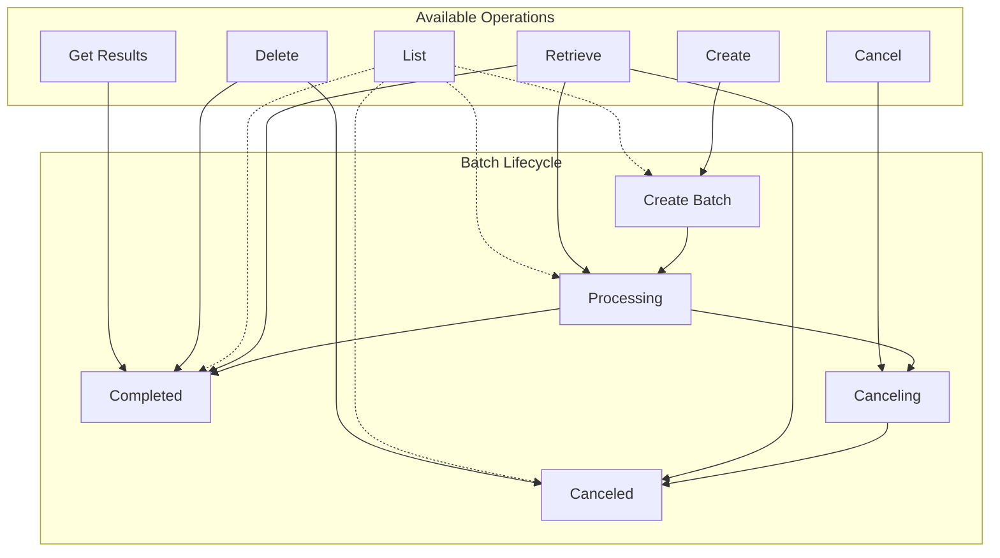
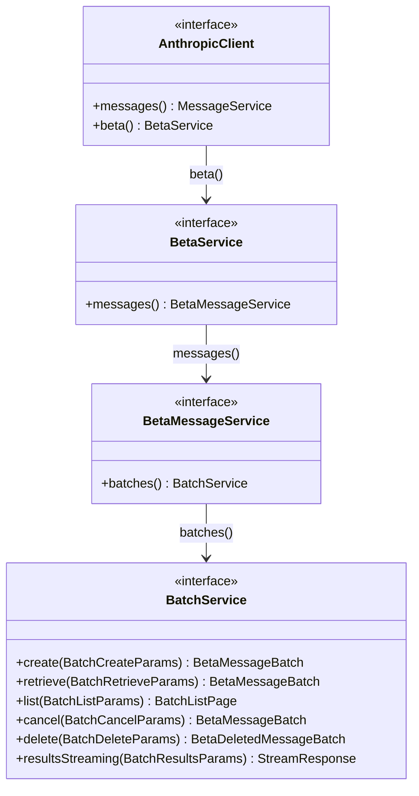

<!-- source: DeepWiki mcp.deepwiki.com · repo anthropics/anthropic-sdk-java · page 3.2 Batch Operations · fetched 2026-10-26 -->

# Batch Operations

<details>
<summary>Relevant source files</summary>

The following files were used as context for generating this wiki page:

- [anthropic-java-core/src/main/kotlin/com/anthropic/models/beta/messages/batches/BatchCancelParams.kt](anthropic-java-core/src/main/kotlin/com/anthropic/models/beta/messages/batches/BatchCancelParams.kt)
- [anthropic-java-core/src/main/kotlin/com/anthropic/models/beta/messages/batches/BatchDeleteParams.kt](anthropic-java-core/src/main/kotlin/com/anthropic/models/beta/messages/batches/BatchDeleteParams.kt)
- [anthropic-java-core/src/main/kotlin/com/anthropic/models/beta/messages/batches/BatchListPage.kt](anthropic-java-core/src/main/kotlin/com/anthropic/models/beta/messages/batches/BatchListPage.kt)
- [anthropic-java-core/src/main/kotlin/com/anthropic/models/beta/messages/batches/BatchListPageAsync.kt](anthropic-java-core/src/main/kotlin/com/anthropic/models/beta/messages/batches/BatchListPageAsync.kt)
- [anthropic-java-core/src/main/kotlin/com/anthropic/models/beta/models/ModelListPage.kt](anthropic-java-core/src/main/kotlin/com/anthropic/models/beta/models/ModelListPage.kt)
- [anthropic-java-core/src/main/kotlin/com/anthropic/models/beta/models/ModelListPageAsync.kt](anthropic-java-core/src/main/kotlin/com/anthropic/models/beta/models/ModelListPageAsync.kt)
- [anthropic-java-core/src/main/kotlin/com/anthropic/models/messages/batches/BatchCancelParams.kt](anthropic-java-core/src/main/kotlin/com/anthropic/models/messages/batches/BatchCancelParams.kt)
- [anthropic-java-core/src/main/kotlin/com/anthropic/models/messages/batches/BatchDeleteParams.kt](anthropic-java-core/src/main/kotlin/com/anthropic/models/messages/batches/BatchDeleteParams.kt)
- [anthropic-java-core/src/main/kotlin/com/anthropic/models/messages/batches/BatchListPage.kt](anthropic-java-core/src/main/kotlin/com/anthropic/models/messages/batches/BatchListPage.kt)
- [anthropic-java-core/src/main/kotlin/com/anthropic/models/messages/batches/BatchListPageAsync.kt](anthropic-java-core/src/main/kotlin/com/anthropic/models/messages/batches/BatchListPageAsync.kt)
- [anthropic-java-core/src/main/kotlin/com/anthropic/models/models/ModelListPage.kt](anthropic-java-core/src/main/kotlin/com/anthropic/models/models/ModelListPage.kt)
- [anthropic-java-core/src/main/kotlin/com/anthropic/models/models/ModelListPageAsync.kt](anthropic-java-core/src/main/kotlin/com/anthropic/models/models/ModelListPageAsync.kt)
- [anthropic-java-core/src/test/kotlin/com/anthropic/services/blocking/MessageServiceTest.kt](anthropic-java-core/src/test/kotlin/com/anthropic/services/blocking/MessageServiceTest.kt)
- [anthropic-java-core/src/test/kotlin/com/anthropic/services/blocking/beta/MessageServiceTest.kt](anthropic-java-core/src/test/kotlin/com/anthropic/services/blocking/beta/MessageServiceTest.kt)
- [anthropic-java-core/src/test/kotlin/com/anthropic/services/blocking/beta/messages/BatchServiceTest.kt](anthropic-java-core/src/test/kotlin/com/anthropic/services/blocking/beta/messages/BatchServiceTest.kt)

</details>


This document details how to use the Batch Operations API in the Anthropic Java SDK. Batch operations allow you to efficiently process multiple message generation requests as a single operation. The batch API provides methods for creating, retrieving, listing, canceling, and deleting batches of message requests.

## Overview of Batch Operations

The Anthropic Java SDK's batch operations enable you to:

1. Create batches containing multiple message generation requests
2. Check the status of batch processing
3. Retrieve results when processing completes
4. Cancel in-progress batches
5. Delete completed batches

Batch operations are particularly useful for processing large numbers of requests without needing to handle each one individually.



Sources: 
- [anthropic-java-core/src/main/kotlin/com/anthropic/models/beta/messages/batches/BatchCancelParams.kt:17-27]()
- [anthropic-java-core/src/main/kotlin/com/anthropic/models/beta/messages/batches/BatchDeleteParams.kt:16-23]()
- [anthropic-java-core/src/test/kotlin/com/anthropic/services/blocking/beta/messages/BatchServiceTest.kt:28-226]()

## Batch Service Architecture

The Batch Service is part of the Services layer in the Anthropic Java SDK, providing specialized batch processing functionality.



Sources:
- [anthropic-java-core/src/test/kotlin/com/anthropic/services/blocking/beta/messages/BatchServiceTest.kt:35-36]()
- [anthropic-java-core/src/test/kotlin/com/anthropic/services/blocking/beta/messages/BatchServiceTest.kt:28-226]()

## Creating Batches

To create a batch, you'll need to configure individual message requests that will be processed as part of the batch.

### Create Batch Parameters

Creating a batch requires at least one request, with each request containing message parameters similar to those used for individual message creation.

```java
BatchCreateParams.builder()
    .addBeta(AnthropicBeta.MESSAGE_BATCHES_2024_09_24)
    .addRequest(
        BatchCreateParams.Request.builder()
            .customId("my-custom-id-1")
            .params(
                BatchCreateParams.Request.Params.builder()
                    .maxTokens(1024L)
                    .addUserMessage("Hello, world")
                    .model(Model.CLAUDE_3_7_SONNET_LATEST)
                    // Additional parameters...
                    .build()
            )
            .build()
    )
    .build()
```

Each request can have its own parameters, including:
- Model to use
- User messages
- System prompts
- Temperature and other generation settings
- Tool definitions
- Custom IDs for tracking

### Usage Example

```java
AnthropicClient client = AnthropicOkHttpClient.builder()
    .apiKey("your-api-key")
    .build();

BatchService batchService = client.beta().messages().batches();

BetaMessageBatch batch = batchService.create(
    BatchCreateParams.builder()
        .addBeta(AnthropicBeta.MESSAGE_BATCHES_2024_09_24)
        .addRequest(
            // First request
            BatchCreateParams.Request.builder()
                .customId("request-1")
                .params(/* message parameters *)
                .build()
        )
        .addRequest(
            // Second request
            BatchCreateParams.Request.builder()
                .customId("request-2")
                .params(/* message parameters *)
                .build()
        )
        .build()
);

// Save the batch ID for later retrieval
String batchId = batch.id();
```

Sources:
- [anthropic-java-core/src/test/kotlin/com/anthropic/services/blocking/beta/messages/BatchServiceTest.kt:28-126]()

## Retrieving Batch Information

You can retrieve information about a specific batch using its ID.

### Usage Example

```java
BetaMessageBatch batch = batchService.retrieve(
    BatchRetrieveParams.builder()
        .messageBatchId("message_batch_id")
        .addBeta(AnthropicBeta.MESSAGE_BATCHES_2024_09_24)
        .build()
);

// Check batch status
String status = batch.status();
```

The retrieved batch includes:
- Batch ID
- Status (created, processing, completed, etc.)
- Created timestamp
- Request counts (total, pending, completed, failed, canceled)
- Individual request details

Sources:
- [anthropic-java-core/src/test/kotlin/com/anthropic/services/blocking/beta/messages/BatchServiceTest.kt:128-146]()

## Listing Batches

You can retrieve a list of all your batches with pagination support.

### Basic Listing

```java
BatchListPage page = batchService.list();
List<BetaMessageBatch> batches = page.data();
```

### Pagination

The SDK supports both manual pagination and automatic pagination through all results.

#### Manual Pagination

```java
// Get the first page
BatchListPage firstPage = batchService.list();

// Check if there are more pages
if (firstPage.hasNextPage()) {
    // Get the next page
    Optional<BatchListPage> nextPage = firstPage.getNextPage();
}
```

#### Auto Pagination

```java
// Iterate through all batches across all pages
for (BetaMessageBatch batch : batchService.list().autoPager()) {
    // Process each batch
}

// Or convert all batches to a list
List<BetaMessageBatch> allBatches = StreamSupport
    .stream(batchService.list().autoPager().spliterator(), false)
    .collect(Collectors.toList());
```

Sources:
- [anthropic-java-core/src/test/kotlin/com/anthropic/services/blocking/beta/messages/BatchServiceTest.kt:148-160]()
- [anthropic-java-core/src/main/kotlin/com/anthropic/models/beta/messages/batches/BatchListPage.kt:14-161]()
- [anthropic-java-core/src/main/kotlin/com/anthropic/models/beta/messages/batches/BatchListPageAsync.kt:14-176]()

## Canceling Batches

You can cancel a batch that is still processing. 

```java
BetaMessageBatch canceledBatch = batchService.cancel(
    BatchCancelParams.builder()
        .messageBatchId("message_batch_id")
        .addBeta(AnthropicBeta.MESSAGE_BATCHES_2024_09_24)
        .build()
);
```

When a batch is canceled:
1. It enters a "canceling" state
2. In-progress, non-interruptible requests may still complete
3. The final state becomes "canceled"
4. The `request_counts` field in the response indicates how many requests were canceled

Note that not all requests may be cancellable if they were already non-interruptible.

Sources:
- [anthropic-java-core/src/main/kotlin/com/anthropic/models/beta/messages/batches/BatchCancelParams.kt:17-27]()
- [anthropic-java-core/src/test/kotlin/com/anthropic/services/blocking/beta/messages/BatchServiceTest.kt:182-200]()

## Deleting Batches

You can delete a batch once it has completed processing.

```java
BetaDeletedMessageBatch deletedBatch = batchService.delete(
    BatchDeleteParams.builder()
        .messageBatchId("message_batch_id")
        .addBeta(AnthropicBeta.MESSAGE_BATCHES_2024_09_24)
        .build()
);
```

Important considerations for batch deletion:
- Batches can only be deleted after they've finished processing
- If you need to delete an in-progress batch, you must first cancel it
- After deletion, batch results are no longer available

Sources:
- [anthropic-java-core/src/main/kotlin/com/anthropic/models/beta/messages/batches/BatchDeleteParams.kt:16-23]()
- [anthropic-java-core/src/test/kotlin/com/anthropic/services/blocking/beta/messages/BatchServiceTest.kt:162-180]()

## Processing Batch Results

Once a batch is completed, you can retrieve the results using the streaming API.

```java
StreamResponse<BetaMessageBatchIndividualResponse> resultStream = batchService.resultsStreaming(
    BatchResultsParams.builder()
        .messageBatchId("message_batch_id")
        .addBeta(AnthropicBeta.MESSAGE_BATCHES_2024_09_24)
        .build()
);

// Process each result
try (resultStream) {
    resultStream.stream().forEach(response -> {
        // Process individual batch response
        String customId = response.customId();
        BetaMessage message = response.message();
        
        // Or check if there was an error
        Optional<BetaMessageBatchError> error = response.error();
    });
}
```

The results stream provides JSONL-formatted responses for each request in the batch.

Sources:
- [anthropic-java-core/src/test/kotlin/com/anthropic/services/blocking/beta/messages/BatchServiceTest.kt:202-226]()

## Batch States and Lifecycle

Understanding the batch lifecycle is important for effective batch management.

```mermaid
stateDiagram-v2
    [*] --> "Created"
    "Created" --> "Processing": Start processing
    "Processing" --> "Completed": All requests complete
    "Processing" --> "Canceling": Cancel called
    "Canceling" --> "Canceled": Cancellation complete
    "Completed" --> [*]: Delete batch
    "Canceled" --> [*]: Delete batch
    
    note right of "Created"
        Batch created but processing has not started
    end note
    
    note right of "Processing"
        Batch requests are being executed
    end note
    
    note right of "Canceling"
        Batch is being canceled, but some 
        non-interruptible requests may finish
    end note
    
    note right of "Completed"
        All requests have completed 
        (success or failure)
    end note
    
    note right of "Canceled"
        Batch was canceled and all
        interruptible requests stopped
    end note
```

| State | Description | Available Operations |
|-------|-------------|---------------------|
| Created | Batch has been created but processing hasn't started | Retrieve, Cancel |
| Processing | Batch requests are being executed | Retrieve, Cancel |
| Canceling | Batch is being canceled | Retrieve |
| Canceled | Batch has been successfully canceled | Retrieve, Delete, Get Results |
| Completed | All batch requests have completed processing | Retrieve, Delete, Get Results |

Sources:
- [anthropic-java-core/src/main/kotlin/com/anthropic/models/beta/messages/batches/BatchCancelParams.kt:17-27]()
- [anthropic-java-core/src/main/kotlin/com/anthropic/models/beta/messages/batches/BatchDeleteParams.kt:16-23]()

## Asynchronous Batch Operations

All batch operations support both synchronous and asynchronous programming models through the Anthropic Java SDK.

```mermaid
flowchart LR
    subgraph "Sync API"
        A["AnthropicClient"]
        B["BatchService"]
        C["BatchListPage"]
    end
    
    subgraph "Async API"
        D["AnthropicClientAsync"]
        E["BatchServiceAsync"]
        F["BatchListPageAsync"]
    end
    
    A --> B
    B --> C
    
    D --> E
    E --> F
    
    A <--> D: "sync() / async()"
```

For asynchronous operation, use the `async()` method on the client:

```java
AnthropicClientAsync asyncClient = client.async();
BatchServiceAsync asyncBatchService = asyncClient.beta().messages().batches();

CompletableFuture<BetaMessageBatch> batchFuture = asyncBatchService.create(/* params *);
batchFuture.thenAccept(batch -> {
    // Process the batch
});
```

The asynchronous API returns `CompletableFuture` objects that can be chained for complex processing flows.

Sources:
- [anthropic-java-core/src/main/kotlin/com/anthropic/models/beta/messages/batches/BatchListPageAsync.kt:14-176]()

## Beta Feature Note

Batch operations are currently available through the beta interface. To use these features, you must:

1. Access the batch service through the beta interface:
   ```java
   BatchService batchService = client.beta().messages().batches();
   ```

2. Include the appropriate beta flag in your requests:
   ```java
   .addBeta(AnthropicBeta.MESSAGE_BATCHES_2024_09_24)
   ```

As this is a beta feature, the API may change in future releases.

Sources:
- [anthropic-java-core/src/test/kotlin/com/anthropic/services/blocking/beta/messages/BatchServiceTest.kt:35-36]()
- [anthropic-java-core/src/test/kotlin/com/anthropic/services/blocking/beta/messages/BatchServiceTest.kt:40-41]()

---

