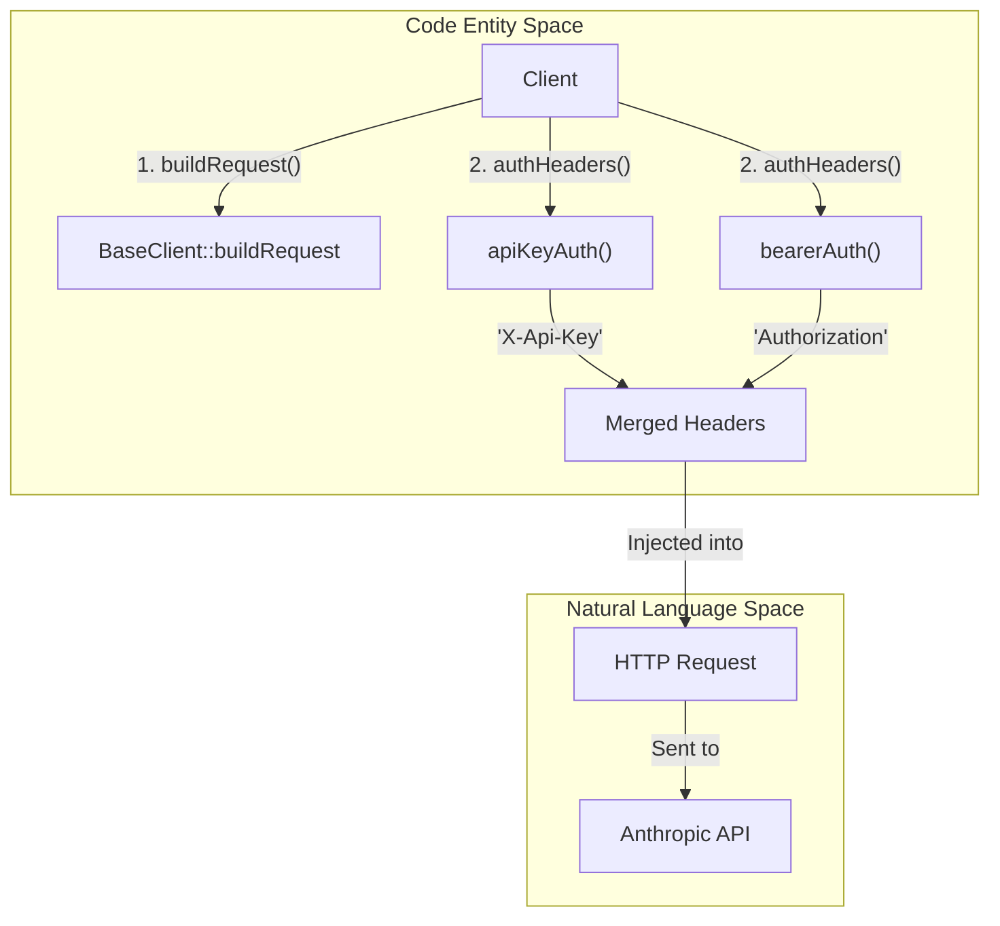
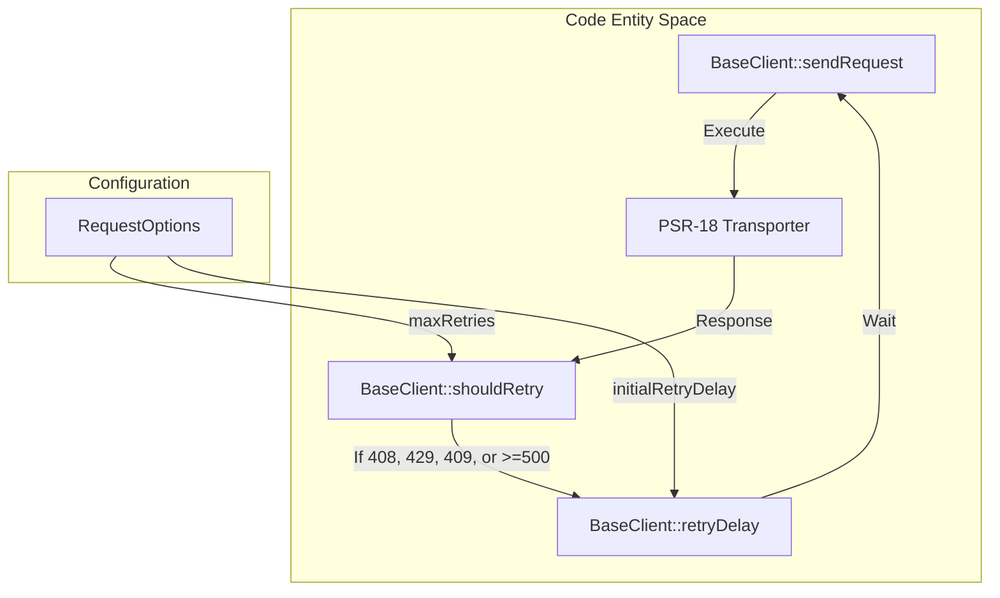

<!-- source: DeepWiki mcp.deepwiki.com · repo anthropics/anthropic-sdk-php · page 1.1 Getting Started · fetched 2026-10-26 -->

# Getting Started

<details>
<summary>Relevant source files</summary>

The following files were used as context for generating this wiki page:

- [.release-please-manifest.json](.release-please-manifest.json)
- [CHANGELOG.md](CHANGELOG.md)
- [CONTRIBUTING.md](CONTRIBUTING.md)
- [README.md](README.md)
- [examples/list_models.php](examples/list_models.php)
- [examples/messages.php](examples/messages.php)
- [examples/messages_stream.php](examples/messages_stream.php)
- [release-please-config.json](release-please-config.json)
- [src/Beta/Messages/BetaTool.php](src/Beta/Messages/BetaTool.php)
- [src/Client.php](src/Client.php)
- [src/Core/BaseClient.php](src/Core/BaseClient.php)
- [src/Messages/Tool.php](src/Messages/Tool.php)
- [src/RequestOptions.php](src/RequestOptions.php)
- [src/Version.php](src/Version.php)

</details>


The Anthropic PHP SDK provides a robust, type-safe interface for interacting with Claude. This page covers the initial setup, authentication mechanisms, and core configuration options required to integrate the SDK into your PHP application.

## Installation

The SDK is distributed via Packagist and should be installed using [Composer](https://getcomposer.org). The library requires PHP 8.1 or higher.

```sh
composer require "anthropic-ai/sdk:^0.8.0"
```
Sources: [README.md:13-17](), [.release-please-manifest.json:1-3]()

## Environment Setup

The SDK is designed to work out-of-the-box with standard PHP environment variables. You can define your credentials in a `.env` file or directly in your shell environment.

| Variable | Description | Default / Fallback |
| :--- | :--- | :--- |
| `ANTHROPIC_API_KEY` | Primary API key for authentication | Used by `Client` constructor if not passed. |
| `ANTHROPIC_AUTH_TOKEN` | Bearer token for alternative authentication | Used by `Client` constructor if not passed. |
| `ANTHROPIC_BASE_URL` | The API endpoint URL | `https://api.anthropic.com` |

Sources: [src/Client.php:49-54](), [README.md:28-30]()

## Authentication

The `Anthropic\Client` supports two primary authentication methods: API Keys and Bearer Tokens. These are resolved during the request lifecycle and injected into the HTTP headers.

### Implementation Flow: Auth Headers
The following diagram illustrates how the `Client` assembles authentication headers during the `buildRequest` phase.

**Diagram: Authentication Header Assembly**

Sources: [src/Client.php:89-106](), [src/Client.php:118-134]()

### Usage Examples

**Using an API Key (Standard):**
```php
use Anthropic\Client;

$client = new Client(apiKey: 'your-api-key');
```

**Using a Bearer Token:**
```php
$client = new Client(authToken: 'your-bearer-token');
```

## Basic Usage

The entry point for all operations is the `Anthropic\Client` class. It provides access to various services like `messages` and `models`.

### Creating a Message
```php
use Anthropic\Client;

$client = new Client();

$message = $client->messages->create(
    maxTokens: 1024,
    messages: [['role' => 'user', 'content' => 'Hello, Claude']],
    model: 'claude-3-5-sonnet-20240620',
);

echo $message->content[0]->text;
```
Sources: [README.md:23-39](), [src/Client.php:28-33]()

### Streaming Responses
For long-form content, use `createStream` to iterate over Server-Sent Events (SSE).
```php
$stream = $client->messages->createStream(
    maxTokens: 1024,
    messages: [['role' => 'user', 'content' => 'Explain quantum physics.']],
    model: 'claude-3-5-sonnet-20240620',
);

foreach ($stream as $event) {
    // Events are instances of RawMessageStartEvent, RawContentBlockDeltaEvent, etc.
    var_dump($event);
}
```
Sources: [README.md:52-70](), [examples/messages_stream.php:18-56]()

## Configuration Options

Configuration can be applied globally at the client level or overridden per request using the `RequestOptions` class or an associative array.

### RequestOptions Class
The `RequestOptions` class manages the lifecycle and transport settings for requests.

| Property | Type | Default | Description |
| :--- | :--- | :--- | :--- |
| `timeout` | `float` | `600.0` | Request timeout in seconds. |
| `maxRetries` | `int` | `2` | Number of automatic retries for failed requests. |
| `initialRetryDelay` | `float` | `0.5` | Starting delay for exponential backoff. |
| `maxRetryDelay` | `float` | `8.0` | Maximum delay between retries. |

Sources: [src/RequestOptions.php:37-48]()

### Global vs. Per-Request Configuration
You can pass `requestOptions` to the `Client` constructor for global settings, or as the final argument in service methods.

```php
// Global: Disable retries for all requests
$client = new Client(requestOptions: ['maxRetries' => 0]);

// Per-Request: Override timeout for a specific call
$client->messages->create(
    maxTokens: 1024,
    messages: [...],
    model: 'claude-3-5-sonnet-20240620',
    requestOptions: ['timeout' => 30.0]
);
```
Sources: [README.md:188-198](), [src/Core/BaseClient.php:139-140]()

### Advanced Request Customization
The SDK allows sending undocumented parameters or headers via `extraHeaders`, `extraQueryParams`, and `extraBodyParams`.

```php
$client->messages->create(
    maxTokens: 1024,
    messages: [...],
    model: '...',
    requestOptions: [
        'extraHeaders' => ['X-Custom-Header' => 'Value'],
        'extraQueryParams' => ['beta' => 'true']
    ]
);
```
Sources: [README.md:213-223](), [src/RequestOptions.php:49-58]()

## Request Lifecycle and Retries

The SDK automatically retries specific failure modes using exponential backoff.

**Diagram: Request and Retry Logic**

Sources: [src/Core/BaseClient.php:199-214](), [src/Core/BaseClient.php:219-230](), [README.md:175-180]()

---

