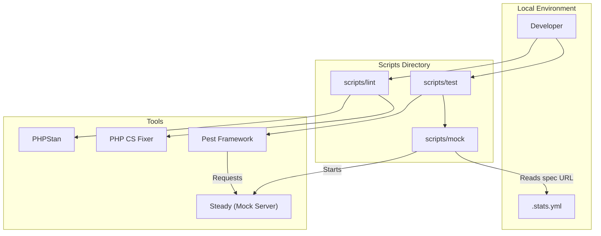
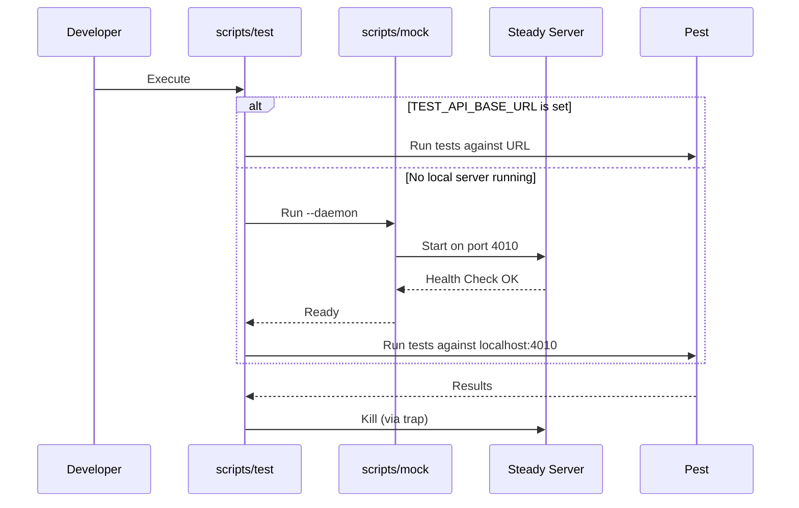

<!-- source: DeepWiki mcp.deepwiki.com · repo anthropics/anthropic-sdk-php · page 6.3 Code Quality Scripts · fetched 2026-10-26 -->

# Code Quality Scripts

Relevant source files

The following files were used as context for generating this wiki page:

- [.gitattributes](.gitattributes)
- [.gitignore](.gitignore)
- [.php-cs-fixer.dist.php](.php-cs-fixer.dist.php)
- [composer.json](composer.json)
- [scripts/mock](scripts/mock)
- [scripts/test](scripts/test)
- [src/Core/Concerns/SdkModel.php](src/Core/Concerns/SdkModel.php)
- [src/Core/Concerns/SdkUnion.php](src/Core/Concerns/SdkUnion.php)
- [src/Core/Contracts/BaseStream.php](src/Core/Contracts/BaseStream.php)
- [src/Core/Conversion/PropertyInfo.php](src/Core/Conversion/PropertyInfo.php)
- [src/Core/Conversion/UnionOf.php](src/Core/Conversion/UnionOf.php)

The Anthropic PHP SDK includes a suite of scripts located in the `scripts/` directory designed to maintain code standards, perform static analysis, and facilitate local testing against mock environments. These tools ensure that the auto-generated and manually maintained components of the SDK adhere to strict quality requirements.

## Overview of Scripts

The repository utilizes several bash scripts to wrap common development tasks. These are often invoked via Composer or directly during CI/CD workflows.

| Script | Purpose | Key Tools |
|:---|:---|:---|
| `scripts/lint` | Performs static analysis and checks code style. | PHPStan, PHP CS Fixer |
| `scripts/test` | Orchestrates the test suite, including mock server lifecycle. | Pest, Steady |
| `scripts/mock` | Starts a Prism-based mock server using the OpenAPI spec. | `@stdy/cli` (Steady) |
| `scripts/format` | Automatically fixes code style violations. | PHP CS Fixer |

### Script Interdependency and Flow

The following diagram illustrates how the quality scripts interact with the codebase and external dependencies like the OpenAPI specification.

**Quality Workflow Integration**

Sources: [scripts/test:12-56](), [scripts/mock:1-52](), [composer.json:52-56]()

## Static Analysis and Linting

The SDK uses **PHPStan** for static analysis and **PHP CS Fixer** for coding standards enforcement. These are configured to run at high strictness levels to ensure type safety across the `SdkModel` and `Conversion` layers.

### PHPStan Configuration
The project targets PHP 8.3 for development [composer.json:24-24]() and uses the `phpstan/phpstan` package [composer.json:47-47](). It includes the `phpstan-phpunit` extension to support Pest/PHPUnit testing structures [composer.json:48-48]().

### PHP CS Fixer
The code style is defined in `.php-cs-fixer.dist.php`. It applies the `@PhpCsFixer` rule set with specific overrides for property alignment and type ordering [`.php-cs-fixer.dist.php`:12-18]().

**Key Configuration Entities:**
*   **Parallel Execution**: Enabled via `ParallelConfigFactory::detect()` to speed up linting [`.php-cs-fixer.dist.php`:10-10]().
*   **Finder**: Targets the `src/` and `tests/` directories [`.php-cs-fixer.dist.php`:11-11]().
*   **Memory Limit**: Set to `-1` to prevent crashes during large-scale analysis [`.php-cs-fixer.dist.php`:7-7]().

Sources: [composer.json:41-51](), [`.php-cs-fixer.dist.php`:1-19]()

## Mock Server Orchestration

The `scripts/mock` script manages a local mock server using **Steady** (`@stdy/cli`). This server validates SDK requests against the official Anthropic OpenAPI specification.

### Implementation Details
1.  **Spec Discovery**: The script attempts to find the OpenAPI spec URL from the `openapi_spec_url` key in `.stats.yml` [scripts/mock:11-12]().
2.  **Steady Execution**: It runs the mock server on `127.0.0.1:4010` [scripts/mock:27-27]().
3.  **Daemon Mode**: When passed `--daemon`, it waits for the health endpoint `/_x-steady/health` to return a success code (max 30 seconds) before exiting [scripts/mock:23-47]().
4.  **Format Configuration**: Steady is configured with specific query array and object formats (`comma` and `brackets`) to match the SDK's serialization logic [scripts/mock:27-27]().

Sources: [scripts/mock:7-52](), [scripts/test:12-14]()

## Test Execution Loop

The `scripts/test` script acts as a wrapper for the **Pest** testing framework, ensuring the environment is prepared before execution.

### Logic Flow
1.  **Environment Check**: Checks if `TEST_API_BASE_URL` is set. If so, it skips the local mock server and runs tests against the provided URL [scripts/test:24-38]().
2.  **Mock Server Lifecycle**: If no override is present and the mock server is not running, it invokes `scripts/mock --daemon` [scripts/test:28-34]().
3.  **Cleanup**: Uses a `trap` to ensure that any background mock server processes on port 4010 are killed when the script exits [scripts/test:16-30]().
4.  **Execution**: Finally executes `./vendor/bin/pest` with color output enabled [scripts/test:55-55]().

**Test Orchestration Sequence**

Sources: [scripts/test:1-56](), [scripts/mock:23-52]()

## Clean and Bootstrap
While not explicitly provided in the file list, the repository lifecycle involves standard Composer operations defined in `composer.json`.

*   **Autoloading**: The SDK uses PSR-4 autoloading for `Anthropic\` (src) and `Tests\` (tests) [composer.json:8-15]().
*   **Ignored Artifacts**: The `.gitignore` ensures that `.php-cs-fixer.cache`, `.phpunit.cache`, and `.artifacts/` are not committed to the repository [`.gitignore`:3-15]().
*   **Documentation**: A `build:docs` script is provided to generate API documentation using `ApiGen` [composer.json:53-53]().

Sources: [composer.json:4-16](), [composer.json:53-53](), [`.gitignore`:1-15]()

---

