# Page: Overview

# Overview

<details>
<summary>Relevant source files</summary>

The following files were used as context for generating this wiki page:

- [.release-please-manifest.json](.release-please-manifest.json)
- [.stats.yml](.stats.yml)
- [CHANGELOG.md](CHANGELOG.md)
- [CONTRIBUTING.md](CONTRIBUTING.md)
- [README.md](README.md)
- [release-please-config.json](release-please-config.json)
- [src/Client.php](src/Client.php)
- [src/Core/BaseClient.php](src/Core/BaseClient.php)
- [src/RequestOptions.php](src/RequestOptions.php)
- [src/Version.php](src/Version.php)
- [tests/Services/Beta/Messages/BatchesTest.php](tests/Services/Beta/Messages/BatchesTest.php)
- [tests/Services/Beta/MessagesTest.php](tests/Services/Beta/MessagesTest.php)
- [tests/Services/Messages/BatchesTest.php](tests/Services/Messages/BatchesTest.php)
- [tests/Services/MessagesTest.php](tests/Services/MessagesTest.php)

</details>


The Anthropic PHP SDK provides a robust, type-safe interface for interacting with the Claude API. It simplifies the integration of Claude's capabilities—such as message generation, streaming, tool use, and batch processing—into PHP applications.

The SDK is architected around a central `Client` that orchestrates requests via a PSR-18 compliant HTTP stack, utilizing a structured data modeling system to convert between PHP objects and API payloads.

### System Architecture Overview

The following diagram illustrates how the high-level service entities relate to the underlying core infrastructure.

**SDK Architecture: Service to Core Mapping**
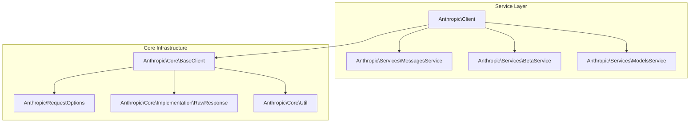
Sources: [src/Client.php:19-39](), [src/Core/BaseClient.php:32-46](), [src/Services/MessagesService.php:1-20]() (inferred from usage).

---

### Key Capabilities

The SDK covers the full breadth of the Anthropic API, including stable and experimental features:

*   **Messages API**: Create synchronous or streaming completions using Claude models like `claude-opus-4-6` or `claude-sonnet-4-5-20250929` [README.md:28-70]().
*   **Structured Output**: Define PHP classes (extending `StructuredOutputModel`) to automatically generate JSON schemas and parse responses into typed objects [README.md:72-98]().
*   **Message Batches**: Handle large-scale asynchronous processing with dedicated services for creating, listing, and streaming batch results [tests/Services/Messages/BatchesTest.php:34-168]().
*   **Beta Features**: Access experimental capabilities such as MCP servers, context management, and extended thinking through the `beta` namespace [tests/Services/Beta/MessagesTest.php:32-148]().
*   **Auto-Pagination**: Seamlessly iterate through paginated resources using `pagingEachItem()` generators [README.md:102-129]().

---

### Getting Started

To begin using the SDK, install it via Composer:

```sh
composer require "anthropic-ai/sdk:^0.8.0"
```

Authentication is handled via an API key or a Bearer token, typically sourced from environment variables like `ANTHROPIC_API_KEY` [src/Client.php:49-54]().

**Basic Usage Example**
```php
use Anthropic\Client;

$client = new Client();
$message = $client->messages->create(
    maxTokens: 1024,
    messages: [['role' => 'user', 'content' => 'Hello, Claude']],
    model: 'claude-opus-4-6',
);
```
Sources: [README.md:15-39](), [src/Client.php:43-86]().

For detailed installation and configuration instructions, see **[Getting Started](#1.1)**.

---

### Project Structure and Codegen

The SDK is largely auto-generated using the Stainless SDK generator, ensuring high fidelity with the Anthropic OpenAPI specification [.stats.yml:2-4]().

**Codebase Flow: Spec to Execution**
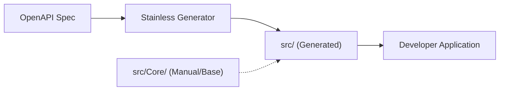

*   **`src/`**: Contains the generated services, models, and the main `Client` [src/Client.php:1-20]().
*   **`src/Core/`**: Houses the manually maintained foundational logic, including the `BaseClient` and request lifecycle management [src/Core/BaseClient.php:1-32]().
*   **`tests/`**: A comprehensive suite of Pest/PHPUnit tests validated against a mock server [tests/Services/MessagesTest.php:1-29]().

For a deep dive into the repository layout and the generation process, see **[Project Structure and Codegen](#1.2)**.

---

### Advanced Concepts

The SDK provides several advanced configuration options via the `RequestOptions` class:

*   **Retries**: Automatically retries failed requests (408, 409, 429, >=500) up to 2 times by default with exponential backoff [src/Core/BaseClient.php:199-214](), [src/RequestOptions.php:41-47]().
*   **Timeouts**: Configurable request timeouts, defaulting to 600 seconds [src/RequestOptions.php:38-38]().
*   **Custom Transport**: Support for custom PSR-18 HTTP clients and PSR-17 factories [src/RequestOptions.php:61-70]().
*   **Undocumented Params**: Use `extraHeaders`, `extraQueryParams`, and `extraBodyParams` to access new API features before they are formally added to the SDK [README.md:204-223](), [src/RequestOptions.php:49-58]().

Sources: [src/Core/BaseClient.php:199-214](), [src/RequestOptions.php:32-75](), [README.md:175-198]().

---

# Page: Getting Started

# Getting Started

<details>
<summary>Relevant source files</summary>

The following files were used as context for generating this wiki page:

- [.release-please-manifest.json](.release-please-manifest.json)
- [CHANGELOG.md](CHANGELOG.md)
- [CONTRIBUTING.md](CONTRIBUTING.md)
- [README.md](README.md)
- [examples/list_models.php](examples/list_models.php)
- [examples/messages.php](examples/messages.php)
- [examples/messages_stream.php](examples/messages_stream.php)
- [release-please-config.json](release-please-config.json)
- [src/Beta/Messages/BetaTool.php](src/Beta/Messages/BetaTool.php)
- [src/Client.php](src/Client.php)
- [src/Core/BaseClient.php](src/Core/BaseClient.php)
- [src/Messages/Tool.php](src/Messages/Tool.php)
- [src/RequestOptions.php](src/RequestOptions.php)
- [src/Version.php](src/Version.php)

</details>


The Anthropic PHP SDK provides a robust, type-safe interface for interacting with Claude. This page covers the initial setup, authentication mechanisms, and core configuration options required to integrate the SDK into your PHP application.

## Installation

The SDK is distributed via Packagist and should be installed using [Composer](https://getcomposer.org). The library requires PHP 8.1 or higher.

```sh
composer require "anthropic-ai/sdk:^0.8.0"
```
Sources: [README.md:13-17](), [.release-please-manifest.json:1-3]()

## Environment Setup

The SDK is designed to work out-of-the-box with standard PHP environment variables. You can define your credentials in a `.env` file or directly in your shell environment.

| Variable | Description | Default / Fallback |
| :--- | :--- | :--- |
| `ANTHROPIC_API_KEY` | Primary API key for authentication | Used by `Client` constructor if not passed. |
| `ANTHROPIC_AUTH_TOKEN` | Bearer token for alternative authentication | Used by `Client` constructor if not passed. |
| `ANTHROPIC_BASE_URL` | The API endpoint URL | `https://api.anthropic.com` |

Sources: [src/Client.php:49-54](), [README.md:28-30]()

## Authentication

The `Anthropic\Client` supports two primary authentication methods: API Keys and Bearer Tokens. These are resolved during the request lifecycle and injected into the HTTP headers.

### Implementation Flow: Auth Headers
The following diagram illustrates how the `Client` assembles authentication headers during the `buildRequest` phase.

**Diagram: Authentication Header Assembly**
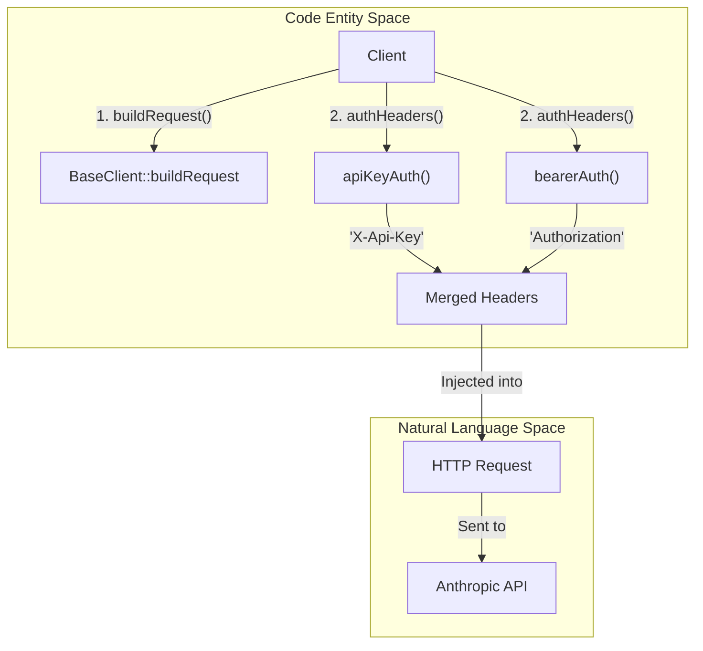
Sources: [src/Client.php:89-106](), [src/Client.php:118-134]()

### Usage Examples

**Using an API Key (Standard):**
```php
use Anthropic\Client;

$client = new Client(apiKey: 'your-api-key');
```

**Using a Bearer Token:**
```php
$client = new Client(authToken: 'your-bearer-token');
```

## Basic Usage

The entry point for all operations is the `Anthropic\Client` class. It provides access to various services like `messages` and `models`.

### Creating a Message
```php
use Anthropic\Client;

$client = new Client();

$message = $client->messages->create(
    maxTokens: 1024,
    messages: [['role' => 'user', 'content' => 'Hello, Claude']],
    model: 'claude-3-5-sonnet-20240620',
);

echo $message->content[0]->text;
```
Sources: [README.md:23-39](), [src/Client.php:28-33]()

### Streaming Responses
For long-form content, use `createStream` to iterate over Server-Sent Events (SSE).
```php
$stream = $client->messages->createStream(
    maxTokens: 1024,
    messages: [['role' => 'user', 'content' => 'Explain quantum physics.']],
    model: 'claude-3-5-sonnet-20240620',
);

foreach ($stream as $event) {
    // Events are instances of RawMessageStartEvent, RawContentBlockDeltaEvent, etc.
    var_dump($event);
}
```
Sources: [README.md:52-70](), [examples/messages_stream.php:18-56]()

## Configuration Options

Configuration can be applied globally at the client level or overridden per request using the `RequestOptions` class or an associative array.

### RequestOptions Class
The `RequestOptions` class manages the lifecycle and transport settings for requests.

| Property | Type | Default | Description |
| :--- | :--- | :--- | :--- |
| `timeout` | `float` | `600.0` | Request timeout in seconds. |
| `maxRetries` | `int` | `2` | Number of automatic retries for failed requests. |
| `initialRetryDelay` | `float` | `0.5` | Starting delay for exponential backoff. |
| `maxRetryDelay` | `float` | `8.0` | Maximum delay between retries. |

Sources: [src/RequestOptions.php:37-48]()

### Global vs. Per-Request Configuration
You can pass `requestOptions` to the `Client` constructor for global settings, or as the final argument in service methods.

```php
// Global: Disable retries for all requests
$client = new Client(requestOptions: ['maxRetries' => 0]);

// Per-Request: Override timeout for a specific call
$client->messages->create(
    maxTokens: 1024,
    messages: [...],
    model: 'claude-3-5-sonnet-20240620',
    requestOptions: ['timeout' => 30.0]
);
```
Sources: [README.md:188-198](), [src/Core/BaseClient.php:139-140]()

### Advanced Request Customization
The SDK allows sending undocumented parameters or headers via `extraHeaders`, `extraQueryParams`, and `extraBodyParams`.

```php
$client->messages->create(
    maxTokens: 1024,
    messages: [...],
    model: '...',
    requestOptions: [
        'extraHeaders' => ['X-Custom-Header' => 'Value'],
        'extraQueryParams' => ['beta' => 'true']
    ]
);
```
Sources: [README.md:213-223](), [src/RequestOptions.php:49-58]()

## Request Lifecycle and Retries

The SDK automatically retries specific failure modes using exponential backoff.

**Diagram: Request and Retry Logic**
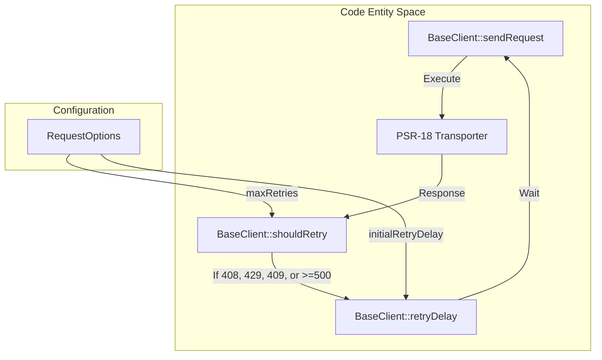
Sources: [src/Core/BaseClient.php:199-214](), [src/Core/BaseClient.php:219-230](), [README.md:175-180]()

---

# Page: Project Structure and Codegen

# Project Structure and Codegen

<details>
<summary>Relevant source files</summary>

The following files were used as context for generating this wiki page:

- [.gitattributes](.gitattributes)
- [.github/workflows/ci.yml](.github/workflows/ci.yml)
- [.github/workflows/create-releases.yml](.github/workflows/create-releases.yml)
- [.github/workflows/publish-packagist.yml](.github/workflows/publish-packagist.yml)
- [.github/workflows/release-doctor.yml](.github/workflows/release-doctor.yml)
- [.gitignore](.gitignore)
- [.php-cs-fixer.dist.php](.php-cs-fixer.dist.php)
- [.release-please-manifest.json](.release-please-manifest.json)
- [CHANGELOG.md](CHANGELOG.md)
- [CONTRIBUTING.md](CONTRIBUTING.md)
- [README.md](README.md)
- [bin/check-release-environment](bin/check-release-environment)
- [src/Core.php](src/Core.php)
- [src/Core/Concerns/SdkParams.php](src/Core/Concerns/SdkParams.php)
- [src/Version.php](src/Version.php)

</details>


This page describes the organizational layout of the Anthropic PHP SDK, the automation workflow powered by the Stainless SDK generator, and the release management process.

## Repository Layout

The repository is organized into distinct directories for source code, testing, examples, and automation scripts.

| Directory | Description | Maintenance Type |
| :--- | :--- | :--- |
| `src/` | The core SDK logic, including service clients, data models, and HTTP internals. | Auto-generated / Mixed |
| `tests/` | Unit and integration tests, typically executed against a mock server. | Auto-generated |
| `examples/` | Runnable PHP scripts demonstrating SDK features. | **Manually Maintained** |
| `scripts/` | Utility scripts for environment setup, linting, and testing. | **Manually Maintained** |
| `bin/` | Executable binaries for release health checks. | **Manually Maintained** |

### Key Source Components
*   **`src/Core/`**: Contains the foundational traits and classes for type conversion, request normalization, and exception handling [src/Core.php:1-15]().
*   **`src/Version.php`**: Holds the single source of truth for the SDK version string [src/Version.php:7-9]().
*   **`src/RequestOptions.php`**: Defines the configuration object for per-request overrides like retries and extra headers [src/Core/Concerns/SdkParams.php:9-10]().

Sources: [CONTRIBUTING.md:21-30](), [README.md:100-102](), [.php-cs-fixer.dist.php:11-11]()

## Codegen Workflow (Stainless)

The Anthropic PHP SDK is primarily a **generated library**. It is built using the Stainless SDK generator, which transforms an OpenAPI specification into idiomatic PHP code.

### Generated vs. Manual Files
As noted in the contribution guidelines, most of the SDK is generated. However, certain areas are protected from being overwritten:
1.  **Manual Overrides**: Specific logic in `src/` can be manually patched. These patches are persisted between generations, though they may occasionally require conflict resolution [CONTRIBUTING.md:21-26]().
2.  **Examples**: The generator never modifies the contents of the `examples/` directory [CONTRIBUTING.md:24-25]().
3.  **Tooling**: Scripts in `scripts/` and configuration files like `.php-cs-fixer.dist.php` are manually maintained.

### Data Flow: Spec to Code
The following diagram illustrates how the "Natural Language Space" (API definitions) is transformed into the "Code Entity Space" (PHP classes).

**Codegen Transformation Map**
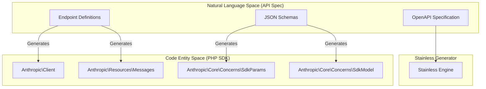
Sources: [CONTRIBUTING.md:21-26](), [src/Core/Concerns/SdkParams.php:14-15]()

## Versioning and Releases

The SDK follows Semantic Versioning (SemVer) and uses `release-please` to automate version bumps and changelog generation.

### Release-Please Integration
The version is tracked in two primary locations:
1.  **`.release-please-manifest.json`**: Tracks the current version for the release automation tool [ .release-please-manifest.json:1-3]().
2.  **`src/Version.php`**: Contains the `VERSION` constant used by the SDK at runtime [src/Version.php:7-9]().

### Release Pipeline
When changes are merged into the `main` branch, the `create-releases.yml` workflow triggers the `stainless-api/trigger-release-please` action [ .github/workflows/create-releases.yml:19-23](). This creates or updates a Release PR. Once that PR is merged:
1.  The version is updated in `src/Version.php` and `README.md` [README.md:13-19]().
2.  A GitHub Release is created.
3.  The package is automatically published to **Packagist** via a POST request to the Packagist API [ .github/workflows/publish-packagist.yml:13-18]().

**Release Automation Flow**
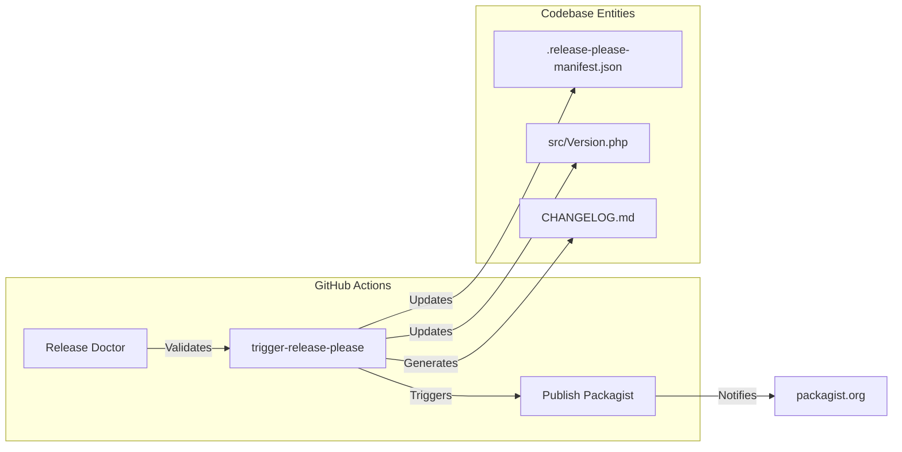
Sources: [.github/workflows/create-releases.yml:19-31](), [.github/workflows/publish-packagist.yml:1-18](), [.github/workflows/release-doctor.yml:1-25](), [CHANGELOG.md:1-20]()

## Development Scripts

The `scripts/` directory contains the primary entry points for developer workflows.

| Script | Purpose |
| :--- | :--- |
| `bootstrap` | Installs dependencies and prepares the environment [CONTRIBUTING.md:15-19](). |
| `lint` | Runs **PHPStan** for static analysis [CONTRIBUTING.md:47-51](). |
| `format` | Runs **PHP CS Fixer** using the project's ruleset [CONTRIBUTING.md:53-57](). |
| `test` | Executes the test suite via **Pest/PHPUnit** [CONTRIBUTING.md:40-41](). |
| `mock` | (Reference) Developers are encouraged to use `prism` to mock the OpenAPI spec for local testing [CONTRIBUTING.md:32-37](). |

### Linting Configuration
The project uses a strict PHP CS Fixer configuration defined in `.php-cs-fixer.dist.php`, which includes rules for alignment, parentheses, and type ordering [ .php-cs-fixer.dist.php:12-18](). To ensure performance on large generated files, it runs with no memory limit [ .php-cs-fixer.dist.php:7-7]().

Sources: [CONTRIBUTING.md:43-57](), [.php-cs-fixer.dist.php:1-20](), [.github/workflows/ci.yml:32-36]()

---

# Page: Core Architecture

# Core Architecture

<details>
<summary>Relevant source files</summary>

The following files were used as context for generating this wiki page:

- [release-please-config.json](release-please-config.json)
- [src/Client.php](src/Client.php)
- [src/Core/BaseClient.php](src/Core/BaseClient.php)
- [src/Core/Conversion.php](src/Core/Conversion.php)
- [src/Core/Util.php](src/Core/Util.php)
- [src/RequestOptions.php](src/RequestOptions.php)
- [tests/ClientTest.php](tests/ClientTest.php)
- [tests/Core/UtilTest.php](tests/Core/UtilTest.php)

</details>


The Anthropic PHP SDK is built on a layered architecture designed for extensibility, type safety, and PSR compliance. It leverages a standard HTTP stack to communicate with Anthropic's APIs while providing a high-level, object-oriented interface for developers.

## System Overview

The architecture transitions from high-level service definitions (like `MessagesService`) down to a robust HTTP transport layer. The core responsibility of the SDK is to manage the lifecycle of a request: from PHP object instantiation and validation to network transmission and response deserialization.

### High-Level Component Relationship
This diagram illustrates how user-facing services interact with the foundational core.

```mermaid
graph TD
    subgraph "Service Layer"
        ["Client"] --> ["MessagesService"]
        ["Client"] --> ["ModelsService"]
        ["Client"] --> ["BetaService"]
    end

    subgraph "Core Architecture"
        ["MessagesService"] --> ["BaseClient"]
        ["BaseClient"] --> ["RequestOptions"]
        ["BaseClient"] --> ["RawResponse"]
        ["RawResponse"] --> ["Conversion"]
    end

    subgraph "External Dependencies"
        ["BaseClient"] --> ["PSR-18 Transporter"]
        ["BaseClient"] --> ["PSR-17 Factories"]
    end
```
**Sources:** [src/Client.php:28-38](), [src/Client.php:83-85](), [src/Core/BaseClient.php:32-46](), [src/RequestOptions.php:32-71]()

---

## HTTP Client and Request Lifecycle

The `BaseClient` acts as the engine for all network operations. It utilizes PSR-18 for HTTP transport and PSR-17 for message factories, ensuring compatibility with any modern PHP environment. 

The lifecycle involves:
1.  **Normalization**: Converting high-level parameters into a `NormalizedRequest` array [src/Core/BaseClient.php:24-30]().
2.  **Authentication**: Injecting `X-Api-Key` or `Authorization` headers via `authHeaders()` [src/Client.php:89-107]().
3.  **Execution**: Sending the request through the `transporter` with built-in support for retries (exponential backoff) and redirects [src/Core/BaseClient.php:92]().
4.  **Idempotency**: Automatically generating `stainless-php-retry-*` keys for safe retries on mutating requests [src/Core/BaseClient.php:114-119]().

For details, see [HTTP Client and Request Lifecycle](#2.1).

**Sources:** [src/Core/BaseClient.php:62-96](), [src/Client.php:43-81](), [src/RequestOptions.php:37-47]()

---

## Type Conversion and Data Modeling

The SDK uses a sophisticated conversion system to bridge the gap between raw API JSON and typed PHP objects. This is managed primarily by the `Conversion` class and traits like `SdkModel`.

| Entity | Role |
| :--- | :--- |
| **SdkModel** | Trait providing initialization and property mapping for DTOs [src/RequestOptions.php:35](). |
| **Conversion** | The central utility for `coerce` (deserialization) and `dump` (serialization) [src/Core/Conversion.php:16-17](). |
| **RawResponse** | Holds the PSR-7 response and facilitates the transition to a typed model [src/Core/Implementation/RawResponse.php](). |

For details, see [Type Conversion and Data Modeling](#2.2).

**Sources:** [src/Core/Conversion.php:49-89](), [src/RequestOptions.php:80-86]()

---

## Data Flow: Natural Language to Code Entities

The following diagram maps how a developer's intent (sending a message) flows through the internal code entities.

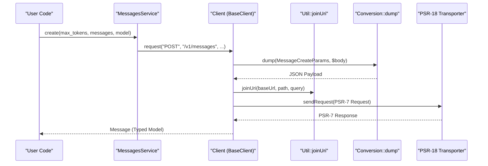
**Sources:** [src/Core/BaseClient.php:62-96](), [src/Client.php:118-134](), [src/Core/Util.php:183-219](), [src/Core/Conversion.php:72-89]()

---

## Specialized Response Handling

Beyond standard JSON responses, the architecture supports complex interaction patterns:

*   **Streaming**: The `BaseStream` contract and implementations like `SSEStream` handle Server-Sent Events for real-time model output [src/Core/BaseClient.php:9-10](). For details, see [Streaming: SSE and JSONL](#2.3).
*   **Pagination**: Services that return lists use `BasePage` and `PageCursor` to handle automatic iteration through result sets [src/Core/BaseClient.php:7-8](). For details, see [Pagination](#2.4).

---

## Error Handling and Exceptions

The SDK provides a structured exception hierarchy to handle various failure modes. The `BaseClient` evaluates response status codes to determine if a request should be retried or if an exception should be thrown.

*   **Retry Logic**: Status codes like `408`, `409`, `429`, and `5xx` trigger the retry mechanism [src/Core/BaseClient.php:208-211]().
*   **Exception Hierarchy**: All SDK-specific errors extend `APIException`. Network-level failures throw `APIConnectionException`, while specific HTTP statuses throw `APIStatusException` subclasses.

For details, see [Error Handling and Exceptions](#2.5).

**Sources:** [src/Core/BaseClient.php:199-214](), [src/Core/BaseClient.php:12-13]()

---

# Page: HTTP Client and Request Lifecycle

# HTTP Client and Request Lifecycle

<details>
<summary>Relevant source files</summary>

The following files were used as context for generating this wiki page:

- [composer.json](composer.json)
- [release-please-config.json](release-please-config.json)
- [src/Client.php](src/Client.php)
- [src/Core/BaseClient.php](src/Core/BaseClient.php)
- [src/Core/Concerns/SdkModel.php](src/Core/Concerns/SdkModel.php)
- [src/Core/Concerns/SdkUnion.php](src/Core/Concerns/SdkUnion.php)
- [src/Core/Contracts/BaseStream.php](src/Core/Contracts/BaseStream.php)
- [src/Core/Conversion/PropertyInfo.php](src/Core/Conversion/PropertyInfo.php)
- [src/Core/Conversion/UnionOf.php](src/Core/Conversion/UnionOf.php)
- [src/Core/Util.php](src/Core/Util.php)
- [src/RequestOptions.php](src/RequestOptions.php)
- [tests/ClientTest.php](tests/ClientTest.php)
- [tests/Core/UtilTest.php](tests/Core/UtilTest.php)

</details>


This page provides a deep dive into the Anthropic PHP SDK's internal HTTP stack. It covers how requests are constructed, authenticated, and transported using PSR-18, as well as the lifecycle of a request including retry logic and redirect handling.

## Overview

The SDK architecture separates service-level logic (e.g., `MessagesService`) from the transport layer. The `BaseClient` class serves as the foundation for all HTTP operations, managing the transition from high-level PHP parameters to low-level PSR-7 requests.

### Key Components

| Class | Responsibility |
| :--- | :--- |
| `Client` | Primary entry point; configures default headers, authentication, and service instances [src/Client.php:19-40](). |
| `BaseClient` | Core request engine; implements retry logic, redirect following, and request building [src/Core/BaseClient.php:32-33](). |
| `RequestOptions` | DTO for per-request configuration (timeouts, retries, extra headers) [src/RequestOptions.php:32](). |
| `Util` | Static helpers for URI joining, path parsing, and header manipulation [src/Core/Util.php:18](). |

---

## Request Construction

Requests are initiated by service methods calling `BaseClient::request()` [src/Core/BaseClient.php:62-73](). This process transforms abstract parameters into a `NormalizedRequest` array and finally a PSR-7 `RequestInterface`.

### 1. Building the Normalized Request
The `buildRequest` method merges global client state with per-call options:
- **Path Parsing**: Path templates (e.g., `['/models/%s', $id]`) are resolved using `Util::parsePath` [src/Core/BaseClient.php:141]().
- **Query Merging**: Service-provided queries are merged with `extraQueryParams` from `RequestOptions` [src/Core/BaseClient.php:144-147]().
- **Header Assembly**: Headers from the client, the specific call, and `RequestOptions` are flattened into a single array [src/Core/BaseClient.php:154-159]().
- **Idempotency**: If an `idempotencyHeader` is configured, a unique key is generated for the request [src/Core/BaseClient.php:149-151]().

### 2. Authentication Headers
The `Client` class overrides `buildRequest` to inject authentication headers before the request is finalized [src/Client.php:118-134]().
- **API Key**: Added as `X-Api-Key` [src/Client.php:97]().
- **Bearer Token**: Added as `Authorization: Bearer <token>` [src/Client.php:103-106]().

### Request Flow Diagram
This diagram bridges the service-level method call to the underlying PSR-7 request generation.

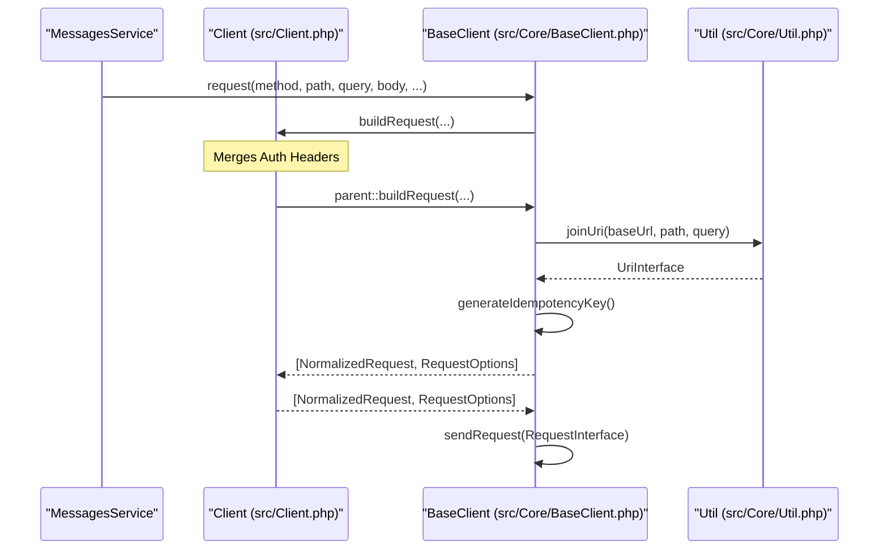
**Sources:** [src/Core/BaseClient.php:62-96](), [src/Client.php:118-134](), [src/Core/Util.php:183-219]()

---

## Transport and PSR-18

The SDK uses **PHP-HTTP Discovery** to automatically locate PSR-17 factories and a PSR-18 client (transporter) if none are explicitly provided [src/Client.php:56-62]().

- **Request Factory**: Used to create the `RequestInterface` [src/Core/BaseClient.php:88]().
- **Transporter**: The `ClientInterface` implementation (e.g., Guzzle, Symfony HTTP Client) that actually sends the bytes [src/RequestOptions.php:61]().

### Header Normalization
The `Util::withSetHeaders` function ensures all header values are converted to strings or lists of strings, as required by PSR-7, while handling nulls by removing the header entirely [src/Core/Util.php:224-235]().

**Sources:** [src/Client.php:56-62](), [src/Core/BaseClient.php:88-92](), [src/Core/Util.php:224-235]()

---

## The Request Lifecycle

The `BaseClient::sendRequest` method implements a recursive loop that handles the actual transmission, retries, and redirects.

### Retry Logic with Exponential Backoff
The SDK automatically retries failed requests under specific conditions defined in `shouldRetry` [src/Core/BaseClient.php:199-214]():
- **Status Codes**: 408 (Timeout), 409 (Conflict), 429 (Rate Limit), or any `>= 500` (Server Error).
- **Max Retries**: Controlled by `RequestOptions::$maxRetries` (default is 2) [src/RequestOptions.php:41]().

**Backoff Calculation**:
The delay between retries is calculated in `retryDelay` [src/Core/BaseClient.php:219-223](). It respects the `Retry-After` header if present. Otherwise, it uses exponential backoff:
1. Starts at `initialRetryDelay` (default 0.5s) [src/RequestOptions.php:44]().
2. Doubles with each attempt.
3. Capped at `maxRetryDelay` (default 8.0s) [src/RequestOptions.php:47]().
4. Includes a jitter (random factor between 0.5 and 1.5) to prevent thundering herds [src/Core/BaseClient.php:241-246]().

### Redirect Following
If a response returns a 3xx status code and includes a `Location` header, the SDK follows it automatically [src/Core/BaseClient.php:182-194]().
- The SDK limits the number of sequential redirects (internal default is 10) to prevent infinite loops [src/Core/BaseClient.php:274-276]().
- `Util::joinUri` is used to resolve relative redirect locations against the original request URI [src/Core/BaseClient.php:191]().

### Lifecycle State Machine
This diagram maps the internal logic of `sendRequest` and its interaction with `RequestOptions`.

```mermaid
stateDiagram-v2
    [*] --> TransformRequest: "BaseClient::transformRequest()"
    TransformRequest --> Send: "transporter->sendRequest()"
    
    Send --> CheckStatus: "Response received"
    Send --> ConnectionError: "ClientExceptionInterface"
    
    ConnectionError --> ShouldRetry: "retryCount < maxRetries"
    
    CheckStatus --> Success: "2xx Status"
    CheckStatus --> Redirect: "3xx Status + Location"
    CheckStatus --> ShouldRetry: "408, 429, 5xx"
    CheckStatus --> Failure: "Other 4xx"
    
    Redirect --> TransformRequest: "followRedirect() / count++"
    
    ShouldRetry --> Wait: "retryDelay()"
    Wait --> TransformRequest: "retryCount++"
    
    Success --> [*]
    Failure --> [*]
```
**Sources:** [src/Core/BaseClient.php:182-214](), [src/Core/BaseClient.php:219-246](), [src/RequestOptions.php:37-48]()

---

## Idempotency Keys

To safely retry requests that might have side effects (like creating a message), the SDK generates an idempotency key [src/Core/BaseClient.php:114-119]().
- **Header**: Configured via `idempotencyHeader` in the constructor [src/Core/BaseClient.php:44]().
- **Format**: `stainless-php-retry-<hex>` [src/Core/BaseClient.php:118]().
- **Behavior**: If the header is already provided in the request call, the SDK will not overwrite it [src/Core/BaseClient.php:149-151]().

**Sources:** [src/Core/BaseClient.php:114-120](), [src/Core/BaseClient.php:149-151]()

---

# Page: Type Conversion and Data Modeling

# Type Conversion and Data Modeling

<details>
<summary>Relevant source files</summary>

The following files were used as context for generating this wiki page:

- [composer.json](composer.json)
- [src/Core.php](src/Core.php)
- [src/Core/Concerns/SdkEnum.php](src/Core/Concerns/SdkEnum.php)
- [src/Core/Concerns/SdkModel.php](src/Core/Concerns/SdkModel.php)
- [src/Core/Concerns/SdkParams.php](src/Core/Concerns/SdkParams.php)
- [src/Core/Concerns/SdkUnion.php](src/Core/Concerns/SdkUnion.php)
- [src/Core/Contracts/BaseStream.php](src/Core/Contracts/BaseStream.php)
- [src/Core/Conversion.php](src/Core/Conversion.php)
- [src/Core/Conversion/ListOf.php](src/Core/Conversion/ListOf.php)
- [src/Core/Conversion/ModelOf.php](src/Core/Conversion/ModelOf.php)
- [src/Core/Conversion/PropertyInfo.php](src/Core/Conversion/PropertyInfo.php)
- [src/Core/Conversion/UnionOf.php](src/Core/Conversion/UnionOf.php)

</details>


The Anthropic PHP SDK employs a robust type conversion and data modeling system to bridge the gap between PHP's object-oriented structures and the JSON-based requirements of the Anthropic API. This system handles the serialization of request parameters (sending data) and the deserialization of API responses into typed PHP objects (receiving data).

## Core Data Modeling Traits

The SDK uses a set of internal traits to provide consistent behavior across different types of data entities. These traits utilize `ReflectionClass` to automatically map PHP properties to API fields.

### `SdkModel`
The primary trait for complex data objects (Models). It implements `ArrayAccess`, `JsonSerializable`, and magic methods to handle data storage and retrieval.
- **Data Storage**: Uses a private `$_data` array to store undocumented or extra data returned by the API, ensuring forward compatibility [src/Core/Concerns/SdkModel.php:26-26]().
- **Accessors**: Implements `offsetGet` and `offsetSet` to allow array-like access to properties [src/Core/Concerns/SdkModel.php:145-200]().
- **Serialization**: `__serialize()` and `jsonSerialize()` convert the object into a format suitable for JSON encoding [src/Core/Concerns/SdkModel.php:33-38](), [src/Core/Concerns/SdkModel.php:227-231]().

### `SdkParams`
Used specifically for request parameter DTOs. It provides the `parseRequest` method which handles the conversion of parameters into an array while also extracting and validating `RequestOptions` [src/Core/Concerns/SdkParams.php:21-35]().

### `SdkUnion` and `SdkEnum`
- **`SdkUnion`**: Facilitates types that can be one of several different classes. It uses a `discriminator` (a specific field in the JSON) to determine which variant to instantiate [src/Core/Concerns/SdkUnion.php:18-38]().
- **`SdkEnum`**: Maps PHP class constants or BackedEnums to valid API string/int values [src/Core/Concerns/SdkEnum.php:14-34]().

### Code Entity Space: Model and Parameter Architecture
This diagram shows how the SDK's internal traits and contracts form the foundation for data entities used by developers.

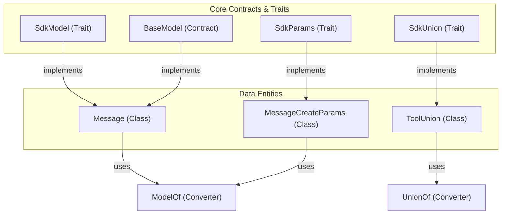
Sources: [src/Core/Concerns/SdkModel.php:19-21](), [src/Core/Concerns/SdkParams.php:14-15](), [src/Core/Concerns/SdkUnion.php:14-15](), [src/Core/Conversion/ModelOf.php:16-17]().

---

## The Conversion System

The `Conversion` class is the central engine for transforming data [src/Core/Conversion.php:16-17](). It operates using two primary modes: **Coerce** (Input) and **Dump** (Output).

### Key Functions
| Function | Purpose |
| :--- | :--- |
| `coerce()` | Converts raw input (usually from an API response array) into a specific target type (e.g., a Model class or a primitive) [src/Core/Conversion.php:49-70](). |
| `dump()` | Converts a PHP object or typed value into a raw format (array/primitive) for JSON serialization [src/Core/Conversion.php:72-89](). |
| `tryConvert()` | Handles low-level type casting for primitives like `int`, `float`, `bool`, and `DateTimeInterface` [src/Core/Conversion.php:91-221](). |

### Converters
The system uses specialized classes implementing the `Converter` contract:
- **`ModelOf`**: Handles the mapping of a specific class. It inspects properties for `Required` or `Optional` attributes to handle field renaming (e.g., `snake_case` in API to `camelCase` in PHP) [src/Core/Conversion/ModelOf.php:26-40]().
- **`ListOf`**: Iterates over an array and applies a specific converter to every element [src/Core/Conversion/ListOf.php:13-14]().
- **`UnionOf`**: Attempts to match data against multiple possible types. It uses a scoring system via `CoerceState` to find the "best fit" variant if no discriminator is present [src/Core/Conversion/UnionOf.php:25-64]().
- **`EnumOf`**: Validates that a value matches one of the allowed enum cases [src/Core/Concerns/SdkEnum.php:32-32]().

### State Management
- **`CoerceState`**: Tracks the success of a conversion. It maintains counters for `yes` (exact match), `maybe` (castable), and `no` (incompatible) [src/Core/Conversion.php:93-219]().
- **`DumpState`**: Tracks the state during serialization, including whether the resulting payload is safe for retries (e.g., if it contains a non-rewindable stream) [src/Core/Concerns/SdkParams.php:29-31]().

---

## Data Flow: Request and Response

### Serialization (PHP to API)
When a service method is called (e.g., `create()`), the parameters are processed through the `SdkParams` trait.
1. `parseRequest()` is called with the params DTO [src/Core/Concerns/SdkParams.php:21]().
2. The `ModelOf` converter for that DTO executes `dump()` [src/Core/Concerns/SdkParams.php:25]().
3. Property names are translated from PHP property names to API field names based on attributes [src/Core/Conversion/ModelOf.php:112-112]().
4. The resulting array is JSON-encoded and sent in the HTTP body.

### Deserialization (API to PHP)
When a response is received, the `BaseClient` uses a `ResponseConverter` (often inferred from the return type) to transform the JSON.
1. The JSON body is decoded into a PHP array.
2. `Conversion::coerce()` is called with the target class name and the array [src/Core/Conversion.php:49]().
3. `ModelOf::coerce()` instantiates the class without calling the constructor [src/Core/Conversion/ModelOf.php:131-131]().
4. `__unserialize()` populates the object properties, coercing nested types recursively [src/Core/Concerns/SdkModel.php:45-51]().

### Natural Language to Code Entity Space: Conversion Lifecycle
This diagram bridges the conceptual "Request/Response" flow to the specific classes and methods responsible for data transformation.

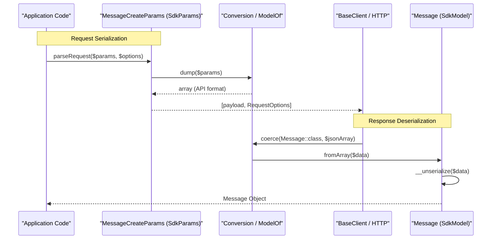
Sources: [src/Core/Concerns/SdkParams.php:21-35](), [src/Core/Concerns/SdkModel.php:236-240](), [src/Core/Conversion.php:49-70](), [src/Core/Conversion/ModelOf.php:41-96]().

---

## Specialized Types

### `PropertyInfo`
This internal class parses PHP reflection data to determine how a single property should be handled. It extracts:
- **`apiName`**: The field name used in JSON [src/Core/Conversion/PropertyInfo.php:17]().
- **`type`**: The expected type, which may be a primitive string, a class name, or a `UnionOf` [src/Core/Conversion/PropertyInfo.php:19]().
- **`nullable`/`optional`**: Boolean flags derived from PHP type hints and SDK attributes [src/Core/Conversion/PropertyInfo.php:21-23]().

### `BaseStream` and `RawResponse`
For streaming responses or raw data:
- **`BaseStream`**: A contract for iterators that yield coerced models as they arrive from a stream (e.g., SSE) [src/Core/Contracts/BaseStream.php:19-33]().
- **`RawResponse`**: Used when the developer needs access to the underlying PSR-7 response without automatic model conversion.

Sources: [src/Core/Conversion/PropertyInfo.php:15-48](), [src/Core/Contracts/BaseStream.php:1-33](), [src/Core/Conversion.php:1-222]().

---

# Page: Streaming: SSE and JSONL

# Streaming: SSE and JSONL

<details>
<summary>Relevant source files</summary>

The following files were used as context for generating this wiki page:

- [composer.json](composer.json)
- [src/Core/Concerns/SdkModel.php](src/Core/Concerns/SdkModel.php)
- [src/Core/Concerns/SdkStream.php](src/Core/Concerns/SdkStream.php)
- [src/Core/Concerns/SdkUnion.php](src/Core/Concerns/SdkUnion.php)
- [src/Core/Contracts/BaseStream.php](src/Core/Contracts/BaseStream.php)
- [src/Core/Conversion/PropertyInfo.php](src/Core/Conversion/PropertyInfo.php)
- [src/Core/Conversion/UnionOf.php](src/Core/Conversion/UnionOf.php)
- [src/Core/Implementation/RawResponse.php](src/Core/Implementation/RawResponse.php)
- [src/Core/Util.php](src/Core/Util.php)
- [src/JsonLStream.php](src/JsonLStream.php)
- [src/Page.php](src/Page.php)
- [src/PageCursor.php](src/PageCursor.php)
- [src/SSEStream.php](src/SSEStream.php)
- [src/TokenPage.php](src/TokenPage.php)
- [tests/ClientTest.php](tests/ClientTest.php)
- [tests/Core/UtilTest.php](tests/Core/UtilTest.php)

</details>


The Anthropic PHP SDK provides robust support for handling streaming responses from the API. This is primarily handled through two specialized stream implementations: `SSEStream` for real-time Server-Sent Events (used in Messages) and `JsonLStream` for newline-delimited JSON (used in Batch results). Both implementations share a common foundation via the `SdkStream` trait and the `BaseStream` contract.

## Stream Architecture

Streaming in the SDK is designed to be memory-efficient, leveraging PHP Generators to yield data as it arrives from the HTTP transport layer. The `RawResponse` class determines whether to instantiate a stream based on the response type and the internal configuration of the service method.

### BaseStream Contract
All stream classes must implement the `Anthropic\Core\Contracts\BaseStream` interface. This interface extends `IteratorAggregate`, ensuring that streams can be iterated over using a standard `foreach` loop [src/Core/Contracts/BaseStream.php:16-19]().

### SdkStream Trait
The `Anthropic\Core\Concerns\SdkStream` trait provides the shared logic for all stream types. It handles:
*   **Initialization**: Setting up the underlying PSR-7 stream and the type converter [src/Core/Concerns/SdkStream.php:40-52]().
*   **Iteration**: Implementing `getIterator()` which proxies to a `parsedGenerator()` method defined in the concrete classes [src/Core/Concerns/SdkStream.php:60-63]().
*   **Resource Management**: Automatically closing the stream when iteration is complete or when `close()` is called manually [src/Core/Concerns/SdkStream.php:73-77]().

### Data Flow: Request to Stream
The following diagram illustrates how a streaming request is transformed into an iterable object.

**Streaming Response Lifecycle**
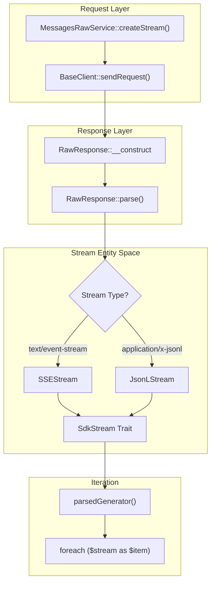
Sources: [src/Core/Implementation/RawResponse.php:60-68](), [src/SSEStream.php:16-24](), [src/Core/Concerns/SdkStream.php:60-63]()

## SSEStream: Server-Sent Events

`SSEStream` is used for the Messages API when `stream => true` is requested. It parses the `text/event-stream` format, handling Anthropic-specific event types and error states.

### Event Handling
The `parsedGenerator()` method in `SSEStream` iterates over the raw stream and switches on the `event` field of each SSE block [src/SSEStream.php:32-33]().

| Event Type | Action |
| :--- | :--- |
| `completion`, `message_start`, `message_delta`, `message_stop`, `content_block_start`, `content_block_delta`, `content_block_stop` | Decodes the `data` field as JSON and coerces it into the target SdkModel [src/SSEStream.php:34-45](). |
| `ping` | Ignored (used for connection keep-alive) [src/SSEStream.php:49](). |
| `error` | Decodes the error payload and throws an `APIStatusException` [src/SSEStream.php:51-65](). |

### Parsing Logic
The SDK uses `Util::decodeJson` to transform the string data into PHP arrays before passing them to the `Conversion::coerce` system to produce typed objects [src/SSEStream.php:42-44]().

Sources: [src/SSEStream.php:26-68](), [src/Core/Util.php:20-26]()

## JsonLStream: Batch Results

`JsonLStream` handles responses formatted as Newline-Delimited JSON (JSONL). This is primarily used when retrieving the results of a Message Batch.

### Implementation Details
Unlike `SSEStream`, which looks for event prefixes, `JsonLStream` treats every non-empty line in the stream as a standalone JSON object.
1.  The stream reads line-by-line using a buffer.
2.  Each line is passed to `Util::decodeJson`.
3.  The resulting array is coerced into the expected model type.

**JSONL Data Transformation**
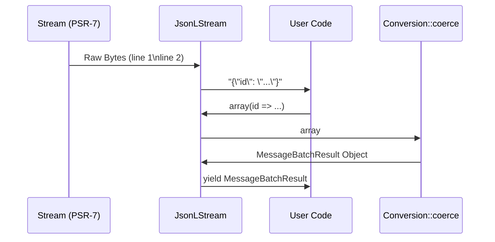
Sources: [src/JsonLStream.php:1-30](), [src/Core/Util.php:26-27]()

## Error Handling in Streams

Errors during streaming are handled in two ways:
1.  **Connection Errors**: If the HTTP connection fails during the stream, a `Psr\Http\Client\ClientExceptionInterface` or `Anthropic\Core\Exceptions\APIConnectionException` is raised by the underlying transporter.
2.  **API Level Errors**: In `SSEStream`, if an event of type `error` is encountered, the SDK parses the error JSON and throws an `APIStatusException`. This exception includes the original request and response objects for debugging [src/SSEStream.php:56-62]().

## Utility Functions

The `Anthropic\Core\Util` class provides constants and regex patterns used to identify stream types:
*   `JSON_CONTENT_TYPE`: `const JSON_CONTENT_TYPE = '/^application\/(?:vnd(?:.[^.]+)*+)?json(?!l)/';` [src/Core/Util.php:24]()
*   `JSONL_CONTENT_TYPE`: `const JSONL_CONTENT_TYPE = '/^application\/(:?x-(?:n|l)djson)|(:?(?:x-)?jsonl)/';` [src/Core/Util.php:26]()

Sources: [src/Core/Util.php:20-27](), [src/SSEStream.php:51-65]()

---

# Page: Pagination

# Pagination

<details>
<summary>Relevant source files</summary>

The following files were used as context for generating this wiki page:

- [src/Core.php](src/Core.php)
- [src/Core/Concerns/SdkPage.php](src/Core/Concerns/SdkPage.php)
- [src/Core/Concerns/SdkParams.php](src/Core/Concerns/SdkParams.php)
- [src/Core/Concerns/SdkStream.php](src/Core/Concerns/SdkStream.php)
- [src/Core/Contracts/BasePage.php](src/Core/Contracts/BasePage.php)
- [src/Core/Implementation/RawResponse.php](src/Core/Implementation/RawResponse.php)
- [src/Page.php](src/Page.php)
- [src/PageCursor.php](src/PageCursor.php)
- [src/TokenPage.php](src/TokenPage.php)

</details>


The Anthropic PHP SDK provides a robust system for handling paginated API responses. It abstracts the complexity of cursor-based and token-based pagination into a set of standard classes and traits, allowing for both manual page-by-page navigation and automatic iteration over all items in a result set.

## Core Concepts

Pagination in the SDK is built around the `BasePage` contract, which defines how a response containing a list of items should behave.

### BasePage Contract
The `BasePage` interface [src/Core/Contracts/BasePage.php:16-34]() defines the essential methods for any paginated response:
- `hasNextPage()`: Determines if more results are available [src/Core/Contracts/BasePage.php:18]().
- `getItems()`: Returns the list of items for the current page [src/Core/Contracts/BasePage.php:23]().
- `getNextPage()`: Fetches the subsequent page object [src/Core/Contracts/BasePage.php:28]().
- `pagingEachItem()`: Returns a PHP Generator to iterate over every item across all pages [src/Core/Contracts/BasePage.php:33]().

### SdkPage Trait
The `SdkPage` trait [src/Core/Concerns/SdkPage.php:21-102]() provides the default implementation for these methods. It manages the internal state required to perform the next request, including the `Client` instance and the original request parameters.

**Sources:** [src/Core/Contracts/BasePage.php:1-34](), [src/Core/Concerns/SdkPage.php:1-102]()

## Page Implementations

The SDK provides three concrete implementations of `BasePage`, each corresponding to a different pagination strategy used by the Anthropic API.

| Class | Strategy | Next Page Logic |
| :--- | :--- | :--- |
| `Page` | Cursor-based (ID) | Uses `after_id` (from `lastID`) or `before_id` (from `firstID`) [src/Page.php:115-120](). |
| `PageCursor` | Page-based | Uses a `page` query parameter [src/PageCursor.php:109-112](). |
| `TokenPage` | Token-based | Uses a `page_token` query parameter [src/TokenPage.php:109-112](). |

### Data Flow: Request to Page Object
The following diagram illustrates how a raw API response is transformed into a paginated object.

**Entity Mapping: Response Conversion**
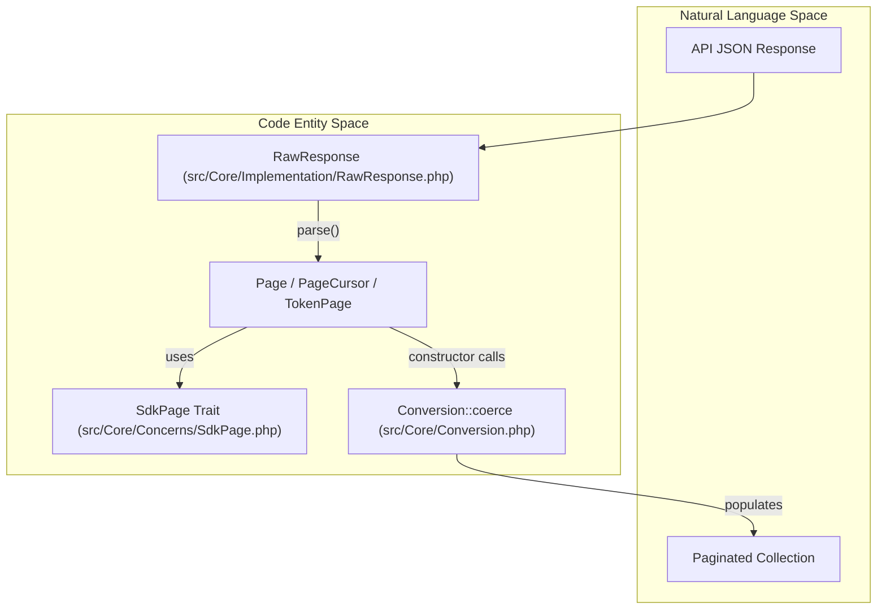
**Sources:** [src/Core/Implementation/RawResponse.php:69-78](), [src/Page.php:60-82](), [src/PageCursor.php:54-76](), [src/TokenPage.php:54-76]()

## Auto-Pagination

The SDK simplifies data retrieval through generators, allowing developers to treat paginated results as a single stream of items.

### pagingEachItem()
This method [src/Core/Concerns/SdkPage.php:87-94]() uses a nested loop to yield every item across all available pages. It internally calls `getNextPage()` until `hasNextPage()` returns `false`.

### getIterator()
By implementing `\IteratorAggregate` [src/Core/Contracts/BasePage.php:16](), page objects can be used directly in a `foreach` loop to iterate page-by-page [src/Core/Concerns/SdkPage.php:70-80]().

**Logic Flow: Automatic Page Fetching**
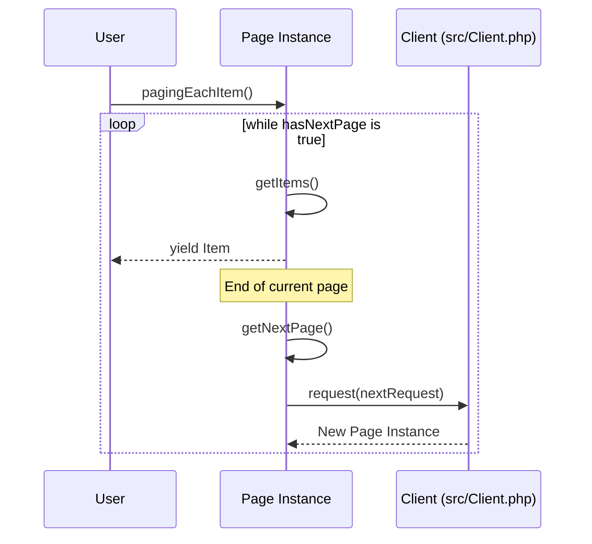
**Sources:** [src/Core/Concerns/SdkPage.php:46-63](), [src/Core/Concerns/SdkPage.php:87-94]()

## Implementation Details

### Request Reconstruction
To fetch the next page, the current page object must know how the original request was made. Page classes store `requestInfo` and `options` [src/Page.php:63-64](). When `getNextPage()` is called:
1. `nextRequest()` is invoked to generate the new request parameters (e.g., adding `after_id`) [src/Page.php:105-124]().
2. The `Client` performs a new request using these parameters [src/Core/Concerns/SdkPage.php:59]().
3. The response is parsed into a new instance of the same page class [src/Core/Concerns/SdkPage.php:62]().

### Item Coercion
During construction, page objects use the `Conversion::coerce` system to transform the raw JSON `data` array into typed objects [src/Page.php:77-81](). This ensures that `getItems()` returns a list of DTOs rather than primitive arrays.

**Sources:** [src/Page.php:60-82](), [src/Core/Concerns/SdkPage.php:46-63](), [src/Core/Implementation/RawResponse.php:69-78]()

---

# Page: Error Handling and Exceptions

# Error Handling and Exceptions

<details>
<summary>Relevant source files</summary>

The following files were used as context for generating this wiki page:

- [.release-please-manifest.json](.release-please-manifest.json)
- [CHANGELOG.md](CHANGELOG.md)
- [CONTRIBUTING.md](CONTRIBUTING.md)
- [README.md](README.md)
- [release-please-config.json](release-please-config.json)
- [src/Client.php](src/Client.php)
- [src/Core/BaseClient.php](src/Core/BaseClient.php)
- [src/ErrorType.php](src/ErrorType.php)
- [src/RequestOptions.php](src/RequestOptions.php)
- [src/Version.php](src/Version.php)

</details>


This page documents the exception hierarchy and error handling mechanisms in the Anthropic PHP SDK. When the library encounters issues connecting to the API or receives a non-success HTTP status code, it throws specific exceptions to allow for granular error handling and automated recovery via retries.

## Exception Hierarchy

All exceptions thrown by the SDK inherit from `Anthropic\Core\Exceptions\APIException`. This hierarchy distinguishes between connectivity issues, timeouts, and specific HTTP error responses returned by the Anthropic API.

### Core Exception Classes

| Exception Class | Description |
| :--- | :--- |
| `APIException` | The base class for all SDK-specific exceptions. |
| `APIConnectionException` | Thrown when the server cannot be reached or a network error occurs [src/Core/BaseClient.php:188](). |
| `APITimeoutException` | Thrown when a request exceeds the configured timeout [README.md:172](). |
| `APIStatusException` | Thrown when the API returns a non-success (4xx or 5xx) status code [README.md:140](). |

### HTTP Status Specific Exceptions

`APIStatusException` is further subclassed to represent specific HTTP error states, allowing developers to catch specific issues like rate limits or authentication failures [README.md:161-174]().

| HTTP Status | Exception Subclass |
| :--- | :--- |
| 400 | `BadRequestException` |
| 401 | `AuthenticationException` |
| 403 | `PermissionDeniedException` |
| 404 | `NotFoundException` |
| 409 | `ConflictException` |
| 422 | `UnprocessableEntityException` |
| 429 | `RateLimitException` |
| >= 500 | `InternalServerException` |

**Sources:** [README.md:131-174](), [src/Core/BaseClient.php:12-13]()

## Error Data Flow

The following diagram illustrates how a request transitions from a standard call to an exception being raised within the `BaseClient` lifecycle.

### Request to Exception Lifecycle
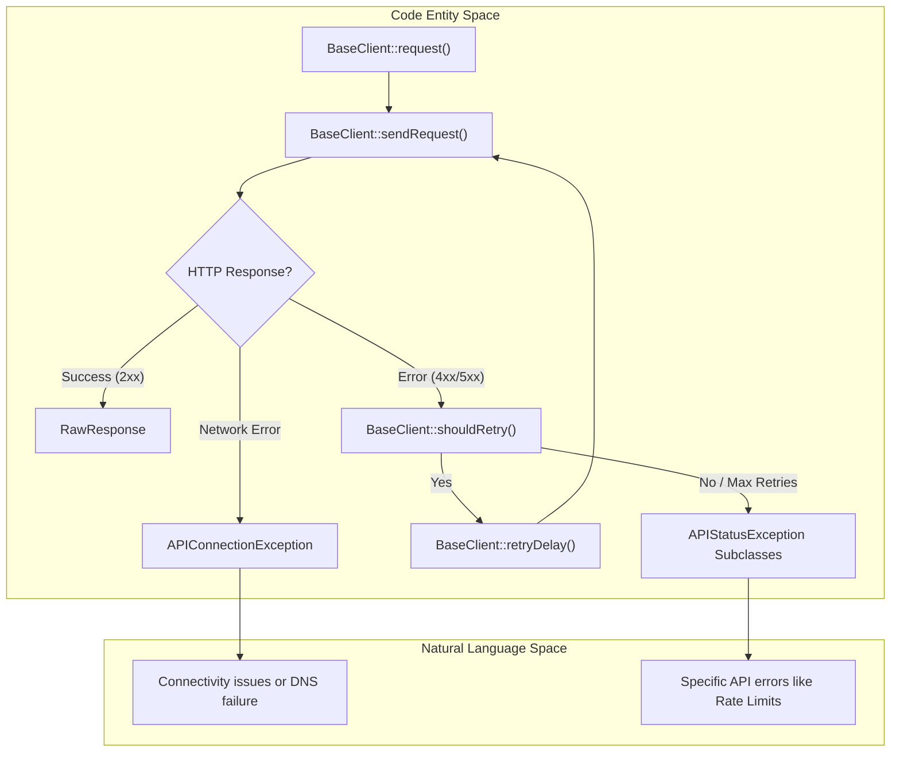
**Sources:** [src/Core/BaseClient.php:62-96](), [src/Core/BaseClient.php:199-214]()

## Retries and Backoff

The SDK includes built-in retry logic to handle transient errors automatically. By default, the SDK will retry a request **2 times** [src/RequestOptions.php:41]().

### Triggering Conditions
A retry is triggered if the request fails with one of the following conditions [src/Core/BaseClient.php:208-210]():
- **Connection Errors:** Network connectivity problems.
- **HTTP 408:** Request Timeout.
- **HTTP 409:** Conflict.
- **HTTP 429:** Rate Limit.
- **HTTP >= 500:** Internal Server Errors.

### Backoff Strategy
The SDK employs an exponential backoff strategy. It starts with an initial delay (default **0.5s**) and increases up to a maximum delay (default **8.0s**) [src/RequestOptions.php:44-47](). If the server provides a `Retry-After` header, the SDK will respect that value [src/Core/BaseClient.php:224-226]().

### Configuration
Retries can be configured globally via the `Client` constructor or per-request using `RequestOptions` [README.md:181-198]().

```php
// Per-request configuration
$client->messages->create(
    maxTokens: 1024,
    messages: [['role' => 'user', 'content' => 'Hello']],
    model: 'claude-3-5-sonnet-20240620',
    requestOptions: ['maxRetries' => 5]
);
```

**Sources:** [README.md:175-198](), [src/Core/BaseClient.php:199-228](), [src/RequestOptions.php:40-48]()

## Handling API Errors in Code

The SDK uses standard PHP `try-catch` blocks. The following diagram maps the relationship between API error types and the resulting PHP exception entities.

### Error Mapping: API to Exception
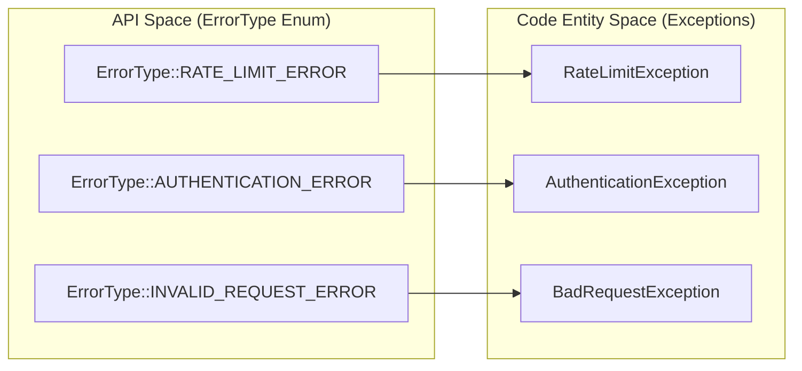

### Implementation Example
```php
use Anthropic\Core\Exceptions\APIConnectionException;
use Anthropic\Core\Exceptions\RateLimitException;
use Anthropic\Core\Exceptions\APIStatusException;

try {
    $response = $client->messages->create(...);
} catch (APIConnectionException $e) {
    // Handle network failure
} catch (RateLimitException $e) {
    // Handle HTTP 429 specifically
} catch (APIStatusException $e) {
    // Handle all other non-200 responses
}
```

**Sources:** [README.md:142-157](), [src/ErrorType.php:7-26]()

---

# Page: Messages API

# Messages API

<details>
<summary>Relevant source files</summary>

The following files were used as context for generating this wiki page:

- [.stats.yml](.stats.yml)
- [src/Beta/Messages/Batches/BatchCreateParams/Request/Params.php](src/Beta/Messages/Batches/BatchCreateParams/Request/Params.php)
- [src/Beta/Messages/MessageCountTokensParams.php](src/Beta/Messages/MessageCountTokensParams.php)
- [src/Beta/Messages/MessageCreateParams.php](src/Beta/Messages/MessageCreateParams.php)
- [src/Messages/Batches/BatchCreateParams/Request/Params.php](src/Messages/Batches/BatchCreateParams/Request/Params.php)
- [src/Messages/MessageCountTokensParams.php](src/Messages/MessageCountTokensParams.php)
- [src/Messages/MessageCreateParams.php](src/Messages/MessageCreateParams.php)
- [src/ServiceContracts/Beta/MessagesContract.php](src/ServiceContracts/Beta/MessagesContract.php)
- [src/ServiceContracts/MessagesContract.php](src/ServiceContracts/MessagesContract.php)
- [src/Services/Beta/MessagesRawService.php](src/Services/Beta/MessagesRawService.php)
- [src/Services/Beta/MessagesService.php](src/Services/Beta/MessagesService.php)
- [src/Services/MessagesRawService.php](src/Services/MessagesRawService.php)
- [src/Services/MessagesService.php](src/Services/MessagesService.php)
- [tests/Services/Beta/Messages/BatchesTest.php](tests/Services/Beta/Messages/BatchesTest.php)
- [tests/Services/Beta/MessagesTest.php](tests/Services/Beta/MessagesTest.php)
- [tests/Services/Messages/BatchesTest.php](tests/Services/Messages/BatchesTest.php)
- [tests/Services/MessagesTest.php](tests/Services/MessagesTest.php)

</details>


The Messages API is the primary interface for interacting with Anthropic's Claude models. It allows for single queries, stateless multi-turn conversations, and complex workflows involving tools and structured data. The SDK provides two main entry points: a stable service for production-ready features and a beta service for cutting-edge capabilities.

## Overview of Services

The Messages API is accessible through the `Client` via two primary namespaces: `messages` (stable) and `beta->messages` (beta). Both namespaces offer synchronous creation, streaming, and token counting, but they differ in the feature sets they support.

### Service Relationships

The following diagram illustrates how the `Client` orchestrates access to various message-related services.

**Message Service Architecture**
```mermaid
graph TD
    "Client"["Anthropic\Client"] --> "Messages"["Anthropic\Services\MessagesService"]
    "Client" --> "Beta"["Anthropic\Beta\AnthropicBeta"]
    "Beta" --> "BetaMessages"["Anthropic\Services\Beta\MessagesService"]
    
    "Messages" --> "MessagesRaw"["Anthropic\Services\MessagesRawService"]
    "Messages" --> "Batches"["Anthropic\Services\Messages\BatchesService"]
    
    "BetaMessages" --> "BetaMessagesRaw"["Anthropic\Services\Beta\MessagesRawService"]
    "BetaMessages" --> "BetaBatches"["Anthropic\Services\Beta\Messages\BatchesService"]
    "BetaMessages" --> "ToolRunner"["Anthropic\Lib\Tools\BetaToolRunner"]
```
Sources: [src/Services/MessagesService.php:51-70](), [src/Services/Beta/MessagesService.php:63-82]()

## Core Capabilities

### Stable Messages Service
The stable service provides the standard `create()`, `createStream()`, and `countTokens()` methods. It is the recommended choice for most production applications. It handles the core conversational loop using the `MessageParam` DTO and returns structured `Message` objects.

For details, see [Stable Messages Service](#3.1).
Sources: [src/Services/MessagesService.php:75-134](), [src/ServiceContracts/MessagesContract.php:45-58]()

### Beta Messages Service
The beta service extends the stable functionality with experimental features such as Model Context Protocol (MCP) server integration, advanced context management, and extended thinking capabilities. It uses `BetaMessageParam` and returns `BetaMessage` objects.

For details, see [Beta Messages Service](#3.2).
Sources: [src/Services/Beta/MessagesService.php:87-148](), [src/ServiceContracts/Beta/MessagesContract.php:57-130]()

### Message Batches
For high-volume, non-interactive workloads, the Batches API allows sending up to 10,000 requests in a single batch. This service provides 50% lower costs compared to the standard Messages API. The SDK supports creating, retrieving, listing, and canceling batches in both stable and beta namespaces.

For details, see [Message Batches](#3.3).
Sources: [tests/Services/Messages/BatchesTest.php:34-47](), [tests/Services/Beta/Messages/BatchesTest.php:34-51]()

## Advanced Integration

The Messages API serves as the foundation for several advanced SDK features:

| Feature | Description | Link |
| --- | --- | --- |
| **Tool Use** | Allows Claude to interact with external tools and functions. | [Tool Use](#3.4) |
| **Structured Output** | Distills API responses into typed PHP objects using JSON schemas. | [Structured Output](#3.5) |
| **Extended Thinking** | Enables models to perform complex reasoning before responding. | [Extended Thinking](#3.6) |

### Request Lifecycle Flow

The following diagram shows how a request moves from high-level parameters to the network.

**Request Lifecycle**
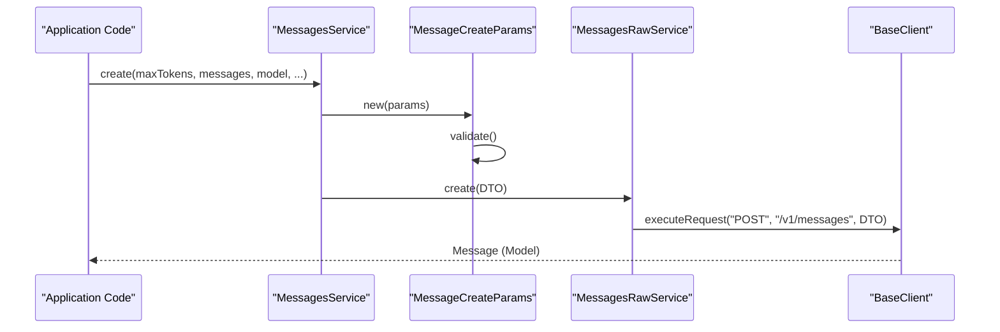
Sources: [src/Services/MessagesService.php:75-150](), [src/Beta/Messages/MessageCreateParams.php:70-148](), [src/Services/MessagesRawService.php:1-30]()

## Token Counting
Both stable and beta services include a `countTokens()` method. This allows developers to calculate the token usage of a specific set of messages, system prompts, and tool definitions without incurring the cost or latency of a full model generation.

For details, see [Stable Messages Service](#3.1) and [Beta Messages Service](#3.2).
Sources: [src/Services/MessagesService.php:163-178](), [src/Services/Beta/MessagesService.php:217-232]()

---

# Page: Stable Messages Service

# Stable Messages Service

<details>
<summary>Relevant source files</summary>

The following files were used as context for generating this wiki page:

- [src/Beta/Messages/BetaMessage.php](src/Beta/Messages/BetaMessage.php)
- [src/Foundry/Services/MessagesService.php](src/Foundry/Services/MessagesService.php)
- [src/Messages/Batches/BatchCreateParams/Request/Params.php](src/Messages/Batches/BatchCreateParams/Request/Params.php)
- [src/Messages/Message.php](src/Messages/Message.php)
- [src/Messages/MessageCountTokensParams.php](src/Messages/MessageCountTokensParams.php)
- [src/Messages/MessageCreateParams.php](src/Messages/MessageCreateParams.php)
- [src/Messages/Usage.php](src/Messages/Usage.php)
- [src/Messages/WebSearchTool20250305/UserLocation.php](src/Messages/WebSearchTool20250305/UserLocation.php)
- [src/Messages/WebSearchTool20260209/UserLocation.php](src/Messages/WebSearchTool20260209/UserLocation.php)
- [src/Messages/WebSearchToolRequestError/ErrorCode.php](src/Messages/WebSearchToolRequestError/ErrorCode.php)
- [src/Messages/WebSearchToolResultError/ErrorCode.php](src/Messages/WebSearchToolResultError/ErrorCode.php)
- [src/ServiceContracts/MessagesContract.php](src/ServiceContracts/MessagesContract.php)
- [src/Services/MessagesRawService.php](src/Services/MessagesRawService.php)
- [src/Services/MessagesService.php](src/Services/MessagesService.php)

</details>


The Stable Messages Service provides the primary interface for interacting with Anthropic's Claude models. It handles conversational turns, content generation, and token counting using the stable API endpoints. The service is divided into a high-level `MessagesService` for convenient, typed interaction and a `MessagesRawService` for lower-level access to raw API responses.

## Service Architecture

The Messages API is exposed through two primary service classes within the `Anthropic\Services` namespace. These services share a common contract but differ in their return types and abstraction levels.

### MessagesService vs. MessagesRawService

*   **`MessagesService`**: Designed for end-users. It abstracts away the `BaseResponse` wrapper and returns DTOs (Data Transfer Objects) like `Message` or `BaseStream` directly. It also provides access to sub-services like `BatchesService` [src/Services/MessagesService.php:51-69]().
*   **`MessagesRawService`**: Returns `BaseResponse` objects, which include metadata about the HTTP response (headers, status codes) alongside the parsed DTOs. This is used when developers need access to underlying transport details [src/Services/MessagesRawService.php:45-186]().

### Component Relationship

The following diagram illustrates how the Messages services relate to the core Client and the DTOs used for requests and responses.

**Messages Service Entity Map**
```mermaid
graph TD
    subgraph "Service Layer"
        MS["MessagesService"]
        MRS["MessagesRawService"]
    end

    subgraph "Core Transport"
        C["Anthropic\Client"]
    end

    subgraph "Data Transfer Objects (DTOs)"
        MCP["MessageCreateParams"]
        MCTP["MessageCountTokensParams"]
        M["Message"]
        MTC["MessageTokensCount"]
    end

    MS -- "composes" --> MRS
    MS -- "uses" --> MCP
    MS -- "uses" --> MCTP
    
    MRS -- "calls request()" --> C
    MRS -- "returns" --> M
    MRS -- "returns" --> MTC

    MCP -- "defines shape for" --> MRS
```
Sources: [src/Services/MessagesService.php:51-70](), [src/Services/MessagesRawService.php:87-104](), [src/Messages/MessageCreateParams.php:57-61]().

## Key Methods

### create()
The `create()` method is the primary entry point for generating a completion from Claude. It accepts a list of messages and model parameters, sending a `POST` request to `v1/messages` [src/Services/MessagesRawService.php:99]().

*   **Input**: `MessageCreateParams` or an associative array matching its shape [src/Services/MessagesRawService.php:88]().
*   **Processing**: Parameters are validated and serialized via `MessageCreateParams::parseRequest()` [src/Services/MessagesRawService.php:91-94]().
*   **Output**: A `Message` object containing the generated content, usage statistics, and stop reasons [src/Messages/Message.php:32-40]().

### createStream()
`createStream()` initiates a Server-Sent Events (SSE) stream for real-time content generation.

*   **Implementation**: It sets the `stream` parameter to `true` and adds the `Accept: text/event-stream` header [src/Services/MessagesRawService.php:142-148]().
*   **Return Type**: Returns a `BaseStream` yielding various `RawMessageStreamEvent` types (e.g., `RawMessageStartEvent`, `RawContentBlockDeltaEvent`) [src/Services/MessagesRawService.php:130-153]().

### countTokens()
Allows users to calculate the token cost of a request without actually performing the generation.

*   **Endpoint**: Sends a request to the token counting endpoint [src/Services/MessagesRawService.php:181-186]().
*   **Output**: Returns a `MessageTokensCount` object [src/Messages/MessageTokensCount.php]().

Sources: [src/Services/MessagesRawService.php:87-186](), [src/ServiceContracts/MessagesContract.php:45-130]().

## Parameter Serialization and DTOs

The SDK uses specialized DTOs to ensure type safety and correct API payload formatting.

### MessageCreateParams
This DTO defines the schema for creating a message. Key fields include:
*   `model`: The specific Claude model to use [src/Messages/MessageCreateParams.php:133-134]().
*   `messages`: A list of `MessageParam` objects representing the conversation history [src/Messages/MessageCreateParams.php:125-126]().
*   `maxTokens`: The maximum generation limit [src/Messages/MessageCreateParams.php:70-71]().
*   `system`: An optional system prompt [src/Messages/MessageCreateParams.php:218-219]().

### SdkParams and SdkModel Traits
DTOs use the `SdkParams` and `SdkModel` traits to handle the transition from PHP objects to API-ready arrays.
*   **`Required` Attribute**: Used to mark fields that must be present in the JSON payload, often mapping PHP camelCase to API snake_case (e.g., `maxTokens` to `max_tokens`) [src/Messages/MessageCreateParams.php:70]().
*   **`Optional` Attribute**: Handles nullable or non-mandatory fields [src/Messages/MessageCreateParams.php:139]().

Sources: [src/Messages/MessageCreateParams.php:57-240](), [src/Messages/MessageCountTokensParams.php:46-160]().

## Response Processing and Structured Output

When a response is received from the API, the SDK converts the JSON payload into a `Message` object.

### Message Structure
A `Message` object includes:
*   `content`: An array of content blocks (text or tool use) [src/Messages/Message.php:101-102]().
*   `usage`: Token consumption details, including `input_tokens` and `output_tokens` [src/Messages/Message.php:158]().
*   `stop_reason`: Why the model stopped (e.g., `end_turn`, `max_tokens`) [src/Messages/Message.php:136]().

### Structured Output Distillation
The SDK provides a mechanism to parse structured data directly from model responses. The `parsedOutput()` method (available in Beta and Foundry variants) iterates through content blocks to find and instantiate `StructuredOutputModel` implementations [src/Beta/Messages/BetaMessage.php:205-212]().

**Data Flow: Request to Response**
```mermaid
sequenceDiagram
    participant App as "Application Code"
    participant MS as "MessagesService"
    participant MRS as "MessagesRawService"
    participant C as "Client (HTTP)"
    participant API as "Anthropic API"

    App->>MS: create(maxTokens, messages, model)
    MS->>MRS: create(params)
    MRS->>MRS: MessageCreateParams::parseRequest()
    MRS->>C: request(post, 'v1/messages', body)
    C->>API: POST /v1/messages
    API-->>C: JSON Response
    C-->>MRS: RawResponse
    MRS-->>MS: Message (DTO)
    MS-->>App: Message (DTO)
```
Sources: [src/Services/MessagesService.php:175-220](), [src/Services/MessagesRawService.php:87-103](), [src/Messages/Message.php:33-160]().

## Alternative Cloud Providers
The SDK supports alternative implementations of the Messages service for cloud providers that host Anthropic models:
*   **Foundry**: Uses `Anthropic\Foundry\Services\MessagesService` which mirrors the stable contract but targets Foundry-specific endpoints [src/Foundry/Services/MessagesService.php:46-122]().
*   **Amazon Bedrock & Google Vertex AI**: These utilize specific client implementations to handle provider-specific authentication (AWS SigV4 or Google ADC) while maintaining the same `MessagesContract` interface.

Sources: [src/Foundry/Services/MessagesService.php:1-122]().

---

# Page: Beta Messages Service

# Beta Messages Service

<details>
<summary>Relevant source files</summary>

The following files were used as context for generating this wiki page:

- [src/Beta/AnthropicBeta.php](src/Beta/AnthropicBeta.php)
- [src/Beta/Messages/Batches/BatchCreateParams/Request/Params.php](src/Beta/Messages/Batches/BatchCreateParams/Request/Params.php)
- [src/Beta/Messages/Batches/BatchCreateParams/Request/Params/Speed.php](src/Beta/Messages/Batches/BatchCreateParams/Request/Params/Speed.php)
- [src/Beta/Messages/BetaMessage.php](src/Beta/Messages/BetaMessage.php)
- [src/Beta/Messages/BetaOutputConfig.php](src/Beta/Messages/BetaOutputConfig.php)
- [src/Beta/Messages/BetaServerToolUseBlock.php](src/Beta/Messages/BetaServerToolUseBlock.php)
- [src/Beta/Messages/BetaUsage.php](src/Beta/Messages/BetaUsage.php)
- [src/Beta/Messages/BetaUsage/Speed.php](src/Beta/Messages/BetaUsage/Speed.php)
- [src/Beta/Messages/BetaWebSearchToolResultErrorCode.php](src/Beta/Messages/BetaWebSearchToolResultErrorCode.php)
- [src/Beta/Messages/MessageCountTokensParams.php](src/Beta/Messages/MessageCountTokensParams.php)
- [src/Beta/Messages/MessageCountTokensParams/Speed.php](src/Beta/Messages/MessageCountTokensParams/Speed.php)
- [src/Beta/Messages/MessageCreateParams.php](src/Beta/Messages/MessageCreateParams.php)
- [src/Beta/Messages/MessageCreateParams/Speed.php](src/Beta/Messages/MessageCreateParams/Speed.php)
- [src/Messages/Message.php](src/Messages/Message.php)
- [src/ServiceContracts/Beta/MessagesContract.php](src/ServiceContracts/Beta/MessagesContract.php)
- [src/Services/Beta/MessagesRawService.php](src/Services/Beta/MessagesRawService.php)
- [src/Services/Beta/MessagesService.php](src/Services/Beta/MessagesService.php)

</details>


The Beta Messages Service provides access to Anthropic's experimental and preview features through a dedicated namespace. While functionally similar to the stable Messages API, it includes support for advanced capabilities such as Model Context Protocol (MCP) servers, context management, extended thinking, and specialized output configurations.

## Overview and Beta Flagging

The Beta Messages Service is implemented via `MessagesService` and `MessagesRawService` within the `Anthropic\Services\Beta` namespace [src/Services/Beta/MessagesService.php:63-64](). 

Unlike the stable service, the beta service explicitly appends a `beta=true` query parameter to all outgoing request URLs [src/Services/Beta/MessagesRawService.php:115](). Additionally, it injects the `anthropic-beta` header, which is populated by the `betas` parameter in the request DTOs [src/Services/Beta/MessagesRawService.php:110-119]().

### Key Beta Features
*   **MCP Servers**: Integration with Model Context Protocol servers via `mcpServers` [src/Beta/Messages/MessageCreateParams.php:147]().
*   **Context Management**: Granular control over how Claude manages conversation history and function results [src/Beta/Messages/MessageCreateParams.php:159]().
*   **Extended Thinking**: Support for `thinking` configurations (enabled, disabled, or adaptive) [src/Beta/Messages/MessageCreateParams.php:218]().
*   **Prompt Caching**: Ephemeral cache control markers [src/Beta/Messages/MessageCreateParams.php:150]().
*   **Output Control**: Specialized `outputConfig` and `outputFormat` for structured JSON and long-form generation [src/Beta/Messages/MessageCreateParams.php:188-193]().

**Sources:**
* [src/Services/Beta/MessagesService.php:63-82]()
* [src/Services/Beta/MessagesRawService.php:102-127]()
* [src/Beta/Messages/MessageCreateParams.php:142-230]()

---

## Service Architecture

The Beta Messages implementation follows the standard SDK pattern of separating high-level convenience methods from raw, low-level API interactions.

### MessagesService vs. MessagesRawService

`MessagesService` acts as the primary entry point, providing a simplified interface for `create()`, `createStream()`, and `countTokens()` [src/Services/Beta/MessagesService.php:63-146](). It also provides access to the `BatchesService` for bulk operations [src/Services/Beta/MessagesService.php:73]().

`MessagesRawService` handles the actual HTTP lifecycle, including parameter parsing via `MessageCreateParams::parseRequest()` and conversion of response payloads into `BetaMessage` models [src/Services/Beta/MessagesRawService.php:106-126]().

### Data Flow: Request to Response

The following diagram illustrates the flow of a Beta Message request through the SDK entities.

**Beta Request Lifecycle**
```mermaid
sequenceDiagram
    participant App as "Application Code"
    participant SVC as "Beta\MessagesService"
    participant RAW as "Beta\MessagesRawService"
    participant DTO as "Beta\MessageCreateParams"
    participant CL as "Core\Client"

    App->>SVC: create($params)
    SVC->>RAW: create($params)
    RAW->>DTO: parseRequest($params)
    DTO-->>RAW: [$parsed, $options]
    RAW->>CL: request(post, "v1/messages?beta=true", ...)
    CL-->>RAW: RawResponse
    RAW-->>SVC: BaseResponse<BetaMessage>
    SVC-->>App: BetaMessage
```

**Sources:**
* [src/Services/Beta/MessagesService.php:63-82]()
* [src/Services/Beta/MessagesRawService.php:102-127]()
* [src/Beta/Messages/MessageCreateParams.php:70-74]()

---

## Beta Parameters and Models

The beta namespace utilizes specific DTOs that mirror stable counterparts but include beta-only fields.

### MessageCreateParams (Beta)
The `MessageCreateParams` class in the Beta namespace [src/Beta/Messages/MessageCreateParams.php:70]() defines the schema for requests. It includes several specialized fields not found in the stable service:

| Parameter | Type | Description |
| :--- | :--- | :--- |
| `mcpServers` | `list<BetaRequestMCPServerURLDefinition>` | Defines external MCP servers Claude can access [src/Beta/Messages/MessageCreateParams.php:147](). |
| `contextManagement` | `BetaContextManagementConfig` | Controls persistence of tool results and context [src/Beta/Messages/MessageCreateParams.php:159](). |
| `thinking` | `BetaThinkingConfigParam` | Configures extended thinking capabilities [src/Beta/Messages/MessageCreateParams.php:218](). |
| `betas` | `list<AnthropicBeta>` | Enums for specific beta feature flags like `COMPUTER_USE_2024_10_22` [src/Beta/AnthropicBeta.php:7-48](). |

### BetaMessage Response Model
The `BetaMessage` model [src/Beta/Messages/BetaMessage.php:33]() encapsulates the API response. It includes a `BetaUsage` object [src/Beta/Messages/BetaMessage.php:158]() which provides detailed token breakdown, including `cacheReadInputTokens` and `cacheCreationInputTokens` [src/Beta/Messages/BetaUsage.php:46-53]().

**Entity Mapping: Natural Language to Code**
```mermaid
graph TD
    subgraph "Natural Language Concepts"
        A["Beta Feature Flag"]
        B["Input Message List"]
        C["Usage Statistics"]
        D["Thinking Config"]
    end

    subgraph "Code Entity Space"
        A --- E["AnthropicBeta (Enum)"]
        B --- F["BetaMessageParam (Shape)"]
        C --- G["BetaUsage (Class)"]
        D --- H["BetaThinkingConfigParam (Union)"]
    end

    E --> I["src/Beta/AnthropicBeta.php"]
    F --> J["src/Beta/Messages/BetaMessageParam.php"]
    G --> K["src/Beta/Messages/BetaUsage.php"]
    H --> L["src/Beta/Messages/BetaThinkingConfigParam.php"]
```

**Sources:**
* [src/Beta/Messages/MessageCreateParams.php:45-68]()
* [src/Beta/Messages/BetaMessage.php:20-31]()
* [src/Beta/Messages/BetaUsage.php:19-30]()
* [src/Beta/AnthropicBeta.php:7-48]()

---

## Token Counting (Beta)

The Beta service includes a specialized `countTokens()` method [src/Services/Beta/MessagesService.php:132]() that allows developers to calculate the token cost of a message (including tools and images) without generating a response.

This utilizes the `MessageCountTokensParams` DTO [src/Beta/Messages/MessageCountTokensParams.php:58](). It supports beta-specific counting for:
*   **MCP Servers**: Tokens consumed by server definitions [src/Beta/Messages/MessageCountTokensParams.php:147]().
*   **Context Management**: Tokens associated with managed context blocks [src/Beta/Messages/MessageCountTokensParams.php:139]().

**Sources:**
* [src/Services/Beta/MessagesService.php:132-146]()
* [src/Beta/Messages/MessageCountTokensParams.php:58-153]()

---

## Tool Execution and BetaToolRunner

The Beta Messages Service is frequently used in conjunction with the `BetaToolRunner`. This utility facilitates agentic loops where the model can autonomously call tools, receive results, and continue the conversation.

The `MessagesContract` defines the relationship between the service and the tool runner [src/ServiceContracts/Beta/MessagesContract.php:36](). While the standard `create()` method returns a `BetaMessage`, the `BetaToolRunner` (referenced in the service imports) is used to orchestrate `BetaRunnableTool` instances [src/Services/Beta/MessagesService.php:39-40]().

**Tool Integration Flow**
```mermaid
graph LR
    subgraph "Tool Runner Loop"
        TR["BetaToolRunner"]
        MS["MessagesService"]
        RT["BetaRunnableTool"]
    end

    TR -->|1. Request| MS
    MS -->|2. BetaMessage (tool_use)| TR
    TR -->|3. Execute| RT
    RT -->|4. ToolResult| TR
    TR -->|5. Follow-up| MS
```

**Sources:**
* [src/Services/Beta/MessagesService.php:39-40]()
* [src/ServiceContracts/Beta/MessagesContract.php:35-36]()
* [src/Beta/Messages/BetaMessage.php:127]() (stopReason: "tool_use")

---

# Page: Message Batches

# Message Batches

<details>
<summary>Relevant source files</summary>

The following files were used as context for generating this wiki page:

- [.stats.yml](.stats.yml)
- [src/Beta/Files/DeletedFile.php](src/Beta/Files/DeletedFile.php)
- [src/Beta/Files/FileDeleteParams.php](src/Beta/Files/FileDeleteParams.php)
- [src/Beta/Files/FileListParams.php](src/Beta/Files/FileListParams.php)
- [src/Beta/Files/FileMetadata.php](src/Beta/Files/FileMetadata.php)
- [src/Beta/Files/FileRetrieveMetadataParams.php](src/Beta/Files/FileRetrieveMetadataParams.php)
- [src/Beta/Messages/Batches/BatchCancelParams.php](src/Beta/Messages/Batches/BatchCancelParams.php)
- [src/Beta/Messages/Batches/BatchCreateParams.php](src/Beta/Messages/Batches/BatchCreateParams.php)
- [src/Beta/Messages/Batches/BatchDeleteParams.php](src/Beta/Messages/Batches/BatchDeleteParams.php)
- [src/Beta/Messages/Batches/BatchListParams.php](src/Beta/Messages/Batches/BatchListParams.php)
- [src/Beta/Messages/Batches/BatchResultsParams.php](src/Beta/Messages/Batches/BatchResultsParams.php)
- [src/Beta/Messages/Batches/BatchRetrieveParams.php](src/Beta/Messages/Batches/BatchRetrieveParams.php)
- [src/Beta/Messages/Batches/DeletedMessageBatch.php](src/Beta/Messages/Batches/DeletedMessageBatch.php)
- [src/Beta/Messages/Batches/MessageBatch.php](src/Beta/Messages/Batches/MessageBatch.php)
- [src/Beta/Messages/Batches/MessageBatchIndividualResponse.php](src/Beta/Messages/Batches/MessageBatchIndividualResponse.php)
- [src/Beta/Messages/BetaMessageTokensCount.php](src/Beta/Messages/BetaMessageTokensCount.php)
- [src/Messages/Batches/DeletedMessageBatch.php](src/Messages/Batches/DeletedMessageBatch.php)
- [src/Messages/Batches/MessageBatch.php](src/Messages/Batches/MessageBatch.php)
- [src/Messages/Batches/MessageBatchIndividualResponse.php](src/Messages/Batches/MessageBatchIndividualResponse.php)
- [src/ServiceContracts/Beta/Messages/BatchesContract.php](src/ServiceContracts/Beta/Messages/BatchesContract.php)
- [src/ServiceContracts/Beta/Messages/BatchesRawContract.php](src/ServiceContracts/Beta/Messages/BatchesRawContract.php)
- [src/ServiceContracts/Messages/BatchesContract.php](src/ServiceContracts/Messages/BatchesContract.php)
- [src/ServiceContracts/Messages/BatchesRawContract.php](src/ServiceContracts/Messages/BatchesRawContract.php)
- [src/Services/Beta/Messages/BatchesRawService.php](src/Services/Beta/Messages/BatchesRawService.php)
- [src/Services/Beta/Messages/BatchesService.php](src/Services/Beta/Messages/BatchesService.php)
- [src/Services/Messages/BatchesRawService.php](src/Services/Messages/BatchesRawService.php)
- [src/Services/Messages/BatchesService.php](src/Services/Messages/BatchesService.php)
- [tests/Services/Beta/Messages/BatchesTest.php](tests/Services/Beta/Messages/BatchesTest.php)
- [tests/Services/Beta/MessagesTest.php](tests/Services/Beta/MessagesTest.php)
- [tests/Services/Messages/BatchesTest.php](tests/Services/Messages/BatchesTest.php)
- [tests/Services/MessagesTest.php](tests/Services/MessagesTest.php)

</details>


The Message Batches API allows for the asynchronous processing of multiple Messages API requests in a single group. Batches can contain a large number of individual message requests, begin processing immediately upon creation, and may take up to 24 hours to complete [src/Services/Messages/BatchesService.php:41-44]().

## Service Architecture

The SDK provides batch functionality through two primary service layers in both the stable (`Anthropic\Services\Messages`) and beta (`Anthropic\Services\Beta\Messages`) namespaces.

- **BatchesService**: The high-level developer-facing API that returns typed DTOs like `MessageBatch` and `Page` [src/Services/Messages/BatchesService.php:23-24]().
- **BatchesRawService**: The underlying service that returns `BaseResponse` objects, providing access to raw HTTP metadata and the `parse()` method used by the high-level service [src/Services/Messages/BatchesRawService.php:27-32]().

### Code Entity Mapping

The following diagram illustrates the relationship between the client entry points and the batch service implementations.

**Batch Service Organization**
```mermaid
graph TD
    Client["Anthropic\Client"]
    
    subgraph "Stable Namespace"
        Messages["$client->messages"]
        BatchesSvc["BatchesService"]
        BatchesRaw["BatchesRawService"]
    end

    subgraph "Beta Namespace"
        Beta["$client->beta"]
        BetaMessages["$beta->messages"]
        BetaBatchesSvc["Beta\BatchesService"]
        BetaBatchesRaw["Beta\BatchesRawService"]
    end

    Client --> Messages
    Messages -->|"$batches"| BatchesSvc
    BatchesSvc -->|"$raw"| BatchesRaw

    Client --> Beta
    Beta --> BetaMessages
    BetaMessages -->|"$batches"| BetaBatchesSvc
    BetaBatchesSvc -->|"$raw"| BetaBatchesRaw
```
Sources: [src/Services/Messages/BatchesService.php:28-36](), [src/Services/Beta/Messages/BatchesService.php:29-37](), [tests/Services/Messages/BatchesTest.php:36-37](), [tests/Services/Beta/Messages/BatchesTest.php:36-37]()

## Batch Lifecycle Operations

### Creating a Batch
Batches are created by passing a list of request objects. Each request must include a `custom_id` to track the result and a `params` object containing standard Message API parameters (model, messages, max_tokens, etc.) [src/Services/Messages/BatchesService.php:47-55]().

```php
$batch = $client->messages->batches->create(
    requests: [
        [
            'customID' => 'request-123',
            'params' => [
                'model' => 'claude-3-5-sonnet-20240620',
                'maxTokens' => 1024,
                'messages' => [['role' => 'user', 'content' => 'Hello!']],
            ],
        ],
    ]
);
```
Sources: [src/Services/Messages/BatchesService.php:52-62](), [tests/Services/Messages/BatchesTest.php:34-47]()

### Polling and Retrieval
The `retrieve` method is idempotent and used to check the status of a batch [src/Services/Messages/BatchesService.php:67-70](). Developers typically poll this endpoint until the `processing_status` reaches a terminal state (e.g., `ended`) [src/Services/Messages/BatchesService.php:65-84]().

### Listing and Management
- **List**: Returns a paginated list of batches in the workspace, ordered by creation date (newest first) [src/Services/Messages/BatchesService.php:88-91]().
- **Cancel**: Initiates cancellation of an in-progress batch. Some non-interruptible requests may still complete [src/Services/Messages/BatchesService.php:145-149]().
- **Delete**: Removes a batch record. A batch must be in a terminal state (completed or canceled) before it can be deleted [src/Services/Messages/BatchesService.php:123-127]().

Sources: [src/Services/Messages/BatchesService.php:88-166](), [src/ServiceContracts/Messages/BatchesContract.php:48-93]()

## Result Streaming (JSONL)

Once a batch is complete, the results are available via a `results_url`. The SDK provides the `resultsStream()` method to consume these results as a stream of objects [src/Services/Messages/BatchesService.php:178-186]().

The underlying implementation uses `JsonLStream` to parse the `.jsonl` (JSON Lines) format where each line represents a `MessageBatchIndividualResponse` [src/Services/Messages/BatchesRawService.php:12](), [src/Beta/Messages/Batches/BatchResultsParams.php:14-16]().

**Data Flow: Batch Results**
```mermaid
sequenceDiagram
    participant App as Application Code
    participant Svc as BatchesService::resultsStream()
    participant Raw as BatchesRawService::resultsStream()
    participant HTTP as Anthropic\Client::request()
    participant Stream as Anthropic\JsonLStream

    App->>Svc: resultsStream($batchID)
    Svc->>Raw: resultsStream($batchID)
    Raw->>HTTP: GET /v1/messages/batches/{id}/results
    HTTP-->>Raw: Raw PSR-7 Response (JSONL)
    Raw->>Stream: new JsonLStream($response, MessageBatchIndividualResponse::class)
    Stream-->>App: Iterable Stream of Objects
```
Sources: [src/Services/Messages/BatchesService.php:178-186](), [src/Services/Messages/BatchesRawService.php:197-216](), [src/Beta/Messages/Batches/BatchResultsParams.php:14-17]()

## Beta Namespace and Headers

The Message Batches API often requires specific beta headers. In the `Beta\Messages\BatchesService`, these headers are handled automatically or can be passed explicitly via the `$betas` parameter [src/Services/Beta/Messages/BatchesService.php:49-56]().

- **Endpoint Flag**: Beta batch requests append `?beta=true` to the URL path [src/Services/Beta/Messages/BatchesRawService.php:72]().
- **Automatic Headers**: The `BatchesRawService` injects the required `anthropic-beta: message-batches-2024-09-24` header into the `RequestOptions` if not otherwise specified [src/Services/Beta/Messages/BatchesRawService.php:81-84]().

Sources: [src/Services/Beta/Messages/BatchesRawService.php:67-86](), [src/Services/Beta/Messages/BatchesService.php:54-65]()

## Implementation Summary Table

| Operation | Service Method | Raw Method | Return Type |
| :--- | :--- | :--- | :--- |
| **Create** | `create()` | `create()` | `MessageBatch` |
| **Retrieve** | `retrieve()` | `retrieve()` | `MessageBatch` |
| **List** | `list()` | `list()` | `Page<MessageBatch>` |
| **Cancel** | `cancel()` | `cancel()` | `MessageBatch` |
| **Delete** | `delete()` | `delete()` | `DeletedMessageBatch` |
| **Results** | `resultsStream()` | `resultsStream()` | `BaseStream<IndividualResponse>` |

Sources: [src/ServiceContracts/Messages/BatchesContract.php:20-109](), [src/Services/Messages/BatchesService.php:23-187]()

---

# Page: Tool Use

# Tool Use

<details>
<summary>Relevant source files</summary>

The following files were used as context for generating this wiki page:

- [examples/beta/beta_tool_runner.php](examples/beta/beta_tool_runner.php)
- [examples/list_models.php](examples/list_models.php)
- [examples/messages.php](examples/messages.php)
- [examples/messages_stream.php](examples/messages_stream.php)
- [src/Beta/Messages/BetaCodeExecutionTool20250522/AllowedCaller.php](src/Beta/Messages/BetaCodeExecutionTool20250522/AllowedCaller.php)
- [src/Beta/Messages/BetaCodeExecutionTool20250825/AllowedCaller.php](src/Beta/Messages/BetaCodeExecutionTool20250825/AllowedCaller.php)
- [src/Beta/Messages/BetaCodeExecutionTool20260120/AllowedCaller.php](src/Beta/Messages/BetaCodeExecutionTool20260120/AllowedCaller.php)
- [src/Beta/Messages/BetaMemoryTool20250818/AllowedCaller.php](src/Beta/Messages/BetaMemoryTool20250818/AllowedCaller.php)
- [src/Beta/Messages/BetaTool.php](src/Beta/Messages/BetaTool.php)
- [src/Beta/Messages/BetaTool/AllowedCaller.php](src/Beta/Messages/BetaTool/AllowedCaller.php)
- [src/Beta/Messages/BetaToolBash20241022/AllowedCaller.php](src/Beta/Messages/BetaToolBash20241022/AllowedCaller.php)
- [src/Beta/Messages/BetaToolBash20250124/AllowedCaller.php](src/Beta/Messages/BetaToolBash20250124/AllowedCaller.php)
- [src/Beta/Messages/BetaToolComputerUse20241022/AllowedCaller.php](src/Beta/Messages/BetaToolComputerUse20241022/AllowedCaller.php)
- [src/Beta/Messages/BetaToolComputerUse20250124/AllowedCaller.php](src/Beta/Messages/BetaToolComputerUse20250124/AllowedCaller.php)
- [src/Beta/Messages/BetaToolComputerUse20251124/AllowedCaller.php](src/Beta/Messages/BetaToolComputerUse20251124/AllowedCaller.php)
- [src/Beta/Messages/BetaToolUnion.php](src/Beta/Messages/BetaToolUnion.php)
- [src/Beta/Messages/MessageCountTokensParams/Tool.php](src/Beta/Messages/MessageCountTokensParams/Tool.php)
- [src/Lib/Tools/BetaRunnableTool.php](src/Lib/Tools/BetaRunnableTool.php)
- [src/Lib/Tools/BetaToolRunner.php](src/Lib/Tools/BetaToolRunner.php)
- [src/Messages/Tool.php](src/Messages/Tool.php)
- [src/Messages/ToolUnion.php](src/Messages/ToolUnion.php)
- [tests/Lib/Tools/BetaToolRunnerTest.php](tests/Lib/Tools/BetaToolRunnerTest.php)

</details>


The Tool Use system allows Anthropic models to interact with external functions, APIs, and built-in capabilities. The SDK provides a structured way to define tools, manage tool selection logic, and execute agentic loops where the model can call tools and process results autonomously.

## Tool Definitions and Unions

The SDK uses a "Union" pattern to handle the diverse set of tools available in both stable and beta namespaces. This allows the API to accept either custom user-defined tools or Anthropic's versioned built-in tools.

### ToolUnion and BetaToolUnion
The `ToolUnion` and `BetaToolUnion` classes act as containers for various tool types. They implement `ConverterSource` to handle the polymorphic serialization of tool definitions [src/Beta/Messages/BetaToolUnion.php:40-41]().

The `BetaToolUnion` supports a wide array of variants, including:
*   **Custom Tools**: Defined via the `BetaTool` class [src/Beta/Messages/BetaTool.php:33]().
*   **Built-in Tools**: Specialized classes for Bash, Computer Use, Text Editing, and more [src/Beta/Messages/BetaToolUnion.php:47-73]().

### Custom Tool Structure
A standard tool is defined using the `BetaTool` class (or `Tool` in the stable namespace). Key components include:
*   **name**: The identifier used by the model to invoke the tool [src/Beta/Messages/BetaTool.php:52]().
*   **inputSchema**: A JSON schema defining the parameters the tool accepts [src/Beta/Messages/BetaTool.php:44]().
*   **description**: Detailed natural language instructions for the model on how and when to use the tool [src/Beta/Messages/BetaTool.php:76]().

### AllowedCaller Pattern
Many beta tools support the `AllowedCaller` property. This restricts which entities can invoke a specific tool. For example, a tool might be restricted to being called only from within a code execution environment rather than directly by the model [src/Beta/Messages/BetaCodeExecutionTool20260120/AllowedCaller.php:15-22]().

**Sources:** [src/Beta/Messages/BetaTool.php:33-96](), [src/Beta/Messages/BetaToolUnion.php:40-74](), [src/Beta/Messages/BetaCodeExecutionTool20260120/AllowedCaller.php:1-22]().

## Tool Choice Variants

When sending a request, developers can control how the model selects tools using the `tool_choice` parameter. This typically supports four modes:
1.  **auto**: The model decides whether to use a tool or provide a text response.
2.  **any**: The model is forced to use at least one of the provided tools.
3.  **none**: The model is prevented from using any tools.
4.  **tool**: The model is forced to use a specific, named tool.

## Built-in Versioned Tools

The SDK includes specialized models for Anthropic's built-in capabilities. These are versioned to ensure compatibility with specific model behaviors.

| Tool Category | Key Classes | Versions (Examples) |
| :--- | :--- | :--- |
| **Bash** | `BetaToolBash` | `20241022`, `20250124` |
| **Computer Use** | `BetaToolComputerUse` | `20241022`, `20250124`, `20251124` |
| **Text Editor** | `BetaToolTextEditor` | `20241022`, `20250124`, `20250429`, `20250728` |
| **Code Execution** | `BetaCodeExecutionTool` | `20250522`, `20250825`, `20260120` |
| **Search/Fetch** | `BetaWebSearchTool`, `BetaWebFetchTool` | `20250305`, `20250910`, `20260209` |
| **Memory** | `BetaMemoryTool` | `20250818` |

**Sources:** [src/Beta/Messages/BetaToolUnion.php:47-73](), [src/Lib/Tools/BetaRunnableTool.php:7-32]().

## Agentic Loop: BetaToolRunner

The `BetaToolRunner` is a high-level utility that manages the "Assistant-Tool" conversation loop. It automates the process of sending tool calls to your local code, receiving results, and feeding them back to the model until a final answer is reached.

### Runnable Tools
To use the runner, tools must be wrapped in a `BetaRunnableTool`. This class pairs a tool definition (schema) with a PHP `\Closure` that executes the logic [src/Lib/Tools/BetaRunnableTool.php:35-44]().

### Data Flow and Execution
The `BetaToolRunner` implements `IteratorAggregate`, yielding `BetaMessage` objects for every turn in the conversation [src/Lib/Tools/BetaToolRunner.php:25-70]().

### BetaToolRunner Lifecycle
The following diagram illustrates how the `BetaToolRunner` bridges natural language requests to PHP code execution.

**Title: BetaToolRunner Execution Flow**
```mermaid
sequenceDiagram
    participant User as "App Code"
    participant Runner as "BetaToolRunner"
    participant API as "Anthropic API"
    participant Tool as "BetaRunnableTool (\Closure)"

    User->>Runner: getIterator() / foreach
    loop Until No Tool Use
        Runner->>API: messages->create()
        API-->>Runner: BetaMessage (with BetaToolUseBlock)
        Runner->>User: yield BetaMessage
        
        Note over Runner: Search runnableToolsByName
        Runner->>Tool: run(array $input)
        Tool-->>Runner: string|array (Result)
        
        Note over Runner: Append assistant msg & tool_result to history
    end
    Runner-->>User: Loop ends
```

### Key Functions
*   `runUntilDone()`: A convenience method that executes the entire loop and returns only the final `BetaMessage` [src/Lib/Tools/BetaToolRunner.php:87-99]().
*   `setMessagesParams()`: Allows updating model, tools, or messages mid-iteration [src/Lib/Tools/BetaToolRunner.php:114-159]().
*   `pushMessages()`: Manually appends messages to the internal history [src/Lib/Tools/BetaToolRunner.php:169-178]().

**Sources:** [src/Lib/Tools/BetaToolRunner.php:25-178](), [src/Lib/Tools/BetaRunnableTool.php:35-71](), [examples/beta/beta_tool_runner.php:20-58]().

## Implementation Mapping

The SDK maps JSON-based API definitions to PHP class entities to ensure type safety during tool execution.

**Title: Tool System Entity Mapping**
```mermaid
graph TD
    subgraph "Natural Language / API Space"
        JSON_DEF["Tool JSON Definition"]
        TOOL_CALL["tool_use Block"]
        TOOL_OUT["tool_result Block"]
    end

    subgraph "Code Entity Space (PHP)"
        BT["BetaTool Class"]
        BRT["BetaRunnableTool Class"]
        BTR["BetaToolRunner Class"]
        BTUB["BetaToolUseBlock Class"]
        UNION["BetaToolUnion / ToolUnion"]
    end

    JSON_DEF -.->|Maps to| BT
    BT -->|definition| BRT
    BRT -->|stored in| BTR
    TOOL_CALL -.->|Parsed into| BTUB
    BTUB -->|input passed to| BRT
    UNION -->|serializes| BT
```

**Sources:** [src/Beta/Messages/BetaTool.php:33](), [src/Lib/Tools/BetaRunnableTool.php:35](), [src/Lib/Tools/BetaToolRunner.php:25](), [src/Beta/Messages/BetaToolUnion.php:40]().

---

# Page: Structured Output

# Structured Output

<details>
<summary>Relevant source files</summary>

The following files were used as context for generating this wiki page:

- [examples/messages_structured_output.php](examples/messages_structured_output.php)
- [examples/messages_structured_output_constraints.php](examples/messages_structured_output_constraints.php)
- [examples/messages_structured_output_nested.php](examples/messages_structured_output_nested.php)
- [examples/messages_structured_output_raw_schema.php](examples/messages_structured_output_raw_schema.php)
- [examples/messages_structured_output_stream.php](examples/messages_structured_output_stream.php)
- [src/Beta/Messages/Batches/BatchCreateParams/Request/Params.php](src/Beta/Messages/Batches/BatchCreateParams/Request/Params.php)
- [src/Beta/Messages/BetaTextBlock.php](src/Beta/Messages/BetaTextBlock.php)
- [src/Beta/Messages/MessageCountTokensParams.php](src/Beta/Messages/MessageCountTokensParams.php)
- [src/Beta/Messages/MessageCreateParams.php](src/Beta/Messages/MessageCreateParams.php)
- [src/Core/Attributes/Optional.php](src/Core/Attributes/Optional.php)
- [src/Core/Attributes/Required.php](src/Core/Attributes/Required.php)
- [src/Lib/Attributes/Constrained.php](src/Lib/Attributes/Constrained.php)
- [src/Messages/Batches/BatchCreateParams/Request/Params.php](src/Messages/Batches/BatchCreateParams/Request/Params.php)
- [src/Messages/MessageCountTokensParams.php](src/Messages/MessageCountTokensParams.php)
- [src/Messages/MessageCreateParams.php](src/Messages/MessageCreateParams.php)
- [src/ServiceContracts/Beta/MessagesContract.php](src/ServiceContracts/Beta/MessagesContract.php)
- [src/ServiceContracts/MessagesContract.php](src/ServiceContracts/MessagesContract.php)
- [src/Services/Beta/MessagesRawService.php](src/Services/Beta/MessagesRawService.php)
- [src/Services/Beta/MessagesService.php](src/Services/Beta/MessagesService.php)
- [src/Services/MessagesRawService.php](src/Services/MessagesRawService.php)
- [src/Services/MessagesService.php](src/Services/MessagesService.php)

</details>


The Anthropic PHP SDK provides a robust system for generating and parsing structured data from Claude. This system allows developers to define expected response formats using native PHP classes, which are automatically converted into JSON schemas for the API and then hydrated back into typed PHP objects upon response.

## Overview of Structured Output

Structured output is primarily managed through the `StructuredOutput` helper and the `MessagesService`. By leveraging PHP attributes and type reflection, the SDK bridges the gap between natural language responses and strictly typed data structures.

### Data Flow: From PHP Class to API and Back

The following diagram illustrates how a PHP class definition is transformed into a JSON schema for the request and how the resulting JSON is mapped back to a class instance.

**Entity Space Bridge: Class to Schema Mapping**

```mermaid
graph TD
    subgraph "Code Entity Space (PHP)"
        A["PHP Class (implements StructuredOutputModel)"]
        B["#[Constrained] Attribute"]
        C["#[Required] / #[Optional] Attributes"]
        D["StructuredOutputModelTrait"]
    end

    subgraph "Natural Language Space (Anthropic API)"
        E["JSON Schema (tool_definition)"]
        F["Claude Response (tool_use input)"]
    end

    A -->|"SchemaInference::infer()"| E
    B -->|"SchemaInference"| E
    C -->|"SdkParams::parseRequest()"| E
    F -->|"StructuredOutputModelTrait::from()"| D
    D -->|"Hydration"| A
```

**Sources:**
- `src/Lib/Helpers/StructuredOutput.php`
- `src/Lib/Attributes/Constrained.php`
- `src/Core/Concerns/SdkModel.php`

---

## Defining Models

To receive structured output, you define a PHP class that represents the desired data structure.

### Key Components

1.  **`StructuredOutputModel` Interface**: A marker interface for classes intended to be used for structured output.
2.  **`StructuredOutputModelTrait`**: Provides the static `from()` method used to instantiate the class from API response data.
3.  **`Constrained` Attribute**: Located in `Anthropic\Lib\Attributes\Constrained`, this attribute allows you to add metadata like descriptions, minimum/maximum values, or regex patterns to properties [src/Lib/Attributes/Constrained.php:7-25]().
4.  **`Required` and `Optional` Attributes**: Used to signal property presence in the generated JSON schema [src/Core/Attributes/Required.php:11-14](), [src/Core/Attributes/Optional.php:11-14]().

### Schema Inference

The SDK uses an internal inference engine to convert PHP type hints into JSON Schema.

| PHP Type | JSON Schema Type |
| :--- | :--- |
| `string` | `string` |
| `int` | `integer` |
| `float` | `number` |
| `bool` | `boolean` |
| `array` | `array` or `object` |
| `class-string` | `object` (recursive) |

**Sources:**
- `src/Lib/Helpers/StructuredOutput.php`
- `src/Lib/Attributes/Constrained.php`

---

## Implementation in Messages API

The `MessagesService` uses the `StructuredOutput` helper to intercept requests that require specific return types.

### Interaction Logic

When a `StructuredOutputModel` is passed to the `create` or `createStream` methods, the following sequence occurs:

1.  **Schema Generation**: The SDK inspects the provided class and generates a tool definition where the tool's input schema matches the class structure.
2.  **Tool Injection**: The tool is added to the `tools` parameter of the `MessageCreateParams` [src/Services/MessagesService.php:10-10]().
3.  **Tool Choice**: The SDK sets `tool_choice` to force the model to use that specific tool.
4.  **Response Parsing**:
    *   **Synchronous**: The `MessagesService` parses the `tool_use` block from the response and calls the model's `from()` method [src/Services/MessagesService.php:87-104]().
    *   **Streaming**: Events are processed via `SSEStream`, and the final accumulated tool input is hydrated into the object.

**Logic Flow: Structured Request Lifecycle**

```mermaid
sequenceDiagram
    participant App as "Application Code"
    participant MS as "MessagesService"
    participant SO as "StructuredOutput Helper"
    participant API as "Anthropic API"

    App->>MS: create(params, outputModel: MyModel::class)
    MS->>SO: getToolDefinition(MyModel::class)
    SO-->>MS: JSON Schema Tool
    MS->>API: POST /v1/messages (with tool & tool_choice)
    API-->>MS: Message (tool_use block)
    MS->>SO: parseResponse(Message, MyModel::class)
    SO->>MyModel: from(json_data)
    MyModel-->>App: Instance of MyModel
```

**Sources:**
- `src/Services/MessagesService.php:51-104]()`
- `src/Services/Beta/MessagesService.php:63-127]()`
- `src/Lib/Helpers/StructuredOutput.php`

---

## Beta vs. Stable Support

Structured output is supported in both the stable and beta namespaces. The implementation details differ slightly in how headers and beta-specific parameters are handled.

### Beta Messages Service
The `Anthropic\Services\Beta\MessagesService` supports structured output while automatically including the required `anthropic-beta` headers for features like context management or MCP servers [src/Services/Beta/MessagesRawService.php:110-126]().

### Message Batches
Structured output can also be used within Message Batches. Individual requests within a batch define their own `max_tokens` and `model`, and can include the tool definitions generated for structured output [src/Beta/Messages/Batches/BatchCreateParams/Request/Params.php:57-80]().

**Sources:**
- `src/Services/Beta/MessagesService.php:63-82]()`
- `src/Beta/Messages/Batches/BatchCreateParams/Request/Params.php:82-95]()`
- `src/Messages/Batches/BatchCreateParams/Request/Params.php:68-81]()`

---

# Page: Extended Thinking

# Extended Thinking

<details>
<summary>Relevant source files</summary>

The following files were used as context for generating this wiki page:

- [src/Beta/Messages/BetaIterationsUsageItem.php](src/Beta/Messages/BetaIterationsUsageItem.php)
- [src/Beta/Messages/BetaThinkingConfigAdaptive.php](src/Beta/Messages/BetaThinkingConfigAdaptive.php)
- [src/Beta/Messages/BetaThinkingConfigAdaptive/Display.php](src/Beta/Messages/BetaThinkingConfigAdaptive/Display.php)
- [src/Beta/Messages/BetaThinkingConfigEnabled.php](src/Beta/Messages/BetaThinkingConfigEnabled.php)
- [src/Beta/Messages/BetaThinkingConfigEnabled/Display.php](src/Beta/Messages/BetaThinkingConfigEnabled/Display.php)
- [src/Messages/ThinkingConfigAdaptive.php](src/Messages/ThinkingConfigAdaptive.php)
- [src/Messages/ThinkingConfigAdaptive/Display.php](src/Messages/ThinkingConfigAdaptive/Display.php)
- [src/Messages/ThinkingConfigEnabled.php](src/Messages/ThinkingConfigEnabled.php)
- [src/Messages/ThinkingConfigEnabled/Display.php](src/Messages/ThinkingConfigEnabled/Display.php)

</details>


Extended Thinking is a feature that allows Claude models to perform internal reasoning before providing a final response. This reasoning process is returned as part of the message content, allowing for more thorough analysis of complex problems. The Anthropic PHP SDK manages this via the `ThinkingConfig` system, available in both stable and beta namespaces.

## Thinking Configuration System

The SDK uses a union-like structure to configure thinking behavior. Users can choose between enabling thinking with a specific token budget, using an adaptive mode, or disabling it entirely.

### Configuration Variants

| Class | Type Identifier | Description |
| :--- | :--- | :--- |
| `ThinkingConfigEnabled` | `enabled` | Enables extended thinking with a mandatory `budgetTokens` value. |
| `ThinkingConfigAdaptive` | `adaptive` | Allows the model to decide when to use extended thinking. |
| `ThinkingConfigDisabled` | `disabled` | Explicitly disables extended thinking features. |

### The Display Sub-type
Both `Enabled` and `Adaptive` configurations support a `display` parameter, which is governed by the `Display` enum [src/Messages/ThinkingConfigEnabled/Display.php:10-15]().

*   **`SUMMARIZED`**: Thinking content is returned normally in the response [src/Messages/ThinkingConfigEnabled/Display.php:12]().
*   **`OMITTED`**: Thinking content is redacted from the response, but a signature is returned to maintain continuity in multi-turn conversations [src/Messages/ThinkingConfigEnabled/Display.php:14]().

### Data Flow: Thinking Configuration to API Payload

The following diagram illustrates how the PHP classes map to the API request structure.

**Thinking Configuration Mapping**
```mermaid
graph TD
    subgraph "Natural Language Space"
        UserIntent["'I want Claude to think for 2048 tokens'"]
    end

    subgraph "Code Entity Space"
        Params["MessageCreateParams"]
        Config["ThinkingConfigEnabled"]
        DisplayEnum["Display::SUMMARIZED"]
        
        Params -->|"$thinking"| Config
        Config -->|"$budgetTokens"| Int[2048]
        Config -->|"$display"| DisplayEnum
    end

    subgraph "API Payload (JSON)"
        JSON["{
          'thinking': {
            'type': 'enabled',
            'budget_tokens': 2048,
            'display': 'summarized'
          }
        }"]
    end

    Config -.->|serialize| JSON
```
Sources: [src/Messages/ThinkingConfigEnabled.php:14-25](), [src/Messages/ThinkingConfigEnabled/Display.php:10-15]()

## Implementation Details

### ThinkingConfigEnabled
This class requires a `budgetTokens` value, which must be at least 1024 and less than the `max_tokens` specified for the request [src/Messages/ThinkingConfigEnabled.php:28-35]().

*   **Initialization**: Use `ThinkingConfigEnabled::with(budgetTokens: 2048)` for type-safe construction [src/Messages/ThinkingConfigEnabled.php:71-82]().
*   **Validation**: The `budgetTokens` property is marked as `#[Required('budget_tokens')]` to ensure the generator maps it correctly to the snake_case API field [src/Messages/ThinkingConfigEnabled.php:34-35]().

### ThinkingConfigAdaptive
The adaptive configuration allows the model to trigger reasoning based on the complexity of the prompt.

*   **Type**: Fixed to `'adaptive'` [src/Messages/ThinkingConfigAdaptive.php:25]().
*   **Display**: Optional parameter to control visibility of the reasoning process [src/Messages/ThinkingConfigAdaptive.php:32-33]().

Sources: [src/Messages/ThinkingConfigEnabled.php:18-35](), [src/Messages/ThinkingConfigAdaptive.php:18-33]()

## Beta Namespace Equivalents

The SDK maintains identical structures within the `Anthropic\Beta\Messages` namespace to support experimental thinking features.

*   `BetaThinkingConfigEnabled` [src/Beta/Messages/BetaThinkingConfigEnabled.php:18]()
*   `BetaThinkingConfigAdaptive` [src/Beta/Messages/BetaThinkingConfigAdaptive.php:18]()
*   `BetaThinkingConfigEnabled\Display` [src/Beta/Messages/BetaThinkingConfigEnabled/Display.php:10]()

These are used when interacting with the `Beta\MessagesService` to ensure compatibility with beta-specific headers and endpoints.

## Interactions with Token Counting and Streaming

### Token Usage Tracking
When thinking is enabled, the token usage returned by the API includes specific breakdown for reasoning. In the beta namespace, this is handled by `BetaIterationsUsageItem`, which discriminates between standard message usage and compaction usage [src/Beta/Messages/BetaIterationsUsageItem.php:20-38]().

### Streaming Thinking Blocks
In a streaming response (`createStream()`), thinking content is delivered as a specific type of content block.
1.  **Thinking Block Start**: Indicates the beginning of the reasoning process.
2.  **Thinking Delta**: Incremental pieces of the reasoning text.
3.  **Signature (if omitted)**: A cryptographic signature used for conversation continuity when `display` is set to `omitted`.

### Model Specifics and Deprecations
> [!WARNING]
> On `claude-opus-4-6` models, the `enabled` field is deprecated in favor of the structured `thinking` configuration object. Users should migrate from boolean flags to the `ThinkingConfigEnabled` or `ThinkingConfigAdaptive` classes.

**Token Usage and Iteration Flow**
```mermaid
graph LR
    subgraph "Code Entities"
        Usage["BetaIterationsUsageItem"]
        MsgUsage["BetaMessageIterationUsage"]
        CompUsage["BetaCompactionIterationUsage"]
    end

    Usage -->|discriminator: type| MsgUsage
    Usage -->|discriminator: type| CompUsage

    subgraph "Logic"
        MsgUsage -->|"Tracks thinking tokens"| API["Anthropic API"]
    end
```
Sources: [src/Beta/Messages/BetaIterationsUsageItem.php:24-38]()

---

# Page: Beta Services

# Beta Services

<details>
<summary>Relevant source files</summary>

The following files were used as context for generating this wiki page:

- [src/ServiceContracts/Beta/FilesContract.php](src/ServiceContracts/Beta/FilesContract.php)
- [src/ServiceContracts/Beta/ModelsContract.php](src/ServiceContracts/Beta/ModelsContract.php)
- [src/ServiceContracts/ModelsContract.php](src/ServiceContracts/ModelsContract.php)
- [src/Services/Beta/FilesService.php](src/Services/Beta/FilesService.php)
- [src/Services/Beta/ModelsService.php](src/Services/Beta/ModelsService.php)
- [src/Services/BetaService.php](src/Services/BetaService.php)
- [src/Services/ModelsService.php](src/Services/ModelsService.php)
- [tests/Services/Beta/FilesTest.php](tests/Services/Beta/FilesTest.php)
- [tests/Services/Beta/ModelsTest.php](tests/Services/Beta/ModelsTest.php)
- [tests/Services/Beta/Skills/VersionsTest.php](tests/Services/Beta/Skills/VersionsTest.php)
- [tests/Services/Beta/SkillsTest.php](tests/Services/Beta/SkillsTest.php)
- [tests/Services/ModelsTest.php](tests/Services/ModelsTest.php)

</details>


The Anthropic PHP SDK provides access to experimental and preview features through the `Beta` namespace. While the Messages API is the primary interface for LLM interaction, the Beta services expand the SDK's capabilities to include advanced model metadata, file management for context, and persistent skill definitions.

All beta services are accessed via the `$client->beta` property [src/Services/BetaService.php:14-52]().

### Service Architecture

The Beta namespace mirrors the structure of the core SDK, providing both high-level typed services and "Raw" variants for direct response access.

Model of Beta Service Entry Points:
```mermaid
graph TD
    "Client"["Anthropic\Client"] --> "BetaService"["Anthropic\Services\BetaService"]
    "BetaService" --> "BetaModels"["Anthropic\Services\Beta\ModelsService"]
    "BetaService" --> "BetaFiles"["Anthropic\Services\Beta\FilesService"]
    "BetaService" --> "BetaSkills"["Anthropic\Services\Beta\SkillsService"]
    "BetaService" --> "BetaMessages"["Anthropic\Services\Beta\MessagesService"]
    
    "BetaModels" --> "BetaModelsRaw"["Anthropic\Services\Beta\ModelsRawService"]
    "BetaFiles" --> "BetaFilesRaw"["Anthropic\Services\Beta\FilesRawService"]
    "BetaSkills" --> "BetaSkillsRaw"["Anthropic\Services\Beta\SkillsRawService"]
```
Sources: [src/Services/BetaService.php:14-52](), [src/Services/Beta/ModelsService.php:19-32](), [src/Services/Beta/FilesService.php:20-33]()

---

## Models Service

The Models service allows developers to programmatically list available Anthropic models and retrieve detailed metadata about specific model versions or aliases. While a stable version exists, the Beta version supports experimental metadata fields.

- **Retrieve**: Fetches information for a specific model ID or alias [src/Services/Beta/ModelsService.php:47-58]().
- **List**: Returns a paginated list of available models, with the most recent models appearing first [src/Services/Beta/ModelsService.php:79-99]().

For details on capabilities like `ThinkingCapability` and pagination, see [Models Service](#4.1).

Sources: [src/Services/Beta/ModelsService.php:19-100](), [src/ServiceContracts/Beta/ModelsContract.php:1-55](), [tests/Services/Beta/ModelsTest.php:31-53]()

---

## Files Service (Beta)

The Files service manages documents and assets that can be referenced in message content. This is essential for features requiring persistent file storage or large-context injection.

- **Metadata Management**: Retrieve details about uploaded files without downloading the full content [src/Services/Beta/FilesService.php:109-120]().
- **Lifecycle**: Support for listing all files and deleting those no longer needed [src/Services/Beta/FilesService.php:52-96]().

For details on `FileMetadata` and integration with messages, see [Files Service (Beta)](#4.2).

Sources: [src/Services/Beta/FilesService.php:20-121](), [src/ServiceContracts/Beta/FilesContract.php:17-71](), [tests/Services/Beta/FilesTest.php:32-63]()

---

## Skills Service (Beta)

The Skills service provides a mechanism for defining and versioning complex toolsets or system behaviors that can be reused across different sessions. It includes a nested `Versions` service to manage the evolution of a skill.

| Operation | Service Method | Response DTO |
| :--- | :--- | :--- |
| **Create Skill** | `beta->skills->create()` | `SkillNewResponse` |
| **List Skills** | `beta->skills->list()` | `PageCursor<SkillListResponse>` |
| **Create Version** | `beta->skills->versions->create()` | `VersionNewResponse` |
| **Retrieve Version**| `beta->skills->versions->retrieve()`| `VersionGetResponse` |

For details on CRUD operations and cursor-based pagination, see [Skills Service (Beta)](#4.3).

Sources: [src/Services/BetaService.php:39-50](), [tests/Services/Beta/SkillsTest.php:34-73](), [tests/Services/Beta/Skills/VersionsTest.php:34-105]()

---

## Code Entity Mapping

The following diagram maps the logical Beta services to their implementation classes and test suites to assist in codebase navigation.

```mermaid
graph LR
    subgraph "Logical Service"
        MOD["Models"]
        FIL["Files"]
        SKI["Skills"]
    end

    subgraph "Implementation Class"
        MOD_C["Anthropic\Services\Beta\ModelsService"]
        FIL_C["Anthropic\Services\Beta\FilesService"]
        SKI_C["Anthropic\Services\Beta\SkillsService"]
    end

    subgraph "Test Suite"
        MOD_T["Tests\Services\Beta\ModelsTest"]
        FIL_T["Tests\Services\Beta\FilesTest"]
        SKI_T["Tests\Services\Beta\SkillsTest"]
    end

    MOD --> MOD_C --> MOD_T
    FIL --> FIL_C --> FIL_T
    SKI --> SKI_C --> SKI_T
```
Sources: [src/Services/BetaService.php:14-52](), [tests/Services/Beta/ModelsTest.php:1-20](), [tests/Services/Beta/FilesTest.php:1-20](), [tests/Services/Beta/SkillsTest.php:1-20]()

---

# Page: Models Service

# Models Service

<details>
<summary>Relevant source files</summary>

The following files were used as context for generating this wiki page:

- [src/Beta/Models/BetaCapabilitySupport.php](src/Beta/Models/BetaCapabilitySupport.php)
- [src/Beta/Models/BetaContextManagementCapability.php](src/Beta/Models/BetaContextManagementCapability.php)
- [src/Beta/Models/BetaEffortCapability.php](src/Beta/Models/BetaEffortCapability.php)
- [src/Beta/Models/BetaModelCapabilities.php](src/Beta/Models/BetaModelCapabilities.php)
- [src/Beta/Models/BetaModelInfo.php](src/Beta/Models/BetaModelInfo.php)
- [src/Beta/Models/BetaThinkingCapability.php](src/Beta/Models/BetaThinkingCapability.php)
- [src/Beta/Models/BetaThinkingTypes.php](src/Beta/Models/BetaThinkingTypes.php)
- [src/Models/CapabilitySupport.php](src/Models/CapabilitySupport.php)
- [src/Models/ContextManagementCapability.php](src/Models/ContextManagementCapability.php)
- [src/Models/EffortCapability.php](src/Models/EffortCapability.php)
- [src/Models/ModelCapabilities.php](src/Models/ModelCapabilities.php)
- [src/Models/ModelInfo.php](src/Models/ModelInfo.php)
- [src/Models/ThinkingCapability.php](src/Models/ThinkingCapability.php)
- [src/Models/ThinkingTypes.php](src/Models/ThinkingTypes.php)
- [src/ServiceContracts/Beta/FilesContract.php](src/ServiceContracts/Beta/FilesContract.php)
- [src/ServiceContracts/Beta/ModelsContract.php](src/ServiceContracts/Beta/ModelsContract.php)
- [src/ServiceContracts/ModelsContract.php](src/ServiceContracts/ModelsContract.php)
- [src/Services/Beta/FilesService.php](src/Services/Beta/FilesService.php)
- [src/Services/Beta/ModelsService.php](src/Services/Beta/ModelsService.php)
- [src/Services/ModelsService.php](src/Services/ModelsService.php)

</details>


The Models Service provides methods to list available Anthropic models and retrieve detailed information about specific model capabilities, such as context window sizes and supported features (e.g., thinking, tool use, or image input). The SDK implementation provides both a stable and a beta version of this service.

## Service Architecture

The Models Service is split into two namespaces: `Anthropic\Services\ModelsService` (Stable) and `Anthropic\Services\Beta\ModelsService` (Beta). Both implement similar contracts but return different Data Transfer Objects (DTOs) that may include beta-specific capability flags.

### Data Flow: Model Retrieval

The following diagram illustrates the flow from a user request to the API and back to a typed DTO.

**Model Retrieval Flow**
```mermaid
graph TD
    User["User Code"] -- "retrieve('model_id')" --> Service["ModelsService"]
    Service -- "GET /v1/models/{model_id}" --> Client["BaseClient"]
    Client -- "JSON Response" --> Conv["ResponseConverter"]
    Conv -- "Instantiate" --> DTO["ModelInfo"]
    DTO -- "return" --> User

    subgraph "Code Entities"
        Service["Anthropic\Services\ModelsService"]
        DTO["Anthropic\Models\ModelInfo"]
        Client["Anthropic\Core\BaseClient"]
    end
```
Sources: [src/Services/ModelsService.php:1-50](), [src/Models/ModelInfo.php:24-37]()

## Operations

### retrieve()
Fetches metadata for a specific model ID.

*   **Stable**: Returns `ModelInfo` [src/Services/ModelsService.php:36-41]().
*   **Beta**: Returns `BetaModelInfo` [src/Services/Beta/ModelsService.php:36-41]().

### list()
Returns a paginated list of all available models.

*   **Stable**: Returns a `Page` of `ModelInfo` objects [src/Services/ModelsService.php:20-27]().
*   **Beta**: Returns a `Page` of `BetaModelInfo` objects [src/Services/Beta/ModelsService.php:20-27]().

The `list()` operation supports standard cursor-based pagination parameters: `after_id`, `before_id`, and `limit` [src/ServiceContracts/ModelsContract.php:15-20]().

## Model Information DTOs

The `ModelInfo` and `BetaModelInfo` classes encapsulate the metadata returned by the Anthropic API.

| Property | Type | Description |
| :--- | :--- | :--- |
| `id` | `string` | Unique identifier for the model (e.g., `claude-3-5-sonnet-20241022`) |
| `type` | `string` | Always `"model"` |
| `displayName` | `string` | Human-readable name |
| `createdAt` | `DateTimeInterface` | Release date of the model |
| `maxInputTokens` | `int\|null` | Maximum context window size |
| `maxTokens` | `int\|null` | Maximum output tokens for a single request |
| `capabilities` | `ModelCapabilities` | Detailed feature support flags |

Sources: [src/Models/ModelInfo.php:37-73](), [src/Beta/Models/BetaModelInfo.php:37-73]()

## Model Capabilities

The `capabilities` property provides granular information about what a model can do. This is structured as a hierarchy of capability objects.

### Capability Hierarchy
```mermaid
classDiagram
    class ModelInfo {
        +string id
        +ModelCapabilities capabilities
    }
    class ModelCapabilities {
        +CapabilitySupport batch
        +CapabilitySupport imageInput
        +EffortCapability effort
        +ThinkingCapability thinking
        +ContextManagementCapability contextManagement
    }
    class CapabilitySupport {
        +bool supported
    }
    class EffortCapability {
        +bool supported
        +CapabilitySupport high
        +CapabilitySupport low
    }
    class ThinkingCapability {
        +bool supported
        +ThinkingTypes types
    }

    ModelInfo *-- ModelCapabilities
    ModelCapabilities *-- CapabilitySupport
    ModelCapabilities *-- EffortCapability
    ModelCapabilities *-- ThinkingCapability
```
Sources: [src/Models/ModelCapabilities.php:31-88](), [src/Models/CapabilitySupport.php:16-25](), [src/Models/EffortCapability.php:24-57](), [src/Models/ThinkingCapability.php:20-35]()

### Key Capability Classes

#### 1. ThinkingCapability
Documents support for "Extended Thinking".
*   `supported`: Boolean indicating if the model supports thinking [src/Models/ThinkingCapability.php:29]().
*   `types`: A `ThinkingTypes` object specifying if `adaptive` or `enabled` modes are supported [src/Models/ThinkingTypes.php:21-36]().

#### 2. EffortCapability
Details the reasoning effort levels available for models with thinking capabilities.
*   Provides `CapabilitySupport` for `low`, `medium`, `high`, and `max` levels [src/Models/EffortCapability.php:30-51]().

#### 3. ContextManagementCapability
Describes how the model handles long contexts and tool use history.
*   `clearThinking20251015`: Support for clearing thinking blocks [src/Models/ContextManagementCapability.php:31-32]().
*   `clearToolUses20250919`: Support for clearing tool use history [src/Models/ContextManagementCapability.php:37-38]().
*   `compact20260112`: Support for context compaction strategies [src/Models/ContextManagementCapability.php:43-44]().

## Implementation Details

The service uses the `SdkModel` trait for data hydration, allowing the conversion of raw API arrays into typed objects with RFC 3339 datetime parsing for the `createdAt` field [src/Models/ModelInfo.php:26-27]().

The `retrieve()` method in the service implementations constructs a path using the model ID and passes it to the internal `BaseClient`:
```php
// src/Services/ModelsService.php:36-41
public function retrieve(string $modelId, ?RequestOptions $options = null): ModelInfo
{
    return $this->_client->get("/v1/models/$modelId", [
        'options' => $options,
        'converter' => ModelOf::factory(ModelInfo::class),
    ]);
}
```
Sources: [src/Services/ModelsService.php:36-41](), [src/Services/Beta/ModelsService.php:36-41]()

---

# Page: Files Service (Beta)

# Files Service (Beta)

<details>
<summary>Relevant source files</summary>

The following files were used as context for generating this wiki page:

- [src/Beta/Files/DeletedFile.php](src/Beta/Files/DeletedFile.php)
- [src/Beta/Files/FileMetadata.php](src/Beta/Files/FileMetadata.php)
- [src/Beta/Messages/Batches/DeletedMessageBatch.php](src/Beta/Messages/Batches/DeletedMessageBatch.php)
- [src/Beta/Messages/Batches/MessageBatch.php](src/Beta/Messages/Batches/MessageBatch.php)
- [src/Beta/Messages/Batches/MessageBatchIndividualResponse.php](src/Beta/Messages/Batches/MessageBatchIndividualResponse.php)
- [src/Beta/Messages/BetaMessageTokensCount.php](src/Beta/Messages/BetaMessageTokensCount.php)
- [src/Messages/Batches/DeletedMessageBatch.php](src/Messages/Batches/DeletedMessageBatch.php)
- [src/Messages/Batches/MessageBatch.php](src/Messages/Batches/MessageBatch.php)
- [src/Messages/Batches/MessageBatchIndividualResponse.php](src/Messages/Batches/MessageBatchIndividualResponse.php)
- [src/ServiceContracts/Beta/FilesContract.php](src/ServiceContracts/Beta/FilesContract.php)
- [src/ServiceContracts/Beta/ModelsContract.php](src/ServiceContracts/Beta/ModelsContract.php)
- [src/ServiceContracts/ModelsContract.php](src/ServiceContracts/ModelsContract.php)
- [src/Services/Beta/FilesService.php](src/Services/Beta/FilesService.php)
- [src/Services/Beta/ModelsService.php](src/Services/Beta/ModelsService.php)
- [src/Services/ModelsService.php](src/Services/ModelsService.php)
- [tests/Services/Beta/FilesTest.php](tests/Services/Beta/FilesTest.php)
- [tests/Services/Beta/ModelsTest.php](tests/Services/Beta/ModelsTest.php)
- [tests/Services/Beta/Skills/VersionsTest.php](tests/Services/Beta/Skills/VersionsTest.php)
- [tests/Services/Beta/SkillsTest.php](tests/Services/Beta/SkillsTest.php)
- [tests/Services/ModelsTest.php](tests/Services/ModelsTest.php)

</details>


The `FilesService` provides capabilities for managing file resources within the Anthropic API's beta namespace. This service allows developers to inspect uploaded files, retrieve their metadata, and perform deletions. Files managed through this service are typically used to provide long-form context or data for message content in supported beta models.

## Architecture and Implementation

The Files Service is structured into two layers: the high-level `FilesService`, which returns typed Data Transfer Objects (DTOs), and the `FilesRawService`, which returns `RawResponse` objects for lower-level access.

### Class Relationship Diagram

This diagram illustrates how the `Client` provides access to the `FilesService` and the resulting DTOs.

```mermaid
classDiagram
    class Client {
        +BetaService beta
    }
    class BetaService {
        +FilesService files
    }
    class FilesService {
        +list(afterID, beforeID, limit, betas, requestOptions) Page~FileMetadata~
        +retrieveMetadata(fileID, betas, requestOptions) FileMetadata
        +delete(fileID, betas, requestOptions) DeletedFile
    }
    class FilesContract {
        <<interface>>
    }
    class FilesRawService {
        +list(params, requestOptions) RawResponse
        +retrieveMetadata(fileID, params, requestOptions) RawResponse
        +delete(fileID, params, requestOptions) RawResponse
    }

    Client *-- BetaService
    BetaService *-- FilesService
    FilesService ..|> FilesContract
    FilesService *-- FilesRawService : uses
    FilesService --> FileMetadata : returns
    FilesService --> DeletedFile : returns
    FilesService --> Page : returns
```

**Sources:**
- `src/Services/Beta/FilesService.php:20-33`()
- `src/ServiceContracts/Beta/FilesContract.php:17-71`()
- `tests/Services/Beta/FilesTest.php:20-30`()

## Core Operations

### Listing Files
The `list()` method retrieves a paginated list of all files available to the user. It supports cursor-based pagination through `afterID` and `beforeID` parameters [src/Services/Beta/FilesService.php:40-41]().

| Parameter | Type | Description |
| :--- | :--- | :--- |
| `afterID` | `string\|null` | Cursor for the next page of results [src/Services/Beta/FilesService.php:40](). |
| `beforeID` | `string\|null` | Cursor for the previous page of results [src/Services/Beta/FilesService.php:41](). |
| `limit` | `int` | Number of items per page (Default: 20, Range: 1-1000) [src/Services/Beta/FilesService.php:42-44](). |
| `betas` | `array\|null` | Optional beta headers [src/Services/Beta/FilesService.php:45](). |

The method returns a `Page` object containing `FileMetadata` instances [src/Services/Beta/FilesService.php:48-58]().

### Retrieving Metadata
The `retrieveMetadata()` method fetches details about a specific file using its unique identifier. This does not download the file content but provides its properties like size, name, and creation time [src/Services/Beta/FilesService.php:109-120]().

### Deleting Files
The `delete()` method permanently removes a file from the Anthropic platform. It returns a `DeletedFile` DTO confirming the operation [src/Services/Beta/FilesService.php:85-96]().

**Sources:**
- `src/Services/Beta/FilesService.php:52-121`()
- `src/ServiceContracts/Beta/FilesContract.php:34-71`()

## Data Models (DTOs)

The service utilizes specific DTOs that implement `SdkModel` to provide type-safe access to API responses.

### FileMetadata
Represents the attributes of a file stored on the platform.
*   **Location:** `src/Beta/Files/FileMetadata.php`
*   **Usage:** Returned by `list()` and `retrieveMetadata()` [src/Services/Beta/FilesService.php:48,113]().

### DeletedFile
Confirms the successful deletion of a file resource.
*   **Location:** `src/Beta/Files/DeletedFile.php`
*   **Usage:** Returned by `delete()` [src/Services/Beta/FilesService.php:89]().

## Integration with Message Content

While the `FilesService` handles management, these files are consumed within the Messages API (Beta). The integration flow typically involves referencing a `file_id` within the message content blocks.

### Data Flow: From File ID to Message Response

The following diagram bridges the "Natural Language Space" (Messages) with the "Code Entity Space" (File Services).

```mermaid
sequenceDiagram
    participant User as "Developer Code"
    participant FS as "FilesService"
    participant MS as "MessagesService (Beta)"
    participant API as "Anthropic API"

    User->>FS: list()
    FS->>API: GET /v1/beta/files
    API-->>FS: JSON [FileMetadata]
    FS-->>User: Page<FileMetadata>

    Note over User, API: Developer identifies "file_id" from metadata

    User->>MS: create(MessageCreateParams)
    Note right of User: Content block includes { "type": "file", "file_id": "..." }
    MS->>API: POST /v1/beta/messages (beta header)
    API-->>MS: JSON Message Response
    MS-->>User: BetaMessage
```

**Sources:**
- `src/Services/Beta/FilesService.php:52-72`()
- `tests/Services/Beta/FilesTest.php:33-44`()
- `src/Beta/Messages/BetaMessageTokensCount.php:14-34`() (Context management reference)

## Usage Example

```php
use Anthropic\Client;

$client = new Client(apiKey: 'your-api-key');

// List files
$filesPage = $client->beta->files->list(limit: 5);
foreach ($filesPage->getItems() as $file) {
    echo "File: " . $file->name . " ID: " . $file->id . PHP_EOL;
}

// Retrieve specific metadata
$metadata = $client->beta->files->retrieveMetadata('file_id_123');

// Delete a file
$status = $client->beta->files->delete('file_id_123');
echo "Deleted: " . $status->id;
```

**Sources:**
- `tests/Services/Beta/FilesTest.php:33-62`()
- `src/Services/Beta/FilesService.php:52-121`()

---

# Page: Skills Service (Beta)

# Skills Service (Beta)

<details>
<summary>Relevant source files</summary>

The following files were used as context for generating this wiki page:

- [src/Beta/Skills/SkillCreateParams.php](src/Beta/Skills/SkillCreateParams.php)
- [src/Beta/Skills/SkillDeleteParams.php](src/Beta/Skills/SkillDeleteParams.php)
- [src/Beta/Skills/SkillDeleteResponse.php](src/Beta/Skills/SkillDeleteResponse.php)
- [src/Beta/Skills/SkillGetResponse.php](src/Beta/Skills/SkillGetResponse.php)
- [src/Beta/Skills/SkillListParams.php](src/Beta/Skills/SkillListParams.php)
- [src/Beta/Skills/SkillListResponse.php](src/Beta/Skills/SkillListResponse.php)
- [src/Beta/Skills/SkillNewResponse.php](src/Beta/Skills/SkillNewResponse.php)
- [src/Beta/Skills/SkillRetrieveParams.php](src/Beta/Skills/SkillRetrieveParams.php)
- [src/Beta/Skills/Versions/VersionCreateParams.php](src/Beta/Skills/Versions/VersionCreateParams.php)
- [src/Beta/Skills/Versions/VersionDeleteParams.php](src/Beta/Skills/Versions/VersionDeleteParams.php)
- [src/Beta/Skills/Versions/VersionDeleteResponse.php](src/Beta/Skills/Versions/VersionDeleteResponse.php)
- [src/Beta/Skills/Versions/VersionGetResponse.php](src/Beta/Skills/Versions/VersionGetResponse.php)
- [src/Beta/Skills/Versions/VersionListParams.php](src/Beta/Skills/Versions/VersionListParams.php)
- [src/Beta/Skills/Versions/VersionListResponse.php](src/Beta/Skills/Versions/VersionListResponse.php)
- [src/Beta/Skills/Versions/VersionNewResponse.php](src/Beta/Skills/Versions/VersionNewResponse.php)
- [src/Beta/Skills/Versions/VersionRetrieveParams.php](src/Beta/Skills/Versions/VersionRetrieveParams.php)
- [src/Services/Beta/Skills/VersionsService.php](src/Services/Beta/Skills/VersionsService.php)
- [src/Services/Beta/SkillsService.php](src/Services/Beta/SkillsService.php)
- [tests/Services/Beta/FilesTest.php](tests/Services/Beta/FilesTest.php)
- [tests/Services/Beta/ModelsTest.php](tests/Services/Beta/ModelsTest.php)
- [tests/Services/Beta/Skills/VersionsTest.php](tests/Services/Beta/Skills/VersionsTest.php)
- [tests/Services/Beta/SkillsTest.php](tests/Services/Beta/SkillsTest.php)
- [tests/Services/ModelsTest.php](tests/Services/ModelsTest.php)

</details>


The Skills Service is a beta feature of the Anthropic PHP SDK that allows for the management of "Skills"—reusable units of functionality that can be uploaded and associated with models. The service provides full CRUD (Create, Read, Update, Delete) operations for both Skills and their specific Versions.

## Service Architecture

The Skills functionality is split into two primary services: `SkillsService` and `VersionsService`. Both follow the standard SDK pattern of delegating to a "Raw" service for HTTP execution while providing a typed interface for developers [src/Services/Beta/SkillsService.php:23-42](), [src/Services/Beta/Skills/VersionsService.php:22-35]().

### Skills and Versions Relationship

The following diagram illustrates how the code entities map to the Skills API structure.

**Entity Mapping: Skills and Versions**
```mermaid
graph TD
    subgraph "Natural Language Space"
        A["Skill Object"]
        B["Skill Version"]
        C["Skill Files"]
    end

    subgraph "Code Entity Space"
        direction LR
        S1["SkillsService"]
        S2["VersionsService"]
        D1["SkillNewResponse"]
        D2["VersionNewResponse"]
        P1["PageCursor"]
    end

    A <--> S1
    B <--> S2
    C <--> D2
    S1 -- "contains" --> S2
    S1 -- "returns" --> D1
    S2 -- "returns" --> D2
    S1 -- "paginates" --> P1
```
Sources: [src/Services/Beta/SkillsService.php:23-42](), [src/Services/Beta/Skills/VersionsService.php:22-35](), [src/Beta/Skills/SkillNewResponse.php:22-25](), [src/Beta/Skills/Versions/VersionNewResponse.php:23-26]().

## Skills Management

The `SkillsService` manages the top-level Skill entities.

### Key Operations

| Operation | Method | Return Type | Description |
| :--- | :--- | :--- | :--- |
| **Create** | `create()` | `SkillNewResponse` | Creates a new skill with optional display title and files [src/Services/Beta/SkillsService.php:60-74](). |
| **Retrieve** | `retrieve()` | `SkillGetResponse` | Fetches details for a specific skill by its ID [src/Services/Beta/SkillsService.php:89-100](). |
| **List** | `list()` | `PageCursor<SkillListResponse>` | Lists skills with optional filtering by source (custom/anthropic) [src/Services/Beta/SkillsService.php:125-145](). |
| **Delete** | `delete()` | `SkillDeleteResponse` | Permanently removes a skill [src/Services/Beta/SkillsService.php:160-171](). |

### Data Flow: Creating a Skill

When `create()` is called, the SDK processes the input parameters, removes nulls, and passes them to the `SkillsRawService` [src/Services/Beta/SkillsService.php:66-71](). The raw response is then parsed into a typed `SkillNewResponse` object [src/Services/Beta/SkillsService.php:73]().

**Sequence: Skill Creation**
```mermaid
sequenceDiagram
    participant User
    participant SS as "SkillsService"
    participant SRS as "SkillsRawService"
    participant Client as "Client"

    User->>SS: create(displayTitle, files)
    SS->>SRS: create(params, requestOptions)
    SRS->>Client: execute request
    Client-->>SRS: RawResponse
    SRS-->>SS: RawResponse
    SS->>SS: parse()
    SS-->>User: SkillNewResponse
```
Sources: [src/Services/Beta/SkillsService.php:60-74](), [tests/Services/Beta/SkillsTest.php:35-41]().

## Versions Management

The `VersionsService` is accessed via the `$versions` property on the `SkillsService` [src/Services/Beta/SkillsService.php:33](). Each version represents a specific iteration of a skill, identified by a Unix epoch timestamp [src/Beta/Skills/Versions/VersionNewResponse.php:81-86]().

### Key Operations

| Operation | Method | Return Type | Description |
| :--- | :--- | :--- | :--- |
| **Create** | `create()` | `VersionNewResponse` | Uploads new files to create a version for an existing skill [src/Services/Beta/Skills/VersionsService.php:53-65](). |
| **Retrieve** | `retrieve()` | `VersionGetResponse` | Fetches a specific version using the version timestamp and skill ID [src/Services/Beta/Skills/VersionsService.php:83-95](). |
| **List** | `list()` | `PageCursor<VersionListResponse>` | Lists all versions for a specific skill [src/Services/Beta/Skills/VersionsService.php:116-131](). |
| **Delete** | `delete()` | `VersionDeleteResponse` | Deletes a specific version of a skill [src/Services/Beta/Skills/VersionsService.php:149-161](). |

Sources: [src/Services/Beta/Skills/VersionsService.php:22-162](), [tests/Services/Beta/Skills/VersionsTest.php:35-106]().

## Data Models and Response DTOs

All responses from the Skills service are encapsulated in DTOs (Data Transfer Objects) that implement `BaseModel` and use the `SdkModel` trait for type-safe property access [src/Beta/Skills/SkillNewResponse.php:22-25]().

### Skill Models
- **`SkillNewResponse`**: Contains `id`, `createdAt`, `displayTitle`, `latestVersion`, `source`, `type`, and `updatedAt` [src/Beta/Skills/SkillNewResponse.php:33-79]().
- **`SkillDeleteResponse`**: A minimal response containing the `id` and a `type` set to `"skill_deleted"` [src/Beta/Skills/SkillDeleteResponse.php:14-33]().

### Version Models
- **`VersionNewResponse` / `VersionGetResponse`**: Contains `id`, `createdAt`, `description` (extracted from `SKILL.md`), `directory`, `name`, `skillID`, `type`, and the `version` timestamp [src/Beta/Skills/Versions/VersionNewResponse.php:33-86]().

## Pagination

The `list()` methods for both Skills and Versions return a `PageCursor` [src/Services/Beta/SkillsService.php:121](), [src/Services/Beta/Skills/VersionsService.php:112](). This cursor-based pagination allows for efficient traversal of large result sets.

- **Limit**: The number of items per page (default 20, max 100 for skills, 1000 for versions) [src/Services/Beta/SkillsService.php:107-109](), [src/Services/Beta/Skills/VersionsService.php:105-107]().
- **Page Token**: A cursor string used to fetch the next set of results [src/Services/Beta/SkillsService.php:110-112]().

Example usage in tests:
[tests/Services/Beta/SkillsTest.php:53-64]()
[tests/Services/Beta/Skills/VersionsTest.php:69-80]()

Sources: [src/Services/Beta/SkillsService.php:103-145](), [src/Services/Beta/Skills/VersionsService.php:98-131]().

---

# Page: Alternative Cloud Clients

# Alternative Cloud Clients

<details>
<summary>Relevant source files</summary>

The following files were used as context for generating this wiki page:

- [examples/bedrock/messages.php](examples/bedrock/messages.php)
- [examples/bedrock/messages_count_tokens.php](examples/bedrock/messages_count_tokens.php)
- [examples/bedrock/messages_stream.php](examples/bedrock/messages_stream.php)
- [examples/foundry/messages.php](examples/foundry/messages.php)
- [examples/foundry/messages_count_tokens.php](examples/foundry/messages_count_tokens.php)
- [examples/foundry/messages_stream.php](examples/foundry/messages_stream.php)
- [src/Bedrock/BedrockEventStream.php](src/Bedrock/BedrockEventStream.php)
- [src/Bedrock/Client.php](src/Bedrock/Client.php)
- [src/Bedrock/Conversion/MessageTokensCountConverter.php](src/Bedrock/Conversion/MessageTokensCountConverter.php)
- [src/Bedrock/Services/MessagesRawService.php](src/Bedrock/Services/MessagesRawService.php)
- [src/Bedrock/Services/MessagesService.php](src/Bedrock/Services/MessagesService.php)
- [src/Foundry/Client.php](src/Foundry/Client.php)
- [src/Foundry/Services/MessagesRawService.php](src/Foundry/Services/MessagesRawService.php)
- [src/Messages/Model.php](src/Messages/Model.php)
- [src/Vertex/Client.php](src/Vertex/Client.php)
- [src/Vertex/Services/MessagesService.php](src/Vertex/Services/MessagesService.php)

</details>


The Anthropic PHP SDK provides specialized client implementations for interacting with Claude models hosted on major cloud platforms. While the core `Anthropic\Client` is designed for the native Anthropic API, these alternative clients allow developers to leverage the same high-level Messages API surface while utilizing the infrastructure, authentication, and billing of Amazon Web Services (AWS), Google Cloud Platform (GCP), or Azure-based Foundry environments.

## Supported Cloud Providers

The SDK includes three primary alternative clients, each located in its own namespace and requiring specific third-party dependencies (like the AWS SDK or Google Auth library).

| Provider | Client Class | Namespace | Key Authentication |
| :--- | :--- | :--- | :--- |
| **Amazon Bedrock** | `Client` [src/Bedrock/Client.php:25-25]() | `Anthropic\Bedrock` | AWS SigV4 (IAM Roles/Keys) |
| **Google Vertex AI** | `Client` [src/Vertex/Client.php:22-22]() | `Anthropic\Vertex` | Google Application Default Credentials |
| **Foundry** | `Client` [src/Foundry/Client.php:20-20]() | `Anthropic\Foundry` | API Key or Bearer Token |

### Shared Interface

Despite different underlying transport mechanisms and authentication requirements, all cloud clients implement the `MessagesContract` [src/ServiceContracts/MessagesContract.php](). This ensures that code written for the standard Anthropic Messages API can be migrated to a cloud provider with minimal changes to the business logic.

**Cloud Client Architecture**

```mermaid
graph TD
    subgraph "Core SDK"
        BaseClient["BaseClient"]
        MsgContract["MessagesContract"]
    end

    subgraph "Amazon Bedrock"
        BedrockClient["Bedrock\Client"]
        BedrockSvc["Bedrock\MessagesService"]
    end

    subgraph "Google Vertex AI"
        VertexClient["Vertex\Client"]
        VertexSvc["Vertex\MessagesService"]
    end

    subgraph "Foundry"
        FoundryClient["Foundry\Client"]
        FoundrySvc["Foundry\MessagesService"]
    end

    BedrockClient --|> BaseClient
    VertexClient --|> BaseClient
    FoundryClient --|> BaseClient

    BedrockSvc -- implements --> MsgContract
    VertexSvc -- implements --> MsgContract
    FoundrySvc -- implements --> MsgContract
```

**Sources:**
- [src/Bedrock/Client.php:25-25]()
- [src/Vertex/Client.php:22-22]()
- [src/Foundry/Client.php:20-20]()
- [src/Bedrock/Services/MessagesService.php:27-32]()
- [src/Vertex/Services/MessagesService.php:32-32]()

---

## Amazon Bedrock Client

The Amazon Bedrock client is designed for AWS users. It handles the complexities of AWS Signature Version 4 (SigV4) signing and maps Bedrock-specific streaming formats into standard SDK events.

- **Authentication**: Supports `fromEnvironment()` for IAM roles/profiles [src/Bedrock/Client.php:65-80]() and `withCredentials()` for explicit Access Keys [src/Bedrock/Client.php:88-103]().
- **Streaming**: Uses `BedrockEventStream` [src/Bedrock/BedrockEventStream.php:26-26]() to parse AWS binary event stream frames into `RawMessageStreamEvent` objects.
- **Model IDs**: Requires Bedrock-specific identifiers (e.g., `anthropic.claude-3-haiku-20240307-v1:0`) defined in the `Model` enum [src/Messages/Model.php:48-72]().

For details, see [Amazon Bedrock Client](#5.1).

**Sources:**
- [src/Bedrock/Client.php:65-103]()
- [src/Bedrock/BedrockEventStream.php:26-26]()
- [src/Messages/Model.php:48-72]()

---

## Google Vertex AI Client

The Google Vertex AI client integrates with GCP's AI Platform. It automates token fetching and handles the specific REST endpoint structure required by Google.

- **Authentication**: Utilizes Google Application Default Credentials (ADC) [src/Vertex/Client.php:73-88](). It includes built-in token refresh logic with a 5-minute buffer [src/Vertex/Client.php:157-177]().
- **Configuration**: Requires a `location` and `projectId`. The project ID can be resolved from environment variables like `GOOGLE_CLOUD_PROJECT` [src/Vertex/Client.php:125-152]().
- **Endpoints**: Dynamically constructs URLs based on project and region, e.g., `https://{location}-aiplatform.googleapis.com/v1/projects/{projectId}/...` [src/Vertex/Client.php:90-95]().

For details, see [Google Vertex AI Client](#5.2).

**Sources:**
- [src/Vertex/Client.php:73-177]()
- [src/Vertex/Client.php:90-95]()
- [src/Vertex/Client.php:125-152]()

---

## Foundry Client

The Foundry client provides an entry point for Claude instances deployed via the Microsoft Foundry / Azure ecosystem.

- **Consistency**: It maintains the closest parity to the standard `Anthropic\Client` but targets a custom `baseUrl` or `resource` [src/Foundry/Client.php:210-223]().
- **Authentication**: Supports both standard API Keys (`x-api-key`) and Bearer Tokens [src/Foundry/Client.php:131-143]().
- **Factory Methods**: Offers `fromEnvironment()` [src/Foundry/Client.php:83-99]() and `withCredentials()` [src/Foundry/Client.php:106-123]() for flexible setup.

For details, see [Foundry Client](#5.3).

**Sources:**
- [src/Foundry/Client.php:83-123]()
- [src/Foundry/Client.php:131-143]()
- [src/Foundry/Client.php:210-223]()

---

## Model ID Mapping

When using alternative clients, you must use the model identifiers specific to that provider. These are conveniently mapped in the `Anthropic\Messages\Model` enum.

| Provider | Enum Case Example | String Value |
| :--- | :--- | :--- |
| **Native** | `CLAUDE_OPUS_4_6` | `claude-opus-4-6` |
| **Bedrock** | `BEDROCK_CLAUDE_SONNET_4_5_20250929` | `anthropic.claude-sonnet-4-5-20250929-v1:0` |
| **Vertex** | `VERTEX_CLAUDE_OPUS_4_5_20251101` | `claude-opus-4-5@20251101` |

**Model ID Resolution Flow**

```mermaid
graph LR
    User["User Code"] -- "Selects Enum" --> ModelEnum["Anthropic\Messages\Model"]
    ModelEnum -- "Native" --> NativeVal["'claude-...'"]
    ModelEnum -- "Bedrock" --> BedrockVal["'anthropic.claude-...'"]
    ModelEnum -- "Vertex" --> VertexVal["'claude-...@...'"]

    NativeVal --> NativeClient["Anthropic\Client"]
    BedrockVal --> BedrockClient["Bedrock\Client"]
    VertexVal --> VertexClient["Vertex\Client"]
```

**Sources:**
- [src/Messages/Model.php:14-98]()

---

# Page: Amazon Bedrock Client

# Amazon Bedrock Client

<details>
<summary>Relevant source files</summary>

The following files were used as context for generating this wiki page:

- [examples/bedrock/messages.php](examples/bedrock/messages.php)
- [examples/bedrock/messages_count_tokens.php](examples/bedrock/messages_count_tokens.php)
- [examples/bedrock/messages_stream.php](examples/bedrock/messages_stream.php)
- [src/Bedrock/BedrockEventStream.php](src/Bedrock/BedrockEventStream.php)
- [src/Bedrock/Client.php](src/Bedrock/Client.php)
- [src/Bedrock/Conversion/MessageTokensCountConverter.php](src/Bedrock/Conversion/MessageTokensCountConverter.php)
- [src/Bedrock/Services/MessagesRawService.php](src/Bedrock/Services/MessagesRawService.php)
- [src/Bedrock/Services/MessagesService.php](src/Bedrock/Services/MessagesService.php)
- [src/Vertex/Client.php](src/Vertex/Client.php)
- [src/Vertex/Services/MessagesService.php](src/Vertex/Services/MessagesService.php)

</details>


The Amazon Bedrock Client provides a specialized implementation of the Anthropic SDK tailored for AWS Bedrock. It handles AWS-specific requirements such as SigV4 request signing, regional endpoint resolution, and specialized event stream parsing while maintaining an interface consistent with the standard Anthropic client.

## Client Initialization

The `Anthropic\Bedrock\Client` extends `BaseClient` and provides two primary factory methods for instantiation. It requires the `aws/aws-sdk-php` package to be installed [src/Bedrock/Client.php:146-152]().

### Factory Methods

| Method | Description |
| :--- | :--- |
| `fromEnvironment(?string $region)` | Automatically resolves credentials using the default AWS credential provider chain (Environment variables, shared credentials file, IAM instance profiles) [src/Bedrock/Client.php:65-80](). |
| `withCredentials(...)` | Manually specifies `accessKeyId`, `secretAccessKey`, and optional `securityToken` [src/Bedrock/Client.php:88-103](). |

### Regional Endpoints
The client dynamically constructs the base URL based on the provided or resolved AWS region. The default region is `us-east-1` [src/Bedrock/Client.php:30-30](). The URL follows the pattern `https://bedrock-runtime.{region}.amazonaws.com` [src/Bedrock/Client.php:105-112]().

### Authentication Flow (AWS SigV4)
The client implements AWS Signature Version 4 (SigV4) by overriding the `transformRequest` method. This ensures every outgoing PSR-7 request is signed using the provided credentials and the `bedrock` service identifier [src/Bedrock/Client.php:114-128]().

#### Initialization and Signing Process
Title: Bedrock Client Request Transformation
```mermaid
sequenceDiagram
    participant App as "Application Code"
    participant BC as "Bedrock\Client"
    participant CP as "Aws\Credentials\CredentialProvider"
    participant SP as "Aws\Signature\SignatureInterface"
    participant HTTP as "PSR-18 Transporter"

    App->>BC: messages->create(...)
    BC->>BC: transformRequest(request)
    alt Credentials Missing or Expired
        BC->>CP: wait() for new credentials
    end
    BC->>SP: signRequest(request, credentials)
    SP-->>BC: Signed Request (with Authorization header)
    BC->>HTTP: sendRequest(signedRequest)
```
Sources: [src/Bedrock/Client.php:114-128](), [src/Bedrock/Client.php:134-144]()

## Bedrock Services

The Bedrock client exposes a `messages` property which is an instance of `Anthropic\Bedrock\Services\MessagesService` [src/Bedrock/Client.php:32-32](). This service implements the `MessagesContract` [src/Bedrock/Services/MessagesService.php:27-27]().

### Model ID Differences
Unlike the standard Anthropic API, Bedrock requires specific model identifiers. These often include a prefix and versioning suffix.
*   **Standard:** `claude-3-5-sonnet-20240620`
*   **Bedrock:** `anthropic.claude-3-5-sonnet-20240620-v1:0` [examples/bedrock/messages.php:18-18]()

### MessagesRawService Implementation
The `MessagesRawService` handles the mapping between the SDK's generic parameters and the specific requirements of the Bedrock Runtime API.

1.  **Version Header**: It injects a specific version string `bedrock-2023-05-31` into every request [src/Bedrock/Services/MessagesRawService.php:24-24]().
2.  **Path Resolution**:
    *   **Unary**: `/model/{modelId}/invoke` [src/Bedrock/Services/MessagesRawService.php:49-49]()
    *   **Streaming**: `/model/{modelId}/invoke-with-response-stream` [src/Bedrock/Services/MessagesRawService.php:79-79]()
    *   **Token Counting**: `/model/{modelId}/count-tokens` [src/Bedrock/Services/MessagesRawService.php:120-120]()

Sources: [src/Bedrock/Services/MessagesRawService.php:19-130]()

## Streaming with BedrockEventStream

Bedrock does not use standard Server-Sent Events (SSE). Instead, it uses a binary event stream format. The SDK provides `BedrockEventStream` to decode these binary frames into the standard `RawMessageStreamEvent` objects used by the rest of the SDK.

### Implementation Details
*   **Iterator**: Uses the AWS SDK's `EventParsingIterator` to process the response body [src/Bedrock/BedrockEventStream.php:118-138]().
*   **Initial Response**: Automatically skips the `initial-response` event emitted by Bedrock, which contains metadata but no model output [src/Bedrock/BedrockEventStream.php:45-47]().
*   **Chunk Decoding**: Extracts the `chunk` bytes from the AWS event frame and decodes the underlying JSON payload [src/Bedrock/BedrockEventStream.php:72-93]().

Title: Bedrock Event Stream Processing
```mermaid
graph TD
    subgraph "AWS Binary Stream"
        B["Binary Frame"]
    end

    subgraph "BedrockEventStream"
        EPI["EventParsingIterator"]
        PE["parseEvent()"]
        DC["decodeChunkBytes()"]
    end

    subgraph "SDK Core"
        CO["Conversion::coerce()"]
        RS["RawMessageStreamEvent"]
    end

    B --> EPI
    EPI --> PE
    PE --> DC
    DC --> CO
    CO --> RS
```
Sources: [src/Bedrock/BedrockEventStream.php:26-54](), [src/Bedrock/BedrockEventStream.php:72-113]()

## Token Counting

The Bedrock implementation of `countTokens` requires a specific request structure where the standard message payload is JSON-encoded and then Base64-encoded inside an `invokeModel` wrapper [src/Bedrock/Services/MessagesRawService.php:110-116]().

### MessageTokensCountConverter
Because Bedrock returns token counts using camelCase (`inputTokens`), the `MessageTokensCountConverter` normalizes the response to match the SDK's snake_case `input_tokens` property before coercion into the `MessageTokensCount` model [src/Bedrock/Conversion/MessageTokensCountConverter.php:20-28]().

| Original Bedrock Key | Normalized SDK Key |
| :--- | :--- |
| `inputTokens` | `input_tokens` |

Sources: [src/Bedrock/Services/MessagesRawService.php:91-129](), [src/Bedrock/Conversion/MessageTokensCountConverter.php:18-34]()

---

# Page: Google Vertex AI Client

# Google Vertex AI Client

<details>
<summary>Relevant source files</summary>

The following files were used as context for generating this wiki page:

- [examples/vertex/count_tokens.php](examples/vertex/count_tokens.php)
- [examples/vertex/messages.php](examples/vertex/messages.php)
- [examples/vertex/messages_stream.php](examples/vertex/messages_stream.php)
- [src/Bedrock/Services/MessagesService.php](src/Bedrock/Services/MessagesService.php)
- [src/Vertex/Client.php](src/Vertex/Client.php)
- [src/Vertex/Services/MessagesRawService.php](src/Vertex/Services/MessagesRawService.php)
- [src/Vertex/Services/MessagesService.php](src/Vertex/Services/MessagesService.php)

</details>


The Google Vertex AI Client provides a specialized implementation of the Anthropic SDK tailored for Google Cloud Platform. It handles the complexities of Vertex AI's REST endpoint structure, Google Application Default Credentials (ADC), and OAuth2 token management while maintaining a service interface consistent with the standard Anthropic client.

## Client Initialization and Factory Methods

The `Anthropic\Vertex\Client` extends the `BaseClient` and introduces specific logic for Google Cloud authentication and region-based endpoint discovery [src/Vertex/Client.php:22-23]().

### Factory: `fromEnvironment`
The primary way to instantiate the client is via `fromEnvironment`. This method requires a Google Cloud location (region) and optionally a project ID [src/Vertex/Client.php:73-88]().

*   **Location**: Required (e.g., `us-east5`).
*   **Project ID**: Optional. If not provided, the client attempts to resolve it from the environment or the credentials provider.
*   **Credentials**: Automatically uses `Google\Auth\ApplicationDefaultCredentials` with the `https://www.googleapis.com/auth/cloud-platform` scope [src/Vertex/Client.php:77-81]().

### Pre-requisites
The Vertex client requires the `google/auth` library. The SDK performs a runtime check for `FetchAuthTokenInterface` before initialization [src/Vertex/Client.php:199-207]().

```php
use Anthropic\Vertex;

// Basic initialization
$client = Vertex\Client::fromEnvironment(
    location: 'us-east5', 
    projectId: 'my-project-id'
);
```
*Sources: [src/Vertex/Client.php:73-88](), [src/Vertex/Client.php:199-207](), [examples/vertex/messages.php:7]()*

---

## Authentication and Token Management

Unlike the standard API which uses static API keys, Vertex AI requires OAuth2 Bearer tokens. The `Client` manages the lifecycle of these tokens internally.

### Token Refresh Logic
The client implements a proactive refresh strategy to ensure requests do not fail due to expired credentials:
1.  **Buffer**: A `TOKEN_REFRESH_BUFFER_SECONDS` of 300 seconds (5 minutes) is used [src/Vertex/Client.php:24]().
2.  **Validation**: Before every request, `authToken()` checks if the `lastToken` is null or expired [src/Vertex/Client.php:157-164]().
3.  **Expiration Check**: A token is considered expired if its `expires_at` timestamp is less than or equal to the current time plus the 5-minute buffer [src/Vertex/Client.php:169-177]().

### Request Transformation
The client overrides `transformRequest` to inject the `Authorization` header into every outgoing PSR-7 request [src/Vertex/Client.php:97-100]().

### Authentication Data Flow
The following diagram illustrates how the client interacts with Google Auth libraries to secure requests.

**Diagram: Vertex AI Authentication Flow**
```mermaid
graph TD
    subgraph "Natural Language Space"
        "User Code"
        "Google Cloud Environment"
    end

    subgraph "Code Entity Space"
        Client["Vertex\Client"]
        ADC["Google\Auth\ApplicationDefaultCredentials"]
        FAT["FetchAuthTokenInterface"]
        Base["Core\BaseClient"]
    end

    "User Code" -- "Calls" --> Client
    Client -- "fromEnvironment()" --> ADC
    ADC -- "Returns" --> FAT
    
    Client -- "transformRequest()" --> FAT
    FAT -- "fetchAuthToken()" --> Token["OAuth2 Bearer Token"]
    Token -- "Header: Authorization" --> Base
    Base -- "PSR-18 Request" --> "Vertex AI REST Endpoint"
```
*Sources: [src/Vertex/Client.php:12-13](), [src/Vertex/Client.php:97-100](), [src/Vertex/Client.php:157-177]()*

---

## Project ID Resolution

The client uses a specific precedence order to determine which Google Cloud Project ID to use for the API path [src/Vertex/Client.php:125-152]():

| Precedence | Source | Details |
| :--- | :--- | :--- |
| 1 | Constructor Argument | The `$projectId` passed to `fromEnvironment` or `__construct`. |
| 2 | Environment Variables | Checked in order: `GOOGLE_CLOUD_PROJECT`, `GCLOUD_PROJECT`, `GOOGLE_CLOUD_PROJECT_ID`. |
| 3 | Credentials Provider | If the provider implements `ProjectIdProviderInterface`. |

If no project ID can be resolved, a `RuntimeException` is thrown [src/Vertex/Client.php:149-151]().

*Sources: [src/Vertex/Client.php:25-29](), [src/Vertex/Client.php:125-152]()*

---

## REST Endpoint Format

The Vertex AI implementation does not use the standard Anthropic base URL. Instead, it constructs a regional Google Cloud endpoint and a specific resource path.

### Base URL
The base URL is derived from the location: `https://{location}-aiplatform.googleapis.com` [src/Vertex/Client.php:57-58]().

### Resource Path
The resource path is constructed in `getApiEndpoint()`:
`/v1/projects/{projectId}/locations/{location}/publishers/anthropic/models` [src/Vertex/Client.php:90-95]().

### Operation Specifiers
When making requests, `MessagesRawService` appends the model ID and the specific Vertex operation [src/Vertex/Services/MessagesRawService.php:127-129]():
*   **Predict**: `{endpoint}/{modelId}:rawPredict`
*   **Stream**: `{endpoint}/{modelId}:streamRawPredict`
*   **Count Tokens**: `{endpoint}/count-tokens:rawPredict` [src/Vertex/Services/MessagesRawService.php:85]()

**Diagram: Vertex Request Preparation**
```mermaid
graph LR
    subgraph "Configuration"
        Location["location: 'us-east5'"]
        Project["projectId: 'my-project'"]
    end

    subgraph "Path Construction"
        Base["BaseUrl: https://us-east5-aiplatform.googleapis.com"]
        API["ApiEndpoint: /v1/projects/my-project/locations/us-east5/publishers/anthropic/models"]
    end

    subgraph "RawService Logic"
        Model["Model: claude-3-5-sonnet"]
        Op["Op: rawPredict"]
    end

    Location --> Base
    Project --> API
    API --> Final["Full Path: {Base}{API}/claude-3-5-sonnet:rawPredict"]
    Model --> Final
    Op --> Final
```
*Sources: [src/Vertex/Client.php:58](), [src/Vertex/Client.php:94](), [src/Vertex/Services/MessagesRawService.php:127-129]()*

---

## Messages Service Implementation

The Vertex implementation provides two service layers: `MessagesService` (high-level) and `MessagesRawService` (low-level).

### MessagesService
This service implements `MessagesContract` and provides a signature identical to the main SDK [src/Vertex/Services/MessagesService.php:32](). It acts as a wrapper around the raw service, handling the parsing of responses back into `Message` objects or `BaseStream` instances [src/Vertex/Services/MessagesService.php:84-132]().

### MessagesRawService
This service handles the specific payload requirements for Vertex AI:
*   **Anthropic Version**: Forces the header/parameter `anthropic_version` to `vertex-2023-10-16` [src/Vertex/Services/MessagesRawService.php:31]().
*   **Model Extraction**: Extracts the `model` from the parameters to use it in the URL path, then unsets it from the JSON body [src/Vertex/Services/MessagesRawService.php:114-120]().
*   **Stream Flag**: Explicitly sets the `stream` boolean in the payload [src/Vertex/Services/MessagesRawService.php:123]().

### Token Counting
Vertex AI supports a specific `countTokens` operation via the `:rawPredict` suffix on the `count-tokens` resource [src/Vertex/Services/MessagesRawService.php:79-99]().

*Sources: [src/Vertex/Services/MessagesService.php:32-165](), [src/Vertex/Services/MessagesRawService.php:24-131]()*

---

# Page: Foundry Client

# Foundry Client

<details>
<summary>Relevant source files</summary>

The following files were used as context for generating this wiki page:

- [examples/foundry/messages.php](examples/foundry/messages.php)
- [examples/foundry/messages_count_tokens.php](examples/foundry/messages_count_tokens.php)
- [examples/foundry/messages_stream.php](examples/foundry/messages_stream.php)
- [src/Foundry/Client.php](src/Foundry/Client.php)
- [src/Foundry/Services/MessagesRawService.php](src/Foundry/Services/MessagesRawService.php)
- [src/Foundry/Services/MessagesService.php](src/Foundry/Services/MessagesService.php)
- [src/Messages/Model.php](src/Messages/Model.php)
- [src/Messages/WebSearchTool20250305/UserLocation.php](src/Messages/WebSearchTool20250305/UserLocation.php)
- [src/Messages/WebSearchTool20260209/UserLocation.php](src/Messages/WebSearchTool20260209/UserLocation.php)
- [src/Messages/WebSearchToolRequestError/ErrorCode.php](src/Messages/WebSearchToolRequestError/ErrorCode.php)
- [src/Messages/WebSearchToolResultError/ErrorCode.php](src/Messages/WebSearchToolResultError/ErrorCode.php)

</details>


The `Anthropic\Foundry\Client` provides a specialized entry point for interacting with Anthropic models hosted via Microsoft Azure AI Foundry. It maintains the same API surface as the primary `Anthropic\Client` but incorporates specific authentication mechanisms and URL resolution logic required for Azure-hosted deployments.

## Architecture and Role

The Foundry Client acts as an alternative implementation of the `BaseClient` [src/Foundry/Client.php:20-20](). It is designed to be a drop-in replacement for users who are consuming Claude models through Azure rather than Anthropic's direct API. While it shares data models and service contracts with the rest of the SDK, it overrides the request construction process to handle Azure-specific authentication headers.

### Data Flow and Entity Mapping

The following diagram illustrates how the Foundry Client integrates with the core SDK infrastructure to fulfill Message requests.

**Foundry Message Creation Flow**
```mermaid
graph TD
    subgraph "Natural Language Space"
        UserPrompt["User Prompt: 'Hello, Claude!'"]
    end

    subgraph "Code Entity Space"
        FClient["Foundry\Client"]
        FMsgService["Foundry\Services\MessagesService"]
        FMsgRaw["Foundry\Services\MessagesRawService"]
        BC["Core\BaseClient"]
        
        FClient -- "provides" --> FMsgService
        FMsgService -- "delegates to" --> FMsgRaw
        FMsgRaw -- "calls request()" --> BC
        BC -- "injects authHeaders()" --> FClient
    end

    UserPrompt --> FMsgService
    FMsgRaw -- "POST v1/messages" --> AzureAPI["Azure AI Foundry Endpoint"]
```
Sources: [src/Foundry/Client.php:29-29](), [src/Foundry/Services/MessagesService.php:58-59](), [src/Foundry/Services/MessagesRawService.php:56-62](), [src/Foundry/Client.php:126-129]()

## Configuration and Initialization

The Foundry Client supports two primary methods of instantiation: environment-based and explicit credentials. It requires either a `baseUrl` or a `resource` name to construct the target endpoint [src/Foundry/Client.php:210-220]().

### Authentication Modes
The client supports two mutually exclusive authentication methods [src/Foundry/Client.php:188-193]():
1.  **API Key**: Passed via the `x-api-key` header [src/Foundry/Client.php:134-134]().
2.  **Bearer Token**: Passed via the `Authorization: Bearer ...` header [src/Foundry/Client.php:140-142]().

### Factory Methods

| Method | Description | Source |
| :--- | :--- | :--- |
| `fromEnvironment()` | Reads `ANTHROPIC_FOUNDRY_API_KEY`, `ANTHROPIC_FOUNDRY_BASE_URL`, and `ANTHROPIC_FOUNDRY_RESOURCE`. | [src/Foundry/Client.php:83-99]() |
| `withCredentials()` | Accepts explicit `apiKey`, `authToken`, `baseUrl`, or `resource`. | [src/Foundry/Client.php:106-123]() |

If a `resource` is provided instead of a full `baseUrl`, the client automatically resolves the URL to `https://{resource}.services.ai.azure.com/anthropic/` [src/Foundry/Client.php:219-219]().

Sources: [src/Foundry/Client.php:83-123](), [src/Foundry/Client.php:188-220]()

## Foundry Messages Service

The `Foundry\Services\MessagesService` implements the `MessagesContract` [src/Foundry/Services/MessagesService.php:46-46](), ensuring parity with the standard SDK's messaging capabilities.

### Implementation Details
- **Service Composition**: It contains a `MessagesRawService` instance for low-level request handling [src/Foundry/Services/MessagesService.php:51-51]().
- **Parameter Handling**: Methods like `create` and `createStream` utilize `Util::removeNulls` to clean up optional parameters before passing them to the raw service [src/Foundry/Services/MessagesService.php:97-116]().
- **Response Parsing**: The service calls `parse()` on the `BaseResponse` returned by the raw service to convert the API result into a typed `Message` object [src/Foundry/Services/MessagesService.php:121-121]().

### Key Methods

| Method | Return Type | Purpose |
| :--- | :--- | :--- |
| `create()` | `Message` | Synchronous message generation [src/Foundry/Services/MessagesService.php:77-122](). |
| `createStream()` | `BaseStream` | Server-Sent Events (SSE) streaming for real-time responses [src/Foundry/Services/MessagesService.php:142-161](). |
| `countTokens()` | `MessageTokensCount` | Calculates token usage for a specific prompt and model [src/Foundry/Services/MessagesRawService.php:107-124](). |

**Entity Association: Request to Model**
```mermaid
graph LR
    subgraph "Request Entities"
        MCP["MessageCreateParams"]
        MCTP["MessageCountTokensParams"]
    end

    subgraph "Foundry Services"
        MRS["MessagesRawService"]
        MS["MessagesService"]
    end

    subgraph "Response Models"
        M["Message"]
        MTC["MessageTokensCount"]
    end

    MS -- "uses" --> MCP
    MRS -- "converts to" --> M
    MRS -- "converts to" --> MTC
    MRS -- "handles" --> MCTP
```
Sources: [src/Foundry/Services/MessagesRawService.php:50-61](), [src/Foundry/Services/MessagesRawService.php:111-123](), [src/Foundry/Services/MessagesService.php:121-121]()

## Supported Models

The Foundry Client is designed to work with Claude models deployed on Azure. While the `Model` enum contains identifiers for various providers, the Foundry documentation specifically highlights the following model families [src/Messages/Model.php:12-12]():

- **Claude 3.5 Sonnet**: `claude-sonnet-4-5` [src/Messages/Model.php:30-30]()
- **Claude 3.5 Haiku**: `claude-haiku-4-5` [src/Messages/Model.php:22-22]()
- **Claude 3 Opus**: `claude-opus-4-6` [src/Messages/Model.php:18-18]()

Sources: [src/Messages/Model.php:12-32](), [src/Foundry/Services/MessagesService.php:65-65]()

---

# Page: Developer Tooling and CI/CD

# Developer Tooling and CI/CD

<details>
<summary>Relevant source files</summary>

The following files were used as context for generating this wiki page:

- [.gitattributes](.gitattributes)
- [.github/workflows/ci.yml](.github/workflows/ci.yml)
- [.github/workflows/create-releases.yml](.github/workflows/create-releases.yml)
- [.github/workflows/publish-packagist.yml](.github/workflows/publish-packagist.yml)
- [.github/workflows/release-doctor.yml](.github/workflows/release-doctor.yml)
- [.gitignore](.gitignore)
- [.php-cs-fixer.dist.php](.php-cs-fixer.dist.php)
- [bin/check-release-environment](bin/check-release-environment)
- [scripts/mock](scripts/mock)
- [scripts/test](scripts/test)

</details>


This page provides a high-level overview of the development workflow for the Anthropic PHP SDK. It covers the local development environment, automated testing pipelines, and the release management process. The repository utilizes a set of standardized scripts and GitHub Actions to ensure code quality and consistent delivery.

## Local Development Workflow

The development environment is centered around a set of bash scripts located in the `scripts/` directory. These scripts wrap common tasks such as dependency installation, linting, and running the test suite.

*   **Bootstrapping**: The `./scripts/bootstrap` script handles the initial environment setup, typically by installing Composer dependencies. It is used in CI environments to ensure a clean state [[.github/workflows/ci.yml:33-33]]().
*   **Code Quality**: Static analysis and formatting are enforced via `./scripts/lint` and `./scripts/format`. The SDK uses **PHP CS Fixer** for styling, governed by the configuration in `.php-cs-fixer.dist.php` [[.php-cs-fixer.dist.php:9-19]](), and **PHPStan** for type checking.
*   **Testing**: The `./scripts/test` script executes the test suite using the **Pest** framework [[scripts/test:55-55]]().

For details on available scripts and their configurations, see [Code Quality Scripts](#6.3).

### Development Tooling Relationship

The following diagram illustrates how local scripts interact with the codebase and external tools.

**Local Tooling Architecture**
```mermaid
graph TD
    subgraph "Local Environment"
        "scripts/bootstrap" --> "vendor/ (Composer)"
        "scripts/format" --> "PHP CS Fixer"
        "scripts/lint" --> "PHPStan"
        "scripts/test" --> "Pest"
        "scripts/mock" --> "Steady Mock Server"
    end

    subgraph "Code Entity Space"
        "PHP CS Fixer" -.-> ".php-cs-fixer.dist.php"
        "PHPStan" -.-> "phpstan.dist.neon"
        "Pest" -.-> "tests/"
        "Steady Mock Server" -.-> ".stats.yml"
    end
```
Sources: [[.github/workflows/ci.yml:33-36]](), [[scripts/test:55-55]](), [[scripts/mock:11-11]](), [[.php-cs-fixer.dist.php:1-19]]()

## Testing Infrastructure

The SDK employs a robust testing strategy that combines unit tests with integration tests validated against a mock API server.

*   **Mock Server**: The SDK uses the **Steady** (or Prism) mock server to simulate the Anthropic API. The `./scripts/mock` script starts this server using the OpenAPI specification URL found in `.stats.yml` [[scripts/mock:11-12]]().
*   **Validation**: The mock server ensures that outgoing requests from the SDK conform to the official API contract [[scripts/mock:51-51]]().
*   **Environment Overrides**: Developers can bypass the local mock server by setting the `TEST_API_BASE_URL` environment variable to point to a different endpoint [[scripts/test:24-26]]().

For details on the testing framework and mock server setup, see [Testing Infrastructure](#6.1).

## CI/CD and Release Pipeline

The project uses GitHub Actions to automate the integration and delivery process.

*   **Continuous Integration**: Every push and pull request triggers the `CI` workflow, which runs lints and tests across supported environments [[.github/workflows/ci.yml:1-55]]().
*   **Automated Releases**: The SDK uses **Stainless** and **release-please** to automate versioning and changelog generation [[.github/workflows/create-releases.yml:19-23]]().
*   **Distribution**: Once a release is tagged, it is automatically published to **Packagist** via a webhook-style `curl` request to the Packagist API [[.github/workflows/create-releases.yml:25-31]]().
*   **Health Checks**: The `Release Doctor` workflow verifies that all necessary secrets (like `STAINLESS_API_KEY` and `PACKAGIST_SAFE_KEY`) are present before attempting a release [[.github/workflows/release-doctor.yml:1-25]](), [[bin/check-release-environment:5-15]]().

For details on the automation workflows and release process, see [CI/CD and Release Pipeline](#6.2).

### Release Pipeline Flow

The diagram below maps the release process from code push to package distribution.

**CI/CD Pipeline Mapping**
```mermaid
graph LR
    subgraph "GitHub Actions"
        "ci.yml" --> "create-releases.yml"
        "create-releases.yml" --> "release-doctor.yml"
    end

    subgraph "Code & External Services"
        "create-releases.yml" -- "Triggers" --> "release-please"
        "release-please" -- "Updates" --> "CHANGELOG.md"
        "release-please" -- "Updates" --> "VERSION"
        "create-releases.yml" -- "POST" --> "packagist.org/api"
        "release-doctor.yml" -- "Runs" --> "bin/check-release-environment"
    end
```
Sources: [[.github/workflows/ci.yml:1-3]](), [[.github/workflows/create-releases.yml:1-31]](), [[.github/workflows/release-doctor.yml:1-25]](), [[bin/check-release-environment:1-29]]()

## Child Pages
*   [Testing Infrastructure](#6.1)
*   [CI/CD and Release Pipeline](#6.2)
*   [Code Quality Scripts](#6.3)

---

# Page: Testing Infrastructure

# Testing Infrastructure

<details>
<summary>Relevant source files</summary>

The following files were used as context for generating this wiki page:

- [.stats.yml](.stats.yml)
- [scripts/mock](scripts/mock)
- [scripts/test](scripts/test)
- [src/Core/Util.php](src/Core/Util.php)
- [tests/ClientTest.php](tests/ClientTest.php)
- [tests/Core/ModelTest.php](tests/Core/ModelTest.php)
- [tests/Core/UtilTest.php](tests/Core/UtilTest.php)
- [tests/Services/Beta/Messages/BatchesTest.php](tests/Services/Beta/Messages/BatchesTest.php)
- [tests/Services/Beta/MessagesTest.php](tests/Services/Beta/MessagesTest.php)
- [tests/Services/Messages/BatchesTest.php](tests/Services/Messages/BatchesTest.php)
- [tests/Services/MessagesTest.php](tests/Services/MessagesTest.php)

</details>


The Anthropic PHP SDK employs a robust testing infrastructure designed to ensure high reliability and strict adherence to the Anthropic OpenAPI specification. The suite combines unit testing for core utilities with integration-style service tests that validate request/response cycles against a mock server.

## Test Framework and Environment

The SDK uses the **Pest** testing framework, a wrapper around PHPUnit, to execute its test suite. Tests are located in the `tests/` directory and are structured to mirror the service hierarchy of the `src/` directory.

### Environment Configuration
The testing environment is primarily controlled via environment variables. The SDK uses `Anthropic\Core\Util::getenv` to safely retrieve these values [src/Core/Util.php:28-43]().

| Variable | Description | Default |
|----------|-------------|---------|
| `TEST_API_BASE_URL` | The target URL for all API requests during testing. | `http://127.0.0.1:4010` |
| `ANTHROPIC_BASE_URL` | Overrides the default production URL in the client. | `api.anthropic.com` |

Tests typically initialize the `Anthropic\Client` by checking for `TEST_API_BASE_URL` to point requests toward the mock server instead of the live API [tests/Services/MessagesTest.php:25-28]().

### Test Execution Flow
The `scripts/test` bash script manages the lifecycle of a test run, including the automated startup of the mock server if it is not already running [scripts/test:28-34]().

**Data Flow: Test Execution**
"Test Runner"
```mermaid
graph TD
    A["scripts/test"] --> B{"TEST_API_BASE_URL set?"}
    B -- "No" --> C{"Steady Running?"}
    C -- "No" --> D["scripts/mock --daemon"]
    D --> E["vendor/bin/pest"]
    C -- "Yes" --> E
    B -- "Yes" --> E
    E --> F["Anthropic\Client"]
    F --> G["Mock Server (Port 4010)"]
    G --> H["OpenAPI Validation"]
```
Sources: [scripts/test:1-56](), [tests/Services/MessagesTest.php:21-31]()

## Mock Server (Steady/Prism)

The SDK validates its behavior against the OpenAPI specification using a mock server. The primary tool used is **Steady** (an evolution of Prism), which acts as a contract-testing gateway.

### The `scripts/mock` Utility
The `scripts/mock` script is responsible for downloading and running the `@stdy/cli` package via `npm` [scripts/mock:27-52](). It dynamically retrieves the latest OpenAPI spec URL from the `.stats.yml` file to ensure the mock server is always in sync with the current API definition [scripts/mock:11-12]().

Key features of the mock server setup:
*   **Spec Synchronization**: It uses the `openapi_spec_url` defined in `.stats.yml` [.stats.yml:2]().
*   **Health Checks**: The test script waits for the `/_x-steady/health` endpoint to return a success status before starting tests [scripts/mock:32-47]().
*   **Validation**: The server is configured with specific query array and object formats (`comma` and `brackets`) to match the SDK's serialization logic [scripts/mock:51]().

Sources: [scripts/mock:1-53](), [.stats.yml:1-4](), [scripts/test:12-14]()

## MockClient Pattern

For unit tests that do not require a full network stack or OpenAPI validation (such as testing authentication headers or custom base URLs), the SDK utilizes the `Http\Mock\Client` (MockClient) from the `php-http/mock-client` package.

### Implementation in `ClientTest`
The `Tests\ClientTest` class demonstrates how to inject a mock transporter into the `Anthropic\Client` via `requestOptions` [tests/ClientTest.php:39-40]().

1.  **Setup**: A `MockClient` is initialized and assigned a default 200 OK JSON response [tests/ClientTest.php:23-32]().
2.  **Injection**: The client is instantiated with the mock transporter.
3.  **Verification**: After a service call (e.g., `$client->messages->create`), the `getLastRequest()` method is used to inspect the PSR-7 `RequestInterface` object [tests/ClientTest.php:114-120]().

**Code Entity Map: Mock Transport**
"Mocking Architecture"
```mermaid
graph LR
    subgraph "Test Space"
        T["Tests\ClientTest"]
        MC["Http\Mock\Client"]
    end

    subgraph "SDK Core"
        C["Anthropic\Client"]
        RO["requestOptions"]
    end

    T -- "instantiates" --> MC
    T -- "passes MC to" --> RO
    RO -- "configures" --> C
    C -- "sends RequestInterface" --> MC
    T -- "calls getLastRequest()" --> MC
```
Sources: [tests/ClientTest.php:19-47](), [src/Core/Util.php:224-233]()

## Testing Categories

### Service Integration Tests
These tests verify that the DTOs and Service methods correctly map to API endpoints. They use the mock server to validate that every parameter (required and optional) is correctly serialized.
*   **Stable Services**: e.g., `tests/Services/MessagesTest.php` [tests/Services/MessagesTest.php:17-31]()
*   **Beta Services**: e.g., `tests/Services/Beta/Messages/BatchesTest.php` [tests/Services/Beta/Messages/BatchesTest.php:19-31]()

### Core Utility Tests
Tests in `tests/Core/` focus on the internal logic of the SDK, such as:
*   **URI Joining**: Validating how paths and query parameters are merged in `Util::joinUri` [tests/Core/UtilTest.php:47-89]().
*   **Model Serialization**: Ensuring `SdkModel` traits correctly handle `Required` and `Optional` attributes, and discern between `null` and `unset` properties during `json_encode` [tests/Core/ModelTest.php:87-144]().
*   **Environment Handling**: Verifying `Util::getenv` correctly interacts with `$_ENV` and `putenv` [tests/Core/UtilTest.php:91-127]().

Sources: [tests/Core/UtilTest.php:1-128](), [tests/Core/ModelTest.php:1-144]()

---

# Page: CI/CD and Release Pipeline

# CI/CD and Release Pipeline

<details>
<summary>Relevant source files</summary>

The following files were used as context for generating this wiki page:

- [.github/workflows/ci.yml](.github/workflows/ci.yml)
- [.github/workflows/claude.yml](.github/workflows/claude.yml)
- [.github/workflows/create-releases.yml](.github/workflows/create-releases.yml)
- [.github/workflows/publish-packagist.yml](.github/workflows/publish-packagist.yml)
- [.github/workflows/release-doctor.yml](.github/workflows/release-doctor.yml)
- [.release-please-manifest.json](.release-please-manifest.json)
- [CHANGELOG.md](CHANGELOG.md)
- [CONTRIBUTING.md](CONTRIBUTING.md)
- [README.md](README.md)
- [bin/check-release-environment](bin/check-release-environment)
- [src/Version.php](src/Version.php)

</details>


This page documents the automated workflows and infrastructure used to maintain, version, and publish the Anthropic PHP SDK. The pipeline ensures code quality through static analysis and testing, manages versioning via automated changelogs, and handles distribution to Packagist.

## Continuous Integration (CI)

The CI suite is triggered on every push to any branch (excluding specific internal preview branches) and on every pull request [ .github/workflows/ci.yml:2-16](). It consists of two primary jobs: `lint` and `test`.

### Linting Workflow
The `lint` job ensures the codebase adheres to defined style and static analysis standards [ .github/workflows/ci.yml:18-36]().
1.  **Environment**: Runs on PHP 8.3 [ .github/workflows/ci.yml:30]().
2.  **Bootstrap**: Executes `./scripts/bootstrap` to install dependencies via Composer [ .github/workflows/ci.yml:33]().
3.  **Execution**: Runs `./scripts/lint`, which invokes **PHPStan** for static analysis and **PHP CS Fixer** for code formatting [ CONTRIBUTING.md:45-51]().

### Testing Workflow
The `test` job executes the functional and unit test suite [ .github/workflows/ci.yml:37-54]().
1.  **Environment**: Runs on PHP 8.3 [ .github/workflows/ci.yml:48]().
2.  **Mock Server**: Tests typically require a mock server (e.g., Stoplight Prism) running against the OpenAPI spec [ CONTRIBUTING.md:31-37]().
3.  **Execution**: Runs `./scripts/test` to execute the test suite [ .github/workflows/ci.yml:54]().

### CI Data Flow
The following diagram illustrates the relationship between CI scripts and the GitHub Actions workflow.

**CI Execution Flow**
```mermaid
graph TD
    subgraph "GitHub Actions (ci.yml)"
        Trigger["Push / PR Trigger"] --> Setup["setup-php (v8.3)"]
        Setup --> Boot["Run ./scripts/bootstrap"]
    end

    subgraph "Quality Scripts"
        Boot --> LintJob["Run ./scripts/lint"]
        Boot --> TestJob["Run ./scripts/test"]
        
        LintJob --> PHPStan["PHPStan (Static Analysis)"]
        LintJob --> PHPCS["PHP CS Fixer (Formatting)"]
        
        TestJob --> Pest["Pest / PHPUnit"]
        Pest --> MockServer["Prism Mock Server (OpenAPI)"]
    end
```
Sources: [ .github/workflows/ci.yml:1-55](), [ CONTRIBUTING.md:31-57]()

## Automated Release Pipeline

The SDK uses `release-please` (integrated via Stainless) to automate versioning and changelog generation. This pipeline is triggered daily or on pushes to the `main` branch [ .github/workflows/create-releases.yml:2-7]().

### Versioning and Manifests
The release process tracks the current version in two primary locations:
1.  **Manifest**: `.release-please-manifest.json` tracks the current version string [ .release-please-manifest.json:1-3]().
2.  **Code Constant**: `src/Version.php` contains the `VERSION` constant, wrapped in `x-release-please` markers to allow automated updates [ src/Version.php:7-9]().

### Release-Please Workflow
The `create-releases.yml` workflow performs the following steps:
1.  **Trigger**: Uses `stainless-api/trigger-release-please@v1` to check for new commits since the last release [ .github/workflows/create-releases.yml:19-23]().
2.  **Changelog**: Automatically updates `CHANGELOG.md` with categorized entries (Features, Bug Fixes, Chores) based on commit messages [ CHANGELOG.md:1-20]().
3.  **PR Creation**: If changes are detected, it creates a "Release PR". Merging this PR triggers the actual tag creation and publishing.

### Release-Please Integration
The following diagram maps the release automation to the specific files it modifies.

**Release Entity Mapping**
```mermaid
graph LR
    subgraph "Automation"
        RP["stainless-api/trigger-release-please"]
    end

    subgraph "Code Entities"
        RP --> Manifest[".release-please-manifest.json"]
        RP --> VersionFile["src/Version.php: const VERSION"]
        RP --> Changelog["CHANGELOG.md"]
        RP --> Readme["README.md: composer require"]
    end

    subgraph "Distribution"
        RP --> Packagist["Packagist API Update"]
    end
```
Sources: [ .github/workflows/create-releases.yml:19-28](), [ src/Version.php:7-9](), [ .release-please-manifest.json:1-3](), [ README.md:13-19]()

## Distribution and Publishing

Once a release is created, the SDK is published to Packagist to make it available via Composer.

### Packagist Integration
Publishing is handled by sending a POST request to the Packagist API [ .github/workflows/publish-packagist.yml:13-15]().
-   **Automated**: The `create-releases` job automatically triggers the Packagist update if `releases_created` is true [ .github/workflows/create-releases.yml:25-31]().
-   **Manual**: A `workflow_dispatch` event in `publish-packagist.yml` allows maintainers to trigger a manual sync if needed [ .github/workflows/publish-packagist.yml:2-3]().

### Secrets Management
The publishing process requires the following secrets [ .github/workflows/publish-packagist.yml:17-18]():
-   `PACKAGIST_USERNAME`: The account username on Packagist.
-   `PACKAGIST_SAFE_KEY`: The API token for the Packagist account.

Sources: [ .github/workflows/create-releases.yml:25-31](), [ .github/workflows/publish-packagist.yml:1-18]()

## Health Checks and Maintenance

### Release Doctor
The `release-doctor.yml` workflow runs on pushes to `main` and on `workflow_dispatch` [ .github/workflows/release-doctor.yml:1-7](). It executes the `bin/check-release-environment` script to verify that all necessary secrets and configurations are present for a successful release [ .github/workflows/release-doctor.yml:18-20]().

**Validation Checks [ bin/check-release-environment:3-29]():**
-   Presence of `STAINLESS_API_KEY`.
-   Presence of `PACKAGIST_USERNAME`.
-   Presence of `PACKAGIST_SAFE_KEY`.

### Claude Code Review
The SDK includes a `claude.yml` workflow that integrates Claude for automated code assistance and review [ .github/workflows/claude.yml:1-12]().
-   **Triggers**: Mentions of `@claude` in issue comments, PR review comments, or issue titles/bodies [ .github/workflows/claude.yml:15-19]().
-   **Permissions**: The action has `actions: read` permissions, allowing Claude to inspect CI results to help debug failing tests or lints [ .github/workflows/claude.yml:26-41]().

Sources: [ .github/workflows/release-doctor.yml:1-25](), [ bin/check-release-environment:1-30](), [ .github/workflows/claude.yml:1-51]()

---

# Page: Code Quality Scripts

# Code Quality Scripts

<details>
<summary>Relevant source files</summary>

The following files were used as context for generating this wiki page:

- [.gitattributes](.gitattributes)
- [.gitignore](.gitignore)
- [.php-cs-fixer.dist.php](.php-cs-fixer.dist.php)
- [composer.json](composer.json)
- [scripts/mock](scripts/mock)
- [scripts/test](scripts/test)
- [src/Core/Concerns/SdkModel.php](src/Core/Concerns/SdkModel.php)
- [src/Core/Concerns/SdkUnion.php](src/Core/Concerns/SdkUnion.php)
- [src/Core/Contracts/BaseStream.php](src/Core/Contracts/BaseStream.php)
- [src/Core/Conversion/PropertyInfo.php](src/Core/Conversion/PropertyInfo.php)
- [src/Core/Conversion/UnionOf.php](src/Core/Conversion/UnionOf.php)

</details>


The Anthropic PHP SDK includes a suite of scripts located in the `scripts/` directory designed to maintain code standards, perform static analysis, and facilitate local testing against mock environments. These tools ensure that the auto-generated and manually maintained components of the SDK adhere to strict quality requirements.

## Overview of Scripts

The repository utilizes several bash scripts to wrap common development tasks. These are often invoked via Composer or directly during CI/CD workflows.

| Script | Purpose | Key Tools |
|:---|:---|:---|
| `scripts/lint` | Performs static analysis and checks code style. | PHPStan, PHP CS Fixer |
| `scripts/test` | Orchestrates the test suite, including mock server lifecycle. | Pest, Steady |
| `scripts/mock` | Starts a Prism-based mock server using the OpenAPI spec. | `@stdy/cli` (Steady) |
| `scripts/format` | Automatically fixes code style violations. | PHP CS Fixer |

### Script Interdependency and Flow

The following diagram illustrates how the quality scripts interact with the codebase and external dependencies like the OpenAPI specification.

**Quality Workflow Integration**
```mermaid
graph TD
    subgraph "Local Environment"
        Developer["Developer"]
        StatsYml[".stats.yml"]
    end

    subgraph "Scripts Directory"
        LintScript["scripts/lint"]
        TestScript["scripts/test"]
        MockScript["scripts/mock"]
    end

    subgraph "Tools"
        PHPStan["PHPStan"]
        PHPCS["PHP CS Fixer"]
        Pest["Pest Framework"]
        Steady["Steady (Mock Server)"]
    end

    Developer --> LintScript
    Developer --> TestScript
    
    LintScript --> PHPStan
    LintScript --> PHPCS
    
    TestScript --> MockScript
    TestScript --> Pest
    
    MockScript -- "Reads spec URL" --> StatsYml
    MockScript -- "Starts" --> Steady
    Pest -- "Requests" --> Steady
```
Sources: [scripts/test:12-56](), [scripts/mock:1-52](), [composer.json:52-56]()

## Static Analysis and Linting

The SDK uses **PHPStan** for static analysis and **PHP CS Fixer** for coding standards enforcement. These are configured to run at high strictness levels to ensure type safety across the `SdkModel` and `Conversion` layers.

### PHPStan Configuration
The project targets PHP 8.3 for development [composer.json:24-24]() and uses the `phpstan/phpstan` package [composer.json:47-47](). It includes the `phpstan-phpunit` extension to support Pest/PHPUnit testing structures [composer.json:48-48]().

### PHP CS Fixer
The code style is defined in `.php-cs-fixer.dist.php`. It applies the `@PhpCsFixer` rule set with specific overrides for property alignment and type ordering [`.php-cs-fixer.dist.php`:12-18]().

**Key Configuration Entities:**
*   **Parallel Execution**: Enabled via `ParallelConfigFactory::detect()` to speed up linting [`.php-cs-fixer.dist.php`:10-10]().
*   **Finder**: Targets the `src/` and `tests/` directories [`.php-cs-fixer.dist.php`:11-11]().
*   **Memory Limit**: Set to `-1` to prevent crashes during large-scale analysis [`.php-cs-fixer.dist.php`:7-7]().

Sources: [composer.json:41-51](), [`.php-cs-fixer.dist.php`:1-19]()

## Mock Server Orchestration

The `scripts/mock` script manages a local mock server using **Steady** (`@stdy/cli`). This server validates SDK requests against the official Anthropic OpenAPI specification.

### Implementation Details
1.  **Spec Discovery**: The script attempts to find the OpenAPI spec URL from the `openapi_spec_url` key in `.stats.yml` [scripts/mock:11-12]().
2.  **Steady Execution**: It runs the mock server on `127.0.0.1:4010` [scripts/mock:27-27]().
3.  **Daemon Mode**: When passed `--daemon`, it waits for the health endpoint `/_x-steady/health` to return a success code (max 30 seconds) before exiting [scripts/mock:23-47]().
4.  **Format Configuration**: Steady is configured with specific query array and object formats (`comma` and `brackets`) to match the SDK's serialization logic [scripts/mock:27-27]().

Sources: [scripts/mock:7-52](), [scripts/test:12-14]()

## Test Execution Loop

The `scripts/test` script acts as a wrapper for the **Pest** testing framework, ensuring the environment is prepared before execution.

### Logic Flow
1.  **Environment Check**: Checks if `TEST_API_BASE_URL` is set. If so, it skips the local mock server and runs tests against the provided URL [scripts/test:24-38]().
2.  **Mock Server Lifecycle**: If no override is present and the mock server is not running, it invokes `scripts/mock --daemon` [scripts/test:28-34]().
3.  **Cleanup**: Uses a `trap` to ensure that any background mock server processes on port 4010 are killed when the script exits [scripts/test:16-30]().
4.  **Execution**: Finally executes `./vendor/bin/pest` with color output enabled [scripts/test:55-55]().

**Test Orchestration Sequence**
```mermaid
sequenceDiagram
    participant Dev as Developer
    participant TS as scripts/test
    participant MS as scripts/mock
    participant ST as Steady Server
    participant P as Pest

    Dev->>TS: Execute
    alt TEST_API_BASE_URL is set
        TS->>P: Run tests against URL
    else No local server running
        TS->>MS: Run --daemon
        MS->>ST: Start on port 4010
        ST-->>MS: Health Check OK
        MS-->>TS: Ready
        TS->>P: Run tests against localhost:4010
    end
    P-->>TS: Results
    TS->>ST: Kill (via trap)
```
Sources: [scripts/test:1-56](), [scripts/mock:23-52]()

## Clean and Bootstrap
While not explicitly provided in the file list, the repository lifecycle involves standard Composer operations defined in `composer.json`.

*   **Autoloading**: The SDK uses PSR-4 autoloading for `Anthropic\` (src) and `Tests\` (tests) [composer.json:8-15]().
*   **Ignored Artifacts**: The `.gitignore` ensures that `.php-cs-fixer.cache`, `.phpunit.cache`, and `.artifacts/` are not committed to the repository [`.gitignore`:3-15]().
*   **Documentation**: A `build:docs` script is provided to generate API documentation using `ApiGen` [composer.json:53-53]().

Sources: [composer.json:4-16](), [composer.json:53-53](), [`.gitignore`:1-15]()

---

# Page: Examples

# Examples

<details>
<summary>Relevant source files</summary>

The following files were used as context for generating this wiki page:

- [examples/bedrock/messages.php](examples/bedrock/messages.php)
- [examples/bedrock/messages_count_tokens.php](examples/bedrock/messages_count_tokens.php)
- [examples/bedrock/messages_stream.php](examples/bedrock/messages_stream.php)
- [examples/beta/beta_tool_runner.php](examples/beta/beta_tool_runner.php)
- [examples/foundry/messages.php](examples/foundry/messages.php)
- [examples/foundry/messages_count_tokens.php](examples/foundry/messages_count_tokens.php)
- [examples/foundry/messages_stream.php](examples/foundry/messages_stream.php)
- [examples/list_models.php](examples/list_models.php)
- [examples/messages.php](examples/messages.php)
- [examples/messages_stream.php](examples/messages_stream.php)
- [examples/messages_structured_output.php](examples/messages_structured_output.php)
- [examples/messages_structured_output_constraints.php](examples/messages_structured_output_constraints.php)
- [examples/messages_structured_output_nested.php](examples/messages_structured_output_nested.php)
- [examples/messages_structured_output_raw_schema.php](examples/messages_structured_output_raw_schema.php)
- [examples/messages_structured_output_stream.php](examples/messages_structured_output_stream.php)
- [examples/vertex/count_tokens.php](examples/vertex/count_tokens.php)
- [examples/vertex/messages.php](examples/vertex/messages.php)
- [examples/vertex/messages_stream.php](examples/vertex/messages_stream.php)
- [src/Bedrock/BedrockEventStream.php](src/Bedrock/BedrockEventStream.php)
- [src/Bedrock/Client.php](src/Bedrock/Client.php)
- [src/Bedrock/Conversion/MessageTokensCountConverter.php](src/Bedrock/Conversion/MessageTokensCountConverter.php)
- [src/Bedrock/Services/MessagesRawService.php](src/Bedrock/Services/MessagesRawService.php)
- [src/Beta/Messages/BetaTextBlock.php](src/Beta/Messages/BetaTextBlock.php)
- [src/Beta/Messages/BetaTool.php](src/Beta/Messages/BetaTool.php)
- [src/Core/Attributes/Optional.php](src/Core/Attributes/Optional.php)
- [src/Core/Attributes/Required.php](src/Core/Attributes/Required.php)
- [src/Foundry/Client.php](src/Foundry/Client.php)
- [src/Foundry/Services/MessagesRawService.php](src/Foundry/Services/MessagesRawService.php)
- [src/Lib/Attributes/Constrained.php](src/Lib/Attributes/Constrained.php)
- [src/Lib/Tools/BetaRunnableTool.php](src/Lib/Tools/BetaRunnableTool.php)
- [src/Lib/Tools/BetaToolRunner.php](src/Lib/Tools/BetaToolRunner.php)
- [src/Messages/Model.php](src/Messages/Model.php)
- [src/Messages/Tool.php](src/Messages/Tool.php)
- [src/Vertex/Services/MessagesRawService.php](src/Vertex/Services/MessagesRawService.php)

</details>


The `examples/` directory contains runnable PHP scripts that demonstrate the core functionality of the Anthropic PHP SDK. These examples serve as a reference for implementing common patterns such as basic messaging, streaming, tool use, and multi-cloud integrations.

## Basic Messaging

The most common entry point for the SDK is the Messages API. The SDK provides both a standard `create` method for synchronous responses and a `createStream` method for handling real-time output.

### Synchronous Creation
The script in `examples/messages.php` demonstrates a basic request-response cycle using the `Anthropic\Client`.

```php
$message = $client->messages->create(
    maxTokens: 1024,
    messages: [['role' => 'user', 'content' => 'Hello, Claude']],
    model: 'claude-sonnet-4-20250514'
);
```
[examples/messages.php:9-17]()

### Event Streaming
For low-latency applications, `examples/messages_stream.php` shows how to iterate over an `SSEStream`. The stream yields different event types that correspond to the lifecycle of a message generation.

**Message Stream Data Flow**
The following diagram illustrates how the `SSEStream` decodes raw server-sent events into typed PHP event objects.

Title: Message Streaming Lifecycle
```mermaid
sequenceDiagram
    participant User as "User Script"
    participant Stream as "SSEStream (src/SSEStream.php)"
    participant Parser as "Event Parser"
    participant API as "Anthropic API"

    User->>API: createStream()
    API-->>Stream: text/event-stream
    loop For each chunk
        Stream->>Parser: parse()
        Parser-->>User: RawMessageStartEvent
        Parser-->>User: RawContentBlockDeltaEvent
        Parser-->>User: RawMessageDeltaEvent
        Parser-->>User: RawMessageStopEvent
    end
```
Sources: [examples/messages_stream.php:18-56](), [src/Foundry/Services/MessagesRawService.php:75-95]()

## Tool Use and Agents

The SDK supports complex "Tool Use" (function calling) workflows. This includes a high-level `BetaToolRunner` that automates the loop between the assistant and local PHP code execution.

### BetaToolRunner Loop
The `examples/beta/beta_tool_runner.php` script demonstrates how to define a `BetaRunnableTool` and execute it within an automated loop.

1.  **Define Tool**: A `BetaRunnableTool` is created with a JSON schema and a PHP `\Closure` [src/Lib/Tools/BetaRunnableTool.php:35-44]().
2.  **Initialize Runner**: The `toolRunner` method is called via the beta messages service [examples/beta/beta_tool_runner.php:42-47]().
3.  **Iterate**: The runner is an `IteratorAggregate` that yields `BetaMessage` objects as the conversation progresses [src/Lib/Tools/BetaToolRunner.php:25-77]().

Title: BetaToolRunner Execution Flow
```mermaid
graph TD
    Start["User Script Call"] --> Runner["BetaToolRunner::getIterator()"]
    Runner --> API["MessagesService::create()"]
    API --> Resp{"Model Response"}
    Resp -- "tool_use block" --> Exec["BetaRunnableTool::run()"]
    Exec --> History["Append tool_result to $messages"]
    History --> API
    Resp -- "text block (stop)" --> End["Yield Final BetaMessage"]
```
Sources: [src/Lib/Tools/BetaToolRunner.php:208-250](), [examples/beta/beta_tool_runner.php:49-58]()

## Cloud Provider Integrations

The SDK provides specialized clients for Amazon Bedrock, Google Vertex AI, and Microsoft Azure (Foundry). These clients share a similar interface but handle different authentication and endpoint requirements.

### Microsoft Azure (Foundry)
The Foundry client supports both API key and Bearer token authentication.

| Feature | Example File | Key Method |
| :--- | :--- | :--- |
| Message Creation | `examples/foundry/messages.php` | `$client->messages->create()` |
| Token Counting | `examples/foundry/messages_count_tokens.php` | `$client->messages->countTokens()` |
| Streaming | `examples/foundry/messages_stream.php` | `$client->messages->createStream()` |

**Foundry Client Initialization:**
```php
$client = Foundry\Client::fromEnvironment(
    baseUrl: 'https://example-resource.services.ai.azure.com/anthropic'
);
```
[examples/foundry/messages.php:7-9]()

### Amazon Bedrock and Google Vertex AI
Examples for Bedrock and Vertex AI demonstrate provider-specific model identifiers and authentication via environment credentials.

*   **Bedrock**: Uses AWS SigV4 signing and identifiers like `anthropic.claude-sonnet-4-5-20250929-v1:0` [src/Messages/Model.php:50]().
*   **Vertex AI**: Uses Google Application Default Credentials and identifiers like `claude-sonnet-4@20250929` [src/Messages/Model.php:81]().

## Model Management

The `examples/list_models.php` script demonstrates how to retrieve available models and their capabilities.

```php
$page = $client->models->list();
foreach ($page as $model) {
    var_dump($model->id);
}
```
[examples/list_models.php:13-15]()

The `Anthropic\Messages\Model` enum provides a comprehensive list of supported model identifiers across all platforms [src/Messages/Model.php:14-98]().

## Structured Output

Structured output allows users to define PHP classes that represent the desired JSON schema for the model's response.

| Example | Purpose |
| :--- | :--- |
| `messages_structured_output.php` | Basic usage of `StructuredOutputModel`. |
| `messages_structured_output_nested.php` | Handling complex, nested PHP object hierarchies. |
| `messages_structured_output_constraints.php` | Using the `#[Constrained]` attribute to enforce regex or range limits. |

Sources: [examples/messages_structured_output.php](), [src/Lib/Attributes/Constrained.php:1-20]()

---

# Page: Glossary

# Glossary

<details>
<summary>Relevant source files</summary>

The following files were used as context for generating this wiki page:

- [.release-please-manifest.json](.release-please-manifest.json)
- [CHANGELOG.md](CHANGELOG.md)
- [CONTRIBUTING.md](CONTRIBUTING.md)
- [README.md](README.md)
- [composer.json](composer.json)
- [examples/beta/beta_tool_runner.php](examples/beta/beta_tool_runner.php)
- [examples/messages_structured_output.php](examples/messages_structured_output.php)
- [examples/messages_structured_output_constraints.php](examples/messages_structured_output_constraints.php)
- [examples/messages_structured_output_nested.php](examples/messages_structured_output_nested.php)
- [examples/messages_structured_output_raw_schema.php](examples/messages_structured_output_raw_schema.php)
- [examples/messages_structured_output_stream.php](examples/messages_structured_output_stream.php)
- [release-please-config.json](release-please-config.json)
- [src/Beta/Messages/Batches/BatchCreateParams/Request/Params.php](src/Beta/Messages/Batches/BatchCreateParams/Request/Params.php)
- [src/Beta/Messages/Batches/BatchResultsParams.php](src/Beta/Messages/Batches/BatchResultsParams.php)
- [src/Beta/Messages/BetaTextBlock.php](src/Beta/Messages/BetaTextBlock.php)
- [src/Beta/Messages/MessageCountTokensParams.php](src/Beta/Messages/MessageCountTokensParams.php)
- [src/Beta/Messages/MessageCreateParams.php](src/Beta/Messages/MessageCreateParams.php)
- [src/Beta/Models/BetaCapabilitySupport.php](src/Beta/Models/BetaCapabilitySupport.php)
- [src/Beta/Models/BetaContextManagementCapability.php](src/Beta/Models/BetaContextManagementCapability.php)
- [src/Beta/Models/BetaEffortCapability.php](src/Beta/Models/BetaEffortCapability.php)
- [src/Beta/Models/BetaModelCapabilities.php](src/Beta/Models/BetaModelCapabilities.php)
- [src/Beta/Models/BetaThinkingCapability.php](src/Beta/Models/BetaThinkingCapability.php)
- [src/Beta/Models/BetaThinkingTypes.php](src/Beta/Models/BetaThinkingTypes.php)
- [src/Client.php](src/Client.php)
- [src/Core/Attributes/Optional.php](src/Core/Attributes/Optional.php)
- [src/Core/Attributes/Required.php](src/Core/Attributes/Required.php)
- [src/Core/BaseClient.php](src/Core/BaseClient.php)
- [src/Core/Concerns/SdkModel.php](src/Core/Concerns/SdkModel.php)
- [src/Core/Concerns/SdkStream.php](src/Core/Concerns/SdkStream.php)
- [src/Core/Concerns/SdkUnion.php](src/Core/Concerns/SdkUnion.php)
- [src/Core/Contracts/BaseStream.php](src/Core/Contracts/BaseStream.php)
- [src/Core/Conversion/PropertyInfo.php](src/Core/Conversion/PropertyInfo.php)
- [src/Core/Conversion/UnionOf.php](src/Core/Conversion/UnionOf.php)
- [src/Core/Implementation/RawResponse.php](src/Core/Implementation/RawResponse.php)
- [src/Core/Util.php](src/Core/Util.php)
- [src/JsonLStream.php](src/JsonLStream.php)
- [src/Lib/Attributes/Constrained.php](src/Lib/Attributes/Constrained.php)
- [src/Lib/Tools/BetaRunnableTool.php](src/Lib/Tools/BetaRunnableTool.php)
- [src/Lib/Tools/BetaToolRunner.php](src/Lib/Tools/BetaToolRunner.php)
- [src/Messages/Batches/BatchCreateParams/Request/Params.php](src/Messages/Batches/BatchCreateParams/Request/Params.php)
- [src/Messages/MessageCountTokensParams.php](src/Messages/MessageCountTokensParams.php)
- [src/Messages/MessageCreateParams.php](src/Messages/MessageCreateParams.php)
- [src/Models/CapabilitySupport.php](src/Models/CapabilitySupport.php)
- [src/Models/ContextManagementCapability.php](src/Models/ContextManagementCapability.php)
- [src/Models/EffortCapability.php](src/Models/EffortCapability.php)
- [src/Page.php](src/Page.php)
- [src/PageCursor.php](src/PageCursor.php)
- [src/RequestOptions.php](src/RequestOptions.php)
- [src/SSEStream.php](src/SSEStream.php)
- [src/ServiceContracts/Beta/Messages/BatchesContract.php](src/ServiceContracts/Beta/Messages/BatchesContract.php)
- [src/ServiceContracts/Beta/Messages/BatchesRawContract.php](src/ServiceContracts/Beta/Messages/BatchesRawContract.php)
- [src/ServiceContracts/Beta/MessagesContract.php](src/ServiceContracts/Beta/MessagesContract.php)
- [src/ServiceContracts/Messages/BatchesContract.php](src/ServiceContracts/Messages/BatchesContract.php)
- [src/ServiceContracts/Messages/BatchesRawContract.php](src/ServiceContracts/Messages/BatchesRawContract.php)
- [src/ServiceContracts/MessagesContract.php](src/ServiceContracts/MessagesContract.php)
- [src/Services/Beta/Messages/BatchesRawService.php](src/Services/Beta/Messages/BatchesRawService.php)
- [src/Services/Beta/Messages/BatchesService.php](src/Services/Beta/Messages/BatchesService.php)
- [src/Services/Beta/MessagesRawService.php](src/Services/Beta/MessagesRawService.php)
- [src/Services/Beta/MessagesService.php](src/Services/Beta/MessagesService.php)
- [src/Services/Messages/BatchesRawService.php](src/Services/Messages/BatchesRawService.php)
- [src/Services/Messages/BatchesService.php](src/Services/Messages/BatchesService.php)
- [src/Services/MessagesRawService.php](src/Services/MessagesRawService.php)
- [src/Services/MessagesService.php](src/Services/MessagesService.php)
- [src/TokenPage.php](src/TokenPage.php)
- [src/Version.php](src/Version.php)
- [tests/ClientTest.php](tests/ClientTest.php)
- [tests/Core/UtilTest.php](tests/Core/UtilTest.php)

</details>


This page provides definitions for codebase-specific terms, jargon, and domain concepts used throughout the Anthropic PHP SDK. It serves as a technical reference for engineers to understand the internal mechanics and naming conventions of the SDK.

## Core Concepts

### BaseClient & Client
The `BaseClient` is the abstract foundation for all service interactions. it handles request construction, header assembly, and the retry/redirect lifecycle. The `Client` class extends `BaseClient` and serves as the primary entry point for users, initializing the default `MessagesService`, `ModelsService`, and `BetaService`.

*   **Implementation**: [src/Core/BaseClient.php:32-33](), [src/Client.php:19-20]()
*   **Data Flow**: The `Client` passes itself into child services, allowing them to use the `request()` method defined in `BaseClient`. [src/Client.php:83-85]()

### NormalizedRequest
A standardized internal array structure used to represent an HTTP request before it is passed to the PSR-18 transporter. It ensures consistency across different service calls.

*   **Structure**: Includes `method`, `path`, `query`, `headers`, and `body`. [src/Core/BaseClient.php:24-30]()
*   **Generation**: Produced by the `buildRequest` method. [src/Core/BaseClient.php:131-164]()

### RequestOptions
A configuration object (or associative array) that allows users to override client-level settings on a per-request basis. This includes `maxRetries`, `timeout`, and `extraHeaders`.

*   **Implementation**: [src/RequestOptions.php:14-15]()
*   **Usage**: Merged during the request building phase. [src/Core/BaseClient.php:139-140]()

### SdkModel
A trait applied to Data Transfer Objects (DTOs) that provides standardized methods for object initialization (`with`) and serialization. It bridges the gap between raw API arrays and typed PHP objects.

*   **Implementation**: [src/Core/Concerns/SdkModel.php:11-12]()
*   **Usage Example**: Used in `Base64ImageSource` and other parameter objects. [README.md:41-47]()

---

## Service Mapping: Natural Language to Code Entities

The following diagram maps high-level API concepts to their specific implementation classes and service structures within the SDK.

**Diagram: API Service Mapping**
```mermaid
graph TD
    subgraph "Natural Language Space"
        A["Messages API"]
        B["Beta Features"]
        C["Batch Processing"]
    end

    subgraph "Code Entity Space"
        A -->|Implemented by| AS["Anthropic\Services\MessagesService"]
        AS -->|Raw Access| AR["Anthropic\Services\MessagesRawService"]
        
        B -->|Implemented by| BS["Anthropic\Services\BetaService"]
        BS -->|Nested Service| BSM["Anthropic\Services\Beta\MessagesService"]
        
        C -->|Stable| CS["Anthropic\Services\Messages\BatchesService"]
        C -->|Beta| CB["Anthropic\Services\Beta\Messages\BatchesService"]
    end

    AS --- MS_FILE["src/Services/MessagesService.php"]
    BSM --- BMS_FILE["src/Services/Beta/MessagesService.php"]
    CS --- CS_FILE["src/Services/Messages/BatchesService.php"]
```
**Sources**: [src/Client.php:28-38](), [src/Services/MessagesService.php:51-61](), [src/Services/Beta/MessagesService.php:63-74]()

---

## Request Lifecycle Terminology

### Idempotency Key
A unique string sent in the `idempotency-key` (or configured header) to ensure that retrying a request does not result in duplicate operations on the server.

*   **Logic**: The SDK generates a key starting with `stainless-php-retry-`. [src/Core/BaseClient.php:114-119]()
*   **Header Placement**: Injected during `buildRequest` if an idempotency header is defined for the client. [src/Core/BaseClient.php:149-151]()

### Exponential Backoff
The strategy used to delay retries after a failure. The delay increases exponentially based on the number of attempts to avoid overwhelming the API.

*   **Calculation**: Handled in `retryDelay`. [src/Core/BaseClient.php:219-245]()
*   **Retry Conditions**: Triggered by 408, 409, 429, and >=500 status codes. [src/Core/BaseClient.php:208-211]()

### SSE (Server-Sent Events)
A streaming protocol used by the Messages API to deliver incremental updates. The SDK wraps these in a `BaseStream`.

*   **Implementation**: [src/SSEStream.php:16-17]()
*   **Parsing**: Uses `Util::BUF_SIZE` (8192 bytes) to chunk the incoming stream. [src/Core/Util.php:20]()

---

## Technical Data Flow

The following diagram illustrates how a high-level service call is transformed into a network request and back into a typed response.

**Diagram: Request-Response Transformation**
```mermaid
sequenceDiagram
    participant User as "User Code"
    participant Service as "MessagesService"
    participant Base as "BaseClient"
    participant Util as "Core\Util"
    participant PSR as "PSR-18 Client"

    User->>Service: create(maxTokens, messages, ...)
    Service->>Base: request('post', '/v1/messages', ...)
    Base->>Base: buildRequest()
    Base->>Util: joinUri(baseUrl, path, query)
    Util-->>Base: Full URI
    Base->>Base: authHeaders()
    Base->>PSR: sendRequest(RequestInterface)
    PSR-->>Base: ResponseInterface
    Base->>Base: shouldRetry()?
    Base-->>Service: RawResponse
    Service-->>User: Message (Typed DTO)
```
**Sources**: [src/Core/BaseClient.php:62-96](), [src/Client.php:118-134](), [src/Core/Util.php:183-219]()

---

## Jargon & Abbreviations

| Term | Definition | Code Pointer |
| :--- | :--- | :--- |
| **MCP** | Model Context Protocol. Used in Beta services for server definitions. | [src/Services/Beta/MessagesService.php:53]() |
| **JSONL** | JSON Lines. Used for batch results where each line is a valid JSON object. | [src/Core/Util.php:26]() |
| **Unwrap** | The process of extracting a specific key from a nested API response array. | [src/Core/BaseClient.php:68]() |
| **Converter** | Logic used to transform raw response data into a specific class or union. | [src/Core/BaseClient.php:69]() |
| **Thinking** | A model capability for extended reasoning, configured via `ThinkingConfig`. | [src/Services/MessagesService.php:26-29]() |
| **Release Please** | The automated tool used to manage versions and changelogs. | [CHANGELOG.md:1-5](), [src/Version.php:7-9]() |

**Sources**: [src/Core/Util.php:26](), [src/Core/BaseClient.php:68-69](), [src/Version.php:7-9](), [src/Services/MessagesService.php:26-29]()