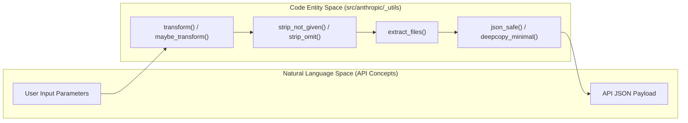
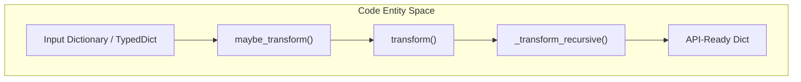
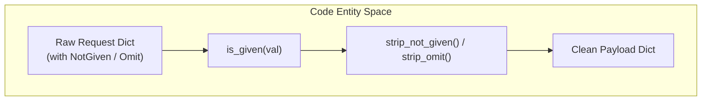
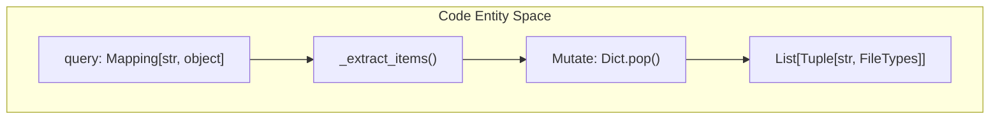

<!-- source: DeepWiki mcp.deepwiki.com · repo anthropics/anthropic-sdk-python · page 9.1 Data Transformation Pipeline · fetched 2026-10-26 -->

# Data Transformation Pipeline

<details>
<summary>Relevant source files</summary>

The following files were used as context for generating this wiki page:

- [src/anthropic/_compat.py](src/anthropic/_compat.py)
- [src/anthropic/_models.py](src/anthropic/_models.py)
- [src/anthropic/_utils/__init__.py](src/anthropic/_utils/__init__.py)
- [src/anthropic/_utils/_reflection.py](src/anthropic/_utils/_reflection.py)
- [src/anthropic/_utils/_sync.py](src/anthropic/_utils/_sync.py)
- [src/anthropic/_utils/_typing.py](src/anthropic/_utils/_typing.py)
- [src/anthropic/_utils/_utils.py](src/anthropic/_utils/_utils.py)
- [tests/test_models.py](tests/test_models.py)

</details>


## Purpose and Scope

This document details the data transformation pipeline that converts user-provided Python dictionaries, models, and parameters into API-compatible request payloads. The pipeline handles property aliasing, format specifications, optional value handling via sentinels (`NotGiven` and `Omit`), recursive JSON safety formatting (`json_safe`), structural minimization (`deepcopy_minimal`), and multipart file extraction (`extract_files`). This transformation occurs before HTTP request construction and after model serialization.

For type validation and model construction, see [BaseModel and Type Construction](8.1). For HTTP request processing, see [Request Lifecycle and Error Handling](4.5).

Sources: `[src/anthropic/_utils/__init__.py:1-70]`, `[src/anthropic/_utils/_utils.py:1-156]`

## Overview

The data transformation pipeline consists of specialized utility functions and methods that prepare user data for transmission to the Anthropic API while preserving type safety and handling optional fields.

Title: Data Preparation Flow bridging Natural Language and Code

Sources: `[src/anthropic/_utils/__init__.py:1-70]`, `[src/anthropic/_utils/_utils.py:37-156]`

## Transformation Functions: `transform()` and `maybe_transform()`

The SDK uses transformation functions to normalize request parameters before serialization. 

- **`transform()`**: Recursively processes a dictionary or model instance, applying field aliasing and formatting rules.
- **`maybe_transform()`**: Conditionally applies `transform()` only if the provided value is present (i.e., not `None`, `NotGiven`, or `Omit`).

Title: Transformation Mapping Code Entities

Sources: `[src/anthropic/_utils/__init__.py:1-70]`, `[src/anthropic/_models.py:56-70]`

## Sentinel Stripping: `strip_not_given()` and `strip_omit()`

Optional parameters in request builders often default to sentinel values like `NotGiven()` or `Omit()`. These sentinels distinguish between "parameter omitted entirely" and "parameter explicitly set to `None`".

### Sentinel Functions

- **`strip_not_given()`**: Removes keys associated with `NotGiven` instances from dictionaries `[src/anthropic/_utils/__init__.py:27-27]()`.
- **`strip_omit()`**: Removes keys associated with `Omit` instances from dictionaries `[src/anthropic/_utils/__init__.py:14-14]()`.
- **`is_given()`**: A type guard checking whether an object is neither `NotGiven` nor `Omit` `[src/anthropic/_utils/_utils.py:156-157]()`.

```python
def is_given(obj: _T | NotGiven | Omit) -> TypeGuard[_T]:
    return not isinstance(obj, NotGiven) and not isinstance(obj, Omit)
```
`[src/anthropic/_utils/_utils.py:156-157]()`

Title: Sentinel Stripping Pipeline

Sources: `[src/anthropic/_utils/__init__.py:14-27]`, `[src/anthropic/_utils/_utils.py:156-157]`

## Utility Transformations: `json_safe()` and `deepcopy_minimal()`

Before final encoding or transport, data structures undergo normalization to ensure JSON compatibility and memory efficiency.

- **`json_safe()`**: Recursively traverses dictionaries, lists, and other containers to convert non-JSON-native types (such as `datetime` and `date`) into ISO 8601 strings or serialized primitives `[src/anthropic/_utils/__init__.py:10-10]()`.
- **`deepcopy_minimal()`**: Performs lightweight cloning of request data structures, avoiding full deepcopy overhead where possible while ensuring request mutations do not leak.

Sources: `[src/anthropic/_utils/__init__.py:1-70]`, `[src/anthropic/_utils/_utils.py:1-207]`

## File Extraction and Multipart Handling (`extract_files()`)

When requests contain binary file attachments, the `extract_files()` function extracts file content from nested dictionaries based on predefined schema paths, preparing them for multipart form-data serialization `[src/anthropic/_utils/_utils.py:37-58]()`.

### File Extraction Function

```python
def extract_files(
    query: Mapping[str, object],
    *,
    paths: Sequence[Sequence[str]],
    array_format: ArrayFormat = "brackets",
) -> list[tuple[str, FileTypes]]
```
`[src/anthropic/_utils/_utils.py:37-44]()`

Title: File Extraction Process

Sources: `[src/anthropic/_utils/_utils.py:37-154]`

## Runtime Type Guards and Introspection

The transformation pipeline relies heavily on runtime type guards defined in `_utils.py` and type introspection helpers in `_typing.py` `[src/anthropic/_utils/_utils.py:170-205]`, `[src/anthropic/_utils/_typing.py:1-80]`.

| Utility Function | Module | Purpose |
|------------------|--------|---------|
| `is_dict(obj)` | `_utils.py` | Type guard for `dict` instances `[src/anthropic/_utils/_utils.py:194-195]()` |
| `is_list(obj)` | `_utils.py` | Type guard for `list` instances `[src/anthropic/_utils/_utils.py:198-199]()` |
| `is_mapping(obj)` | `_utils.py` | Type guard for `Mapping` objects `[src/anthropic/_utils/_utils.py:186-187]()` |
| `is_sequence(obj)` | `_utils.py` | Type guard for `Sequence` objects `[src/anthropic/_utils/_utils.py:178-179]()` |
| `strip_annotated_type(typ)` | `_typing.py` | Recursively unwraps `Annotated` and `Required` wrappers `[src/anthropic/_utils/_typing.py:75-80]()` |
| `is_union_type(typ)` | `_typing.py` | Identifies `Union` or `Optional` types `[src/anthropic/_utils/_typing.py:40-41]()` |

Sources: `[src/anthropic/_utils/_utils.py:170-205]`, `[src/anthropic/_utils/_typing.py:1-80]`

---

