# Page: Overview

# Overview

<details>
<summary>Relevant source files</summary>

The following files were used as context for generating this wiki page:

- [.release-please-manifest.json](.release-please-manifest.json)
- [.stats.yml](.stats.yml)
- [CHANGELOG.md](CHANGELOG.md)
- [CONTRIBUTING.md](CONTRIBUTING.md)
- [README.md](README.md)
- [api.md](api.md)
- [pyproject.toml](pyproject.toml)
- [requirements-dev.lock](requirements-dev.lock)
- [scripts/mock-spec.json.gz](scripts/mock-spec.json.gz)
- [scripts/utils/ruffen-docs.py](scripts/utils/ruffen-docs.py)
- [src/anthropic/__init__.py](src/anthropic/__init__.py)
- [src/anthropic/_base_client.py](src/anthropic/_base_client.py)
- [src/anthropic/_client.py](src/anthropic/_client.py)
- [src/anthropic/_constants.py](src/anthropic/_constants.py)
- [src/anthropic/_types.py](src/anthropic/_types.py)
- [src/anthropic/_version.py](src/anthropic/_version.py)
- [src/anthropic/types/__init__.py](src/anthropic/types/__init__.py)
- [src/anthropic/types/anthropic_beta_param.py](src/anthropic/types/anthropic_beta_param.py)
- [src/anthropic/types/beta/__init__.py](src/anthropic/types/beta/__init__.py)
- [tests/test_client.py](tests/test_client.py)
- [uv.lock](uv.lock)

</details>


## Purpose and Scope

The Anthropic Python SDK is the official client library for accessing the Claude AI API from Python applications. It provides type-safe, synchronous, and asynchronous access to Claude models, structured outputs, streaming responses, tool execution systems, and administrative APIs. The SDK requires Python 3.10+ and maintains full compatibility with both Pydantic v1 and v2 via an abstraction layer [pyproject.toml:22](), [src/anthropic/_compat.py:1-69]().

**Key Features:**
- Synchronous (`Anthropic`) and asynchronous (`AsyncAnthropic`) clients [src/anthropic/_client.py:132-524]()
- Server-sent event (SSE) streaming for real-time response generation [src/anthropic/_streaming.py:24-486]()
- Comprehensive type definitions using `TypedDict` for requests and Pydantic for validation [src/anthropic/types/__init__.py:1-210]()
- Automatic retry logic with exponential backoff for transient HTTP errors [src/anthropic/_base_client.py:772-880]()
- Cloud provider integrations (Google Vertex AI, AWS Bedrock, and Azure AI Foundry) [src/anthropic/__init__.py:103-107]()
- Native OpenTelemetry tracing support (`open_telemetry` client option and `ANTHROPIC_OPEN_TELEMETRY` environment variables) [README.md:47-78]()
- Beta API access for experimental features including Managed Agents, Model Context Protocol (MCP), and Extended Thinking [src/anthropic/resources/beta/beta.py:92-220]()

Sources: [README.md:1-50](), [src/anthropic/_client.py:132-524](), [src/anthropic/_base_client.py:368-756](), [pyproject.toml:22-31]()

## High-Level Architecture

The SDK follows a layered architecture enforcing strict separation of concerns between public API client classes, core HTTP communication infrastructure, request building pipelines, data models, and helper utilities.

### SDK Component Overview

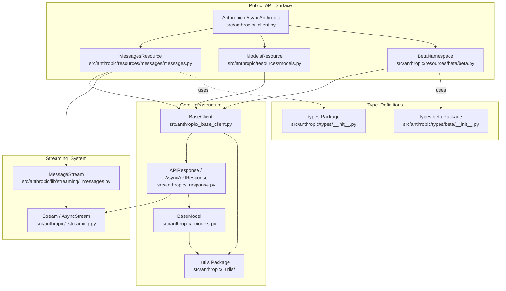

Sources: [src/anthropic/_client.py:53-291](), [src/anthropic/_base_client.py:368-756](), [src/anthropic/_models.py:144-397]()

## Client Hierarchy

The SDK provides multiple client classes inheriting from shared foundational base classes in `_base_client.py` [src/anthropic/_base_client.py:313-446](). Authentication logic supports API keys, environment variables, credentials provider chains, and cloud-specific signing mechanisms [src/anthropic/_client.py:177-205]().

### Client Classes and Inheritance

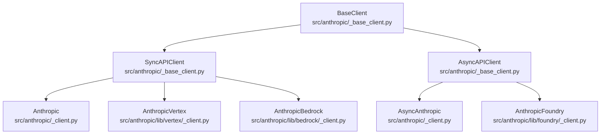

| Client Class | Base Class | Purpose | Authentication Mechanism |
|--------------|------------|---------|--------------------------|
| `Anthropic` | `SyncAPIClient` | Primary synchronous client | API key, auth token, or environment config [src/anthropic/_client.py:134]() |
| `AsyncAnthropic` | `AsyncAPIClient` | Primary asynchronous client | API key, auth token, or environment config [src/anthropic/_client.py:330]() |
| `AnthropicVertex` | `SyncAPIClient` | Google Cloud Vertex AI integration | OAuth 2.0 via `google-auth` [pyproject.toml:42]() |
| `AnthropicBedrock` | `SyncAPIClient` | AWS Bedrock integration | SigV4 request signing via `boto3` [pyproject.toml:44]() |
| `AnthropicFoundry` | `AsyncAPIClient` | Azure AI Foundry / Anthropic platform | Bearer token authentication [src/anthropic/__init__.py:132]() |

Sources: [src/anthropic/_client.py:132-524](), [src/anthropic/_base_client.py:313-446](), [src/anthropic/__init__.py:128-132]()

## API Resource Organization

Resources represent API endpoints and are accessed as properties on client instances. The SDK organizes its capabilities into stable (v1) namespaces and experimental beta namespaces.

### API Resource Structure

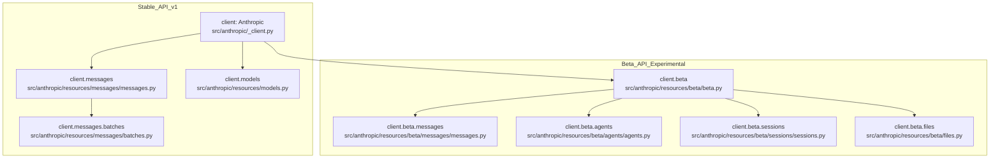

**Stable API Resources:**

| Resource | Access Path | Primary Methods |
|----------|-------------|-----------------|
| `Messages` | `client.messages` | `create()`, `stream()`, `count_tokens()` [src/anthropic/resources/messages/messages.py:35-150]() |
| `Models` | `client.models` | `list()`, `retrieve()` [src/anthropic/resources/models.py:20-80]() |
| `Batches` | `client.messages.batches` | `create()`, `retrieve()`, `list()`, `cancel()` [src/anthropic/resources/messages/batches.py:30-120]() |

**Beta API Resources:**

| Resource | Access Path | Beta Capabilities |
|----------|-------------|-------------------|
| `BetaMessages` | `client.beta.messages` | Context management, computer use, extended thinking [src/anthropic/resources/beta/messages/messages.py:40-200]() |
| `Agents` | `client.beta.agents` | Managed agents system and versions [src/anthropic/resources/beta/agents/agents.py:25-100]() |
| `Sessions` | `client.beta.sessions` | Agent session and thread orchestration [src/anthropic/resources/beta/sessions/sessions.py:20-90]() |
| `Files` | `client.beta.files` | File upload and asset management [src/anthropic/resources/beta/files.py:20-70]() |

Sources: [src/anthropic/resources/beta/beta.py:92-220](), [src/anthropic/resources/messages/messages.py:1-150](), [src/anthropic/resources/models.py:1-80]()

## Type System and Validation

The SDK uses a dual-type system designed for input flexibility and output safety, leveraging Pydantic models for response parsing [src/anthropic/_models.py:144]().

### Type Validation Pipeline

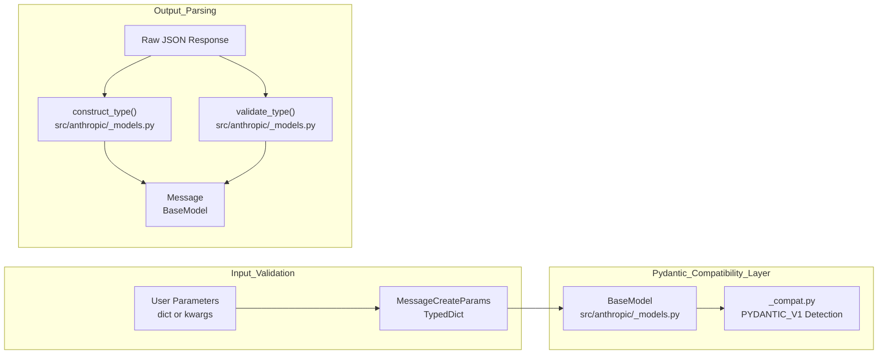

**Input Validation:**
- Request parameters utilize `TypedDict` definitions (e.g., `MessageCreateParams` [src/anthropic/types/message_create_params.py]()).
- Processed via `maybe_transform()` before execution [src/anthropic/_utils/_transform.py:20-80]().

**Output Validation:**
- Response payloads are parsed into Pydantic `BaseModel` subclasses [src/anthropic/_models.py:144]().
- Two validation modes are supported:
  - `construct_type()`: lenient parsing for developer convenience [src/anthropic/_models.py:44-90]()
  - `validate_type()`: strict schema enforcement for production environments [src/anthropic/_models.py:92-142]()

Sources: [src/anthropic/_models.py:44-397](), [src/anthropic/_compat.py:1-69]()

## Request/Response Lifecycle

Every API call traverses a structured execution pipeline managed by `BaseClient`, incorporating retry handlers, timeout configurations, and error mapping [src/anthropic/_base_client.py:490-592]().

### Request Execution Sequence

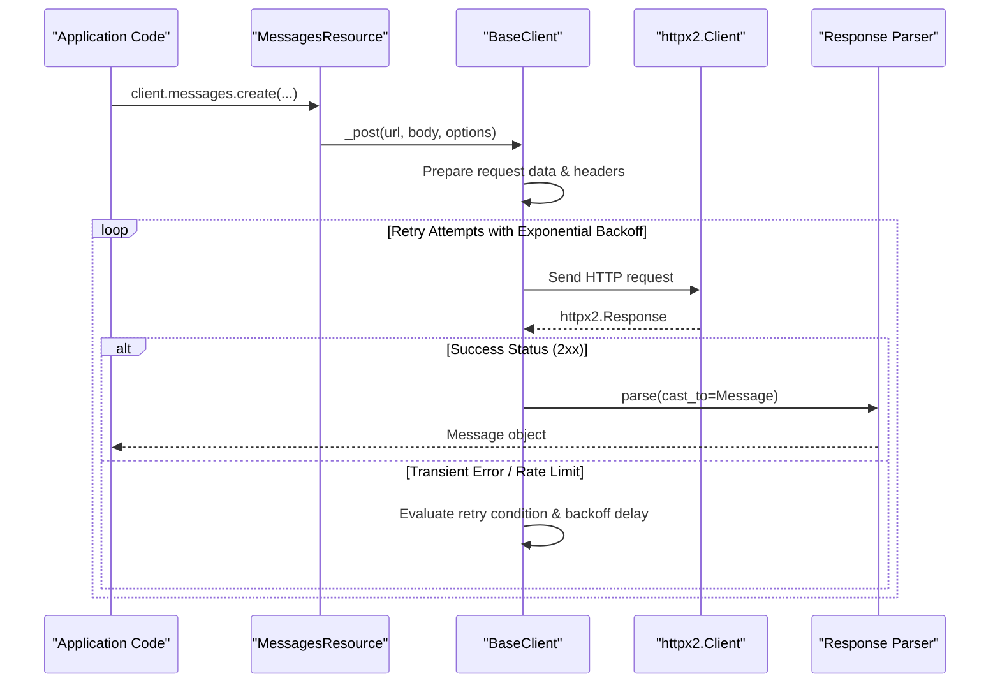

**Key Phases:**
1. **Request Preparation**: Parameters are stripped of unassigned sentinels (`NotGiven`, `Omit`) and serialized via `_qs.py` and `_transform.py` [src/anthropic/_base_client.py:500-550]().
2. **HTTP Transmission**: Executed via `httpx2` client with connection pooling and timeouts [src/anthropic/_base_client.py:600-680]().
3. **Response Wrapping**: Responses are wrapped in `APIResponse` or `AsyncAPIResponse` instances [src/anthropic/_response.py:1-150]().
4. **Error Handling**: Non-2xx status codes trigger specific exception types mapping through `_make_status_error()` [src/anthropic/_exceptions.py:1-120]().

Sources: [src/anthropic/_base_client.py:490-592](), [src/anthropic/_response.py:1-150](), [src/anthropic/_exceptions.py:1-120]()

## Authentication and Configuration

The SDK supports flexible authentication configuration through constructor arguments and environment variables [src/anthropic/_client.py:179-190]().

| Authentication Method | Target Client | Environment Variable |
|-----------------------|---------------|----------------------|
| API Key | `Anthropic` | `ANTHROPIC_API_KEY` [src/anthropic/_client.py:184]() |
| Auth Token | `Anthropic` | `ANTHROPIC_AUTH_TOKEN` [src/anthropic/_client.py:184]() |
| Profile | `Anthropic` | `ANTHROPIC_PROFILE` [src/anthropic/_client.py:186]() |
| Workload Identity | `Anthropic` | Federation configuration variables [src/anthropic/_client.py:188]() |

**Default Client Configurations:**
- `timeout`: Defaults to 10 minutes (`DEFAULT_TIMEOUT`) [src/anthropic/_constants.py:28]()
- `max_retries`: Defaults to `2` retries [src/anthropic/_constants.py:28]()
- `base_url`: Overridable for enterprise proxies or local mock servers [src/anthropic/_client.py:156]()

Sources: [src/anthropic/_client.py:132-210](), [src/anthropic/_constants.py:28]()

---

# Page: Installation and Setup

# Installation and Setup

<details>
<summary>Relevant source files</summary>

The following files were used as context for generating this wiki page:

- [.release-please-manifest.json](.release-please-manifest.json)
- [CHANGELOG.md](CHANGELOG.md)
- [pyproject.toml](pyproject.toml)
- [requirements-dev.lock](requirements-dev.lock)
- [src/anthropic/_version.py](src/anthropic/_version.py)
- [uv.lock](uv.lock)

</details>


This document covers the installation process, dependency management, Python version requirements, optional extras, and environment configuration for the Anthropic Python SDK. For further details on client configuration, refer to [Authentication and Configuration]() and [Client Architecture]().

## Purpose and Scope

The scope of this page is to guide users and contributors through acquiring the `anthropic` package from package registries, configuring target environments, resolving optional extras (such as AWS Bedrock, Google Cloud Vertex AI, aiohttp, MCP, and webhooks), managing development dependencies via `uv`, and ensuring type safety and compatibility with Python runtime and Pydantic requirements.

**Sources:** [pyproject.toml:1-48]()

## System Requirements

The Anthropic Python SDK specifies its runtime requirements in `pyproject.toml`.

| Requirement | Specification |
|-------------|---------------|
| Python Version | `>= 3.10` [pyproject.toml:22]() |
| Operating Systems | OS Independent (macOS, Linux, Windows) [pyproject.toml:31-35]() |
| Package Manager | `pip` (standard) or `uv` (recommended for development) [pyproject.toml:54-56]() |

The SDK is tested against Python versions 3.10 through 3.14. It supports both Pydantic v1 (`>=1.10.0, <2`) and Pydantic v2 (`>=2.0.0, <3`) via internal compatibility abstractions [pyproject.toml:14]().

**Sources:** [pyproject.toml:14-22](), [pyproject.toml:31-38]()

## Installation Methods

### Standard Installation

To install the core SDK using `pip`, execute:

```bash
pip install anthropic
```

This fetches the base package along with mandatory runtime dependencies required by `BaseClient` and related execution pipelines.

### Optional Extras

Optional integrations and features are defined as extra dependency groups in `[project.optional-dependencies]` [pyproject.toml:40-47]():

```bash
# For AWS Bedrock integrations
pip install anthropic[bedrock]

# For Google Cloud Vertex AI
pip install anthropic[vertex]

# For aiohttp transport support
pip install anthropic[aiohttp]

# For Model Context Protocol (MCP) tools
pip install anthropic[mcp]

# For webhook signature verification
pip install anthropic[webhooks]
```

Title: "SDK Extras and Dependency Mapping"
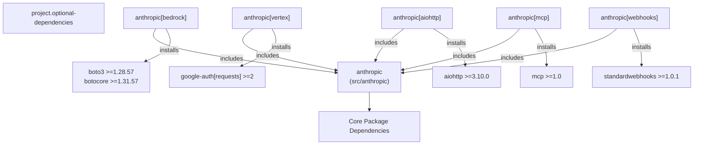
Sources: [pyproject.toml:40-47]()

## Core Dependencies

The core package relies on a strict set of external libraries defined in `pyproject.toml`:

| Package | Version Constraint | Role in Codebase |
|---|---|---|
| `httpx2` | `>=2.0.0, <3` [pyproject.toml:12]() | Underlying HTTP request execution engine |
| `opentelemetry-api` | `>=1.1.0, <2` [pyproject.toml:13]() | Native tracing span creation and propagation [CHANGELOG.md:93-95]() |
| `pydantic` | `>=1.10.0, <3` [pyproject.toml:14]() | Data modeling and response validation via `BaseModel` |
| `typing-extensions` | `>=4.14, <5` [pyproject.toml:15]() | Backported typing constructs (`NotGiven`, `Omit`) |
| `anyio` | `>=4.1.0, <5` [pyproject.toml:16]() | Async concurrency primitives |
| `sniffio` | `>=1, <2` [pyproject.toml:17]() | Async runtime detection |
| `jiter` | `>=0.4.0, <1` [pyproject.toml:18]() | High-performance JSON iteration for streaming deltas |
| `docstring-parser` | `>=0.15, <1` [pyproject.toml:19]() | Tool schema extraction from docstrings |

Sources: [pyproject.toml:11-20]()

## Development Dependency Management and Conflicts

Development workflows utilize `uv` for dependency locking via `uv.lock`. 

Title: "Dependency Resolution and Conflict Management Logic"
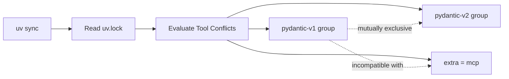
Sources: [pyproject.toml:54-69](), [uv.lock:1-19]()

The `uv.lock` configuration enforces that the `pydantic-v1` group cannot be installed simultaneously with `pydantic-v2`, nor can `pydantic-v1` be combined with the `mcp` extra [pyproject.toml:60-69]().

Sources: [pyproject.toml:54-69](), [uv.lock:13-19]()

## Environment Configuration

In addition to API keys (`ANTHROPIC_API_KEY`, `ANTHROPIC_AUTH_TOKEN`), the SDK respects environment variables governing OpenTelemetry tracing integration (introduced in version 1.14.0) [CHANGELOG.md:93-95]():

- `ANTHROPIC_OPEN_TELEMETRY`: Set to `false` to disable automatic global tracer registration and span export [CHANGELOG.md:93-95]().

Sources: [CHANGELOG.md:93-95]()

---

# Page: Quick Start

# Quick Start

<details>
<summary>Relevant source files</summary>

The following files were used as context for generating this wiki page:

- [CONTRIBUTING.md](CONTRIBUTING.md)
- [README.md](README.md)
- [examples/images.py](examples/images.py)
- [examples/mcp_tool_runner.py](examples/mcp_tool_runner.py)
- [examples/messages.py](examples/messages.py)
- [examples/messages_stream.py](examples/messages_stream.py)
- [examples/thinking.py](examples/thinking.py)
- [examples/thinking_stream.py](examples/thinking_stream.py)
- [examples/tools.py](examples/tools.py)
- [examples/tools_stream.py](examples/tools_stream.py)
- [helpers.md](helpers.md)
- [scripts/utils/ruffen-docs.py](scripts/utils/ruffen-docs.py)
- [src/anthropic/__init__.py](src/anthropic/__init__.py)
- [src/anthropic/_base_client.py](src/anthropic/_base_client.py)
- [src/anthropic/_client.py](src/anthropic/_client.py)
- [src/anthropic/_constants.py](src/anthropic/_constants.py)
- [src/anthropic/_types.py](src/anthropic/_types.py)
- [tests/test_client.py](tests/test_client.py)

</details>


This page provides code examples and technical workflows for getting started with the Anthropic Python SDK (`anthropic`). It covers basic synchronous and asynchronous usage patterns, client initialization, message creation, streaming, and error handling. For installation instructions, see [Installation and Setup](#2). For detailed client configuration and authentication options, see [Authentication and Configuration](#4.4).

Sources: [README.md:1-12](), [src/anthropic/_client.py:134-173]()

---

## Basic Synchronous Usage

### Client Initialization

The `Anthropic` client class is the primary entry point for synchronous operations. The client automatically inspects environment variables such as `ANTHROPIC_API_KEY` when instantiated without explicit credentials [src/anthropic/_client.py:181-182]().

```python
import os
from anthropic import Anthropic

# Initialize client explicitly with API key from environment variable
client = Anthropic(
    api_key=os.environ.get("ANTHROPIC_API_KEY")
)

# Alternatively, rely on automatic environment variable resolution
client = Anthropic()
```

Sources: [README.md:19-25](), [src/anthropic/_client.py:134-182]()

### Client Initialization Flow

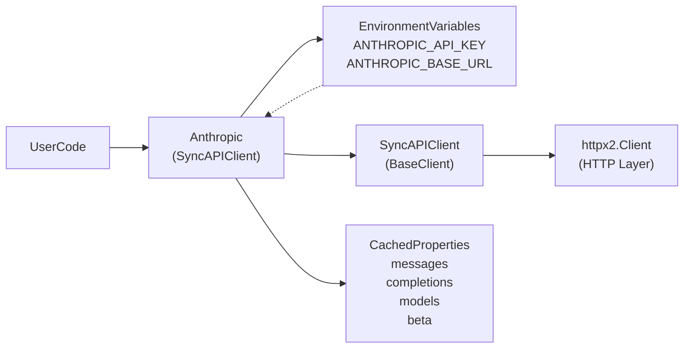

Sources: [src/anthropic/_client.py:134-173](), [src/anthropic/_base_client.py:910-959]()

### Creating a Simple Message

The `messages.create()` method sends a request payload to the Claude API and returns a structured `Message` response model [README.md:27-36]().

```python
message = client.messages.create(
    model="claude-3-5-sonnet-20241022",
    max_tokens=1024,
    messages=[
        {
            "role": "user",
            "content": "Hello, Claude"
        }
    ]
)

print(message.content)
# Output: [TextBlock(type='text', text='Hello! How can I help you today?')]
```

**Key Parameters:**
- `model`: The target Claude model identifier [src/anthropic/types/message_create_params.py:120-125]()
- `max_tokens`: The maximum number of tokens to generate [src/anthropic/types/message_create_params.py:36-49]()
- `messages`: An iterable of message dicts/objects containing `role` and `content` [src/anthropic/types/message_create_params.py:51-118]()

Sources: [README.md:27-38](), [src/anthropic/resources/messages/messages.py:119-147](), [src/anthropic/types/message_create_params.py:35-126]()

### Message Request Flow

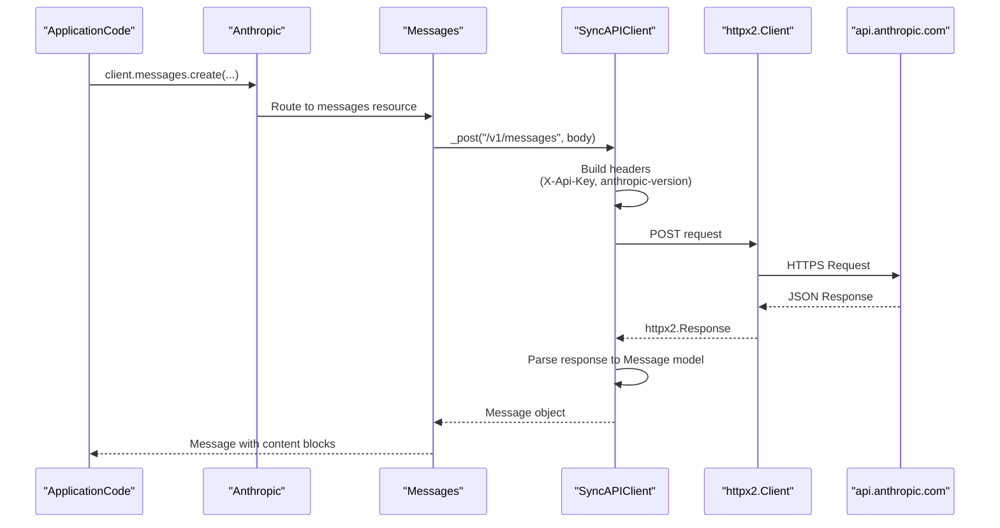

Sources: [src/anthropic/_base_client.py:1002-1083](), [src/anthropic/_client.py:134-173]()

### Streaming Messages

For real-time incremental token generation, use the `stream()` method, which returns a `MessageStreamManager` context manager [helpers.md:21]().

```python
with client.messages.stream(
    model="claude-3-5-sonnet-20241022",
    max_tokens=1024,
    messages=[
        {
            "role": "user",
            "content": "Tell me a short story"
        }
    ]
) as stream:
    for text in stream.text_stream:
        print(text, end="", flush=True)
```

The stream context manager ensures resource cleanup and supports multiple iteration interfaces:
- `text_stream`: Iterates over text delta strings [helpers.md:36-44]()
- Event iteration: Accesses granular event structures like `text` and `content_block_stop` [helpers.md:47-78]()

Sources: [helpers.md:5-33](), [src/anthropic/resources/messages/messages.py:40-61]()

---

## Asynchronous Usage

### Async Client Initialization

The `AsyncAnthropic` class provides non-blocking counterparts to all synchronous methods, utilizing `async/await` syntax [src/anthropic/_client.py:382-445]().

```python
import asyncio
from anthropic import AsyncAnthropic

async def main():
    client = AsyncAnthropic(
        api_key=os.environ.get("ANTHROPIC_API_KEY")
    )
    # Async operations...

asyncio.run(main())
```

Sources: [src/anthropic/_client.py:382-445](), [tests/test_client.py:120-124]()

### Async vs Sync Client Architecture

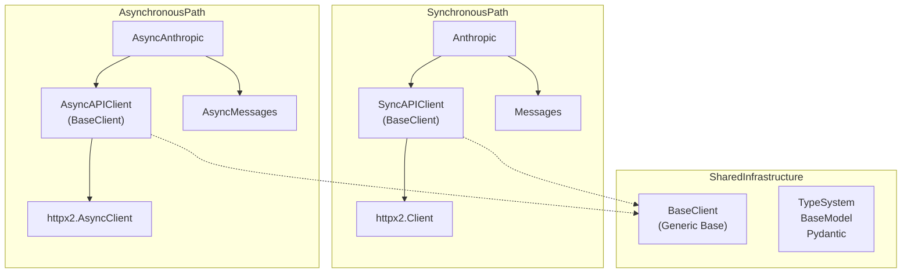

Sources: [src/anthropic/_client.py:134-445](), [src/anthropic/_base_client.py:910-959, 1304-1363]()

### Async Message Creation

When invoking methods on `AsyncAnthropic`, you must `await` the coroutine response:

```python
async def create_message():
    client = AsyncAnthropic()
    
    message = await client.messages.create(
        model="claude-3-5-sonnet-20241022",
        max_tokens=1024,
        messages=[
            {
                "role": "user",
                "content": "What is the capital of France?"
            }
        ]
    )
    print(message.content)
    return message
```

Sources: [src/anthropic/_client.py:382-445](), [tests/test_client.py:120-124]()

### Async Streaming

Asynchronous streaming combines `async with` and `async for` semantics [helpers.md:5-19]():

```python
async def stream_message():
    client = AsyncAnthropic()
    
    async with client.messages.stream(
        model="claude-3-5-sonnet-20241022",
        max_tokens=1024,
        messages=[
            {
                "role": "user",
                "content": "Write a haiku about programming"
            }
        ]
    ) as stream:
        async for event in stream:
            if event.type == "text":
                print(event.text, end="", flush=True)
        
        final_message = await stream.get_final_message()
        print(f"\n\nStop reason: {final_message.stop_reason}")
```

Sources: [helpers.md:5-19](), [helpers.md:55-78]()

---

## Common Patterns

### Context Manager Usage

Both `Anthropic` and `AsyncAnthropic` implement context manager protocols to guarantee underlying connection cleanup [src/anthropic/_base_client.py:973-982, 1355-1363]():

```python
# Synchronous Context Manager
with Anthropic() as client:
    message = client.messages.create(...)

# Asynchronous Context Manager
async with AsyncAnthropic() as client:
    message = await client.messages.create(...)
```

Sources: [src/anthropic/_base_client.py:973-982, 1355-1363]()

### Error Handling

The SDK defines a hierarchy of exceptions inheriting from `AnthropicError` to capture failure states [src/anthropic/_exceptions.py:1-45]():

```python
from anthropic import (
    APIError,
    APIStatusError,
    RateLimitError,
    AuthenticationError
)

try:
    message = client.messages.create(...)
except AuthenticationError as e:
    print(f"Authentication failed: {e}")
except RateLimitError as e:
    print(f"Rate limit hit: {e}")
except APIStatusError as e:
    print(f"API error status {e.status_code}: {e.message}")
```

Sources: [src/anthropic/_exceptions.py:1-45](), [src/anthropic/__init__.py:30-49]()

### Exception Hierarchy

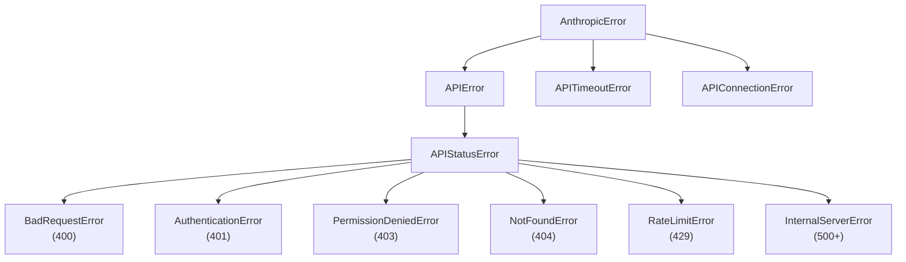

Sources: [src/anthropic/_exceptions.py:1-45](), [src/anthropic/__init__.py:30-49]()

---

## Key Entities Reference

| Entity | Type | Purpose |
|--------|------|---------|
| `Anthropic` | Class | Main synchronous API client [src/anthropic/_client.py:134]() |
| `AsyncAnthropic` | Class | Main asynchronous API client [src/anthropic/_client.py:382]() |
| `client.messages` | Resource | Namespace for messages endpoints [src/anthropic/resources/messages/messages.py:94]() |
| `client.messages.create()` | Method | Execute non-streaming message creation [src/anthropic/resources/messages/messages.py:119]() |
| `client.messages.stream()` | Method | Execute streaming message session [helpers.md:6]() |
| `Message` | Model | Structured API response container [src/anthropic/types/message.py]() |
| `MessageStream` | Class | Stream event accumulator and processor [src/anthropic/_streaming.py:87]() |
| `ANTHROPIC_API_KEY` | Environment Variable | Default credential source [src/anthropic/_client.py:181]() |

Sources: [src/anthropic/_client.py:134-445](), [src/anthropic/__init__.py:8-18]()

---

# Page: Client Architecture

# Client Architecture

<details>
<summary>Relevant source files</summary>

The following files were used as context for generating this wiki page:

- [CONTRIBUTING.md](CONTRIBUTING.md)
- [README.md](README.md)
- [scripts/utils/ruffen-docs.py](scripts/utils/ruffen-docs.py)
- [src/anthropic/__init__.py](src/anthropic/__init__.py)
- [src/anthropic/_base_client.py](src/anthropic/_base_client.py)
- [src/anthropic/_client.py](src/anthropic/_client.py)
- [src/anthropic/_constants.py](src/anthropic/_constants.py)
- [src/anthropic/_resource.py](src/anthropic/_resource.py)
- [src/anthropic/_types.py](src/anthropic/_types.py)
- [tests/test_client.py](tests/test_client.py)

</details>


This page outlines the overall client design of the Anthropic Python SDK, detailing the `BaseClient` foundation, how synchronous and asynchronous implementations share common infrastructure, and how specialized clients manage cloud integrations, authentication, request lifecycles, middleware, and telemetry.

For in-depth technical details, refer to the child pages:
- [Base Client and HTTP Layer](#4.1)
- [Synchronous and Asynchronous Clients](#4.2)
- [Cloud Provider Integrations](#4.3)
- [Authentication and Configuration](#4.4)
- [Request Lifecycle and Error Handling](#4.5)
- [Middleware and Model Fallbacks](#4.6)
- [OpenTelemetry Instrumentation](#4.7)

## Client Class Hierarchy

The SDK implements a layered client architecture where specialized clients inherit common functionality from base classes. This design enables code reuse while supporting multiple deployment targets (standard API, AWS Bedrock, Google Vertex AI, Azure AI Foundry) and execution models (synchronous, asynchronous).

Title: Client Class Hierarchy Diagram
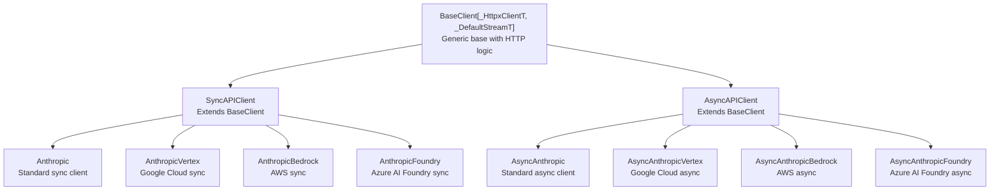

Sources: [src/anthropic/_base_client.py:368-397](), [src/anthropic/_client.py:132-140](), [src/anthropic/__init__.py:128-132]()

## 4.1 Base Client and HTTP Layer

The `BaseClient` foundation handles low-level request building, query serialization via `_qs.py`, timeout handling, and robust retry logic with exponential backoff using `httpx2`. It exposes core methods for processing responses and managing connection pools.

For complete details, see [Base Client and HTTP Layer](#4.1).

Sources: [src/anthropic/_base_client.py:368-836]()

## 4.2 Synchronous and Asynchronous Clients

The `Anthropic` and `AsyncAnthropic` classes provide the primary user-facing interfaces for sync and async contexts respectively, sharing identical resource structures while leveraging sync/async HTTP backends (`httpx2.Client` vs `httpx2.AsyncClient`).

For complete details, see [Synchronous and Asynchronous Clients](#4.2).

Sources: [src/anthropic/_client.py:153-200](), [src/anthropic/_client.py:517-596]()

## 4.3 Cloud Provider Integrations

Optional modules integrate the SDK with platforms like Google Cloud Vertex AI, AWS Bedrock, and Azure AI Foundry. These clients handle SigV4 auth signing, URL rewriting, stream decoding, and platform-specific API restrictions.

For complete details, see [Cloud Provider Integrations](#4.3).

Sources: [src/anthropic/__init__.py:131-142]()

## 4.4 Authentication and Configuration

Clients support flexible configuration via API keys, bearer tokens, environment variables, credential provider chains, caching, workload identity federation, and configuration profiles. The `copy()` method and `with_options()` enable scoped configuration overrides.

For complete details, see [Authentication and Configuration](#4.4).

Sources: [src/anthropic/_client.py:71-116](), [src/anthropic/_client.py:440-492]()

## 4.5 Request Lifecycle and Error Handling

Requests flow from parameter preparation through HTTP execution, automatic retries, and response validation. Status codes are mapped cleanly to specialized exceptions inheriting from `APIStatusError`.

For complete details, see [Request Lifecycle and Error Handling](#4.5).

Sources: [src/anthropic/_base_client.py:490-592](), [src/anthropic/_exceptions.py:100-140]()

## 4.6 Middleware and Model Fallbacks

The middleware chain architecture (`CallNext`, `MiddlewareInput`) supports interception and transformation of requests. Features include refusal-fallback handling (`lib/middleware/_fallbacks.py`) and fallback credit tokens.

For complete details, see [Middleware and Model Fallbacks](#4.6).

Sources: [src/anthropic/_middleware.py:120-126](), [src/anthropic/__init__.py:58-59]()

## 4.7 OpenTelemetry Instrumentation

Native OpenTelemetry tracing support allows tracking API calls via `open_telemetry` options or environment variables. It covers span naming, routing, `gen_ai.*` attributes, content vs. metadata-only modes, and streaming span lifecycles.

For complete details, see [OpenTelemetry Instrumentation](#4.7).

Sources: [README.md:47-78](), [src/anthropic/_types.py:118-190]()

---

# Page: Base Client and HTTP Layer

# Base Client and HTTP Layer

<details>
<summary>Relevant source files</summary>

The following files were used as context for generating this wiki page:

- [CONTRIBUTING.md](CONTRIBUTING.md)
- [README.md](README.md)
- [scripts/mock](scripts/mock)
- [scripts/test](scripts/test)
- [scripts/utils/ruffen-docs.py](scripts/utils/ruffen-docs.py)
- [src/anthropic/__init__.py](src/anthropic/__init__.py)
- [src/anthropic/_base_client.py](src/anthropic/_base_client.py)
- [src/anthropic/_client.py](src/anthropic/_client.py)
- [src/anthropic/_constants.py](src/anthropic/_constants.py)
- [src/anthropic/_qs.py](src/anthropic/_qs.py)
- [src/anthropic/_types.py](src/anthropic/_types.py)
- [tests/test_client.py](tests/test_client.py)
- [tests/test_qs.py](tests/test_qs.py)

</details>


## Purpose and Scope

This document covers the `BaseClient` class and HTTP layer implementation in the Anthropic Python SDK. The `BaseClient` class serves as the foundation for all client variants (synchronous, asynchronous, and cloud provider-specific) by providing core HTTP communication, request building, retry logic, timeout management, query serialization via `_qs.py`, and connection pooling through the `httpx2` library.

For information about the synchronous `Anthropic` and asynchronous `AsyncAnthropic` client classes that extend `BaseClient`, see [Synchronous and Asynchronous Clients](4.2). For cloud-specific implementations (`AnthropicAWS`, `AnthropicFoundry`, etc.), see [Cloud Provider Integrations](4.3). For authentication mechanisms, see [Authentication and Configuration](4.4).

Sources: `[src/anthropic/_base_client.py:1-250]()`, `[src/anthropic/_client.py:1-177]()`

---

## BaseClient Class Architecture

The `BaseClient` class is a generic base class parameterized by HTTP client types and stream types, enabling a single infrastructure to support both synchronous and asynchronous operations.

### Core Responsibilities

| Responsibility | Methods/Properties | Description |
|----------------|-------------------|-------------|
| **HTTP Communication** | `_build_request`, `_prepare_url` | Constructs and prepares HTTP requests using `httpx2` |
| **Request Options** | `_build_headers`, `_serialize_multipartform` | Builds headers, query parameters, and serializes request bodies |
| **Retry Logic** | `_should_retry`, `_calculate_retry_timeout` | Determines retry eligibility and computes backoff timing with jitter |
| **Response Processing** | `_process_response_data`, `_make_status_error` | Parses responses and instantiates typed error objects |
| **Configuration** | `base_url`, `max_retries`, `timeout` | Manages global and request-scoped client configuration |

### BaseClient Class Diagram

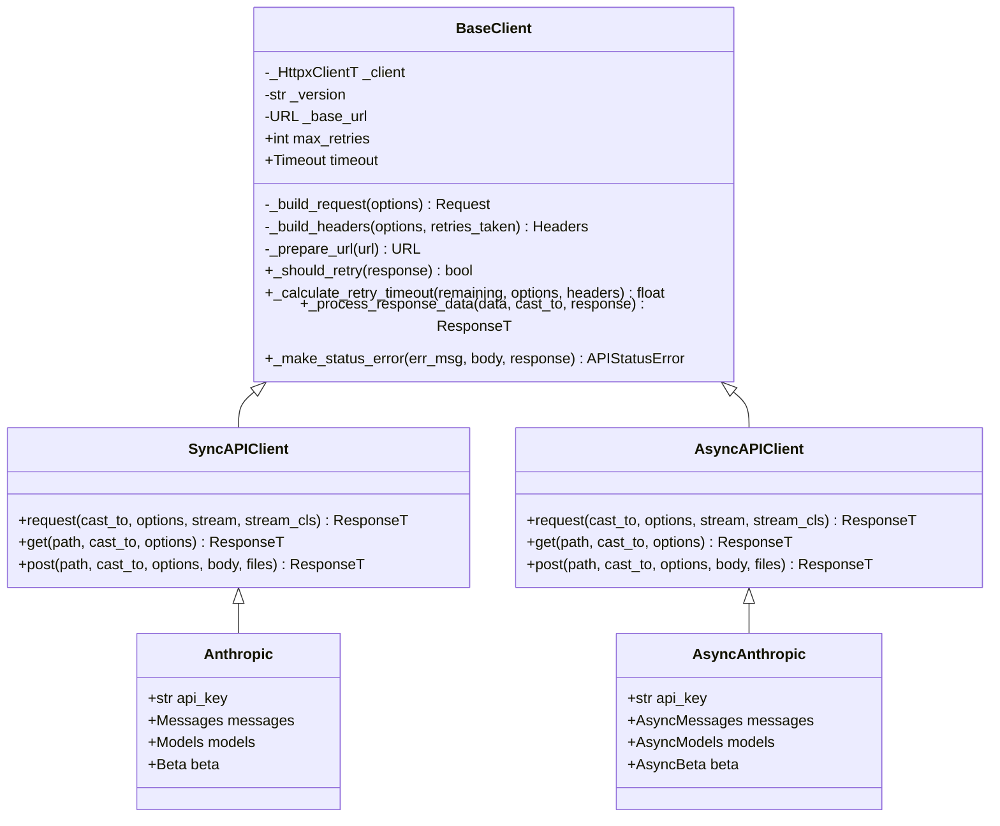

Sources: `[src/anthropic/_base_client.py:1-250]()`, `[src/anthropic/_client.py:132-177]()`

---

## HTTP Client Integration (`httpx2`)

The SDK relies on `httpx2` for underlying HTTP communication. `BaseClient` wraps either `httpx2.Client` (synchronous) or `httpx2.AsyncClient` (asynchronous) stored in the `_client` attribute.

### Default HTTP Client Configuration

The SDK provides `DefaultHttpxClient` and `DefaultAsyncHttpxClient` implementations configured with SDK-specific connection limits, default timeouts, and socket options.

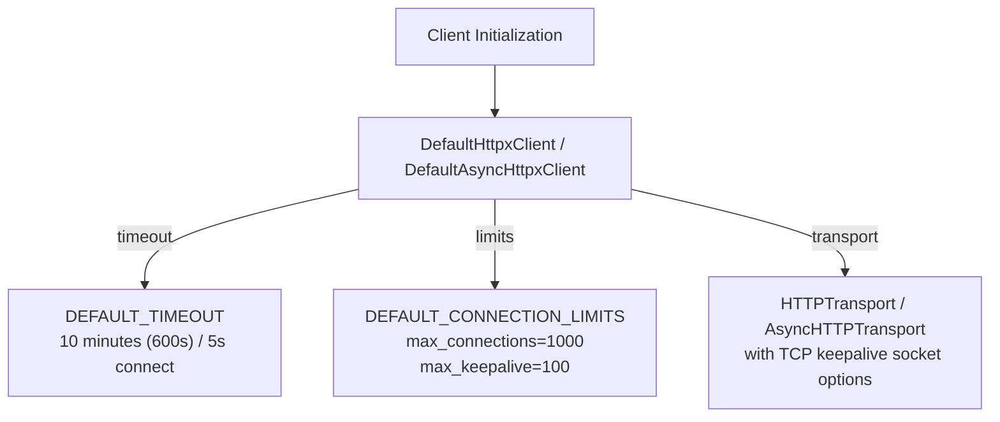

#### Default Configuration Values

| Configuration | Value | Constant |
|---------------|-------|----------|
| Default Timeout | 10 minutes total, 5 seconds connect | `DEFAULT_TIMEOUT` (`[src/anthropic/_constants.py:9-10]()`) |
| Max Connections | 1,000 | `DEFAULT_CONNECTION_LIMITS` (`[src/anthropic/_constants.py:12-12]()`) |
| Max Keepalive Connections | 100 | `DEFAULT_CONNECTION_LIMITS` (`[src/anthropic/_constants.py:12-12]()`) |
| Default Max Retries | 2 | `DEFAULT_MAX_RETRIES` (`[src/anthropic/_constants.py:11-11]()`) |

Sources: `[src/anthropic/_constants.py:1-12]()`, `[src/anthropic/_base_client.py:40-42]()`

---

## Request Building Pipeline & Query Serialization (`_qs.py`)

The request building pipeline transforms high-level parameters into a fully formed `httpx2.Request`. This process involves building headers, merging query parameters via `Querystring`, processing request bodies, and serializing multipart payloads.

### Request Building Flow

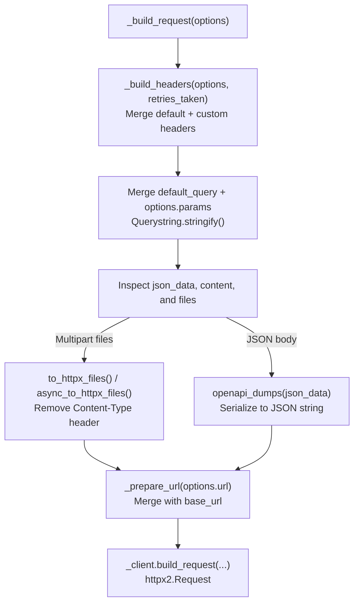

### Query Serialization (`_qs.py`)

Query parameters are serialized using the `Querystring` class located in `src/anthropic/_qs.py`. It supports customizable array and nested parameter formats:

| Format Option | Supported Values | Description |
|---------------|------------------|-------------|
| `array_format` | `"repeat"`, `"comma"`, `"indices"`, `"brackets"` | Controls how list/tuple query parameters are serialized (e.g., `key=a&key=b` vs `key=a,b`). |
| `nested_format` | `"brackets"`, `"dots"` | Controls how nested dictionary keys are structured (e.g., `key[sub]=val` vs `key.sub=val`). |

Primitive values (dates, datetimes, booleans, strings, numbers) are converted to strings via `_primitive_value_to_str()`, with `datetime` and `date` objects automatically formatted to ISO-8601 strings.

Sources: `[src/anthropic/_qs.py:20-132]`, `[src/anthropic/_base_client.py:490-592]()`

---

## Retry Logic with Exponential Backoff

The SDK implements automatic retry handling for transient errors (such as rate limits, timeouts, and server errors) with exponential backoff and jitter.

### Retry Eligibility (`_should_retry`)

A request is eligible for retry if:
1. The response contains an `x-should-retry` header set to `"true"`, or is explicitly suppressed when set to `"false"`.
2. The HTTP status code matches retryable error categories: `408` (Request Timeout), `409` (Conflict), `429` (Rate Limit), or any `5xx` server error (e.g., `500`, `503`, `529`).

### Backoff Calculation Formula

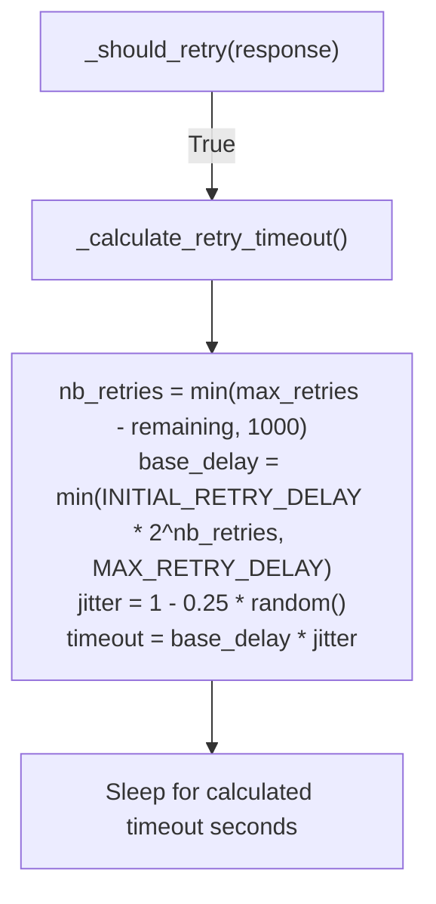

| Constant | Value | Description |
|----------|-------|-------------|
| `INITIAL_RETRY_DELAY` | `0.5` seconds | Starting backoff delay (`[src/anthropic/_constants.py:14-14]()`) |
| `MAX_RETRY_DELAY` | `8.0` seconds | Upper bound for backoff delay (`[src/anthropic/_constants.py:15-15]()`) |
| `DEFAULT_MAX_RETRIES` | `2` | Default number of retry attempts (`[src/anthropic/_constants.py:11-11]()`) |

Sources: `[src/anthropic/_base_client.py:741-832]`, `[src/anthropic/_constants.py:11-15]()`

---

## Timeout Management

Timeouts can be configured globally on the client instance or overridden on a per-request basis via `RequestOptions`.

### Timeout Resolution Hierarchy

1. **Request-Level Timeout**: Specified via `options.timeout` in individual API calls.
2. **Client-Level Timeout**: Configured on client instantiation (`client = Anthropic(timeout=...)`).
3. **SDK Default Timeout**: Falls back to `DEFAULT_TIMEOUT` (`600` seconds total, `5.0` seconds connection timeout).

Granular timeout controls (`httpx2.Timeout`) allow independent configuration of connect, read, write, and pool timeout phases.

Sources: `[src/anthropic/_base_client.py:726-739]`, `[src/anthropic/_constants.py:9-10]()`

---

## Response Processing & Error Handling

Upon receiving an HTTP response, `BaseClient` evaluates status codes and processes response bodies.

### Response Flow

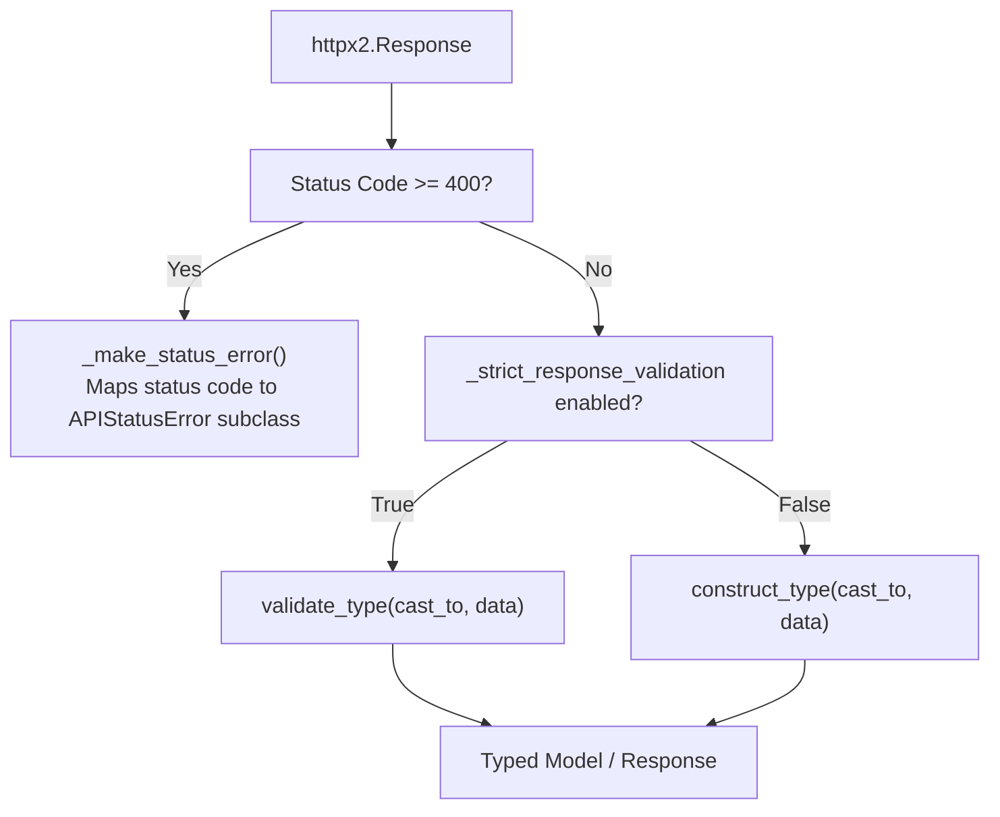

If a response returns a non-2xx status code, `_make_status_error()` maps the status code to appropriate typed exceptions (such as `RateLimitError`, `BadRequestError`, `InternalServerError`, or `APIStatusError`).

Sources: `[src/anthropic/_base_client.py:409-438]`, `[src/anthropic/_base_client.py:644-666]()`

---

# Page: Synchronous and Asynchronous Clients

# Synchronous and Asynchronous Clients

<details>
<summary>Relevant source files</summary>

The following files were used as context for generating this wiki page:

- [CONTRIBUTING.md](CONTRIBUTING.md)
- [README.md](README.md)
- [scripts/utils/ruffen-docs.py](scripts/utils/ruffen-docs.py)
- [src/anthropic/__init__.py](src/anthropic/__init__.py)
- [src/anthropic/_base_client.py](src/anthropic/_base_client.py)
- [src/anthropic/_client.py](src/anthropic/_client.py)
- [src/anthropic/_constants.py](src/anthropic/_constants.py)
- [src/anthropic/_types.py](src/anthropic/_types.py)
- [src/anthropic/resources/__init__.py](src/anthropic/resources/__init__.py)
- [src/anthropic/resources/beta/__init__.py](src/anthropic/resources/beta/__init__.py)
- [src/anthropic/resources/beta/beta.py](src/anthropic/resources/beta/beta.py)
- [tests/test_client.py](tests/test_client.py)

</details>


## Purpose and Scope

This document details the `Anthropic` and `AsyncAnthropic` client classes (`[src/anthropic/_client.py:153]()` and async counterpart), which provide synchronous and asynchronous interfaces respectively for interacting with the Anthropic API. Both clients offer identical API surfaces but differ in their execution model: the synchronous client blocks during I/O operations using `httpx2.Client`, while the asynchronous client uses Python's `async`/`await` syntax with `httpx2.AsyncClient` to enable concurrent operations.

For information about the underlying HTTP layer and base client functionality, see [Base Client and HTTP Layer (4.1)](). For details on cloud platform-specific clients (Vertex, Bedrock), see [Cloud Provider Integrations (4.3)]().

Sources: [README.md:1-40](), [src/anthropic/_client.py:128-130]()

## Client Class Hierarchy

The SDK provides two primary client classes that extend from base implementations defined in `_base_client.py`. These base classes manage the common request lifecycle, retry logic, and connection pooling via `httpx2`.

### Code Entity Space: Client Inheritance

The following diagram maps the logical client roles to their specific code entities and inheritance structure.

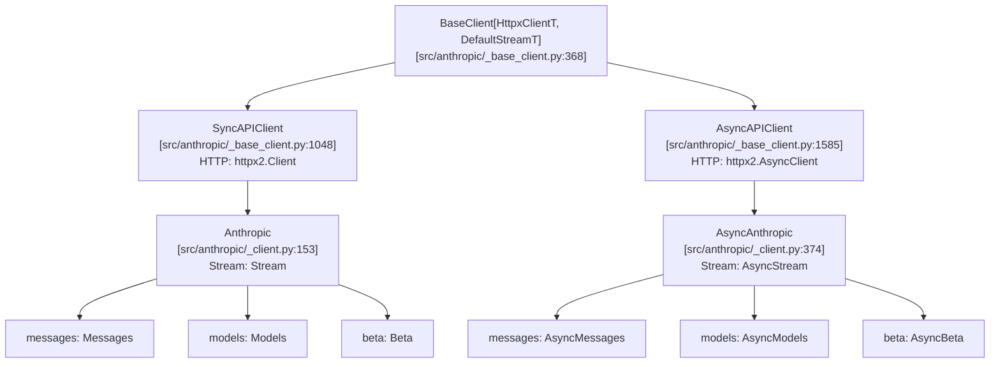

Sources: [src/anthropic/_base_client.py:368-375](), [src/anthropic/_base_client.py:1048-1055](), [src/anthropic/_base_client.py:1585-1592](), [src/anthropic/_client.py:153-170](), [src/anthropic/_client.py:374-390]()

## Synchronous Client: Anthropic

The `Anthropic` class provides a blocking, synchronous interface to the API. All method calls block until the HTTP request completes and the response is received.

### Initialization

The synchronous client is instantiated directly from `[src/anthropic/_client.py:153]()`. It supports various authentication methods including API keys, auth tokens, and workload identity credentials resolved in a specific precedence order.

| Parameter | Type | Default | Description |
|-----------|------|---------|-------------|
| `api_key` | `str \| None` | `ANTHROPIC_API_KEY` env var | API authentication key |
| `auth_token` | `str \| None` | `ANTHROPIC_AUTH_TOKEN` env var | Alternative bearer token auth |
| `base_url` | `str \| httpx2.URL \| None` | `https://api.anthropic.com` | API endpoint URL |
| `timeout` | `float \| Timeout \| None \| NotGiven` | 10 minutes (`DEFAULT_TIMEOUT`) | Request timeout configuration |
| `max_retries` | `int` | 2 (`DEFAULT_MAX_RETRIES`) | Maximum number of retry attempts |
| `default_headers` | `Mapping[str, str] \| None` | `None` | Headers sent with every request |
| `http_client` | `httpx2.Client \| None` | `None` | Custom httpx2 client instance |
| `_strict_response_validation` | `bool` | `False` | Enable strict Pydantic validation |

Sources: [src/anthropic/_client.py:153-195](), [src/anthropic/_constants.py:10-12]()

### Internal Architecture

The client utilizes `httpx2.Client` for network operations and caches resource instances via `cached_property` to avoid repeated allocations.

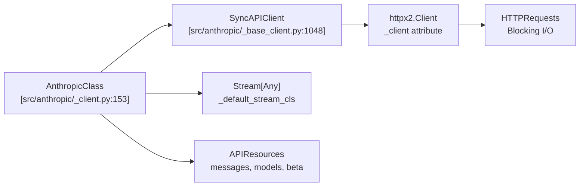

Sources: [src/anthropic/_client.py:153-231](), [src/anthropic/_base_client.py:1048-1060]()

### Resource Access

Resources are lazily initialized as cached properties. This ensures that resource classes like `Messages` or `Models` are only instantiated when first accessed.

Sources: [src/anthropic/_client.py:209-231]()

## Asynchronous Client: AsyncAnthropic

The `AsyncAnthropic` class provides a non-blocking interface using Python's `async`/`await` syntax (`[src/anthropic/_client.py:374]`). It is designed for use in event loops like `asyncio`.

### Initialization

The async client has a nearly identical signature to the sync client but accepts an `httpx2.AsyncClient` for the `http_client` parameter.

| Parameter | Type | Default | Description |
|-----------|------|---------|-------------|
| `api_key` | `str \| None` | `ANTHROPIC_API_KEY` env var | API authentication key |
| `http_client` | `httpx2.AsyncClient \| None` | `None` | Custom httpx2 async client |
| `_token_cache` | `TokenCache \| None` | `not_given` | Cache for identity federation tokens |

Sources: [src/anthropic/_client.py:374-415]()

### Async Library Detection

The async client detects the active async library (e.g., `asyncio` or `trio`) using `get_async_library()` to provide appropriate headers and internal task handling.

The `X-Stainless-Async` header is populated with the detected async library name, while the sync client sets this to `false`.

Sources: [src/anthropic/_client.py:536-544](), [src/anthropic/_utils/_sync.py:19-24]()

## API Parity and Usage Patterns

The SDK maintains strict parity between sync and async clients. For every sync resource, there is a corresponding async resource (e.g., `Messages` vs `AsyncMessages`).

### Synchronous Usage
```python
from anthropic import Anthropic

client = Anthropic()
message = client.messages.create(
    max_tokens=1024,
    messages=[
        {
            "role": "user",
            "content": "Hello",
        }
    ],
    model="claude-3-5-sonnet-20240620",
)
```

### Asynchronous Usage
```python
from anthropic import AsyncAnthropic

client = AsyncAnthropic()
message = await client.messages.create(
    max_tokens=1024,
    messages=[
        {
            "role": "user",
            "content": "Hello",
        }
    ],
    model="claude-3-5-sonnet-20240620",
)
```

Sources: [README.md:23-44](), [src/anthropic/_client.py:209-231](), [src/anthropic/_client.py:449-471]()

## Client Lifecycle and Context Managers

Both clients support context managers to ensure underlying HTTP connections and credential providers are closed correctly (`[src/anthropic/_base_client.py:1027]()` and `[src/anthropic/_base_client.py:1564]`).

- **Sync**: Uses `with Anthropic() as client:`. The `__exit__` method calls `self.close()`.
- **Async**: Uses `async with AsyncAnthropic() as client:`. The `__aexit__` method calls `await self.close()`.

The `close()` method specifically handles releasing resources from credential providers if they expose a `close()` or async `close()` method.

Sources: [src/anthropic/_base_client.py:1027-1037](), [src/anthropic/_base_client.py:1564-1574](), [src/anthropic/_client.py:51-54]()

## Configuration and Copying

Clients are immutable regarding their primary configuration once initialized. To change settings, use the `copy()` or `with_options()` methods (`[src/anthropic/_client.py:293]()`), which create a new instance sharing the same underlying connection pool but with updated parameters.

```python
client = Anthropic(api_key="original")
new_client = client.copy(api_key="new-key", timeout=5.0)
```

The `copy()` method merges existing `default_headers` and `default_query` with any new values provided.

Sources: [src/anthropic/_client.py:293-327](), [tests/test_client.py:168-185]()

## Error Handling Parity

The SDK ensures that both clients behave identically when encountering API errors. The `_make_status_error` method is implemented across client instances to map HTTP status codes to specific exception types like `RateLimitError` or `AuthenticationError`.

### Code Entity Space: Request Execution and Error Mapping

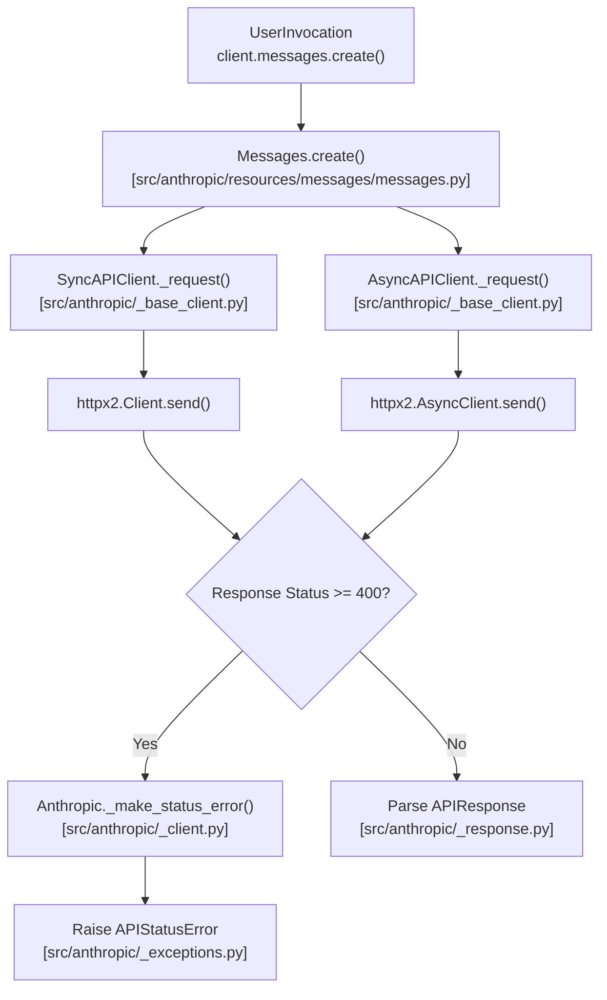

Tests ensure strict parity between these two implementations by comparing the exception types returned for various status codes across synchronous and asynchronous execution paths.

Sources: [tests/test_client.py:115-130](), [src/anthropic/_client.py:346-371](), [src/anthropic/_client.py:586-611]()

---

# Page: Cloud Provider Integrations

# Cloud Provider Integrations

<details>
<summary>Relevant source files</summary>

The following files were used as context for generating this wiki page:

- [examples/azure.py](examples/azure.py)
- [examples/bedrock.py](examples/bedrock.py)
- [examples/google_cloud.py](examples/google_cloud.py)
- [examples/vertex.py](examples/vertex.py)
- [src/anthropic/_utils/_proxy.py](src/anthropic/_utils/_proxy.py)
- [src/anthropic/lib/_extras/_google_auth.py](src/anthropic/lib/_extras/_google_auth.py)
- [src/anthropic/lib/aws/__init__.py](src/anthropic/lib/aws/__init__.py)
- [src/anthropic/lib/aws/_auth.py](src/anthropic/lib/aws/_auth.py)
- [src/anthropic/lib/aws/_client.py](src/anthropic/lib/aws/_client.py)
- [src/anthropic/lib/aws/_credentials.py](src/anthropic/lib/aws/_credentials.py)
- [src/anthropic/lib/bedrock/_auth.py](src/anthropic/lib/bedrock/_auth.py)
- [src/anthropic/lib/bedrock/_client.py](src/anthropic/lib/bedrock/_client.py)
- [src/anthropic/lib/bedrock/_mantle.py](src/anthropic/lib/bedrock/_mantle.py)
- [src/anthropic/lib/bedrock/_stream.py](src/anthropic/lib/bedrock/_stream.py)
- [src/anthropic/lib/bedrock/_stream_decoder.py](src/anthropic/lib/bedrock/_stream_decoder.py)
- [src/anthropic/lib/foundry.md](src/anthropic/lib/foundry.md)
- [src/anthropic/lib/foundry.py](src/anthropic/lib/foundry.py)
- [src/anthropic/lib/google_cloud/README.md](src/anthropic/lib/google_cloud/README.md)
- [src/anthropic/lib/google_cloud/__init__.py](src/anthropic/lib/google_cloud/__init__.py)
- [src/anthropic/lib/google_cloud/_client.py](src/anthropic/lib/google_cloud/_client.py)
- [src/anthropic/lib/vertex/_auth.py](src/anthropic/lib/vertex/_auth.py)
- [src/anthropic/lib/vertex/_client.py](src/anthropic/lib/vertex/_client.py)
- [tests/lib/test_aws.py](tests/lib/test_aws.py)
- [tests/lib/test_aws_auth.py](tests/lib/test_aws_auth.py)
- [tests/lib/test_azure.py](tests/lib/test_azure.py)
- [tests/lib/test_bedrock.py](tests/lib/test_bedrock.py)
- [tests/lib/test_bedrock_mantle.py](tests/lib/test_bedrock_mantle.py)
- [tests/lib/test_google_cloud.py](tests/lib/test_google_cloud.py)
- [tests/lib/test_google_cloud_live.py](tests/lib/test_google_cloud_live.py)
- [tests/lib/test_vertex.py](tests/lib/test_vertex.py)
- [tests/lib/tools/test_mcp_tool.py](tests/lib/tools/test_mcp_tool.py)
- [tests/test_utils/test_proxy.py](tests/test_utils/test_proxy.py)

</details>


This page documents the optional cloud provider integrations available in the Anthropic Python SDK. These integrations enable using Claude models through Google Cloud Vertex AI, Google Cloud client, AWS Bedrock, Bedrock Mantle, AnthropicAWS, and Azure AI Foundry instead of directly connecting to the standard Anthropic API.

---

## Purpose and Scope

The SDK provides specialized client classes that handle cloud provider-specific authentication, request formatting, and endpoint configuration while maintaining compatibility with the standard SDK interface.

The integrations are available via the following extras:
- **`vertex`**: Access Claude through Google Cloud Vertex AI using `AnthropicVertex`.
- **`google_cloud`**: Access Claude through the Google Cloud client using `AnthropicGoogleCloud`.
- **`bedrock`**: Access Claude through AWS Bedrock using `AnthropicBedrock` or `AnthropicBedrockMantle`.
- **`aws`**: Access Claude through AWS external gateway using `AnthropicAWS`.
- **`foundry`**: Access Claude through Azure AI Foundry using `AnthropicFoundry` (included by default).

Sources: [src/anthropic/lib/vertex/_client.py:92-94](), [src/anthropic/lib/bedrock/_client.py:133-136](), [src/anthropic/lib/foundry.py:95-102](), [src/anthropic/lib/aws/_client.py:24-34](), [src/anthropic/lib/google_cloud/_client.py:94-97]()

---

## Installation

Cloud provider integrations are installed as optional extras to keep the core SDK lightweight.

```bash
# Google Cloud Vertex AI
pip install anthropic[vertex]

# Google Cloud Client
pip install anthropic[google_cloud]

# AWS Bedrock / AWS Client
pip install anthropic[bedrock]
```

### Dependencies
| Integration | Extra Name | Required Packages | Purpose |
|-------------|------------|-------------------|---------|
| Vertex AI | `vertex` | `google-auth` | Google Cloud authentication and token management |
| Google Cloud | `google_cloud` | `google-auth` | Application Default Credentials (ADC) and token refreshing |
| Bedrock / AWS | `bedrock` | `boto3`, `botocore` | AWS SigV4 signing and session management |

Sources: [src/anthropic/lib/vertex/_auth.py:21-24](), [src/anthropic/lib/bedrock/_client.py:80-86](), [src/anthropic/lib/google_cloud/_client.py:20-25]()

---

## Architecture and Entity Mapping

The cloud provider clients extend the same `BaseClient` foundation used by the standard `Anthropic` client. They override internal methods like `_prepare_options`, `_prepare_request`, and `_prepare_url` to inject provider-specific logic, auth headers, and endpoint rewriting.

### Entity Relationship Diagram
This diagram bridges natural language concepts to the specific code entities used across the SDK's cloud provider modules.

```mermaid
graph TD
    subgraph "Core SDK"
        BaseClient["BaseClient [src/anthropic/_base_client.py]"]
        SyncAPIClient["SyncAPIClient [src/anthropic/_base_client.py]"]
    end

    subgraph "Vertex AI"
        AnthropicVertex["AnthropicVertex [src/anthropic/lib/vertex/_client.py]"]
        BaseVertexClient["BaseVertexClient [src/anthropic/lib/vertex/_client.py]"]
    end

    subgraph "Google Cloud Client"
        BaseGoogleCloudClient["BaseGoogleCloudClient [src/anthropic/lib/google_cloud/_client.py]"]
        GoogleCredsState["_GoogleCredentialsState [src/anthropic/lib/google_cloud/_client.py]"]
    end

    subgraph "AWS Integrations"
        AnthropicBedrock["AnthropicBedrock [src/anthropic/lib/bedrock/_client.py]"]
        AnthropicBedrockMantle["AnthropicBedrockMantle [src/anthropic/lib/bedrock/_mantle.py]"]
        AnthropicAWS["AnthropicAWS [src/anthropic/lib/aws/_client.py]"]
        AWSEventStreamDecoder["AWSEventStreamDecoder [src/anthropic/lib/bedrock/_stream_decoder.py]"]
    end

    subgraph "Azure Foundry"
        AnthropicFoundry["AnthropicFoundry [src/anthropic/lib/foundry.py]"]
        BaseFoundryClient["BaseFoundryClient [src/anthropic/lib/foundry.py]"]
    end

    AnthropicVertex -- "extends" --> BaseVertexClient
    BaseVertexClient -- "extends" --> BaseClient
    BaseGoogleCloudClient -- "extends" --> BaseClient
    GoogleCredsState -- "supplies token to" --> BaseGoogleCloudClient
    AnthropicBedrock -- "extends" --> BaseClient
    AnthropicBedrockMantle -- "extends" --> BaseClient
    AnthropicAWS -- "extends" --> Anthropic
    AnthropicFoundry -- "extends" --> BaseFoundryClient
    BaseFoundryClient -- "extends" --> BaseClient
    AnthropicBedrock -- "handles SSE" --> AWSEventStreamDecoder
```

Sources: [src/anthropic/lib/vertex/_client.py:38-92](), [src/anthropic/lib/bedrock/_client.py:94-133](), [src/anthropic/lib/foundry.py:41-95](), [src/anthropic/lib/bedrock/_mantle.py:71-114](), [src/anthropic/lib/aws/_client.py:24-34](), [src/anthropic/lib/google_cloud/_client.py:63-106]()

---

## Google Cloud Vertex AI Integration

### Authentication and Project Configuration
`AnthropicVertex` manages Google Cloud credentials via `google-auth`. It resolves `project_id` and `region` from arguments or environment variables [src/anthropic/lib/vertex/_client.py:43-53]().

- **Environment Variables**:
  - `ANTHROPIC_VERTEX_PROJECT_ID`: Google Cloud Project ID [src/anthropic/lib/vertex/_client.py:47-50]().
  - `CLOUD_ML_REGION`: Google Cloud region [src/anthropic/lib/vertex/_client.py:118-120]().
  - `ANTHROPIC_VERTEX_BASE_URL`: Override for the API endpoint [src/anthropic/lib/vertex/_client.py:125-127]().

### Request Lifecycle
1. **Option Preparation**: `_prepare_options` injects project and region options [src/anthropic/lib/vertex/_client.py:160-163]().
2. **Request Preparation**: `_prepare_request` checks for an existing `Authorization` header and populates it via `_ensure_access_token()` if missing [src/anthropic/lib/vertex/_client.py:165-171]().
3. **Status Error Mapping**: `_make_status_error` maps GCP HTTP status codes (such as `400`, `401`, `429`, `503`) to standard Anthropic exception types [src/anthropic/lib/vertex/_client.py:55-91]().

Sources: [src/anthropic/lib/vertex/_client.py:38-176]()

---

## Google Cloud Client Integration (`anthropic.lib.google_cloud`)

The `BaseGoogleCloudClient` manages gateway routing and Application Default Credentials (ADC) for Google Cloud endpoints outside Vertex AI [src/anthropic/lib/google_cloud/_client.py:94-106]().

### Credential Synchronization State
`_GoogleCredentialsState` wraps Google credentials with a thread lock to safely handle lazy loading via ADC and token refreshing across client copies and asynchronous operations [src/anthropic/lib/google_cloud/_client.py:63-91]().

### URL Rewriting
`_prepare_url` dynamically rewrites relative paths based on whether the request targets an organization-level endpoint (`_ORGANIZATION_PATH_PREFIXES`) or workspace-scoped gateway URL template (`DEFAULT_URL_TEMPLATE`) [src/anthropic/lib/google_cloud/_client.py:31-40, 121-140]().

Sources: [src/anthropic/lib/google_cloud/_client.py:63-167]()

---

## AWS Bedrock & Bedrock Mantle Integrations

### Bedrock vs. Bedrock Mantle
The SDK provides two distinct AWS integration paths:
1. **`AnthropicBedrock`**: Uses Bedrock runtime API paths (`/model/{model}/invoke` and `/model/{model}/invoke-with-response-stream`) [src/anthropic/lib/bedrock/_client.py:48-59]().
2. **`AnthropicBedrockMantle`**: Communicates with the Bedrock Mantle service endpoint (`bedrock-mantle.{region}.api.aws/anthropic`) and supports both SigV4 and Bearer token auth (`AWS_BEARER_TOKEN_BEDROCK`, `ANTHROPIC_AWS_API_KEY`) [src/anthropic/lib/bedrock/_mantle.py:40-42, 152-178]().

### Request Transformation and URL Rewriting
```mermaid
sequenceDiagram
    participant Client as AnthropicBedrock
    participant Prep as _prepare_options
    participant AWS as AWS Bedrock API

    Client->>Prep: Transform POST /v1/messages
    Prep-->>Client: URL rewritten to /model/{model}/invoke (or invoke-with-response-stream)
    Client->>AWS: Execute request with AWS SigV4 headers
```

### Restrictions and Formatting
- **Endpoint Transformation**: The Bedrock client intercepts requests to `/v1/messages` and converts them to Bedrock model invocation paths [src/anthropic/lib/bedrock/_client.py:48-60]().
- **Unsupported Features**: The Batch API (`/v1/messages/batches`) and Token Counting (`/v1/messages/count_tokens`) are not supported in standard Bedrock and raise an `AnthropicError` [src/anthropic/lib/bedrock/_client.py:60-65]().

Sources: [src/anthropic/lib/bedrock/_client.py:37-91](), [src/anthropic/lib/bedrock/_mantle.py:71-184]()

---

## Anthropic AWS Integration (`AnthropicAWS`)

`AnthropicAWS` targets AWS external gateways with explicit workspace routing and SigV4 request signing [src/anthropic/lib/aws/_client.py:24-34]().

### Key Behaviors
- **Workspace ID Header**: Injects `anthropic-workspace-id` into request headers [src/anthropic/lib/aws/_client.py:134-137]().
- **SigV4 Signing**: `_prepare_request` computes AWS SigV4 authorization headers over request payloads using `get_auth_headers` with the `aws-external-anthropic` service name [src/anthropic/lib/aws/_client.py:158-179]().
- **Auth Modes**: Supports explicit `api_key` mode or AWS credential-based SigV4 signing based on constructor parameters and `resolve_auth_mode` [src/anthropic/lib/aws/_client.py:65-75]().

Sources: [src/anthropic/lib/aws/_client.py:24-179]()

---

## Azure AI Foundry Integration

### Overview
`AnthropicFoundry` enables communication with Claude models hosted on Azure AI Foundry [src/anthropic/lib/foundry.py:93-102](). It accepts either an explicit `api_key` or an Azure Active Directory token provider (`azure_ad_token_provider`) [src/anthropic/lib/foundry.py:99-100]().

### Configuration Inference
Configuration is automatically inferred from environment variables if not provided explicitly:
- `ANTHROPIC_FOUNDRY_API_KEY` [src/anthropic/lib/foundry.py:150]()
- `ANTHROPIC_FOUNDRY_RESOURCE` [src/anthropic/lib/foundry.py:151]()
- `ANTHROPIC_FOUNDRY_BASE_URL` [src/anthropic/lib/foundry.py:152]()

### API Restrictions
The Foundry client overrides resource accessors to explicitly disable unsupported endpoints like `batches` (`MessagesFoundry`, `BetaFoundryMessages`) [src/anthropic/lib/foundry.py:45-91]().

Sources: [src/anthropic/lib/foundry.py:41-170](), [tests/lib/test_azure.py:11-43]()

---

## API Restrictions and Comparison Matrix

| Feature | Standard API | Vertex AI | Google Cloud | AWS Bedrock | Bedrock Mantle | AWS External | Azure Foundry |
|---------|--------------|-----------|--------------|-------------|----------------|--------------|---------------|
| **Auth Type** | API Key | Google Auth | ADC Token | SigV4 / Token | SigV4 / Token | SigV4 / Key | API Key / AAD |
| **Streaming** | SSE | SSE | SSE | EventStream | SSE | SSE | SSE |
| **Messages** | Supported | Supported | Supported | Supported | Supported | Supported | Supported |
| **Batches** | Supported | Supported | Supported | **Unsupported** | **Unsupported** | Supported | **Unsupported** |
| **Token Count**| Supported | Supported | Supported | **Unsupported** | Supported | Supported | Supported |

Sources: [src/anthropic/lib/vertex/_client.py:38-176](), [src/anthropic/lib/bedrock/_client.py:37-67](), [src/anthropic/lib/foundry.py:41-91](), [src/anthropic/lib/aws/_client.py:24-179](), [src/anthropic/lib/google_cloud/_client.py:63-167]()

---

# Page: Authentication and Configuration

# Authentication and Configuration

<details>
<summary>Relevant source files</summary>

The following files were used as context for generating this wiki page:

- [CONTRIBUTING.md](CONTRIBUTING.md)
- [README.md](README.md)
- [examples/workload_identity.py](examples/workload_identity.py)
- [scripts/utils/ruffen-docs.py](scripts/utils/ruffen-docs.py)
- [src/anthropic/__init__.py](src/anthropic/__init__.py)
- [src/anthropic/_base_client.py](src/anthropic/_base_client.py)
- [src/anthropic/_client.py](src/anthropic/_client.py)
- [src/anthropic/_constants.py](src/anthropic/_constants.py)
- [src/anthropic/_types.py](src/anthropic/_types.py)
- [src/anthropic/lib/credentials/__init__.py](src/anthropic/lib/credentials/__init__.py)
- [src/anthropic/lib/credentials/_auth.py](src/anthropic/lib/credentials/_auth.py)
- [src/anthropic/lib/credentials/_cache.py](src/anthropic/lib/credentials/_cache.py)
- [src/anthropic/lib/credentials/_chain.py](src/anthropic/lib/credentials/_chain.py)
- [src/anthropic/lib/credentials/_close.py](src/anthropic/lib/credentials/_close.py)
- [src/anthropic/lib/credentials/_constants.py](src/anthropic/lib/credentials/_constants.py)
- [src/anthropic/lib/credentials/_providers.py](src/anthropic/lib/credentials/_providers.py)
- [src/anthropic/lib/credentials/_secrets.py](src/anthropic/lib/credentials/_secrets.py)
- [src/anthropic/lib/credentials/_types.py](src/anthropic/lib/credentials/_types.py)
- [src/anthropic/lib/credentials/_workload.py](src/anthropic/lib/credentials/_workload.py)
- [tests/lib/test_credentials.py](tests/lib/test_credentials.py)
- [tests/test_client.py](tests/test_client.py)

</details>


This page documents authentication mechanisms, configuration options, credential management, token caching, workload identity federation, configuration profiles, base URL overrides, and client copying for the Anthropic Python SDK.

## Purpose and Scope

The Anthropic Python SDK provides flexible authentication and configuration capabilities to support direct API keys, static bearer tokens, interactive user OAuth, OIDC Workload Identity Federation (WIF), and cloud provider-specific integrations (such as AWS Bedrock, Google Cloud Vertex AI, and Azure AI Foundry). Configuration state is managed through client initialization parameters, environment variables, profile config files, and dynamic credential provider chains defined in `src/anthropic/_client.py` and `src/anthropic/lib/credentials/`.

Sources: [`src/anthropic/_client.py:1-291`](), [`src/anthropic/lib/credentials/_providers.py:1-185`](), [`src/anthropic/lib/credentials/_workload.py:138-181`]

---

## Direct API Authentication and Environment Variables

The standard `Anthropic` and `AsyncAnthropic` client classes support static API keys and bearer tokens passed via constructor arguments or resolved from environment variables [src/anthropic/_client.py:153-210]().

### Credential Resolution and Shadow Warnings

The function `static_credential_from_env()` inspects the environment for static secrets [src/anthropic/_client.py:100-116]():
* `ANTHROPIC_API_KEY`: Supplies a static API key using the `X-Api-Key` header [src/anthropic/_client.py:107]().
* `ANTHROPIC_AUTH_TOKEN`: Supplies a static bearer token using the `Authorization: Bearer <token>` header [src/anthropic/_client.py:108]().

When both are set, or when a static environment variable shadows auto-discoverable credentials (like config profiles or federation rules), the SDK emits warning logs via `warn_env_api_key_shadows_env_auth_token()` and `warn_env_static_shadows_auto_discovery()` [src/anthropic/_client.py:110-113]().

```mermaid
graph TB
    subgraph "NaturalLanguageSpace"
        EnvVar["Static Environment Variables"]
        ClientInit["Client Constructor Arguments"]
    end

    subgraph "CodeEntitySpace"
        StaticEnv["static_credential_from_env() in src/anthropic/_client.py"]
        ExplicitCheck["has_explicit_credential() in src/anthropic/_client.py"]
        DefaultCreds["default_credentials() in src/anthropic/lib/credentials/_chain.py"]
    end

    EnvVar -->|Reads ANTHROPIC_API_KEY/TOKEN| StaticEnv
    ClientInit -->|Validates Single Pass| ExplicitCheck
    ExplicitCheck -->|If None| DefaultCreds
```

Sources: [`src/anthropic/_client.py:91-116`](), [`tests/lib/test_credentials.py:58-116`]

---

## Credential Provider Chains and Config Profiles

When no explicit static credential is provided, the SDK evaluates a credential provider chain to discover authentication material [src/anthropic/lib/credentials/_chain.py:76-154]().

### Configuration Profiles and Split Storage

The `CredentialsFile` provider loads authentication configuration from named profiles stored under the configuration directory (default `~/.config/anthropic/`, overridable via `ANTHROPIC_CONFIG_DIR`) [src/anthropic/lib/credentials/_providers.py:146-164]():
1. **Config File (`configs/<profile>.json`)**: Non-secret metadata, including the nested `"authentication"` object (discriminated by `"type"`) and top-level fields like `organization_id`, `workspace_id`, and `base_url` [src/anthropic/lib/credentials/_providers.py:151-156]().
2. **Credentials File (`credentials/<profile>.json`)**: Secret material stored with strict `0600` permissions, holding `access_token`, `expires_at`, and `refresh_token` [src/anthropic/lib/credentials/_providers.py:157-159]().

```mermaid
graph TB
    subgraph "NaturalLanguageSpace"
        ConfigDir["Config Directory (~/.config/anthropic)"]
        ProfileSelection["Profile Selection (ANTHROPIC_PROFILE)"]
    end

    subgraph "CodeEntitySpace"
        CredFileClass["CredentialsFile in src/anthropic/lib/credentials/_providers.py"]
        FillEnv["_fill_missing_from_env() in src/anthropic/lib/credentials/_providers.py"]
        DefaultChain["default_credentials() in src/anthropic/lib/credentials/_chain.py"]
    end

    ConfigDir -->|Reads configs/ and credentials/| CredFileClass
    ProfileSelection -->|Resolves Profile| CredFileClass
    CredFileClass -->|Fills Missing Values| FillEnv
    FillEnv --> DefaultChain
```

Sources: [`src/anthropic/lib/credentials/_providers.py:87-184`](), [`tests/lib/test_credentials.py:91-175`]

---

## Workload Identity Federation (WIF) and Token Exchange

The SDK implements OIDC-based Workload Identity Federation using `WorkloadIdentityCredentials`, which exchanges an external OIDC JWT for an Anthropic access token via the RFC 7523 `jwt-bearer` grant (`POST /v1/oauth/token`) [src/anthropic/lib/credentials/_workload.py:138-147]().

### Token Exchange Flow

```mermaid
sequenceDiagram
    participant Client as "Anthropic Client"
    participant Auth as "AccessTokenAuth"
    participant Cache as "TokenCache"
    participant WIF as "WorkloadIdentityCredentials"
    participant TokenEndpoint as "POST /v1/oauth/token"

    Client->>Auth: sync_auth_flow(request)
    Auth->>Cache: get_token()
    Cache->>WIF: __call__(force_refresh=False)
    WIF->>TokenEndpoint: POST jwt-bearer assertion
    TokenEndpoint-->>WIF: AccessToken (access_token, expires_at)
    WIF-->>Cache: AccessToken object
    Cache-->>Auth: token string
    Auth->>Request: Inject Authorization: Bearer <token>
```

The exchange requires specific beta headers (`oauth-2025-04-20` and `oidc-federation-2026-04-01`) and enforces wire size limits (`_MAX_ASSERTION_BYTES` and `_MAX_TOKEN_RESPONSE_BYTES`) to prevent pathologically large payloads or memory exhaustion [src/anthropic/lib/credentials/_workload.py:33-50]().

Sources: [`src/anthropic/lib/credentials/_workload.py:33-181`](), [`examples/workload_identity.py:1-65`]

---

## Token Caching and Authentication Lifecycle

Token providers are wrapped in a `TokenCache` to avoid issuing token exchange requests on every API call [src/anthropic/lib/credentials/_cache.py:1-40](). 

### Expiry and Proactive Refresh
* **Advisory Window**: Proactively refreshes tokens when approaching expiration (managed by constant thresholds in `src/anthropic/lib/credentials/_constants.py`) [src/anthropic/lib/credentials/_constants.py:31-32]().
* **Thread Safety**: Uses internal threading locks to prevent duplicate simultaneous token exchanges across concurrent requests [src/anthropic/lib/credentials/_cache.py:15-50]().
* **`AccessTokenAuth`**: Implements the `httpx2.Auth` protocol, intercepting outgoing requests to dynamically inject `Authorization: Bearer <token>` and required authentication headers [src/anthropic/lib/credentials/_auth.py:65-102]().

Sources: [`src/anthropic/lib/credentials/_cache.py:1-50`](), [`src/anthropic/lib/credentials/_auth.py:65-124`](), [`src/anthropic/lib/credentials/_constants.py:31-32`]

---

## Client Configuration, Base URL Overrides, and client.copy()

Clients can be configured with custom base URLs, timeouts, headers, and retries [src/anthropic/_client.py:164-190]().

### Base URL Overrides
The `base_url` can be passed explicitly or read from environment variables [src/anthropic/_client.py:173](). When using `client.copy()`, the SDK evaluates `_keeps_base_url()` to determine whether token caches can be safely shared across the copied client instance [src/anthropic/_client.py:82-89]().

### client.copy() Usage
The `copy()` method constructs a new client instance while preserving existing underlying connection pools, transport options, and token caches unless explicitly overridden [src/anthropic/_base_client.py:821-884](), [tests/test_client.py:168-185]().

Sources: [`src/anthropic/_client.py:82-89`](), [`src/anthropic/_base_client.py:821-884`](), [`tests/test_client.py:168-185`]

---

## Cloud Provider Integrations

Specialized client subclasses handle cloud provider authentication and endpoint routing:
* **AWS Bedrock (`AnthropicAWS`)**: Uses AWS Signature Version 4 (SigV4) via `boto3.Session`, automatically resolving regions and signing requests [src/anthropic/lib/aws/_client.py:23-164](), [src/anthropic/lib/bedrock/_auth.py:14-72]().
* **Google Vertex AI (`AnthropicVertex`)**: Uses Google Cloud OAuth2 credentials and regional project routing [src/anthropic/lib/vertex/__init__.py:1]().
* **Azure AI Foundry (`AnthropicFoundry`)**: Integrates with Azure token authentication schemes [src/anthropic/lib/foundry/__init__.py:1-30]().

Sources: [`src/anthropic/lib/aws/_client.py:23-164](), [`src/anthropic/lib/bedrock/_auth.py:14-72](), [`src/anthropic/lib/vertex/__init__.py:1-50](), [`src/anthropic/lib/foundry/__init__.py:1-30`]

---

# Page: Request Lifecycle and Error Handling

# Request Lifecycle and Error Handling

<details>
<summary>Relevant source files</summary>

The following files were used as context for generating this wiki page:

- [CONTRIBUTING.md](CONTRIBUTING.md)
- [README.md](README.md)
- [examples/batch_results.py](examples/batch_results.py)
- [scripts/utils/ruffen-docs.py](scripts/utils/ruffen-docs.py)
- [src/anthropic/__init__.py](src/anthropic/__init__.py)
- [src/anthropic/_base_client.py](src/anthropic/_base_client.py)
- [src/anthropic/_client.py](src/anthropic/_client.py)
- [src/anthropic/_constants.py](src/anthropic/_constants.py)
- [src/anthropic/_decoders/jsonl.py](src/anthropic/_decoders/jsonl.py)
- [src/anthropic/_exceptions.py](src/anthropic/_exceptions.py)
- [src/anthropic/_response.py](src/anthropic/_response.py)
- [src/anthropic/_streaming.py](src/anthropic/_streaming.py)
- [src/anthropic/_types.py](src/anthropic/_types.py)
- [src/anthropic/resources/beta/messages/__init__.py](src/anthropic/resources/beta/messages/__init__.py)
- [tests/decoders/test_jsonl.py](tests/decoders/test_jsonl.py)
- [tests/test_client.py](tests/test_client.py)
- [tests/test_response.py](tests/test_response.py)
- [tests/test_streaming.py](tests/test_streaming.py)
- [tests/utils.py](tests/utils.py)

</details>


This page documents the complete lifecycle of HTTP requests in the SDK, tracing execution from parameter preparation through HTTP request handling, exponential backoff retries, and response parsing with status code mapping. For authentication setup, see [Authentication and Configuration](4.4). For streaming responses, see [Streaming](6).

## Overview

All HTTP requests flow through `BaseClient` ([src/anthropic/_base_client.py:1-2833]()), which implements the core request/response lifecycle. The client wraps `httpx2.Client` (or its asynchronous equivalent) and coordinates:

- **Parameter Transformation**: `strip_not_given()` and `transform()` prepare user inputs into `FinalRequestOptions` instances ([src/anthropic/_base_client.py:368-836]()).
- **Request Construction**: `_build_request()` creates an `httpx2.Request` instance complete with serialized bodies, headers, and query parameters ([src/anthropic/_base_client.py:490-592]()).
- **Retry Mechanics**: `_should_retry()` and `_calculate_retry_timeout()` manage exponential backoff and jitter for transient errors ([src/anthropic/_base_client.py:997-1054]()).
- **Response Processing**: `_process_response_data()` handles deserialization and schema validation into Pydantic models via `construct_type()` or `validate_type()` ([src/anthropic/_base_client.py:866-888]()).
- **Error Mapping**: `_make_status_error()` translates HTTP 4xx and 5xx status codes into specific exception classes ([src/anthropic/_exceptions.py:31-180]()).

Sources: [src/anthropic/_base_client.py:368-836](), [src/anthropic/_base_client.py:490-592](), [src/anthropic/_base_client.py:866-888](), [src/anthropic/_base_client.py:997-1054](), [src/anthropic/_exceptions.py:31-180]()

## Complete Request Lifecycle

```mermaid
sequenceDiagram
    participant User
    participant Messages["Messages Resource"]
    participant strip_not_given["strip_not_given()"]
    participant FinalRequestOptions
    participant BaseClient["BaseClient"]
    participant _build_request["_build_request()"]
    participant _build_headers["_build_headers()"]
    participant httpx_Client["httpx2.Client"]
    participant API["Anthropic API"]
    participant _process_response_data["_process_response_data()"]

    User->>Messages: "messages.create(model, max_tokens, messages)"
    Messages->>strip_not_given: "strip_not_given(params)"
    strip_not_given-->>Messages: "cleaned params"
    Messages->>FinalRequestOptions: "FinalRequestOptions(method='post', url='/v1/messages', json_data=...)"
    
    loop "Retry Loop (remaining_retries > 0)"
        FinalRequestOptions->>BaseClient: "request(cast_to, options)"
        BaseClient->>_build_request: "_build_request(options, retries_taken)"
        _build_request->>_build_headers: "_build_headers(options, retries_taken)"
        _build_headers-->>_build_request: "httpx2.Headers"
        _build_request->>httpx_Client: "build_request(method, url, headers, content)"
        httpx_Client-->>_build_request: "httpx2.Request"
        _build_request-->>BaseClient: "request"
        
        BaseClient->>httpx_Client: "send(request)"
        httpx_Client->>API: "POST /v1/messages"
        
        alt "Success (2xx)"
            API-->>httpx_Client: "httpx2.Response(200)"
            httpx_Client-->>BaseClient: "response"
            BaseClient->>_process_response_data: "_process_response_data(data, cast_to, response)"
            _process_response_data->>_process_response_data: "construct_type(Message, data)"
            _process_response_data-->>BaseClient: "Message instance"
            BaseClient-->>User: "Message"
        else "Retryable Error"
            API-->>httpx_Client: "httpx2.Response(429/5xx)"
            httpx_Client-->>BaseClient: "response"
            BaseClient->>BaseClient: "_should_retry(response) → True"
            BaseClient->>BaseClient: "_calculate_retry_timeout(remaining, options, headers)"
            BaseClient->>BaseClient: "time.sleep(timeout)"
        else "Non-Retryable Error"
            API-->>httpx_Client: "httpx2.Response(400/401)"
            httpx_Client-->>BaseClient: "response"
            BaseClient->>BaseClient: "_make_status_error_from_response(response)"
            BaseClient-->>User: "raise BadRequestError/AuthenticationError"
        end
    end
```

**Diagram: Complete Request Lifecycle Execution Flow**

The execution flow comprises five major operational phases:
1. **Parameter Preparation**: Optional parameters carrying `NotGiven` sentinel values are stripped [src/anthropic/_utils/_utils.py:234-262]().
2. **Options Initialization**: Final configuration parameters are wrapped in `FinalRequestOptions` [src/anthropic/_models.py:754-892]().
3. **Request Construction**: `_build_request()` compiles headers via `_build_headers()` and constructs the underlying `httpx2.Request` object [src/anthropic/_base_client.py:440-592]().
4. **Transport Execution**: The request is sent through `httpx2.Client.send()`, with automatic retry evaluations executed on transient failures.
5. **Deserialization**: Successful responses invoke `_process_response_data()` to instantiate typed models via `construct_type()` [src/anthropic/_base_client.py:866-888]().

Sources: [src/anthropic/_base_client.py:440-592](), [src/anthropic/_base_client.py:866-888](), [src/anthropic/_models.py:754-892](), [src/anthropic/_utils/_utils.py:234-262]()

## Parameter Transformation Pipeline

```mermaid
flowchart LR
    UserInput["User Input<br/>TypedDicts, models"]
    strip_not_given["strip_not_given()"]
    transform["transform()"]
    JSONData["json_data dict"]
    
    UserInput --> strip_not_given
    Note1["Remove NotGiven<br/>sentinel values"]
    strip_not_given -.-> Note1
    
    strip_not_given --> transform
    Note2["Apply PropertyInfo:<br/>- Aliases<br/>- Format conversions"]
    transform -.-> Note2
    
    transform --> JSONData
    Note3["Plain dict ready<br/>for JSON serialization"]
    JSONData -.-> Note3
```

**Diagram: Parameter Transformation Code Entities**

| Function | Code Entity / Role | File Location |
|----------|-------------------|---------------|
| `strip_not_given()` | Filters out omitted arguments from user-supplied dictionaries or objects | [src/anthropic/_utils/_utils.py:234-262]() |
| `transform()` | Maps property aliases and types into payload structures | [src/anthropic/lib/_parse/_transform.py:61-61]() |
| `extract_files()` | Recursively traverses data to isolate binary content for multipart uploads | [src/anthropic/_files.py:10-48]() |

Sources: [src/anthropic/_utils/_utils.py:234-262](), [src/anthropic/_files.py:10-48](), [src/anthropic/lib/_parse/_transform.py:61-61]()

## Request Construction and Headers

The `_build_request()` method converts `FinalRequestOptions` into `httpx2.Request` instances [src/anthropic/_base_client.py:490-592]().

### Header Construction

```mermaid
flowchart TB
    _build_headers["_build_headers(options, retries_taken)"]
    
    _build_headers --> default_headers["self.default_headers property"]
    default_headers --> merge1["_merge_mappings()"]
    
    merge1 --> custom_headers["options.headers or {}"]
    custom_headers --> merge2["_merge_mappings()"]
    
    merge2 --> headers_dict["headers_dict"]
    headers_dict --> _validate_headers["_validate_headers(headers_dict, custom_headers)"]
    
    _validate_headers --> httpx_Headers["httpx2.Headers(headers_dict)"]
    
    httpx_Headers --> check_idempotency{"self._idempotency_header<br/>and options.idempotency_key?"}
    check_idempotency -->|Yes| add_idempotency["headers[idempotency_header] = key"]
    check_idempotency -->|No| add_retry_count
    add_idempotency --> add_retry_count
    
    add_retry_count["headers['x-stainless-retry-count'] = str(retries_taken)"]
    add_retry_count --> add_timeout["headers['x-stainless-read-timeout'] = str(timeout)"]
    add_timeout --> return_headers["return headers"]
```

**Diagram: Header Construction Pipeline in _build_headers()**

Headers are synthesized sequentially:
1. Client-level `default_headers` are retrieved.
2. Request-specific `options.headers` are merged.
3. Authentication credentials and SDK metadata headers (`x-stainless-retry-count`, `x-stainless-read-timeout`) are injected [src/anthropic/_base_client.py:440-472]().

Sources: [src/anthropic/_base_client.py:440-472]()

## Retry Logic and Backoff

The client automatically retries eligible requests when transient errors occur.

### Retryable Conditions

The `_should_retry()` method identifies retry eligibility based on HTTP status codes [src/anthropic/_base_client.py:1021-1054]():
- `408`: Request Timeout
- `409`: Conflict
- `429`: Rate Limit Exceeded
- `5xx`: Server Errors (`500`, `502`, `503`, `504`, `529`)

Servers may explicitly dictate retry behavior via the `x-should-retry` header [src/anthropic/_base_client.py:1023-1031]().

### Exponential Backoff Calculation

`_calculate_retry_timeout()` computes backoff intervals using exponential curves with random jitter, respecting any `Retry-After` header values parsed via `_parse_retry_after()` [src/anthropic/_base_client.py:963-1019]().

Sources: [src/anthropic/_base_client.py:963-1019](), [src/anthropic/_base_client.py:1021-1054]()

## Error Handling and Status Code Mapping

When non-2xx status codes are received, the client invokes `_make_status_error_from_response()` to raise specialized exception classes [src/anthropic/_base_client.py:409-429]().

### Exception Hierarchy

All error classes inherit from `AnthropicError` and `APIStatusError` [src/anthropic/_exceptions.py:31-84]().

| Status Code | Exception Class | Source Reference |
|-------------|----------------|------------------|
| `400` | `BadRequestError` | [src/anthropic/_exceptions.py:135-136]() |
| `401` | `AuthenticationError` | [src/anthropic/_exceptions.py:139-140]() |
| `403` | `PermissionDeniedError` | [src/anthropic/_exceptions.py:143-144]() |
| `404` | `NotFoundError` | [src/anthropic/_exceptions.py:147-148]() |
| `409` | `ConflictError` | [src/anthropic/_exceptions.py:151-152]() |
| `413` | `RequestTooLargeError` | [src/anthropic/_exceptions.py:155-156]() |
| `422` | `UnprocessableEntityError` | [src/anthropic/_exceptions.py:159-160]() |
| `429` | `RateLimitError` | [src/anthropic/_exceptions.py:163-164]() |
| `503` | `ServiceUnavailableError` | [src/anthropic/_exceptions.py:167-168]() |
| `504` | `DeadlineExceededError` | [src/anthropic/_exceptions.py:175-176]() |
| `529` | `OverloadedError` | [src/anthropic/_exceptions.py:171-172]() |
| Generic 5xx | `InternalServerError` | [src/anthropic/_exceptions.py:179-180]() |

### Connection and Validation Errors

- `APIConnectionError`: Raised on transport-level failures [src/anthropic/_exceptions.py:95-97]().
- `APITimeoutError`: Raised when requests exceed configured duration bounds [src/anthropic/_exceptions.py:100-106]().
- `APIResponseValidationError`: Raised when response bodies violate expected Pydantic schemas [src/anthropic/_exceptions.py:57-65]().

Sources: [src/anthropic/_base_client.py:409-429](), [src/anthropic/_exceptions.py:31-180]()

---

# Page: Middleware and Model Fallbacks

# Middleware and Model Fallbacks

<details>
<summary>Relevant source files</summary>

The following files were used as context for generating this wiki page:

- [LICENSE-MIT](LICENSE-MIT)
- [MIGRATION.md](MIGRATION.md)
- [src/anthropic/lib/_stainless_helpers.py](src/anthropic/lib/_stainless_helpers.py)
- [src/anthropic/lib/middleware/_fallbacks.py](src/anthropic/lib/middleware/_fallbacks.py)
- [src/anthropic/types/beta/beta_cache_miss_messages_changed.py](src/anthropic/types/beta/beta_cache_miss_messages_changed.py)
- [src/anthropic/types/beta/beta_cache_miss_model_changed.py](src/anthropic/types/beta/beta_cache_miss_model_changed.py)
- [src/anthropic/types/beta/beta_cache_miss_previous_message_not_found.py](src/anthropic/types/beta/beta_cache_miss_previous_message_not_found.py)
- [src/anthropic/types/beta/beta_cache_miss_system_changed.py](src/anthropic/types/beta/beta_cache_miss_system_changed.py)
- [src/anthropic/types/beta/beta_cache_miss_tools_changed.py](src/anthropic/types/beta/beta_cache_miss_tools_changed.py)
- [src/anthropic/types/beta/beta_cache_miss_unavailable.py](src/anthropic/types/beta/beta_cache_miss_unavailable.py)
- [src/anthropic/types/beta/beta_fallback_param.py](src/anthropic/types/beta/beta_fallback_param.py)
- [src/anthropic/types/beta/beta_fallback_refusal_trigger.py](src/anthropic/types/beta/beta_fallback_refusal_trigger.py)
- [src/anthropic/types/beta/beta_refusal_stop_details.py](src/anthropic/types/beta/beta_refusal_stop_details.py)
- [src/anthropic/types/refusal_stop_details.py](src/anthropic/types/refusal_stop_details.py)
- [tests/api_resources/beta/test_output_format_conversion.py](tests/api_resources/beta/test_output_format_conversion.py)
- [tests/api_resources/beta/test_webhooks.py](tests/api_resources/beta/test_webhooks.py)
- [tests/lib/_parse/test_beta_messages.py](tests/lib/_parse/test_beta_messages.py)
- [tests/lib/test_refusal_fallback.py](tests/lib/test_refusal_fallback.py)
- [tests/lib/test_refusal_fallback_streaming.py](tests/lib/test_refusal_fallback_streaming.py)
- [tests/lib/test_stainless_helpers.py](tests/lib/test_stainless_helpers.py)

</details>


This page documents the middleware chain architecture, the refusal-fallback middleware implementation in `src/anthropic/lib/middleware/_fallbacks.py`, fallback credit token handling for model failovers, and Stainless telemetry helper utilities used across the SDK.

---

## 1. Middleware Chain Architecture

The SDK provides an extensible middleware mechanism that intercepts, inspects, and modifies API requests and responses. The architecture relies on functional chaining using `CallNext` / `AsyncCallNext` and `MiddlewareInput` abstractions, allowing middleware components to wrap request execution seamlessly.

Custom middleware inherits from the `Middleware` base class defined in `src/anthropic/_middleware.py` (referenced in `src/anthropic/lib/middleware/_fallbacks.py:30`()), where each middleware intercepts calls to `/v1/messages` or other API routes.

```mermaid
anthropicClientSpace [Anthropic Client Request Lifecycle]
middlewareChain [Middleware Chain Execution]
refusalFallback [BetaRefusalFallbackMiddleware]
httpClientLayer [httpx2 HTTP Dispatch]

anthropicClientSpace --> middlewareChain
middlewareChain --> refusalFallback
refusalFallback --> httpClientLayer

classDef default stroke:#333,stroke-width:2px;
```
*Figure 1: Natural Language to Code Entity Mapping for Request Middleware.*

Sources: `src/anthropic/lib/middleware/_fallbacks.py:30-31`()

---

## 2. Refusal-Fallback Middleware and Fallback State

The refusal-fallback middleware is implemented as `BetaRefusalFallbackMiddleware` in `src/anthropic/lib/middleware/_fallbacks.py:106`(). It handles failed or refused beta `/v1/messages` requests by routing them down a configured fallback chain (`BetaFallbackParam`).

### Sticky Conversation State via `BetaFallbackState`

To prevent unnecessary primary model hops in multi-turn conversations after a fallback model has already accepted a previous turn, the SDK provides `BetaFallbackState` (`src/anthropic/lib/middleware/_fallbacks.py:64`). Wrapping conversation turns in a context manager pins subsequent requests to the successfully resolved fallback index.

```mermaid
flowchart TD
    subgraph "NaturalLanguageSpace"
        A["ConversationTurn"] --> B["StickySessionPinning"]
    end
    subgraph "CodeEntitySpace"
        C["BetaFallbackState.__enter__"] --> D["BetaRefusalFallbackMiddleware"]
        D --> E["BetaFallbackState.index"]
    end
    A --> C
    B --> D
```
*Figure 2: Bridging Conversation State Concepts to Code Entities (`BetaFallbackState`).*

Sources: `src/anthropic/lib/middleware/_fallbacks.py:64-92`(), `tests/lib/test_refusal_fallback.py:156-177`()

---

## 3. Fallback Credit Tokens and Wire Shape

When a primary model refuses a prompt with a policy category (defined in `BetaRefusalStopDetails` via `src/anthropic/types/beta/beta_refusal_stop_details.py:9`), it may issue a `fallback_credit_token` (`src/anthropic/types/beta/beta_refusal_stop_details.py:40`). 

The middleware captures this token and formats it into an object structure with `mode: "best_effort"` (`src/anthropic/lib/middleware/_fallbacks.py:55-61`), ensuring that token redemption failures do not block the fallback request.

| Field Name | Type | Description | Code Pointer |
| :--- | :--- | :--- | :--- |
| `token` | `str` | Opaque code refunding cache-miss costs on fallback models. | `src/anthropic/types/beta/beta_refusal_stop_details.py:40-44`() |
| `mode` | `str` | Transmission mode (`"best_effort"`). | `src/anthropic/lib/middleware/_fallbacks.py:61`() |
| `fallback_has_prefill_claim` | `bool` | Determines if partial assistant output can be prepended. | `src/anthropic/types/beta/beta_refusal_stop_details.py:62-83`() |
| `recommended_model` | `str \| None` | Server-suggested retry target when capacity is exhausted. | `src/anthropic/types/beta/beta_refusal_stop_details.py:85-91`() |

Sources: `src/anthropic/lib/middleware/_fallbacks.py:55-61`(), `src/anthropic/types/beta/beta_refusal_stop_details.py:9-94`()

---

## 4. Stainless Helper Utilities and Telemetry Tagging

The SDK uses Stainless helper headers to track which internal utility, toolset, or helper generated a request. These utilities are defined in `src/anthropic/lib/_stainless_helpers.py:1`().

The primary telemetry header key is `STAINLESS_HELPER_HEADER` (`x-stainless-helper`), which uses an append-don't-clobber merge strategy (`src/anthropic/lib/_stainless_helpers.py:30`).

```mermaid
flowchart TD
    subgraph "NaturalLanguageSpace"
        A["HelperUtilityExecution"] --> B["HeaderTagging"]
    end
    subgraph "CodeEntitySpace"
        C["tag_helper"] --> D["StainlessHelperHeaderValue"]
        D --> E["STAINLESS_HELPER_HEADER"]
    end
    A --> C
    B --> E
```
*Figure 3: Mapping Helper Telemetry to Code Entities (`_stainless_helpers.py`).*

```python
# Example helper header construction pattern
from anthropic.lib._stainless_helpers import helper_header, STAINLESS_HELPER_HEADER

headers = helper_header("BetaToolRunner")
# Produces: {"x-stainless-helper": "BetaToolRunner"}
```

Sources: `src/anthropic/lib/_stainless_helpers.py:1-167`(), `tests/lib/test_stainless_helpers.py:32-35`()

---

# Page: OpenTelemetry Instrumentation

# OpenTelemetry Instrumentation

<details>
<summary>Relevant source files</summary>

The following files were used as context for generating this wiki page:

- [CONTRIBUTING.md](CONTRIBUTING.md)
- [README.md](README.md)
- [examples/web_search.py](examples/web_search.py)
- [examples/web_search_stream.py](examples/web_search_stream.py)
- [scripts/utils/ruffen-docs.py](scripts/utils/ruffen-docs.py)
- [src/anthropic/__init__.py](src/anthropic/__init__.py)
- [src/anthropic/_base_client.py](src/anthropic/_base_client.py)
- [src/anthropic/_client.py](src/anthropic/_client.py)
- [src/anthropic/_constants.py](src/anthropic/_constants.py)
- [src/anthropic/_types.py](src/anthropic/_types.py)
- [src/anthropic/lib/streaming/_beta_messages.py](src/anthropic/lib/streaming/_beta_messages.py)
- [src/anthropic/lib/streaming/_messages.py](src/anthropic/lib/streaming/_messages.py)
- [tests/lib/_parse/test_messages.py](tests/lib/_parse/test_messages.py)
- [tests/lib/streaming/test_beta_messages.py](tests/lib/streaming/test_beta_messages.py)
- [tests/lib/streaming/test_messages.py](tests/lib/streaming/test_messages.py)
- [tests/lib/streaming/test_partial_json.py](tests/lib/streaming/test_partial_json.py)
- [tests/test_client.py](tests/test_client.py)
- [tests/test_open_telemetry.py](tests/test_open_telemetry.py)

</details>


## Purpose and Scope

This page documents the native OpenTelemetry tracing support in the Anthropic Python SDK. It details how API requests and streams are instrumented as OpenTelemetry spans, how configuration is managed via the `open_telemetry` client option and environment variables, how semantic attributes (`gen_ai.*`) and request/response payloads are captured under `metadata_only` vs. `content` modes, and how streaming span lifecycles are coordinated with asynchronous and synchronous stream consumers.

---

## 1. Configuration and Options

The SDK integrates with OpenTelemetry via `opentelemetry-api` without depending on a concrete OpenTelemetry SDK [README.md:47-50](). Tracing can be configured globally via environment variables or explicitly passed per client instance using the `open_telemetry` option dictionary [README.md:75-76]().

### Client Options and Typed Structures

The client configuration structure is defined by `OpenTelemetryOptions` and `OpenTelemetryTraces` in `src/anthropic/_types.py`:

* `tracer_provider`: A custom `TracerProvider` instance [src/anthropic/_types.py:161-163]().
* `propagation`: Controls whether trace context headers are injected into outgoing HTTP requests [src/anthropic/_types.py:164-169]().
* `traces`: Enables/disables spans and configures content modes (`content_mode`, `max_content_bytes`) [src/anthropic/_types.py:118-139]() [src/anthropic/_types.py:171-175]().
* `conversation_id`: Sets the `gen_ai.conversation.id` attribute on spans [src/anthropic/_types.py:177-183]().

```python
from anthropic import Anthropic

# Configure via client option dictionary
client = Anthropic(
    open_telemetry={
        "traces": {"content_mode": "content", "max_content_bytes": 65_536},
        "propagation": True,
    }
)
```[README.md:52-73]()

### Environment Variable Fallbacks

When no `open_telemetry` argument is supplied to the client constructor, the SDK inspects the environment:
* `ANTHROPIC_OPEN_TELEMETRY=false`: Disables span emission.
* `ANTHROPIC_OPEN_TELEMETRY_TRACES_CONTENT_MODE=content`: Switches from metadata-only to full content tracing.
* `ANTHROPIC_OPEN_TELEMETRY_TRACES_MAX_CONTENT_BYTES=<int>`: Sets the payload byte limit.
* `ANTHROPIC_OPEN_TELEMETRY_PROPAGATION=false`: Suppresses trace context header injection.

Sources: [README.md:47-78](), [src/anthropic/_types.py:118-194]()

---

## 2. Configuration Resolution and Initialization Flow

When an `Anthropic` or `AsyncAnthropic` client is instantiated, the `open_telemetry` configuration is resolved via helper utilities in `src/anthropic/_tracing.py` and stored on the client instance.

```mermaid
graph TD
    ClientInit["Anthropic.__init__()"] --> CheckOption{"open_telemetry given?"}
    CheckOption -->|Yes| UseExplicit["Use explicit OpenTelemetryOptions"]
    CheckOption -->|No| ReadEnv["Read ANTHROPIC_OPEN_TELEMETRY* env vars"]
    UseExplicit --> Resolve["resolve_open_telemetry()"]
    ReadEnv --> Resolve
    Resolve --> StoreConfig["Store ResolvedOpenTelemetryOptions on client"]
    StoreConfig --> BaseClientInit["BaseClient initializes Tracer via get_tracer()"]

    sub5["Code Entity Space"]
    classDef code fill:#f9f9f9,stroke:#333,stroke-width:1px;
    class ClientInit,UseExplicit,ReadEnv,Resolve,StoreConfig,BaseClientInit code;
```
Sources: [src/anthropic/_base_client.py:44-94](), [README.md:47-78]()

---

## 3. Span Naming, Routing, and Attributes (`gen_ai.*`)

Each API request executed through `BaseClient` [src/anthropic/_base_client.py]() is wrapped in an OpenTelemetry span managed by `start_api_call_span` and `finish_api_call_span` [src/anthropic/_base_client.py:87-94]() [src/anthropic/lib/_tracing.py:130]().

### Semantic Attributes
Spans capture standard GenAI semantic conventions and SDK-specific telemetry keys:
* `gen_ai.system`: Set to `"anthropic"`.
* `gen_ai.request.model`: The model identifier used in the request.
* `gen_ai.conversation.id`: Bound when `conversation_id` is specified in client options [src/anthropic/_types.py:177-183]().
* Token usage metrics (`gen_ai.response.input_tokens`, `gen_ai.response.output_tokens`).

Sources: [src/anthropic/_base_client.py:87-94](), [src/anthropic/lib/_tracing.py:130]()

---

## 4. Content Modes and Payload Tracing

The SDK supports two distinct tracing modes governed by `content_mode`:

| Mode | Description | Truncation Behavior |
| :--- | :--- | :--- |
| `metadata_only` (Default) | Records headers, timing, status codes, token usage, and model identifiers. Does not record prompt texts or completion contents. | N/A |
| `content` | Captures prompts, system instructions, tool definitions, and response message contents within the span attributes. | Payloads exceeding `max_content_bytes` (default: 750,000 bytes) are truncated, and the span attribute `anthropic.content.truncated` is set to `True`. |

Sources: [src/anthropic/_types.py:118-139](), [README.md:52-76]()

---

## 5. Streaming Span Lifecycles

For streaming requests (`client.messages.create(..., stream=True)` or `client.messages.stream(...)`), spans remain active past the initial HTTP response headers until the stream iterator is fully consumed or closed. 

The integration utilizes `share_message_snapshot` and `withhold_message_snapshot` [src/anthropic/lib/_tracing.py:27]() to attach accumulated message content and final token usage metrics to the OpenTelemetry span upon stream completion.

```mermaid
sequenceDiagram
    participant User as "User Application"
    participant Stream as "MessageStream"
    participant Tracing as "_tracing.py"
    participant Span as "OTel Span"

    User->>Stream: "client.messages.create(stream=True)"
    Stream->>Tracing: "share_message_snapshot(raw_stream, callback)"
    Tracing->>Span: "Start active API call span"
    loop SSE Event Consumption
        Stream->>Stream: "__stream__() -> accumulate_event()"
    end
    Stream->>Tracing: "Stream reaches completion (until_done())"
    Tracing->>Span: "Attach final message snapshot & token usage"
    Tracing->>Span: "finish_api_call_span()"
```
Sources: [src/anthropic/lib/_tracing.py:27](), [src/anthropic/lib/streaming/_messages.py:56]()

---

## 6. Propagation and Headers

By default, the SDK injects W3C trace context or propagator-configured headers into outgoing HTTP requests (`propagation: True`) [src/anthropic/_types.py:164-169](). 

If an application's outer HTTP instrumentation layer (e.g., global `httpx` telemetry or service mesh sidecar) already injects trace headers, setting `propagation: False` prevents duplicate header injection [src/anthropic/_types.py:164-169]() [README.md:63-65]().

Sources: [src/anthropic/_types.py:164-169](), [README.md:63-65]()

---

# Page: API Resources

# API Resources

<details>
<summary>Relevant source files</summary>

The following files were used as context for generating this wiki page:

- [.stats.yml](.stats.yml)
- [api.md](api.md)
- [scripts/mock-spec.json.gz](scripts/mock-spec.json.gz)
- [src/anthropic/resources/__init__.py](src/anthropic/resources/__init__.py)
- [src/anthropic/resources/beta/__init__.py](src/anthropic/resources/beta/__init__.py)
- [src/anthropic/resources/beta/beta.py](src/anthropic/resources/beta/beta.py)
- [src/anthropic/types/__init__.py](src/anthropic/types/__init__.py)
- [src/anthropic/types/anthropic_beta_param.py](src/anthropic/types/anthropic_beta_param.py)
- [src/anthropic/types/beta/__init__.py](src/anthropic/types/beta/__init__.py)

</details>


## Purpose and Scope

This document describes the API Resources layer of the Anthropic Python SDK, which provides a structured interface for accessing the various Anthropic API endpoints. Resources organize related API operations into logical groupings and are accessed through cached properties on the client objects.

As a parent page, this section provides a high-level architectural overview. For deep technical details, parameter specifications, and usage examples, refer to the following child pages:
- [Messages API](#5.1) — Stable `messages.create()` method, content blocks, usage accounting, and non-streaming usage.
- [Beta Messages API](#5.2) — Beta-specific features in `beta.messages.create()` including context management, compaction, MCP servers, and thinking configurations.
- [Prompt Caching and Cache Misses](#5.3) — Prompt caching with `cache_control` ephemeral blocks, TTLs, and cache-miss reason types.
- [Models API](#5.4) — `models.retrieve()` and `models.list()` for querying available Claude models and capabilities.
- [Message Batches](#5.5) — Batch processing with `beta.messages.batches` and `messages.batches`, including JSONL result streaming.
- [Beta Features and Capabilities](#5.6) — Overview of beta-exclusive features like MCP integration, files API, skills API, computer use, and webhooks.
- [Managed Agents](#5.7) — Managed agents system: agents, sessions, threads, environments, vaults, and memory stores.
- [Organization and Admin APIs](#5.8) — Organization-scoped administration including users, workspaces, API keys, rate limits, spend limits, and analytics.

Sources: [src/anthropic/resources/__init__.py:1-101](), [src/anthropic/resources/beta/beta.py:1-195]()

## Resource Organization and Client Namespace

Resources are exposed as cached properties on the `Anthropic` and `AsyncAnthropic` client classes [src/anthropic/resources/__init__.py:1-101](). Each resource encapsulates a set of related API operations with dedicated request parameters and response models.

### Architecture: Natural Language to Code Entity Mapping
The following diagram bridges high-level API domain concepts to their concrete Python resource classes and file paths within the codebase.

```mermaid
graph TB
    subgraph "Natural Language Domain"
        L_Messages["Messages API"]
        L_Models["Models API"]
        L_Files["Files & Skills API"]
        L_Agents["Managed Agents System"]
        L_Admin["Organization & Admin"]
    end

    subgraph "Code Entity Space [src/anthropic/resources/]"
        C_Messages["Messages <br/>[src/anthropic/resources/messages.py]"]
        C_Models["Models <br/>[src/anthropic/resources/models.py]"]
        C_Files["Files & Skills <br/>[src/anthropic/resources/files.py]"]
        C_Beta["Beta Namespace <br/>[src/anthropic/resources/beta/beta.py]"]
        C_Org["Organization <br/>[src/anthropic/resources/organization.py]"]
    end

    L_Messages --> C_Messages
    L_Models --> C_Models
    L_Files --> C_Files
    L_Agents --> C_Beta
    L_Admin --> C_Org
```
Sources: [src/anthropic/resources/__init__.py:1-101](), [src/anthropic/resources/beta/beta.py:130-194]()

### Configured Endpoints and OpenAPI Specification

The SDK supports a comprehensive set of API endpoints generated from the underlying OpenAPI specifications. Currently, the SDK is configured for **333** endpoints [.stats.yml:1]().

Sources: [.stats.yml:1]()

---

## Major Resource Groups Overview

### 5.1 Messages API
The stable Messages resource (`client.messages`) manages primary conversational interactions with Claude. For details, see [Messages API](#5.1).

Sources: [src/anthropic/resources/messages.py:1-50]()

### 5.2 Beta Messages API
The beta messages resource (`client.beta.messages`) exposes advanced experimental capabilities such as extended thinking configurations, context compaction, and MCP server integrations. For details, see [Beta Messages API](#5.2).

Sources: [src/anthropic/resources/beta/messages/messages.py:1-60]()

### 5.3 Prompt Caching and Cache Misses
Prompt caching enables efficient reuse of large context windows using `cache_control` ephemeral blocks. For details, see [Prompt Caching and Cache Misses](#5.3).

Sources: [src/anthropic/types/anthropic_beta_param.py:1-64]()

### 5.4 Models API
The models resource (`client.models` and `client.beta.models`) allows querying available Claude model metadata and capabilities. For details, see [Models API](#5.4).

Sources: [src/anthropic/resources/models.py:1-40](), [src/anthropic/resources/beta/models.py:1-40]()

### 5.5 Message Batches
Batch processing (`client.messages.batches` and `client.beta.messages.batches`) handles asynchronous bulk requests with JSONL result streaming. For details, see [Message Batches](#5.5).

Sources: [src/anthropic/resources/messages/batches.py:1-50]()

### 5.6 Beta Features and Capabilities
The beta namespace bundles experimental features including MCP client tunnels, file uploads, skills, computer use tools, webhooks, and user profiles. For details, see [Beta Features and Capabilities](#5.6).

Sources: [src/anthropic/resources/beta/beta.py:130-194](), [src/anthropic/types/anthropic_beta_param.py:1-64]()

### 5.7 Managed Agents
The managed agents system provides environments, sessions, threads, vaults, memory stores, and deployments for autonomous, long-running agentic tasks. For details, see [Managed Agents](#5.7).

Sources: [src/anthropic/resources/beta/agents/agents.py:1-50](), [src/anthropic/resources/beta/sessions/sessions.py:1-50]()

### 5.8 Organization and Admin APIs
The organization administration resources (`client.organization` and `client.beta.organization`) manage users, invites, service accounts, workspaces, API keys, federation, role-based access control (RBAC), rate limits, spend limits, and analytics reporting. For details, see [Organization and Admin APIs](#5.8).

Sources: [src/anthropic/resources/organization.py:1-50](), [src/anthropic/resources/beta/organization/organization.py:1-50]()

---

# Page: Messages API

# Messages API

<details>
<summary>Relevant source files</summary>

The following files were used as context for generating this wiki page:

- [src/anthropic/resources/beta/messages/messages.py](src/anthropic/resources/beta/messages/messages.py)
- [src/anthropic/resources/messages/messages.py](src/anthropic/resources/messages/messages.py)
- [src/anthropic/types/beta/beta_message.py](src/anthropic/types/beta/beta_message.py)
- [src/anthropic/types/beta/beta_raw_message_delta_event.py](src/anthropic/types/beta/beta_raw_message_delta_event.py)
- [src/anthropic/types/beta/beta_stop_reason.py](src/anthropic/types/beta/beta_stop_reason.py)
- [src/anthropic/types/beta/beta_tool_result_block_param.py](src/anthropic/types/beta/beta_tool_result_block_param.py)
- [src/anthropic/types/beta/message_count_tokens_params.py](src/anthropic/types/beta/message_count_tokens_params.py)
- [src/anthropic/types/beta/message_create_params.py](src/anthropic/types/beta/message_create_params.py)
- [src/anthropic/types/citation_search_result_location_param.py](src/anthropic/types/citation_search_result_location_param.py)
- [src/anthropic/types/citations_delta.py](src/anthropic/types/citations_delta.py)
- [src/anthropic/types/citations_search_result_location.py](src/anthropic/types/citations_search_result_location.py)
- [src/anthropic/types/content_block.py](src/anthropic/types/content_block.py)
- [src/anthropic/types/content_block_delta_event.py](src/anthropic/types/content_block_delta_event.py)
- [src/anthropic/types/content_block_param.py](src/anthropic/types/content_block_param.py)
- [src/anthropic/types/content_block_start_event.py](src/anthropic/types/content_block_start_event.py)
- [src/anthropic/types/content_block_stop_event.py](src/anthropic/types/content_block_stop_event.py)
- [src/anthropic/types/document_block_param.py](src/anthropic/types/document_block_param.py)
- [src/anthropic/types/image_block_param.py](src/anthropic/types/image_block_param.py)
- [src/anthropic/types/message.py](src/anthropic/types/message.py)
- [src/anthropic/types/message_count_tokens_params.py](src/anthropic/types/message_count_tokens_params.py)
- [src/anthropic/types/message_create_params.py](src/anthropic/types/message_create_params.py)
- [src/anthropic/types/message_delta_event.py](src/anthropic/types/message_delta_event.py)
- [src/anthropic/types/message_delta_usage.py](src/anthropic/types/message_delta_usage.py)
- [src/anthropic/types/message_param.py](src/anthropic/types/message_param.py)
- [src/anthropic/types/message_start_event.py](src/anthropic/types/message_start_event.py)
- [src/anthropic/types/message_stop_event.py](src/anthropic/types/message_stop_event.py)
- [src/anthropic/types/message_stream_event.py](src/anthropic/types/message_stream_event.py)
- [src/anthropic/types/raw_content_block_start_event.py](src/anthropic/types/raw_content_block_start_event.py)
- [src/anthropic/types/raw_message_delta_event.py](src/anthropic/types/raw_message_delta_event.py)
- [src/anthropic/types/raw_message_stream_event.py](src/anthropic/types/raw_message_stream_event.py)
- [src/anthropic/types/search_result_block_param.py](src/anthropic/types/search_result_block_param.py)
- [src/anthropic/types/stop_reason.py](src/anthropic/types/stop_reason.py)
- [src/anthropic/types/text_block_param.py](src/anthropic/types/text_block_param.py)
- [src/anthropic/types/text_citation.py](src/anthropic/types/text_citation.py)
- [src/anthropic/types/text_citation_param.py](src/anthropic/types/text_citation_param.py)
- [src/anthropic/types/tool_result_block_param.py](src/anthropic/types/tool_result_block_param.py)
- [src/anthropic/types/usage.py](src/anthropic/types/usage.py)

</details>


The Messages API is the primary stable interface for generating conversational responses from Claude models. This page documents the non-beta `messages.create()` method, token counting, content blocks, usage accounting, and parameter configuration for single queries and multi-turn conversations.

For beta-specific features including MCP integration, context management, and extended capabilities, see [Beta Messages API](#5.2). For streaming implementation details, see [Streaming](#6). For batch processing, see [Message Batches](#5.5).

## Overview

The Messages API is implemented in the `Messages` resource class located at [src/anthropic/resources/messages/messages.py:97-1543](). It provides core methods for message generation and utility functions:

| Method | Purpose | Return Type |
|--------|---------|-------------|
| `create()` | Generate message responses | `Message` or `Stream[RawMessageStreamEvent]` [src/anthropic/resources/messages/messages.py:121-150]() |
| `stream()` | Context manager for streaming | `MessageStreamManager` [src/anthropic/resources/messages/messages.py:1260-1376]() |
| `count_tokens()` | Calculate token usage without generation | `MessageTokensCount` [src/anthropic/resources/messages/messages.py:1378-1543]() |

The API operates on alternating `user` and `assistant` conversational turns, supporting both single queries and stateless multi-turn conversations [src/anthropic/types/message_create_params.py:50-120]().

Sources: [src/anthropic/resources/messages/messages.py:97-120](), [src/anthropic/resources/messages/messages.py:121-1543](), [src/anthropic/types/message_create_params.py:50-120]()

## Messages Resource Architecture

The following diagram illustrates how the `Messages` resource class interacts with internal validation, transformation, and transport layers.

```mermaid
graph TB
    subgraph "Client_Entry_Point"
        Client["Anthropic.messages<br/>Messages"]
    end
    
    subgraph "Core_Methods"
        Create["create()<br/>Messages.create"]
        Stream["stream()<br/>Messages.stream"]
        CountTokens["count_tokens()<br/>Messages.count_tokens"]
        Batches["messages.batches<br/>Batches"]
    end
    
    subgraph "Logic_Processing"
        Validate["Validate deprecated models<br/>DEPRECATED_MODELS"]
        ThinkingWarn["Check thinking warnings<br/>MODELS_TO_WARN_WITH_THINKING_ENABLED"]
        Transform["maybe_transform()<br/>MessageCreateParams"]
    end
    
    subgraph "Transport_Layer"
        BaseClient["_post()<br/>BaseClient"]
        Response["APIResponse<br/>or Stream"]
    end
    
    Client --> Create
    Client --> Stream
    Client --> CountTokens
    Client --> Batches
    
    Create --> Validate
    Stream --> Validate
    CountTokens --> Validate
    
    Validate --> ThinkingWarn
    ThinkingWarn --> Transform
    Transform --> BaseClient
    BaseClient --> Response
```

Sources: [src/anthropic/resources/messages/messages.py:97-1543](), [src/anthropic/resources/messages/messages.py:71-94]()

## The create() Method

The `create()` method is the primary interface for generating messages. It uses Python's `@overload` decorators to provide type-safe variants for streaming and non-streaming requests [src/anthropic/resources/messages/messages.py:121-150]().

### Method Signatures

```mermaid
graph LR
    subgraph "Type_Safe_Overloads"
        Overload1["@overload<br/>stream: Literal[False]<br/>Message"]
        Overload2["@overload<br/>stream: Literal[True]<br/>Stream[RawMessageStreamEvent]"]
        Implementation["Messages.create()<br/>Implementation"]
    end
    
    Overload1 --> Implementation
    Overload2 --> Implementation
```

Sources: [src/anthropic/resources/messages/messages.py:121-150]()

### Core Parameters

The `create()` method accepts parameters defined in `MessageCreateParamsBase` [src/anthropic/types/message_create_params.py:34-184]():

| Parameter | Type | Required | Description |
|-----------|------|----------|-------------|
| `max_tokens` | `int` | ✓ | Maximum tokens to generate [src/anthropic/types/message_create_params.py:35]() |
| `messages` | `Iterable[MessageParam]` | ✓ | Conversational turns [src/anthropic/types/message_create_params.py:50]() |
| `model` | `ModelParam` | ✓ | Model identifier [src/anthropic/types/message_create_params.py:122]() |
| `stream` | `bool \| Literal[True, False]` | | Enable SSE streaming [src/anthropic/resources/messages/messages.py:137]() |
| `system` | `str \| Iterable[TextBlockParam]` | | System prompt [src/anthropic/types/message_create_params.py:118]() |
| `tools` | `Iterable[ToolUnionParam]` | | Tool definitions [src/anthropic/types/message_create_params.py:146]() |
| `tool_choice` | `ToolChoiceParam` | | Tool selection strategy [src/anthropic/types/message_create_params.py:139]() |
| `thinking` | `ThinkingConfigParam` | | Extended thinking config [src/anthropic/types/message_create_params.py:126]() |
| `stop_sequences` | `SequenceNotStr[str]` | | Custom stop strings [src/anthropic/types/message_create_params.py:179]() |
| `metadata` | `MetadataParam` | | Request metadata [src/anthropic/types/message_create_params.py:152]() |
| `cache_control` | `CacheControlEphemeralParam` | | Prompt caching [src/anthropic/types/message_create_params.py:129]() |
| `output_config` | `OutputConfigParam` | | Output format config [src/anthropic/types/message_create_params.py:155]() |
| `container` | `MessageCreateParamsContainerParam` | | Container identifier [src/anthropic/types/message_create_params.py:135]() |
| `inference_geo` | `str` | | Geographic region [src/anthropic/types/message_create_params.py:146]() |
| `service_tier` | `Literal["auto", "standard_only"]` | | Priority vs standard [src/anthropic/types/message_create_params.py:158]() |

Sources: [src/anthropic/resources/messages/messages.py:121-150](), [src/anthropic/types/message_create_params.py:34-184]()

### Message Structure and Content Blocks

The `messages` parameter accepts conversational turns with specific structure requirements defined by `MessageParam` and `ContentBlock` (`[src/anthropic/types/content_block.py:20-36]`).

```mermaid
graph TB
    subgraph "Message_Entity_Space"
        MP["MessageParam"]
        CB["ContentBlock"]
    end
    
    subgraph "Message_Roles"
        User["role: 'user'"]
        Assistant["role: 'assistant'"]
    end
    
    subgraph "Content_Formats"
        String["content: str"]
        Blocks["content: Iterable[ContentBlock]"]
    end
    
    subgraph "Content_Block_Types"
        TextBlock["TextBlock<br/>type: 'text'"]
        ThinkingBlock["ThinkingBlock<br/>type: 'thinking'"]
        ToolUse["ToolUseBlock<br/>type: 'tool_use'"]
    end
    
    MP --> User
    MP --> Assistant
    User --> String
    User --> Blocks
    Assistant --> String
    Assistant --> Blocks
    
    Blocks --> TextBlock
    Blocks --> ThinkingBlock
    Blocks --> ToolUse
```

Sources: [src/anthropic/types/message_create_params.py:50-120](), [src/anthropic/types/content_block.py:20-36]()

### Request Flow

```mermaid
sequenceDiagram
    participant App as Application
    participant Messages as Messages.create()
    participant Validate as DEPRECATED_MODELS
    participant Transform as maybe_transform()
    participant BaseClient as BaseClient._post()
    participant API as Anthropic API
    
    App->>Messages: create(model, messages, max_tokens, ...)
    Messages->>Validate: Check DEPRECATED_MODELS / warnings
    Validate->>Transform: maybe_transform(params, MessageCreateParams)
    Transform->>BaseClient: _post("/v1/messages", body, options)
    BaseClient->>API: HTTP POST
    API-->>BaseClient: Response
    BaseClient-->>App: Message or Stream
```

Sources: [src/anthropic/resources/messages/messages.py:97-150]()

## Deprecated Models Warning System

The SDK implements a deprecation warning system for models approaching end-of-life [src/anthropic/resources/messages/messages.py:71-94]().

```python
DEPRECATED_MODELS = {
    "claude-1.3": "November 6th, 2024",
    "claude-3-sonnet-20240229": "July 21st, 2025",
    "claude-3-opus-20240229": "January 5th, 2026",
    # ...
}

MODELS_TO_WARN_WITH_THINKING_ENABLED = ["claude-opus-4-6", "claude-mythos-preview"]
```

The validation logic inspects requested models against these mappings and emits warnings when deprecated models are utilized or when thinking is enabled on preview models [src/anthropic/resources/messages/messages.py:71-94]().

Sources: [src/anthropic/resources/messages/messages.py:71-94]()

## Token Counting

The `count_tokens()` method calculates token usage without generating a response [src/anthropic/resources/messages/messages.py:1378-1543]().

### Method Signature

```python
def count_tokens(
    self,
    *,
    messages: Iterable[MessageParam],
    model: ModelParam,
    # ... additional parameters (system, tools, thinking, etc.)
) -> MessageTokensCount
```

The returned `MessageTokensCount` object provides an `input_tokens` count [src/anthropic/types/message_tokens_count.py]().

Sources: [src/anthropic/resources/messages/messages.py:1378-1543](), [src/anthropic/types/message_tokens_count.py]()

## Usage Accounting

The `Message` response object contains a detailed `usage` attribute of type `Usage` (`[src/anthropic/types/usage.py:12-48]`), capturing token consumption across multiple categories:

| Field | Type | Description |
|-------|------|-------------|
| `input_tokens` | `int` | Number of input tokens used [src/anthropic/types/usage.py:25]() |
| `output_tokens` | `int` | Number of output tokens used [src/anthropic/types/usage.py:28]() |
| `cache_creation_input_tokens` | `Optional[int]` | Input tokens used to create cache entry [src/anthropic/types/usage.py:16]() |
| `cache_read_input_tokens` | `Optional[int]` | Input tokens read from cache [src/anthropic/types/usage.py:19]() |
| `output_tokens_details` | `Optional[OutputTokensDetails]` | Breakdown of output tokens by category [src/anthropic/types/usage.py:31]() |
| `service_tier` | `Optional[Literal]` | Service tier applied to the request [src/anthropic/types/usage.py:43]() |

Sources: [src/anthropic/types/usage.py:12-47](), [src/anthropic/types/message.py:123-140]()

## Response Handling

When `stream=False` or omitted, the API returns a `Message` object [src/anthropic/types/message.py:17-145]().

| Field | Type | Description |
|-------|------|-------------|
| `id` | `str` | Unique message identifier [src/anthropic/types/message.py:18]() |
| `content` | `List[ContentBlock]` | List of generated content blocks [src/anthropic/types/message.py:30]() |
| `role` | `Literal['assistant']` | Always 'assistant' [src/anthropic/types/message.py:79]() |
| `usage` | `Usage` | Token usage breakdown [src/anthropic/types/message.py:123]() |
| `stop_reason` | `Optional[StopReason]` | Why generation stopped [src/anthropic/types/message.py:91]() |

Sources: [src/anthropic/types/message.py:17-145](), [src/anthropic/types/usage.py:12-47]()

---

# Page: Beta Messages API

# Beta Messages API

<details>
<summary>Relevant source files</summary>

The following files were used as context for generating this wiki page:

- [src/anthropic/resources/beta/messages/messages.py](src/anthropic/resources/beta/messages/messages.py)
- [src/anthropic/resources/messages/messages.py](src/anthropic/resources/messages/messages.py)
- [src/anthropic/types/beta/beta_compaction_capability.py](src/anthropic/types/beta/beta_compaction_capability.py)
- [src/anthropic/types/beta/beta_compaction_config_param.py](src/anthropic/types/beta/beta_compaction_config_param.py)
- [src/anthropic/types/beta/beta_effort_capability.py](src/anthropic/types/beta/beta_effort_capability.py)
- [src/anthropic/types/beta/beta_message_delta_usage.py](src/anthropic/types/beta/beta_message_delta_usage.py)
- [src/anthropic/types/beta/beta_model_capabilities.py](src/anthropic/types/beta/beta_model_capabilities.py)
- [src/anthropic/types/beta/beta_output_config_param.py](src/anthropic/types/beta/beta_output_config_param.py)
- [src/anthropic/types/beta/beta_thinking_config_adaptive_param.py](src/anthropic/types/beta/beta_thinking_config_adaptive_param.py)
- [src/anthropic/types/beta/beta_thinking_config_enabled_param.py](src/anthropic/types/beta/beta_thinking_config_enabled_param.py)
- [src/anthropic/types/beta/beta_thinking_types.py](src/anthropic/types/beta/beta_thinking_types.py)
- [src/anthropic/types/beta/beta_usage.py](src/anthropic/types/beta/beta_usage.py)
- [src/anthropic/types/beta/message_count_tokens_params.py](src/anthropic/types/beta/message_count_tokens_params.py)
- [src/anthropic/types/beta/message_create_params.py](src/anthropic/types/beta/message_create_params.py)
- [src/anthropic/types/effort_capability.py](src/anthropic/types/effort_capability.py)
- [src/anthropic/types/message_count_tokens_params.py](src/anthropic/types/message_count_tokens_params.py)
- [src/anthropic/types/message_create_params.py](src/anthropic/types/message_create_params.py)
- [src/anthropic/types/model_capabilities.py](src/anthropic/types/model_capabilities.py)
- [src/anthropic/types/output_config_param.py](src/anthropic/types/output_config_param.py)
- [src/anthropic/types/thinking_config_adaptive_param.py](src/anthropic/types/thinking_config_adaptive_param.py)
- [src/anthropic/types/thinking_config_enabled_param.py](src/anthropic/types/thinking_config_enabled_param.py)
- [src/anthropic/types/thinking_types.py](src/anthropic/types/thinking_types.py)

</details>


## Purpose and Scope

The Beta Messages API (`client.beta.messages`) exposes experimental extensions and parameters for `create()` and `count_tokens()` that are not available in the stable Messages API. These features include automated context management, context compaction, Model Context Protocol (MCP) server integration, container reuse across requests, high inference speed modes, advanced thinking configurations (`adaptive` vs `enabled`), and output configurations with reasoning effort controls.

For stable messaging features, see [5.1](). For batch processing of beta messages, refer to the nested `batches` sub-resource [src/anthropic/resources/beta/messages/messages.py:98-100]().

**Sources:** [src/anthropic/resources/beta/messages/messages.py:1-152](), [src/anthropic/types/beta/message_create_params.py:36-177]()

## Architecture and Entity Mapping

The beta messages resource is defined in `src/anthropic/resources/beta/messages/messages.py` under `Messages` and `AsyncMessages`, providing synchronous and asynchronous access to beta endpoints.

### Natural Language to Code Entity Space

The following diagram maps high-level user intents and beta concepts to their concrete SDK classes and methods.

```mermaid
graph TB
    subgraph "Natural Language Space"
        UserIntent[""Create Beta Message with MCP & Compaction"""]
        UserCount[""Count Tokens with Context Config"""]
        UserBatch[""Submit Beta Message Batch"""]
    end

    subgraph "Code Entity Space"
        Client[""Anthropic / AsyncAnthropic<br/>src/anthropic/_client.py""]
        BetaNamespace[""client.beta<br/>src/anthropic/resources/beta/beta.py""]
        MessagesResource[""Messages / AsyncMessages<br/>src/anthropic/resources/beta/messages/messages.py""]
        CreateMethod[""create() / create_streaming()<br/>Messages.create()""]
        CountMethod[""count_tokens()<br/>Messages.count_tokens()""]
        BatchesSubResource[""Batches / AsyncBatches<br/>src/anthropic/resources/beta/messages/batches.py""]
    end

    UserIntent --> Client
    UserCount --> Client
    UserBatch --> Client

    Client --> BetaNamespace
    BetaNamespace --> MessagesResource
    MessagesResource --> CreateMethod
    MessagesResource --> CountMethod
    MessagesResource --> BatchesSubResource
```

**Sources:** [src/anthropic/resources/beta/messages/messages.py:97-152](), [src/anthropic/resources/messages/messages.py:70-150]()

### Request Flow and Parameter Processing

```mermaid
graph LR
    subgraph "Request Construction"
        Params[""MessageCreateParamsBase<br/>src/anthropic/types/beta/message_create_params.py""]
        Betas[""AnthropicBetaParam<br/>src/anthropic/types/anthropic_beta_param.py""]
    end

    subgraph "API Resource Layer"
        SyncMessages[""Messages.create()<br/>src/anthropic/resources/beta/messages/messages.py""]
        AsyncMessages[""AsyncMessages.create()<br/>src/anthropic/resources/beta/messages/messages.py""]
    end

    subgraph "Execution & Response"
        APIResponse[""BetaMessage / Stream[BetaRawMessageStreamEvent]<br/>src/anthropic/types/beta/beta_message.py""]
    end

    Params --> SyncMessages
    Betas --> SyncMessages
    Params --> AsyncMessages
    Betas --> AsyncMessages
    SyncMessages --> APIResponse
    AsyncMessages --> APIResponse
```

**Sources:** [src/anthropic/resources/beta/messages/messages.py:121-149](), [src/anthropic/types/beta/message_create_params.py:36-177]()

## Extended Parameters in `beta.messages.create()`

The `Messages.create()` method accepts a superset of parameters compared to the stable version (`src/anthropic/resources/beta/messages/messages.py:121-149`):

| Parameter | Type | Description |
|-----------|------|-------------|
| `compaction` | `Optional[BetaCompactionConfigParam]` | Summarizes conversation context when triggers are met, returning a compaction block [src/anthropic/types/beta/message_create_params.py:137-147](). |
| `context_management` | `Optional[BetaContextManagementConfigParam]` | Controls automated context cleaning (e.g., clearing tool uses or thinking blocks) [src/anthropic/types/beta/message_create_params.py:152-157](). |
| `container` | `Optional[Container]` | Container identifier for persisting and reusing state across requests [src/anthropic/types/beta/message_create_params.py:149-151](). |
| `mcp_servers` | `Iterable[BetaRequestMCPServerURLDefinitionParam]` | URL-defined Model Context Protocol servers integrated into the session [src/anthropic/resources/beta/messages/messages.py:136](). |
| `speed` | `Optional[Literal["standard", "fast"]]` | Inference speed mode (`"fast"` enables high output tokens per second) [src/anthropic/types/beta/message_create_params.py:168-177](). |
| `thinking` | `BetaThinkingConfigParam` | Configuration for model reasoning, supporting `adaptive` or `enabled` modes [src/anthropic/types/beta/beta_thinking_config_enabled_param.py:11-32](), [src/anthropic/types/beta/beta_thinking_config_adaptive_param.py:11-28](). |
| `output_config` | `BetaOutputConfigParam` | Output formats and reasoning effort parameters. |
| `fallbacks` | `Optional[BetaFallbacksParam]` | Server-side model fallback configurations [src/anthropic/resources/beta/messages/messages.py:134](). |
| `fallback_credit_token` | `Optional[FallbackCreditToken]` | Token returned from prior refusals to credit cache creation on retries [src/anthropic/types/beta/message_create_params.py:167-171](). |

**Sources:** [src/anthropic/resources/beta/messages/messages.py:121-149](), [src/anthropic/types/beta/message_create_params.py:135-177]()

## Thinking and Reasoning Configurations

Extended thinking allows Claude to reason through complex problems before responding. The SDK defines specific configuration structures for thinking modes:

- `BetaThinkingConfigEnabledParam`: Requires `budget_tokens` (must be $\ge 1024$ and less than `max_tokens`), along with optional `display` (`"summarized"`, `"omitted"`, `"updates"`) and `block_binding` [src/anthropic/types/beta/beta_thinking_config_enabled_param.py:11-41]().
- `BetaThinkingConfigAdaptiveParam`: Lets the model decide dynamically whether and how much to think via `type: "adaptive"` [src/anthropic/types/beta/beta_thinking_config_adaptive_param.py:11-28]().
- `BetaThinkingTypes`: Introspects model capability support for `adaptive`, `enabled`, `disabled`, and `between_tools` [src/anthropic/types/beta/beta_thinking_types.py:7-42]().

**Sources:** [src/anthropic/types/beta/beta_thinking_config_enabled_param.py:11-41](), [src/anthropic/types/beta/beta_thinking_config_adaptive_param.py:11-28](), [src/anthropic/types/beta/beta_thinking_types.py:7-42]()

## Usage Accounting and Iterations

Beta responses return `BetaUsage` (`src/anthropic/types/beta/beta_usage.py`), which expands upon standard usage metrics with per-iteration tracking and server-side tool breakdowns:

- `iterations`: A `BetaIterationsUsage` breakdown representing sampling turns, including helper metrics for server-side loops and compaction events [src/anthropic/types/beta/beta_usage.py:38-60]().
- `output_tokens_details`: Granular decomposition of output tokens (e.g., internal reasoning vs returned text) [src/anthropic/types/beta/beta_usage.py:65-72]().
- `server_tool_use`: Tracks server-side tool execution volume [src/anthropic/types/beta/beta_usage.py:74-75]().

**Sources:** [src/anthropic/types/beta/beta_usage.py:14-81](), [src/anthropic/types/beta/beta_message_delta_usage.py:12-67]()

---

# Page: Prompt Caching and Cache Misses

# Prompt Caching and Cache Misses

<details>
<summary>Relevant source files</summary>

The following files were used as context for generating this wiki page:

- [src/anthropic/_data/__init__.py](src/anthropic/_data/__init__.py)
- [src/anthropic/_data/deprecated_models.py](src/anthropic/_data/deprecated_models.py)
- [src/anthropic/_data/models_to_warn_with_thinking_enabled.py](src/anthropic/_data/models_to_warn_with_thinking_enabled.py)
- [src/anthropic/types/beta/beta_cache_miss_messages_changed.py](src/anthropic/types/beta/beta_cache_miss_messages_changed.py)
- [src/anthropic/types/beta/beta_cache_miss_model_changed.py](src/anthropic/types/beta/beta_cache_miss_model_changed.py)
- [src/anthropic/types/beta/beta_cache_miss_previous_message_not_found.py](src/anthropic/types/beta/beta_cache_miss_previous_message_not_found.py)
- [src/anthropic/types/beta/beta_cache_miss_system_changed.py](src/anthropic/types/beta/beta_cache_miss_system_changed.py)
- [src/anthropic/types/beta/beta_cache_miss_tools_changed.py](src/anthropic/types/beta/beta_cache_miss_tools_changed.py)
- [src/anthropic/types/beta/beta_cache_miss_unavailable.py](src/anthropic/types/beta/beta_cache_miss_unavailable.py)
- [src/anthropic/types/beta/beta_fallback_param.py](src/anthropic/types/beta/beta_fallback_param.py)
- [src/anthropic/types/cache_miss_messages_changed.py](src/anthropic/types/cache_miss_messages_changed.py)
- [src/anthropic/types/cache_miss_model_changed.py](src/anthropic/types/cache_miss_model_changed.py)
- [src/anthropic/types/cache_miss_previous_message_not_found.py](src/anthropic/types/cache_miss_previous_message_not_found.py)
- [src/anthropic/types/cache_miss_system_changed.py](src/anthropic/types/cache_miss_system_changed.py)
- [src/anthropic/types/cache_miss_tools_changed.py](src/anthropic/types/cache_miss_tools_changed.py)
- [src/anthropic/types/cache_miss_unavailable.py](src/anthropic/types/cache_miss_unavailable.py)

</details>


## Purpose and Scope

This page documents the implementation and data structures for **Prompt Caching** and **Cache Diagnostics** within the Anthropic Python SDK. Prompt caching allows developers to cache large prefixes (such as extensive system instructions, documents, or conversation history) to reduce latency and input token costs. When cache misses occur, the SDK parses diagnostic reason types returned by the API to help developers identify changes in their requests. Additionally, this page covers deprecated model data tables and model warning configurations utilized across model parameter validation and fallback mechanisms [src/anthropic/_data/deprecated_models.py](), [src/anthropic/_data/models_to_warn_with_thinking_enabled.py]().

---

## Prompt Caching and `cache_control`

Prompt caching in Anthropic models is controlled via `cache_control` configuration blocks attached to cacheable elements like system prompts, tool definitions, or message content blocks. The ephemeral cache type enables short-lived caching of prompt prefixes.

### Ephemeral Blocks and TTLs
When configuring requests via `messages.create()` or `beta.messages.create()`, content blocks and system parameters accept a `cache_control` dictionary specifying an ephemeral caching strategy. 

```python
response = client.messages.create(
    model="claude-3-5-sonnet-20241022",
    max_tokens=1024,
    system=[
        {
            "type": "text",
            "text": "Long system prompt...",
            "cache_control": {"type": "ephemeral"}
        }
    ],
    messages=[{"role": "user", "content": "Hello"}]
)
```

**Sources**: [src/anthropic/types/cache_miss_unavailable.py:8-18]()

---

## Cache-Miss Reason Types

When a prompt caching request fails to hit the cache, the API response contains diagnostics detailing why the cache missed. The SDK provides strongly typed Pydantic models for both stable and beta namespaces corresponding to each cache-miss reason type.

Title: Cache Miss Diagnostics Architecture
```mermaid
graph TB
    subgraph "API Response Diagnostics"
        Response["API Response / Usage Metrics"]
    end

    subgraph "Cache Miss Reason Models [src/anthropic/types/]"
        ToolsChanged["CacheMissToolsChanged<br/>type: 'tools_changed'<br/>[src/anthropic/types/cache_miss_tools_changed.py:8-21]()"]
        SystemChanged["CacheMissSystemChanged<br/>type: 'system_changed'<br/>[src/anthropic/types/cache_miss_system_changed.py:8-21]()"]
        MessagesChanged["CacheMissMessagesChanged<br/>type: 'messages_changed'<br/>[src/anthropic/types/cache_miss_messages_changed.py:8-21]()"]
        ModelChanged["CacheMissModelChanged<br/>type: 'model_changed'<br/>[src/anthropic/types/cache_miss_model_changed.py:8-21]()"]
        Unavailable["CacheMissUnavailable<br/>type: 'unavailable'<br/>[src/anthropic/types/cache_miss_unavailable.py:8-18]()"]
        PrevNotFound["CacheMissPreviousMessageNotFound<br/>type: 'previous_message_not_found'<br/>[src/anthropic/types/cache_miss_previous_message_not_found.py:8-17]()"]
    end

    Response --> ToolsChanged
    Response --> SystemChanged
    Response --> MessagesChanged
    Response --> ModelChanged
    Response --> Unavailable
    Response --> PrevNotFound
```

### Summary of Cache-Miss Reason Classes

| Reason Class Name | Literal `type` | Description & Code Pointer |
|-------------------|----------------|----------------------------|
| `CacheMissToolsChanged` | `"tools_changed"` | Tools differ from previous request (added, removed, reordered) [src/anthropic/types/cache_miss_tools_changed.py:8-21]() |
| `CacheMissSystemChanged` | `"system_changed"` | System prompt differs from previous request [src/anthropic/types/cache_miss_system_changed.py:8-21]() |
| `CacheMissMessagesChanged` | `"messages_changed"` | Messages differ in an earlier entry instead of only having entries appended [src/anthropic/types/cache_miss_messages_changed.py:8-21]() |
| `CacheMissModelChanged` | `"model_changed"` | Model or inference speed differs from previous request [src/anthropic/types/cache_miss_model_changed.py:8-21]() |
| `CacheMissUnavailable` | `"unavailable"` | API cannot provide a diagnosis (e.g., parameter like `thinking` or `tool_choice` differs) [src/anthropic/types/cache_miss_unavailable.py:8-18]() |
| `CacheMissPreviousMessageNotFound` | `"previous_message_not_found"` | Stored record of the referenced previous message ID not found [src/anthropic/types/cache_miss_previous_message_not_found.py:8-17]() |

Beta equivalents are also defined under `src/anthropic/types/beta/` (e.g., `BetaCacheMissToolsChanged`, `BetaCacheMissSystemChanged`, `BetaCacheMissMessagesChanged`, `BetaCacheMissModelChanged`, `BetaCacheMissUnavailable`, `BetaCacheMissPreviousMessageNotFound`) [src/anthropic/types/beta/beta_cache_miss_tools_changed.py:8-21](), [src/anthropic/types/beta/beta_cache_miss_unavailable.py:8-18](), [src/anthropic/types/beta/beta_cache_miss_previous_message_not_found.py:8-17](), [src/anthropic/types/beta/beta_cache_miss_system_changed.py:8-21](), [src/anthropic/types/beta/beta_cache_miss_model_changed.py:8-21]().

**Sources**: [src/anthropic/types/cache_miss_tools_changed.py:8-21](), [src/anthropic/types/cache_miss_unavailable.py:8-18](), [src/anthropic/types/cache_miss_previous_message_not_found.py:8-17](), [src/anthropic/types/cache_miss_system_changed.py:8-21](), [src/anthropic/types/cache_miss_messages_changed.py:8-21](), [src/anthropic/types/cache_miss_model_changed.py:8-21](), [src/anthropic/types/beta/beta_cache_miss_tools_changed.py:8-21](), [src/anthropic/types/beta/beta_cache_miss_unavailable.py:8-18](), [src/anthropic/types/beta/beta_cache_miss_previous_position/beta_cache_miss_previous_message_not_found.py:8-17]()

---

## Fallback Parameters and Model Data Tables

The SDK maintains internal data tables for tracking deprecated models and models requiring special handling or warnings when specific parameters (such as `thinking` or server-side fallbacks) are enabled.

### Fallback Chains (`BetaFallbackParam`)
When executing requests with server-side fallbacks (`server-side-fallback-2026-07-01`), `BetaFallbackParam` defines fallback attempt rules [src/anthropic/types/beta/beta_fallback_param.py:23-30]():
- `model`: Required model identifier for the fallback attempt [src/anthropic/types/beta/beta_fallback_param.py:32-37]().
- `max_tokens`: Override for max token generation [src/anthropic/types/beta/beta_fallback_param.py:39-48]().
- `output_config`: Combined output parameters (format, effort, task budget) [src/anthropic/types/beta/beta_fallback_param.py:50-70]().
- `speed`: Inference speed mode (`standard` or `fast`) [src/anthropic/types/beta/beta_fallback_param.py:72-83]().
- `thinking`: Thinking configuration override [src/anthropic/types/beta/beta_fallback_param.py:85-100]().

Title: Model Data and Fallback Configuration Flow
```mermaid
graph LR
    subgraph "Request Configuration"
        Request["MessagesCreateParams / BetaMessagesCreateParams"]
        Fallbacks["BetaFallbackParam<br/>[src/anthropic/types/beta/beta_fallback_param.py:23-30]()"]
    end

    subgraph "Internal Data Tables"
        DepModels["deprecated_models.py<br/>[src/anthropic/_data/deprecated_models.py]()"]
        ThinkWarn["models_to_warn_with_thinking_enabled.py<br/>[src/anthropic/_data/models_to_warn_with_thinking_enabled.py]()"]
    end

    Request --> Fallbacks
    Fallbacks --> DepModels
    Request --> ThinkWarn
```

**Sources**: [src/anthropic/types/beta/beta_fallback_param.py:23-100](), [src/anthropic/_data/deprecated_models.py](), [src/anthropic/_data/models_to_warn_with_thinking_enabled.py]()

---

# Page: Models API

# Models API

<details>
<summary>Relevant source files</summary>

The following files were used as context for generating this wiki page:

- [src/anthropic/resources/beta/files.py](src/anthropic/resources/beta/files.py)
- [src/anthropic/resources/beta/models.py](src/anthropic/resources/beta/models.py)
- [src/anthropic/resources/models.py](src/anthropic/resources/models.py)
- [src/anthropic/types/beta/beta_managed_agents_model.py](src/anthropic/types/beta/beta_managed_agents_model.py)
- [src/anthropic/types/beta/beta_managed_agents_model_param.py](src/anthropic/types/beta/beta_managed_agents_model_param.py)
- [src/anthropic/types/beta/beta_model_info.py](src/anthropic/types/beta/beta_model_info.py)
- [src/anthropic/types/beta/model_list_params.py](src/anthropic/types/beta/model_list_params.py)
- [src/anthropic/types/model.py](src/anthropic/types/model.py)
- [src/anthropic/types/model_info.py](src/anthropic/types/model_info.py)
- [src/anthropic/types/model_list_params.py](src/anthropic/types/model_list_params.py)
- [src/anthropic/types/model_param.py](src/anthropic/types/model_param.py)
- [tests/api_resources/beta/test_models.py](tests/api_resources/beta/test_models.py)
- [tests/api_resources/test_models.py](tests/api_resources/test_models.py)
- [tests/conftest.py](tests/conftest.py)

</details>


The Models API provides read-only access to information about available Claude models. It allows you to programmatically discover which models are available and retrieve metadata about specific models, including their capabilities, context window sizes, and identifiers.

For creating messages with models, see [Messages API](#5.1). For batch processing, see [Message Batches](#5.5).

## Overview

The Models API is an informational resource that exposes two primary operations: listing all available models and retrieving details about a specific model via `client.models` [src/anthropic/resources/models.py:25-165]() or the beta namespace via `client.beta.models` [src/anthropic/resources/beta/models.py:26-166]().

### Code Entity Relationship

The following diagram illustrates how the natural language concept of querying models maps to the SDK's internal resource classes and data models.

```mermaid
graph TB
    subgraph "Code Entity Space"
        SyncClient["Anthropic"]
        AsyncClient["AsyncAnthropic"]
        
        ModelsRes["Models<br/>src/anthropic/resources/models.py"]
        AsyncModelsRes["AsyncModels<br/>src/anthropic/resources/models.py"]
        
        BetaModelsRes["BetaModels<br/>src/anthropic/resources/beta/models.py"]
        
        ModelInfo["ModelInfo<br/>src/anthropic/types/model_info.py"]
        BetaModelInfo["BetaModelInfo<br/>src/anthropic/types/beta/beta_model_info.py"]
    end

    subgraph "Natural Language Space"
        ListOp["List available models"]
        RetrieveOp["Get specific model info"]
    end

    SyncClient -->|"models"| ModelsRes
    AsyncClient -->|"models"| AsyncModelsRes
    SyncClient -->|"beta.models"| BetaModelsRes
    
    ModelsRes -->|"list()"| ListOp
    ModelsRes -->|"retrieve()"| RetrieveOp
    
    RetrieveOp --> ModelInfo
    BetaModelsRes -->|"retrieve()"| BetaModelInfo
```

Sources: [src/anthropic/resources/models.py:25-165](), [src/anthropic/resources/beta/models.py:26-166]()

## Stable Models Resource

The stable Models API provides access to production-ready model information through the `Models` and `AsyncModels` resource classes [src/anthropic/resources/models.py:25]().

### retrieve() Method

Retrieves metadata for a specific model by its identifier or alias.

**Method Signature:**
```python
client.models.retrieve(
    model_id: str,
    *,
    workspace_id: str | Omit = omit,
    extra_headers: Headers | None = None,
    extra_query: Query | None = None,
    extra_body: Body | None = None,
    timeout: float | httpx2.Timeout | None | NotGiven = not_given,
) -> ModelInfo
```

**Implementation Details:**
- **Validation:** Validates that `model_id` is a non-empty string, raising a `ValueError` otherwise [src/anthropic/resources/models.py:81-82]().
- **Headers:** Automatically handles the `anthropic-workspace-id` header when provided [src/anthropic/resources/models.py:83]().
- **Endpoint:** Performs a `GET` request to `/v1/models/{model_id}` [src/anthropic/resources/models.py:84-96]().

### list() Method

Lists all available models with pagination support. More recently released models are listed first [src/anthropic/resources/models.py:114-117]().

**Method Signature:**
```python
client.models.list(
    *,
    after_id: str | Omit = omit,
    before_id: str | Omit = omit,
    lifecycle: List[Literal["active", "deprecated", "retired"]] | Omit = omit,
    limit: int | Omit = omit,
    workspace_id: str | Omit = omit,
    ...
) -> SyncPage[ModelInfo]
```

**Implementation Details:**
- **Pagination:** Returns a `SyncPage[ModelInfo]` or `AsyncPage[ModelInfo]` wrapping pagination cursors (`after_id`, `before_id`) [src/anthropic/resources/models.py:112]().
- **Lifecycle Filtering:** Accepts a `lifecycle` list containing any combination of `"active"`, `"deprecated"`, or `"retired"` [src/anthropic/resources/models.py:103]().
- **Endpoint:** Performs a `GET` request to `/v1/models` [src/anthropic/resources/models.py:151-165]().

Sources: [src/anthropic/resources/models.py:45-165]()

## Beta Models Resource

The beta Models API (`src/anthropic/resources/beta/models.py`) enables querying model information while passing experimental beta flags and parameters [src/anthropic/resources/beta/models.py:46-166]().

### Differences from Stable API
- **Beta Headers & Endpoints:** Methods accept a `betas` parameter to populate the `anthropic-beta` request header and append `?beta=true` to the request path (e.g., `/v1/models/{model_id}?beta=true`) [src/anthropic/resources/beta/models.py:50-97]().
- **Return Types:** Returns `BetaModelInfo` instances containing extended capability fields [src/anthropic/resources/beta/models.py:58]().

Sources: [src/anthropic/resources/beta/models.py:46-166]()

## Model Identifiers and Capabilities

The SDK enforces typing for model identifiers and model metadata structures.

### Model and ModelParam Types

Model identifiers are defined as `TypeAlias` unions between `Literal` strings and a generic `str`, allowing IDE autocompletion for known models while supporting custom model names [src/anthropic/types/model.py:6-30](), [src/anthropic/types/model_param.py:8-32]().

| File | Type | Purpose |
| :--- | :--- | :--- |
| `src/anthropic/types/model.py` | `Model` | Used for response parsing and internal representation [src/anthropic/types/model.py:6-30]() |
| `src/anthropic/types/model_param.py` | `ModelParam` | Used for request parameters in methods like `messages.create` [src/anthropic/types/model_param.py:8-32]() |
| `src/anthropic/types/beta/beta_managed_agents_model_param.py` | `BetaManagedAgentsModelParam` | Used for managed agent configurations [src/anthropic/types/beta/beta_managed_agents_model_param.py:8-29]() |

### ModelInfo Structure
Model metadata returned by `retrieve()` and `list()` includes:
- `id`: Unique model identifier [src/anthropic/types/model_info.py:13]()
- `display_name`: Human-readable model name [src/anthropic/types/model_info.py:35]()
- `lifecycle`: Current lifecycle stage (`active`, `deprecated`, or `retired`) [src/anthropic/types/model_info.py:38]()
- `max_input_tokens`: Maximum input context window size [src/anthropic/types/model_info.py:57]()
- `max_tokens`: Maximum output tokens allowed per request [src/anthropic/types/model_info.py:60]()
- `capabilities`: Feature support mapping [src/anthropic/types/model_info.py:16]()

Sources: [src/anthropic/types/model.py:1-30](), [src/anthropic/types/model_param.py:1-32](), [src/anthropic/types/model_info.py:12-76](), [src/anthropic/types/beta/beta_model_info.py:12-83]()

## Data Flow and Request Lifecycle

The following sequence diagram traces a `models.retrieve()` call from user invocation through resource formatting, HTTP transport, and response parsing.

```mermaid
sequenceDiagram
    participant User
    participant ModelsRes as Models<br/>src/anthropic/resources/models.py
    participant BaseClient as BaseClient<br/>src/anthropic/_base_client.py
    participant HTTP as httpx2.Client

    User->>ModelsRes: retrieve(model_id="claude-sonnet-5")
    ModelsRes->>ModelsRes: strip_not_given() for headers
    ModelsRes->>BaseClient: _get("/v1/models/claude-sonnet-5", cast_to=ModelInfo)
    BaseClient->>BaseClient: make_request_options()
    BaseClient->>HTTP: GET /v1/models/claude-sonnet-5
    HTTP-->>BaseClient: JSON Response
    BaseClient->>BaseClient: parse(Response, cast_to=ModelInfo)
    BaseClient-->>ModelsRes: ModelInfo Instance
    ModelsRes-->>User: ModelInfo Instance
```

Sources: [src/anthropic/resources/models.py:81-96]()

## Usage Patterns

### Synchronous Retrieval
```python
from anthropic import Anthropic

client = Anthropic()
model_info = client.models.retrieve("claude-sonnet-5")
print(f"Model ID: {model_info.id}")
print(f"Max Input Tokens: {model_info.max_input_tokens}")
```

### Asynchronous Listing with Filtering
```python
from anthropic import AsyncAnthropic

client = AsyncAnthropic()

async def list_active_models():
    async for model in client.models.list(lifecycle=["active"], limit=10):
        print(model.id, model.display_name)
```

### Accessing Raw Responses
Both `retrieve()` and `list()` support `.with_raw_response` and `.with_streaming_response` prefixes for inspecting HTTP headers and transport metadata [src/anthropic/resources/models.py:27-43](), [tests/api_resources/test_models.py:35-55]().

```python
response = client.models.with_raw_response.retrieve("claude-sonnet-5")
print(response.headers.get("x-request-id"))
model_info = response.parse()
```

Sources: [src/anthropic/resources/models.py:27-43](), [tests/api_resources/test_models.py:20-55]()

---

# Page: Message Batches

# Message Batches

<details>
<summary>Relevant source files</summary>

The following files were used as context for generating this wiki page:

- [src/anthropic/resources/beta/messages/batches.py](src/anthropic/resources/beta/messages/batches.py)
- [src/anthropic/resources/messages/batches.py](src/anthropic/resources/messages/batches.py)
- [src/anthropic/types/beta/beta_message_tokens_count.py](src/anthropic/types/beta/beta_message_tokens_count.py)
- [src/anthropic/types/beta/messages/batch_create_params.py](src/anthropic/types/beta/messages/batch_create_params.py)
- [src/anthropic/types/beta/messages/beta_message_batch_individual_response.py](src/anthropic/types/beta/messages/beta_message_batch_individual_response.py)
- [src/anthropic/types/beta/messages/beta_message_batch_request_counts.py](src/anthropic/types/beta/messages/beta_message_batch_request_counts.py)
- [src/anthropic/types/message_tokens_count.py](src/anthropic/types/message_tokens_count.py)
- [src/anthropic/types/messages/batch_create_params.py](src/anthropic/types/messages/batch_create_params.py)
- [src/anthropic/types/messages/message_batch_individual_response.py](src/anthropic/types/messages/message_batch_individual_response.py)
- [src/anthropic/types/messages/message_batch_request_counts.py](src/anthropic/types/messages/message_batch_request_counts.py)
- [tests/api_resources/beta/messages/test_batches.py](tests/api_resources/beta/messages/test_batches.py)
- [tests/api_resources/beta/test_messages.py](tests/api_resources/beta/test_messages.py)
- [tests/api_resources/messages/test_batches.py](tests/api_resources/messages/test_batches.py)
- [tests/api_resources/test_messages.py](tests/api_resources/test_messages.py)

</details>


Message Batches provide asynchronous batch processing for Claude API requests, allowing multiple message creation requests to be submitted together and processed in the background. This system enables cost-effective bulk processing with results retrieved when ready.

For individual synchronous message creation, see [Messages API](#5.1). For beta-specific batch features, see [Beta Messages API](#5.2).

## Overview

The batch processing system allows submitting multiple message creation requests in a single API call. Each request in the batch is processed asynchronously, and results can be retrieved when processing completes. The system supports both the stable API (`client.messages.batches`) [src/anthropic/resources/messages/batches.py:30-122]() and beta API (`client.beta.messages.batches`) [src/anthropic/resources/beta/messages/batches.py:32-131]() with identical interfaces, with the beta namespace injecting the required `anthropic-beta: message-batches-2024-09-24` header and `beta=true` query parameter [src/anthropic/resources/beta/messages/batches.py:102-116]().

**Key characteristics:**
- Asynchronous processing of multiple requests.
- Individual result tracking per request via `custom_id` [src/anthropic/types/messages/batch_create_params.py:37-45]().
- JSONL (JSON Lines) format for results streaming via `JSONLDecoder` and `AsyncJSONLDecoder` [src/anthropic/resources/messages/batches.py:22-22]().
- Status tracking (in_progress, ended, processing results) via `MessageBatchRequestCounts` [src/anthropic/types/messages/message_batch_request_counts.py:6-32]().
- Cancellation and deletion support.

Sources: `[src/anthropic/resources/messages/batches.py:50-68]()`, `[src/anthropic/resources/beta/messages/batches.py:52-71]()`, `[src/anthropic/types/messages/batch_create_params.py:11-35]()`, `[src/anthropic/_decoders/jsonl.py:13-34]()`

## Batch Resource Structure

The following diagram maps the SDK's resource classes to the underlying API operations and type models.

### Diagram: Batch Resource Hierarchy and Code Entities
```mermaid
graph TB
    subgraph "Client Hierarchy"
        Client["Anthropic/AsyncAnthropic"]
        Messages["messages resource<br/>src/anthropic/resources/messages"]
        BetaMessages["beta.messages resource<br/>src/anthropic/resources/beta/messages"]
        Batches["Batches resource<br/>src/anthropic/resources/messages/batches.py"]
        BetaBatches["Batches resource<br/>src/anthropic/resources/beta/messages/batches.py"]
    end
    
    subgraph "Core Methods"
        Create["create()<br/>POST /v1/messages/batches"]
        Retrieve["retrieve(message_batch_id)<br/>GET /v1/messages/batches/{id}"]
        List["list()<br/>GET /v1/messages/batches"]
        Cancel["cancel(message_batch_id)<br/>POST /v1/messages/batches/{id}/cancel"]
        Delete["delete(message_batch_id)<br/>DELETE /v1/messages/batches/{id}"]
        Results["results(message_batch_id)<br/>GET /v1/messages/batches/{id}/results"]
    end
    
    subgraph "Type System"
        MessageBatch["MessageBatch<br/>src/anthropic/types/messages/message_batch.py"]
        BetaMessageBatch["BetaMessageBatch<br/>src/anthropic/types/beta/messages/beta_message_batch.py"]
        MessageBatchIndividualResponse["MessageBatchIndividualResponse<br/>src/anthropic/types/messages/message_batch_individual_response.py"]
        JSONLDecoder["JSONLDecoder<br/>src/anthropic/_decoders/jsonl.py"]
    end
    
    Client --> Messages
    Client --> BetaMessages
    Messages --> Batches
    BetaMessages --> BetaBatches
    
    Batches --> Create
    Batches --> Retrieve
    Batches --> List
    Batches --> Cancel
    Batches --> Delete
    Batches --> Results
    
    Create --> MessageBatch
    Retrieve --> MessageBatch
    List --> MessageBatch
    Cancel --> MessageBatch
    Results --> JSONLDecoder
    
    JSONLDecoder --> MessageBatchIndividualResponse
```

Sources: `[src/anthropic/resources/messages/batches.py:30-122]()`, `[src/anthropic/resources/beta/messages/batches.py:32-131]()`, `[src/anthropic/types/messages/message_batch_individual_response.py:7-27]()`, `[src/anthropic/_decoders/jsonl.py:13-34]()`

## Creating Batches

Batches are created by submitting an array of request objects. Each request contains a `custom_id` used to match results to requests and `params` which follow the `MessageCreateParamsNonStreaming` schema [src/anthropic/types/messages/batch_create_params.py:47-53]().

### Diagram: Batch Creation Parameter Mapping
```mermaid
graph LR
    subgraph "BatchCreateParams [src/anthropic/types/messages/batch_create_params.py]"
        Requests["requests: Required[Iterable[Request]]"]
    end
    
    subgraph "Request [src/anthropic/types/messages/batch_create_params.py]"
        CustomID["custom_id: Required[str]<br/>User-defined unique ID"]
        Params["params: Required[MessageCreateParamsNonStreaming]<br/>Standard message parameters"]
    end
    
    subgraph "MessageCreateParamsNonStreaming"
        Model["model: str"]
        Messages["messages: List[MessageParam]"]
        MaxTokens["max_tokens: int"]
        Others["temperature, top_p, top_k, tools, etc."]
    end
    
    Requests --> CustomID
    Requests --> Params
    Params --> Model
    Params --> Messages
    Params --> MaxTokens
    Params --> Others
```

**Example batch creation:**

```python
batch = client.messages.batches.create(
    requests=[
        {
            "custom_id": "request-1",
            "params": {
                "model": "claude-3-5-sonnet-20241022",
                "max_tokens": 1024,
                "messages": [{"role": "user", "content": "Explain quantum entanglement"}]
            }
        }
    ]
)
```

Sources: `[src/anthropic/types/messages/batch_create_params.py:11-53]`, `[src/anthropic/resources/messages/batches.py:50-122]`, `[tests/api_resources/messages/test_batches.py:39-57]`

## Batch Lifecycle and Status

The API transitions batches through several states. The `MessageBatch` object contains a `processing_status` field to track this lifecycle, and `MessageBatchRequestCounts` tracks the breakdown of individual sub-requests [src/anthropic/types/messages/message_batch_request_counts.py:6-32]().

### Status Transitions

```mermaid
stateDiagram-v2
    [*] --> in_progress: create()
    in_progress --> processing_results: All requests finished
    in_progress --> canceling: cancel()
    in_progress --> ended: Expiration or Error
    
    canceling --> canceled: Cancellation finished
    
    processing_results --> ended: Results finalized
    
    ended --> [*]
    canceled --> [*]
    
    note right of in_progress
        MessageBatchRequestCounts tracks:
        - processing
        - succeeded
        - errored
        - canceled
        - expired
    end note
```

Sources: `[src/anthropic/resources/messages/batches.py:124-163]`, `[src/anthropic/types/messages/message_batch_request_counts.py:6-33]`

## Retrieving and Listing Batches

### Retrieve Single Batch
The `retrieve` method is idempotent and used to poll for batch completion [src/anthropic/resources/messages/batches.py:124-163]().

```python
batch = client.messages.batches.retrieve("msgbatch_123")
```

### List Batches
The `list` method returns a `SyncPage[MessageBatch]` supporting cursor-based pagination [src/anthropic/resources/messages/batches.py:17-18]().

```python
page = client.messages.batches.list(limit=5)
for batch in page:
    print(batch.id, batch.processing_status)
```

Sources: `[src/anthropic/resources/messages/batches.py:124-210]`, `[tests/api_resources/messages/test_batches.py:100-104]`

## Results Retrieval with JSONL Streaming

The `results()` method returns a `JSONLDecoder` (or `AsyncJSONLDecoder`) that streams individual request results in JSON Lines format [src/anthropic/_decoders/jsonl.py:13-34]().

### Results Streaming Flow

```mermaid
sequenceDiagram
    participant Client as client.messages.batches.results()
    participant SDK as JSONLDecoder [src/anthropic/_decoders/jsonl.py]
    participant API as GET /v1/messages/batches/{id}/results
    
    Client->>API: Request results stream
    API-->>SDK: Raw bytes (JSONL)
    loop For each line
        SDK->>SDK: Parse line to JSON
        SDK-->>Client: Yield MessageBatchIndividualResponse
    end
```

### Usage Example

```python
# Stream results
result_stream = client.messages.batches.results("msgbatch_123")
for result in result_stream:
    # result is a MessageBatchIndividualResponse
    print(f"ID: {result.custom_id}, Result: {result.result.type}")
```

Sources: `[src/anthropic/_decoders/jsonl.py:13-68]`, `[src/anthropic/types/messages/message_batch_individual_response.py:7-27]`

## Cancellation and Deletion

### Cancel Batch
Cancels a batch that is currently `in_progress`. Cancellation is asynchronous; the batch will eventually transition to `canceled` [src/anthropic/resources/messages/batches.py:212-250]().

```python
batch = client.messages.batches.cancel("msgbatch_123")
```

### Delete Batch
Permanently deletes a batch and its results. This can only be done for batches that have ended [src/anthropic/resources/messages/batches.py:252-290]().

```python
deleted_info = client.messages.batches.delete("msgbatch_123")
# deleted_info is a DeletedMessageBatch
```

Sources: `[src/anthropic/resources/messages/batches.py:212-290]`, `[tests/api_resources/messages/test_batches.py:172-220]`

## Beta vs Stable Batches

The SDK provides batch functionality in both the stable `messages.batches` [src/anthropic/resources/messages/batches.py:30-122]() and beta `beta.messages.batches` namespaces [src/anthropic/resources/beta/messages/batches.py:32-131]().

| Feature | Stable (`messages.batches`) | Beta (`beta.messages.batches`) |
| :--- | :--- | :--- |
| **Endpoint** | `/v1/messages/batches` | `/v1/messages/batches?beta=true` |
| **Beta Header** | None | `anthropic-beta: message-batches-2024-09-24` |
| **Parameters** | Standard `MessageCreateParams` | `BetaMessageCreateParams` (includes `mcp_servers`, `speed`, etc.) |

The beta implementation explicitly injects the `anthropic-beta` header and `beta=true` query parameter [src/anthropic/resources/beta/messages/batches.py:102-116]().

Sources: `[src/anthropic/resources/messages/batches.py:106-121]`, `[src/anthropic/resources/beta/messages/batches.py:102-131]`, `[src/anthropic/types/beta/messages/batch_create_params.py:12-38]`

## Async Support

All batch methods have asynchronous equivalents via `AsyncAnthropic.messages.batches` or `AsyncAnthropic.beta.messages.batches`. These return `AsyncPage` for listing and `AsyncJSONLDecoder` for results streaming [src/anthropic/_decoders/jsonl.py:70-124]().

```python
# Async results streaming
result_stream = await async_client.messages.batches.results("msgbatch_123")
async for result in result_stream:
    print(result.custom_id)
```

Sources: `[src/anthropic/resources/messages/batches.py:30-30]`, `[src/anthropic/resources/beta/messages/batches.py:32-32]`, `[src/anthropic/_decoders/jsonl.py:70-124]`

---

# Page: Beta Features and Capabilities

# Beta Features and Capabilities

<details>
<summary>Relevant source files</summary>

The following files were used as context for generating this wiki page:

- [src/anthropic/_files.py](src/anthropic/_files.py)
- [src/anthropic/resources/beta/dreams.py](src/anthropic/resources/beta/dreams.py)
- [src/anthropic/resources/beta/organization/__init__.py](src/anthropic/resources/beta/organization/__init__.py)
- [src/anthropic/resources/beta/organization/organization.py](src/anthropic/resources/beta/organization/organization.py)
- [src/anthropic/resources/beta/organization/webhooks.py](src/anthropic/resources/beta/organization/webhooks.py)
- [src/anthropic/resources/beta/skills/skills.py](src/anthropic/resources/beta/skills/skills.py)
- [src/anthropic/resources/beta/skills/versions.py](src/anthropic/resources/beta/skills/versions.py)
- [src/anthropic/resources/beta/tunnels/certificates.py](src/anthropic/resources/beta/tunnels/certificates.py)
- [src/anthropic/resources/beta/tunnels/tunnels.py](src/anthropic/resources/beta/tunnels/tunnels.py)
- [src/anthropic/resources/user_profiles/user_profiles.py](src/anthropic/resources/user_profiles/user_profiles.py)
- [src/anthropic/types/beta/beta_dream.py](src/anthropic/types/beta/beta_dream.py)
- [src/anthropic/types/beta/beta_dream_memory_store_input.py](src/anthropic/types/beta/beta_dream_memory_store_input.py)
- [src/anthropic/types/beta/beta_dream_memory_store_input_param.py](src/anthropic/types/beta/beta_dream_memory_store_input_param.py)
- [src/anthropic/types/beta/beta_dream_output.py](src/anthropic/types/beta/beta_dream_output.py)
- [src/anthropic/types/beta/beta_dream_sessions_input.py](src/anthropic/types/beta/beta_dream_sessions_input.py)
- [src/anthropic/types/beta/beta_dream_sessions_input_param.py](src/anthropic/types/beta/beta_dream_sessions_input_param.py)
- [src/anthropic/types/beta/beta_output_behavior_create_new.py](src/anthropic/types/beta/beta_output_behavior_create_new.py)
- [src/anthropic/types/beta/beta_output_behavior_create_new_param.py](src/anthropic/types/beta/beta_output_behavior_create_new_param.py)
- [src/anthropic/types/beta/beta_output_behavior_update_existing.py](src/anthropic/types/beta/beta_output_behavior_update_existing.py)
- [src/anthropic/types/beta/beta_output_behavior_update_existing_param.py](src/anthropic/types/beta/beta_output_behavior_update_existing_param.py)
- [src/anthropic/types/beta/beta_tunnel.py](src/anthropic/types/beta/beta_tunnel.py)
- [src/anthropic/types/beta/beta_user_profile.py](src/anthropic/types/beta/beta_user_profile.py)
- [src/anthropic/types/beta/beta_user_profile_enrollment_url.py](src/anthropic/types/beta/beta_user_profile_enrollment_url.py)
- [src/anthropic/types/beta/beta_webhook_event_data.py](src/anthropic/types/beta/beta_webhook_event_data.py)
- [src/anthropic/types/beta/beta_webhook_user_profile_enforcement_action_opened_event_data.py](src/anthropic/types/beta/beta_webhook_user_profile_enforcement_action_opened_event_data.py)
- [src/anthropic/types/beta/dream_create_params.py](src/anthropic/types/beta/dream_create_params.py)
- [src/anthropic/types/beta/dream_list_params.py](src/anthropic/types/beta/dream_list_params.py)
- [src/anthropic/types/beta/environment_update_params.py](src/anthropic/types/beta/environment_update_params.py)
- [src/anthropic/types/beta/file_upload_params.py](src/anthropic/types/beta/file_upload_params.py)
- [src/anthropic/types/beta/memory_stores/__init__.py](src/anthropic/types/beta/memory_stores/__init__.py)
- [src/anthropic/types/beta/memory_stores/beta_managed_agents_actor.py](src/anthropic/types/beta/memory_stores/beta_managed_agents_actor.py)
- [src/anthropic/types/beta/memory_stores/memory_delete_params.py](src/anthropic/types/beta/memory_stores/memory_delete_params.py)
- [src/anthropic/types/beta/user_profile_create_params.py](src/anthropic/types/beta/user_profile_create_params.py)
- [src/anthropic/types/beta/user_profile_list_params.py](src/anthropic/types/beta/user_profile_list_params.py)
- [src/anthropic/types/beta/user_profile_update_params.py](src/anthropic/types/beta/user_profile_update_params.py)
- [src/anthropic/types/user_profile.py](src/anthropic/types/user_profile.py)
- [src/anthropic/types/user_profile_enforcement_action.py](src/anthropic/types/user_profile_enforcement_action.py)
- [src/anthropic/types/user_profile_enforcement_action_ban.py](src/anthropic/types/user_profile_enforcement_action_ban.py)
- [src/anthropic/types/user_profile_enforcement_action_next_step.py](src/anthropic/types/user_profile_enforcement_action_next_step.py)
- [src/anthropic/types/user_profile_enforcement_action_reason.py](src/anthropic/types/user_profile_enforcement_action_reason.py)
- [src/anthropic/types/user_profile_enforcement_action_restriction.py](src/anthropic/types/user_profile_enforcement_action_restriction.py)
- [src/anthropic/types/user_profile_list_params.py](src/anthropic/types/user_profile_list_params.py)
- [tests/api_resources/beta/skills/test_versions.py](tests/api_resources/beta/skills/test_versions.py)
- [tests/api_resources/beta/test_dreams.py](tests/api_resources/beta/test_dreams.py)
- [tests/api_resources/beta/test_files.py](tests/api_resources/beta/test_files.py)
- [tests/api_resources/beta/test_skills.py](tests/api_resources/beta/test_skills.py)
- [tests/api_resources/beta/test_user_profiles.py](tests/api_resources/beta/test_user_profiles.py)
- [tests/api_resources/test_user_profiles.py](tests/api_resources/test_user_profiles.py)
- [tests/test_extract_files.py](tests/test_extract_files.py)
- [tests/test_files.py](tests/test_files.py)

</details>


This page provides an in-commerce overview and technical deep-dive into beta-exclusive features and capabilities available in the Anthropic Python SDK. These include Model Context Protocol (MCP) integration and MCP tunnels (`Tunnels`), context compaction, the skills and files APIs (`Files`), computer use tools, fine-grained tool streaming, webhooks, asynchronous dreams (`Dreams`), and user profiles (`BetaUserProfile`).

For stable messaging capabilities, see [Messages API](#5.1). For beta-specific messaging configurations, see [Beta Messages API](#5.2).

## Overview and Access

Beta features are accessed via the `client.beta` namespace and require specific header flags sent via `anthropic-beta`. The SDK's underlying resources manage these headers automatically or allow explicit overrides.

### Beta Namespace Structure

```mermaid
graph TB
    Client["Anthropic Client\nsrc/anthropic/_client.py:Anthropic"] --> Beta["client.beta\nsrc/anthropic/resources/beta/beta.py:Beta"]
    Beta --> BetaMessages["client.beta.messages\nsrc/anthropic/resources/beta/messages/messages.py:Messages"]
    Beta --> BetaFiles["client.beta.files\nsrc/anthropic/resources/beta/files.py:Files"]
    Beta --> BetaSkills["client.beta.skills\nsrc/anthropic/resources/beta/skills/skills.py:Skills"]
    Beta --> BetaDreams["client.beta.dreams\nsrc/anthropic/resources/beta/dreams.py:Dreams"]
    Beta --> BetaProfiles["client.beta.user_profiles\nsrc/anthropic/resources/beta/user_profiles/user_profiles.py:UserProfiles"]
    Beta --> BetaTunnels["client.beta.tunnels\nsrc/anthropic/resources/beta/tunnels/tunnels.py:Tunnels"]
    
    subgraph "Code Entity Space"
        BetaFiles --> ToHttpxFiles["src/anthropic/_files.py:to_httpx_files()"]
        BetaDreams --> DreamsCreate["src/anthropic/resources/beta/dreams.py:Dreams.create()"]
        BetaProfiles --> ProfileCreate["src/anthropic/types/beta/user_profile_create_params.py:UserProfileCreateParams"]
        BetaTunnels --> TunnelsCreate["src/anthropic/resources/beta/tunnels/tunnels.py:Tunnels.create()"]
    end
```

**Sources:** [src/anthropic/resources/beta/dreams.py:31-151](), [src/anthropic/resources/beta/tunnels/tunnels.py:35-130](), [src/anthropic/types/beta/user_profile_create_params.py:13-81]()

### Beta Headers Reference

| Beta Header Value | Feature Enabled | Code Entity / Module |
|-------------------|-----------------|----------------------|
| `prompt-caching-2024-07-31` | Prompt caching | `src/anthropic/types/beta/message_create_params.py` |
| `computer-use-2025-01-24` | Computer use tools | `src/anthropic/types/beta/beta_tool_computer_use_20250124_param.py` |
| `context-management-2025-06-27` | Context compaction | `src/anthropic/types/beta/beta_compaction_block.py` |
| `files-api-2025-04-14` | Files API support | `src/anthropic/resources/beta/files.py` |
| `skills-2025-10-02` | Skills API support | `src/anthropic/resources/beta/skills/skills.py` |
| `mcp-client-2025-11-20` | MCP client support | `src/anthropic/types/beta/beta_mcp_toolset_param.py` |
| `mcp-tunnels-2026-06-22` | MCP Tunnels preview | `src/anthropic/resources/beta/tunnels/tunnels.py` |
| `dreaming-2026-04-21` | Dreams API preview | `src/anthropic/resources/beta/dreams.py` |
| `user-profiles-2026-03-24` | User Profiles v1 | `src/anthropic/types/beta/beta_user_profile.py` |

**Sources:** [src/anthropic/types/anthropic_beta_param.py:10-42](), [src/anthropic/resources/beta/tunnels/tunnels.py:72-115]()

---

## MCP Integration and MCP Tunnels

Model Context Protocol (MCP) enables secure client-server connectivity for external tools and resources. The research-preview Tunnels API (`client.beta.tunnels`) supersedes legacy organization endpoints and allocates hostnames for secure MCP traffic bridging.

```mermaid
graph TB
    UserCall["client.beta.tunnels.create()"] --> TunnelsRes["src/anthropic/resources/beta/tunnels/tunnels.py:Tunnels.create()"]
    TunnelsRes --> PostReq["POST /v1/tunnels?beta=true"]
    PostReq --> BetaTunnel["src/anthropic/types/beta/beta_tunnel.py:BetaTunnel"]
    
    subgraph "Certificate Management"
        TunnelsRes --> Certs["client.beta.tunnels.certificates\nsrc/anthropic/resources/beta/tunnels/certificates.py:Certificates"]
    end
```

**Sources:** [src/anthropic/resources/beta/tunnels/tunnels.py:59-130](), [src/anthropic/types/beta/beta_tunnel.py]()

---

## Context Management and Compaction

Context management configurations allow the model to manage large dialogue histories automatically via server-side compaction blocks (`BetaCompactionBlock`).

- Configured using `context_management` parameters in `src/anthropic/types/beta/message_create_params.py`.
- Yields summarized content blocks parsed into SDK model types upon reaching token boundaries.

**Sources:** [src/anthropic/types/beta/beta_compaction_block.py:13-22](), [src/anthropic/types/beta/message_create_params.py:134-139]()

---

## Files API and Utility Pipeline

The Files API (`client.beta.files`) provides asynchronous or synchronous file uploading, content downloading, and deletion. File inputs are processed through helper functions in `src/anthropic/_files.py`.

```mermaid
graph TB
    UploadInput["File Request Input (PathLike, bytes, IOBase)"] --> ToHttpx["src/anthropic/_files.py:to_httpx_files()"]
    ToHttpx --> Transform["src/anthropic/_files.py:_transform_file()"]
    Transform --> Extract["src/anthropic/_utils.py:extract_files()"]
    Extract --> Multipart["httpx Multipart Request Body"]
```

### Key File Functions
- `to_httpx_files(files)`: Converts client-side file parameters into `httpx`-compatible tuples and byte arrays [src/anthropic/_files.py:49-60]().
- `async_to_httpx_files(files)`: Asynchronous equivalent utilizing `anyio` file reading [src/anthropic/_files.py:106-117]().
- `deepcopy_with_paths(item, paths)`: Guards file payloads against in-place mutation during extraction [src/anthropic/_files.py:144-161]().

**Sources:** [src/anthropic/_files.py:1-189](), [tests/test_files.py:1-174](), [tests/api_resources/beta/test_files.py:24-177]()

---

## Dreams API

The Dreams API (`client.beta.dreams`) runs asynchronous jobs that read past sessions and memory stores, producing reorganized memory structures [src/anthropic/types/beta/beta_dream.py:17-26]().

```mermaid
graph TB
    NatLang["'Start a dream job to reorganize memories'"] --> SDKMethod["client.beta.dreams.create()\nsrc/anthropic/resources/beta/dreams.py:Dreams.create()"]
    SDKMethod --> PostCall["POST /v1/dreams?beta=true"]
    PostCall --> DreamObj["src/anthropic/types/beta/beta_dream.py:BetaDream"]
    
    subgraph "Natural Language to Code Entity"
        SDKMethod --> ModelParam["dream_create_params.Model"]
        SDKMethod --> InputParam["BetaDreamInputParam"]
    end
```

**Sources:** [src/anthropic/resources/beta/dreams.py:51-151](), [src/anthropic/types/beta/beta_dream.py:17-113]()

---

## User Profiles API

User profiles (`client.beta.user_profiles`) attribute API requests and manage end-user or reseller tenant metadata via the `anthropic-user-profile-id` header [src/anthropic/types/beta/beta_user_profile.py:12-17]().

```mermaid
graph TB
    CreateCall["client.beta.user_profiles.create()\nsrc/anthropic/resources/user_profiles/user_profiles.py"] --> Params["src/anthropic/types/beta/user_profile_create_params.py:UserProfileCreateParams"]
    Params --> Header["anthropic-user-profile-id header"]
    Header --> Response["src/anthropic/types/beta/beta_user_profile.py:BetaUserProfile"]
```

### Key Parameters in `UserProfileCreateParams`
- `access_type`: Differentiates between `"application"` (end-user) and `"passthrough"` (resold corporate entity) [src/anthropic/types/beta/user_profile_create_params.py:13-26]().
- `external_id` / `external_user_details`: Platform-specific tenant reference tracking [src/anthropic/types/beta/user_profile_create_params.py:28-43]().
- `metadata`: Key-value dictionaries up to 16 pairs [src/anthropic/types/beta/user_profile_create_params.py:55-60]().

**Sources:** [src/anthropic/types/beta/user_profile_create_params.py:13-81](), [src/anthropic/types/beta/beta_user_profile.py:12-93](), [tests/api_resources/beta/test_user_profiles.py:21-166]()

---

## Advanced Tools and Webhooks

Beta capabilities also include specialized tools and unparsed webhook processing for agents:
- **Computer Use Tools**: `BetaToolComputerUse20250124Param` [src/anthropic/types/beta/beta_tool_computer_use_20250124_param.py]()
- **Code Execution & Bash Tools**: `BetaCodeExecutionTool20250825Param`
- **Webhooks**: Unwraps event types like `session.created` and `deployment.run_failed` using `BetaWebhookEventData` [src/anthropic/types/beta/beta_webhook_event_data.py:46-86]().

**Sources:** [src/anthropic/types/beta/beta_webhook_event_data.py:1-86]()

---

# Page: Managed Agents

# Managed Agents

<details>
<summary>Relevant source files</summary>

The following files were used as context for generating this wiki page:

- [src/anthropic/resources/beta/agents/agents.py](src/anthropic/resources/beta/agents/agents.py)
- [src/anthropic/resources/beta/deployment_runs.py](src/anthropic/resources/beta/deployment_runs.py)
- [src/anthropic/resources/beta/deployments.py](src/anthropic/resources/beta/deployments.py)
- [src/anthropic/resources/beta/sessions/resources.py](src/anthropic/resources/beta/sessions/resources.py)
- [src/anthropic/resources/beta/sessions/sessions.py](src/anthropic/resources/beta/sessions/sessions.py)
- [src/anthropic/resources/beta/sessions/threads/threads.py](src/anthropic/resources/beta/sessions/threads/threads.py)
- [src/anthropic/types/beta/agent_create_params.py](src/anthropic/types/beta/agent_create_params.py)
- [src/anthropic/types/beta/agent_list_params.py](src/anthropic/types/beta/agent_list_params.py)
- [src/anthropic/types/beta/agent_update_params.py](src/anthropic/types/beta/agent_update_params.py)
- [src/anthropic/types/beta/beta_managed_agents_agent_with_overrides_params.py](src/anthropic/types/beta/beta_managed_agents_agent_with_overrides_params.py)
- [src/anthropic/types/beta/deployment_list_params.py](src/anthropic/types/beta/deployment_list_params.py)
- [src/anthropic/types/beta/deployment_run_list_params.py](src/anthropic/types/beta/deployment_run_list_params.py)
- [src/anthropic/types/beta/session_list_params.py](src/anthropic/types/beta/session_list_params.py)
- [src/anthropic/types/beta/sessions/resource_list_params.py](src/anthropic/types/beta/sessions/resource_list_params.py)
- [src/anthropic/types/beta/sessions/thread_list_params.py](src/anthropic/types/beta/sessions/thread_list_params.py)
- [tests/api_resources/beta/agents/test_versions.py](tests/api_resources/beta/agents/test_versions.py)
- [tests/api_resources/beta/environments/test_work.py](tests/api_resources/beta/environments/test_work.py)
- [tests/api_resources/beta/memory_stores/test_memories.py](tests/api_resources/beta/memory_stores/test_memories.py)
- [tests/api_resources/beta/memory_stores/test_memory_versions.py](tests/api_resources/beta/memory_stores/test_memory_versions.py)
- [tests/api_resources/beta/sessions/test_events.py](tests/api_resources/beta/sessions/test_events.py)
- [tests/api_resources/beta/sessions/test_threads.py](tests/api_resources/beta/sessions/test_threads.py)
- [tests/api_resources/beta/sessions/threads/test_events.py](tests/api_resources/beta/sessions/threads/test_events.py)
- [tests/api_resources/beta/test_agents.py](tests/api_resources/beta/test_agents.py)
- [tests/api_resources/beta/test_deployment_runs.py](tests/api_resources/beta/test_deployment_runs.py)
- [tests/api_resources/beta/test_deployments.py](tests/api_resources/beta/test_deployments.py)
- [tests/api_resources/beta/test_memory_stores.py](tests/api_resources/beta/test_memory_stores.py)
- [tests/api_resources/beta/test_sessions.py](tests/api_resources/beta/test_sessions.py)

</details>


## Purpose and Scope

This wiki page provides a high-level architectural overview of the Managed Agents system within the Anthropic Python SDK. The managed agents infrastructure enables the orchestration of long-running, stateful, and event-driven agentic tasks involving Claude, persistent memory, secure vaults, isolated environments, and scheduled deployments. 

Managed Agents features are accessed via the `client.beta` namespace and require the `managed-agents-2026-04-01` beta header [src/anthropic/types/anthropic_beta_param.py:36-36](). Because this is a parent overview page, detailed implementation specifics are covered in the linked child pages.

Sources: [src/anthropic/types/anthropic_beta_param.py:36-36](), [src/anthropic/resources/beta/agents/agents.py:69-90]()

---

## System Architecture Overview

The Managed Agents system coordinates identities, execution contexts, storage, and runtime workers across multiple cooperating SDK resource classes. 

Title: Managed Agents Entity Relationships (Natural Language Space to Code Entity Space)
```mermaid
graph TD
    subgraph "Natural Language: Agent Identity & Versioning"
        Agent["BetaManagedAgentsAgent"]
        Versions["Versions"]
    end

    subgraph "Natural Language: Execution Contexts & Runs"
        Session["BetaManagedAgentsSession"]
        Deployment["BetaManagedAgentsDeployment"]
        Environment["BetaEnvironment"]
    end

    subgraph "Natural Language: Storage & Security"
        MemoryStore["BetaManagedAgentsMemoryStore"]
        Vault["BetaManagedAgentsVault"]
    end

    Agent -- "has versions" --> Versions
    Session -- "executes agent" --> Agent
    Deployment -- "schedules runs for" --> Agent
    Session -- "runs in" --> Environment
    Session -- "persists to" --> MemoryStore
    Session -- "reads secrets from" --> Vault
```
Sources: [src/anthropic/resources/beta/agents/agents.py:44-48](), [src/anthropic/types/beta/beta_managed_agents_agent.py:12-15](), [tests/api_resources/beta/test_deployments.py:12-15](), [tests/api_resources/beta/test_sessions.py:12-15]()

---

## Sub-Topics and Child Pages

The managed agents system spans several functional domains, each detailed in its respective child page:

### 1. Agents, Deployments, and Environments
Agents act as versioned templates defining system prompts, toolsets, and multiagent coordinators [src/anthropic/types/beta/agent_create_params.py:20-87](). Deployments and deployment runs trigger agent executions automatically on schedules or via external triggers [tests/api_resources/beta/test_deployments.py:24-85](). Environments define the execution runtime, supporting a self-hosted environment worker and polling pattern for executing local tools and heartbeating leases.

For details, see [Agents, Deployments, and Environments](#5.7.1).

Sources: [src/anthropic/types/beta/agent_create_params.py:20-87](), [tests/api_resources/beta/test_deployments.py:24-85]()

### 2. Sessions, Threads, and Events
Sessions manage active execution instances and maintain multi-threaded conversations [tests/api_resources/beta/test_sessions.py:24-67](). Threads group individual message exchanges, while the event-driven architecture streams state transitions—such as tool usage, status changes, refusals, and repository errors—back to clients [tests/api_resources/beta/beta/sessions/threads/test_events.py:20-96]().

For details, see [Sessions, Threads, and Events](#5.7.2).

Sources: [tests/api_resources/beta/test_sessions.py:24-67](), [tests/api_resources/beta/beta/sessions/threads/test_events.py:20-96]()

### 3. Memory Stores and Vaults
Memory stores provide persistent, structured retention across sessions, supporting versioned memories, path prefixes, and actor attribution [tests/api_resources/beta/memory_stores/test_memories.py:24-43](). Vaults manage secure credentials, environment variables, and Model Context Protocol (MCP) OAuth flows [src/anthropic/types/beta/vaults/__init__.py:1-20]().

For details, see [Memory Stores and Vaults](#5.7.3).

Sources: [tests/api_resources/beta/memory_stores/test_memories.py:24-43](), [src/anthropic/types/beta/vaults/__init__.py:1-20]()

---

## Event-Driven Execution Flow

Long-running agentic tasks rely on asynchronous event streams and worker polling to execute tool calls and synchronize state with the Anthropic API.

Title: Event-Driven Worker Dispatch Flow (Natural Language Space to Code Entity Space)
```mermaid
sequenceDiagram
    participant API as "Anthropic API"
    participant Poller as "EnvironmentWorker (Worker Poller)"
    participant Session as "BetaManagedAgentsSession"
    participant EventAPI as "Sessions Events Resource"

    API->>Poller: "Dispatch BetaSelfHostedWork"
    Poller->>Session: "Initialize Execution Context"
    Session->>EventAPI: "Emit BetaManagedAgentsSessionEvent (tool_use)"
    EventAPI-->>Poller: "Stream Event Deltas / Tool Request"
    Poller->>API: "POST /v1/beta/sessions/events (tool_result)"
    API->>Session: "Transition Status to idle"
```
Sources: [tests/api_resources/beta/environments/test_work.py:1-40](), [tests/api_resources/beta/sessions/test_events.py:80-94]()

---

# Page: Agents, Deployments, and Environments

# Agents, Deployments, and Environments

<details>
<summary>Relevant source files</summary>

The following files were used as context for generating this wiki page:

- [examples/managed-agents-observe-tool-calls.py](examples/managed-agents-observe-tool-calls.py)
- [src/anthropic/lib/_scoped_client.py](src/anthropic/lib/_scoped_client.py)
- [src/anthropic/lib/environments/__init__.py](src/anthropic/lib/environments/__init__.py)
- [src/anthropic/lib/environments/_poller.py](src/anthropic/lib/environments/_poller.py)
- [src/anthropic/lib/environments/_worker.py](src/anthropic/lib/environments/_worker.py)
- [src/anthropic/lib/tools/_beta_session_runner.py](src/anthropic/lib/tools/_beta_session_runner.py)
- [src/anthropic/lib/tools/_files.py](src/anthropic/lib/tools/_files.py)
- [src/anthropic/lib/tools/_skills.py](src/anthropic/lib/tools/_skills.py)
- [src/anthropic/lib/tools/_tool_dispatch.py](src/anthropic/lib/tools/_tool_dispatch.py)
- [src/anthropic/lib/tools/agent_toolset.py](src/anthropic/lib/tools/agent_toolset.py)
- [src/anthropic/resources/beta/agents/agents.py](src/anthropic/resources/beta/agents/agents.py)
- [src/anthropic/resources/beta/environments/environments.py](src/anthropic/resources/beta/environments/environments.py)
- [src/anthropic/resources/beta/environments/work.py](src/anthropic/resources/beta/environments/work.py)
- [src/anthropic/types/beta/agent_create_params.py](src/anthropic/types/beta/agent_create_params.py)
- [src/anthropic/types/beta/agent_update_params.py](src/anthropic/types/beta/agent_update_params.py)
- [src/anthropic/types/beta/beta_managed_agents_agent_with_overrides_params.py](src/anthropic/types/beta/beta_managed_agents_agent_with_overrides_params.py)
- [src/anthropic/types/beta/environment_create_params.py](src/anthropic/types/beta/environment_create_params.py)
- [src/anthropic/types/beta/environments/work_heartbeat_params.py](src/anthropic/types/beta/environments/work_heartbeat_params.py)
- [src/anthropic/types/beta/environments/work_list_params.py](src/anthropic/types/beta/environments/work_list_params.py)
- [src/anthropic/types/beta/environments/work_poll_params.py](src/anthropic/types/beta/environments/work_poll_params.py)
- [src/anthropic/types/beta/environments/work_stop_params.py](src/anthropic/types/beta/environments/work_stop_params.py)
- [src/anthropic/types/beta/environments/work_update_params.py](src/anthropic/types/beta/environments/work_update_params.py)
- [tests/lib/environments/test_poller.py](tests/lib/environments/test_poller.py)
- [tests/lib/environments/test_poller_method.py](tests/lib/environments/test_poller_method.py)
- [tests/lib/environments/test_worker.py](tests/lib/environments/test_worker.py)
- [tests/lib/test_scoped_client.py](tests/lib/test_scoped_client.py)
- [tests/lib/tools/test_agent_toolset.py](tests/lib/tools/test_agent_toolset.py)
- [tests/lib/tools/test_files.py](tests/lib/tools/test_files.py)
- [tests/lib/tools/test_session_runner.py](tests/lib/tools/test_session_runner.py)
- [tests/lib/tools/test_skills.py](tests/lib/tools/test_skills.py)

</details>


This page documents the technical implementation of managed agents, deployments, environment resources, and the self-hosted environment worker/poller pattern in the Anthropic Python SDK [src/anthropic/lib/environments/_worker.py](). It covers agent creation, versioning, overrides, deployments and deployment runs, environment provisioning, and the worker loop pattern used to coordinate self-hosted execution environments.

---

## 1. Architecture Overview: Natural Language Space to Code Entity Space

Managed agents and environments bridge declarative control-plane configurations with imperative worker execution. The system coordinates agent state, environment reservations, work-item leasing, and session tool dispatching across asynchronous client boundaries.

```mermaid
graph TD
    subgraph NaturalLanguageSpace ["Natural Language Space"]
        AgentDef["Agent Definition (Model, Tools, Skills, System Prompt)"]
        Deploy["Deployment & Deployment Runs"]
        EnvRes["Environment & Self-Hosted Resources"]
        WorkerPat["Environment Worker & Poller Pattern"]
    end

    subgraph CodeEntitySpace ["Code Entity Space"]
        AgentsRes["src/anthropic/resources/beta/agents/agents.py<br/>Agents / AsyncAgents"]
        AgentCreate["src/anthropic/types/beta/agent_create_params.py<br/>AgentCreateParams"]
        EnvResCode["src/anthropic/resources/beta/environments/environments.py<br/>Environments / AsyncEnvironments"]
        WorkResCode["src/anthropic/resources/beta/environments/work.py<br/>Work / AsyncWork"]
        WorkerCode["src/anthropic/lib/environments/_worker.py<br/>EnvironmentWorker"]
        RunnerCode["src/anthropic/lib/tools/_beta_session_runner.py<br/>SessionToolRunner"]
    end

    AgentDef --> AgentsRes
    AgentDef --> AgentCreate
    Deploy --> AgentsRes
    EnvRes --> EnvResCode
    EnvRes --> WorkResCode
    WorkerPat --> WorkerCode
    WorkerPat --> RunnerCode
```
*Sources: [src/anthropic/resources/beta/agents/agents.py](), [src/anthropic/types/beta/agent_create_params.py](), [src/anthropic/resources/beta/environments/environments.py](), [src/anthropic/resources/beta/environments/work.py](), [src/anthropic/lib/environments/_worker.py](), [src/anthropic/lib/tools/_beta_session_runner.py]()*

---

## 2. Agent Creation, Versioning, and Overrides

Managed agents are configured via the `client.beta.agents` namespace [src/anthropic/resources/beta/agents/agents.py](). Agents encapsulate model parameters, system prompts, toolsets (including MCP servers and custom tools), and skills.

### Creation and Parameter Schemas
Agents are created using `client.beta.agents.create()` [src/anthropic/resources/beta/agents/agents.py:](). The request payload conforms to `AgentCreateParams` [src/anthropic/types/beta/agent_create_params.py:]():

```python
agent = client.beta.agents.create(
    model="claude-opus-5-5",
    name="Code Analysis Agent",
    description="Analyzes repositories and executes tools in sandboxed environments.",
    system="You are an expert software engineer.",
    tools=[
        {
            "type": "agent_toolset_20260401",
            "tools": ["bash", "read", "write", "edit", "glob", "grep"]
        }
    ],
    betas=["managed-agents-2026-04-01"]
)
```
*Sources: [src/anthropic/resources/beta/agents/agents.py](), [src/anthropic/types/beta/agent_create_params.py]()*

### Versioning and Concurrency Control
Agents support optimistic concurrency control via a `version` field during updates [src/anthropic/types/beta/agent_update_params.py:]():

```mermaid
sequenceDiagram
    participant User as Client Code
    participant API as client.beta.agents
    participant DB as Agent Registry

    User->>API: retrieve(agent_id)
    API->>DB: Fetch agent
    DB-->>API: BetaManagedAgentsAgent (version=N)
    API-->>User: Agent object
    User->>API: update(agent_id, version=N, name="New Name")
    API->>DB: Check version == N
    alt Version matches
        DB-->>API: Success (version = N + 1)
        API-->>User: Updated Agent
    else Version mismatch
        DB-->>API: Conflict Error (409)
        API-->>User: APIStatusError
    end
```
*Sources: [src/anthropic/resources/beta/agents/agents.py](), [src/anthropic/types/beta/agent_update_params.py]()*

When calling `client.beta.agents.versions` [src/anthropic/resources/beta/agents/versions.py](), immutable snapshots of agent configurations can be queried or restored.

---

## 3. Deployments and Deployment Runs

Deployments bind a specific version of an agent to a runtime deployment target. Deployment runs execute these agents within managed sessions, linking execution threads to environment containers.

```mermaid
graph TD
    subgraph ControlPlane ["Control Plane Space"]
        Agent["BetaManagedAgentsAgent"] -->|Version Snapshot| Dep["Deployment"]
        Dep -->|Triggers| Run["Deployment Run"]
    end
    subgraph WorkerPlane ["Execution Space"]
        Run -->|Leases Work Item| WorkRes["environments.work"]
        WorkRes -->|Spawns| Worker["EnvironmentWorker"]
        Worker -->|Drives| Runner["SessionToolRunner"]
    end
```
*Sources: [src/anthropic/resources/beta/agents/agents.py](), [src/anthropic/resources/beta/environments/work.py](), [src/anthropic/lib/environments/_worker.py](), [src/anthropic/lib/tools/_beta_session_runner.py]()*

---

## 4. Environment Resources

Environments provide the network and compute boundaries for agent execution. The SDK exposes environment management through `client.beta.environments` [src/anthropic/resources/beta/environments/environments.py]() and work orchestration through `client.beta.environments.work` [src/anthropic/resources/beta/environments/work.py]().

### Environment Configuration & Methods
* `client.beta.environments.create()`: Provisions a new environment container or sandbox configuration [src/anthropic/resources/beta/environments/environments.py:]().
* `client.beta.environments.retrieve()`: Queries environment status and limits [src/anthropic/resources/beta/environments/environments.py:]().
* `client.beta.environments.work.retrieve()`: Inspects active work items [src/anthropic/resources/beta/environments/work.py:]().
* `client.beta.environments.work.heartbeat()`: Extends leases for claimed work items [tests/lib/environments/test_worker.py:]().
* `client.beta.environments.work.stop()`: Force-stops work item executions [tests/lib/environments/test_worker.py:]().

*Sources: [src/anthropic/resources/beta/environments/environments.py](), [src/anthropic/resources/beta/environments/work.py](), [tests/lib/environments/test_worker.py]()*

---

## 5. Self-Hosted Environment Worker and Poller Pattern

The self-hosted environment worker pattern is implemented in `EnvironmentWorker` [src/anthropic/lib/environments/_worker.py]() and paired with `SessionToolRunner` [src/anthropic/lib/tools/_beta_session_runner.py](). The worker polls for session work items, establishes secure bearer authentication sub-clients, downloads required skills, and runs tool dispatching while heartbeating the work lease in parallel.

```mermaid
sequenceDiagram
EnvironmentWorker->>AsyncWork: aiter_work() / poll()
AsyncWork-->>EnvironmentWorker: BetaSelfHostedWork (session item)
EnvironmentWorker->>_copy_client_with_bearer_auth: Build Bearer sub-client
EnvironmentWorker->>AsyncSessions: retrieve(session_id)
AsyncSessions-->>EnvironmentWorker: Session details & skills
EnvironmentWorker->>EnvironmentWorker: Spawn heartbeat loop & SessionToolRunner
loop Lease Heartbeat
    EnvironmentWorker->>AsyncWork: heartbeat(work_id)
    AsyncWork-->>EnvironmentWorker: BetaSelfHostedWorkHeartbeatResponse
end
loop Tool Dispatch
    SessionToolRunner->>AsyncEvents: Stream session events
    AsyncEvents-->>SessionToolRunner: agent.tool_use / agent.custom_tool_use
    SessionToolRunner->>SessionToolRunner: Execute local tool (bash/read/write)
    SessionToolRunner->>AsyncEvents: Post user.tool_result
end
EnvironmentWorker->>AsyncWork: stop(work_id, force=True)
```
*Sources: [src/anthropic/lib/environments/_worker.py](), [src/anthropic/lib/tools/_beta_session_runner.py](), [src/anthropic/lib/_scoped_client.py]()*

### Implementation Details

1. **Lease Management (`_Lease` & `_heartbeat_loop`)**: The worker maintains lease heartbeats at fixed intervals (`_HEARTBEAT_DEFAULT = 30.0`) [src/anthropic/lib/environments/_worker.py:](). If a heartbeat receives a `412 Precondition Failed` error [tests/lib/environments/test_worker.py:]() or exceeds the lease TTL (`_HEARTBEAT_TTL_DEFAULT = 90.0`) [src/anthropic/lib/environments/_worker.py:](), the lease is marked as lost (`_LeaseEndReason.LEASE_LOST`) [src/anthropic/lib/environments/_worker.py:](), terminating the session run safely without conflicting with other workers.
2. **Sub-Client Scoping (`_copy_client_with_bearer_auth`)**: Helpers use a scoped client that overrides the parent API key with a bearer token derived from the environment secret, injecting the `x-stainless-helper` header automatically [src/anthropic/lib/_scoped_client.py:]().
3. **Session Tool Execution (`SessionToolRunner`)**: Drives tool dispatching for `agent_toolset_20260401` tools (`bash`, `read`, `write`, `edit`, `glob`, `grep`), handling user confirmation gates (`evaluated_permission == "ask"`) and idle timeouts (`DEFAULT_MAX_IDLE = 60.0`) [src/anthropic/lib/tools/_beta_session_runner.py:]().

*Sources: [src/anthropic/lib/environments/_worker.py](), [src/anthropic/lib/tools/_beta_session_runner.py](), [src/anthropic/lib/_scoped_client.py](), [tests/lib/environments/test_worker.py]()*

---

## Sources
- [src/anthropic/resources/beta/agents/agents.py]()
- [src/anthropic/types/beta/agent_create_params.py]()
- [src/anthropic/types/beta/agent_update_params.py]()
- [src/anthropic/resources/beta/environments/environments.py]()
- [src/anthropic/resources/beta/environments/work.py]()
- [src/anthropic/lib/environments/_worker.py]()
- [src/anthropic/lib/tools/_beta_session_runner.py]()
- [src/anthropic/lib/_scoped_client.py]()
- [tests/lib/environments/test_worker.py]()

---

# Page: Sessions, Threads, and Events

# Sessions, Threads, and Events

<details>
<summary>Relevant source files</summary>

The following files were used as context for generating this wiki page:

- [examples/managed-agents-streaming-deltas-manual.py](examples/managed-agents-streaming-deltas-manual.py)
- [src/anthropic/lib/sessions/_accumulate.py](src/anthropic/lib/sessions/_accumulate.py)
- [src/anthropic/resources/beta/sessions/events.py](src/anthropic/resources/beta/sessions/events.py)
- [src/anthropic/types/beta/beta_managed_agents_deployment_run.py](src/anthropic/types/beta/beta_managed_agents_deployment_run.py)
- [src/anthropic/types/beta/beta_managed_agents_multiagent_params.py](src/anthropic/types/beta/beta_managed_agents_multiagent_params.py)
- [src/anthropic/types/beta/beta_managed_agents_session.py](src/anthropic/types/beta/beta_managed_agents_session.py)
- [src/anthropic/types/beta/beta_managed_agents_user_tool_result_event.py](src/anthropic/types/beta/beta_managed_agents_user_tool_result_event.py)
- [src/anthropic/types/beta/sessions/__init__.py](src/anthropic/types/beta/sessions/__init__.py)
- [src/anthropic/types/beta/sessions/beta_managed_agents_agent_custom_tool_use_event.py](src/anthropic/types/beta/sessions/beta_managed_agents_agent_custom_tool_use_event.py)
- [src/anthropic/types/beta/sessions/beta_managed_agents_agent_evaluated_permission.py](src/anthropic/types/beta/sessions/beta_managed_agents_agent_evaluated_permission.py)
- [src/anthropic/types/beta/sessions/beta_managed_agents_agent_mcp_tool_use_event.py](src/anthropic/types/beta/sessions/beta_managed_agents_agent_mcp_tool_use_event.py)
- [src/anthropic/types/beta/sessions/beta_managed_agents_agent_tool_use_event.py](src/anthropic/types/beta/sessions/beta_managed_agents_agent_tool_use_event.py)
- [src/anthropic/types/beta/sessions/beta_managed_agents_repository_authentication_error.py](src/anthropic/types/beta/sessions/beta_managed_agents_repository_authentication_error.py)
- [src/anthropic/types/beta/sessions/beta_managed_agents_repository_checkout_error.py](src/anthropic/types/beta/sessions/beta_managed_agents_repository_checkout_error.py)
- [src/anthropic/types/beta/sessions/beta_managed_agents_repository_clone_error.py](src/anthropic/types/beta/sessions/beta_managed_agents_repository_clone_error.py)
- [src/anthropic/types/beta/sessions/beta_managed_agents_repository_forbidden_error.py](src/anthropic/types/beta/sessions/beta_managed_agents_repository_forbidden_error.py)
- [src/anthropic/types/beta/sessions/beta_managed_agents_repository_not_found_error.py](src/anthropic/types/beta/sessions/beta_managed_agents_repository_not_found_error.py)
- [src/anthropic/types/beta/sessions/beta_managed_agents_session_error_event.py](src/anthropic/types/beta/sessions/beta_managed_agents_session_error_event.py)
- [src/anthropic/types/beta/sessions/beta_managed_agents_session_event_type.py](src/anthropic/types/beta/sessions/beta_managed_agents_session_event_type.py)
- [src/anthropic/types/beta/sessions/beta_managed_agents_session_refusal.py](src/anthropic/types/beta/sessions/beta_managed_agents_session_refusal.py)
- [src/anthropic/types/beta/sessions/beta_managed_agents_session_refusal_stop_details.py](src/anthropic/types/beta/sessions/beta_managed_agents_session_refusal_stop_details.py)
- [src/anthropic/types/beta/sessions/beta_managed_agents_session_status_idle_event.py](src/anthropic/types/beta/sessions/beta_managed_agents_session_status_idle_event.py)
- [src/anthropic/types/beta/sessions/beta_managed_agents_session_thread.py](src/anthropic/types/beta/sessions/beta_managed_agents_session_thread.py)
- [src/anthropic/types/beta/sessions/beta_managed_agents_session_thread_created_event.py](src/anthropic/types/beta/sessions/beta_managed_agents_session_thread_created_event.py)
- [src/anthropic/types/beta/sessions/beta_managed_agents_session_thread_status_idle_event.py](src/anthropic/types/beta/sessions/beta_managed_agents_session_thread_status_idle_event.py)
- [src/anthropic/types/beta/sessions/beta_managed_agents_user_custom_tool_result_event.py](src/anthropic/types/beta/sessions/beta_managed_agents_user_custom_tool_result_event.py)
- [src/anthropic/types/beta/sessions/beta_managed_agents_user_custom_tool_result_event_params.py](src/anthropic/types/beta/sessions/beta_managed_agents_user_custom_tool_result_event_params.py)
- [src/anthropic/types/beta/sessions/beta_managed_agents_user_tool_confirmation_event.py](src/anthropic/types/beta/sessions/beta_managed_agents_user_tool_confirmation_event.py)
- [src/anthropic/types/beta/sessions/event_list_params.py](src/anthropic/types/beta/sessions/event_list_params.py)
- [src/anthropic/types/beta/vaults/beta_managed_agents_refresh_object.py](src/anthropic/types/beta/vaults/beta_managed_agents_refresh_object.py)
- [tests/lib/sessions/test_accumulate.py](tests/lib/sessions/test_accumulate.py)

</details>


## Purpose and Scope

This document details the managed-agents sessions, threads, and event handling architecture within the Anthropic Python SDK. It covers the session lifecycle states, hierarchical execution threads (`BetaManagedAgentsSessionThread`), the event type hierarchy (including tool interactions, status idle transitions, refusals, and repository errors), event query pagination via `Events.list()`, and client-side stream event accumulation implemented in `lib/sessions/_accumulate.py`.

Sources: `src/anthropic/types/beta/beta_managed_agents_session.py:1-81`(), `src/anthropic/types/beta/sessions/beta_managed_agents_session_thread.py:1-73`(), `src/anthropic/lib/sessions/_accumulate.py:1-108`()

---

## Session Lifecycle and Threads

Sessions represent long-running managed-agent execution environments. Each session maintains a snapshot of its agent configuration, spend budgets, execution metrics, and an array of execution threads.

### Session Status and Lifecycle

Sessions are modeled by `BetaManagedAgentsSession` (`[src/anthropic/types/beta/beta_managed_agents_session.py:16-80]()`) and traverse the following operational states defined by `status`:
- `rescheduling`: A transient error has occurred and the session is being retried automatically.
- `running`: The agent is actively executing tasks or processing inputs.
- `idle`: The agent is waiting for input, user messages, or tool confirmations/results. Sessions initialize in this state.
- `terminated`: The session has concluded due to completion, cancellation, or unrecoverable error.

### Execution Threads

Within a session, execution is structured into primary and child threads via `BetaManagedAgentsSessionThread` (`[src/anthropic/types/beta/sessions/beta_managed_agents_session_thread.py:21-72]()`). Each thread maintains its own status (`BetaManagedAgentsSessionThreadStatus`), token usage metrics (`BetaManagedAgentsSessionThreadUsage`), and timing statistics.

```mermaid
graph TD
    subgraph NaturalLanguageSpace["Domain Concepts"]
        Session["Managed Agent Session"]
        PrimaryThread["Primary Thread"]
        ChildThread["Subagent Child Thread"]
    end

    subgraph CodeSpace["Code Entities"]
        SModel["BetaManagedAgentsSession\nsrc/anthropic/types/beta/beta_managed_agents_session.py:16"]
        TModel["BetaManagedAgentsSessionThread\nsrc/anthropic/types/beta/sessions/beta_managed_agents_session_thread.py:21"]
        AgentType["Agent\nsrc/anthropic/types/beta/sessions/beta_managed_agents_session_thread.py:15"]
    end

    Session --> SModel
    PrimaryThread --> TModel
    ChildThread --> TModel
    TModel --> AgentType
```

Sources: `src/anthropic/types/beta/beta_managed_agents_session.py:16-81`(), `src/anthropic/types/beta/sessions/beta_managed_agents_session_thread.py:21-73`()

---

## Session Event Type Hierarchy

Managed agents communicate through an event-driven architecture. Events represent state changes, tool requests, user inputs, errors, and agent outputs. The SDK defines models for each event category under `src/anthropic/types/beta/sessions/`:

1. **Tool Use Events**: 
   - Built-in agent tools: `BetaManagedAgentsAgentToolUseEvent` (`[src/anthropic/types/beta/sessions/beta_managed_agents_agent_tool_use_event.py:12-42]()`).
   - MCP tools: `BetaManagedAgentsAgentMCPToolUseEvent` (`[src/anthropic/types/beta/sessions/beta_managed_agents_agent_mcp_tool_use_event.py:12-45]()`).
   - Custom tools: `BetaManagedAgentsAgentCustomToolUseEvent` (`[src/anthropic/types/beta/sessions/beta_managed_agents_agent_custom_tool_use_event.py:10-37]()`).
2. **Tool Result Events**:
   - Custom tool results: `BetaManagedAgentsUserCustomToolResultEvent` (`[src/anthropic/types/beta/sessions/beta_managed_agents_user_custom_tool_result_event.py:24-53]()`) submitted via `BetaManagedAgentsUserCustomToolResultEventParams` (`[src/anthropic/types/beta/sessions/beta_managed_agents_user_custom_tool_result_event_params.py:21-38]()`).
3. **Status and Control Events**:
   - Status idle events indicating required user action or completion.
   - Refusal events (`BetaManagedAgentsSessionRefusal`) detailing policy or capability restrictions.
4. **Repository and System Errors**:
   - Repository-specific failures including clone errors (`BetaManagedAgentsRepositoryCloneError`), checkout errors (`BetaManagedAgentsRepositoryCheckoutError`), authentication errors, and forbidden errors.

Sources: `src/anthropic/types/beta/sessions/beta_managed_agents_agent_tool_use_event.py:12-42`(), `src/anthropic/types/beta/sessions/beta_managed_agents_agent_custom_tool_use_event.py:10-38`(), `src/anthropic/types/beta/sessions/beta_managed_agents_user_custom_tool_result_event.py:24-54`(), `src/anthropic/types/beta/sessions/beta_managed_agents_user_custom_tool_result_event_params.py:21-39`()

---

## Event Listing and API Integration

Clients query historical session events using the `Events` resource class (`[src/anthropic/resources/beta/sessions/events.py:40-154]()`). 

The `.list()` method supports filtering by processed timestamps (`created_at_gt`, `created_at_gte`, `created_at_lt`, `created_at_lte`), sorting order (`asc` or `desc`), pagination cursors (`page`), and specific event types (`types`).

```python
# Example usage pattern for listing session events
events_page = client.beta.sessions.events.list(
    session_id="session_011C...",
    types=["user.message", "agent.tool_use"],
    limit=50
)
```

Parameters are defined by `EventListParams` (`[src/anthropic/types/beta/sessions/event_list_params.py:13-70]()`), which ensures correct beta headers (`managed-agents-2026-04-01`) and workspace scoping are applied.

Sources: `src/anthropic/resources/beta/sessions/events.py:40-154`(), `src/anthropic/types/beta/sessions/event_list_params.py:13-71`()

---

## Client-Side Event Accumulation

When consuming streaming session events, the SDK provides state accumulation utilities in `src/anthropic/lib/sessions/_accumulate.py` (`[src/anthropic/lib/sessions/_accumulate.py:1-107]()`). 

The core accumulator function `accumulate_managed_agents_event()` (`[src/anthropic/lib/sessions/_accumulate.py:35-107]()`) folds preview events and deltas (`BetaManagedAgentsStreamSessionEvents`) into a canonical `AccumulatedEvent` (`[src/anthropic/lib/sessions/_accumulate.py:14-14]()`), which resolves to `BetaManagedAgentsAgentMessageEvent`.

### Accumulation Data Flow

```mermaid
graph TD
    subgraph StreamSpace["Incoming Stream Events"]
        StartEvt["BetaManagedAgentsStartEvent\nsrc/anthropic/lib/sessions/_accumulate.py:58"]
        DeltaEvt["BetaManagedAgentsDeltaEvent\nsrc/anthropic/lib/sessions/_accumulate.py:75"]
        FinalEvt["BetaManagedAgentsAgentMessageEvent\nsrc/anthropic/lib/sessions/_accumulate.py:72"]
    end

    subgraph Accumulator["Accumulation Logic"]
        Func["accumulate_managed_agents_event()\nsrc/anthropic/lib/sessions/_accumulate.py:35"]
    end

    subgraph Output["Output State"]
        Snapshot["AccumulatedEvent Snapshot\nsrc/anthropic/lib/sessions/_accumulate.py:14"]
    end

    StartEvt --> Func
    DeltaEvt --> Func
    FinalEvt --> Func
    Func --> Snapshot
```

### Accumulation Rules
- **`event_start`**: Initializes an empty snapshot with an epoch placeholder (`_UNPROCESSED`) for `processed_at` (`[src/anthropic/lib/sessions/_accumulate.py:58-66]()`).
- **`event_delta`**: Appends text fragments or content blocks at specific indices (`delta.index`), validating index sequence continuity to raise `AnthropicError` on gaps (`[src/anthropic/lib/sessions/_accumulate.py:75-104]()`).
- **Buffered Final Event (`agent.message`)**: Replaces the preview snapshot with a deep copy of the canonical final message event (`[src/anthropic/lib/sessions/_accumulate.py:72-73]()`).

Sources: `src/anthropic/lib/sessions/_accumulate.py:1-108`(), `tests/lib/sessions/test_accumulate.py:1-185`()

---

# Page: Memory Stores and Vaults

# Memory Stores and Vaults

<details>
<summary>Relevant source files</summary>

The following files were used as context for generating this wiki page:

- [src/anthropic/resources/beta/memory_stores/memories.py](src/anthropic/resources/beta/memory_stores/memories.py)
- [src/anthropic/resources/beta/memory_stores/memory_stores.py](src/anthropic/resources/beta/memory_stores/memory_stores.py)
- [src/anthropic/resources/beta/memory_stores/memory_versions.py](src/anthropic/resources/beta/memory_stores/memory_versions.py)
- [src/anthropic/resources/beta/vaults/credentials.py](src/anthropic/resources/beta/vaults/credentials.py)
- [src/anthropic/resources/beta/vaults/vaults.py](src/anthropic/resources/beta/vaults/vaults.py)
- [src/anthropic/resources/files.py](src/anthropic/resources/files.py)
- [src/anthropic/types/beta/beta_managed_agents_deleted_vault.py](src/anthropic/types/beta/beta_managed_agents_deleted_vault.py)
- [src/anthropic/types/beta/beta_managed_agents_memory_store.py](src/anthropic/types/beta/beta_managed_agents_memory_store.py)
- [src/anthropic/types/beta/beta_managed_agents_vault.py](src/anthropic/types/beta/beta_managed_agents_vault.py)
- [src/anthropic/types/beta/memory_store_create_params.py](src/anthropic/types/beta/memory_store_create_params.py)
- [src/anthropic/types/beta/memory_store_list_params.py](src/anthropic/types/beta/memory_store_list_params.py)
- [src/anthropic/types/beta/memory_store_update_params.py](src/anthropic/types/beta/memory_store_update_params.py)
- [src/anthropic/types/beta/memory_stores/beta_managed_agents_api_actor.py](src/anthropic/types/beta/memory_stores/beta_managed_agents_api_actor.py)
- [src/anthropic/types/beta/memory_stores/beta_managed_agents_deleted_memory.py](src/anthropic/types/beta/memory_stores/beta_managed_agents_deleted_memory.py)
- [src/anthropic/types/beta/memory_stores/beta_managed_agents_memory.py](src/anthropic/types/beta/memory_stores/beta_managed_agents_memory.py)
- [src/anthropic/types/beta/memory_stores/beta_managed_agents_memory_prefix.py](src/anthropic/types/beta/memory_stores/beta_managed_agents_memory_prefix.py)
- [src/anthropic/types/beta/memory_stores/beta_managed_agents_memory_version.py](src/anthropic/types/beta/memory_stores/beta_managed_agents_memory_version.py)
- [src/anthropic/types/beta/memory_stores/beta_managed_agents_service_account_actor.py](src/anthropic/types/beta/memory_stores/beta_managed_agents_service_account_actor.py)
- [src/anthropic/types/beta/memory_stores/beta_managed_agents_session_actor.py](src/anthropic/types/beta/memory_stores/beta_managed_agents_session_actor.py)
- [src/anthropic/types/beta/memory_stores/beta_managed_agents_user_actor.py](src/anthropic/types/beta/memory_stores/beta_managed_agents_user_actor.py)
- [src/anthropic/types/beta/memory_stores/memory_create_params.py](src/anthropic/types/beta/memory_stores/memory_create_params.py)
- [src/anthropic/types/beta/memory_stores/memory_list_params.py](src/anthropic/types/beta/memory_stores/memory_list_params.py)
- [src/anthropic/types/beta/memory_stores/memory_retrieve_params.py](src/anthropic/types/beta/memory_stores/memory_retrieve_params.py)
- [src/anthropic/types/beta/memory_stores/memory_update_params.py](src/anthropic/types/beta/memory_stores/memory_update_params.py)
- [src/anthropic/types/beta/memory_stores/memory_version_list_params.py](src/anthropic/types/beta/memory_stores/memory_version_list_params.py)
- [src/anthropic/types/beta/memory_stores/memory_version_retrieve_params.py](src/anthropic/types/beta/memory_stores/memory_version_retrieve_params.py)
- [src/anthropic/types/beta/vault_list_params.py](src/anthropic/types/beta/vault_list_params.py)
- [src/anthropic/types/beta/vaults/beta_managed_agents_credential_validation.py](src/anthropic/types/beta/vaults/beta_managed_agents_credential_validation.py)
- [src/anthropic/types/beta/vaults/beta_managed_agents_deleted_credential.py](src/anthropic/types/beta/vaults/beta_managed_agents_deleted_credential.py)
- [src/anthropic/types/beta/vaults/beta_managed_agents_mcp_oauth_auth_response.py](src/anthropic/types/beta/vaults/beta_managed_agents_mcp_oauth_auth_response.py)
- [src/anthropic/types/beta/vaults/beta_managed_agents_mcp_oauth_create_params.py](src/anthropic/types/beta/vaults/beta_managed_agents_mcp_oauth_create_params.py)
- [src/anthropic/types/beta/vaults/beta_managed_agents_mcp_oauth_update_params.py](src/anthropic/types/beta/vaults/beta_managed_agents_mcp_oauth_update_params.py)
- [src/anthropic/types/beta/vaults/credential_list_params.py](src/anthropic/types/beta/vaults/credential_list_params.py)
- [src/anthropic/types/beta/vaults/credential_update_params.py](src/anthropic/types/beta/vaults/credential_update_params.py)
- [src/anthropic/types/file_upload_params.py](src/anthropic/types/file_upload_params.py)
- [tests/api_resources/beta/sessions/test_resources.py](tests/api_resources/beta/sessions/test_resources.py)
- [tests/api_resources/beta/vaults/test_credentials.py](tests/api_resources/beta/vaults/test_credentials.py)

</details>


## 1. Purpose and Scope

This page documents the technical implementation of **Memory Stores** and **Vaults** within the Anthropic Python SDK (`https://github.com/anthropics/anthropic-sdk-python`). These features are part of the managed agents beta system, enabling agents to persist context across interactions via filesystem-mounted memory stores (`/mnt/memory/`), track item versions and path prefixes, record fine-grained actor attribution, and securely manage secrets, credentials, and MCP (Model Context Protocol) OAuth flows using vaults.

---

## 2. Memory Stores, Memories, and Versioning

Memory stores are named, workspace-scoped containers for agent memories (`BetaManagedAgentsMemoryStore`) [src/anthropic/types/beta/beta_managed_agents_memory_store.py:10-14](). When attached to a session, a store mounts as a directory under `/mnt/memory/`, allowing agents to read and write notes or files.

### Core Data Models and Operations

* **Memory Stores (`MemoryStores`, `AsyncMemoryStores`)**: Created via `client.beta.memory_stores.create()` [src/anthropic/resources/beta/memory_stores/memory_stores.py:72-160](), accepting a `name`, optional `description`, and `metadata` (up to 16 key-value pairs) [src/anthropic/types/beta/beta_managed_agents_memory_store.py:44-51]().
* **Memories (`Memories`, `AsyncMemories`)**: Individual text files stored within a memory store under a specific path (e.g., `/projects/foo/notes.md`) [src/anthropic/resources/beta/memory_stores/memories.py:53-143](). Created using `client.beta.memory_stores.memories.create()` with a maximum size of 100 kB (102,400 bytes).
* **Memory Versions (`MemoryVersions`, `AsyncMemoryVersions`)**: Every mutation to a memory (creation, modification, deletion) creates an immutable `BetaManagedAgentsMemoryVersion` record [src/anthropic/types/beta/memory_stores/beta_managed_agents_memory_version.py:12-20]().

```
+---------------------------------------------------------------------------------+
|                       Natural Language Space / Agent                            |
|  - Agent reads/writes files under /mnt/memory/ in mounted BetaManagedAgentsSession|
+---------------------------------------------------------------------------------+
                                       |
                                       v
+---------------------------------------------------------------------------------+
|                         Code Entity Space (SDK Resources)                       |
|  - client.beta.memory_stores.create() -> BetaManagedAgentsMemoryStore           |
|  - client.beta.memory_stores.memories.create() -> BetaManagedAgentsMemory       |
|  - client.beta.memory_stores.memory_versions.retrieve() -> BetaManagedAgentsMemoryVersion|
+---------------------------------------------------------------------------------+
```

Sources:
- `src/anthropic/resources/beta/memory_stores/memory_stores.py` [src/anthropic/resources/beta/memory_stores/memory_stores.py:1-168]()
- `src/anthropic/resources/beta/memory_stores/memories.py` [src/anthropic/resources/beta/memory_stores/memories.py:1-156]()
- `src/anthropic/resources/beta/memory_stores/memory_versions.py` [src/anthropic/resources/beta/memory_stores/memory_versions.py:1-157]()
- `src/anthropic/types/beta/beta_managed_agents_memory_store.py` [src/anthropic/types/beta/beta_managed_agents_memory_store.py:1-67]()
- `src/anthropic/types/beta/memory_stores/beta_managed_agents_memory_version.py` [src/anthropic/types/beta/memory_stores/beta_managed_agents_memory_version.py:1-101]()

---

## 3. Memory Versions, Prefixes, and Actor Types

### Memory Versions & Operations
Each memory version tracks state via `BetaManagedAgentsMemoryVersionOperation` (`created`, `modified`, or `deleted`) [src/anthropic/types/beta/memory_stores/beta_managed_agents_memory_version.py:40-41](). Versions support redaction, which nullifies `content`, `path`, `content_size_bytes`, and `content_sha256` while retaining audit timestamps (`redacted_at`) [src/anthropic/types/beta/memory_stores/beta_managed_agents_memory_version.py:17-18]().

### Prefixes and Depth Listing
When listing memories (`client.beta.memory_stores.memories.list()`), callers can specify a `path_prefix` and `depth`:
* `depth=0` (default): Lists all memories below the prefix [src/anthropic/types/beta/memory_stores/memory_list_params.py:13-20]().
* `depth=1`: Lists direct children; deeper paths are grouped into `BetaManagedAgentsMemoryPrefix` items.

### Actor Types
Changes to memories are attributed via `BetaManagedAgentsActor` unions, distinguishing who performed the write:
* `session_actor`: An agent writing through the mounted filesystem [src/anthropic/types/beta/memory_stores/beta_managed_agents_memory_version.py:69-70]().
* `api_actor`: Writes originating from direct API keys.
* `user_actor`: End-user actions.
* `service_account_actor`: Automated service accounts (`svac_...`) [src/anthropic/types/beta/memory_stores/memory_version_list_params.py:48-50]().

```
+---------------------------------------------------------------------------------+
|                      Natural Language Space / Audit Trails                      |
|  - Actor attribution (who modified the memory: agent session vs API key)        |
+---------------------------------------------------------------------------------+
                                       |
                                       v
+---------------------------------------------------------------------------------+
|                         Code Entity Space (SDK Models)                          |
|  - BetaManagedAgentsActor union (session_actor, api_actor, user_actor, ...)     |
|  - BetaManagedAgentsMemoryVersion (operation, redacted_at, content_sha256)      |
|  - BetaManagedAgentsMemoryPrefix (depth grouping for path_prefix queries)       |
+---------------------------------------------------------------------------------+
```

Sources:
- `src/anthropic/types/beta/memory_stores/beta_managed_agents_memory_version.py` [src/anthropic/types/beta/memory_stores/beta_managed_agents_memory_version.py:1-101]()
- `src/anthropic/types/beta/memory_stores/memory_list_params.py` [src/anthropic/types/beta/memory_stores/memory_list_params.py:1-68]()
- `src/anthropic/resources/beta/memory_stores/memory_versions.py` [src/anthropic/resources/beta/memory_stores/memory_versions.py:1-157]()

---

## 4. Vaults, Credentials, and MCP OAuth Credential Flows

**Vaults** (`Vaults`, `AsyncVaults`) and their nested **Credentials** resource (`Credentials`, `AsyncCredentials`) provide secure storage for secrets, tokens, and MCP connection parameters [tests/api_resources/beta/vaults/test_credentials.py:21-49]().

### Vaults and Credentials Architecture

```
+---------------------------------------------------------------------------------+
|                        Natural Language Space / Secrets                         |
|  - Secure secret storage, MCP server authentication tokens, OAuth grants        |
+---------------------------------------------------------------------------------+
                                       |
                                       v
+---------------------------------------------------------------------------------+
|                         Code Entity Space (SDK Resources)                       |
|  - client.beta.vaults.create() -> BetaManagedAgentsVault                        |
|  - client.beta.vaults.credentials.create() -> BetaManagedAgentsCredential       |
|  - client.beta.vaults.credentials.update() -> BetaManagedAgentsCredential       |
+---------------------------------------------------------------------------------+
```

* **Vaults (`BetaManagedAgentsVault`)**: Named workspace-scoped containers for credentials.
* **Credentials (`BetaManagedAgentsCredential`)**: Store authentication payloads (`auth` parameter dictionary) such as `static_bearer` tokens [tests/api_resources/beta/vaults/test_credentials.py:28-32]() or MCP server URLs (`mcp_server_url`).
* **MCP OAuth Credential Flows**: Vault credentials support OAuth integration flows for Model Context Protocol servers, allowing agents to securely authenticate against external MCP tools and endpoints using managed tokens.

Sources:
- `tests/api_resources/beta/vaults/test_credentials.py` [tests/api_resources/beta/vaults/test_credentials.py:1-161]()
- `src/anthropic/resources/beta/vaults/vaults.py` [src/anthropic/resources/beta/vaults/vaults.py:1-1]()
- `src/anthropic/resources/beta/vaults/credentials.py` [src/anthropic/resources/beta/vaults/credentials.py:1-1]()
- `src/anthropic/types/beta/beta_managed_agents_vault.py` [src/anthropic/types/beta/beta_managed_agents_vault.py:1-1]()

---

# Page: Organization and Admin APIs

# Organization and Admin APIs

<details>
<summary>Relevant source files</summary>

The following files were used as context for generating this wiki page:

- [src/anthropic/resources/beta/organization/compliance_settings.py](src/anthropic/resources/beta/organization/compliance_settings.py)
- [src/anthropic/resources/beta/organization/invites.py](src/anthropic/resources/beta/organization/invites.py)
- [src/anthropic/resources/beta/organization/plugin_marketplaces.py](src/anthropic/resources/beta/organization/plugin_marketplaces.py)
- [src/anthropic/resources/beta/organization/plugins/installation_settings.py](src/anthropic/resources/beta/organization/plugins/installation_settings.py)
- [src/anthropic/resources/beta/organization/plugins/plugins.py](src/anthropic/resources/beta/organization/plugins/plugins.py)
- [src/anthropic/resources/beta/organization/plugins/versions.py](src/anthropic/resources/beta/organization/plugins/versions.py)
- [src/anthropic/resources/beta/organization/telemetry_destinations/telemetry_destinations.py](src/anthropic/resources/beta/organization/telemetry_destinations/telemetry_destinations.py)
- [src/anthropic/resources/beta/organization/users.py](src/anthropic/resources/beta/organization/users.py)
- [src/anthropic/resources/beta/organization/workspaces/workspaces.py](src/anthropic/resources/beta/organization/workspaces/workspaces.py)
- [src/anthropic/resources/organization/invites.py](src/anthropic/resources/organization/invites.py)
- [src/anthropic/resources/organization/users.py](src/anthropic/resources/organization/users.py)
- [src/anthropic/resources/organization/workspaces/workspaces.py](src/anthropic/resources/organization/workspaces/workspaces.py)
- [src/anthropic/types/beta/organization/__init__.py](src/anthropic/types/beta/organization/__init__.py)
- [src/anthropic/types/beta/organization/beta_compliance_settings.py](src/anthropic/types/beta/organization/beta_compliance_settings.py)
- [src/anthropic/types/beta/organization/beta_compliance_settings_state.py](src/anthropic/types/beta/organization/beta_compliance_settings_state.py)
- [src/anthropic/types/beta/organization/beta_compliance_settings_state_param.py](src/anthropic/types/beta/organization/beta_compliance_settings_state_param.py)
- [src/anthropic/types/beta/organization/beta_plugin.py](src/anthropic/types/beta/organization/beta_plugin.py)
- [src/anthropic/types/beta/organization/beta_plugin_marketplace.py](src/anthropic/types/beta/organization/beta_plugin_marketplace.py)
- [src/anthropic/types/beta/organization/beta_rbac_role.py](src/anthropic/types/beta/organization/beta_rbac_role.py)
- [src/anthropic/types/beta/organization/beta_telemetry_destination_test_failure.py](src/anthropic/types/beta/organization/beta_telemetry_destination_test_failure.py)
- [src/anthropic/types/beta/organization/beta_telemetry_destination_test_response.py](src/anthropic/types/beta/organization/beta_telemetry_destination_test_response.py)
- [src/anthropic/types/beta/organization/beta_telemetry_destination_test_result.py](src/anthropic/types/beta/organization/beta_telemetry_destination_test_result.py)
- [src/anthropic/types/beta/organization/beta_telemetry_destination_test_success.py](src/anthropic/types/beta/organization/beta_telemetry_destination_test_success.py)
- [src/anthropic/types/beta/organization/compliance_setting_update_params.py](src/anthropic/types/beta/organization/compliance_setting_update_params.py)
- [src/anthropic/types/beta/organization/invite_create_params.py](src/anthropic/types/beta/organization/invite_create_params.py)
- [src/anthropic/types/beta/organization/plugin_marketplace_validate_repository_params.py](src/anthropic/types/beta/organization/plugin_marketplace_validate_repository_params.py)
- [src/anthropic/types/beta/organization/plugins/beta_plugin_installation_setting.py](src/anthropic/types/beta/organization/plugins/beta_plugin_installation_setting.py)
- [src/anthropic/types/beta/organization/plugins/beta_plugin_version.py](src/anthropic/types/beta/organization/plugins/beta_plugin_version.py)
- [src/anthropic/types/beta/organization/user_update_params.py](src/anthropic/types/beta/organization/user_update_params.py)
- [src/anthropic/types/beta/organization/workspace_list_params.py](src/anthropic/types/beta/organization/workspace_list_params.py)
- [src/anthropic/types/organization/invite_create_params.py](src/anthropic/types/organization/invite_create_params.py)
- [src/anthropic/types/organization/user_update_params.py](src/anthropic/types/organization/user_update_params.py)
- [src/anthropic/types/organization/workspace_list_params.py](src/anthropic/types/organization/workspace_list_params.py)
- [tests/api_resources/beta/organization/test_compliance_settings.py](tests/api_resources/beta/organization/test_compliance_settings.py)
- [tests/api_resources/beta/organization/test_telemetry_destinations.py](tests/api_resources/beta/organization/test_telemetry_destinations.py)
- [tests/api_resources/beta/organization/test_workspaces.py](tests/api_resources/beta/organization/test_workspaces.py)
- [tests/api_resources/organization/test_workspaces.py](tests/api_resources/organization/test_workspaces.py)

</details>


## Purpose and Scope
The Organization and Admin APIs provide a programmatic interface for managing organizational infrastructure within the Anthropic SDK. Scoped primarily under `client.beta.organization`, these administrative utilities enable enterprise and console administrators to provision resources, control security and compliance parameters, manage workspace boundaries, configure telemetry export pipelines, and orchestrate user membership. 

As a parent page, this document outlines the high-level architecture of organization-scoped administration. For deep dives into quantitative constraints and reporting, see [Rate Limits and Spend Limits](#5.8.1) and [Analytics and Usage Reporting](#5.8.2).

Sources: `src/anthropic/types/beta/organization/__init__.py:1-89` [src/anthropic/types/beta/organization/__init__.py]()

---

## Administrative Resource Architecture

The organization-scoped admin API layer bridges high-level administrative concepts (such as user invites, security roles, compliance settings, and telemetry collectors) to concrete Python resource classes and data models within the SDK.

```mermaid
graph TD
    Client["Anthropic Client (client.beta.organization)"] --> InvitesRes["Invites Resource (Invites)"]
    Client --> TelemetryRes["Telemetry Destinations (TelemetryDestinations)"]
    Client --> MarketplacesRes["Plugin Marketplaces (PluginMarketplaces)"]
    Client --> InstallationRes["Installation Settings (InstallationSettings)"]

    InvitesRes --> InvModel["BetaOrganizationInvite"]
    TelemetryRes --> TeleModel["BetaTelemetryDestination"]
    MarketplacesRes --> MktModel["BetaPluginMarketplace"]
    InstallationRes --> InstModel["BetaPluginInstallationSetting"]

    subgraph "Code Entity Space"
    InvitesRes
    TelemetryRes
    MarketplacesRes
    InstallationRes
    InvModel
    TeleModel
    MktModel
    InstModel
    end
```
*Figure 1: Organization Admin Resource Architecture.*

Sources: `src/anthropic/resources/beta/organization/invites.py:26-107` [src/anthropic/resources/beta/organization/invites.py](), `src/anthropic/resources/beta/organization/telemetry_destinations/telemetry_destinations.py:46-85` [src/anthropic/resources/beta/organization/telemetry_destinations/telemetry_destinations.py](), `src/anthropic/resources/beta/organization/plugin_marketplaces.py:29-61` [src/anthropic/resources/beta/organization/plugin_marketplaces.py]()

---

## Core Administrative Resource Groups

Organization administration spans several functional domains, each represented by dedicated SDK resource modules and typed Pydantic models.

### Users, Invites, and Service Accounts
Administrators can manage organization membership, issue or revoke invitations, and provision service accounts.
* **Invites**: Handled via `client.beta.organization.invites` [src/anthropic/resources/beta/organization/invites.py:26-107](), supporting creation (`Invites.create()`), retrieval, listing, and deletion. Invites automatically draw from seat pools based on configured user roles (`user`, `managed`, `developer`, `billing`, etc.) [src/anthropic/resources/beta/organization/invites.py:50-77]().
* **Users & Service Accounts**: Managed via dedicated models such as `BetaOrganizationUser` [src/anthropic/types/beta/organization/__init__.py:34]() and `BetaServiceAccount` [src/anthropic/types/beta/organization/__init__.py:21]().

### Workspaces and API Keys
* **Workspaces**: Grouping boundaries for API keys and resources, managed via `BetaWorkspace` models [src/anthropic/types/beta/organization/__init__.py:6]() and workspace list/create/update parameter builders [src/anthropic/types/beta/organization/__init__.py:33, 47, 48]().
* **API Keys**: Scoped credential management supported by `BetaAPIKey` [src/anthropic/types/beta/organization/__init__.py:4](), workspace scopes `BetaAPIKeyWorkspaceScope` [src/anthropic/types/beta/organization/__init__.py:71](), and update/list parameters [src/anthropic/types/beta/organization/__init__.py:15, 26].

### Federation, RBAC Roles, and Compliance
* **RBAC Roles & Groups**: Role-based access control definitions are represented through `BetaRBACRole` [src/anthropic/types/beta/organization/beta_rbac_role.py:9-31]() and `BetaRBACGroup` [src/anthropic/types/beta/organization/__init__.py:7]().
* **Federation & Compliance**: Includes external key configurations for AWS, GCP, and Azure (`BetaAWSExternalKeyConfig`, `BetaGCPExternalKeyConfig`, `BetaAzureExternalKeyConfig`) [src/anthropic/types/beta/organization/__init__.py:72, 73, 89](), alongside compliance settings models (`BetaComplianceSettings`) [src/anthropic/types/beta/organization/__init__.py:50]().

### Plugins and Marketplaces
Organization-owned plugins and marketplaces allow enterprise governance over tools and extensions available to Claude users.
* **Plugin Marketplaces**: Managed via `PluginMarketplaces` [src/anthropic/resources/beta/organization/plugin_marketplaces.py:29-61]() to retrieve and validate marketplace sources, repository refs, and installation preferences.
* **Plugins and Installation Settings**: The `InstallationSettings` resource [src/anthropic/resources/beta/organization/plugins/installation_settings.py:30-65]() enables listing, updating, and removing plugin installation bindings across organizations and RBAC groups (`BetaPluginInstallationSetting`) [src/anthropic/types/beta/organization/plugins/beta_plugin_installation_setting.py:18-50]().

### Telemetry Destinations
Organizations can register OpenTelemetry destinations to export traces and metrics securely.
* **TelemetryDestinations**: Managed through `client.beta.organization.telemetry_destinations` [src/anthropic/resources/beta/organization/telemetry_destinations/telemetry_destinations.py:46-85](). The `.create()` method accepts an `endpoint_url`, workspace scopes (`BetaTelemetryDestinationWorkspacesParams`), trace filtering configurations, and encrypted delivery headers.

Sources: `src/anthropic/resources/beta/organization/invites.py:26-107` [src/anthropic/resources/beta/organization/invites.py](), `src/anthropic/types/beta/organization/beta_rbac_role.py:9-32` [src/anthropic/types/beta/organization/beta_rbac_role.py](), `src/anthropic/resources/beta/organization/plugin_marketplaces.py:29-61` [src/anthropic/resources/beta/organization/plugin_marketplaces.py](), `src/anthropic/resources/beta/organization/plugins/installation_settings.py:30-65` [src/anthropic/resources/beta/organization/plugins/installation_settings.py](), `src/anthropic/types/beta/organization/plugins/beta_plugin_installation_setting.py:18-51` [src/anthropic/types/beta/organization/plugins/beta_plugin_installation_setting.py](), `src/anthropic/resources/beta/organization/telemetry_destinations/telemetry_destinations.py:46-85` [src/anthropic/resources/beta/organization/telemetry_destinations/telemetry_destinations.py]()

---

## Child Pages & Further Reading

For specific details regarding quantitative enforcement and telemetry exports, consult the following child pages:
- **Rate Limits and Spend Limits**: For documentation on organization-wide and workspace-level rate limits, effective spend limits, and usage tier scopes, see [Rate Limits and Spend Limits](#5.8.1).
- **Analytics and Usage Reporting**: For details on cost/usage reports, bucketed results, activity summaries, cowork metrics, and cursor pagination, see [Analytics and Usage Reporting](#5.8.2).

Sources: `src/anthropic/types/beta/organization/__init__.py:8, 11, 41, 46, 74` [src/anthropic/types/beta/organization/__init__.py]()

---

# Page: Rate Limits and Spend Limits

# Rate Limits and Spend Limits

<details>
<summary>Relevant source files</summary>

The following files were used as context for generating this wiki page:

- [src/anthropic/resources/beta/organization/rate_limits.py](src/anthropic/resources/beta/organization/rate_limits.py)
- [src/anthropic/resources/beta/organization/spend_limits/effective.py](src/anthropic/resources/beta/organization/spend_limits/effective.py)
- [src/anthropic/resources/beta/organization/spend_limits/spend_limits.py](src/anthropic/resources/beta/organization/spend_limits/spend_limits.py)
- [src/anthropic/resources/beta/organization/workspaces/rate_limits.py](src/anthropic/resources/beta/organization/workspaces/rate_limits.py)
- [src/anthropic/resources/organization/rate_limits.py](src/anthropic/resources/organization/rate_limits.py)
- [src/anthropic/resources/organization/workspaces/rate_limits.py](src/anthropic/resources/organization/workspaces/rate_limits.py)
- [src/anthropic/types/beta/organization/beta_organization_rate_limit.py](src/anthropic/types/beta/organization/beta_organization_rate_limit.py)
- [src/anthropic/types/beta/organization/beta_spend_limit.py](src/anthropic/types/beta/organization/beta_spend_limit.py)
- [src/anthropic/types/beta/organization/beta_spend_limit_usage_tier_scope.py](src/anthropic/types/beta/organization/beta_spend_limit_usage_tier_scope.py)
- [src/anthropic/types/beta/organization/beta_spend_summary.py](src/anthropic/types/beta/organization/beta_spend_summary.py)
- [src/anthropic/types/beta/organization/rate_limit_list_params.py](src/anthropic/types/beta/organization/rate_limit_list_params.py)
- [src/anthropic/types/beta/organization/spend_limit_list_params.py](src/anthropic/types/beta/organization/spend_limit_list_params.py)
- [src/anthropic/types/beta/organization/workspaces/__init__.py](src/anthropic/types/beta/organization/workspaces/__init__.py)
- [src/anthropic/types/beta/organization/workspaces/beta_workspace_rate_limit_organization_source.py](src/anthropic/types/beta/organization/workspaces/beta_workspace_rate_limit_organization_source.py)
- [src/anthropic/types/beta/organization/workspaces/beta_workspace_rate_limit_type.py](src/anthropic/types/beta/organization/workspaces/beta_workspace_rate_limit_type.py)
- [src/anthropic/types/beta/organization/workspaces/beta_workspace_rate_limit_update_value_param.py](src/anthropic/types/beta/organization/workspaces/beta_workspace_rate_limit_update_value_param.py)
- [src/anthropic/types/beta/organization/workspaces/beta_workspace_rate_limit_value.py](src/anthropic/types/beta/organization/workspaces/beta_workspace_rate_limit_value.py)
- [src/anthropic/types/beta/organization/workspaces/beta_workspace_rate_limit_workspace_source.py](src/anthropic/types/beta/organization/workspaces/beta_workspace_rate_limit_workspace_source.py)
- [src/anthropic/types/beta/organization/workspaces/rate_limit_list_params.py](src/anthropic/types/beta/organization/workspaces/rate_limit_list_params.py)
- [src/anthropic/types/beta/organization/workspaces/rate_limit_update_params.py](src/anthropic/types/beta/organization/workspaces/rate_limit_update_params.py)
- [src/anthropic/types/organization/organization_rate_limit.py](src/anthropic/types/organization/organization_rate_limit.py)
- [tests/api_resources/beta/organization/test_spend_limits.py](tests/api_resources/beta/organization/test_spend_limits.py)
- [tests/api_resources/beta/organization/workspaces/test_rate_limits.py](tests/api_resources/beta/organization/workspaces/test_rate_limits.py)

</details>


### Purpose and Scope
This page documents the SDK interface for managing organization-level and workspace-level rate limits, rate limit value sources, and spend limits (including effective limits and usage tier scopes). These features are exposed primarily under the beta organization administration namespace.

---

## 1. Organization-Level Rate Limits

The organization rate limits resource allows administrators to inspect the rate-limit groups configured for an organization. Each entry corresponds to either a model family or an API-surface category (such as batch processing or web search).

Organization rate limits are queried using the `RateLimits` resource class [src/anthropic/resources/beta/organization/rate_limits.py:24-110]():

```python
# Listing organization rate limits
response = client.beta.organization.rate_limits.list(
    group_type="model_group",
    limit=50
)
```

Each item returned is represented by the `BetaOrganizationRateLimit` data model [src/anthropic/types/beta/organization/beta_organization_rate_limit.py:28-50](), which encapsulates:
- `id`: Stable identifier within the organization.
- `group`: A tagged union (`Group`) representing rate limit categories (`BetaOrganizationRateLimitModelGroup`, `BetaOrganizationRateLimitBatchGroup`, etc.).
- `limits`: A list of `BetaOrganizationRateLimitValue` objects detailing specific limit thresholds (e.g., requests per minute, tokens per minute).
- `models`: Optional list of model identifiers or aliases to which the entry applies.

```mermaid
graph TD
    A["ClientCall: client.beta.organization.rate_limits.list()"] --> B["SyncAPIResource: RateLimits._get_api_list()"]
    B --> C["Endpoint: GET /v1/organizations/rate_limits?beta=true"]
    C --> D["ModelParsing: SyncPageCursor[BetaOrganizationRateLimit]"]
    D --> E["DataModel: BetaOrganizationRateLimit"]
    E --> F["UnionGroup: BetaOrganizationRateLimitModelGroup"]
    E --> G["Values: List[BetaOrganizationRateLimitValue]"]

    style A fill:#none,stroke:#333,stroke-width:2px
    style B fill:#none,stroke:#333,stroke-width:2px
    style C fill:#none,stroke:#333,stroke-width:2px
    style D fill:#none,stroke:#333,stroke-width:2px
    style E fill:#none,stroke:#333,stroke-width:2px
    style F fill:#none,stroke:#333,stroke-width:2px
    style G fill:#none,stroke:#333,stroke-width:2px
```
*Diagram 1: Organization Rate Limits Request Flow and Code Mapping*

Sources: `src/anthropic/resources/beta/organization/rate_limits.py`, `src/anthropic/types/beta/organization/beta_organization_rate_limit.py`

---

## 2. Workspace-Level Rate Limits and Overrides

Workspaces can have fine-grained rate limit overrides configured against specific rate-limit groups. Workspace rate limits are managed via `anthropic.resources.beta.organization.workspaces.rate_limits.RateLimits` [src/anthropic/resources/beta/organization/workspaces/rate_limits.py:28-112]().

### Updating Workspace Overrides
Administrators call `.update()` to set or clear overrides for a specific rate-limit group in a workspace:

```python
updated_limit = client.beta.organization.workspaces.rate_limits.update(
    rate_limit_id="rl_01234",
    workspace_id="wrkspc_01234",
    limits=[
        {
            "type": "input_tokens_per_minute",
            value: 1000000
        }
    ]
)
```

Limiter types are governed by `BetaWorkspaceRateLimitType`, which defines standard telemetry and enforcement metrics [src/anthropic/types/beta/organization/workspaces/beta_workspace_rate_limit_type.py:5-15]():
- `fast_itpmca`
- `fast_otpm`
- `input_tokens_per_minute`
- `input_tokens_per_minute_cache_aware`
- `output_tokens_per_minute`
- `requests_per_minute`
- `tokens_per_day`
- `tokens_per_minute`
- `tool_uses_per_second`

Sources: `src/anthropic/resources/beta/organization/workspaces/rate_limits.py`, `src/anthropic/types/beta/organization/workspaces/beta_workspace_rate_limit_type.py`

---

## 3. Spend Limits API and Effective Spend

The spend limits API manages organization metered spending caps, periods, and scope bindings. 

### SpendLimits Resource Methods
The `SpendLimits` class exposes retrieval, listing, setting, and deletion of spend limits [src/anthropic/resources/beta/organization/spend_limits/spend_limits.py:46-113]():
- `retrieve(spend_limit_id)`: Fetches a specific spend limit by its tagged ID (`spl_...`).
- `list(...)`: Enumerates configured limits, supporting scope filters (`usage_tier`, `workspace`, `user`, `rbac_group`, etc.) [src/anthropic/types/beta/organization/spend_limit_list_params.py:11-42]().

The underlying data model `BetaSpendLimit` defines spend limit parameters, currency units (cents), and scope unions [src/anthropic/types/beta/organization/beta_spend_limit.py:31-74]():

| Field | Type | Description |
| :--- | :--- | :--- |
| `id` | `str` | Tagged ID (`spl_...`) |
| `amount` | `Optional[str]` | Non-negative integer decimal string in minor currency units (e.g., `"50000"` for $500.00) |
| `currency` | `str` | ISO 4217 billing currency code |
| `is_enabled` | `bool` | Read-only flag reflecting extra usage state |
| `period` | `BetaSpendLimitPeriod` | Reset period (`daily`, `weekly`, `monthly`) |
| `scope` | `Scope` | Tagged union identifying what the limit applies to |

### Effective Spend Summaries
For Claude Enterprise organizations, member-level effective limits and period-to-date spend are queried via `Effective` [src/anthropic/resources/beta/organization/spend_limits/effective.py:24-104]():

```python
# Listing effective member spend summaries
for summary in client.beta.organization.spend_limits.effective.list(period=["monthly"]):
    print(summary.user_id, summary.amount)
```

```mermaid
graph TD
    A["UserCode: client.beta.organization.spend_limits.effective.list()"] --> B["SyncAPIResource: Effective.list()"]
    B --> C["HTTPGet: /v1/organizations/spend_limits/effective?beta=true"]
    C --> D["Paginator: SyncPageCursor[BetaSpendSummary]"]
    D --> E["DataModel: BetaSpendSummary"]

    style A fill:#none,stroke:#333,stroke-width:2px
    style B fill:#none,stroke:#333,stroke-width:2px
    style C fill:#none,stroke:#333,stroke-width:2px
    style D fill:#none,stroke:#333,stroke-width:2px
    style E fill:#none,stroke:#333,stroke-width:2px
```
*Diagram 2: Effective Spend Limits Resolution Flow and Code Mapping*

Sources: `src/anthropic/resources/beta/organization/spend_limits/spend_limits.py`, `src/anthropic/resources/beta/organization/spend_limits/effective.py`, `src/anthropic/types/beta/organization/beta_spend_limit.py`, `src/anthropic/types/beta/organization/spend_limit_list_params.py`

---

# Page: Analytics and Usage Reporting

# Analytics and Usage Reporting

<details>
<summary>Relevant source files</summary>

The following files were used as context for generating this wiki page:

- [src/anthropic/pagination.py](src/anthropic/pagination.py)
- [src/anthropic/resources/beta/organization/analytics/__init__.py](src/anthropic/resources/beta/organization/analytics/__init__.py)
- [src/anthropic/resources/beta/organization/analytics/analytics.py](src/anthropic/resources/beta/organization/analytics/analytics.py)
- [src/anthropic/resources/beta/organization/analytics/cost_report.py](src/anthropic/resources/beta/organization/analytics/cost_report.py)
- [src/anthropic/resources/beta/organization/analytics/usage_report.py](src/anthropic/resources/beta/organization/analytics/usage_report.py)
- [src/anthropic/resources/beta/organization/analytics/user_cost_report.py](src/anthropic/resources/beta/organization/analytics/user_cost_report.py)
- [src/anthropic/resources/beta/organization/analytics/user_usage_report.py](src/anthropic/resources/beta/organization/analytics/user_usage_report.py)
- [src/anthropic/types/beta/organization/analytics/__init__.py](src/anthropic/types/beta/organization/analytics/__init__.py)
- [src/anthropic/types/beta/organization/analytics/user_cost_report_list_params.py](src/anthropic/types/beta/organization/analytics/user_cost_report_list_params.py)
- [src/anthropic/types/beta/organization/analytics/user_usage_report_list_params.py](src/anthropic/types/beta/organization/analytics/user_usage_report_list_params.py)
- [src/anthropic/types/beta/organization/beta_analytics_chat_cowork_unified_chat_metrics.py](src/anthropic/types/beta/organization/beta_analytics_chat_cowork_unified_chat_metrics.py)
- [src/anthropic/types/beta/organization/beta_analytics_chat_cowork_unified_sessions_metrics.py](src/anthropic/types/beta/organization/beta_analytics_chat_cowork_unified_sessions_metrics.py)
- [src/anthropic/types/beta/organization/beta_analytics_connector_activity.py](src/anthropic/types/beta/organization/beta_analytics_connector_activity.py)
- [src/anthropic/types/beta/organization/beta_analytics_connector_chat_cowork_unified_chat_metrics.py](src/anthropic/types/beta/organization/beta_analytics_connector_chat_cowork_unified_chat_metrics.py)
- [src/anthropic/types/beta/organization/beta_analytics_connector_chat_cowork_unified_sessions_metrics.py](src/anthropic/types/beta/organization/beta_analytics_connector_chat_cowork_unified_sessions_metrics.py)
- [src/anthropic/types/beta/organization/beta_analytics_cost_bucketed_result.py](src/anthropic/types/beta/organization/beta_analytics_cost_bucketed_result.py)
- [src/anthropic/types/beta/organization/beta_analytics_cost_users_item.py](src/anthropic/types/beta/organization/beta_analytics_cost_users_item.py)
- [src/anthropic/types/beta/organization/beta_analytics_single_day_activity_summary.py](src/anthropic/types/beta/organization/beta_analytics_single_day_activity_summary.py)
- [src/anthropic/types/beta/organization/beta_analytics_skill_activity.py](src/anthropic/types/beta/organization/beta_analytics_skill_activity.py)
- [src/anthropic/types/beta/organization/beta_analytics_skill_chat_cowork_unified_chat_metrics.py](src/anthropic/types/beta/organization/beta_analytics_skill_chat_cowork_unified_chat_metrics.py)
- [src/anthropic/types/beta/organization/beta_analytics_usage_bucketed_result.py](src/anthropic/types/beta/organization/beta_analytics_usage_bucketed_result.py)
- [src/anthropic/types/beta/organization/beta_analytics_usage_users_item.py](src/anthropic/types/beta/organization/beta_analytics_usage_users_item.py)
- [src/anthropic/types/beta/organization/beta_analytics_user_activity.py](src/anthropic/types/beta/organization/beta_analytics_user_activity.py)
- [tests/api_resources/beta/organization/analytics/test_cost_report.py](tests/api_resources/beta/organization/analytics/test_cost_report.py)
- [tests/api_resources/beta/organization/analytics/test_usage_report.py](tests/api_resources/beta/organization/analytics/test_usage_report.py)
- [tests/api_resources/beta/organization/analytics/test_user_cost_report.py](tests/api_resources/beta/organization/analytics/test_user_cost_report.py)
- [tests/api_resources/beta/organization/analytics/test_user_usage_report.py](tests/api_resources/beta/organization/analytics/test_user_usage_report.py)

</details>


## Purpose and Scope

This document provides complete technical documentation for the Analytics and Usage Reporting APIs within the Anthropic Python SDK (`anthropics/anthropic-sdk-python`). The Analytics namespace (`client.beta.organization.analytics`) exposes organizational cost metrics, token usage tracking (both organization-wide and per-user), time-bucketed aggregations, activity summaries, and specialized chat/cowork productivity metrics. These beta reporting endpoints rely on specialized cursor pagination (`SyncReportPageCursor` and `AsyncReportPageCursor`) to handle large-scale enterprise telemetry streams.

---

## 1. Analytics Architecture and Namespace Organization

The analytics features are structured under the beta organization administrative layer. Clients interact with these reports through distinct resource classes mapped onto specific beta endpoints. Available to organizations on a Claude Enterprise plan, these methods require API keys provisioned with the `read:analytics` scope.

```mermaid
graph TD
    Client["Anthropic / AsyncAnthropic client"] --> Beta["client.beta"]
    Beta --> Org["client.beta.organization"]
    Org --> Analytics["client.beta.organization.analytics"]
    
    Analytics --> CostReport["CostReport / AsyncCostReport"]
    Analytics --> UsageReport["UsageReport / AsyncUsageReport"]
    Analytics --> UserCostReport["UserCostReport / AsyncUserCostReport"]
    Analytics --> UserUsageReport["UserUsageReport / AsyncUserUsageReport"]

    CostReport -->|"/v1/organizations/analytics/cost_report"| API1["Anthropic Cost API"]
    UsageReport -->|"/v1/organizations/analytics/usage_report"| API2["Anthropic Usage API"]
    UserCostReport -->|"/v1/organizations/analytics/user_cost_report"| API3["Anthropic User Cost API"]
    UserUsageReport -->|"/v1/organizations/analytics/user_usage_report"| API4["Anthropic User Usage API"]
```

Sources: [src/anthropic/resources/beta/organization/analytics/cost_report.py:29-91](), [src/anthropic/resources/beta/organization/analytics/usage_report.py:29-89](), [src/anthropic/resources/beta/organization/analytics/user_cost_report.py:29-94](), [src/anthropic/resources/beta/organization/analytics/user_usage_report.py:29-92]()

---

## 2. Cost and Usage Reports (Org-Wide vs. Per-User)

The analytics system separates telemetry into organization-wide aggregated time buckets and per-user granular breakdowns.

### Organization-Wide Reports
* **`CostReport`**: Retrieves cost in USD over time across a date range [src/anthropic/resources/beta/organization/analytics/cost_report.py:93-98](). Results are bucketed by minute (`1h`), hour (`1h`), or day (`1d`).
* **`UsageReport`**: Retrieves token usage over time across a date range [src/anthropic/resources/beta/organization/analytics/usage_report.py:91-96](). Tracks input, output, cache read, and cache creation token metrics across time buckets.

### Per-User Reports
* **`UserCostReport`**: Returns per-user cost in USD across a date range [src/anthropic/resources/beta/organization/analytics/user_cost_report.py:96-103](). Returns one row per user ranked by spend, accounting for seat-attributed costs.
* **`UserUsageReport`**: Returns per-user token usage across a date range [src/anthropic/resources/beta/organization/analytics/user_usage_report.py:94-101](). Ranks members by token consumption or request volume.

Sources: [src/anthropic/resources/beta/organization/analytics/cost_report.py:29-98](), [src/anthropic/resources/beta/organization/analytics/usage_report.py:29-96](), [src/anthropic/resources/beta/organization/analytics/user_cost_report.py:29-104](), [src/anthropic/resources/beta/organization/analytics/user_usage_report.py:29-102]()

---

## 3. Bucketed Results and Grouping Dimensions

Both organization-wide time-series reports and user-scoped reports support dimensional slicing via the `group_by` parameter and comprehensive filtering options.

### Grouping Dimensions
The `group_by` parameter accepts lists of literal identifiers to partition metrics:
* `claude_tag_category`: Partitions by Claude Tag (Claude in Slack) categories (`engaged`, `proactive`, `scheduled`, `monitoring`, `dm`) [src/anthropic/types/beta/organization/beta_analytics_cost_users_item.py:22-32]().
* `claude_tag_user_id`: Slack user ID attribution [src/anthropic/types/beta/organization/beta_analytics_cost_users_item.py:34-43]().
* `context_window`: Pricing tier categorization (e.g., `0-200k`) [src/anthropic/types/beta/organization/beta_analytics_cost_users_item.py:45-50]().
* `cost_type` / `token_type`: Granular component breakdowns [src/anthropic/types/beta/organization/beta_analytics_cost_users_item.py:52-54]().
* `inference_geo`: Region filtering (`global`, `us`) [src/anthropic/types/beta/organization/beta_analytics_cost_users_item.py:64-70]().
* `model`: Specific model identifiers (e.g., `claude-opus-5-5`) [src/anthropic/types/beta/organization/beta_analytics_cost_users_item.py:75-81]().
* `product`: Surface areas (`chat`, `claude_code`, `cowork`, `office_agent`, `claude-tag`, `chat_cowork_unified`, etc.) [src/anthropic/types/beta/organization/beta_analytics_cost_users_item.py:83-95]().
* `rbac_group_id`: Team or department RBAC group attribution [src/anthropic/types/beta/organization/beta_analytics_cost_users_item.py:97-108]().

```mermaid
graph TD
    QueryParam["Client Query with group_by=['model', 'product']"] --> APIEngine["Anthropic Analytics Engine"]
    APIEngine --> Bucket["BetaAnalyticsCostReportTimeBucket"]
    Bucket --> Results["List[BetaAnalyticsCostBucketedResult]"]
    Results --> ModelGroup["Model Dimension Group"]
    Results --> ProductGroup["Product Dimension Group"]
```

Sources: [src/anthropic/types/beta/organization/beta_analytics_cost_users_item.py:15-140](), [src/anthropic/types/beta/organization/beta_analytics_cost_bucketed_result.py:13-125]()

---

## 4. Cursor Pagination in Analytics

Analytics endpoints return pages wrapped in report-specific cursors (`SyncReportPageCursor` and `AsyncReportPageCursor`), utilizing opaque page tokens rather than standard ID ranges.

```mermaid
sequenceDiagram
    participant User as "User Code"
    participant Client as "UserCostReport.list()"
    participant Paginator as "SyncReportPageCursor"
    participant API as "Anthropic API (/v1/organizations/analytics/user_cost_report)"

    User->>Client: call list(starting_at=..., limit=50)
    Client->>API: HTTP GET with query params
    API-->>Client: BetaAnalyticsCostUsersItem data + next_page token
    Client-->>Paginator: instantiate SyncReportPageCursor
    Paginator-->>User: returns page items & has_next_page() == True
    
    User->>Paginator: get_next_page()
    Paginator->>API: HTTP GET with page=next_page token
    API-->>Paginator: next chunk of rows
    Paginator-->>User: next page of items
```

### Implementation Details
The pagination infrastructure relies on base cursor definitions in the pagination module. For example, `SyncPageCursor` and `AsyncPageCursor` manage `next_page` string parameters passed through query string serialization:

```python
class SyncPageCursor(BaseSyncPage[_T], BasePage[_T], Generic[_T]):
    data: List[_T]
    next_page: Optional[str] = None

    @override
    def next_page_info(self) -> Optional[PageInfo]:
        next_page = self.next_page
        if not next_page:
            return None
        return PageInfo(params={"page": next_page})
```

Sources: [src/anthropic/pagination.py:155-201](), [src/anthropic/resources/beta/organization/analytics/user_cost_report.py:94-94]()

---

## 5. Activity Summaries and Chat/Cowork Metrics

Beyond pure cost and token accounting, the analytics backend supports activity tracking and productivity metrics:
* **User & Skill Activities**: Tracks usage events across user sessions, custom skills (`BetaAnalyticsSkillActivity`), and connectors (`BetaAnalyticsConnectorActivity`).
* **Single-Day Activity Summaries**: Aggregates daily engagement footprints (`BetaAnalyticsSingleDayActivitySummary`).
* **Chat and Cowork Metrics**: Evaluates specialized assistant interaction patterns inside claude.ai, including unified chat-cowork session metrics (`BetaAnalyticsChatCoworkUnifiedChatMetrics`, `BetaAnalyticsChatCoworkUnifiedSessionsMetrics`).

Sources: [src/anthropic/types/beta/organization/beta_analytics_skill_activity.py:1](), [src/anthropic/types/beta/organization/beta_analytics_single_day_activity_summary.py:1](), [src/anthropic/types/beta/organization/beta_analytics_chat_cowork_unified_chat_metrics.py:1]()

---

# Page: Streaming

# Streaming

<details>
<summary>Relevant source files</summary>

The following files were used as context for generating this wiki page:

- [examples/web_search.py](examples/web_search.py)
- [examples/web_search_stream.py](examples/web_search_stream.py)
- [src/anthropic/lib/streaming/__init__.py](src/anthropic/lib/streaming/__init__.py)
- [src/anthropic/lib/streaming/_beta_messages.py](src/anthropic/lib/streaming/_beta_messages.py)
- [src/anthropic/lib/streaming/_beta_types.py](src/anthropic/lib/streaming/_beta_types.py)
- [src/anthropic/lib/streaming/_messages.py](src/anthropic/lib/streaming/_messages.py)
- [src/anthropic/lib/streaming/_types.py](src/anthropic/lib/streaming/_types.py)
- [src/anthropic/types/beta/parsed_beta_message.py](src/anthropic/types/beta/parsed_beta_message.py)
- [src/anthropic/types/parsed_message.py](src/anthropic/types/parsed_message.py)
- [tests/lib/_parse/test_messages.py](tests/lib/_parse/test_messages.py)
- [tests/lib/streaming/test_beta_messages.py](tests/lib/streaming/test_beta_messages.py)
- [tests/lib/streaming/test_messages.py](tests/lib/streaming/test_messages.py)
- [tests/lib/streaming/test_parsed_content_blocks.py](tests/lib/streaming/test_parsed_content_blocks.py)
- [tests/lib/streaming/test_partial_json.py](tests/lib/streaming/test_partial_json.py)
- [tests/lib/test_output_format_helpers.py](tests/lib/test_output_format_helpers.py)
- [tests/test_middleware.py](tests/test_middleware.py)
- [tests/test_open_telemetry.py](tests/test_open_telemetry.py)
- [tests/types/__init__.py](tests/types/__init__.py)
- [tests/types/test_to_param.py](tests/types/test_to_param.py)

</details>


The SDK provides server-sent event (SSE) streaming for real-time message generation from Claude models. This document covers the streaming architecture, core classes, and the dual-path event processing system.

## Purpose and Scope

This page explains the streaming infrastructure that enables incremental message delivery from the Claude API. It covers:

- The dual-path event processing architecture.
- Core streaming classes (`MessageStream`, `AsyncMessageStream`, and their managers).
- How raw SSE events become typed Python events.
- Message snapshot accumulation and JSON buffering.
- Differences between stable and beta streaming implementations.

This page provides architectural context. For detailed implementation patterns, context managers, and raw event types, see [Stream Managers and Event Processing](#6.1). For structured output parsing, see [Structured Output Parsing in Streams](#6.2). For tool input and partial JSON handling, see [Tool Input Streaming and Partial JSON](#6.3).

Sources: `src/anthropic/lib/streaming/_messages.py` [src/anthropic/lib/streaming/_messages.py:1-519](), `src/anthropic/lib/streaming/_beta_messages.py` [src/anthropic/lib/streaming/_beta_messages.py:1-556](), `src/anthropic/_streaming.py` [src/anthropic/_streaming.py:45-170]()

## Server-Sent Events Overview

The Claude API supports streaming responses via server-sent events (SSE). Instead of waiting for a complete message, the API sends incremental chunks as the model generates text or tool inputs.

The SDK processes these SSE events through a layered architecture:

1. Raw HTTP bytes arrive from the API.
2. `SSEDecoder` parses the SSE protocol into `ServerSentEvent` objects [src/anthropic/_streaming.py:78-84]().
3. `Stream`/`AsyncStream` deserialize events into `RawMessageStreamEvent` objects [src/anthropic/_streaming.py:86-167]().
4. `MessageStream`/`AsyncMessageStream` process events into both mutable snapshots and typed events [src/anthropic/lib/streaming/_messages.py:128-139]().

Sources: `src/anthropic/lib/streaming/_messages.py` [src/anthropic/lib/streaming/_messages.py:1-519](), `src/anthropic/lib/streaming/_beta_messages.py` [src/anthropic/lib/streaming/_beta_messages.py:1-556](), `src/anthropic/_streaming.py` [src/anthropic/_streaming.py:45-170]()

## Core Architecture: Dual-Path Event Processing

The streaming system implements a dual-path architecture that processes each SSE event through two simultaneous pipelines:

Title: "Streaming Data Flow Architecture"
```mermaid
graph TB
    subgraph "SSE Layer"
        HTTP["HTTP Response<br/>(bytes)"]
        SSEDecoder["SSEDecoder<br/>ServerSentEvent"]
        RawStream["Stream[RawMessageStreamEvent]<br/>AsyncStream[RawMessageStreamEvent]"]
    end
    
    subgraph "Processing Layer"
        MessageStream["MessageStream / AsyncMessageStream<br/>anthropic.lib.streaming._messages"]
        Accumulator["accumulate_event()<br/>Mutable snapshot"]
        Builder["build_events()<br/>Immutable events"]
    end
    
    subgraph "Output Entities"
        Snapshot["current_message_snapshot<br/>ParsedMessage[ResponseFormatT]"]
        Events["Iterator[ParsedMessageStreamEvent]<br/>AsyncIterator[ParsedMessageStreamEvent]"]
    end
    
    HTTP --> SSEDecoder
    SSEDecoder --> RawStream
    RawStream --> MessageStream
    MessageStream --> Accumulator
    MessageStream --> Builder
    Accumulator --> Snapshot
    Builder --> Events
```

The **accumulator path** maintains a single mutable `ParsedMessage` object (the "snapshot") that grows as events arrive. The **builder path** generates immutable typed events (like `TextEvent`, `InputJsonEvent`) for consumption by application code. For deeper details on how `MessageStreamManager` context managers and raw events map to `ParsedMessageStreamEvent` objects, see [Stream Managers and Event Processing](#6.1).

Sources: `src/anthropic/lib/streaming/_messages.py` [src/anthropic/lib/streaming/_messages.py:128-139](), `src/anthropic/lib/streaming/_beta_messages.py` [src/anthropic/lib/streaming/_beta_messages.py:131-142]()

## Stream Classes

The streaming system provides classes organized by synchronous/asynchronous execution and lifecycle management:

| Class | Type | Purpose | Context Manager |
|-------|------|---------|-----------------|
| `MessageStream` | Sync | Processes events and maintains snapshot | Yes (`__enter__`/`__exit__`) |
| `AsyncMessageStream` | Async | Async version of `MessageStream` | Yes (`__aenter__`/`__aexit__`) |
| `MessageStreamManager` | Sync | Wraps `MessageStream` for `.stream()` calls | Yes |
| `AsyncMessageStreamManager` | Async | Wraps `AsyncMessageStream` for `.stream()` calls | Yes |

### MessageStream and AsyncMessageStream

These classes are the core streaming interfaces. They iterate over `ParsedMessageStreamEvent` objects and maintain the current message snapshot.

Title: "Stream Class Internals"
```mermaid
graph LR
    subgraph "MessageStream_AsyncMessageStream"
        RawStream["_raw_stream<br/>Stream[RawMessageStreamEvent]"]
        Iterator["_iterator<br/>Iterator[ParsedMessageStreamEvent]"]
        TextStream["text_stream<br/>Iterator[str]"]
        Snapshot["__final_message_snapshot<br/>ParsedMessage | None"]
    end
    
    RawStream --> Iterator
    Iterator --> TextStream
    Iterator --> Snapshot
```

**Key Properties & Methods:**
- `response`: The underlying `httpx2.Response` [src/anthropic/lib/streaming/_messages.py:59-60]().
- `text_stream`: Iterator over just the text deltas [src/anthropic/lib/streaming/_messages.py:34-43]().
- `get_final_message()`: Blocks until the stream is read to completion and returns the accumulated `ParsedMessage` [src/anthropic/lib/streaming/_messages.py:96-103]().
- `current_message_snapshot`: Accesses the current state of the message during streaming [src/anthropic/lib/streaming/_messages.py:130-132]().

Sources: `src/anthropic/lib/streaming/_messages.py` [src/anthropic/lib/streaming/_messages.py:33-144](), [src/anthropic/lib/streaming/_messages.py:164-192]()

### Stream Managers

Managers (`MessageStreamManager`, `AsyncMessageStreamManager`) handle the lifecycle of the stream. They defer the API request until the context is entered, ensuring connections are closed even if errors occur or the stream is partially consumed [src/anthropic/lib/streaming/_messages.py:164-192]().

For further details on stream managers, context protocols, and event processing patterns, see [Stream Managers and Event Processing](#6.1).

Sources: `src/anthropic/lib/streaming/_messages.py` [src/anthropic/lib/streaming/_messages.py:164-192]()

## Event Types and Flow

The SDK transforms raw SSE events into higher-level typed events.

| Event Type | Class Name | Description |
|------------|------------|-------------|
| `text` | `TextEvent` | Incremental text delta and the current full text snapshot [src/anthropic/lib/streaming/_types.py:22-33](). |
| `input_json` | `InputJsonEvent` | Incremental JSON delta for tool inputs and the current parsed object [src/anthropic/lib/streaming/_types.py:60-76](). |
| `thinking` | `ThinkingEvent` | Incremental thinking/reasoning delta [src/anthropic/lib/streaming/_types.py:45-53](). |
| `citation` | `CitationEvent` | New citations added to the message [src/anthropic/lib/streaming/_types.py:35-43](). |
| `message_stop` | `ParsedMessageStopEvent` | Final event containing the completed `ParsedMessage` [src/anthropic/lib/streaming/_types.py:109-116](). |

Sources: `src/anthropic/lib/streaming/_types.py` [src/anthropic/lib/streaming/_types.py:1-142](), `src/anthropic/lib/streaming/_beta_types.py` [src/anthropic/lib/streaming/_beta_types.py:1-121]()

## Structured Output Parsing in Streams

The SDK supports structured output validation during streaming via `output_format` and `output_config` parameters. The internal `_parse` transform layer validates JSON schemas as chunks arrive, enabling type-safe access to structured payloads before stream completion. 

For full details on schema validation, the `_parse` layer, and accessing parsed outputs, see [Structured Output Parsing in Streams](#6.2).

Sources: `src/anthropic/lib/streaming/_messages.py` [src/anthropic/lib/streaming/_messages.py:34-56](), `tests/lib/_parse/test_messages.py` [tests/lib/_parse/test_messages.py:180-190]()

## Tool Input Streaming and Partial JSON

Tool inputs require special handling because they arrive as partial JSON strings. The SDK maintains an internal JSON buffer system (`__json_bufs`) and uses the `jiter` library to perform partial parsing on every delta. This supports both standard mode and fine-grained tool streaming (`fine-grained-tool-streaming-2025-05-14`), handling thinking/signature deltas and incremental tool parameter accumulation.

For more details on JSON buffering, partial parsing modes, and tool input accumulation, see [Tool Input Streaming and Partial JSON](#6.3).

Sources: `src/anthropic/lib/streaming/_messages.py` [src/anthropic/lib/streaming/_messages.py:54](), `tests/lib/streaming/test_partial_json.py` [tests/lib/streaming/test_partial_json.py:14-107]()

## Stable vs Beta Streaming

The SDK provides a parallel implementation for beta features in `anthropic.lib.streaming._beta_messages`.

| Feature | Stable | Beta |
|---------|--------|------|
| **Event Classes** | `ParsedMessageStreamEvent` | `ParsedBetaMessageStreamEvent` |
| **Stream Classes** | `MessageStream` | `BetaMessageStream` |
| **Additional Events** | N/A | `compaction`, `signature` [src/anthropic/lib/streaming/_beta_types.py:53-85]() |
| **Tool Blocks** | `ToolUseBlock` | `BetaToolUseBlock`, `BetaMCPToolUseBlock` [src/anthropic/lib/streaming/_beta_messages.py:11-13]() |

Sources: `src/anthropic/lib/streaming/_messages.py` [src/anthropic/lib/streaming/_messages.py:1-519](), `src/anthropic/lib/streaming/_beta_messages.py` [src/anthropic/lib/streaming/_beta_messages.py:1-556](), `src/anthropic/lib/streaming/_beta_types.py` [src/anthropic/lib/streaming/_beta_types.py:103-121]()

## Usage Patterns

### Text Streaming
```python
with client.messages.stream(
    max_tokens=1024,
    messages=[{"role": "user", "content": "Hello"}],
    model="claude-3-5-sonnet-latest",
) as stream:
    for text in stream.text_stream:
        print(text, end="", flush=True)
```

### Tool Use Streaming
```python
with client.messages.stream(...) as stream:
    for event in stream:
        if event.type == "input_json":
            # event.snapshot contains the partially parsed tool input dict
            print(event.snapshot)
```

Sources: `tests/lib/streaming/test_messages.py` [tests/lib/streaming/test_messages.py:76-87](), `tests/lib/streaming/test_beta_messages.py` [tests/lib/streaming/test_beta_messages.py:58-70](), `examples/web_search_stream.py` [examples/web_search_stream.py:13-39]()

---

# Page: Stream Managers and Event Processing

# Stream Managers and Event Processing

<details>
<summary>Relevant source files</summary>

The following files were used as context for generating this wiki page:

- [examples/web_search.py](examples/web_search.py)
- [examples/web_search_stream.py](examples/web_search_stream.py)
- [src/anthropic/lib/streaming/_beta_messages.py](src/anthropic/lib/streaming/_beta_messages.py)
- [src/anthropic/lib/streaming/_messages.py](src/anthropic/lib/streaming/_messages.py)
- [src/anthropic/types/beta/beta_raw_content_block_delta.py](src/anthropic/types/beta/beta_raw_content_block_delta.py)
- [src/anthropic/types/beta/beta_raw_content_block_delta_event.py](src/anthropic/types/beta/beta_raw_content_block_delta_event.py)
- [src/anthropic/types/content_block_delta_event.py](src/anthropic/types/content_block_delta_event.py)
- [src/anthropic/types/content_block_start_event.py](src/anthropic/types/content_block_start_event.py)
- [src/anthropic/types/content_block_stop_event.py](src/anthropic/types/content_block_stop_event.py)
- [src/anthropic/types/message_delta_event.py](src/anthropic/types/message_delta_event.py)
- [src/anthropic/types/message_delta_usage.py](src/anthropic/types/message_delta_usage.py)
- [src/anthropic/types/message_start_event.py](src/anthropic/types/message_start_event.py)
- [src/anthropic/types/message_stop_event.py](src/anthropic/types/message_stop_event.py)
- [src/anthropic/types/message_stream_event.py](src/anthropic/types/message_stream_event.py)
- [src/anthropic/types/raw_content_block_delta.py](src/anthropic/types/raw_content_block_delta.py)
- [src/anthropic/types/raw_content_block_delta_event.py](src/anthropic/types/raw_content_block_delta_event.py)
- [src/anthropic/types/usage.py](src/anthropic/types/usage.py)
- [tests/lib/_parse/test_messages.py](tests/lib/_parse/test_messages.py)
- [tests/lib/streaming/__init__.py](tests/lib/streaming/__init__.py)
- [tests/lib/streaming/fixtures/basic_response.txt](tests/lib/streaming/fixtures/basic_response.txt)
- [tests/lib/streaming/fixtures/tool_use_response.txt](tests/lib/streaming/fixtures/tool_use_response.txt)
- [tests/lib/streaming/helpers.py](tests/lib/streaming/helpers.py)
- [tests/lib/streaming/test_beta_messages.py](tests/lib/streaming/test_beta_messages.py)
- [tests/lib/streaming/test_messages.py](tests/lib/streaming/test_messages.py)
- [tests/lib/streaming/test_partial_json.py](tests/lib/streaming/test_partial_json.py)
- [tests/test_open_telemetry.py](tests/test_open_telemetry.py)

</details>


## Purpose and Scope

This page details the streaming infrastructure for real-time response processing in the Anthropic Python SDK (`https://github.com/anthropics/anthropic-sdk-python`). It covers `MessageStreamManager` and `AsyncMessageStreamManager` context managers (`[src/anthropic/lib/streaming/_messages.py]()`, `[src/anthropic/lib/streaming/_beta_messages.py]()`), the dual-path event processing system (`accumulate_event` vs `build_events`), raw Server-Sent Event (SSE) types (`[src/anthropic/types/raw_message_stream_event.py]()`), and how raw stream events transform into typed `ParsedMessageStreamEvent` objects (`[src/anthropic/lib/streaming/_types.py]()`).

For structured output parsing during streams, see [6.2 Structured Output Parsing in Streams](). For tool input streaming and partial JSON parsing, see [6.3 Tool Input Streaming and Partial JSON]().

---

## Stream Architecture and Code Entity Mapping

The streaming system bridges high-level user context management (`client.messages.stream()`) with low-level HTTP SSE iteration via concrete classes and functions in `src/anthropic/lib/streaming/_messages.py` and `src/anthropic/lib/streaming/_types.py`.

**Diagram: Natural Language to Code Entity Space - Stream Lifecycle**
```mermaid
graph TB
    subgraph "User Interface Space"
        UserCall["client.messages.stream()"]
        ContextManager["with client.messages.stream(...) as stream:"]
        Iterator["for event in stream:"]
    end

    subgraph "Manager Layer Space [src/anthropic/lib/streaming/_messages.py]"
        SyncMgr["MessageStreamManager"]
        AsyncMgr["AsyncMessageStreamManager"]
    end

    subgraph "Stream Processor Space [src/anthropic/lib/streaming/_messages.py]"
        SyncStream["MessageStream"]
        AsyncStream["AsyncMessageStream"]
        StreamGen["MessageStream.__stream__()"]
    end

    subgraph "Event Transformation Space [src/anthropic/lib/streaming/_messages.py]"
        Accumulate["accumulate_event()"]
        Build["build_events()"]
    end

    subgraph "Typed Output Space [src/anthropic/lib/streaming/_types.py]"
        ParsedEvent["ParsedMessageStreamEvent"]
        FinalMsg["ParsedMessage"]
    end

    UserCall --> SyncMgr
    UserCall --> AsyncMgr
    ContextManager --> SyncMgr
    SyncMgr --> SyncStream
    AsyncMgr --> AsyncStream
    Iterator --> StreamGen
    StreamGen --> Accumulate
    StreamGen --> Build
    Accumulate --> FinalMsg
    Build --> ParsedEvent
```
Sources: `[src/anthropic/lib/streaming/_messages.py:34-192]()`, `[src/anthropic/lib/streaming/_types.py:1-140]()`

---

## Stream Manager Classes

Stream managers are context manager wrappers returned by `.stream()` methods (`[src/anthropic/lib/streaming/_messages.py:164-192]()`). They lazily initiate the underlying API request when entering the context and ensure proper cleanup (`close()`) upon exit.

### MessageStreamManager and AsyncMessageStreamManager

`MessageStreamManager[ResponseFormatT]` wraps `MessageStream` for synchronous execution, while `AsyncMessageStreamManager[ResponseFormatT]` manages asynchronous streams (`[src/anthropic/lib/streaming/_messages.py:164-210]()`).

| Manager Class | Module | Context Protocol | Underlying Stream |
|--------------|--------|------------------|-------------------|
| `MessageStreamManager` | `anthropic.lib.streaming` | `__enter__` / `__exit__` | `MessageStream` |
| `AsyncMessageStreamManager` | `anthropic.lib.streaming` | `__aenter__` / `__aexit__` | `AsyncMessageStream` |

**Implementation Flow:**
```python
# Synchronous Entry (`[src/anthropic/lib/streaming/_messages.py:184-188]()`)
def __enter__(self) -> MessageStream[ResponseFormatT]:
    raw_stream = self.__api_request()
    self.__stream = MessageStream(raw_stream, output_format=self.__output_format)
    return self.__stream
```

Sources: `[src/anthropic/lib/streaming/_messages.py:164-210]()`, `[src/anthropic/lib/streaming/_beta_messages.py:168-210]()`

---

## Dual-Path Event Processing: accumulate_event vs build_events

The core innovation in `MessageStream.__stream__()` (`[src/anthropic/lib/streaming/_messages.py:137-157]`) is separating state accumulation (`accumulate_event`) from event emission (`build_events`).

**Diagram: Natural Language to Code Entity Space - Event Processing Pipeline**
```mermaid
graph TB
    subgraph "Raw Ingestion Space"
        RawSSE["Raw SSE Event<br/>RawMessageStreamEvent"]
    end

    subgraph "Core Function Space [src/anthropic/lib/streaming/_messages.py]"
        StreamMethod["MessageStream.__stream__()"]
        AccumFunc["accumulate_event()"]
        BuildFunc["build_events()"]
    end

    subgraph "State Storage Space"
        Snapshot["__final_message_snapshot<br/>ParsedMessage"]
    end

    subgraph "Output Event Space [src/anthropic/lib/streaming/_types.py]"
        EventUnion["ParsedMessageStreamEvent"]
        TextEvt["TextEvent"]
        JsonEvt["InputJsonEvent"]
        StopEvt["ParsedMessageStopEvent"]
    end

    RawSSE --> StreamMethod
    StreamMethod --> AccumFunc
    AccumFunc --> Snapshot
    StreamMethod --> BuildFunc
    Snapshot --> BuildFunc
    BuildFunc --> EventUnion
    EventUnion --> TextEvt
    EventUnion --> JsonEvt
    EventUnion --> StopEvt
```
Sources: `[src/anthropic/lib/streaming/_messages.py:137-157]()`, `[src/anthropic/lib/streaming/_messages.py:433-518]()`, `[src/anthropic/lib/streaming/_types.py:1-140]()`

### accumulate_event

`accumulate_event()` (`[src/anthropic/lib/streaming/_messages.py:433-518]()`) takes a raw SSE event and the current message snapshot, modifying or constructing an updated `ParsedMessage` object:
- `message_start`: Initializes a new `ParsedMessage` instance (`[src/anthropic/lib/streaming/_messages.py:440-455]()`).
- `content_block_start`: Appends a new content block (`[src/anthropic/lib/streaming/_messages.py:456-468]()`).
- `content_block_delta`: Dispatches based on delta type (`text_delta`, `input_json_delta`, `thinking_delta`, `citations_delta`, `signature_delta`) to update text buffers or partial JSON (`[src/anthropic/lib/streaming/_messages.py:469-502]()`).
- `message_delta`: Updates `stop_reason`, `stop_sequence`, and usage statistics (`[src/anthropic/lib/streaming/_messages.py:510-518]()`).

### build_events

`build_events()` (`[src/anthropic/lib/streaming/_messages.py:331-422]()`) takes the raw event and the updated message snapshot, translating raw protocol events into high-level typed events (`ParsedMessageStreamEvent`) enriched with current accumulator context.

Sources: `[src/anthropic/lib/streaming/_messages.py:137-157]`, `[src/anthropic/lib/streaming/_messages.py:331-518]()`

---

## Raw Stream Event Types and Parsed Message Stream Events

Raw events received from the API map directly to Pydantic models defined across the SDK types package (`[src/anthropic/types/raw_message_stream_event.py]()`). 

### ParsedMessageStreamEvent Union

In `[src/anthropic/lib/streaming/_types.py]()`, events are defined as discriminated unions combining raw events and parsed event variants:

| Event Wrapper / Class | Base Raw Event | Description |
|----------------------|----------------|-------------|
| `TextEvent` | `content_block_delta` (text) | Text delta with accumulated snapshot text |
| `InputJsonEvent` | `content_block_delta` (input_json) | JSON delta with parsed partial object (`snapshot`) |
| `ThinkingEvent` | `content_block_delta` (thinking) | Thinking block delta |
| `CitationEvent` | `content_block_delta` (citations) | Citation reference block delta |
| `ParsedMessageStopEvent` | `message_stop` | Terminal event containing full `ParsedMessage` snapshot |

Sources: `[src/anthropic/lib/streaming/_types.py:1-140]()`, `[src/anthropic/types/raw_message_stream_event.py:1-24]()`

---

## Beta Streaming Extensions

Beta endpoints (`client.beta.messages.stream`) utilize parallel infrastructure located in `[src/anthropic/lib/streaming/_beta_messages.py]()` and `[src/anthropic/lib/streaming/_beta_types.py]()`.

### Beta Specifics
- **Tracked Tool Inputs**: `TRACKS_TOOL_INPUT` includes `BetaToolUseBlock`, `BetaServerToolUseBlock`, and `BetaMCPToolUseBlock` (`[src/anthropic/lib/streaming/_beta_messages.py:18]()`).
- **Compaction Blocks**: Handles `compaction` and encrypted content blocks (`[src/anthropic/lib/streaming/_beta_messages.py:461-468]()`).
- **Fine-Grained Tool Streaming**: Supports `fine-grained-tool-streaming-2025-05-14` headers for enhanced trailing-string JSON buffer recovery (`[tests/lib/streaming/test_partial_json.py:14-107]()`).

Sources: `[src/anthropic/lib/streaming/_beta_messages.py:1-603]()`, `[src/anthropic/lib/streaming/_beta_types.py:1-120]()`, `[tests/lib/streaming/test_partial_json.py:1-107]()`

---

# Page: Structured Output Parsing in Streams

# Structured Output Parsing in Streams

<details>
<summary>Relevant source files</summary>

The following files were used as context for generating this wiki page:

- [examples/agents.py](examples/agents.py)
- [examples/agents_with_files.py](examples/agents_with_files.py)
- [examples/structured_outputs.py](examples/structured_outputs.py)
- [examples/structured_outputs_streaming.py](examples/structured_outputs_streaming.py)
- [src/anthropic/lib/_parse/_transform.py](src/anthropic/lib/_parse/_transform.py)
- [src/anthropic/lib/streaming/__init__.py](src/anthropic/lib/streaming/__init__.py)
- [src/anthropic/lib/streaming/_beta_types.py](src/anthropic/lib/streaming/_beta_types.py)
- [src/anthropic/lib/streaming/_types.py](src/anthropic/lib/streaming/_types.py)
- [src/anthropic/types/beta/parsed_beta_message.py](src/anthropic/types/beta/parsed_beta_message.py)
- [src/anthropic/types/parsed_message.py](src/anthropic/types/parsed_message.py)
- [tests/lib/_parse/test_transform.py](tests/lib/_parse/test_transform.py)
- [tests/lib/streaming/test_parsed_content_blocks.py](tests/lib/streaming/test_parsed_content_blocks.py)
- [tests/lib/test_output_format_helpers.py](tests/lib/test_output_format_helpers.py)
- [tests/test_middleware.py](tests/test_middleware.py)
- [tests/types/__init__.py](tests/types/__init__.py)
- [tests/types/test_to_param.py](tests/types/test_to_param.py)

</details>


This document explains how output formatting and structured parsing integrate with the streaming infrastructure in the Anthropic Python SDK. It covers how `output_format` and `output_config` affect stream parsing, the `_parse` transform layer (`src/anthropic/lib/_parse/_transform.py`), JSON schema validation during streaming, and accessing parsed structured outputs from stream objects and final messages.

For information about overall streaming architecture and event processing, see [Stream Managers and Event Processing](6.1). For details about tool input streaming and partial JSON parsing, see [Tool Input Streaming and Partial JSON](6.3). For non-streaming structured output parsing, see [Beta Messages API](5.2).

## Overview and Generic Typing

The SDK's streaming classes support structured output parsing through a generic type parameter `ResponseFormatT` that flows through the entire streaming pipeline. When an `output_format` is specified, the stream automatically parses text content blocks into the requested structured format when the content block completes.

Key characteristics:
- **Generic Typing**: Stream classes are parameterized by `ResponseFormatT` for type-safe structured outputs [src/anthropic/lib/streaming/_messages.py:33]().
- **Lazy Parsing**: Parsing occurs at the `content_block_stop` event, not during real-time text accumulation [src/anthropic/lib/streaming/_messages.py:499-502]().
- **Automatic Integration**: No additional code is needed beyond passing the `output_format` parameter to client methods [src/anthropic/lib/streaming/_messages.py:168]().
- **Access Points**: Parsed output is available through `get_final_message()` and individual stream events [src/anthropic/lib/streaming/_messages.py:89-95]().

The diagram below bridges the conceptual entities of structured output streaming to their concrete code implementations in the SDK.

Title: Natural Language to Code Entity Mapping for Streaming Parsers
```mermaid
graph TB
    subgraph NaturalLanguageSpace ["Conceptual / Natural Language Space"]
        StreamingOutput["Streamed Structured Output"]
        ParsedMessageConcept["Final Parsed Message"]
        SchemaTransformer["JSON Schema Transformer"]
    end

    subgraph CodeEntitySpace ["Code Entity Space"]
        MessageStream["src/anthropic/lib/streaming/_messages.py<br/>MessageStream[ResponseFormatT]"]
        AsyncMessageStream["src/anthropic/lib/streaming/_messages.py<br/>AsyncMessageStream[ResponseFormatT]"]
        ParsedMessage["src/anthropic/types/parsed_message.py<br/>ParsedMessage[ResponseFormatT]"]
        ParsedBetaMessage["src/anthropic/types/beta/parsed_beta_message.py<br/>ParsedBetaMessage[ResponseFormatT]"]
        TransformSchema["src/anthropic/lib/_parse/_transform.py<br/>transform_schema()"]
        ParseText["src/anthropic/lib/_parse/_response.py<br/>parse_text()"]
    end

    StreamingOutput --> MessageStream
    StreamingOutput --> AsyncMessageStream
    ParsedMessageConcept --> ParsedMessage
    ParsedMessageConcept --> ParsedBetaMessage
    SchemaTransformer --> TransformSchema
    TransformSchema --> ParseText
```

Sources: [src/anthropic/lib/streaming/_messages.py:33-53](), [src/anthropic/types/parsed_message.py:30-38](), [src/anthropic/lib/_parse/_transform.py:54-76]()

## Stream Generic Type Propagation

All streaming classes in the SDK are generic over `ResponseFormatT`, which represents the type of structured output expected (typically a Pydantic model class). This generic parameter propagates through:

- Sync and async stream classes: `MessageStream[ResponseFormatT]`, `AsyncMessageStream[ResponseFormatT]` [src/anthropic/lib/streaming/_messages.py:33](), [src/anthropic/lib/streaming/_messages.py:181]()
- Beta stream classes: `BetaMessageStream[ResponseFormatT]`, `BetaAsyncMessageStream[ResponseFormatT]` [src/anthropic/lib/streaming/_beta_messages.py:36](), [src/anthropic/lib/streaming/_beta_messages.py:185]()
- Message types: `ParsedMessage[ResponseFormatT]`, `ParsedContentBlock[ResponseFormatT]` [src/anthropic/types/parsed_message.py:30]()
- Event types: `ParsedMessageStopEvent[ResponseFormatT]`, `ParsedContentBlockStopEvent[ResponseFormatT]` [src/anthropic/lib/streaming/_types.py:110-123]()

Title: Stream Generic Type Propagation
```mermaid
graph TB
    ResponseFormatT["ResponseFormatT<br/>(Generic Type Parameter)"]
    
    MessageStream["src/anthropic/lib/streaming/_messages.py<br/>MessageStream[ResponseFormatT]"]
    AsyncMessageStream["src/anthropic/lib/streaming/_messages.py<br/>AsyncMessageStream[ResponseFormatT]"]
    
    ParsedMessage["src/anthropic/types/parsed_message.py<br/>ParsedMessage[ResponseFormatT]"]
    ParsedContentBlock["src/anthropic/types/parsed_message.py<br/>ParsedContentBlock[ResponseFormatT]"]
    
    ParsedMessageStopEvent["src/anthropic/lib/streaming/_types.py<br/>ParsedMessageStopEvent[ResponseFormatT]"]
    ParsedContentBlockStopEvent["src/anthropic/lib/streaming/_types.py<br/>ParsedContentBlockStopEvent[ResponseFormatT]"]
    
    ResponseFormatT --> MessageStream
    ResponseFormatT --> AsyncMessageStream
    
    MessageStream --> ParsedMessage
    AsyncMessageStream --> ParsedMessage
    
    ParsedMessage --> ParsedContentBlock
    ParsedMessage --> ParsedMessageStopEvent
    ParsedContentBlock --> ParsedContentBlockStopEvent
```

Sources: [src/anthropic/lib/streaming/_messages.py:33-53](), [src/anthropic/lib/streaming/_messages.py:181-201](), [src/anthropic/types/parsed_message.py:30-76](), [src/anthropic/lib/streaming/_types.py:110-123]()

## Stream Initialization with output_format

The `output_format` parameter flows through the stream initialization chain, ensuring that the underlying manager and streams hold references to the expected target schema.

1. **Manager Creation**: `MessageStreamManager` or `AsyncMessageStreamManager` stores the `output_format` parameter [src/anthropic/lib/streaming/_messages.py:156-165]().
2. **Stream Creation**: When entering the context manager via `__enter__`, the raw stream is created and wrapped in a `MessageStream` instantiated with `output_format` [src/anthropic/lib/streaming/_messages.py:166-169]().
3. **Stream Storage**: The stream stores `output_format` in the private `self.__output_format` attribute [src/anthropic/lib/streaming/_messages.py:53]().

The same pattern applies to beta streams through `BetaMessageStreamManager` and `BetaAsyncMessageStreamManager` [src/anthropic/lib/streaming/_beta_messages.py:150-183]().

Sources: [src/anthropic/lib/streaming/_messages.py:146-169](), [src/anthropic/lib/streaming/_messages.py:44-53](), [src/anthropic/lib/streaming/_beta_messages.py:46-55]()

## Event Accumulation and the _parse Transform Layer

The `accumulate_event` function processes each incoming Server-Sent Event and updates the message snapshot [src/anthropic/lib/streaming/_messages.py:433](). Structured output parsing occurs specifically at the `content_block_stop` event using helper functions from `anthropic.lib._parse`.

Title: Event Accumulation and Parsing Pipeline
```mermaid
graph TB
    SSEEvent["Server-Sent Event<br/>(RawMessageStreamEvent)"]
    
    AccumulateEvent["src/anthropic/lib/streaming/_messages.py<br/>accumulate_event()"]
    CurrentSnapshot["current_snapshot<br/>(ParsedMessage[ResponseFormatT])"]
    
    EventType{Event Type?}
    
    ContentBlockStop["content_block_stop"]
    IsGiven["is_given(output_format)?"]
    ParseText["src/anthropic/lib/_parse/_response.py<br/>parse_text()"]
    ParsedOutput["content_block.parsed_output<br/>Set parsed result"]
    BuildEvents["build_events()"]
    
    SSEEvent --> AccumulateEvent
    AccumulateEvent --> CurrentSnapshot
    CurrentSnapshot --> EventType
    
    EventType -->|content_block_stop| ContentBlockStop
    EventType -->|other events| BuildEvents
    
    ContentBlockStop --> IsGiven
    IsGiven -->|Yes| ParseText
    IsGiven -->|No| BuildEvents
    ParseText --> ParsedOutput
    ParsedOutput --> BuildEvents
```

### Parsing Trigger Conditions

Parsing is triggered when all of the following conditions are met:
1. The event type is `content_block_stop` [src/anthropic/lib/streaming/_messages.py:499]().
2. The content block type is `text` [src/anthropic/lib/streaming/_messages.py:501]().
3. `output_format` is provided (not `NOT_GIVEN`) [src/anthropic/lib/streaming/_messages.py:501]().

Implementation detail in stable Messages API [src/anthropic/lib/streaming/_messages.py:499-502]():
```python
elif event.type == "content_block_stop":
    content_block = current_snapshot.content[event.index]
    if content_block.type == "text" and is_given(output_format):
        content_block.parsed_output = parse_text(content_block.text, output_format)
```

Sources: [src/anthropic/lib/streaming/_messages.py:433-518](), [src/anthropic/lib/streaming/_beta_messages.py:438-540]()

## JSON Schema Validation and Transformation

When a Pydantic model or schema is passed as `output_format`, the SDK uses `transform_schema` to ensure the generated JSON schema conforms strictly to API expectations [src/anthropic/lib/_parse/_transform.py:54-174]().

Key transformations performed by `transform_schema`:
- Sets `additionalProperties: False` for objects [src/anthropic/lib/_parse/_transform.py:133]().
- Normalizes `oneOf` or `anyOf` schema variants [src/anthropic/lib/_parse/_transform.py:104-107]().
- Appends unsupported JSON schema properties to the `description` field so the model can attempt to follow them [src/anthropic/lib/_parse/_transform.py:165-172]().
- Ensures string schemas without a format default to `text` via `get_transformed_string` [src/anthropic/lib/_parse/_transform.py:35-51]().

Sources: [src/anthropic/lib/_parse/_transform.py:54-174](), [tests/lib/_parse/test_transform.py:102-124]()

## Accessing Parsed Structured Outputs

Parsed structured outputs can be accessed in two primary ways during and after streaming.

### Method 1: From Stream Events
During iteration, the `content_block_stop` event contains the parsed output on the completed block [src/anthropic/lib/streaming/_types.py:118-125]().

```python
with client.messages.stream(
    model="claude-sonnet-5-5",
    max_tokens=1024,
    messages=[{"role": "user", "content": "Extract order details..."}],
    output_format=Order,
) as stream:
    for event in stream:
        if event.type == "content_block_stop":
            content_block = event.content_block
            if content_block.type == "text":
                parsed_data = content_block.parsed_output
```

### Method 2: From Final Message
After consuming the stream, `get_final_message()` returns the accumulated `ParsedMessage` object, which exposes `parsed_output` [src/anthropic/lib/streaming/_messages.py:89-95](), [src/anthropic/types/parsed_message.py:77-82]().

```python
with client.messages.stream(
    model="claude-sonnet-5-5",
    max_tokens=1024,
    messages=[{"role": "user", "content": "Extract order details..."}],
    output_format=Order,
) as stream:
    for event in stream:
        pass
    final_message = stream.get_final_message()
    print(final_message.parsed_output)
```

Sources: [src/anthropic/lib/streaming/_messages.py:89-95](), [src/anthropic/types/parsed_message.py:71-82](), [examples/structured_outputs_streaming.py:19-30]()

## Beta vs Stable API Differences

Both the stable and beta streaming APIs support structured output parsing with identical underlying parsing semantics.

| Aspect | Stable API | Beta API |
|--------|-----------|----------|
| **Stream Classes** | `MessageStream`, `AsyncMessageStream` [src/anthropic/lib/streaming/_messages.py:33](), [src/anthropic/lib/streaming/_messages.py:181]() | `BetaMessageStream`, `BetaAsyncMessageStream` [src/anthropic/lib/streaming/_beta_messages.py:36](), [src/anthropic/lib/streaming/_beta_messages.py:185]() |
| **Message Types** | `ParsedMessage[ResponseFormatT]` [src/anthropic/types/parsed_message.py:71]() | `ParsedBetaMessage[ResponseFormatT]` [src/anthropic/types/beta/parsed_beta_message.py:83]() |
| **Parsing Logic** | [src/anthropic/lib/streaming/_messages.py:499-502]() | [src/anthropic/lib/streaming/_beta_messages.py:519-522]() |

Sources: [src/anthropic/lib/streaming/_messages.py:499-502](), [src/anthropic/lib/streaming/_beta_messages.py:519-522](), [src/anthropic/types/parsed_message.py:71-82](), [src/anthropic/types/beta/parsed_beta_message.py:83-94]()

---

# Page: Tool Input Streaming and Partial JSON

# Tool Input Streaming and Partial JSON

<details>
<summary>Relevant source files</summary>

The following files were used as context for generating this wiki page:

- [examples/web_search.py](examples/web_search.py)
- [examples/web_search_stream.py](examples/web_search_stream.py)
- [src/anthropic/lib/streaming/_beta_messages.py](src/anthropic/lib/streaming/_beta_messages.py)
- [src/anthropic/lib/streaming/_messages.py](src/anthropic/lib/streaming/_messages.py)
- [src/anthropic/types/beta/beta_redacted_thinking_block.py](src/anthropic/types/beta/beta_redacted_thinking_block.py)
- [src/anthropic/types/beta/beta_redacted_thinking_block_param.py](src/anthropic/types/beta/beta_redacted_thinking_block_param.py)
- [src/anthropic/types/beta/beta_signature_delta.py](src/anthropic/types/beta/beta_signature_delta.py)
- [src/anthropic/types/beta/beta_thinking_block.py](src/anthropic/types/beta/beta_thinking_block.py)
- [src/anthropic/types/beta/beta_thinking_block_param.py](src/anthropic/types/beta/beta_thinking_block_param.py)
- [src/anthropic/types/beta/beta_thinking_delta.py](src/anthropic/types/beta/beta_thinking_delta.py)
- [src/anthropic/types/redacted_thinking_block.py](src/anthropic/types/redacted_thinking_block.py)
- [src/anthropic/types/redacted_thinking_block_param.py](src/anthropic/types/redacted_thinking_block_param.py)
- [src/anthropic/types/signature_delta.py](src/anthropic/types/signature_delta.py)
- [src/anthropic/types/thinking_block.py](src/anthropic/types/thinking_block.py)
- [src/anthropic/types/thinking_block_param.py](src/anthropic/types/thinking_block_param.py)
- [tests/lib/_parse/test_messages.py](tests/lib/_parse/test_messages.py)
- [tests/lib/streaming/test_beta_messages.py](tests/lib/streaming/test_beta_messages.py)
- [tests/lib/streaming/test_messages.py](tests/lib/streaming/test_messages.py)
- [tests/lib/streaming/test_partial_json.py](tests/lib/streaming/test_partial_json.py)
- [tests/test_open_telemetry.py](tests/test_open_telemetry.py)

</details>


## Purpose and Scope

This document explains how tool inputs are streamed incrementally in the Anthropic Python SDK. When Claude invokes a tool, the tool parameters arrive as fragmented JSON strings via `input_json_delta` events. The SDK must accumulate these fragments into a byte buffer and continuously re-parse the incomplete JSON to provide real-time access to tool parameters as they stream. This page covers the JSON buffer strategy, partial JSON parsing with the `jiter` library, the `fine-grained-tool-streaming-2025-05-14` beta feature enabling granular string streaming, and how thinking and signature deltas are accumulated.

For general streaming concepts, see [Streaming](6). For structured output parsing, see [Structured Output Parsing in Streams](6.2). For information about the tool system, see [Tool System](7).

Sources: [src/anthropic/lib/streaming/_messages.py:34-124](), [src/anthropic/lib/streaming/_beta_messages.py:37-127]()

---

## Tool Input Streaming Overview

When Claude decides to use a tool during a streaming response, the tool parameters are sent incrementally as JSON fragments rather than as a complete object. This allows users to see and react to tool invocations in real-time before all parameters are finalized.

### Tool Use Event Sequence

Title: "ToolUseStreamLifecycle"
```mermaid
sequenceDiagram
    participant API as "AnthropicAPI"
    participant Stream as "MessageStream"
    participant Accumulate as "accumulate_event()"
    participant Jiter as "jiter.from_json()"
    participant User as "UserCode"
    
    API->>Stream: "content_block_start<br/>{type: 'tool_use', id: 'toolu_123', name: 'get_weather', input: {}}"
    Stream->>Accumulate: "Initialize ToolUseBlock"
    Stream->>User: "content_block_start event"
    
    API->>Stream: "content_block_delta<br/>{type: 'input_json_delta', partial_json: '{\"location\": \"'}"
    Accumulate->>Accumulate: "Append to __json_buf"
    Accumulate->>Jiter: "from_json(b'{\"location\": \"', partial_mode=True)"
    Jiter-->>Accumulate: "{'location': ''}"
    Accumulate->>Accumulate: "Set content.input"
    Stream->>User: "InputJsonEvent<br/>{partial_json: '{\"location\": \"', snapshot: {'location': ''}}"
    
    API->>Stream: "content_block_delta<br/>{type: 'input_json_delta', partial_json: 'Paris\"'}"
    Accumulate->>Accumulate: "Append to __json_buf"
    Accumulate->>Jiter: "from_json(b'{\"location\": \"Paris\"', partial_mode=True)"
    Jiter-->>Accumulate: "{'location': 'Paris'}"
    Accumulate->>Accumulate: "Set content.input"
    Stream->>User: "InputJsonEvent<br/>{partial_json: 'Paris\"', snapshot: {'location': 'Paris'}}"
    
    API->>Stream: "content_block_delta<br/>{type: 'input_json_delta', partial_json: '}'}"
    Accumulate->>Accumulate: "Append to __json_buf"
    Accumulate->>Jiter: "from_json(b'{\"location\": \"Paris\"}', partial_mode=True)"
    Jiter-->>Accumulate: "{'location': 'Paris'}"
    Stream->>User: "InputJsonEvent<br/>{partial_json: '}', snapshot: {'location': 'Paris'}}"
    
    API->>Stream: "content_block_stop"
    Stream->>User: "ContentBlockStopEvent<br/>with complete tool_use block"
```

Sources: [src/anthropic/lib/streaming/_messages.py:125-157](), [src/anthropic/lib/streaming/_beta_messages.py:140-161]()

---

## The JSON Buffer Strategy

To parse incomplete JSON incrementally, the SDK maintains a hidden byte buffer on each tool use content block. This buffer grows with each `input_json_delta` event and is re-parsed in its entirety to produce the current snapshot.

### Buffer Property and Type Tracking

Title: "JsonBufferStorageMechanism"
```mermaid
graph TB
    ToolUseBlock["ToolUseBlock_instance<br/>(in message.content[i])"]
    InputProp["input: object<br/>(public property)"]
    BufferProp["__json_buf: bytes<br/>(hidden property)"]
    
    ToolUseBlock --> InputProp
    ToolUseBlock -.->|"setattr(content, JSON_BUF_PROPERTY, ...)"| BufferProp
    
    InputProp -.->|"Parsed from"| BufferProp
    
    subgraph "JSON_BUF_PROPERTY_Constant"
        BufferProp
    end
    
    subgraph "TRACKS_TOOL_INPUT_Tuple"
        T1["ToolUseBlock"]
        T2["ServerToolUseBlock"]
        T3["BetaToolUseBlock"]
        T4["BetaServerToolUseBlock"]
        T5["BetaMCPToolUseBlock"]
    end
```

Sources: [src/anthropic/lib/streaming/_messages.py:425-430](), [src/anthropic/lib/streaming/_beta_messages.py:429-435]()

The `JSON_BUF_PROPERTY` constant defines the name of the hidden buffer attribute:

[src/anthropic/lib/streaming/_messages.py:425-425]()
```python
JSON_BUF_PROPERTY = "__json_buf"
```

The `TRACKS_TOOL_INPUT` tuple identifies which content block types have an `input` property requiring JSON accumulation:

[src/anthropic/lib/streaming/_messages.py:427-430]()
```python
TRACKS_TOOL_INPUT = (
    ToolUseBlock,
    ServerToolUseBlock,
)
```

For the beta API, this includes additional tool types:

[src/anthropic/lib/streaming/_beta_messages.py:431-435]()
```python
TRACKS_TOOL_INPUT = (
    BetaToolUseBlock,
    BetaServerToolUseBlock,
    BetaMCPToolUseBlock,
)
```

Sources: [src/anthropic/lib/streaming/_messages.py:425-430](), [src/anthropic/lib/streaming/_beta_messages.py:429-435]()

### Accumulation Logic

Title: "JsonFragmentAccumulationDataFlow"
```mermaid
graph TB
    Event["content_block_delta_event<br/>with input_json_delta"]
    CheckType{"isinstance(content,<br/>TRACKS_TOOL_INPUT)?"}
    GetBuffer["json_buf = getattr(content,<br/>JSON_BUF_PROPERTY, b'')"]
    AppendBytes["json_buf += bytes(delta.partial_json, 'utf-8')"]
    CheckEmpty{"json_buf<br/>is not empty?"}
    ParseJSON["content.input = from_json(json_buf,<br/>partial_mode=...)"]
    SetBuffer["setattr(content,<br/>JSON_BUF_PROPERTY, json_buf)"]
    
    Event --> CheckType
    CheckType -->|"No"| Skip["Skip processing"]
    CheckType -->|"Yes"| GetBuffer
    GetBuffer --> AppendBytes
    AppendBytes --> CheckEmpty
    CheckEmpty -->|"Yes"| ParseJSON
    CheckEmpty -->|"No"| SetBuffer
    ParseJSON --> SetBuffer
```

Sources: [src/anthropic/lib/streaming/_messages.py:469-482](), [src/anthropic/lib/streaming/_beta_messages.py:479-502]()

---

## Partial JSON Parsing with jiter

The SDK uses the [`jiter`](https://github.com/pydantic/jiter) library to parse incomplete JSON strings. `jiter` supports partial parsing modes required for real-time streaming.

### Partial Mode Types

| Mode | Behavior | Use Case |
|------|----------|----------|
| `partial_mode=True` | Omits incomplete string values | Standard tool streaming |
| `partial_mode="trailing-strings"` | Includes incomplete string values | Fine-grained beta streaming |

Sources: [src/anthropic/lib/streaming/_messages.py:480-480](), [src/anthropic/lib/streaming/_beta_messages.py:490-500]()

In standard mode (`partial_mode=True`), `jiter` omits incomplete string values:

[src/anthropic/lib/streaming/_messages.py:469-482]()
```python
elif event.delta.type == "input_json_delta":
    if isinstance(content, TRACKS_TOOL_INPUT):
        from jiter import from_json

        json_buf = cast(bytes, getattr(content, JSON_BUF_PROPERTY, b""))
        json_buf += bytes(event.delta.partial_json, "utf-8")

        if json_buf:
            content.input = from_json(json_buf, partial_mode=True)

        setattr(content, JSON_BUF_PROPERTY, json_buf)
```

Sources: [src/anthropic/lib/streaming/_messages.py:469-482]()

---

## Fine-Grained Tool Streaming Beta Feature

The `fine-grained-tool-streaming-2025-05-14` beta feature enables more granular streaming of string values within tool parameters.

### Trailing Strings Mode Selection

Title: "ParsingModeSelectionArchitecture"
```mermaid
graph TB
    Event["input_json_delta_event"]
    GetHeaders["request_headers.get('anthropic-beta', '')"]
    CheckBeta{"'fine-grained-tool-streaming-2025-05-14'<br/>in header?"}
    ParseTrailing["from_json(json_buf,<br/>partial_mode='trailing-strings')"]
    ParseStandard["from_json(json_buf,<br/>partial_mode=True)"]
    SetInput["content.input = parsed_result"]
    
    Event --> GetHeaders
    GetHeaders --> CheckBeta
    CheckBeta -->|"Yes"| ParseTrailing
    CheckBeta -->|"No"| ParseStandard
    ParseTrailing --> SetInput
    ParseStandard --> SetInput
```

Sources: [src/anthropic/lib/streaming/_beta_messages.py:490-500]()

The beta `accumulate_event()` function detects the beta header to switch parsing modes:

[src/anthropic/lib/streaming/_beta_messages.py:490-500]()
```python
try:
    anthropic_beta = request_headers.get("anthropic-beta", "") if request_headers else ""

    if "fine-grained-tool-streaming-2025-05-14" in anthropic_beta:
        content.input = from_json(json_buf, partial_mode="trailing-strings")
    else:
        content.input = from_json(json_buf, partial_mode=True)
except ValueError as e:
    raise ValueError(
        f"Unable to parse tool parameter JSON from model. Please retry your request or adjust your prompt. Error: {e}. JSON: {json_buf.decode('utf-8')}"
    ) from e
```

Sources: [src/anthropic/lib/streaming/_beta_messages.py:490-500](), [tests/lib/streaming/test_partial_json.py:14-106]()

---

## Thinking and Signature Deltas

In addition to tool inputs and text, Claude's extended thinking blocks stream incremental updates via `thinking_delta` events and `signature_delta` events. These are accumulated into `ThinkingBlock` or `RedactedThinkingBlock` instances.

- `ThinkingDelta` / `BetaThinkingDelta`: Delivers incremental `thinking` text fragments and optional `estimated_tokens` metrics (when `thinking-token-count-2026-05-13` beta is enabled) [src/anthropic/types/beta/beta_thinking_delta.py:9-29]()
- `SignatureDelta` / `BetaSignatureDelta`: Delivers signature fragments verifying model-generated thinking blocks.

The stream accumulator aggregates these deltas into the block's `thinking` and `signature` attributes, yielding `ThinkingEvent` and `SignatureEvent` to consuming client code.

Sources: [src/anthropic/types/beta/beta_thinking_delta.py:1-29](), [src/anthropic/lib/streaming/_messages.py:137-157]()

---

## InputJsonEvent Structure and Event Building

When `input_json_delta` events are processed, the SDK emits `InputJsonEvent` instances (or `BetaInputJsonEvent` in beta) providing both the raw delta and the parsed snapshot.

### Event Properties

| Field | Type | Description |
|-------|------|-------------|
| `type` | `Literal["input_json"]` | Event type discriminator |
| `partial_json` | `str` | The raw JSON fragment received in this delta |
| `snapshot` | `object` | The current accumulated parsed object |

Sources: [src/anthropic/lib/streaming/_types.py:63-78](), [src/anthropic/lib/streaming/_beta_types.py:61-76]()

The `build_events()` function creates these instances from raw `content_block_delta` events:

[src/anthropic/lib/streaming/_messages.py:362-371]()
```python
elif event.delta.type == "input_json_delta":
    if isinstance(content, TRACKS_TOOL_INPUT):
        events.append(
            InputJsonEvent(
                partial_json=event.delta.partial_json,
                snapshot=content.input,
            )
        )
```

Sources: [src/anthropic/lib/streaming/_messages.py:362-371](), [src/anthropic/lib/streaming/_beta_messages.py:368-377]()

---

## Incomplete JSON Handling

If the model stops generating (e.g., due to `max_tokens`) while in the middle of a tool parameter, the SDK provides the best-effort partial object accumulated so far.

[tests/lib/streaming/fixtures/incomplete_partial_json_response.txt:34-42]()
```text
event: content_block_delta
data: {"type":"content_block_delta","index":1,"delta":{"type":"input_json_delta","partial_json":"{\"filename\": \"taxes.txt"}   }

event: content_block_delta
data: {"type":"content_block_delta","index":1,"delta":{"type":"input_json_delta","partial_json":"\", \"lines_of_text\": [\n\"# COMPREHENSIVE TAX GUIDE ..."}        }

event: message_delta
data: {"type":"message_delta","delta":{"stop_reason":"max_tokens",...}}
```

Sources: [tests/lib/streaming/fixtures/incomplete_partial_json_response.txt:34-42](), [tests/lib/streaming/test_beta_messages.py:101-134]()

---

# Page: Tool System

# Tool System

<details>
<summary>Relevant source files</summary>

The following files were used as context for generating this wiki page:

- [src/anthropic/lib/tools/_beta_runner.py](src/anthropic/lib/tools/_beta_runner.py)
- [src/anthropic/types/beta/beta_tool_param.py](src/anthropic/types/beta/beta_tool_param.py)
- [src/anthropic/types/beta/beta_web_search_tool_20250305_param.py](src/anthropic/types/beta/beta_web_search_tool_20250305_param.py)
- [src/anthropic/types/tool_param.py](src/anthropic/types/tool_param.py)
- [src/anthropic/types/user_location_param.py](src/anthropic/types/user_location_param.py)
- [src/anthropic/types/web_search_tool_20250305_param.py](src/anthropic/types/web_search_tool_20250305_param.py)
- [src/anthropic/types/web_search_tool_20260209_param.py](src/anthropic/types/web_search_tool_20260209_param.py)
- [src/anthropic/types/web_search_tool_request_error_param.py](src/anthropic/types/web_search_tool_request_error_param.py)
- [src/anthropic/types/web_search_tool_result_error.py](src/anthropic/types/web_search_tool_result_error.py)
- [tests/lib/tools/test_runners.py](tests/lib/tools/test_runners.py)
- [tools.md](tools.md)

</details>


The Tool System enables Claude to interact with external functionality through a structured interface. Tools can be **Server Tools** (executed by Anthropic's infrastructure), **Client Tools** (executed by your application), or **MCP-based Tools** (Model Context Protocol). This document provides a high-level overview of the tool ecosystem, definitions, versioning, and the execution lifecycle.

For detailed information on defining tools and parameter structures, see [Tool Definitions and Parameters](#7.1). For information about executing tools using SDK helpers and runners, see [Tool Runners and MCP Integration](#7.2).

## Tool Categories

The SDK supports three distinct categories of tools, bridging natural language intent to code entities:

```mermaid
graph TB
    subgraph "Natural Language Space"
        NL_Server["Anthropic-Executed Server Tools"]
        NL_Client["Application-Executed Client Tools"]
        NL_MCP["External MCP Server Tools"]
    end

    subgraph "Code Entity Space"
        ServerParam["BetaWebSearchTool20250305Param<br/>src/anthropic/types/beta/beta_web_search_tool_20250305_param.py"]
        ClientTool["BetaFunctionTool<br/>src/anthropic/lib/tools/_beta_functions.py"]
        MCPToolset["BetaRunnableToolset<br/>src/anthropic/lib/tools/_toolsets/_runnable.py"]
    end

    NL_Server --> ServerParam
    NL_Client --> ClientTool
    NL_MCP --> MCPToolset
```

- **Server Tools**: Managed directly by Anthropic infrastructure (such as web search, code execution, and bash). Defined using parameter structures like `BetaWebSearchTool20250305Param` [src/anthropic/types/beta/beta_web_search_tool_20250305_param.py:13-57]().
- **Client Tools**: Defined by your application via decorators like `@beta_tool`, wrapped in classes like `BetaFunctionTool` [src/anthropic/lib/tools/_beta_functions.py:67](), and executed locally.
- **MCP Tools**: Integrated via the Model Context Protocol using toolsets and remote server configurations [src/anthropic/lib/tools/_toolsets/_runnable.py:76-83]().

Sources: [src/anthropic/types/beta/beta_web_search_tool_20250305_param.py:13-57](), [src/anthropic/lib/tools/_beta_functions.py:67-73](), [src/anthropic/lib/tools/_toolsets/_runnable.py:76-83]()

## Tool Definitions and Parameters

Tools are configured using `TypedDict` parameter structures (`ToolParam` and `BetaToolUnionParam`) that specify the tool name, description, and JSON schema inputs [src/anthropic/types/tool_param.py:31-82](). Advanced tool parameters support features like strict mode, input streaming optimization, and call restrictions.

For a comprehensive breakdown of `ToolParam`, server tools (bash, text editor, code execution, web search, web fetch, computer use), tool result blocks, and tool versioning patterns, see [Tool Definitions and Parameters](#7.1).

Sources: [src/anthropic/types/tool_param.py:31-82](), [src/anthropic/types/beta/beta_tool_param.py:28-79]()

## Tool Execution Lifecycle and Runners

The tool execution lifecycle involves alternating turns between Claude requesting tool invocations via `tool_use` blocks and the application or runner returning tool results.

```mermaid
graph LR
    subgraph "Natural Language & Control Flow"
        Model["Claude Model"]
        Runner["BetaToolRunner"]
        Func["Local Python Function"]
    end

    subgraph "Code Entity Space"
        Create["messages.create()<br/>src/anthropic/resources/beta/messages.py"]
        BetaRunner["BetaToolRunner<br/>src/anthropic/lib/tools/_beta_runner.py"]
        ToolBlock["BetaToolUseBlock<br/>src/anthropic/types/beta/beta_tool_use_block.py"]
    end

    Model -->|"Generates"| ToolBlock
    ToolBlock --> BetaRunner
    BetaRunner -->|"Executes"| Func
    Func -->|"Returns Result"| BetaRunner
    BetaRunner --> Create
```

The SDK automates this loop using `BetaToolRunner` and `BetaStreamingToolRunner`, managing iterative turns, stop reasons (such as `"tool_use"`, `"end_turn"`, or `"pause_turn"`), and error handling [src/anthropic/lib/tools/_beta_runner.py:115-194](), [tools.md:64-77]().

For detailed documentation on runners, the `BetaFunctionTool`/`BetaRunnableTool` patterns, MCP integration, memory tools, and agent toolsets, see [Tool Runners and MCP Integration](#7.2).

Sources: [src/anthropic/lib/tools/_beta_runner.py:115-194](), [tools.md:64-140]()

## Tool Versioning

Tools in the Anthropic ecosystem are versioned by release date (e.g., `20250305`) to enable evolution of server capabilities without breaking existing client integrations [src/anthropic/types/web_search_tool_20250305_param.py:20](). Both stable and beta namespaces maintain versioned variations of server-side capabilities like web search and code execution.

For detailed patterns on tool versioning and parameter evolution, see [Tool Definitions and Parameters](#7.1).

Sources: [src/anthropic/types/web_search_tool_20250305_param.py:13-21](), [src/anthropic/types/beta/beta_web_search_tool_20250305_param.py:13-21]()

---

# Page: Tool Definitions and Parameters

# Tool Definitions and Parameters

<details>
<summary>Relevant source files</summary>

The following files were used as context for generating this wiki page:

- [src/anthropic/types/beta/beta_content_block.py](src/anthropic/types/beta/beta_content_block.py)
- [src/anthropic/types/beta/beta_content_block_param.py](src/anthropic/types/beta/beta_content_block_param.py)
- [src/anthropic/types/beta/beta_raw_content_block_start_event.py](src/anthropic/types/beta/beta_raw_content_block_start_event.py)
- [src/anthropic/types/beta/beta_tool_bash_20241022_param.py](src/anthropic/types/beta/beta_tool_bash_20241022_param.py)
- [src/anthropic/types/beta/beta_tool_bash_20250124_param.py](src/anthropic/types/beta/beta_tool_bash_20250124_param.py)
- [src/anthropic/types/beta/beta_tool_computer_use_20241022_param.py](src/anthropic/types/beta/beta_tool_computer_use_20241022_param.py)
- [src/anthropic/types/beta/beta_tool_computer_use_20250124_param.py](src/anthropic/types/beta/beta_tool_computer_use_20250124_param.py)
- [src/anthropic/types/beta/beta_tool_param.py](src/anthropic/types/beta/beta_tool_param.py)
- [src/anthropic/types/beta/beta_tool_text_editor_20241022_param.py](src/anthropic/types/beta/beta_tool_text_editor_20241022_param.py)
- [src/anthropic/types/beta/beta_tool_text_editor_20250124_param.py](src/anthropic/types/beta/beta_tool_text_editor_20250124_param.py)
- [src/anthropic/types/beta/beta_tool_union_param.py](src/anthropic/types/beta/beta_tool_union_param.py)
- [src/anthropic/types/beta/beta_web_search_tool_20250305_param.py](src/anthropic/types/beta/beta_web_search_tool_20250305_param.py)
- [src/anthropic/types/message_count_tokens_tool_param.py](src/anthropic/types/message_count_tokens_tool_param.py)
- [src/anthropic/types/tool_param.py](src/anthropic/types/tool_param.py)
- [src/anthropic/types/tool_text_editor_20250429_param.py](src/anthropic/types/tool_text_editor_20250429_param.py)
- [src/anthropic/types/tool_union_param.py](src/anthropic/types/tool_union_param.py)
- [src/anthropic/types/user_location_param.py](src/anthropic/types/user_location_param.py)
- [src/anthropic/types/web_search_tool_20250305_param.py](src/anthropic/types/web_search_tool_20250305_param.py)
- [src/anthropic/types/web_search_tool_20260209_param.py](src/anthropic/types/web_search_tool_20260209_param.py)
- [src/anthropic/types/web_search_tool_request_error_param.py](src/anthropic/types/web_search_tool_request_error_param.py)
- [src/anthropic/types/web_search_tool_result_error.py](src/anthropic/types/web_search_tool_result_error.py)

</details>


This page documents the structure of tool definitions in the Anthropic SDK, including type hierarchies, parameter schemas, versioned server tools, input validation structures, and tool result block formats. Tool definitions specify the capabilities that Claude can invoke during message generation.

For information about executing tools and integrating with Model Context Protocol (MCP) servers, see [Tool Runners and MCP Integration](7.2). For the broader tool execution lifecycle and usage patterns, see [Tool System](7).

## Tool Definition Structure

Tools in the SDK are defined using strongly-typed parameter schemas that specify the tool's name, version, capabilities, and constraints. The SDK provides two primary type hierarchies:

- **Stable API**: `ToolParam` and `ToolUnionParam` types defined in `[src/anthropic/types/tool_param.py:31]()` and `[src/anthropic/types/tool_union_param.py:30]().`
- **Beta API**: `BetaToolParam` and `BetaToolUnionParam` types defined in `[src/anthropic/types/beta/beta_tool_param.py:28]()` and `[src/anthropic/types/beta/beta_tool_union_param.py:37]().`

### Type Hierarchy and Entity Mapping

The following diagram bridges the Natural Language tool concepts to the specific Code Entities used in the SDK.

```mermaid
graph TB
    subgraph "NaturalLanguageSpace"
        CustomTool["CustomFunctionTools"]
        ServerTool["AnthropicServerTools"]
        BetaTool["BetaExperimentalTools"]
    end

    subgraph "CodeEntitySpace"
        ToolParam["ToolParam"]
        BetaToolParam["BetaToolParam"]
        ToolUnionParam["ToolUnionParam"]
        BetaToolUnionParam["BetaToolUnionParam"]
        
        subgraph "ImplementationClasses"
            Bash["ToolBash20250124Param"]
            CodeExec["CodeExecutionTool20260521Param"]
            WebSearch["WebSearchTool20260318Param"]
            Computer["BetaToolComputerUse20251124Param"]
            MCP["BetaMCPToolsetParam"]
        end
    end

    CustomTool --> ToolParam
    ServerTool --> ToolUnionParam
    BetaTool --> BetaToolUnionParam
    
    ToolUnionParam --> Bash
    ToolUnionParam --> CodeExec
    ToolUnionParam --> WebSearch
    BetaToolUnionParam --> Computer
    BetaToolUnionParam --> BetaToolParam
    BetaToolUnionParam --> MCP
```

Sources: `[src/anthropic/types/tool_param.py:31]()`, `[src/anthropic/types/tool_union_param.py:30-52]()`, `[src/anthropic/types/beta/beta_tool_param.py:28]()`, `[src/anthropic/types/beta/beta_tool_union_param.py:37-66]()`

## Tool Parameter Schema

All tools, whether custom or server-side, share a common parameter structure defined in `ToolParam` and `BetaToolParam`.

### Required Fields

| Field | Type | Description |
|-------|------|-------------|
| `name` | `Required[str]` | Tool identifier used in `tool_use` blocks. For server tools, this is often a `Literal` like `"web_search"`. `[src/anthropic/types/tool_param.py:39]()` |
| `input_schema` | `Required[InputSchema]` | [JSON schema](https://json-schema.org/draft/2020-12) defining the shape of the `input` the tool accepts. `[src/anthropic/types/tool_param.py:32]()` |

### Configuration Fields

| Field | Type | Description |
|-------|------|-------------|
| `allowed_callers` | `List[Literal]` | Restricts which contexts can invoke the tool (e.g., `"direct"`, `"code_execution_20260521"`). `[src/anthropic/types/tool_param.py:45-47]()` |
| `cache_control` | `CacheControlEphemeralParam` | Creates a cache breakpoint at this content block. `[src/anthropic/types/tool_param.py:49]()` |
| `defer_loading` | `bool` | If true, tool is excluded from initial system prompt; loaded on-demand via `tool_reference`. `[src/anthropic/types/tool_param.py:52-56]()` |
| `strict` | `bool` | When true, guarantees schema validation on tool names and inputs. `[src/anthropic/types/tool_param.py:79-80]()` |
| `eager_input_streaming`| `Optional[bool]` | Enables incremental streaming of tool input parameters as they are generated. `[src/anthropic/types/tool_param.py:67-75]()` |

Sources: `[src/anthropic/types/tool_param.py:31-83()`, `[src/anthropic/types/beta/beta_tool_param.py:28-79]()`

## Server Tool Catalog

Server tools are Claude-native capabilities managed by the Anthropic platform. Each tool type follows a strict versioning pattern `{tool_name}_{YYYYMMDD}`.

### Versioned Implementation Mapping

The SDK uses specific `TypedDict` definitions for each version of a server tool to ensure type safety for parameters unique to that version.

```mermaid
graph LR
    subgraph "ToolCategory"
        bash["Bash"]
        code["CodeExecution"]
        search["WebSearch"]
        fetch["WebFetch"]
        comp["ComputerUse"]
    end

    subgraph "SDKTypedDictClasses"
        T_Bash["ToolBash20250124Param"]
        T_CE_V1["CodeExecutionTool20250825Param"]
        T_CE_V2["CodeExecutionTool20260521Param"]
        T_WS_V1["WebSearchTool20250305Param"]
        T_WS_V2["WebSearchTool20260318Param"]
        T_WF_V1["WebFetchTool20250910Param"]
        T_WF_V2["WebFetchTool20260318Param"]
        T_CU_V1["BetaToolComputerUse20241022Param"]
        T_CU_V2["BetaToolComputerUse20251124Param"]
    end

    bash --> T_Bash
    code --> T_CE_V1
    code --> T_CE_V2
    search --> T_WS_V1
    search --> T_WS_V2
    fetch --> T_WF_V1
    fetch --> T_WF_V2
    comp --> T_CU_V1
    comp --> T_CU_V2
```

Sources: `[src/anthropic/types/tool_union_param.py:30-52()`, `[src/anthropic/types/beta/beta_tool_union_param.py:37-66]()`

### Web Search Tool

Performs web searches and returns relevant results. It supports geographic context and domain filtering.

**Type Identifiers**:
- `WebSearchTool20250305Param` `[src/anthropic/types/web_search_tool_20250305_param.py:13]()`
- `WebSearchTool20260209Param` `[src/anthropic/types/tool_union_param.py:45]()`
- `WebSearchTool20260318Param` `[src/anthropic/types/tool_union_param.py:48]()`

**Special Parameters**:
| Parameter | Type | Description |
|-----------|------|-------------|
| `allowed_domains` | `Optional[SequenceNotStr[str]]` | Whitelist of domains for results. `[src/anthropic/types/web_search_tool_20250305_param.py:26()` |
| `blocked_domains` | `Optional[SequenceNotStr[str]]` | Blacklist of domains for results. `[src/anthropic/types/web_search_tool_20250305_param.py:32()` |
| `user_location` | `Optional[UserLocationParam]` | Geographic context for localized results. `[src/anthropic/types/web_search_tool_20250305_param.py:53()` |
| `max_uses` | `Optional[int]` | Maximum number of times the tool can be used in the request. `[src/anthropic/types/web_search_tool_20250305_param.py:47()` |

Sources: `[src/anthropic/types/web_search_tool_20250305_param.py:13-60()`, `[src/anthropic/types/beta/beta_web_search_tool_20250305_param.py:13-57]()`

### Code Execution Tool

Executes Python code in a sandboxed environment. Versions provide different levels of capability and caller restrictions.

**Type Identifiers**:
- `CodeExecutionTool20250522Param` `[src/anthropic/types/tool_union_param.py:33]()`
- `CodeExecutionTool20250825Param` `[src/anthropic/types/tool_union_param.py:34]()`
- `CodeExecutionTool20260120Param` `[src/anthropic/types/tool_union_param.py:35]()`
- `CodeExecutionTool20260521Param` `[src/anthropic/types/tool_union_param.py:36]()`

Sources: `[src/anthropic/types/tool_union_param.py:33-36]()`

### Computer Use Tool (Beta Only)

Enables Claude to interact with computer interfaces through screenshots and mouse/keyboard actions. Available via the Beta API namespace.

**Type Identifiers**:
- `BetaToolComputerUse20241022Param` `[src/anthropic/types/beta/beta_tool_computer_use_20241022_param.py:11()`
- `BetaToolComputerUse20250124Param` `[src/anthropic/types/beta/beta_tool_union_param.py:48()`
- `BetaToolComputerUse20251124Param` `[src/anthropic/types/beta/beta_tool_union_param.py:50()`

Sources: `[src/anthropic/types/beta/beta_tool_computer_use_20241022_param.py:11-46()`, `[src/anthropic/types/beta/beta_tool_union_param.py:46-50]()`

## Input Schema Definition

The `InputSchema` defines the structure of the JSON payload that the model will generate when executing a tool call.

- **Implementation**: Defined as a `Union` of `InputSchemaTyped` and raw `Dict[str, object]`. `[src/anthropic/types/tool_param.py:28]()`
- **Structure**: Requires `type: Literal["object"]` and permits optional `properties` and `required` fields. `[src/anthropic/types/tool_param.py:19-23]()`
- **Flexibility**: `InputSchemaTyped` is configured to allow extra fields via `set_pydantic_config(InputSchemaTyped, {"extra": "allow"})`. `[src/anthropic/types/tool_param.py:26]()`

Sources: `[src/anthropic/types/tool_param.py:13-28()`, `[src/anthropic/types/beta/beta_tool_param.py:12-25]()`

## Tool Results and Content Blocks

When a tool is invoked, the model emits tool use blocks. The execution outputs are returned to the model using specific content block parameter structures.

### Tool Result Structures

- **Content Block Unions**: Content blocks are managed through typed unions such as `BetaContentBlockParam` and `BetaContentBlock`. `[src/anthropic/types/beta/beta_content_block_param.py:34()`, `[src/anthropic/types/beta/beta_content_block.py:26]()`
- **Result Block Types**: Specialized result blocks exist for various server tools, including web search results, code execution results, bash outputs, and text editor outputs. `[src/anthropic/types/beta/beta_content_block_param.py:28-30()`

Sources: `[src/anthropic/types/beta/beta_content_block_param.py:34-60()`, `[src/anthropic/types/beta/beta_content_block.py:26-48]()`

---

# Page: Tool Runners and MCP Integration

# Tool Runners and MCP Integration

<details>
<summary>Relevant source files</summary>

The following files were used as context for generating this wiki page:

- [examples/agents_comprehensive.py](examples/agents_comprehensive.py)
- [examples/managed-agents-observe-tool-calls.py](examples/managed-agents-observe-tool-calls.py)
- [examples/managed-agents-self-hosted-sandbox-worker.py](examples/managed-agents-self-hosted-sandbox-worker.py)
- [examples/managed-agents-worker-dispatch.py](examples/managed-agents-worker-dispatch.py)
- [examples/memory/basic.py](examples/memory/basic.py)
- [src/anthropic/lib/_scoped_client.py](src/anthropic/lib/_scoped_client.py)
- [src/anthropic/lib/environments/__init__.py](src/anthropic/lib/environments/__init__.py)
- [src/anthropic/lib/environments/_poller.py](src/anthropic/lib/environments/_poller.py)
- [src/anthropic/lib/environments/_worker.py](src/anthropic/lib/environments/_worker.py)
- [src/anthropic/lib/tools/__init__.py](src/anthropic/lib/tools/__init__.py)
- [src/anthropic/lib/tools/_beta_builtin_memory_tool.py](src/anthropic/lib/tools/_beta_builtin_memory_tool.py)
- [src/anthropic/lib/tools/_beta_functions.py](src/anthropic/lib/tools/_beta_functions.py)
- [src/anthropic/lib/tools/_beta_runner.py](src/anthropic/lib/tools/_beta_runner.py)
- [src/anthropic/lib/tools/_beta_session_runner.py](src/anthropic/lib/tools/_beta_session_runner.py)
- [src/anthropic/lib/tools/_files.py](src/anthropic/lib/tools/_files.py)
- [src/anthropic/lib/tools/_skills.py](src/anthropic/lib/tools/_skills.py)
- [src/anthropic/lib/tools/_tool_dispatch.py](src/anthropic/lib/tools/_tool_dispatch.py)
- [src/anthropic/lib/tools/_tool_params.py](src/anthropic/lib/tools/_tool_params.py)
- [src/anthropic/lib/tools/agent_toolset.py](src/anthropic/lib/tools/agent_toolset.py)
- [src/anthropic/lib/tools/mcp.py](src/anthropic/lib/tools/mcp.py)
- [src/anthropic/resources/beta/environments/work.py](src/anthropic/resources/beta/environments/work.py)
- [src/anthropic/tools/__init__.py](src/anthropic/tools/__init__.py)
- [src/anthropic/tools/memory.py](src/anthropic/tools/memory.py)
- [tests/lib/environments/test_poller.py](tests/lib/environments/test_poller.py)
- [tests/lib/environments/test_poller_method.py](tests/lib/environments/test_poller_method.py)
- [tests/lib/environments/test_worker.py](tests/lib/environments/test_worker.py)
- [tests/lib/test_scoped_client.py](tests/lib/test_scoped_client.py)
- [tests/lib/tools/memory_tools/test_filesystem.py](tests/lib/tools/memory_tools/test_filesystem.py)
- [tests/lib/tools/test_agent_toolset.py](tests/lib/tools/test_agent_toolset.py)
- [tests/lib/tools/test_files.py](tests/lib/tools/test_files.py)
- [tests/lib/tools/test_functions.py](tests/lib/tools/test_functions.py)
- [tests/lib/tools/test_runners.py](tests/lib/tools/test_runners.py)
- [tests/lib/tools/test_session_runner.py](tests/lib/tools/test_session_runner.py)
- [tests/lib/tools/test_skills.py](tests/lib/tools/test_skills.py)
- [tools.md](tools.md)

</details>


## Purpose and Scope

Tool runners provide the execution infrastructure for client-side tools, enabling automatic tool invocation, error catching, and response handling during message creation. The SDK provides synchronous and streaming runner variants that execute tools defined as Python functions. MCP (Model Context Protocol) integration extends this capability by allowing Claude to invoke tools hosted on external MCP servers. For managed agents and self-hosted environments, the SDK provides a dedicated agent toolset (`bash`, `read`, `write`, `edit`, `glob`, `grep`) and a `SessionToolRunner` to bridge agent events to local execution.

Sources: [src/anthropic/lib/tools/_beta_runner.py:1-194](), [src/anthropic/lib/tools/_beta_session_runner.py:1-16](), [src/anthropic/lib/tools/agent_toolset.py:1-31]()

## Tool Runner Architecture

The SDK provides runner classes (`BetaToolRunner`, `BetaStreamingToolRunner`, and their async equivalents) that manage the multi-turn conversational loop: invoking the API, executing requested client tools, appending results, and continuing until a terminal stop reason is reached.

### Tool Runner Class Hierarchy

```mermaid
graph TB
    subgraph "Base Infrastructure"
        BaseToolRunner["BaseToolRunner"]
        BaseSyncToolRunner["BaseSyncToolRunner"]
        BaseAsyncToolRunner["BaseAsyncToolRunner"]
    end

    subgraph "Synchronous Runners"
        BetaToolRunner["BetaToolRunner"]
        BetaStreamingToolRunner["BetaStreamingToolRunner"]
    end
    
    subgraph "Asynchronous Runners"
        BetaAsyncToolRunner["BetaAsyncToolRunner"]
        BetaAsyncStreamingToolRunner["BetaAsyncStreamingToolRunner"]
    end
    
    BaseToolRunner --> BaseSyncToolRunner
    BaseToolRunner --> BaseAsyncToolRunner
    BaseSyncToolRunner --> BetaToolRunner
    BaseSyncToolRunner --> BetaStreamingToolRunner
    BaseAsyncToolRunner --> BetaAsyncToolRunner
    BaseAsyncToolRunner --> BetaAsyncStreamingToolRunner
```

Sources: [src/anthropic/lib/tools/_beta_runner.py:185-194](), [tools.md:64-105]()

### Runner Execution Loop and Control Flow

The runner evaluates assistant turn stop reasons using `_determine_next_step_from_stop_reason()`:
- `"tool_use"`: Executes requested client tools, appends tool results, and continues the loop.
- `"pause_turn"` or `"compaction"`: Resumes or handles compaction turns accordingly.
- Terminal reasons (`"end_turn"`, `"stop_sequence"`, `"max_tokens"`, `"refusal"`): Stop iteration and yield the final message.

With streaming enabled and `run_tools_eagerly=True`, tools execute as soon as the model finishes writing each call. Callers can inspect or defer tool execution using `runner.defer_tool_call()` during stream consumption.

Sources: [src/anthropic/lib/tools/_beta_runner.py:111-139](), [tools.md:64-110]()

## Function Tool Patterns

The SDK wraps Python functions into tool definitions consumable by Claude via decorators and schema generators.

### Tool Definition Helpers

| Entity | Role |
|--------|------|
| `@beta_tool` / `@beta_async_tool` | Decorator inspecting signatures and docstrings to generate JSON schemas via Pydantic v2. |
| `BetaFunctionTool` / `BetaAsyncFunctionTool` | Wrapper classes for synchronous and asynchronous user-defined functions. |
| `BetaBuiltinFunctionTool` / `BetaAsyncBuiltinFunctionTool` | Abstract base classes for built-in or specialized tool types. |
| `ToolError` | Exception raised inside a tool to return structured error content with `is_error: True` to the model. |

Sources: [src/anthropic/lib/tools/_beta_functions.py:30-107](), [src/anthropic/lib/tools/_beta_functions.py:147-186](), [tools.md:1-23]()

### Natural Language to Code Entity Mapping: Tool Definitions

```mermaid
graph LR
    subgraph "NaturalLanguageSpace"
        Docstring["FunctionDocstring"]
        TypeHints["PythonTypeHints"]
    end

    subgraph "CodeEntitySpace"
        beta_tool["beta_tool<br/>src/anthropic/lib/tools/_beta_functions.py"]
        BaseFunctionTool["BaseFunctionTool<br/>src/anthropic/lib/tools/_beta_functions.py"]
        InputSchema["InputSchema<br/>src/types/tool_param.py"]
        ToolError["ToolError<br/>src/anthropic/lib/tools/_beta_functions.py"]
    end

    Docstring --> beta_tool
    TypeHints --> beta_tool
    beta_tool --> BaseFunctionTool
    BaseFunctionTool -- "generates" --> InputSchema
    BaseFunctionTool -- "catches" --> ToolError
```

Sources: [src/anthropic/lib/tools/_beta_functions.py:30-65](), [src/anthropic/lib/tools/_beta_functions.py:147-186]()

## MCP Toolset Integration

The Model Context Protocol (MCP) integration module (`src/anthropic/lib/tools/mcp.py`) provides helper functions to convert MCP types into Anthropic-compatible tool definitions and content blocks.

- `mcp_content()`: Converts MCP `TextContent`, `ImageContent`, and `EmbeddedResource` blocks into Anthropic content blocks.
- `UnsupportedMCPValueError`: Raised when an unsupported MCP value type (such as audio or resource links) is encountered.

Sources: [src/anthropic/lib/tools/mcp.py:1-161]()

## Memory Tool for Persistent State

The memory tool system (`src/anthropic/lib/tools/_beta_builtin_memory_tool.py`) allows Claude to maintain state across sessions via abstract base classes (`BetaAbstractMemoryTool`, `BetaAsyncAbstractMemoryTool`) that process structured memory commands (`view`, `create`, `str_replace`, `insert`, `delete`, `rename`).

Sources: [src/anthropic/lib/tools/_beta_builtin_memory_tool.py:56-170]()

## Agent Toolset (Bash/Read/Write/Edit/Glob/Grep)

The agent toolset (`src/anthropic/lib/tools/agent_toolset.py`) provides sandbox-compatible file and shell tools under `beta_agent_toolset_20260401`.

| Tool Name | Factory Function | Purpose |
|-----------|------------------|---------|
| `bash` | `beta_bash_tool` | Executes shell commands in a persistent `/bin/bash` subprocess. |
| `read` | `beta_read_tool` | Reads files or binary media (images/PDFs) with size bounds. |
| `write` | `beta_write_tool` | Creates or overwrites files within `workdir`. |
| `edit` | `beta_edit_tool` | Performs precise `old_string` to `new_string` replacements. |
| `glob` | `beta_glob_tool` | Locates files matching patterns. |
| `grep` | `beta_grep_tool` | Searches file contents using regular expressions. |

`AgentToolContext` manages the working directory boundaries and symlink-aware path resolution via `resolve_path()`.

Sources: [src/anthropic/lib/tools/agent_toolset.py:1-31](), [src/anthropic/lib/tools/agent_toolset.py:76-93]()

## Skills Tools

The skills module (`src/anthropic/lib/tools/_skills.py`) handles downloading and managing session-specific skill definitions into environment working directories.

Sources: [src/anthropic/lib/tools/agent_toolset.py:56-58]()

## SessionToolRunner and Managed Agents

`SessionToolRunner` (`src/anthropic/lib/tools/_beta_session_runner.py`) provides event-driven tool execution for Managed Agents. It attaches to session event streams, dispatches `agent.tool_use` and `agent.custom_tool_use` events against a local tool registry, handles user confirmation gates (`evaluated_permission` `ask`), and posts back `user.tool_result` / `user.custom_tool_result` events.

Sources: [src/anthropic/lib/tools/_beta_session_runner.py:1-96]()

### Natural Language to Code Entity Mapping: Session Tool Execution

```mermaid
graph LR
    subgraph "NaturalLanguageSpace"
        SessionStream["ManagedAgentSessionStream"]
        ToolApproval["UserConfirmationGate"]
    end

    subgraph "CodeEntitySpace"
        SessionToolRunner["SessionToolRunner<br/>src/anthropic/lib/tools/_beta_session_runner.py"]
        DispatchedToolCall["DispatchedToolCall"]
        EnvironmentWorker["EnvironmentWorker<br/>src/anthropic/lib/environments/_worker.py"]
    end

    SessionStream --> SessionToolRunner
    ToolApproval --> SessionToolRunner
    SessionToolRunner --> DispatchedToolCall
    EnvironmentWorker -- "drives" --> SessionToolRunner
```

Sources: [src/anthropic/lib/tools/_beta_session_runner.py:1-83](), [src/anthropic/lib/environments/_worker.py:1-25]()

---

# Page: Data Models and Type System

# Data Models and Type System

<details>
<summary>Relevant source files</summary>

The following files were used as context for generating this wiki page:

- [.stats.yml](.stats.yml)
- [api.md](api.md)
- [scripts/mock-spec.json.gz](scripts/mock-spec.json.gz)
- [src/anthropic/_compat.py](src/anthropic/_compat.py)
- [src/anthropic/_models.py](src/anthropic/_models.py)
- [src/anthropic/_utils/__init__.py](src/anthropic/_utils/__init__.py)
- [src/anthropic/_utils/_reflection.py](src/anthropic/_utils/_reflection.py)
- [src/anthropic/_utils/_sync.py](src/anthropic/_utils/_sync.py)
- [src/anthropic/_utils/_typing.py](src/anthropic/_utils/_typing.py)
- [src/anthropic/_utils/_utils.py](src/anthropic/_utils/_utils.py)
- [src/anthropic/types/__init__.py](src/anthropic/types/__init__.py)
- [src/anthropic/types/anthropic_beta_param.py](src/anthropic/types/anthropic_beta_param.py)
- [src/anthropic/types/beta/__init__.py](src/anthropic/types/beta/__init__.py)
- [tests/test_models.py](tests/test_models.py)

</details>


The Anthropic Python SDK features a robust data model and type system built on top of Pydantic. It provides cross-version compatibility, lenient construction for evolving data or partial responses, strict validation options, custom serialization, and sophisticated request/response parameter typing [src/anthropic/_models.py:1-150](), [src/anthropic/_compat.py:1-60]().

As a parent page, this document provides a high-level overview of the type system's components and architecture. For deep technical details, refer to the child pages linked throughout.

## Type System Architecture

The type system bridges user inputs, request options, and API response payloads using custom Pydantic extensions, helper utilities, and abstraction layers.

```mermaid
graph TB
    subgraph "Request Layer"
        TypedDict["TypedDict Schemas<br/>MessageCreateParams"]
        Sentinels["NotGiven / Omit<br/>Sentinels"]
        RequestOptions["RequestOptions & FinalRequestOptions"]
    end
    
    subgraph "Core Data Models"
        BaseModel["BaseModel<br/>Custom Pydantic Subclass"]
        GenericModel["GenericModel<br/>Container Support"]
    end
    
    subgraph "Validation & Construction"
        construct_type["construct_type()<br/>Lenient Parsing & Coercion"]
        validate_type["validate_type()<br/>Strict Validation"]
        Compatibility["_compat.py<br/>Pydantic V1/V2 Abstraction"]
    end
    
    subgraph "Serialization"
        to_dict["to_dict()<br/>Python / JSON mode"]
        to_json["to_json()<br/>JSON String Output"]
    end

    TypedDict --> RequestOptions
    Sentinels --> RequestOptions
    RequestOptions --> BaseModel
    BaseModel --> construct_type
    BaseModel --> validate_type
    BaseModel --> to_dict
    BaseModel --> to_json
    Compatibility --> BaseModel
    GenericModel --> BaseModel
```

**Sources:** [src/anthropic/_models.py:107-210](), [src/anthropic/_compat.py:1-135](), [src/anthropic/_types.py:120-161]()

---

## BaseModel and Type Construction

The SDK defines a custom `BaseModel` class extending Pydantic's `BaseModel` [src/anthropic/_models.py:107-114]() to support extra fields, custom serialization options, and public request metadata properties such as `_request_id` and `_workspace_id` [src/anthropic/_models.py:126-150](). 

For lenient parsing, the `construct_type()` helper recursively constructs nested models, handles discriminated unions via metadata caching, and coerces basic types without raising strict validation errors on malformed fields [src/anthropic/_models.py:498-615]().

For details on model construction pipelines, lenient parsing, and discriminated unions, see [BaseModel and Type Construction](#8.1).

**Sources:** [src/anthropic/_models.py:107-150](), [src/anthropic/_models.py:498-615]()

---

## Type Validation and Serialization

When parsing API responses or validating inputs, the SDK offers two distinct paths: `validate_type()` for strict Pydantic core schema validation [src/anthropic/_models.py:748-753](), and `construct_type()` for resilient, lenient parsing [src/anthropic/_models.py:498-615](). Response validation can be configured via strict response validation flags.

For serialization, models provide `to_dict()` and `to_json()` methods [src/anthropic/_models.py:152-210]() that support output modes (`python` vs `json`), field exclusions (`exclude_unset`, `exclude_none`), and preservation of API field aliases (`use_api_names=True`) [src/anthropic/_models.py:152-199]().

For details on validation strategies, strict response validation, and serialization options, see [Type Validation and Serialization](#8.2).

**Sources:** [src/anthropic/_models.py:152-210](), [src/anthropic/_models.py:498-615](), [src/anthropic/_models.py:748-753]()

---

## Pydantic V1/V2 Compatibility

To maintain compatibility with both Pydantic v1 and v2 ecosystems without forcing downstream dependency conflicts, the SDK implements an abstraction layer in `_compat.py` [src/anthropic/_compat.py:1-135](). 

The module detects the active Pydantic version (`PYDANTIC_V1`) [src/anthropic/_compat.py:20]() and normalizes core operations such as object dumping (`model_dump`) [src/anthropic/_compat.py:139-168](), model validation (`parse_obj`) [src/anthropic/_compat.py:75-79](), field inspection [src/anthropic/_compat.py:82-103](), and generic model definitions [src/anthropic/_compat.py:177-191]().

For details on the compatibility layer and version detection, see [Pydantic V1/V2 Compatibility](#8.3).

**Sources:** [src/anthropic/_compat.py:1-191]()

---

## Request and Response Types

Request parameters are primarily defined using `TypedDict` schemas (such as `MessageCreateParams` [src/anthropic/types/message_create_params.py]()) which provide static type checking and IDE autocomplete without runtime overhead. 

The SDK also utilizes special sentinels (`NotGiven` and `Omit`) [src/anthropic/_types.py:131-161]() to distinguish between unset parameters and explicit `null` values. These options flow into `RequestOptions` and `FinalRequestOptions` models before transmission across the HTTP layer [src/anthropic/_models.py:856-918]().

For details on request/response parameter schemas, sentinels, and their lifecycle through the request pipeline, see [Request and Response Types](#8.4).

**Sources:** [src/anthropic/_types.py:120-161](), [src/anthropic/_models.py:856-918]()

---

# Page: BaseModel and Type Construction

# BaseModel and Type Construction

<details>
<summary>Relevant source files</summary>

The following files were used as context for generating this wiki page:

- [src/anthropic/_compat.py](src/anthropic/_compat.py)
- [src/anthropic/_models.py](src/anthropic/_models.py)
- [src/anthropic/_utils/__init__.py](src/anthropic/_utils/__init__.py)
- [src/anthropic/_utils/_reflection.py](src/anthropic/_utils/_reflection.py)
- [src/anthropic/_utils/_sync.py](src/anthropic/_utils/_sync.py)
- [src/anthropic/_utils/_typing.py](src/anthropic/_utils/_typing.py)
- [src/anthropic/_utils/_utils.py](src/anthropic/_utils/_utils.py)
- [tests/test_models.py](tests/test_models.py)

</details>


This document describes the custom `BaseModel` class, the `construct_type()` function for lenient parsing, discriminated unions, `EagerIterable`, and the model construction pipeline used throughout the Anthropic SDK.

**Scope**: This page covers the model construction pipeline, lenient type parsing, and custom data container classes. For strict validation and serialization options, see [Type Validation and Serialization](8.2). For Pydantic version compatibility, see [Pydantic V1/V2 Compatibility](8.3).

## BaseModel Class

The SDK defines a custom `BaseModel` class that extends Pydantic's `BaseModel` with additional functionality needed for robust API client behavior, such as cross-version support, extra field allowance, and request tracking.

### Core Design

The `BaseModel` class is defined in [src/anthropic/_models.py:114-129]() and provides:
- **Extra field support**: Configured with `extra="allow"` to preserve unknown fields returned by the API [src/anthropic/_models.py:123-128]().
- **Cross-version compatibility**: Adapts between Pydantic v1 and v2 via `PYDANTIC_V1` and `ConfigDict` [src/anthropic/_models.py:115-128]().
- **Enhanced serialization**: Provides `to_dict()` and `to_json()` convenience wrappers [src/anthropic/_models.py:152-210]().
- **Request tracking**: Exposes public `_request_id` and `_workspace_id` attributes on top-level response objects [src/anthropic/_models.py:130-150]().

### System Architecture: BaseModel Components

```mermaid
graph TB
    subgraph "NaturalLanguageSpace: BaseModel Architecture"
        Config["BaseModel Class Definition"]
        Serialization["Serialization Layer"]
        Tracking["Response Metadata Tracking"]
    end

    subgraph "CodeEntitySpace: Anthropic SDK Classes"
        BaseModelClass["BaseModel in src/anthropic/_models.py"]
        ToDictMethod["to_dict() in src/anthropic/_models.py"]
        ToJsonMethod["to_json() in src/anthropic/_models.py"]
        ModelDump["model_dump() in src/anthropic/_compat.py"]
        RequestIdField["_request_id in src/anthropic/_models.py"]
        WorkspaceIdField["_workspace_id in src/anthropic/_models.py"]
    end

    Config --> BaseModelClass
    Serialization --> ToDictMethod
    Serialization --> ToJsonMethod
    ToDictMethod --> ModelDump
    ToJsonMethod --> ModelDump
    Tracking --> RequestIdField
    Tracking --> WorkspaceIdField
```
**Sources**: [src/anthropic/_models.py:114-210](), [src/anthropic/_compat.py:139-168]()

### Serialization Methods

`BaseModel` implements helper methods that wrap Pydantic's underlying dump routines:
- `to_dict()`: Recursively generates a dictionary representation using API alias names by default (`use_api_names=True`) and excluding unset fields (`exclude_unset=True`) [src/anthropic/_models.py:152-188]().
- `to_json()`: Serializes the model into an indented JSON string format [src/anthropic/_models.py:190-210]().

**Sources**: [src/anthropic/_models.py:114-210]()

---

## The Model Construction Pipeline

The model construction pipeline handles incoming API payloads, transforming raw dictionaries and JSON responses into strongly-typed SDK models without raising validation errors on unexpected or missing fields.

### Pipeline Execution Flow

```mermaid
graph TB
    subgraph "NaturalLanguageSpace: Construction Pipeline"
        RawInput["Raw API Payload / JSON"]
        LenientParsing["Lenient Type Coercion"]
        ModelInstantiation["Model Instantiation"]
    end

    subgraph "CodeEntitySpace: Pipeline Functions"
        ConstructType["construct_type() in src/anthropic/_models.py"]
        ParseObj["parse_obj() / model_validate() in src/anthropic/_compat.py"]
        ModelConstruct["model.construct() / BaseModel"]
        ExtractFiles["extract_files() in src/anthropic/_utils/_utils.py"]
    end

    RawInput --> ConstructType
    ConstructType --> ParseObj
    ParseObj --> ModelConstruct
    RawInput --> ExtractFiles
```
**Sources**: [src/anthropic/_models.py:114-129](), [src/anthropic/_compat.py:75-80](), [src/anthropic/_utils/_utils.py:37-58]()

---

## Lenient Type Parsing with construct_type()

The `construct_type()` function provides lenient type parsing across the SDK. It attempts to coerce data into expected types but falls back gracefully to returning raw values if parsing fails, preventing client crashes due to evolving API schemas.

### Key Coercion Behaviors
- **Union and Discriminated Union Handling**: Inspects union definitions and matches payloads using discriminator metadata [src/anthropic/_models.py:541-576]().
- **Collection Coercion**: Recursively constructs items in lists, tuples, and dictionaries [src/anthropic/_models.py:578-604]().
- **Primitive Coercion**: Safely coerces integer-to-float values and parses ISO datetime/date strings [src/anthropic/_models.py:606-625]().

**Sources**: [src/anthropic/_models.py:510-627]()

---

## Discriminated Unions and Caching

Complex API responses (such as message content blocks or streaming events) use discriminated unions where a field like `type` determines the concrete model class.

### Discriminator Caching

The SDK maintains a `DISCRIMINATOR_CACHE` implemented as a `weakref.WeakKeyDictionary` [src/anthropic/_models.py:635]() to store `DiscriminatorDetails` mapping [src/anthropic/_models.py:638-676](). The helper function `_build_discriminated_union_meta()` inspects union definitions to map literal discriminator values to model types [src/anthropic/_models.py:679-736]().

| Union Type | Discriminator Field | Target Variants |
|------------|---------------------|-----------------|
| `BetaContentBlock` | `type` | `BetaTextBlock`, `BetaThinkingBlock`, `BetaToolUseBlock`, etc. |
| `ContentBlock` | `type` | `BetaTextBlock`, `BetaThinkingBlock`, etc. |

**Sources**: [src/anthropic/_models.py:635-736]()

---

## EagerIterable Class

The `EagerIterable` class [tests/test_models.py:12]() handles iterable response data where collection evaluation needs to occur eagerly or wrap streaming/paginated items into a concrete list structure while preserving iterator interfaces.

**Sources**: [tests/test_models.py:1-13]()

---

# Page: Type Validation and Serialization

# Type Validation and Serialization

<details>
<summary>Relevant source files</summary>

The following files were used as context for generating this wiki page:

- [examples/batch_results.py](examples/batch_results.py)
- [src/anthropic/_compat.py](src/anthropic/_compat.py)
- [src/anthropic/_decoders/jsonl.py](src/anthropic/_decoders/jsonl.py)
- [src/anthropic/_exceptions.py](src/anthropic/_exceptions.py)
- [src/anthropic/_models.py](src/anthropic/_models.py)
- [src/anthropic/_response.py](src/anthropic/_response.py)
- [src/anthropic/_streaming.py](src/anthropic/_streaming.py)
- [src/anthropic/_utils/__init__.py](src/anthropic/_utils/__init__.py)
- [src/anthropic/_utils/_reflection.py](src/anthropic/_utils/_reflection.py)
- [src/anthropic/_utils/_sync.py](src/anthropic/_utils/_sync.py)
- [src/anthropic/_utils/_typing.py](src/anthropic/_utils/_typing.py)
- [src/anthropic/_utils/_utils.py](src/anthropic/_utils/_utils.py)
- [src/anthropic/resources/beta/messages/__init__.py](src/anthropic/resources/beta/messages/__init__.py)
- [tests/decoders/test_jsonl.py](tests/decoders/test_jsonl.py)
- [tests/test_models.py](tests/test_models.py)
- [tests/test_response.py](tests/test_response.py)
- [tests/test_streaming.py](tests/test_streaming.py)
- [tests/utils.py](tests/utils.py)

</details>


## Purpose and Scope

This document covers the validation and serialization mechanisms in the Anthropic Python SDK's type system. It explains how data is strictly validated using `validate_type()` versus leniently constructed using `construct_type()`, how strict response validation behaves, and how model instances are serialized to dictionaries or JSON strings using `to_dict()` and `to_json()` with various configuration options.

For information about model construction and type building, see [8.1 BaseModel and Type Construction](). For details on the Pydantic V1/V2 compatibility layer that enables these methods to operate across versions, see [8.3 Pydantic V1/V2 Compatibility]().

---

## Validation System: `validate_type()` vs `construct_type()`

The SDK provides two distinct mechanisms for instantiating and checking data against data models:

1. **`construct_type()` (Lenient Construction)**: Used primarily when ingesting external API payloads where robustness against schema drift is required. It avoids raising validation errors on unexpected types or extra fields, recursively coercing or preserving foreign structures [tests/test_models.py:21-35]().
2. **`validate_type()` (Strict Validation)**: Enforces strict adherence to type annotations. If input data fails to match the expected schema or types, a Pydantic `ValidationError` or `APIResponseValidationError` is raised [src/anthropic/_exceptions.py:57-65]().

```mermaid
flowchart TB
    Input["Input Data<br/>(dict or raw value)"]
    Choice{{"Construction Method"}}
    
    ConstructType["construct_type()<br/>src/anthropic/_models.py"]
    ValidateType["validate_type()<br/>src/anthropic/_models.py"]
    
    LenientResult["Lenient Model / Collection<br/>(extra fields / raw types preserved)"]
    StrictResult["Strictly Validated Model<br/>(fully checked via TypeAdapter / parse_obj)"]
    ValidationError["ValidationError / APIResponseValidationError"]
    
    Input --> Choice
    Choice -->|Lenient| ConstructType
    Choice -->|Strict| ValidateType
    
    ConstructType --> LenientResult
    ValidateType --> StrictResult
    ValidateType -.->|Failure| ValidationError
```

Sources: [src/anthropic/_models.py:1-1051](), [tests/test_models.py:1-1096]()

---

## Strict Response Validation

By default, the SDK attempts to parse and validate incoming API responses into strongly-typed SDK models (such as `Message`, `Model`, etc.). When `strict_response_validation` is enabled or configured on the client/request options, response payloads undergo rigorous schema validation [src/anthropic/_response.py:32-65]().

If the payload returned by the Anthropic API violates the expected Pydantic schema (e.g. missing required fields or type mismatches), the SDK catches the validation failure and raises an `APIResponseValidationError` [src/anthropic/_exceptions.py:57-65](), bundling the raw response `httpx2.Response` [src/anthropic/_response.py:58]() and failure details to aid debugging.

```mermaid
sequenceDiagram
    participant API as Anthropic API
    participant Client as BaseClient / APIResponse
    participant Parser as _parse() / validate_type()
    participant User as Caller Code

    API->>Client: HTTP 200 OK (JSON Body)
    Client->>Parser: response.parse(to=ModelClass)
    
    alt Strict Validation / Standard Parse
        Parser->>Parser: model_validate() / validate_type()
        alt Schema Matches
            Parser--->User: Typed BaseModel Instance
        else Schema Mismatch
            Parser--->Client: ValidationError
            Client--->User: Raise APIResponseValidationError
        end
    end
```

Sources: [src/anthropic/_response.py:130-199](), [src/anthropic/_exceptions.py:57-65]()

---

## Serialization Methods: `to_dict()` and `to_json()`

Subclasses of `BaseModel` provide built-in serialization methods that abstract underlying Pydantic version differences (`model_dump()` / `model_dump_json()`) via `_compat.py` [src/anthropic/_compat.py:117-127]() [src/anthropic/_models.py:152-210]().

```mermaid
graph TB
    BaseModelInstance["BaseModel Instance<br/>src/anthropic/_models.py:114"]
    
    ToDict["to_dict()<br/>src/anthropic/_models.py:152"]
    ToJson["to_json()<br/>src/anthropic/_models.py:190"]
    
    ModelDump["model_dump()<br/>src/anthropic/_compat.py:139"]
    ModelJson["model_json()<br/>src/anthropic/_compat.py:123"]
    
    PythonDict["Python Dict<br/>(mode='python')"]
    JsonDict["JSON-Safe Dict<br/>(mode='json')"]
    JsonStr["Formatted JSON String"]
    
    BaseModelInstance --> ToDict
    BaseModelInstance --> ToJson
    
    ToDict --> ModelDump
    ToJson --> ModelJson
    
    ModelDump --> PythonDict
    ModelDump --> JsonDict
    ModelJson --> JsonStr
```

Sources: [src/anthropic/_models.py:114-210](), [src/anthropic/_compat.py:117-127]()

### `to_dict()` Parameters

The `to_dict()` method generates a dictionary representation of the model with fine-grained control over naming conventions and field inclusion [src/anthropic/_models.py:152-188]().

| Parameter | Type | Default | Description |
|-----------|------|---------|-------------|
| `mode` | `Literal["json", "python"]` | `"python"` | If `"json"`, converts non-JSON types (like `datetime`) to serializable primitives [src/anthropic/_models.py:155](). |
| `use_api_names` | `bool` | `True` | Whether to use API response aliases (e.g., camelCase) instead of Python property names [src/anthropic/_models.py:156](). |
| `exclude_unset` | `bool` | `True` | Excludes fields that were not explicitly set or received from the API [src/anthropic/_models.py:157](). |
| `exclude_defaults` | `bool` | `False` | Excludes fields that match their default values [src/anthropic/_models.py:158](). |
| `exclude_none` | `bool` | `False` | Excludes fields whose value is `None` [src/anthropic/_models.py:159](). |
| `warnings` | `bool` | `True` | Logs warnings when invalid fields are encountered (supported in Pydantic v2) [src/anthropic/_models.py:160](). |

Sources: [src/anthropic/_models.py:152-188]()

### `to_json()` Parameters

The `to_json()` method serializes the model directly into a JSON string [src/anthropic/_models.py:190-210]().

| Parameter | Type | Default | Description |
|-----------|------|---------|-------------|
| `indent` | `int \| None` | `2` | Indentation spacing for formatted JSON output; pass `None` for compact representation [src/anthropic/_models.py:193](). |
| `use_api_names` | `bool` | `True` | Uses API field aliases in the generated JSON string [src/anthropic/_models.py:194](). |
| `exclude_unset` | `bool` | `True` | Excludes fields not explicitly set [src/anthropic/_models.py:195](). |
| `exclude_defaults` | `bool` | `False` | Excludes fields set to their default value [src/anthropic/_models.py:196](). |
| `exclude_none` | `bool` | `False` | Excludes fields with `None` values [src/anthropic/_models.py:197](). |
| `warnings` | `bool` | `True` | Controls serialization warnings [src/anthropic/_models.py:198](). |

Sources: [src/anthropic/_models.py:190-210]()

---

## Pydantic Compatibility Layer for Serialization

Because the SDK supports both Pydantic V1 and V2 simultaneously, serialization calls are routed through compatibility helpers in `src/anthropic/_compat.py` [src/anthropic/_compat.py:117-174]().

- **`model_dump()`**: Wraps model dictionary exportation, translating Pydantic v1 `.dict()` calls into v2 `.model_dump()` equivalents while handling custom JSON modes [src/anthropic/_compat.py:139-168]().
- **`model_json()`**: Wraps string serialization, dispatching to model `.json()` in V1 and `.model_dump_json()` in V2 [src/anthropic/_compat.py:123-127]().

Sources: [src/anthropic/_compat.py:117-174]()

---

# Page: Pydantic V1/V2 Compatibility

# Pydantic V1/V2 Compatibility

<details>
<summary>Relevant source files</summary>

The following files were used as context for generating this wiki page:

- [.release-please-manifest.json](.release-please-manifest.json)
- [CHANGELOG.md](CHANGELOG.md)
- [pyproject.toml](pyproject.toml)
- [requirements-dev.lock](requirements-dev.lock)
- [src/anthropic/_compat.py](src/anthropic/_compat.py)
- [src/anthropic/_models.py](src/anthropic/_models.py)
- [src/anthropic/_utils/__init__.py](src/anthropic/_utils/__init__.py)
- [src/anthropic/_utils/_reflection.py](src/anthropic/_utils/_reflection.py)
- [src/anthropic/_utils/_sync.py](src/anthropic/_utils/_sync.py)
- [src/anthropic/_utils/_typing.py](src/anthropic/_utils/_typing.py)
- [src/anthropic/_utils/_utils.py](src/anthropic/_utils/_utils.py)
- [src/anthropic/_version.py](src/anthropic/_version.py)
- [tests/test_models.py](tests/test_models.py)
- [uv.lock](uv.lock)

</details>


## Purpose and Scope

This document explains the Pydantic compatibility layer that enables the Anthropic Python SDK to work seamlessly with both Pydantic v1 and v2/v3. The SDK detects the installed Pydantic version at runtime and adapts its behavior accordingly, providing a unified API surface regardless of the underlying Pydantic version.

For information about the BaseModel type system and validation, see [8.1 BaseModel and Type Construction](). For details on serialization methods, see [8.2 Type Validation and Serialization]().

---

## Version Detection

The SDK determines which Pydantic version is installed using a version string check in `src/anthropic/_compat.py`.

[src/anthropic/_compat.py:20-20]()

```python
PYDANTIC_V1 = pydantic.VERSION.startswith("1.")
```

This `PYDANTIC_V1` boolean flag is imported throughout the codebase (e.g., in `src/anthropic/_models.py` [src/anthropic/_models.py:71-83]()) and used to conditionally execute version-specific code paths. The detection happens once at import time, ensuring consistent behavior throughout the application lifecycle.

**Sources:** [src/anthropic/_compat.py:20-20](), [src/anthropic/_models.py:71-83]()

---

## Compatibility Layer Architecture

The compatibility layer provides a unified interface for operations that differ between Pydantic versions. The architecture consists of three main components:

**Diagram: Pydantic Compatibility Abstraction**
```mermaid
graph TB
    subgraph "Client Code Entities"
        SDK["anthropic._models.BaseModel"]
        Models["BaseModel Instances"]
    end
    
    subgraph "Compatibility Layer (_compat.py)"
        VersionFlag["PYDANTIC_V1"]
        CompatFuncs["Compatibility Functions<br/>parse_obj()<br/>model_dump()<br/>get_model_fields()"]
        TypeUtils["Type Utilities<br/>get_args()<br/>get_origin()<br/>is_union()"]
    end
    
    subgraph "Pydantic V1"
        V1Methods["V1 Methods<br/>parse_obj()<br/>dict()<br/>__fields__"]
        V1Types["pydantic.typing<br/>Type Utilities"]
    end
    
    subgraph "Pydantic V2/V3"
        V2Methods["V2 Methods<br/>model_validate()<br/>model_dump()<br/>model_fields"]
        V2Types["typing_extensions<br/>Type Utilities"]
    end
    
    SDK --> CompatFuncs
    Models --> CompatFuncs
    
    CompatFuncs --> VersionFlag
    VersionFlag -->|"if PYDANTIC_V1"| V1Methods
    VersionFlag -->|"if not PYDANTIC_V1"| V2Methods
    
    TypeUtils --> VersionFlag
    VersionFlag -->|"if PYDANTIC_V1"| V1Types
    VersionFlag -->|"if not PYDANTIC_V1"| V2Types
```

**Sources:** [src/anthropic/_compat.py:1-227]()

---

## Method Mapping and Aliases

The compatibility layer provides wrapper functions that route to the appropriate Pydantic version's methods.

| Operation | Pydantic V1 | Pydantic V2/V3 | Compatibility Function |
|-----------|-------------|----------------|------------------------|
| Parse object | `model.parse_obj(value)` | `model.model_validate(value)` | `parse_obj(model, value)` [src/anthropic/_compat.py:75-80]() |
| Serialize to dict | `model.dict()` | `model.model_dump()` | `model_dump(model, ...)` [src/anthropic/_compat.py:139-168]() |
| Serialize to JSON | `model.json()` | `model.model_dump_json()` | `model_json(model, ...)` [src/anthropic/_compat.py:123-127]() |
| Parse JSON | `model.parse_raw(data)` | `model.model_validate_json(data)` | `model_parse_json(model, data)` [src/anthropic/_compat.py:129-133]() |
| Copy model | `model.copy()` | `model.model_copy()` | `model_copy(model, ...)` [src/anthropic/_compat.py:117-121]() |
| Get fields | `model.__fields__` | `model.model_fields` | `get_model_fields(model)` [src/anthropic/_compat.py:111-115]() |
| Get config | `model.__config__` | `model.model_config` | `get_model_config(model)` [src/anthropic/_compat.py:105-109]() |
| Check required | `field.required` | `field.is_required()` | `field_is_required(field)` [src/anthropic/_compat.py:82-86]() |
| Get default | `field.get_default()` | `field.get_default()` (with `PydanticUndefined` handling) | `field_get_default(field)` [src/anthropic/_compat.py:88-97]() |
| Get field type | `field.outer_type_` | `field.annotation` | `field_outer_type(field)` [src/anthropic/_compat.py:99-103]() |

**Sources:** [src/anthropic/_compat.py:75-174]()

---

## Type Utility Compatibility

Type introspection utilities are sourced from different modules depending on the Pydantic version.

**Diagram: Type Utility Routing**
```mermaid
graph LR
    subgraph "Type Operations"
        GetArgs["get_args()"]
        GetOrigin["get_origin()"]
        IsUnion["is_union()"]
        ParseDate["parse_date()"]
        ParseDatetime["parse_datetime()"]
    end
    
    subgraph "Pydantic V1 Sources"
        V1Typing["pydantic.typing"]
        V1DateParse["pydantic.datetime_parse"]
    end
    
    subgraph "Pydantic V2 Sources"
        V2Utils["anthropic._utils"]
    end
    
    GetArgs -->|"V1"| V1Typing
    GetArgs -->|"V2"| V2Utils
    
    GetOrigin -->|"V1"| V1Typing
    GetOrigin -->|"V2"| V2Utils
    
    IsUnion -->|"V1"| V1Typing
    IsUnion -->|"V2"| V2Utils
    
    ParseDate -->|"V1"| V1DateParse
    ParseDate -->|"V2"| V2Utils
```

The imports are conditionally defined in `src/anthropic/_compat.py`:

[src/anthropic/_compat.py:44-60]()

- **Pydantic V1:** Imports from `pydantic.typing` and `pydantic.datetime_parse`.
- **Pydantic V2/V3:** Imports from `anthropic._utils` which wraps `typing_extensions`.

**Sources:** [src/anthropic/_compat.py:22-61]()

---

## BaseModel Version-Specific Configuration

The `BaseModel` class in `src/anthropic/_models.py` adapts its configuration and methods based on the Pydantic version.

### Configuration Differences

[src/anthropic/_models.py:114-129]()

```python
class BaseModel(pydantic.BaseModel):
    if PYDANTIC_V1:

        @property
        @override
        def model_fields_set(self) -> set[str]:
            # a forwards-compat shim for pydantic v2
            return self.__fields_set__  # type: ignore

        class Config(pydantic.BaseConfig):  # pyright: ignore[reportDeprecated]
            extra: Any = pydantic.Extra.allow  # type: ignore
    else:
        model_config: ClassVar[ConfigDict] = ConfigDict(
            extra="allow", defer_build=coerce_boolean(os.environ.get("DEFER_PYDANTIC_BUILD", "true"))
        )
```

**Key differences:**
- **V1:** Uses nested `Config` class with `pydantic.Extra.allow` [src/anthropic/_models.py:123-124]().
- **V2:** Uses `model_config` class variable with `ConfigDict` [src/anthropic/_models.py:126-128]().
- **V1 Shim:** Provides `model_fields_set` property as a shim for Pydantic V2's property name, mapping to `__fields_set__` [src/anthropic/_models.py:117-121]().

**Sources:** [src/anthropic/_models.py:114-129]()

---

## Model Construction Compatibility

The `construct()` method handles model construction without validation differently between versions.

**Diagram: Model Construction Flow**
```mermaid
graph TD
    Construct["BaseModel.construct()"]
    
    Construct --> ProcessFields["Process Fields<br/>get_model_fields()"]
    ProcessFields --> TransformField["For each field:<br/>_construct_field()"]
    
    TransformField --> GetType{"Get Field Type"}
    GetType -->|"V1"| V1Type["field.outer_type_"]
    GetType -->|"V2"| V2Type["field.annotation"]
    
    V1Type --> ConstructType["construct_type()"]
    V2Type --> ConstructType
    
    ConstructType --> SetAttrs{"Set Attributes"}
    
    SetAttrs -->|"V1"| V1SetAttrs["Set __dict__<br/>Set __fields_set__<br/>Call _init_private_attributes()"]
    SetAttrs -->|"V2"| V2SetAttrs["Set __dict__<br/>Set __pydantic_extra__<br/>Set __pydantic_fields_set__"]
```

The implementation in `src/anthropic/_models.py` shows:

1. **Field Type Access:** Uses `field_outer_type()` for V1 compatibility.
2. **Extra Fields:** V1 stores in model dict, V2 uses `__pydantic_extra__`.
3. **Fields Set Tracking:** V1 uses `__fields_set__`, V2 uses `__pydantic_fields_set__`.

**Sources:** [src/anthropic/_models.py](), [src/anthropic/_compat.py:99-103]()

---

## Serialization Compatibility

The `model_dump()` compatibility function handles parameter differences between versions.

| Parameter | Pydantic V1 | Pydantic V2/V3 | Notes |
|-----------|-------------|----------------|-------|
| `mode` | ❌ Not supported natively | ✅ `"json"` or `"python"` | V1 implementation uses internal dictionaries |
| `by_alias` | ✅ Supported | ✅ Supported | Same in both versions |
| `exclude_unset` | ✅ Supported | ✅ Supported | Same in both versions |
| `warnings` | ❌ Ignored/Defaulted | ✅ Supported | Forced to `True` in Pydantic v1 [src/anthropic/_compat.py:159]() |

The `model_dump()` function in `src/anthropic/_compat.py` provides a unified interface:

[src/anthropic/_compat.py:139-168]()

```python
def model_dump(
    model: pydantic.BaseModel,
    *,
    exclude: IncEx | None = None,
    exclude_unset: bool = False,
    exclude_defaults: bool = False,
    warnings: bool = True,
    mode: Literal["json", "python"] = "python",
    by_alias: bool | None = None,
) -> dict[str, Any]:
    if (not PYDANTIC_V1) or hasattr(model, "model_dump"):
        # ... logic for V2
    return cast(
        "dict[str, Any]",
        model.dict(...)
    )
```

**Sources:** [src/anthropic/_compat.py:139-168](), [src/anthropic/_models.py:152-188]()

---

## GenericModel Compatibility

Generic models require different base classes depending on the version.

[src/anthropic/_compat.py:182-191]()

**Pydantic V1:**
```python
if PYDANTIC_V1:
    import pydantic.generics
    class GenericModel(pydantic.generics.GenericModel, pydantic.BaseModel): ...
```

**Pydantic V2/V3:**
```python
else:
    # there no longer needs to be a distinction in v2 but
    # we still have to create our own subclass to avoid
    # inconsistent MRO ordering errors
    class GenericModel(pydantic.BaseModel): ...
```

This allows the SDK's `GenericModel` in `src/anthropic/_models.py` to inherit correctly without MRO errors.

**Sources:** [src/anthropic/_compat.py:177-191](), [src/anthropic/_models.py:74]()

---

## Testing Across Versions

The SDK's test suite and dependency management configurations explicitly handle differences in how Pydantic versions represent data or perform conversions. Dependencies and conflicts are defined in `pyproject.toml` to prevent mixed-version environments:

[pyproject.toml:60-69]()

```toml
conflicts = [
    [
      { group = "pydantic-v1" },
      { group = "pydantic-v2" },
    ],
    [
      { group = "pydantic-v1" },
      { extra = "mcp" },
    ],
]
```

**Sources:** [pyproject.toml:60-69](), [tests/test_models.py:11-12]()

---

## Configuration Dictionary Compatibility

The `ConfigDict` type only exists in Pydantic V2. The compatibility layer handles this for type checkers and runtime:

[src/anthropic/_compat.py:64-72]()

```python
if TYPE_CHECKING:
    from pydantic import ConfigDict as ConfigDict
else:
    if PYDANTIC_V1:
        # TODO: provide an error message here?
        ConfigDict = None
    else:
        from pydantic import ConfigDict as ConfigDict
```

**Sources:** [src/anthropic/_compat.py:64-72]()

---

# Page: Request and Response Types

# Request and Response Types

<details>
<summary>Relevant source files</summary>

The following files were used as context for generating this wiki page:

- [CONTRIBUTING.md](CONTRIBUTING.md)
- [README.md](README.md)
- [scripts/utils/ruffen-docs.py](scripts/utils/ruffen-docs.py)
- [src/anthropic/__init__.py](src/anthropic/__init__.py)
- [src/anthropic/_base_client.py](src/anthropic/_base_client.py)
- [src/anthropic/_client.py](src/anthropic/_client.py)
- [src/anthropic/_constants.py](src/anthropic/_constants.py)
- [src/anthropic/_types.py](src/anthropic/_types.py)
- [src/anthropic/resources/beta/messages/messages.py](src/anthropic/resources/beta/messages/messages.py)
- [src/anthropic/resources/messages/messages.py](src/anthropic/resources/messages/messages.py)
- [src/anthropic/types/beta/message_count_tokens_params.py](src/anthropic/types/beta/message_count_tokens_params.py)
- [src/anthropic/types/beta/message_create_params.py](src/anthropic/types/beta/message_create_params.py)
- [src/anthropic/types/message_count_tokens_params.py](src/anthropic/types/message_count_tokens_params.py)
- [src/anthropic/types/message_create_params.py](src/anthropic/types/message_create_params.py)
- [tests/test_client.py](tests/test_client.py)

</details>


This page documents the request configuration system, sentinel types, parameter schemas, and response modeling used throughout the Anthropic Python SDK. It covers `RequestOptions`, `FinalRequestOptions`, TypedDict parameter schemas like `MessageCreateParams`, sentinel values (`NotGiven`, `Omit`), and how data flows through the request and response pipeline.

## Overview

The SDK bridges user-facing requests and HTTP-level payloads by leveraging static `TypedDict` parameter schemas for type checking, sentinel values to distinguish omitted arguments from explicit `None` values, and Pydantic-based `BaseModel` classes for response parsing.

```mermaid
graph TB
    subgraph "Natural Language Space (User Intent)"
        UI["'Create a message with Claude 3.5 Sonnet'"]
    end

    subgraph "Code Entity Space (SDK Types)"
        MCP["MessageCreateParams TypedDict"]
        RO["RequestOptions TypedDict"]
        FRO["FinalRequestOptions Class"]
        BM["BaseModel (Response)"]
    end

    UI -->|"Define Params"| MCP
    UI -->|"Set Overrides"| RO
    MCP -->|"Merge & Transform"| FRO
    RO -->|"Merge & Transform"| FRO
    FRO -->|"HTTP Execution"| BM
```

Sources: [src/anthropic/_models.py:85-86](), [src/anthropic/_types.py:41-72](), [src/anthropic/types/message_create_params.py:34-48]()

## Request Configuration Types

### RequestOptions
`RequestOptions` is a user-facing `TypedDict` utilized to override per-request configuration such as extra headers, query parameters, request bodies, and timeouts without altering client-level defaults.

Sources: [src/anthropic/_types.py:64](), [src/anthropic/_client.py:11-18]()

### FinalRequestOptions
Internally, client methods consolidate client defaults, method parameters, and `RequestOptions` into an instance of `FinalRequestOptions`. This object holds the normalized state required to construct an underlying HTTP request.

| Field | Type | Role |
|-------|------|------|
| `method` | `str` | HTTP method verb (e.g., `"post"`) |
| `url` | `str` | Target endpoint path |
| `params` | `Query` | Merged URL query parameters |
| `headers` | `Headers` | Merged HTTP headers including sentinels |
| `json_data` | `Body` | Primary JSON payload data |
| `extra_json` | `AnyMapping` | Additional fields merged into the payload body |

Sources: [src/anthropic/_models.py:85-86](), [src/anthropic/_base_client.py:48-49]()

## Sentinel System (`NotGiven` and `Omit`)

The SDK defines custom sentinel types to distinguish between a parameter that was omitted by the caller (allowing defaults to take effect) versus a parameter explicitly provided with a `None` value.

```mermaid
graph LR
    subgraph "Sentinel Types"
        NG["NotGiven / not_given"]
        OM["Omit / omit"]
    end

    NG -->|"Role"| NG_ROLE["Distinguishes 'Not Provided' from 'Explicitly None'"]
    OM -->|"Role"| OM_ROLE["Strips keys from request payloads where fields are omitted"]
```

- **`NotGiven` / `not_given`**: Used in function signatures to indicate optional arguments where omitting the argument differs from passing `None`. [src/anthropic/_types.py:57]()
- **`Omit` / `omit`**: Used to strip specific fields from serialized request dictionaries. [src/anthropic/_types.py:53]()

Sources: [src/anthropic/_types.py:51-72](), [src/anthropic/_base_client.py:70-71]()

## TypedDict Schemas (Request Params)

API resource methods accept strict `TypedDict` schemas to validate parameters at compile-time and runtime. 

### MessageCreateParams
The stable Messages API relies on `MessageCreateParams` (and its base/streaming variants) to define the schema for `client.messages.create()`.

```python
class MessageCreateParamsBase(TypedDict, total=False):
    max_tokens: Required[int]
    messages: Required[Iterable[MessageParam]]
    model: Required[ModelParam]
    # ... additional optional parameters
```

Similarly, beta endpoints use corresponding schemas such as `BetaMessageCreateParams` located in beta namespaces.

Sources: [src/anthropic/types/message_create_params.py:34-48](), [src/anthropic/types/beta/message_create_params.py:36-50]()

## Response Types and BaseModel

All SDK response models inherit from `anthropic._models.BaseModel`, which extends Pydantic to provide lenient type construction, serialization hooks, and request tracking.

### Key Features of BaseModel
- **Lenient Construction**: Employs `construct_type()` for fault-tolerant parsing of incoming API payloads. [src/anthropic/_models.py:85]()
- **Serialization**: Provides `to_dict()` and `to_json()` methods respecting camelCase/snake_case mapping. [src/anthropic/_base_client.py:84]()
- **Pydantic Compatibility Layer**: Abstracts differences between Pydantic v1 and v2 via `_compat.py`. [src/anthropic/_compat.py:84]()

Sources: [src/anthropic/_models.py:85-86](), [src/anthropic/_compat.py:84]()

## Data Flow Pipeline

The sequence below traces how user parameters flow through TypedDict schemas, transformation utilities, and internal option objects before reaching the HTTP layer.

```mermaid
sequenceDiagram
    participant U as User Code
    participant R as Messages (SyncAPIResource)
    participant BC as BaseClient
    participant T as Transform Utils
    participant H as DefaultHttpxClient

    U->>R: create(model="...", messages=[...])
    Note over R: Parameters conform to MessageCreateParams
    R->>BC: post("/v1/messages", body=params, cast_to=Message)
    BC->>T: transform(body, MessageCreateParams)
    T-->>BC: Transformed JSON Payload
    BC->>H: send(httpx2.Request)
    H-->>BC: httpx2.Response
    BC->>BC: _parse(cast_to=Message)
    BC-->>U: Message (BaseModel instance)
```

Sources: [src/anthropic/_base_client.py:1-250](), [src/anthropic/resources/messages/messages.py:122-150]()

---

# Page: Utilities and Helper Functions

# Utilities and Helper Functions

<details>
<summary>Relevant source files</summary>

The following files were used as context for generating this wiki page:

- [src/anthropic/_compat.py](src/anthropic/_compat.py)
- [src/anthropic/_models.py](src/anthropic/_models.py)
- [src/anthropic/_utils/__init__.py](src/anthropic/_utils/__init__.py)
- [src/anthropic/_utils/_proxy.py](src/anthropic/_utils/_proxy.py)
- [src/anthropic/_utils/_reflection.py](src/anthropic/_utils/_reflection.py)
- [src/anthropic/_utils/_sync.py](src/anthropic/_utils/_sync.py)
- [src/anthropic/_utils/_typing.py](src/anthropic/_utils/_typing.py)
- [src/anthropic/_utils/_utils.py](src/anthropic/_utils/_utils.py)
- [src/anthropic/lib/aws/__init__.py](src/anthropic/lib/aws/__init__.py)
- [src/anthropic/lib/aws/_auth.py](src/anthropic/lib/aws/_auth.py)
- [src/anthropic/lib/aws/_credentials.py](src/anthropic/lib/aws/_credentials.py)
- [src/anthropic/lib/bedrock/_auth.py](src/anthropic/lib/bedrock/_auth.py)
- [tests/lib/test_aws_auth.py](tests/lib/test_aws_auth.py)
- [tests/lib/tools/test_mcp_tool.py](tests/lib/tools/test_mcp_tool.py)
- [tests/test_models.py](tests/test_models.py)
- [tests/test_utils/test_proxy.py](tests/test_utils/test_proxy.py)

</details>


This document provides an overview of the utility and helper function layer within the Anthropic Python SDK. This layer, primarily located in the `_utils` package, provides the foundational logic for data transformation, runtime type validation, file processing, and asynchronous bridging used throughout the library.

**Scope**: This page serves as a high-level entry point. For deep technical details on specific utility categories, refer to the following child pages:

- [Data Transformation Pipeline](#9.1) — Explains `transform()`, `maybe_transform()`, `strip_not_given()`, and `json_safe()` for request/response processing.
- [Type Guards and Introspection](#9.2) — Documents runtime type checking (`is_dict`, `is_list`) and compile-time type introspection (`is_union_type`, `extract_type_arg`).
- [File Handling and Extraction](#9.3) — Details recursive file extraction from complex structures using `extract_files()` and the `<array>` sentinel.
- [Async and String Utilities](#9.4) — Documents `asyncify()`, `get_async_library()`, iterator consumption, and string helpers like `human_join`.

## Utility Module Architecture

The `_utils` package is composed of specialized modules that separate concerns such as compatibility, reflection, and data transformation. It acts as a shared library for both the synchronous and asynchronous client implementations.

```mermaid
graph TD
    subgraph "anthropic._utils Package"
        Init["__init__.py<br/>Public Exports"]
        Core["_utils.py<br/>Core Helpers"]
        Typing["_typing.py<br/>Type Analysis"]
        Compat["_compat.py<br/>Pydantic/Version Compatibility"]
        Sync["_sync.py<br/>Async Bridging"]
        Proxy["_proxy.py<br/>LazyProxy Pattern"]
    end

    subgraph "Core Functionalities"
        Guards["Type Guards<br/>is_dict(), is_given()"]
        Extraction["File Extraction<br/>extract_files()"]
        Introspect["Introspection<br/>get_origin(), get_args()"]
        Pipeline["Async Bridging<br/>asyncify()"]
    end

    Core --> Guards
    Core --> Extraction
    Typing --> Introspect
    Compat --> Introspect
    Sync --> Pipeline
    Proxy --> LazyProxy

    Init --> Guards
    Init --> Extraction
    Init --> Introspect
    Init --> Pipeline
```

Sources: [src/anthropic/_utils/__init__.py:1-69](), [src/anthropic/_utils/_utils.py:1-207]()

## Natural Language to Code Mapping

The following diagram bridges high-level utility concepts to the specific code entities that implement them within the SDK.

```mermaid
graph LR
    subgraph "Natural Language Concepts"
        Sentinel["Presence Check"]
        Format["Format Conversion"]
        Files["File Uploads"]
        Async["Async Detection"]
        UnionCheck["Type Branching"]
    end

    subgraph "Code Entity Space"
        is_given["is_given()"]
        json_safe["json_safe()"]
        extract_files["extract_files()"]
        get_async_lib["get_async_library()"]
        is_union_type["is_union_type()"]
        NotGiven["NotGiven Class"]
    end

    Sentinel --- is_given
    is_given -.-> NotGiven
    Format --- json_safe
    Files --- extract_files
    Async --- get_async_lib
    UnionCheck --- is_union_type
```

Sources: [src/anthropic/_utils/_utils.py:37-44](), [src/anthropic/_utils/_utils.py:156-157](), [src/anthropic/_types.py:131-159](), [src/anthropic/_utils/_typing.py:40-41]()

## Core Utility Categories

### Data Transformation and Pipeline
The SDK relies on a transformation pipeline to convert Python-native objects (like `datetime` or `Pydantic` models) into API-compatible JSON. Key functions include `strip_not_given()`, which removes keys associated with the `NotGiven` sentinel to prevent them from being serialized as `null`. This is critical for maintaining API compatibility where `null` and "missing" have different semantics.

For details, see [Data Transformation Pipeline](#9.1).

Sources: [src/anthropic/_utils/_utils.py:24-24](), [src/anthropic/_utils/__init__.py:53-59](), [src/anthropic/_types.py:131-159]()

### Type Guards and Introspection
Because the SDK handles highly dynamic input, it uses `TypeGuard` and `TypeIs` functions to safely narrow types at runtime. These utilities allow the code to distinguish between dictionaries, sequences, and the `NotGiven` sentinel while maintaining full static type safety for tools like Pyright. Additionally, patterns like `LazyProxy` enable deferred loading of components [src/anthropic/_utils/_proxy.py:10-65]().

| Function | Role | Source |
| :--- | :--- | :--- |
| `is_dict(obj)` | Narrows `object` to `dict[object, object]` | [src/anthropic/_utils/_utils.py:194-195]() |
| `is_list(obj)` | Narrows `object` to `list[object]` | [src/anthropic/_utils/_utils.py:198-199]() |
| `is_given(obj)` | Checks if a value is not `NotGiven` or `Omit` | [src/anthropic/_utils/_utils.py:156-157]() |
| `is_union_type(typ)` | Identifies if a type hint is a `Union` | [src/anthropic/_utils/_typing.py:40-41]() |
| `is_type_alias_type(tp)` | Detects PEP 695 type aliases | [src/anthropic/_utils/_typing.py:59-71]() |

For details, see [Type Guards and Introspection](#9.2).

Sources: [src/anthropic/_utils/_utils.py:156-204](), [src/anthropic/_utils/_typing.py:40-71](), [src/anthropic/_utils/_proxy.py:10-65]()

### File Handling and Extraction
The `extract_files()` utility is a specialized recursive function that navigates complex request dictionaries to find file-like objects (e.g., for multipart uploads). It supports a unique `<array>` sentinel to indicate that the utility should traverse every item in a list at that path segment. This allows the SDK to support nested file structures within standard request parameters.

For details, see [File Handling and Extraction](#9.3).

Sources: [src/anthropic/_utils/_utils.py:37-58](), [src/anthropic/_utils/_utils.py:133-150]()

### Async and String Utilities
The SDK includes bridge functions like `asyncify()` to run synchronous code in a thread pool and `get_async_library()` to detect if the environment is using `asyncio` or `trio` via `sniffio`. Additionally, string utilities like `human_join()` help format error messages by joining lists with natural language separators.

For details, see [Async and String Utilities](#9.4).

Sources: [src/anthropic/_utils/_sync.py:28-58](), [src/anthropic/_utils/_utils.py:22-22]()

## Performance and Compatibility
The utility layer also manages cross-version compatibility. `_compat.py` provides a unified interface for Pydantic V1 and V2, abstracting away differences in model serialization (`model_dump` vs `dict`) and field inspection. Performance-critical operations, such as `strip_annotated_type()`, utilize `lru_cache` to minimize overhead during repetitive type resolution in the request/response lifecycle.

Sources: [src/anthropic/_compat.py:20-127](), [src/anthropic/_utils/_typing.py:75-80]()

---

# Page: Data Transformation Pipeline

# Data Transformation Pipeline

<details>
<summary>Relevant source files</summary>

The following files were used as context for generating this wiki page:

- [src/anthropic/_compat.py](src/anthropic/_compat.py)
- [src/anthropic/_models.py](src/anthropic/_models.py)
- [src/anthropic/_utils/__init__.py](src/anthropic/_utils/__init__.py)
- [src/anthropic/_utils/_reflection.py](src/anthropic/_utils/_reflection.py)
- [src/anthropic/_utils/_sync.py](src/anthropic/_utils/_sync.py)
- [src/anthropic/_utils/_typing.py](src/anthropic/_utils/_typing.py)
- [src/anthropic/_utils/_utils.py](src/anthropic/_utils/_utils.py)
- [tests/test_models.py](tests/test_models.py)

</details>


## Purpose and Scope

This document details the data transformation pipeline that converts user-provided Python dictionaries, models, and parameters into API-compatible request payloads. The pipeline handles property aliasing, format specifications, optional value handling via sentinels (`NotGiven` and `Omit`), recursive JSON safety formatting (`json_safe`), structural minimization (`deepcopy_minimal`), and multipart file extraction (`extract_files`). This transformation occurs before HTTP request construction and after model serialization.

For type validation and model construction, see [BaseModel and Type Construction](8.1). For HTTP request processing, see [Request Lifecycle and Error Handling](4.5).

Sources: `[src/anthropic/_utils/__init__.py:1-70]`, `[src/anthropic/_utils/_utils.py:1-156]`

## Overview

The data transformation pipeline consists of specialized utility functions and methods that prepare user data for transmission to the Anthropic API while preserving type safety and handling optional fields.

Title: Data Preparation Flow bridging Natural Language and Code
```mermaid
flowchart LR
    subgraph "Natural Language Space (API Concepts)"
        UserInput["User Input Parameters"]
        APIRequest["API JSON Payload"]
    end

    subgraph "Code Entity Space (src/anthropic/_utils)"
        Transform["transform() / maybe_transform()"]
        Strip["strip_not_given() / strip_omit()"]
        Safe["json_safe() / deepcopy_minimal()"]
        Files["extract_files()"]
    end

    UserInput --> Transform
    Transform --> Strip
    Strip --> Files
    Files --> Safe
    Safe --> APIRequest
```
Sources: `[src/anthropic/_utils/__init__.py:1-70]`, `[src/anthropic/_utils/_utils.py:37-156]`

## Transformation Functions: `transform()` and `maybe_transform()`

The SDK uses transformation functions to normalize request parameters before serialization. 

- **`transform()`**: Recursively processes a dictionary or model instance, applying field aliasing and formatting rules.
- **`maybe_transform()`**: Conditionally applies `transform()` only if the provided value is present (i.e., not `None`, `NotGiven`, or `Omit`).

Title: Transformation Mapping Code Entities
```mermaid
graph TB
    subgraph "Code Entity Space"
        InputObj["Input Dictionary / TypedDict"]
        MaybeTransform["maybe_transform()"]
        TransformFn["transform()"]
        InternalRecurse["_transform_recursive()"]
        OutputDict["API-Ready Dict"]
    end

    InputObj --> MaybeTransform
    MaybeTransform --> TransformFn
    TransformFn --> InternalRecurse
    InternalRecurse --> OutputDict
```
Sources: `[src/anthropic/_utils/__init__.py:1-70]`, `[src/anthropic/_models.py:56-70]`

## Sentinel Stripping: `strip_not_given()` and `strip_omit()`

Optional parameters in request builders often default to sentinel values like `NotGiven()` or `Omit()`. These sentinels distinguish between "parameter omitted entirely" and "parameter explicitly set to `None`".

### Sentinel Functions

- **`strip_not_given()`**: Removes keys associated with `NotGiven` instances from dictionaries `[src/anthropic/_utils/__init__.py:27-27]()`.
- **`strip_omit()`**: Removes keys associated with `Omit` instances from dictionaries `[src/anthropic/_utils/__init__.py:14-14]()`.
- **`is_given()`**: A type guard checking whether an object is neither `NotGiven` nor `Omit` `[src/anthropic/_utils/_utils.py:156-157]()`.

```python
def is_given(obj: _T | NotGiven | Omit) -> TypeGuard[_T]:
    return not isinstance(obj, NotGiven) and not isinstance(obj, Omit)
```
`[src/anthropic/_utils/_utils.py:156-157]()`

Title: Sentinel Stripping Pipeline
```mermaid
flowchart TD
    subgraph "Code Entity Space"
        RawDict["Raw Request Dict<br/>(with NotGiven / Omit)"]
        Check["is_given(val)"]
        Filter["strip_not_given() / strip_omit()"]
        CleanDict["Clean Payload Dict"]
    end

    RawDict --> Check
    Check --> Filter
    Filter --> CleanDict
```
Sources: `[src/anthropic/_utils/__init__.py:14-27]`, `[src/anthropic/_utils/_utils.py:156-157]`

## Utility Transformations: `json_safe()` and `deepcopy_minimal()`

Before final encoding or transport, data structures undergo normalization to ensure JSON compatibility and memory efficiency.

- **`json_safe()`**: Recursively traverses dictionaries, lists, and other containers to convert non-JSON-native types (such as `datetime` and `date`) into ISO 8601 strings or serialized primitives `[src/anthropic/_utils/__init__.py:10-10]()`.
- **`deepcopy_minimal()`**: Performs lightweight cloning of request data structures, avoiding full deepcopy overhead where possible while ensuring request mutations do not leak.

Sources: `[src/anthropic/_utils/__init__.py:1-70]`, `[src/anthropic/_utils/_utils.py:1-207]`

## File Extraction and Multipart Handling (`extract_files()`)

When requests contain binary file attachments, the `extract_files()` function extracts file content from nested dictionaries based on predefined schema paths, preparing them for multipart form-data serialization `[src/anthropic/_utils/_utils.py:37-58]()`.

### File Extraction Function

```python
def extract_files(
    query: Mapping[str, object],
    *,
    paths: Sequence[Sequence[str]],
    array_format: ArrayFormat = "brackets",
) -> list[tuple[str, FileTypes]]
```
`[src/anthropic/_utils/_utils.py:37-44]()`

Title: File Extraction Process
```mermaid
flowchart TB
    subgraph "Code Entity Space"
        InputQuery["query: Mapping[str, object]"]
        ExtractItems["_extract_items()"]
        PopFiles["Mutate: Dict.pop()"]
        FileTuple["List[Tuple[str, FileTypes]]"]
    end

    InputQuery --> ExtractItems
    ExtractItems --> PopFiles
    PopFiles --> FileTuple
```
Sources: `[src/anthropic/_utils/_utils.py:37-154]`

## Runtime Type Guards and Introspection

The transformation pipeline relies heavily on runtime type guards defined in `_utils.py` and type introspection helpers in `_typing.py` `[src/anthropic/_utils/_utils.py:170-205]`, `[src/anthropic/_utils/_typing.py:1-80]`.

| Utility Function | Module | Purpose |
|------------------|--------|---------|
| `is_dict(obj)` | `_utils.py` | Type guard for `dict` instances `[src/anthropic/_utils/_utils.py:194-195]()` |
| `is_list(obj)` | `_utils.py` | Type guard for `list` instances `[src/anthropic/_utils/_utils.py:198-199]()` |
| `is_mapping(obj)` | `_utils.py` | Type guard for `Mapping` objects `[src/anthropic/_utils/_utils.py:186-187]()` |
| `is_sequence(obj)` | `_utils.py` | Type guard for `Sequence` objects `[src/anthropic/_utils/_utils.py:178-179]()` |
| `strip_annotated_type(typ)` | `_typing.py` | Recursively unwraps `Annotated` and `Required` wrappers `[src/anthropic/_utils/_typing.py:75-80]()` |
| `is_union_type(typ)` | `_typing.py` | Identifies `Union` or `Optional` types `[src/anthropic/_utils/_typing.py:40-41]()` |

Sources: `[src/anthropic/_utils/_utils.py:170-205]`, `[src/anthropic/_utils/_typing.py:1-80]`

---

# Page: Type Guards and Introspection

# Type Guards and Introspection

<details>
<summary>Relevant source files</summary>

The following files were used as context for generating this wiki page:

- [src/anthropic/_compat.py](src/anthropic/_compat.py)
- [src/anthropic/_models.py](src/anthropic/_models.py)
- [src/anthropic/_utils/__init__.py](src/anthropic/_utils/__init__.py)
- [src/anthropic/_utils/_proxy.py](src/anthropic/_utils/_proxy.py)
- [src/anthropic/_utils/_reflection.py](src/anthropic/_utils/_reflection.py)
- [src/anthropic/_utils/_sync.py](src/anthropic/_utils/_sync.py)
- [src/anthropic/_utils/_typing.py](src/anthropic/_utils/_typing.py)
- [src/anthropic/_utils/_utils.py](src/anthropic/_utils/_utils.py)
- [src/anthropic/lib/aws/__init__.py](src/anthropic/lib/aws/__init__.py)
- [src/anthropic/lib/aws/_auth.py](src/anthropic/lib/aws/_auth.py)
- [src/anthropic/lib/aws/_credentials.py](src/anthropic/lib/aws/_credentials.py)
- [src/anthropic/lib/bedrock/_auth.py](src/anthropic/lib/bedrock/_auth.py)
- [tests/lib/test_aws_auth.py](tests/lib/test_aws_auth.py)
- [tests/lib/tools/test_mcp_tool.py](tests/lib/tools/test_mcp_tool.py)
- [tests/test_models.py](tests/test_models.py)
- [tests/test_utils/test_proxy.py](tests/test_utils/test_proxy.py)

</details>


This document covers the type guard functions, compile-time introspection utilities, and the `LazyProxy` pattern that enable runtime type checking, type narrowing, and generic type resolution throughout the SDK. These utilities form the foundation for data validation, API response parsing, cross-Pydantic-version compatibility, and lazy resource loading.

For information about data transformation and serialization, see [Data Transformation Pipeline](9.1). For Pydantic compatibility abstractions, see [Pydantic V1/V2 Compatibility](8.3).

## Purpose and Scope

The SDK provides runtime and compile-time type utilities grouped into several core categories:

1.  **Type Guards**: Functions that perform runtime type checks and enable static type narrowing via `TypeGuard` return annotations.
2.  **Type Introspection**: Functions that extract metadata from complex generic types, including origin types, type arguments, and generic base resolution.
3.  **Lazy Proxies**: The `LazyProxy` pattern for deferred object initialization and transparent attribute forwarding.

These utilities are critical for:
-   Safe type narrowing in union type handling.
-   Distinguishing between "not provided" (`NotGiven`) and `None` values.
-   Resolving generic type parameters at runtime.
-   Supporting both Pydantic v1 and v2 type systems.
-   Lazy-loading modules or heavy client components.

Sources: [src/anthropic/_utils/_utils.py:156-204](), [src/anthropic/_utils/_typing.py:21-156](), [src/anthropic/_utils/_proxy.py:10-65]()

## Type Guard Functions

### Basic Type Guards

The SDK provides a set of type guard functions that perform runtime type checks and enable static type checkers to narrow types within conditional blocks.

**Core Type Guards** [src/anthropic/_utils/_utils.py:170-204]():

```python
def is_tuple(obj: object) -> TypeGuard[tuple[object, ...]]
def is_list(obj: object) -> TypeGuard[list[object]]
def is_dict(obj: object) -> TypeGuard[dict[object, object]]
def is_mapping(obj: object) -> TypeGuard[Mapping[str, object]]
def is_sequence(obj: object) -> TypeGuard[Sequence[object]]
def is_iterable(obj: object) -> TypeGuard[Iterable[object]]
```

Each guard returns `True` if the object matches the specified type and provides a `TypeGuard` return annotation that allows static type checkers (mypy, pyright) to narrow the type in the conditional block.

**Example Usage Pattern**:

When the SDK processes nested structures (e.g., during file extraction), it uses these guards to safely navigate:

```python
# Based on src/anthropic/_utils/_utils.py:109-133
if is_dict(obj):
    # Type checker knows obj is dict[object, object] here
    item = obj[key]
    ...
elif is_list(obj):
    # Type checker knows obj is list[object] here
    for array_index, item in enumerate(obj):
        ...
```

Sources: [src/anthropic/_utils/_utils.py:170-204](), [src/anthropic/_utils/_utils.py:75-153]()

### TypeVar-Bound Type Guards

For cases where you need to narrow from a known union type to a specific variant (rather than from `object`), the SDK provides TypeVar-bound variants:

**TypeVar Guards** [src/anthropic/_utils/_utils.py:174-191]():

```python
def is_tuple_t(obj: _TupleT | object) -> TypeGuard[_TupleT]
def is_sequence_t(obj: _SequenceT | object) -> TypeGuard[_SequenceT]
def is_mapping_t(obj: _MappingT | object) -> TypeGuard[_MappingT]
```

These preserve the specific generic parameters of the input type while narrowing, which is useful when working with typed data structures.

Sources: [src/anthropic/_utils/_utils.py:174-191]()

### Special Type Guards

**is_given Guard** [src/anthropic/_utils/_utils.py:156-157]():

```python
def is_given(obj: _T | NotGiven | Omit) -> TypeGuard[_T]
```

This guard distinguishes between three states:
-   **Value provided**: Returns `True` and narrows to `_T`.
-   **Not provided**: `NotGiven` sentinel, returns `False`.
-   **Explicitly omitted**: `Omit` sentinel, returns `False`.

This is critical for API parameter handling where the distinction between "user passed `None`" and "user didn't pass anything" matters.

**Usage in Item Extraction** [src/anthropic/_utils/_utils.py:86-88]():

```python
if not is_given(obj):
    # no value was provided - we can safely ignore
    return []
```

Sources: [src/anthropic/_utils/_utils.py:156-157](), [src/anthropic/_utils/_utils.py:75-153]()

## Type Introspection Utilities

### Core Introspection Functions

The SDK provides cross-Pydantic-version type introspection through a compatibility layer in `_compat.py`.

Diagram: Pydantic Compatibility Bridge
```mermaid
graph TB
    UserCode["UserCode"]
    CompatLayer["_compat.py"]
    Decision{{"PYDANTIC_V1_flag"}}
    V1Import["pydantic.typing"]
    V2Utils["_utils/_typing.py"]
    TypingExt["typing_extensions"]
    TypeInfo["RuntimeTypeInformation"]

    UserCode --> CompatLayer
    CompatLayer --> Decision
    Decision -->|"True"| V1Import
    Decision -->|"False"| V2Utils
    V2Utils --> TypingExt
    V1Import --> TypeInfo
    V2Utils --> TypeInfo
```
Sources: [src/anthropic/_compat.py:20-65]()

**Compatibility Layer Exports** [src/anthropic/_compat.py:47-65]():

```python
get_origin(t: type[Any]) -> type[Any] | None
get_args(t: type[Any]) -> tuple[Any, ...]
is_union(tp: type[Any] | None) -> bool
is_literal_type(type_: type[Any]) -> bool
```

Sources: [src/anthropic/_compat.py:20-65]()

### Type Analysis Functions

**Type Classification** [src/anthropic/_utils/_typing.py:21-52]():

```python
is_annotated_type(typ: type) -> bool        # Annotated[T, ...]
is_list_type(typ: type) -> bool             # list[T]
is_sequence_type(typ: type) -> bool         # Sequence[T]
is_iterable_type(typ: type) -> bool         # Iterable[T]
is_union_type(typ: type) -> bool            # T | U or Union[T, U]
is_required_type(typ: type) -> bool         # Required[T]
is_type_alias_type(tp: Any) -> TypeIs[...]  # type X = Y syntax (Python 3.12+)
```

Sources: [src/anthropic/_utils/_typing.py:21-52]()

### Type Extraction and Stripping

-   **`extract_type_arg()`** [src/anthropic/_utils/_typing.py:83-88](): Extracts a specific type argument from a generic type by index. Used to find inner types of lists or dictionaries.
-   **`strip_annotated_type()`** [src/anthropic/_utils/_typing.py:75-80](): Recursively removes `Annotated` and `Required` wrappers to extract the underlying type. This is LRU-cached for performance.

Sources: [src/anthropic/_utils/_typing.py:75-88]()

## Advanced Type Resolution

### Generic Type Variable Extraction

The utility `extract_type_var_from_base` resolves generic type parameters from base classes, supporting deep inheritance and generic subclasses.

Diagram: Generic Resolution Flow
```mermaid
graph TB
    Target["TargetType_MyResponse_bytes"]
    Extractor["extract_type_var_from_base"]
    CheckDirect{{"Is_typ_origin_in_generic_bases"}}
    CheckInherits{{"Is_instance_of_InheritsGeneric"}}
    OrigBases["Check_orig_bases"]
    ArgExtract["extract_type_arg"]
    Result["ResolvedType_bytes"]

    Target --> Extractor
    Extractor --> CheckDirect
    CheckDirect -->|"Yes"| ArgExtract
    CheckDirect -->|"No"| CheckInherits
    CheckInherits -->|"Yes"| OrigBases
    OrigBases --> ArgExtract
    ArgExtract --> Result
```
Sources: [src/anthropic/_utils/_typing.py:91-156]()

**Function Signature** [src/anthropic/_utils/_typing.py:91-156]():

```python
def extract_type_var_from_base(
    typ: type,
    *,
    generic_bases: tuple[type, ...],
    index: int,
    failure_message: str | None = None,
) -> type
```

This function is essential for handling generic response models and stream types where the inner data type is specified via generic parameters.

Sources: [src/anthropic/_utils/_typing.py:91-156]()

## The LazyProxy Pattern

The SDK implements the `LazyProxy` pattern (`src/anthropic/_utils/_proxy.py`) to defer loading or instantiation of heavy objects or resources until they are explicitly accessed [src/anthropic/_utils/_proxy.py:10-65]().

### Core Implementation

`LazyProxy` is an abstract base class inheriting from `Generic[T], ABC` that intercepts attribute access, string formatting, type checking, and directory listings [src/anthropic/_utils/_proxy.py:10-65]():

```python
class LazyProxy(Generic[T], ABC):
    def __getattr__(self, attr: str) -> object:
        proxied = self.__get_proxied__()
        if isinstance(proxied, LazyProxy):
            return proxied
        return getattr(proxied, attr)

    @abstractmethod
    def __load__(self) -> T: ...
```

### Key Behaviors

-   **Attribute Forwarding (`__getattr__`)**: Automatically calls `__load__()` (via `__get_proxied__()`) on first access and delegates subsequent attribute lookups to the underlying object [src/anthropic/_utils/_proxy.py:19-23]().
-   **Recursive Proxies**: Handles cases where a proxy itself returns a proxy, supporting chainable property accesses like `proxy.foo.bar.baz` [src/anthropic/_utils/_proxy.py:16-23]().
-   **Transparent Class and Repr (`__class__`, `__repr__`, `__str__`)**: Overrides `__class__` and inspection methods to pretend to be the underlying loaded class, preventing type-checking or formatting issues when passed into third-party code [src/anthropic/_utils/_proxy.py:26-56]().

Sources: [src/anthropic/_utils/_proxy.py:10-65]()

## Type Guard and Introspection Reference

| Function | Module | Purpose |
|----------|--------|---------|
| `is_dict()` | `_utils._utils` | Runtime dict check with type narrowing |
| `is_list()` | `_utils._utils` | Runtime list check with type narrowing |
| `is_given()` | `_utils._utils` | Check if value is not `NotGiven` or `Omit` |
| `is_mapping_t()` | `_utils._utils` | TypeVar-preserving mapping guard |
| `get_origin()` | `_compat` | Extract origin type (e.g., `list` from `list[str]`) |
| `is_union()` | `_compat` | Check if type is a Union |
| `is_union_type()` | `_utils._typing` | Utility wrapper for `is_union` |
| `is_annotated_type()` | `_utils._typing` | Check for `Annotated` types |
| `is_type_alias_type()` | `_utils._typing` | Check for Python 3.12+ `TypeAliasType` |
| `extract_type_arg()` | `_utils._typing` | Extract inner type from generic by index |
| `extract_type_var_from_base()` | `_utils._typing` | Resolve generic parameters from inheritance chain |
| `LazyProxy` | `_utils._proxy` | Abstract base class for deferred proxy objects |

Sources: [src/anthropic/_utils/__init__.py:4-51](), [src/anthropic/_utils/_utils.py:156-204](), [src/anthropic/_utils/_typing.py:21-156](), [src/anthropic/_utils/_proxy.py:10-65]()

---

# Page: File Handling and Extraction

# File Handling and Extraction

<details>
<summary>Relevant source files</summary>

The following files were used as context for generating this wiki page:

- [src/anthropic/_files.py](src/anthropic/_files.py)
- [src/anthropic/resources/beta/skills/skills.py](src/anthropic/resources/beta/skills/skills.py)
- [src/anthropic/resources/beta/skills/versions.py](src/anthropic/resources/beta/skills/versions.py)
- [src/anthropic/types/beta/environment_update_params.py](src/anthropic/types/beta/environment_update_params.py)
- [src/anthropic/types/beta/file_upload_params.py](src/anthropic/types/beta/file_upload_params.py)
- [src/anthropic/types/beta/memory_stores/__init__.py](src/anthropic/types/beta/memory_stores/__init__.py)
- [src/anthropic/types/beta/memory_stores/beta_managed_agents_actor.py](src/anthropic/types/beta/memory_stores/beta_managed_agents_actor.py)
- [tests/api_resources/beta/skills/test_versions.py](tests/api_resources/beta/skills/test_versions.py)
- [tests/api_resources/beta/test_files.py](tests/api_resources/beta/test_files.py)
- [tests/api_resources/beta/test_skills.py](tests/api_resources/beta/test_skills.py)
- [tests/test_extract_files.py](tests/test_extract_files.py)
- [tests/test_files.py](tests/test_files.py)

</details>


## Purpose and Scope

This document describes the file handling and extraction system used to prepare file uploads and multipart requests in the Anthropic Python SDK. The system recursively traverses nested Python data structures to extract file content, preparing it for multipart form data transmission while maintaining a clean JSON body for the rest of the request parameters.

The extraction and transformation logic primarily resides in `src/anthropic/_utils/_utils.py` and `src/anthropic/_files.py`, while resource-level uploads are implemented in beta endpoints such as skills and files.

**Sources:** [src/anthropic/_files.py:1-189](), [src/anthropic/resources/beta/skills/skills.py:69-148]()

## Overview

The SDK handles file uploads for operations such as vision capabilities, document analysis, message batches, and beta upload resources like `Files` and `Skills`. Rather than requiring manual separation of file content from request parameters, the SDK provides an automated extraction system that:

1.  **Recursively traverses** nested dictionaries and lists.
2.  **Identifies file content** based on specified path sequences.
3.  **Mutates the original structure** by removing extracted files to prevent large binary data from being serialized into the JSON request body.
4.  **Flattens keys** into a format compatible with multipart form-data standards (e.g., `documents[][file]`).

**Sources:** [src/anthropic/_files.py:25-78](), [src/anthropic/resources/beta/skills/skills.py:122-137]()

## File Extraction Architecture

The following diagram illustrates the flow from request parameter definitions to code entities responsible for file extraction and multipart preparation.

```mermaid
graph TB
    UserParams["UserRequestParameters"]
    FilePaths["FilepathSpecifications"]
    
    ExtractFiles["extract_files()"]
    DeepCopy["deepcopy_with_paths()"]
    TransformFile["_transform_file()"]
    
    PathTraversal["PathTraversalLogic"]
    TypeChecks["TypeGuards"]
    FileValidation["assert_is_file_content()"]
    
    ExtractedFiles["ExtractedFilesList"]
    MutatedParams["MutatedParameters"]
    HttpxFiles["HttpxRequestFiles"]
    
    UserParams --> DeepCopy
    DeepCopy --> ExtractFiles
    FilePaths --> ExtractFiles
    
    ExtractFiles --> PathTraversal
    PathTraversal --> TypeChecks
    TypeChecks --> FileValidation
    
    FileValidation --> ExtractedFiles
    ExtractFiles --> MutatedParams
    
    ExtractedFiles --> TransformFile
    TransformFile --> HttpxFiles
```

**Sources:** [src/anthropic/_files.py:25-78](), [src/anthropic/_files.py:144-189]()

## Core Extraction Components

### extract_files()

The `extract_files()` function is the primary entry point for separating files from request bodies. It accepts a mapping of parameters and a sequence of paths, mutating the input dictionary to remove binary content before the remaining JSON payload is transmitted.

**Sources:** [tests/test_extract_files.py:11-37]()

### deepcopy_with_paths()

Because `extract_files()` mutates data, the SDK uses `deepcopy_with_paths()` (`[src/anthropic/_files.py:144-162]()`) to create a partial copy of the request body. This utility only copies containers (dictionaries and lists) that lie along specified file paths, returning all other data structures by reference to optimize memory usage.

```python
def deepcopy_with_paths(item: _T, paths: Sequence[Sequence[str]]) -> _T:
    ...
```

**Sources:** [src/anthropic/_files.py:144-162](), [tests/test_files.py:115-173]()

### Path Specification and the `<array>` Sentinel

Paths are defined as sequences of strings. The special `<array>` sentinel indicates that extraction should iterate over every element in a list container.

| Path Component | Logic | Example Path |
| :--- | :--- | :--- |
| `string` | Dictionary key lookup | `["metadata", "image"]` |
| `"<array>"` | List iteration | `["documents", "<array>", "file"]` |

**Sources:** [tests/test_extract_files.py:29-41]()

## Key Flattening and Array Formats

As traversal proceeds, the SDK constructs flattened string keys for the multipart form-data payload. The `ArrayFormat` (defaulting to `"brackets"`) dictates how list indices are encoded.

| Structure | Path | Flattened Key (`brackets`) |
| :--- | :--- | :--- |
| `{"file": b"..."}` | `["file"]` | `"file"` |
| `{"nested": {"f": b"..."}}` | `["nested", "f"]` | `"nested[f]"` |
| `{"docs": [b"a", b"b"]}` | `["docs", "<array>"]` | `"docs[]"` |
| `{"items": [{"f": b"a"}]}` | `["items", "<array>", "f"]` | `"items[][f]"` |

**Sources:** [tests/test_extract_files.py:73-91]()

## File Utility Functions and Multipart Serialization

The SDK provides helper functions to process file types, read paths, and map contents into structures understood by `httpx`.

### to_httpx_files() and async_to_httpx_files()

`to_httpx_files()` (`[src/anthropic/_files.py:49-60]`) and its asynchronous counterpart `async_to_httpx_files()` (`[src/anthropic/_files.py:106-117]`) transform SDK file mappings or sequences into `HttpxRequestFiles`. They handle reading filesystem paths (`os.PathLike` or `anyio.Path`) into raw bytes and assigning filenames.

```python
def to_httpx_files(files: RequestFiles | None) -> HttpxRequestFiles | None:
    ...
```

**Sources:** [src/anthropic/_files.py:49-117]()

### File Transformation Helpers

Individual files are processed via `_transform_file()` (`[src/anthropic/_files.py:63-78]`) or `_async_transform_file()` (`[src/anthropic/_files.py:120-135]()`), which inspects whether the file input is raw bytes, an open file stream (`io.IOBase`), a path, or a tuple specifying custom MIME types and headers.

**Sources:** [src/anthropic/_files.py:63-142]()

## Files and Skills Upload Resources

The SDK exposes beta resources that heavily rely on file handling and multipart serialization:

1. **Files API (`client.beta.files`)**: Supports operations like listing (`list()`), deletion (`delete()`), and content downloading (`download()`) which returns a `BinaryAPIResponse` (`[tests/api_resources/beta/test_files.py:113-124]()`).
2. **Skills and Versions API (`client.beta.skills`)**: Allows uploading directories of files (such as `SKILL.md` bundles) via `client.beta.skills.create()` and `client.beta.skills.versions.create()` (`[src/anthropic/resources/beta/skills/skills.py:69-148]()`, `[src/anthropic/resources/beta/skills/versions.py:65-141]()`). These methods utilize `deepcopy_with_paths` on the `files` array and extract them into multipart form payloads:

```python
body = deepcopy_with_paths(
    {
        "files": files,
        "display_name": display_name,
    },
    [["files", "<array>"]],
)
extracted_files = extract_files(cast(Mapping[str, object], body), paths=[["files", "<array>"]])
extra_headers = {"Content-Type": "multipart/form-data", **(extra_headers or {})}
```

**Sources:** [src/anthropic/resources/beta/skills/skills.py:113-137](), [tests/api_resources/beta/test_files.py:113-124]()

## Request Lifecycle Integration

The following sequence diagram illustrates how resource methods prepare payloads, invoke extraction utilities, and hand off multipart content to the HTTP layer.

```mermaid
sequenceDiagram
    participant APIResource as SkillsResource
    participant DeepCopy as deepcopy_with_paths()
    participant Extract as extract_files()
    participant Client as SyncAPIResource._post()
    participant Httpx as httpx.Client
    
    APIResource->>DeepCopy: "deepcopy_with_paths(body, paths)"
    DeepCopy-->>APIResource: "copied_body"
    APIResource->>Extract: "extract_files(copied_body, paths)"
    Extract-->>APIResource: "extracted_files"
    Note over APIResource: "Files removed from body JSON, headers set to multipart/form-data"
    APIResource->>Client: "_post(path, body=copied_body, files=extracted_files)"
    Client->>Httpx: "Execute multipart request"
```

**Sources:** [src/anthropic/resources/beta/skills/skills.py:122-137](), [src/anthropic/_files.py:144-162]()

## Type Definitions

### FileTypes and FileContent

The SDK supports flexible file input typing via `FileTypes` and `FileContent`:
*   `bytes`: Raw file data.
*   `io.IOBase`: Open file streams.
*   `os.PathLike`: Filesystem paths (`pathlib.Path` or `anyio.Path`).
*   `tuple`: Custom file representations including filenames, content, content types, and extra headers.

**Sources:** [src/anthropic/_files.py:1-20](), [src/anthropic/types/beta/file_upload_params.py:12-20]()

### FileUploadParams

For typed parameters governing file uploads, `FileUploadParams` defines required `file` entries along with optional `expires_in_seconds`, `betas`, and `workspace_id` headers.

**Sources:** [src/anthropic/types/beta/file_upload_params.py:12-38]()

## Implementation Details

### Mutation Logic
Extraction mutates the working dictionary in-place to strip binary items before JSON serialization. When a target path matches, items are popped:

```python
if all(p == "<array>" for p in path[index:]):
    item = obj.pop(key)
```

**Sources:** [src/anthropic/_files.py:144-189]()

### Error Handling
The SDK checks file validity using `assert_is_file_content()` (`[src/anthropic/_files.py:33-39]()`). If an expected file input is invalid or receives an unsupported type (such as a plain string rather than bytes, stream, or path), a `RuntimeError` or `TypeError` is raised.

**Sources:** [src/anthropic/_files.py:33-39](), [tests/test_files.py:101-107]()

---

# Page: Async and String Utilities

# Async and String Utilities

<details>
<summary>Relevant source files</summary>

The following files were used as context for generating this wiki page:

- [src/anthropic/_compat.py](src/anthropic/_compat.py)
- [src/anthropic/_models.py](src/anthropic/_models.py)
- [src/anthropic/_utils/__init__.py](src/anthropic/_utils/__init__.py)
- [src/anthropic/_utils/_reflection.py](src/anthropic/_utils/_reflection.py)
- [src/anthropic/_utils/_sync.py](src/anthropic/_utils/_sync.py)
- [src/anthropic/_utils/_typing.py](src/anthropic/_utils/_typing.py)
- [src/anthropic/_utils/_utils.py](src/anthropic/_utils/_utils.py)
- [tests/test_models.py](tests/test_models.py)

</details>


This document covers the asynchronous utility functions, string manipulation helpers, iterator consumption handlers, and reflection tools provided by the SDK. These utilities bridge synchronous and asynchronous code execution, manage stream lifecycles, and provide runtime introspection for validation and signature checking.

## Purpose and Scope

The utility modules provide core infrastructure for the SDK's request pipeline, async execution patterns, and meta-programming tasks:

- **Async Utilities** (`_sync.py`, `_streams.py`): Enable blocking functions to run safely in async contexts via thread pools and handle iterator exhaustion.
- **String and Formatting Utilities** (`_utils.py`): Handle common formatting tasks like joining lists for human-readable error messages and string prefix/suffix transformations.
- **Reflection Helpers** (`_reflection.py`): Provide safe signature inspection, argument checks, and synchronization assertions between sync and async client signatures.

**Sources:** [src/anthropic/_utils/_sync.py:1-58](), [src/anthropic/_utils/_utils.py:1-223](), [src/anthropic/_utils/_reflection.py:1-96](), [src/anthropic/_utils/__init__.py:1-69]()

---

## Async Utilities

The SDK provides utilities to execute synchronous code safely from asynchronous contexts and to detect the active asynchronous library via `sniffio`.

### Execution Bridging: `asyncify()` and `to_thread()`

The `asyncify()` function converts a blocking function into an asynchronous one by offloading its execution to a thread pool worker. This prevents the event loop from stalling during I/O-bound operations.

```mermaid
graph TB
    subgraph "Natural Language Space"
        UserIntent["'I want to run this blocking function inside my async loop without blocking'"]
    end

    subgraph "Code Entity Space"
        Asyncify["asyncify() [src/anthropic/_utils/_sync.py:28-58]"]
        ToThread["to_thread() [src/anthropic/_utils/_sync.py:16-24]"]
        Sniffio["sniffio.current_async_library()"]
        AsyncioThread["asyncio.to_thread()"]
        AnyioThread["anyio.to_thread.run_sync()"]
    end

    UserIntent --> Asyncify
    Asyncify --> ToThread
    ToThread --> Sniffio
    Sniffio -->|"asyncio"| AsyncioThread
    Sniffio -->|"trio/other"| AnyioThread
```
*Figure 1: Bridging Natural Language Intent to Code Entities for `asyncify()` execution.*

| Function | Role | Implementation |
| :--- | :--- | :--- |
| `to_thread()` | Executes a callable in a worker thread. | Uses `sniffio` to detect the loop. Calls `asyncio.to_thread` or `anyio.to_thread.run_sync`. [src/anthropic/_utils/_sync.py:16-24]() |
| `asyncify()` | A decorator/wrapper for blocking callables. | Returns an `async` wrapper function that executes via `to_thread()`. [src/anthropic/_utils/_sync.py:28-58]() |
| `get_async_library()` | Detects the active async framework. | Wrapper returning `sniffio.current_async_library()`. [src/anthropic/_utils/__init__.py:28]() |

**Sources:** [src/anthropic/_utils/_sync.py:16-58](), [src/anthropic/_utils/__init__.py:28]()

---

## Iterator Consumption Functions

The SDK includes helper utilities to fully exhaust iterators, which is frequently used in internal testing and stream cleanup routines.

- **`consume_sync_iterator(iterator)`**: Iterates through a synchronous iterable until exhaustion. [src/anthropic/_utils/__init__.py:52]()
- **`consume_async_iterator(iterator)`**: Awaits and consumes every item in an asynchronous iterable until completion. [src/anthropic/_utils/__init__.py:52]()

**Sources:** [src/anthropic/_utils/__init__.py:52]()

---

## String and Formatting Utilities

The SDK implements string utilities to ensure consistent formatting across error messages and payloads.

### Human-Readable Joins

The `human_join()` function formats a sequence of strings into a grammatically correct listing (e.g., `"a, b, or c"`).

```python
# Implementation Logic [src/anthropic/_utils/_utils.py:207-218]
def human_join(seq: Sequence[str], *, delim: str = ", ", final: str = "or") -> str:
    size = len(seq)
    if size == 0:
        return ""
    if size == 1:
        return seq[0]
    if size == 2:
        return f"{seq[0]} {final} {seq[1]}"
    return delim.join(seq[:-1]) + f" {final} {seq[-1]}"
```

**Sources:** [src/anthropic/_utils/_utils.py:207-218]()

### String Manipulation Helpers

| Function | Description |
| :--- | :--- |
| `removeprefix(s, prefix)` | Removes a prefix from a string if present. [src/anthropic/_utils/__init__.py:19]() |
| `removesuffix(s, suffix)` | Removes a suffix from a string if present. [src/anthropic/_utils/__init__.py:20]() |

**Sources:** [src/anthropic/_utils/__init__.py:19-20]()

---

## Reflection and Introspection Helpers

The SDK includes reflection utilities in `_reflection.py` to inspect signatures safely across Python versions (especially handling lazy evaluation in Python 3.14+) and to ensure synchronous and asynchronous client APIs remain in lockstep.

```mermaid
graph TB
    subgraph "Natural Language Space"
        APIAlignment["'Verify that sync and async client method signatures match'"]
    end

    subgraph "Code Entity Space"
        SigSync["assert_signatures_in_sync() [src/anthropic/_utils/_reflection.py:30-60]"]
        OverloadSync["assert_overloads_in_sync() [src/anthropic/_utils/_reflection.py:62-97]"]
        InspectSig["inspect.signature()"]
        SafeSig["signature_without_evaluating_annotations() [src/anthropic/_utils/_reflection.py:9-21]"]
    end

    APIAlignment --> SigSync
    APIAlignment --> OverloadSync
    SigSync --> InspectSig
    OverloadSync --> InspectSig
    InspectSig --> SafeSig
```
*Figure 2: Bridging API Signature Verification Intent to Reflection Code Entities.*

### Key Reflection Functions

| Function | Purpose | Implementation Details |
| :--- | :--- | :--- |
| `signature_without_evaluating_annotations()` | Safe inspection for Python 3.14+ lazy evaluation. | Uses `annotationlib.Format.STRING` on Python 3.14+ to avoid `NameError` for `TYPE_CHECKING` imports. [src/anthropic/_utils/_reflection.py:9-21]() |
| `function_has_argument()` | Checks if a callable accepts a specific parameter name. | Inspects signature parameters using `signature_without_evaluating_annotations()`. [src/anthropic/_utils/_reflection.py:24-28]() |
| `assert_signatures_in_sync()` | Asserts parameter parity and matching type annotations between two methods. | Compares `inspect.signature` objects and raises `AssertionError` on discrepancies. [src/anthropic/_utils/_reflection.py:30-60]() |
| `assert_overloads_in_sync()` | Ensures all `@overload` definitions of a function match source parameter specs. | Iterates over `typing_extensions.get_overloads()` and checks parameter presence/annotations. [src/anthropic/_utils/_reflection.py:62-96]() |

**Sources:** [src/anthropic/_utils/_reflection.py:1-96]()

---

# Page: Response Processing

# Response Processing

<details>
<summary>Relevant source files</summary>

The following files were used as context for generating this wiki page:

- [examples/batch_results.py](examples/batch_results.py)
- [src/anthropic/_decoders/jsonl.py](src/anthropic/_decoders/jsonl.py)
- [src/anthropic/_exceptions.py](src/anthropic/_exceptions.py)
- [src/anthropic/_response.py](src/anthropic/_response.py)
- [src/anthropic/_streaming.py](src/anthropic/_streaming.py)
- [src/anthropic/resources/beta/messages/__init__.py](src/anthropic/resources/beta/messages/__init__.py)
- [tests/decoders/test_jsonl.py](tests/decoders/test_jsonl.py)
- [tests/test_response.py](tests/test_response.py)
- [tests/test_streaming.py](tests/test_streaming.py)
- [tests/utils.py](tests/utils.py)

</details>


This page explains how HTTP responses are wrapped, parsed, and transformed into typed Python objects in the Anthropic Python SDK. It covers the response class hierarchy, the parsing pipeline from raw bytes to validated models, and utilities for accessing response metadata.

---

## 1. Response Overview

The SDK transforms raw HTTP responses into typed Python objects through a multi-stage pipeline. This process handles content type detection, JSON parsing, type validation, and model construction.

### From Bytes to Objects

```mermaid
graph TB
    HttpxResponse["httpx2.Response<br/>raw HTTP response"]
    
    BaseAPIResponse["BaseAPIResponse<br/>wraps httpx2.Response"]
    
    APIResponse["APIResponse (sync)<br/>AsyncAPIResponse (async)"]
    
    ParseMethod["parse() method<br/>or parse(to=CustomType)"]
    
    InternalParse["_parse() internal method"]
    
    ContentCheck{"Response<br/>type?"}
    
    SSEStream["SSE Stream<br/>_is_sse_stream=True"]
    
    JSONResponse["JSON Response<br/>content-type: application/json"]
    
    PrimitiveResponse["Primitive Response<br/>str, int, float, bool, bytes"]
    
    StreamClass["Stream/AsyncStream<br/>SSEDecoder"]
    
    ProcessData["BaseClient._process_response_data()<br/>data, cast_to, response"]
    
    ConstructType["construct_type()<br/>or validate_type()"]
    
    PydanticModel["BaseModel instance<br/>validated Pydantic model"]
    
    PrimitiveValue["Primitive value<br/>str, int, float, bool, bytes"]
    
    AddRequestId["add_request_id()<br/>Set _request_id property"]
    
    ReturnTyped["Return typed object<br/>Message, MessageBatch, etc."]
    
    HttpxResponse --> BaseAPIResponse
    BaseAPIResponse --> APIResponse
    APIResponse --> ParseMethod
    ParseMethod --> InternalParse
    
    InternalParse --> ContentCheck
    
    ContentCheck -->|"SSE"| SSEStream
    ContentCheck -->|"JSON"| JSONResponse
    ContentCheck -->|"Primitive"| PrimitiveResponse
    
    SSEStream --> StreamClass
    
    JSONResponse --> ProcessData
    ProcessData --> ConstructType
    ConstructType --> PydanticModel
    
    PrimitiveResponse --> PrimitiveValue
    
    PydanticModel --> AddRequestId
    AddRequestId --> ReturnTyped
    PrimitiveValue --> ReturnTyped
    StreamClass --> ReturnTyped
```

Sources: [src/anthropic/_response.py:50-199](), [src/anthropic/_streaming.py:26-131]()

---

## 10.1. Response Classes and Parsing

The SDK provides both synchronous (`APIResponse`) and asynchronous (`AsyncAPIResponse`) response classes that wrap `httpx2.Response` instances. These classes provide methods for parsing payloads (`parse()`), reading binary data, and inspecting transport metadata such as headers, status codes, and elapsed time.

For detailed coverage of `APIResponse`, `AsyncAPIResponse`, binary response classes, content type detection, and the `cast_to` parameter, see **[Response Classes and Parsing](#10.1)**.

Sources: [src/anthropic/_response.py:50-128](), [tests/test_response.py:31-74]()

---

## 10.2. Exception Types and Error Handling

HTTP status codes outside the `2xx` range are automatically intercepted and mapped into a structured exception hierarchy rooted at `AnthropicError`. Status errors inherit from `APIStatusError`, which extracts workspace IDs and request IDs from response headers, as well as error types from the JSON response body.

For detailed coverage of the exception hierarchy, status code mapping, and error response parsing, see **[Exception Types and Error Handling](#10.2)**.

Sources: [src/anthropic/_exceptions.py:31-94](), [src/anthropic/_exceptions.py:135-180]()

---

## 10.3. Stream and SSE Decoding

For streaming endpoints, the SDK uses specialized decoder classes such as `SSEDecoder`, `SSEBytesDecoder`, and `JSONLDecoder` to process Server-Sent Events and line-delimited JSON payloads. The `Stream` and `AsyncStream` classes manage iteration, automatically handling connection closure and event dispatching.

For detailed coverage of `Stream`, `AsyncStream`, `SSEDecoder`, `ServerSentEvent`, and batch/Bedrock decoding, see **[Stream and SSE Decoding](#10.3)**.

Sources: [src/anthropic/_streaming.py:26-152](), [src/anthropic/_decoders/jsonl.py:15-76]()

---

## 10.4. Pagination and Response Wrappers

Endpoints returning collections use pagination classes (`BasePage`, `SyncPage`, `AsyncPage`, `SyncPageCursor`) to abstract over cursor-based pagination. Additionally, response wrapper utilities such as `to_raw_response_wrapper` and `to_streamed_response_wrapper` allow callers to bypass default parsing or access raw streams directly.

For detailed coverage of pagination classes, auto-pagination, and response wrappers, see **[Pagination and Response Wrappers](#10.4)**.

Sources: [src/anthropic/_response.py:31-35](), [tests/utils.py:30-36]()

---

# Page: Response Classes and Parsing

# Response Classes and Parsing

<details>
<summary>Relevant source files</summary>

The following files were used as context for generating this wiki page:

- [examples/batch_results.py](examples/batch_results.py)
- [src/anthropic/_decoders/jsonl.py](src/anthropic/_decoders/jsonl.py)
- [src/anthropic/_exceptions.py](src/anthropic/_exceptions.py)
- [src/anthropic/_response.py](src/anthropic/_response.py)
- [src/anthropic/_streaming.py](src/anthropic/_streaming.py)
- [src/anthropic/resources/beta/messages/__init__.py](src/anthropic/resources/beta/messages/__init__.py)
- [tests/decoders/test_jsonl.py](tests/decoders/test_jsonl.py)
- [tests/test_response.py](tests/test_response.py)
- [tests/test_streaming.py](tests/test_streaming.py)
- [tests/utils.py](tests/utils.py)

</details>


This page documents the response wrapper classes that encapsulate HTTP responses from the Anthropic API and provide type-safe parsing into Python objects. These classes handle content type detection, type validation, and transformation of raw JSON data into strongly-typed Python models.

For streaming-specific SSE handling, see [Stream and SSE Decoding](10.3). For paginated result handling, see [Pagination and Response Wrappers](10.4). For error responses and exception handling, see [Exception Types and Error Handling](10.2).

## Response Class Hierarchy

The SDK provides a class hierarchy for wrapping `httpx2.Response` objects with type-safe parsing capabilities [src/anthropic/_response.py:49-515]():

Title: Response Class Hierarchy
```mermaid
graph TB
    BaseAPIResponse["BaseAPIResponse[R]"]
    APIResponse["APIResponse[R]"]
    AsyncAPIResponse["AsyncAPIResponse[R]"]
    BinaryAPIResponse["BinaryAPIResponse"]
    AsyncBinaryAPIResponse["AsyncBinaryAPIResponse"]
    StreamedBinaryAPIResponse["StreamedBinaryAPIResponse"]
    AsyncStreamedBinaryAPIResponse["AsyncStreamedBinaryAPIResponse"]
    
    BaseAPIResponse --> APIResponse
    BaseAPIResponse --> AsyncAPIResponse
    APIResponse --> BinaryAPIResponse
    AsyncAPIResponse --> AsyncBinaryAPIResponse
    APIResponse --> StreamedBinaryAPIResponse
    AsyncAPIResponse --> AsyncStreamedBinaryAPIResponse
    
    subgraph "Core Classes"
        BaseAPIResponse
        APIResponse
        AsyncAPIResponse
    end
    
    subgraph "Binary Helpers"
        BinaryAPIResponse
        AsyncBinaryAPIResponse
        StreamedBinaryAPIResponse
        AsyncStreamedBinaryAPIResponse
    end
```

Sources: [src/anthropic/_response.py:49-515]()

### BaseAPIResponse

`BaseAPIResponse[R]` is a generic base class that provides shared functionality for both synchronous and asynchronous response handling [src/anthropic/_response.py:49-56]():

| Property | Type | Description |
|----------|------|-------------|
| `_cast_to` | `type[R]` | The target type for parsing the response [src/anthropic/_response.py:50]() |
| `_client` | `BaseClient[Any, Any]` | Reference to the client that made the request [src/anthropic/_response.py:51]() |
| `_parsed_by_type` | `dict[type[Any], Any]` | Cache of parsed results by type [src/anthropic/_response.py:52]() |
| `_is_sse_stream` | `bool` | Whether this is a server-sent events stream [src/anthropic/_response.py:53]() |
| `_stream_cls` | `type[Stream] \| type[AsyncStream] \| None` | Stream class for SSE responses [src/anthropic/_response.py:54]() |
| `_options` | `FinalRequestOptions` | Request options used [src/anthropic/_response.py:55]() |
| `http_response` | `httpx2.Response` | The underlying httpx response object [src/anthropic/_response.py:58]() |
| `retries_taken` | `int` | Number of retries that were made (0 if none) [src/anthropic/_response.py:60-61]() |

Sources: [src/anthropic/_response.py:49-81]()

### APIResponse and AsyncAPIResponse

`APIResponse[R]` and `AsyncAPIResponse[R]` extend `BaseAPIResponse` with concrete implementations for synchronous and asynchronous contexts [src/anthropic/_response.py:301-515]():

| Method | Sync Version | Async Version |
|--------|--------------|---------------|
| Parse response | `parse()` [src/anthropic/_response.py:338]() | `async parse()` [src/anthropic/_response.py:445]() |
| Read binary content | `read()` [src/anthropic/_response.py:360]() | `async read()` [src/anthropic/_response.py:467]() |
| Get text content | `text()` [src/anthropic/_response.py:368]() | `async text()` [src/anthropic/_response.py:475]() |
| Get JSON content | `json()` [src/anthropic/_response.py:374]() | `async json()` [src/anthropic/_response.py:481]() |
| Close connection | `close()` [src/anthropic/_response.py:380]() | `async close()` [src/anthropic/_response.py:487]() |
| Iterate bytes | `iter_bytes()` [src/anthropic/_response.py:387]() | `async iter_bytes()` [src/anthropic/_response.py:494]() |
| Iterate text | `iter_text()` [src/anthropic/_response.py:393]() | `async iter_text()` [src/anthropic/_response.py:500]() |
| Iterate lines | `iter_lines()` [src/anthropic/_response.py:399]() | `async iter_lines()` [src/anthropic/_response.py:506]() |

Sources: [src/anthropic/_response.py:301-515]()

### Binary Response Helpers

The SDK provides specialized subclasses for handling binary data with convenience methods:
- `BinaryAPIResponse` / `AsyncBinaryAPIResponse`: Add `write_to_file()` method for eager writing [src/anthropic/_response.py:517-567]().
- `StreamedBinaryAPIResponse` / `AsyncStreamedBinaryAPIResponse`: Add `stream_to_file()` method for streaming writes [src/anthropic/_response.py:569-599]().

Sources: [src/anthropic/_response.py:517-599]()

## Response Properties

All response classes expose properties for accessing response metadata [src/anthropic/_response.py:82-127]():

Title: Code Entity Space to Response Metadata
```mermaid
graph LR
    Response["APIResponse"]
    
    Response --> headers["headers"]
    Response --> http_request["http_request"]
    Response --> status_code["status_code"]
    Response --> url["url"]
    Response --> method["method"]
    Response --> http_version["http_version"]
    Response --> elapsed["elapsed"]
    Response --> is_closed["is_closed"]
```

Sources: [src/anthropic/_response.py:82-127]()

The `request_id` property extracts the unique request identifier from the `request-id` response header [src/anthropic/_exceptions.py:85]().

Sources: [src/anthropic/_exceptions.py:85]()

## The parse() Method

The `parse()` method is the primary interface for converting raw HTTP responses into typed Python objects:

Title: parse Method Execution Flow
```mermaid
graph TB
    Start["parse"]
    CheckCache["Check_parsed_by_type"]
    CacheHit{"Cache hit?"}
    IsStream{"_is_sse_stream?"}
    ReadBody["read()"]
    InternalParse["_parse"]
    PostParser{"post_parser"}
    ApplyPostParser["Apply_post_parser"]
    IsBaseModel{"IsBaseModel"}
    AddRequestId["add_response_ids"]
    StoreCache["Store_parsed_by_type"]
    Return["Return result"]
    
    Start --> CheckCache
    CheckCache --> CacheHit
    CacheHit -->|Yes| Return
    CacheHit -->|No| IsStream
    IsStream -->|No| ReadBody
    IsStream -->|Yes| InternalParse
    ReadBody --> InternalParse
    InternalParse --> PostParser
    PostParser -->|Yes| ApplyPostParser
    PostParser -->|No| IsBaseModel
    ApplyPostParser --> IsBaseModel
    IsBaseModel -->|Yes| AddRequestId
    IsBaseModel -->|No| StoreCache
    AddRequestId --> StoreCache
    StoreCache --> Return
```

Sources: [src/anthropic/_response.py:312-359](), [src/anthropic/_response.py:421-465]()

### Method Signature

The `parse()` method supports optional type override via the `to` parameter [src/anthropic/_response.py:338-340]():

```python
result = response.parse()
custom_result = response.parse(to=CustomModel)
```

Sources: [src/anthropic/_response.py:338-340]()

### Caching

Parsed results are cached by type in `_parsed_by_type` to avoid redundant parsing [src/anthropic/_response.py:343-345]().

Sources: [src/anthropic/_response.py:343-345]()

### Request ID Attachment

When the parsed result is a `BaseModel` instance, the SDK automatically attaches request IDs using `add_response_ids()` [src/anthropic/_response.py:29](), [src/anthropic/_response.py:354-356]().

Sources: [src/anthropic/_response.py:29](), [src/anthropic/_response.py:354-356]()

## Internal Parsing Logic

The `_parse()` method implements core type transformation logic [src/anthropic/_response.py:129-298]():

Title: Internal Parse Logic
```mermaid
graph TB
    Start["_parse"]
    DetermineCastTo["cast_to = to or _cast_to"]
    UnwrapTypeAlias["UnwrapTypeAlias"]
    UnwrapAnnotated["UnwrapAnnotated"]
    GetOrigin["get_origin"]
    
    CheckJSONL{"JSONLDecoder?"}
    ReturnJSONL["ReturnJSONLDecoder"]
    
    CheckStream{"_is_sse_stream?"}
    HandleStream["HandleStream"]
    
    CheckNone{"NoneType?"}
    ReturnNone["ReturnNone"]
    
    CheckPrimitive{"PrimitiveType?"}
    ReturnPrimitive["ParsePrimitive"]
    
    CheckHttpx{"httpx2.Response?"}
    ReturnHttpx["ReturnResponse"]
    
    CheckPydantic{"InvalidBaseModel?"}
    RaiseError["RaiseTypeError"]
    
    CheckContentType["CheckContentType"]
    IsJSON{"IsJSON?"}
    
    ParseJSON["response.json"]
    ProcessData["_process_response_data"]
    ReturnResult["ReturnResult"]
    
    Start --> DetermineCastTo
    DetermineCastTo --> UnwrapTypeAlias
    UnwrapTypeAlias --> UnwrapAnnotated
    UnwrapAnnotated --> GetOrigin
    GetOrigin --> CheckJSONL
    
    CheckJSONL -->|Yes| ReturnJSONL
    CheckJSONL -->|No| CheckStream
    CheckStream -->|Yes| HandleStream
    CheckStream -->|No| CheckNone
    CheckNone -->|Yes| ReturnNone
    CheckNone -->|No| CheckPrimitive
    CheckPrimitive -->|Yes| ReturnPrimitive
    CheckPrimitive -->|No| CheckHttpx
    CheckHttpx -->|Yes| ReturnHttpx
    CheckHttpx -->|No| CheckPydantic
    CheckPydantic -->|Yes| RaiseError
    CheckPydantic -->|No| CheckContentType
    CheckContentType --> IsJSON
    IsJSON -->|Yes| ParseJSON
    ParseJSON --> ProcessData
    ProcessData --> ReturnResult
```

Sources: [src/anthropic/_response.py:129-298]()

### Pydantic BaseModel Validation

The SDK enforces that Pydantic models must subclass `anthropic.BaseModel` rather than `pydantic.BaseModel` directly [src/anthropic/_response.py:244-251]().

Sources: [src/anthropic/_response.py:244-251]()

## Low-Level Access Methods

For direct access to response content without parsing, response classes provide low-level methods:
- `read()` [src/anthropic/_response.py:360-366](), [src/anthropic/_response.py:467-473]()
- `text()` [src/anthropic/_response.py:368-372](), [src/anthropic/_response.py:475-479]()
- `json()` [src/anthropic/_response.py:374-378](), [src/anthropic/_response.py:481-485]()
- `iter_bytes()` [src/anthropic/_response.py:387-391](), [src/anthropic/_response.py:494-498]()
- `iter_text()` [src/anthropic/_response.py:393-397](), [src/anthropic/_response.py:500-504]()
- `iter_lines()` [src/anthropic/_response.py:399-407](), [src/anthropic/_response.py:506-514]()

Sources: [src/anthropic/_response.py:360-407](), [src/anthropic/_response.py:467-514]()

## Binary Response Utilities

Binary response subclasses provide file I/O convenience methods:
- `write_to_file()` [src/anthropic/_response.py:525-540](), [src/anthropic/_response.py:550-565]()
- `stream_to_file()` [src/anthropic/_response.py:569-582](), [src/anthropic/_response.py:585-598]()

Sources: [src/anthropic/_response.py:525-598]()

## Type Extraction Utility

The `extract_response_type()` function extracts the generic type variable from response classes [src/anthropic/_response.py:860-875]().

Sources: [src/anthropic/_response.py:860-875]()

---

# Page: Exception Types and Error Handling

# Exception Types and Error Handling

<details>
<summary>Relevant source files</summary>

The following files were used as context for generating this wiki page:

- [examples/batch_results.py](examples/batch_results.py)
- [src/anthropic/_decoders/jsonl.py](src/anthropic/_decoders/jsonl.py)
- [src/anthropic/_exceptions.py](src/anthropic/_exceptions.py)
- [src/anthropic/_response.py](src/anthropic/_response.py)
- [src/anthropic/_streaming.py](src/anthropic/_streaming.py)
- [src/anthropic/resources/beta/messages/__init__.py](src/anthropic/resources/beta/messages/__init__.py)
- [tests/decoders/test_jsonl.py](tests/decoders/test_jsonl.py)
- [tests/test_response.py](tests/test_response.py)
- [tests/test_streaming.py](tests/test_streaming.py)
- [tests/utils.py](tests/utils.py)

</details>


This document describes the exception hierarchy, status code mapping, request ID and workspace ID extraction, and error handling mechanisms in the Anthropic Python SDK. It covers all exception types defined by the SDK, how HTTP status codes are mapped to specific exception classes, and how errors are parsed from both standard and streaming responses.

## Purpose and Scope

The SDK provides a structured exception hierarchy for handling errors that occur during API interactions. All exceptions inherit from a common base (`AnthropicError`), enabling systematic error handling while allowing fine-grained exception catching for specific error conditions. The SDK automatically maps HTTP status codes to appropriate exception types and extracts error metadata (such as `request-id`, `anthropic-workspace-id`, and error types) from response headers and bodies [src/anthropic/_exceptions.py:71-93]().

Sources: [src/anthropic/_exceptions.py:31-93]()

## Exception Hierarchy

The SDK defines a structured exception hierarchy with `AnthropicError` as the root. All status-specific exceptions inherit from `APIStatusError`, which represents HTTP 4xx or 5xx responses [src/anthropic/_exceptions.py:31-93]().

### Exception Class Hierarchy Diagram

```mermaid
graph TB
    AnthropicError["AnthropicError"]
    
    APIError["APIError<br/>message, request, body"]
    
    APIStatusError["APIStatusError<br/>response, status_code, request_id, workspace_id, type"]
    APIResponseValidationError["APIResponseValidationError<br/>response, status_code"]
    APIWebhookValidationError["APIWebhookValidationError"]
    APIConnectionError["APIConnectionError"]
    
    APITimeoutError["APITimeoutError"]
    
    BadRequestError["BadRequestError<br/>status_code: 400"]
    AuthenticationError["AuthenticationError<br/>status_code: 401"]
    PermissionDeniedError["PermissionDeniedError<br/>status_code: 403"]
    NotFoundError["NotFoundError<br/>status_code: 404"]
    ConflictError["ConflictError<br/>status_code: 409"]
    RequestTooLargeError["RequestTooLargeError<br/>status_code: 413"]
    UnprocessableEntityError["UnprocessableEntityError<br/>status_code: 422"]
    RateLimitError["RateLimitError<br/>status_code: 429"]
    ServiceUnavailableError["ServiceUnavailableError<br/>status_code: 503"]
    OverloadedError["OverloadedError<br/>status_code: 529"]
    DeadlineExceededError["DeadlineExceededError<br/>status_code: 504"]
    InternalServerError["InternalServerError"]
    RetryableError["RetryableError"]
    CredentialsError["CredentialsError"]
    IdentityTokenFileError["IdentityTokenFileError"]
    
    AnthropicError --> APIError
    AnthropicError --> RetryableError
    AnthropicError --> CredentialsError
    CredentialsError --> IdentityTokenFileError
    APIError --> APIStatusError
    APIError --> APIResponseValidationError
    APIError --> APIWebhookValidationError
    APIError --> APIConnectionError
    APIConnectionError --> APITimeoutError
    
    APIStatusError --> BadRequestError
    APIStatusError --> AuthenticationError
    APIStatusError --> PermissionDeniedError
    APIStatusError --> NotFoundError
    APIStatusError --> ConflictError
    APIStatusError --> RequestTooLargeError
    APIStatusError --> UnprocessableEntityError
    APIStatusError --> RateLimitError
    APIStatusError --> ServiceUnavailableError
    APIStatusError --> OverloadedError
    APIStatusError --> DeadlineExceededError
    APIStatusError --> InternalServerError
```

Sources: [src/anthropic/_exceptions.py:31-180]()

## Core Exception Types

### Base Exceptions

| Exception Class | Purpose | Key Attributes |
|----------------|---------|----------------|
| `AnthropicError` | Root exception for all SDK errors [src/anthropic/_exceptions.py:31-32]() | None |
| `APIError` | Base for API-related errors [src/anthropic/_exceptions.py:35-55]() | `message`, `request`, `body` |
| `APIStatusError` | Base for HTTP 4xx/5xx errors [src/anthropic/_exceptions.py:71-93]() | `response`, `status_code`, `request_id`, `workspace_id`, `type` |
| `APIResponseValidationError` | Invalid API response schema [src/anthropic/_exceptions.py:57-65]() | `response`, `status_code` |
| `APIConnectionError` | Network connection failures [src/anthropic/_exceptions.py:95-98]() | `message`, `request` |
| `APITimeoutError` | Request timeout or interruption [src/anthropic/_exceptions.py:100-106]() | `message`, `request` |
| `RetryableError` | Error that triggers the SDK retry policy [src/anthropic/_exceptions.py:108-115]() | None |
| `CredentialsError` | Credential loading failures [src/anthropic/_exceptions.py:117-118]() | None |
| `IdentityTokenFileError` | Projected token file error [src/anthropic/_exceptions.py:121-133]() | `path` |

Sources: [src/anthropic/_exceptions.py:31-133]()

### Status-Specific Exceptions

The SDK maps specific HTTP status codes to typed exceptions. `InternalServerError` serves as a catch-all for 5xx codes not explicitly mapped to another subclass.

| Exception Class | Status Code | Meaning |
|----------------|-------------|---------|
| `BadRequestError` | 400 | Invalid request parameters [src/anthropic/_exceptions.py:135-136]() |
| `AuthenticationError` | 401 | Invalid or missing API key [src/anthropic/_exceptions.py:139-140]() |
| `PermissionDeniedError` | 403 | Insufficient permissions [src/anthropic/_exceptions.py:143-144]() |
| `NotFoundError` | 404 | Resource not found [src/anthropic/_exceptions.py:147-148]() |
| `ConflictError` | 409 | Request conflicts with current state [src/anthropic/_exceptions.py:151-152]() |
| `RequestTooLargeError` | 413 | Request payload too large [src/anthropic/_exceptions.py:155-156]() |
| `UnprocessableEntityError` | 422 | Valid syntax but semantic errors [src/anthropic/_exceptions.py:159-160]() |
| `RateLimitError` | 429 | Rate limit exceeded [src/anthropic/_exceptions.py:163-164]() |
| `ServiceUnavailableError` | 503 | Service temporarily unavailable [src/anthropic/_exceptions.py:167-168]() |
| `DeadlineExceededError` | 504 | Gateway timeout [src/anthropic/_exceptions.py:175-176]() |
| `OverloadedError` | 529 | Service overloaded [src/anthropic/_exceptions.py:171-172]() |
| `InternalServerError` | 5xx | Unexpected server error [src/anthropic/_exceptions.py:179-180]() |

Sources: [src/anthropic/_exceptions.py:135-180]()

## Exception Attributes and Parsing

### APIError and Body Parsing
The `APIError` class stores the response `body` [src/anthropic/_exceptions.py:39-54](). If the API responds with a valid JSON structure, this property contains the decoded result dictionary or list; otherwise, it contains the raw response content or text.

### APIStatusError Metadata Extraction
When an `APIStatusError` is initialized, it extracts tracing and error classification metadata from the response headers and body [src/anthropic/_exceptions.py:81-93]():
1. **Request ID**: Extracted from the `request-id` header (`self.request_id = response.headers.get("request-id")`) [src/anthropic/_exceptions.py:85]().
2. **Workspace ID**: Extracted from the `anthropic-workspace-id` header (`self.workspace_id = response.headers.get("anthropic-workspace-id")`) [src/anthropic/_exceptions.py:86]().
3. **Error Type**: Parsed from the JSON error payload (`body.get("error").get("type")`) if `body` is a dictionary [src/anthropic/_exceptions.py:89-93]().

Sources: [src/anthropic/_exceptions.py:35-93]()

## Error Handling in Streams

When consuming Server-Sent Event (SSE) streams via `Stream` or `AsyncStream`, errors can be signaled inline via SSE error events [src/anthropic/_streaming.py:99-112]().

### SSE Error Event Flow
1. The stream decoder inspects incoming SSE events (`sse.event`) [src/anthropic/_streaming.py:92-99]().
2. If `sse.event == "error"`, the SDK extracts `sse.data` and attempts to decode it as JSON [src/anthropic/_streaming.py:99-103]().
3. It invokes `self._client._make_status_error` to construct and raise the appropriate `APIStatusError` subclass [src/anthropic/_streaming.py:108-112]().
4. The underlying HTTP connection is closed automatically in the `finally` block [src/anthropic/_streaming.py:124-130]().

Sources: [src/anthropic/_streaming.py:99-130]()

## Error Response Flow

The following sequence diagram illustrates the lifecycle of transforming a raw HTTP error response into a typed exception using the internal client architecture.

```mermaid
sequenceDiagram
    participant HTTP as "httpx2.Response"
    participant Client as "Anthropic/AsyncAnthropic"
    participant Parser as "_make_status_error"
    participant Exc as "APIStatusError Subclass"

    HTTP->>Client: "4xx/5xx HTTP Status Code"
    Client->>Client: "Extract response body & headers"
    Client->>Parser: "Call with err_msg, body, response"
    
    alt "Status == 429"
        Parser->>Exc: "Instantiate RateLimitError"
    else "Status == 401"
        Parser->>Exc: "Instantiate AuthenticationError"
    else "Status >= 500 (Unhandled)"
        Parser->>Exc: "Instantiate InternalServerError"
    end

    Exc->>Exc: "Extract request-id header"
    Exc->>Exc: "Extract anthropic-workspace-id header"
    Exc->>Exc: "Parse body['error']['type']"
    Exc-->>Client: "Raise typed exception"
```

Sources: [src/anthropic/_exceptions.py:71-93](), [src/anthropic/_streaming.py:99-112]()

## Summary of Error Types

The `ErrorType` definition specifies the literal strings that can be present in the `type` attribute of an `APIStatusError`, providing programmatic insight into server-side error classification [src/anthropic/_exceptions.py:10]().

| ErrorType Literal | Description |
|-------------------|-------------|
| `invalid_request_error` | The request was malformed or unacceptable |
| `authentication_error` | Authentication failed or token invalid |
| `permission_error` | Insufficient permissions for action |
| `not_found_error` | Requested resource does not exist |
| `rate_limit_error` | Rate limit threshold exceeded |
| `timeout_error` | Request processing timed out |
| `overloaded_error` | Anthropic backend capacity overloaded |
| `api_error` | Unexpected internal API error |
| `billing_error` | Account billing or credit issue |

Sources: [src/anthropic/_exceptions.py:10-11](), [src/anthropic/_exceptions.py:71-93]()

---

# Page: Stream and SSE Decoding

# Stream and SSE Decoding

<details>
<summary>Relevant source files</summary>

The following files were used as context for generating this wiki page:

- [examples/batch_results.py](examples/batch_results.py)
- [src/anthropic/_decoders/jsonl.py](src/anthropic/_decoders/jsonl.py)
- [src/anthropic/_exceptions.py](src/anthropic/_exceptions.py)
- [src/anthropic/_response.py](src/anthropic/_response.py)
- [src/anthropic/_streaming.py](src/anthropic/_streaming.py)
- [src/anthropic/lib/bedrock/_stream.py](src/anthropic/lib/bedrock/_stream.py)
- [src/anthropic/lib/bedrock/_stream_decoder.py](src/anthropic/lib/bedrock/_stream_decoder.py)
- [src/anthropic/resources/beta/messages/__init__.py](src/anthropic/resources/beta/messages/__init__.py)
- [tests/decoders/test_jsonl.py](tests/decoders/test_jsonl.py)
- [tests/test_response.py](tests/test_response.py)
- [tests/test_streaming.py](tests/test_streaming.py)
- [tests/utils.py](tests/utils.py)

</details>


This page documents the low-level streaming infrastructure that handles Server-Sent Events (SSE) protocol decoding, JSON Lines (JSONL) decoding for message batches, and AWS Bedrock event-stream decoding. It covers the `Stream` and `AsyncStream` classes, the `SSEDecoder` implementation, `ServerSentEvent`, `JSONLDecoder`, and `AWSEventStreamDecoder`.

For higher-level streaming functionality including message accumulation and parsed events, see [Streaming](#6). For general response parsing, see [Response Classes and Parsing](#10.1).

## Overview

The streaming and decoding systems provide core responsibilities across different response modalities:
1. **SSE Protocol Decoding**: Parse raw byte streams following the Server-Sent Events specification into structured events for streaming messages.
2. **JSONL Decoding**: Provide synchronous and asynchronous iterators for parsing JSON Lines response bodies (e.g., in Message Batches results).
3. **AWS Bedrock EventStream Decoding**: Parse binary AWS event stream messages into SSE-compatible events for Bedrock integrations.
4. **Event Iteration**: Provide synchronous and asynchronous iterators over decoded events with automatic response cleanup.

**Sources**: [src/anthropic/_streaming.py:1-486](), [src/anthropic/_decoders/jsonl.py:1-135](), [src/anthropic/lib/bedrock/_stream_decoder.py:1-91]()

## Stream and AsyncStream Classes

### Class Hierarchy

```mermaid
graph TB
    subgraph "StreamClasses"
        Stream["Stream[T]<br/>Sync iterator"]
        AsyncStream["AsyncStream[T]<br/>Async iterator"]
        BedrockStream["BedrockStream[T]<br/>AWS Bedrock sync"]
        AsyncBedrockStream["AsyncBedrockStream[T]<br/>AWS Bedrock async"]
    end
    
    subgraph "Decoders"
        SSEDecoder["SSEDecoder<br/>Protocol parser"]
        AWSEventStreamDecoder["AWSEventStreamDecoder<br/>AWS EventStream parser"]
        JSONLDecoder["JSONLDecoder<br/>Sync JSONL parser"]
        AsyncJSONLDecoder["AsyncJSONLDecoder<br/>Async JSONL parser"]
    end
    
    subgraph "HTTPLayer"
        httpx_Response["httpx2.Response<br/>Raw HTTP response"]
        iter_bytes["iter_bytes()<br/>Byte iterator"]
        aiter_bytes["aiter_bytes()<br/>Async byte iterator"]
    end
    
    Stream --> SSEDecoder
    AsyncStream --> SSEDecoder
    BedrockStream --> AWSEventStreamDecoder
    AsyncBedrockStream --> AWSEventStreamDecoder
    
    Stream --> httpx_Response
    AsyncStream --> httpx_Response
    
    httpx_Response --> iter_bytes
    httpx_Response --> aiter_bytes
    
    Stream --> iter_bytes
    AsyncStream --> aiter_bytes
    
    style Stream fill:none
    style AsyncStream fill:none
    style SSEDecoder fill:none
    style JSONLDecoder fill:none
```

**Sources**: [src/anthropic/_streaming.py:26-194](), [src/anthropic/_decoders/jsonl.py:15-135](), [src/anthropic/lib/bedrock/_stream.py:14-37]()

### Stream Class

The `Stream` class provides synchronous iteration over SSE events. It implements the iterator protocol and context manager interface for automatic cleanup.

**Key Attributes**:

| Attribute | Type | Description |
| :--- | :--- | :--- |
| `response` | `httpx2.Response` | The underlying HTTP response object [src/anthropic/_streaming.py:29]() |
| `_cast_to` | `type[_T]` | Target type for event data parsing [src/anthropic/_streaming.py:36]() |
| `_client` | `Anthropic` | Client instance for response processing [src/anthropic/_streaming.py:38]() |
| `_options` | `FinalRequestOptions` | Request options including timeout config [src/anthropic/_streaming.py:30]() |
| `_decoder` | `SSEBytesDecoder` | SSE protocol decoder instance [src/anthropic/_streaming.py:31]() |
| `_iterator` | `Iterator[_T]` | Internal iterator over parsed events [src/anthropic/_streaming.py:48]() |

**Initialization**: [src/anthropic/_streaming.py:33-45]()

```python
def __init__(
    self,
    *,
    cast_to: type[_T],
    response: httpx2.Response,
    client: Anthropic,
    options: Optional[FinalRequestOptions] = None,
) -> None
```

The decoder is created via `client._make_sse_decoder()`, allowing the client to provide a custom decoder implementation if needed [src/anthropic/_streaming.py:45]().

**Iterator Protocol**: [src/anthropic/_streaming.py:58-68]()

The class implements `__next__()` and `__iter__()` by delegating to the internal `_iterator`.

**Context Manager**: [src/anthropic/_streaming.py:132-151]()

Entering the context manager returns `self`, while exiting ensures `self.response.close()` is called to release the connection [src/anthropic/_streaming.py:143-151]().

**Sources**: [src/anthropic/_streaming.py:26-152]()

### AsyncStream Class

The `AsyncStream` class mirrors `Stream` but for asynchronous iteration. It implements the async iterator protocol (`__anext__`, `__aiter__`) and async context manager interface.

**Key Differences from Stream**:

| Aspect | Stream | AsyncStream |
| :--- | :--- | :--- |
| Client type | `Anthropic` | `AsyncAnthropic` [src/anthropic/_streaming.py:166]() |
| Iterator method | `__next__()` | `async __anext__()` [src/anthropic/_streaming.py:186]() |
| Iteration protocol | `__iter__()` | `async __aiter__()` [src/anthropic/_streaming.py:192]() |
| Event iteration | `_iter_events()` | `async _iter_events()` [src/anthropic/_streaming.py:204]() |
| Cleanup | `response.close()` | `await response.aclose()` [src/anthropic/_streaming.py:255]() |

**Sources**: [src/anthropic/_streaming.py:154-260]()

## Server-Sent Event Structure

### ServerSentEvent Class

The `ServerSentEvent` class represents a single parsed SSE event following the SSE specification.

**Event Fields**:

| Field | Type | Description |
| :--- | :--- | :--- |
| `event` | `str \| None` | Event type name (e.g., "message_start", "completion") [src/anthropic/_streaming.py:264]() |
| `data` | `str` | Event data payload (defaults to empty string) [src/anthropic/_streaming.py:265]() |
| `id` | `str \| None` | Event identifier for reconnection [src/anthropic/_streaming.py:266]() |
| `retry` | `int \| None` | Reconnection time in milliseconds [src/anthropic/_streaming.py:267]() |

**JSON Parsing**: [src/anthropic/_streaming.py:301-302]()

The `json()` method parses the `data` field as JSON:

```python
def json(self) -> Any:
    return json.loads(self.data)
```

**Sources**: [src/anthropic/_streaming.py:263-306]()

## SSE Protocol Decoding

### SSEDecoder Implementation

The `SSEDecoder` class implements the Server-Sent Events specification for parsing SSE protocol from raw bytes [src/anthropic/_streaming.py:309-411]().

```mermaid
graph TB
    subgraph "InputLayer"
        raw_bytes["RawBytes<br/>From HTTP response"]
        iter_bytes["iter_bytes()<br/>or aiter_bytes()"]
    end
    
    subgraph "ChunkingLayer"
        _iter_chunks["_iter_chunks()<br/>Split on double newline"]
        chunks["SSEChunks<br/>b'event: foo\\ndata: bar\\n\\n'"]
    end
    
    subgraph "LineProcessing"
        splitlines["splitlines()<br/>Split chunk into lines"]
        decode_utf8["decode('utf-8')<br/>Bytes to string"]
        decode_line["decode(line)<br/>Parse SSE fields"]
    end
    
    subgraph "StateMachine"
        state["DecoderState<br/>_event, _data[], _id, _retry"]
        field_parser["FieldParser<br/>event/data/id/retry"]
    end
    
    subgraph "Output"
        sse_event["ServerSentEvent<br/>Structured event"]
    end
    
    raw_bytes --> iter_bytes
    iter_bytes --> _iter_chunks
    _iter_chunks --> chunks
    chunks --> splitlines
    splitlines --> decode_utf8
    decode_utf8 --> decode_line
    decode_line --> field_parser
    field_parser --> state
    state --> sse_event
    
    style _iter_chunks fill:none
    style decode_line fill:none
    style sse_event fill:none
```

**Sources**: [src/anthropic/_streaming.py:309-411]()

## JSONL Decoding for Batch Results

For batch processing results retrieved via `client.messages.batches.results(batch_id)`, the server responds with a [JSON Lines](https://jsonlines.org) formatted stream [src/anthropic/_decoders/jsonl.py:15-20](), [examples/batch_results.py:17-19](). The SDK provides `JSONLDecoder` and `AsyncJSONLDecoder` to process these response streams [src/anthropic/_response.py:144-162]().

### JSONLDecoder and AsyncJSONLDecoder Classes

`JSONLDecoder` and `AsyncJSONLDecoder` accept a raw byte iterator and line type, accumulating bytes into a buffer across chunks, splitting on line endings, and parsing each line into a typed object using `construct_type_unchecked()` [src/anthropic/_decoders/jsonl.py:15-135]().

```mermaid
graph TB
    subgraph "JSONLSource"
        raw_iterator["raw_iterator<br/>Byte iterator from httpx2"]
    end
    
    subgraph "JSONLDecoder"
        decoder_cls["JSONLDecoder / AsyncJSONLDecoder<br/>src/anthropic/_decoders/jsonl.py"]
        buffer["Buffer accumulation<br/>buf += line"]
        json_loads["json.loads(buf)<br/>Parse JSON object"]
        construct["construct_type_unchecked()<br/>Map to line_type"]
    end
    
    subgraph "Output"
        yield_item["Yield parsed line object"]
    end
    
    raw_iterator --> decoder_cls
    decoder_cls --> buffer
    buffer --> json_loads
    json_loads --> construct
    construct --> yield_item
    
    style decoder_cls fill:none
    style construct fill:none
```

**Sources**: [src/anthropic/_decoders/jsonl.py:15-135](), [src/anthropic/_response.py:144-162](), [examples/batch_results.py:17-19]()

## Bedrock Event-Stream Decoding

When using AWS Bedrock integrations, requests and responses flow through AWS EventStream rather than standard HTTP SSE [src/anthropic/lib/bedrock/_stream_decoder.py:25-53]().

### AWSEventStreamDecoder, BedrockStream, and AsyncBedrockStream

`AWSEventStreamDecoder` leverages `botocore`'s `EventStreamBuffer` and `EventStreamJSONParser` to unpack binary event stream messages [src/anthropic/lib/bedrock/_stream_decoder.py:25-53](). It translates AWS event frames into `ServerSentEvent` instances, which are then consumed by `BedrockStream` and `AsyncBedrockStream` [src/anthropic/lib/bedrock/_stream.py:14-37]().

**Sources**: [src/anthropic/lib/bedrock/_stream_decoder.py:25-91](), [src/anthropic/lib/bedrock/_stream.py:14-37]()

---

# Page: Pagination and Response Wrappers

# Pagination and Response Wrappers

<details>
<summary>Relevant source files</summary>

The following files were used as context for generating this wiki page:

- [examples/batch_results.py](examples/batch_results.py)
- [src/anthropic/_decoders/jsonl.py](src/anthropic/_decoders/jsonl.py)
- [src/anthropic/_exceptions.py](src/anthropic/_exceptions.py)
- [src/anthropic/_response.py](src/anthropic/_response.py)
- [src/anthropic/_streaming.py](src/anthropic/_streaming.py)
- [src/anthropic/pagination.py](src/anthropic/pagination.py)
- [src/anthropic/resources/beta/messages/__init__.py](src/anthropic/resources/beta/messages/__init__.py)
- [src/anthropic/resources/beta/organization/analytics/cost_report.py](src/anthropic/resources/beta/organization/analytics/cost_report.py)
- [src/anthropic/resources/beta/organization/analytics/usage_report.py](src/anthropic/resources/beta/organization/analytics/usage_report.py)
- [src/anthropic/resources/beta/organization/analytics/user_cost_report.py](src/anthropic/resources/beta/organization/analytics/user_cost_report.py)
- [src/anthropic/resources/beta/organization/analytics/user_usage_report.py](src/anthropic/resources/beta/organization/analytics/user_usage_report.py)
- [tests/api_resources/beta/organization/analytics/test_cost_report.py](tests/api_resources/beta/organization/analytics/test_cost_report.py)
- [tests/api_resources/beta/organization/analytics/test_usage_report.py](tests/api_resources/beta/organization/analytics/test_usage_report.py)
- [tests/api_resources/beta/organization/analytics/test_user_cost_report.py](tests/api_resources/beta/organization/analytics/test_user_cost_report.py)
- [tests/api_resources/beta/organization/analytics/test_user_usage_report.py](tests/api_resources/beta/organization/analytics/test_user_usage_report.py)
- [tests/decoders/test_jsonl.py](tests/decoders/test_jsonl.py)
- [tests/test_response.py](tests/test_response.py)
- [tests/test_streaming.py](tests/test_streaming.py)
- [tests/utils.py](tests/utils.py)

</details>


This document covers two distinct yet related systems for handling API responses in the Anthropic Python SDK: **pagination support** for list endpoints that return multiple pages of results, and **response wrappers** that control how responses are returned to the user (raw vs parsed, with context management).

For information about the core response parsing system, see [Response Classes and Parsing](10.1). For details about streaming responses specifically, see [Stream and SSE Decoding](10.3).

---

## Overview

The SDK provides two main abstractions for handling API outputs:

| Component | Purpose | Key Classes |
|-----------|---------|-------------|
| **Pagination** | Handle multi-page API responses with automatic iteration | `BasePage`, `BaseSyncPage`, `BaseAsyncPage`, `PageInfo`, `AsyncPaginator`, `SyncPage`, `AsyncPage`, `SyncPageCursor`, `AsyncPageCursor` [src/anthropic/_base_client.py:123-362](), [src/anthropic/pagination.py:22-201]() |
| **Response Wrappers** | Control response return format (raw/parsed/streaming) and lifecycle | `ResponseContextManager`, wrapper functions, `*WithRawResponse`, `*WithStreamedResponse` [src/anthropic/_response.py:642-857]() |

---

## Pagination System

The pagination system enables efficient traversal of API endpoints that return paginated results. It provides a uniform interface for both synchronous and asynchronous clients, automatically handling the logic to fetch subsequent pages.

### Architecture

```mermaid
classDiagram
    class PageInfo {
        +URL|NotGiven url
        +Query|NotGiven params
        +Body|NotGiven json
        +__init__(url?, params?, json?)
    }
    
    class BasePage {
        #FinalRequestOptions _options
        #Type~T~ _model
        +has_next_page() bool
        +next_page_info() PageInfo?
        #_get_page_items() Iterable~T~
        #_info_to_options(PageInfo) FinalRequestOptions
    }
    
    class BaseSyncPage {
        #SyncAPIClient _client
        +__iter__() Iterator~T~
        +iter_pages() Iterator~SyncPageT~
        +get_next_page() SyncPageT
    }
    
    class BaseAsyncPage {
        #AsyncAPIClient _client
        +__aiter__() AsyncIterator~T~
        +iter_pages() AsyncIterator~AsyncPageT~
        +get_next_page() AsyncPageT
    }

    class SyncPage {
        +List~T~ data
        +bool has_more
        +str first_id
        +str last_id
    }

    class AsyncPage {
        +List~T~ data
        +bool has_more
        +str first_id
        +str last_id
    }

    class SyncPageCursor {
        +List~T~ data
        +str next_page
    }

    class AsyncPageCursor {
        +List~T~ data
        +str next_page
    }
    
    BasePage <|-- BaseSyncPage
    BasePage <|-- BaseAsyncPage
    BaseSyncPage <|-- SyncPage
    BaseSyncPage <|-- SyncPageCursor
    BaseAsyncPage <|-- AsyncPage
    BaseAsyncPage <|-- AsyncPageCursor
    PageInfo --> BasePage : "used by"
```
Sources: [src/anthropic/_base_client.py:123-362](), [src/anthropic/pagination.py:22-201]()

### PageInfo Class

The `PageInfo` class (`[src/anthropic/_base_client.py:123-172]()`) stores the information necessary to construct a request for the next page of results. It supports three mutually exclusive approaches for pagination:

| Approach | Field | Use Case |
|----------|-------|----------|
| URL-based | `url: URL` | Server provides complete next page URL |
| Parameter-based | `params: Query` | Add/update query parameters for next page |
| JSON body-based | `json: Body` | Modify request body for next page (POST pagination) |

The class enforces that exactly one of these fields is set via overloaded `__init__` signatures.

Sources: [src/anthropic/_base_client.py:123-172]()

### BasePage: Core Pagination Interface

The `BasePage` class (`[src/anthropic/_base_client.py:174-233]()`) defines the fundamental pagination contract. It is a generic class parameterized by the item type `_T`.

**Key methods:**
- `has_next_page() -> bool`: Checks if another page exists by verifying that page items exist and `next_page_info()` returns a value [src/anthropic/_base_client.py:192-198]().
- `next_page_info() -> Optional[PageInfo]`: Abstract method implemented by subclasses to determine pagination strategy [src/anthropic/_base_client.py:186-187]().
- `_get_page_items() -> Iterable[_T]`: Abstract method that extracts items from the current page [src/anthropic/_base_client.py:189-190]().
- `_info_to_options(info: PageInfo) -> FinalRequestOptions`: Converts `PageInfo` into request options by merging with existing options [src/anthropic/_base_client.py:200-233]().

Sources: [src/anthropic/_base_client.py:174-233]()

### Concrete Pagination Classes

The SDK provides several concrete implementations for different pagination strategies, defined in `src/anthropic/pagination.py`. These classes implement `_get_page_items()` to return the list from the `data` field and `next_page_info()` to determine the next request based on specific cursor fields.

| Class | Strategy | Logic |
|-------|----------|-------|
| `SyncPage` / `AsyncPage` | Cursor-based | Uses `before_id` or `after_id` parameters [src/anthropic/pagination.py:23-95]() |
| `SyncTokenPage` / `AsyncTokenPage` | Token-based | Uses a `page_token` parameter from `next_page` field [src/anthropic/pagination.py:97-152]() |
| `SyncPageCursor` / `AsyncPageCursor` | Page-based | Uses a simple `page` parameter from `next_page` field [src/anthropic/pagination.py:155-201]() |
| `SyncBidirectionalPageCursor` / `AsyncBidirectionalPageCursor` | Bidirectional | Supports `next_page` and `prev_page` [src/anthropic/pagination.py:203-251]() |

Sources: [src/anthropic/pagination.py:23-251]()

### BaseSyncPage: Synchronous Pagination

`BaseSyncPage` (`[src/anthropic/_base_client.py:235-282]()`) extends `BasePage` to provide synchronous iteration over paginated results.

- `__iter__()`: Overrides Pydantic's default dict-conversion behavior to enable iteration over items [src/anthropic/_base_client.py:259-262]().
- `iter_pages()`: Generator that yields page instances, automatically fetching subsequent pages via `get_next_page()` until `has_next_page()` returns `False` [src/anthropic/_base_client.py:264-271]().
- `get_next_page()`: Fetches the next page by calling `_client._request_api_list()` with options derived from `next_page_info()` [src/anthropic/_base_client.py:273-281]().

Sources: [src/anthropic/_base_client.py:235-282]()

### BaseAsyncPage and AsyncPaginator

The async pagination system mirrors the sync implementation with async/await support (`[src/anthropic/_base_client.py:284-362]()`).

- `AsyncPaginator`: Provides the async entry point, supporting `__await__()` (`[src/anthropic/_base_client.py:302-304]()`) to return the first page directly and `__aiter__()` (`[src/anthropic/_base_client.py:306-310]()`) for item iteration.
- `BaseAsyncPage`: Implements `__aiter__()` (`[src/anthropic/_base_client.py:343-346]()`), `iter_pages()` (`[src/anthropic/_base_client.py:348-354]()`), and `get_next_page()` (`[src/anthropic/_base_client.py:356-362]()`).

Sources: [src/anthropic/_base_client.py:284-362]()

---

## Response Wrappers

Response wrappers provide control over the format and lifecycle of API responses. The SDK supports two wrapper types: **raw response wrappers** and **streaming response wrappers**.

### Architecture

```mermaid
graph LR
    subgraph "ClientAccessors"
        Client["Anthropic Client"]
        RawProp[".with_raw_response"]
        StreamProp[".with_streaming_response"]
    end
    
    subgraph "WrapperClasses"
        RawWrapper["AnthropicWithRawResponse"]
        StreamWrapper["AnthropicWithStreamedResponse"]
    end
    
    subgraph "MethodDecorators"
        RawDec["to_raw_response_wrapper"]
        StreamDec["to_streamed_response_wrapper"]
    end
    
    Client -->|property| RawProp
    Client -->|property| StreamProp
    RawProp --> RawWrapper
    StreamProp --> StreamWrapper
    RawWrapper --> RawDec
    StreamWrapper --> StreamDec
```
Sources: [src/anthropic/_response.py:707-857]()

### Raw Response Wrappers

Raw response wrappers modify API methods to return the `APIResponse` (or `AsyncAPIResponse`) wrapper object instead of the parsed result (`[src/anthropic/_response.py:707-751]()`). This provides access to HTTP response metadata (status code, headers, request-id, etc.) and allows manual parsing via `.parse()` (`[src/anthropic/_response.py:421-468]()`).

The decorator injects the `RAW_RESPONSE_HEADER` into `extra_headers`, which signals to the client to return the response object directly instead of auto-parsing (`[src/anthropic/_response.py:707-726]()`, `[src/anthropic/_constants.py:28]()`).

Sources: [src/anthropic/_response.py:707-751](), [src/anthropic/_constants.py:28]()

### Streaming Response Wrappers

Streaming response wrappers enable access to the response as a stream of bytes/text/lines without eagerly reading the response body. They return a `ResponseContextManager` that wraps the `APIResponse`.

The decorator functions are:
- `to_streamed_response_wrapper()` for sync methods (`[src/anthropic/_response.py:754-805]()`).
- `async_to_streamed_response_wrapper()` for async methods (`[src/anthropic/_response.py:808-857]()`).

These wrappers inject the `OVERRIDE_CAST_TO_HEADER` with `httpx.Response` as the value, causing the response parser to return the raw `httpx2.Response` wrapped inside `APIResponse`.

Sources: [src/anthropic/_response.py:754-857](), [src/anthropic/_constants.py:28]()

### ResponseContextManager

The `ResponseContextManager` class (`[src/anthropic/_response.py:642-704]()`) provides the context manager protocol (`__enter__`, `__exit__`, `__aenter__`, `__aexit__`) for both raw and streaming response wrappers.

- **Enter**: Returns the response object directly (`[src/anthropic/_response.py:663-664]()`).
- **Exit**: Calls `response.close()` or `await response.aclose()` to ensure connections and resources are released (`[src/anthropic/_response.py:666-670, 675-679]()`).

Sources: [src/anthropic/_response.py:642-704]()

---

## Summary

| System | Key Components | Primary Use Cases |
|--------|----------------|-------------------|
| **Pagination** | `BasePage`, `PageInfo`, `SyncPage`, `AsyncPage`, `SyncPageCursor`, `AsyncPageCursor` | List endpoints with multiple pages; automatic traversal |
| **Raw Response Wrappers** | `to_raw_response_wrapper()`, `APIResponse` | Access HTTP metadata; re-parse responses; debugging |
| **Streaming Response Wrappers** | `to_streamed_response_wrapper()`, `ResponseContextManager` | Large file downloads; memory-efficient processing |

Sources: [src/anthropic/_base_client.py:123-362](), [src/anthropic/_response.py:642-857](), [src/anthropic/pagination.py:23-251]()

---

# Page: Usage Patterns and Examples

# Usage Patterns and Examples

<details>
<summary>Relevant source files</summary>

The following files were used as context for generating this wiki page:

- [examples/agents.py](examples/agents.py)
- [examples/agents_with_files.py](examples/agents_with_files.py)
- [examples/images.py](examples/images.py)
- [examples/mcp_tool_runner.py](examples/mcp_tool_runner.py)
- [examples/messages.py](examples/messages.py)
- [examples/messages_stream.py](examples/messages_stream.py)
- [examples/structured_outputs.py](examples/structured_outputs.py)
- [examples/structured_outputs_streaming.py](examples/structured_outputs_streaming.py)
- [examples/thinking.py](examples/thinking.py)
- [examples/thinking_stream.py](examples/thinking_stream.py)
- [examples/tools.py](examples/tools.py)
- [examples/tools_stream.py](examples/tools_stream.py)
- [helpers.md](helpers.md)

</details>


This page provides a high-level overview of the usage patterns, examples directory (`examples/`), and integration guides (`helpers.md`) available in the Anthropic Python SDK. It organizes common workflows into two major categories: core messaging/streaming/structured outputs, and advanced agentic workflows with tool use and MCP integration.

For exhaustive code walkthroughs, see the child pages:
- [Messaging, Streaming, and Structured Output Examples](#11.1)
- [Agent and Tool Examples](#11.2)

---

## 11.1 Messaging, Streaming, and Structured Output Examples

The SDK provides streamlined patterns for simple request-response interactions, server-sent event (SSE) streaming, reasoning/thinking loops, image attachments, web search, and structured output parsing using Pydantic models. 

Examples in the codebase demonstrate how to construct messages synchronously [examples/messages.py:1-15]() or asynchronously [examples/messages_stream.py:5-20](), stream text deltas via `MessageStreamManager` [helpers.md:5-21](), handle thinking tokens [examples/thinking.py:5-17](), and extract structured Pydantic objects using `client.messages.parse()` or streaming transforms [examples/structured_outputs.py:6-26]().

For detailed code examples and explanations, see [Messaging, Streaming, and Structured Output Examples](#11.1).

```mermaid
flowchart TD
    UserScript["User Script<br/>examples/messages.py"] --> Client["Anthropic Client<br/>Anthropic()"]
    Client --> CreateMethod["messages.create()<br/>_base_client.py"]
    CreateMethod --> API["Anthropic API<br/>/v1/messages"]
    API --> Response["Message Object<br/>types.Message"]
```
Sources: [examples/messages.py:1-15](), [src/anthropic/_client.py:118-128]()

---

## 11.2 Agent and Tool Examples

For complex orchestration, multi-turn conversations, and tool execution, the SDK supports native tool definitions (`ToolParam`), Model Context Protocol (MCP) tool integration, agentic run loops (`tool_runner`), memory stores, and workspace environments [examples/tools.py:12-28](), [examples/mcp_tool_runner.py:22-54](), [examples/agents_with_files.py:13-79]().

These patterns leverage specialized helpers such as `async_mcp_tool()` for bridging local/remote MCP servers and `tool_runner()` for managing automatic tool execution loops [helpers.md:152-173]().

For detailed code examples and deep dives, see [Agent and Tool Examples](#11.2).

```mermaid
flowchart TD
    UserApp["Application Code<br/>examples/mcp_tool_runner.py"] --> MCPClient["ClientSession<br/>mcp.ClientSession"]
    MCPClient --> ToolBridge["async_mcp_tool()<br/>anthropic.lib.tools.mcp"]
    ToolBridge --> ToolRunner["tool_runner()<br/>beta.messages.tool_runner"]
    ToolRunner --> ModelLoop["Claude Model Execution Loop<br/>claude-sonnet-5-5"]
```
Sources: [helpers.md:152-173](), [examples/mcp_tool_runner.py:22-54]()

---

# Page: Messaging, Streaming, and Structured Output Examples

# Messaging, Streaming, and Structured Output Examples

<details>
<summary>Relevant source files</summary>

The following files were used as context for generating this wiki page:

- [examples/agents.py](examples/agents.py)
- [examples/agents_with_files.py](examples/agents_with_files.py)
- [examples/batch_results.py](examples/batch_results.py)
- [examples/images.py](examples/images.py)
- [examples/mcp_tool_runner.py](examples/mcp_tool_runner.py)
- [examples/messages.py](examples/messages.py)
- [examples/messages_stream.py](examples/messages_stream.py)
- [examples/structured_outputs.py](examples/structured_outputs.py)
- [examples/structured_outputs_streaming.py](examples/structured_outputs_streaming.py)
- [examples/thinking.py](examples/thinking.py)
- [examples/thinking_stream.py](examples/thinking_stream.py)
- [examples/tools.py](examples/tools.py)
- [examples/tools_stream.py](examples/tools_stream.py)
- [helpers.md](helpers.md)
- [src/anthropic/_decoders/jsonl.py](src/anthropic/_decoders/jsonl.py)
- [src/anthropic/_exceptions.py](src/anthropic/_exceptions.py)
- [src/anthropic/_response.py](src/anthropic/_response.py)
- [src/anthropic/_streaming.py](src/anthropic/_streaming.py)
- [src/anthropic/resources/beta/messages/__init__.py](src/anthropic/resources/beta/messages/__init__.py)
- [tests/decoders/test_jsonl.py](tests/decoders/test_jsonl.py)
- [tests/test_response.py](tests/test_response.py)
- [tests/test_streaming.py](tests/test_streaming.py)
- [tests/utils.py](tests/utils.py)

</details>


## Purpose and Scope
This page walks through practical implementation examples and execution pathways for core Anthropic Python SDK features. It covers basic synchronous and asynchronous messaging, server-sent event (SSE) streaming, extended thinking configurations, multimodal inputs, tool streaming, structured output parsing, and batch processing results.

Sources: `helpers.md:1-29()`, `examples/messages.py:1-36()`

---

## 1. Basic Messaging (`messages.create()`)

The foundational operation in the SDK is creating messages via `client.messages.create()` or its asynchronous counterpart `AsyncAnthropic.messages.create()`. Conversations are structured as sequences of role-content mappings.

```python
from anthropic import Anthropic

client = Anthropic()

response = client.messages.create(
    max_tokens=1024,
    messages=[
        {
            "role": "user",
            "content": "Hello!",
        }
    ],
    model="claude-sonnet-5-5",
)
print(response)
```

For multi-turn conversations, the response content blocks and role identifiers from previous assistant turns are appended to the `messages` array alongside new user turns [examples/messages.py:17-34]().

Sources: `examples/messages.py:1-36()`

---

## 2. Streaming Responses and Event Processing (`messages.stream()`)

Streaming responses are managed through `client.messages.stream()`, which returns a `MessageStreamManager` context manager [helpers.md:21](). This manager yields a `MessageStream` or `AsyncMessageStream` instance [helpers.md:21](). Under the hood, the `Stream` class [src/anthropic/_streaming.py:26-32]() processes raw byte streams using an SSE decoder (`_decoder.iter_bytes()`) [src/anthropic/_streaming.py:70-71]().

```mermaid
graph TD
    UserCode["User Code (helpers.md)"] -->|"async with client.messages.stream()"| MSM["MessageStreamManager"]
    MSM -->|"yields"| MS["MessageStream / AsyncMessageStream"]
    MS & AsyncStream -->|"iterates SSE bytes"| Decoder["SSEBytesDecoder / SSEDecoder"]
    Decoder -->|"yields ServerSentEvent"| StreamProc["Stream.__stream__()"]
    StreamProc -->|"process_data()"| ParsedEvent["ParsedMessageStreamEvent"]
```
*Diagram 1: Streaming Event Architecture mapping user-facing stream constructs to underlying stream decoders and processing entities.*

Sources: `helpers.md:1-29()`, `src/anthropic/_streaming.py:26-153()`, `examples/messages_stream.py:1-37()`

---

## 3. Extended Thinking and Adaptive Effort Configuration

Models supporting extended thinking can be configured via the `thinking` parameter dict (`{"type": "adaptive", "display": "summarized"}`) and `output_config` (`{"effort": "high"}`) [examples/thinking.py:5-16](). When streaming, the event stream yields blocks of type `thinking` prior to standard `text` blocks [examples/thinking_stream.py:20-31]().

```mermaid
graph TD
    ClientReq["client.messages.create() / stream()"] -->|"passes thinking param"| API["Anthropic API Endpoint"]
    API -->|"Server-Sent Events"| SSEDec["src/anthropic/_streaming.py"]
    SSEDec -->|"Thinking Delta"| ThinkEvt["event.type == 'thinking'"]
    SSEDec -->|"Text Delta"| TextEvt["event.type == 'text'"]
    ThinkEvt -->|"Accumulates"| ThinkBlock["Thinking Content Block"]
    TextEvt -->|"Accumulates"| TextBlock["Text Content Block"]
```
*Diagram 2: Thinking & Text Response Pipeline mapping API generation payloads to stream event handlers and block accumulators.*

Sources: `examples/thinking.py:1-23()`, `examples/thinking_stream.py:1-32()`, `src/anthropic/_streaming.py:26-123()`

---

## 4. Multimodal Inputs (Images)

Multimodal requests incorporate image content blocks directly within the `messages` array structure. Images can be provided via base64 encoded data payloads or URL references alongside standard text prompt blocks [examples/images.py:1-1]().

Sources: `examples/images.py:1-1()`

---

## 5. Tool Use and Input Streaming

When defining tools via the `tools` parameter, models generate tool call requests incrementally. The SDK handles incremental tool input streaming through `input_json` events, exposing partial JSON strings (`event.partial_json`) and snapshots (`event.snapshot`) as JSON payloads accumulate [helpers.md:90-98]().

```python
async with client.messages.stream(
    max_tokens=1024,
    model="claude-sonnet-5-5",
    tools=[...],
    messages=[{"role": "user", "content": "What is the weather in SF?"}],
) as stream:
    async for event in stream:
        if event.type == "input_json":
            print(f"delta: {repr(event.partial_json)}")
            print(f"snapshot: {event.snapshot}")
```

Sources: `helpers.md:90-98()`, `examples/tools_stream.py:1-41()`

---

## 6. Structured Outputs

Structured outputs are validated and parsed against Pydantic models subclassing `BaseModel`. The `APIResponse._parse()` method handles casting response payloads into custom model types, ensuring type safety and schema validation [src/anthropic/_response.py:130-181]().

```python
class CustomModel(BaseModel):
    foo: str
    bar: int

obj = response.parse(to=CustomModel)
```

Sources: `src/anthropic/_response.py:130-181()`, `tests/test_response.py:123-141()`, `examples/structured_outputs.py:1-1()`

---

## 7. Batch Processing and JSONL Decoders

Batch processing operations use `beta.messages.batches` to submit asynchronous job sets. Results are returned as JSONL streams, which are decoded by `JSONLDecoder` and `AsyncJSONLDecoder` in `src/anthropic/_decoders/jsonl.py` [src/anthropic/_response.py:144-162]().

```python
if issubclass(origin, JSONLDecoder):
    return cast(
        R,
        cast("type[JSONLDecoder[Any]]", cast_to)(
            raw_iterator=self.http_response.iter_bytes(chunk_size=64),
            line_type=extract_type_arg(cast_to, 0),
            http_response=self.http_response,
        ),
    )
```

Sources: `src/anthropic/_response.py:130-163()`, `src/anthropic/_decoders/jsonl.py:1-1()`, `examples/batch_results.py:1-1()`

---

# Page: Agent and Tool Examples

# Agent and Tool Examples

<details>
<summary>Relevant source files</summary>

The following files were used as context for generating this wiki page:

- [examples/agents_comprehensive.py](examples/agents_comprehensive.py)
- [examples/managed-agents-observe-tool-calls.py](examples/managed-agents-observe-tool-calls.py)
- [examples/managed-agents-self-hosted-sandbox-worker.py](examples/managed-agents-self-hosted-sandbox-worker.py)
- [examples/managed-agents-worker-dispatch.py](examples/managed-agents-worker-dispatch.py)
- [examples/memory/basic.py](examples/memory/basic.py)
- [examples/workload_identity.py](examples/workload_identity.py)
- [src/anthropic/lib/_scoped_client.py](src/anthropic/lib/_scoped_client.py)
- [src/anthropic/lib/credentials/__init__.py](src/anthropic/lib/credentials/__init__.py)
- [src/anthropic/lib/credentials/_auth.py](src/anthropic/lib/credentials/_auth.py)
- [src/anthropic/lib/credentials/_cache.py](src/anthropic/lib/credentials/_cache.py)
- [src/anthropic/lib/credentials/_chain.py](src/anthropic/lib/credentials/_chain.py)
- [src/anthropic/lib/credentials/_close.py](src/anthropic/lib/credentials/_close.py)
- [src/anthropic/lib/credentials/_constants.py](src/anthropic/lib/credentials/_constants.py)
- [src/anthropic/lib/credentials/_providers.py](src/anthropic/lib/credentials/_providers.py)
- [src/anthropic/lib/credentials/_secrets.py](src/anthropic/lib/credentials/_secrets.py)
- [src/anthropic/lib/credentials/_types.py](src/anthropic/lib/credentials/_types.py)
- [src/anthropic/lib/credentials/_workload.py](src/anthropic/lib/credentials/_workload.py)
- [src/anthropic/lib/environments/_worker.py](src/anthropic/lib/environments/_worker.py)
- [src/anthropic/lib/tools/__init__.py](src/anthropic/lib/tools/__init__.py)
- [src/anthropic/lib/tools/_beta_functions.py](src/anthropic/lib/tools/_beta_functions.py)
- [src/anthropic/lib/tools/_beta_session_runner.py](src/anthropic/lib/tools/_beta_session_runner.py)
- [src/anthropic/lib/tools/_tool_dispatch.py](src/anthropic/lib/tools/_tool_dispatch.py)
- [src/anthropic/lib/tools/_tool_params.py](src/anthropic/lib/tools/_tool_params.py)
- [src/anthropic/lib/tools/mcp.py](src/anthropic/lib/tools/mcp.py)
- [src/anthropic/resources/beta/environments/work.py](src/anthropic/resources/beta/environments/work.py)
- [tests/lib/environments/test_worker.py](tests/lib/environments/test_worker.py)
- [tests/lib/test_credentials.py](tests/lib/test_credentials.py)
- [tests/lib/test_scoped_client.py](tests/lib/test_scoped_client.py)
- [tests/lib/tools/test_functions.py](tests/lib/tools/test_functions.py)
- [tests/lib/tools/test_session_runner.py](tests/lib/tools/test_session_runner.py)

</details>


This page provides full technical details and walkthroughs for agent examples, managed-agents workers and dispatch, tool observation, Model Context Protocol (MCP) tool runners, memory systems, and workload identity federation within the Anthropic Python SDK (`https://github.com/anthropics/anthropic-sdk-python`).

---

## 1. Scope and Purpose

The Anthropic Python SDK includes high-level agentic abstractions, specialized tool runners, memory components, and secure authentication providers. This page explores how these features integrate to build resilient agents, execute tools locally or inside managed environments, coordinate via event-driven streams, and handle production identity workflows.

---

## 2. Comprehensive Agents and Tool Runners

The SDK provides client-side tool execution via `client.beta.messages.tool_runner` and the lower-level function registration primitives in `src/anthropic/lib/tools/_beta_functions.py` [src/anthropic/lib/tools/_beta_functions.py:1-625](). 

### Function Tool Abstractions
Functions decorated or wrapped via `BaseFunctionTool` support automatic schema generation, Pydantic `validate_call` parameter validation, cleanup hooks (`close`), and context manager lifecycles [src/anthropic/lib/tools/_beta_functions.py:110-146]().

```mermaid
classDiagram
    class BaseFunctionTool {
        +Callable func
        +str name
        +str description
        +InputSchema input_schema
        +to_dict() BetaToolParam
        +call(input) BetaFunctionToolResultType
    }
    class BetaBuiltinFunctionTool {
        <<abstract>>
        +to_dict() BetaToolUnionParam
        +call(input) BetaFunctionToolResultType
    }
    class BetaAsyncBuiltinFunctionTool {
        <<abstract>>
        +to_dict() BetaToolUnionParam
        +call(input) BetaFunctionToolResultType
    }
    BaseFunctionTool <|-- BetaRunnableTool
    BaseFunctionTool <|-- BetaAsyncRunnableTool
```

*Sources: `src/anthropic/lib/tools/_beta_functions.py`*

---

## 3. Managed-Agents Workers and Dispatch

Managed agents introduce remote session orchestration, workers, and session-side tool runners (`SessionToolRunner`) [src/anthropic/lib/tools/_beta_session_runner.py:1-16]().

### SessionToolRunner and EnvironmentWorker Architecture
`SessionToolRunner` connects to a managed-agents session event stream, dispatches `agent.tool_use` and `agent.custom_tool_use` events against a local tool registry, handles user confirmation gates (`evaluated_permission: ask`), and posts results back via `user.tool_result` or `user.custom_tool_result` [src/anthropic/lib/tools/_beta_session_runner.py:4-11]().

`EnvironmentWorker` (`src/anthropic/lib/environments/_worker.py`) wraps the session tool runner, handling work item leases, control-plane heartbeats, skill downloads, and session termination [src/anthropic/lib/environments/_worker.py:1-32]().

```mermaid
sequenceDiagram
    participant CP as ControlPlane Work Resource
    participant EW as EnvironmentWorker
    participant STR as SessionToolRunner
    participant TR as Local Tool Registry

    CP->>EW: Claim work item (Session ID)
    activate EW
    EW->>STR: Initialize & spawn session run
    activate STR
    loop Event Stream Loop
        STR->>STR: Stream session events (beta.sessions.events.stream)
        alt agent.tool_use / agent.custom_tool_use
            STR->>TR: Dispatch tool execution
            TR-->>STR: Return tool result / ToolError
            STR->>CP: Post user.tool_result / user.custom_tool_result
        end
    end
    EW->>CP: Heartbeat lease (parallel task)
    STR-->>EW: Idle watchdog / Session complete
    deactivate STR
    EW->>CP: Stop / finalize work item
    deactivate EW
```

*Sources: `src/anthropic/lib/tools/_beta_session_runner.py`, `src/anthropic/lib/environments/_worker.py`, `src/anthropic/resources/beta/environments/work.py`*

---

## 4. Observe Tool Calls

Tool observation and tracing allow developers to inspect intermediate tool calls, execution durations, parameters, and results. By tapping into streaming tool runner events or utilizing OpenTelemetry spans (`tool_use_span`), observability backends capture gen-ai execution attributes.

```mermaid
flowchart TD
    A["Client Message Request"] --> B["BetaToolRunner / SessionToolRunner"]
    B --> C{{"Tool Use Event Emitted"}}
    C -->|Observation Hook| D["Capture Input & Arguments"]
    C -->|Telemetry| E["Record tool_use_span (OTel)"]
    D --> F["Execute Local/MCP Tool"]
    F --> G["Return Tool Result Block"]
    G --> H["Resume Model Generation"]
```

*Sources: `src/anthropic/lib/tools/_beta_session_runner.py`, `src/anthropic/lib/tools/_beta_functions.py`*

---

## 5. MCP Tool Runner and Integration

The Model Context Protocol (MCP) helper module (`src/anthropic/lib/tools/mcp.py`) converts MCP types (tools, content blocks, resources) into Anthropic beta tool parameters and content blocks [src/anthropic/lib/tools/mcp.py:1-12]().

```mermaid
classDiagram
    class ClientSession {
        +list_tools()
        +call_tool()
    }
    class MCPHelpers {
        +mcp_tool()
        +async_mcp_tool()
        +mcp_content()
        +mcp_message()
    }
    class AnthropicBetaTypes {
        +BetaToolParam
        +BetaContent
    }
    ClientSession --> MCPHelpers : "Provides server tools/resources"
    MCPHelpers --> AnthropicBetaTypes : "Translates to API types"
```

*Sources: `src/anthropic/lib/tools/mcp.py`*

---

## 6. Memory Stores

Stateful agent memory utilizes memory tools (such as `BetaLocalFilesystemMemoryTool`) alongside context management configurations (`BetaContextManagementConfigParam`) to prune old tool outputs when token thresholds are exceeded [examples/memory/basic.py:17-35]().

```mermaid
flowchart LR
    A["User Input"] --> B["Messages History"]
    B --> C["Anthropic API Call"]
    C -->|Input Tokens > 30k| D["Context Management: clear_tool_uses"]
    C -->|Memory Retrieval/Update| E["BetaLocalFilesystemMemoryTool"]
    E --> F["Local Memory Store / Filesystem"]
```

*Sources: `examples/memory/basic.py`, `src/anthropic/lib/tools/_memories.py`*

---

## 7. Workload Identity and Credential Providers

Authentication resolution follows a strict precedence order, supporting environment variables, static tokens, config profiles (`CredentialsFile`), and OIDC workload identity federation (`WorkloadIdentityCredentials`) [examples/workload_identity.py:3-15]().

```mermaid
flowchart TD
    A["Anthropic Client Initialization"] --> B{"Constructor Args Specified?"}
    B -->|api_key / auth_token / credentials| C["Use Explicit Credential Provider"]
    B -->|None| D{"ANTHROPIC_API_KEY / AUTH_TOKEN Set?"}
    D -->|Yes| E["Use Env Static Token"]
    D -->|No| F{"ANTHROPIC_PROFILE Set?"}
    F -->|Yes| G["Read CredentialsFile Profile"]
    F -->|No| H{"Workload Identity Env Vars Set?"}
    H -->|identity_token_file + federation_rule_id| I["WorkloadIdentityCredentials (JWT Bearer Exchange)"]
    H -->|No| J["Read Default Profile on Disk (~/.config/anthropic)"]
```

*Sources: `src/anthropic/lib/credentials/_providers.py`, `src/anthropic/lib/credentials/_workload.py`, `examples/workload_identity.py`*

---

# Page: Development and Contributing

# Development and Contributing

<details>
<summary>Relevant source files</summary>

The following files were used as context for generating this wiki page:

- [.devcontainer/Dockerfile](.devcontainer/Dockerfile)
- [.devcontainer/devcontainer.json](.devcontainer/devcontainer.json)
- [.github/CODEOWNERS](.github/CODEOWNERS)
- [.github/workflows/ci.yml](.github/workflows/ci.yml)
- [.github/workflows/publish-pypi.yml](.github/workflows/publish-pypi.yml)
- [.gitignore](.gitignore)
- [.vscode/settings.json](.vscode/settings.json)
- [Brewfile](Brewfile)
- [CLAUDE.md](CLAUDE.md)
- [SECURITY.md](SECURITY.md)
- [bin/publish-pypi](bin/publish-pypi)
- [scripts/bootstrap](scripts/bootstrap)
- [scripts/format](scripts/format)
- [scripts/lint](scripts/lint)
- [scripts/utils/check-dependency-caps.py](scripts/utils/check-dependency-caps.py)
- [scripts/utils/upload-artifact.sh](scripts/utils/upload-artifact.sh)

</details>


This page provides high-level guidance for contributors working on the Anthropic Python SDK (`anthropic`). It covers project structure, dependency management, environment setup, testing strategies, and CI/CD automation. 

For detailed information, refer to the child pages:
- Project Structure and Dependencies: See [Project Structure and Dependencies](#12.1)
- Development Environment Setup: See [Development Environment Setup](#12.2)
- Testing Strategy and Test Matrix: See [Testing Strategy and Test Matrix](#12.3)
- CI/CD, Breaking Changes, and Release Process: See [CI/CD, Breaking Changes, and Release Process](#12.4)

Sources: [CLAUDE.md:1-4](), [.github/workflows/ci.yml:1-25]()

## Development Workflow Overview

The development lifecycle relies on standard scripts located in `./scripts/` and automation workflows defined in `.github/workflows/ci.yml`.

```mermaid
graph TB
    subgraph "Local Scripts Space"
        Bootstrap["scripts/bootstrap"]
        LintScript["scripts/lint"]
        TestScript["scripts/test"]
        FormatScript["scripts/format"]
    end
    
    subgraph "CI Workflow Jobs (.github/workflows/ci.yml)"
        CI_Lint["job: lint"]
        CI_Build["job: build"]
        CI_Test["job: test"]
        CI_Break["job: detect_breaking_changes"]
    end
    
    subgraph "Release & Publish"
        PublishJob[".github/workflows/publish-pypi.yml"]
        BinPublish["bin/publish-pypi"]
    end

    Bootstrap --> LintScript
    Bootstrap --> TestScript
    LintScript --> CI_Lint
    TestScript --> CI_Test
    
    CI_Lint --> CI_Build
    CI_Test --> CI_Build
    CI_Build --> CI_Break
    
    CI_Build --> PublishJob
    PublishJob --> BinPublish
```
*Figure 1: Relationship between local development helper scripts and GitHub Actions CI/CD jobs.*

Sources: [CLAUDE.md:40-49](), [.github/workflows/ci.yml:21-115](), [.github/workflows/publish-pypi.yml:1-79]()

## Project Structure and Dependencies

The SDK uses `uv` for fast, deterministic dependency management [CLAUDE.md:42](). Most code is generated via Stainless, while hand-written logic resides in `src/anthropic/lib/`, `examples/`, and `tests/lib/` [CLAUDE.md:13](). 

For comprehensive details on `pyproject.toml` configuration, dependency version caps, `uv.lock`, and Pydantic conflict handling, see [Project Structure and Dependencies](#12.1).

Sources: [CLAUDE.md:9-16](), [.github/workflows/ci.yml:30-36]()

## Development Environment Setup

Setting up an isolated workspace can be done locally using bootstrap scripts or via containerization. The repository includes a Dev Container configuration (`.devcontainer/devcontainer.json`) that provisions Python and installs `uv` automatically.

For details on container setup, VS Code configurations, linting/formatting tools (`scripts/lint`, `scripts/format`), and dependency bootstrapping (`scripts/bootstrap`), see [Development Environment Setup](#12.2).

Sources: [.devcontainer/devcontainer.json:1-27](), [.devcontainer/Dockerfile:1-8](), [scripts/bootstrap:1-30]()

## Testing Strategy and Test Matrix

The test suite runs using `pytest` across multiple Python versions (such as oldest `>=3.10.0` and newest `>=3.14.0`) under Pydantic v1 and v2 compatibility layers [CLAUDE.md:50-55](), [.github/workflows/ci.yml:87-95](). 

For full details on the test matrix, conftest fixtures, `respx` mocking, and running `./scripts/test`, see [Testing Strategy and Test Matrix](#12.3).

Sources: [CLAUDE.md:50-61](), [.github/workflows/ci.yml:82-110]()

## CI/CD, Breaking Changes, and Release Process

Continuous Integration is driven by GitHub Actions (`.github/workflows/ci.yml`), performing linting, building, matrix testing, and breaking-change detection against the codebase [._github/workflows/ci.yml:21-172](). Publishing is handled via `.github/workflows/publish-pypi.yml` and `bin/publish-pypi` [ [.github/workflows/publish-pypi.yml:1-79](), [bin/publish-pypi:1-11]()].

For details on workflow definitions, artifact uploads (`scripts/utils/upload-artifact.sh`), release-please automation, and breaking change detection, see [CI/CD, Breaking Changes, and Release Process](#12.4).

Sources: [.github/workflows/ci.yml:1-172](), [.github/workflows/publish-pypi.yml:1-79](), [bin/publish-pypi:1-11](), [scripts/utils/upload-artifact.sh:1-27]()

---

# Page: Project Structure and Dependencies

# Project Structure and Dependencies

<details>
<summary>Relevant source files</summary>

The following files were used as context for generating this wiki page:

- [.devcontainer/Dockerfile](.devcontainer/Dockerfile)
- [.devcontainer/devcontainer.json](.devcontainer/devcontainer.json)
- [.github/workflows/ci.yml](.github/workflows/ci.yml)
- [.github/workflows/publish-pypi.yml](.github/workflows/publish-pypi.yml)
- [.gitignore](.gitignore)
- [.release-please-manifest.json](.release-please-manifest.json)
- [.vscode/settings.json](.vscode/settings.json)
- [Brewfile](Brewfile)
- [CHANGELOG.md](CHANGELOG.md)
- [bin/publish-pypi](bin/publish-pypi)
- [pyproject.toml](pyproject.toml)
- [requirements-dev.lock](requirements-dev.lock)
- [scripts/bootstrap](scripts/bootstrap)
- [scripts/format](scripts/format)
- [scripts/lint](scripts/lint)
- [scripts/utils/check-dependency-caps.py](scripts/utils/check-dependency-caps.py)
- [scripts/utils/upload-artifact.sh](scripts/utils/upload-artifact.sh)
- [src/anthropic/_version.py](src/anthropic/_version.py)
- [uv.lock](uv.lock)

</details>


This page documents the project structure, dependency management, and version strategy for the Anthropic Python SDK. It covers the organization of source files, the role of `pyproject.toml` as the configuration center, dependency management using `uv`, optional extras for cloud providers, and the Pydantic compatibility strategy.

For information about setting up a development environment, see [Development Environment Setup](#12.2). For details on testing across multiple Python and Pydantic versions, see [Testing Strategy and Test Matrix](#12.3).

## Package Structure Overview

The SDK follows a standard Python package layout with source code in `src/`, tests in `tests/`, and examples in `examples/`:

```mermaid
graph TB
    Root["anthropic-sdk-python/"]
    
    Root --> SrcDir["src/anthropic/"]
    Root --> TestsDir["tests/"]
    Root --> ExamplesDir["examples/"]
    Root --> ScriptsDir["scripts/"]
    Root --> ConfigFiles["Config Files"]
    
    SrcDir --> Client["_client.py<br/>Anthropic, AsyncAnthropic"]
    SrcDir --> Models["_models.py<br/>BaseModel"]
    SrcDir --> BaseClient["_base_client.py<br/>BaseClient, AsyncBaseClient"]
    SrcDir --> Resources["resources/<br/>API endpoints"]
    SrcDir --> TypesDir["types/<br/>Request/Response models"]
    SrcDir --> LibDir["lib/<br/>Helpers & integrations"]
    SrcDir --> UtilsDir["_utils/<br/>Internal utilities"]
    SrcDir --> VersionPy["_version.py<br/>__version__"]
    SrcDir --> Compat["_compat.py<br/>Pydantic v1/v2 abstraction"]
    
    Resources --> Messages["messages.py<br/>MessagesResource"]
    Resources --> BetaDir["beta/<br/>Beta namespace resources"]
    Resources --> Completions["completions.py<br/>CompletionsResource"]
    Resources --> ModelsAPI["models.py<br/>ModelsResource"]
    
    LibDir --> Streaming["streaming/<br/>MessageStream classes"]
    LibDir --> Vertex["vertex/<br/>AnthropicVertex client"]
    LibDir --> Bedrock["bedrock/<br/>AnthropicBedrock client"]
    LibDir --> Tools["tools/<br/>BetaToolRunner"]
    
    ConfigFiles --> PyProject["pyproject.toml<br/>Metadata & dependencies"]
    ConfigFiles --> UVLock["uv.lock<br/>Locked dependency graph"]
    ConfigFiles --> ReqDevLock["requirements-dev.lock<br/>Flattened dev deps"]
    ConfigFiles --> ReleaseManifest[".release-please-manifest.json<br/>Version source of truth"]
    
    ScriptsDir --> TestScript["scripts/test<br/>Test runner"]
    ScriptsDir --> LintScript["scripts/lint<br/>Linter runner"]
    ScriptsDir --> MockScript["scripts/mock<br/>Prism server"]
```

**Sources:** [pyproject.toml:106-125](), [src/anthropic/_version.py:1-2]()

## pyproject.toml Structure

The `pyproject.toml` file serves as the single source of truth for package metadata, dependencies, and tool configurations [pyproject.toml:1-105]().

### Project Metadata and Core Dependencies

```mermaid
graph LR
    PyProject["pyproject.toml"]
    
    PyProject --> ProjectMeta["[project]<br/>name, version, description"]
    PyProject --> CoreDeps["dependencies"]
    PyProject --> OptionalDeps["[project.optional-dependencies]"]
    PyProject --> URLs["[project.urls]"]
    
    CoreDeps --> httpx2["httpx2>=2.0.0, <3"]
    CoreDeps --> opentelemetry["opentelemetry-api>=1.1.0, <2"]
    CoreDeps --> pydantic["pydantic>=1.10.0, <3"]
    CoreDeps --> typing_ext["typing-extensions>=4.14, <5"]
    CoreDeps --> anyio["anyio>=4.1.0, <5"]
    CoreDeps --> sniffio["sniffio>=1, <2"]
    CoreDeps --> jiter["jiter>=0.4.0, <1"]
    CoreDeps --> docstring["docstring-parser>=0.15,<1"]
    
    OptionalDeps --> aiohttp_extra["aiohttp"]
    OptionalDeps --> vertex_extra["vertex / google_cloud"]
    OptionalDeps --> bedrock_extra["aws / bedrock"]
    OptionalDeps --> mcp_extra["mcp"]
    OptionalDeps --> webhooks_extra["webhooks"]
    
    aiohttp_extra --> aiohttp["aiohttp>=3.10.0, <4"]
    vertex_extra --> google_auth["google-auth[requests]>=2, <3"]
    bedrock_extra --> boto3["boto3>=1.28.57, <2<br/>botocore>=1.31.57, <2"]
    mcp_extra --> mcp_lib["mcp>=1.0, <3"]
    webhooks_extra --> std_webhooks["standardwebhooks>=1.0.1, <2"]
```

The package requires Python 3.10 or higher and declares support for Python 3.10 through 3.14 in classifiers [pyproject.toml:22-30](). Core dependencies include:

| Dependency | Version Constraint | Purpose |
|-----------|-------------------|---------|
| `httpx2` | `>=2.0.0, <3` | HTTP client for API requests [pyproject.toml:12]() |
| `opentelemetry-api` | `>=1.1.0, <2` | OpenTelemetry tracing support [pyproject.toml:13]() |
| `pydantic` | `>=1.10.0, <3` | Data validation and serialization (v1 and v2 support) [pyproject.toml:14]() |
| `typing-extensions` | `>=4.14, <5` | Backported type hints for older Python versions [pyproject.toml:15]() |
| `anyio` | `>=4.1.0, <5` | Async I/O abstraction layer [pyproject.toml:16]() |
| `sniffio` | `>=1, <2` | Detect async library in use [pyproject.toml:17]() |
| `jiter` | `>=0.4.0, <1` | Fast partial JSON parsing for streaming [pyproject.toml:18]() |
| `docstring-parser` | `>=0.15,<1` | Parse function docstrings for tool definitions [pyproject.toml:19]() |

**Sources:** [pyproject.toml:1-20](), [pyproject.toml:22-38]()

### Optional Dependencies (Extras)

Optional dependency groups enable cloud platform integrations and specialized features:

```python
# Install with extras
pip install anthropic[aiohttp]  # Alternative async HTTP client
pip install anthropic[vertex]   # Google Cloud Vertex AI
pip install anthropic[bedrock]  # AWS Bedrock
pip install anthropic[mcp]      # MCP (Model Context Protocol) support (Python 3.10+)
pip install anthropic[webhooks] # Webhook validation
```

| Extra | Dependencies | Python Requirement | Purpose |
|-------|-------------|-------------------|---------|
| `aiohttp` | `aiohttp>=3.10.0, <4` | All versions | Alternative HTTP client using aiohttp [pyproject.toml:41]() |
| `vertex` / `google_cloud` | `google-auth[requests]>=2, <3` | All versions | Google Cloud Vertex AI authentication [pyproject.toml:42-43]() |
| `aws` / `bedrock` | `boto3>=1.28.57, <2`, `botocore>=1.31.57, <2` | All versions | AWS Bedrock authentication [pyproject.toml:44-45]() |
| `mcp` | `mcp>=1.0, <3` | Python 3.10+ | Model Context Protocol integration [pyproject.toml:46]() |
| `webhooks` | `standardwebhooks>=1.0.1, <2` | All versions | Support for verifying Anthropic webhooks [pyproject.toml:47]() |

**Sources:** [pyproject.toml:40-48]()

## Dependency Management with uv

The project uses `uv` as its primary dependency manager. `uv` provides fast dependency resolution with hash verification and reproducible builds.

### UV Configuration

```mermaid
graph TB
    UVConfig["[tool.uv]"]
    
    UVConfig --> Managed["managed = true"]
    UVConfig --> RequiredVer["required-version = '>=0.9'"]
    UVConfig --> Index["index = PyPI (public)"]
    UVConfig --> Conflicts["conflicts"]
    
    Conflicts --> Conflict1["pydantic-v1 ⚠️ pydantic-v2"]
    Conflicts --> Conflict2["pydantic-v1 ⚠️ mcp extra"]
    
    DepGroups["[dependency-groups]"]
    DepGroups --> DevGroup["dev"]
    DepGroups --> PydanticV1["pydantic-v1"]
    DepGroups --> PydanticV2["pydantic-v2"]
    
    DevGroup --> pyright["pyright==1.1.399"]
    DevGroup --> pytest["pytest"]
    DevGroup --> ruff["ruff"]
    DevGroup --> respx["respx"]
    DevGroup --> inline_snapshot["inline-snapshot>=0.28.0"]
    
    PydanticV1 --> pydv1["pydantic>=1.10.0,<2"]
    PydanticV2 --> pydv2_39["pydantic~=2.0 (Python <3.14)"]
    PydanticV2 --> pydv2_314["pydantic~=2.12 (Python >=3.14)"]
```

Key configurations in `[tool.uv]`:

- `managed = true`: Project is managed by uv [pyproject.toml:55]().
- `required-version = ">=0.9"`: Requires uv 0.9 or higher [pyproject.toml:56]().
- `index`: Ensures the lockfile always uses the public PyPI registry [pyproject.toml:59]().
- `conflicts`: Declares mutually exclusive dependency sets [pyproject.toml:60-69]():
  - `pydantic-v1` vs `pydantic-v2`: Ensures tests run against only one major Pydantic version at a time [pyproject.toml:60-64]().
  - `pydantic-v1` vs `mcp` extra: The `mcp` library requires Pydantic v2, making it incompatible with the `pydantic-v1` group [pyproject.toml:65-68]().

**Sources:** [pyproject.toml:54-69]()

### Dependency Groups

The project defines three dependency groups in `[dependency-groups]` [pyproject.toml:71-100]():

1. **`dev`**: Development tools including type checkers (`pyright`), linters (`ruff`), and testing utilities (`pytest`, `respx`, `hypothesis`, `time-machine`, etc.) [pyproject.toml:73-93]().
2. **`pydantic-v1`**: Pins Pydantic to version 1.x for compatibility testing [pyproject.toml:94-96]().
3. **`pydantic-v2`**: Pins Pydantic to version 2.x, with specific pins for Python 3.14 compatibility [pyproject.toml:97-100]().

**Sources:** [pyproject.toml:71-100]()

### Lock Files

The project maintains two lock files:

```mermaid
graph LR
    PyProject["pyproject.toml"]
    
    PyProject --> UVLock["uv.lock"]
    PyProject --> ReqDevLock["requirements-dev.lock"]
    
    UVLock --> FullGraph["Complete dependency graph<br/>with hashes and metadata"]
    UVLock --> MultiRes["Resolution markers for:<br/>- Python 3.10-3.14<br/>- pydantic-v1/v2 groups<br/>- Optional extras"]
    
    ReqDevLock --> FlatList["Flat pip-compatible format:<br/>-e .<br/>anyio==4.12.1<br/>pydantic==2.12.5<br/>..."]
    ReqDevLock --> NoHashes["No hashes (autogenerated)"]
```

- **`uv.lock`**: The authoritative lock file containing the complete dependency graph with cryptographic hashes and resolution markers for various environment combinations [uv.lock:1-20]().
- **`requirements-dev.lock`**: A flat, pip-compatible list of development dependencies autogenerated via `uv export` [requirements-dev.lock:1-147]().

**Sources:** [uv.lock:1-20](), [requirements-dev.lock:1-147]()

## Pydantic Version Compatibility Strategy

The SDK supports both Pydantic v1 and v2 through a compatibility layer, allowing users to choose their preferred version.

### Version Support Matrix

| Pydantic Version | Python Versions | Installation |
|-----------------|----------------|--------------|
| v1 (1.10.0 - 1.x) | 3.10 - 3.13 | Core dependency (backward compat) [pyproject.toml:14, 95]() |
| v2 (2.0.x - 2.11.x) | 3.10 - 3.13 | Core dependency (default) [pyproject.toml:98]() |
| v2 (2.12.x+) | 3.14+ | Core dependency (required for 3.14) [pyproject.toml:99]() |

The core dependency constraint `pydantic>=1.10.0, <3` allows either v1 or v2 to satisfy the requirement [pyproject.toml:14]().

**Sources:** [pyproject.toml:14](), [pyproject.toml:94-100]()

### Conflict Management

To prevent runtime errors and dependency conflicts, the SDK uses `uv`'s conflict mechanism. This is critical for the `mcp` extra, which has a hard dependency on Pydantic v2. The SDK explicitly forbids installing the `mcp` extra when the `pydantic-v1` dependency group is active [pyproject.toml:60-69]().

**Sources:** [pyproject.toml:60-69]()

## Build System Configuration

The project uses Hatchling as its build backend with custom configuration for readme generation.

```mermaid
graph TB
    BuildSystem["[build-system]"]
    
    BuildSystem --> Requires["requires"]
    BuildSystem --> Backend["build-backend"]
    
    Requires --> Hatchling["hatchling==1.26.3"]
    Requires --> FancyReadme["hatch-fancy-pypi-readme>=22.4, <26"]
    
    Backend --> HatchlingBuild["hatchling.build"]
    
    HatchBuild["[tool.hatch.build]"]
    HatchBuild --> Include["include = ['src/*']"]
    
    Wheel["[tool.hatch.build.targets.wheel]"]
    Wheel --> Packages["packages = ['src/anthropic']"]
```

The build system includes:
- **`hatchling`**: The core build backend [pyproject.toml:102-104]().
- **`hatch-fancy-pypi-readme`**: A hook that transforms relative links in `README.md` into absolute GitHub URLs for correct rendering on PyPI [pyproject.toml:103, 127-137]().

**Sources:** [pyproject.toml:102-137]()

## Version Management

Version information is maintained in synchronized locations to ensure consistency across releases.

- **`src/anthropic/_version.py`**: Contains the `__version__` string used by the package at runtime [src/anthropic/_version.py:1-2]().
- **`pyproject.toml`**: Contains the version used by the build system and package managers [pyproject.toml:3]().
- **`.release-please-manifest.json`**: Used by the `release-please` automation to track the current version [.release-please-manifest.json:1-3]().
- **`CHANGELOG.md`**: Records the history of changes associated with each version [CHANGELOG.md:1-10]().

**Sources:** [src/anthropic/_version.py:1-2](), [pyproject.toml:3](), [.release-please-manifest.json:1-3](), [CHANGELOG.md:1-10]()

## Tool Configurations

The `pyproject.toml` includes extensive configurations for development tools to maintain code quality:

| Tool | Purpose | Key Settings |
|------|---------|--------------|
| **Pyright** | Type Checking | `strict` mode, targeting Python 3.10, excludes `_vendor` [pyproject.toml:152-164](). |
| **Ruff** | Linting/Formatting | 120 character line length, targeting Python 3.10, with rules for isort, bugbear, and typing [pyproject.toml:172-200](). |
| **pytest** | Testing | Asyncio mode `auto`, treats warnings as errors, and uses `pytest-xdist` for parallel execution [pyproject.toml:138-148](). |

**Sources:** [pyproject.toml:138-228]()

---

# Page: Development Environment Setup

# Development Environment Setup

<details>
<summary>Relevant source files</summary>

The following files were used as context for generating this wiki page:

- [.devcontainer/Dockerfile](.devcontainer/Dockerfile)
- [.devcontainer/devcontainer.json](.devcontainer/devcontainer.json)
- [.github/workflows/ci.yml](.github/workflows/ci.yml)
- [.github/workflows/publish-pypi.yml](.github/workflows/publish-pypi.yml)
- [.gitignore](.gitignore)
- [.vscode/settings.json](.vscode/settings.json)
- [Brewfile](Brewfile)
- [bin/publish-pypi](bin/publish-pypi)
- [scripts/bootstrap](scripts/bootstrap)
- [scripts/format](scripts/format)
- [scripts/lint](scripts/lint)
- [scripts/mock](scripts/mock)
- [scripts/test](scripts/test)
- [scripts/utils/check-dependency-caps.py](scripts/utils/check-dependency-caps.py)
- [scripts/utils/upload-artifact.sh](scripts/utils/upload-artifact.sh)
- [src/anthropic/_qs.py](src/anthropic/_qs.py)
- [tests/test_qs.py](tests/test_qs.py)

</details>


This page guides contributors through setting up a local development environment for the Anthropic Python SDK. It covers dependency installation using `uv`, development container configuration, linting and formatting scripts, and running the Steady mock server for testing.

## Overview and Prerequisites

The SDK development environment is optimized for speed and reproducibility using `uv`. It supports Python versions `>=3.10.0` through `>=3.14.0` [scripts/test:59-60]() and ensures compatibility with both Pydantic v1 and v2 [scripts/test:63-70]().

**Required Tools:**
- **Python**: Version 3.10 or higher (managed automatically by `uv`) [scripts/test:59]()
- **uv**: The recommended package manager for this repository [.github/workflows/ci.yml:31-33]()
- **Git**: For version control

**Optional Tools:**
- **Docker & VS Code**: For the Dev Container workflow [.devcontainer/devcontainer.json:1-8]()
- **Homebrew**: For macOS users to install system dependencies via the bootstrap script [scripts/bootstrap:7-20]()

Sources: [.github/workflows/ci.yml:30-34](), [scripts/bootstrap:1-30](), [scripts/test:59-60]()

## Installation Process

### 1. Automatic Setup (Recommended)
The repository provides a bootstrap script that handles Homebrew bundle checks, Python installation via `uv`, dependency syncing, and lockfile generation [scripts/bootstrap:7-30]().

```sh
$ ./scripts/bootstrap
```
This script performs the following actions:
1. Checks for and installs Homebrew dependencies on macOS if applicable [scripts/bootstrap:7-20]()
2. Installs the required Python version via `uv python install` [scripts/bootstrap:22-23]()
3. Syncs all dependencies and optional extras using `uv sync --all-extras` [scripts/bootstrap:25-26]()
4. Exports a `requirements-dev.lock` for environments not using `uv` [scripts/bootstrap:28-30]()

Sources: [scripts/bootstrap:1-30]()

### 2. Manual Setup with uv
If you prefer to run commands manually:

```sh
# Install all dependencies including vertex, bedrock, mcp, and dev tools
$ uv sync --all-extras

# Activate the virtual environment
$ source .venv/bin/activate
```
Sources: [scripts/bootstrap:25-26](), [.devcontainer/Dockerfile:8]()

### 3. Setup without uv
If you cannot use `uv`, you can install dependencies using standard `pip` with the generated lockfile:

```sh
$ pip install -r requirements-dev.lock
```
Sources: [scripts/bootstrap:28-30]()

## Development Container Setup

The repository includes a pre-configured VS Code Dev Container environment that mirrors the CI pipeline.

### Container Configuration
- **Base Image**: `mcr.microsoft.com/vscode/devcontainers/python` [.devcontainer/Dockerfile:2]()
- **Tooling**: Installs `uv` and `uvx` binaries directly from the official `ghcr.io/astral-sh/uv` container image [.devcontainer/Dockerfile:6]()
- **Post-Start Command**: Automatically executes `uv sync --all-extras` to populate the environment [.devcontainer/devcontainer.json:10]()

### VS Code Integration
The environment is customized with settings in [.devcontainer/devcontainer.json:12-27]():
- **Python Path**: Points to `.venv/bin/python` [.devcontainer/devcontainer.json:19-20]()
- **Type Checking**: Set to `basic` [.devcontainer/devcontainer.json:21]()
- **Extensions**: Automatically installs the Python extension (`ms-python.python`) [.devcontainer/devcontainer.json:14-16]()

Sources: [.devcontainer/Dockerfile:1-8](), [.devcontainer/devcontainer.json:1-43]()

## Development Workflow and Script Architecture

This diagram bridges the natural language developer actions to the specific script entities in the repository codebase.

Title: "Development Workflow Entity Mapping"
```mermaid
graph TD
    subgraph "Developer Actions"
        Init["Initialize Environment"]
        Lint["Run Lints & Checks"]
        Test["Run Test Suite"]
        Build["Build Package"]
        Release["Publish to PyPI"]
    end

    subgraph "Code Entity Space (Scripts)"
        Bootstrap["scripts/bootstrap"]
        LintScript["scripts/lint"]
        TestScript["scripts/test"]
        MockScript["scripts/mock"]
        FormatScript["scripts/format"]
        PublishScript["bin/publish-pypi"]
    end

    subgraph "Configuration Space"
        PyProject["pyproject.toml"]
        PyLock["requirements-dev.lock"]
        DevContainer["devcontainer.json"]
    end

    Init --> Bootstrap
    Lint --> LintScript
    Test --> TestScript
    TestScript --> MockScript
    LintScript --> FormatScript
    Build --> PublishScript
    Release --> PublishScript
    
    Bootstrap --> PyProject
    Bootstrap --> PyLock
    DevContainer --> Bootstrap
```
Sources: [scripts/bootstrap:1-30](), [scripts/lint:1-22](), [scripts/test:1-91](), [scripts/mock:1-53](), [bin/publish-pypi:1-11]()

## Steady Mock Server

Most tests in the SDK require a mock API server to run. The test runner automatically manages the mock server, which uses the `@stdy/cli` (Steady) package running against the OpenAPI specification [scripts/test:28-34]().

### Running the Mock Server
You can start the mock server manually or as a daemon using the provided helper script:

```sh
# Run interactively on port 4010
$ ./scripts/mock

# Or run as a daemon
$ ./scripts/mock --daemon
```
Sources: [scripts/mock:24-53]()

The script checks for an OpenAPI spec URL or falls back to a gzipped specification (`scripts/mock-spec.json.gz`), starts the Steady mock server on `127.0.0.1:4010`, and polls `http://127.0.0.1:4010/_x-steady/health` until it is ready [scripts/mock:13-48](). Logs are directed to `.stdy.log` [.gitignore:1]().

Title: "Mock Server Startup Flow"
```mermaid
sequenceDiagram
    participant TestScript as scripts/test
    participant MockScript as scripts/mock
    participant Steady as @stdy/cli steady server

    TestScript->>MockScript: Check if port 4010 healthy
    alt Server not running
        TestScript->>MockScript: ./scripts/mock --daemon
        MockScript->>Steady: npm exec @stdy/cli steady --host 127.0.0.1 -p 4010
        loop Health Check (max 30s)
            MockScript->>Steady: GET /_x-steady/health
            Steady-->>MockScript: 200 OK (.stdy.log)
        end
    end
    TestScript->>Steady: Run pytest suite against mock API
```
Sources: [scripts/test:12-53](), [scripts/mock:24-48]()

## Verification, Linting, and Formatting

Once the environment is set up, verify type safety, code style, and dependencies using the linting and formatting scripts.

### Linting Suite
The `./scripts/lint` script executes several checks sequentially [scripts/lint:1-22]():
1. **Ruff**: Runs lint checks via `uv run ruff check .` [scripts/lint:9-12]()
2. **Dependency Caps**: Validates dependency version constraints via `python scripts/utils/check-dependency-caps.py` [scripts/lint:15-16]()
3. **Pyright**: Executes static type checking via `pyright --project .` [scripts/lint:18-19]()
4. **Import Check**: Confirms the package imports cleanly via `python -c 'import anthropic'` [scripts/lint:21-22]()

### Formatting
To automatically fix formatting and lint issues:
```sh
$ ./scripts/format
```
Sources: [scripts/lint:7-13]()

## CI Pipeline Alignment

The local environment setup mirrors the GitHub Actions CI pipeline defined in [.github/workflows/ci.yml](). The table below maps CI pipeline jobs to their local script equivalents.

| CI Job | Local Command Equivalent | File Reference |
| :--- | :--- | :--- |
| `lint` | `./scripts/lint` | [.github/workflows/ci.yml:39]() |
| `test` | `./scripts/test` | [.github/workflows/ci.yml:109]() |
| `build` | `uv build` | [.github/workflows/ci.yml:61]() |
| `publish` | `bin/publish-pypi` | [.github/workflows/publish-pypi.yml:79]() |

Sources: [.github/workflows/ci.yml:21-110](), [.github/workflows/publish-pypi.yml:1-79](), [bin/publish-pypi:1-11]()

---

# Page: Testing Strategy and Test Matrix

# Testing Strategy and Test Matrix

<details>
<summary>Relevant source files</summary>

The following files were used as context for generating this wiki page:

- [scripts/mock](scripts/mock)
- [scripts/test](scripts/test)
- [src/anthropic/_qs.py](src/anthropic/_qs.py)
- [src/anthropic/resources/beta/files.py](src/anthropic/resources/beta/files.py)
- [src/anthropic/resources/beta/models.py](src/anthropic/resources/beta/models.py)
- [src/anthropic/resources/models.py](src/anthropic/resources/models.py)
- [src/anthropic/types/beta/beta_model_info.py](src/anthropic/types/beta/beta_model_info.py)
- [src/anthropic/types/beta/model_list_params.py](src/anthropic/types/beta/model_list_params.py)
- [src/anthropic/types/model_info.py](src/anthropic/types/model_info.py)
- [src/anthropic/types/model_list_params.py](src/anthropic/types/model_list_params.py)
- [tests/__init__.py](tests/__init__.py)
- [tests/api_resources/__init__.py](tests/api_resources/__init__.py)
- [tests/api_resources/beta/__init__.py](tests/api_resources/beta/__init__.py)
- [tests/api_resources/beta/agents/__init__.py](tests/api_resources/beta/agents/__init__.py)
- [tests/api_resources/beta/environments/__init__.py](tests/api_resources/beta/environments/__init__.py)
- [tests/api_resources/beta/memory_stores/__init__.py](tests/api_resources/beta/memory_stores/__init__.py)
- [tests/api_resources/beta/messages/__init__.py](tests/api_resources/beta/messages/__init__.py)
- [tests/api_resources/beta/messages/test_batches.py](tests/api_resources/beta/messages/test_batches.py)
- [tests/api_resources/beta/organization/__init__.py](tests/api_resources/beta/organization/__init__.py)
- [tests/api_resources/beta/organization/federation/__init__.py](tests/api_resources/beta/organization/federation/__init__.py)
- [tests/api_resources/beta/organization/federation/rules/__init__.py](tests/api_resources/beta/organization/federation/rules/__init__.py)
- [tests/api_resources/beta/organization/service_accounts/__init__.py](tests/api_resources/beta/organization/service_accounts/__init__.py)
- [tests/api_resources/beta/test_messages.py](tests/api_resources/beta/test_messages.py)
- [tests/api_resources/beta/test_models.py](tests/api_resources/beta/test_models.py)
- [tests/api_resources/messages/test_batches.py](tests/api_resources/messages/test_batches.py)
- [tests/api_resources/test_messages.py](tests/api_resources/test_messages.py)
- [tests/api_resources/test_models.py](tests/api_resources/test_models.py)
- [tests/conftest.py](tests/conftest.py)
- [tests/test_qs.py](tests/test_qs.py)

</details>


## Purpose and Scope

This document details the testing architecture, execution workflows, version matrices, and mocking strategies used in the Anthropic Python SDK codebase. The SDK maintains a rigorous testing framework to ensure cross-version compatibility across Python releases (3.10 through 3.14) and Pydantic major versions (v1 and v2), backed by automated mock servers and snapshot testing utilities [scripts/test:59-70](), [tests/conftest.py:65-133]().

---

## Python Version Matrix and Pydantic v1/v2 Compatibility Testing

The SDK validates its functionality across a matrix of Python interpreters and Pydantic validation engines. Execution is orchestrated by the `scripts/test` script, which enforces minimum and maximum Python boundaries and toggles between Pydantic v2 and v1 test groups [scripts/test:59-70]().

| Dimension | Configured Range / Options | Purpose in Test Suite |
|-----------|---------------------------|------------------------|
| **Python Version** | `>=3.10.0` (Min) to `>=3.14.0` (Max) | Validates compatibility across supported Python interpreters [scripts/test:59-60]() |
| **Pydantic Version** | Pydantic v2 (Default) & Pydantic v1 (`--group=pydantic-v1`) | Ensures the `_compat.py` abstraction layer correctly supports both major versions [scripts/test:63-70]() |
| **HTTP Backends** | `httpx` (Default) & `aiohttp` (`DefaultAioHttpClient`) | Tests alternative async transport implementations [tests/conftest.py:124-126]() |

Pydantic v1 tests are automatically omitted when executing on the maximum Python version (`>=3.14.0`) due to upstream library incompatibility [scripts/test:66-67](). Additionally, MCP-specific tests are executed against `mcp>=2` packages [scripts/test:74-77]().

Sources: [scripts/test:55-78](), [tests/conftest.py:110-133]()

---

## Test Execution Flow and Script Workflow

The test runner script (`scripts/test`) manages environment bootstrapping, mock server lifecycle control, and matrix iteration [scripts/test:1-91]().

Diagram: Test Execution Workflow and Matrix Iteration (Natural Language to Code Entity Space)

```mermaid
flowchart TB
    subgraph NaturalLanguageSpace ["Test Orchestration Concept"]
        Start["User runs test suite command"]
        CheckMock["Ensure mock server is online"]
        RunMatrix["Iterate over Python and Pydantic versions"]
    end

    subgraph CodeEntitySpace ["Code Implementation Entities"]
        ScriptTest["scripts/test"]
        MockScript["scripts/mock"]
        SteadyHealth["steady_is_running()"]
        RunTests["run_tests()"]
        PytestV2["uv run pytest"]
        PytestV1["uv run --group=pydantic-v1 pytest"]
    end

    Start --> ScriptTest
    ScriptTest --> CheckMock
    CheckMock --> SteadyHealth
    SteadyHealth -->|Not Running| MockScript
    SteadyHealth -->|Running| RunMatrix
    MockScript --> RunMatrix
    RunMatrix --> RunTests
    RunTests --> PytestV2
    PytestV2 --> PytestV1
```

**Key Lifecycle Functions:**
- `steady_is_running()`: Probes `http://127.0.0.1:4010/_x-steady/health` to verify the Steady mock server daemon is active [scripts/test:12-14]().
- `kill_server_on_port()`: Terminates orphaned server processes using `lsof` upon script exit via shell `trap` hooks [scripts/test:16-22](), [scripts/test:30]().
- `run_tests()`: Executes pytest under isolated `uv run` environments, separating Pydantic v2 and v1 runs [scripts/test:62-78]().

Sources: [scripts/test:1-91](), [scripts/mock:23-53]()

---

## Mock Server Infrastructure and Respx Mocking

The test suite relies on two mocking approaches:
1. **Steady Mock Server**: An OpenAPI-driven mock server (`@stdy/cli`) running on port `4010` that validates requests against the Anthropic OpenAPI specification [scripts/test:12-46](), [scripts/mock:26-28]().
2. **Respx Mocking**: In-test HTTP routing via `respx.MockRouter` used in resource tests (e.g., batch processing tests) to mock specific API responses [tests/api_resources/beta/messages/test_batches.py:9-34]().

Diagram: Mocking and Request Routing Architecture

```mermaid
flowchart TB
    subgraph NaturalLanguageSpace ["Mocking Strategy Concept"]
        TestCase["API Resource Test Case"]
        MockRouter["REST Route Interception"]
        OpenAPIServer["OpenAPI Contract Verification"]
    end

    subgraph CodeEntitySpace ["Code Symbols and Routing"]
        TestBatches["TestBatches (tests/api_resources/beta/messages/test_batches.py)"]
        MockResults["mock_results(respx_mock: MockRouter)"]
        HttpxResponse["httpx2.Response"]
        SteadyServer["Steady Mock Server (:4010)"]
    end

    TestCase --> TestBatches
    TestBatches --> MockResults
    MockResults --> MockRouter
    MockRouter --> HttpxResponse
    TestBatches -.->|Fallback to Spec| SteadyServer
```

**Respx Mocking Example:**
Resource tests configure `respx_mock` routers to return canned `httpx2.Response` payloads for complex endpoints like message batch results [tests/api_resources/beta/messages/test_batches.py:23-34](). Note that `aiohttp` async clients are explicitly skipped when `respx_mock` is present because `respx` does not support custom transports [tests/conftest.py:46-58]().

Sources: [scripts/test:12-53](), [scripts/mock:23-53](), [tests/api_resources/beta/messages/test_batches.py:7-34](), [tests/conftest.py:46-58]()

---

## Test Organization and Global Fixtures

The test suite is organized under `tests/`, featuring global fixtures defined in `tests/conftest.py` [tests/conftest.py:1-133]().

### Global Test Fixtures
- `client`: A session-scoped synchronous `Anthropic` client fixture pointed at `base_url` (`http://127.0.0.1:4010`) [tests/conftest.py:65-73]().
- `async_client`: A session-scoped asynchronous `AsyncAnthropic` client fixture supporting parameterization for both `httpx` and `aiohttp` backends [tests/conftest.py:110-133]().
- `snapshot_client` and `async_snapshot_client`: Function-scoped fixtures integrated with `http_snapshot` for recording and playing back HTTP interactions [tests/conftest.py:84-108]().

### Automatic Async Discovery Hook
The `pytest_collection_modifyitems` hook automatically injects the `pytest.mark.asyncio(loop_scope="session")` marker into all asynchronous test functions, eliminating boilerplate across test modules [tests/conftest.py:40-44]().

Sources: [tests/conftest.py:1-133]()

---

## Snapshot Testing

The SDK utilizes `inline-snapshot` and `http-snapshot` to verify both generated code structures and recorded HTTP request/response payloads [tests/conftest.py:9-12](). 

- **Header Exclusion**: Sensitive or volatile headers (such as `authorization`, `x-api-key`, `date`, `request-id`, and `cf-ray`) are automatically scrubbed during serialization via `SNAPSHOT_RESPONSE_HEADERS_EXCLUDE` and `SNAPSHOT_REQUEST_HEADERS_EXCLUDE` to maintain test reproducibility [tests/conftest.py:24-35]().
- **Serializer Options**: Defined in `http_snapshot_serializer_options`, enforcing strict comparison parameters for HTTP snapshots [tests/conftest.py:76-81]().

Sources: [tests/conftest.py:9-36](), [tests/conftest.py:76-108]()

---

# Page: CI/CD, Breaking Changes, and Release Process

# CI/CD, Breaking Changes, and Release Process

<details>
<summary>Relevant source files</summary>

The following files were used as context for generating this wiki page:

- [.devcontainer/Dockerfile](.devcontainer/Dockerfile)
- [.devcontainer/devcontainer.json](.devcontainer/devcontainer.json)
- [.github/workflows/changelog.yml](.github/workflows/changelog.yml)
- [.github/workflows/ci.yml](.github/workflows/ci.yml)
- [.github/workflows/publish-pypi.yml](.github/workflows/publish-pypi.yml)
- [.gitignore](.gitignore)
- [.release-please-manifest.json](.release-please-manifest.json)
- [.vscode/settings.json](.vscode/settings.json)
- [Brewfile](Brewfile)
- [CHANGELOG.md](CHANGELOG.md)
- [bin/publish-pypi](bin/publish-pypi)
- [pyproject.toml](pyproject.toml)
- [requirements-dev.lock](requirements-dev.lock)
- [scripts/bootstrap](scripts/bootstrap)
- [scripts/detect-breaking-changes.py](scripts/detect-breaking-changes.py)
- [scripts/format](scripts/format)
- [scripts/lint](scripts/lint)
- [scripts/utils/check-dependency-caps.py](scripts/utils/check-dependency-caps.py)
- [scripts/utils/upload-artifact.sh](scripts/utils/upload-artifact.sh)
- [src/anthropic/_version.py](src/anthropic/_version.py)
- [uv.lock](uv.lock)

</details>


This document describes the continuous integration (CI) pipeline, release automation, versioning strategy, breaking-change detection, and package publishing workflows for the Anthropic Python SDK.

## Purpose and Scope

The SDK relies on GitHub Actions for automated testing, building, linting, and publishing. The CI pipeline validates code quality through static analysis, type checking, and parallelized test execution on every push and pull request [.github/workflows/ci.yml:1-110](). Releases are automated using `release-please`, which analyzes conventional commits, updates version identifiers across configuration and source files, generates changelogs, and triggers PyPI publishing. The system maintains strict version consistency and integrates with internal artifact distribution channels.

## CI Pipeline Architecture

The CI pipeline triggers on all pushes and pull requests (excluding specific branches such as `generated`, `codegen`, and `stl-preview-*`) [.github/workflows/ci.yml:1-16](). Concurrency groups are configured to cancel in-progress runs on the same ref [.github/workflows/ci.yml:17-20]().

```mermaid
graph TB
    Push["Push or Pull Request"]
    BranchFilter{"Branch Check:<br/>Exclude generated,<br/>codegen, etc."}
    ForkCheck{"Event Match:<br/>Push or Fork PR?"}
    
    subgraph "Parallel CI Jobs"
        Lint["lint job<br/>./scripts/lint"]
        Build["build job<br/>uv build"]
        Test["test job<br/>./scripts/test"]
        Breaking["detect-breaking-changes job"]
    end
    
    subgraph "Lint Workflow"
        LintUV["Install uv 0.10.2"]
        LintSync["uv sync --all-extras"]
        LintRun["Run scripts/lint"]
    end
    
    subgraph "Build Workflow"
        BuildUV["Install uv 0.10.2"]
        BuildSync["uv sync --all-extras"]
        BuildRun["uv build"]
        RepoCheck{"Repository is<br/>anthropic-sdk-python-private?"}
        OIDCToken["Get GitHub OIDC Token"]
        UploadScript["Upload to pkg.stainless.com"]
    end
    
    subgraph "Test Workflow"
        TestUV["Install uv 0.10.2"]
        Bootstrap["./scripts/bootstrap"]
        TestRun["./scripts/test"]
    end
    
    Push --> BranchFilter
    BranchFilter -->|Allowed| ForkCheck
    BranchFilter -->|Ignored| Skip["Skip Pipeline"]
    
    ForkCheck -->|Yes| Lint
    ForkCheck -->|Yes| Build
    ForkCheck -->|Yes| Test
    ForkCheck -->|Yes| Breaking
    
    Lint --> LintUV --> LintSync --> LintRun
    Build --> BuildUV --> BuildSync --> BuildRun --> RepoCheck
    RepoCheck -->|Yes| OIDCToken --> UploadScript
    RepoCheck -->|No| Complete["Build Complete"]
    Test --> TestUV --> Bootstrap --> TestRun
```

**Sources:** [.github/workflows/ci.yml:1-110]()

## Continuous Integration Jobs

### Lint Job
The lint job ensures adherence to code quality and type-checking standards [.github/workflows/ci.yml:22-40](). It runs on `ubuntu-latest` with a 10-minute timeout [.github/workflows/ci.yml:23-25]().

**Execution Flow:**
1. Checkout code using `actions/checkout` [.github/workflows/ci.yml:28]()
2. Set up `uv` version `0.10.2` via `astral-sh/setup-uv` [.github/workflows/ci.yml:30-33]()
3. Synchronize all dependencies and optional extras with `uv sync --all-extras` [.github/workflows/ci.yml:36]()
4. Execute `./scripts/lint` which runs `ruff check`, dependency cap validation via `scripts/utils/check-dependency-caps.py`, and `pyright` type checking [scripts/lint:1-22](), [.github/workflows/ci.yml:39]()

**Sources:** [.github/workflows/ci.yml:22-40](), [scripts/lint:1-22]()

### Build Job
The build job packages the SDK into distribution tarballs and wheels [.github/workflows/ci.yml:41-81]().

**Execution Flow:**
1. Install `uv` 0.10.2 and sync all dependencies [.github/workflows/ci.yml:50-59]()
2. Build distribution artifacts using `uv build` [.github/workflows/ci.yml:60-61]()
3. If running inside the private `anthropic-sdk-python-private` repository (excluding `stl/` refs), retrieve a GitHub OIDC token via `actions/github-script` [.github/workflows/ci.yml:63-71]()
4. Upload the resulting artifact via `./scripts/utils/upload-artifact.sh` pointing to the Stainless package repository [.github/workflows/ci.yml:72-80]()

**Sources:** [.github/workflows/ci.yml:41-81]()

### Test Job
The test job executes the test suite across multiple Python runtimes using a matrix strategy [.github/workflows/ci.yml:82-110]().

**Execution Flow:**
1. Install `uv` 0.10.2 [.github/workflows/ci.yml:98-101]()
2. Bootstrap the test environment using `./scripts/bootstrap` [.github/workflows/ci.yml:103-104]()
3. Run tests via `./scripts/test` with `UV_PYTHON` bound to matrix targets (`>=3.10.0` and `>=3.14.0`) [.github/workflows/ci.yml:107-109]()

**Sources:** [.github/workflows/ci.yml:82-110]()

### Breaking-Change Detection Job
The `detect_breaking_changes` job prevents accidental removal or modification of public API symbols [.github/workflows/ci.yml:111-172]().

```mermaid
graph TB
    Start["Start detect_breaking_changes"]
    Checkout["git checkout with<br/>fetch-depth: 0 and blob:none"]
    SyncDeps["uv sync --all-extras"]
    FetchBaseline["Fetch breaking-change-baseline tag<br/>or fallback to origin/main"]
    MergeBase["Compute BASE_SHA via<br/>git merge-base HEAD $BASE_REF"]
    DownloadFiles["Download missing blobs for BASE_SHA"]
    RunDetector["Execute breaking change detection scripts"]
    
    Start --> Checkout --> SyncDeps --> FetchBaseline --> MergeBase --> DownloadFiles --> RunDetector
```

**Execution Flow:**
1. Clone the repository with `fetch-depth: 0` and `filter: blob:none` to retain commit history while keeping blob downloads minimal [.github/workflows/ci.yml:125-128]()
2. Determine the comparison baseline by checking for a `breaking-change-baseline` tag or falling back to `origin/main` [.github/workflows/ci.yml:139-151]()
3. Compute the merge base SHA using `git merge-base` [.github/workflows/ci.yml:153-154]()
4. Download missing base commit files in bulk and run detection scripts to flag removed or modified public symbols [.github/workflows/ci.yml:156-172]()

**Sources:** [.github/workflows/ci.yml:111-172]()

## Release Automation and Version Management

Versioning information is synchronized across several configuration files in the repository:
- `pyproject.toml`: Defines project metadata and version `2.1.0` [pyproject.toml:3]()
- `src/anthropic/_version.py`: Stores the runtime version string `__version__ = "2.1.0"` annotated with `# x-release-please-version` [src/anthropic/_version.py:2]()
- `.release-please-manifest.json`: Maps repository paths to their release versions [.release-please-manifest.json:1-3]()

```mermaid
graph TB
    Commit["Conventional Commits<br/>(feat:, fix:, BREAKING CHANGE)"]
    ReleasePlease["Release Please Workflow"]
    Analyze["Analyze Commit History"]
    Bump["Determine Version Bump<br/>(Patch / Minor / Major)"]
    UpdateManifest[".release-please-manifest.json"]
    UpdateVersion["src/anthropic/_version.py"]
    UpdatePyproject["pyproject.toml"]
    Changelog["CHANGELOG.md"]
    CreatePR["Create / Update Release PR"]
    MergePR["Merge Release PR"]
    Publish["Trigger PyPI Publication"]
    
    Commit --> ReleasePlease
    ReleasePlease --> Analyze --> Bump
    Bump --> UpdateManifest
    Bump --> UpdateVersion
    Bump --> UpdatePyproject
    Bump --> Changelog
    UpdateManifest --> CreatePR
    UpdateVersion --> CreatePR
    UpdatePyproject --> CreatePR
    Changelog --> CreatePR
    CreatePR --> MergePR --> Publish
```

**Sources:** [pyproject.toml:3](), [src/anthropic/_version.py:1-2](), [.release-please-manifest.json:1-3]()

## PyPI Publishing and Artifact Uploads

When a release pull request is merged, or when triggered manually via workflow dispatch [.github/workflows/publish-pypi.yml:5](), the publishing workflow executes.

```mermaid
graph TB
    Trigger["Manual Workflow Dispatch<br/>Publish PyPI"]
    EnvSetup["Set up production-release environment<br/>and configure CA certificates"]
    Checkout["actions/checkout"]
    InstallUV["Install uv 0.9.13"]
    RunPublish["Run bash ./bin/publish-pypi"]
    Clean["rm -rf dist"]
    Build["uv build"]
    PublishPyPI["uv publish --token=$PYPI_TOKEN"]
    
    Trigger --> EnvSetup --> Checkout --> InstallUV --> RunPublish
    RunPublish --> Clean --> Build --> PublishPyPI
```

**Execution Flow (`bin/publish-pypi`):**
1. Remove existing build artifacts: `rm -rf dist` [bin/publish-pypi:4]()
2. Create output directory and build distribution wheels/tarballs: `uv build` [bin/publish-pypi:5-6]()
3. Publish to PyPI via `uv publish` using `PYPI_TOKEN` if provided [bin/publish-pypi:7-11]()

**Sources:** [.github/workflows/publish-pypi.yml:1-79](), [bin/publish-pypi:1-11]()

---

# Page: Glossary

# Glossary

<details>
<summary>Relevant source files</summary>

The following files were used as context for generating this wiki page:

- [.stats.yml](.stats.yml)
- [CONTRIBUTING.md](CONTRIBUTING.md)
- [README.md](README.md)
- [api.md](api.md)
- [scripts/mock-spec.json.gz](scripts/mock-spec.json.gz)
- [scripts/utils/ruffen-docs.py](scripts/utils/ruffen-docs.py)
- [src/anthropic/__init__.py](src/anthropic/__init__.py)
- [src/anthropic/_base_client.py](src/anthropic/_base_client.py)
- [src/anthropic/_client.py](src/anthropic/_client.py)
- [src/anthropic/_compat.py](src/anthropic/_compat.py)
- [src/anthropic/_constants.py](src/anthropic/_constants.py)
- [src/anthropic/_models.py](src/anthropic/_models.py)
- [src/anthropic/_types.py](src/anthropic/_types.py)
- [src/anthropic/_utils/__init__.py](src/anthropic/_utils/__init__.py)
- [src/anthropic/_utils/_reflection.py](src/anthropic/_utils/_reflection.py)
- [src/anthropic/_utils/_sync.py](src/anthropic/_utils/_sync.py)
- [src/anthropic/_utils/_typing.py](src/anthropic/_utils/_typing.py)
- [src/anthropic/_utils/_utils.py](src/anthropic/_utils/_utils.py)
- [src/anthropic/lib/aws/_client.py](src/anthropic/lib/aws/_client.py)
- [src/anthropic/lib/bedrock/_client.py](src/anthropic/lib/bedrock/_client.py)
- [src/anthropic/lib/bedrock/_mantle.py](src/anthropic/lib/bedrock/_mantle.py)
- [src/anthropic/lib/foundry.py](src/anthropic/lib/foundry.py)
- [src/anthropic/lib/tools/_beta_runner.py](src/anthropic/lib/tools/_beta_runner.py)
- [src/anthropic/lib/vertex/_client.py](src/anthropic/lib/vertex/_client.py)
- [src/anthropic/types/__init__.py](src/anthropic/types/__init__.py)
- [src/anthropic/types/anthropic_beta_param.py](src/anthropic/types/anthropic_beta_param.py)
- [src/anthropic/types/beta/__init__.py](src/anthropic/types/beta/__init__.py)
- [tests/lib/test_aws.py](tests/lib/test_aws.py)
- [tests/lib/test_azure.py](tests/lib/test_azure.py)
- [tests/lib/test_bedrock.py](tests/lib/test_bedrock.py)
- [tests/lib/test_bedrock_mantle.py](tests/lib/test_bedrock_mantle.py)
- [tests/lib/test_vertex.py](tests/lib/test_vertex.py)
- [tests/lib/tools/test_runners.py](tests/lib/tools/test_runners.py)
- [tests/test_client.py](tests/test_client.py)
- [tests/test_models.py](tests/test_models.py)
- [tools.md](tools.md)

</details>


This glossary defines technical terms, internal abstractions, and domain-specific jargon used throughout the Anthropic Python SDK. It serves as a reference for onboarding engineers to understand how conceptual API features map to specific code entities.

## SDK Core Concepts

| Term | Definition | Code Pointer |
| :--- | :--- | :--- |
| **BaseModel** | The SDK's custom extension of `pydantic.BaseModel` providing specialized serialization (`to_dict`, `to_json`) and Pydantic V1/V2 compatibility. | `[src/anthropic/_models.py:114-129]()` |
| **NotGiven** | A sentinel value used to distinguish between a parameter being omitted (using the default) vs. being explicitly set to `None`. | `[src/anthropic/_base_client.py:57-57]()` |
| **Construct Type** | A lenient parsing mechanism that builds Python objects from API responses without strict validation, prioritizing runtime resilience. | `[src/anthropic/_models.py:85-85]()` |
| **Strict Validation** | A mode where the SDK enforces Pydantic schema validation on API responses, raising `APIResponseValidationError` on mismatch. | `[src/anthropic/_client.py:120-121]()` |
| **Managed Agents** | A beta system involving long-running agentic tasks, sessions, and memory stores. | `[src/anthropic/_client.py:119-126]()` |

Sources: `[src/anthropic/_models.py:114-129]`, `[src/anthropic/_base_client.py:57-57]`, `[src/anthropic/_client.py:120-121]`

---

## Data Flow: Request to Response
The following diagram illustrates how natural language concepts (like "Making a request") map to specific internal code entities during the request lifecycle.

### Request Pipeline Mapping
```mermaid
graph TD
    subgraph "NaturalLanguageSpace"
        UserRequest["User calls client.messages.create()"]
        RetryLogic["Automatic Retries"]
        FinalResponse["Typed Python Object"]
    end

    subgraph "CodeEntitySpace"
        UserRequest --> Anthropic["anthropic.Anthropic"]
        Anthropic --> BaseClient["_base_client.BaseClient.request()"]
        BaseClient --> FinalRequestOptions["_models.FinalRequestOptions"]
        FinalRequestOptions --> HTTPX["httpx2.Client.send()"]
        HTTPX --> APIResponse["_response.APIResponse"]
        APIResponse --> BaseModel["_models.BaseModel"]
        BaseModel --> FinalResponse
        
        BaseClient -.->|on 429/5xx| RetryLogic
        RetryLogic -.->|backoff| BaseClient
    end
```
Sources: `[src/anthropic/_models.py:85-85]`, `[src/anthropic/_client.py:153-156]`, `[src/anthropic/_base_client.py:1-50]`

---

## Beta & Feature Jargon

*   **MCP (Model Context Protocol):** A protocol for connecting AI models to external data sources and tools. The SDK includes optional support for MCP toolsets. `[pyproject.toml:46-46]()`
*   **Message Batches:** An asynchronous API for processing large volumes of Message requests with background turnaround. `[src/anthropic/_client.py:119-126]()`
*   **Computer Use:** A beta feature allowing Claude to interact with a GUI (screen, keyboard, mouse) via specific tool definitions. `[api.md:187-217]()`
*   **Context Compaction:** A beta feature for summarizing or compressing conversation history to fit within context limits. `[api.md:1-217]()`
*   **Workload Identity Federation:** A mechanism for exchanging external identity tokens (e.g., GitHub Actions, AWS) for Anthropic access tokens without static API keys. `[src/anthropic/_client.py:37-46]()`
*   **Refusal Details:** Specific metadata returned when a model refuses a request due to policy categories. `[src/vertex/_client.py:55-91]()`

Sources: `[src/anthropic/_client.py:37-46]`, `[src/vertex/_client.py:55-91]`, `[api.md:187-217]`

---

## Streaming Architecture
Streaming in the SDK involves a complex transformation from raw Server-Sent Events (SSE) to accumulated Message objects.

### Streaming Entity Mapping
```mermaid
graph LR
    subgraph "SSEStream"
        RawBytes["Raw Bytes"]
        SSEEvent["SSE Event"]
    end

    subgraph "SDKStreamProcessing"
        SSEDecoder["_streaming.SSEDecoder"]
        MessageStream["_streaming.Stream"]
        Accumulator["_streaming.AsyncStream"]
    end

    subgraph "ApplicationSpace"
        EventHandler["chunk in stream"]
        FinalMsg["stream.get_final_message()"]
    end

    RawBytes --> SSEDecoder
    SSEDecoder --> SSEEvent
    SSEEvent --> MessageStream
    MessageStream --> EventHandler
    MessageStream --> Accumulator
    Accumulator --> FinalMsg
```
Sources: `[src/anthropic/_base_client.py:110-110]`, `[src/anthropic/_streaming.py:1-100]()`, `[src/anthropic/_client.py:28-28]`

---

## Abbreviations & Terms

| Abbreviation | Full Term | Context |
| :--- | :--- | :--- |
| **SSE** | Server-Sent Events | The protocol used for streaming responses. |
| **OIDC** | OpenID Connect | Used in Workload Identity Federation for token exchange. |
| **TypedDict** | Python Typed Dictionary | Used for `CreateParams` to provide IDE autocompletion for keyword arguments. |
| **UA** | User Agent | Custom headers sent with requests. |
| **RAW_RESPONSE** | Raw Response Header | An internal header used to trigger returning the raw `httpx2.Response`. |
| **PYDANTIC_V1** | Pydantic Version 1 | A boolean flag used to toggle compatibility logic between Pydantic v1 and v2. |

Sources: `[src/anthropic/_models.py:71-83]`, `[src/anthropic/_version.py:1-5]`, `[src/anthropic/_compat.py:1-15]`