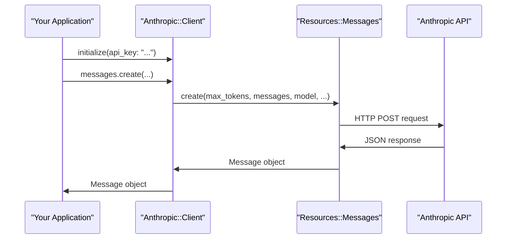
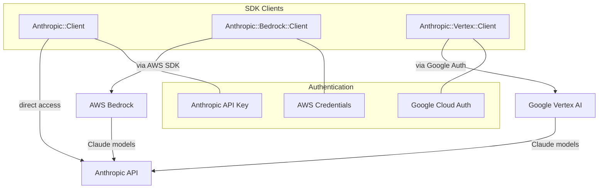

<!-- source: DeepWiki mcp.deepwiki.com · repo anthropics/anthropic-sdk-ruby · page 2 Getting Started · fetched 2026-10-26 -->

# Getting Started

<details>
<summary>Relevant source files</summary>

The following files were used as context for generating this wiki page:

- [.release-please-manifest.json](.release-please-manifest.json)
- [.solargraph.yml](.solargraph.yml)
- [CHANGELOG.md](CHANGELOG.md)
- [Gemfile](Gemfile)
- [Gemfile.lock](Gemfile.lock)
- [README.md](README.md)
- [anthropic.gemspec](anthropic.gemspec)
- [lib/anthropic/client.rb](lib/anthropic/client.rb)
- [lib/anthropic/models/anthropic_beta.rb](lib/anthropic/models/anthropic_beta.rb)
- [lib/anthropic/models/model.rb](lib/anthropic/models/model.rb)
- [lib/anthropic/version.rb](lib/anthropic/version.rb)
- [rbi/lib/anthropic/client.rbi](rbi/lib/anthropic/client.rbi)
- [sig/anthropic/client.rbs](sig/anthropic/client.rbs)

</details>


This guide will walk you through the process of installing the Anthropic Ruby SDK, setting up authentication, and making your first API call to Claude, Anthropic's large language model. By the end of this guide, you'll have a working setup to start building applications with Claude.

## Installation

The Anthropic Ruby SDK requires Ruby 3.1.0 or higher. To install the SDK, add it to your application's `Gemfile`:

```ruby
gem "anthropic-sdk-beta", "~> 0.1.0.pre.beta.6"
```

Then run:

```bash
bundle install
```

Note: The `anthropic-sdk-beta` gem name is temporary. It will transition to the `anthropic` gem name by May 2025.

Sources: [README.md:11-24](), [lib/anthropic/version.rb:1-5](), [anthropic.gemspec:1-19]()

## Authentication

The Anthropic API requires authentication. You have two options:

1. **API Key** (recommended): Obtain an API key from the [Anthropic Console](https://console.anthropic.com).
2. **Auth Token**: An alternative authentication method.

You can provide authentication credentials either:
- As environment variables: `ANTHROPIC_API_KEY` or `ANTHROPIC_AUTH_TOKEN`
- Directly to the client constructor

```ruby
# Using environment variables (recommended)
ENV["ANTHROPIC_API_KEY"] = "your-api-key"

# Or passing credentials directly
client = Anthropic::Client.new(api_key: "your-api-key")
```

Sources: [README.md:26-46](), [lib/anthropic/client.rb:18-57]()

## Client Architecture

Before making your first API call, it's helpful to understand how the client is structured.

### Client Structure Diagram

```mermaid
classDiagram
    class Client {
        +api_key: String
        +auth_token: String
        +messages: Resources::Messages
        +completions: Resources::Completions
        +models: Resources::Models
        +beta: Resources::Beta
    }
    
    class Resources::Messages {
        +create(max_tokens, messages, model, ...)
        +stream_raw(max_tokens, messages, model, ...)
        +count_tokens(messages, model, ...)
    }
    
    class Resources::Completions {
        +create(max_tokens_to_sample, model, prompt, ...)
        +create_streaming(max_tokens_to_sample, model, prompt, ...)
    }
    
    class Resources::Models {
        +retrieve(model_id, ...)
        +list(...)
    }
    
    class Resources::Beta {
        +messages: Beta::Messages
        +models: Beta::Models
    }
    
    Client -- Resources::Messages : contains
    Client -- Resources::Completions : contains
    Client -- Resources::Models : contains
    Client -- Resources::Beta : contains
```

The `Client` class serves as the main entry point to the SDK. When you initialize a client, it automatically creates resource objects for interacting with different parts of the Anthropic API.

Sources: [lib/anthropic/client.rb:1-107]()

## Making Your First API Call

After setting up authentication, you can start making API calls to Claude. Here's a simple example:

```ruby
require "bundler/setup"
require "anthropic"

# Initialize the client
anthropic = Anthropic::Client.new(
  api_key: "my-anthropic-api-key" # Defaults to ENV["ANTHROPIC_API_KEY"]
)

# Create a message
message = anthropic.messages.create(
  max_tokens: 1024,
  messages: [{
    role: "user",
    content: "Hello, Claude"
  }],
  model: "claude-3-5-sonnet-latest"
)

# Output Claude's response
puts(message.content)
```

This example demonstrates:
1. Initializing the client with your API key
2. Sending a simple message to Claude
3. Receiving and displaying Claude's response

Sources: [README.md:26-46]()

### Request Flow Diagram



This diagram shows how your request flows through the SDK to the Anthropic API and back.

Sources: [README.md:26-46](), [lib/anthropic/client.rb:1-107]()

## Available Models

The SDK provides access to Anthropic's Claude models. When making requests, you'll need to specify which model you want to use:

| Model | Description | Identifier |
|-------|-------------|------------|
| Claude 3.7 Sonnet | Most intelligent model | `claude-3-7-sonnet-latest` |
| Claude 3.5 Haiku | Fastest and most compact model | `claude-3-5-haiku-latest` |
| Claude 3.5 Sonnet | Previous most intelligent model | `claude-3-5-sonnet-latest` |
| Claude 3 Opus | Excels at writing and complex tasks | `claude-3-opus-latest` |

You can also use specific dated versions of models, such as `claude-3-7-sonnet-20250219` or `claude-3-5-haiku-20241022`.

Note: Some older models like Claude 2.0 and Claude 2.1 are deprecated and will reach end-of-life on July 21st, 2025.

Sources: [lib/anthropic/models/model.rb:1-94]()

## Error Handling

When working with the API, you may encounter errors. The SDK provides structured error handling:

```ruby
begin
  message = anthropic.messages.create(
    max_tokens: 1024,
    messages: [{
      role: "user",
      content: "Hello, Claude"
    }],
    model: "claude-3-5-sonnet-latest"
  )
rescue Anthropic::Errors::APIError => e
  puts(e.status) # e.g., 400
  puts(e.message)
end
```

Common error types include:
- `BadRequestError` (HTTP 400)
- `AuthenticationError` (HTTP 401)
- `PermissionDeniedError` (HTTP 403)
- `NotFoundError` (HTTP 404)
- `RateLimitError` (HTTP 429)
- `InternalServerError` (HTTP 500+)

Sources: [README.md:94-128]()

## Configuration Options

The client supports several configuration options:

### Retries

By default, certain errors will be automatically retried 2 times with exponential backoff:

```ruby
# Configure retries for all requests
anthropic = Anthropic::Client.new(
  max_retries: 5 # default is 2
)

# Or configure per-request
anthropic.messages.create(
  # message parameters...
  request_options: {max_retries: 5}
)
```

### Timeouts

By default, requests will time out after 600 seconds:

```ruby
# Configure timeouts for all requests
anthropic = Anthropic::Client.new(
  timeout: 120 # default is 600
)

# Or configure per-request
anthropic.messages.create(
  # message parameters...
  request_options: {timeout: 30}
)
```

Sources: [README.md:129-179](), [lib/anthropic/client.rb:5-17]()

## Streaming Responses

For applications that require real-time responses, the SDK supports streaming:

```ruby
stream = anthropic.messages.stream_raw(
  max_tokens: 1024,
  messages: [{
    role: "user",
    content: "Hello, Claude"
  }],
  model: "claude-3-5-sonnet-latest"
)

stream.each do |message|
  puts(message.type)
  # Process each chunk of the response as it arrives
end
```

Sources: [README.md:73-92]()

## Cloud Provider Integration

The SDK also supports accessing Claude models through cloud providers:

### Cloud Integration Diagram



### AWS Bedrock

To use Claude through AWS Bedrock, install the AWS SDK:

```ruby
gem "aws-sdk-bedrockruntime"
```

Then use the Bedrock client:

```ruby
require "anthropic"

anthropic = Anthropic::Bedrock::Client.new

message = anthropic.messages.create(
  max_tokens: 1024,
  messages: [{
    role: "user",
    content: "Hello, Claude"
  }],
  model: "anthropic.claude-3-5-sonnet-20241022-v2:0" # Bedrock model ID
)
```

### Google Vertex AI

To use Claude through Google Vertex AI, install the Google Auth gem:

```ruby
gem "googleauth"
```

Then use the Vertex client:

```ruby
require "anthropic"

anthropic = Anthropic::Vertex::Client.new(
  region: "us-east5", 
  project_id: "my-project-id"
)

message = anthropic.messages.create(
  max_tokens: 1024,
  messages: [{
    role: "user", 
    content: "Hello, Claude"
  }],
  model: "claude-3-7-sonnet@20250219"
)
```

Sources: [README.md:233-289]()

## Next Steps

Now that you've installed the SDK and made your first API call, you can explore more advanced features:

- For details on request parameters and options, see [Request Options](#3.1)
- For comprehensive error handling strategies, see [Error Handling](#3.2)
- To use the Messages API more effectively, see [Messages API](#4)
- To learn about token counting and optimization, see [Token Counting](#4.3)
- To explore batch processing for higher throughput, see [Batch Processing](#5)

For API documentation, you can visit the [Anthropic API Reference](https://docs.anthropic.com/claude/reference) or view the Ruby SDK documentation on [RubyDoc](https://gemdocs.org/gems/anthropic-sdk-beta).

Sources: [README.md:3-9]()

---

