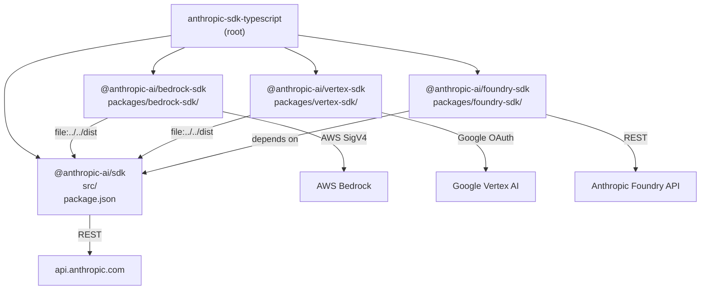
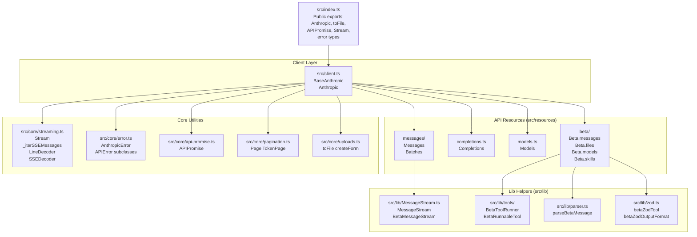
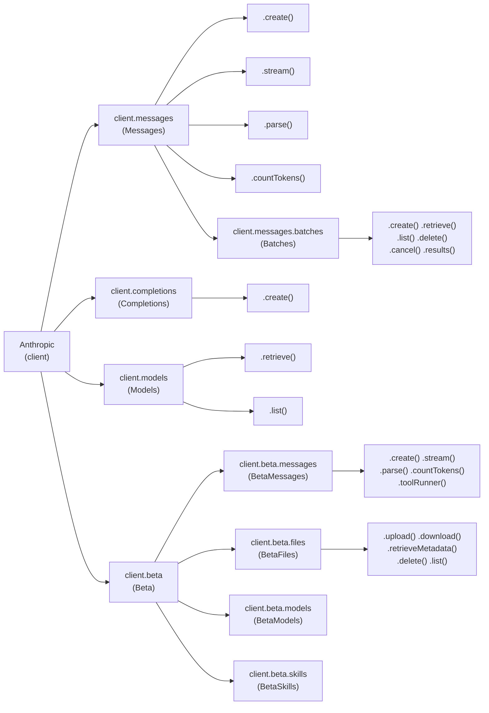
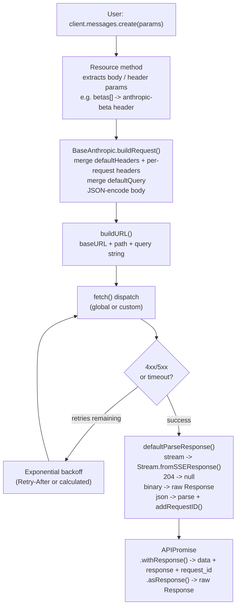
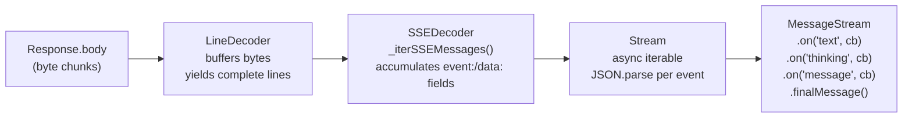
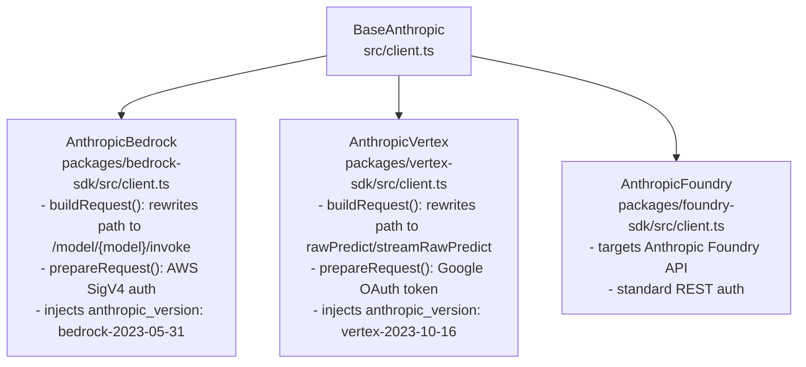

<!-- source: DeepWiki mcp.deepwiki.com · repo anthropics/anthropic-sdk-typescript · page 1 Overview · fetched 2026-10-26 -->

# Overview

Relevant source files

The following files were used as context for generating this wiki page:

- [.release-please-manifest.json](.release-please-manifest.json)
- [.stats.yml](.stats.yml)
- [CHANGELOG.md](CHANGELOG.md)
- [CONTRIBUTING.md](CONTRIBUTING.md)
- [README.md](README.md)
- [api.md](api.md)
- [package.json](package.json)
- [packages/bedrock-sdk/yarn.lock](packages/bedrock-sdk/yarn.lock)
- [packages/vertex-sdk/yarn.lock](packages/vertex-sdk/yarn.lock)
- [src/version.ts](src/version.ts)

This page describes the `anthropic-sdk-typescript` repository: what it contains, what it does, and how its components relate to each other. It covers the monorepo layout, the four published npm packages, the main SDK's internal layers, and the supported runtime environments.

For installation instructions and first-request examples, see [Installation & Setup](#1.1). For a detailed breakdown of the monorepo package layout and inter-package dependencies, see [Package Structure](#1.2).

---

## What this repository is

`anthropic-sdk-typescript` is the official TypeScript/JavaScript client library for Anthropic's APIs. It provides typed request and response models, streaming support, automatic retries, pagination helpers, and optional integrations with AWS Bedrock, Google Vertex AI, and Anthropic Foundry.

The primary published package is `@anthropic-ai/sdk` [[package.json:1-8]](). Three additional packages extend it for cloud-provider deployments. All four packages are versioned and released independently from the same monorepo.

**Current versions** (from [[.release-please-manifest.json:1-6]]()):

| Package | npm name | Version |
|---|---|---|
| Main SDK | `@anthropic-ai/sdk` | 0.80.0 |
| Vertex SDK | `@anthropic-ai/vertex-sdk` | 0.14.4 |
| Bedrock SDK | `@anthropic-ai/bedrock-sdk` | 0.26.4 |
| Foundry SDK | `@anthropic-ai/foundry-sdk` | 0.2.3 |

Sources: [[package.json:1-4]](), [[src/version.ts:1]](), [[.release-please-manifest.json:1-6]]()

---

## Monorepo layout

**Monorepo package structure**

Sources: [[package.json:1-86]](), [[packages/vertex-sdk/yarn.lock:18-23]](), [[packages/bedrock-sdk/yarn.lock:18-21]]()

The `bedrock-sdk` and `vertex-sdk` packages depend on the built output of the main package (`file:../../dist`) rather than the npm registry version [[packages/vertex-sdk/yarn.lock:18-20]](). This means the main package must be built before those sub-packages can be installed or tested [[CONTRIBUTING.md:10-15]]().

---

## Main SDK internal architecture

The main `@anthropic-ai/sdk` package is organized into several layers. The public entry point is `src/index.ts`, which re-exports the `Anthropic` client class along with error types, stream classes, and utility functions.

**SDK internal layers (src)**

Sources: [[package.json:6-8]](), [[api.md:1-120]]()

---

## API surface

The `Anthropic` client class exposes four top-level resource namespaces:

| Namespace | Class | Primary use |
|---|---|---|
| `client.messages` | `Messages` | Create, stream, count tokens, batches [[api.md:20-100]]() |
| `client.completions` | `Completions` | Legacy text completions |
| `client.models` | `Models` | List and retrieve model info |
| `client.beta` | `Beta` | Beta features: messages, files, models, skills |

**Client method map**

Sources: [[api.md:20-100]](), [[README.md:19-33]]()

---

## Request lifecycle

Every API call travels the same pipeline from a resource method to a parsed response:

**Request pipeline**

Sources: [[README.md:22-33]](), [[api.md:7-18]]()

---

## Streaming architecture

Streaming responses are decoded from raw bytes through a layered pipeline:

**SSE streaming pipeline**

For batch results, a parallel path uses a decoder yielding `MessageBatchResult` objects line by line [[api.md:100-110]]().

Sources: [[api.md:71-72]](), [[api.md:92-96]]()

---

## Cloud provider sub-SDKs

`AnthropicBedrock` and `AnthropicVertex` both extend `BaseAnthropic` and override request logic to transform requests for their respective platforms.

**Sub-SDK inheritance**

Sources: [[.release-please-manifest.json:3-5]](), [[packages/vertex-sdk/yarn.lock:18-20]]()

---

## Runtime requirements

The SDK targets the Web Fetch API and does not rely on Node.js-specific HTTP primitives.

| Runtime | Minimum version |
|---|---|
| Node.js | 18+ [[README.md:37]]() |
| Deno | 1.28.0 or later |
| Bun | 1.0 or later |
| Cloudflare Workers | Any |
| Vercel Edge Runtime | Any |
| Jest | 29+ [[package.json:45]]() |
| Web browsers | Requires `dangerouslyAllowBrowser: true` |

TypeScript 5.8 or later is used in development [[package.json:63]](). The optional `zod` peer dependency (`^3.25.0 || ^4.0.0`) is needed for structured output and tool-definition helpers [[package.json:32-37]]().

---

## Key capabilities at a glance

| Feature | Entry point |
|---|---|
| Chat / multimodal messages | `client.messages.create()` [[README.md:26]]() |
| Streaming SSE | `client.messages.stream()` |
| Token counting | `client.messages.countTokens()` |
| Batch processing (JSONL) | `client.messages.batches` |
| Tool use / function calling | `client.beta.messages.toolRunner()` |
| Structured outputs (Zod) | `betaZodOutputFormat`, `messages.parse()` |
| File uploads | `client.beta.files.upload()`, `toFile()` |
| Agent skills | `client.beta.skills` |
| Context management | `BetaContextManagementConfig` via `client.beta.messages.create()` |
| AWS Bedrock | `AnthropicBedrock` from `@anthropic-ai/bedrock-sdk` |
| Google Vertex AI | `AnthropicVertex` from `@anthropic-ai/vertex-sdk` |
| Anthropic Foundry | `@anthropic-ai/foundry-sdk` |
| MCP integration | helpers in `@anthropic-ai/sdk/helpers/beta/mcp` |

Sources: [[api.md:20-110]](), [[package.json:42]]()

---

