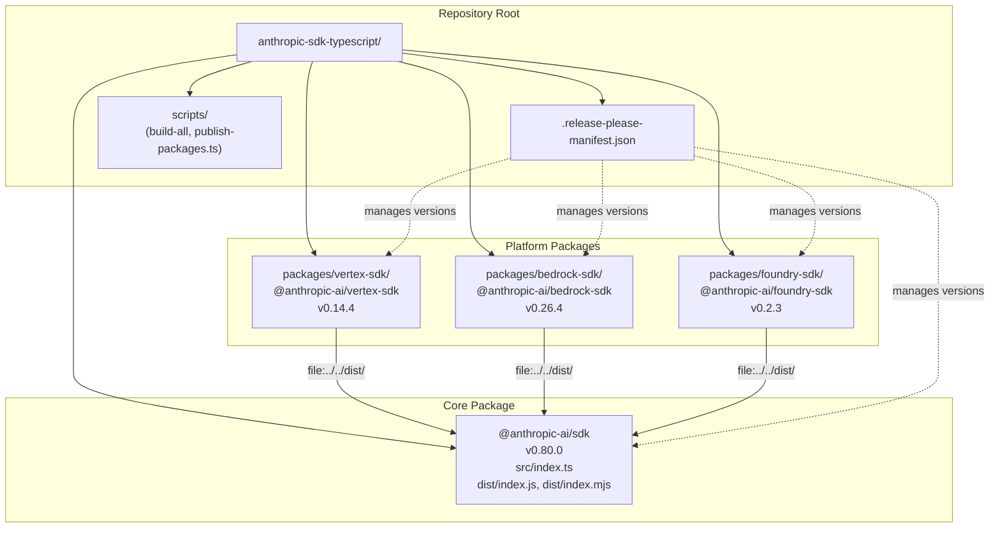
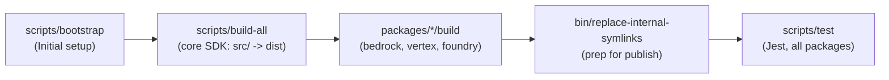

<!-- source: DeepWiki mcp.deepwiki.com · repo anthropics/anthropic-sdk-typescript · page 1.2 Package Structure · fetched 2026-10-26 -->

# Package Structure

<details>
<summary>Relevant source files</summary>

The following files were used as context for generating this wiki page:

- [.release-please-manifest.json](.release-please-manifest.json)
- [CHANGELOG.md](CHANGELOG.md)
- [package.json](package.json)
- [packages/bedrock-sdk/CHANGELOG.md](packages/bedrock-sdk/CHANGELOG.md)
- [packages/bedrock-sdk/package.json](packages/bedrock-sdk/package.json)
- [packages/bedrock-sdk/yarn.lock](packages/bedrock-sdk/yarn.lock)
- [packages/foundry-sdk/CHANGELOG.md](packages/foundry-sdk/CHANGELOG.md)
- [packages/foundry-sdk/package.json](packages/foundry-sdk/package.json)
- [packages/vertex-sdk/CHANGELOG.md](packages/vertex-sdk/CHANGELOG.md)
- [packages/vertex-sdk/package.json](packages/vertex-sdk/package.json)
- [packages/vertex-sdk/yarn.lock](packages/vertex-sdk/yarn.lock)
- [src/version.ts](src/version.ts)

</details>


The Anthropic TypeScript SDK is organized as a monorepo containing four independently versioned npm packages. This page explains the package organization, dependency relationships, build artifacts, and when to use each package.

## Monorepo Organization

The repository contains four packages:

1. **@anthropic-ai/sdk** - Core SDK for direct API access
2. **@anthropic-ai/vertex-sdk** - Google Vertex AI integration
3. **@anthropic-ai/bedrock-sdk** - AWS Bedrock integration
4. **@anthropic-ai/foundry-sdk** - Foundry platform integration

Each package is independently versioned and published to npm. The platform-specific packages depend on the core SDK package through a `file:../../dist/` reference during development and build [packages/vertex-sdk/package.json:28](), [packages/bedrock-sdk/package.json:28](), [packages/foundry-sdk/package.json:28]().

**Monorepo Package Structure**



Sources: [package.json:1-3](), [.release-please-manifest.json:1-6](), [packages/vertex-sdk/package.json:1-3](), [packages/bedrock-sdk/package.json:1-3](), [packages/foundry-sdk/package.json:1-3]()

## Package Version Management

All four packages are versioned independently using semantic versioning. The release process is automated using `release-please`, which reads `.release-please-manifest.json` to coordinate version bumps and changelog generation [.release-please-manifest.json:1-6]().

| Package | Current Version | Manifest Key | Location |
|---------|----------------|--------------|----------|
| `@anthropic-ai/sdk` | 0.80.0 | `"."` | Root directory (`src/`) |
| `@anthropic-ai/vertex-sdk` | 0.14.4 | `"packages/vertex-sdk"` | `packages/vertex-sdk/` |
| `@anthropic-ai/bedrock-sdk` | 0.26.4 | `"packages/bedrock-sdk"` | `packages/bedrock-sdk/` |
| `@anthropic-ai/foundry-sdk` | 0.2.3 | `"packages/foundry-sdk"` | `packages/foundry-sdk/` |

The version string is also maintained programmatically in [src/version.ts:1]() for the core SDK, tagged for automated version bumps by `release-please`:

```typescript
export const VERSION = '0.80.0'; // x-release-please-version
```

Sources: [.release-please-manifest.json:1-6](), [package.json:2-3](), [src/version.ts:1](), [packages/vertex-sdk/package.json:3](), [packages/bedrock-sdk/package.json:3](), [packages/foundry-sdk/package.json:3]()

## Main SDK Package (@anthropic-ai/sdk)

The core SDK provides direct access to Anthropic's API at `https://api.anthropic.com`. This is the primary package for most use cases.

**Installation**

```bash
npm install @anthropic-ai/sdk
```

**Key Components**

The core SDK exports primary classes and utilities:

- `Anthropic` - Main client class (extends `BaseAnthropic`)
- `BaseAnthropic` - HTTP client foundation
- `Messages`, `Completions`, `Models`, `Beta` - API resource namespaces
- `MessageStream`, `Stream` - Streaming helpers
- `APIError` and subclasses - Error hierarchy
- `toFile`, `Uploadable` - File upload utilities

**Package Configuration**

Relevant fields from [package.json:1-97]():

- `"main": "dist/index.js"` — CommonJS entry point [package.json:7]()
- `"types": "dist/index.d.ts"` — TypeScript declarations [package.json:6]()
- `"type": "commonjs"` — Default module format [package.json:8]()
- `"exports"` — Conditional exports for ESM (`dist/index.mjs`) and CJS (`dist/index.js`) [package.json:81-96]()
- `"bin": { "anthropic-ai-sdk": "bin/cli" }` — CLI entry point (migration tool) [package.json:68]()
- `"peerDependencies": { "zod": "^3.25.0 || ^4.0.0" }` — Optional; required for structured output helpers [package.json:32-34]()

**Runtime Support**

- Node.js (CommonJS and ES Module)
- Browser environments
- Deno (via npm: specifier)
- Edge runtimes (Cloudflare Workers, Vercel Edge)

Sources: [package.json:1-97](), [src/version.ts:1]()

## Vertex AI SDK Package (@anthropic-ai/vertex-sdk)

The Vertex SDK provides integration with Google Cloud's Vertex AI platform.

**Key Classes**

- `AnthropicVertex` - Main client class for Vertex AI
- Custom authentication via `googleAuth` parameter

**Key dependencies** ([packages/vertex-sdk/package.json:27-30]()):

| Dependency | Version | Purpose |
|-----------|---------|---------|
| `@anthropic-ai/sdk` | `file:../../dist/` | Core SDK (local build reference) |
| `google-auth-library` | `^9.4.2` | Google Cloud authentication |

**Client options** (`AnthropicVertex` constructor):
- `region` — Google Cloud region (e.g., `'us-central1'`, `'global'`)
- `projectId` — Google Cloud project ID
- `accessToken` — Static OAuth token
- `googleAuth` — Custom `GoogleAuth` instance
- `authClient` — Custom `AuthClient` implementation

Sources: [packages/vertex-sdk/package.json:1-76](), [packages/vertex-sdk/CHANGELOG.md:1-140]()

## Bedrock SDK Package (@anthropic-ai/bedrock-sdk)

The Bedrock SDK provides integration with AWS Bedrock.

**Key Classes**

- `AnthropicBedrock` - Main client class for AWS Bedrock
- Implements AWS SigV4 request signing

**Key dependencies** ([packages/bedrock-sdk/package.json:27-39]()):

| Dependency | Purpose |
|-----------|---------|
| `@anthropic-ai/sdk` (`file:../../dist/`) | Core SDK (local build reference) |
| `@aws-sdk/client-bedrock-runtime` | AWS Bedrock API client [packages/bedrock-sdk/package.json:30]() |
| `@aws-sdk/credential-providers` | AWS credential chain resolution [packages/bedrock-sdk/package.json:31]() |
| `@smithy/signature-v4` | AWS SigV4 request signing [packages/bedrock-sdk/package.json:35]() |

**Client options** (`AnthropicBedrock` constructor):
- `awsRegion` — AWS region (e.g., `'us-east-1'`)
- `awsAccessKey`, `awsSecretKey`, `awsSessionToken` — Explicit credentials
- `providerChainResolver` — Custom credential provider
- `skipAuth` — Delegate auth entirely to the AWS environment [packages/bedrock-sdk/CHANGELOG.md:116]()

Sources: [packages/bedrock-sdk/package.json:1-87](), [packages/bedrock-sdk/CHANGELOG.md:1-150]()

## Foundry SDK Package (@anthropic-ai/foundry-sdk)

The Foundry SDK provides integration with the Microsoft Azure AI Foundry platform.

**Key Classes**

- `AnthropicFoundry` - Main client class for Foundry
- Extends `Anthropic` from core SDK

**Package Configuration**

The Foundry SDK has a minimal dependency footprint [packages/foundry-sdk/package.json:27-29]():

- `@anthropic-ai/sdk` (`file:../../dist/`) — Core SDK (local build reference)

Sources: [packages/foundry-sdk/package.json:1-75](), [packages/foundry-sdk/CHANGELOG.md:1-43]()

## Package Dependencies

The platform-specific packages depend on the core SDK and extend its functionality with platform-specific authentication and request handling.

**Package Dependency Graph with Class Relationships**

```mermaid
graph TB
    subgraph "Core SDK - @anthropic-ai/sdk (src)"
        Anthropic["Anthropic\n(src/index.ts)"]
        BaseAnthropic["BaseAnthropic\n(src/client.ts)"]
        Messages["Messages\n(src/resources/messages)"]
        Beta["Beta\n(src/resources/beta)"]
        Models["Models\n(src/resources/models.ts)"]
        Completions["Completions\n(src/resources/completions.ts)"]
    end

    subgraph "Vertex SDK - packages/vertex-sdk/src/"
        AnthropicVertex["AnthropicVertex\n(client.ts)"]
        google_auth_library["google-auth-library\n(GoogleAuth, AuthClient)"]
    end

    subgraph "Bedrock SDK - packages/bedrock-sdk/src/"
        AnthropicBedrock["AnthropicBedrock\n(client.ts)"]
        BedrockRuntime["@aws-sdk/client-bedrock-runtime"]
        CredProviders["@aws-sdk/credential-providers"]
        SigV4["@smithy/signature-v4"]
    end

    subgraph "Foundry SDK - packages/foundry-sdk/src/"
        AnthropicFoundry["AnthropicFoundry\n(client.ts)"]
    end

    Anthropic -->|"extends"| BaseAnthropic
    Anthropic --> Messages
    Anthropic --> Beta
    Anthropic --> Models
    Anthropic --> Completions

    AnthropicVertex -->|"extends BaseAnthropic"| BaseAnthropic
    AnthropicVertex --> google_auth_library

    AnthropicBedrock -->|"extends BaseAnthropic"| BaseAnthropic
    AnthropicBedrock --> BedrockRuntime
    AnthropicBedrock --> CredProviders
    AnthropicBedrock --> SigV4

    AnthropicFoundry -->|"extends BaseAnthropic"| BaseAnthropic
```



Sources: [packages/vertex-sdk/package.json:27-30](), [packages/bedrock-sdk/package.json:27-39](), [packages/foundry-sdk/package.json:27-29]()

**`file:../../dist/` Dependency Pattern**

All platform SDKs declare `"@anthropic-ai/sdk": "file:../../dist/"` in their `dependencies`. This ensures:

1. The core SDK must be built first (outputs to `dist/`) [package.json:21-22]()
2. Platform SDK builds resolve types and code from the compiled `dist/` folder
3. The `scripts/bootstrap` script handles initial setup and build ordering

Sources: [packages/vertex-sdk/package.json:28](), [packages/bedrock-sdk/package.json:28](), [packages/foundry-sdk/package.json:28]()

## Build and Distribution

Each package generates distribution artifacts in both CommonJS and ES Module formats.

**Build Outputs**

| Format | File | Purpose | Module Type |
|--------|------|---------|-------------|
| CommonJS | `dist/index.js` | Node.js require() imports | CommonJS |
| ES Module | `dist/index.mjs` | Modern import statements | ES Module |
| TypeScript Declarations | `dist/index.d.ts` | Type definitions | N/A |

**Package Exports Configuration**

The `exports` field in [package.json:81-96]() provides conditional exports:

| Export Condition | File | Used By |
|-----------------|------|---------|
| `"import"` (ESM) | `dist/index.mjs` | Bundlers, `import` statements |
| `"require"` (CJS) | `dist/index.js` | Node.js `require()` |

**Coordinated Build Process**



**Build steps:**

1. `scripts/build-all` — Orchestrates the full build using `tsc-multi` [package.json:21, 60]().
2. Per-package `build` scripts — Platform packages run their own build logic [packages/vertex-sdk/package.json:18]().
3. `bin/replace-internal-symlinks` — Rewrites `file:../../dist/` references to real version strings before publishing.
4. `scripts/test` — Runs Jest across the root and all sub-packages [package.json:20]().

Sources: [package.json:19-28](), [packages/vertex-sdk/package.json:16-26](), [packages/bedrock-sdk/package.json:16-26]()

---

