# Page: Overview

# Overview

<details>
<summary>Relevant source files</summary>

The following files were used as context for generating this wiki page:

- [.release-please-manifest.json](.release-please-manifest.json)
- [.stats.yml](.stats.yml)
- [CHANGELOG.md](CHANGELOG.md)
- [CONTRIBUTING.md](CONTRIBUTING.md)
- [README.md](README.md)
- [api.md](api.md)
- [package.json](package.json)
- [packages/bedrock-sdk/yarn.lock](packages/bedrock-sdk/yarn.lock)
- [packages/vertex-sdk/yarn.lock](packages/vertex-sdk/yarn.lock)
- [src/version.ts](src/version.ts)

</details>


This page describes the `anthropic-sdk-typescript` repository: what it contains, what it does, and how its components relate to each other. It covers the monorepo layout, the four published npm packages, the main SDK's internal layers, and the supported runtime environments.

For installation instructions and first-request examples, see [Installation & Setup](#1.1). For a detailed breakdown of the monorepo package layout and inter-package dependencies, see [Package Structure](#1.2).

---

## What this repository is

`anthropic-sdk-typescript` is the official TypeScript/JavaScript client library for Anthropic's APIs. It provides typed request and response models, streaming support, automatic retries, pagination helpers, and optional integrations with AWS Bedrock, Google Vertex AI, and Anthropic Foundry.

The primary published package is `@anthropic-ai/sdk` [[package.json:1-8]](). Three additional packages extend it for cloud-provider deployments. All four packages are versioned and released independently from the same monorepo.

**Current versions** (from [[.release-please-manifest.json:1-6]]()):

| Package | npm name | Version |
|---|---|---|
| Main SDK | `@anthropic-ai/sdk` | 0.80.0 |
| Vertex SDK | `@anthropic-ai/vertex-sdk` | 0.14.4 |
| Bedrock SDK | `@anthropic-ai/bedrock-sdk` | 0.26.4 |
| Foundry SDK | `@anthropic-ai/foundry-sdk` | 0.2.3 |

Sources: [[package.json:1-4]](), [[src/version.ts:1]](), [[.release-please-manifest.json:1-6]]()

---

## Monorepo layout

**Monorepo package structure**

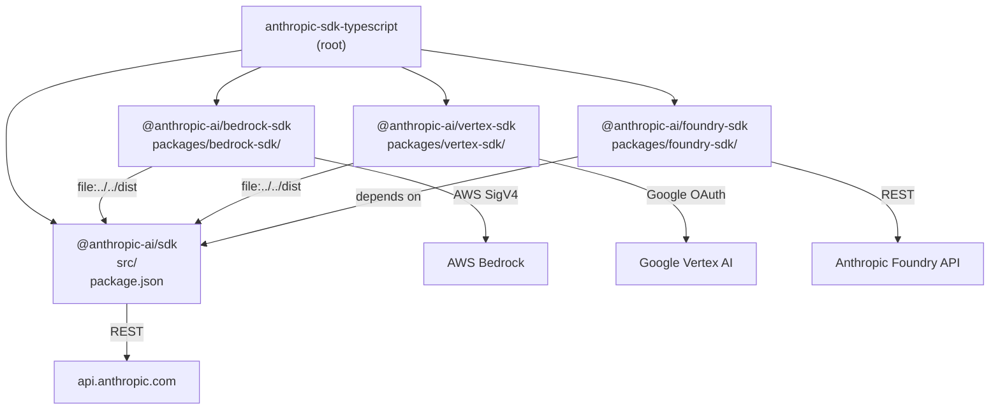

Sources: [[package.json:1-86]](), [[packages/vertex-sdk/yarn.lock:18-23]](), [[packages/bedrock-sdk/yarn.lock:18-21]]()

The `bedrock-sdk` and `vertex-sdk` packages depend on the built output of the main package (`file:../../dist`) rather than the npm registry version [[packages/vertex-sdk/yarn.lock:18-20]](). This means the main package must be built before those sub-packages can be installed or tested [[CONTRIBUTING.md:10-15]]().

---

## Main SDK internal architecture

The main `@anthropic-ai/sdk` package is organized into several layers. The public entry point is `src/index.ts`, which re-exports the `Anthropic` client class along with error types, stream classes, and utility functions.

**SDK internal layers (src)**

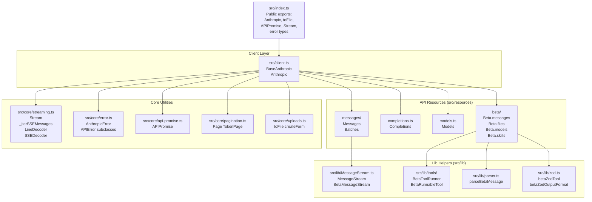

Sources: [[package.json:6-8]](), [[api.md:1-120]]()

---

## API surface

The `Anthropic` client class exposes four top-level resource namespaces:

| Namespace | Class | Primary use |
|---|---|---|
| `client.messages` | `Messages` | Create, stream, count tokens, batches [[api.md:20-100]]() |
| `client.completions` | `Completions` | Legacy text completions |
| `client.models` | `Models` | List and retrieve model info |
| `client.beta` | `Beta` | Beta features: messages, files, models, skills |

**Client method map**

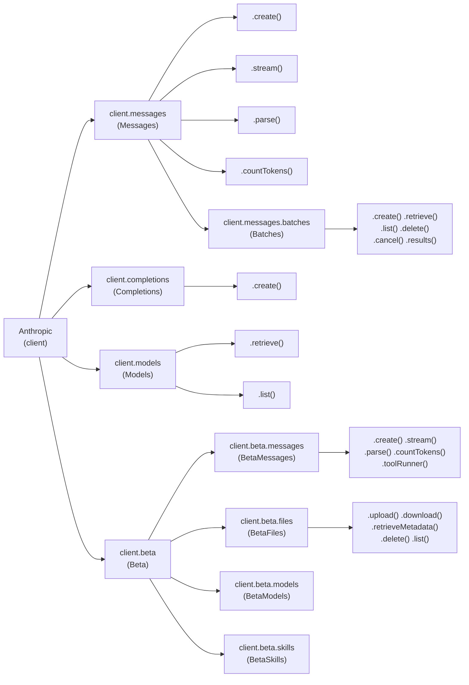

Sources: [[api.md:20-100]](), [[README.md:19-33]]()

---

## Request lifecycle

Every API call travels the same pipeline from a resource method to a parsed response:

**Request pipeline**

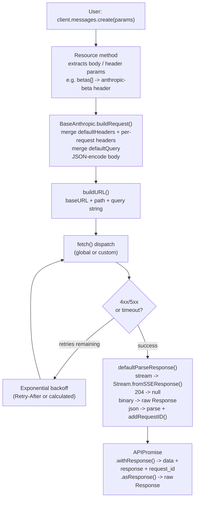

Sources: [[README.md:22-33]](), [[api.md:7-18]]()

---

## Streaming architecture

Streaming responses are decoded from raw bytes through a layered pipeline:

**SSE streaming pipeline**

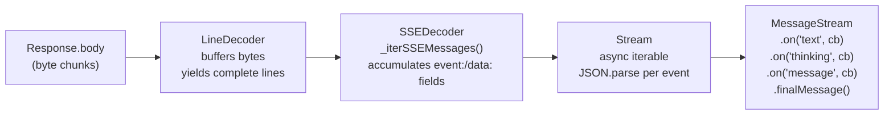

For batch results, a parallel path uses a decoder yielding `MessageBatchResult` objects line by line [[api.md:100-110]]().

Sources: [[api.md:71-72]](), [[api.md:92-96]]()

---

## Cloud provider sub-SDKs

`AnthropicBedrock` and `AnthropicVertex` both extend `BaseAnthropic` and override request logic to transform requests for their respective platforms.

**Sub-SDK inheritance**

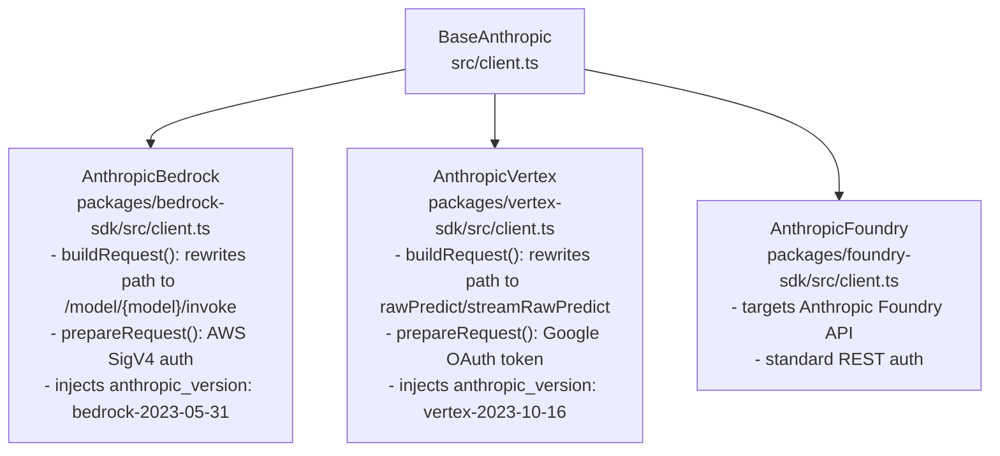

Sources: [[.release-please-manifest.json:3-5]](), [[packages/vertex-sdk/yarn.lock:18-20]]()

---

## Runtime requirements

The SDK targets the Web Fetch API and does not rely on Node.js-specific HTTP primitives.

| Runtime | Minimum version |
|---|---|
| Node.js | 18+ [[README.md:37]]() |
| Deno | 1.28.0 or later |
| Bun | 1.0 or later |
| Cloudflare Workers | Any |
| Vercel Edge Runtime | Any |
| Jest | 29+ [[package.json:45]]() |
| Web browsers | Requires `dangerouslyAllowBrowser: true` |

TypeScript 5.8 or later is used in development [[package.json:63]](). The optional `zod` peer dependency (`^3.25.0 || ^4.0.0`) is needed for structured output and tool-definition helpers [[package.json:32-37]]().

---

## Key capabilities at a glance

| Feature | Entry point |
|---|---|
| Chat / multimodal messages | `client.messages.create()` [[README.md:26]]() |
| Streaming SSE | `client.messages.stream()` |
| Token counting | `client.messages.countTokens()` |
| Batch processing (JSONL) | `client.messages.batches` |
| Tool use / function calling | `client.beta.messages.toolRunner()` |
| Structured outputs (Zod) | `betaZodOutputFormat`, `messages.parse()` |
| File uploads | `client.beta.files.upload()`, `toFile()` |
| Agent skills | `client.beta.skills` |
| Context management | `BetaContextManagementConfig` via `client.beta.messages.create()` |
| AWS Bedrock | `AnthropicBedrock` from `@anthropic-ai/bedrock-sdk` |
| Google Vertex AI | `AnthropicVertex` from `@anthropic-ai/vertex-sdk` |
| Anthropic Foundry | `@anthropic-ai/foundry-sdk` |
| MCP integration | helpers in `@anthropic-ai/sdk/helpers/beta/mcp` |

Sources: [[api.md:20-110]](), [[package.json:42]]()

---

# Page: Installation & Setup

# Installation & Setup

<details>
<summary>Relevant source files</summary>

The following files were used as context for generating this wiki page:

- [CONTRIBUTING.md](CONTRIBUTING.md)
- [README.md](README.md)
- [src/index.ts](src/index.ts)
- [src/resources/completions.ts](src/resources/completions.ts)
- [src/resources/messages.ts](src/resources/messages.ts)
- [tests/api-resources/completions.test.ts](tests/api-resources/completions.test.ts)

</details>


This page covers installing the Anthropic TypeScript SDK and performing basic client configuration. For detailed configuration options, see [Client Configuration](2.1). For platform-specific installations (AWS Bedrock, Google Vertex AI, Azure AI Foundry), see [Cloud Provider SDKs](5).

## Package Installation

The SDK is distributed as the `@anthropic-ai/sdk` npm package. Install it using npm or yarn:

```bash
npm install @anthropic-ai/sdk
```

The package includes TypeScript type definitions and supports both CommonJS and ESM module systems through dual exports.

### Package Structure

**Package installation options**

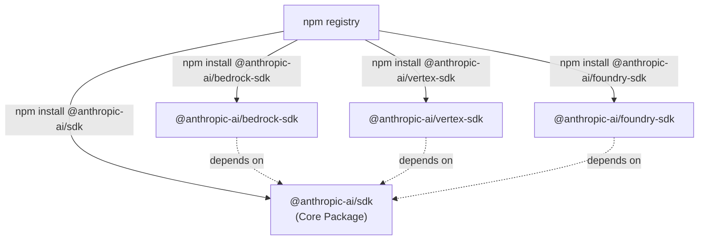

The repository manages four separate packages:
- **Core SDK** (`@anthropic-ai/sdk`): Direct API access for standard Anthropic API endpoints [src/index.ts:1-32]().
- **Platform SDKs**: Specialized clients for cloud provider integrations (require separate installation) that depend on the core logic.

Sources: [README.md:11-15](), [src/index.ts:1-32]()

## Basic Client Setup

### Importing the Client

```typescript
import Anthropic from '@anthropic-ai/sdk';
```

The default export is the `Anthropic` class [src/index.ts:3-3](), which provides access to resources like `messages` and `completions`.

### Minimal Instantiation

```typescript
const client = new Anthropic({
  apiKey: process.env['ANTHROPIC_API_KEY'], // Optional if env var is set
});
```

The client constructor accepts a `ClientOptions` object [src/index.ts:7-7](). By default, it looks for the `ANTHROPIC_API_KEY` environment variable [README.md:22-24]().

Sources: [src/index.ts:3-7](), [README.md:19-34]()

## Client Instantiation Patterns

**`Anthropic` constructor initialization flow**

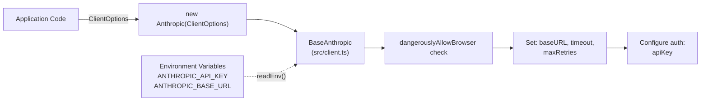

The `Anthropic` class [src/client.ts:7-7]() performs the following steps:

1. **Environment resolution**: Automatically retrieves the API key from `process.env['ANTHROPIC_API_KEY']` if not provided in the constructor [README.md:22-24]().
2. **Resource Initialization**: Sets up namespaces like `completions` [src/resources/completions.ts:12-12]() and `messages` [src/resources/messages.ts:3-3]().
3. **Safety Checks**: Validates environment constraints (e.g., preventing browser usage unless `dangerouslyAllowBrowser` is set).

Sources: [src/client.ts:7-7](), [src/resources/completions.ts:12-12](), [README.md:22-24]()

## Configuration Options Overview

The `ClientOptions` [src/client.ts:7-7]() interface accepts parameters to modify the client's behavior:

| Parameter | Type | Default | Description |
|-----------|------|---------|-------------|
| `apiKey` | `string` | `process.env['ANTHROPIC_API_KEY']` | Primary credential for Anthropic API [README.md:22-24](). |
| `baseURL` | `string` | `https://api.anthropic.com` | The base URL for all API requests. |
| `timeout` | `number` | `600000` (10m) | Request timeout in milliseconds [src/resources/completions.ts:45-45](). |
| `maxRetries` | `number` | `2` | Number of times to retry failed requests. |
| `dangerouslyAllowBrowser` | `boolean` | `false` | Must be true to use the SDK in a browser environment. |

Sources: [src/client.ts:7-7](), [src/resources/completions.ts:45-45](), [README.md:22-24]()

## First Request Example

The following example demonstrates a basic request to the Messages API using the `Anthropic` client:

```typescript
import Anthropic from '@anthropic-ai/sdk';

const client = new Anthropic();

async function main() {
  const message = await client.messages.create({
    max_tokens: 1024,
    messages: [{ role: 'user', content: 'Hello, Claude' }],
    model: 'claude-3-opus-20240229',
  });

  console.log(message.content);
}

main();
```

The `client.messages.create` call returns a promise that resolves to a `Message` object [README.md:26-32](). For legacy support, the SDK also provides `client.completions.create` [src/resources/completions.ts:32-41](), though the Messages API is recommended for all new development [src/resources/completions.ts:16-21]().

Sources: [README.md:19-33](), [src/resources/completions.ts:12-54]()

## Runtime Requirements

- **Node.js**: Version 18 or higher is required [README.md:37-37]().
- **Deno/Bun**: Supported via standard npm package compatibility layers.
- **Browsers**: Supported only if `dangerouslyAllowBrowser: true` is passed to the constructor to acknowledge the security risks of exposing API keys.

Sources: [README.md:37-37](), [src/client.ts:7-7]()

## Development Setup

If you are contributing to the SDK or running examples from the repository:

1. **Clone and Install**:
   ```sh
   git clone https://github.com/anthropics/anthropic-sdk-typescript
   yarn install
   ```
2. **Build**:
   ```sh
   yarn build
   ```
3. **Run Examples**:
   You can run files in the `examples/` directory using `yarn tsn` [CONTRIBUTING.md:39-39]().
4. **Testing**:
   Tests require a mock server. Run `./scripts/mock` followed by `yarn run test` [CONTRIBUTING.md:74-80]().

Sources: [CONTRIBUTING.md:10-15](), [CONTRIBUTING.md:39-39](), [CONTRIBUTING.md:74-80]()

---

# Page: Package Structure

# Package Structure

<details>
<summary>Relevant source files</summary>

The following files were used as context for generating this wiki page:

- [.release-please-manifest.json](.release-please-manifest.json)
- [CHANGELOG.md](CHANGELOG.md)
- [package.json](package.json)
- [packages/bedrock-sdk/CHANGELOG.md](packages/bedrock-sdk/CHANGELOG.md)
- [packages/bedrock-sdk/package.json](packages/bedrock-sdk/package.json)
- [packages/bedrock-sdk/yarn.lock](packages/bedrock-sdk/yarn.lock)
- [packages/foundry-sdk/CHANGELOG.md](packages/foundry-sdk/CHANGELOG.md)
- [packages/foundry-sdk/package.json](packages/foundry-sdk/package.json)
- [packages/vertex-sdk/CHANGELOG.md](packages/vertex-sdk/CHANGELOG.md)
- [packages/vertex-sdk/package.json](packages/vertex-sdk/package.json)
- [packages/vertex-sdk/yarn.lock](packages/vertex-sdk/yarn.lock)
- [src/version.ts](src/version.ts)

</details>


The Anthropic TypeScript SDK is organized as a monorepo containing four independently versioned npm packages. This page explains the package organization, dependency relationships, build artifacts, and when to use each package.

## Monorepo Organization

The repository contains four packages:

1. **@anthropic-ai/sdk** - Core SDK for direct API access
2. **@anthropic-ai/vertex-sdk** - Google Vertex AI integration
3. **@anthropic-ai/bedrock-sdk** - AWS Bedrock integration
4. **@anthropic-ai/foundry-sdk** - Foundry platform integration

Each package is independently versioned and published to npm. The platform-specific packages depend on the core SDK package through a `file:../../dist/` reference during development and build [packages/vertex-sdk/package.json:28](), [packages/bedrock-sdk/package.json:28](), [packages/foundry-sdk/package.json:28]().

**Monorepo Package Structure**

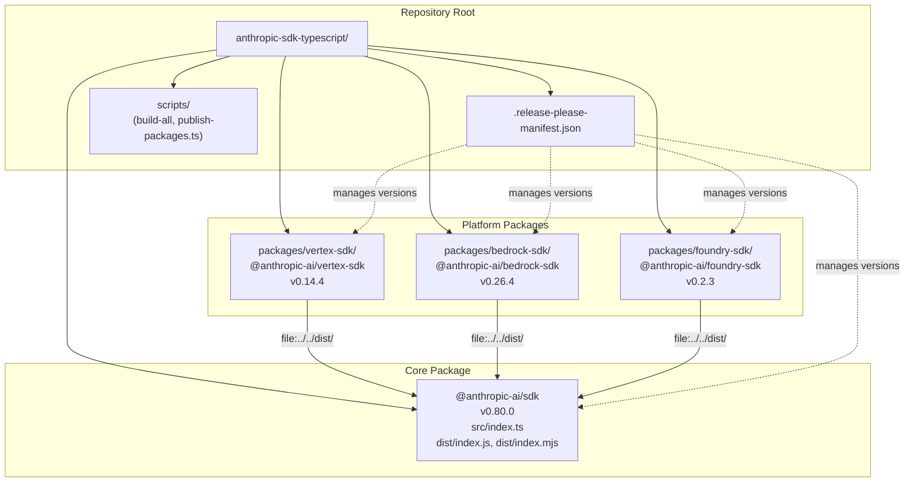

Sources: [package.json:1-3](), [.release-please-manifest.json:1-6](), [packages/vertex-sdk/package.json:1-3](), [packages/bedrock-sdk/package.json:1-3](), [packages/foundry-sdk/package.json:1-3]()

## Package Version Management

All four packages are versioned independently using semantic versioning. The release process is automated using `release-please`, which reads `.release-please-manifest.json` to coordinate version bumps and changelog generation [.release-please-manifest.json:1-6]().

| Package | Current Version | Manifest Key | Location |
|---------|----------------|--------------|----------|
| `@anthropic-ai/sdk` | 0.80.0 | `"."` | Root directory (`src/`) |
| `@anthropic-ai/vertex-sdk` | 0.14.4 | `"packages/vertex-sdk"` | `packages/vertex-sdk/` |
| `@anthropic-ai/bedrock-sdk` | 0.26.4 | `"packages/bedrock-sdk"` | `packages/bedrock-sdk/` |
| `@anthropic-ai/foundry-sdk` | 0.2.3 | `"packages/foundry-sdk"` | `packages/foundry-sdk/` |

The version string is also maintained programmatically in [src/version.ts:1]() for the core SDK, tagged for automated version bumps by `release-please`:

```typescript
export const VERSION = '0.80.0'; // x-release-please-version
```

Sources: [.release-please-manifest.json:1-6](), [package.json:2-3](), [src/version.ts:1](), [packages/vertex-sdk/package.json:3](), [packages/bedrock-sdk/package.json:3](), [packages/foundry-sdk/package.json:3]()

## Main SDK Package (@anthropic-ai/sdk)

The core SDK provides direct access to Anthropic's API at `https://api.anthropic.com`. This is the primary package for most use cases.

**Installation**

```bash
npm install @anthropic-ai/sdk
```

**Key Components**

The core SDK exports primary classes and utilities:

- `Anthropic` - Main client class (extends `BaseAnthropic`)
- `BaseAnthropic` - HTTP client foundation
- `Messages`, `Completions`, `Models`, `Beta` - API resource namespaces
- `MessageStream`, `Stream` - Streaming helpers
- `APIError` and subclasses - Error hierarchy
- `toFile`, `Uploadable` - File upload utilities

**Package Configuration**

Relevant fields from [package.json:1-97]():

- `"main": "dist/index.js"` — CommonJS entry point [package.json:7]()
- `"types": "dist/index.d.ts"` — TypeScript declarations [package.json:6]()
- `"type": "commonjs"` — Default module format [package.json:8]()
- `"exports"` — Conditional exports for ESM (`dist/index.mjs`) and CJS (`dist/index.js`) [package.json:81-96]()
- `"bin": { "anthropic-ai-sdk": "bin/cli" }` — CLI entry point (migration tool) [package.json:68]()
- `"peerDependencies": { "zod": "^3.25.0 || ^4.0.0" }` — Optional; required for structured output helpers [package.json:32-34]()

**Runtime Support**

- Node.js (CommonJS and ES Module)
- Browser environments
- Deno (via npm: specifier)
- Edge runtimes (Cloudflare Workers, Vercel Edge)

Sources: [package.json:1-97](), [src/version.ts:1]()

## Vertex AI SDK Package (@anthropic-ai/vertex-sdk)

The Vertex SDK provides integration with Google Cloud's Vertex AI platform.

**Key Classes**

- `AnthropicVertex` - Main client class for Vertex AI
- Custom authentication via `googleAuth` parameter

**Key dependencies** ([packages/vertex-sdk/package.json:27-30]()):

| Dependency | Version | Purpose |
|-----------|---------|---------|
| `@anthropic-ai/sdk` | `file:../../dist/` | Core SDK (local build reference) |
| `google-auth-library` | `^9.4.2` | Google Cloud authentication |

**Client options** (`AnthropicVertex` constructor):
- `region` — Google Cloud region (e.g., `'us-central1'`, `'global'`)
- `projectId` — Google Cloud project ID
- `accessToken` — Static OAuth token
- `googleAuth` — Custom `GoogleAuth` instance
- `authClient` — Custom `AuthClient` implementation

Sources: [packages/vertex-sdk/package.json:1-76](), [packages/vertex-sdk/CHANGELOG.md:1-140]()

## Bedrock SDK Package (@anthropic-ai/bedrock-sdk)

The Bedrock SDK provides integration with AWS Bedrock.

**Key Classes**

- `AnthropicBedrock` - Main client class for AWS Bedrock
- Implements AWS SigV4 request signing

**Key dependencies** ([packages/bedrock-sdk/package.json:27-39]()):

| Dependency | Purpose |
|-----------|---------|
| `@anthropic-ai/sdk` (`file:../../dist/`) | Core SDK (local build reference) |
| `@aws-sdk/client-bedrock-runtime` | AWS Bedrock API client [packages/bedrock-sdk/package.json:30]() |
| `@aws-sdk/credential-providers` | AWS credential chain resolution [packages/bedrock-sdk/package.json:31]() |
| `@smithy/signature-v4` | AWS SigV4 request signing [packages/bedrock-sdk/package.json:35]() |

**Client options** (`AnthropicBedrock` constructor):
- `awsRegion` — AWS region (e.g., `'us-east-1'`)
- `awsAccessKey`, `awsSecretKey`, `awsSessionToken` — Explicit credentials
- `providerChainResolver` — Custom credential provider
- `skipAuth` — Delegate auth entirely to the AWS environment [packages/bedrock-sdk/CHANGELOG.md:116]()

Sources: [packages/bedrock-sdk/package.json:1-87](), [packages/bedrock-sdk/CHANGELOG.md:1-150]()

## Foundry SDK Package (@anthropic-ai/foundry-sdk)

The Foundry SDK provides integration with the Microsoft Azure AI Foundry platform.

**Key Classes**

- `AnthropicFoundry` - Main client class for Foundry
- Extends `Anthropic` from core SDK

**Package Configuration**

The Foundry SDK has a minimal dependency footprint [packages/foundry-sdk/package.json:27-29]():

- `@anthropic-ai/sdk` (`file:../../dist/`) — Core SDK (local build reference)

Sources: [packages/foundry-sdk/package.json:1-75](), [packages/foundry-sdk/CHANGELOG.md:1-43]()

## Package Dependencies

The platform-specific packages depend on the core SDK and extend its functionality with platform-specific authentication and request handling.

**Package Dependency Graph with Class Relationships**

```mermaid
graph TB
    subgraph "Core SDK - @anthropic-ai/sdk (src)"
        Anthropic["Anthropic\n(src/index.ts)"]
        BaseAnthropic["BaseAnthropic\n(src/client.ts)"]
        Messages["Messages\n(src/resources/messages)"]
        Beta["Beta\n(src/resources/beta)"]
        Models["Models\n(src/resources/models.ts)"]
        Completions["Completions\n(src/resources/completions.ts)"]
    end

    subgraph "Vertex SDK - packages/vertex-sdk/src/"
        AnthropicVertex["AnthropicVertex\n(client.ts)"]
        google_auth_library["google-auth-library\n(GoogleAuth, AuthClient)"]
    end

    subgraph "Bedrock SDK - packages/bedrock-sdk/src/"
        AnthropicBedrock["AnthropicBedrock\n(client.ts)"]
        BedrockRuntime["@aws-sdk/client-bedrock-runtime"]
        CredProviders["@aws-sdk/credential-providers"]
        SigV4["@smithy/signature-v4"]
    end

    subgraph "Foundry SDK - packages/foundry-sdk/src/"
        AnthropicFoundry["AnthropicFoundry\n(client.ts)"]
    end

    Anthropic -->|"extends"| BaseAnthropic
    Anthropic --> Messages
    Anthropic --> Beta
    Anthropic --> Models
    Anthropic --> Completions

    AnthropicVertex -->|"extends BaseAnthropic"| BaseAnthropic
    AnthropicVertex --> google_auth_library

    AnthropicBedrock -->|"extends BaseAnthropic"| BaseAnthropic
    AnthropicBedrock --> BedrockRuntime
    AnthropicBedrock --> CredProviders
    AnthropicBedrock --> SigV4

    AnthropicFoundry -->|"extends BaseAnthropic"| BaseAnthropic
```

Sources: [packages/vertex-sdk/package.json:27-30](), [packages/bedrock-sdk/package.json:27-39](), [packages/foundry-sdk/package.json:27-29]()

**`file:../../dist/` Dependency Pattern**

All platform SDKs declare `"@anthropic-ai/sdk": "file:../../dist/"` in their `dependencies`. This ensures:

1. The core SDK must be built first (outputs to `dist/`) [package.json:21-22]()
2. Platform SDK builds resolve types and code from the compiled `dist/` folder
3. The `scripts/bootstrap` script handles initial setup and build ordering

Sources: [packages/vertex-sdk/package.json:28](), [packages/bedrock-sdk/package.json:28](), [packages/foundry-sdk/package.json:28]()

## Build and Distribution

Each package generates distribution artifacts in both CommonJS and ES Module formats.

**Build Outputs**

| Format | File | Purpose | Module Type |
|--------|------|---------|-------------|
| CommonJS | `dist/index.js` | Node.js require() imports | CommonJS |
| ES Module | `dist/index.mjs` | Modern import statements | ES Module |
| TypeScript Declarations | `dist/index.d.ts` | Type definitions | N/A |

**Package Exports Configuration**

The `exports` field in [package.json:81-96]() provides conditional exports:

| Export Condition | File | Used By |
|-----------------|------|---------|
| `"import"` (ESM) | `dist/index.mjs` | Bundlers, `import` statements |
| `"require"` (CJS) | `dist/index.js` | Node.js `require()` |

**Coordinated Build Process**

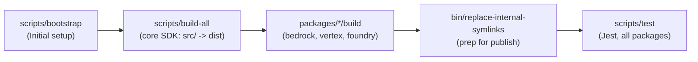

**Build steps:**

1. `scripts/build-all` — Orchestrates the full build using `tsc-multi` [package.json:21, 60]().
2. Per-package `build` scripts — Platform packages run their own build logic [packages/vertex-sdk/package.json:18]().
3. `bin/replace-internal-symlinks` — Rewrites `file:../../dist/` references to real version strings before publishing.
4. `scripts/test` — Runs Jest across the root and all sub-packages [package.json:20]().

Sources: [package.json:19-28](), [packages/vertex-sdk/package.json:16-26](), [packages/bedrock-sdk/package.json:16-26]()

---

# Page: Core Client Architecture

# Core Client Architecture

<details>
<summary>Relevant source files</summary>

The following files were used as context for generating this wiki page:

- [src/client.ts](src/client.ts)
- [src/error.ts](src/error.ts)
- [src/resources/index.ts](src/resources/index.ts)
- [src/resources/messages/index.ts](src/resources/messages/index.ts)
- [tests/index.test.ts](tests/index.test.ts)

</details>


The `@anthropic-ai/sdk` package is built around two primary classes in `src/client.ts`: `BaseAnthropic`, which implements the foundational HTTP client functionality, and `Anthropic`, which extends it to expose the public API resource namespaces. This document provides a technical overview of the SDK's internal layers, from configuration to request execution.

## Core Components

The SDK uses a layered architecture where high-level resource methods (like `messages.create`) delegate to a central request pipeline.

### Class Hierarchy

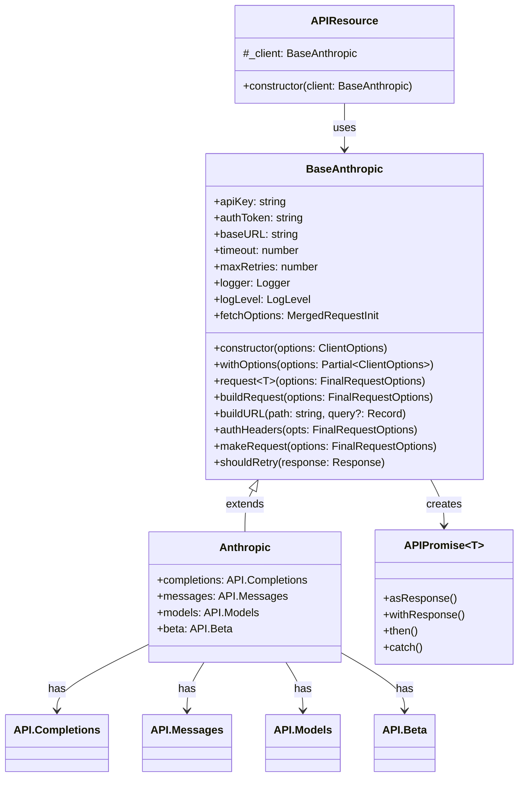

Sources: [src/client.ts:337-405](), [src/client.ts:1044-1060](), [src/core/api-promise.ts:10-25](), [src/core/resource.ts:5-12]()

## Client Configuration

The `Anthropic` client is initialized with a `ClientOptions` object. It resolves configuration from these options, falling back to environment variables where applicable.

For a deep dive into all available settings and environment variable resolution, see [Client Configuration](#2.1).

### Key Options Overview

| Option | Default | Source |
|--------|---------|--------|
| `apiKey` | `process.env['ANTHROPIC_API_KEY']` | [src/client.ts:241-244]() |
| `baseURL` | `https://api.anthropic.com` | [src/client.ts:258-261]() |
| `timeout` | `600000` (10 mins) | [src/client.ts:264-267]() |
| `maxRetries` | `2` | [src/client.ts:270-273]() |
| `logLevel` | `'warn'` | [src/client.ts:291-294]() |

Sources: [src/client.ts:237-329](), [src/client.ts:367-405]()

## Authentication

The SDK handles authentication via `X-Api-Key` or `Authorization: Bearer` headers. It supports dynamic key rotation through the `ApiKeySetter` function type.

For details on credential resolution and rotation, see [Authentication](#2.2).

Sources: [src/client.ts:438-478]()

## Request Lifecycle

When a resource method is called, it triggers a multi-stage pipeline:

1.  **Initialization**: The resource calls `this._client.post()` or `get()`.
2.  **APIPromise Creation**: A new `APIPromise` is returned, wrapping the `makeRequest` execution.
3.  **Request Building**: `buildRequest()` assembles the URL, merges headers (default, auth, and per-request), and processes the body.
4.  **Dispatch**: `fetchWithTimeout()` dispatches the request using the configured `fetch` implementation.
5.  **Response Parsing**: The raw response is parsed (usually as JSON) and the `_request_id` is attached.

For a step-by-step walkthrough of the pipeline, see [Request Lifecycle](#2.3).

### Request Processing Pipeline

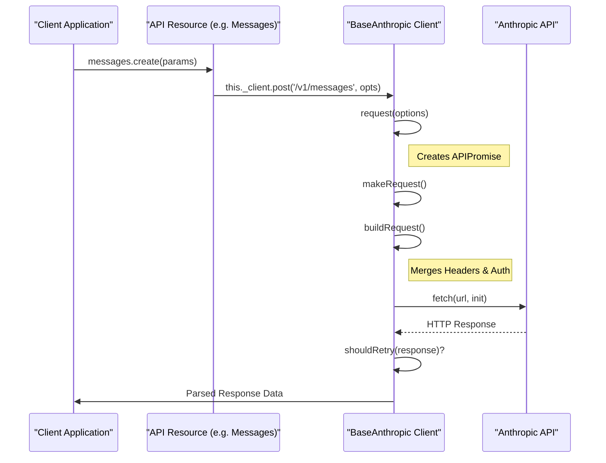

Sources: [src/client.ts:568-766](), [src/client.ts:925-950]()

## Error Handling

The SDK maps HTTP status codes and network failures to a specific class hierarchy. All API errors inherit from `APIError`, which includes the `request_id` for debugging.

For the full hierarchy and retry logic details, see [Error Handling](#2.4).

### Error Hierarchy

| Error Class | Condition |
|-------------|-----------|
| `BadRequestError` | 400 |
| `AuthenticationError` | 401 |
| `RateLimitError` | 429 |
| `APIConnectionError` | Network failure |

Sources: [src/core/error.ts:10-150](), [src/client.ts:508-515]()

## API Resource Structure

The `Anthropic` client acts as a container for specialized resource classes. Each resource is instantiated with a reference to the client, allowing it to share the central configuration and request logic.

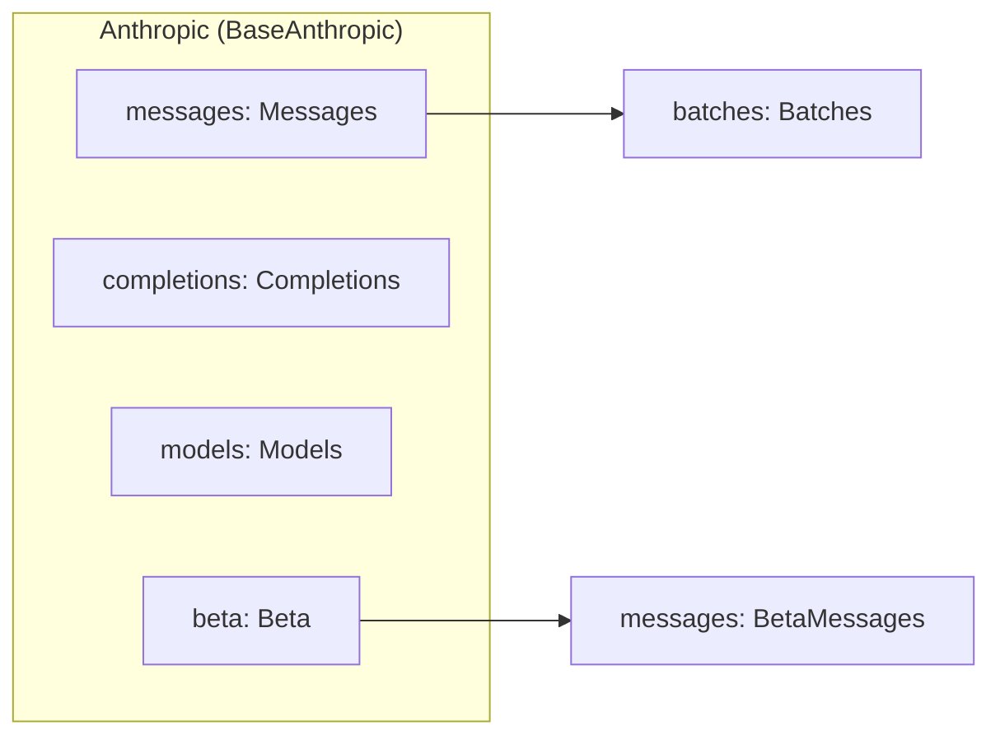

Sources: [src/client.ts:1044-1060](), [src/resources/index.ts:1-205]()

---

# Page: Client Configuration

# Client Configuration

<details>
<summary>Relevant source files</summary>

The following files were used as context for generating this wiki page:

- [src/client.ts](src/client.ts)
- [src/core/resource.ts](src/core/resource.ts)
- [src/error.ts](src/error.ts)
- [src/internal/headers.ts](src/internal/headers.ts)
- [src/internal/utils/log.ts](src/internal/utils/log.ts)
- [src/internal/utils/path.ts](src/internal/utils/path.ts)
- [src/internal/utils/values.ts](src/internal/utils/values.ts)
- [src/resources/index.ts](src/resources/index.ts)
- [src/resources/messages/index.ts](src/resources/messages/index.ts)
- [tests/index.test.ts](tests/index.test.ts)
- [tests/path.test.ts](tests/path.test.ts)
- [tsc-multi.json](tsc-multi.json)

</details>


The Anthropic TypeScript SDK provides a flexible configuration system for managing authentication, networking behavior, and request handling. This page documents the `ClientOptions` interface, environment variable fallbacks, and the mechanisms for deriving client instances.

## Client Initialization

The primary entry point is the `Anthropic` class, which extends `BaseAnthropic`. It is configured via a `ClientOptions` object passed to the constructor.

```typescript
import Anthropic from '@anthropic-ai/sdk';

const client = new Anthropic({
  apiKey: 'my-api-key', // Defaults to process.env['ANTHROPIC_API_KEY']
  baseURL: 'https://my-proxy.com',
  timeout: 20 * 1000, // 20 seconds
  maxRetries: 5,
});
```

Sources: [src/index.ts:22-44](), [src/client.ts:23-27]()

### Configuration Precedence

The SDK resolves configuration values in the following order:
1. Explicit constructor options.
2. Environment variables (e.g., `ANTHROPIC_API_KEY`, `ANTHROPIC_BASE_URL`).
3. Internal defaults (e.g., `maxRetries: 2`).

Sources: [src/index.ts:46-85](), [tests/index.test.ts:306-347]()

## Client Options Reference

| Option | Type | Default | Description |
| :--- | :--- | :--- | :--- |
| `apiKey` | `string` | `process.env['ANTHROPIC_API_KEY']` | Required for authentication. |
| `authToken` | `string` | `process.env['ANTHROPIC_AUTH_TOKEN']` | Alternative bearer token authentication. |
| `baseURL` | `string` | `https://api.anthropic.com` | The root URL for all API requests. |
| `timeout` | `number` | `600,000` (10 mins) | Request timeout in milliseconds. |
| `maxRetries` | `number` | `2` | Maximum number of retry attempts for failed requests. |
| `defaultHeaders` | `HeadersLike` | `{}` | Headers sent with every request. |
| `defaultQuery` | `Record<string, any>`| `{}` | Query parameters appended to every URL. |
| `dangerouslyAllowBrowser`| `boolean` | `false` | Must be `true` to instantiate the client in a browser. |
| `logLevel` | `LogLevel` | `'warn'` | Sets verbosity: `'off'`, `'error'`, `'warn'`, `'info'`, `'debug'`. |
| `logger` | `Logger` | `console` | Custom logging implementation. |
| `fetch` | `Fetch` | Global `fetch` | Custom fetch implementation (e.g., for proxies). |

Sources: [src/index.ts:46-85](), [src/internal/utils/log.ts:14-22](), [src/client.ts:235-237]()

## Configuration Data Flow

The following diagram illustrates how `ClientOptions` are processed and stored within the `BaseAnthropic` instance.

**Configuration Processing Logic**
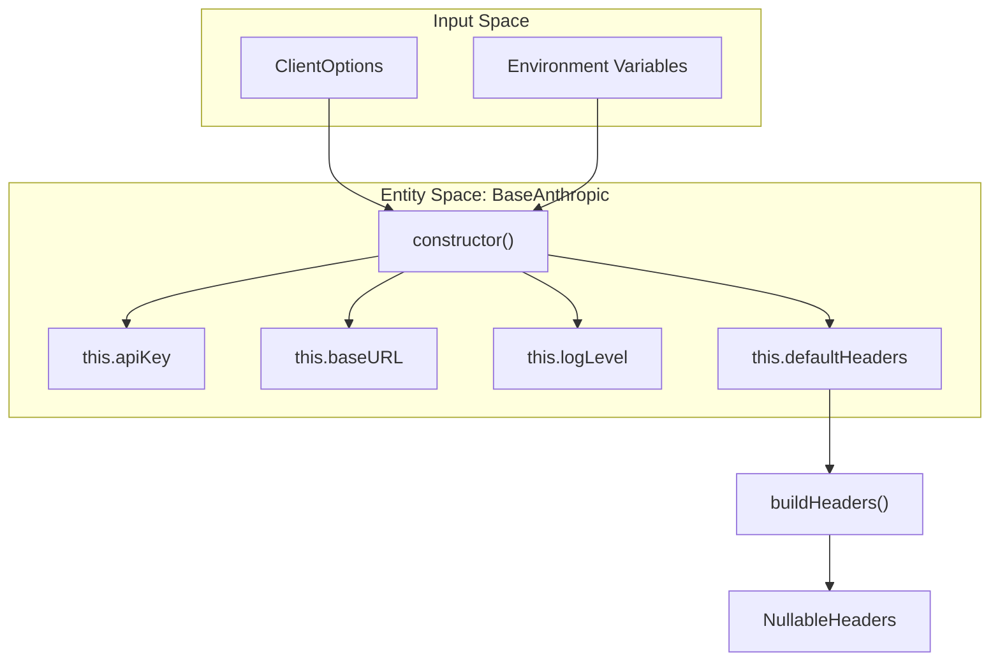

Sources: [src/client.ts:18-241](), [src/internal/headers.ts:73-94]()

## Logging and Debugging

The SDK uses a internal logging utility to format request details while protecting sensitive information like API keys.

### Log Levels and Custom Loggers
You can control verbosity via `logLevel` or the `ANTHROPIC_LOG` environment variable. If a custom `logger` is provided, it must implement the `Logger` interface (methods: `debug`, `info`, `warn`, `error`).

```typescript
const client = new Anthropic({
  logLevel: 'debug',
  logger: {
    debug: (msg, ...args) => console.log(`[DEBUG] ${msg}`, ...args),
    info: console.info,
    warn: console.warn,
    error: console.error,
  }
});
```

Sources: [src/internal/utils/log.ts:8-14](), [tests/index.test.ts:81-98]()

### Request Redaction
When logging request details, the SDK automatically redacts sensitive headers including `x-api-key`, `authorization`, `cookie`, and `set-cookie`.

Sources: [src/internal/utils/log.ts:103-118]()

## Derived Clients with `withOptions()`

The `withOptions()` method allows you to create a new client instance that inherits from the current one but overrides specific settings. This is useful for scoped requests (e.g., a specific timeout for one module).

```typescript
const client = new Anthropic({ apiKey: '...' });

// Create a derived client with a shorter timeout
const fastClient = client.withOptions({ timeout: 5000 });
```

**Implementation Detail**: `withOptions()` effectively performs a shallow merge of the new options with the existing client's configuration and returns a new instance.

Sources: [tests/index.test.ts:359-433]()

## Browser Environment Safety

The SDK includes a safety check to prevent accidental exposure of API keys in client-side code. If `isRunningInBrowser()` returns true and `dangerouslyAllowBrowser` is not explicitly set to `true`, the constructor will throw an error.

**Browser Access Guard**
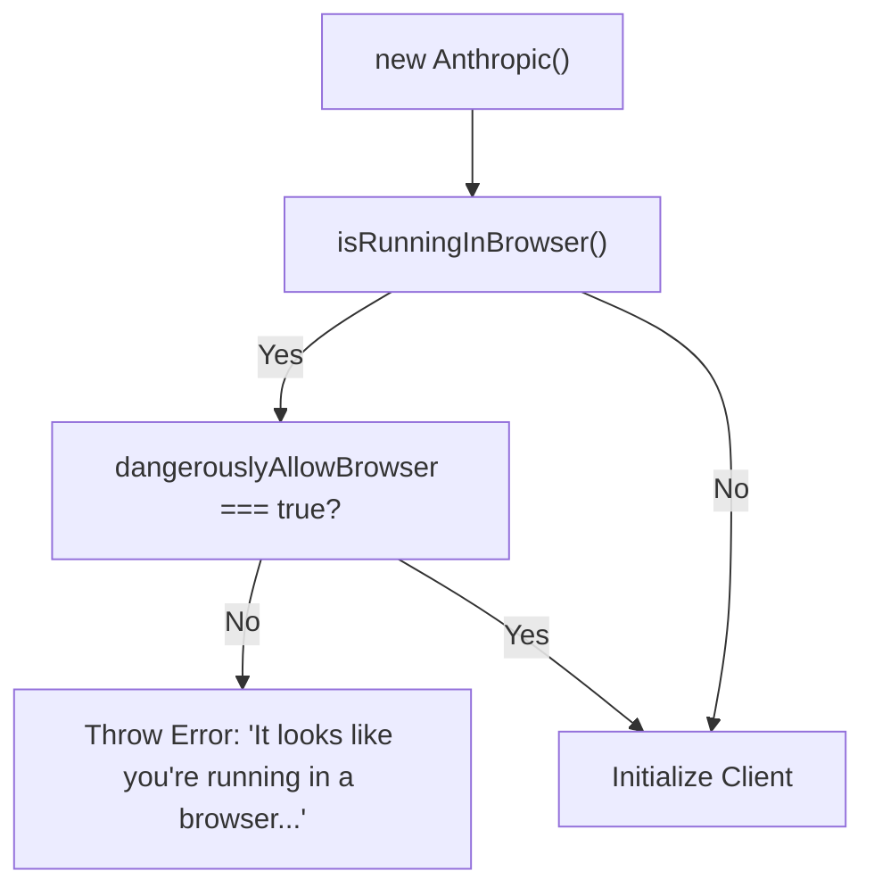

Sources: [src/client.ts:236-237](), [src/index.ts:90-105]()

## Header and Query Merging

Default headers and query parameters are merged during request construction. 
- **Headers**: Handled by `buildHeaders()`. Passing `null` to a header in a specific request will remove a default header.
- **Query**: Merged using `stringifyQuery()`.

**Header Merging Behavior**
```typescript
const client = new Anthropic({
  defaultHeaders: { 'X-Organization-Id': 'org_123' }
});

// The request will have 'X-Organization-Id' removed for this call only
await client.messages.create({...}, {
  headers: { 'X-Organization-Id': null }
});
```

Sources: [src/internal/headers.ts:73-94](), [tests/index.test.ts:43-50](), [tests/index.test.ts:217-224]()

---

# Page: Authentication

# Authentication

<details>
<summary>Relevant source files</summary>

The following files were used as context for generating this wiki page:

- [src/client.ts](src/client.ts)
- [src/error.ts](src/error.ts)
- [src/resources/index.ts](src/resources/index.ts)
- [src/resources/messages/index.ts](src/resources/messages/index.ts)
- [tests/index.test.ts](tests/index.test.ts)

</details>


## Purpose and Scope

This document explains the authentication system in the Anthropic TypeScript SDK, covering the dual authentication strategy that supports both API key and bearer token authentication. It details how authentication credentials are configured, validated, and transformed into HTTP headers during the request lifecycle.

For information about configuring authentication credentials and other client options, see [Client Configuration](2.1). For details on how authentication headers are integrated into the complete request flow, see [Request Lifecycle](2.3).

---

## Authentication Strategies

The SDK implements two distinct authentication methods that are mutually exclusive per request:

| Strategy | Header Name | Use Case | Source |
|----------|-------------|----------|--------|
| **API Key** | `X-Api-Key` | Standard Anthropic API authentication | Direct API access |
| **Bearer Token** | `Authorization` | OAuth2 or token-based authentication | Enterprise integrations |

Only one authentication method is required per client instance. The SDK validates that at least one authentication method is configured before making requests [src/client.ts:438-460]().

**Sources:** [src/client.ts:249-254](), [src/client.ts:438-460](), [src/client.ts:462-478]()

---

## Configuration

### Static API Key

The most common authentication method uses a static API key string passed via `ClientOptions` [src/client.ts:249]():

```typescript
const client = new Anthropic({
  apiKey: 'your-api-key-here'
});
```

If not provided explicitly, the SDK attempts to resolve the key from the `ANTHROPIC_API_KEY` environment variable during instantiation [src/client.ts:368-371]().

**Sources:** [src/client.ts:249](), [src/client.ts:368-371]()

### Dynamic API Key with ApiKeySetter

For scenarios requiring credential rotation or runtime API key resolution, the `ClientOptions.apiKey` field [src/client.ts:249]() also accepts an `ApiKeySetter`.

**Definition:**
`type ApiKeySetter = () => Promise<string>;` [src/client.ts:235]()

The function is invoked before each request, enabling:
- **Credential rotation** without recreating the client.
- **Dynamic fetching** from secret managers or vaults.
- **Just-in-time authentication** for short-lived tokens.

The function must return a non-empty string. If it returns an empty string or throws an error, the SDK wraps it in an `AnthropicError` with the original error as `cause`.

> **Note:** When an `ApiKeySetter` function is passed, the constructor sets `this.apiKey` (the instance property) to `null` via the assignment at [src/client.ts:403](). The function is preserved in `this._options.apiKey` for use during request preparation.

**Sources:** [src/client.ts:235](), [src/client.ts:249](), [src/client.ts:403]()

### Bearer Token Authentication

For OAuth2 flows or enterprise authentication systems, the SDK supports an `authToken` option [src/client.ts:254]():

```typescript
const client = new Anthropic({
  authToken: 'your-bearer-token'
});
```

The SDK will automatically check the `ANTHROPIC_AUTH_TOKEN` environment variable if this option is not provided [src/client.ts:370]().

**Sources:** [src/client.ts:254](), [src/client.ts:370]()

---

## Authentication Method Resolution

The following diagram shows how the SDK determines which authentication method to use during the request lifecycle:

**Logic Flow: Auth Strategy Selection**
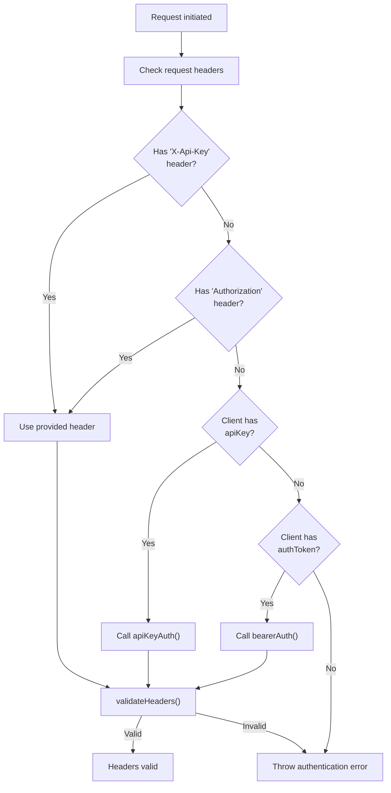

**Sources:** [src/client.ts:438-460](), [src/client.ts:462-478](), [src/client.ts:952-991]()

---

## Header Construction

### Authentication Header Methods

The `BaseAnthropic` class implements three methods for building authentication headers:

#### `authHeaders(opts: FinalRequestOptions)`
The primary method that orchestrates authentication header construction [src/client.ts:462-464](). It calls both `apiKeyAuth()` and `bearerAuth()` in sequence, then passes both results to `buildHeaders` for merging. Both methods are always called; whichever returns `undefined` is ignored by the header merging logic.

**Sources:** [src/client.ts:462-464]()

#### `apiKeyAuth(opts: FinalRequestOptions)`
Constructs the `X-Api-Key` header when `this.apiKey` is non-null. If the client was created without an API key (or with an `ApiKeySetter` function, which leaves `this.apiKey` as `null`), this method returns `undefined` and contributes no header [src/client.ts:466-470]().

**Sources:** [src/client.ts:466-470]()

#### `bearerAuth(opts: FinalRequestOptions)`
Constructs the `Authorization: Bearer <token>` header when `this.authToken` is non-null. Returns `undefined` if no auth token is configured [src/client.ts:473-478]().

**Sources:** [src/client.ts:473-478]()

---

## Header Building Pipeline

The complete header construction process integrates authentication headers with other required headers:

**Pipeline: Header Assembly**
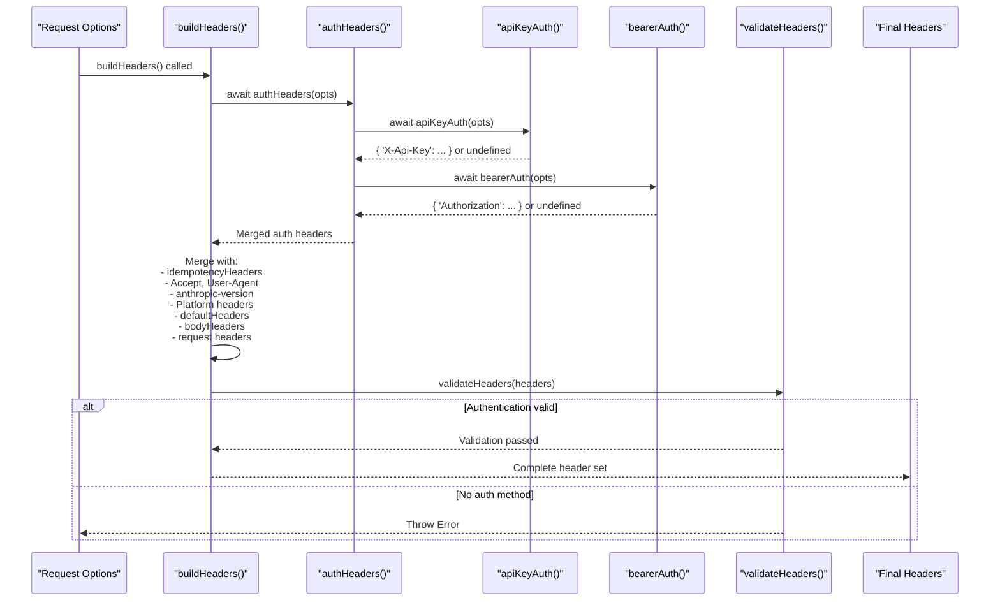

**Sources:** [src/client.ts:952-991](), [src/client.ts:462-478]()

---

## Header Validation

### Validation Logic

The `validateHeaders` method [src/client.ts:438-460]() accepts a `NullableHeaders` object containing two maps: `values` (headers that are present) and `nulls` (headers that were explicitly set to `null` to remove them). It ensures that at least one authentication method is accounted for before a request is dispatched.

The validation checks occur in this order:
1. **Header presence**: If either `X-Api-Key` or `Authorization` exists in the final header set, validation passes.
2. **Client + header match**: If the client has credentials and the corresponding header exists.
3. **Explicit omission**: If a header was explicitly set to `null` in the request options, it is treated as an intentional opt-out.
4. **Error case**: If none of the above criteria are met, the SDK throws an authentication error.

**Sources:** [src/client.ts:438-460]()

---

## Header Override Behavior

Requests can override authentication headers at call time via the second argument of resource methods:

### Replacing Authentication
```typescript
// Override with different API key for a single call
await client.messages.create({
  model: 'claude-3-5-sonnet-20240620',
  max_tokens: 1024,
  messages: [{ role: 'user', content: 'Hello' }]
}, {
  headers: {
    'X-Api-Key': 'different-api-key'
  }
});
```

### Omitting Authentication
```typescript
// Explicitly omit API key (useful for testing or custom proxies)
await client.messages.create({
  /* ... params ... */
}, {
  headers: {
    'X-Api-Key': null
  }
});
```

Setting a header to `null` explicitly removes it from the request, even if the client has authentication configured [src/internal/headers.ts](). This is validated by `validateHeaders` to ensure intentional omission [src/client.ts:438-460]().

**Sources:** [src/client.ts:438-460](), [tests/index.test.ts:43-51]()

---

## Code Entity Reference

The following table maps authentication concepts to specific code entities within `src/client.ts`:

| Concept | Code Entity | Location |
|---------|-------------|----------|
| API key configuration option | `ClientOptions.apiKey` | [src/client.ts:249]() |
| Auth token configuration option | `ClientOptions.authToken` | [src/client.ts:254]() |
| Dynamic key function type | `ApiKeySetter` | [src/client.ts:235]() |
| Client API key property | `BaseAnthropic.apiKey` | [src/client.ts:338]() |
| Client auth token property | `BaseAnthropic.authToken` | [src/client.ts:339]() |
| Primary auth header method | `BaseAnthropic.authHeaders()` | [src/client.ts:462-464]() |
| API key header builder | `BaseAnthropic.apiKeyAuth()` | [src/client.ts:466-470]() |
| Bearer token header builder | `BaseAnthropic.bearerAuth()` | [src/client.ts:473-478]() |
| Header validation logic | `BaseAnthropic.validateHeaders()` | [src/client.ts:438-460]() |
| Header building pipeline | `BaseAnthropic.buildHeaders()` (private) | [src/client.ts:952-991]() |
| Environment variable reading | `readEnv()` | [src/client.ts:368-371]() |

**Sources:** [src/client.ts:235-478](), [src/client.ts:952-991]()

---

## Platform-Specific Authentication

Platform SDKs extend the base authentication system with cloud-provider-specific implementations.

- **Google Vertex AI**: Uses Google OAuth2 credentials and service accounts. See [Vertex AI SDK](5.1).
- **AWS Bedrock**: Uses AWS Signature V4 signing and IAM roles. See [Bedrock SDK](5.2).
- **Azure Foundry**: Uses `azureADTokenProvider` or standard API keys. See [Foundry SDK](5.3).

These platform SDKs typically override the default header generation to implement provider-specific signing while maintaining the same high-level interface as the core SDK.

**Sources:** [src/client.ts:391-407]()

---

# Page: Request Lifecycle

# Request Lifecycle

<details>
<summary>Relevant source files</summary>

The following files were used as context for generating this wiki page:

- [scripts/utils/attw-report.cjs](scripts/utils/attw-report.cjs)
- [src/api-promise.ts](src/api-promise.ts)
- [src/client.ts](src/client.ts)
- [src/core/streaming.ts](src/core/streaming.ts)
- [src/error.ts](src/error.ts)
- [src/internal/builtin-types.ts](src/internal/builtin-types.ts)
- [src/internal/decoders/jsonl.ts](src/internal/decoders/jsonl.ts)
- [src/internal/errors.ts](src/internal/errors.ts)
- [src/internal/parse.ts](src/internal/parse.ts)
- [src/internal/request-options.ts](src/internal/request-options.ts)
- [src/internal/types.ts](src/internal/types.ts)
- [src/pagination.ts](src/pagination.ts)
- [src/resources/index.ts](src/resources/index.ts)
- [src/resources/messages/index.ts](src/resources/messages/index.ts)
- [tests/index.test.ts](tests/index.test.ts)
- [tests/responses.test.ts](tests/responses.test.ts)
- [tests/utils/typing.ts](tests/utils/typing.ts)

</details>


This page describes the internal pipeline a single API call travels through, from a user calling a resource method to receiving a parsed response or stream. It covers URL construction, header and query merging, body serialization, fetch dispatch, retry logic, response parsing, and `_request_id` attachment.

For details on client configuration options (timeouts, `maxRetries`, `defaultHeaders`), see **2.1 Client Configuration**. For error types thrown during this pipeline, see **2.4 Error Handling**. For the streaming-specific path after `defaultParseResponse`, see **3.2.3 Streaming Responses**.

---

## Pipeline Overview

The following diagram bridges the natural language steps of a request to the specific code entities and functions responsible for them.

**Request lifecycle pipeline**

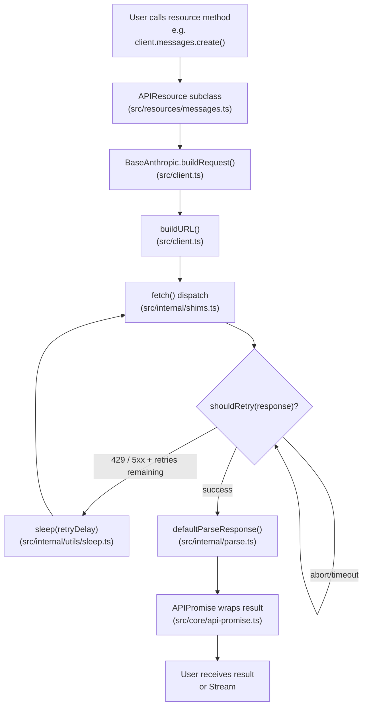

Sources: [src/internal/parse.ts:18-74](), [src/client.ts:5-15](), [src/core/api-promise.ts:28-28]()

---

## Phase 1: Resource Method

Each API resource (e.g., `Messages`, `Completions`) is a subclass of `APIResource`. Resource methods translate user-facing parameters into internal request options (`RequestOptions`) and delegate to the client's `_request()` or specific HTTP verb methods.

In some cases, parameters are extracted from the body and placed into headers. For example, beta features often require an `anthropic-beta` header which the resource layer handles before passing the request down the pipeline.

Sources: [src/resources/index.ts:1-206](), [src/resources/messages/messages.ts:1-234]()

---

## Phase 2: Request Construction — `buildRequest()`

`BaseAnthropic.buildRequest()` assembles the final `RequestInit` and `URL`. It performs header merging, query parameter attachment, and body serialization.

**`buildRequest()` Logic Flow**

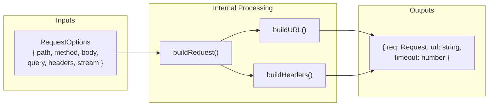

Sources: [src/client.ts:237-245](), [tests/index.test.ts:29-51]()

---

## Phase 3: URL Construction — `buildURL()`

`buildURL(path, query)` constructs the full destination:
- Joins the `baseURL` and the resource `path`.
- Merges `defaultQuery` (from client instantiation) with per-request query params.
- Handles `undefined` values by removing the key from the final URL, allowing users to override defaults.

**Query merging precedence**

| Source | Effect |
|---|---|
| `defaultQuery` | Base set of parameters for all requests. |
| Per-request `query` | Overwrites or adds to `defaultQuery`. |
| `undefined` value | Explicitly removes the key from the URL. |

Sources: [tests/index.test.ts:198-225](), [src/internal/utils/query.ts:14-14]()

---

## Phase 4: Header Merging — `buildHeaders()`

`buildHeaders()` merges multiple header sources. It uses the `NullableHeaders` type to distinguish between headers that should be sent and those that should be explicitly omitted.

**Header resolution rules**

| Value | Effect |
|---|---|
| `string` | Sets the header to this value. |
| `undefined` | Keeps the existing default (no-op). |
| `null` | **Removes** the header entirely from the request. |

**Typical merge order**
1. Internal SDK headers (e.g., `x-api-key`, `anthropic-version`, `User-Agent`).
2. `defaultHeaders` provided during client initialization.
3. Per-request `headers` passed in `RequestOptions`.

Sources: [src/internal/headers.ts:23-90](), [tests/index.test.ts:22-51]()

---

## Phase 5: Body Serialization

The body is serialized based on its type. The SDK typically uses a `JSON.stringify` encoder for standard API requests.

| Body type | Serialized as | `Content-Type` |
|---|---|---|
| Plain object / array | `JSON.stringify(body)` | `application/json` |
| `null` / `undefined` | No body sent | Not set |

Sources: [src/internal/request-options.ts:86-93]()

---

## Phase 6: Response Parsing — `defaultParseResponse()`

Once `fetch` returns, `defaultParseResponse` determines how to handle the data based on the `options` and `Content-Type`.

**Parsing dispatch logic**

```mermaid
flowchart TD
    START["Response received"]
    S1{"options.stream?"}
    S2{"status === 204?"}
    S3{"options.__binaryResponse?"}
    S4{"isJSON?"}
    
    S5["Stream.fromSSEResponse()"]
    S6["return null"]
    S7["return raw Response"]
    S8["addRequestID(json)"]
    S9["return response.text()"]

    START --> S1
    S1 -- "true" --> S5
    S1 -- "false" --> S2
    S2 -- "true" --> S6
    S2 -- "false" --> S3
    S3 -- "true" --> S7
    S3 -- "false" --> S4
    S4 -- "true" --> S8
    S4 -- "false" --> S9
```

Sources: [src/internal/parse.ts:18-74](), [src/core/streaming.ts:35-98]()

---

## `_request_id` Attachment — `addRequestID()`

`addRequestID(value, response)` reads the `request-id` header from the API response and attaches it as a non-enumerable property named `_request_id` to the result object.

**Type behavior via `WithRequestID<T>`**

| `T` | `WithRequestID<T>` |
|---|---|
| `Record<string, any>` | `T & { _request_id?: string \| null }` |
| `Array<any>` | `T` (unchanged) |
| `string` / `number` | `T` (unchanged) |

Because `_request_id` is non-enumerable, it does not appear in `JSON.stringify(response)` but can be accessed directly in code.

Sources: [src/internal/parse.ts:76-90](), [tests/responses.test.ts:7-143]()

---

## Phase 7: `APIPromise` wrapping

The entire lifecycle is wrapped in an `APIPromise`. This class allows users to access the parsed data directly or use `.withResponse()` to get both the data and the raw HTTP response metadata.

| Method | Returns |
|---|---|
| `.then()` | The parsed body `T`. |
| `.withResponse()` | `{ data: T, response: Response, request_id: string \| null }`. |

Sources: [src/core/api-promise.ts:28-28](), [tests/responses.test.ts:21-42]()

---

# Page: Error Handling

# Error Handling

<details>
<summary>Relevant source files</summary>

The following files were used as context for generating this wiki page:

- [src/error.ts](src/error.ts)
- [src/index.ts](src/index.ts)
- [src/resources/completions.ts](src/resources/completions.ts)
- [src/resources/messages.ts](src/resources/messages.ts)
- [tests/api-resources/completions.test.ts](tests/api-resources/completions.test.ts)
- [tests/index.test.ts](tests/index.test.ts)

</details>


This document describes the error handling system in the Anthropic TypeScript SDK. It covers the error class hierarchy, how errors are detected and created, retry behavior for different error types, and the `request_id` property on responses.

For information about the request lifecycle that triggers these errors, see [Request Lifecycle](2.3). For information about retry configuration, see [Client Configuration](2.1).

## Error Class Hierarchy

The SDK provides a comprehensive hierarchy of error classes that extend from a base `AnthropicError` class. All errors are exported from the main entry point and defined in `src/core/error.ts`.

```mermaid
graph TB
    AnthropicError["AnthropicError<br/>(Base class for all SDK errors)"]
    
    APIError["APIError<br/>(Base for API response errors)"]
    APIConnectionError["APIConnectionError<br/>(Network connection failures)"]
    APIConnectionTimeoutError["APIConnectionTimeoutError<br/>(Connection timeout)"]
    APIUserAbortError["APIUserAbortError<br/>(User-initiated abort)"]
    
    BadRequestError["BadRequestError<br/>(400)"]
    AuthenticationError["AuthenticationError<br/>(401)"]
    PermissionDeniedError["PermissionDeniedError<br/>(403)"]
    NotFoundError["NotFoundError<br/>(404)"]
    ConflictError["ConflictError<br/>(409)"]
    UnprocessableEntityError["UnprocessableEntityError<br/>(422)"]
    RateLimitError["RateLimitError<br/>(429)"]
    InternalServerError["InternalServerError<br/>(500+)"]
    
    AnthropicError --> APIError
    AnthropicError --> APIConnectionError
    AnthropicError --> APIConnectionTimeoutError
    AnthropicError --> APIUserAbortError
    
    APIError --> BadRequestError
    APIError --> AuthenticationError
    APIError --> PermissionDeniedError
    APIError --> NotFoundError
    APIError --> ConflictError
    APIError --> UnprocessableEntityError
    APIError --> RateLimitError
    APIError --> InternalServerError
```

**Sources:** [src/index.ts:9-23](), [src/error.ts:1-3]()

### Error Class Reference

| Error Class | HTTP Status | Description |
|-------------|-------------|-------------|
| `AnthropicError` | N/A | Base class for all SDK errors. |
| `APIError` | Various | Base class for errors returned by the API. Contains `status`, `message`, and the raw `error` body. |
| `BadRequestError` | 400 | The request was unacceptable, often due to missing a required parameter. |
| `AuthenticationError` | 401 | No valid API key provided. |
| `PermissionDeniedError` | 403 | The API key does not have permissions to perform the request. |
| `NotFoundError` | 404 | The requested resource doesn't exist. |
| `ConflictError` | 409 | The request conflicts with another request (e.g., using the same idempotency key). |
| `UnprocessableEntityError` | 422 | The request was well-formed but was unable to be followed due to semantic errors. |
| `RateLimitError` | 429 | Too many requests hit the API too quickly. |
| `InternalServerError` | 500+ | Something went wrong on Anthropic's end. |
| `APIConnectionError` | N/A | Failure to connect to the API (network issues). |
| `APIConnectionTimeoutError` | N/A | The request timed out. |
| `APIUserAbortError` | N/A | The request was cancelled by the user (e.g., via `AbortController`). |

**Sources:** [src/index.ts:9-23]()

## Error Detection and Data Flow

The SDK monitors the `fetch` lifecycle and transforms network or status failures into the specific error classes defined above.

```mermaid
flowchart TD
    Request["client.request()"] --> Fetch["Native fetch() call"]
    Fetch -- "Network Failure" --> ConnErr["APIConnectionError"]
    Fetch -- "Timeout Reached" --> TimeErr["APIConnectionTimeoutError"]
    Fetch -- "Abort Signal" --> AbortErr["APIUserAbortError"]
    Fetch -- "Response Received" --> CheckStatus{"response.ok?"}
    
    CheckStatus -- "No (Status >= 400)" --> ParseErr["Parse Error Body"]
    ParseErr --> MakeErr["makeStatusError()"]
    
    MakeErr -- "401" --> AuthErr["AuthenticationError"]
    MakeErr -- "429" --> RateErr["RateLimitError"]
    MakeErr -- "404" --> NotFound["NotFoundError"]
    MakeErr -- "500+" --> ServerErr["InternalServerError"]
    
    CheckStatus -- "Yes" --> Success["Return APIPromise"]
```

**Sources:** [src/index.ts:9-23](), [tests/index.test.ts:7-8]()

## Inspecting Errors and Request IDs

When an error occurs, the `APIError` object contains metadata that is crucial for debugging, specifically the `request_id`. This ID is returned by Anthropic's infrastructure and should be provided when contacting support.

### The request_id Property

Every successful response or error response from the Anthropic API includes a unique `request_id`. In the SDK, this is accessible via:

1.  **On Errors**: The `APIError` instance contains the headers, which include the request ID.
2.  **On Successful Responses**: You can access the raw response (including headers) using the `.withResponse()` method on the `APIPromise`.

```typescript
import Anthropic from '@anthropic-ai/sdk';

const client = new Anthropic();

try {
  const message = await client.messages.create({
    max_tokens: 1024,
    messages: [{ role: 'user', content: 'Hello' }],
    model: 'claude-3-5-sonnet-20241022',
  });
} catch (err) {
  if (err instanceof Anthropic.APIError) {
    console.log(err.status); // 400
    console.log(err.name);   // BadRequestError
    // Access the request ID from headers
    console.log(err.headers.get('request-id'));
  } else {
    throw err;
  }
}
```

**Sources:** [src/index.ts:6-8](), [tests/api-resources/completions.test.ts:17-23]()

## Request IDs in Testing

The SDK's internal testing suite simulates the attachment of `request_id` (often logged as `requestLogID` internally) to ensure that the lifecycle correctly handles these identifiers during retries and logging.

```mermaid
sequenceDiagram
    participant User
    participant SDK as Anthropic Client
    participant API as Anthropic API
    
    User->>SDK: messages.create()
    SDK->>API: POST /v1/messages
    API-->>SDK: 429 Rate Limit (Header: request-id: req_123)
    Note over SDK: SDK inspects headers
    SDK->>User: throws RateLimitError (err.headers['request-id'] == 'req_123')
```

**Sources:** [tests/index.test.ts:64-79](), [src/resources/completions.ts:43-52]()

## Legacy Completions Error Handling

The legacy `Completions` resource follows the same error handling patterns. If a request to `/v1/complete` fails, it will throw the same hierarchy of errors.

```typescript
try {
  await client.completions.create({
    max_tokens_to_sample: 256,
    model: 'claude-opus-4-6',
    prompt: '\n\nHuman: Hello, world!\n\nAssistant:',
  });
} catch (err) {
  if (err instanceof Anthropic.NotFoundError) {
    // Handle 404
  }
}
```

**Sources:** [src/resources/completions.ts:32-41](), [tests/api-resources/completions.test.ts:11-24]()

---

# Page: API Resources

# API Resources

<details>
<summary>Relevant source files</summary>

The following files were used as context for generating this wiki page:

- [.stats.yml](.stats.yml)
- [api.md](api.md)
- [src/client.ts](src/client.ts)
- [src/resources/index.ts](src/resources/index.ts)
- [src/resources/messages/index.ts](src/resources/messages/index.ts)
- [src/resources/shared.ts](src/resources/shared.ts)

</details>


This page describes the stable API resource namespaces exposed by the `Anthropic` client class. It covers `client.messages`, `client.completions`, and `client.models`, along with the `messages.batches` sub-resource. For beta features and the `client.beta` namespace, see [Beta Features](#4).

The resources described here correspond to the files under [src/resources/]() and are attached as properties on the `Anthropic` class in [src/client.ts]().

---

## Resource Attachment to Client

All resource namespaces are instantiated inside the `Anthropic` class constructor and stored as instance properties. Each resource class extends `APIResource` (from [src/core/resource.ts]()), giving it access to the parent client via `this._client`.

**Resource-to-Client wiring in `Anthropic`:**

[src/client.ts:1044-1100]()

| Client property | Resource class | Source file |
|---|---|---|
| `client.messages` | `Messages` | [src/resources/messages/messages.ts]() |
| `client.messages.batches` | `Batches` | [src/resources/messages/batches.ts]() |
| `client.completions` | `Completions` | [src/resources/completions.ts]() |
| `client.models` | `Models` | [src/resources/models.ts]() |
| `client.beta` | `Beta` | [src/resources/beta/beta.ts]() |

Sources: [src/client.ts:27-63](), [src/resources/index.ts:1-205]()

---

## Resource Namespace Map

The following diagram maps each client-facing namespace to its implementing class and source file.

**Stable Resource Namespaces**

```mermaid
graph LR
    A["Anthropic\n(src/client.ts)"]

    A --> M["client.messages\nclass Messages\nsrc/resources/messages/messages.ts"]
    A --> C["client.completions\nclass Completions\nsrc/resources/completions.ts"]
    A --> MO["client.models\nclass Models\nsrc/resources/models.ts"]
    A --> B["client.beta\nclass Beta\nsrc/resources/beta/beta.ts"]

    M --> MB["client.messages.batches\nclass Batches\nsrc/resources/messages/batches.ts"]
```

Sources: [src/client.ts:27-63](), [src/resources/index.ts:1-205](), [src/resources/messages/index.ts:1-188]()

---

## Messages

`client.messages` is the primary interface for interacting with Claude models. It maps to the `Messages` class defined in [src/resources/messages/messages.ts](). For details, see [Messages API](#3.2).

### Methods

| Method | HTTP | Path | Returns |
|---|---|---|---|
| `.create(params)` | POST | `/v1/messages` | `Message` or `Stream<RawMessageStreamEvent>` |
| `.stream(body, options?)` | POST | `/v1/messages` | `MessageStream` |
| `.countTokens(params)` | POST | `/v1/messages/count_tokens` | `MessageTokensCount` |

`.create()` accepts a `stream: true` parameter to switch to streaming mode, returning a raw `Stream<RawMessageStreamEvent>`. `.stream()` is a convenience wrapper that returns a higher-level `MessageStream` helper.

**Method and type dispatch:**

```mermaid
graph LR
    MC["client.messages.create(params)"]
    MS["client.messages.stream(body, options?)"]
    MCT["client.messages.countTokens(params)"]

    MC -->|"stream: false (default)"| MSG["Message\n(src/resources/messages/messages.ts)"]
    MC -->|"stream: true"| STRE["Stream<RawMessageStreamEvent>\n(src/core/streaming.ts)"]
    MS --> MSGSTREAM["MessageStream\n(src/lib/streaming.ts)"]
    MCT --> MTC["MessageTokensCount\n(src/resources/messages/messages.ts)"]
```

Sources: [src/resources/messages/messages.ts:234-234](), [src/resources/messages/index.ts:179-192]()

### Key Types

| Type | Description |
|---|---|
| `Message` | Full response object containing `id`, `content`, `model`, `stop_reason`, `usage` |
| `MessageParam` | A single conversation turn (`role` + `content`) |
| `ContentBlock` | Union of `TextBlock`, `ToolUseBlock`, `ThinkingBlock`, etc. |
| `ContentBlockParam` | Union of all input content block param types |
| `StopReason` | `"end_turn"`, `"max_tokens"`, `"stop_sequence"`, `"tool_use"` |
| `Usage` | Token counts: `input_tokens`, `output_tokens`, `cache_read_input_tokens`, `cache_creation_input_tokens` |
| `ToolUnion` | Union of all tool definition types |
| `ToolChoice` | `ToolChoiceAuto`, `ToolChoiceAny`, `ToolChoiceTool`, `ToolChoiceNone` |

Sources: [src/resources/messages/messages.ts:65-234](), [src/resources/messages/index.ts:19-188]()

---

## Messages — Batches Sub-Resource

`client.messages.batches` maps to the `Batches` class in [src/resources/messages/batches.ts](). It provides asynchronous bulk processing of message requests. For details, see [Message Batches](#3.2.4).

### Methods

| Method | HTTP | Path | Returns |
|---|---|---|---|
| `.create(params)` | POST | `/v1/messages/batches` | `MessageBatch` |
| `.retrieve(messageBatchId)` | GET | `/v1/messages/batches/{id}` | `MessageBatch` |
| `.list(params?)` | GET | `/v1/messages/batches` | `MessageBatchesPage` |
| `.delete(messageBatchId)` | DELETE | `/v1/messages/batches/{id}` | `DeletedMessageBatch` |
| `.cancel(messageBatchId)` | POST | `/v1/messages/batches/{id}/cancel` | `MessageBatch` |
| `.results(messageBatchId)` | GET | `/v1/messages/batches/{id}/results` | async iterable of `MessageBatchIndividualResponse` |

### Key Types

| Type | Description |
|---|---|
| `MessageBatch` | Batch object: `id`, `processing_status`, `request_counts`, `results_url`, `expires_at` |
| `MessageBatchResult` | Discriminated union: `MessageBatchSucceededResult`, `MessageBatchErroredResult`, `MessageBatchCanceledResult`, `MessageBatchExpiredResult` |
| `MessageBatchIndividualResponse` | Single request outcome: `custom_id` + `result` |
| `MessageBatchRequestCounts` | Counts by status: `processing`, `succeeded`, `errored`, `canceled`, `expired` |

Sources: [src/resources/messages/index.ts:3-17]()

---

## Models

`client.models` maps to the `Models` class in [src/resources/models.ts](). It provides model introspection — listing available models and retrieving details about a specific model. For details, see [Models API](#3.1).

### Methods

| Method | HTTP | Path | Returns |
|---|---|---|---|
| `.retrieve(modelId, params?)` | GET | `/v1/models/{model_id}` | `ModelInfo` |
| `.list(params?)` | GET | `/v1/models` | `ModelInfosPage` |

### Key Types

| Type | Description |
|---|---|
| `ModelInfo` | Model metadata: `id`, `display_name`, `created_at`, `capabilities` |
| `ModelInfosPage` | Paginated list of `ModelInfo` objects |

Sources: [src/resources/models.ts:37-48](), [src/resources/index.ts:193-205]()

---

## Completions (Legacy)

`client.completions` maps to the `Completions` class in [src/resources/completions.ts](). This resource implements the legacy Text Completions API (endpoint `POST /v1/complete`). New code should use `client.messages` instead. For details, see [Completions API (Legacy)](#3.3).

### Method

| Method | HTTP | Path | Returns |
|---|---|---|---|
| `.create(params)` | POST | `/v1/complete` | `Completion` or `Stream<Completion>` |

### Key Parameters

| Parameter | Required | Description |
|---|---|---|
| `prompt` | Yes | Must use `\n\nHuman: ...\n\nAssistant:` format |
| `model` | Yes | Model identifier string |
| `max_tokens_to_sample` | Yes | Maximum tokens to generate |
| `stop_sequences` | No | Additional stop strings |
| `stream` | No | Enable streaming |

Sources: [src/resources/completions.ts:30-34](), [src/resources/index.ts:19-25]()

---

## Source File Index

| Namespace | Implementation | Exports index |
|---|---|---|
| `client.messages` | [src/resources/messages/messages.ts]() | [src/resources/messages/index.ts]() |
| `client.messages.batches` | [src/resources/messages/batches.ts]() | [src/resources/messages/index.ts:3-17]() |
| `client.models` | [src/resources/models.ts]() | [src/resources/index.ts:193-205]() |
| `client.completions` | [src/resources/completions.ts]() | [src/resources/index.ts:19-25]() |
| All resources (re-export) | — | [src/resources/index.ts]() |

---

## Relationship to Other Pages

| Topic | Page |
|---|---|
| `Messages` API in depth — create, parameters, response shape | [Messages API](#3.2) |
| `messages.batches` in depth | [Message Batches](#3.2.4) |
| `models.retrieve`, `models.list`, pagination | [Models API](#3.1) |
| Legacy completions | [Completions API (Legacy)](#3.3) |
| `client.beta` namespace | [Beta Features](#4) |
| Request lifecycle, retries, error handling | [Core Client Architecture](#2) |

---

# Page: Models API

# Models API

<details>
<summary>Relevant source files</summary>

The following files were used as context for generating this wiki page:

- [src/resources/beta/models.ts](src/resources/beta/models.ts)
- [src/resources/models.ts](src/resources/models.ts)
- [tests/api-resources/beta/models.test.ts](tests/api-resources/beta/models.test.ts)
- [tests/api-resources/models.test.ts](tests/api-resources/models.test.ts)

</details>


This page documents the `client.models` namespace, which provides read access to metadata and capabilities for available Anthropic models. It covers `retrieve()`, `list()`, the `ModelInfo` response type, and how pagination works for model listings.

---

## Resource Location

The Models resource is implemented in [src/resources/models.ts]() and is exposed on the `Anthropic` client as `client.models`. It is registered in the client constructor and re-exported through the resource index.

**Diagram: Models API Class Relationships**

```mermaid
graph TD
    subgraph "Client Space"
        A["Anthropic (src/client.ts)"]
    end

    subgraph "Stable Resource Space"
        B["client.models (Models class)"]
        C["src/resources/models.ts"]
        C1["ModelInfo (Interface)"]
        C2["ModelCapabilities (Interface)"]
    end

    subgraph "Beta Resource Space"
        D["client.beta.models (Models class)"]
        E["src/resources/beta/models.ts"]
        E1["BetaModelInfo (Interface)"]
        E2["BetaModelCapabilities (Interface)"]
    end

    A -->|"instantiates"| B
    B -.->|"defined in"| C
    C -->|"defines"| C1
    C1 -->|"contains"| C2

    A -->|"contains"| D
    D -.->|"defined in"| E
    E -->|"defines"| E1
    E1 -->|"contains"| E2
```

Sources: [src/resources/models.ts:11]() , [src/resources/beta/models.ts:11]()

---

## Methods

### `client.models.retrieve()`

Fetches metadata for a single model by its ID. This can be used to resolve model aliases to specific model IDs or to check a model's current capabilities.

| Parameter | Type | Required | Description |
| :--- | :--- | :--- | :--- |
| `modelID` | `string` | Yes | The model identifier (e.g., `claude-3-5-sonnet-20240620`). |
| `params` | `ModelRetrieveParams` | No | Optional parameters including `betas` headers. |
| `options` | `RequestOptions` | No | Standard request overrides (headers, timeout, etc.). |

**HTTP:** `GET /v1/models/{modelID}`

**Returns:** `APIPromise<ModelInfo>`

**Example:**
```ts
const modelInfo = await client.models.retrieve('claude-3-5-sonnet-20240620');
console.log(modelInfo.capabilities?.thinking?.supported);
```

Sources: [src/resources/models.ts:18-31]()

---

### `client.models.list()`

Returns a paginated list of available models. More recently released models are listed first.

**HTTP:** `GET /v1/models`

**Returns:** `PagePromise<ModelInfosPage, ModelInfo>`

#### `ModelListParams`
Extends `PageParams` for cursor-based pagination.

| Parameter | Type | Description |
| :--- | :--- | :--- |
| `after_id` | `string` | ID of the model to start after. |
| `before_id` | `string` | ID of the model to start before. |
| `limit` | `number` | Number of models to return per page. |
| `betas` | `AnthropicBeta[]` | Optional beta headers to include. |

**Example:**
```ts
// Automatically fetches more pages as needed using async iteration
for await (const model of client.models.list({ limit: 5 })) {
  console.log(model.display_name);
}
```

Sources: [src/resources/models.ts:39-52]() , [src/resources/models.ts:249-254]()

---

## Data Structures

### `ModelInfo`
The primary data object representing an Anthropic model.

| Field | Type | Description |
| :--- | :--- | :--- |
| `id` | `string` | Unique model identifier. |
| `display_name` | `string` | Human-readable name. |
| `created_at` | `string` | RFC 3339 datetime of release. |
| `capabilities` | `ModelCapabilities` | Detailed feature support (thinking, tools, etc.). |
| `max_input_tokens` | `number \| null` | Context window size. |
| `max_tokens` | `number \| null` | Maximum output tokens allowed. |
| `type` | `'model'` | Constant object type. |

### `ModelCapabilities`
Describes the technical features supported by the model instance.

| Capability | Type | Description |
| :--- | :--- | :--- |
| `thinking` | `ThinkingCapability` | Support for extended reasoning and adaptive thinking. |
| `tool_use` | `CapabilitySupport` | Whether the model can use external tools. |
| `structured_outputs`| `CapabilitySupport` | Support for JSON mode or strict schemas. |
| `context_management`| `ContextManagementCapability` | Support for `compact`, `clear_thinking`, etc. |
| `image_input` | `CapabilitySupport` | Support for vision/image blocks. |
| `pdf_input` | `CapabilitySupport` | Support for document/PDF processing. |

Sources: [src/resources/models.ts:125-170]() , [src/resources/models.ts:172-210]()

---

## Pagination Implementation

The `list()` method utilizes the `Page` class for cursor-based navigation. It returns a `PagePromise`, which allows for both direct await (returning the first page) and async iteration (fetching subsequent pages automatically).

**Diagram: Model List Data Flow**

```mermaid
sequenceDiagram
    participant U as User Code
    participant M as Models Resource
    participant C as Core APIClient
    participant P as Page Object

    U->>M: list({ limit: 20 })
    M->>C: getAPIList("/v1/models", Page<ModelInfo>, ...)
    C->>P: new Page(response)
    P-->>U: AsyncIterable<ModelInfo>
    
    loop for await (model of list)
        U->>P: next()
        alt has cached data
            P-->>U: ModelInfo
        else needs next page
            P->>C: get("/v1/models?after_id=...")
            C-->>P: next page JSON
            P-->>U: ModelInfo
        end
    end
```

Sources: [src/resources/models.ts:44-51]() , [src/core/pagination.ts:6-7]()

---

## Beta Variant

A parallel implementation exists under `client.beta.models`. This variant is used to access experimental model features or preview metadata.

*   **Implementation:** [src/resources/beta/models.ts]()
*   **Behavior:** Appends `?beta=true` to the request URL and allows passing `betas` headers via the `params` object.
*   **Types:** Uses `BetaModelInfo` and `BetaModelCapabilities`, which mirror the stable types but may include additional experimental fields.

```ts
// Example Beta Retrieval
const betaModel = await client.beta.models.retrieve('model_id', {
  betas: ['context-management-2025-01-12']
});
```

Sources: [src/resources/beta/models.ts:25-38]() , [src/resources/beta/models.ts:187-225]()

---

# Page: Messages API

# Messages API

<details>
<summary>Relevant source files</summary>

The following files were used as context for generating this wiki page:

- [.stats.yml](.stats.yml)
- [api.md](api.md)
- [src/resources/beta/messages/messages.ts](src/resources/beta/messages/messages.ts)
- [src/resources/messages/messages.ts](src/resources/messages/messages.ts)

</details>


This page introduces the stable Messages API — the primary interface for sending requests to Claude and receiving generated responses. It describes the `Messages` resource class, the shape of the `Message` response object, stop reasons, and usage fields. For detailed coverage of individual topics, see the sub-pages listed at the end.

- For the **beta** Messages API with extended parameters, see [Beta Messages API](#4.1).
- For the legacy text-completion interface, see [Completions API (Legacy)](#3.3).

---

## Overview

The `Messages` class, defined in [src/resources/messages/messages.ts:36-187](), is the central resource exposed on the `Anthropic` client as `client.messages`. It wraps the `/v1/messages` REST endpoint and provides four calling patterns plus a batch sub-resource.

**Resource hierarchy:**

```mermaid
graph LR
    A["Anthropic client"] --> M["client.messages\n(Messages class)"]
    M --> MC[".create()"]
    M --> MS[".stream()"]
    M --> MP[".parse()"]
    M --> MT[".countTokens()"]
    M --> MB["client.messages.batches\n(Batches class)"]
    MB --> MBC[".create()"]
    MB --> MBR[".retrieve()"]
    MB --> MBL[".list()"]
    MB --> MBD[".delete()"]
    MB --> MBX[".cancel()"]
    MB --> MBRZ[".results()"]
```

Sources: [src/resources/messages/messages.ts:36-187](), [src/resources/messages/index.ts](), [api.md:20-22]()

---

## The `Message` Response Object

Every non-streaming call to `client.messages.create()` returns a `Message` object. Its interface is defined in [src/resources/messages/messages.ts:875-940]().

### Field summary

| Field | Type | Description |
|---|---|---|
| `id` | `string` | Unique identifier for this message object. Format may change. |
| `type` | `'message'` | Always `"message"`. |
| `role` | `'assistant'` | Always `"assistant"` for responses. |
| `content` | `ContentBlock[]` | Array of generated content blocks. See [Content Blocks & Tools](#3.2.2). |
| `model` | `Model` | The model identifier used to generate this response. |
| `stop_reason` | `StopReason \| null` | Why the model stopped generating. See table below. |
| `stop_sequence` | `string \| null` | The stop sequence that caused generation to stop, if applicable. |
| `usage` | `Usage` | Token consumption breakdown. |

Sources: [src/resources/messages/messages.ts:875-940](), [api.md:82]()

---

## Stop Reasons

The `StopReason` type is a string union defined in [src/resources/messages/messages.ts:1145-1150]():

```typescript
type StopReason = 'end_turn' | 'max_tokens' | 'stop_sequence' | 'tool_use';
```

| Value | When it occurs |
|---|---|
| `end_turn` | Model reached a natural stopping point. |
| `max_tokens` | The `max_tokens` limit was reached before a natural stop. |
| `stop_sequence` | A string from `stop_sequences` was matched in the output. |
| `tool_use` | Model is requesting a tool call; a `ToolUseBlock` will be in `content`. |

Sources: [src/resources/messages/messages.ts:1145-1150](), [api.md:108]()

---

## Usage Fields

The `Usage` interface tracks token consumption per request:

| Field | Type | Description |
|---|---|---|
| `input_tokens` | `number` | Tokens consumed from the request. |
| `output_tokens` | `number` | Tokens produced by the model. |
| `cache_creation_input_tokens` | `number \| null` | Tokens written to the prompt cache. |
| `cache_read_input_tokens` | `number \| null` | Tokens read from the prompt cache. |

`MessageDeltaUsage` is a partial form of `Usage` emitted in streaming delta events, containing `output_tokens`. `MessageTokensCount` is the response type from `client.messages.countTokens()` and contains `input_tokens`.

Sources: [src/resources/messages/messages.ts:1174-1184](), [api.md:83-87]()

---

## `ContentBlock` Union

The `content` field in a `Message` is an array of `ContentBlock` values. Each block has a discriminating `type` field.

**Content block types in a response:**

```mermaid
graph TD
    CB["ContentBlock (union)"] --> TB["TextBlock\ntype: 'text'"]
    CB --> THK["ThinkingBlock\ntype: 'thinking'"]
    CB --> RTH["RedactedThinkingBlock\ntype: 'redacted_thinking'"]
    CB --> TUB["ToolUseBlock\ntype: 'tool_use'"]
    CB --> STUB["ServerToolUseBlock\ntype: 'server_tool_use'"]
    CB --> WSRB["WebSearchToolResultBlock\ntype: 'web_search_tool_result'"]
    CB --> WFRB["WebFetchToolResultBlock\ntype: 'web_fetch_tool_result'"]
    CB --> CERB["CodeExecutionToolResultBlock\ntype: 'code_execution_tool_result'"]
    CB --> BCER["BashCodeExecutionToolResultBlock\ntype: 'bash_code_execution_tool_result'"]
    CB --> TECER["TextEditorCodeExecutionToolResultBlock\ntype: 'text_editor_code_execution_tool_result'"]
    CB --> TSRB["ToolSearchToolResultBlock\ntype: 'tool_search_tool_result'"]
```

Sources: [src/resources/messages/messages.ts:705-717]()

For input content block types (`ContentBlockParam`) and tool definitions, see [Content Blocks & Tools](#3.2.2).

---

## Method Reference

The following diagram maps the four calling patterns to their underlying implementations and return types.

```mermaid
flowchart LR
    subgraph "Messages class (src/resources/messages/messages.ts)"
        CREATE[".create(params)\nPOST /v1/messages"]
        STREAM[".stream(params)\ncreates MessageStream"]
        PARSE[".parse(params)\nwraps .create() + parseMessage()"]
        COUNT[".countTokens(params)\nPOST /v1/messages/count_tokens"]
    end

    CREATE -->|"stream:false"| MSG["Message"]
    CREATE -->|"stream:true"| RAWSTREAM["Stream<RawMessageStreamEvent>"]
    STREAM --> MSGSTREAM["MessageStream\n(src/lib/MessageStream.ts)"]
    PARSE --> PARSEDMSG["ParsedMessage<T>\n(src/lib/parser.ts)"]
    COUNT --> TOKCOUNT["MessageTokensCount"]
```

Sources: [src/resources/messages/messages.ts:58-186]()

### `.create()`

Posts to `/v1/messages`. Accepts `MessageCreateParamsNonStreaming` or `MessageCreateParamsStreaming`. When `stream: false` (default), returns `APIPromise<Message>`. When `stream: true`, returns `APIPromise<Stream<RawMessageStreamEvent>>`.

The method automatically calculates a dynamic timeout for large non-streaming requests based on `max_tokens`. It also emits a console warning if a deprecated model is used [src/resources/messages/messages.ts:71-77](). See [Creating Messages](#3.2.1) for full parameter reference.

### `.stream()`

A convenience wrapper that constructs a `MessageStream` instance (defined in `src/lib/MessageStream.ts`), which supports event handlers like `.on('text', cb)`, `.on('message', cb)`, and `await stream.finalMessage()`. See [Streaming Responses](#3.2.3).

### `.parse()`

Calls `.create()` then passes the result through `parseMessage()` from `src/lib/parser.ts`. The parsed output is attached as `parsed_output` on the returned message. Requires an `output_config.format` like `zodOutputFormat(...)`. See [Structured Outputs](#4.2.1).

### `.countTokens()`

Posts to `/v1/messages/count_tokens`. Returns `MessageTokensCount` containing `input_tokens`. Accepts the same content and tool parameters as `.create()`, but does not generate a response [src/resources/messages/messages.ts:184-186]().

---

## Message Batches Sub-Resource

`client.messages.batches` is an instance of the `Batches` class defined in [src/resources/messages/batches.ts](). It supports creating, polling, and streaming results from batch jobs. See [Message Batches](#3.2.4) for full documentation.

---

## Timeout Behaviour

For non-streaming requests, if no explicit `timeout` is set on the client or request options, the SDK calculates a timeout using the model's token limits and `max_tokens` [src/resources/messages/messages.ts:88-92](). The default fallback for Message creation is 600,000ms (10 minutes) [src/resources/messages/messages.ts:99]().

Sources: [src/resources/messages/messages.ts:88-103]()

---

## Sub-Pages

| Page | Content |
|---|---|
| [Creating Messages](#3.2.1) | Full parameter reference for `client.messages.create()` |
| [Content Blocks & Tools](#3.2.2) | All content block types, tool definitions, `ToolUnion`, `ToolChoice` |
| [Streaming Responses](#3.2.3) | `MessageStream`, SSE pipeline, event handlers, `finalMessage()` |
| [Message Batches](#3.2.4) | `Batches` sub-resource, lifecycle states, JSONL result streaming |

---

# Page: Creating Messages

# Creating Messages

<details>
<summary>Relevant source files</summary>

The following files were used as context for generating this wiki page:

- [src/resources/beta/messages/messages.ts](src/resources/beta/messages/messages.ts)
- [src/resources/messages/messages.ts](src/resources/messages/messages.ts)
- [tests/api-resources/beta/messages/batches.test.ts](tests/api-resources/beta/messages/batches.test.ts)
- [tests/api-resources/beta/messages/messages.test.ts](tests/api-resources/beta/messages/messages.test.ts)
- [tests/api-resources/messages/batches.test.ts](tests/api-resources/messages/batches.test.ts)
- [tests/api-resources/messages/messages.test.ts](tests/api-resources/messages/messages.test.ts)

</details>


This page covers `client.messages.create()` — the primary method for sending requests to Claude and receiving completions. It documents required and optional request parameters, the shape of the response object, timeout behavior, and deprecated model warnings.

For information about **streaming responses**, see [3.2.3](). For **content block types and tool definitions**, see [3.2.2](). For **batch creation**, see [3.2.4](). For the **beta messages API** with additional parameters, see [4.1]().

---

## Method Signatures

The `Messages` class in [src/resources/messages/messages.ts:36-187]() exposes `create()` with three overloads, distinguished by whether `stream` is set:

```ts
// Non-streaming: returns a resolved Message
create(body: MessageCreateParamsNonStreaming, options?: RequestOptions): APIPromise<Message>

// Streaming: returns an async iterable of raw SSE events
create(body: MessageCreateParamsStreaming, options?: RequestOptions): APIPromise<Stream<RawMessageStreamEvent>>

// Union overload (for dynamic stream flag)
create(body: MessageCreateParamsBase, options?: RequestOptions): APIPromise<Stream<RawMessageStreamEvent> | Message>
```

The method POSTs to `/v1/messages` via the base client.

**Diagram: create() Call Flow**

```mermaid
flowchart TD
    U["user calls\nclient.messages.create(params)"]
    D["DEPRECATED_MODELS check\nconsole.warn if match"]
    T["timeout calculation\ncalculateNonstreamingTimeout()\nif non-streaming and no explicit timeout"]
    H["stainlessHelperHeader()\nbuild X-Stainless-Helper-Header"]
    POST["this._client.post('/v1/messages', { body, timeout, headers, stream })"]
    R1["APIPromise<Message>"]
    R2["APIPromise<Stream<RawMessageStreamEvent>>"]

    U --> D
    D --> T
    T --> H
    H --> POST
    POST --> R1
    POST --> R2
```

Sources: [src/resources/messages/messages.ts:58-104]()

---

## Required Parameters

All three of the following fields must be present in every call:

| Parameter | Type | Description |
|-----------|------|-------------|
| `model` | `Model` (string) | The Claude model to use. See the `Model` type for the full string union. |
| `messages` | `MessageParam[]` | Ordered list of conversation turns. Each entry has `role` (`"user"` or `"assistant"`) and `content` (string or `ContentBlockParam[]`). |
| `max_tokens` | `number` | Maximum number of tokens Claude may generate in its response. |

```ts
// Minimum valid call
client.messages.create({
  model: 'claude-3-5-sonnet-20241022',
  max_tokens: 1024,
  messages: [{ role: 'user', content: 'Hello, Claude' }],
});
```

Sources: [src/resources/messages/messages.ts:58-70](), [tests/api-resources/messages/messages.test.ts:11-24]()

---

## Optional Parameters

### Sampling Controls

| Parameter | Type | Default | Description |
|-----------|------|---------|-------------|
| `temperature` | `number` | — | Randomness (0–1). Higher = more varied. Cannot be used with `thinking`. |
| `top_k` | `number` | — | Only sample from the top K tokens. |
| `top_p` | `number` | — | Nucleus sampling probability cutoff. |
| `stop_sequences` | `string[]` | — | Additional strings that, when generated, halt output. The matching sequence is not included in the response. |

### System Prompt

`system` accepts either a plain `string` or an array of `TextBlockParam` objects (enabling per-block `cache_control` and citation metadata).

```ts
// Simple string
system: "You are a helpful assistant."

// Structured form with cache control
system: [{ type: 'text', text: "Today's date is 2024-06-01.", cache_control: { type: 'ephemeral' } }]
```

### Caching

`cache_control` at the top-level request level sets a default `CacheControlEphemeral` (`{ type: 'ephemeral', ttl?: '5m' | '1h' }`). Individual content blocks (system, messages, or tools) can also carry their own `cache_control` fields.

### Metadata

`metadata` accepts `{ user_id?: string }` for associating requests with users for Anthropic's trust-and-safety systems.

### Service Tier

`service_tier` can be `'auto'` or `'standard'`. When `'auto'`, Anthropic may route to priority infrastructure if available.

### Output Configuration

`output_config` is an object used for structured outputs and quality control:

| Field | Type | Description |
|-------|------|-------------|
| `format` | `JSONOutputFormat \| ZodOutputFormat` | Structured output schema for use with `parse()`. |
| `effort` | `'low' \| ...` | Controls effort/quality tradeoff. |

### Thinking

`thinking` enables extended chain-of-thought reasoning:

```ts
thinking: { type: 'enabled', budget_tokens: 1600 }
// or
thinking: { type: 'adaptive' }
```

When `thinking` is enabled and `temperature` is set, a warning or error may result depending on the model.

### Tools and Tool Choice

`tools` accepts an array of tool definitions. `tool_choice` controls whether tool use is forced, allowed, or disabled. Both are covered in depth in [3.2.2]().

### Container

`container` (string or object) pins the request to a specific execution environment, often used with code execution tools.

Sources: [tests/api-resources/messages/messages.test.ts:26-86](), [src/resources/messages/messages.ts:39-164]()

---

## Response Shape: `Message`

The response object returned by non-streaming calls.

**Diagram: Message Entity Mapping**

```mermaid
erDiagram
    Message {
        string id
        string role
        string type
        Model model
        StopReason stop_reason
        string stop_sequence
    }
    Message ||--o{ ContentBlock : "content[]"
    Message ||--|| Usage : "usage"
    Message ||--o| Container : "container"

    Usage {
        number input_tokens
        number output_tokens
        number cache_creation_input_tokens
        number cache_read_input_tokens
    }

    Container {
        string id
        string expires_at
    }
```

### Field Reference

| Field | Type | Notes |
|-------|------|-------|
| `id` | `string` | Unique identifier for the message object. |
| `role` | `'assistant'` | Always `"assistant"`. |
| `type` | `'message'` | Always `"message"`. |
| `model` | `Model` | The model that produced the response. |
| `content` | `ContentBlock[]` | Array of typed blocks. Contains `TextBlock`, `ToolUseBlock`, `ThinkingBlock`, etc. |
| `stop_reason` | `StopReason \| null` | Why generation stopped (e.g., `"end_turn"`, `"max_tokens"`, `"tool_use"`). |
| `stop_sequence` | `string \| null` | Which custom stop sequence triggered, if any. |
| `usage` | `Usage` | Token counts for billing and rate limiting. |
| `container` | `Container \| null` | Present when a code execution container was used. |
| `_request_id` | `string` | Added by the SDK from the `request-id` response header. |

Sources: [src/resources/messages/messages.ts:58-104]()

---

## Timeout Behavior

By default, a non-streaming call times out after 10 minutes. When no explicit `timeout` is set on the client or request, and `stream` is `false`, the SDK computes a dynamic timeout based on `max_tokens` using `calculateNonstreamingTimeout()`.

The dynamic calculation is skipped (and falls back to 10 minutes) when:
- `stream: true` is set, or
- A `timeout` is explicitly set at the client or request level.

For very large `max_tokens`, it is strongly recommended to use streaming mode to avoid idle-connection timeouts on intermediate networks.

Sources: [src/resources/messages/messages.ts:88-103]()

---

## Deprecated Model Warnings

When a request is made with a model that has a scheduled end-of-life date, the SDK emits a `console.warn` before sending the request. No error is thrown.

**Diagram: Deprecated Model Logic**

```mermaid
flowchart LR
    A["create(body)"]
    B{"body.model in\nDEPRECATED_MODELS?"}
    C["console.warn(deprecation message\nwith EOL date)"]
    D["continue with request"]

    A --> B
    B -- "yes" --> C
    C --> D
    B -- "no" --> D
```

The `DEPRECATED_MODELS` constant maps model identifiers to their end-of-life dates:

| Model | EOL Date |
|-------|----------|
| `claude-instant-1.2` | November 6th, 2024 |
| `claude-2.0`, `claude-2.1` | July 21st, 2025 |
| `claude-3-sonnet-20240229` | July 21st, 2025 |
| `claude-3-opus-20240229` | January 5th, 2026 |
| `claude-3-7-sonnet-20250219` | February 19th, 2026 |

Additionally, using `thinking.type === 'enabled'` on certain models (e.g., `claude-opus-4-6`) emits a warning advising use of `'adaptive'` instead.

Sources: [src/resources/beta/messages/messages.ts:49-65](), [src/resources/messages/messages.ts:71-86](), [tests/api-resources/messages/messages.test.ts:155-184]()

---

## Counting Tokens

`client.messages.countTokens()` estimates token usage for a hypothetical request **without** actually creating a message. It accepts most parameters used in `create()`.

```ts
const count = await client.messages.countTokens({
  model: 'claude-3-5-sonnet-20241022',
  messages: [{ role: 'user', content: 'Hey Claude!' }],
});
console.log(count.input_tokens);
```

The method POSTs to `/v1/messages/count_tokens` and returns a `MessageTokensCount` object.

Sources: [src/resources/messages/messages.ts:184-186](), [tests/api-resources/messages/messages.test.ts:88-152]()

---

## Companion Methods

| Method | Returns | Notes |
|--------|---------|-------|
| `messages.create({ stream: false })` | `APIPromise<Message>` | Default non-streaming path. |
| `messages.create({ stream: true })` | `APIPromise<Stream<RawMessageStreamEvent>>` | Raw SSE event iterator. See [3.2.3](). |
| `messages.stream(params)` | `MessageStream` | Higher-level streaming wrapper with event handlers. See [3.2.3](). |
| `messages.parse(params)` | `APIPromise<ParsedMessage<T>>` | Structured output variant; requires `output_config.format`. |
| `messages.countTokens(params)` | `APIPromise<MessageTokensCount>` | Token estimation without generating a response. |

Sources: [src/resources/messages/messages.ts:58-187]()

---

# Page: Content Blocks & Tools

# Content Blocks & Tools

<details>
<summary>Relevant source files</summary>

The following files were used as context for generating this wiki page:

- [.stats.yml](.stats.yml)
- [api.md](api.md)
- [examples/count-tokens.ts](examples/count-tokens.ts)
- [examples/thinking-stream.ts](examples/thinking-stream.ts)
- [examples/thinking.ts](examples/thinking.ts)
- [examples/tools-streaming.ts](examples/tools-streaming.ts)
- [examples/tools.ts](examples/tools.ts)
- [examples/web-search-stream.ts](examples/web-search-stream.ts)
- [examples/web-search.ts](examples/web-search.ts)
- [src/resources/beta/messages/messages.ts](src/resources/beta/messages/messages.ts)
- [src/resources/messages/messages.ts](src/resources/messages/messages.ts)

</details>


This document describes the content block types used in message exchanges and the tool system architecture in the Messages API. Content blocks are the fundamental units of communication between users and Claude, while tools enable Claude to perform actions and integrate with external systems.

For information about creating messages and basic message structure, see [Creating Messages](3.2.1). For streaming message responses, see [Streaming Responses](3.2.3).

## Content Block Overview

Content blocks are typed data structures that represent different kinds of content in messages. They come in two categories: **input blocks** (sent to Claude) and **output blocks** (received from Claude).

### Content Block Type Hierarchy

```mermaid
graph TB
    subgraph "Input Content Blocks (ContentBlockParam)"
        IN_TEXT["TextBlockParam<br/>type: 'text'"]
        IN_IMAGE["ImageBlockParam<br/>type: 'image'"]
        IN_DOC["DocumentBlockParam<br/>type: 'document'"]
        IN_SEARCH["SearchResultBlockParam<br/>type: 'search_result'"]
        IN_THINKING["ThinkingBlockParam<br/>type: 'thinking'"]
        IN_TOOL_USE["ToolUseBlockParam<br/>type: 'tool_use'"]
        IN_TOOL_RESULT["ToolResultBlockParam<br/>type: 'tool_result'"]
        IN_SERVER_TOOL["ServerToolUseBlockParam<br/>type: 'server_tool_use'"]
    end
    
    subgraph "Output Content Blocks (ContentBlock)"
        OUT_TEXT["TextBlock<br/>type: 'text'"]
        OUT_THINKING["ThinkingBlock<br/>type: 'thinking'"]
        OUT_REDACTED["RedactedThinkingBlock<br/>type: 'redacted_thinking'"]
        OUT_TOOL_USE["ToolUseBlock<br/>type: 'tool_use'"]
        OUT_SERVER_TOOL["ServerToolUseBlock<br/>type: 'server_tool_use'"]
        OUT_WEB_SEARCH["WebSearchToolResultBlock<br/>type: 'web_search_tool_result'"]
    end
    
    MSG_CONTENT["Message.content<br/>Array<ContentBlock>"]
    PARAM_CONTENT["MessageParam.content<br/>string | Array<ContentBlockParam>"]
    
    PARAM_CONTENT --> IN_TEXT
    PARAM_CONTENT --> IN_IMAGE
    PARAM_CONTENT --> IN_DOC
    PARAM_CONTENT --> IN_SEARCH
    PARAM_CONTENT --> IN_THINKING
    PARAM_CONTENT --> IN_TOOL_USE
    PARAM_CONTENT --> IN_TOOL_RESULT
    PARAM_CONTENT --> IN_SERVER_TOOL
    
    MSG_CONTENT --> OUT_TEXT
    MSG_CONTENT --> OUT_THINKING
    MSG_CONTENT --> OUT_REDACTED
    MSG_CONTENT --> OUT_TOOL_USE
    MSG_CONTENT --> OUT_SERVER_TOOL
    MSG_CONTENT --> OUT_WEB_SEARCH
```

Sources: [src/resources/messages/messages.ts:67-75](), [src/resources/messages/messages.ts:317-346]()

## Input Content Block Types

Input content blocks are sent in the `messages` array when creating a message. The `content` field of a `MessageParam` can be either a simple string (shorthand for a single text block) or an array of typed content blocks.

### Text Blocks

The most basic content block. Can include citations for referenced documents.

| Field | Type | Description |
|-------|------|-------------|
| `type` | `'text'` | Block type identifier |
| `text` | `string` | The text content |
| `citations` | `Array<TextCitationParam>` \| `null` | Optional citations |
| `cache_control` | `CacheControlEphemeral` \| `null` | Cache control breakpoint |

Sources: [src/resources/messages/messages.ts:782-793]()

### Image Blocks

Support for images via base64 encoding or URL references.

| Field | Type | Description |
|-------|------|-------------|
| `type` | `'image'` | Block type identifier |
| `source` | `Base64ImageSource` \| `URLImageSource` | Image source |
| `cache_control` | `CacheControlEphemeral` \| `null` | Cache control breakpoint |

**Image Source Types:**
- `Base64ImageSource`: `{ type: 'base64', media_type: 'image/jpeg' | 'image/png' | 'image/gif' | 'image/webp', data: string }` [src/resources/messages/messages.ts:189-195]()
- `URLImageSource`: `{ type: 'url', url: string }` [src/resources/messages/messages.ts:1104-1108]()

Sources: [src/resources/messages/messages.ts:365-374](), [src/resources/messages/messages.ts:189-195]()

### Document Blocks

Support for document content including PDFs and plain text.

| Field | Type | Description |
|-------|------|-------------|
| `type` | `'document'` | Block type identifier |
| `source` | Various document sources | Document data |
| `title` | `string` \| `null` | Document title |
| `citations` | `CitationsConfigParam` \| `null` | Citation configuration |
| `context` | `string` \| `null` | Additional context |
| `cache_control` | `CacheControlEphemeral` \| `null` | Cache control breakpoint |

**Document Source Types:**
- `Base64PDFSource`: PDF data as base64 [src/resources/messages/messages.ts:197-203]()
- `PlainTextSource`: Plain text with `media_type: 'text/plain'` [src/resources/messages/messages.ts:597-603]()

Sources: [src/resources/messages/messages.ts:348-363]()

### Tool Result Blocks

Used to send tool execution results back to Claude in subsequent messages.

| Field | Type | Description |
|-------|------|-------------|
| `type` | `'tool_result'` | Block type identifier |
| `tool_use_id` | `string` | ID from the corresponding `ToolUseBlock` |
| `content` | `string` \| `Array<ContentBlockParam>` | Tool execution result |
| `is_error` | `boolean` | Whether this represents an error |
| `cache_control` | `CacheControlEphemeral` \| `null` | Cache control breakpoint |

Sources: [src/resources/messages/messages.ts:1002-1015]()

## Output Content Block Types

Output content blocks are returned in the `content` array of a `Message` response. These represent Claude's generated content.

### Text Blocks (Output)

Text generated by Claude, potentially with citations.

```typescript
interface TextBlock {
  type: 'text';
  text: string;
  citations: Array<TextCitation> | null;
}
```

Citations can reference different location types:
- `CitationCharLocation`: Character-based location in plain text documents [src/resources/messages/messages.ts:133-138]()
- `CitationPageLocation`: Page-based location in PDFs [src/resources/messages/messages.ts:145-150]()
- `CitationContentBlockLocation`: Content block-based location [src/resources/messages/messages.ts:139-144]()

Sources: [src/resources/messages/messages.ts:767-780]()

### Thinking Blocks

Extended thinking blocks show Claude's reasoning process when the `thinking` parameter is enabled.

```typescript
interface ThinkingBlock {
  type: 'thinking';
  thinking: string;
  signature: string;
}

interface RedactedThinkingBlock {
  type: 'redacted_thinking';
  data: string;
}
```

Sources: [src/resources/messages/messages.ts:815-821](), [src/resources/messages/messages.ts:691-695](), [examples/thinking.ts:14-16]()

### Tool Use Blocks

Indicate that Claude wants to use a tool. These blocks contain the tool invocation details.

```typescript
interface ToolUseBlock {
  type: 'tool_use';
  id: string;
  name: string;
  input: unknown;
}
```

Sources: [src/resources/messages/messages.ts:1079-1087](), [examples/tools.ts:35-37]()

## Tool System Architecture

The tool system enables Claude to perform actions and integrate with external systems. There are two distinct categories of tools: **client tools** (custom tools you define) and **server tools** (pre-built tools hosted by Anthropic).

### Tool System Flow

```mermaid
sequenceDiagram
    participant User
    participant SDK as "Messages API"
    participant Claude
    participant Tool as "Tool Executor"
    
    User->>SDK: Create message with tools array
    SDK->>Claude: Request with tool definitions
    Claude->>SDK: Response with ToolUseBlock
    SDK->>User: Return Message with tool_use content
    User->>Tool: Execute tool with input from ToolUseBlock
    Tool->>User: Return tool result
    User->>SDK: Send new message with ToolResultBlockParam
    SDK->>Claude: Continue conversation with results
    Claude->>SDK: Generate response using results
    SDK->>User: Return final Message
```

Sources: [examples/tools.ts:8-60]()

### Tool Definition Components

```mermaid
graph LR
    subgraph "Tool Definition (Tool)"
        NAME["name: string<br/>Tool identifier"]
        SCHEMA["input_schema: InputSchema<br/>JSON Schema (draft 2020-12)"]
        DESC["description?: string<br/>Tool description"]
        TYPE["type?: 'custom' | null"]
        CACHE["cache_control?: CacheControlEphemeral"]
    end
    
    subgraph "InputSchema"
        SCHEMA_TYPE["type: 'object'"]
        PROPS["properties?: unknown"]
        REQ["required?: Array<string>"]
    end
    
    SCHEMA --> SCHEMA_TYPE
    SCHEMA --> PROPS
    SCHEMA --> REQ
    
    subgraph "Tool Choice Control (ToolChoice)"
        CHOICE_AUTO["ToolChoiceAuto<br/>type: 'auto'"]
        CHOICE_ANY["ToolChoiceAny<br/>type: 'any'"]
        CHOICE_TOOL["ToolChoiceTool<br/>type: 'tool', name: string"]
        CHOICE_NONE["ToolChoiceNone<br/>type: 'none'"]
    end
```

Sources: [src/resources/messages/messages.ts:871-921](), [src/resources/messages/messages.ts:943-1000]()

## Custom Tools (Client Tools)

Custom tools allow you to define arbitrary functions that Claude can invoke. You provide the tool definition with a JSON schema, and Claude generates structured `tool_use` blocks when it wants to use them.

### Tool Definition Structure

| Field | Type | Required | Description |
|-------|------|----------|-------------|
| `name` | `string` | Yes | Tool identifier used by Claude |
| `input_schema` | `Tool.InputSchema` | Yes | JSON Schema defining input shape |
| `description` | `string` | No | Detailed description |
| `type` | `'custom'` \| `null` | No | Explicitly marks as custom tool |
| `cache_control` | `CacheControlEphemeral` \| `null` | No | Cache control breakpoint |

Sources: [src/resources/messages/messages.ts:871-921](), [examples/tools.ts:13-22]()

### Tool Choice Configuration

Control how Claude uses tools with the `tool_choice` parameter:

| Type | Behavior | Parameters |
|------|----------|------------|
| `ToolChoiceAuto` | Model decides automatically | `disable_parallel_tool_use?: boolean` |
| `ToolChoiceAny` | Model must use at least one tool | `disable_parallel_tool_use?: boolean` |
| `ToolChoiceTool` | Model must use specific tool | `name: string`, `disable_parallel_tool_use?: boolean` |
| `ToolChoiceNone` | Model cannot use tools | None |

Sources: [src/resources/messages/messages.ts:943-1000]()

## Server Tools

Server tools are pre-built tools hosted and executed by Anthropic's servers.

### Server Tool Categories

```mermaid
graph TB
    subgraph "Server Tool Types (ToolUnion)"
        CUSTOM["Tool<br/>Custom client tool"]
        BASH["ToolBash20250124<br/>type: 'bash_20250124'"]
        EDITOR_1["ToolTextEditor20250124<br/>type: 'text_editor_20250124'"]
        EDITOR_2["ToolTextEditor20250429<br/>type: 'text_editor_20250429'"]
        EDITOR_3["ToolTextEditor20250728<br/>type: 'text_editor_20250728'"]
        WEB["WebSearchTool20250305<br/>type: 'web_search_20250305'"]
    end
    
    subgraph "Beta Server Tools (BetaToolUnion)"
        CODE_1["BetaCodeExecutionTool20250522<br/>type: 'code_execution_20250522'"]
        CODE_2["BetaCodeExecutionTool20250825<br/>type: 'code_execution_20250825'"]
        COMP_1["BetaToolComputerUse20241022<br/>type: 'computer_20241022'"]
        COMP_2["BetaToolComputerUse20250124<br/>type: 'computer_20250124'"]
        MEMORY["BetaMemoryTool20250818<br/>type: 'memory_20250818'"]
        FETCH["BetaWebFetchTool20250910<br/>type: 'web_fetch_20250910'"]
    end
```

Sources: [src/resources/messages/messages.ts:1071-1077](), [src/resources/beta/messages/messages.ts:1934-1948]()

### Web Search Tool

Enable Claude to perform web searches with configurable domain filters and user location.

**Version:** `web_search_20250305`

```typescript
interface WebSearchTool20250305 {
  type: 'web_search_20250305';
  name: 'web_search';
  allowed_domains?: Array<string> | null;
  blocked_domains?: Array<string> | null;
  max_uses?: number | null;
  user_location?: UserLocation | null;
  cache_control?: CacheControlEphemeral | null;
}
```

Sources: [src/resources/messages/messages.ts:1177-1246](), [examples/web-search.ts:22-27]()

## Beta Server Tools

Beta tools require specific beta headers and are accessible via `client.beta`.

### Code Execution Tools

Execute Python code in isolated containers.

**Version:** `code_execution_20250825`

```typescript
interface BetaCodeExecutionTool20250825 {
  type: 'code_execution_20250825';
  name: 'code_execution';
  cache_control?: BetaCacheControlEphemeral | null;
}
```

Sources: [src/resources/beta/messages/messages.ts:564-578]()

### Memory Tool

Persistent file-based memory for maintaining state across conversations.

**Version:** `memory_20250818`

```typescript
interface BetaMemoryTool20250818 {
  type: 'memory_20250818';
  name: 'memory';
  cache_control?: BetaCacheControlEphemeral | null;
}
```

Sources: [src/resources/beta/messages/messages.ts:847-976]()

## Content Block Type Reference Table

| Type | Direction | Stable/Beta | Description |
|------|-----------|-------------|-------------|
| `text` | Both | Stable | Plain text content |
| `image` | Input | Stable | Image data (base64/URL) |
| `document` | Input | Stable | Document data (PDF/text) |
| `thinking` | Both | Stable | Extended thinking reasoning |
| `redacted_thinking` | Output | Stable | Redacted thinking data |
| `tool_use` | Both | Stable | Tool invocation request |
| `tool_result` | Input | Stable | Tool execution result |
| `server_tool_use` | Both | Stable | Server-executed tool |
| `web_search_tool_result` | Output | Stable | Web search results |
| `web_fetch_tool_result` | Output | Beta | Web fetch result |

Sources: [src/resources/messages/messages.ts:317-346](), [src/resources/beta/messages/messages.ts:670-705]()

---

# Page: Streaming Responses

# Streaming Responses

<details>
<summary>Relevant source files</summary>

The following files were used as context for generating this wiki page:

- [examples/cancellation.ts](examples/cancellation.ts)
- [examples/demo.ts](examples/demo.ts)
- [examples/raw-streaming.ts](examples/raw-streaming.ts)
- [examples/streaming.ts](examples/streaming.ts)
- [helpers.md](helpers.md)
- [src/internal/decoders/line.ts](src/internal/decoders/line.ts)
- [src/lib/BetaMessageStream.ts](src/lib/BetaMessageStream.ts)
- [src/lib/MessageStream.ts](src/lib/MessageStream.ts)
- [src/streaming.ts](src/streaming.ts)
- [tests/api-resources/BetaMessageStream.test.ts](tests/api-resources/BetaMessageStream.test.ts)
- [tests/api-resources/MessageStream.test.ts](tests/api-resources/MessageStream.test.ts)
- [tests/internal/decoders/line.test.ts](tests/internal/decoders/line.test.ts)
- [tests/lib/fixtures/incomplete_partial_json_response.txt](tests/lib/fixtures/incomplete_partial_json_response.txt)
- [tests/streaming.test.ts](tests/streaming.test.ts)

</details>


This page covers the three streaming consumption patterns available in `@anthropic-ai/sdk`, the `MessageStream` helper class and its event API, cancellation mechanics, and the underlying SSE/`LineDecoder` pipeline that converts raw HTTP bytes into structured events.

For the stable Messages API parameters (model, max_tokens, etc.), see [Creating Messages](3.2.1). For the beta equivalent (`client.beta.messages.stream()`), see [Beta Messages API](4.1). For batch processing (non-streaming, async), see [Message Batches](3.2.4).

---

## Overview

The SDK exposes three distinct streaming patterns:

| Pattern | Entry point | Returns | Memory | Accumulates message? |
|---|---|---|---|---|
| **Raw async iterable** | `client.messages.create({ stream: true })` | `Stream<MessageStreamEvent>` | Low | No |
| **MessageStream helper** | `client.messages.stream(params)` | `MessageStream` | Higher | Yes |
| **Event handlers** | `.on('text', ...)` | `MessageStream` | Higher | Yes |

The raw pattern iterates SSE events directly. The helper patterns wrap those events in `MessageStream`, which accumulates a complete `Message` object and fires typed event callbacks.

Both patterns terminate in the same underlying SSE pipeline: `Response.body` → `LineDecoder` → `SSEDecoder` → `Stream<RawMessageStreamEvent>`.

---

## Raw Async Iterable Pattern

When `stream: true` is passed to `client.messages.create()`, the internal request logic returns a `Stream<MessageStreamEvent>` instead of a parsed JSON object. The `Stream` class is defined in [src/core/streaming.ts:22-213]().

The caller iterates with `for await`:

```ts
// examples/raw-streaming.ts
const stream = await client.messages.create({
  model: 'claude-sonnet-4-5-20250929',
  stream: true,
  max_tokens: 500,
  messages: [{ role: 'user', content: 'Hey Claude!' }],
});

for await (const event of stream) {
  if (event.type === 'content_block_delta' && event.delta.type === 'text_delta') {
    process.stdout.write(event.delta.text);
  }
}
```

To cancel, call `stream.controller.abort()` or `break` from the loop. A `break` triggers the `finally` block in `Stream.fromSSEResponse` [src/core/streaming.ts:87-93](), which calls `controller.abort()` automatically.

**Sources:** [src/core/streaming.ts:35-98](), [examples/raw-streaming.ts:1-28](), [examples/cancellation.ts:1-46]()

---

## MessageStream Helper Pattern

`client.messages.stream(params)` and `client.beta.messages.stream(params)` return a `MessageStream` [src/lib/MessageStream.ts:51-743]() or `BetaMessageStream` [src/lib/BetaMessageStream.ts:54-764]() respectively. These classes accumulate the full `Message` object incrementally and expose typed event callbacks.

**Diagram: MessageStream internal wiring**

```mermaid
flowchart TD
    U["user calls\n.stream(params)"]
    CM["MessageStream.createMessage()\nsrc/lib/MessageStream.ts:151"]
    RC["_run(executor)\nsrc/lib/MessageStream.ts:172"]
    API["messages.create({ stream: true })\nwith X-Stainless-Helper-Method header"]
    S["Stream<MessageStreamEvent>\nsrc/core/streaming.ts"]
    ASE["#addStreamEvent(event)\nsrc/lib/MessageStream.ts:451"]
    ACC["#accumulateMessage(event)\nsrc/lib/MessageStream.ts:559"]
    EMIT["_emit(event, ...args)\nsrc/lib/MessageStream.ts:392"]
    FIN["_emitFinal()\nsrc/lib/MessageStream.ts:505"]
    END["_emit('end')"]

    U --> CM
    CM --> RC
    RC --> API
    API --> S
    S -->|"for await"| ASE
    ASE --> ACC
    ASE --> EMIT
    ASE -->|"on message_stop"| FIN
    FIN --> END
```

**Sources:** [src/lib/MessageStream.ts:151-170](), [src/lib/MessageStream.ts:172-219](), [src/lib/MessageStream.ts:451-512]()

---

## The SSE Pipeline

**Diagram: Byte-to-event pipeline (code entities)**

```mermaid
flowchart LR
    BODY["Response.body\n(ReadableStream)"]
    ITER["ReadableStreamToAsyncIterable\nsrc/internal/shims.ts"]
    SSE_CHUNKS["iterSSEChunks()\nsrc/core/streaming.ts:253"]
    LD["LineDecoder\nsrc/internal/decoders/line.ts:11"]
    SSED["SSEDecoder.decode(line)\nsrc/core/streaming.ts:283"]
    ITER_SSE["_iterSSEMessages()\nsrc/core/streaming.ts:215"]
    FROM_SSE["Stream.fromSSEResponse()\nsrc/core/streaming.ts:35"]
    PARSED["Stream<Item>\nasync iterable of JSON-parsed events"]

    BODY --> ITER
    ITER --> SSE_CHUNKS
    SSE_CHUNKS --> LD
    LD --> SSED
    SSED --> ITER_SSE
    ITER_SSE --> FROM_SSE
    FROM_SSE --> PARSED
```

**Key components:**

| Class / Function | File | Role |
|---|---|---|
| `LineDecoder` | [src/internal/decoders/line.ts:11-75]() | Buffers bytes, yields complete text lines. Handles `\n`, `\r`, `\r\n`, multi-byte UTF-8 across chunks. |
| `SSEDecoder` | [src/core/streaming.ts:283-336]() | Accumulates `event:` and `data:` fields, yields `ServerSentEvent` on double-newline. |
| `iterSSEChunks()` | [src/core/streaming.ts:253-281]() | Splits byte stream at double-newline boundaries before line decoding. |
| `_iterSSEMessages()` | [src/core/streaming.ts:215-247]() | Combines `iterSSEChunks` + `LineDecoder` + `SSEDecoder` into an `AsyncGenerator<ServerSentEvent>`. |
| `Stream.fromSSEResponse()` | [src/core/streaming.ts:35-98]() | Wraps `_iterSSEMessages`, JSON-parses each event's `data`, throws `APIError` on `error` events. |

**Error handling:** If the server emits an SSE event with `event: error`, `Stream.fromSSEResponse` throws an `APIError` [src/core/streaming.ts:82-84]().

**Sources:** [src/core/streaming.ts:1-346](), [src/internal/decoders/line.ts:1-104](), [tests/streaming.test.ts:1-245]()

---

## MessageStream API

`MessageStream` ([src/lib/MessageStream.ts:51-743]()) is the stable API version. `BetaMessageStream` ([src/lib/BetaMessageStream.ts:54-764]()) is the beta equivalent with additional events like `compaction`.

### Event Handlers

Register via `.on(event, callback)`. Returns `this` for chaining. Use `.once()` for one-shot listeners and `.off()` to remove.

**Diagram: Event emission points mapped to SSE event types**

```mermaid
flowchart TD
    MSG_START["message_start SSE"]
    CB_START["content_block_start SSE"]
    CB_DELTA["content_block_delta SSE"]
    CB_STOP["content_block_stop SSE"]
    MSG_DELTA["message_delta SSE"]
    MSG_STOP["message_stop SSE"]

    E_CONNECT["emit: 'connect'"]
    E_STREAM["emit: 'streamEvent'\n(every SSE event)"]
    E_TEXT["emit: 'text'\n(text_delta)"]
    E_THINK["emit: 'thinking'\n(thinking_delta)"]
    E_SIG["emit: 'signature'\n(signature_delta)"]
    E_JSON["emit: 'inputJson'\n(input_json_delta)"]
    E_CITE["emit: 'citation'\n(citations_delta)"]
    E_CB["emit: 'contentBlock'\n(complete block)"]
    E_MSG["emit: 'message'\n(complete message)"]
    E_FINAL["emit: 'finalMessage'"]
    E_END["emit: 'end'"]

    MSG_START -->|"_connected()"| E_CONNECT
    MSG_START --> E_STREAM
    CB_START --> E_STREAM
    CB_DELTA --> E_STREAM
    CB_DELTA -->|"text_delta"| E_TEXT
    CB_DELTA -->|"thinking_delta"| E_THINK
    CB_DELTA -->|"signature_delta"| E_SIG
    CB_DELTA -->|"input_json_delta"| E_JSON
    CB_DELTA -->|"citations_delta"| E_CITE
    CB_STOP --> E_STREAM
    CB_STOP --> E_CB
    MSG_DELTA --> E_STREAM
    MSG_STOP --> E_STREAM
    MSG_STOP --> E_MSG
    MSG_STOP -->|"_emitFinal()"| E_FINAL
    E_FINAL --> E_END
```

**Sources:** [src/lib/MessageStream.ts:451-512](), [src/lib/MessageStream.ts:440-445](), [src/lib/MessageStream.ts:392-438]()

### Complete Event Reference

| Event | Callback signature | Fired when |
|---|---|---|
| `connect` | `() => void` | HTTP connection established |
| `streamEvent` | `(event, snapshot)` | Every SSE event; `snapshot` is the accumulated `Message` |
| `text` | `(textDelta, textSnapshot)` | `content_block_delta` with `text_delta` |
| `thinking` | `(thinkingDelta, thinkingSnapshot)` | `content_block_delta` with `thinking_delta` |
| `signature` | `(signature)` | `content_block_delta` with `signature_delta` |
| `inputJson` | `(partialJson, jsonSnapshot)` | `content_block_delta` with `input_json_delta` |
| `citation` | `(citation, citationsSnapshot)` | `content_block_delta` with `citations_delta` |
| `contentBlock` | `(content)` | `content_block_stop` — block is complete |
| `message` | `(message)` | `message_stop` — full message received |
| `finalMessage` | `(message)` | After `message`; last event before `end` |
| `error` | `(error)` | Any stream error |
| `abort` | `(error)` | Stream aborted |
| `end` | `() => void` | Always last; stream fully finished |

**Sources:** [src/lib/MessageStream.ts:22-36](), [helpers.md:24-66]()

### Methods

| Method | Returns | Description |
|---|---|---|
| `.done()` | `Promise<void>` | Resolves when stream ends; rejects on error/abort |
| `.finalMessage()` | `Promise<Message>` | Resolves with last accumulated `Message` |
| `.finalText()` | `Promise<string>` | Resolves with concatenated text of final message |
| `.abort()` | `void` | Calls `controller.abort()` |
| `.toReadableStream()` | `ReadableStream` | Converts stream to a Web `ReadableStream` for transport |
| `.withResponse()` | `Promise<{data, response, request_id}>` | Returns stream + raw `Response` + `request_id` |

**Sources:** [src/lib/MessageStream.ts:242-369](), [src/lib/MessageStream.ts:101-136](), [helpers.md:68-100]()

---

## Message Accumulation

`MessageStream` builds a `Message` snapshot incrementally. Each call to `#addStreamEvent` [src/lib/MessageStream.ts:451-503]() calls `#accumulateMessage` [src/lib/MessageStream.ts:559-673](), which mutates a private `#currentMessageSnapshot`:

- `message_start` → initializes the snapshot from `event.message`
- `content_block_start` → pushes a new content block
- `content_block_delta` → appends text/thinking/JSON to the last block
- `message_delta` → updates `stop_reason`, `stop_sequence`, token usage
- `message_stop` → finalizes; snapshot is added to `receivedMessages`

For `input_json_delta`, partial JSON is buffered in a non-enumerable `__json_buf` property on the content block and re-parsed via `partialParse()` on every delta [src/lib/MessageStream.ts:629-643]().

**Sources:** [src/lib/MessageStream.ts:559-673](), [src/lib/MessageStream.ts:629-643]()

---

## Cancellation

There are two equivalent ways to cancel a streaming request:

1. **`break` from the async iterator** — The `return()` method on the async iterator [src/lib/MessageStream.ts:729-732]() calls `this.abort()`, which signals `controller.abort()`.
2. **`stream.controller.abort()` or `stream.abort()`** — Can be called from outside the iterator, e.g. from a `setTimeout`.

After cancellation, `stream.aborted` becomes `true` and any awaited promise (`.done()`, `.finalMessage()`) rejects with `APIUserAbortError`.

**Sources:** [src/lib/MessageStream.ts:242-244](), [src/lib/MessageStream.ts:696-734](), [examples/cancellation.ts:1-46]()

---

## Thinking Blocks

Extended thinking responses produce `thinking_delta` and `signature_delta` SSE events. `MessageStream` handles these via the `thinking` and `signature` events. The `ThinkingBlock` content accumulates `thinking` text and a final `signature` value [src/lib/MessageStream.ts:645-659]().

```ts
client.messages
  .stream({ 
    thinking: { type: 'enabled', budget_tokens: 1600 },
    model: 'claude-3-7-sonnet-20250219',
    ... 
  })
  .on('thinking', (delta) => process.stdout.write(delta))
  .on('text', (text) => process.stdout.write(text));
```

**Sources:** [src/lib/MessageStream.ts:479-489](), [src/lib/MessageStream.ts:645-659]()

---

## Relationship Between Stream Classes

**Diagram: Class relationships and instantiation paths**

```mermaid
flowchart TD
    BASE["Stream<Item>\nsrc/core/streaming.ts\nimplements AsyncIterable<Item>"]
    MS["MessageStream<ParsedT>\nsrc/lib/MessageStream.ts\nimplements AsyncIterable<MessageStreamEvent>"]
    BMS["BetaMessageStream<ParsedT>\nsrc/lib/BetaMessageStream.ts\nimplements AsyncIterable<BetaMessageStreamEvent>"]

    CREATE_STABLE["MessageStream.createMessage()\nstatic factory; called by\nMessages.stream()"]
    CREATE_BETA["BetaMessageStream.createMessage()\nstatic factory; called by\nbeta.Messages.stream()"]
    FROM_RS["MessageStream.fromReadableStream()\nfor frontend consumption"]

    MS -->|"internally iterates"| BASE
    BMS -->|"internally iterates"| BASE
    CREATE_STABLE --> MS
    CREATE_BETA --> BMS
    FROM_RS --> MS

    MS -->|".toReadableStream()"| RS["Web ReadableStream"]
    BMS -->|".toReadableStream()"| RS
```

**Sources:** [src/lib/MessageStream.ts:51-170](), [src/lib/BetaMessageStream.ts:54-171](), [src/core/streaming.ts:22-213]()

---

## Error Propagation

Errors in the stream surface through multiple channels:

- **Event handler:** `.on('error', (err) => ...)` or `.on('abort', (err) => ...)`
- **Awaited promise:** `.done()` / `.finalMessage()` / `.finalText()` reject
- **Async iterator:** the `for await` loop throws

If no error handler is registered and no promise-returning method has been called, the SDK calls `Promise.reject(error)` to trigger an unhandled rejection [src/lib/MessageStream.ts:424-435]().

**Sources:** [src/lib/MessageStream.ts:371-438](), [tests/api-resources/MessageStream.test.ts:85-138]()

---

# Page: Message Batches

# Message Batches

<details>
<summary>Relevant source files</summary>

The following files were used as context for generating this wiki page:

- [src/resources/beta/messages/batches.ts](src/resources/beta/messages/batches.ts)
- [src/resources/messages/batches.ts](src/resources/messages/batches.ts)
- [tests/api-resources/beta/messages/batches.test.ts](tests/api-resources/beta/messages/batches.test.ts)
- [tests/api-resources/beta/messages/messages.test.ts](tests/api-resources/beta/messages/messages.test.ts)
- [tests/api-resources/messages/batches.test.ts](tests/api-resources/messages/batches.test.ts)
- [tests/api-resources/messages/messages.test.ts](tests/api-resources/messages/messages.test.ts)

</details>


The Message Batches API provides asynchronous processing of multiple message requests. It is accessible under `client.messages.batches` (stable) and `client.beta.messages.batches` (beta). Both namespaces expose the same six methods: `create`, `retrieve`, `list`, `delete`, `cancel`, and `results`. For information about creating individual messages, see page 3.2.1. For streaming message responses, see page 3.2.3.

Sources: [src/resources/messages/batches.ts:14-170](), [src/resources/beta/messages/batches.ts:15-235]()

## Overview

Message Batches enable submitting multiple message creation requests as a single batch operation. Each request in a batch is identified by a `custom_id` and contains the same parameters as the standard Messages API. Batches are processed asynchronously, with results available for retrieval once processing completes.

### Key Features

| Feature | Description |
|---------|-------------|
| Asynchronous Processing | Requests are processed in the background; batches can take up to 24 hours to complete |
| Bulk Operations | Submit multiple message requests in a single API call |
| Request Tracking | Each request identified by unique `custom_id` |
| Result Retrieval | Access individual results via streaming JSONL |
| Lifecycle Management | Monitor, cancel, or delete batches |

Sources: [src/resources/messages/batches.ts:15-21](), [src/resources/beta/messages/batches.ts:16-22]()

## Batch Lifecycle

```mermaid
stateDiagram-v2
    [*] --> in_progress: Batches.create()
    in_progress --> ended: Processing Complete (Up to 24h)
    in_progress --> canceling: Batches.cancel()
    canceling --> ended: Cancellation Complete
    ended --> [*]: Batches.results()
    ended --> [*]: Batches.delete()
    
    note right of in_progress
        MessageBatch.processing_status
        = "in_progress"
    end note
    
    note right of canceling
        MessageBatch.processing_status
        = "canceling"
    end note
    
    note right of ended
        MessageBatch.processing_status
        = "ended"
    end note
```

**`MessageBatch.processing_status` Transitions**

A batch progresses through states tracked by `processing_status` on the `MessageBatch` object. Once `ended`, `results_url` is populated and `results()` can be called. Batches expire 24 hours after creation.

Sources: [src/resources/messages/batches.ts:188-258](), [src/resources/beta/messages/batches.ts:253-323]()

## Request Structure

### `BatchCreateParams` Shape

```mermaid
graph TB
    BCP["BatchCreateParams (src/resources/messages/batches.ts)"]
    BCP -->|"requests: Array"| REQ["Request (Interface)"]
    REQ -->|"custom_id: string"| CID["Unique per-request identifier"]
    REQ -->|"params: MessageCreateParamsNonStreaming"| PAR["Stable Messages API params"]
    PAR -->|"Required"| M["model, messages, max_tokens"]
    PAR -->|"Optional"| O["system, tools, tool_choice, temperature, thinking, etc."]
```

**`BatchCreateParams` Type Structure**

The `params` field type in the stable resource is `MessagesAPI.MessageCreateParamsNonStreaming`. For the beta namespace, `params` supports additional beta fields like `container`, `context_management`, `mcp_servers`, and `thinking`.

Sources: [src/resources/messages/batches.ts:351-377](), [src/resources/beta/messages/batches.ts:416-771](), [tests/api-resources/beta/messages/batches.test.ts:34-137]()

### Creating a Batch

`Batches.create()` POSTs to `/v1/messages/batches`. The `custom_id` must be unique within a single batch to correlate entries in the results file.

Sources: [src/resources/messages/batches.ts:43-45](), [src/resources/beta/messages/batches.ts:45-55]()

## Batch Management Methods

### `Batches` Class API

| Method | HTTP | Return type | Notes |
|--------|------|-------------|-------|
| `create(body, options?)` | `POST /v1/messages/batches` | `APIPromise<MessageBatch>` | Starts processing immediately |
| `retrieve(id, options?)` | `GET /v1/messages/batches/{id}` | `APIPromise<MessageBatch>` | Idempotent; use for polling |
| `list(query?, options?)` | `GET /v1/messages/batches` | `PagePromise<MessageBatchesPage, MessageBatch>` | Most-recent-first ordering |
| `cancel(id, options?)` | `POST /v1/messages/batches/{id}/cancel` | `APIPromise<MessageBatch>` | Enters `canceling` state |
| `delete(id, options?)` | `DELETE /v1/messages/batches/{id}` | `APIPromise<DeletedMessageBatch>` | Batch must be `ended` first |
| `results(id, options?)` | `GET results_url` | `Promise<JSONLDecoder<...>>` | Streams results as JSONL |

Sources: [src/resources/messages/batches.ts:14-170](), [src/resources/beta/messages/batches.ts:15-235]()

### `MessageBatch` Object

The `retrieve()` and `create()` methods return a `MessageBatch` object containing metadata and request tallies.

```mermaid
graph LR
    subgraph "MessageBatch Entity (src/resources/messages/batches.ts)"
        ID["id: string"]
        STATUS["processing_status: 'in_progress' | 'canceling' | 'ended'"]
        COUNTS["request_counts: MessageBatchRequestCounts"]
        RESULTS_URL["results_url: string | null"]
    end

    subgraph "MessageBatchRequestCounts"
        RC_S["succeeded: number"]
        RC_E["errored: number"]
        RC_C["canceled: number"]
        RC_X["expired: number"]
    end

    COUNTS --- RC_S
    COUNTS --- RC_E
    COUNTS --- RC_C
    COUNTS --- RC_X
```

Sources: [src/resources/messages/batches.ts:188-330](), [src/resources/beta/messages/batches.ts:253-395]()

## Result Retrieval

### `results()` Internal Flow

`results()` first calls `this.retrieve(messageBatchID)`. If `results_url` is missing, it throws an `AnthropicError`. Otherwise, it fetches the binary stream and wraps it in a `JSONLDecoder`.

```mermaid
flowchart TD
    CALL["Batches.results(messageBatchID)"]
    RETRIEVE["this.retrieve(messageBatchID)"]
    CHECK{"results_url present?"}
    ERROR["throw AnthropicError"]
    GET["GET results_url (stream: true)"]
    DECODER["JSONLDecoder.fromResponse()"]
    ITER["Yield MessageBatchIndividualResponse"]

    CALL --> RETRIEVE
    RETRIEVE --> CHECK
    CHECK -- "No" --> ERROR
    CHECK -- "Yes" --> GET
    GET --> DECODER
    DECODER --> ITER
```

Sources: [src/resources/messages/batches.ts:148-169](), [src/resources/beta/messages/batches.ts:205-234]()

## Result Types

### `MessageBatchResult` Discriminated Union

Individual request results are yielded as a discriminated union:

| Type | `type` discriminator | Payload |
|------|----------------------|---------|
| `MessageBatchSucceededResult` | `'succeeded'` | `message: Message` |
| `MessageBatchErroredResult` | `'errored'` | `error: ErrorResponse` |
| `MessageBatchCanceledResult` | `'canceled'` | None |
| `MessageBatchExpiredResult` | `'expired'` | None |

Sources: [src/resources/messages/batches.ts:260-349](), [src/resources/beta/messages/batches.ts:325-414]()

## Beta API Support

The `client.beta.messages.batches` resource automatically injects the `anthropic-beta: message-batches-2024-09-24` header. It supports additional parameters in the `params` object of each request, such as `mcp_servers`, `context_management`, and `thinking`.

Sources: [src/resources/beta/messages/batches.ts:45-55](), [tests/api-resources/beta/messages/batches.test.ts:34-137]()

---

# Page: Completions API (Legacy)

# Completions API (Legacy)

<details>
<summary>Relevant source files</summary>

The following files were used as context for generating this wiki page:

- [src/index.ts](src/index.ts)
- [src/resources/completions.ts](src/resources/completions.ts)
- [src/resources/messages.ts](src/resources/messages.ts)
- [tests/api-resources/completions.test.ts](tests/api-resources/completions.test.ts)

</details>


This page documents the `client.completions.create()` method, the `Completion` response type, and all associated parameters. This API wraps the `/v1/complete` HTTP endpoint, which predates the structured Messages API.

> **Note:** This API is legacy. Anthropic recommends using `client.messages.create()` for all new work. Future models and features will not be compatible with Text Completions. For documentation on the current primary API, see the Messages API ([3.2]()). For guidance on migrating existing code, see the Migration Guide ([7]()).

---

## Overview

The Text Completions API accepts a raw prompt string and returns a single continuation string. It does not support structured content blocks, tool use, vision inputs, or features introduced after mid-2023. 

The resource is implemented in [src/resources/completions.ts:12-54]() and is exposed on the `Anthropic` client as `client.completions`.

---

## Architecture

**Diagram: Completions Resource Wiring**
This diagram shows how the `Completions` class interacts with the base client and the network layer.

```mermaid
graph TD
    subgraph "Code Entity Space"
        A["Anthropic (src/client.ts)"]
        B["client.completions"]
        C["Completions (src/resources/completions.ts)"]
        D["APIResource (src/core/resource.ts)"]
        E["APIPromise (src/core/api-promise.ts)"]
        F["Stream (src/core/streaming.ts)"]
    end

    subgraph "Natural Language Space"
        G["POST /v1/complete"]
    end

    A -->|"initializes"| B
    B -->|"instance of"| C
    C --|"(extends)"| D
    C -->|"returns"| E
    E -->|"wraps"| F
    E -.->|"dispatches to"| G
```

Sources: [src/resources/completions.ts:12-54](), [src/client.ts:7-12](), [src/core/resource.ts:4-10]()

---

**Diagram: Completion Request Type Hierarchy**
This diagram maps the parameter types used by the `create` method.

```mermaid
graph TD
    subgraph "Type Definitions"
        BASE["CompletionCreateParamsBase"]
        NS["CompletionCreateParamsNonStreaming"]
        S["CompletionCreateParamsStreaming"]
        UNION["CompletionCreateParams"]
    end

    BASE -->|"extends"| NS
    BASE -->|"extends"| S
    NS -->|"member of"| UNION
    S -->|"member of"| UNION

    subgraph "Logic"
        CREATE["client.completions.create()"]
    end

    UNION -->|"passed to"| CREATE
```

Sources: [src/resources/completions.ts:95-221]()

---

## The `create()` Method

The `Completions` class ([src/resources/completions.ts:12-14]()) provides the `create()` method with several overloads to handle streaming and non-streaming responses:

| Signature | Returns |
|---|---|
| `create(params: CompletionCreateParamsNonStreaming)` | `APIPromise<Completion>` |
| `create(params: CompletionCreateParamsStreaming)` | `APIPromise<Stream<Completion>>` |

The method performs a `POST` request to `/v1/complete`. It extracts `betas` from the parameters to populate the `anthropic-beta` header via `buildHeaders` ([src/resources/completions.ts:42-52]()).

---

## Request Parameters

All parameters are defined in `CompletionCreateParamsBase` ([src/resources/completions.ts:97-191]()).

### Required Parameters

| Parameter | Type | Description |
|---|---|---|
| `prompt` | `string` | The raw prompt string. Must use the `\n\nHuman:` / `\n\nAssistant:` turn format. |
| `model` | `MessagesAPI.Model` | The model identifier (e.g. `claude-opus-4-6`). |
| `max_tokens_to_sample` | `number` | Maximum number of tokens to generate. |

### Prompt Format

The prompt must alternate between human and assistant turns using the constants exported from the SDK ([src/client.ts:7](), [src/index.ts:7]()):

| Constant | Value |
|---|---|
| `HUMAN_PROMPT` | `\n\nHuman:` |
| `AI_PROMPT` | `\n\nAssistant:` |

A well-formed single-turn prompt looks like:
`"\n\nHuman: {userQuestion}\n\nAssistant:"`

### Optional Parameters

| Parameter | Type | Default | Description |
|---|---|---|---|
| `stream` | `boolean` | `false` | Whether to incrementally stream the response using SSE. |
| `stop_sequences` | `string[]` | — | Sequences that cause the model to stop generating. |
| `temperature` | `number` | `1.0` | Randomness (0.0 to 1.0). |
| `top_k` | `number` | — | Only sample from the top K options. |
| `top_p` | `number` | — | Nucleus sampling probability cutoff. |
| `metadata` | `Metadata` | — | Metadata about the request (e.g., `user_id`). |
| `betas` | `AnthropicBeta[]` | — | Optional header to specify beta version(s). |

Sources: [src/resources/completions.ts:97-191](), [src/index.ts:7]()

---

## The `Completion` Response Type

Defined in [src/resources/completions.ts:56-93]().

| Field | Type | Description |
|---|---|---|
| `id` | `string` | Unique object identifier. |
| `type` | `"completion"` | Always the literal string `"completion"`. |
| `completion` | `string` | The resulting completion text. |
| `model` | `Model` | The model that completed the prompt. |
| `stop_reason` | `string \| null` | Why generation stopped (`"stop_sequence"` or `"max_tokens"`). |

Sources: [src/resources/completions.ts:56-93]()

---

## Streaming

When `stream: true` is passed, `create()` returns an `APIPromise<Stream<Completion>>`. Each chunk in the stream is a `Completion` object. Note that the Completions API does not use the specialized `MessageStream` helper found in the Messages API; it uses the generic `Stream` class ([src/core/streaming.ts]()).

---

## Usage Examples

**Non-streaming request (from tests):**

```ts
const completion = await client.completions.create({
  max_tokens_to_sample: 256,
  model: 'claude-opus-4-6',
  prompt: '\n\nHuman: Hello, world!\n\nAssistant:',
});
```

**Request with optional parameters:**

```ts
const completion = await client.completions.create({
  max_tokens_to_sample: 256,
  model: 'claude-opus-4-6',
  prompt: '\n\nHuman: Hello, world!\n\nAssistant:',
  metadata: { user_id: '13803d75-b4b5-4c3e-b2a2-6f21399b021b' },
  stop_sequences: ['CustomStop'],
  temperature: 0.7,
});
```

Sources: [tests/api-resources/completions.test.ts:11-39]()

---

## Migration Guidance

To migrate from the Completions API to the Messages API:

1.  **Change Endpoint**: Move from `client.completions.create()` to `client.messages.create()`.
2.  **Format Input**: Convert the raw `prompt` string into a `messages` array of objects (e.g., `{ role: "user", content: "..." }`).
3.  **Rename Parameters**: Change `max_tokens_to_sample` to `max_tokens`.
4.  **Update Response Handling**: Access the generated text via `response.content[0].text` instead of `response.completion`.
5.  **Remove Prompt Constants**: Stop using `HUMAN_PROMPT` and `AI_PROMPT` as the Messages API handles these roles structurally.

Refer to the official [Migration Guide](https://docs.claude.com/en/api/migrating-from-text-completions-to-messages) for more complex scenarios.

Sources: [src/resources/completions.ts:16-21]()

---

# Page: Beta Features

# Beta Features

<details>
<summary>Relevant source files</summary>

The following files were used as context for generating this wiki page:

- [src/resources/beta/beta.ts](src/resources/beta/beta.ts)
- [src/resources/beta/index.ts](src/resources/beta/index.ts)
- [src/resources/beta/messages/index.ts](src/resources/beta/messages/index.ts)
- [src/resources/beta/messages/messages.ts](src/resources/beta/messages/messages.ts)
- [src/resources/messages/messages.ts](src/resources/messages/messages.ts)

</details>


This page covers the beta feature system in `@anthropic-ai/sdk`: what it is, how beta flags are transmitted to the API, how the `client.beta` namespace is organized, and which beta capabilities are currently available. For details on specific sub-resources, see the child pages listed at the end of this document.

---

## Overview

The Anthropic API uses an opt-in beta system. Features that are not yet generally available are gated behind named beta flags. Callers signal which beta features they want to use by including one or more beta identifiers in the `anthropic-beta` HTTP request header. The SDK encapsulates this mechanism in two ways:

1.  **The `AnthropicBeta` string union type** — a typed set of known beta identifiers, allowing editors to autocomplete valid values while still accepting any arbitrary string.
2.  **The `client.beta` namespace** — a dedicated `Beta` resource class that groups all beta sub-resources (`messages`, `files`, `models`, `skills`).

The beta namespace is **not** a replacement for the stable API resources; it is an extension of them. Most stable resource methods are mirrored under `client.beta` with additional parameters (e.g., a `betas[]` array) and beta-specific response types.

---

## The `AnthropicBeta` Type

The `AnthropicBeta` type is defined in [src/resources/beta/beta.ts:235-256]() as a string union:

```typescript
export type AnthropicBeta =
  | (string & {})
  | 'message-batches-2024-09-24'
  | 'prompt-caching-2024-07-31'
  | 'computer-use-2024-10-22'
  | 'computer-use-2025-01-24'
  | 'pdfs-2024-09-25'
  | 'token-counting-2024-11-01'
  | 'token-efficient-tools-2025-02-19'
  | 'output-128k-2025-02-19'
  | 'files-api-2025-04-14'
  | 'mcp-client-2025-04-04'
  | 'mcp-client-2025-11-20'
  | 'dev-full-thinking-2025-05-14'
  | 'interleaved-thinking-2025-05-14'
  | 'code-execution-2025-05-22'
  | 'extended-cache-ttl-2025-04-11'
  | 'context-1m-2025-08-07'
  | 'context-management-2025-06-27'
  | 'model-context-window-exceeded-2025-08-26'
  | 'skills-2025-10-02'
  | 'fast-mode-2026-02-01';
```

The `(string & {})` member allows any arbitrary string to be passed (for unreleased or unlisted betas) while still providing autocomplete for the listed identifiers.

### Known Beta Identifiers

| Identifier | Description |
| :--- | :--- |
| `message-batches-2024-09-24` | Message Batches API |
| `prompt-caching-2024-07-31` | Prompt caching / cache control |
| `computer-use-2024-10-22` | Computer use tools (first release) |
| `computer-use-2025-01-24` | Computer use tools (updated) |
| `pdfs-2024-09-25` | PDF document input support |
| `token-counting-2024-11-01` | Token counting endpoint |
| `token-efficient-tools-2025-02-19` | Token-efficient tool definitions |
| `output-128k-2025-02-19` | 128K output tokens |
| `files-api-2025-04-14` | Files API |
| `mcp-client-2025-04-04` | MCP client support (first release) |
| `mcp-client-2025-11-20` | MCP client support (updated) |
| `dev-full-thinking-2025-05-14` | Full thinking output in dev mode |
| `interleaved-thinking-2025-05-14` | Interleaved thinking blocks |
| `code-execution-2025-05-22` | Code execution tool |
| `extended-cache-ttl-2025-04-11` | Extended cache TTL |
| `context-1m-2025-08-07` | 1M token context window |
| `context-management-2025-06-27` | Context management / compaction |
| `model-context-window-exceeded-2025-08-26` | Graceful context window exceeded handling |
| `skills-2025-10-02` | Skills API |
| `fast-mode-2026-02-01` | Fast mode / speed parameter |

Sources: [src/resources/beta/beta.ts:235-256]()

---

## How Beta Headers Are Transmitted

When a caller passes a `betas` array to a beta resource method (e.g., `client.beta.messages.create({ betas: ['files-api-2025-04-14'], ... })`), the resource layer extracts that array and injects it as the `anthropic-beta` HTTP header before the request is dispatched. The `create` method in `src/resources/beta/messages/messages.ts` handles this by mapping the `betas` array to a comma-separated string in the request headers.

**Beta header injection flow:**

```mermaid
flowchart TD
    USER["caller: client.beta.messages.create(params)"]
    BETA_MSG["Messages resource\n(src/resources/beta/messages/messages.ts)\nextracts betas[] from params"]
    HEADER["anthropic-beta: flag1,flag2 header\ninjected via buildHeaders()"]
    POST["client.post('/v1/messages?beta=true')"]
    API["Anthropic API Endpoint"]

    USER --> BETA_MSG
    BETA_MSG --> HEADER
    HEADER --> POST
    POST --> API
```

Sources: [src/resources/beta/messages/messages.ts:105-144](), [src/resources/beta/beta.ts:228-233]()

---

## The `Beta` Class

The `Beta` class is defined in [src/resources/beta/beta.ts:228-233]() and extends `APIResource`. It serves as the primary namespace for all beta-enabled resources.

```mermaid
graph TD
    CLIENT["Anthropic client\n(src/client.ts)"]
    BETA["Beta\n(src/resources/beta/beta.ts)"]
    MODELS["Models\n(src/resources/beta/models.ts)"]
    MESSAGES["Messages\n(src/resources/beta/messages/messages.ts)"]
    FILES["Files\n(src/resources/beta/files.ts)"]
    SKILLS["Skills\n(src/resources/beta/skills/skills.ts)"]

    CLIENT -->|"client.beta"| BETA
    BETA -->|"beta.models"| MODELS
    BETA -->|"beta.messages"| MESSAGES
    BETA -->|"beta.files"| FILES
    BETA -->|"beta.skills"| SKILLS
```

All four are instantiated in the `Beta` constructor and attached as properties:

| Property | Class | Source File |
| :--- | :--- | :--- |
| `beta.models` | `Models` | `src/resources/beta/models.ts` |
| `beta.messages` | `Messages` | `src/resources/beta/messages/messages.ts` |
| `beta.files` | `Files` | `src/resources/beta/files.ts` |
| `beta.skills` | `Skills` | `src/resources/beta/skills/skills.ts` |

Sources: [src/resources/beta/beta.ts:228-233]()

---

## Sub-Resource Method Index

**Beta Messages (`client.beta.messages`)**

| Method | Description |
| :--- | :--- |
| `.create()` | Create a message with beta features (e.g., `betas`, `speed`, `context_management`) |
| `.stream()` | Stream a message response using `BetaMessageStream` |
| `.parse()` | Create a message with structured output parsing via `parseBetaMessage` |
| `.countTokens()` | Count tokens for a potential request including beta blocks |
| `.batches.*` | Access `Batches` sub-resource for bulk operations |

**Beta Files (`client.beta.files`)**

| Method | Description |
| :--- | :--- |
| `.upload()` | Upload a file and receive a file ID |
| `.download()` | Download file content by ID |
| `.retrieveMetadata()` | Get metadata for a file |
| `.delete()` | Delete a file |
| `.list()` | List all uploaded files |

**Beta Models (`client.beta.models`)**

| Method | Description |
| :--- | :--- |
| `.retrieve()` | Retrieve a model by ID with beta-specific metadata |
| `.list()` | List available models |

**Beta Skills (`client.beta.skills`)**

| Method | Description |
| :--- | :--- |
| `.create()` | Create a reusable skill |
| `.retrieve()` | Retrieve a skill by ID |
| `.list()` | List skills |
| `.delete()` | Delete a skill |

Sources: [src/resources/beta/messages/messages.ts:67-195](), [src/resources/beta/beta.ts:228-233](), [src/resources/beta/index.ts:3-252]()

---

## Beta Error Types

The beta namespace defines its own set of error shape types, mirroring the stable API error types but specifically for beta-enabled endpoints. These are returned as structured error bodies in beta API responses.

The `BetaError` discriminated union [src/resources/beta/beta.ts:276-285]() covers:

| Type | `type` field |
| :--- | :--- |
| `BetaInvalidRequestError` | `invalid_request_error` |
| `BetaAuthenticationError` | `authentication_error` |
| `BetaBillingError` | `billing_error` |
| `BetaPermissionError` | `permission_error` |
| `BetaNotFoundError` | `not_found_error` |
| `BetaRateLimitError` | `rate_limit_error` |
| `BetaGatewayTimeoutError` | `timeout_error` |
| `BetaAPIError` | `api_error` |
| `BetaOverloadedError` | `overloaded_error` |

The `BetaErrorResponse` type [src/resources/beta/beta.ts:287-293]() wraps a `BetaError` with a `request_id` field and a `type: 'error'` discriminant.

Sources: [src/resources/beta/beta.ts:258-329]()

---

## Public Exports

All beta types and classes are re-exported through [src/resources/beta/index.ts]() and are available from the top-level `@anthropic-ai/sdk` package.

```mermaid
graph LR
    SDK["@anthropic-ai/sdk\n(src/index.ts)"]
    BIDX["src/resources/beta/index.ts"]
    BETA["Beta class\nAnthropicBeta type\nBetaError types"]
    MIDX["src/resources/beta/messages/index.ts"]
    BMSG["BetaMessage\nBetaToolRunner\nToolError\n...all Beta* types"]
    FIDX["src/resources/beta/files.ts"]
    SIDX["src/resources/beta/skills/index.ts"]

    SDK --> BIDX
    BIDX --> BETA
    BIDX --> MIDX
    MIDX --> BMSG
    BIDX --> FIDX
    BIDX --> SIDX
```

Sources: [src/resources/beta/index.ts:1-252](), [src/resources/beta/messages/index.ts:1-227]()

---

## Sub-Pages

The following child pages cover each beta capability in detail:

*   **[Beta Messages API](#4.1)** — `client.beta.messages.create()` and additional parameters: `betas[]`, `container`, `context_management`, `mcp_servers`, `speed`.
*   **[Beta Tools & ToolRunner](#4.2)** — `BetaToolRunner`, `betaZodTool`, automated multi-turn execution, and MCP integration helpers.
*   **[Structured Outputs](#4.2.1)** — `betaZodOutputFormat`, `messages.parse()`, `ParsedBetaMessage`.
*   **[Files API](#4.3)** — `client.beta.files` upload, download, and metadata management.
*   **[Skills API](#4.4)** — `client.beta.skills` lifecycle and the `skills-2025-10-02` flag.
*   **[Context Management](#4.5)** — `BetaContextManagementConfig`, compaction, and clearing edits for long-running conversations.

---

# Page: Beta Messages API

# Beta Messages API

<details>
<summary>Relevant source files</summary>

The following files were used as context for generating this wiki page:

- [src/resources/beta/messages/messages.ts](src/resources/beta/messages/messages.ts)
- [src/resources/messages/messages.ts](src/resources/messages/messages.ts)
- [tests/api-resources/beta/messages/batches.test.ts](tests/api-resources/beta/messages/batches.test.ts)
- [tests/api-resources/beta/messages/messages.test.ts](tests/api-resources/beta/messages/messages.test.ts)
- [tests/api-resources/messages/batches.test.ts](tests/api-resources/messages/batches.test.ts)
- [tests/api-resources/messages/messages.test.ts](tests/api-resources/messages/messages.test.ts)

</details>


This page covers `client.beta.messages` — the beta variant of the Messages resource. It documents the `Messages` class in `src/resources/beta/messages/messages.ts`, the beta-specific request parameters (`betas`, `container`, `context_management`, `mcp_servers`, `speed`, `inference_geo`), and the `BetaMessage` response type.

For the stable (non-beta) Messages API and its core concepts (content blocks, tools, streaming, batches), see [3.2](). For the automated tool-execution loop exposed through `toolRunner()`, see [4.2](). For structured output parsing via `parse()`, see [4.2.1](). For context management edits, see [4.5]().

---

## Overview

`client.beta.messages` is an instance of the `Messages` class defined in [src/resources/beta/messages/messages.ts:67-67](). It wraps the same `/v1/messages` endpoint as the stable API but appends `?beta=true` to the URL [src/resources/beta/messages/messages.ts:134-134]() and serialises a `betas[]` parameter into the `anthropic-beta` HTTP header [src/resources/beta/messages/messages.ts:139-139](), enabling experimental capabilities.

The beta messages resource exposes five methods:

| Method | Returns | Description |
|---|---|---|
| `create(params)` | `APIPromise<BetaMessage>` or `APIPromise<Stream<BetaRawMessageStreamEvent>>` | Send a message, optionally streaming |
| `stream(params)` | `BetaMessageStream` | High-level streaming helper |
| `parse(params)` | `APIPromise<ParsedBetaMessage<T>>` | Create + parse structured output |
| `countTokens(params)` | `APIPromise<BetaMessageTokensCount>` | Count tokens without creating a message |
| `toolRunner(params)` | `BetaToolRunner` | Automated multi-turn tool execution loop |

A `batches` sub-resource is also available as `client.beta.messages.batches` [src/resources/beta/messages/messages.ts:68-68]().

**Class hierarchy diagram: `Messages` (beta)**

```mermaid
graph TD
    APIRES["APIResource\nsrc/core/resource.ts"]
    MESSAGES_BETA["Messages (beta)\nsrc/resources/beta/messages/messages.ts"]
    BATCHES_BETA["Batches (beta)\nsrc/resources/beta/messages/batches.ts"]
    BETATOOLRUNNER["BetaToolRunner\nsrc/lib/tools/BetaToolRunner.ts"]
    BETAMSGSTREAM["BetaMessageStream\nsrc/lib/BetaMessageStream.ts"]
    PARSEBETA["parseBetaMessage\nsrc/lib/beta-parser.ts"]

    APIRES --> MESSAGES_BETA
    MESSAGES_BETA -->|"this.batches"| BATCHES_BETA
    MESSAGES_BETA -->|".toolRunner()"| BETATOOLRUNNER
    MESSAGES_BETA -->|".stream()"| BETAMSGSTREAM
    MESSAGES_BETA -->|".parse()"| PARSEBETA
```

Sources: [src/resources/beta/messages/messages.ts:67-238](), [src/resources/beta/messages/batches.ts:36-36]()

---

## The `create()` Method

`create()` is the core method. It is overloaded to distinguish streaming from non-streaming calls based on the `stream` flag in `params` [src/resources/beta/messages/messages.ts:89-97]().

```ts
create(params: MessageCreateParamsNonStreaming) → APIPromise<BetaMessage>
create(params: MessageCreateParamsStreaming)    → APIPromise<Stream<BetaRawMessageStreamEvent>>
```

Internally, the method:

1. Calls `transformOutputFormat(params)` to rewrite deprecated `output_format` → `output_config.format` [src/resources/beta/messages/messages.ts:103-103]().
2. Extracts `betas` from params and sets it as the `anthropic-beta` header value [src/resources/beta/messages/messages.ts:139-139]().
3. Emits a `console.warn` for deprecated models (defined in `DEPRECATED_MODELS`) [src/resources/beta/messages/messages.ts:107-113]() and for deprecated thinking configurations on certain models [src/resources/beta/messages/messages.ts:115-123]().
4. Calculates a non-streaming timeout based on `MODEL_NONSTREAMING_TOKENS` when streaming is off and no explicit timeout is set [src/resources/beta/messages/messages.ts:126-129]().
5. Posts to `/v1/messages?beta=true` [src/resources/beta/messages/messages.ts:134-134]().

**Request flow diagram**

```mermaid
flowchart LR
    USER["caller: client.beta.messages.create(params)"]
    TRANSFORM["transformOutputFormat(params)\n(output_format → output_config.format)"]
    EXTRACT["extract betas from params\nset anthropic-beta header"]
    WARN["DEPRECATED_MODELS check\nconsole.warn if needed"]
    TIMEOUT["calculateNonstreamingTimeout()\nif !stream and no explicit timeout"]
    POST["POST /v1/messages?beta=true\nwith body + headers"]

    USER --> TRANSFORM --> EXTRACT --> WARN --> TIMEOUT --> POST
```

Sources: [src/resources/beta/messages/messages.ts:98-145](), [src/resources/beta/messages/messages.ts:244-265]()

---

## Beta-Specific Request Parameters

`MessageCreateParams` in the beta namespace extends the stable params with additional fields. The table below lists the parameters that are unique to the beta API.

| Parameter | Type | Description |
|---|---|---|
| `betas` | `Array<AnthropicBeta>` | List of beta feature strings. Sent as the `anthropic-beta` header. |
| `container` | `BetaContainerParams` | Specifies a container for code execution, including optional `id` and `skills`. |
| `context_management` | `BetaContextManagementConfig` | Server-side context editing before sampling (clear tool uses, thinking, or compact). |
| `mcp_servers` | `Array<BetaRequestMCPServerURLDefinition>` | MCP server definitions for remote tool access. |
| `speed` | `'standard'` \| `'fast'` | Preferred inference speed tier. |
| `inference_geo` | `string` | Preferred inference geography. |
| `output_format` | `BetaJSONOutputFormat` | **Deprecated.** Use `output_config.format` instead. |

All stable parameters (`max_tokens`, `messages`, `model`, `system`, `temperature`, `tools`, `tool_choice`, `thinking`, `stop_sequences`, `metadata`, `service_tier`, `output_config`, etc.) are also accepted.

### The `betas` Parameter and Header Injection

`betas` is not sent in the request body. The `create()` method extracts it from params and serialises it as a comma-separated string in the `anthropic-beta` HTTP header:

```ts
headers: buildHeaders([
  { ...(betas?.toString() != null ? { 'anthropic-beta': betas?.toString() } : undefined) },
  helperHeader,
  options?.headers,
]),
```

Sources: [src/resources/beta/messages/messages.ts:105-144]()

### The `AnthropicBeta` Type

`AnthropicBeta` is a string union defined in [src/resources/beta/beta.ts:235-256]() (inferred from usage) that enumerates known beta identifiers:

| Value | Feature |
|---|---|
| `'message-batches-2024-09-24'` | Message Batches |
| `'prompt-caching-2024-07-31'` | Prompt caching |
| `'computer-use-2024-10-22'` / `'computer-use-2025-01-24'` | Computer use tool |
| `'pdfs-2024-09-25'` | PDF document support |
| `'token-counting-2024-11-01'` | Token counting (auto-added by `countTokens`) |
| `'files-api-2025-04-14'` | Files API |
| `'mcp-client-2025-04-04'` / `'mcp-client-2025-11-20'` | MCP client |
| `'code-execution-2025-05-22'` | Code execution tool |
| `'extended-cache-ttl-2025-04-11'` | 1-hour cache TTL |
| `'context-1m-2025-08-07'` | 1M context window |
| `'context-management-2025-06-27'` | Server-side context management |
| `'skills-2025-10-02'` | Skills in containers |
| `'fast-mode-2026-02-01'` | Fast inference mode |

The type also accepts any arbitrary `string & {}`, so future or custom flags can be passed without a type error.

### The `container` Parameter

`BetaContainerParams` provides a container for the code execution tool:

```ts
BetaContainerParams {
  id?:     string | null          // reuse an existing container
  skills?: Array<BetaSkillParams> | null  // skills to load
}
```

When a container is used, the response `BetaMessage.container` field is populated with the container's metadata [src/resources/beta/messages/messages.ts:1435-1435]().

Sources: [tests/api-resources/beta/messages/messages.test.ts:32-41]()

### The `mcp_servers` Parameter

Each entry defines an MCP server connection for remote tool access:

```ts
mcp_servers: [
  {
    name: 'name',
    type: 'url',
    url: 'url',
    authorization_token: 'authorization_token',
    tool_configuration: { allowed_tools: ['string'], enabled: true },
  },
]
```

Sources: [tests/api-resources/beta/messages/messages.test.ts:55-63]()

### The `context_management` Parameter

`BetaContextManagementConfig` accepts an `edits` array. Each edit is one of three types:

| Type | Interface |
|---|---|
| `'clear_tool_uses_20250919'` | `BetaClearToolUses20250919Edit` |
| `'clear_thinking_20251015'` | `BetaClearThinking20251015Edit` |
| `'compact_20260112'` | `BetaCompact20260112Edit` |

This feature is documented in detail in [4.5]().

Sources: [tests/api-resources/beta/messages/messages.test.ts:42-53]()

---

## The `BetaMessage` Response Type

`BetaMessage` is the response object returned by non-streaming `create()` calls.

**`BetaMessage` fields**

| Field | Type | Description |
|---|---|---|
| `id` | `string` | Unique message identifier |
| `type` | `'message'` | Always `'message'` |
| `role` | `'assistant'` | Always `'assistant'` |
| `model` | `Model` | The model that generated the response |
| `content` | `Array<BetaContentBlock>` | Generated content blocks |
| `stop_reason` | `BetaStopReason \| null` | Why generation stopped |
| `stop_sequence` | `string \| null` | The stop sequence matched, if any |
| `usage` | `BetaUsage` | Token usage statistics |
| `container` | `BetaContainer \| null` | Container info (when code execution used) |

Sources: [src/resources/beta/messages/messages.ts:1416-1440]()

### `BetaUsage`

`BetaUsage` extends the stable `Usage` type with an `iterations_usage` field [src/resources/beta/messages/messages.ts:1163-1163]():

```ts
BetaUsage {
  input_tokens:                 number
  output_tokens:                number
  cache_creation_input_tokens:  number
  cache_read_input_tokens:      number
  iterations_usage:             BetaIterationsUsage | null   // beta-only
}
```

`BetaIterationsUsage` is an array of per-iteration token counts, useful for understanding token accumulation across server-side tool use loops.

### `BetaContentBlock`

The beta `BetaContentBlock` union includes all stable content block types plus three additional ones:

**Diagram: `BetaContentBlock` union vs stable `ContentBlock`**

```mermaid
graph TD
    subgraph "BetaContentBlock (beta only additions)"
        MCPUSE["BetaMCPToolUseBlock\ntype: 'mcp_tool_use'"]
        MCPRESULT["BetaMCPToolResultBlock\ntype: 'mcp_tool_result'"]
        COMPACTION["BetaCompactionBlock\ntype: 'compaction'"]
    end

    subgraph "Shared with stable ContentBlock"
        TEXT["BetaTextBlock"]
        THINKING["BetaThinkingBlock"]
        REDACTED["BetaRedactedThinkingBlock"]
        TOOLUSE["BetaToolUseBlock"]
        SERVERTOOL["BetaServerToolUseBlock"]
        WEBSEARCH["BetaWebSearchToolResultBlock"]
        WEBFETCH["BetaWebFetchToolResultBlock"]
        CODEEXEC["BetaCodeExecutionToolResultBlock"]
        BASH["BetaBashCodeExecutionToolResultBlock"]
        TEXTEDITOR["BetaTextEditorCodeExecutionToolResultBlock"]
        TOOLSEARCH["BetaToolSearchToolResultBlock"]
        CONTAINER["BetaContainerUploadBlock"]
    end
```

Sources: [src/resources/beta/messages/messages.ts:989-1004]()

---

## The `stream()` Method

`stream()` wraps `create()` via `BetaMessageStream.createMessage()` and returns a `BetaMessageStream` instance [src/resources/beta/messages/messages.ts:187-187](). It accepts the same `BetaMessageStreamParams` as `create()` and supports all the same event handlers.

```ts
stream(body: Params, options?: RequestOptions): BetaMessageStream<T>
```

Sources: [src/resources/beta/messages/messages.ts:183-188]()

---

## The `parse()` Method

`parse()` calls `create()` and then runs `parseBetaMessage()` on the result to attach a `parsed_output` field to content blocks that match the declared `output_format` [src/resources/beta/messages/messages.ts:175-177]().

It automatically injects the `structured-outputs-2025-12-15` beta flag into the `anthropic-beta` header [src/resources/beta/messages/messages.ts:170-170]().

```ts
parse<Params extends MessageCreateParamsNonStreaming>(
  params: Params,
  options?: RequestOptions,
): APIPromise<ParsedBetaMessage<ExtractParsedContentFromBetaParams<Params>>>
```

Sources: [src/resources/beta/messages/messages.ts:163-178]()

---

## The `countTokens()` Method

`countTokens()` sends a request to `/v1/messages/count_tokens?beta=true` [src/resources/beta/messages/messages.ts:219-219]() to get a token count without creating a message. It automatically appends `token-counting-2024-11-01` to the `anthropic-beta` header [src/resources/beta/messages/messages.ts:214-214]().

```ts
countTokens(params: MessageCountTokensParams): APIPromise<BetaMessageTokensCount>
```

Sources: [src/resources/beta/messages/messages.ts:208-224]()

---

## The `batches` Sub-Resource

`client.beta.messages.batches` is an instance of `Batches` from [src/resources/beta/messages/batches.ts](). It shares the same methods as the stable batches API but allows beta-specific parameters in the requests array.

| Method | Description |
|---|---|
| `.create(params)` | Submit a batch; each request accepts the full beta `MessageCreateParams` |
| `.retrieve(id, params?)` | Get batch status |
| `.list(params?)` | List batches |
| `.delete(id, params?)` | Delete a batch |
| `.cancel(id, params?)` | Cancel a batch |
| `.results(id, params?)` | Stream JSONL batch results |

Sources: [src/resources/beta/messages/messages.ts:68-68](), [tests/api-resources/beta/messages/batches.test.ts:12-32]()

---

## Full Method and Type Map

**Diagram: Beta Messages namespace — methods, params, and return types**

```mermaid
graph LR
    CLIENT["client.beta.messages\nMessages class\nsrc/resources/beta/messages/messages.ts"]

    CLIENT -->|".create(MessageCreateParamsNonStreaming)"| RET1["BetaMessage"]
    CLIENT -->|".create(MessageCreateParamsStreaming)"| RET2["Stream<BetaRawMessageStreamEvent>"]
    CLIENT -->|".stream(BetaMessageStreamParams)"| RET3["BetaMessageStream"]
    CLIENT -->|".parse(MessageCreateParamsNonStreaming)"| RET4["ParsedBetaMessage<T>"]
    CLIENT -->|".countTokens(MessageCountTokensParams)"| RET5["BetaMessageTokensCount"]
    CLIENT -->|".toolRunner(BetaToolRunnerParams)"| RET6["BetaToolRunner"]
    CLIENT -->|".batches"| BATCHES["Batches\nsrc/resources/beta/messages/batches.ts"]

    RET1 --> BM["BetaMessage\n{ id, content, model,\nrole, stop_reason,\nusage, container }"]
    BM --> USAGE["BetaUsage\n{ input_tokens, output_tokens,\niterations_usage }"]
    BM --> CONTAINER["BetaContainer\n{ id, expires_at, skills }"]
    BM --> CONTENT["BetaContentBlock union\n14 variants"]
```

Sources: [src/resources/beta/messages/messages.ts:67-238](), [src/resources/beta/messages/messages.ts:1416-1500]()

---

# Page: Beta Tools & ToolRunner

# Beta Tools & ToolRunner

<details>
<summary>Relevant source files</summary>

The following files were used as context for generating this wiki page:

- [examples/autoCompaction.ts](examples/autoCompaction.ts)
- [examples/count-tokens.ts](examples/count-tokens.ts)
- [examples/mcp.ts](examples/mcp.ts)
- [examples/thinking-stream.ts](examples/thinking-stream.ts)
- [examples/thinking.ts](examples/thinking.ts)
- [examples/tools-streaming.ts](examples/tools-streaming.ts)
- [examples/tools.ts](examples/tools.ts)
- [examples/web-search-stream.ts](examples/web-search-stream.ts)
- [examples/web-search.ts](examples/web-search.ts)
- [src/lib/tools/BetaToolRunner.ts](src/lib/tools/BetaToolRunner.ts)
- [src/lib/tools/CompactionControl.ts](src/lib/tools/CompactionControl.ts)
- [src/lib/tools/ToolRunner.ts](src/lib/tools/ToolRunner.ts)
- [tests/lib/tools/ToolRunner.test.ts](tests/lib/tools/ToolRunner.test.ts)
- [tests/lib/tools/ToolRunnerE2E.test.ts](tests/lib/tools/ToolRunnerE2E.test.ts)

</details>


The Beta Tools system in the Anthropic TypeScript SDK provides an automated framework for Claude to interact with external systems. While the core Messages API supports manual tool use, the Beta Tools layer introduces the `BetaToolRunner` for automated multi-turn execution loops, Zod-based schema validation, and deep integration with the Model Context Protocol (MCP).

## Automated Tool Execution Loop

The `BetaToolRunner` class automates the "thought-action-observation" loop. Instead of manually handling `tool_use` blocks and submitting `tool_result` blocks, the runner manages the conversation state and executes local code automatically.

```mermaid
sequenceDiagram
    participant App as "Application Code"
    participant TR as "BetaToolRunner"
    participant API as "Anthropic Beta API"
    participant Tool as "Local/Runnable Tool"

    App->>TR: .toolRunner(params)
    TR->>API: POST /v1/messages (Initial Prompt)
    API-->>TR: BetaMessage (stop_reason: 'tool_use')
    
    loop until stop_reason: 'end_turn'
        TR->>Tool: .run(input)
        Tool-->>TR: result string/content
        TR->>API: POST /v1/messages (with tool_results)
        API-->>TR: BetaMessage
    end
    
    TR-->>App: Yields final BetaMessage
```

### Key Features
- **Async Iteration**: `BetaToolRunner` is an `AsyncIterable` that yields `BetaMessage` or `BetaMessageStream` objects as they arrive from the API [src/lib/tools/BetaToolRunner.ts:30-35]().
- **Iteration Control**: Use `max_iterations` to prevent infinite loops in autonomous agents [src/lib/tools/BetaToolRunner.ts:181-185]().
- **State Management**: The runner maintains a `messages` array internally, appending assistant responses and tool results automatically [src/lib/tools/BetaToolRunner.ts:61-69]().
- **Dynamic Parameters**: `setMessagesParams()` allows updating model parameters (like `temperature` or `max_tokens`) mid-stream between iterations [src/lib/tools/ToolRunner.ts:164-177]().

**Sources:** [src/lib/tools/BetaToolRunner.ts:30-79](), [src/lib/tools/ToolRunner.ts:145-177]()

---

## Defining Runnable Tools

The SDK provides helpers to bridge the gap between JSON Schema definitions and executable TypeScript functions.

### betaZodTool & betaTool
The `betaZodTool` helper allows you to define tools using **Zod** schemas. This provides automatic JSON Schema generation for the API and type-safe arguments for your implementation.

```typescript
const weatherTool = betaZodTool({
  name: 'get_weather',
  description: 'Get the weather',
  inputSchema: z.object({ location: z.string() }),
  run: async ({ location }) => `The weather in ${location} is 72°F`,
});
```

- **`betaZodTool`**: Uses Zod for validation and schema generation [tests/lib/tools/ToolRunnerE2E.test.ts:105-112]().
- **`BetaRunnableTool`**: The underlying interface requiring a `name`, `input_schema`, and a `run()` function [src/lib/tools/BetaRunnableTool.ts:1-10]().
- **`ToolError`**: A specialized error class for tools to report structured failures back to Claude, allowing the model to attempt a fix [src/lib/tools/ToolError.ts:1-10]().

**Sources:** [src/lib/tools/BetaRunnableTool.ts:1-10](), [tests/lib/tools/ToolRunner.test.ts:9-16](), [tests/lib/tools/ToolRunnerE2E.test.ts:105-112]()

---

## Context Management & Compaction

As tool-heavy conversations grow, they can exceed context limits. The SDK includes `compactionControl` to automatically summarize or prune history when a token threshold is reached.

### Compaction Logic
When `compactionControl.enabled` is true, the `BetaToolRunner` monitors usage. If total tokens exceed `contextTokenThreshold`, it triggers a hidden API call to summarize the conversation before continuing the loop [src/lib/tools/BetaToolRunner.ts:81-106]().

| Option | Default | Description |
|--------|---------|-------------|
| `enabled` | `false` | Whether to enable automatic compaction |
| `contextTokenThreshold` | `32000` | Token count that triggers compaction [src/lib/tools/CompactionControl.ts:5-10]() |
| `summaryPrompt` | (Standard) | The prompt used to ask Claude to summarize the history |

**Sources:** [src/lib/tools/BetaToolRunner.ts:81-161](), [src/lib/tools/CompactionControl.ts:1-15]()

---

## MCP Integration Helpers

The Model Context Protocol (MCP) allows Claude to use tools hosted on remote servers. The SDK provides a suite of helpers in `helpers/beta/mcp` to simplify these integrations.

### MCP Tool Mapping
The `mcpTool` and `mcpTools` helpers convert MCP server tool definitions into the format expected by the Anthropic Beta API [examples/mcp.ts:12-24]().

- **`mcpMessage` / `mcpMessages`**: Formats MCP-specific content (like resources or prompts) into standard `BetaMessageParam` objects.
- **`mcpContent`**: Converts MCP content types (text, image, resource) into Anthropic content blocks.
- **`mcpResourceToContent`**: Specifically handles turning an MCP resource (like a file or database row) into a message block.
- **`mcpResourceToFile`**: Helper for the Files API to upload an MCP resource directly.

**Sources:** [examples/mcp.ts:8-37](), [src/resources/beta/beta.ts:369-371]()

---

## Structured Outputs (Beta)

Beyond tool use, the Beta system supports **Structured Outputs**, allowing you to force Claude to respond in a specific JSON format without explicitly calling a tool. This is managed via `betaZodOutputFormat` and the `messages.parse()` utility.

For details, see [Structured Outputs](#4.2.1).

```mermaid
graph LR
    subgraph "Code Entity Space"
        ZOD["Zod Schema"]
        PARSER["messages.parse()"]
        RUNNER["BetaToolRunner"]
    end

    subgraph "Natural Language Space"
        PROMPT["User Prompt"]
        JSON["JSON Response"]
        TOOL_CALL["Tool Call"]
    end

    ZOD -- "generates" --> JSON
    PARSER -- "validates" --> JSON
    RUNNER -- "executes" --> TOOL_CALL
    PROMPT -- "triggers" --> RUNNER
```

**Sources:** [tests/lib/tools/ToolRunnerE2E.test.ts:105-112](), [src/lib/tools/BetaToolRunner.ts:129-149]()

---

# Page: Structured Outputs

# Structured Outputs

<details>
<summary>Relevant source files</summary>

The following files were used as context for generating this wiki page:

- [src/helpers/beta/json-schema.ts](src/helpers/beta/json-schema.ts)
- [src/helpers/beta/zod.ts](src/helpers/beta/zod.ts)
- [src/lib/beta-parser.ts](src/lib/beta-parser.ts)
- [tests/lib/parser.test.ts](tests/lib/parser.test.ts)
- [tests/resources/beta/messages/parse.test.ts](tests/resources/beta/messages/parse.test.ts)

</details>


This page covers the SDK's structured output parsing system: the format helpers that describe the desired shape, the `parse()` method that invokes the API and triggers automatic parsing, and the typed response objects that carry the parsed result.

For information on the broader Beta Messages API (including streaming and tool calling), see [Beta Messages API](#4.1). For the `BetaToolRunner` and its relationship with structured outputs in an automated tool loop, see [Beta Tools & ToolRunner](#4.2).

---

## Overview

Structured outputs let you ask Claude to return JSON conforming to a schema, and have the SDK automatically parse and validate that JSON into a typed object. The feature is available on both the stable and beta message endpoints, but the helper functions and beta flag differ between the two.

| Endpoint | Helper functions | Request field | Beta header required |
|---|---|---|---|
| `client.messages.parse()` | `zodOutputFormat`, `jsonSchemaOutputFormat` | `output_config.format` | No |
| `client.beta.messages.parse()` | `betaZodOutputFormat`, `betaJSONSchemaOutputFormat` | `output_config.format` | Yes (`structured-outputs-2025-12-15`, added automatically) |

The SDK appends the `structured-outputs-2025-12-15` beta header automatically when `client.beta.messages.parse()` is called; callers do not need to add it manually.

---

## Format Helpers

A format helper builds an `AutoParseableBetaOutputFormat<T>` (or `AutoParseableOutputFormat<T>` on the stable side) — a plain object with `type: 'json_schema'`, a `schema` field, and a `parse(content: string): T` function. That `parse` function is what the SDK calls after receiving the model's response.

### `betaZodOutputFormat` (beta API)

Converts a Zod schema to JSON Schema using `z.toJSONSchema` [src/helpers/beta/zod.ts:20-20](), then applies `transformJSONSchema` [src/helpers/beta/zod.ts:22-22]() to ensure compatibility with Claude's schema requirements. Returns an `AutoParseableBetaOutputFormat<zodInfer<ZodInput>>` [src/helpers/beta/zod.ts:17-19]() whose `parse` function runs `zodObject.safeParse(JSON.parse(content))` [src/helpers/beta/zod.ts:29-30]().

If Zod validation fails, a descriptive `AnthropicError` is thrown [src/helpers/beta/zod.ts:32-36]().

### `betaJSONSchemaOutputFormat` (beta API)

Accepts a raw JSON schema object typed via `json-schema-to-ts` [src/helpers/beta/json-schema.ts:43-50](). By default (`transform: true`), runs `transformJSONSchema` to normalize the schema [src/helpers/beta/json-schema.ts:55-60](). The `parse` function performs only `JSON.parse(content)` [src/helpers/beta/json-schema.ts:67-69]() — no structural validation beyond successful JSON parsing.

### `zodOutputFormat` and `jsonSchemaOutputFormat` (stable API)

Mirror of the beta helpers, used with `client.messages.parse()`. The stable API does not require any beta header.

---

### Format Helper Type Diagram

**AutoParseable format hierarchy**

```mermaid
classDiagram
    class "BetaJSONOutputFormat" {
        +type: 'json_schema'
        +schema: object
    }
    class "AutoParseableBetaOutputFormat~T~" {
        +type: 'json_schema'
        +schema: object
        +parse(content: string) T
    }
    class "betaZodOutputFormat~T~" {
        <<function>>
        +returns AutoParseableBetaOutputFormat~T~
        "uses z.toJSONSchema + transformJSONSchema"
        "parse: zodObject.safeParse(JSON.parse(content))"
    }
    class "betaJSONSchemaOutputFormat~T~" {
        <<function>>
        +returns AutoParseableBetaOutputFormat~T~
        "parse: JSON.parse(content)"
    }
    "BetaJSONOutputFormat" <|-- "AutoParseableBetaOutputFormat~T~"
    "AutoParseableBetaOutputFormat~T~" <.. "betaZodOutputFormat~T~" : "creates"
    "AutoParseableBetaOutputFormat~T~" <.. "betaJSONSchemaOutputFormat~T~" : "creates"
```

Sources: [src/helpers/beta/zod.ts:17-41](), [src/helpers/beta/json-schema.ts:43-75](), [src/lib/beta-parser.ts:35-37]()

---

## The `parse()` Method

### Beta: `client.beta.messages.parse()`

Steps performed internally:

1. Merges `structured-outputs-2025-12-15` into the `anthropic-beta` header alongside any caller-supplied betas.
2. Calls `this.create(params, options)` to make the API request.
3. On the resolved `BetaMessage`, calls `maybeParseBetaMessage(message, params, { logger })` [src/lib/beta-parser.ts:55-59]().
4. Returns a `ParsedBetaMessage<T>` with `parsed_output` populated.

### Stable: `client.messages.parse()`

Mirrors the beta flow but calls `parseMessage` from `src/lib/parser.ts` instead of `parseBetaMessage`. No beta header is added.

---

## Response Types

### `ParsedBetaMessage<ParsedT>`

Defined in [src/lib/beta-parser.ts:39-42]().

```typescript
export type ParsedBetaMessage<ParsedT> = BetaMessage & {
  content: Array<ParsedBetaContentBlock<ParsedT>>;
  parsed_output: ParsedT | null;
};
```

The top-level `parsed_output` is taken from the **first** text block's parsed result [src/lib/beta-parser.ts:126-126](). If no text blocks exist or if the format is not auto-parseable, `parsed_output` is `null`.

### `ParsedBetaContentBlock<ParsedT>`

Defined in [src/lib/beta-parser.ts:44-46]().

```typescript
export type ParsedBetaContentBlock<ParsedT> =
  | (BetaTextBlock & { parsed_output: ParsedT | null })
  | Exclude<BetaContentBlock, BetaTextBlock>;
```

Only `BetaTextBlock` entries gain a `parsed_output` property. All other block types (e.g., `BetaThinkingBlock`, `BetaToolUseBlock`) are passed through unchanged [src/lib/beta-parser.ts:120-120]().

> **Deprecation note:** Text blocks also expose a `.parsed` property for backward compatibility, but accessing it logs a warning via the client's logger. Use `.parsed_output` instead [src/lib/beta-parser.ts:110-118]().

---

## How `parsed_output` Is Attached

### Parsing flow diagram

**`parseBetaMessage` internal data flow**

```mermaid
flowchart TD
    A["caller: client.beta.messages.parse(params)"]
    B["Messages.parse() adds beta header\nstructured-outputs-2025-12-15"]
    C["Messages.create(params, options)\nPOST /v1/messages?beta=true"]
    D["BetaMessage returned from API\ncontent: BetaContentBlock[]"]
    E["parseBetaMessage(message, params, opts)\nsrc/lib/beta-parser.ts"]
    F["getOutputFormat(params)\nreturns output_config.format\nor deprecated output_format"]
    G{"format has 'parse'\nfunction?"}
    H["maybeParseBetaMessage:\nparsed_output = null on all blocks\nno API parsing"]
    I["parseBetaOutputFormat(params, block.text)\ncalls outputFormat.parse(content)"]
    J["ParsedBetaContentBlock:\nBetaTextBlock + parsed_output: T"]
    K["ParsedBetaMessage:\nmessage + content[] + parsed_output: T\n(first text block result)"]

    A --> B --> C --> D --> E --> F --> G
    G -- "No" --> H
    G -- "Yes" --> I --> J --> K
```

Sources: [src/lib/beta-parser.ts:48-128](), [src/lib/beta-parser.ts:87-87]()

### Content block iteration

`parseBetaMessage` maps over `message.content` [src/lib/beta-parser.ts:98-98](). For each block:

- **`type === 'text'`**: Calls `parseBetaOutputFormat(params, block.text)` [src/lib/beta-parser.ts:100-100](). Attaches the result as `parsed_output` via `Object.defineProperty` [src/lib/beta-parser.ts:106-109]().
- **Any other type**: Returned as-is [src/lib/beta-parser.ts:120-120]().

The first non-null parsed result from any text block becomes the top-level `parsed_output` on the message [src/lib/beta-parser.ts:102-104](), [src/lib/beta-parser.ts:126-126]().

---

## Deprecated `output_format` Parameter

The top-level `output_format` request parameter is deprecated [src/lib/beta-parser.ts:22-25](). The current form is `output_config: { format: ... }`.

`getOutputFormat` in [src/lib/beta-parser.ts:48-53]() handles backward compatibility: it prefers `output_format` (deprecated) over `output_config.format`.

| Deprecated | Current |
|---|---|
| `output_format: betaZodOutputFormat(schema)` | `output_config: { format: betaZodOutputFormat(schema) }` |

---

## Type Inference with `ExtractParsedContentFromBetaParams`

The generic type parameter `ParsedT` on `ParsedBetaMessage<ParsedT>` is inferred at compile time from the request params [src/lib/beta-parser.ts:30-33]():

```typescript
export type ExtractParsedContentFromBetaParams<Params extends BetaParseableMessageCreateParams> =
  Params['output_format'] extends AutoParseableBetaOutputFormat<infer P> ? P
  : Params['output_config'] extends { format: AutoParseableBetaOutputFormat<infer P> } ? P
  : null;
```

If neither `output_format` nor `output_config.format` is an `AutoParseableBetaOutputFormat`, `ParsedT` resolves to `null`, and `parsed_output` is typed as `null`.

---

## Entity Map

**Code entities involved in structured output**

```mermaid
flowchart LR
    subgraph "src/helpers/beta/"
        ZOD["betaZodOutputFormat\nzod.ts"]
        JSCHEMA["betaJSONSchemaOutputFormat\njson-schema.ts"]
    end
    subgraph "src/lib/"
        BPARSER["beta-parser.ts\nparseBetaMessage\nmaybeParseBetaMessage\nparseBetaOutputFormat\nExtractParsedContentFromBetaParams\nParsedBetaMessage\nParsedBetaContentBlock\nAutoParseableBetaOutputFormat"]
        PARSER["parser.ts\nparseMessage\nmaybeParseMessage\nParsedMessage\nExtractParsedContentFromParams"]
    end
    subgraph "src/resources/beta/messages/"
        BMSG["messages.ts\nMessages.parse()"]
    end
    subgraph "src/resources/messages/"
        MSG["messages.ts\nMessages.parse()"]
    end
    ZOD -- "returns AutoParseableBetaOutputFormat" --> BPARSER
    JSCHEMA -- "returns AutoParseableBetaOutputFormat" --> BPARSER
    BMSG -- "calls maybeParseBetaMessage" --> BPARSER
    MSG -- "calls maybeParseMessage" --> PARSER
```

Sources: [src/lib/beta-parser.ts:1-148](), [src/helpers/beta/zod.ts:1-41](), [src/helpers/beta/json-schema.ts:1-75]()

---

## Error Handling

| Condition | Error thrown |
|---|---|
| JSON response cannot be parsed | `AnthropicError`: "Failed to parse structured output: ..." [src/lib/beta-parser.ts:145-147]() |
| Zod validation fails (via `betaZodOutputFormat`) | `AnthropicError` wrapping Zod's error message [src/helpers/beta/zod.ts:32-36]() |
| No text blocks in response when format is set | `parsed_output: null`, no error [src/lib/beta-parser.ts:123-128]() |

Sources: [src/lib/beta-parser.ts:130-148](), [src/helpers/beta/zod.ts:29-40]()

---

# Page: Files API

# Files API

<details>
<summary>Relevant source files</summary>

The following files were used as context for generating this wiki page:

- [src/internal/to-file.ts](src/internal/to-file.ts)
- [src/internal/uploads.ts](src/internal/uploads.ts)
- [src/internal/utils/uuid.ts](src/internal/utils/uuid.ts)
- [src/uploads.ts](src/uploads.ts)
- [tests/api-resources/beta/files.test.ts](tests/api-resources/beta/files.test.ts)
- [tests/form.test.ts](tests/form.test.ts)
- [tests/uploads.test.ts](tests/uploads.test.ts)

</details>


This page documents the `client.beta.files` resource namespace, which provides persistent file storage for use with the Anthropic API. It covers the five available methods on the `Files` resource, the `toFile()` helper and `Uploadable` type, and how uploaded files are referenced in message content.

For information about how beta features are enabled and how the `betas` header is transmitted, see [Beta Features](#4). For message content blocks (including `BetaFileDocumentSource` and `BetaFileImageSource`), see [Beta Messages API](#4.1).

---

## Overview

The Files API is a beta feature that lets you upload files once and reference them by ID in subsequent API calls, avoiding repeated data transmission. It lives at `client.beta.files` and requires the `'files-api-2025-04-14'` beta flag.

The `Files` resource is registered on the `Beta` class, allowing access via `client.beta.files`.

**Beta flag:** `'files-api-2025-04-14'` — must be included in the `betas` array on requests that interact with files or reference uploaded files in message content.

Sources: [src/resources/beta/beta.ts:4-15](), [src/resources/beta/beta.ts:245](), [tests/api-resources/beta/files.test.ts:11-103]()

---

## Resource Hierarchy

**Files resource location in the client tree:**

```mermaid
graph TD
    A["Anthropic client"]
    B["client.beta\n(Beta class)"]
    C["client.beta.files\n(Files class)"]
    D["upload(params: FileUploadParams)"]
    E["download(params: FileDownloadParams)"]
    F["retrieveMetadata(params: FileRetrieveMetadataParams)"]
    G["delete(params: FileDeleteParams)"]
    H["list(params: FileListParams)"]

    A --> B
    B --> C
    C --> D
    C --> E
    C --> F
    C --> G
    C --> H
```

Sources: [src/resources/beta/beta.ts:556-566](), [tests/api-resources/beta/files.test.ts:10-104]()

---

## Methods

### Summary

| Method | HTTP | Returns | Description |
|---|---|---|---|
| `upload(params)` | `POST /v1/files` | `FileMetadata` | Upload a new file |
| `download(file_id, params?)` | `GET /v1/files/{file_id}/content` | `Response` | Download file content |
| `retrieveMetadata(file_id, params?)` | `GET /v1/files/{file_id}` | `FileMetadata` | Get metadata for a file |
| `delete(file_id, params?)` | `DELETE /v1/files/{file_id}` | `DeletedFile` | Delete a file |
| `list(params?)` | `GET /v1/files` | `FileMetadataPage` | List all files (paginated) |

Sources: [tests/api-resources/beta/files.test.ts:11-103]()

---

### `upload()`

Uploads a file and returns a `FileMetadata` object containing the assigned `file_id`. The request is automatically converted to `multipart/form-data` if an `Uploadable` value is detected in the body.

**Parameter type:** `FileUploadParams`

The `file` field accepts any `Uploadable` value (see [Uploadable Types](#uploadable-types) below).

**Returns:** `FileMetadata`

Sources: [src/internal/uploads.ts:72-79](), [tests/api-resources/beta/files.test.ts:84-102]()

---

### `download()`

Downloads the raw content of a previously uploaded file.

**Parameter type:** `FileDownloadParams` — requires the `file_id`.

**Returns:** The raw HTTP `Response` object, allowing the caller to stream or buffer the bytes as needed.

Sources: [tests/api-resources/beta/files.test.ts:55-60]()

---

### `retrieveMetadata()`

Retrieves the `FileMetadata` object for a given `file_id` without downloading content.

**Parameter type:** `FileRetrieveMetadataParams`

**Returns:** `FileMetadata`

Sources: [tests/api-resources/beta/files.test.ts:62-82]()

---

### `delete()`

Deletes a file by `file_id`.

**Parameter type:** `FileDeleteParams`

**Returns:** `DeletedFile`

Sources: [tests/api-resources/beta/files.test.ts:37-53]()

---

### `list()`

Returns a paginated list of all uploaded files.

**Parameter type:** `FileListParams` (optional) supporting `limit`, `after_id`, and `before_id`.

**Returns:** `FileMetadataPage` — a `Page<FileMetadata>` that supports auto-pagination.

Sources: [tests/api-resources/beta/files.test.ts:11-35]()

---

## `toFile()` Helper and Uploadable Types

### `Uploadable`

The `Uploadable` type is defined in `src/internal/uploads.ts`. It represents types that can be sent in a multipart form.

```typescript
export type Uploadable = File | Response | FsReadStream | BunFile;
```

Sources: [src/internal/uploads.ts:37]()

### `toFile()`

The `toFile()` utility is the primary way to prepare data for upload. It handles normalization of various input types into a standard `File` object. It ensures that environments like Node.js (pre-v20) have a `File` implementation available via `checkFileSupport()`.

**Signature:**

```typescript
export async function toFile(
  value: ToFileInput | PromiseLike<ToFileInput>,
  name?: string | null | undefined,
  options?: FilePropertyBag | undefined,
): Promise<File>
```

**`ToFileInput` union:**

```typescript
export type ToFileInput =
  | FileLike
  | ResponseLike
  | Exclude<BlobLikePart, string>
  | AsyncIterable<BlobLikePart>;
```

**Input-to-output mapping:**

```mermaid
flowchart LR
    A["fs.createReadStream()"]
    B["File / Blob"]
    C["fetch Response"]
    D["Buffer / Uint8Array / ArrayBuffer"]
    E["AsyncIterable"]
    F["toFile()\n(src/internal/to-file.ts)"]
    G["File (standard File API)"]

    A --> F
    B --> F
    C --> F
    D --> F
    E --> F
    F --> G
```

**Name resolution order** (if `name` is not explicitly provided):
1. `getName(value)`: checks `.name`, `.url`, `.filename`, or `.path`.
2. Fallback to `'unknown_file'`.

Sources: [src/internal/to-file.ts:68-125](), [src/internal/uploads.ts:14-26](), [src/internal/uploads.ts:43-63](), [tests/uploads.test.ts:17-102]()

---

## Upload Flow

The SDK uses `maybeMultipartFormRequestOptions` to intercept requests containing `Uploadable` values and transform them into `FormData`.

```mermaid
flowchart TD
    U["User provides data\n(ReadStream, Buffer, File, Response, etc.)"]
    TF["toFile()\n(src/internal/to-file.ts)"]
    FI["File instance\n(Web File API)"]
    UP["FileUploadParams\n{ file: File, betas: [...] }"]
    MM["maybeMultipartFormRequestOptions()\n(src/internal/uploads.ts)"]
    CF["createForm()\n(src/internal/uploads.ts)"]
    FD["FormData\n(multipart/form-data)"]
    HTTP["POST /v1/files\n+ anthropic-beta: files-api-2025-04-14"]

    U --> TF
    TF --> FI
    FI --> UP
    UP --> MM
    MM --> CF
    CF --> FD
    FD --> HTTP
```

Sources: [src/internal/uploads.ts:72-79](), [src/internal/uploads.ts:123-138](), [src/internal/to-file.ts:83-125]()

---

## Referencing Uploaded Files in Messages

Once a file is uploaded, the resulting `file_id` is used within message content blocks.

| Type | Use Case |
|---|---|
| `BetaFileImageSource` | Reference an uploaded image file by ID |
| `BetaFileDocumentSource` | Reference an uploaded document (e.g. PDF) by ID |

**Flow from file upload to message reference:**

```mermaid
flowchart LR
    UP["client.beta.files.upload()\n→ FileMetadata"]
    ID["file_id\n(string)"]
    SRC["BetaFileImageSource\nor BetaFileDocumentSource\n{ type: 'file', file_id }"]
    BLK["BetaImageBlockParam\nor BetaDocumentBlock\n{ source: BetaFileImageSource }"]
    MSG["client.beta.messages.create()\n{ content: [...BLK] }"]

    UP --> ID
    ID --> SRC
    SRC --> BLK
    BLK --> MSG
```

Sources: [tests/api-resources/beta/files.test.ts:84-102]()

---

## Pagination

`list()` returns a `FileMetadataPage`. The SDK's core pagination logic allows iterating over these files using `for await ... of`.

```typescript
for await (const file of client.beta.files.list()) {
  console.log(file.id, file.name);
}
```

Sources: [tests/api-resources/beta/files.test.ts:11-20]()

---

## Enabling the Beta Flag

The Files API requires `'files-api-2025-04-14'` in the `betas` array. This is passed via the `betas` parameter in method calls or globally in the client configuration.

```typescript
const response = await client.beta.files.upload({
  file: await toFile(Buffer.from('data'), 'test.txt'),
  betas: ['files-api-2025-04-14'],
});
```

Sources: [tests/api-resources/beta/files.test.ts:97-102]()

---

# Page: Skills API

# Skills API

<details>
<summary>Relevant source files</summary>

The following files were used as context for generating this wiki page:

- [src/resources/beta/beta.ts](src/resources/beta/beta.ts)
- [src/resources/beta/index.ts](src/resources/beta/index.ts)
- [src/resources/beta/messages/index.ts](src/resources/beta/messages/index.ts)
- [tests/api-resources/beta/skills/skills.test.ts](tests/api-resources/beta/skills/skills.test.ts)
- [tests/api-resources/beta/skills/versions.test.ts](tests/api-resources/beta/skills/versions.test.ts)

</details>


## Purpose and Scope

The Skills API is a beta resource for creating and managing reusable skill definitions. Skills are stored server-side and can be referenced in beta message requests. This resource is gated behind the `skills-2025-10-02` beta feature flag.

This page documents `client.beta.skills` — the CRUD surface for skill definitions — and its `Versions` sub-resource. For information about using skills within conversations via `BetaSkillParams`, see [Beta Messages API](./4.1). For file upload/download functionality, see [Files API](./4.3).

Sources: [src/resources/beta/beta.ts:227-241](), [src/resources/beta/index.ts:241-251]()

---

## Architecture Overview

The `Skills` class is instantiated as `skills` on the `Beta` resource. It exposes four primary operations and hosts the `Versions` sub-resource.

**Resource class hierarchy**

```mermaid
graph TB
    ANTHROPIC["Anthropic client"]
    BETA["Beta (client.beta)\nsrc/resources/beta/beta.ts"]
    SKILLS["Skills (client.beta.skills)\nsrc/resources/beta/skills/skills.ts"]
    VERSIONS["Versions (client.beta.skills.versions)\nsrc/resources/beta/skills/versions.ts"]

    ANTHROPIC --> BETA
    BETA -->|"skills: SkillsAPI.Skills"| SKILLS
    SKILLS -->|"versions: VersionsAPI.Versions"| VERSIONS
```

**Skills operations and their types**

```mermaid
graph LR
    SKILLS["Skills"]

    SKILLS --> CREATE["create(params: SkillCreateParams)\n→ SkillCreateResponse"]
    SKILLS --> RETRIEVE["retrieve(skillID, params?: SkillRetrieveParams)\n→ SkillRetrieveResponse"]
    SKILLS --> LIST["list(params?: SkillListParams)\n→ SkillListResponsesPageCursor"]
    SKILLS --> DELETE["delete(skillID, params?: SkillDeleteParams)\n→ SkillDeleteResponse"]
```

Sources: [src/resources/beta/beta.ts:227-241](), [src/resources/beta/index.ts:241-251]()

---

## Beta Feature Flag

The Skills API requires the `skills-2025-10-02` beta feature flag. This string is part of the `AnthropicBeta` union type.

| Flag string | Union type |
|---|---|
| `skills-2025-10-02` | `AnthropicBeta` |

The flag is passed in the `anthropic-beta` request header. When using `client.beta.skills`, the resource handles this automatically.

Sources: [src/resources/beta/beta.ts:5-17]()

---

## Skill Management Operations

The methods on `client.beta.skills` correspond to the REST endpoints for the skills resource.

| Method | HTTP | Path | Params type | Return type |
|---|---|---|---|---|
| `create(params)` | POST | `/v1/skills` | `SkillCreateParams` | `SkillCreateResponse` |
| `retrieve(skillID, params?)` | GET | `/v1/skills/{skill_id}` | `SkillRetrieveParams` | `SkillRetrieveResponse` |
| `list(params?)` | GET | `/v1/skills` | `SkillListParams` | `SkillListResponsesPageCursor` |
| `delete(skillID, params?)` | DELETE | `/v1/skills/{skill_id}` | `SkillDeleteParams` | `SkillDeleteResponse` |

### Creating Skills
`create(params: SkillCreateParams)` sends a POST to `/v1/skills`. It accepts optional `display_title`, `files`, and `betas` parameters.

### Retrieving Skills
`retrieve(skillID, params?)` sends a GET to `/v1/skills/{skill_id}`. It returns the full `SkillRetrieveResponse` metadata.

### Listing Skills
`list(params?)` returns `SkillListResponsesPageCursor`, a cursor-paginated wrapper. It supports filtering by `source` and `limit`.

### Deleting Skills
`delete(skillID, params?)` sends a DELETE to `/v1/skills/{skill_id}`.

Sources: [src/resources/beta/beta.ts:228-241](), [tests/api-resources/beta/skills/skills.test.ts:11-97]()

---

## Versions Sub-resource

The `Versions` sub-resource allows managing specific versions of a skill. It is accessed via `client.beta.skills.versions`.

| Method | HTTP | Path | Params type |
|---|---|---|---|
| `create(skillID, params)` | POST | `/v1/skills/{skill_id}/versions` | `VersionCreateParams` |
| `retrieve(version, params)` | GET | `/v1/skills/{skill_id}/versions/{version}` | `VersionRetrieveParams` |
| `list(skillID, params?)` | GET | `/v1/skills/{skill_id}/versions` | `VersionListParams` |
| `delete(version, params)` | DELETE | `/v1/skills/{skill_id}/versions/{version}` | `VersionDeleteParams` |

Sources: [tests/api-resources/beta/skills/versions.test.ts:10-94]()

---

## Integration with Messages

Skills are bridged to the Messages API through the following types:

- **`BetaSkill`**: The skill object returned by the Skills API.
- **`BetaSkillParams`**: Parameters used to reference a skill by its `skill_id` when constructing a message.

**Data Flow: Creation to Execution**

```mermaid
flowchart LR
    SKILLS["client.beta.skills.create()\nSkillCreateResponse"]
    STORE["Skill stored server-side\n(identified by skill_id)"]
    PARAMS["BetaSkillParams\n(skill_id reference)"]
    MSG["client.beta.messages.create()\nMessageCreateParams"]
    RESP["BetaMessage response\n(BetaSkill in content)"]

    SKILLS --> STORE
    STORE -->|"reference by ID"| PARAMS
    PARAMS --> MSG
    MSG --> RESP
```

Sources: [src/resources/beta/beta.ts:145-146](), [src/resources/beta/messages/messages.ts:136-137]()

---

## Type System

All types for the Skills resource are re-exported through the beta namespace.

**Key Types**

| Type | Role |
|---|---|
| `SkillCreateParams` | Input for `create()`, includes `files` array |
| `SkillCreateResponse` | Response from `create()`, includes `id` |
| `SkillListResponsesPageCursor` | Paginated wrapper returned by `list()` |
| `SkillDeleteResponse` | Confirmation of deletion |

**Export Chain**

```mermaid
graph LR
    DEF["src/resources/beta/skills/skills.ts\n(Skills class + types)"]
    IDX["src/resources/beta/skills/index.ts"]
    BETA["src/resources/beta/beta.ts\nBeta re-exports"]
    ROOT["src/resources/beta/index.ts\nTop-level re-exports"]

    DEF --> IDX
    IDX --> BETA
    BETA --> ROOT
```

Sources: [src/resources/beta/beta.ts:227-241](), [src/resources/beta/index.ts:241-251]()

---

## API Request Flow

The Skills API follows the standard SDK request pipeline, injecting the required beta headers.

```mermaid
sequenceDiagram
    participant App as Application
    participant Skills as beta.skills
    participant Versions as skills.versions
    participant Base as BaseAnthropic
    participant API as Anthropic API
    
    Note over App,API: Skill Creation Flow
    App->>Skills: create(params)
    Skills->>Base: POST /v1/skills
    Base->>Base: Add anthropic-beta: skills-2025-10-02
    Base->>API: HTTP POST
    API-->>Base: SkillCreateResponse
    Base-->>Skills: Parsed JSON
    Skills-->>App: Skill object
    
    Note over App,API: Version Creation Flow
    App->>Versions: create(skillID, params)
    Versions->>Base: POST /v1/skills/{skill_id}/versions
    Base->>API: HTTP POST
    API-->>Base: VersionCreateResponse
    Base-->>Versions: Parsed JSON
    Versions-->>App: Version object
```

Sources: [tests/api-resources/beta/skills/skills.test.ts:11-34](), [tests/api-resources/beta/skills/versions.test.ts:11-31]()

---

# Page: Context Management

# Context Management

<details>
<summary>Relevant source files</summary>

The following files were used as context for generating this wiki page:

- [examples/autoCompaction.ts](examples/autoCompaction.ts)
- [src/lib/tools/CompactionControl.ts](src/lib/tools/CompactionControl.ts)
- [src/resources/beta/messages/messages.ts](src/resources/beta/messages/messages.ts)
- [src/resources/messages/messages.ts](src/resources/messages/messages.ts)

</details>


Context management is a beta feature (flag: `context-management-2025-06-27`) that automatically manages conversation context by applying one or more "edits" to the conversation history. This allows developers to maintain long-running conversations without manually truncating history or exceeding model context limits.

| Edit Type | Type String | Purpose |
|-----------|-------------|---------|
| `BetaClearToolUses20250919Edit` | `'clear_tool_uses_20250919'` | Remove older tool use blocks when a trigger threshold is reached |
| `BetaClearThinking20251015Edit` | `'clear_thinking_20251015'` | Remove thinking blocks from older assistant turns |
| `BetaCompact20260112Edit` | `'compact_20260112'` | Summarize older context into a compaction block |

For information about tool usage and execution, see page 4.2. For general beta feature configuration, see page 4.

## Overview

Context management is configured via the `context_management` parameter in `client.beta.messages.create()` and `client.beta.messages.countTokens()`. Multiple edits can be listed; each carries its own trigger condition and behavior. When triggered, the API applies the edits server-side before generation and reports what was changed in the response's `context_management` field.

Sources: [src/resources/beta/messages/messages.ts:1038-1057](), [src/resources/beta/messages/messages.ts:134-144]()

## Configuration Structure

`BetaContextManagementConfig` holds an optional `edits` array. Each element is one of three edit types, identified by its `type` field.

**`BetaContextManagementConfig` interface** — [src/resources/beta/messages/messages.ts:1038-1043]()

```typescript
{
  edits?: Array<
    BetaClearToolUses20250919Edit |
    BetaClearThinking20251015Edit |
    BetaCompact20260112Edit
  >
}
```

The following diagram maps the edit types to their fields and shared trigger/keep helper types:

**Edit Type Relationships**

```mermaid
graph TB
    Config["BetaContextManagementConfig\n(context_management param)"]

    Config --> E1["BetaClearToolUses20250919Edit\ntype: 'clear_tool_uses_20250919'"]
    Config --> E2["BetaClearThinking20251015Edit\ntype: 'clear_thinking_20251015'"]
    Config --> E3["BetaCompact20260112Edit\ntype: 'compact_20260112'"]

    E1 --> T1["trigger?\nBetaInputTokensTrigger | BetaToolUsesTrigger"]
    E1 --> K1["keep?\nBetaToolUsesKeep"]
    E1 --> CA["clear_at_least?\nBetaInputTokensClearAtLeast"]
    E1 --> CI["clear_tool_inputs?\nboolean | string[]"]
    E1 --> EX["exclude_tools?\nstring[]"]

    E2 --> K2["keep?\nBetaThinkingTurns | BetaAllThinkingTurns | 'all'"]

    E3 --> T3["trigger?\nBetaInputTokensTrigger"]
    E3 --> IN["instructions?\nstring"]
    E3 --> PA["pause_after_compaction?\nboolean"]

    T1 --> IT["BetaInputTokensTrigger\ntype:'input_tokens', value:number"]
    T1 --> TT["BetaToolUsesTrigger\ntype:'tool_uses', value:number"]
    T3 --> IT
```

Sources: [src/resources/beta/messages/messages.ts:561-569](), [src/resources/beta/messages/messages.ts:588-616](), [src/resources/beta/messages/messages.ts:827-844](), [src/resources/beta/messages/messages.ts:1038-1043](), [src/resources/beta/messages/messages.ts:1141-1151]()

## Edit Types

### BetaClearToolUses20250919Edit

Removes older tool use blocks from the conversation history when a trigger threshold is reached. This is useful for clearing large tool outputs (like search results or file contents) that are no longer needed for the current turn.

**Interface:** [src/resources/beta/messages/messages.ts:588-616]()

| Parameter | Type | Description |
|-----------|------|-------------|
| `type` | `'clear_tool_uses_20250919'` | Identifies the edit type |
| `trigger` | `BetaInputTokensTrigger \| BetaToolUsesTrigger` | Condition that activates the edit |
| `keep` | `BetaToolUsesKeep` | Number of most-recent tool uses to retain |
| `clear_at_least` | `BetaInputTokensClearAtLeast \| null` | Minimum tokens that must be clearable for the edit to apply |
| `clear_tool_inputs` | `boolean \| string[] \| null` | `true` clears all inputs; an array clears inputs for the named tools only |
| `exclude_tools` | `string[] \| null` | Tool names whose uses are never cleared |

**Trigger types** — [src/resources/beta/messages/messages.ts:1141-1151]()

- `BetaInputTokensTrigger` — fires when input tokens ≥ `value`
- `BetaToolUsesTrigger` — fires when total tool uses ≥ `value`

### BetaClearThinking20251015Edit

Removes thinking blocks from older assistant turns. This reduces token usage from extended "chain-of-thought" reasoning without discarding the final text responses that the user actually sees.

**Interface:** [src/resources/beta/messages/messages.ts:561-569]()

| Parameter | Type | Description |
|-----------|------|-------------|
| `type` | `'clear_thinking_20251015'` | Identifies the edit type |
| `keep` | `BetaThinkingTurns \| BetaAllThinkingTurns \| 'all'` | Number of most-recent assistant turns whose thinking blocks are retained |

### BetaCompact20260112Edit

Summarizes older context into a `BetaCompactionBlock`, replacing the summarized turns. This is the most aggressive form of context management. The model generates the summary during the compaction step based on the provided instructions.

**Interface:** [src/resources/beta/messages/messages.ts:827-844]()

| Parameter | Type | Description |
|-----------|------|-------------|
| `type` | `'compact_20260112'` | Identifies the edit type |
| `trigger` | `BetaInputTokensTrigger \| null` | Token threshold that triggers compaction (default: 150,000) |
| `instructions` | `string \| null` | Additional instructions for the summarization model |
| `pause_after_compaction` | `boolean` | If `true`, the API pauses and returns the `BetaCompactionBlock` before generating a response |

#### Compaction Content Blocks

When compaction runs, it produces a `BetaCompactionBlock` in the response content.

**`BetaCompactionBlock`** — [src/resources/beta/messages/messages.ts:853-860]()

```typescript
{
  type: 'compaction';
  content: string | null;   // The generated summary text
}
```

Callers must round-trip this block back to the API in subsequent requests (as `BetaCompactionBlockParam`) to maintain context across compaction boundaries.

**`BetaCompactionBlockParam`** — [src/resources/beta/messages/messages.ts:871-883]()

```typescript
{
  type: 'compaction';
  content: string | null;
  cache_control?: BetaCacheControlEphemeral | null;
}
```

Sources: [src/resources/beta/messages/messages.ts:853-924](), [src/lib/tools/CompactionControl.ts:29-52]()

## Response Information

When edits are applied, `BetaMessage.context_management` contains a `BetaContextManagementResponse` describing each applied edit. 

**Response Structure Diagram**

```mermaid
graph LR
    BetaMessage["BetaMessage\n(.context_management)"] --> CMR["BetaContextManagementResponse\n(.applied_edits)"]
    CMR --> R1["BetaClearToolUses20250919EditResponse\ntype:'clear_tool_uses_20250919'\ncleared_input_tokens:number\ncleared_tool_uses:number"]
    CMR --> R2["BetaClearThinking20251015EditResponse\ntype:'clear_thinking_20251015'\ncleared_input_tokens:number\ncleared_thinking_turns:number"]
    BetaMessage --> content["BetaMessage.content\n(BetaContentBlock[])"]
    content --> CB["BetaCompactionBlock\ntype:'compaction'\ncontent:string|null"]
```

### Applied Edit Response Fields

**`BetaClearToolUses20250919EditResponse`** — [src/resources/beta/messages/messages.ts:618-633]()

| Field | Type | Description |
|-------|------|-------------|
| `type` | `'clear_tool_uses_20250919'` | Identifies which edit was applied |
| `cleared_input_tokens` | `number` | Total input tokens removed by this edit |
| `cleared_tool_uses` | `number` | Total tool use blocks removed |

**`BetaClearThinking20251015EditResponse`** — [src/resources/beta/messages/messages.ts:571-586]()

| Field | Type | Description |
|-------|------|-------------|
| `type` | `'clear_thinking_20251015'` | Identifies which edit was applied |
| `cleared_input_tokens` | `number` | Total input tokens removed by this edit |
| `cleared_thinking_turns` | `number` | Assistant turns whose thinking was cleared |

Sources: [src/resources/beta/messages/messages.ts:571-586](), [src/resources/beta/messages/messages.ts:618-633](), [src/resources/beta/messages/messages.ts:1045-1050]()

## Integration with Token Counting

`client.beta.messages.countTokens()` accepts the same `context_management` parameter. This allows developers to predict how much context will be removed before actually sending a generation request.

**`BetaMessageTokensCount`** — [src/resources/beta/messages/messages.ts:208-224]()

When context management is active, the response includes both the post-edit count and the original count:

| Field | Description |
|-------|-------------|
| `input_tokens` | Token count after context management edits have been applied |
| `context_management.original_input_tokens` | Token count before any edits were applied |

Sources: [src/resources/beta/messages/messages.ts:208-224](), [src/resources/beta/messages/messages.ts:1052-1057]()

## Automatic Compaction in ToolRunner

The `BetaToolRunner` helper class provides an abstraction for automatic compaction through the `compactionControl` option. This simplifies the manual handling of `BetaCompactionBlock`.

**`CompactionControl` Interface** — [src/lib/tools/CompactionControl.ts:29-52]()

```typescript
const runner = client.beta.messages.toolRunner({
  model: 'claude-3-5-sonnet-20241022',
  messages: [...],
  tools: [...],
  compactionControl: {
    enabled: true,
    contextTokenThreshold: 3000, // Trigger compaction early for testing
    summaryPrompt: "Custom summary instructions..."
  },
});
```

When `compactionControl.enabled` is `true`, the `BetaToolRunner` will:
1. Monitor the cumulative token count.
2. Automatically inject `BetaCompact20260112Edit` into the request when the threshold is reached.
3. Update its internal `messages` state with the resulting `BetaCompactionBlock`.

Sources: [examples/autoCompaction.ts:47-63](), [src/lib/tools/CompactionControl.ts:29-52]()

## Data Flow Diagram

The following diagram shows how context management edits interact with the request/response lifecycle.

```mermaid
sequenceDiagram
    participant Client
    participant SDK as Anthropic SDK
    participant API as Anthropic API
    
    Client->>SDK: beta.messages.create(params with context_management)
    SDK->>API: POST /v1/messages?beta=true
    Note over API: 1. Evaluate Triggers<br/>2. Apply Edits (Clear/Compact)<br/>3. Generate Response
    API->>SDK: BetaMessage (with applied_edits and/or CompactionBlock)
    SDK->>Client: Return BetaMessage
    
    Note over Client: If CompactionBlock received,<br/>include in next messages array
```

Sources: [src/resources/beta/messages/messages.ts:98-145](), [examples/autoCompaction.ts:65-102]()

## Best Practices

1. **Set Appropriate Triggers**: Choose trigger thresholds based on your application's token budget. A common threshold for `compact_20260112` is 100,000 to 150,000 tokens.
2. **Preserve Critical Tools**: Use `exclude_tools` in `clear_tool_uses_20250919` to prevent clearing tools that maintain long-term state, such as memory or configuration tools.
3. **Use Minimum Clear Threshold**: Set `clear_at_least` to avoid "flapping" where the API applies an edit only to remove a handful of tokens, which may not be cost-effective.
4. **Handle Compaction Blocks**: Ensure your application logic correctly persists and returns `BetaCompactionBlock` content. If using `BetaToolRunner`, this is handled automatically.
5. **Monitor Token Savings**: Use the `context_management` response fields to log how many tokens are being saved by your management policies.

Sources: [src/resources/beta/messages/messages.ts:588-616](), [src/lib/tools/CompactionControl.ts:3-27]()

---

# Page: Cloud Provider SDKs

# Cloud Provider SDKs

<details>
<summary>Relevant source files</summary>

The following files were used as context for generating this wiki page:

- [packages/bedrock-sdk/CHANGELOG.md](packages/bedrock-sdk/CHANGELOG.md)
- [packages/bedrock-sdk/package.json](packages/bedrock-sdk/package.json)
- [packages/foundry-sdk/CHANGELOG.md](packages/foundry-sdk/CHANGELOG.md)
- [packages/foundry-sdk/package.json](packages/foundry-sdk/package.json)
- [packages/vertex-sdk/CHANGELOG.md](packages/vertex-sdk/CHANGELOG.md)
- [packages/vertex-sdk/package.json](packages/vertex-sdk/package.json)

</details>


This page explains that Claude models are available through multiple hosting platforms beyond `api.anthropic.com`, and that dedicated npm packages handle the platform-specific authentication and request transformation for each. It covers the high-level purpose, package coordinates, architecture, and key differences between the three cloud provider integrations.

For detailed documentation on each provider, see:
- [Vertex AI SDK](#5.1) — `AnthropicVertex` client configuration, Google OAuth, and path rewriting
- [Bedrock SDK](#5.2) — `AnthropicBedrock` client configuration, AWS Signature V4, and path rewriting
- [Foundry SDK](#5.3) — `@anthropic-ai/foundry-sdk` for the Anthropic Foundry API

---

## Overview

The monorepo ships four independently versioned npm packages. Three of them target cloud provider platforms that host Claude models:

| Package | NPM name | Location | Target platform | Current version |
|---|---|---|---|---|
| Main SDK | `@anthropic-ai/sdk` | `src/` | `api.anthropic.com` | 0.36.3 |
| Bedrock SDK | `@anthropic-ai/bedrock-sdk` | `packages/bedrock-sdk/` | AWS Bedrock | 0.26.4 |
| Vertex SDK | `@anthropic-ai/vertex-sdk` | `packages/vertex-sdk/` | Google Vertex AI | 0.14.4 |
| Foundry SDK | `@anthropic-ai/foundry-sdk` | `packages/foundry-sdk/` | Anthropic Foundry | 0.2.3 |

Both the Bedrock and Vertex packages list `@anthropic-ai/sdk` as a direct dependency via a local path reference (`file:../../dist/`), as seen in [packages/bedrock-sdk/package.json:28]() and [packages/vertex-sdk/package.json:28](). This means they build on top of the core SDK logic rather than duplicating it.

Sources: [packages/bedrock-sdk/package.json:1-39](), [packages/vertex-sdk/package.json:1-30](), [packages/foundry-sdk/package.json:1-29]()

---

## Architecture

All three cloud provider clients extend the core `BaseAnthropic` class. They override internal methods to rewrite request paths and inject platform-specific fields, and handle cloud-native authentication (e.g., AWS Signature V4 or Google OAuth).

**Diagram: Cloud Provider Client Inheritance**

```mermaid
graph TD
  BASE["BaseAnthropic\n(src/client.ts)"]
  BEDROCK["AnthropicBedrock\n(packages/bedrock-sdk/src/client.ts)"]
  VERTEX["AnthropicVertex\n(packages/vertex-sdk/src/client.ts)"]
  FOUNDRY["AnthropicFoundry\n(packages/foundry-sdk/src/client.ts)"]

  BASE --> BEDROCK
  BASE --> VERTEX
  BASE --> FOUNDRY

  BEDROCK --> BEDROCK_AUTH["AWS Signature V4\nvia @smithy/signature-v4\n+ @aws-sdk/credential-providers"]
  BEDROCK --> BEDROCK_PATH["Path rewrite:\n/v1/messages\n→ /model/{model}/invoke\nor invoke-with-response-stream"]

  VERTEX --> VERTEX_AUTH["Google OAuth\nvia google-auth-library\nor accessToken / authClient"]
  VERTEX --> VERTEX_PATH["Path rewrite:\n/v1/messages\n→ rawPredict\nor streamRawPredict"]

  FOUNDRY --> FOUNDRY_AUTH["API key or Azure AD\nvia DefaultAzureCredential"]
```

Sources: [packages/bedrock-sdk/package.json:27-39](), [packages/vertex-sdk/package.json:27-30](), [packages/foundry-sdk/package.json:27-29]()

---

## How Each Package Transforms Requests

The cloud provider SDKs intercept the standard request pipeline to ensure compatibility with provider-specific API schemas and security requirements.

**Diagram: Per-Provider Request Transformation**

```mermaid
flowchart LR
  USER["User calls\nclient.messages.create(params)"]

  USER --> BUILREQ["buildRequest() override\n(in each sub-client)"]

  BUILREQ --> B["AnthropicBedrock:\n1. Inject anthropic_version: bedrock-2023-05-31\n2. Move anthropic-beta header → body field\n3. Rewrite path to /model/{model}/invoke[*]"]
  BUILREQ --> V["AnthropicVertex:\n1. Inject anthropic_version: vertex-2023-10-16\n2. Move anthropic-beta → body\n3. Rewrite path to rawPredict or\nstreamRawPredict"]
  BUILREQ --> F["AnthropicFoundry:\nMinimal changes,\nstandard Anthropic REST format\nvia Azure AI Foundry"]

  B --> BSIGN["prepareRequest():\ngetAuthHeaders() via SignatureV4\nfrom credentials chain or explicit keys"]
  V --> VSIGN["prepareRequest():\ngetToken() via GoogleAuth\nor explicit accessToken"]
  F --> FSIGN["Standard API key header\nor Azure AD token"]
```

Sources: [packages/bedrock-sdk/package.json:27-39](), [packages/vertex-sdk/package.json:27-30](), [packages/foundry-sdk/package.json:27-29]()

---

## External Dependencies

Each cloud provider package pulls in platform-specific authentication and runtime libraries.

| Package | Key external dependencies |
|---|---|
| `@anthropic-ai/bedrock-sdk` | `@aws-sdk/client-bedrock-runtime`, `@aws-sdk/credential-providers`, `@smithy/signature-v4`, `@smithy/protocol-http` |
| `@anthropic-ai/vertex-sdk` | `google-auth-library` |
| `@anthropic-ai/foundry-sdk` | `@anthropic-ai/sdk` (core SDK only) |

Sources: [packages/bedrock-sdk/package.json:27-39](), [packages/vertex-sdk/package.json:27-30](), [packages/foundry-sdk/package.json:27-29]()

---

## Feature Availability by Provider

Not all features of the main SDK are available through every cloud provider due to platform-specific API constraints.

| Feature | `@anthropic-ai/sdk` | `@anthropic-ai/bedrock-sdk` | `@anthropic-ai/vertex-sdk` |
|---|---|---|---|
| `messages.create()` | ✅ | ✅ | ✅ |
| `messages.stream()` | ✅ | ✅ | ✅ |
| `beta.messages.create()` | ✅ | ✅ | ✅ |
| `messages.countTokens()` | ✅ | ❌ (removed) | ✅ (via beta) |
| `messages.batches.*` | ✅ | ❌ (removed) | ❌ |
| `models.*` | ✅ | ❌ | ❌ |
| `beta.files.*` | ✅ | ❌ | ❌ |
| `completions.create()` (legacy) | ✅ | ✅ | ✅ |

Removal of unsupported methods from Bedrock and Vertex is documented in their respective changelogs. For example, `countTokens` was explicitly removed from Bedrock in [packages/bedrock-sdk/CHANGELOG.md:142]().

Sources: [packages/bedrock-sdk/CHANGELOG.md:46-161](), [packages/vertex-sdk/CHANGELOG.md:36-144]()

---

## Installation

Each package is installed independently. They do not re-export types from `@anthropic-ai/sdk`; if you need shared types (e.g., `Anthropic.Message`), import directly from `@anthropic-ai/sdk`.

```bash
# AWS Bedrock
npm install @anthropic-ai/bedrock-sdk

# Google Vertex AI
npm install @anthropic-ai/vertex-sdk

# Microsoft Azure AI Foundry
npm install @anthropic-ai/foundry-sdk
```

Each package exports a primary client class (`AnthropicBedrock`, `AnthropicVertex`, or `AnthropicFoundry`) that is a drop-in replacement for the main `Anthropic` client for supported operations.

---

## Sub-package Build Outputs

Like the main SDK, cloud provider packages produce CJS and ESM outputs. Their `exports` fields in `package.json` expose both formats:

- `require` → `dist/index.js`
- `import` (ESM) → `dist/index.mjs`
- Type declarations → `dist/index.d.ts` / `dist/index.d.mts`

See [packages/bedrock-sdk/package.json:63-85]() and [packages/vertex-sdk/package.json:52-74]() for the full `exports` maps.

Sources: [packages/bedrock-sdk/package.json:63-85](), [packages/vertex-sdk/package.json:52-74]()

---

# Page: Vertex AI SDK

# Vertex AI SDK

<details>
<summary>Relevant source files</summary>

The following files were used as context for generating this wiki page:

- [packages/bedrock-sdk/CHANGELOG.md](packages/bedrock-sdk/CHANGELOG.md)
- [packages/bedrock-sdk/package.json](packages/bedrock-sdk/package.json)
- [packages/vertex-sdk/CHANGELOG.md](packages/vertex-sdk/CHANGELOG.md)
- [packages/vertex-sdk/README.md](packages/vertex-sdk/README.md)
- [packages/vertex-sdk/examples/streaming.ts](packages/vertex-sdk/examples/streaming.ts)
- [packages/vertex-sdk/examples/vertex.ts](packages/vertex-sdk/examples/vertex.ts)
- [packages/vertex-sdk/package.json](packages/vertex-sdk/package.json)
- [packages/vertex-sdk/src/client.ts](packages/vertex-sdk/src/client.ts)

</details>


The `@anthropic-ai/vertex-sdk` package provides access to Anthropic's Claude models through Google Cloud's Vertex AI platform. It extends the core `@anthropic-ai/sdk` to handle Google Cloud authentication, request path transformation, and Vertex AI-specific endpoint routing.

For information about the AWS Bedrock integration, see page [5.2](). For details about the core SDK architecture, see page [2]().

## Architecture Overview

The Vertex AI integration is implemented as a separate package that extends the core Anthropic SDK while providing Google Cloud-specific functionality. The integration handles authentication through Google's auth library and transforms requests to match Vertex AI's API structure.

### Package Structure

**Vertex AI SDK package layout:**

```mermaid
graph TB
    subgraph "packages/vertex-sdk"
        VERTEXCLIENT["AnthropicVertex\n(src/client.ts)"]
        CLIENTOPTS["ClientOptions\n(region, projectId, accessToken,\ngoogleAuth, authClient)"]
        MAKEMSG["makeMessagesResource()"]
        MAKEBETA["makeBetaResource()"]
    end

    subgraph "@anthropic-ai/sdk (file:../../dist)"
        BASECLIENT["BaseAnthropic\n(src/client.ts)"]
        RESOURCES["Resources.Messages\nResources.Beta"]
    end

    subgraph "google-auth-library"
        GOOGLEAUTH["GoogleAuth"]
        AUTHCLIENT["AuthClient"]
    end

    VERTEXCLIENT -->|"extends"| BASECLIENT
    VERTEXCLIENT --> CLIENTOPTS
    VERTEXCLIENT --> MAKEMSG
    VERTEXCLIENT --> MAKEBETA
    MAKEMSG -->|"wraps"| RESOURCES
    MAKEBETA -->|"wraps"| RESOURCES
    VERTEXCLIENT -->|"uses"| GOOGLEAUTH
    VERTEXCLIENT -->|"uses"| AUTHCLIENT
```

Sources: [packages/vertex-sdk/src/client.ts:1-10](), [packages/vertex-sdk/package.json:27-30]()

### Client Class Hierarchy

**Class relationships and overridden methods in `AnthropicVertex`:**

```mermaid
graph TB
    BASECLIENT["BaseAnthropic\n(@anthropic-ai/sdk/client)"]

    subgraph "AnthropicVertex (src/client.ts)"
        FIELDS["region: string\nprojectId: string | null\naccessToken: string | null\n_auth?: GoogleAuth\n_authClientPromise: Promise&lt;AuthClient&gt;"]
        VALIDATEHEADERS["validateHeaders() override\n(defers to prepareOptions)"]
        PREPAREOPTIONS["prepareOptions() override\n(injects Google auth headers)"]
        BUILDREQUEST["buildRequest() override\n(injects anthropic_version,\nrewrites paths)"]
        MSG["messages: MessagesResource\n(no batches)"]
        BETA["beta: BetaResource\n(no messages.batches)"]
    end

    BASECLIENT -->|"extended by"| FIELDS
    FIELDS --- VALIDATEHEADERS
    FIELDS --- PREPAREOPTIONS
    FIELDS --- BUILDREQUEST
    FIELDS --- MSG
    FIELDS --- BETA
```

Sources: [packages/vertex-sdk/src/client.ts:52-117]()

## Authentication System

The Vertex SDK supports multiple authentication methods through Google's auth library, providing flexibility for different deployment scenarios.

### Authentication Flow

On each request, `prepareOptions()` is called asynchronously before `buildRequest()`. It awaits `_authClientPromise` to obtain an `AuthClient`, then calls `authClient.getRequestHeaders()` to get the `Authorization` bearer token and any other Google-required headers. If `projectId` has not been set explicitly, it is resolved from `authClient.projectId` or the `x-goog-user-project` response header.

**How `_authClientPromise` is constructed at instantiation:**

```mermaid
flowchart TD
    CONSTRUCTOR["constructor()"]
    HASBOTH{"authClient\nAND googleAuth?"}
    ERR["throw Error\n(cannot use both)"]
    HASCLIENT{"authClient\nprovided?"}
    RESOLVE["_authClientPromise =\nPromise.resolve(authClient)"]
    MAKEAUTH["_auth = googleAuth ??\nnew GoogleAuth({ scopes:\n'...cloud-platform' })\n_authClientPromise =\n_auth.getClient()"]

    CONSTRUCTOR --> HASBOTH
    HASBOTH -->|"yes"| ERR
    HASBOTH -->|"no"| HASCLIENT
    HASCLIENT -->|"yes"| RESOLVE
    HASCLIENT -->|"no"| MAKEAUTH
```

Sources: [packages/vertex-sdk/src/client.ts:98-113](), [packages/vertex-sdk/src/client.ts:118-132]()

### Authentication Methods

The SDK supports three authentication approaches:

| Method | How to Use | When to Use |
|---|---|---|
| Default Google auth | Pass no auth options; uses `google-auth-library` ADC | Local dev with `gcloud auth`, GCE, GKE, Cloud Run |
| `googleAuth` option | Pass a `GoogleAuth` instance with custom config | Custom key file, custom scopes |
| `authClient` option | Pass a pre-configured `AuthClient` instance | Service account impersonation, workload identity federation |

`googleAuth` and `authClient` are mutually exclusive; passing both throws an error [packages/vertex-sdk/src/client.ts:102-106]().

Sources: [packages/vertex-sdk/src/client.ts:29-50](), [packages/vertex-sdk/README.md:46-102]()

## Request Transformation

The Vertex SDK transforms requests from the standard Anthropic API format to match Vertex AI's endpoint structure and requirements.

### Request Processing Pipeline

`buildRequest()` in `AnthropicVertex` makes several modifications before delegating to the parent `super.buildRequest()`:

1. Shallow-copies `options.body` to avoid mutating the caller's object [packages/vertex-sdk/src/client.ts:139-143]().
2. Injects `anthropic_version: 'vertex-2023-10-16'` if not already present [packages/vertex-sdk/src/client.ts:146-149]().
3. Rewrites the request path based on the endpoint being called [packages/vertex-sdk/src/client.ts:151-183]().

**Path rewriting logic in `buildRequest()`:**

```mermaid
flowchart TD
    START["buildRequest(options)"]
    COPY["shallow copy options.body"]
    INJECT["inject anthropic_version\n= 'vertex-2023-10-16'"]
    ISMSG{"path in MODEL_ENDPOINTS?\n(/v1/messages,\n/v1/messages?beta=true)"}
    ISCOUNT{"path ==\n/v1/messages/count_tokens\nor count_tokens?beta=true?"}
    MSGPATH["extract model from body\nstream ? 'streamRawPredict' : 'rawPredict'\npath = /projects/{projectId}/locations/{region}/\npublishers/anthropic/models/{model}:{specifier}"]
    COUNTPATH["path = /projects/{projectId}/locations/{region}/\npublishers/anthropic/models/count-tokens:rawPredict"]
    SUPER["super.buildRequest(options)"]

    START --> COPY --> INJECT --> ISMSG
    ISMSG -->|"yes"| MSGPATH --> SUPER
    ISMSG -->|"no"| ISCOUNT
    ISCOUNT -->|"yes"| COUNTPATH --> SUPER
    ISCOUNT -->|"no"| SUPER
```

The `model` field is extracted from the request body and embedded in the path; the body's `model` field is set to `undefined` before the request is sent [packages/vertex-sdk/src/client.ts:162-164]().

Sources: [packages/vertex-sdk/src/client.ts:134-186](), [packages/vertex-sdk/src/client.ts:12-13]()

### Endpoint Transformation Summary

| Standard Anthropic Path | Vertex AI Path |
|---|---|
| `POST /v1/messages` (non-streaming) | `/projects/{projectId}/locations/{region}/publishers/anthropic/models/{model}:rawPredict` |
| `POST /v1/messages` (streaming) | `/projects/{projectId}/locations/{region}/publishers/anthropic/models/{model}:streamRawPredict` |
| `POST /v1/messages/count_tokens` | `/projects/{projectId}/locations/{region}/publishers/anthropic/models/count-tokens:rawPredict` |

Sources: [packages/vertex-sdk/src/client.ts:147-183]()

## Feature Differences

The Vertex SDK provides a subset of the full Anthropic API functionality, with some features omitted due to Vertex AI platform limitations.

### Supported and Unsupported Features

| Feature | Main SDK | Vertex SDK | Notes |
|---------|----------|------------|-------|
| Messages API | ✓ | ✓ | Core functionality |
| Streaming | ✓ | ✓ | Full streaming support |
| Token Counting | ✓ | ✓ | Available via `countTokens` |
| Message Batches | ✓ | ✗ | Not supported on Vertex AI |
| Models API | ✓ | ✓ | Inherited from core |
| Beta Features | ✓ | ✓ | Limited subset (no batches) |

Sources: [packages/vertex-sdk/src/client.ts:186-217]()

### Resource Limitations

`AnthropicVertex` exposes `messages` and `beta` resources constructed by `makeMessagesResource()` and `makeBetaResource()`. Both factory functions create a standard resource instance and then delete the `batches` property, since the Vertex AI platform does not support the Batch API.

**How resources are modified:**

```mermaid
graph LR
    subgraph "Resources.Messages (core)"
        COREMSG["Messages\n.create()\n.stream()\n.countTokens()\n.batches"]
    end
    subgraph "makeMessagesResource()"
        DELETE1["delete resource.batches"]
    end
    subgraph "MessagesResource (vertex)"
        VERTEXMSG["Messages\n.create()\n.stream()\n.countTokens()\n(no batches)"]
    end

    subgraph "Resources.Beta (core)"
        COREBETA["Beta\n.messages.batches\n.files\n.models\n.skills"]
    end
    subgraph "makeBetaResource()"
        DELETE2["delete resource.messages.batches"]
    end
    subgraph "BetaResource (vertex)"
        VERTEXBETA["Beta\n.messages (no batches)\n.files\n.models\n.skills"]
    end

    COREMSG --> DELETE1 --> VERTEXMSG
    COREBETA --> DELETE2 --> VERTEXBETA
```

Sources: [packages/vertex-sdk/src/client.ts:189-217]()

## Configuration Options

`ClientOptions` in the Vertex SDK is defined as `CoreClientOptions` with `apiKey` and `authToken` omitted, plus additional Vertex-specific fields.

### Vertex-specific ClientOptions

| Option | Type | Default / Env Var | Description |
|---|---|---|---|
| `region` | `string \| null` | `CLOUD_ML_REGION` | GCP region (e.g. `us-central1`). Use `'global'` for global endpoint. **Required.** |
| `projectId` | `string \| null` | `ANTHROPIC_VERTEX_PROJECT_ID` | GCP project ID. Can also be resolved from auth credentials. |
| `accessToken` | `string \| null` | — | Static access token. Rarely needed; prefer `googleAuth` or ADC. |
| `googleAuth` | `GoogleAuth \| null` | — | Custom `GoogleAuth` instance from `google-auth-library`. |
| `authClient` | `AuthClient \| null` | — | Pre-configured `AuthClient`. Mutually exclusive with `googleAuth`. |
| `baseURL` | `string` | `ANTHROPIC_VERTEX_BASE_URL` or derived from `region` | Overrides the computed base URL. |

Sources: [packages/vertex-sdk/src/client.ts:15-50](), [packages/vertex-sdk/src/client.ts:77-113]()

### Base URL Derivation

If `baseURL` is not explicitly provided, it is constructed from the `region`:

| `region` value | Base URL |
|---|---|
| `'global'` | `https://aiplatform.googleapis.com/v1` |
| Any other value | `https://{region}-aiplatform.googleapis.com/v1` |

Sources: [packages/vertex-sdk/src/client.ts:90-94]()

## Usage Examples

### Basic Usage (Environment Variables)

If `CLOUD_ML_REGION` and `ANTHROPIC_VERTEX_PROJECT_ID` are set, the client can be instantiated with no arguments and uses Application Default Credentials automatically:

```typescript
import { AnthropicVertex } from '@anthropic-ai/vertex-sdk';

const client = new AnthropicVertex();

async function main() {
  const result = await client.messages.create({
    messages: [{ role: 'user', content: 'Hello!' }],
    model: 'claude-3-7-sonnet@20250219',
    max_tokens: 300,
  });
  console.log(result);
}
```
Sources: [packages/vertex-sdk/examples/vertex.ts:1-27]()

### Streaming

The `messages.stream()` helper works similarly to the main SDK:

```typescript
import { AnthropicVertex } from '@anthropic-ai/vertex-sdk';

const client = new AnthropicVertex();

async function main() {
  const stream = client.messages.stream({
    messages: [{ role: 'user', content: 'Hello!' }],
    model: 'claude-3-7-sonnet@20250219',
    max_tokens: 300,
  });
  for await (const event of stream) {
    console.log('event', event);
  }
}
```
Sources: [packages/vertex-sdk/examples/streaming.ts:1-29]()

### Custom GoogleAuth and Impersonation

The SDK allows passing a custom `GoogleAuth` configuration or a pre-configured `AuthClient` for advanced scenarios like impersonation:

```typescript
import { AnthropicVertex } from '@anthropic-ai/vertex-sdk';
import { GoogleAuth, Impersonated } from 'google-auth-library';

// Impersonation example
const authClient = new Impersonated({
  sourceClient: await new GoogleAuth().getClient(),
  targetPrincipal: 'impersonated-account@projectID.iam.gserviceaccount.com',
  targetScopes: ['https://www.googleapis.com/auth/cloud-platform']
});

const client = new AnthropicVertex({
  authClient,
  region: 'us-central1'
});
```
Sources: [packages/vertex-sdk/README.md:82-102](), [packages/vertex-sdk/src/client.ts:31-49]()

## Version and Compatibility

- **Default Version**: `vertex-2023-10-16` [packages/vertex-sdk/src/client.ts:12]().
- **Dependency**: Uses `@anthropic-ai/sdk` as a core dependency [packages/vertex-sdk/package.json:28]().
- **Google Auth**: Built on `google-auth-library` [packages/vertex-sdk/package.json:29]().

---

# Page: Bedrock SDK

# Bedrock SDK

<details>
<summary>Relevant source files</summary>

The following files were used as context for generating this wiki page:

- [packages/bedrock-sdk/CHANGELOG.md](packages/bedrock-sdk/CHANGELOG.md)
- [packages/bedrock-sdk/README.md](packages/bedrock-sdk/README.md)
- [packages/bedrock-sdk/examples/demo.ts](packages/bedrock-sdk/examples/demo.ts)
- [packages/bedrock-sdk/examples/streaming.ts](packages/bedrock-sdk/examples/streaming.ts)
- [packages/bedrock-sdk/package.json](packages/bedrock-sdk/package.json)
- [packages/bedrock-sdk/src/client.ts](packages/bedrock-sdk/src/client.ts)
- [packages/bedrock-sdk/src/core/auth.ts](packages/bedrock-sdk/src/core/auth.ts)
- [packages/bedrock-sdk/tests/client.test.ts](packages/bedrock-sdk/tests/client.test.ts)
- [packages/vertex-sdk/CHANGELOG.md](packages/vertex-sdk/CHANGELOG.md)
- [packages/vertex-sdk/package.json](packages/vertex-sdk/package.json)

</details>


This page documents the `@anthropic-ai/bedrock-sdk` package ([packages/bedrock-sdk/package.json:1-86]()), which provides access to Claude models through AWS Bedrock. It covers the `AnthropicBedrock` client, its configuration options, AWS credential resolution, request transformation, and the features that differ from or are absent in the base SDK.

For the base Claude API at `api.anthropic.com`, see the core SDK documentation. For Google Vertex AI access, see the Vertex AI SDK documentation.

---

## Overview

`AnthropicBedrock` extends `BaseAnthropic` from `@anthropic-ai/sdk` and intercepts requests to apply two transformations before they are dispatched:

1.  **Path rewriting**: Converts Anthropic API paths (e.g., `/v1/messages`) into Bedrock endpoint paths (`/model/{model}/invoke` or `/model/{model}/invoke-with-response-stream`).
2.  **AWS Signature V4 signing**: Computes and injects AWS authentication headers using resolved credentials.

The client is a standard extension of the core library—the same resource methods (`.messages.create()`, `.messages.stream()`, etc.) are available, with a few unsupported features removed.

Sources: [packages/bedrock-sdk/src/client.ts:59-130](), [packages/bedrock-sdk/README.md:1-8]()

---

## Package Structure

**Package name:** `@anthropic-ai/bedrock-sdk`  
**Entry point:** `packages/bedrock-sdk/src/client.ts`  
**Depends on:** `@anthropic-ai/sdk` (local build at `file:../../dist/`)

**Runtime dependencies:**

| Package | Role |
|---|---|
| `@anthropic-ai/sdk` | Base client, resource classes, error types [packages/bedrock-sdk/package.json:28]() |
| `@aws-crypto/sha256-js` | SHA-256 implementation for request signing [packages/bedrock-sdk/package.json:29]() |
| `@aws-sdk/credential-providers` | Default AWS credential provider chain (Node.js) [packages/bedrock-sdk/package.json:31]() |
| `@smithy/fetch-http-handler` | HTTP handler used when fetching credentials [packages/bedrock-sdk/package.json:33]() |
| `@smithy/protocol-http` | `HttpRequest` type for Signature V4 [packages/bedrock-sdk/package.json:34]() |
| `@smithy/signature-v4` | `SignatureV4` signer [packages/bedrock-sdk/package.json:35]() |
| `@smithy/types` | `AwsCredentialIdentityProvider` type [packages/bedrock-sdk/package.json:37]() |

Sources: [packages/bedrock-sdk/package.json:27-39]()

---

## Client Architecture

**Request transformation flow:**

The `AnthropicBedrock` client overrides `buildRequest` and `prepareRequest` to adapt standard Anthropic requests to the Bedrock Runtime API requirements.

```mermaid
flowchart TD
    USER["User calls\n.messages.create(params)"]
    BR["AnthropicBedrock.buildRequest()\npackages/bedrock-sdk/src/client.ts"]
    INJECT["Inject anthropic_version:\nbedrock-2023-05-31"]
    BETA["Move anthropic-beta header\n→ anthropic_beta in body"]
    REWRITE["Rewrite path:\n/v1/messages → /model/{model}/invoke\nor /model/{model}/invoke-with-response-stream"]
    SUPER["super.buildRequest()\nBaseAnthropic (core SDK)"]
    PREPARE["AnthropicBedrock.prepareRequest()\ncall getAuthHeaders()"]
    SIGN["SignatureV4.sign()\nAdd Authorization, X-Amz-Date headers"]
    FETCH["fetch() dispatch"]

    USER --> BR
    BR --> INJECT
    INJECT --> BETA
    BETA --> REWRITE
    REWRITE --> SUPER
    SUPER --> PREPARE
    PREPARE --> SIGN
    SIGN --> FETCH
```

Sources: [packages/bedrock-sdk/src/client.ts:136-207]()

---

## ClientOptions

`AnthropicBedrock` accepts all standard `CoreClientOptions` **except** `apiKey` and `authToken`, plus the following AWS-specific fields:

| Option | Type | Default | Description |
|---|---|---|---|
| `awsAccessKey` | `string \| null` | `null` | AWS access key ID for static credentials |
| `awsSecretKey` | `string \| null` | `null` | AWS secret access key for static credentials |
| `awsRegion` | `string` | `process.env['AWS_REGION']` ?? `'us-east-1'` | AWS region for endpoint and signing |
| `awsSessionToken` | `string \| null` | `null` | AWS session token for temporary credentials |
| `skipAuth` | `boolean` | `false` | Bypass all AWS credential resolution and signing |
| `providerChainResolver` | `(() => Promise<AwsCredentialIdentityProvider>) \| null` | `null` | Custom credential provider factory, for non-Node environments |
| `baseURL` | `string` | `process.env['ANTHROPIC_BEDROCK_BASE_URL']` ?? `https://bedrock-runtime.${awsRegion}.amazonaws.com` | Override the Bedrock endpoint |

> **Deprecation:** Providing only one of `awsAccessKey` / `awsSecretKey` without the other is deprecated [packages/bedrock-sdk/src/client.ts:113-118](). Either provide both, or provide neither and rely on the credential provider chain.

Sources: [packages/bedrock-sdk/src/client.ts:19-126]()

---

## AWS Credential Resolution

The credential resolution strategy is determined at request time inside `prepareRequest()` [packages/bedrock-sdk/src/client.ts:136-160](). If `skipAuth` is `true`, authentication is bypassed.

**Credential resolution diagram:**

```mermaid
flowchart TD
    START["prepareRequest() called"]
    SKIP{"skipAuth?"}
    STATIC{"awsAccessKey AND\nawsSecretKey set?"}
    STATICCREDS["Use static credentials:\naccessKeyId, secretAccessKey\n(+ sessionToken if set)"]
    CUSTOM{"providerChainResolver\nset?"}
    CUSTOMRES["Call providerChainResolver()\n→ AwsCredentialIdentityProvider"]
    DEFAULT["DEFAULT_PROVIDER_CHAIN_RESOLVER:\nimport fromNodeProviderChain\nfrom @aws-sdk/credential-providers"]
    SIGN["SignatureV4.sign(HttpRequest)\nusing @smithy/signature-v4 + Sha256"]
    INJECT["Merge signed headers into request"]
    DONE["continue to fetch()"]

    START --> SKIP
    SKIP -- "true" --> DONE
    SKIP -- "false" --> STATIC
    STATIC -- "yes" --> STATICCREDS
    STATIC -- "no" --> CUSTOM
    CUSTOM -- "yes" --> CUSTOMRES
    CUSTOM -- "no" --> DEFAULT
    STATICCREDS --> SIGN
    CUSTOMRES --> SIGN
    DEFAULT --> SIGN
    SIGN --> INJECT
    INJECT --> DONE
```

The `DEFAULT_PROVIDER_CHAIN_RESOLVER` lazily imports `fromNodeProviderChain` at runtime [packages/bedrock-sdk/src/core/auth.ts:19-41](). This avoids breaking non-Node environments where the package is unavailable; in those environments, users should provide their own `providerChainResolver`.

Sources: [packages/bedrock-sdk/src/core/auth.ts:43-91](), [packages/bedrock-sdk/src/client.ts:136-160]()

---

## Request Transformation Detail

The `buildRequest()` override in `AnthropicBedrock` performs the following steps on each request:

### 1. Stream class injection
Sets `options.__streamClass = Stream` to use the Bedrock-specific `Stream` implementation [packages/bedrock-sdk/src/client.ts:167]().

### 2. Body mutation protection
Creates a shallow copy of the request body object to avoid mutating the caller's original object [packages/bedrock-sdk/src/client.ts:172]().

### 3. Version injection
Injects `anthropic_version: 'bedrock-2023-05-31'` into the request body if not already present [packages/bedrock-sdk/src/client.ts:176]().

### 4. Beta header migration
If the request includes an `anthropic-beta` header, its value is extracted and moved to `anthropic_beta` in the request body as an array [packages/bedrock-sdk/src/client.ts:182-192](). Bedrock does not accept the header form.

### 5. Path rewriting
For paths in `MODEL_ENDPOINTS` (`/v1/complete`, `/v1/messages`, `/v1/messages?beta=true`) [packages/bedrock-sdk/src/client.ts:17]():

*   `model` and `stream` are removed from the body [packages/bedrock-sdk/src/client.ts:196-197]().
*   The path is rewritten to `/model/{model}/invoke` (unary) or `/model/{model}/invoke-with-response-stream` (streaming) [packages/bedrock-sdk/src/client.ts:199-201]().
*   The `model` identifier (including ARNs with slashes) is URL-encoded in the path [packages/bedrock-sdk/tests/client.test.ts:72-73]().

Sources: [packages/bedrock-sdk/src/client.ts:162-207](), [packages/bedrock-sdk/tests/client.test.ts:40-114]()

---

## Available Resources

`AnthropicBedrock` exposes a restricted subset of the full SDK resource surface. Features not supported by Bedrock are explicitly omitted.

**Resource availability diagram:**

```mermaid
flowchart LR
    CLIENT["AnthropicBedrock\npackages/bedrock-sdk/src/client.ts"]

    CLIENT --> MSG["client.messages\nMessagesResource"]
    CLIENT --> COMP["client.completions\nResources.Completions"]
    CLIENT --> BETA["client.beta\nBetaResource"]

    MSG --> MC[".create()"]
    MSG --> MS[".stream()"]
    MSG --> MP[".parse()"]
    MSG --> MNOBATCH["~~.batches~~\nnot supported"]
    MSG --> MNOCOUNT["~~.countTokens()~~\nnot supported"]

    BETA --> BM["client.beta.messages"]
    BETA --> BENOBETA["~~.promptCaching~~\nnot supported"]

    BM --> BMC[".create()"]
    BM --> BMNOBATCH["~~.batches~~\nnot supported"]
    BM --> BMNOCOUNT["~~.countTokens()~~\nnot supported"]
```

The `MessagesResource` and `BetaResource` type aliases use `Omit` to remove `.batches`, `.countTokens`, and `.promptCaching` [packages/bedrock-sdk/src/client.ts:210-247]().

Sources: [packages/bedrock-sdk/src/client.ts:128-130](), [packages/bedrock-sdk/src/client.ts:210-247]()

---

## Usage Examples

### Basic Message

```typescript
import { AnthropicBedrock } from '@anthropic-ai/bedrock-sdk';
const client = new AnthropicBedrock();

const message = await client.messages.create({
  model: 'anthropic.claude-3-5-sonnet-20241022-v2:0',
  messages: [{ role: 'user', content: 'Hello!' }],
  max_tokens: 1024,
});
```
Sources: [packages/bedrock-sdk/examples/demo.ts:10-23]()

### Custom Credential Provider (Edge Runtimes)

```typescript
const client = new AnthropicBedrock({
  awsRegion: 'us-east-1',
  providerChainResolver: async () => {
    return async () => ({
      accessKeyId: 'your-access-key',
      secretAccessKey: 'your-secret-key',
      sessionToken: 'your-session-token', // Optional
    });
  },
});
```
Sources: [packages/bedrock-sdk/README.md:45-67]()

---

## Supported Runtimes

| Runtime | Supported |
|---|---|
| Node.js 18 LTS+ | ✓ [packages/bedrock-sdk/README.md:77]() |
| Deno v1.28.0+ | ✓ [packages/bedrock-sdk/README.md:78]() |
| Bun 1.0+ | ✓ [packages/bedrock-sdk/README.md:79]() |
| Cloudflare Workers | ✓ [packages/bedrock-sdk/README.md:80]() |
| Vercel Edge Runtime | ✓ [packages/bedrock-sdk/README.md:81]() |
| React Native | ✗ [packages/bedrock-sdk/README.md:85]() |

For non-Node runtimes, use either static credentials or a custom `providerChainResolver` [packages/bedrock-sdk/src/core/auth.ts:37-39]().

Sources: [packages/bedrock-sdk/README.md:72-87]()

---

# Page: Foundry SDK

# Foundry SDK

<details>
<summary>Relevant source files</summary>

The following files were used as context for generating this wiki page:

- [bin/replace-internal-symlinks](bin/replace-internal-symlinks)
- [packages/foundry-sdk/.gitignore](packages/foundry-sdk/.gitignore)
- [packages/foundry-sdk/CHANGELOG.md](packages/foundry-sdk/CHANGELOG.md)
- [packages/foundry-sdk/examples/adTokenProvider.ts](packages/foundry-sdk/examples/adTokenProvider.ts)
- [packages/foundry-sdk/examples/basic.ts](packages/foundry-sdk/examples/basic.ts)
- [packages/foundry-sdk/jest.config.ts](packages/foundry-sdk/jest.config.ts)
- [packages/foundry-sdk/package.json](packages/foundry-sdk/package.json)
- [packages/foundry-sdk/scripts/postprocess-dist-package-json.cjs](packages/foundry-sdk/scripts/postprocess-dist-package-json.cjs)

</details>


The Foundry SDK (`@anthropic-ai/foundry-sdk`) is a platform-specific TypeScript library that provides access to Claude models through the Microsoft Azure AI Foundry platform. This package extends the core `@anthropic-ai/sdk` with Foundry-specific authentication and endpoint configuration, supporting both API key and Azure Active Directory (AAD) token-based authentication.

## Package Overview

The Foundry SDK follows the same thin-adapter pattern as other platform SDKs in the monorepo, maintaining a dependency on the core SDK while implementing Azure-specific concerns.

### Package Metadata

| Property | Value |
|----------|-------|
| Package Name | `@anthropic-ai/foundry-sdk` |
| Current Version | 0.2.3 |
| Main Entrypoint | `dist/index.js` (CommonJS) |
| ESM Entrypoint | `dist/index.mjs` |
| Types | `dist/index.d.ts` / `dist/index.d.mts` |
| Core SDK Dependency | `@anthropic-ai/sdk` (mapped to `../../dist/` in dev) |

Sources: [packages/foundry-sdk/package.json:1-8](), [packages/foundry-sdk/package.json:27-29](), [packages/foundry-sdk/package.json:51-73]()

### Monorepo Position

The Foundry SDK is one of three platform-specific SDKs. During the build process, internal symlinks to core logic are replaced with actual file contents to ensure the package is self-contained upon publication.

```mermaid
graph TB
    subgraph "Monorepo Root"
        CORE["src/internal/"]
        REPLACE["bin/replace-internal-symlinks"]
    end
    
    subgraph "Foundry SDK Package"
        F_SRC["packages/foundry-sdk/src/"]
        F_INT["packages/foundry-sdk/src/internal/"]
        F_EX["packages/foundry-sdk/examples/"]
    end
    
    REPLACE -->|"copies src/internal/* to"| F_INT
    F_SRC -->|"imports from"| F_INT
    F_EX -->|"imports AnthropicFoundry from"| F_SRC
```

Sources: [bin/replace-internal-symlinks:11-27](), [packages/foundry-sdk/package.json:47-50]()

## Client Architecture

The primary class provided by this package is `AnthropicFoundry`. It manages the connection to Azure AI Foundry resources and handles request signing/token injection.

### Authentication Options

The SDK supports two primary authentication modes:

1.  **API Key**: Using a static key provided by the Azure AI Foundry portal.
2.  **Azure AD Token Provider**: Using a dynamic token provider, typically integrated with `@azure/identity`.

**Authentication Data Flow**

```mermaid
graph TD
    subgraph "Client Configuration"
        OPTS["AnthropicFoundry Options"]
        KEY["apiKey: string"]
        AD["azureADTokenProvider: () => Promise&lt;string&gt;"]
        RES["resource: string"]
    end

    subgraph "Request Pipeline"
        REQ["messages.create()"]
        AUTH_LOGIC{"Auth Type?"}
        SIGN_KEY["Inject Ocp-Apim-Subscription-Key"]
        SIGN_AD["Call Provider & Inject Bearer Token"]
    end

    OPTS --> KEY
    OPTS --> AD
    OPTS --> RES
    
    REQ --> AUTH_LOGIC
    KEY --> AUTH_LOGIC
    AD --> AUTH_LOGIC
    
    AUTH_LOGIC -->|"If apiKey"| SIGN_KEY
    AUTH_LOGIC -->|"If azureADTokenProvider"| SIGN_AD
    RES -->|"Builds Endpoint URL"| REQ
```

Sources: [packages/foundry-sdk/examples/basic.ts:5-12](), [packages/foundry-sdk/examples/adTokenProvider.ts:5-14]()

## Usage Examples

### Basic Authentication (API Key)
Users must set `ANTHROPIC_FOUNDRY_API_KEY` and `ANTHROPIC_FOUNDRY_RESOURCE` environment variables or pass them in the constructor.

```typescript
import AnthropicFoundry from '@anthropic-ai/foundry-sdk';

const anthropic = new AnthropicFoundry({
  apiKey: 'your-api-key',
  resource: 'your-resource-name'
});

async function main() {
  const message = await anthropic.messages.create({
    model: 'anthropic.claude-3-5-sonnet-20241022-v2:0',
    messages: [{ role: 'user', content: 'Hello!' }],
    max_tokens: 1024,
  });
}
```
Sources: [packages/foundry-sdk/examples/basic.ts:3-19]()

### Azure AD Authentication
This method is preferred for production environments using Managed Identities or Service Principals. It requires the `@azure/identity` package.

```typescript
import AnthropicFoundry from '@anthropic-ai/foundry-sdk';
import { getBearerTokenProvider, DefaultAzureCredential } from '@azure/identity';

const credential = new DefaultAzureCredential();
const scope = 'https://ai.azure.com/.default';
const azureADTokenProvider = getBearerTokenProvider(credential, scope);

const anthropic = new AnthropicFoundry({
  azureADTokenProvider,
  resource: 'your-foundry-anthropic-resource-name',
});
```
Sources: [packages/foundry-sdk/examples/adTokenProvider.ts:3-14]()

## Implementation Details

### Dependency Management
The package uses a `postprocess-dist-package-json.cjs` script during the build process to normalize dependencies. It ensures that the local `file:../../dist/` reference used during development is converted to a standard NPM version range (`>=0.50.3 <1`) before the package is published.

Sources: [packages/foundry-sdk/scripts/postprocess-dist-package-json.cjs:4-9]()

### Build and Entrypoints
The package supports both CommonJS and ESM via a dual-build system. The `package.json` defines complex exports to ensure compatibility across different Node.js versions and module systems.

| Export Path | Type | Target File |
|-------------|------|-------------|
| `.` | CommonJS | `dist/index.js` |
| `.` | ESM | `dist/index.mjs` |
| `./*` | TypeScript Types | `dist/*.d.ts` |

Sources: [packages/foundry-sdk/package.json:51-73]()

### Development and Testing
Testing is performed using `jest` with the `@swc/jest` transformer for high-performance TypeScript execution. The configuration includes a `moduleNameMapper` to resolve the package name to local source files during test runs.

Sources: [packages/foundry-sdk/jest.config.ts:3-15](), [packages/foundry-sdk/package.json:16-18]()

## Version History

| Version | Date | Description |
|---------|------|-------------|
| 0.2.3 | 2026-02-05 | Bug fix: Avoid memory leak with abort signals. |
| 0.2.2 | 2026-01-29 | Documentation: Update README with Claude branding. |
| 0.2.0 | 2025-11-18 | Initial release of the Foundry SDK. |

Sources: [packages/foundry-sdk/CHANGELOG.md:3-35]()

---

# Page: Development Guide

# Development Guide

<details>
<summary>Relevant source files</summary>

The following files were used as context for generating this wiki page:

- [.devcontainer/devcontainer.json](.devcontainer/devcontainer.json)
- [.prettierrc.json](.prettierrc.json)
- [CONTRIBUTING.md](CONTRIBUTING.md)
- [README.md](README.md)

</details>


This document provides a high-level overview of the development lifecycle for the Anthropic TypeScript SDK. It covers the essential prerequisites, repository conventions, and the orchestration of building, testing, and releasing the SDK.

For detailed instructions on specific topics, please refer to the child pages linked in each section.

---

## Getting Started

The repository is a monorepo containing the core SDK and several platform-specific provider SDKs (Bedrock, Vertex, and Foundry). Development requires Node.js 18+ and `yarn@v1`.

### Core Development Flow

```mermaid
graph TD
    subgraph "Setup Phase"
        START["Clone Repo"] --> BOOT["scripts/bootstrap"]
        BOOT --> INSTALL["yarn install"]
    end

    subgraph "Coding Phase"
        INSTALL --> MOD["Modify src/ or tests/"]
        MOD --> LINT["yarn lint / yarn fix"]
    end

    subgraph "Verification Phase"
        LINT --> BUILD["yarn build"]
        BUILD --> TEST["yarn test"]
    end

    subgraph "Code Entities"
        direction LR
        SRC["src/index.ts"]
        TEST_FILE["tests/api-resources/messages.test.ts"]
        MOCK_SRV["scripts/mock (Prism)"]
    end

    MOD -.-> SRC
    TEST -.-> TEST_FILE
    TEST -.-> MOCK_SRV
```

Sources: [README.md:35-37](), [CONTRIBUTING.md:5-15](), [package.json:19-28]()

---

## Environment Setup

To contribute to this SDK, you must configure your local environment to handle the monorepo structure and the automated code generation patterns used by the project.

*   **Prerequisites**: Node.js 18+ and Yarn v1. [CONTRIBUTING.md:7-9]()
*   **Dev Container**: A pre-configured VS Code Dev Container is available, providing a consistent environment with Node.js and Prettier pre-installed. [.devcontainer/devcontainer.json:1-15]()
*   **Tooling**: The project uses **ESLint** for linting and **Prettier** for code formatting. Configuration is managed via `.prettierrc.json`. [.prettierrc.json:1-7]()

For details, see [Environment Setup](#6.1).

---

## Build System

The build system transforms TypeScript source code into multiple distribution formats (CommonJS and ESM) while managing internal dependencies between the core SDK and platform-specific packages.

*   **Orchestration**: Building is typically handled via `yarn build` which triggers the underlying build scripts. [CONTRIBUTING.md:13-15]()
*   **Compilation**: Uses `tsc` with specific configurations for the core package and sub-packages.
*   **Distribution**: The `dist/` directory is the primary target for published artifacts, containing both `.js` and `.mjs` files for compatibility. [package.json:69-84]()

For details, see [Build System](#6.2).

---

## Testing

The SDK employs a robust testing strategy using **Jest** and **Prism** to ensure API compatibility and client reliability.

*   **Mocking**: Most tests require a mock server running against the OpenAPI spec, initiated via `./scripts/mock`. [CONTRIBUTING.md:72-76]()
*   **Execution**: Tests are run using `yarn test`. [CONTRIBUTING.md:78-80]()
*   **Infrastructure**: Uses `@swc/jest` for high-performance TypeScript transformation during test execution. [package.json:52-54]()

For details, see [Testing](#6.3).

---

## CI/CD Pipeline

The GitHub Actions pipeline automates the validation of every pull request and the preparation of release artifacts.

*   **Workflows**: The primary `ci.yml` workflow handles linting, building, and testing across all supported environments.
*   **Artifacts**: Successful builds on specific branches may trigger internal artifact uploads to `pkg.stainless.com`.
*   **Validation**: Includes "release-doctor" checks to ensure the environment is correctly configured for a production release.

For details, see [CI/CD Pipeline](#6.4).

---

## Release Process

Releases are managed through an automated pipeline that handles versioning, changelog generation, and NPM publication.

*   **Automation**: Uses `release-please` to manage version increments and PRs based on conventional commits.
*   **Publication**: The `scripts/publish-packages.ts` script handles the logic of pushing verified builds to the NPM registry.
*   **Symlink Management**: Before publication, the `bin/replace-internal-symlinks` utility ensures that local workspace dependencies are resolved to valid package references. [CONTRIBUTING.md:100-113]()

For details, see [Release Process](#6.5).

---

## Repository Conventions

| Category | Convention | Code Pointer |
| :--- | :--- | :--- |
| **Formatting** | Prettier with 110 char width, single quotes | [.prettierrc.json:4-5]() |
| **Generation** | Most code is generated; manual changes in `src/lib/` are safe | [CONTRIBUTING.md:19-23]() |
| **Examples** | New examples should be added to `examples/` | [CONTRIBUTING.md:25-30]() |
| **Entrypoints** | Main entrypoint is `src/index.ts` | [package.json:65]() |

Sources: [CONTRIBUTING.md:19-40](), [package.json:65-84](), [.prettierrc.json:1-7]()

---

# Page: Environment Setup

# Environment Setup

<details>
<summary>Relevant source files</summary>

The following files were used as context for generating this wiki page:

- [.devcontainer/devcontainer.json](.devcontainer/devcontainer.json)
- [.prettierrc.json](.prettierrc.json)
- [Brewfile](Brewfile)
- [eslint.config.mjs](eslint.config.mjs)
- [jest.config.ts](jest.config.ts)
- [scripts/bootstrap](scripts/bootstrap)
- [scripts/format](scripts/format)
- [scripts/lint](scripts/lint)
- [scripts/mock](scripts/mock)
- [scripts/test](scripts/test)

</details>


## Purpose and Scope

This document covers the process of setting up a local development environment for contributing to the Anthropic TypeScript SDK. It includes cloning the repository, installing dependencies, performing initial builds, and verifying the environment is correctly configured via the provided bootstrap and testing scripts.

---

## Prerequisites

Before setting up the development environment, ensure the following are installed on your system:

| Requirement | Notes |
|------------|-------|
| Node.js | Required. The `Brewfile` installs this via Homebrew on macOS. [Brewfile:1]() |
| Yarn | Preferred package manager. The `scripts/bootstrap` script auto-detects `yarn` or falls back to `npm`. [scripts/bootstrap:24-26]() |
| Git | For cloning the repository. |
| Homebrew (macOS only) | Optional. Used to install Node.js if the `Brewfile` is present. [scripts/bootstrap:7-20]() |

TypeScript itself is installed as a dev dependency and does not need to be pre-installed globally.

Sources: [Brewfile:1](), [scripts/bootstrap:7-26]()

---

## Bootstrap Script

The canonical way to set up the full development environment is via `scripts/bootstrap`. This single script handles Homebrew dependencies, root package installation, an initial build, and installation of all sub-package dependencies.

**Bootstrap script flow (`scripts/bootstrap`)**

```mermaid
flowchart TD
    START["scripts/bootstrap"]
    BREW_CHECK{"macOS + Brewfile\npresent?"}
    PROMPT["Prompt: run brew bundle?"]
    BREW_EXE["brew bundle\n(installs node)"]
    DETECT_PM["Detect package manager\n(yarn or npm)"]
    ROOT_INSTALL["$PACKAGE_MANAGER install\n(root package)"]
    ROOT_BUILD["./scripts/build\n(initial build)"]
    VERTEX_INSTALL["cd packages/vertex-sdk\n$PACKAGE_MANAGER install"]
    BEDROCK_INSTALL["cd packages/bedrock-sdk\n$PACKAGE_MANAGER install"]
    FOUNDRY_INSTALL["cd packages/foundry-sdk\n$PACKAGE_MANAGER install"]
    DONE["Environment ready"]

    START --> BREW_CHECK
    BREW_CHECK -- "Yes" --> PROMPT
    PROMPT -- "y/Y" --> BREW_EXE
    BREW_EXE --> DETECT_PM
    PROMPT -- "other" --> DETECT_PM
    BREW_CHECK -- "No" --> DETECT_PM
    DETECT_PM --> ROOT_INSTALL
    ROOT_INSTALL --> ROOT_BUILD
    ROOT_BUILD --> VERTEX_INSTALL
    VERTEX_INSTALL --> BEDROCK_INSTALL
    BEDROCK_INSTALL --> FOUNDRY_INSTALL
    FOUNDRY_INSTALL --> DONE
```

### Running the Bootstrap Script

```bash
./scripts/bootstrap
```

- **Homebrew Integration**: On **macOS**, if a `Brewfile` is present and Homebrew is installed, it will prompt to run `brew bundle` [scripts/bootstrap:7-20]().
- **Dependency Installation**: Detects `yarn` or falls back to `npm` for the root install [scripts/bootstrap:24-26]().
- **Sub-package Setup**: Sequentially installs dependencies for `packages/vertex-sdk`, `packages/bedrock-sdk`, and `packages/foundry-sdk` [scripts/bootstrap:31-40]().
- **Initial Build**: Calls `./scripts/build` [scripts/bootstrap:28]() to produce the initial build artifacts required by the sub-packages.

Sources: [scripts/bootstrap:1-40](), [Brewfile:1]()

---

## Dev Container

The repository includes a dev container configuration for VS Code and GitHub Codespaces. It sets up a fully working TypeScript/Node.js environment automatically.

**Dev container configuration (`.devcontainer/devcontainer.json`)**

```mermaid
graph TD
    DC[".devcontainer/devcontainer.json"]
    IMG["Image: mcr.microsoft.com/devcontainers/typescript-node:latest"]
    FEAT["Feature: ghcr.io/devcontainers/features/node:1"]
    CMD["postCreateCommand: yarn install"]
    EXT["VS Code Extension: esbenp.prettier-vscode"]

    DC --> IMG
    DC --> FEAT
    DC --> CMD
    DC --> EXT
```

| Setting | Value |
|---------|-------|
| Base image | `mcr.microsoft.com/devcontainers/typescript-node:latest` [devcontainer.json:5]() |
| Additional feature | `ghcr.io/devcontainers/features/node:1` [devcontainer.json:7]() |
| Post-create command | `yarn install` [devcontainer.json:9]() |
| VS Code extension | `esbenp.prettier-vscode` [devcontainer.json:12]() |

Sources: [.devcontainer/devcontainer.json:1-15]()

---

## Editor Tooling (Linting & Formatting)

The repository uses **ESLint** for static analysis and **Prettier** for code formatting.

### ESLint
The configuration is defined in `eslint.config.mjs`. It uses `typescript-eslint` and includes rules to prevent package-level imports from within the SDK, forcing relative imports instead [eslint.config.mjs:23-34]().

- **Run linter**: `./scripts/lint` [scripts/lint:8]()
- **Fix issues**: `./scripts/format` [scripts/format:8]()

### Prettier
Prettier is configured via `.prettierrc.json` with a `printWidth` of 110 and `singleQuote` enabled [.prettierrc.json:4-5]().

- **Run formatter**: `./scripts/format` [scripts/format:12]()

Sources: [eslint.config.mjs:1-43](), [.prettierrc.json:1-7](), [scripts/lint:1-22](), [scripts/format:1-13]()

---

## Verifying the Setup

After running `./scripts/bootstrap`, verify the environment by running the test suite.

**Test Execution Pipeline (`scripts/test`)**

```mermaid
flowchart TD
    START["./scripts/test"]
    CHECK_OVERRIDE{"TEST_API_BASE_URL\nset?"}
    CHECK_STEADY{"Steady Mock Server\nrunning?"}
    START_MOCK["./scripts/mock --daemon"]
    RUN_JEST["./node_modules/.bin/jest"]
    RUN_VERTEX["cd packages/vertex-sdk\n./node_modules/.bin/jest"]
    RUN_BEDROCK["cd packages/bedrock-sdk\n./node_modules/.bin/jest"]
    RUN_FOUNDRY["cd packages/foundry-sdk\n./node_modules/.bin/jest"]

    START --> CHECK_OVERRIDE
    CHECK_OVERRIDE -- "No" --> CHECK_STEADY
    CHECK_OVERRIDE -- "Yes" --> RUN_JEST
    CHECK_STEADY -- "No" --> START_MOCK
    CHECK_STEADY -- "Yes" --> RUN_JEST
    START_MOCK --> RUN_JEST
    RUN_JEST --> RUN_VERTEX
    RUN_VERTEX --> RUN_BEDROCK
    RUN_BEDROCK --> RUN_FOUNDRY
```

### Mock Server Infrastructure
The test suite requires a mock server (Steady) unless `TEST_API_BASE_URL` is provided [scripts/test:24-28](). The `scripts/mock` script starts a local server on port 4010 using the OpenAPI spec URL found in `.stats.yml` [scripts/mock:11-27]().

### Jest Configuration
The root `jest.config.ts` uses `@swc/jest` for fast compilation [jest.config.ts:7](). It maps the `@anthropic-ai/sdk` package name directly to the `src/` directory for testing [jest.config.ts:9-12]().

Sources: [scripts/test:1-68](), [scripts/mock:1-53](), [jest.config.ts:1-25]()

---

# Page: Build System

# Build System

<details>
<summary>Relevant source files</summary>

The following files were used as context for generating this wiki page:

- [.gitignore](.gitignore)
- [.prettierignore](.prettierignore)
- [packages/bedrock-sdk/build](packages/bedrock-sdk/build)
- [packages/vertex-sdk/build](packages/vertex-sdk/build)
- [scripts/build](scripts/build)
- [scripts/build-all](scripts/build-all)
- [tsconfig.build.json](tsconfig.build.json)
- [tsconfig.deno.json](tsconfig.deno.json)
- [tsconfig.json](tsconfig.json)
- [yarn.lock](yarn.lock)

</details>


This page documents the build pipeline for the `anthropic-sdk-typescript` monorepo: how source TypeScript is compiled into publishable `dist/` artifacts for both the core `@anthropic-ai/sdk` package and the three sub-packages (`bedrock-sdk`, `vertex-sdk`, and `foundry-sdk`).

---

## Overview

The monorepo contains four independently versioned and published packages. Each package has its own `build` script that produces a self-contained `dist/` directory. The top-level `scripts/build-all` script coordinates building all packages in the correct dependency order.

**Build orchestration flow:**

```mermaid
flowchart TD
    BA["scripts/build-all"]
    MB["scripts/build\n(main SDK)"]
    BD["packages/bedrock-sdk/build"]
    VD["packages/vertex-sdk/build"]
    FD["packages/foundry-sdk/build"]

    BA --> MB
    BA --> BD
    BA --> VD
    BA --> FD

    MB --> MDIST["@anthropic-ai/sdk\ndist/"]
    BD --> BDDIST["@anthropic-ai/bedrock-sdk\ndist/"]
    VD --> VDDIST["@anthropic-ai/vertex-sdk\ndist/"]
    FD --> FDDIST["@anthropic-ai/foundry-sdk\ndist/"]

    MDIST -->|"file:../../dist\n(local dep during build)"| BD
    MDIST -->|"file:../../dist\n(local dep during build)"| VD
    MDIST -->|"file:../../dist\n(local dep during build)"| FD
```

Sources: [scripts/build-all:1-13]()

---

## `scripts/build-all` Orchestration

The top-level orchestration script [scripts/build-all:1-13]() runs the following in order:

1. Calls `bash ./scripts/build` to build the core SDK package [scripts/build-all:6-6]().
2. Iterates over every directory under `packages/`, and for each runs `yarn install && yarn build` [scripts/build-all:8-12]().

Sub-packages reference the core SDK via a local path (`file:../../dist`) in their `package.json`. This means the core SDK **must** be built first so that sub-package installs resolve correctly. `build-all` enforces this ordering by building the core SDK before iterating over sub-packages.

---

## Core SDK Build (`scripts/build`)

The core SDK source lives in `src/`. The build process compiles it into the `dist/` directory using `tsc-multi`.

**Core Build Steps:**
1. **Version Check**: Runs `scripts/utils/check-version.cjs` [scripts/build:7-7]().
2. **Environment Prep**: Cleans `dist/` and copies `src/`, `README.md`, `LICENSE`, `CHANGELOG.md`, and `.github/logo.svg` into `dist/` [scripts/build:14-24]().
3. **CLI Assets**: Copies `bin/cli` and `bin/migration-config.json` if they exist [scripts/build:25-32]().
4. **Package Metadata**: Generates `dist/package.json` using `scripts/utils/make-dist-package-json.cjs` [scripts/build:35-35]().
5. **Compilation**: Runs `./node_modules/.bin/tsc-multi` to generate `.js`, `.mjs`, and `.d.ts` files [scripts/build:38-38]().
6. **CJS Patching**: Runs `scripts/utils/fix-index-exports.cjs` to ensure `new module.exports()` compatibility [scripts/build:42-42]().
7. **Post-processing**: Runs `scripts/utils/postprocess-files.cjs` [scripts/build:45-45]().
8. **Smoke Test**: Attempts to `require` and `import` the resulting package to ensure it doesn't crash [scripts/build:49-50]().

Sources: [scripts/build:1-56](), [tsconfig.build.json:1-18]()

---

## Sub-package Build Pipeline

The sub-packages (Bedrock, Vertex, Foundry) use a standardized build script [packages/bedrock-sdk/build:1-44](), [packages/vertex-sdk/build:1-44]().

**Sub-package build sequence:**

```mermaid
flowchart TD
    A["rm -rf dist; mkdir dist"]
    B["cp -rp src README.md dist"]
    C["Copy LICENSE, CHANGELOG.md"]
    D["make-dist-package-json.cjs\n→ dist/package.json"]
    E["postprocess-dist-package-json.cjs\n(Normalize @anthropic-ai/sdk)"]
    F["tsc-multi\n(compile .ts → .js + .mjs + .d.ts)"]
    G["fix-index-exports.cjs\n(CJS backwards compat patch)"]
    H["postprocess-files.cjs"]
    I["Smoke test:\nrequire CJS + import ESM"]

    A --> B --> C --> D --> E --> F --> G --> H --> I
```

### Dependency Normalization
During development, sub-packages point to the core SDK via `file:../../dist`. Before publishing, `postprocess-dist-package-json.cjs` is called to update the `@anthropic-ai/sdk` dependency to point to the correct NPM version range [packages/bedrock-sdk/build:27-27](), [packages/vertex-sdk/build:27-27]().

### CJS/ESM Compatibility Patching
The script `scripts/utils/fix-index-exports.cjs` is critical for CJS/ESM interoperability. It patches the compiled `dist/index.js` so that `new module.exports()` works for legacy CommonJS consumers. This is necessary because TypeScript's default ESM-to-CJS translation often makes the default export an object with a `.default` property, which breaks the `new Anthropic()` pattern for `require` users [packages/bedrock-sdk/build:31-34]().

Sources: [packages/bedrock-sdk/build:1-44](), [packages/vertex-sdk/build:1-44]()

---

## Compilation with `tsc-multi`

The project uses `tsc-multi` to handle simultaneous emission of multiple module formats.

**Compiler Targets:**
- **CommonJS (`.js`)**: For standard Node.js environments.
- **ES Modules (`.mjs`)**: For modern bundlers, browsers, and `import` statements in Node.js.
- **Declarations (`.d.ts`)**: For TypeScript type checking, including source maps (`.d.ts.map`) for IDE navigation.

The configuration in `tsconfig.build.json` extends the base `tsconfig.json` but sets `noEmit: false` and defines `dist/src` as the `rootDir` [tsconfig.build.json:1-18]().

**TypeScript Configuration Comparison:**

| Feature | `tsconfig.json` (Dev) | `tsconfig.build.json` (Build) |
|---|---|---|
| `target` | `es2020` | Inherited (`es2020`) |
| `module` | `commonjs` | Inherited |
| `noEmit` | `true` [tsconfig.json:14-14]() | `false` [tsconfig.build.json:11-11]() |
| `declaration` | `false` | `true` [tsconfig.build.json:12-12]() |
| `outDir` | N/A | `dist` [tsconfig.build.json:14-14]() |

Sources: [tsconfig.json:1-37](), [tsconfig.build.json:1-18]()

---

## Build Artifacts & Distribution

The build system ensures that the published `dist/` directory is a valid, self-contained package.

**`dist/` Directory Structure:**
- `src/`: Original TypeScript source (for source map resolution) [scripts/build:17-17]().
- `resources/`: Compiled resource modules (e.g., `messages.js`, `messages.mjs`) [scripts/build:10-11]().
- `index.js` / `index.mjs`: Main entry points [scripts/build:38-38]().
- `package.json`: The modified package descriptor with corrected `exports` maps [scripts/build:35-35]().

The `scripts/utils/make-dist-package-json.cjs` utility is responsible for converting the internal development `package.json` into a version suitable for the `dist/` folder, ensuring that `exports` point to the correct relative paths within the distribution [scripts/build:35-35]().

Sources: [scripts/build:1-56](), [packages/bedrock-sdk/build:1-44]()

---

# Page: Testing

# Testing

<details>
<summary>Relevant source files</summary>

The following files were used as context for generating this wiki page:

- [Brewfile](Brewfile)
- [jest.config.ts](jest.config.ts)
- [scripts/bootstrap](scripts/bootstrap)
- [scripts/mock](scripts/mock)
- [scripts/test](scripts/test)
- [tests/lib/fixtures/basic_response.txt](tests/lib/fixtures/basic_response.txt)
- [tests/lib/fixtures/tool_use_response.txt](tests/lib/fixtures/tool_use_response.txt)
- [tests/lib/mock-fetch.ts](tests/lib/mock-fetch.ts)
- [tests/lib/sse-helpers.ts](tests/lib/sse-helpers.ts)

</details>


This page covers the test infrastructure for the `anthropic-sdk-typescript` monorepo: the Jest configuration, the **Steady** mock server (which replaces Prism in recent versions), the `TEST_API_BASE_URL` override mechanism, and the execution flow across the root package and sub-packages.

---

## Overview

Tests are written with [Jest](https://jestjs.io) and run against a locally started **Steady** mock HTTP server (using `@stdy/cli`) that validates requests against the Anthropic OpenAPI spec. Every resource method in the SDK has a corresponding test file under `tests/`. The `scripts/test` shell script coordinates starting the mock server, running the root-package tests, and then running each sub-package's own Jest suite.

---

## Test Runner Flow

The `scripts/test` script is the primary entry point for execution. It checks for an existing mock server or a `TEST_API_BASE_URL` override before dispatching to Jest.

**Diagram: `scripts/test` execution flow**

```mermaid
flowchart TD
    A["scripts/test"]
    B{"is_overriding_api_base_url?"}
    C{"steady_is_running?\n(check :4010/_x-steady/health)"}
    D["scripts/mock --daemon\n(starts Steady on :4010)"]
    E["Print: Running against TEST_API_BASE_URL"]
    F["Print: Mock steady server is running"]
    G["jest (root package)"]
    H["packages/vertex-sdk jest"]
    I["packages/bedrock-sdk jest"]
    J["packages/foundry-sdk jest"]

    A --> B
    B -- "yes" --> E
    B -- "no" --> C
    C -- "no" --> D
    C -- "yes" --> F
    D --> G
    E --> G
    F --> G
    G --> H
    H --> I
    I --> J
```

Sources: [scripts/test:12-68]()

---

## Steady Mock Server

The `scripts/mock` script launches a Steady HTTP mock server. Steady reads the Anthropic OpenAPI spec (defined in `.stats.yml`) and returns schema-valid stub responses. Tests send real HTTP requests to `http://127.0.0.1:4010`.

**Diagram: Mock Server Initialization**

```mermaid
flowchart LR
    M["scripts/mock"]
    S[".stats.yml\n(openapi_spec_url)"]
    P["@stdy/cli@0.19.3\nsteady --host 127.0.0.1 -p 4010"]
    L[".stdy.log"]
    HEALTH["http://127.0.0.1:4010/_x-steady/health"]

    M -->|"reads URL from"| S
    M -->|"npm exec"| P
    P -->|"writes to"| L
    M -->|"polls for 200 OK"| HEALTH
```

Sources: [scripts/mock:7-52](), [scripts/test:12-14]()

The mock script accepts an optional first positional argument to override the spec URL [scripts/mock:7-12](). When invoked with `--daemon`, it starts the process in the background and waits up to 30 seconds for the health endpoint to return a success code [scripts/mock:23-47]().

---

## Jest Configuration

The Jest configuration is defined in `jest.config.ts` at the repo root and utilizes `@swc/jest` for high-performance transpilation.

| Option | Value | Effect |
|---|---|---|
| `preset` | `ts-jest/presets/default-esm` | Enables ESM support for TypeScript [jest.config.ts:4](). |
| `testEnvironment` | `node` | Runs tests in a Node.js environment [jest.config.ts:5](). |
| `transform` | `@swc/jest` | Uses SWC for faster compilation than standard `ts-jest` [jest.config.ts:7](). |
| `moduleNameMapper` | `@anthropic-ai/sdk` → `src/index.ts` | Maps package imports directly to source files for testing [jest.config.ts:10-11](). |
| `modulePathIgnorePatterns` | `packages/`, `dist/`, `deno/` | Prevents the root runner from picking up sub-package or build artifacts [jest.config.ts:13-19](). |

Sources: [jest.config.ts:1-24]()

---

## Specialized Testing Utilities

### SSE and Streaming Helpers
For testing Server-Sent Events (SSE), the SDK includes helpers to parse raw fixtures.
- `loadFixture(filename)`: Reads raw SSE streams from `tests/lib/fixtures/` [tests/lib/sse-helpers.ts:6-9]().
- `parseSSEFixture(sseContent)`: Uses the internal `_iterSSEMessages` to transform raw text into an array of parsed JSON events [tests/lib/sse-helpers.ts:11-31]().

### Mock Fetch Implementation
The `tests/lib/mock-fetch.ts` utility provides a programmable `fetch` implementation for unit tests that require fine-grained control over the response stream [tests/lib/mock-fetch.ts:9-14]().
- `handleStreamEvents(events)`: Queues a set of JSON objects to be emitted as a standard `text/event-stream` [tests/lib/mock-fetch.ts:52-69]().
- `handleMessageStreamEvents(iter)`: Accepts an `AsyncIterable` to simulate dynamic stream generation [tests/lib/mock-fetch.ts:71-88]().

Sources: [tests/lib/sse-helpers.ts:1-31](), [tests/lib/mock-fetch.ts:1-91]()

---

## Sub-Package Test Suites

The monorepo contains several provider-specific SDKs (Vertex, Bedrock, Foundry). `scripts/test` ensures these are tested in isolation using their own local dependencies.

```bash
# Example logic in scripts/test
echo "==> Running vertex-sdk tests"
(cd packages/vertex-sdk && ./node_modules/.bin/jest)

echo "==> Running bedrock-sdk tests"
(cd packages/bedrock-sdk && ./node_modules/.bin/jest)

echo "==> Running foundry-sdk tests"
(cd packages/foundry-sdk && ./node_modules/.bin/jest)
```

Sources: [scripts/test:59-68]()

---

## Running Tests Locally

### Full Suite
To run the mock server and all tests across all packages:
```bash
./scripts/test
```

### Targeted Testing
To run only the root package tests (requires Steady to be running or `TEST_API_BASE_URL` to be set):
```bash
npm exec jest
```

### Environment Overrides
To test against a live staging environment or a custom proxy:
```bash
export TEST_API_BASE_URL="https://my-proxy.internal"
./scripts/test
```

Sources: [scripts/test:24-38]()

---

# Page: CI/CD Pipeline

# CI/CD Pipeline

<details>
<summary>Relevant source files</summary>

The following files were used as context for generating this wiki page:

- [.github/CODEOWNERS](.github/CODEOWNERS)
- [.github/workflows/ci.yml](.github/workflows/ci.yml)
- [.github/workflows/create-releases.yml](.github/workflows/create-releases.yml)
- [.github/workflows/publish-npm.yml](.github/workflows/publish-npm.yml)
- [.github/workflows/release-doctor.yml](.github/workflows/release-doctor.yml)
- [bin/check-release-environment](bin/check-release-environment)
- [release-please-config.json](release-please-config.json)
- [scripts/publish-packages.ts](scripts/publish-packages.ts)
- [scripts/utils/upload-artifact.sh](scripts/utils/upload-artifact.sh)

</details>


This page documents the GitHub Actions workflows that automate linting, building, testing, and artifact upload for the `anthropic-sdk-typescript` monorepo. It covers branch filter rules, job structure, runner selection, and the artifact upload mechanism used in the `ci.yml` workflow.

For the release automation that runs after CI completes — including `release-please`, changelog generation, and NPM publishing — see the Release Process page ([6.5]()). For the local build system that these workflows invoke, see Build System ([6.2]()). For test configuration, see Testing ([6.3]()).

---

## Workflow Overview

The repository contains four GitHub Actions workflows, each with a distinct responsibility:

| Workflow file | Name | Trigger | Purpose |
|---|---|---|---|
| `.github/workflows/ci.yml` | CI | `push`, `pull_request` | Lint, build, test, artifact upload |
| `.github/workflows/release-doctor.yml` | Release Doctor | `push` to `main`, manual | Validate release secrets |
| `.github/workflows/create-releases.yml` | Create releases | `push` to `main`, daily cron | Run `release-please`, publish to NPM |
| `.github/workflows/publish-npm.yml` | Publish NPM | manual (`workflow_dispatch`) | Manually publish a specific package path |

Sources: [.github/workflows/ci.yml:1-4](), [.github/workflows/release-doctor.yml:1-7](), [.github/workflows/create-releases.yml:1-8](), [.github/workflows/publish-npm.yml:1-10]()

---

## CI Workflow (`ci.yml`)

The CI workflow is the primary gate for every push and pull request. It runs three independent jobs in parallel: `lint`, `build`, and `test`.

### Trigger Rules

[.github/workflows/ci.yml:2-15]()

```yaml
on:
  push:
    branches:
      - '**'
      - '!integrated/**'
      - '!stl-preview-head/**'
      - '!stl-preview-base/**'
      - '!generated'
      - '!codegen/**'
      - 'codegen/stl/**'
  pull_request:
    branches-ignore:
      - 'stl-preview-head/**'
      - 'stl-preview-base/**'
```

The workflow deliberately skips branches used by the Stainless code-generation pipeline (`generated`, `codegen/**` except `codegen/stl/**`, `stl-preview-head/**`, `stl-preview-base/**`) and integration branches (`integrated/**`). This prevents redundant CI runs on machine-managed branches.

Each job also has a conditional:

```yaml
if: github.event_name == 'push' || github.event.pull_request.head.repo.fork
```

This means jobs run on all pushes, but for pull requests they only run if the PR comes from a fork. PRs from the same repository (non-fork) are gated through the push trigger instead.

Sources: [.github/workflows/ci.yml:2-22](), [.github/workflows/ci.yml:48](), [.github/workflows/ci.yml:91]()

### Runner Selection

All three CI jobs use a dynamic runner expression:

```yaml
runs-on: ${{ github.repository == 'stainless-sdks/anthropic-typescript' && 'depot-ubuntu-24.04' || 'ubuntu-latest' }}
```

On the internal Stainless mirror (`stainless-sdks/anthropic-typescript`), a [Depot](https://depot.dev) runner is used for faster builds. On the public `anthropics/anthropic-sdk-typescript` repository, standard `ubuntu-latest` GitHub-hosted runners are used.

Sources: [.github/workflows/ci.yml:21](), [.github/workflows/ci.yml:47](), [.github/workflows/ci.yml:90]()

### Job: `lint`

**Timeout:** 10 minutes

Steps:
1. **Checkout code** (`actions/checkout@v6`)
2. **Set up Node 20** (`actions/setup-node@v4`)
3. **Bootstrap** — Run `./scripts/bootstrap` (installs dependencies) [.github/workflows/ci.yml:32]()
4. **Update internal symlinks** — Run `./bin/replace-internal-symlinks` (materializes `src/internal` symlinks into real directories for sub-packages) [.github/workflows/ci.yml:35]()
5. **Run build all** — Run `./scripts/build-all` (required so sub-packages can resolve the `dist/` folder in the root) [.github/workflows/ci.yml:39]()
6. **Check types** — Run `./scripts/lint` (TypeScript type checking) [.github/workflows/ci.yml:42]()

Sources: [.github/workflows/ci.yml:18-42]()

### Job: `build`

**Timeout:** 5 minutes  
**Extra permissions:** `contents: read`, `id-token: write` (needed for OIDC token) [.github/workflows/ci.yml:49-51]()

Steps mirror the `lint` job through the build step, then conditionally upload a tarball:

1–5. Same as `lint` through `./scripts/build-all` [.github/workflows/ci.yml:53-67]()
6. **Get GitHub OIDC Token** — Only on the internal Stainless repo. Uses `actions/github-script@v8` to call `core.getIDToken()`, which produces a short-lived token for authenticating with Stainless artifact storage. [.github/workflows/ci.yml:74-76]()
7. **Upload tarball** — Only on the internal Stainless repo. Calls `./scripts/utils/upload-artifact.sh`. [.github/workflows/ci.yml:86]()

Sources: [.github/workflows/ci.yml:44-86]()

### Job: `test`

**Timeout:** 10 minutes

Steps:
1. Checkout, Node 20, bootstrap (same as other jobs) [.github/workflows/ci.yml:93-101]()
2. `./bin/replace-internal-symlinks` [.github/workflows/ci.yml:104]()
3. `./scripts/build-all` [.github/workflows/ci.yml:108]()
4. **Run tests** — Runs `./scripts/test`, which executes the full Jest suite across the root package and all sub-packages. [.github/workflows/ci.yml:111]()

Sources: [.github/workflows/ci.yml:87-111]()

---

## CI Job Dependency and Flow Diagram

**Diagram: ci.yml job structure and script calls**

```mermaid
flowchart TD
    PUSH["push / pull_request event"]

    PUSH --> LINT["Job: lint\n(timeout 10m)"]
    PUSH --> BUILD["Job: build\n(timeout 5m)"]
    PUSH --> TEST["Job: test\n(timeout 10m)"]

    subgraph LintSteps ["Lint Steps"]
        L1["actions/checkout@v6"] --> L2["actions/setup-node@v4\n(node 20)"]
        L2 --> L3["./scripts/bootstrap"]
        L3 --> L4["./bin/replace-internal-symlinks"]
        L4 --> L5["./scripts/build-all"]
        L5 --> L6["./scripts/lint"]
    end
    LINT --> L1

    subgraph BuildSteps ["Build Steps"]
        B1["actions/checkout@v6"] --> B2["actions/setup-node@v4\n(node 20)"]
        B2 --> B3["./scripts/bootstrap"]
        B3 --> B4["./bin/replace-internal-symlinks"]
        B4 --> B5["./scripts/build-all"]
        B5 --> B6["Get GitHub OIDC Token\n(stainless-sdks repo only)"]
        B6 --> B7["./scripts/utils/upload-artifact.sh\n(stainless-sdks repo only)"]
    end
    BUILD --> B1

    subgraph TestSteps ["Test Steps"]
        T1["actions/checkout@v6"] --> T2["actions/setup-node@v4\n(node 20)"]
        T2 --> T3["./scripts/bootstrap"]
        T3 --> T4["./bin/replace-internal-symlinks"]
        T4 --> T5["./scripts/build-all"]
        T5 --> T6["./scripts/test"]
    end
    TEST --> T1
```

Sources: [.github/workflows/ci.yml:1-112]()

---

## Artifact Upload

The `build` job conditionally uploads a tarball of the compiled `dist/` folder to Stainless artifact storage. This only runs on the internal `stainless-sdks/anthropic-typescript` repository.

**Script:** `scripts/utils/upload-artifact.sh`

The upload process uses three environment variables set by the workflow:
- `URL`: `https://pkg.stainless.com/s` [.github/workflows/ci.yml:83]()
- `AUTH`: The GitHub OIDC token obtained via `core.getIDToken()` [.github/workflows/ci.yml:84]()
- `SHA`: The commit SHA (`github.sha`) [.github/workflows/ci.yml:85]()

The script `upload-artifact.sh` performs the following:
1. **Request Signed URL**: POSTs to `$URL` with the OIDC token to obtain a pre-signed S3 URL. [scripts/utils/upload-artifact.sh:4-8]()
2. **Pack Artifact**: Runs `npm pack --silent` inside the `dist/` directory to produce a tarball. [scripts/utils/upload-artifact.sh:15]()
3. **Binary Upload**: PUTs the tarball to the pre-signed URL. [scripts/utils/upload-artifact.sh:17-19]()
4. **Verification**: Checks for a `200 OK` response and prints the installation URL: `npm install 'https://pkg.stainless.com/s/anthropic-typescript/$SHA'`. [scripts/utils/upload-artifact.sh:21-23]()

Sources: [scripts/utils/upload-artifact.sh:1-28](), [.github/workflows/ci.yml:69-86]()

---

## Release Doctor Workflow (`release-doctor.yml`)

**Trigger:** `push` to `main`, or manual `workflow_dispatch`. [.github/workflows/release-doctor.yml:1-6]()

**Condition:** Only runs on `anthropics/anthropic-sdk-typescript` (the public repo), not the Stainless mirror. [.github/workflows/release-doctor.yml:13]()

This workflow validates that all required secrets are present before a release can proceed. It runs `bin/check-release-environment` with two secrets injected:

- `STAINLESS_API_KEY` [.github/workflows/release-doctor.yml:22]()
- `NPM_TOKEN` (falls back from `ANTHROPIC_NPM_TOKEN` to `NPM_TOKEN`) [.github/workflows/release-doctor.yml:23]()

The script `check-release-environment` checks each variable and collects error messages. If any are missing, it prints the errors and exits with code 1. If all are present, it prints `"The environment is ready to push releases!"`. [bin/check-release-environment:15-25]()

Sources: [.github/workflows/release-doctor.yml:1-24](), [bin/check-release-environment:1-27]()

---

## Workflow-to-Script Mapping Diagram

**Diagram: GitHub Actions workflows and the scripts/binaries they invoke**

```mermaid
flowchart LR
    subgraph Workflows [".github/workflows/"]
        CI[".github/workflows/ci.yml"]
        RD[".github/workflows/release-doctor.yml"]
        CR[".github/workflows/create-releases.yml"]
        PN[".github/workflows/publish-npm.yml"]
    end

    subgraph Scripts ["scripts/ and bin/"]
        BOOTSTRAP["./scripts/bootstrap"]
        BUILDALL["./scripts/build-all"]
        LINT["./scripts/lint"]
        TEST["./scripts/test"]
        SYMLINKS["./bin/replace-internal-symlinks"]
        UPLOAD["./scripts/utils/upload-artifact.sh"]
        CHECKREL["./bin/check-release-environment"]
        PUBLISHPKG["scripts/publish-packages.ts\n(via yarn tsn)"]
    end

    subgraph External ["External Actions"]
        RELEASEPL["stainless-api/trigger-release-please@v1"]
        CHECKOUT["actions/checkout@v6"]
        SETUPNODE["actions/setup-node@v4"]
        GITHUBSCRIPT["actions/github-script@v8\ncore.getIDToken()"]
    end

    CI --> BOOTSTRAP
    CI --> BUILDALL
    CI --> LINT
    CI --> TEST
    CI --> SYMLINKS
    CI --> UPLOAD
    CI --> GITHUBSCRIPT

    RD --> CHECKREL

    CR --> RELEASEPL
    CR --> SYMLINKS
    CR --> PUBLISHPKG

    PN --> SYMLINKS
    PN --> PUBLISHPKG
```

Sources: [.github/workflows/ci.yml:1-112](), [.github/workflows/release-doctor.yml:1-24](), [.github/workflows/create-releases.yml:1-46](), [.github/workflows/publish-npm.yml:1-37]()

---

## Branch Filter Summary

| Branch pattern | `ci.yml` push | `ci.yml` PR | `release-doctor.yml` | `create-releases.yml` |
|---|---|---|---|---|
| `main` | ✅ runs | ✅ runs (fork only) | ✅ runs | ✅ runs |
| `generated` | ❌ skipped | ❌ skipped | — | — |
| `codegen/**` | ❌ skipped | ❌ skipped | — | — |
| `codegen/stl/**` | ✅ runs | ✅ runs (fork only) | — | — |
| `integrated/**` | ❌ skipped | ❌ skipped | — | — |
| `stl-preview-head/**` | ❌ skipped | ❌ skipped | — | — |
| `stl-preview-base/**` | ❌ skipped | ❌ skipped | — | — |
| All other branches | ✅ runs | ✅ runs (fork only) | — | — |

Sources: [.github/workflows/ci.yml:2-15](), [.github/workflows/release-doctor.yml:3-5](), [.github/workflows/create-releases.yml:5-7]()

---

## Required Secrets

| Secret name | Used by | Purpose |
|---|---|---|
| `STAINLESS_API_KEY` | `release-doctor.yml`, `create-releases.yml` | Authenticate with Stainless release-please API |
| `ANTHROPIC_NPM_TOKEN` | `create-releases.yml`, `publish-npm.yml` | Publish to NPM (preferred) |
| `NPM_TOKEN` | `create-releases.yml`, `publish-npm.yml` | Publish to NPM (fallback) |

The `create-releases.yml` and `publish-npm.yml` workflows both run in the `production-release` GitHub environment, which gates access to these secrets.

Sources: [.github/workflows/create-releases.yml:14-45](), [.github/workflows/publish-npm.yml:15-36](), [bin/check-release-environment:5-11]()

---

## CODEOWNERS

[.github/CODEOWNERS:1-5]()

All files in the repository are owned by `@anthropics/sdk`. This means every PR automatically requests a review from that team.

Sources: [.github/CODEOWNERS:1-5]()

---

# Page: Release Process

# Release Process

<details>
<summary>Relevant source files</summary>

The following files were used as context for generating this wiki page:

- [.github/CODEOWNERS](.github/CODEOWNERS)
- [.github/workflows/ci.yml](.github/workflows/ci.yml)
- [.github/workflows/create-releases.yml](.github/workflows/create-releases.yml)
- [.github/workflows/publish-npm.yml](.github/workflows/publish-npm.yml)
- [.github/workflows/release-doctor.yml](.github/workflows/release-doctor.yml)
- [bin/check-release-environment](bin/check-release-environment)
- [bin/publish-npm](bin/publish-npm)
- [bin/replace-internal-symlinks](bin/replace-internal-symlinks)
- [packages/foundry-sdk/.gitignore](packages/foundry-sdk/.gitignore)
- [packages/foundry-sdk/examples/adTokenProvider.ts](packages/foundry-sdk/examples/adTokenProvider.ts)
- [packages/foundry-sdk/examples/basic.ts](packages/foundry-sdk/examples/basic.ts)
- [packages/foundry-sdk/jest.config.ts](packages/foundry-sdk/jest.config.ts)
- [packages/foundry-sdk/scripts/postprocess-dist-package-json.cjs](packages/foundry-sdk/scripts/postprocess-dist-package-json.cjs)
- [release-please-config.json](release-please-config.json)
- [scripts/publish-packages.ts](scripts/publish-packages.ts)
- [scripts/utils/upload-artifact.sh](scripts/utils/upload-artifact.sh)

</details>


This document explains the release process for the Anthropic TypeScript SDK, including version management, build procedures, CI/CD integration, and NPM publishing. The SDK uses a monorepo structure with automated, coordinated releases across multiple packages using `release-please`.

## Overview

The release process is primarily automated via GitHub Actions and the `release-please` utility, triggered by pushes to the `main` branch.

1.  **Change Tracking**: Developers merge PRs to `main` using [Conventional Commits](https://www.conventionalcommits.org).
2.  **Release PR**: The `create-releases.yml` workflow triggers `trigger-release-please@v1`. This action maintains a "Release PR" that aggregates pending changes, updates versions in `package.json` and `.release-please-manifest.json`, and generates changelogs.
3.  **Release Creation**: When the Release PR is merged into `main`, GitHub creates a new Release tag.
4.  **NPM Publishing**: The merge triggers `create-releases.yml` again. Since `releases_created` is now true, it invokes `scripts/publish-packages.ts` to build and upload the artifacts to NPM.

The SDK maintains four separately versioned packages:

| Package | NPM name | Path |
| :--- | :--- | :--- |
| Core SDK | `@anthropic-ai/sdk` | `.` |
| Vertex AI SDK | `@anthropic-ai/vertex-sdk` | `packages/vertex-sdk` |
| Bedrock SDK | `@anthropic-ai/bedrock-sdk` | `packages/bedrock-sdk` |
| Foundry SDK | `@anthropic-ai/foundry-sdk` | `packages/foundry-sdk` |

Sources: [.release-please-manifest.json:1-6](), [release-please-config.json:2-7](), [.github/workflows/create-releases.yml:1-46]()

## Version Management

### Manifest-Based Versioning
All package versions are centrally tracked in `.release-please-manifest.json`. Each key is a package path; the value is its current version.

[.release-please-manifest.json:1-6]()

### Release-Please Configuration
`release-please-config.json` defines how the automation behaves. Key settings include:
*   `versioning: "prerelease"`: Uses prerelease versioning logic [[release-please-config.json:11]]().
*   `bump-minor-pre-major: true`: Bumps the minor version for features while the major version is 0 [[release-please-config.json:13]]().
*   `extra-files`: A list of files where version strings must be synchronized, including `src/version.ts`, `README.md`, and sub-package `yarn.lock` files [[release-please-config.json:66-72]]().

### Version file relationships

```mermaid
graph TD
    subgraph "Automation Logic"
        CONFIG["release-please-config.json"]
        MANIFEST[".release-please-manifest.json"]
    end

    subgraph "Versioned Entities"
        ROOT_PKG["package.json (root)"]
        VER_TS["src/version.ts"]
        README["README.md"]
        SUB_LOCKS["packages/*/yarn.lock"]
    end

    CONFIG -->|"Defines bump logic"| MANIFEST
    MANIFEST -->|"Updates version"| ROOT_PKG
    CONFIG -->|"Updates extra-files"| VER_TS
    CONFIG -->|"Updates extra-files"| README
    CONFIG -->|"Updates extra-files"| SUB_LOCKS
```

Sources: [release-please-config.json:1-73](), [.release-please-manifest.json:1-6]()

## Automated Release Flow

### create-releases.yml
This workflow orchestrates the entire process. It runs on a schedule (daily at 5am UTC) and on every push to `main` [[.github/workflows/create-releases.yml:3-7]]().

1.  **Trigger Release Please**: It uses `stainless-api/trigger-release-please@v1` with a `STAINLESS_API_KEY` [[.github/workflows/create-releases.yml:19-23]]().
2.  **Conditional Publish**: If `steps.release.outputs.releases_created` is true, it proceeds to install dependencies and run the publish script [[.github/workflows/create-releases.yml:26-45]]().
3.  **Environment Setup**: It ensures internal symlinks are replaced before publishing [[.github/workflows/create-releases.yml:36-37]]().

### scripts/publish-packages.ts
This script is the entry point for the publishing logic. It parses the output from `release-please` to determine which paths need to be published [[scripts/publish-packages.ts:56-77]]().

1.  **Build Root**: It runs `yarn build` at the repository root to ensure all shared assets are ready [[scripts/publish-packages.ts:82-84]]().
2.  **Iterate Paths**: For every path in `paths_released`, it changes directory, runs `yarn install`, and executes the `bin/publish-npm` bash script [[scripts/publish-packages.ts:86-97]]().

### bin/publish-npm
This bash script handles the low-level NPM interaction [[bin/publish-npm:1-62]]().
*   **Tag Logic**: It determines whether to publish with the `latest` tag or a specific prerelease tag (e.g., `alpha`, `beta`) by comparing the current version against the latest version on NPM [[bin/publish-npm:40-59]]().
*   **Execution**: It runs `yarn publish --tag "$TAG"` from within the `dist` directory [[bin/publish-npm:61]]().

### Release Data Flow (Natural Language to Code)

```mermaid
sequenceDiagram
    participant GH as "GitHub Push (main)"
    participant WF as "create-releases.yml"
    participant RP as "trigger-release-please (Action)"
    participant PS as "scripts/publish-packages.ts"
    participant BN as "bin/publish-npm"

    GH->>WF: "Trigger Workflow"
    WF->>RP: "Check for pending releases"
    Note over RP: "Creates Release PR or GitHub Release"
    RP-->>WF: "releases_created: true"
    WF->>PS: "main(DATA)"
    PS->>PS: "execSync('yarn build')"
    loop "For each path in paths_released"
        PS->>BN: "bash bin/publish-npm"
        BN->>BN: "Determine --tag (latest vs prerelease)"
        BN->>NPM: "yarn publish"
    end
```

Sources: [.github/workflows/create-releases.yml:1-46](), [scripts/publish-packages.ts:46-102](), [bin/publish-npm:1-62]()

## Release Utilities

### bin/replace-internal-symlinks
In the monorepo, sub-packages like `vertex-sdk` and `bedrock-sdk` use symlinks to share code located in `src/internal` of the root package [[bin/replace-internal-symlinks:5-11]](). 
Before publishing, this script replaces those symlinks with actual copies of the files to ensure the published NPM package is self-contained and valid [[bin/replace-internal-symlinks:17-29]]().

### bin/check-release-environment
Used by the `Release Doctor` workflow, this script validates that the necessary secrets (`STAINLESS_API_KEY` and `NPM_TOKEN`) are configured in the GitHub environment [[bin/check-release-environment:5-11]]().

### scripts/utils/upload-artifact.sh
Used during the CI `build` job, this script packs the `dist` directory into a tarball and uploads it to Stainless storage [[scripts/utils/upload-artifact.sh:15-19]](). This provides a preview install URL for every commit: `npm install 'https://pkg.stainless.com/s/anthropic-typescript/$SHA'` [[scripts/utils/upload-artifact.sh:23]]().

### System Component Map

```mermaid
graph TD
    subgraph "CI/CD Pipeline"
        CI_WF["ci.yml"]
        DOCTOR["release-doctor.yml"]
        CREATE_REL["create-releases.yml"]
    end

    subgraph "Scripts & Binaries"
        SYM_REPLACE["bin/replace-internal-symlinks"]
        CHECK_ENV["bin/check-release-environment"]
        PUB_PKGS["scripts/publish-packages.ts"]
        PUB_NPM["bin/publish-npm"]
        UPLOAD["scripts/utils/upload-artifact.sh"]
    end

    CI_WF --> SYM_REPLACE
    CI_WF --> UPLOAD
    DOCTOR --> CHECK_ENV
    CREATE_REL --> SYM_REPLACE
    CREATE_REL --> PUB_PKGS
    PUB_PKGS --> PUB_NPM
```

Sources: [bin/replace-internal-symlinks:1-34](), [bin/check-release-environment:1-27](), [scripts/utils/upload-artifact.sh:1-28](), [.github/workflows/ci.yml:34-35]()

## Manual Publishing
A `publish-npm.yml` workflow allows for manual publishing via `workflow_dispatch` [[.github/workflows/publish-npm.yml:4-9]](). It requires a `path` input (e.g., `packages/vertex-sdk`) and executes the same `scripts/publish-packages.ts` logic used in the automated flow [[.github/workflows/publish-npm.yml:32-34]]().

Sources: [.github/workflows/publish-npm.yml:1-37]()

---

# Page: Migration Guide

# Migration Guide

<details>
<summary>Relevant source files</summary>

The following files were used as context for generating this wiki page:

- [MIGRATION.md](MIGRATION.md)
- [bin/cli](bin/cli)
- [bin/migration-config.json](bin/migration-config.json)

</details>


This page documents the breaking changes introduced in `@anthropic-ai/sdk` version 0.50 and the steps needed to update code written against version 0.41. It covers the Web Fetch API adoption, renamed and removed exports, path parameter changes, shim removal, and pagination API changes.

For information about installing the SDK for the first time, see [Installation & Setup](#1.1). For information about the current client configuration options (including `fetchOptions`), see [Client Configuration](#2.1). For documentation on the legacy Completions API, see [Completions API (Legacy)](#3.3).

---

## Migration CLI

Before making any manual changes, run the automated migration tool. After upgrading `@anthropic-ai/sdk`, execute:

```bash
./node_modules/.bin/anthropic-ai-sdk migrate ./your/src/folders
```

To preview changes without writing them to disk, add the `--dry` flag:

```bash
./node_modules/.bin/anthropic-ai-sdk migrate --dry ./your/src/folders
```

The CLI is defined in [bin/cli:1-54]() and invokes a migration transform using the configuration in [bin/migration-config.json:1-83](). It handles the named path parameter changes for `beta.skills.versions.retrieve()` and `beta.skills.versions.delete()` automatically.

Sources: [bin/cli:1-54](), [bin/migration-config.json:1-83]()

---

## Environment Requirements

The minimum supported runtime and tooling versions are now:

| Requirement | Minimum version |
|---|---|
| Node.js | 20 LTS (Most recent non-EOL Node version) |
| TypeScript | 4.9 |
| Jest | 28 |

Sources: [MIGRATION.md:13-20]()

---

## Breaking Changes

### Web Fetch API

The SDK now relies on the [builtin Web fetch API](https://developer.mozilla.org/en-US/docs/Web/API/Fetch_API) instead of `node-fetch` and has zero dependencies [MIGRATION.md:5-6]().

**Impact on `withResponse` and `asResponse`:** Because the SDK uses the builtin Web fetch API on all platforms, the `body` property of a raw response is now a Web [`ReadableStream`](https://developer.mozilla.org/en-US/docs/Web/API/ReadableStream), not a Node.js `Readable` [MIGRATION.md:23-26]().

| Before | After |
|---|---|
| `res.body.pipe(process.stdout)` | `import { Readable } from 'node:stream'; Readable.fromWeb(res.body).pipe(process.stdout);` |

**Impact on `APIError.headers`:** The `headers` property on `APIError` objects is now an instance of the Web [Headers](https://developer.mozilla.org/en-US/docs/Web/API/Headers) class. It was previously defined as `Record<string, string | null | undefined>` [MIGRATION.md:39-40]().

Sources: [MIGRATION.md:5-40]()

---

### Named Path Parameters

Methods that take multiple path parameters typically now use named instead of positional arguments for better clarity and to prevent passing arguments in the incorrect order. Only the *last* path parameter remains positional; the rest must be passed as named arguments in the options object [MIGRATION.md:41-46]().

**Affected methods:**

| Method | Old signature | New signature |
|---|---|---|
| `client.beta.skills.versions.retrieve()` | `retrieve(skill_id, version)` | `retrieve(version, { skill_id })` |
| `client.beta.skills.versions.delete()` | `delete(skill_id, version)` | `delete(version, { skill_id })` |

The migration CLI ([bin/cli:1-54]()) handles these transformations automatically using the rules in [bin/migration-config.json:6-81]().

Sources: [MIGRATION.md:41-59](), [bin/migration-config.json:6-81]()

---

### URI-Encoded Path Parameters

Path parameters are now properly encoded by default. If you were manually calling `encodeURIComponent()` before passing a value to any SDK method, you must now stop doing that and pass the param without any encoding applied [MIGRATION.md:60-63]().

| Before | After |
|---|---|
| `client.example.retrieve(encodeURIComponent('string/with/slash'))` | `client.example.retrieve('string/with/slash')` |

The new behavior produces `/example/string%2Fwith%2Fslash`. Previously, without the manual encoding, the SDK would have used the path `/example/string/with/slash` [MIGRATION.md:68-72]().

Sources: [MIGRATION.md:60-73]()

---

### Removed Request Options Overloads

When making requests with no required body, query, or header parameters, you must now explicitly pass `null`, `undefined`, or an empty object `{}` to the params argument in order to customize request options [MIGRATION.md:74-76]().

```typescript
// Incorrect:
client.models.list({ headers: { ... } });

// Correct:
client.models.list({}, { headers: { ... } });
```

**Affected methods include:**
* `client.messages.batches.list()`
* `client.models.retrieve()` / `list()`
* `client.beta.models.retrieve()` / `list()`
* `client.beta.messages.batches.retrieve()` / `list()` / `delete()` / `cancel()` / `results()`
* `client.beta.files.list()` / `delete()` / `download()` / `retrieveMetadata()`
* `client.beta.skills.create()` / `retrieve()` / `list()` / `delete()`
* `client.beta.skills.versions.create()` / `list()`

Sources: [MIGRATION.md:74-109]()

---

### `httpAgent` Removed in Favor of `fetchOptions`

The `httpAgent` client option has been removed in favor of a [platform-specific `fetchOptions` property](https://github.com/anthropics/anthropic-sdk-typescript#fetch-options). This change was made because `httpAgent` relied on `node:http` agents which are not supported by any runtime's builtin fetch implementation [MIGRATION.md:110-113]().

**Migration flow:**

```mermaid
flowchart LR
    subgraph "Legacy Configuration"
        OLD_AGENT["httpAgent\n(node:http.Agent)"]
    end
    subgraph "Modern Configuration"
        NEW_FETCH["fetchOptions.dispatcher\n(undici.ProxyAgent)"]
    end
    CLIENT["Anthropic\nClient Instance"]

    OLD_AGENT -- "Removed" --> CLIENT
    NEW_FETCH -- "Replaces" --> CLIENT
```

**Before:**
```ts
import Anthropic from '@anthropic-ai/sdk';
import { HttpsProxyAgent } from 'https-proxy-agent';

const client = new Anthropic({
  httpAgent: new HttpsProxyAgent(process.env.PROXY_URL),
});
```

**After:**
```ts
import Anthropic from '@anthropic-ai/sdk';
import * as undici from 'undici';

const proxyAgent = new undici.ProxyAgent(process.env.PROXY_URL);
const client = new Anthropic({
  fetchOptions: {
    dispatcher: proxyAgent,
  },
});
```

Sources: [MIGRATION.md:110-143]()

---

### Changed Exports

#### Module Path Restructuring

Public-facing code previously at the top level or inside `@anthropic-ai/sdk/core` has been reorganized. Internal-only code moved to a private `internal` folder, while public utilities moved to a dedicated `core` folder [MIGRATION.md:146-150]().

| Before | After |
|---|---|
| `@anthropic-ai/sdk/error` | `@anthropic-ai/sdk/core/error` |
| `@anthropic-ai/sdk/pagination` | `@anthropic-ai/sdk/core/pagination` |
| `@anthropic-ai/sdk/resource` | `@anthropic-ai/sdk/core/resource` |
| `@anthropic-ai/sdk/streaming` | `@anthropic-ai/sdk/core/streaming` |
| `@anthropic-ai/sdk/uploads` | `@anthropic-ai/sdk/core/uploads` |

Sources: [MIGRATION.md:146-167]()

#### `APIClient` Renamed to `BaseAnthropic`

The base client class used for extension or type checking has been renamed [MIGRATION.md:209-211]().

| Before | After |
|---|---|
| `import { APIClient } from '@anthropic-ai/sdk/core'` | `import { BaseAnthropic } from '@anthropic-ai/sdk/client'` |

`BaseAnthropic` is also re-exported from the main entry point [src/index.ts:7]().

Sources: [MIGRATION.md:209-219](), [src/index.ts:7]()

#### Resource Class Imports

Previously, resource classes like `Completions` could be imported directly from the root in CommonJS. This now only works if referenced as static class properties or imported from specific files [MIGRATION.md:171-175]().

| Before | After |
|---|---|
| `const { Completions } = require('@anthropic-ai/sdk')` | `const { Anthropic } = require('@anthropic-ai/sdk'); Anthropic.Completions` |

Sources: [MIGRATION.md:171-182]()

#### `uploads` Export Cleanup

Internal implementation details were removed from the public `@anthropic-ai/sdk/uploads` (now `@anthropic-ai/sdk/core/uploads`) export [MIGRATION.md:184-186]().

**Removed symbols:** `fileFromPath`, `BlobPart`, `BlobLike`, `FileLike`, `ResponseLike`, `isResponseLike`, `isBlobLike`, `isFileLike`, `isUploadable`, `isMultipartBody`, `maybeMultipartFormRequestOptions`, `multipartFormRequestOptions`, `createForm` [MIGRATION.md:187-201]().

`Uploadable` and `toFile` remain exported from the main entry point [src/index.ts:5]().

Sources: [MIGRATION.md:184-207](), [src/index.ts:5]()

---

### File Handling: `fileFromPath` Removed

The `fileFromPath` helper has been removed. Use standard runtime-specific alternatives [MIGRATION.md:221-223]().

| Environment | Replacement |
|---|---|
| **Node.js** | `fs.createReadStream('path/to/file')` |
| **Bun** | `Bun.file('path/to/file')` |

Sources: [MIGRATION.md:221-234]()

---

### Shims Removal

The `@anthropic-ai/sdk/shims` import path is removed. The SDK now uses the builtin Web fetch API unconditionally. Type compatibility should be handled via `tsconfig.json` [MIGRATION.md:237-246]().

Sources: [MIGRATION.md:237-246]()

---

### Pagination API Changes

The `for await` iteration pattern remains the standard way to consume paginated results. However, manual pagination methods have changed [MIGRATION.md:249-253]().

```mermaid
flowchart TD
    subgraph "Legacy Manual Pagination"
        L1["page.nextPageParams()"]
        L2["page.nextPageInfo()"]
    end
    subgraph "Current Manual Pagination"
        C1["page.nextPageRequestOptions()"]
    end

    L1 -- "Replaced by" --> C1
    L2 -- "Replaced by" --> C1
```

#### Page Classes as Type Aliases

Per-method page classes (e.g., `BetaMessageBatchesPage`) are now type aliases over the generic `Page<T>` base rather than concrete classes. Use the base `Page` class for `instanceof` checks or rely on type-level imports [MIGRATION.md:267-283]().

Sources: [MIGRATION.md:249-283]()

---

### `@anthropic-ai/sdk/src` Directory Removed

The `src/` directory is no longer included in the published package. All imports referencing `src/` must be updated to reference the package root or appropriate sub-paths [MIGRATION.md:285-298]().

| Before | After |
|---|---|
| `import Anthropic from '@anthropic-ai/sdk/src'` | `import Anthropic from '@anthropic-ai/sdk'` |

Sources: [MIGRATION.md:285-298]()

---

## TypeScript Troubleshooting

If you encounter type errors regarding global Web types (`Request`, `Response`, `Headers`), ensure your `tsconfig.json` is configured correctly for your target environment.

| Runtime | `tsconfig.json` configuration |
|---|---|
| **Browser** | `lib: ["DOM", "DOM.Iterable", "ES2018"]` |
| **Node.js** | Install `@types/node >= 20` |
| **Cloudflare Workers** | `types: ["@cloudflare/workers-types"]` |
| **Bun** | Install `@types/bun >= 1.2.0` |

All environments should target `ES2018` or higher [MIGRATION.md:300-376]().

Sources: [MIGRATION.md:300-376]()

---

# Page: Glossary

# Glossary

<details>
<summary>Relevant source files</summary>

The following files were used as context for generating this wiki page:

- [MIGRATION.md](MIGRATION.md)
- [bin/cli](bin/cli)
- [bin/migration-config.json](bin/migration-config.json)
- [helpers.md](helpers.md)
- [src/client.ts](src/client.ts)
- [src/internal/decoders/line.ts](src/internal/decoders/line.ts)
- [src/lib/BetaMessageStream.ts](src/lib/BetaMessageStream.ts)
- [src/lib/MessageStream.ts](src/lib/MessageStream.ts)
- [src/lib/tools/BetaToolRunner.ts](src/lib/tools/BetaToolRunner.ts)
- [src/lib/tools/ToolRunner.ts](src/lib/tools/ToolRunner.ts)
- [src/resources/beta/messages/messages.ts](src/resources/beta/messages/messages.ts)
- [src/resources/index.ts](src/resources/index.ts)
- [src/resources/messages/index.ts](src/resources/messages/index.ts)
- [src/resources/messages/messages.ts](src/resources/messages/messages.ts)
- [src/streaming.ts](src/streaming.ts)
- [src/uploads.ts](src/uploads.ts)
- [tests/api-resources/BetaMessageStream.test.ts](tests/api-resources/BetaMessageStream.test.ts)
- [tests/api-resources/MessageStream.test.ts](tests/api-resources/MessageStream.test.ts)
- [tests/form.test.ts](tests/form.test.ts)
- [tests/internal/decoders/line.test.ts](tests/internal/decoders/line.test.ts)
- [tests/lib/fixtures/incomplete_partial_json_response.txt](tests/lib/fixtures/incomplete_partial_json_response.txt)
- [tests/lib/tools/ToolRunner.test.ts](tests/lib/tools/ToolRunner.test.ts)
- [tests/lib/tools/ToolRunnerE2E.test.ts](tests/lib/tools/ToolRunnerE2E.test.ts)
- [tests/streaming.test.ts](tests/streaming.test.ts)
- [tests/uploads.test.ts](tests/uploads.test.ts)

</details>


This glossary defines technical terms, domain-specific jargon, and core abstractions used throughout the Anthropic TypeScript SDK. It is intended to orient onboarding engineers to the codebase's architecture and the terminology used in the Anthropic API ecosystem.

## Core Client Abstractions

### APIResource
The base class for all API resource namespaces (e.g., `Messages`, `Models`, `Completions`). It provides access to the underlying client instance via `this._client`.
*   **Definition**: [src/core/resource.ts:4-12]()
*   **Usage**: Used to structure the SDK into logical namespaces like `client.messages` or `client.beta.messages`.

### BaseAnthropic
The abstract base class for the Anthropic client. It contains the core logic for request lifecycle management, retries, and platform detection.
*   **Definition**: [src/client.ts:241-241]()
*   **Role**: Handles the `_request` method which orchestrates the transformation of high-level method calls into HTTP requests.

### APIPromise
A custom Promise subclass returned by all SDK methods. it extends the standard `Promise` to include a `.withResponse()` method, allowing users to access both the parsed data and the raw HTTP response.
*   **Definition**: [src/core/api-promise.ts:10-15]()
*   **Key Method**: `withResponse()` [src/core/api-promise.ts:27-35]() which returns an object containing `data`, `response`, and the `request_id`.

### Stainless
Refers to the automated tooling used to generate the SDK from an OpenAPI specification. Most files in the SDK contain a header indicating they are "Generated from our OpenAPI spec by Stainless".
*   **Pointer**: See comments at the top of [src/client.ts:1-1]() or [src/resources/messages/messages.ts:1-1]().

---

## Messaging & Content Concepts

### ContentBlock
A discriminated union representing the different types of content that can make up a message.
*   **Definition**: [src/resources/messages/messages.ts:234-234]() (Imported/Exported)
*   **Types**: Includes `TextBlock`, `ImageBlockParam`, `ToolUseBlock`, and the newer `ThinkingBlock`.

### ThinkingBlock
A specific type of content block where the model performs internal reasoning or "chain of thought" before providing a final answer.
*   **Definition**: [src/resources/messages/messages.ts:177-177]()
*   **Beta Usage**: Often used in conjunction with `ThinkingConfig` to enable/disable reasoning capabilities [src/resources/messages/messages.ts:179-182]().

### HUMAN_PROMPT / AI_PROMPT
Legacy constants used in the Completions API to format prompts for Claude.
*   **Pointer**: Historically used to wrap text in `\n\nHuman: ` and `\n\nAssistant: ` tags. While the Messages API handles roles structurally, these constants may appear in legacy documentation or tests.

### ParsedMessage
A message object where the `content` has been processed to extract structured data (e.g., from a JSON output format).
*   **Definition**: [src/lib/parser.ts:14-14]()
*   **Usage**: Returned by `client.messages.parse()` [src/resources/messages/messages.ts:124-130]().

---

## Streaming Architecture

### MessageStream
A high-level helper class that simplifies consuming Server-Sent Events (SSE). It accumulates deltas into a final message and provides an event-emitter interface (e.g., `.on('text', ...)`).
*   **Definition**: [src/lib/MessageStream.ts:51-51]()
*   **Events**: `connect`, `text`, `message`, `contentBlock`, `finalMessage`, `error` [src/lib/MessageStream.ts:22-36]().

### RawMessageStreamEvent
The low-level JSON objects received over the wire in a stream, before being processed by the SDK into snapshots.
*   **Definition**: [src/resources/messages/messages.ts:150-150]()
*   **Event Types**: `message_start`, `content_block_start`, `content_block_delta`, `message_delta`, etc. [tests/api-resources/MessageStream.test.ts:21-30]().

### LineDecoder
An internal utility that processes raw binary chunks from a stream and splits them into discrete lines for SSE parsing.
*   **Definition**: [src/internal/decoders/line.ts:7-7]()
*   **Implementation**: Handles various newline characters (`\n`, `\r`, `\r\n`) across chunk boundaries.

### Request-to-Stream Data Flow
The following diagram illustrates how a call to `messages.stream()` moves from the user through the SDK's internal layers.

**Diagram: Streaming Data Flow**
```mermaid
graph TD
    User["User Code"] -- "client.messages.stream()" --> MS["MessageStream.createMessage()"]
    MS -- "POST /v1/messages" --> Client["BaseAnthropic._request()"]
    Client -- "Fetch API" --> API["Anthropic API"]
    API -- "SSE Stream" --> LD["LineDecoder"]
    LD -- "Lines" --> SSE["_iterSSEMessages()"]
    SSE -- "Raw Events" --> MS
    MS -- ".on('text')" --> User
```
**Sources**: [src/lib/MessageStream.ts:151-170](), [src/client.ts:400-415](), [src/core/streaming.ts:60-80]().

---

## Beta Features & Tools

### AnthropicBeta
A string union of available beta feature flags passed via the `anthropic-beta` header.
*   **Definition**: [src/resources/beta/beta.ts:6-6]()
*   **Common Values**: `prompt-caching-2024-07-31`, `mcp-2024-11-05`, `message-batches-2024-09-24`.

### BetaToolRunner
An advanced helper that manages a multi-turn conversation loop where the model can call tools, the SDK executes them, and the results are fed back to the model automatically.
*   **Definition**: [src/lib/tools/BetaToolRunner.ts:19-19]()
*   **Process**: It continues looping until the model provides a final text response or hits `max_iterations`.

### ModelContextProtocol (MCP)
A protocol that allows Claude to interact with external data sources and tools via a standardized interface.
*   **Related Entity**: `MCPToolset` — A collection of tools derived from an MCP server.
*   **Beta Helpers**: `mcpTool`, `mcpTools` [src/resources/beta/messages/messages.ts:25-47]().

### ToolError
A specific error class used within the `BetaToolRunner` to indicate that a tool execution failed, which is then reported back to the model as a `tool_result` with `is_error: true`.
*   **Definition**: [src/lib/tools/ToolError.ts:23-23]()

---

## Infrastructure & Utilities

### IdempotencyKey
A unique string sent in the `idempotency-key` header to ensure that a request is processed only once, even if retried due to network issues.
*   **Implementation**: Generated automatically for retries if not provided by the user.

### PageCursor
Used in paginated list responses. It contains the `after` or `before` pointers for the next set of results.
*   **Definition**: [src/core/pagination.ts:21-25]()
*   **Usage**: Seen in `ModelInfosPage` and `MessageBatchesPage`.

### toFile / Uploadable
Utilities for handling file uploads. `toFile` converts various inputs (Buffer, Blob, String) into a format compatible with the `multipart/form-data` requirements of the Files API.
*   **Definition**: [src/core/uploads.ts:50-50]()
*   **Types**: `Uploadable` represents any type that can be converted to a file [src/core/uploads.ts:15-15]().

### CacheControlEphemeral
An object used to mark a specific content block for "Prompt Caching", allowing the model to reuse processed tokens in subsequent requests.
*   **Definition**: [src/resources/messages/messages.ts:76-76]()
*   **Field**: `type: 'ephemeral'`.

### Entity Mapping: Natural Language to Code
This table bridges domain concepts to their specific implementation classes in the SDK.

| Domain Concept | SDK Entity (Code) | Primary Location |
| :--- | :--- | :--- |
| **API Request** | `APIPromise` | [src/core/api-promise.ts]() |
| **Error Handling** | `APIError` | [src/core/error.ts]() |
| **Streaming** | `MessageStream` | [src/lib/MessageStream.ts]() |
| **Beta Logic** | `Beta` resource | [src/resources/beta/beta.ts]() |
| **Pagination** | `PageCursorResponse` | [src/core/pagination.ts]() |
| **Tool Execution** | `BetaToolRunner` | [src/lib/tools/BetaToolRunner.ts]() |

**Sources**: [src/resources/index.ts:1-206](), [src/client.ts:1-100]().

---

## Message Batches

### MessageBatch
A resource representing a collection of message requests sent for asynchronous processing.
*   **Definition**: [src/resources/messages/batches.ts:22-22]()
*   **Lifecycle**: Batches move through states like `processing`, `ended`, and `canceling`.
*   **Results**: Retrieved via `client.messages.batches.results(batch_id)`, which returns a stream of JSONL results [src/resources/messages/batches.ts:34-34]().

**Diagram: Batch Lifecycle**
```mermaid
stateDiagram-v2
    [*] --> InProgress: client.messages.batches.create()
    InProgress --> Canceling: client.messages.batches.cancel()
    InProgress --> Ended: 24h Processing Window
    Canceling --> Ended
    Ended --> [*]
    Ended --> Results: client.messages.batches.results()
```
**Sources**: [src/resources/messages/batches.ts:1-47](), [src/resources/beta/messages/batches.ts:1-47]().