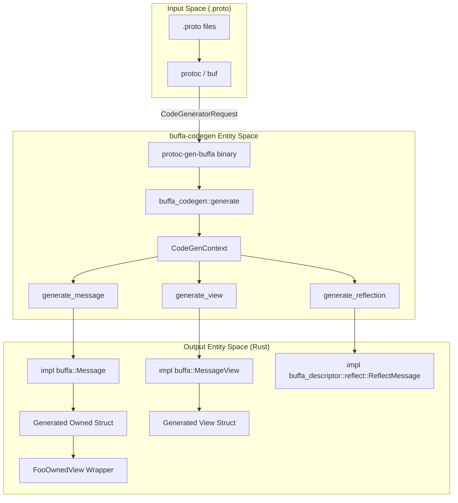
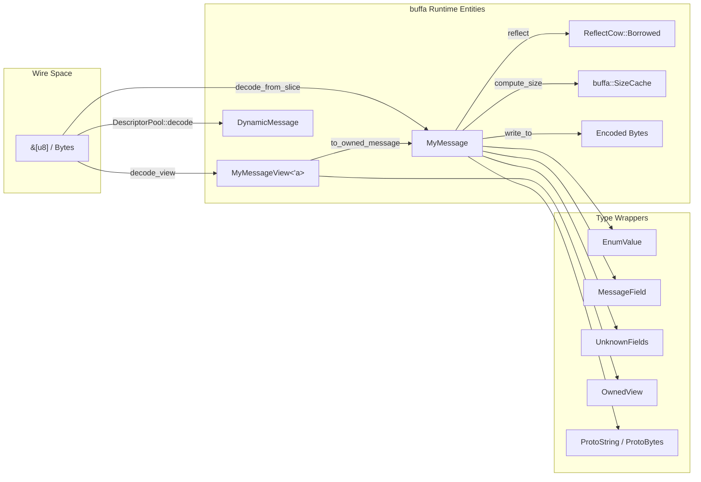

<!-- source: DeepWiki mcp.deepwiki.com · repo anthropics/buffa · page 1 Overview · fetched 2026-10-26 -->

# Overview

Relevant source files

The following files were used as context for generating this wiki page:

- [CHANGELOG.md](CHANGELOG.md)
- [Cargo.lock](Cargo.lock)
- [Cargo.toml](Cargo.toml)
- [DESIGN.md](DESIGN.md)
- [README.md](README.md)
- [buffa/Cargo.toml](buffa/Cargo.toml)
- [docs/guide.md](docs/guide.md)
- [protoc-gen-buffa/src/main.rs](protoc-gen-buffa/src/main.rs)

**buffa** is a pure-Rust Protocol Buffers implementation designed with first-class support for [Protobuf Editions](https://protobuf.dev/editions/overview) [README.md:1-11](). It provides a high-performance, `no_std`-capable runtime and a code generation pipeline that treats Proto2 and Proto3 as feature presets within the unified editions model [README.md:19-20]().

The project aims to fill the gap in the Rust ecosystem for a maintained, pure-Rust library that supports the latest Protobuf features, including unknown field preservation, zero-copy views, pluggable owned types, and canonical JSON mapping [README.md:13-17](), [CHANGELOG.md:11-16]().

## Key Design Principles

Buffa is built on several core architectural decisions:

*   **Editions-First Architecture**: Internal logic is parameterized by resolved features rather than branching on syntax versions [README.md:19-20]().
*   **Two-Tier Type System**: For every message, buffa generates both an **Owned** type (e.g., `MyMessage`) for mutation and storage, and a **View** type (e.g., `MyMessageView<'a>`) for zero-copy access to the wire buffer [README.md:21-22]().
*   **Pluggable Owned Types**: The representation of `string`, `bytes`, `repeated`, and `map` fields is pluggable via traits like `ProtoString`, `ProtoBytes`, `ProtoList`, and `MapStorage`, allowing for inline-string or small-vector optimizations [CHANGELOG.md:11-16]().
*   **Linear-Time Serialization**: Uses a size-caching pass (`SizeCache`) to prevent exponential complexity in deeply nested messages [README.md:27-28](). `SizeCachePool` allows for reuse of spill buffers to minimize allocations [CHANGELOG.md:42-53]().
*   **Ergonomic Defaults**: Features like `MessageField<T>` allow optional fields to dereference to a default instance, avoiding deep `Option<Box<T>>` unwrapping [README.md:23-24]().
*   **`EnumValue<T>`**: Type-safe open enums that preserve unknown values, instead of using raw `i32` [README.md:25-26]().
*   **Runtime Reflection**: The `buffa-descriptor` crate provides a `DescriptorPool` and `DynamicMessage` for schema-driven operations without generated code [README.md:31-31]().
*   **Pure Rust & `no_std`**: Zero C dependencies and full support for `alloc`-only environments [README.md:33-34]().

For a deeper dive into these decisions, see **[Design Principles and Architecture](#1.2)**.

## Workspace Layout

The buffa codebase is organized into a set of specialized crates within a Cargo workspace [Cargo.toml:1-16]().

| Crate | Role |
| :--- | :--- |
| `buffa` | The core runtime library containing the `Message` trait, `MessageView` trait, and wire format codec [Cargo.toml:70-84](). |
| `buffa-types` | Pre-generated Well-Known Types (WKT) like `Timestamp` and `Any` with ergonomic extensions [Cargo.toml:147-159](). |
| `buffa-descriptor` | Self-hosted types for `descriptor.proto` and `plugin.proto`, plus the reflection runtime [Cargo.toml:110-118](). |
| `buffa-codegen` | The shared logic for generating Rust source from `FileDescriptorProto` [Cargo.toml:96-107](). |
| `protoc-gen-buffa` | The `protoc` plugin binary (CLI entry point) [Cargo.toml:11](). |
| `buffa-build` | `build.rs` integration for Cargo-native workflows [Cargo.toml:87-93](). |
| `buffa-yaml` | YAML I/O for buffa messages via protobuf-JSON semantics [Cargo.toml:162-171](). |
| `buffa-test` | Integration tests, benchmarks, and conformance suite implementation [Cargo.toml:130-144](). |

Sources: [Cargo.toml:1-16](), [README.md:31-34](), [DESIGN.md:32-113]()

## System Architecture

The following diagrams illustrate how Protobuf definitions are transformed into Rust code and how the runtime components interact.

### Code Generation Pipeline
This diagram bridges the "Natural Language Space" (Proto definitions) to the "Code Entity Space" (Compiler types).

Sources: [CHANGELOG.md:34-120](), [README.md:69-112](), [protoc-gen-buffa/src/main.rs:94-139]()

### Runtime Data Flow
This diagram shows how binary data flows through specific code entities during decoding and serialization.

Sources: [CHANGELOG.md:11-16](), [CHANGELOG.md:86-98](), [README.md:21-31](), [docs/guide.md:81-117]()

## Integration Paths

Users can integrate buffa into their projects through two primary methods:

1.  **`buf generate`**: Using the `protoc-gen-buffa` and `protoc-gen-buffa-packaging` plugins. This is the recommended approach for modern Protobuf workflows [docs/guide.md:88-132]().
2.  **`buffa-build`**: A `build.rs` helper for projects that prefer to manage Protobuf compilation within Cargo [docs/guide.md:141-171]().

For step-by-step instructions on setting up either path, see **[Getting Started](#1.1)**.

## Child Pages

*   **[Getting Started](#1.1)**: Installation, feature flags, choosing between `buf` and `build.rs`, and quick-start examples for encoding/decoding.
*   **[Design Principles and Architecture](#1.2)**: Technical details on the editions model, the two-tier type system (Owned/View), reflection modes (VTable/Bridge), and the serialization pipeline.

---

