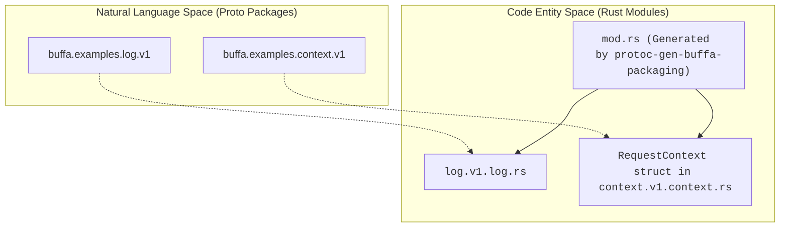
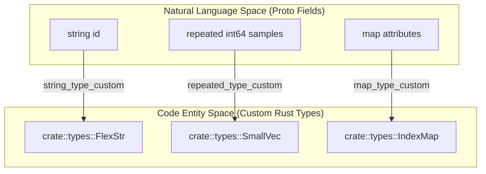
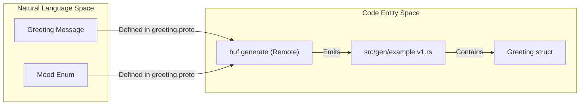

<!-- source: DeepWiki mcp.deepwiki.com · repo anthropics/buffa · page 9 Examples · fetched 2026-10-26 -->

# Examples

Relevant source files

The following files were used as context for generating this wiki page:

- [examples/bsr-quickstart/Cargo.lock](examples/bsr-quickstart/Cargo.lock)
- [examples/bsr-quickstart/README.md](examples/bsr-quickstart/README.md)
- [examples/bsr-quickstart/buf.gen.yaml](examples/bsr-quickstart/buf.gen.yaml)
- [examples/bsr-quickstart/buf.yaml](examples/bsr-quickstart/buf.yaml)
- [examples/bsr-quickstart/proto/example/v1/greeting.proto](examples/bsr-quickstart/proto/example/v1/greeting.proto)
- [examples/bsr-quickstart/src/gen/example.v1.rs](examples/bsr-quickstart/src/gen/example.v1.rs)
- [examples/custom-types/Cargo.lock](examples/custom-types/Cargo.lock)
- [examples/custom-types/Cargo.toml](examples/custom-types/Cargo.toml)
- [examples/custom-types/README.md](examples/custom-types/README.md)
- [examples/custom-types/build.rs](examples/custom-types/build.rs)
- [examples/custom-types/proto/record.proto](examples/custom-types/proto/record.proto)
- [examples/custom-types/src/main.rs](examples/custom-types/src/main.rs)
- [examples/logging/src/gen/context.v1.context.rs](examples/logging/src/gen/context.v1.context.rs)
- [examples/logging/src/gen/log.v1.log.rs](examples/logging/src/gen/log.v1.log.rs)

The `buffa` repository includes several example projects designed to demonstrate common usage patterns, build configurations, and advanced features like typed extensions, multi-package schemas, and zero-copy views. These examples serve as both integration tests and templates for new projects.

## Example Overview

The examples are located in the `examples/` directory of the repository and cover different aspects of the `buffa` ecosystem:

| Example | Focus Area | Key Features Demonstrated |
| :--- | :--- | :--- |
| **Logging** | Build Systems & Packaging | `buf generate`, `protoc-gen-buffa-packaging`, multi-package schemas. |
| **Custom Types** | Pluggable Storage | `string_type_custom`, `bytes_type_custom`, `repeated_type_custom`, `box_type_custom`, `map_type_custom`. |
| **BSR Quickstart** | Remote Plugins | `buf.build/anthropics/buffa` remote plugin, `file_per_package` configuration. |
| **Envelope** | Extensions & JSON | Typed extension API (`get`/`set`/`has`), JSON roundtrips with `JsonRegistry`. |
| **Addressbook** | Basic Usage | Classic `proto2` syntax, `buffa-build` integration, and `EnumValue`. |
| **Conflicts** | Naming Safety | Natural-path re-export collision handling and manual pathing. |

---

## Logging Example
For details, see [Logging Example](#9.1).

The logging example demonstrates a modern workflow using the [buf CLI](https://buf.build). It features a multi-package schema where `log.v1` depends on `context.v1`, illustrating how `buffa` handles cross-package references.

### System Architecture
The following diagram shows how the Protobuf packages are mapped to Rust modules. In this example, `protoc-gen-buffa-packaging` is used to generate the module tree.

**Logging Module Mapping**

Sources: [examples/logging/src/gen/context.v1.context.rs:6-6](), [examples/logging/src/gen/context.v1.context.rs:57-62]()

---

## Custom Types Example
For details, see [Custom Types Example](#9.3).

The `custom-types` example is an end-to-end demonstration of buffa's pluggable owned types. It shows how to replace the default Rust types (like `String` or `Vec<T>`) with custom implementations like `flexstr`, `smallvec`, `indexmap`, and `smallbox` [examples/custom-types/README.md:1-3]().

### Custom Type Wiring
This example utilizes `buffa_build::Config` knobs in `build.rs` to point codegen at crate-local newtypes [examples/custom-types/build.rs:10-25]().

**Custom Type Space Mapping**

Sources: [examples/custom-types/proto/record.proto:18-50](), [examples/custom-types/build.rs:14-25](), [examples/custom-types/src/main.rs:29-36]()

---

## Envelope, Addressbook, and BSR Quickstart Examples
For details, see [Envelope, Addressbook, and BSR Quickstart Examples](#9.2).

### BSR Quickstart: Remote Plugins
The `bsr-quickstart` example demonstrates using the published `buf.build/anthropics/buffa` remote plugin. This setup requires no local `protoc` or plugin installation [examples/bsr-quickstart/README.md:1-5](). It uses `file_per_package=true` to emit self-contained files [examples/bsr-quickstart/README.md:18-18]().

**BSR Code Generation Flow**

Sources: [examples/bsr-quickstart/README.md:12-21](), [examples/bsr-quickstart/src/gen/example.v1.rs:143-146]()

### Envelope: Typed Extensions
The Envelope example demonstrates `buffa`'s support for Protobuf extensions. It shows how to use the `Extension` descriptor API to interact with fields stored within the internal `__buffa_unknown_fields` storage [examples/logging/src/gen/context.v1.context.rs:31-31]().

### Addressbook: Proto2 Basics
The Addressbook example provides a minimal entry point using `proto2` syntax and `buffa-build` integration in `build.rs`. It highlights the use of `MessageField<T>` and `EnumValue<T>` wrappers for ergonomic field access and open enum semantics.

---

## Summary of Example Features

| Feature | Logging | BSR Quickstart | Custom Types | Addressbook |
| :--- | :---: | :---: | :---: | :---: |
| **Build Tool** | `buf` (local) | `buf` (remote) | `cargo` (build.rs) | `cargo` (build.rs) |
| **Plugin Path** | Local binary | BSR Plugin | `buffa-build` | `buffa-build` |
| **JSON Support** | No | Yes | Yes | No |
| **Zero-Copy Views**| Disabled | Enabled | Disabled | Enabled |
| **Custom Storage** | No | No | Yes | No |

Sources: [examples/bsr-quickstart/README.md:23-30](), [examples/custom-types/README.md:1-3](), [examples/logging/src/gen/context.v1.context.rs:1-32]()

---

