# Page: Overview

# Overview

<details>
<summary>Relevant source files</summary>

The following files were used as context for generating this wiki page:

- [CHANGELOG.md](CHANGELOG.md)
- [Cargo.lock](Cargo.lock)
- [Cargo.toml](Cargo.toml)
- [DESIGN.md](DESIGN.md)
- [README.md](README.md)
- [buffa/Cargo.toml](buffa/Cargo.toml)
- [docs/guide.md](docs/guide.md)
- [protoc-gen-buffa/src/main.rs](protoc-gen-buffa/src/main.rs)

</details>


**buffa** is a pure-Rust Protocol Buffers implementation designed with first-class support for [Protobuf Editions](https://protobuf.dev/editions/overview) [README.md:1-11](). It provides a high-performance, `no_std`-capable runtime and a code generation pipeline that treats Proto2 and Proto3 as feature presets within the unified editions model [README.md:19-20]().

The project aims to fill the gap in the Rust ecosystem for a maintained, pure-Rust library that supports the latest Protobuf features, including unknown field preservation, zero-copy views, pluggable owned types, and canonical JSON mapping [README.md:13-17](), [CHANGELOG.md:11-16]().

## Key Design Principles

Buffa is built on several core architectural decisions:

*   **Editions-First Architecture**: Internal logic is parameterized by resolved features rather than branching on syntax versions [README.md:19-20]().
*   **Two-Tier Type System**: For every message, buffa generates both an **Owned** type (e.g., `MyMessage`) for mutation and storage, and a **View** type (e.g., `MyMessageView<'a>`) for zero-copy access to the wire buffer [README.md:21-22]().
*   **Pluggable Owned Types**: The representation of `string`, `bytes`, `repeated`, and `map` fields is pluggable via traits like `ProtoString`, `ProtoBytes`, `ProtoList`, and `MapStorage`, allowing for inline-string or small-vector optimizations [CHANGELOG.md:11-16]().
*   **Linear-Time Serialization**: Uses a size-caching pass (`SizeCache`) to prevent exponential complexity in deeply nested messages [README.md:27-28](). `SizeCachePool` allows for reuse of spill buffers to minimize allocations [CHANGELOG.md:42-53]().
*   **Ergonomic Defaults**: Features like `MessageField<T>` allow optional fields to dereference to a default instance, avoiding deep `Option<Box<T>>` unwrapping [README.md:23-24]().
*   **`EnumValue<T>`**: Type-safe open enums that preserve unknown values, instead of using raw `i32` [README.md:25-26]().
*   **Runtime Reflection**: The `buffa-descriptor` crate provides a `DescriptorPool` and `DynamicMessage` for schema-driven operations without generated code [README.md:31-31]().
*   **Pure Rust & `no_std`**: Zero C dependencies and full support for `alloc`-only environments [README.md:33-34]().

For a deeper dive into these decisions, see **[Design Principles and Architecture](#1.2)**.

## Workspace Layout

The buffa codebase is organized into a set of specialized crates within a Cargo workspace [Cargo.toml:1-16]().

| Crate | Role |
| :--- | :--- |
| `buffa` | The core runtime library containing the `Message` trait, `MessageView` trait, and wire format codec [Cargo.toml:70-84](). |
| `buffa-types` | Pre-generated Well-Known Types (WKT) like `Timestamp` and `Any` with ergonomic extensions [Cargo.toml:147-159](). |
| `buffa-descriptor` | Self-hosted types for `descriptor.proto` and `plugin.proto`, plus the reflection runtime [Cargo.toml:110-118](). |
| `buffa-codegen` | The shared logic for generating Rust source from `FileDescriptorProto` [Cargo.toml:96-107](). |
| `protoc-gen-buffa` | The `protoc` plugin binary (CLI entry point) [Cargo.toml:11](). |
| `buffa-build` | `build.rs` integration for Cargo-native workflows [Cargo.toml:87-93](). |
| `buffa-yaml` | YAML I/O for buffa messages via protobuf-JSON semantics [Cargo.toml:162-171](). |
| `buffa-test` | Integration tests, benchmarks, and conformance suite implementation [Cargo.toml:130-144](). |

Sources: [Cargo.toml:1-16](), [README.md:31-34](), [DESIGN.md:32-113]()

## System Architecture

The following diagrams illustrate how Protobuf definitions are transformed into Rust code and how the runtime components interact.

### Code Generation Pipeline
This diagram bridges the "Natural Language Space" (Proto definitions) to the "Code Entity Space" (Compiler types).

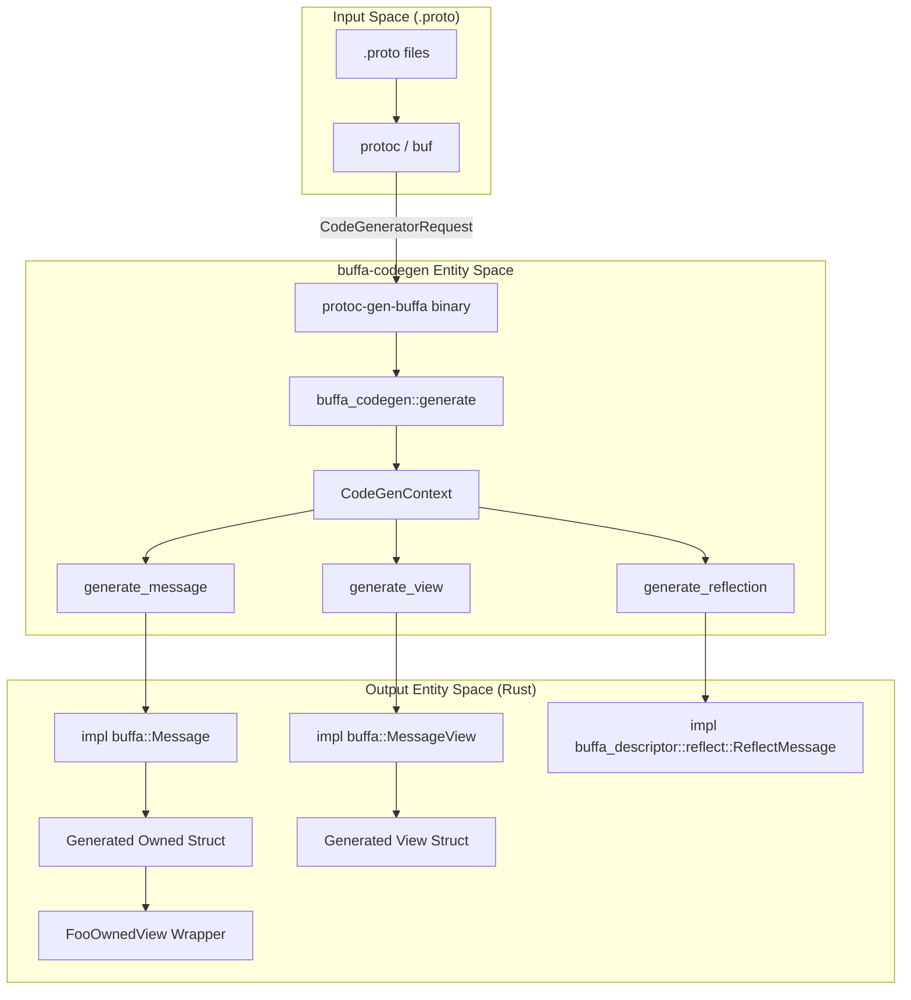
Sources: [CHANGELOG.md:34-120](), [README.md:69-112](), [protoc-gen-buffa/src/main.rs:94-139]()

### Runtime Data Flow
This diagram shows how binary data flows through specific code entities during decoding and serialization.

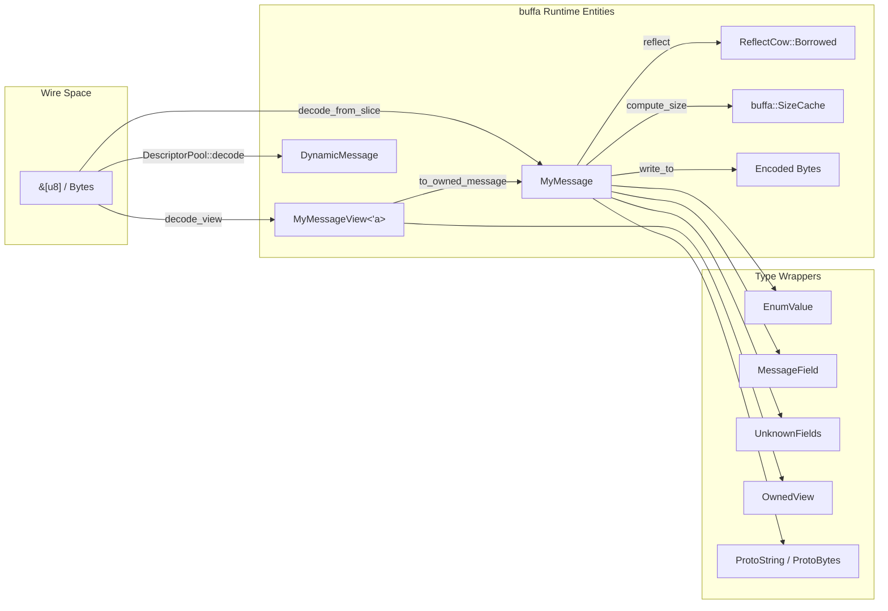
Sources: [CHANGELOG.md:11-16](), [CHANGELOG.md:86-98](), [README.md:21-31](), [docs/guide.md:81-117]()

## Integration Paths

Users can integrate buffa into their projects through two primary methods:

1.  **`buf generate`**: Using the `protoc-gen-buffa` and `protoc-gen-buffa-packaging` plugins. This is the recommended approach for modern Protobuf workflows [docs/guide.md:88-132]().
2.  **`buffa-build`**: A `build.rs` helper for projects that prefer to manage Protobuf compilation within Cargo [docs/guide.md:141-171]().

For step-by-step instructions on setting up either path, see **[Getting Started](#1.1)**.

## Child Pages

*   **[Getting Started](#1.1)**: Installation, feature flags, choosing between `buf` and `build.rs`, and quick-start examples for encoding/decoding.
*   **[Design Principles and Architecture](#1.2)**: Technical details on the editions model, the two-tier type system (Owned/View), reflection modes (VTable/Bridge), and the serialization pipeline.

---

# Page: Getting Started

# Getting Started

<details>
<summary>Relevant source files</summary>

The following files were used as context for generating this wiki page:

- [CHANGELOG.md](CHANGELOG.md)
- [Cargo.lock](Cargo.lock)
- [Cargo.toml](Cargo.toml)
- [buffa-build/Cargo.toml](buffa-build/Cargo.toml)
- [buffa-codegen/Cargo.toml](buffa-codegen/Cargo.toml)
- [buffa/Cargo.toml](buffa/Cargo.toml)
- [docs/guide.md](docs/guide.md)
- [docs/migration-from-prost.md](docs/migration-from-prost.md)
- [docs/migration-from-protobuf.md](docs/migration-from-protobuf.md)
- [protoc-gen-buffa-packaging/Cargo.toml](protoc-gen-buffa-packaging/Cargo.toml)
- [protoc-gen-buffa/Cargo.toml](protoc-gen-buffa/Cargo.toml)
- [protoc-gen-buffa/src/main.rs](protoc-gen-buffa/src/main.rs)

</details>


This page provides a step-by-step guide for integrating `buffa` into a Rust project. It covers installation, build-system configuration, basic usage for encoding and decoding, and the new pluggable type system introduced in version 0.8.0.

## Installation

To use `buffa`, add the core runtime and (optionally) the well-known types crate to your `Cargo.toml`.

```toml
[dependencies]
buffa = "0.8"
buffa-types = "0.8" # Required for Timestamp, Duration, Any, etc.

[build-dependencies]
buffa-build = "0.8" # Required if using build.rs integration
```
Sources: [Cargo.toml:50-51](), [docs/guide.md:9-17]()

### Feature Flags

`buffa` and its associated crates use feature flags to control dependencies, particularly for `no_std` environments and high-performance UTF-8 validation.

| Feature | Default | Description |
| :--- | :--- | :--- |
| `std` | **Yes** | Enables `std::io` integration, `HashMap` for maps, and `std::time` conversions. [buffa/Cargo.toml:19-26]() |
| `fast-utf8` | **Yes** | Uses `smoothutf8` for formally verified, SIMD-accelerated UTF-8 validation on the decode hot path. [buffa/Cargo.toml:27-31]() |
| `json` | No | Enables canonical Proto3 JSON mapping via `serde` (works with `no_std` + `alloc`). [buffa/Cargo.toml:36-43]() |
| `reflect` | No | Enables `buffa-descriptor` integration for `DescriptorPool` and `DynamicMessage`. [docs/guide.md:37-37]() |
| `arbitrary` | No | Enables `arbitrary::Arbitrary` derives for generated types (useful for fuzzing). [buffa/Cargo.toml:44-44]() |

Sources: [buffa/Cargo.toml:17-45](), [docs/guide.md:27-43]()

## Choosing a Build Integration

There are two primary ways to generate Rust code from `.proto` files: the `buf` remote plugin (recommended) or the `buffa-build` build script helper.

### 1. Using `buf generate` (Recommended)
This approach uses the [buf](https://buf.build) CLI. It supports remote generation, meaning you do not need `protoc` or the `buffa` plugins installed locally.

**Configuration (`buf.gen.yaml`):**
```yaml
version: v2
plugins:
  - remote: buf.build/anthropics/buffa
    out: src/gen
    opt:
      - file_per_package=true
      - json=true
```

To generate a full module tree (`mod.rs`) automatically, add the `protoc-gen-buffa-packaging` plugin:

```yaml
version: v2
plugins:
  - remote: buf.build/anthropics/buffa
    out: src/gen
  - local: protoc-gen-buffa-packaging
    out: src/gen
    strategy: all
```

Sources: [docs/guide.md:88-139](), [protoc-gen-buffa/src/main.rs:36-45]()

### 2. Using `buffa-build`
For projects preferring `build.rs` integration, `buffa-build` provides a `Config` API with extensive knobs for pluggable types.

**Example `build.rs`:**
```rust
fn main() {
    buffa_build::Config::new()
        .files(&["proto/service.proto"])
        .includes(&["proto/"])
        .include_file("_include.rs")
        // Example of 0.8.0 pluggable types:
        .string_type_custom("::buffa_smolstr::SmolStr") 
        .compile()
        .expect("codegen failed");
}
```

Sources: [buffa-build/Cargo.toml:1-10](), [CHANGELOG.md:86-98](), [docs/guide.md:141-166]()

## Implementation Flow: Codegen Request

The following diagram illustrates how the compiler plugins interface with the `buffa-codegen` library to transform Protobuf descriptors into Rust source code.

**Plugin Data Flow**
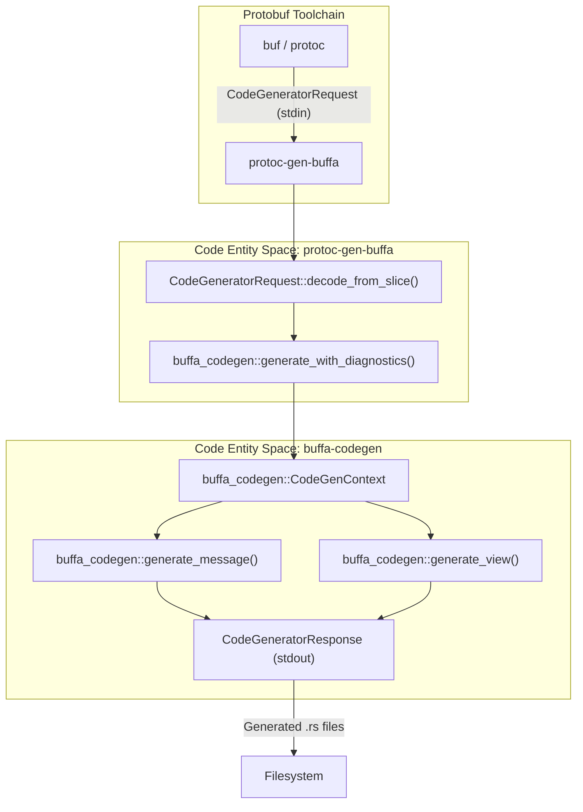
Sources: [protoc-gen-buffa/src/main.rs:94-139](), [buffa-codegen/Cargo.toml:12-23](), [CHANGELOG.md:21-24]()

## Quick Encode/Decode Examples

`buffa` provides two tiers of types: **Owned Types** (standard structs) and **View Types** (zero-copy borrowed views).

### Binary Wire Format
```rust
use buffa::Message;

// 1. Encode
let msg = MyMessage { id: 42, ..Default::default() };
let bytes: Vec<u8> = msg.encode_to_vec();

// 2. Decode (Owned)
let decoded = MyMessage::decode_from_slice(&bytes).unwrap();

// 3. Decode (Zero-copy View)
// Decodes directly into a view that borrows from the slice
let view = MyMessageView::decode_view(&bytes).unwrap();
println!("ID: {}", view.id); 

// 4. OwnedView (Zero-copy + 'static for async)
// Wraps the buffer and the view together in a self-referential container
let owned_view = buffa::OwnedView::<MyMessageView>::decode(bytes.into()).unwrap();
```
Sources: [CHANGELOG.md:32-36](), [docs/migration-from-prost.md:151-182](), [docs/migration-from-protobuf.md:85-112]()

### JSON Serialization
Requires the `json` feature. Buffa implements the canonical Proto3 JSON mapping.
```rust
// Encode to JSON string
let json = serde_json::to_string(&msg).unwrap();

// Decode from JSON string
let decoded: MyMessage = serde_json::from_str(&json).unwrap();
```
Sources: [buffa/Cargo.toml:36-43](), [docs/migration-from-prost.md:221-239]()

## Compiler Compatibility Matrix

`buffa` treats Protobuf Editions as the core abstraction. While it supports legacy proto2 and proto3, the required version of `protoc` is determined by the edition features used.

| Feature / Edition | Minimum `protoc` | Notes |
| :--- | :--- | :--- |
| Proto2 / Proto3 | v21.12 | Baseline support. [docs/guide.md:75-75]() |
| Editions 2023 | v27.0 | Support for feature resolution and `EDITION_2023`. [docs/guide.md:76-76]() |
| Editions 2024 | v33.0 | Required for `EDITION_2024` and latest features. [docs/guide.md:77-77]() |

Sources: [docs/guide.md:71-80](), [protoc-gen-buffa/src/main.rs:131-132]()

## Architecture: Type Space Mapping

The following diagram bridges the gap between Protobuf schema concepts and the specific Rust entities and traits used by the `buffa` runtime.

**Protobuf to Rust Mapping**
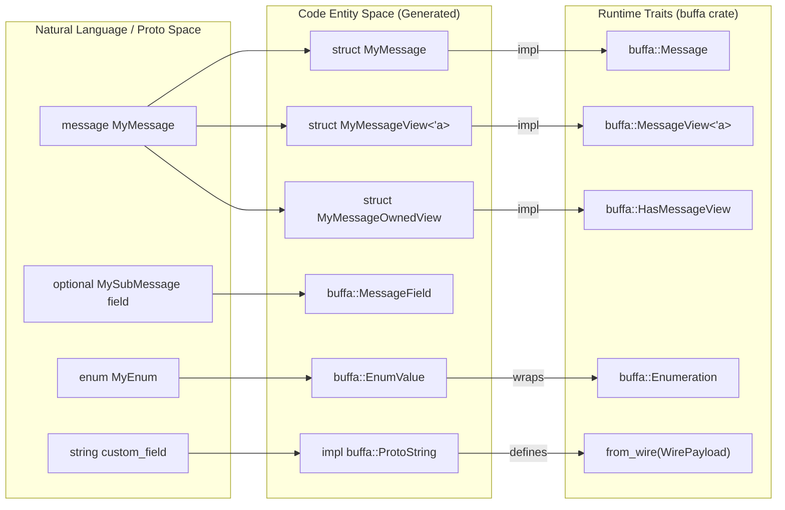
Sources: [CHANGELOG.md:11-16](), [CHANGELOG.md:86-98](), [docs/migration-from-prost.md:79-112](), [docs/migration-from-protobuf.md:128-164]()

---

# Page: Design Principles and Architecture

# Design Principles and Architecture

<details>
<summary>Relevant source files</summary>

The following files were used as context for generating this wiki page:

- [CHANGELOG.md](CHANGELOG.md)
- [buffa-codegen/src/impl_message.rs](buffa-codegen/src/impl_message.rs)
- [buffa-codegen/src/impl_text.rs](buffa-codegen/src/impl_text.rs)
- [buffa-codegen/src/view.rs](buffa-codegen/src/view.rs)
- [buffa-types/src/generated/google.protobuf.any.__view.rs](buffa-types/src/generated/google.protobuf.any.__view.rs)
- [buffa-types/src/generated/google.protobuf.duration.__view.rs](buffa-types/src/generated/google.protobuf.duration.__view.rs)
- [buffa-types/src/generated/google.protobuf.empty.__view.rs](buffa-types/src/generated/google.protobuf.empty.__view.rs)
- [buffa-types/src/generated/google.protobuf.field_mask.__view.rs](buffa-types/src/generated/google.protobuf.field_mask.__view.rs)
- [buffa-types/src/generated/google.protobuf.struct.__view.rs](buffa-types/src/generated/google.protobuf.struct.__view.rs)
- [buffa-types/src/generated/google.protobuf.timestamp.__view.rs](buffa-types/src/generated/google.protobuf.timestamp.__view.rs)
- [buffa-types/src/generated/google.protobuf.wrappers.__view.rs](buffa-types/src/generated/google.protobuf.wrappers.__view.rs)
- [buffa/src/lib.rs](buffa/src/lib.rs)
- [buffa/src/view.rs](buffa/src/view.rs)
- [docs/guide.md](docs/guide.md)
- [protoc-gen-buffa/src/main.rs](protoc-gen-buffa/src/main.rs)

</details>


This page provides a deep dive into the core design decisions and architectural patterns that define `buffa`. It explains the transition from traditional Protobuf models to an editions-first approach, the two-tier type system for performance, and the internal mechanisms for serialization and field management.

## Editions-First Model

`buffa` is designed with Protobuf Editions as its primary abstraction. Unlike legacy implementations that branch on "is this proto2 or proto3?", `buffa` treats these as feature presets within a unified editions model [buffa/src/lib.rs:1-2](). The internal representation is always editions-based, ensuring future-proof compatibility as new editions are released [protoc-gen-buffa/src/main.rs:130-132]().

The code generator operates on resolved edition features. When `protoc` or `buf` parses a `.proto` file, it resolves the `FeatureSet` for every message, field, and enum. `buffa-codegen` consumes these resolved features from the `FileDescriptorProto` [buffa-codegen/src/impl_message.rs:18-24]().

### Feature Resolution Pipeline

The pipeline ensures that the generated Rust code correctly reflects the behavior defined by the edition, such as field presence or enum closedness.

Title: Feature Resolution and Codegen Pipeline
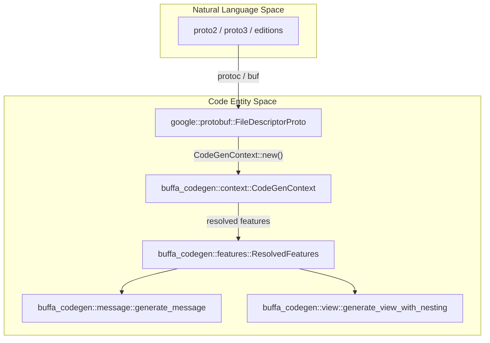
Sources: [buffa-codegen/src/impl_message.rs:55-76](), [buffa-codegen/src/impl_message.rs:108-112](), [buffa-codegen/src/view.rs:81-92]()

## Two-Tier Type System: Owned and Borrowed

To support both ergonomic mutation and high-performance zero-copy reads, `buffa` generates two distinct Rust types for every Protobuf message [buffa/src/view.rs:3-6]().

1.  **Owned Message (`MyMessage`)**: A standard Rust struct that owns its data. It uses `String`, `Vec<u8>`, and `Vec<T>` for fields [buffa/src/view.rs:5-6]().
2.  **Message View (`MyMessageView<'a>`)**: A borrowed struct that holds references directly into an input buffer. It provides zero-copy access to fields [buffa/src/view.rs:8-10]().

### `OwnedView<V>`, `FooOwnedView`, and `HasMessageView`
For async and RPC frameworks that require `'static` types, `buffa` provides `OwnedView<V>`. This is a self-contained container that pairs a `bytes::Bytes` buffer with a decoded view, making the result `Send + Sync + 'static` [buffa/src/lib.rs:103-103]().

The `FooOwnedView` wrappers (introduced in 0.7.0) provide a self-contained handle with accessor methods that borrow from the internal buffer [buffa/src/view.rs:61-64]().

The `HasMessageView` trait links owned types to their view families, enabling generic code to move between owned and view representations [CHANGELOG.md:32-36]().

Sources: [buffa/src/view.rs:3-11](), [buffa/src/view.rs:40-46](), [buffa/src/lib.rs:102-105]()

## Field Management and Types

### `MessageField<T>`
Singular message fields are wrapped in `MessageField<T>`. This provides an ergonomic API that implements `Deref` to a "default instance" when the field is unset [buffa/src/lib.rs:97-97](). Version 0.8.0 added `unwrap()` and `expect()` methods to consume a `MessageField` directly [CHANGELOG.md:37-41]().

### `EnumValue<T>`
To handle "open" enums (where unknown numeric values must be preserved), `buffa` uses `EnumValue<T>`. This wrapper holds either a known variant of the generated Rust enum or an unknown `i32` value [buffa/src/lib.rs:98-98]().

### Pluggable Owned Types (v0.8.0+)
As of version 0.8.0, the owned representation of every field kind is now pluggable. Users can use crate-local types via traits like `ProtoString`, `ProtoBytes`, `ProtoList`, and `MapStorage` [CHANGELOG.md:11-16](). This allows avoiding per-field heap allocations by using inline-string or small-vector representations [CHANGELOG.md:86-91]().

### External `SizeCache` Serialization Model
`buffa` uses a linear-time serialization model. Serialization is a two-pass process using an **external** `SizeCache`:
-   **Pass 1**: `compute_size` walks the message tree and records the encoded size of every length-delimited sub-message in the cache [buffa-types/src/generated/google.protobuf.duration.__view.rs:159-171]().
-   **Pass 2**: `write_to` walks the tree again, writing bytes and consuming the cached sizes [buffa-types/src/generated/google.protobuf.duration.__view.rs:173-187]().

In 0.8.0, `SizeCachePool` was introduced to allow opt-in reuse of the encode size-cache spill allocations across many encodes [CHANGELOG.md:42-47]().

Sources: [CHANGELOG.md:11-16](), [CHANGELOG.md:42-53](), [buffa/src/lib.rs:97-98]()

## Unknown Field Preservation

`buffa` prioritizes wire compatibility by preserving unknown fields. During decoding, any field tag not recognized by the generated code is stored in `UnknownFields` (owned) or `UnknownFieldsView` (borrowed) [buffa/src/lib.rs:99-99](), [buffa-codegen/src/view.rs:36-45](). These fields are re-emitted during serialization, ensuring round-trip fidelity [buffa-types/src/generated/google.protobuf.any.__view.rs:181-185]().

Title: Message Deserialization and Unknown Field Handling
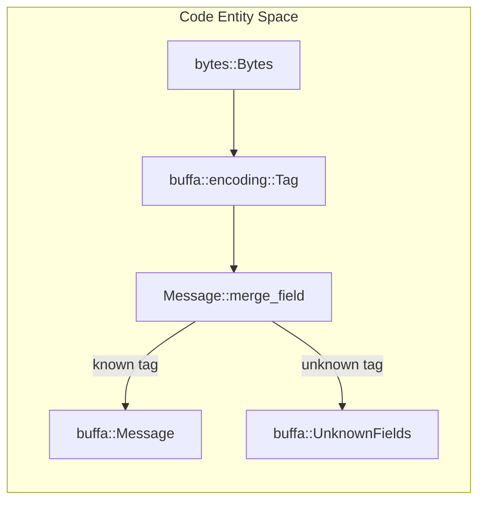
Sources: [buffa/src/lib.rs:99-99](), [buffa-codegen/src/view.rs:36-45](), [buffa-types/src/generated/google.protobuf.any.__view.rs:155-188]()

## Runtime and Environment Support

### `no_std` Support
The `buffa` core runtime is `no_std` compatible but requires an allocator (`alloc`) [buffa/src/lib.rs:86-89](). It re-exports `alloc::string::String` and `alloc::vec::Vec` so generated code works on bare-metal targets [buffa/src/lib.rs:112-116]().

### Code Generation Integration
`buffa` provides two primary paths for code generation:
-   **`protoc-gen-buffa`**: A standard `protoc` plugin binary [protoc-gen-buffa/src/main.rs:1-7]().
-   **`buffa-build`**: A `build.rs` helper that simplifies integration into Cargo workflows [buffa/src/lib.rs:4-5]().

| Feature | Implementation |
| :--- | :--- |
| **Serialization** | Two-pass via external `SizeCache` [buffa-types/src/generated/google.protobuf.duration.__view.rs:157-188]() |
| **Allocation** | `alloc` required, `std` optional [buffa/src/lib.rs:118-118]() |
| **JSON** | Proto3-JSON mapping via `serde` [buffa/src/lib.rs:75-76]() |
| **Pluggable Types** | `ProtoString`, `ProtoBytes`, `ProtoList`, `MapStorage` [CHANGELOG.md:11-16]() |
| **Views** | Zero-copy `MessageView` with `OwnedView` wrapper [buffa/src/view.rs:1-10]() |

Sources: [buffa/src/lib.rs:86-118](), [CHANGELOG.md:11-16](), [buffa/src/view.rs:1-10]()

---

# Page: Core Runtime (`buffa`)

# Core Runtime (`buffa`)

<details>
<summary>Relevant source files</summary>

The following files were used as context for generating this wiki page:

- [.changes/unreleased/changed-20260627-000610.yaml](.changes/unreleased/changed-20260627-000610.yaml)
- [CHANGELOG.md](CHANGELOG.md)
- [buffa-codegen/src/owned_view.rs](buffa-codegen/src/owned_view.rs)
- [buffa-descriptor/src/reflect/containers.rs](buffa-descriptor/src/reflect/containers.rs)
- [buffa-test/src/tests/owned_view.rs](buffa-test/src/tests/owned_view.rs)
- [buffa/src/map_codec.rs](buffa/src/map_codec.rs)
- [buffa/src/message.rs](buffa/src/message.rs)
- [buffa/src/message_field.rs](buffa/src/message_field.rs)
- [buffa/src/types.rs](buffa/src/types.rs)
- [docs/guide.md](docs/guide.md)
- [protoc-gen-buffa/src/main.rs](protoc-gen-buffa/src/main.rs)

</details>


The `buffa` crate is the core runtime library that provides the foundational traits, types, and serialization logic required by all generated code. It is designed for high performance, offering both standard owned message types and zero-copy "view" types. The runtime supports `no_std` environments (requiring `alloc`) and provides first-class support for Protobuf Editions. [buffa/src/lib.rs:1-10]()

### Architecture Overview

The runtime is structured to separate the high-level message interface from the low-level wire format primitives. Generated messages implement the `Message` trait, which coordinates with the `encoding` module to perform two-pass serialization (size calculation followed by writing). [buffa/src/message.rs:1-63]() In version 0.8.0, the runtime introduced pluggable owned representations for all field kinds, allowing users to substitute `String`, `Vec<u8>`, or `HashMap` with custom types like `SmolStr` or `SmallVec` via traits like `ProtoString` and `ProtoList`. [CHANGELOG.md:11-16](), [CHANGELOG.md:87-98]()

#### Core Component Relationships

This diagram shows how the core runtime entities interact during the lifecycle of a message, from raw bytes to a high-level Rust struct.

```mermaid
graph TD
    subgraph "InputSpace"
        ["&[u8] / Bytes"]
    end

    subgraph "buffa_Runtime_Entities"
        ["DecodeOptions"] -- "configures" --> ["Message"]
        ["Message"] -- "uses" --> ["encoding::*"]
        ["encoding::*"] -- "parses" --> ["WireType"]
        ["Message"] -- "populates" --> ["UnknownFields"]
        ["Message"] -- "contains" --> ["MessageField<T>"]
        ["Message"] -- "contains" --> ["EnumValue<E>"]
        ["Message"] -- "uses" --> ["SizeCachePool"]
    end

    subgraph "Generated_Code_Space"
        ["MyMessage (struct)"] -- "implements" --> ["Message"]
        ["MyEnum (enum)"] -- "implements" --> ["Enumeration"]
        ["MyMessageOwnedView"] -- "wraps" --> ["OwnedView"]
    end

    ["&[u8] / Bytes"] --> ["Message::decode_from_slice"]
    ["Message::decode_from_slice"] --> ["MyMessage (struct)"]
```
**Sources:** [buffa/src/lib.rs:91-106](), [buffa/src/message.rs:27-52](), [buffa/src/encoding.rs:28-35](), [CHANGELOG.md:42-45]()

---

### Key Runtime Modules

The `buffa` runtime is divided into several specialized modules, each handling a specific aspect of the Protobuf specification. [buffa/src/lib.rs:91-106]()

| Module | Description |
| :--- | :--- |
| `message` | Defines the `Message` trait, `DecodeOptions`, and `SizeCachePool`. |
| `view` | Provides the `MessageView` trait and `OwnedView` for zero-copy access. |
| `encoding` | Contains low-level primitives for varints, fixed-width types, and tags. |
| `enumeration` | Implements `EnumValue<E>` for open/closed enum semantics. |
| `message_field` | Provides `MessageField<T>` and the `ProtoBox` trait for pluggable pointers. |
| `map_codec` | Generic wire codec for `map<K, V>` fields and the `MapStorage` trait. |
| `types` | Protobuf scalar type encoding strategies and UTF-8 validation. |

**Sources:** [buffa/src/lib.rs:91-106](), [buffa/src/map_codec.rs:1-30](), [buffa/src/types.rs:1-29]()

---

### Message Trait and Wire Format Codec
The `Message` trait is the primary interface for interacting with generated owned types. It provides methods for encoding to `Vec<u8>` or `bytes::Bytes`, and decoding from slices or `std::io::Read` sources. [buffa/src/message.rs:27-111]() Serialization uses a two-pass model: `compute_size` populates a `SizeCache`, and `write_to` consumes it. [buffa/src/message.rs:166-170]() To optimize heap usage during encoding, `SizeCachePool` allows reuse of spill-buffer allocations. [CHANGELOG.md:42-53]()

For details, see [Message Trait and Wire Format Codec](#2.1).

**Sources:** [buffa/src/message.rs:78-150](), [buffa/src/encoding.rs:1-5](), [CHANGELOG.md:42-57]()

---

### Zero-Copy Views and OwnedView
To avoid allocations during decoding, `buffa` generates "View" types (e.g., `FooView<'a>`). These types implement the `MessageView` trait and borrow `string` and `bytes` fields directly from the source buffer. [buffa/src/lib.rs:52-66]() The `OwnedView` container allows these borrowed types to be stored as `'static` entities by bundling them with their backing `Bytes` buffer. [buffa/src/lib.rs:103-106]() Additionally, `buffa-codegen` emits `FooOwnedView` wrappers that provide per-field accessor methods over an `OwnedView`. [buffa-codegen/src/owned_view.rs:1-10]()

For details, see [Zero-Copy Views, OwnedView, and HasMessageView](#2.2).

**Sources:** [buffa/src/lib.rs:52-66](), [buffa/src/lib.rs:103-106](), [buffa-test/src/tests/owned_view.rs:1-8]()

---

### Enumerations, MessageField, and Oneof
The runtime provides specialized wrappers to handle Protobuf's unique field semantics. `EnumValue<E>` handles "open" enums by preserving unknown numeric values. [buffa/src/lib.rs:99]() `MessageField<T>` provides a `Deref` implementation to a default instance, simplifying access to optional sub-messages without excessive `Option` unwrapping. [buffa/src/lib.rs:98](), [buffa/src/message_field.rs:1-6]() It now includes `unwrap()` and `expect()` methods to consume the field directly. [CHANGELOG.md:37-41]()

For details, see [Enumerations, MessageField, and Oneof](#2.3).

**Sources:** [buffa/src/lib.rs:98-99](), [buffa/src/message_field.rs:1-17](), [CHANGELOG.md:37-41]()

---

### Extensions and Unknown Fields
Protobuf allows messages to be extended with additional fields not defined in the original message. `buffa` manages these via the `ExtensionSet`, which stores extension data within the `UnknownFields` collection. [buffa/src/lib.rs:100-102]() This ensures that unknown fields are preserved during round-trips. The runtime also enforces a `DEFAULT_UNKNOWN_FIELD_LIMIT` to prevent memory amplification attacks from untrusted input. [buffa/src/message.rs:27-45]()

For details, see [Extensions and Unknown Fields](#2.4).

**Sources:** [buffa/src/lib.rs:100-102](), [buffa/src/message.rs:27-45]()

---

### JSON Serialization
When the `json` feature is enabled, `buffa` supports the Proto3 JSON Mapping via `serde`. [buffa/src/lib.rs:73-74]() This includes specialized handling for well-known types (like `Timestamp` or `Duration`) and the ability to register custom types for `google.protobuf.Any` resolution. [buffa/src/lib.rs:143-145]() The JSON mapping also supports the new pluggable string types in map keys. [CHANGELOG.md:71-73]()

For details, see [JSON Serialization](#2.5).

**Sources:** [buffa/src/lib.rs:73-74](), [buffa/src/lib.rs:143-145](), [CHANGELOG.md:59-73]()

---

### Data Flow: From Wire to View
The following diagram illustrates the relationship between the raw input, the `MessageView` trait, and the `OwnedView` container, which bridges the gap between borrowed and owned lifetimes.

```mermaid
graph LR
    subgraph "Memory_Heap_Stack"
        ["RawBytes [u8]"]
    end

    subgraph "View_Layer"
        ["MessageView"] -- "borrows from" --> ["RawBytes [u8]"]
        ["MyMessageView<'a>"] -- "impl" --> ["MessageView"]
    end

    subgraph "Safe_Container"
        ["OwnedView<V>"] -- "holds" --> ["bytes::Bytes"]
        ["OwnedView<V>"] -- "references" --> ["MyMessageView<'static>"]
        ["OwnedView::reborrow"] -- "returns" --> ["MyMessageView<'b>"]
        ["MyMessageOwnedView"] -- "provides accessors for" --> ["OwnedView"]
    end

    ["RawBytes [u8]"] --> ["MessageView::decode_view"]
    ["bytes::Bytes"] --> ["OwnedView::new"]
```
**Sources:** [buffa/src/lib.rs:52-66](), [buffa/src/lib.rs:103-106](), [buffa-codegen/src/owned_view.rs:1-10]()

---

# Page: Message Trait and Wire Format Codec

# Message Trait and Wire Format Codec

<details>
<summary>Relevant source files</summary>

The following files were used as context for generating this wiki page:

- [.changes/unreleased/changed-20260627-000610.yaml](.changes/unreleased/changed-20260627-000610.yaml)
- [.changes/unreleased/changed-20260629-003205.yaml](.changes/unreleased/changed-20260629-003205.yaml)
- [.changes/unreleased/changed-20260629-051500.yaml](.changes/unreleased/changed-20260629-051500.yaml)
- [buffa-codegen/src/owned_view.rs](buffa-codegen/src/owned_view.rs)
- [buffa-codegen/src/tests/view_codegen.rs](buffa-codegen/src/tests/view_codegen.rs)
- [buffa-descriptor/src/generated/google.protobuf.compiler.plugin.__view.rs](buffa-descriptor/src/generated/google.protobuf.compiler.plugin.__view.rs)
- [buffa-descriptor/src/generated/google.protobuf.descriptor.__view.rs](buffa-descriptor/src/generated/google.protobuf.descriptor.__view.rs)
- [buffa-descriptor/src/reflect/containers.rs](buffa-descriptor/src/reflect/containers.rs)
- [buffa-test/src/tests/owned_view.rs](buffa-test/src/tests/owned_view.rs)
- [buffa/src/encoding.rs](buffa/src/encoding.rs)
- [buffa/src/extension.rs](buffa/src/extension.rs)
- [buffa/src/map_codec.rs](buffa/src/map_codec.rs)
- [buffa/src/message.rs](buffa/src/message.rs)
- [buffa/src/message_field.rs](buffa/src/message_field.rs)
- [buffa/src/size_cache.rs](buffa/src/size_cache.rs)
- [buffa/src/types.rs](buffa/src/types.rs)

</details>


The `buffa` runtime centers around the `Message` trait, which defines the interface for all generated protobuf messages. It utilizes a two-pass serialization model to ensure efficient memory management and performance. This page details the trait interface, the external caching mechanism for message sizes, the `SizeCachePool` for buffer reuse, and the low-level binary wire format primitives.

## The Message Trait

The `Message` trait is the core abstraction for any type that can be serialized to or deserialized from the Protobuf binary format [buffa/src/message.rs:138-142](). It is implemented by **generated code** and provides a set of required methods for the two-pass serialization contract [buffa/src/message.rs:139-141]().

### Core Interface Methods

| Method | Description |
|:---|:---|
| `compute_size` | Recursively calculates the total encoded size and populates an external `SizeCache` [buffa/src/message.rs:172-172](). |
| `write_to` | Writes message fields to a `BufMut`, consuming sizes from the `SizeCache` [buffa/src/message.rs:178-178](). |
| `merge_field` | The primary entry point for decoding; merges a single field from the wire into the struct [buffa/src/message.rs:201-205](). |
| `encode` | Convenience method that handles both `SizeCache` creation and the two-pass write [buffa/src/message.rs:215-219](). |
| `encode_to_vec` | Encodes the message into a new `Vec<u8>`, pre-allocating the exact required capacity [buffa/src/message.rs:252-258](). |

### Two-Pass Serialization Model

Unlike implementations that might calculate lengths repeatedly (leading to exponential-time complexity in deeply nested messages), Buffa separates size calculation from byte writing [buffa/src/message.rs:166-170]().

1.  **Pass 1 (`compute_size`)**: The message tree is traversed. For every length-delimited field (strings, bytes, sub-messages), the size is calculated and stored in an external `SizeCache` [buffa/src/size_cache.rs:8-10]().
2.  **Pass 2 (`write_to`)**: The tree is traversed again. When a length-delimited field is reached, its pre-calculated size is pulled from the `SizeCache` to write the varint length prefix immediately before the data [buffa/src/size_cache.rs:9-10]().

### External SizeCache Design

Serialization state lives in an external `SizeCache` rather than inside the message struct itself [buffa/src/size_cache.rs:12-14](). This design ensures that messages contain no hidden plumbing fields, allowing them to be simple Rust structs that are easy to pattern match and move [buffa/src/size_cache.rs:13-14]().

**Sources:** [buffa/src/message.rs:138-258](), [buffa/src/size_cache.rs:1-25]()

## SizeCache and Performance Optimizations

The `SizeCache` is designed for zero-allocation encoding in common cases and efficient reuse in high-throughput scenarios.

### Inline Storage and Spill Buffers
A `SizeCache` contains an inline array of 16 `u32` slots [buffa/src/size_cache.rs:36-36]().
*   **Zero-Allocation**: Messages with ≤ 16 nested length-delimited sub-messages encode entirely on the stack [buffa/src/size_cache.rs:32-35]().
*   **Spill Buffer**: If a message exceeds 16 sub-messages, it spills to a `Vec<u32>` [buffa/src/size_cache.rs:46-48]().

### SizeCachePool
To avoid repeated heap allocations for the spill buffer, the `SizeCachePool` allows for buffer reuse [buffa/src/size_cache.rs:214-216]().
*   **Reuse**: Callers can `pull()` a cache from the pool and `push()` it back after use [buffa/src/size_cache.rs:231-241]().
*   **Thread Safety**: In `std` environments, the pool uses a `Mutex` to manage a stack of available spill buffers [buffa/src/size_cache.rs:218-220]().

**Message Encoding Flow**
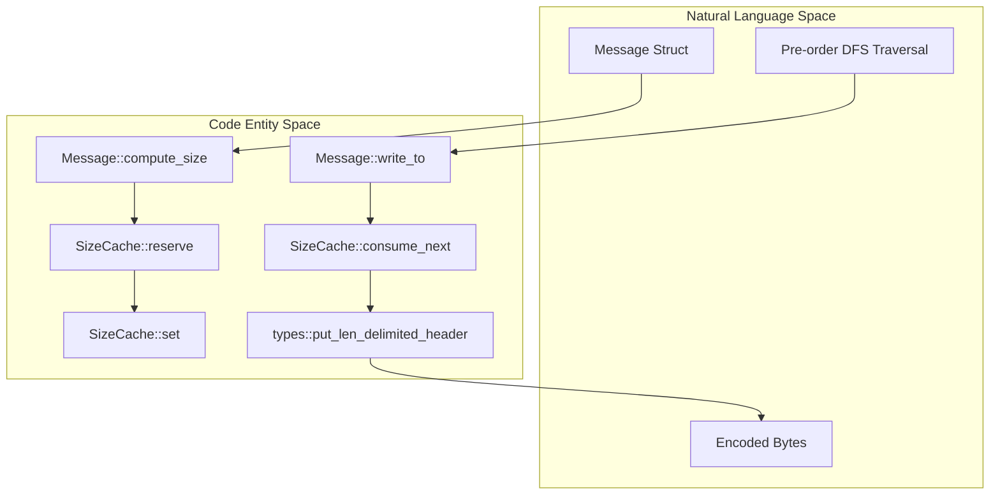

**Sources:** [buffa/src/size_cache.rs:30-241](), [buffa/src/message.rs:166-180]()

## Wire Format Codec

The codec implements the Protobuf binary wire format, handling varints, fixed-width integers, and length-delimited fields.

### Wire Types and Tag Optimization
A `Tag` combines a field number and a 3-bit wire type [buffa/src/encoding.rs:59-62]().
*   **Tag::new Inlining**: `Tag::new` is `#[inline]` to allow the range assertion to const-fold away when the field number is a constant [buffa/src/encoding.rs:78-88]().
*   **Fast-Path Decoding**: `Tag::decode` handles single-byte tags (field numbers 1–15) inline, avoiding a full `decode_varint` call for the most common fields [buffa/src/encoding.rs:114-132]().

### Encoding and Decoding Primitives

*   **Varints**: `encode_varint` uses an intentionally unbounded loop for performance, writing 7-bit chunks [buffa/src/encoding.rs:175-184]().
*   **Packed Helpers**: Varint decoders have force-inlined `_packed` twins (e.g., `decode_int32_packed`) used inside repeated-field loops to remove per-element call boundaries [buffa/src/types.rs:31-35]().
*   **UTF-8 Validation**: `validate_str_in` utilizes `smoothutf8` for fast validation, including a `verify_with_slack` path that avoids tail copies when buffer slack is available [buffa/src/types.rs:105-133]().

**Encoding/Decoding Data Flow**
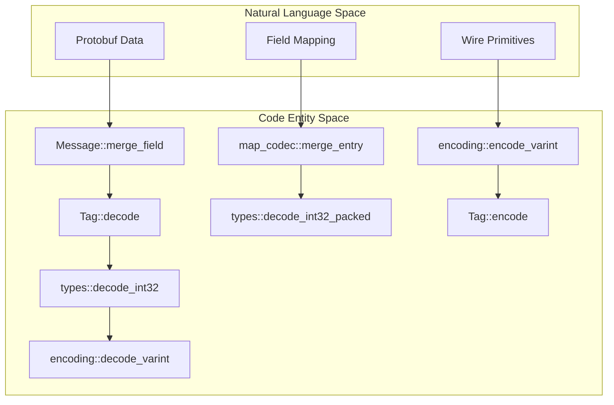

**Sources:** [buffa/src/encoding.rs:1-184](), [buffa/src/types.rs:1-133](), [buffa/src/map_codec.rs:1-35]()

## Decoding Context and Limits

To protect against malicious or malformed input, Buffa threads a `DecodeContext` through every merge call [buffa/src/message.rs:47-54]().

### DecodeContext
The context is a `Copy` struct carrying:
*   **Recursion Depth**: Initialized to `RECURSION_LIMIT` (100) [buffa/src/message.rs:25-25](). Every nested message call invokes `ctx.descend()`, which decrements the depth or returns `DecodeError::RecursionLimitExceeded` [buffa/src/message.rs:112-118]().
*   **Unknown Field Allowance**: A shared `Cell<usize>` initialized to `DEFAULT_UNKNOWN_FIELD_LIMIT` (1,000,000) [buffa/src/message.rs:45-45](). This bounds the total number of `UnknownField` records materialized across the entire decode operation [buffa/src/message.rs:27-38]().

### DecodeOptions
Users can configure these limits via `DecodeOptions`:
```rust
let options = DecodeOptions::new()
    .with_recursion_limit(50)
    .with_unknown_field_limit(500);
```
This builder is used to create the initial `DecodeContext` for top-level `decode` calls [buffa/src/message.rs:56-63]().

**Sources:** [buffa/src/message.rs:14-136](), [buffa/src/error.rs:49-54]()

---

# Page: Zero-Copy Views, OwnedView, and HasMessageView

# Zero-Copy Views, OwnedView, and HasMessageView

<details>
<summary>Relevant source files</summary>

The following files were used as context for generating this wiki page:

- [buffa-codegen/src/impl_message.rs](buffa-codegen/src/impl_message.rs)
- [buffa-codegen/src/impl_text.rs](buffa-codegen/src/impl_text.rs)
- [buffa-codegen/src/owned_view.rs](buffa-codegen/src/owned_view.rs)
- [buffa-codegen/src/view.rs](buffa-codegen/src/view.rs)
- [buffa-descriptor/src/reflect/containers.rs](buffa-descriptor/src/reflect/containers.rs)
- [buffa-test/src/tests/owned_view.rs](buffa-test/src/tests/owned_view.rs)
- [buffa-types/src/generated/google.protobuf.any.__view.rs](buffa-types/src/generated/google.protobuf.any.__view.rs)
- [buffa-types/src/generated/google.protobuf.duration.__view.rs](buffa-types/src/generated/google.protobuf.duration.__view.rs)
- [buffa-types/src/generated/google.protobuf.empty.__view.rs](buffa-types/src/generated/google.protobuf.empty.__view.rs)
- [buffa-types/src/generated/google.protobuf.field_mask.__view.rs](buffa-types/src/generated/google.protobuf.field_mask.__view.rs)
- [buffa-types/src/generated/google.protobuf.struct.__view.rs](buffa-types/src/generated/google.protobuf.struct.__view.rs)
- [buffa-types/src/generated/google.protobuf.timestamp.__view.rs](buffa-types/src/generated/google.protobuf.timestamp.__view.rs)
- [buffa-types/src/generated/google.protobuf.wrappers.__view.rs](buffa-types/src/generated/google.protobuf.wrappers.__view.rs)
- [buffa/src/lib.rs](buffa/src/lib.rs)
- [buffa/src/map_codec.rs](buffa/src/map_codec.rs)
- [buffa/src/message_field.rs](buffa/src/message_field.rs)
- [buffa/src/types.rs](buffa/src/types.rs)
- [buffa/src/view.rs](buffa/src/view.rs)

</details>


This page describes the `buffa` zero-copy view system. For every owned message type, `buffa` generates a corresponding "View" type that borrows data directly from the input buffer. This architecture eliminates allocations for `string` and `bytes` fields during decoding and provides a self-referential container, `OwnedView`, for safely moving these borrowed types across async boundaries or thread limits.

## The MessageView Trait

The `MessageView<'a>` trait is the counterpart to the `Message` trait for borrowed types [[buffa/src/view.rs:117-117]](). It defines the interface for zero-copy decoding and conversion back to owned types.

| Function | Description |
| :--- | :--- |
| `decode_view(buf: &'a [u8])` | The primary entry point for zero-copy decoding. It initializes a view and calls the internal recursive decoder [[buffa/src/view.rs:134-134]](). |
| `decode_view_with_ctx(buf, ctx)` | Decodes a view with custom decode limits (recursion, unknown fields), used by `DecodeOptions` [[buffa/src/view.rs:154-157]](). |
| `to_owned_message(&self)` | Deep-copies the borrowed data into a new instance of the owned message type [[buffa/src/view.rs:189-191]](). |
| `to_owned_from_source(source)` | Converts to owned, allowing zero-copy refcount bumps for `bytes::Bytes` fields if a source buffer is provided [[buffa/src/view.rs:215-218]](). |

### View Generation Logic
The `buffa-codegen` crate generates a `FooView<'a>` struct for every message `Foo` [[buffa-codegen/src/view.rs:99-99]]().
- **String/Bytes**: Represented as `&'a str` and `&'a [u8]` [[buffa-codegen/src/view.rs:5-6]]().
- **Oneofs**: Generated as a nested `FooKindView<'a>` enum mirroring the owned variants [[buffa-codegen/src/view.rs:7-8]]().
- **Field Representation**: String fields may be mapped to `&'a str` or `&'a [u8]` depending on `strict_utf8_mapping` and resolved features [[buffa-codegen/src/impl_message.rs:108-139]]().

**Sources:** [[buffa/src/view.rs:106-233]](), [[buffa-codegen/src/view.rs:1-110]](), [[buffa-codegen/src/impl_message.rs:108-139]]()

## Data Flow: From Buffer to View
The following diagram illustrates how the `decode_view` process maps wire format data to the generated `View` entities.

### Wire to View Mapping
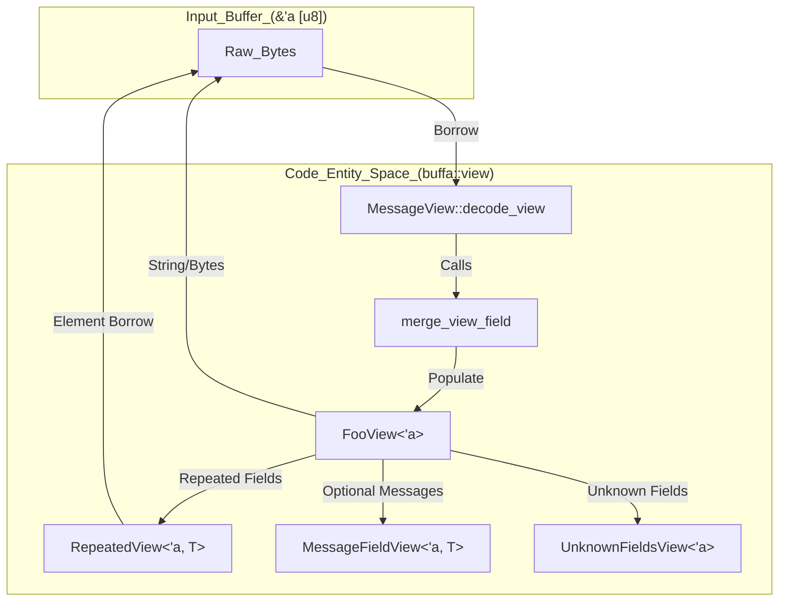
**Sources:** [[buffa/src/view.rs:106-134]](), [[buffa-types/src/generated/google.protobuf.any.__view.rs:140-188]](), [[buffa-codegen/src/view.rs:5-10]]()

## ViewReborrow and OwnedView

### ViewReborrow Trait
The `ViewReborrow` trait is a safe trait that enables `OwnedView` to expose the real lifetime of its borrows [[buffa/src/view.rs:235-244]]().
- **Mechanism**: The `reborrow` method body is a covariance-checked subtype coercion [[buffa/src/view.rs:246-251]](). If a view type is invariant, the body fails to compile, ensuring safety without `unsafe` blocks.
- **Codegen**: `buffa-codegen` automatically emits `impl ViewReborrow` for every generated view type [[buffa-codegen/src/view.rs:175-175]]().

### OwnedView: Self-Referential Container
`OwnedView<V>` wraps a decoded view with the lifetime erased to `'static`, backed by a `bytes::Bytes` buffer [[buffa/src/view.rs:42-43]]().

- **Construction**: `OwnedView::decode(bytes)` decodes the view. It uses `unsafe` internally to extend the lifetime of the buffer to the view, as the view is guaranteed to be dropped before the buffer [[buffa/src/view.rs:291-307]]().
- **Reborrowing**: Use `owned.reborrow()` to get a view tied to the lifetime of the `OwnedView` container itself [[buffa/src/view.rs:328-330]]().
- **Safety**: It implements `Send` and `Sync` if the underlying view is `Send + Sync` [[buffa/src/view.rs:344-348]]().

**Sources:** [[buffa/src/view.rs:235-348]](), [[buffa/src/lib.rs:103-104]]()

## Generated FooOwnedView Wrappers

`buffa` generates a `FooOwnedView` wrapper for every message to provide ergonomic access [[buffa-codegen/src/owned_view.rs:3-10]]().

- **Field Accessors**: Each field gets a method (e.g., `owned.name()`) that returns data borrowed from `&self` [[buffa-codegen/src/owned_view.rs:141-143]]().
- **Safety**: Because accessors borrow from `&self`, field data cannot outlive the underlying buffer [[buffa/src/view.rs:61-64]]().
- **Reserved Methods**: If a field name collides with wrapper methods, the accessor is suppressed and a warning is issued [[buffa-codegen/src/owned_view.rs:31-41]]().

**Sources:** [[buffa-codegen/src/owned_view.rs:1-184]](), [[buffa/src/view.rs:57-64]]()

## HasMessageView Trait

The `HasMessageView` trait links an owned message type to its view family [[buffa/src/view.rs:408-417]]().

```rust
pub trait HasMessageView: Message {
    type View<'a>: MessageView<'a, Owned = Self>;
    type ViewHandle: From<OwnedView<Self::View<'static>>> + Into<OwnedView<Self::View<'static>>>;
    
    fn decode_view_handle(bytes: Bytes) -> Result<Self::ViewHandle, DecodeError>;
}
```

This trait allows writing generic code that can decode into a view handle and access the reborrowed view without naming concrete types [[buffa-test/src/tests/owned_view.rs:177-187]]().

**Sources:** [[buffa/src/view.rs:408-422]](), [[buffa-test/src/tests/owned_view.rs:170-197]]()

## Specialized View Types

### RepeatedView and MapView
- **`RepeatedView<'a, T>`**: Provides zero-copy access to repeated fields [[buffa/src/view.rs:96-96]](). It supports both packed and unpacked wire formats.
- **`MapView<'a, K, V>`**: A view over a map field, allowing iteration over key-value pairs without constructing a `HashMap` allocation [[buffa-types/src/generated/google.protobuf.struct.__view.rs:17-21]]().

### MessageFieldView
`MessageFieldView<V>` represents an optional sub-message view [[buffa/src/view.rs:97-97]](). It provides access to the nested view's fields if present and handles recursion limits during decoding [[buffa-types/src/generated/google.protobuf.struct.__view.rs:75-80]]().

### UnknownFieldsView
`UnknownFieldsView<'a>` preserves unrecognized fields by storing their raw byte spans from the input buffer [[buffa/src/view.rs:98-98]](). This allows for high-fidelity round-trips without allocating memory for the unknown data [[buffa-codegen/src/view.rs:36-45]]().

## View Architecture Overview

The following diagram bridges the natural language concepts of "Owned" and "Borrowed" to the specific code entities in the `buffa` runtime.

### Entity Relationship Diagram
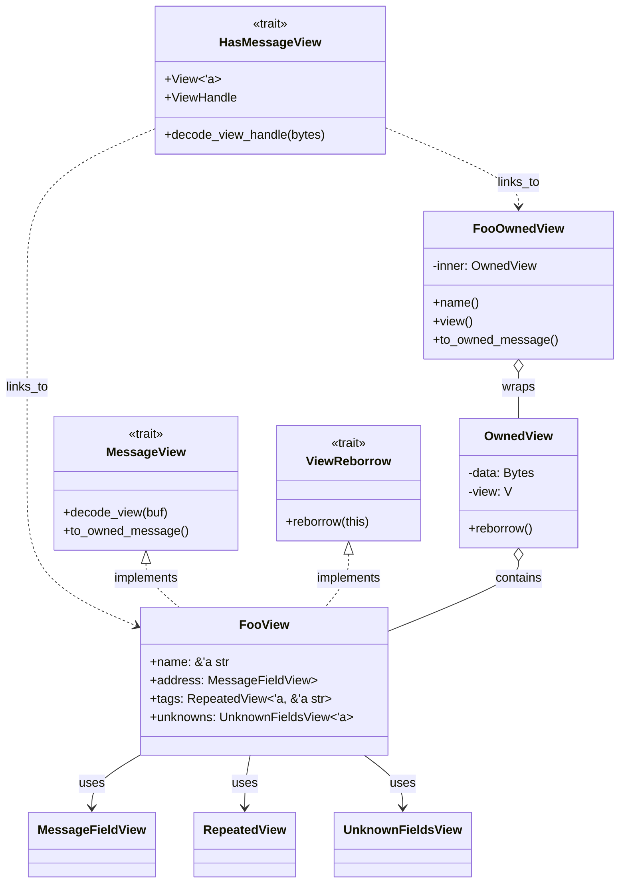
**Sources:** [[buffa/src/view.rs:90-100]](), [[buffa/src/view.rs:235-244]](), [[buffa/src/view.rs:408-417]](), [[buffa-codegen/src/owned_view.rs:49-57]]()

### Conversion to Owned
The `to_owned_message` implementation in `FooView` performs the following mapping [[buffa/src/view.rs:189-191]]():
- `&'a str` $\rightarrow$ `String` (or configured `ProtoString` [[buffa/src/lib.rs:80-82]]())
- `&'a [u8]` $\rightarrow$ `Vec<u8>` or `bytes::Bytes` via `bytes_from_source` [[buffa-codegen/src/view.rs:57-74]]().
- `RepeatedView<'a, T>` $\rightarrow$ `Vec<T::Owned>`
- `MessageFieldView<T>` $\rightarrow$ `MessageField<T::Owned>`

**Sources:** [[buffa/src/view.rs:189-218]](), [[buffa-codegen/src/view.rs:57-74]](), [[buffa-types/src/generated/google.protobuf.any.__view.rs:189-205]]()

---

# Page: Enumerations, MessageField, and Oneof

# Enumerations, MessageField, and Oneof

<details>
<summary>Relevant source files</summary>

The following files were used as context for generating this wiki page:

- [CHANGELOG.md](CHANGELOG.md)
- [buffa-codegen/src/owned_view.rs](buffa-codegen/src/owned_view.rs)
- [buffa-descriptor/src/reflect/containers.rs](buffa-descriptor/src/reflect/containers.rs)
- [buffa-test/src/tests/owned_view.rs](buffa-test/src/tests/owned_view.rs)
- [buffa/src/map_codec.rs](buffa/src/map_codec.rs)
- [buffa/src/message_field.rs](buffa/src/message_field.rs)
- [buffa/src/types.rs](buffa/src/types.rs)
- [docs/guide.md](docs/guide.md)
- [protoc-gen-buffa/src/main.rs](protoc-gen-buffa/src/main.rs)

</details>


This page describes the core runtime types used by `buffa` to represent Protobuf enumerations, optional message fields, and oneof unions. These types are designed to balance Protobuf's wire-format semantics (such as open vs. closed enums) with Rust's type safety and ergonomics (such as transparent access to default instances and pluggable allocation strategies).

## Enumerations and `EnumValue<T>`

In `buffa`, enumerations are represented by types implementing the `Enumeration` trait. Depending on the Protobuf edition and features, enums are treated as either **open** or **closed**.

### The `Enumeration` Trait
All generated enum types implement the `Enumeration` trait [buffa/src/enumeration.rs:10-11](). This trait provides the mapping between Rust enum variants and their `i32` wire values, as well as their string names for JSON serialization [buffa/src/enumeration.rs:15-21](). It also provides a list of all known variants via `values()` [buffa/src/enumeration.rs:48-50]().

### Open vs. Closed Semantics
*   **Open Enums**: The default in Editions and Proto3. These enums accept any `i32` value on the wire. If a value does not match a known variant, it is preserved as an `Unknown` variant [buffa/src/enumeration.rs:56-57]().
*   **Closed Enums**: The default in Proto2. Values on the wire that do not match a known variant are treated as unknown fields and not assigned to the enum field.

To support open enums, `buffa` uses the `EnumValue<E>` wrapper [buffa/src/enumeration.rs:59-64]().

### `EnumValue<T>` Implementation
`EnumValue<E>` is an enum that can be either `Known(E)` or `Unknown(i32)` [buffa/src/enumeration.rs:60-63](). It provides ergonomic methods to check the status of the value:
*   `is_known()`: Returns true if the value matches a defined variant [buffa/src/enumeration.rs:81-83]().
*   `as_known()`: Returns `Option<E>` [buffa/src/enumeration.rs:93-98]().
*   `to_i32()`: Returns the raw wire value regardless of whether it is known [buffa/src/enumeration.rs:68-74]().

`EnumValue` implements `PartialEq<E>`, allowing direct comparison between the wrapper and a raw enum variant: `field == MyEnum::Foo` [buffa/src/enumeration.rs:126-133]().

### Enum Data Flow
The following diagram illustrates how a wire value is processed into an `EnumValue`.

**Wire Value to Enum Mapping**
```mermaid
graph TD
    subgraph "Natural Language Space"
        "Wire Protocol"
        "Generated Code"
    end

    subgraph "Code Entity Space"
        A["i32 (Wire Value)"] --> B["EnumValue::from(i32)"]
        B --> C{"E::from_i32(value)"}
        C -- "Some(variant)" --> D["EnumValue::Known(variant)"]
        C -- "None" --> E["EnumValue::Unknown(value)"]
        
        F["Enumeration Trait"] -- "defines" --> C
        G["EnumValue Enum"] -- "wraps" --> D
        G -- "wraps" --> E
    end
```
Sources: [buffa/src/enumeration.rs:10-15](), [buffa/src/enumeration.rs:59-64](), [buffa/src/enumeration.rs:101-108]()

---

## MessageField<T>

`MessageField<T, P>` is a smart pointer used for optional message fields [buffa/src/message_field.rs:213-216](). It replaces the standard `Option<Box<T>>` with a wrapper that provides ergonomic access to Protobuf's "default instance" semantics and supports pluggable allocation strategies via the `ProtoBox` trait [buffa/src/message_field.rs:162-171]().

### Key Characteristics
1.  **Deref to Default**: `MessageField` implements `Deref<Target = T>`. If the field is unset, `deref()` returns a reference to a static, read-only "default instance" of the message [buffa/src/message_field.rs:261-268]().
2.  **Ergonomic Unwrapping**: It provides `unwrap()` and `expect()` methods to consume the field directly [buffa/src/message_field.rs:335-347](), and implements `From<MessageField> for Option<T>` [buffa/src/message_field.rs:430-435]().
3.  **DefaultInstance Trait**: Every generated message implements `DefaultInstance`, providing a `default_instance()` method that returns a `&'static Self` [buffa/src/message_field.rs:52-55](). This is typically implemented via a lazily-initialized `OnceBox` [buffa/src/message_field.rs:68-79]().
4.  **Pluggable Storage**: The second type parameter `P` implements `ProtoBox<T>`. While the default is `Inline<T>` (where recursion allows), `buffa-build` can configure this to use `Box<T>` or a custom pointer like `SmallBox` [buffa/src/message_field.rs:81-98]().

### MessageField Access Logic
The following diagram shows how `MessageField` resolves references to either allocated data or the static default.

**MessageField Access Logic**
```mermaid
flowchart LR
    subgraph "Natural Language Space"
        "User Code"
        "Runtime Logic"
    end

    subgraph "Code Entity Space"
        UC["msg.my_field.some_method()"] --> DR["MessageField::deref()"]
        DR --> IS{"self.inner.is_some()"}
        IS -- "Yes" --> VAL["Return &*self.inner"]
        IS -- "No" --> DI["T::default_instance()"]
        DI --> RET["Return &'static T"]
    end
```
Sources: [buffa/src/message_field.rs:52-55](), [buffa/src/message_field.rs:261-268](), [buffa/src/message_field.rs:335-347]()

---

## Oneof and the `Oneof` Trait

Protobuf `oneof` groups are generated as Rust enums where each variant contains exactly one field. These enums implement the `Oneof` trait.

### The `Oneof` Trait
The `Oneof` trait is a marker and utility trait for types representing a `oneof` group [buffa/src/lib.rs:143](). It is used by the runtime to identify and process polymorphic field groups.

### Codegen Structure
For a `oneof` named `payload`, `buffa` generates:
1.  A field in the message struct: `pub payload: Option<MyMessage_Payload>` [buffa-codegen/src/owned_view.rs:148-151]().
2.  An enum where each variant corresponds to a field in the oneof [buffa-codegen/src/owned_view.rs:181-185]().
3.  If a variant is a message type, it is typically wrapped in a `Box` (or the configured `ProtoBox` type) to prevent infinite size in recursive schemas [buffa/src/message_field.rs:84-88]().

### JSON and Oneof
When using the `json` feature, `oneof` enums are typically annotated with `#[serde(flatten)]` in the parent message to ensure the oneof field appears at the top level of the JSON object, matching the Protobuf JSON mapping specification.

| Feature | Implementation Detail |
| :--- | :--- |
| **Storage** | `Option<T>` where `T` is the generated oneof enum [buffa-codegen/src/owned_view.rs:183](). |
| **Recursive Types** | Variants containing messages are `Box`ed or use `ProtoBox` [buffa/src/message_field.rs:162](). |
| **Presence** | Tracked naturally by the `Option` wrapper. |
| **Trait** | Implements the `Oneof` trait [buffa/src/lib.rs:143](). |

Sources: [buffa/src/lib.rs:143-160](), [buffa-codegen/src/owned_view.rs:148-185](), [buffa/src/message_field.rs:81-98]()

---

# Page: Extensions and Unknown Fields

# Extensions and Unknown Fields

<details>
<summary>Relevant source files</summary>

The following files were used as context for generating this wiki page:

- [.changes/unreleased/changed-20260629-003205.yaml](.changes/unreleased/changed-20260629-003205.yaml)
- [.changes/unreleased/changed-20260629-051500.yaml](.changes/unreleased/changed-20260629-051500.yaml)
- [buffa-codegen/src/tests/view_codegen.rs](buffa-codegen/src/tests/view_codegen.rs)
- [buffa-descriptor/src/generated/google.protobuf.compiler.plugin.__view.rs](buffa-descriptor/src/generated/google.protobuf.compiler.plugin.__view.rs)
- [buffa-descriptor/src/generated/google.protobuf.descriptor.__view.rs](buffa-descriptor/src/generated/google.protobuf.descriptor.__view.rs)
- [buffa/src/encoding.rs](buffa/src/encoding.rs)
- [buffa/src/extension.rs](buffa/src/extension.rs)
- [buffa/src/extension_registry.rs](buffa/src/extension_registry.rs)
- [buffa/src/unknown_fields.rs](buffa/src/unknown_fields.rs)

</details>


In `buffa`, extensions and unknown fields are intrinsically linked. While Protobuf Editions has removed general-purpose message extensions, they remain the sanctioned mechanism for **Custom Options** (e.g., `(google.api.http)`). On the wire, extensions are ordinary fields; when a message is decoded without a compiled-in field for a specific number, the data is preserved in `UnknownFields`. `buffa` provides a typed API to lazily extract these values from unknown storage.

## Unknown Field Preservation

The `UnknownFields` struct is a collection of fields encountered during decoding that do not match the message's schema [buffa/src/unknown_fields.rs:11-14](). This ensures round-trip fidelity: data is not lost when a message passes through an intermediary with an older schema [buffa/src/unknown_fields.rs:8-10]().

### Data Representation

Unknown fields are stored as a `Vec<UnknownField>`, where each entry contains the field number and its raw wire data [buffa/src/unknown_fields.rs:12-14](). The data is categorized by its wire type [buffa/src/unknown_fields.rs:163-169]().

| Type | Wire Type | Representation |
| :--- | :--- | :--- |
| `Varint` | 0 | `u64` [buffa/src/unknown_fields.rs:164]() |
| `Fixed64` | 1 | `u64` [buffa/src/unknown_fields.rs:165]() |
| `LengthDelimited` | 2 | `Vec<u8>` [buffa/src/unknown_fields.rs:167]() |
| `Group` | 3 | `UnknownFields` (nested collection) [buffa/src/unknown_fields.rs:168]() |
| `Fixed32` | 5 | `u32` [buffa/src/unknown_fields.rs:166]() |

Sources: [buffa/src/unknown_fields.rs:11-14](), [buffa/src/unknown_fields.rs:126-129](), [buffa/src/unknown_fields.rs:163-169]()

### Lifecycle and Round-tripping

The following diagram illustrates how unknown fields are captured and re-emitted during a decode-encode cycle.

**Diagram: Unknown Field Data Flow**
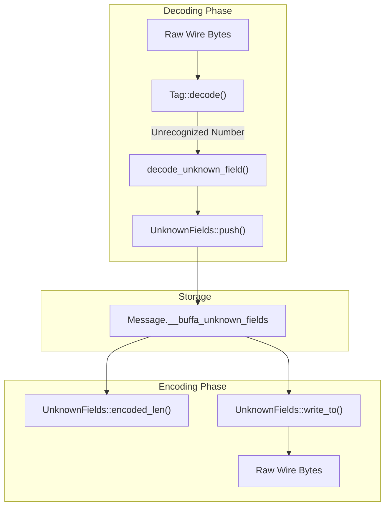
Sources: [buffa/src/unknown_fields.rs:39-41](), [buffa/src/unknown_fields.rs:62-65](), [buffa/src/unknown_fields.rs:68-72](), [buffa/src/unknown_fields.rs:132-137](), [buffa/src/unknown_fields.rs:140-158]()

## Typed Extensions

Extensions provide a typed interface over `UnknownFields`. Codegen emits an `Extension<C>` descriptor for every `extend` declaration [buffa/src/extension.rs:17-23]().

### The Extension Descriptor

The `Extension<C>` struct identifies an extension by its field number and the Fully-Qualified Name (FQN) of the message it extends [buffa/src/extension.rs:88-100]().

*   **`Extension::new(number, extendee)`**: Creates a descriptor for a specific field on a specific message [buffa/src/extension.rs:115-122]().
*   **`Extension::with_default(number, extendee, default_fn)`**: Used for Proto2 extensions with `[default = ...]` values. The default is produced lazily via a function pointer [buffa/src/extension.rs:134-145]().

### ExtensionSet API

Messages that support extensions implement the `ExtensionSet` trait. This trait provides methods to interact with the underlying `UnknownFields` storage using a typed `Extension<C>` [buffa/src/extension.rs:25-32]().

| Method | Description |
| :--- | :--- |
| `extension(&ext)` | Lazily decodes the field from `UnknownFields`. Returns `Option<T>` [buffa/src/extension.rs:67](). |
| `extension_or_default(&ext)` | Returns the extension value or the Proto2 declared default [buffa/src/extension.rs:71](). |
| `set_extension(&ext, val)` | Encodes the value and replaces any existing records in `UnknownFields` [buffa/src/extension.rs:68](). |
| `has_extension(&ext)` | Checks for the presence of the field number in `UnknownFields` [buffa/src/extension.rs:70](). |
| `clear_extension(&ext)` | Removes all records for the field number from `UnknownFields` [buffa/src/extension.rs:69](). |

Sources: [buffa/src/extension.rs:67-71](), [buffa/src/extension.rs:88-100](), [buffa/src/extension.rs:115-122]()

### Safety and Panics

To prevent logic errors, `extension()`, `set_extension()`, and `clear_extension()` perform a runtime check [buffa/src/extension.rs:166-173](). They compare the `extendee` FQN in the `Extension` descriptor against the `PROTO_FQN` of the message [buffa/src/extension.rs:93-96](). If they do not match, the code panics [buffa/src/extension.rs:166-173](). `has_extension()` is the exception; it returns `false` gracefully on a mismatch [buffa/src/extension.rs:41-42]().

## Type and Extension Registries

Because `buffa` uses `serde` for JSON and unknown fields are typically opaque bytes, extensions require a registry to be visible in structured output [buffa/src/extension_registry.rs:4-7]().

### Unified TypeRegistry

The `TypeRegistry` acts as a unified install point for both JSON and text format support [buffa/src/extension_registry.rs:8-13](). It enables the serialization of extension fields as `"[pkg.ext]"` keys in proto3 JSON [buffa/src/extension_registry.rs:3-4](). Without a registry, extension bytes stay in `UnknownFields` and are omitted from JSON output [buffa/src/extension_registry.rs:5-7]().

**Diagram: Registry-Based Extension Resolution**
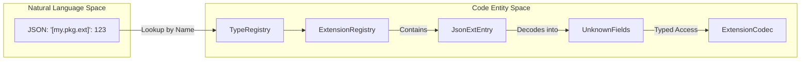
Sources: [buffa/src/extension_registry.rs:49-63](), [buffa/src/extension_registry.rs:75-78](), [buffa/src/extension.rs:51-58](), [buffa/src/extension.rs:79-82]()

## Unknown Fields in Views

Zero-copy view types also preserve unknown fields using `UnknownFieldsView<'a>` [buffa-descriptor/src/generated/google.protobuf.descriptor.__view.rs:13]().

### View Decoding
During view decoding, unrecognized tags are passed to `push_record` on the `UnknownFieldsView` [buffa-descriptor/src/generated/google.protobuf.descriptor.__view.rs:60](). This stores a reference to the original buffer span rather than allocating a new `Vec<u8>` for the field data [buffa-descriptor/src/generated/google.protobuf.descriptor.__view.rs:59-60]().

### Round-trip Fidelity
When a view is converted back to an owned message via `to_owned_message()`, the unknown fields are cloned into the owned `UnknownFields` storage [buffa-descriptor/src/generated/google.protobuf.descriptor.__view.rs:84]().

Sources: [buffa-descriptor/src/generated/google.protobuf.descriptor.__view.rs:13](), [buffa-descriptor/src/generated/google.protobuf.descriptor.__view.rs:57-61](), [buffa-descriptor/src/generated/google.protobuf.descriptor.__view.rs:84]()

---

# Page: JSON Serialization

# JSON Serialization

<details>
<summary>Relevant source files</summary>

The following files were used as context for generating this wiki page:

- [.changes/unreleased/fixed-20260628-211100.yaml](.changes/unreleased/fixed-20260628-211100.yaml)
- [CHANGELOG.md](CHANGELOG.md)
- [buffa/src/extension_registry.rs](buffa/src/extension_registry.rs)
- [buffa/src/json_helpers.rs](buffa/src/json_helpers.rs)
- [buffa/src/json_helpers/tests.rs](buffa/src/json_helpers/tests.rs)
- [docs/guide.md](docs/guide.md)
- [protoc-gen-buffa/src/main.rs](protoc-gen-buffa/src/main.rs)

</details>


The `buffa` runtime provides a high-fidelity implementation of the [Proto3 JSON Mapping](https://protobuf.dev/programming-guides/proto3#json) using `serde`. This implementation handles special encodings for 64-bit integers, floating-point special values, and Base64-encoded bytes, while providing a global type registry for `google.protobuf.Any` and extensions.

## Feature Flag and Serde Integration

JSON support is optional and gated behind the `json` feature flag [docs/guide.md:34-34](). When enabled, `buffa-codegen` emits `#[derive(::serde::Serialize, ::serde::Deserialize)]` for all message and enum types. For types requiring special mapping (like `int64` or `bytes`), it emits `#[serde(with = "...")]` attributes pointing to modules in `json_helpers` [buffa/src/json_helpers.rs:1-15]().

### Special Type Mapping Table
The following types are mapped according to the Proto3 spec:

| Proto Type | JSON Representation | Helper Module |
| :--- | :--- | :--- |
| `int64`, `sint64` | Decimal String (e.g. `"9223372036854775807"`) | `json_helpers::int64` |
| `uint64`, `fixed64`| Decimal String (e.g. `"18446744073709551615"`) | `json_helpers::uint64` |
| `float`, `double` | Number, or `"NaN"`, `"Infinity"`, `"-Infinity"` | `json_helpers::float` / `double` |
| `bytes` | Base64-encoded string (RFC 4648) | `json_helpers::bytes` |
| `EnumValue<T>` | Variant name string or integer | `json_helpers::proto_enum` |

Sources: [buffa/src/json_helpers.rs:6-15](), [docs/guide.md:34-43]()

## JSON Parse Options

Protobuf JSON parsing behavior can be tuned via `JsonParseOptions`. Because `serde`'s `Deserialize` trait does not support passing context parameters directly, `buffa` uses ambient state to manage these options.

### Scoped vs. Global API
The mechanism for passing options depends on whether the `std` feature is enabled [docs/guide.md:33-33]():

| Build | Mechanism | Scoping | Function |
| :--- | :--- | :--- | :--- |
| `std` | Thread-local | Per-closure (nestable) | `with_json_parse_options` |
| `no_std` | `AtomicPtr` | Process-wide (set-once) | `set_global_json_parse_options` |

Sources: [docs/guide.md:33-33](), [buffa/src/extension_registry.rs:115-132]()

### Numeric Precision Fix
A critical fix in the JSON parser ensures that quoted integer strings using decimal or exponent notation (e.g., `"9007199254740993.0"` or `"9.007199254740993e15"`) are parsed exactly into 64-bit integers. Previously, these routed through `f64`, which caused silent rounding for magnitudes above $2^{53}$ [.changes/unreleased/fixed-20260628-211100.yaml:1-4]().

## Type Registries

Proto3 JSON requires a registry to handle `google.protobuf.Any` (which embeds types by URL) and Extensions (which appear as `[path.to.ext]` keys).

### JsonRegistry and AnyRegistry
The `JsonRegistry` is a unified aggregate that manages both `AnyRegistry` and `ExtensionRegistry`. It is designed to be populated once at startup via generated `register_types` functions [buffa/src/extension_registry.rs:8-13]().

### ExtensionRegistry
`ExtensionRegistry` maps fully-qualified proto names to `JsonExtEntry` structures [buffa/src/extension_registry.rs:75-78](). Codegen emits a `#[serde(flatten)]` wrapper around `__buffa_unknown_fields` that uses `serialize_extensions` to emit bracketed keys for registered extensions [buffa/src/extension_registry.rs:17-25](), [buffa/src/extension_registry.rs:148-158]().

### Registry Data Flow
The following diagram illustrates how the global registry facilitates the conversion between binary wire format and JSON for `Any` and Extension fields.

**Type Registry Conversion Flow**
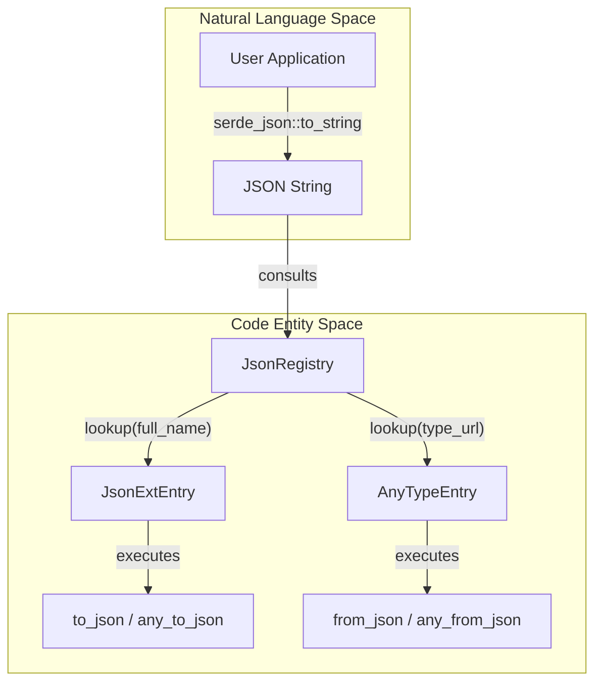
Sources: [buffa/src/extension_registry.rs:49-63](), [buffa/src/extension_registry.rs:75-107]()

## JSON Helpers and Container Dispatch

Because `serde`'s `#[serde(with = "...")]` attribute does not compose well with containers (e.g., `Vec<i64>`), `buffa` uses a dispatch trait `ProtoElemJson` [buffa/src/json_helpers.rs:90-95]().

### Container Modules
*   **`proto_seq`**: Handles `repeated` fields. It ensures that `null` elements are rejected as per the spec, whereas the container itself may be `null` (representing empty) [buffa/src/json_helpers.rs:145-152](), [buffa/src/json_helpers/tests.rs:56-62]().
*   **`proto_map`**: Handles `map<K, V>` fields. It applies special encoding to both keys and values, stringifying keys and applying `ProtoElemJson` to values [buffa/src/json_helpers.rs:135-143](), [buffa/src/json_helpers/tests.rs:65-69]().

### Component Interaction
This diagram shows how `ProtoElemJson` bridges generated types with the generic container helpers.

**JSON Helper Dispatch Architecture**
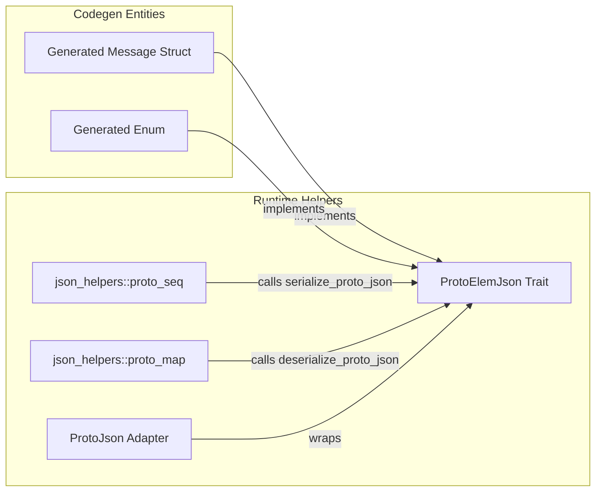
Sources: [buffa/src/json_helpers.rs:90-113](), [buffa/src/json_helpers/tests.rs:29-30]()

## Implementation Details

### Lenient Base64
The Base64 implementation for `bytes` fields uses a "lenient" configuration (`STANDARD_LENIENT` and `URL_SAFE_LENIENT`) [buffa/src/json_helpers.rs:50-51](). It tolerates trailing bits and is indifferent to padding (`DecodePaddingMode::Indifferent`), as required by the Protobuf JSON specification to support both standard and URL-safe variants [buffa/src/json_helpers.rs:34-49]().

### Pre-allocation Safety
When deserializing collections, `buffa` clamps the `size_hint` from the deserializer to `MAX_PREALLOC_HINT` (4096) via `clamp_size_hint` [buffa/src/json_helpers.rs:63-66](). This prevents OOM attacks where a hostile deserializer returns `usize::MAX` for a collection size [buffa/src/json_helpers.rs:53-61]().

### Well-Known Types (WKT) Support
The `json_helpers::wkt` submodule provides shared formatting and parsing primitives for types with specialized JSON forms, such as `Timestamp` (RFC 3339), `Duration` (decimal seconds), and `FieldMask` (camelCase) [buffa/src/json_helpers.rs:20-27]().

Sources: [buffa/src/json_helpers.rs:34-66](), [buffa/src/json_helpers/tests.rs:5-25](), [buffa/src/json_helpers.rs:20-30]()

---

# Page: Well-Known Types (`buffa-types`)

# Well-Known Types (`buffa-types`)

<details>
<summary>Relevant source files</summary>

The following files were used as context for generating this wiki page:

- [buffa-codegen/src/bin/gen_wkt_types.rs](buffa-codegen/src/bin/gen_wkt_types.rs)
- [buffa-types/Cargo.toml](buffa-types/Cargo.toml)
- [buffa-types/src/duration_chrono.rs](buffa-types/src/duration_chrono.rs)
- [buffa-types/src/generated/google.protobuf.any.__view.rs](buffa-types/src/generated/google.protobuf.any.__view.rs)
- [buffa-types/src/generated/google.protobuf.any.rs](buffa-types/src/generated/google.protobuf.any.rs)
- [buffa-types/src/generated/google.protobuf.duration.__view.rs](buffa-types/src/generated/google.protobuf.duration.__view.rs)
- [buffa-types/src/generated/google.protobuf.duration.rs](buffa-types/src/generated/google.protobuf.duration.rs)
- [buffa-types/src/generated/google.protobuf.empty.__view.rs](buffa-types/src/generated/google.protobuf.empty.__view.rs)
- [buffa-types/src/generated/google.protobuf.empty.rs](buffa-types/src/generated/google.protobuf.empty.rs)
- [buffa-types/src/generated/google.protobuf.field_mask.__view.rs](buffa-types/src/generated/google.protobuf.field_mask.__view.rs)
- [buffa-types/src/generated/google.protobuf.field_mask.rs](buffa-types/src/generated/google.protobuf.field_mask.rs)
- [buffa-types/src/generated/google.protobuf.struct.__view.rs](buffa-types/src/generated/google.protobuf.struct.__view.rs)
- [buffa-types/src/generated/google.protobuf.struct.rs](buffa-types/src/generated/google.protobuf.struct.rs)
- [buffa-types/src/generated/google.protobuf.timestamp.__view.rs](buffa-types/src/generated/google.protobuf.timestamp.__view.rs)
- [buffa-types/src/generated/google.protobuf.timestamp.rs](buffa-types/src/generated/google.protobuf.timestamp.rs)
- [buffa-types/src/generated/google.protobuf.wrappers.__view.rs](buffa-types/src/generated/google.protobuf.wrappers.__view.rs)
- [buffa-types/src/generated/google.protobuf.wrappers.rs](buffa-types/src/generated/google.protobuf.wrappers.rs)
- [buffa-types/src/lib.rs](buffa-types/src/lib.rs)
- [buffa-types/src/timestamp_ext.rs](buffa-types/src/timestamp_ext.rs)
- [buffa/src/view.rs](buffa/src/view.rs)

</details>


The `buffa-types` crate provides pre-generated Rust types for Google's **Well-Known Types (WKTs)**. These are a set of standard messages defined by the Protocol Buffers project that provide common functionality such as timestamps, durations, and dynamic typing (`Any`).

Rather than requiring every user to generate these types from scratch, `buffa` provides them as a standalone crate with hand-written extensions to make them feel like native Rust types.

### Architecture Overview

The crate follows a "hybrid" approach:
1.  **Generated Core**: The fundamental message structures, `Message` trait implementations, and zero-copy view types (e.g., `AnyView<'a>`) are generated by `protoc-gen-buffa` and checked into the repository under `src/generated/` [buffa-types/src/generated/google.protobuf.any.rs:1-2]().
2.  **Hand-written Extensions**: Additional functionality (e.g., converting a `Timestamp` to a `std::time::SystemTime` or packing `Any` values) is implemented in separate extension modules like `timestamp_ext.rs` [buffa-types/src/timestamp_ext.rs:1-1]().

The following diagram illustrates how the `buffa-types` crate bridges the gap between standard Protobuf definitions and ergonomic Rust code:

**WKT Entity Mapping**
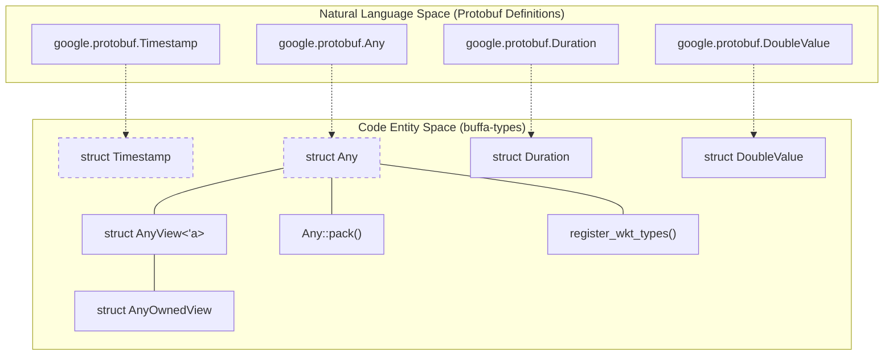
Sources: [buffa-types/src/generated/google.protobuf.any.rs:103-145](), [buffa-types/src/generated/google.protobuf.any.__view.rs:102-139](), [buffa-types/src/generated/google.protobuf.timestamp.rs:107-123](), [buffa-types/src/generated/google.protobuf.duration.rs:4-9](), [buffa-types/src/generated/google.protobuf.wrappers.rs:4-10]()

---

### Generated WKT Types

The core of `buffa-types` consists of Rust structs that mirror the official Google Protobuf definitions. These files are located in the `src/generated/` directory and are marked with `@generated` headers. Each message generates an owned version (e.g., `Any`) and a zero-copy view version (e.g., `AnyView<'a>`) [buffa-types/src/generated/google.protobuf.any.__view.rs:102-139]().

Key types included:
*   **Time**: `Timestamp` [buffa-types/src/generated/google.protobuf.timestamp.rs:107-123]() and `Duration` [buffa-types/src/generated/google.protobuf.duration.rs:4-9]().
*   **Dynamic Typing**: `Any` [buffa-types/src/generated/google.protobuf.any.rs:103-145]().
*   **JSON/Dynamic Values**: `Struct` [buffa-types/src/generated/google.protobuf.struct.rs:60-67](), `Value`, `ListValue`, and `NullValue` [buffa-types/src/generated/google.protobuf.struct.rs:11-14]().
*   **Utility**: `FieldMask` [buffa-types/src/generated/google.protobuf.field_mask.rs:229-236](), `Empty` [buffa-types/src/generated/google.protobuf.empty.rs:4-10](), and the "Wrapper" types (e.g., `DoubleValue` [buffa-types/src/generated/google.protobuf.wrappers.rs:4-10]()).

These types are regenerated using the `task gen-wkt-types` command, which invokes the `gen_wkt_types` binary [buffa-codegen/src/bin/gen_wkt_types.rs:1-1](). The crate supports `no_std` environments unless features like `std` or `reflect` are enabled [buffa-types/Cargo.toml:17-25]().

For details on the specific fields and generation process, see [Generated WKT Types](#3.1).

**Sources:**
*   [buffa-types/src/generated/google.protobuf.any.rs:103-145]() (Any struct definition)
*   [buffa-types/src/generated/google.protobuf.any.__view.rs:102-139]() (AnyView struct definition)
*   [buffa-types/src/generated/google.protobuf.timestamp.rs:107-123]() (Timestamp struct definition)
*   [buffa-types/src/generated/google.protobuf.struct.rs:11-14]() (NullValue enum definition)

---

### Extension Modules and Ergonomics

Standard generated Protobuf types are often cumbersome to use in idiomatic Rust. To solve this, `buffa-types` includes hand-written extension modules that provide:

*   **Conversions**: `From`/`Into` implementations for standard library types, such as `std::time` or `chrono` conversions for `Timestamp` and `Duration` [buffa-types/src/duration_chrono.rs:1-1]().
*   **Logic**: Methods like `Any::pack` and `Any::unpack` for type-safe dynamic message handling.
*   **JSON Integration**: The `register_wkt_types` function, which populates a `TypeRegistry` so the `buffa` runtime knows how to handle the special JSON mapping rules for WKTs (like `Timestamp` encoding as RFC 3339 strings [buffa-types/src/generated/google.protobuf.timestamp.rs:81-93]()).
*   **Reflection Support**: If the `reflect` feature is enabled, WKTs implement `ReflectMessage` [buffa-types/src/generated/google.protobuf.any.rs:164-168](), allowing them to be used with the `buffa-descriptor` reflection system.

For details on these helpers, see [WKT Extension Modules and Ergonomic Helpers](#3.2).

**Sources:**
*   [buffa-types/src/generated/google.protobuf.any.rs:164-168]() (Any reflection implementation)
*   [buffa-types/src/timestamp_ext.rs:1-1]() (Timestamp extensions)
*   [buffa-types/src/duration_chrono.rs:1-1]() (Chrono integration)

---

### Data Flow: From Proto to Rust

The following diagram shows how a Well-Known Type moves from its raw Protobuf definition to a usable Rust entity within the workspace.

**WKT Pipeline**
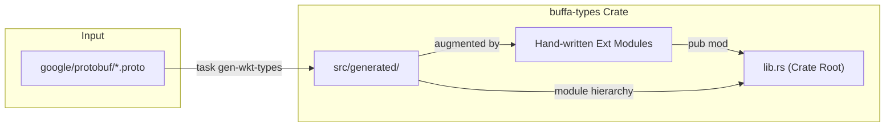
Sources: [buffa-types/src/generated/google.protobuf.any.rs:1-2](), [buffa-codegen/src/bin/gen_wkt_types.rs:1-1]()

---

# Page: Generated WKT Types

# Generated WKT Types

<details>
<summary>Relevant source files</summary>

The following files were used as context for generating this wiki page:

- [buffa-descriptor/src/generated/google.protobuf.compiler.mod.rs](buffa-descriptor/src/generated/google.protobuf.compiler.mod.rs)
- [buffa-descriptor/src/generated/google.protobuf.mod.rs](buffa-descriptor/src/generated/google.protobuf.mod.rs)
- [buffa-types/src/generated/google.protobuf.any.__view.rs](buffa-types/src/generated/google.protobuf.any.__view.rs)
- [buffa-types/src/generated/google.protobuf.any.rs](buffa-types/src/generated/google.protobuf.any.rs)
- [buffa-types/src/generated/google.protobuf.duration.__view.rs](buffa-types/src/generated/google.protobuf.duration.__view.rs)
- [buffa-types/src/generated/google.protobuf.duration.rs](buffa-types/src/generated/google.protobuf.duration.rs)
- [buffa-types/src/generated/google.protobuf.empty.__view.rs](buffa-types/src/generated/google.protobuf.empty.__view.rs)
- [buffa-types/src/generated/google.protobuf.empty.rs](buffa-types/src/generated/google.protobuf.empty.rs)
- [buffa-types/src/generated/google.protobuf.field_mask.__view.rs](buffa-types/src/generated/google.protobuf.field_mask.__view.rs)
- [buffa-types/src/generated/google.protobuf.field_mask.rs](buffa-types/src/generated/google.protobuf.field_mask.rs)
- [buffa-types/src/generated/google.protobuf.mod.rs](buffa-types/src/generated/google.protobuf.mod.rs)
- [buffa-types/src/generated/google.protobuf.struct.__view.rs](buffa-types/src/generated/google.protobuf.struct.__view.rs)
- [buffa-types/src/generated/google.protobuf.struct.rs](buffa-types/src/generated/google.protobuf.struct.rs)
- [buffa-types/src/generated/google.protobuf.timestamp.__view.rs](buffa-types/src/generated/google.protobuf.timestamp.__view.rs)
- [buffa-types/src/generated/google.protobuf.timestamp.rs](buffa-types/src/generated/google.protobuf.timestamp.rs)
- [buffa-types/src/generated/google.protobuf.wrappers.__view.rs](buffa-types/src/generated/google.protobuf.wrappers.__view.rs)
- [buffa-types/src/generated/google.protobuf.wrappers.rs](buffa-types/src/generated/google.protobuf.wrappers.rs)
- [buffa/src/view.rs](buffa/src/view.rs)

</details>


The `buffa-types` crate provides pre-generated Rust types for Google's **Well-Known Types (WKTs)**. These types are standard protobuf messages defined by Google that are frequently used across different APIs for common concepts like timestamps, durations, and dynamic data structures.

To ensure consistency and avoid requiring users to have `protoc` or `buf` installed just to use standard types, these are checked into the repository under `src/generated/` in the `buffa-types` crate.

## Core WKT Implementation

Each WKT is generated as a standard `buffa` message, including an owned struct (e.g., `Any`), a zero-copy view struct (e.g., `AnyView`), and an `OwnedView` handle (e.g., `EmptyOwnedView`).

### Timestamp and Duration
These types represent points in time and spans of time respectively.
*   **Timestamp**: Count of seconds and nanoseconds relative to the UTC Unix epoch [buffa-types/src/generated/google.protobuf.timestamp.rs:105-123]().
*   **Duration**: A signed span of time represented as seconds and nanoseconds [buffa-types/src/generated/google.protobuf.duration.__view.rs:69-86]().

### Dynamic Types (Struct, Value, Any)
These types allow for schema-less or polymorphic data within protobuf.
*   **Any**: Contains an arbitrary serialized message and a `type_url` string to identify it [buffa-types/src/generated/google.protobuf.any.rs:103-145]().
*   **Struct**: A JSON-like map of strings to `Value` types [buffa-types/src/generated/google.protobuf.struct.rs:60-67]().
*   **Value**: A union (oneof) representing a dynamically typed value (null, number, string, boolean, struct, or list).
*   **ListValue**: A repeated list of `Value` types.

### Utility Types
*   **FieldMask**: A set of symbolic field paths [buffa-types/src/generated/google.protobuf.field_mask.rs:229-236]().
*   **Empty**: A message with no fields, used for RPCs that return "nothing" [buffa-types/src/generated/google.protobuf.empty.__view.rs:14-16]().
*   **Wrappers**: Types like `DoubleValue`, `Int64Value`, etc., used to provide nullability for scalar types by wrapping them in a message [buffa-types/src/generated/google.protobuf.wrappers.__view.rs:8-14]().

## Data Flow: Generation to Runtime

The following diagram illustrates how Well-Known Types move from their original `.proto` definitions into the `buffa-types` crate and finally into user code.

**WKT Generation and Usage Pipeline**
```mermaid
graph TD
    subgraph "Natural Language Space"
        A["Google Well-Known Types (.proto)"]
    end

    subgraph "Code Entity Space"
        B["task gen-wkt-types"]
        C["gen_wkt_types.rs"]
        D["buffa-types/src/generated/"]
        E["buffa-types/src/lib.rs"]
        F["User Crate"]

        B -->|Invokes| C
        C -->|Outputs| D
        D -->|Timestamp, Any, etc.| E
        E -->|Re-exports| F
    end

    A --- B
```
Sources: [buffa-types/src/generated/google.protobuf.any.rs:1-2](), [buffa-types/src/generated/google.protobuf.mod.rs:1-9]()

## Implementation Details

Every generated WKT struct implements the core traits of the `buffa` runtime to support efficient serialization and reflection.

### Trait Implementations
*   **`ReflectMessage`**: If the `reflect` feature is enabled, types implement reflection accessors that point to the package's `descriptor_pool()` [buffa-types/src/generated/google.protobuf.any.rs:164-181]().
*   **`MessageView`**: Implemented by view types (e.g., `DurationView`) to support `decode_view` and conversion `to_owned_message` [buffa-types/src/generated/google.protobuf.duration.__view.rs:87-156]().
*   **`ViewReborrow`**: Allows creating a shorter-lived view from a longer-lived one (e.g., `EmptyView<'b>` from `EmptyView<'static>`) [buffa-types/src/generated/google.protobuf.empty.__view.rs:98-98]().
*   **`MessageName`**: Provides package and type metadata [buffa-types/src/generated/google.protobuf.timestamp.rs:178-183]().

### Internal Field Structure
All generated WKTs include hidden fields and internal methods to support `buffa`'s runtime features:
1.  **`__buffa_unknown_fields`**: Stores unrecognized fields for round-trip preservation. In views, this is an `UnknownFieldsView<'a>` [buffa-types/src/generated/google.protobuf.any.__view.rs:138-138]().
2.  **`merge_view_field`**: Performs the actual field-by-field decoding loop, handling wire type validation and unknown field collection [buffa-types/src/generated/google.protobuf.any.__view.rs:155-188]().
3.  **`decode_view_ctx`**: The provided decoder that honors the `DecodeContext` (recursion depth and unknown-field allowance) [buffa-types/src/generated/google.protobuf.any.__view.rs:144-148]().

**WKT Entity Relationship**
```mermaid
classDiagram
    class ReflectMessage {
        <<trait>>
        +message_descriptor() Descriptor
        +get(field) ValueRef
    }

    class MessageView {
        <<trait>>
        +decode_view(buf)
        +to_owned_message() Owned
    }

    class Any {
        +type_url: String
        +value: Bytes
        +__buffa_unknown_fields: UnknownFields
    }

    class AnyView {
        +type_url: &str
        +value: &[u8]
        +__buffa_unknown_fields: UnknownFieldsView
        +reborrow() AnyView
    }

    ReflectMessage <|.. Any
    MessageView <|.. AnyView
    AnyView ..> Any : to_owned_message()
```
Sources: [buffa-types/src/generated/google.protobuf.any.rs:103-145](), [buffa-types/src/generated/google.protobuf.any.__view.rs:102-139](), [buffa-types/src/generated/google.protobuf.any.rs:164-181]()

## Module Structure and Re-exports

The `buffa-types` crate organizes generated code using an internal `__buffa` module to encapsulate view types and reflection metadata.

| Component | File / Module | Purpose |
| :--- | :--- | :--- |
| **Owned Types** | `google.protobuf.any.rs` | The standard owned Rust structs [buffa-types/src/generated/google.protobuf.any.rs:103-145]() |
| **View Types** | `google.protobuf.any.__view.rs` | Zero-copy views (e.g., `AnyView`) [buffa-types/src/generated/google.protobuf.any.__view.rs:102-139]() |
| **Owned Views** | `*OwnedView` | Self-contained `'static` handles (e.g., `EmptyOwnedView`) [buffa-types/src/generated/google.protobuf.empty.__view.rs:105-116]() |
| **Reflection** | `__buffa::reflect` | Contains the embedded `FILE_DESCRIPTOR_SET_BYTES` [buffa-types/src/generated/google.protobuf.any.rs:166-168]() |

## Maintenance and Regeneration

The types are checked into source control to simplify build dependencies for users. They are updated via the repository's task runner when the `buffa-codegen` logic or Google's source protos change.

*   **Task**: `task gen-wkt-types`
*   **Process**: This task runs a generation script that invokes the `buffa-codegen` engine against the standard Google `.proto` files located in the workspace.
*   **Output**: Files are written to `buffa-types/src/generated/`. These files are marked with a header: `// @generated by buffa-codegen. DO NOT EDIT.` [buffa-types/src/generated/google.protobuf.any.rs:1-1]().

Sources: [buffa-types/src/generated/google.protobuf.any.rs:1-2](), [buffa-types/src/generated/google.protobuf.mod.rs:1-1](), [buffa-types/src/generated/google.protobuf.timestamp.__view.rs:1-2]()

---

# Page: WKT Extension Modules and Ergonomic Helpers

# WKT Extension Modules and Ergonomic Helpers

<details>
<summary>Relevant source files</summary>

The following files were used as context for generating this wiki page:

- [buffa-codegen/src/bin/gen_wkt_types.rs](buffa-codegen/src/bin/gen_wkt_types.rs)
- [buffa-types/Cargo.toml](buffa-types/Cargo.toml)
- [buffa-types/benches/any_clone.rs](buffa-types/benches/any_clone.rs)
- [buffa-types/src/any_ext.rs](buffa-types/src/any_ext.rs)
- [buffa-types/src/duration_chrono.rs](buffa-types/src/duration_chrono.rs)
- [buffa-types/src/duration_ext.rs](buffa-types/src/duration_ext.rs)
- [buffa-types/src/field_mask_ext.rs](buffa-types/src/field_mask_ext.rs)
- [buffa-types/src/lib.rs](buffa-types/src/lib.rs)
- [buffa-types/src/timestamp_ext.rs](buffa-types/src/timestamp_ext.rs)
- [buffa-types/tests/wkt_roundtrip.rs](buffa-types/tests/wkt_roundtrip.rs)
- [buffa/src/json_helpers/wkt.rs](buffa/src/json_helpers/wkt.rs)
- [buffa/src/message_set.rs](buffa/src/message_set.rs)

</details>


The `buffa-types` crate provides more than just raw generated structs for Google's Well-Known Types (WKTs). While the base types are generated automatically via `gen_wkt_types` [buffa-codegen/src/bin/gen_wkt_types.rs:1-131](), they are augmented by hand-written extension modules (identified by the `_ext.rs` suffix) that provide idiomatic Rust interfaces. These extensions handle complex conversions, such as mapping `Timestamp` and `Duration` to `std::time` types, implementing `Any` packing/unpacking logic, and providing ergonomic constructors for `Value`, `Struct`, and `FieldMask`.

## Architecture of WKT Extensions

The extension system relies on Rust's ability to implement traits and additional `impl` blocks for structs defined in the same crate. The generated files provide the data layout and `Message` trait implementations, while the `_ext.rs` files provide the "human-friendly" API [buffa-types/src/lib.rs:64-73]().

### Data Flow and Registry
A critical component of the WKT system is the `register_wkt_types` function. This function populates a `TypeRegistry` with the type information for all WKTs, enabling both proto3-compliant JSON serialization and textproto `[type_url] { fields }` Any-expansion [buffa-types/src/any_ext.rs:67-89]().

### WKT Extension Mapping
| WKT Type | Extension File | Key Ergonomic Features |
| :--- | :--- | :--- |
| `Any` | `any_ext.rs` | `pack`, `unpack_unchecked`, and `unpack_if` helpers; custom `TextFormat` [buffa-types/src/any_ext.rs:7-63](). |
| `Timestamp` | `timestamp_ext.rs` | `SystemTime` conversions, `now()` helper, and Unix epoch constructors [buffa-types/src/timestamp_ext.rs:28-84](). |
| `Duration` | `duration_ext.rs` | `std::time::Duration` conversions with saturation and range validation [buffa-types/src/duration_ext.rs:21-71](). |
| `FieldMask` | `field_mask_ext.rs` | Path iterators, `contains` check, and camelCase JSON path conversion [buffa-types/src/field_mask_ext.rs:7-50](). |
| `Value` / `Struct` | `value_ext.rs` | `From` impls for scalars, `ListValue` iterators, and mutation helpers [buffa-types/src/value_ext.rs:11-253](). |
| `Wrappers` | `wrapper_ext.rs` | `From<T>` and `Into<T>` for raw Rust scalars (e.g., `f64` ↔ `DoubleValue`) [buffa-types/src/wrapper_ext.rs:14-43](). |

**Sources:** [buffa-types/src/any_ext.rs:1-145](), [buffa-types/src/timestamp_ext.rs:1-176](), [buffa-types/src/duration_ext.rs:1-178](), [buffa-types/src/field_mask_ext.rs:1-141](), [buffa-types/src/value_ext.rs:1-253](), [buffa-types/src/wrapper_ext.rs:1-183]()

## Time and Duration Conversions

The `Timestamp` and `Duration` extensions bridge Protobuf's `(seconds, nanos)` model with Rust's `std::time` types. These implementations are designed to be safe, handling edge cases like negative durations and overflow.

### Timestamp ↔ SystemTime
*   **`from_unix(seconds, nanos)`**: Constructs a `Timestamp` with debug-mode validation of the `nanos` range [0, 999,999,999] [buffa-types/src/timestamp_ext.rs:40-50]().
*   **`TryFrom<Timestamp> for SystemTime`**: Handles pre-epoch times by moving backward from `UNIX_EPOCH` and then forward by `nanos`. It uses `unsigned_abs()` to avoid overflow on `i64::MIN` [buffa-types/src/timestamp_ext.rs:87-128]().
*   **`From<SystemTime> for Timestamp`**: Saturates at `i64::MAX` for times far in the future (~292 billion years) [buffa-types/src/timestamp_ext.rs:131-176]().

### Duration ↔ std::time::Duration
*   **Validation**: The conversion to `std::time::Duration` fails if the Protobuf `Duration` is negative, as Rust's standard duration is unsigned [buffa-types/src/duration_ext.rs:47-49]().
*   **Sign Consistency**: It enforces that `seconds` and `nanos` have the same sign per the Protobuf specification [buffa-types/src/duration_ext.rs:42-45]().

### Chrono Interop
When the `chrono` feature is enabled, additional conversions are provided for `chrono::DateTime<Utc>` and `chrono::TimeDelta` [buffa-types/src/lib.rs:49-51](). `chrono::TimeDelta` interop is safer for negative durations as it supports signed values [buffa-types/src/duration_chrono.rs:34-68]().

**Sources:** [buffa-types/src/timestamp_ext.rs:16-176](), [buffa-types/src/duration_ext.rs:21-71](), [buffa-types/src/duration_chrono.rs:1-141]()

## Any: Type Packing and Unpacking

The `Any` message type is a container for an arbitrary serialized message plus a `type_url` identifying it. The extension module implements logic for safe and unsafe unpacking.

### Core Functions
*   **`pack(msg: &impl Message, type_url: impl Into<String>)`**: Serializes the message into bytes and sets the provided `type_url` [buffa-types/src/any_ext.rs:13-19]().
*   **`unpack_unchecked<T: Message>(&self)`**: Attempts to decode the internal bytes as type `T` without verifying the `type_url` [buffa-types/src/any_ext.rs:31-33]().
*   **`unpack_if<T: Message>(&self, expected_type_url: &str)`**: Decodes only if the `type_url` matches the provided string, returning `Ok(None)` on a mismatch [buffa-types/src/any_ext.rs:44-52]().

### TextFormat Specialization
Unlike standard generated messages, `Any` has a hand-written `TextFormat` implementation [buffa-types/src/any_ext.rs:159-174](). This allows it to support the expanded textproto form `[type_url] { fields }` when a registry is available via `try_write_any_expanded` [buffa-types/src/any_ext.rs:161-163]().

**Sources:** [buffa-types/src/any_ext.rs:7-63](), [buffa-types/src/any_ext.rs:159-183]()

## Struct and Value Ergonomics

The `google.protobuf.Value` type is a complex `oneof` union representing JSON-like data. The extension module provides `From` implementations so that users can construct `Value` objects directly from Rust primitives.

### Value Conversion Logic
| Rust Type | Value Variant | Implementation Detail |
| :--- | :--- | :--- |
| `f64`, `f32`, `i32`, `u32`, `i64`, `u64` | `NumberValue` | `i64`/`u64` may lose precision outside 53-bit mantissa [buffa-types/src/value_ext.rs:148-170](). |
| `String`, `&str` | `StringValue` | `&str` allocates a new `String` [buffa-types/src/value_ext.rs:102-109](). |
| `bool` | `BoolValue` | Direct mapping [buffa-types/src/value_ext.rs:121-128](). |
| `Struct` | `StructValue` | Wraps in `Box` for the oneof [buffa-types/src/value_ext.rs:172-179](). |
| `ListValue` | `ListValue` | Wraps in `Box` for the oneof [buffa-types/src/value_ext.rs:181-188](). |

### Entity Relationship: Value Construction
"Ergonomic Value Construction Flow"
```mermaid
graph LR
    subgraph "Natural Language / Primitive Space"
        Input["Rust Primitives (f64, bool, String)"]
    end

    subgraph "Code Entity Space"
        V_EXT["value_ext.rs (From Impls)"]
        V_GEN["struct Value (Generated)"]
        Kind["enum KindOneof"]
    end

    Input -- "Into::into()" --> V_EXT
    V_EXT -- "Constructs" --> V_GEN
    V_GEN -- "Populates" --> Kind
```
**Sources:** [buffa-types/src/value_ext.rs:84-188]()

## View Type Serialization

The `view_serde_ext.rs` module provides hand-written `serde::Serialize` implementations for WKT **view** types (e.g., `TimestampView<'_>`, `DurationView<'_>`). 

Because view types borrow from an input buffer, they cannot be easily constructed from arbitrary JSON, so `Deserialize` is not implemented [buffa-types/src/view_serde_ext.rs:27-28](). Serialization works by delegating to the owned type via `to_owned_message()`, ensuring parity with the Proto3 JSON specification at the cost of a temporary allocation [buffa-types/src/view_serde_ext.rs:12-15]().

### View Serialization Parity
"View to JSON Serialization Flow"
```mermaid
graph TD
    subgraph "Borrow Space"
        TV["TimestampView<'a>"]
        DV["DurationView<'a>"]
    end

    subgraph "Conversion & Serde"
        OWN["to_owned_message()"]
        SER["serde::Serialize"]
        WKT_HELPER["buffa::json_helpers::wkt"]
    end

    TV -- "allocates" --> OWN
    DV -- "allocates" --> OWN
    OWN --> SER
    SER -- "uses" --> WKT_HELPER
    WKT_HELPER -- "output" --> JSON["RFC 3339 / '1.5s' String"]
```
**Sources:** [buffa-types/src/view_serde_ext.rs:1-72](), [buffa/src/json_helpers/wkt.rs:1-176]()

## JSON Registry Integration

The `register_wkt_types` function is a vital utility for applications using JSON serialization or `Any` types. It ensures that the runtime knows how to handle the special JSON mappings of WKTs.

### Data Flow: Registry Registration
1.  The application calls `register_wkt_types(&mut registry)` [buffa-types/src/any_ext.rs:89]().
2.  The function uses a `register_type!` macro to handle both JSON and Text entries [buffa-types/src/any_ext.rs:93-123]().
3.  For JSON, it registers a `JsonAnyEntry` which includes a `to_json` closure that decodes the binary payload and serializes it to a `serde_json::Value` [buffa-types/src/any_ext.rs:100-104]().
4.  WKTs with special JSON mappings (like `Timestamp` or `Duration`) are registered with `is_wkt: true` to ensure they are wrapped in a `"value"` field when stored in an `Any` JSON object [buffa-types/src/any_ext.rs:125-141]().

**Sources:** [buffa-types/src/any_ext.rs:67-145]()

---

# Page: Descriptor Types and Reflection Runtime (`buffa-descriptor`)

# Descriptor Types and Reflection Runtime (`buffa-descriptor`)

<details>
<summary>Relevant source files</summary>

The following files were used as context for generating this wiki page:

- [buffa-codegen/src/tests/generation.rs](buffa-codegen/src/tests/generation.rs)
- [buffa-descriptor/Cargo.toml](buffa-descriptor/Cargo.toml)
- [buffa-descriptor/src/generated/google.protobuf.compiler.plugin.rs](buffa-descriptor/src/generated/google.protobuf.compiler.plugin.rs)
- [buffa-descriptor/src/generated/google.protobuf.descriptor.rs](buffa-descriptor/src/generated/google.protobuf.descriptor.rs)
- [buffa-descriptor/src/lib.rs](buffa-descriptor/src/lib.rs)
- [buffa-descriptor/src/reflect/dynamic.rs](buffa-descriptor/src/reflect/dynamic.rs)
- [buffa-descriptor/src/reflect/mod.rs](buffa-descriptor/src/reflect/mod.rs)
- [buffa-descriptor/src/reflect/value.rs](buffa-descriptor/src/reflect/value.rs)
- [buffa-descriptor/tests/dynamic_e2e.rs](buffa-descriptor/tests/dynamic_e2e.rs)
- [conformance/Cargo.toml](conformance/Cargo.toml)

</details>


The `buffa-descriptor` crate provides self-hosted Rust types for the core Protobuf schema definitions: `descriptor.proto` and `plugin.proto`. It serves as the foundation for both compile-time code generation (`buffa-codegen`) and the runtime reflection system (`buffa-descriptor/src/pool` and `buffa-descriptor/src/reflect`) [buffa-descriptor/src/lib.rs:1-6]().

## Overview

The primary purpose of `buffa-descriptor` is to provide a Rust representation of the Protobuf type system that is compatible with the `buffa` runtime. This allows the code generator to use `buffa`'s own message traits and decoding logic to process incoming `CodeGeneratorRequest` payloads from `protoc` [buffa-descriptor/src/lib.rs:8-10]().

### The Bootstrapping Problem

Because `buffa-codegen` requires these descriptor types to function, but the types themselves must be generated by `buffa-codegen`, the project faces a "chicken-and-egg" bootstrapping problem. To resolve this, the generated code is checked into the repository under `src/generated/` [buffa-descriptor/src/lib.rs:20-23](). Changes to the generator are applied by running the bootstrap task:
```sh
task gen-bootstrap-types
```
[buffa-descriptor/src/lib.rs:26-27]()

### Reflection and Dynamic Messages

With the `reflect` feature enabled, the crate provides a full reflection runtime. This includes the `DescriptorPool` for managing linked descriptors and `DynamicMessage` for interacting with Protobuf data without generated Rust structs [buffa-descriptor/src/lib.rs:46-55](). The runtime uses a map-backed storage (`BTreeMap<u32, Value>`) where field values are keyed by their field number [buffa-descriptor/src/reflect/dynamic.rs:3-5]().

**Reflection Architecture**
```mermaid
graph TD
    subgraph "Natural Language Space (Protobuf Concepts)"
        PROTO["Proto Schema"]
        DATA["Binary Wire Format"]
    end

    subgraph "Code Entity Space (buffa-descriptor)"
        POOL["DescriptorPool [buffa-descriptor/src/pool/mod.rs]"]
        MD["MessageDescriptor [buffa-descriptor/src/desc.rs]"]
        DM["DynamicMessage [buffa-descriptor/src/reflect/dynamic.rs]"]
        VAL["Value enum [buffa-descriptor/src/reflect/value.rs]"]
    end

    PROTO -- "Parsed into" --> POOL
    POOL -- "Look up" --> MD
    DATA -- "Decoded into" --> DM
    DM -- "References" --> MD
    DM -- "Exposes fields as" --> VAL
```
Sources: [buffa-descriptor/src/lib.rs:33-55](), [buffa-descriptor/src/reflect/dynamic.rs:48-53](), [buffa-descriptor/src/reflect/value.rs:44-64]()

## Core Components

### Descriptor Proto Types
This module contains the Rust representation of the Protobuf language itself. It includes types for messages (`DescriptorProto`), fields (`FieldDescriptorProto`), and the Protobuf "Editions" features (`FeatureSet`, `Edition`) [buffa-descriptor/src/generated/google.protobuf.descriptor.rs:8-38](). These types allow `buffa-codegen` to traverse the AST of a `.proto` file and resolve features like field presence or enum closedness.

For details, see [Descriptor Proto Types](#4.1).

### Compiler Plugin Protocol Types
This module implements the protocol used by `protoc` to communicate with plugins. It defines the `CodeGeneratorRequest` containing the descriptors to be processed and the `CodeGeneratorResponse` which contains the generated file results [buffa-descriptor/src/lib.rs:17-18](). These types are essential for `protoc-gen-buffa` to read from `stdin` and write to `stdout` [buffa-descriptor/src/generated/google.protobuf.compiler.plugin.rs:4-9]().

For details, see [Compiler Plugin Protocol Types](#4.2).

### Reflection Runtime: DescriptorPool and DynamicMessage
The reflection runtime allows for dynamic inspection and manipulation of Protobuf data. The `DescriptorPool` performs a two-pass link of `FileDescriptorSet` data to provide feature-resolved descriptors [buffa-descriptor/src/lib.rs:46-47](). `DynamicMessage` provides a descriptor-driven codec and a generic field access API via `ReflectMessage` and `ReflectMessageMut` [buffa-descriptor/src/reflect/mod.rs:1-9]().

For details, see [Reflection Runtime: DescriptorPool and DynamicMessage](#4.3).

## Crate Configuration

The crate is `no_std` compatible and uses feature flags to gate reflection and serialization logic [buffa-descriptor/src/lib.rs:29-39]().

| Feature | Description |
| :--- | :--- |
| `std` | Enables standard library support (enabled by default) [buffa-descriptor/Cargo.toml:31-36](). |
| `reflect` | Enables `DescriptorPool`, `DynamicMessage`, and linked descriptors [buffa-descriptor/Cargo.toml:46](). |
| `json` | Enables JSON serialization for `DynamicMessage` via `serde` [buffa-descriptor/Cargo.toml:40](). |
| `views` | Enables zero-copy view types for descriptors [buffa-descriptor/Cargo.toml:38](). |

**Reflection Trait Relationships**
```mermaid
graph LR
    subgraph "buffa-descriptor [buffa-descriptor/src/reflect/]"
        DM["DynamicMessage [dynamic.rs]"]
        VAL["Value / ValueRef [value.rs]"]
    end

    subgraph "buffa [buffa/src/lib.rs]"
        RM["trait ReflectMessage"]
        RMM["trait ReflectMessageMut"]
        RA["trait Reflectable"]
    end

    DM -- "Implements" --> RM
    DM -- "Implements" --> RMM
    RA -- "Returns" --> RM
    RM -- "Returns" --> VAL
```
Sources: [buffa-descriptor/src/reflect/mod.rs:5-12](), [buffa-descriptor/src/reflect/dynamic.rs:48-53](), [buffa-descriptor/src/reflect/value.rs:75-101]()

---
Sources:
- [buffa-descriptor/src/lib.rs:1-56]()
- [buffa-descriptor/Cargo.toml:1-47]()
- [buffa-descriptor/src/reflect/mod.rs:1-56]()
- [buffa-descriptor/src/reflect/dynamic.rs:1-130]()
- [buffa-descriptor/src/reflect/value.rs:1-101]()
- [buffa-descriptor/src/generated/google.protobuf.descriptor.rs:1-84]()
- [buffa-descriptor/src/generated/google.protobuf.compiler.plugin.rs:1-109]()
- [buffa-codegen/src/tests/generation.rs:49-68]()

---

# Page: Descriptor Proto Types

# Descriptor Proto Types

<details>
<summary>Relevant source files</summary>

The following files were used as context for generating this wiki page:

- [buffa-codegen/src/features.rs](buffa-codegen/src/features.rs)
- [buffa-codegen/src/tests/generation.rs](buffa-codegen/src/tests/generation.rs)
- [buffa-descriptor/src/desc.rs](buffa-descriptor/src/desc.rs)
- [buffa-descriptor/src/features.rs](buffa-descriptor/src/features.rs)
- [buffa-descriptor/src/generated/google.protobuf.compiler.plugin.rs](buffa-descriptor/src/generated/google.protobuf.compiler.plugin.rs)
- [buffa-descriptor/src/generated/google.protobuf.descriptor.rs](buffa-descriptor/src/generated/google.protobuf.descriptor.rs)
- [buffa-descriptor/tests/options_any_symbol_e2e.rs](buffa-descriptor/tests/options_any_symbol_e2e.rs)
- [buffa-descriptor/tests/protos/reflect_test_options.fds](buffa-descriptor/tests/protos/reflect_test_options.fds)
- [buffa-descriptor/tests/protos/reflect_test_options.proto](buffa-descriptor/tests/protos/reflect_test_options.proto)

</details>


The `buffa-descriptor` crate contains the self-hosted Rust types for `descriptor.proto`. These types are essential for the `buffa-codegen` pipeline, as they allow the compiler to decode the `CodeGeneratorRequest` and inspect the protobuf AST (Abstract Syntax Tree) provided by `protoc` or `buf`.

By using its own generated types for bootstrapping, `buffa` ensures it has direct access to modern features like Editions 2023/2024 and `FeatureSet` resolution without depending on external protobuf libraries [buffa-descriptor/src/generated/google.protobuf.descriptor.rs:1-2]().

## Overview of Descriptor Types

The primary purpose of these types is to represent the structure of `.proto` files in memory. The generated Rust structs correspond to the messages defined in `google/protobuf/descriptor.proto`.

### Key Message Types

| Message | Role in Codegen |
| :--- | :--- |
| `FileDescriptorProto` | Represents a single `.proto` file, including its package name, dependencies, and top-level definitions [buffa-descriptor/src/generated/google.protobuf.descriptor.rs:6-22](). |
| `DescriptorProto` | Represents a message definition, including fields, nested types, and oneofs [buffa-descriptor/src/generated/google.protobuf.descriptor.rs:23-43](). |
| `FieldDescriptorProto` | Represents an individual field, its type (e.g., `TYPE_INT32`), label (optional/repeated), and tag number [buffa-descriptor/src/generated/google.protobuf.descriptor.rs:60-102](). |
| `EnumDescriptorProto` | Represents an enumeration and its associated values [buffa-descriptor/src/generated/google.protobuf.descriptor.rs:106-114](). |
| `FeatureSet` | A message used in Protobuf Editions to control behavior (e.g., field presence, UTF-8 validation) [buffa-descriptor/src/features.rs:25-27](). |

### Editions and Features
With the introduction of Protobuf Editions, the `Edition` enum and `FeatureSet` message are critical for determining how code should be generated. `buffa` supports editions from `EDITION_PROTO2` through `EDITION_2024`, including legacy and test-only editions [buffa-descriptor/src/generated/google.protobuf.descriptor.rs:8-37]().

Sources: [buffa-descriptor/src/generated/google.protobuf.descriptor.rs:8-37](), [buffa-descriptor/src/generated/google.protobuf.descriptor.rs:60-102](), [buffa-descriptor/src/features.rs:24-27]()

## Data Flow: From Protoc to Codegen

The following diagram illustrates how the descriptor types act as the bridge between the raw bytes sent by the protobuf compiler and the high-level code generation logic.

### Descriptor Parsing Pipeline
```mermaid
graph TD
    subgraph "External Tooling"
        A["protoc / buf"] -- "Serialized CodeGeneratorRequest" --> B["stdin"]
    end

    subgraph "buffa-codegen Entry Point"
        B --> C["buffa::Message::merge_from_reader"]
        C --> D["google::protobuf::compiler::CodeGeneratorRequest"]
    end

    subgraph "Descriptor Inspection"
        D --> E["google::protobuf::FileDescriptorProto"]
        E --> F["google::protobuf::DescriptorProto"]
        E --> G["google::protobuf::EnumDescriptorProto"]
    end

    subgraph "Code Generation Logic"
        F --> H["generate_message()"]
        G --> I["generate_enum()"]
    end
```
Sources: [buffa-descriptor/src/generated/google.protobuf.compiler.plugin.rs:1-3](), [buffa-descriptor/src/generated/google.protobuf.descriptor.rs:1-3](), [buffa-descriptor/src/generated/google.protobuf.compiler.plugin.rs:110-162]()

## Implementation Details

The types are generated using `buffa-codegen` itself and are checked into the repository under `src/generated/` to solve the bootstrapping problem [buffa-descriptor/src/generated/google.protobuf.descriptor.rs:1-2]().

### Trait Implementations
Every generated descriptor type implements the `buffa::Message` trait, which provides the necessary methods for the codegen to decode the input stream:
*   `compute_size`: Calculates the total encoded size in bytes [buffa-descriptor/src/generated/google.protobuf.compiler.plugin.rs:117-135]().
*   `write_to`: Encodes the message to a buffer [buffa-descriptor/src/generated/google.protobuf.compiler.plugin.rs:136-156]().
*   `merge_field`: Handles the low-level wire format decoding for each descriptor field [buffa-descriptor/src/generated/google.protobuf.compiler.plugin.rs:157-200]().

### The Edition Enum
The `Edition` enum is a generated Rust `repr(i32)` enum that includes the full range of supported protobuf versions and implements the `buffa::Enumeration` trait [buffa-descriptor/src/generated/google.protobuf.descriptor.rs:8-38](). It also includes idiomatic aliases for each variant to match Rust naming conventions [buffa-descriptor/src/generated/google.protobuf.descriptor.rs:40-79]().

```rust
#[derive(Clone, Copy, PartialEq, Eq, Hash, Debug)]
#[repr(i32)]
pub enum Edition {
    EDITION_UNKNOWN = 0i32,
    EDITION_LEGACY = 900i32,
    EDITION_PROTO2 = 998i32,
    EDITION_PROTO3 = 999i32,
    EDITION_2023 = 1000i32,
    EDITION_2024 = 1001i32,
    // ...
}
```
Sources: [buffa-descriptor/src/generated/google.protobuf.descriptor.rs:8-38](), [buffa-descriptor/src/generated/google.protobuf.descriptor.rs:40-79]()

## Feature Resolution

While the generated types store the raw, unresolved features from `descriptor.proto`, the `buffa-descriptor` crate provides logic to resolve these into effective behaviors. This resolution logic is shared between the runtime `DescriptorPool` and `buffa-codegen` [buffa-codegen/src/features.rs:3-9]().

### Feature Resolution Pipeline
```mermaid
graph LR
    subgraph "Raw Input"
        A["FileDescriptorProto"]
        B["DescriptorProto"]
        C["FieldDescriptorProto"]
    end

    subgraph "Resolution Logic (src/features.rs)"
        D["for_file()"]
        E["resolve_child()"]
        F["resolve_field()"]
    end

    subgraph "Output (buffa::editions)"
        G["ResolvedFeatures"]
    end

    A --> D
    D --> E
    B --> E
    E --> F
    C --> F
    F --> G
```
Sources: [buffa-descriptor/src/features.rs:32-49](), [buffa-descriptor/src/features.rs:56-61](), [buffa-codegen/src/features.rs:33-52]()

The `resolve_field` function in `buffa-codegen` extends the base resolution logic to handle enum closedness by looking up the referenced enum's type in the `CodeGenContext` [buffa-codegen/src/features.rs:33-52](). This ensures that `option features.enum_type = CLOSED` at the enum level is correctly propagated to fields [buffa-codegen/src/features.rs:21-28]().

## Bootstrapping Process

Because `buffa-codegen` requires these types to run, but these types are created by `buffa-codegen`, a bootstrapping cycle exists. This is managed via the `gen-bootstrap-types.sh` script.

### Bootstrapping Sequence
```mermaid
sequenceDiagram
    participant S as Shell (task gen-bootstrap-types)
    participant P as protoc
    participant C as Existing buffa-codegen
    participant O as src/generated/google.protobuf.descriptor.rs

    S->>P: Request descriptor.proto set
    P-->>S: FileDescriptorSet (binary)
    S->>C: Run codegen on FileDescriptorSet
    C->>O: Overwrite google.protobuf.descriptor.rs
    Note over O: Types updated for new features (e.g. Edition 2024)
```
Sources: [buffa-descriptor/src/generated/google.protobuf.descriptor.rs:1-2](), [buffa-codegen/src/tests/generation.rs:118-125]()

### Runtime Descriptor Conversion
For runtime reflection, the raw `FileDescriptorProto` tree is processed into linked, feature-resolved types like `FieldDescriptor` [buffa-descriptor/src/desc.rs:1-8](). This conversion flattens orthogonal type/label/map axes into a `FieldKind` discriminant for efficient runtime access [buffa-descriptor/src/desc.rs:10-12]().

| Raw Type | Linked Runtime Type | Resolution Detail |
| :--- | :--- | :--- |
| `field_descriptor_proto::Type` | `ScalarType` | Filters out message/enum/group into dedicated kinds [buffa-descriptor/src/desc.rs:60-62](). |
| `FeatureSet` | `FieldPresence` | Resolves implicit vs explicit presence based on edition [buffa-descriptor/src/desc.rs:162](). |
| `FieldDescriptorProto` | `FieldKind` | Flattens singular, list, and map representations [buffa-descriptor/src/desc.rs:136-148](). |

Sources: [buffa-descriptor/src/desc.rs:37-42](), [buffa-descriptor/src/desc.rs:64-80](), [buffa-descriptor/src/desc.rs:136-148](), [buffa-descriptor/src/desc.rs:157-168]()

---

# Page: Compiler Plugin Protocol Types

# Compiler Plugin Protocol Types

<details>
<summary>Relevant source files</summary>

The following files were used as context for generating this wiki page:

- [buffa-codegen/src/tests/generation.rs](buffa-codegen/src/tests/generation.rs)
- [buffa-descriptor/src/generated/google.protobuf.compiler.mod.rs](buffa-descriptor/src/generated/google.protobuf.compiler.mod.rs)
- [buffa-descriptor/src/generated/google.protobuf.compiler.plugin.rs](buffa-descriptor/src/generated/google.protobuf.compiler.plugin.rs)
- [buffa-descriptor/src/generated/google.protobuf.descriptor.rs](buffa-descriptor/src/generated/google.protobuf.descriptor.rs)
- [buffa-descriptor/src/generated/google.protobuf.mod.rs](buffa-descriptor/src/generated/google.protobuf.mod.rs)
- [buffa-types/src/generated/google.protobuf.mod.rs](buffa-types/src/generated/google.protobuf.mod.rs)

</details>


The `buffa-descriptor` crate contains the generated Rust types for the Protocol Buffer compiler plugin protocol. These types, defined in `google/protobuf/compiler/plugin.proto`, form the contract between the `protoc` compiler (or `buf`) and the `protoc-gen-buffa` plugin binary. The plugin reads a `CodeGeneratorRequest` from `stdin` and writes a `CodeGeneratorResponse` to `stdout`.

### Protocol Definition

The protocol is defined by two primary messages that facilitate the exchange of file descriptors and generated code content.

| Message | Role | Key Fields |
| :--- | :--- | :--- |
| `CodeGeneratorRequest` | Input | `file_to_generate`, `parameter`, `proto_file` |
| `CodeGeneratorResponse` | Output | `error`, `supported_features`, `file`, `minimum_edition`, `maximum_edition` |

The `CodeGeneratorRequest` contains `FileDescriptorProto` messages for all files involved in the generation process, including dependencies. The `CodeGeneratorResponse` contains a repeated `File` message, where each `File` represents a generated asset with a `name` and `content`.

**Sources:**
- [buffa-descriptor/src/generated/google.protobuf.compiler.plugin.rs:1-10]()
- [buffa-descriptor/src/generated/google.protobuf.compiler.plugin.rs:44-52]()

---

### Data Flow: Stdin to Stdout

The `protoc-gen-buffa` plugin follows the standard execution flow for `protoc` plugins. It utilizes the `buffa` runtime's `Message` trait to deserialize the request and serialize the response.

#### Plugin Execution Pipeline
This diagram illustrates the transition from the binary stream provided by `protoc` to the structured Rust entities used within the compiler plugin.

```mermaid
graph TD
    subgraph "Natural Language Space"
        STDIN["Standard Input (Binary Stream)"]
        STDOUT["Standard Output (Binary Stream)"]
        FS["File System (Generated .rs)"]
    end

    subgraph "Code Entity Space"
        Main["Main Binary"]
        Decode["CodeGeneratorRequest::decode()"]
        Gen["buffa_codegen::generate()"]
        Encode["CodeGeneratorResponse::write_to()"]
        Response["CodeGeneratorResponse"]
    end

    STDIN -->| "io::stdin().read_to_end" | Main
    Main --> Decode
    Decode -->| "request.proto_file" | Gen
    Gen -->| "Vec<GeneratedFile>" | Response
    Response --> Encode
    Encode -->| "io::stdout().write_all" | STDOUT
    STDOUT -.->| "protoc/buf write" | FS
```

**Sources:**
- [buffa-descriptor/src/generated/google.protobuf.compiler.plugin.rs:115-178]()
- [buffa-descriptor/src/generated/google.protobuf.compiler.plugin.rs:141-172]()

---

### Generated Rust Types

The Rust implementation of these protocol types is located in `buffa-descriptor/src/generated/google.protobuf.compiler.plugin.rs`. These types are "bootstrapped"—they are generated by `buffa-codegen` itself to ensure the compiler can describe its own input and output formats.

#### Version Information
The `Version` struct represents the version of the protocol compiler (e.g., `protoc`) making the request.

*   **`major`, `minor`, `patch`**: Integer fields representing the semantic version [buffa-descriptor/src/generated/google.protobuf.compiler.plugin.rs:9-39]().
*   **`suffix`**: An optional string for pre-release tags like "alpha-1" or "rc2" [buffa-descriptor/src/generated/google.protobuf.compiler.plugin.rs:48-48]().

#### CodeGeneratorRequest Implementation
The `CodeGeneratorRequest` struct holds the environment information and the descriptors for the files to be processed. It uses `Option<Version>` for the compiler version and `Vec<FileDescriptorProto>` for the schema data.

#### CodeGeneratorResponse Implementation
The `CodeGeneratorResponse` struct communicates the results back to the caller.

*   **`error`**: If generation fails, the plugin populates this field.
*   **`supported_features`**: A bitmask used to signal support for features such as `FEATURE_PROTO3_OPTIONAL`.
*   **`minimum_edition` / `maximum_edition`**: Informs the caller of the Protobuf editions range the plugin can handle. The `Edition` enum defines values like `EDITION_PROTO2` (998), `EDITION_PROTO3` (999), and `EDITION_2024` (1001) [buffa-descriptor/src/generated/google.protobuf.descriptor.rs:18-24]().

**Sources:**
- [buffa-descriptor/src/generated/google.protobuf.compiler.plugin.rs:9-52]()
- [buffa-descriptor/src/generated/google.protobuf.descriptor.rs:8-38]()

---

### Integration with buffa Runtime

The generated types implement the `buffa::Message` trait, providing the necessary methods for the plugin binary to interact with the wire format.

#### Message Trait Application
The following diagram maps the logical operations of the plugin protocol to the specific functions implemented in the generated code, using the `Version` message as a representative example.

```mermaid
graph LR
    subgraph "Plugin Protocol Operations"
        Parse["Parse Request"]
        Calc["Calculate Response Size"]
        Serialize["Serialize Response"]
    end

    subgraph "buffa::Message Trait Implementation"
        Merge["Version::merge_field()"]
        Compute["Version::compute_size()"]
        Write["Version::write_to()"]
    end

    Parse --> Merge
    Calc --> Compute
    Serialize --> Write

    style Merge font-family:monospace
    style Compute font-family:monospace
    style Write font-family:monospace
```

In the generated `Version` message, the `merge_field` function handles specific tags such as `1u32` for `major` and `4u32` for `suffix` [buffa-descriptor/src/generated/google.protobuf.compiler.plugin.rs:168-196](). If an unknown tag is encountered, it is pushed to the `__buffa_unknown_fields` storage to ensure forward compatibility [buffa-descriptor/src/generated/google.protobuf.compiler.plugin.rs:51-51]().

#### Zero-Copy Views
For performance-critical sections of the compiler, `buffa` generates view types like `VersionView<'a>` in `google.protobuf.compiler.plugin.__view.rs`. These views allow the plugin to access the `CodeGeneratorRequest` without full deserialization of large descriptor sets. These types are exposed via the `__buffa::view` module in the generated code [buffa-descriptor/src/generated/google.protobuf.compiler.mod.rs:19-23]().

**Sources:**
- [buffa-descriptor/src/generated/google.protobuf.compiler.plugin.rs:115-183]()
- [buffa-descriptor/src/generated/google.protobuf.compiler.mod.rs:15-61]()
- [buffa-descriptor/src/generated/google.protobuf.compiler.plugin.rs:167-200]()

---

# Page: Reflection Runtime: DescriptorPool and DynamicMessage

# Reflection Runtime: DescriptorPool and DynamicMessage

<details>
<summary>Relevant source files</summary>

The following files were used as context for generating this wiki page:

- [.changes/unreleased/added-20260628-210901.yaml](.changes/unreleased/added-20260628-210901.yaml)
- [.changes/unreleased/fixed-20260628-210900.yaml](.changes/unreleased/fixed-20260628-210900.yaml)
- [buffa-descriptor/Cargo.toml](buffa-descriptor/Cargo.toml)
- [buffa-descriptor/src/lib.rs](buffa-descriptor/src/lib.rs)
- [buffa-descriptor/src/pool.rs](buffa-descriptor/src/pool.rs)
- [buffa-descriptor/src/reflect/dynamic.rs](buffa-descriptor/src/reflect/dynamic.rs)
- [buffa-descriptor/src/reflect/json.rs](buffa-descriptor/src/reflect/json.rs)
- [buffa-descriptor/src/reflect/json_wkt.rs](buffa-descriptor/src/reflect/json_wkt.rs)
- [buffa-descriptor/src/reflect/message.rs](buffa-descriptor/src/reflect/message.rs)
- [buffa-descriptor/src/reflect/mod.rs](buffa-descriptor/src/reflect/mod.rs)
- [buffa-descriptor/src/reflect/value.rs](buffa-descriptor/src/reflect/value.rs)
- [buffa-descriptor/tests/dynamic_e2e.rs](buffa-descriptor/tests/dynamic_e2e.rs)
- [buffa-descriptor/tests/json_e2e.rs](buffa-descriptor/tests/json_e2e.rs)
- [buffa-descriptor/tests/pool_e2e.rs](buffa-descriptor/tests/pool_e2e.rs)
- [buffa-descriptor/tests/protos/reflect_test.proto](buffa-descriptor/tests/protos/reflect_test.proto)
- [conformance/Cargo.toml](conformance/Cargo.toml)

</details>


The `buffa-descriptor` crate provides a reflection runtime that enables interacting with Protobuf messages without generated code. It revolves around the `DescriptorPool`, which hosts linked and feature-resolved descriptors, and `DynamicMessage`, a map-backed message type that performs descriptor-driven encoding and decoding.

## DescriptorPool: Registration and Linking

The `DescriptorPool` is an immutable, thread-safe registry of Protobuf descriptors [buffa-descriptor/src/pool.rs:148-154](). It transforms raw `FileDescriptorProto` data into a flat, linked structure where cross-references (like field types) are resolved to internal indices [buffa-descriptor/src/pool.rs:3-9]().

### Two-Pass Construction

The pool is built in two distinct phases to handle forward references and cross-file dependencies [buffa-descriptor/src/pool.rs:11-21]():

1.  **Register Pass**: The pool walks every file to record the fully-qualified name (FQN) of every message, enum, and service, assigning each a `MessageIndex`, `EnumIndex`, or `ServiceIndex` [buffa-descriptor/src/pool.rs:13-16]().
2.  **Link Pass**: The pool walks the files again to build the linked descriptors. It resolves `type_name` strings to indices, classifies fields into `FieldKind` (Singular, List, or Map), and resolves Edition features [buffa-descriptor/src/pool.rs:17-20]().

### Transactional Updates

The pool supports transactional updates via `add_file_descriptor_set` [buffa-descriptor/src/pool.rs:154-155](). If an addition fails (e.g., due to an unresolved type name or duplicate name), the pool remains unchanged, preventing it from entering a corrupted state [buffa-descriptor/src/pool.rs:60-89](). This behavior is verified in end-to-end tests [buffa-descriptor/tests/pool_e2e.rs:210-213]().

### Feature Resolution

A key responsibility of the pool is resolving Protobuf Edition features (e.g., presence, packed encoding, enum openness) [buffa-descriptor/src/pool.rs:7-9](). These are resolved down the file → message → field chain at build time, ensuring that `FieldDescriptor` objects carry final, actionable values [buffa-descriptor/src/pool.rs:37-43](). For example, it correctly resolves `EnumType::Open` vs `EnumType::Closed` based on the Edition and features [buffa-descriptor/tests/pool_e2e.rs:188-191]().

### Pool Error Handling

The `PoolError` enum covers failures during the registration or linking process, such as `UnresolvedTypeName`, `DuplicateName`, `MalformedMapEntry`, or exceeding the 65,535 field-per-message limit (`TooManyFields`) [buffa-descriptor/src/pool.rs:60-89]().

**Descriptor Ingestion Pipeline**
```mermaid
graph TD
    subgraph "Input Space"
        FDS["FileDescriptorSet (Binary)"]
    end

    subgraph "Pass 1: Registration"
        FDP["FileDescriptorProto"]
        REG["register_message / register_enum"]
        NAMES["FQN-to-Index Map"]
    end

    subgraph "Pass 2: Linking"
        LINK["link_message / link_field"]
        FEAT["resolve_features"]
        RESOLVE["resolve_type_name"]
    end

    subgraph "Entity Space (DescriptorPool)"
        MD["MessageDescriptor"]
        FD["FieldDescriptor"]
        ED["EnumDescriptor"]
        ID["MessageIndex / EnumIndex"]
    end

    FDS -->|decode| FDP
    FDP --> REG
    REG --> NAMES
    NAMES --> RESOLVE
    FDP --> LINK
    LINK --> FEAT
    FEAT --> FD
    RESOLVE --> ID
    ID --> FD
    LINK --> MD
    LINK --> ED
```
Sources: [buffa-descriptor/src/pool.rs:1-43](), [buffa-descriptor/src/pool.rs:140-165]()

## DynamicMessage

`DynamicMessage` is a storage-agnostic Protobuf message implementation that stores field values in a `BTreeMap<u32, Value>` [buffa-descriptor/src/reflect/dynamic.rs:3-8](). It uses an `Arc<DescriptorPool>` and a `MessageIndex` to drive all operations [buffa-descriptor/src/reflect/dynamic.rs:42-53]().

### Field Access and Manipulation

`DynamicMessage` provides a descriptor-keyed API for manipulating fields:
*   **`get(&self, field: &FieldDescriptor) -> ValueRef`**: Returns the current value or the type's default [buffa-descriptor/src/reflect/message.rs:106-116]().
*   **`set(&mut self, field: &FieldDescriptor, value: Value)`**: Replaces the value of a singular field or an entire container [buffa-descriptor/src/reflect/message.rs:184-188]().
*   **`has(&self, field: &FieldDescriptor) -> bool`**: Checks for presence based on the field's semantics (explicit vs. implicit) [buffa-descriptor/src/reflect/message.rs:118-124]().
*   **`clear(&mut self, field: &FieldDescriptor)`**: Resets a field to its default/absent state [buffa-descriptor/src/reflect/message.rs:190-191]().

For safer mutation, `ReflectMessageMut` provides checked variants:
*   **`try_set` / `try_clear`**: These methods return a `ReflectError::FieldNotMember` if the provided descriptor does not belong to the message's pool or type [buffa-descriptor/src/reflect/message.rs:194-206]().

### Runtime Value Types

Reflection uses three primary types to represent data at runtime [buffa-descriptor/src/reflect/value.rs:1-8]():
*   **`Value`**: An owned enum representing any Protobuf value (scalars, messages, lists, or maps) [buffa-descriptor/src/reflect/value.rs:44-64]().
*   **`ValueRef<'a>`**: A borrowed, copy-on-write-friendly view of a `Value` [buffa-descriptor/src/reflect/value.rs:75-101]().
*   **`MapKey`**: A restricted subset of `Value` used for map keys (integers, strings, booleans) [buffa-descriptor/src/reflect/value.rs:205-215]().

### Binary Encode/Decode

Encoding and decoding are entirely descriptor-driven. The `decode` function iterates through the wire buffer, looks up `FieldDescriptor`s (or extensions) by number, and populates the internal map [buffa-descriptor/src/reflect/dynamic.rs:166-180](). Unknown fields are preserved in an `UnknownFields` container [buffa-descriptor/src/reflect/dynamic.rs:52-53](). Re-encoding is deterministic for known fields due to `BTreeMap` iteration [buffa-descriptor/src/reflect/dynamic.rs:10-12]().

Sources: [buffa-descriptor/src/reflect/dynamic.rs:1-53](), [buffa-descriptor/src/reflect/message.rs:34-206](), [buffa-descriptor/src/reflect/value.rs:1-101]()

## Reflection Traits: ReflectMessage and Reflectable

The reflection system is designed to be storage-agnostic and dyn-safe through traits [buffa-descriptor/src/reflect/message.rs:4-15]().

### ReflectMessage and ReflectMessageMut

`ReflectMessage` provides read-only access to a message's fields, descriptors, and unknown fields [buffa-descriptor/src/reflect/message.rs:95-171](). `ReflectMessageMut` extends this with mutation capabilities [buffa-descriptor/src/reflect/message.rs:182-206](). These traits allow generic logic to operate on both `DynamicMessage` and generated types.

### Reflectable and ReflectCow

`Reflectable` is the entry point emitted by the code generator [buffa-descriptor/src/reflect/message.rs:17-22](). It provides a `reflect()` method that returns a `ReflectCow` [buffa-descriptor/src/reflect/message.rs:215]().

`ReflectCow` is a handle that abstracts the reflection mode [buffa-descriptor/src/reflect/message.rs:225-230]():
*   **Bridge Mode**: `Reflectable::reflect` boxes a `DynamicMessage` produced from an encode/decode round-trip [buffa-descriptor/src/reflect/mod.rs:48-51]().
*   **VTable Mode**: `Reflectable::reflect` borrows the struct directly via a codegen-emitted vtable [buffa-descriptor/src/reflect/mod.rs:52-54]().

**Reflection Trait Hierarchy**
```mermaid
classDiagram
    class Reflectable {
        <<trait>>
        +reflect() ReflectCow
    }
    class ReflectMessage {
        <<trait>>
        +message_descriptor() MessageDescriptor
        +pool() Arc~DescriptorPool~
        +get(FieldDescriptor) ValueRef
        +has(FieldDescriptor) bool
        +for_each_set(FnMut)
        +unknown_fields() UnknownFields
    }
    class ReflectMessageMut {
        <<trait>>
        +set(FieldDescriptor, Value)
        +clear(FieldDescriptor)
        +try_set(FieldDescriptor, Value) Result
    }
    class DynamicMessage {
        -pool: Arc~DescriptorPool~
        -fields: BTreeMap~u32, Value~
        +decode(Arc~DescriptorPool~, MessageIndex, &[u8])
    }
    class ReflectCow {
        <<enum>>
        Borrowed(&dyn ReflectMessage)
        Owned(Box~DynamicMessage~)
    }

    Reflectable ..> ReflectCow
    ReflectMessage <|-- ReflectMessageMut
    ReflectMessageMut <|.. DynamicMessage
    ReflectCow o-- ReflectMessage : wraps
```
Sources: [buffa-descriptor/src/reflect/message.rs:1-230](), [buffa-descriptor/src/reflect/mod.rs:39-55]()

## JSON Serialization

`DynamicMessage` supports Proto3 canonical JSON through `serde` integration [buffa-descriptor/src/reflect/json.rs:1-7]().

*   **Serialization**: `impl Serialize for DynamicMessage` performs a mechanical walk over the descriptor's fields and registered extensions [buffa-descriptor/src/reflect/json.rs:42-71]().
*   **Deserialization**: Uses `DeserializeSeed` (via `DynamicMessageSeed`) because the descriptor is required as input [buffa-descriptor/src/reflect/json.rs:28-35]().
*   **WKT Specialization**: Well-known types (WKTs) are special-cased by `MessageDescriptor::full_name` and handled by the `reflect::json_wkt` module [buffa-descriptor/src/reflect/json.rs:9-15]().

### Well-Known Types (WKT) Codec

The `reflect::json_wkt` module provides reflective codecs for WKTs like `Timestamp`, `Duration`, `FieldMask`, and `Any` [buffa-descriptor/src/reflect/json_wkt.rs:1-6](). These codecs read/write `DynamicMessage` fields by number to avoid a dependency on the `buffa-types` crate [buffa-descriptor/src/reflect/json.rs:9-12]().

*   **Any**: Supports `pack` and `unpack` logic by expanding `@type` and resolving the inner type within the same `DescriptorPool` [buffa-descriptor/src/reflect/json.rs:17-20]().
*   **Custom Options**: Reflection allows access to custom options via the `options()` method on descriptors, which returns a `DynamicMessage` if the options are present [buffa-descriptor/src/pool.rs:46-55]().

Sources: [buffa-descriptor/src/reflect/json.rs:1-72](), [buffa-descriptor/src/reflect/json_wkt.rs:1-21]()

---

# Page: Code Generation (`buffa-codegen`)

# Code Generation (`buffa-codegen`)

<details>
<summary>Relevant source files</summary>

The following files were used as context for generating this wiki page:

- [buffa-build/src/lib.rs](buffa-build/src/lib.rs)
- [buffa-codegen/src/context.rs](buffa-codegen/src/context.rs)
- [buffa-codegen/src/lib.rs](buffa-codegen/src/lib.rs)
- [buffa-codegen/src/message.rs](buffa-codegen/src/message.rs)
- [buffa-codegen/src/oneof.rs](buffa-codegen/src/oneof.rs)
- [buffa-codegen/src/tests/mod.rs](buffa-codegen/src/tests/mod.rs)
- [buffa-test/build.rs](buffa-test/build.rs)
- [buffa-test/src/lib.rs](buffa-test/src/lib.rs)
- [buffa-test/src/tests/mod.rs](buffa-test/src/tests/mod.rs)

</details>


The `buffa-codegen` library is the central engine for transforming Protobuf descriptors into Rust source code. It implements the logic required to map Protobuf messages, enums, and services into high-performance Rust types that leverage the `buffa` runtime.

## Role in the Compilation Pipeline

`buffa-codegen` is intentionally decoupled from the source of the descriptors. It does not parse `.proto` files or invoke `protoc` directly [buffa-codegen/src/lib.rs:13-21](). Instead, it operates on `FileDescriptorProto` objects [buffa-codegen/src/lib.rs:44-46](), typically provided by:
*   **`protoc-gen-buffa`**: A compiler plugin that receives descriptors via `stdin` from `protoc` or `buf`.
*   **`buffa-build`**: A build-script helper that manages descriptor generation via `DescriptorSource` (Protoc, Buf, or Precompiled) and passes them to the codegen library [buffa-build/src/lib.rs:44-54]().

### Data Flow Overview

The following diagram illustrates how the codegen library bridges the gap between Protobuf descriptors and the final Rust implementation.

**Codegen Pipeline Architecture**
```mermaid
graph TD
    subgraph "Natural Language Space (Protos)"
        A[".proto files"]
    end

    subgraph "Code Entity Space (buffa-codegen)"
        B["FileDescriptorProto"]
        C["CodeGenContext"]
        D["generate() entrypoint"]
        
        subgraph "Subsystems"
            E["generate_message()"]
            F["generate_view()"]
            G["generate_enum()"]
        end
        
        H["prettyplease::format()"]
    end

    subgraph "Output Space"
        I["Generated Rust Source"]
    end

    A -- "protoc / buf" --> B
    B -- "Vec<FileDescriptorProto>" --> D
    D -- "Initializes" --> C
    C -- "Iterates descriptors" --> E
    C -- "Iterates descriptors" --> F
    C -- "Iterates descriptors" --> G
    E & F & G -- "TokenStream" --> H
    H --> I
```
Sources: [buffa-codegen/src/lib.rs:1-21](), [buffa-codegen/src/lib.rs:44-46]()

## The `generate()` Entrypoint

The primary entrypoint for the library is the `generate()` function. It accepts a slice of `FileDescriptorProto` and a `CodeGenConfig`, returning a vector of `GeneratedFile` structs containing the final Rust strings.

The generation process follows these high-level steps:
1.  **Context Initialization**: Creates a `CodeGenContext` to manage type mapping, name resolution, and comment extraction [buffa-codegen/src/lib.rs:24-24](), [buffa-codegen/src/context.rs:46-128]().
2.  **Validation**: Performs pre-generation checks for naming collisions or unsupported features like `message_set_wire_format` [buffa-codegen/src/message.rs:122-135]().
3.  **Module Tree Construction**: Determines the Rust module hierarchy based on proto packages, handling `SENTINEL_MOD` (`__buffa`) for ancillary types [buffa-codegen/src/context.rs:10-16]().
4.  **Emission**: Iteratively generates code for messages, enums, and views.
5.  **Formatting**: Uses the `prettyplease` crate to format the resulting `TokenStream` into readable Rust code.

### Generated Files and Companions
Each `.proto` produces up to five content files (`Owned`, `View`, `Oneof`, `ViewOneof`, and `Ext`) which are stitched together by a `PackageMod` file (`<dotted.pkg>.mod.rs`) [buffa-codegen/src/lib.rs:83-119](). 

`buffa-codegen` supports **Companion** files via `apply_companions`. These allow downstream generators to inject extra content, such as service stubs, into the package root [buffa-codegen/src/lib.rs:135-171](). Items declared `pub` in a companion file are visible at the package root alongside owned message types [buffa-codegen/src/lib.rs:163-171]().

Sources: [buffa-codegen/src/lib.rs:83-171](), [buffa-codegen/src/context.rs:10-16]()

## CodeGenConfig Options

The `CodeGenConfig` struct allows fine-grained control over the generated output.

| Option | Type | Description |
| :--- | :--- | :--- |
| `generate_views` | `bool` | Enables generation of zero-copy `*View<'a>` types [buffa-build/src/lib.rs:106-111](). |
| `lazy_views` | `bool` | Generates `*LazyView<'a>` types for deferred decoding [buffa-build/src/lib.rs:113-130](). |
| `generate_json` | `bool` | Derives `serde` traits and emits proto3-compliant JSON attributes [buffa-build/src/lib.rs:132-166](). |
| `string_type` | `StringRepr` | Configures the string representation (e.g., `String`, `SmolStr`, `EcoString`) [buffa-build/src/lib.rs:42-42](). |
| `reflect_mode` | `ReflectMode` | Configures reflection support (Off, Bridge, or VTable) [buffa-build/src/lib.rs:40-40](). |
| `idiomatic_enum_aliases` | `bool` | Generates UpperCamelCase aliases for enum variants. |

Sources: [buffa-build/src/lib.rs:35-190](), [buffa-codegen/src/lib.rs:142-162]()

## Internal Module Structure

The library is organized into specialized modules that handle specific parts of the Protobuf-to-Rust mapping:

**Internal Subsystems**
```mermaid
graph LR
    subgraph "buffa-codegen Internal Modules"
        direction LR
        CTX["context.rs"]
        MSG["message.rs"]
        VW["view.rs"]
        EN["enumeration.rs"]
        ONE["oneof.rs"]
        REFL["reflect.rs"]
        EXT["extension.rs"]
    end

    CTX -- "Provides Type Mapping" --> MSG
    MSG -- "Calls" --> ONE
    MSG -- "Calls" --> REFL
    MSG -- "Calls" --> EXT
    VW -- "References" --> MSG
    EN -- "Used by" --> MSG
```
Sources: [buffa-codegen/src/lib.rs:23-44]()

## Detailed Subsystems (Child Pages)

For deep dives into specific generation logic, refer to the following child pages:

*   **[CodeGenContext and Type Resolution](#5.1)**: Details on the `CodeGenContext` state container, FQN-to-Rust-path resolution via `type_map`, `extern_path` mappings, and `SplitPath` logic [buffa-codegen/src/context.rs:23-56]().
*   **[Message Code Generation](#5.2)**: How `generate_message` handles field classification, `MessageField` wrappers, and `RegistryPaths` for JSON/Text formats [buffa-codegen/src/message.rs:18-71](), [buffa-codegen/src/message.rs:88-105]().
*   **[View Type Code Generation](#5.3)**: The logic behind zero-copy `View` structs and the new `LazyView` family for deferred access [buffa-codegen/src/lib.rs:148-150]().
*   **[Enum and Oneof Code Generation](#5.4)**: Generation of Rust enums for Protobuf enumerations and `resolve_unboxed_variants` for inlined oneof members [buffa-codegen/src/oneof.rs:79-98]().
*   **[Validation, Module Tree, and Bootstrapping](#5.5)**: Pre-generation validation, the `PackageMod` stitcher logic, and handling `ALLOW_LINTS` at module boundaries [buffa-codegen/src/lib.rs:55-72]().
*   **[Reflection Code Generation](#5.6)**: How the generator emits reflection support via `Reflectable` and `ReflectMessage` traits, including `OwnedView` wrappers [buffa-codegen/src/lib.rs:38-43]().

Sources: [buffa-codegen/src/lib.rs:23-44](), [buffa-codegen/src/context.rs:23-56](), [buffa-codegen/src/message.rs:18-105]()

---

# Page: CodeGenContext and Type Resolution

# CodeGenContext and Type Resolution

<details>
<summary>Relevant source files</summary>

The following files were used as context for generating this wiki page:

- [buffa-codegen/src/comments.rs](buffa-codegen/src/comments.rs)
- [buffa-codegen/src/context.rs](buffa-codegen/src/context.rs)
- [buffa-codegen/src/imports.rs](buffa-codegen/src/imports.rs)
- [buffa-codegen/src/oneof.rs](buffa-codegen/src/oneof.rs)
- [buffa-codegen/src/tests/comments.rs](buffa-codegen/src/tests/comments.rs)
- [buffa-codegen/src/tests/idiomatic_imports.rs](buffa-codegen/src/tests/idiomatic_imports.rs)
- [buffa-codegen/src/tests/mod.rs](buffa-codegen/src/tests/mod.rs)
- [buffa-test/protos/prelude_shadow.proto](buffa-test/protos/prelude_shadow.proto)
- [buffa-test/src/tests/mod.rs](buffa-test/src/tests/mod.rs)

</details>


The `CodeGenContext` is the central state container for the `buffa-codegen` pipeline. It manages the mapping between Protobuf's global namespace (Fully Qualified Names, or FQNs) and Rust's module/type system. This context ensures that cross-file references, nested types, and external crate dependencies are resolved consistently during code generation.

## Overview of CodeGenContext

The `CodeGenContext` struct is initialized once per generation run. It aggregates file descriptors, configuration options, and pre-computed metadata to provide a unified lookup interface for all generation functions.

| Field | Type | Description |
| :--- | :--- | :--- |
| `files` | `&'a [FileDescriptorProto]` | The full set of descriptors (requested + dependencies). [buffa-codegen/src/context.rs:48]() |
| `config` | `&'a CodeGenConfig` | User-provided generation settings. [buffa-codegen/src/context.rs:50]() |
| `type_map` | `HashMap<String, String>` | Maps Protobuf FQNs (e.g., `.pkg.Msg`) to Rust paths (e.g., `pkg::Msg`). [buffa-codegen/src/context.rs:56]() |
| `package_of` | `HashMap<String, String>` | Maps FQNs to their original proto package for relative path logic. [buffa-codegen/src/context.rs:61]() |
| `enum_closedness` | `HashMap<String, bool>` | Tracks if an enum is "closed" based on resolved features. [buffa-codegen/src/context.rs:69]() |
| `comment_map` | `HashMap<String, String>` | Maps FQNs to formatted source comments. [buffa-codegen/src/context.rs:82]() |
| `nested_module_names` | `HashMap<String, String>` | Deconflicted module names for nested types. [buffa-codegen/src/context.rs:92]() |
| `unboxed_oneof_variants` | `HashSet<String>` | Resolved set of variants stored inline rather than boxed. [buffa-codegen/src/context.rs:97]() |
| `inlined_message_fields` | `HashSet<String>` | Resolved set of singular fields stored inline. [buffa-codegen/src/context.rs:103]() |
| `warnings` | `RefCell<Vec<CodeGenWarning>>` | Interior-mutable sink for non-fatal diagnostics. [buffa-codegen/src/context.rs:115]() |
| `imports` | `RefCell<ImportsPhase>` | Two-pass state for idiomatic import shortening. [buffa-codegen/src/context.rs:127]() |

**Sources:** [buffa-codegen/src/context.rs:46-128]()

### Data Flow: Descriptor to Context

The following diagram illustrates how the `CodeGenContext` is populated from the `CodeGeneratorRequest` and how it serves as the "Source of Truth" for the generation modules.

**Context Initialization and Usage**
```mermaid
graph TD
    subgraph "Input Space"
        REQ["CodeGeneratorRequest"]
        FDP["FileDescriptorProto"]
    end

    subgraph "CodeGenContext Initialization"
        TM["type_map Builder"]
        CM["comment_map Builder (fqn_comments)"]
        FR["Feature Resolver (enum_closedness)"]
        DNC["Deconfliction (nested_module_names)"]
        OR["Oneof/Field Inlining (resolve_unboxed_variants)"]
    end

    subgraph "Code Generation Modules"
        MSG["generate_message"]
        ENUM["generate_enum"]
        VIEW["generate_view"]
        ONE["generate_oneof_enum"]
    end

    REQ --> FDP
    FDP --> TM
    FDP --> CM
    FDP --> FR
    FDP --> DNC
    FDP --> OR

    TM & CM & FR & DNC & OR --> CTX["CodeGenContext"]

    CTX --> MSG
    CTX --> ENUM
    CTX --> VIEW
    CTX --> ONE
```
**Sources:** [buffa-codegen/src/context.rs:46-128](), [buffa-codegen/src/comments.rs:42-68](), [buffa-codegen/src/oneof.rs:79-130]()

## Type Resolution and Path Mapping

`buffa` uses a deterministic mapping from Protobuf FQNs to Rust paths. This allows fields in one file to reference types in another without knowing the file's physical location.

### FQN to Rust Path Rules
1.  **Top-level Types**: `.my.package.MyMessage` becomes `my::package::MyMessage`.
2.  **Nested Types**: Buffa uses module-qualified paths rather than flat names. `.pkg.Outer.Inner` maps to `pkg::outer::Inner`. [buffa-codegen/src/context.rs:54-55]()
3.  **Snake Case Modules**: Parent message names are converted to `snake_case` when used as module names for nested types. [buffa-codegen/src/context.rs:86-91]()
4.  **Deconfliction**: If a nested module name (e.g., `mod oof`) collides with a sub-package segment (e.g., `package foo.oof`), trailing underscores are appended until unique (e.g., `oof_`). [buffa-codegen/src/context.rs:83-92]()

### Extern Path Mappings
The `extern_path` configuration allows mapping specific Protobuf packages to existing Rust crates. A primary use case is the Well-Known Types (WKTs), which are mapped to the `buffa-types` crate.

*   If a package (e.g., `google.protobuf`) matches an `extern_path` entry, the `type_map` registers it with the provided Rust prefix (e.g., `::buffa_types`).
*   This mapping is applied during the initial walk of the descriptors to populate the `type_map`.

**Sources:** [buffa-codegen/src/context.rs:51-56](), [buffa-codegen/src/context.rs:86-92]()

## Relative Path Calculation

When generating code for a field, `buffa` must decide whether to use an absolute path or a relative path. This is handled by `rust_type_relative_split`, which returns a `SplitPath` struct.

| Component | Description |
| :--- | :--- |
| `to_package` | Path from current emission scope to the target package root (e.g., `super::super`). [buffa-codegen/src/context.rs:32]() |
| `within_package` | Path from the target package root to the type itself (e.g., `outer::Inner`). [buffa-codegen/src/context.rs:35]() |
| `is_extern` | `true` when `to_package` is an absolute extern path (e.g., `::buffa_types`). [buffa-codegen/src/context.rs:38]() |

**Sources:** [buffa-codegen/src/context.rs:23-39]()

## Comment Extraction (SourceCodeInfo)

Protobuf stores comments in `SourceCodeInfo` using integer-based paths (e.g., `[4, 0, 2, 1]` for "File 1, Message 0, Field 1"). To simplify codegen, `buffa` walks the entire descriptor tree upfront and converts these into an FQN-keyed `comment_map`.

### Translation Process
1.  **Walk**: The `fqn_comments` function iterates through `FileDescriptorProto.source_code_info`. [buffa-codegen/src/comments.rs:42-50]()
2.  **Map**: It correlates index paths to FQNs by following the descriptor hierarchy:
    *   `FILE_MESSAGE_TYPE (4)` -> Messages [buffa-codegen/src/comments.rs:24]()
    *   `FILE_ENUM_TYPE (5)` -> Enums [buffa-codegen/src/comments.rs:25]()
    *   `MSG_FIELD (2)` -> Fields [buffa-codegen/src/comments.rs:28]()
    *   `MSG_ONEOF_DECL (8)` -> Oneofs [buffa-codegen/src/comments.rs:31]()
3.  **AIP-192 Resolution**: `doc_attrs_resolved` transforms these comments into `#[doc = "..."]` attributes, resolving AIP-192 cross-references (e.g., `[MyMsg][pkg.MyMsg]`) into Rust intra-doc links. [buffa-codegen/src/comments.rs:181-190]()

**Sources:** [buffa-codegen/src/comments.rs:1-13](), [buffa-codegen/src/comments.rs:23-35](), [buffa-codegen/src/comments.rs:42-68](), [buffa-codegen/src/comments.rs:181-190]()

## Feature Resolution and Enum Closedness

The context tracks "closedness" for enums, which is critical for both the `Enumeration` trait implementation and the zero-copy `View` types.

*   **Closed Enums**: Only allow known variants. Unknown values are treated as unknown fields or errors.
*   **Open Enums**: Allow any `i32` value, with unknown values preserved in the `EnumValue<T>` wrapper.

The `enum_closedness` map is built by resolving the `enum_type` feature for every enum in the descriptor set. This resolution follows the Protobuf feature inheritance chain: File -> Message -> Enum. Note that `protoc` does not propagate enum-level `enum_type` into field options, so `buffa` must perform this lookup via the context. [buffa-codegen/src/context.rs:62-69]()

**Enum Feature Mapping**
```mermaid
graph LR
    subgraph "Natural Language / Proto Concept"
        E_PROTO["Enum Definition"]
        F_EDITION["Edition 2023+ Features"]
    end

    subgraph "Code Entity Space (buffa-codegen)"
        EC_MAP["enum_closedness: HashMap<String, bool>"]
        GEN_E["generate_enum"]
        GEN_V["generate_view"]
        IS_CLOSED["is_enum_closed()"]
    end

    E_PROTO --> EC_MAP
    F_EDITION --> EC_MAP
    EC_MAP --> IS_CLOSED
    IS_CLOSED -- "Select EnumValue or Option" --> GEN_E
    IS_CLOSED -- "Handle Unknown Variants" --> GEN_V
```
**Sources:** [buffa-codegen/src/context.rs:62-69]()

## Idiomatic Imports and Two-Pass Resolution

When `CodeGenConfig::idiomatic_imports` is enabled (requiring `file_per_package`), `buffa` performs a two-pass generation to shorten type paths. [buffa-codegen/src/imports.rs:15-22]()

1.  **Collecting Phase**: Generation runs once with `ImportsPhase::Collecting`. Every path request (e.g., `Option`, `String`, or a cross-package message) is recorded. [buffa-codegen/src/imports.rs:24-29]()
2.  **Assignment**: The `RootImports::assign` method allocates short names, ensuring no collisions with proto-defined types or Rust keywords like `Result` or `bool`. [buffa-codegen/src/imports.rs:25-28](), [buffa-codegen/src/imports.rs:140-167]()
3.  **Resolving Phase**: Generation runs a second time with `ImportsPhase::Resolving`. The `ImportResolver` emits the assigned short names and includes `use` directives at the package root. [buffa-codegen/src/imports.rs:28-31]()

**Sources:** [buffa-codegen/src/imports.rs:1-31](), [buffa-codegen/src/imports.rs:140-167](), [buffa-codegen/src/tests/idiomatic_imports.rs:1-9]()

## Natural-Path Re-exports

`buffa` generates a "natural" module tree that mirrors the Protobuf package structure. However, it also uses a sentinel module (`__buffa`) to store ancillary types like views and oneof enums.

*   **SENTINEL_MOD**: The constant `__buffa` is used to prevent collisions between user-defined types and generated internal types. [buffa-codegen/src/context.rs:16]()
*   **Re-exports**: To maintain ergonomics, `buffa` emits `pub use` statements that bring types from the sentinel tree back into the natural package modules where appropriate. [buffa-codegen/src/context.rs:10-16]()

**Sources:** [buffa-codegen/src/context.rs:10-16]()

---

# Page: Message Code Generation

# Message Code Generation

<details>
<summary>Relevant source files</summary>

The following files were used as context for generating this wiki page:

- [buffa-build/src/lib.rs](buffa-build/src/lib.rs)
- [buffa-codegen/src/defaults.rs](buffa-codegen/src/defaults.rs)
- [buffa-codegen/src/lib.rs](buffa-codegen/src/lib.rs)
- [buffa-codegen/src/message.rs](buffa-codegen/src/message.rs)
- [buffa-test/build.rs](buffa-test/build.rs)
- [buffa-test/src/lib.rs](buffa-test/src/lib.rs)

</details>


The `generate_message` function is the primary entry point for transforming a Protobuf message descriptor into Rust source code. It handles the structural generation of owned message types, including field classification, nested type recursion, trait implementations, and JSON serialization metadata.

## Overview of `generate_message`

The generation process follows a recursive pattern where a message's nested types (messages and enums) are emitted into a dedicated Rust module, while the message itself is emitted as a struct at the current scope. The function returns a `MessageOutput` struct containing separated token streams for owned types, views, and oneofs [buffa-codegen/src/message.rs:49-71]().

### Data Flow and Recursion
1.  **Nested Enums**: Iterates through `msg.enum_type` and calls `generate_enum` [buffa-codegen/src/message.rs:139-155]().
2.  **Nested Messages**: Iterates through `msg.nested_type`, filtering out synthetic map entries, and recursively calls `generate_message_with_nesting` with incremented nesting depth [buffa-codegen/src/message.rs:160-186]().
3.  **Field Generation**: Processes each field in the descriptor to determine its Rust type and presence semantics [buffa-codegen/src/message.rs:191-201]().
4.  **Oneof Handling**: Groups fields belonging to the same `oneof` into a single enum-typed field [buffa-codegen/src/message.rs:205-231]().
5.  **Trait Implementation**: Generates the `Message` trait via `generate_message_impl`, `DefaultInstance` via `generate_default_instance_impl`, and `TextFormat` via `generate_text_impl` [buffa-codegen/src/message.rs:356-364](), [buffa-codegen/src/impl_text.rs:55-66]().

### Code Entity Mapping
The following diagram illustrates how Protobuf descriptor entities map to generated Rust code entities.

**Protobuf to Rust Entity Mapping**
```mermaid
graph TD
    subgraph "Protobuf Descriptor Space"
        PB_MSG["DescriptorProto (Message)"]
        PB_FLD["FieldDescriptorProto"]
        PB_ENUM["EnumDescriptorProto"]
        PB_ONEOF["OneofDescriptorProto"]
    end

    subgraph "Rust Code Entity Space"
        R_STRUCT["pub struct {Name}"]
        R_MOD["pub mod {snake_name}"]
        R_ENUM["pub enum {EnumName}"]
        R_ONEOF_ENUM["pub enum Oneof{Name}"]
        R_IMPL_MSG["impl Message for {Name}"]
        R_IMPL_TEXT["impl TextFormat for {Name}"]
    end

    PB_MSG --> R_STRUCT
    PB_MSG --> R_MOD
    PB_MSG --> R_IMPL_MSG
    PB_MSG --> R_IMPL_TEXT
    PB_FLD -->|Direct Field| R_STRUCT
    PB_ENUM --> R_ENUM
    PB_ONEOF --> R_ONEOF_ENUM
    R_ENUM -.->|Nested| R_MOD
    R_ONEOF_ENUM -.->|Nested| R_MOD
```
Sources: [buffa-codegen/src/message.rs:120-121](), [buffa-codegen/src/message.rs:139-155](), [buffa-codegen/src/message.rs:160-186](), [buffa-codegen/src/impl_text.rs:55-66]()

---

## Field Classification and Type Selection

Buffa selects Rust types based on a combination of the field's Protobuf type, label, and resolved features (such as Editions 2024 presence rules).

### Type Selection Logic
| Protobuf Category | Rust Type | Condition |
| :--- | :--- | :--- |
| **Singular Message** | `MessageField<T, P>` | Always used for sub-messages; `P` defaults to `Inline<T>` or `Box<T>` [buffa-codegen/src/message.rs:191-201](), [buffa-test/build.rs:25-29]() |
| **Repeated Field** | `ProtoList<T>` | `label == LABEL_REPEATED`. Defaults to `Vec<T>` [buffa-test/build.rs:141-144]() |
| **Map Field** | `MapStorage<K, V>` | Detected via `map_entry`. Defaults to `HashMap` or `BTreeMap` [buffa-test/build.rs:83-93]() |
| **Optional Scalar** | `Option<T>` | Explicit presence (Proto2 optional, Proto3 `optional`, or Editions `EXPLICIT`) [buffa-codegen/src/defaults.rs:38-40]() |
| **Required Scalar** | `T` (bare) | Proto2 `required` or Editions `LEGACY_REQUIRED` |
| **Open Enum** | `EnumValue<E>` | Default for Proto3 and Editions |
| **Closed Enum** | `E` (bare) | Proto2 or Editions with `enum_type = CLOSED` |

### Configurable Representations (Pluggable Types)
Buffa supports alternative representations for core types via `CodeGenConfig` [buffa-build/src/lib.rs:42]():
- **Strings**: Configurable via `StringRepr` (e.g., `SmolStr`, `EcoString`, `CompactString`) [buffa-build/src/lib.rs:42](). Custom strings must implement `ProtoString` [buffa-test/src/lib.rs:104-112]().
- **Bytes**: Configurable via `BytesRepr`. Custom types must implement `ProtoBytes` [buffa-test/src/lib.rs:150-156]().
- **Pointers**: `PointerRepr` controls whether singular messages use `Inline<T>` or `Box<T>` [buffa-test/build.rs:25-29]().
- **Collections**: `RepeatedRepr` and `MapRepr` allow switching between `Vec`/`SmallVec` and `HashMap`/`BTreeMap`/`IndexMap` [buffa-test/build.rs:83-116]().

### Special Field Handling
- **`MessageField<T>`**: Provides ergonomic `Deref` to the default instance, allowing `msg.field.subfield` access even if `field` is `None`.
- **`SizeCache`**: Every message struct is injected with a `__buffa_cached_size: ::buffa::SizeCache` field to store the result of `compute_size` [buffa-codegen/src/message.rs:271-272]().
- **Unknown Fields**: If the message has extension ranges or the config enables it, a `__buffa_unknown_fields: UnknownFields` field is added [buffa-codegen/src/message.rs:265-269]().
- **Default Values**: For fields with explicit presence, `parse_default_value` converts proto default strings into Rust literals or enum variant paths [buffa-codegen/src/defaults.rs:20-27]().

Sources: [buffa-codegen/src/message.rs:265-272](), [buffa-codegen/src/defaults.rs:20-40](), [buffa-test/build.rs:42-116](), [buffa-test/src/lib.rs:104-156]()

---

## Oneof Code Generation

Oneofs are handled by generating a separate enum within the message's nested module.

1.  **Field Emission**: The main struct contains a single field `pub <oneof_name>: Option<<mod>::Oneof<Name>>` [buffa-codegen/src/message.rs:224-227]().
2.  **Enum Generation**: The `generate_oneof_enum` function creates an enum where each variant corresponds to a oneof member.
3.  **Recursive Boxing**: Variants for message or group types are automatically wrapped in `Box<T>` (or a custom `ProtoBox`) to allow for recursive data structures [buffa-test/src/lib.rs:26-52]().
4.  **JSON Flattening**: If JSON support is enabled, the oneof field in the struct is marked with `#[serde(flatten)]` to ensure the variants appear at the top level of the JSON object [buffa-codegen/src/message.rs:205-212]().

Sources: [buffa-codegen/src/message.rs:224-227](), [buffa-test/src/lib.rs:26-52](), [buffa-codegen/src/message.rs:205-212]()

---

## Extension Range Wrappers

For messages that define `extensions` ranges (e.g., Proto2 `extendee` targets), Buffa generates specialized handling for the extension set.

- **`ExtensionSet`**: Messages with extension ranges include an `ExtensionSet` to store typed values at runtime [buffa-codegen/src/message.rs:265-269]().
- **Extension Range Consts**: The codegen emits `EXTENSION_RANGES` as a slice of `RangeInclusive<u32>` to facilitate unknown field routing [buffa-codegen/src/message.rs:320-326]().

Sources: [buffa-codegen/src/message.rs:265-269](), [buffa-codegen/src/message.rs:320-326]()

---

## JSON Serde Attribute Emission

Buffa uses `serde` for JSON serialization. The codegen emits specific attributes to match the Protobuf-to-JSON mapping specification.

- **Field Names**: Uses `#[serde(rename = "...")]` to map Rust snake_case identifiers to Proto `json_name` or camelCase names [buffa-codegen/src/message.rs:205-212]().
- **NullValue Handling**: Fields of type `google.protobuf.NullValue` or `google.protobuf.Value` receive special treatment to ensure JSON `null` is handled as a valid value rather than an absent variant.
- **Custom Deserialize**: A manual `Deserialize` implementation is generated for every message to handle complex Protobuf JSON rules, such as quoted integers or base64 bytes [buffa-codegen/src/message.rs:366-367]().

### Logic Flow for Message Implementation
The following diagram shows the internal logic of `impl Message` generation, specifically for the `merge` (decode) and `write_to` (encode) operations.

**Message Implementation Data Flow**
```mermaid
graph TD
    subgraph "impl Message Generation"
        COMPUTE["compute_size()"]
        WRITE["write_to()"]
        MERGE["merge_field()"]
    end

    subgraph "Runtime Codecs"
        VARINT["buffa::wire_format::write_varint"]
        TAG["buffa::wire_format::write_tag"]
        FIXED["buffa::wire_format::write_fixed32"]
    end

    COMPUTE -->|Stores Result| CACHED["__buffa_cached_size"]
    WRITE -->|Reads| CACHED
    WRITE --> TAG
    WRITE --> VARINT
    WRITE --> FIXED
    MERGE -->|Dispatch by Number| FIELD_LOGIC["Field Decode Logic"]
    FIELD_LOGIC -->|Unknown/Extension| EXT_SET["ExtensionSet / UnknownFields"]
```
Sources: [buffa-codegen/src/impl_message.rs:1-17](), [buffa-codegen/src/message.rs:271-272]()

---

# Page: View Type Code Generation

# View Type Code Generation

<details>
<summary>Relevant source files</summary>

The following files were used as context for generating this wiki page:

- [buffa-codegen/src/impl_message.rs](buffa-codegen/src/impl_message.rs)
- [buffa-codegen/src/impl_text.rs](buffa-codegen/src/impl_text.rs)
- [buffa-codegen/src/lazy_view.rs](buffa-codegen/src/lazy_view.rs)
- [buffa-codegen/src/view.rs](buffa-codegen/src/view.rs)
- [buffa/src/lib.rs](buffa/src/lib.rs)

</details>


The `buffa` code generator produces zero-copy "View" types alongside standard owned message structs. These views allow for extremely high-performance data access by borrowing `&str` and `&[u8]` fields directly from the input buffer, bypassing the allocation and copy overhead typically associated with protobuf decoding.

## Overview of View Types

For every message `Foo`, the generator creates a `FooView<'a>` struct. This struct implements the `MessageView<'a>` trait, providing a `decode_view` method that populates the view from a byte slice.

| Feature | Owned Message (`Foo`) | Message View (`FooView<'a>`) |
| :--- | :--- | :--- |
| **String Fields** | `String` (or custom `ProtoString`) | `&'a str` |
| **Bytes Fields** | `Vec<u8>` or `Bytes` | `&'a [u8]` |
| **Repeated Fields** | `Vec<T>` | `RepeatedView<'a, T>` |
| **Message Fields** | `MessageField<T>` | `MessageFieldView<'a, TView<'a>>` |
| **Oneofs** | `Option<FooKind>` | `Option<FooKindView<'a>>` |
| **Allocation** | High (recursive clones/allocs) | Minimal (mostly pointer/length pairs) |

Sources: [buffa-codegen/src/view.rs:1-10](), [buffa-codegen/src/view.rs:184-192](), [buffa/src/lib.rs:55-69]()

## The `generate_view` Function

The entry point for view generation is `generate_view_with_nesting` [buffa-codegen/src/view.rs:81](). It coordinates the creation of the view struct, its internal oneof enums, and the implementation of the decoding logic.

### Data Flow and Logic
1.  **Field Filtering**: It filters out unsupported types and identifies which fields are "direct" (scalars/repeated) vs "oneof" members [buffa-codegen/src/view.rs:121-129]().
2.  **Lifetime Management**: If a message contains only scalars and unknown field preservation is disabled, it injects a `#[doc(hidden)] pub __buffa_phantom: ::core::marker::PhantomData<&'a ()>` field to ensure the `'a` lifetime parameter is technically "used" by the struct [buffa-codegen/src/view.rs:185-192]().
3.  **Unknown Fields**: If `preserve_unknown_fields` is enabled, it adds a `pub __buffa_unknown_fields: ::buffa::UnknownFieldsView<'a>` field to store raw spans of unparsed data [buffa-codegen/src/view.rs:150-154]().

### View Generation Pipeline

```mermaid
graph TD
    A["generate_view_with_nesting()"] --> B["view_struct_field()"]
    A --> C["generate_oneof_view_enum()"]
    A --> D["build_decode_arms()"]
    A --> E["build_to_owned_fields()"]
    
    B --> F["FooView<'a> Struct"]
    C --> G["FooKindView<'a> Enum"]
    D --> H["_merge_into_view Loop"]
    E --> I["to_owned_message() Impl"]
    
    subgraph "buffa-codegen/src/view.rs"
    B
    C
    D
    E
    end
```
Sources: [buffa-codegen/src/view.rs:81-174]()

## Decoding: `_merge_into_view`

Unlike owned messages which use a `merge_field` method, views use an internal `_merge_into_view` function generated as part of the `MessageView` implementation. This function contains the primary decode loop that iterates over the input buffer.

### Decode Loop Implementation
The loop captures the cursor position (`before_tag`) before reading a tag. This allows it to calculate the exact byte span of a field if it needs to be skipped or stored as an unknown field [buffa-codegen/src/view.rs:36-45]().

### Field Decode Arms
The `build_decode_arms` function generates match arms for the wire format tags:
*   **Scalars**: Decoded using `::buffa::decode::*` primitives.
*   **Repeated Fields**: Uses `view.field.push_view(cur)` for length-delimited data or `push_packed_view` to store the slice [buffa-codegen/src/view.rs:165-171]().
*   **Oneofs**: Transitions the `Option<KindView>` state, mirroring the owned variants but with borrowed types [buffa-codegen/src/view.rs:7-8]().
*   **Closed Enums**: If a value is outside the known range, the raw bytes of the tag and value are pushed to `__buffa_unknown_fields` using the `closed_enum_view_unknown_route` [buffa-codegen/src/view.rs:36-45]().

Sources: [buffa-codegen/src/view.rs:36-45](), [buffa-codegen/src/view.rs:165-171](), [buffa-codegen/src/impl_message.rs:1-16]()

## Conversion: `to_owned_message`

Every `FooView<'a>` provides a `to_owned_message` method. This is the "de-viewing" path, converting borrowed slices into owned allocations.

*   **Strings**: Converted via `.to_string()` or `.into()` depending on the `StringRepr`.
*   **Bytes**: Converted via `bytes_to_owned`, which emits either `.to_vec()` or `::buffa::view::bytes_from_source()` depending on the `BytesRepr` configuration [buffa-codegen/src/view.rs:57-74]().
*   **Messages**: Recursively calls `to_owned_message()` on sub-views.
*   **Repeated**: Iterates through the `RepeatedView` and collects into a `Vec`.

### Entity Mapping: View to Owned

```mermaid
graph LR
    subgraph "View Space (Borrowed)"
        V["FooView<'a>"]
        VS["&'a str"]
        VB["&'a [u8]"]
        VR["RepeatedView<'a, T>"]
    end

    subgraph "Owned Space (Allocated)"
        O["Foo"]
        OS["String / ProtoString"]
        OB["Vec<u8> / Bytes"]
        OR["Vec<T>"]
    end

    V -- "to_owned_message()" --> O
    VS -- "text_string_into()" --> OS
    VB -- "bytes_to_owned()" --> OB
    VR -- "repeated_to_owned()" --> OR
```
Sources: [buffa-codegen/src/view.rs:57-74](), [buffa-codegen/src/view.rs:173-174](), [buffa-codegen/src/impl_text.rs:39-56]()

## Lazy Views

When the `lazy_views` option is enabled, `buffa-codegen` additionally generates `FooLazyView<'a>` [buffa-codegen/src/lazy_view.rs:1-8]().

*   **Deferred Decoding**: Singular and repeated message fields are stored as `LazyMessageFieldView` or `LazyRepeatedView`, which only record the byte range in the source buffer and decode on access [buffa-codegen/src/lazy_view.rs:5-8]().
*   **Eager Fallback**: Scalars, strings, bytes, and `DELIMITED` (groups) fields remain eager to reuse the existing view machinery [buffa-codegen/src/lazy_view.rs:10-15]().
*   **Extern Types**: Fields resolving to WKTs or `extern_path` types stay eager to ensure compatibility with crates that may not provide lazy view families [buffa-codegen/src/lazy_view.rs:41-43]().

Sources: [buffa-codegen/src/lazy_view.rs:1-15](), [buffa-codegen/src/lazy_view.rs:37-56]()

## Reborrowing and Default Instances

To support ergonomic usage, views implement the `ViewReborrow` trait and provide a `Default` implementation.

*   **`ViewReborrow`**: Generates a `reborrow()` method that allows creating a `FooView<'b>` from a `&'b FooView<'a>` where `'a: 'b` [buffa-codegen/src/view.rs:194-204]().
*   **`Default` Implementation**: Provides a view where all fields are empty/default. Since a default view doesn't borrow from any buffer, its fields are essentially empty slices or `None` [buffa-codegen/src/view.rs:206-212]().
*   **`DefaultViewInstance`**: A mechanism used to provide a static-like default instance for nested message views, allowing `Deref` to a default view when a field is not set.

Sources: [buffa-codegen/src/view.rs:194-212](), [buffa/src/lib.rs:102-105]()

## Summary of Key Functions

| Function | Responsibility |
| :--- | :--- |
| `generate_view_with_nesting` | Main driver for view type emission [buffa-codegen/src/view.rs:81](). |
| `closed_enum_view_unknown_route` | Generates logic to preserve unknown enum values as raw wire bytes [buffa-codegen/src/view.rs:36](). |
| `bytes_to_owned` | Handles the logic for converting `&[u8]` to `Vec<u8>` or `Bytes` [buffa-codegen/src/view.rs:57](). |
| `build_decode_arms` | Generates the `match` arms for the `_merge_into_view` decode loop [buffa-codegen/src/view.rs:165](). |
| `generate_lazy_view_with_nesting` | Driver for generating deferred-decode lazy view types [buffa-codegen/src/lazy_view.rs:63](). |

Sources: [buffa-codegen/src/view.rs:36-174](), [buffa-codegen/src/lazy_view.rs:63-184]()

---

# Page: Enum and Oneof Code Generation

# Enum and Oneof Code Generation

<details>
<summary>Relevant source files</summary>

The following files were used as context for generating this wiki page:

- [buffa-codegen/src/context.rs](buffa-codegen/src/context.rs)
- [buffa-codegen/src/enumeration.rs](buffa-codegen/src/enumeration.rs)
- [buffa-codegen/src/oneof.rs](buffa-codegen/src/oneof.rs)
- [buffa-codegen/src/tests/custom_attributes.rs](buffa-codegen/src/tests/custom_attributes.rs)
- [buffa-codegen/src/tests/mod.rs](buffa-codegen/src/tests/mod.rs)
- [buffa-codegen/src/tests/naming.rs](buffa-codegen/src/tests/naming.rs)
- [buffa-test/src/tests/mod.rs](buffa-test/src/tests/mod.rs)

</details>


This section covers the code generation logic for Protobuf enumerations and `oneof` unions within the `buffa-codegen` crate. The implementation focuses on mapping Protobuf semantics (such as open/closed enums and boxed recursive variants) to idiomatic and performant Rust structures.

## Overview of Enumerations

Protobuf enums are generated as Rust enums with a `#[repr(i32)]` representation [buffa-codegen/src/enumeration.rs:160-165](). The generation logic handles Protobuf features such as aliases (via `allow_alias`), custom JSON names, and the `Enumeration` trait implementation required by the `buffa` runtime.

### Key Components of Enum Generation

1.  **Variant Mapping**: Primary variants are emitted as standard Rust enum variants. If multiple names share the same numeric value (aliases), the first encountered name becomes the primary variant, and subsequent names are emitted as `pub const` items pointing to that primary variant [buffa-codegen/src/enumeration.rs:108-115]().
2.  **Trait Implementation**: Every generated enum implements the `buffa::Enumeration` trait, providing `from_i32`, `from_proto_name`, and `proto_name` methods [buffa-codegen/src/enumeration.rs:160-185]().
3.  **Default Value**: The generator prefers the variant with numeric value `0` as the `Default` implementation, falling back to the first defined variant if `0` is absent [buffa-codegen/src/enumeration.rs:119-122]().
4.  **JSON Serde**: Custom `Serialize` and `Deserialize` implementations are generated to support string-based names, integer values, and JSON `null` (which maps to the default value) [buffa-codegen/src/enumeration.rs:19-75]().
5.  **Custom Attributes**: Users can inject custom Rust attributes (e.g., `#[derive(Hash)]`) into generated enums via `CodeGenConfig::enum_attributes` [buffa-codegen/src/tests/custom_attributes.rs:35-38]().

### Idiomatic Enum Aliases

When `CodeGenConfig::idiomatic_enum_aliases` is enabled (on by default), `buffa` generates `UpperCamelCase` constants for each enum variant [buffa-codegen/src/tests/idiomatic_enums.rs:11-16]().

*   **Prefix Stripping**: The generator attempts to strip the enum name (in `SHOUTY_SNAKE_CASE`) from the variant names to produce cleaner aliases (e.g., `RULE_LEVEL_HIGH` becomes `High` in an enum named `RuleLevel`) [buffa-codegen/src/tests/idiomatic_enums.rs:72-81]().
*   **Collision Detection**: If the transformation results in a name collision (e.g., `FOO_BAR` and `FOO__BAR` both collapsing to `FooBar`), all idiomatic aliases for that specific enum are suppressed to avoid ambiguity [buffa-codegen/src/tests/idiomatic_enums.rs:121-130]().
*   **Diagnostics**: When aliases are suppressed, a `CodeGenWarning::IdiomaticAliasCollision` is recorded in the `CodeGenContext` [buffa-codegen/src/context.rs:104-115]().

### Data Flow: Enum Generation

The following diagram illustrates how a Protobuf `EnumDescriptorProto` is transformed into Rust code entities.

**Enum Entity Mapping**
```mermaid
graph TD
    subgraph "Protobuf Space (EnumDescriptorProto)"
        EDP["EnumDescriptorProto"]
        EV["EnumValueDescriptorProto"]
        VAL["number: i32"]
        NAME["name: String"]
    end

    subgraph "Code Entity Space (Rust)"
        RE["Rust Enum Struct"]
        RV["Enum Variant"]
        AC["pub const Alias"]
        ICA["Idiomatic UpperCamelCase Alias"]
        ET["impl Enumeration"]
        SER["impl Serialize/Deserialize"]
    end

    EDP --> RE
    EV -->|"Primary (first seen number)"| RV
    EV -->|"Alias (duplicate number)"| AC
    EV -->|"idiomatic_enum_aliases: true"| ICA
    VAL -->|"Discriminant"| RV
    NAME -->|"from_proto_name arm"| ET
    RE --> ET
    RE --> SER
```
Sources: [buffa-codegen/src/enumeration.rs:98-135](), [buffa-codegen/src/enumeration.rs:136-155](), [buffa-codegen/src/enumeration.rs:19-25](), [buffa-codegen/src/tests/idiomatic_enums.rs:29-46]()

## Oneof Code Generation

Protobuf `oneof` fields are generated as a nested Rust enum. Because `oneof` variants often contain messages that could be recursive (e.g., a tree structure), `buffa` automatically boxes message and group types to ensure the resulting Rust type has a known size at compile time [buffa-codegen/src/oneof.rs:42-51]().

### Oneof Implementation Details

*   **Boxing Strategy**: Only `TYPE_MESSAGE` and `TYPE_GROUP` variants are wrapped in `Box<T>` by default [buffa-codegen/src/oneof.rs:49-51](). A matching `config.unboxed_oneof_fields` rule can opt a variant out of boxing, storing it inline if it is not recursive [buffa-codegen/src/oneof.rs:53-64]().
*   **Recursion Detection**: The `resolve_unboxed_variants` function performs a DFS to ensure that inlining a variant does not create an unsized type through a cycle of inline edges [buffa-codegen/src/oneof.rs:79-98]().
*   **Ergonomic Conversions**: For boxed variants, `buffa` generates `From<T>` implementations. This allows users to set a oneof field using `Kind::from(msg)` rather than the more verbose `Kind::Variant(Box::new(msg))` [buffa-codegen/src/oneof.rs:170-173]().
*   **Serde Integration**: Oneof enums use `#[serde(flatten)]` in the parent message's struct definition to correctly map variants to top-level JSON fields [buffa-codegen/src/oneof.rs:124-127](). 

### Special Handling: NullValue

The `google.protobuf.NullValue` enum and `google.protobuf.Value` message require special treatment. In Protobuf JSON mapping, these types treat JSON `null` as a valid value rather than an "absent" field [buffa-codegen/src/oneof.rs:25-40](). The generator identifies these via `is_null_value_field` and `null_is_valid_value` to ensure deserialization does not intercept `null` as `None` [buffa-codegen/src/oneof.rs:21-35]().

**Oneof Generation Logic**
```mermaid
graph TD
    subgraph "Protobuf Space"
        ODP["OneofDescriptorProto"]
        FDP["FieldDescriptorProto"]
    end

    subgraph "buffa-codegen (oneof.rs)"
        RUV["resolve_unboxed_variants"]
        GOE["generate_oneof_enum"]
        VB["variant_boxed"]
    end

    subgraph "Generated Rust Code"
        OE["Enum Kind { ... }"]
        BOX["Box<Message>"]
        SCAL["Scalar Value"]
        FROM["impl From<T> for Kind"]
        FLAT["#[serde(flatten)]"]
    end

    ODP --> GOE
    FDP --> VB
    VB -->|"Boxed (Recursive or default)"| BOX
    VB -->|"Inline (Scalar or config-opted)"| SCAL
    RUV --> VB
    BOX --> OE
    SCAL --> OE
    BOX --> FROM
    OE --> FLAT
```
Sources: [buffa-codegen/src/oneof.rs:79-98](), [buffa-codegen/src/oneof.rs:153-164](), [buffa-codegen/src/oneof.rs:49-51](), [buffa-codegen/src/oneof.rs:62-64]()

## Summary of Key Functions

| Function | File | Description |
| :--- | :--- | :--- |
| `generate_enum` | [buffa-codegen/src/enumeration.rs:98]() | Main entry point for generating Rust enums, handling variants, aliases, and traits. |
| `generate_oneof_enum` | [buffa-codegen/src/oneof.rs:153]() | Generates the Rust enum for a `oneof` declaration, including boxing logic and trait impls. |
| `resolve_unboxed_variants` | [buffa-codegen/src/oneof.rs:79]() | Resolves which oneof variants can be safely stored inline without recursion. |
| `is_null_value_field` | [buffa-codegen/src/oneof.rs:21]() | Identifies fields requiring special JSON `null` handling. |
| `generate_enum_serde` | [buffa-codegen/src/enumeration.rs:19]() | Emits custom `Serialize` and `Deserialize` blocks for enums. |
| `variant_boxed` | [buffa-codegen/src/oneof.rs:62]() | Determines if a specific variant should be boxed based on type and config. |

Sources: [buffa-codegen/src/enumeration.rs:98-105](), [buffa-codegen/src/oneof.rs:153-164](), [buffa-codegen/src/oneof.rs:79-98](), [buffa-codegen/src/oneof.rs:21-23](), [buffa-codegen/src/enumeration.rs:19-25](), [buffa-codegen/src/oneof.rs:62-64]()

---

# Page: Validation, Module Tree, and Bootstrapping

# Validation, Module Tree, and Bootstrapping

<details>
<summary>Relevant source files</summary>

The following files were used as context for generating this wiki page:

- [buffa-build/src/lib.rs](buffa-build/src/lib.rs)
- [buffa-codegen/src/bin/gen_descriptor_types.rs](buffa-codegen/src/bin/gen_descriptor_types.rs)
- [buffa-codegen/src/feature_gates.rs](buffa-codegen/src/feature_gates.rs)
- [buffa-codegen/src/lib.rs](buffa-codegen/src/lib.rs)
- [buffa-codegen/src/tests/feature_gating.rs](buffa-codegen/src/tests/feature_gating.rs)
- [buffa-descriptor/src/generated/mod.rs](buffa-descriptor/src/generated/mod.rs)

</details>


This section covers the final stages of the code generation pipeline in `buffa-codegen`: ensuring the input descriptors are valid for Rust emission, organizing the generated files into a hierarchical module structure, and the "chicken-and-egg" bootstrapping process used to generate the descriptor types themselves.

## Pre-generation Validation

Before emitting any Rust code, `buffa-codegen` performs several validation passes to ensure that the resulting code will compile and adhere to Rust's safety and naming constraints. These checks go beyond standard Protobuf validation.

### Reserved Field and Name Conflicts
The generator checks for field names that conflict with Rust keywords or internal `buffa` runtime methods.
*   **Keyword Escaping**: Fields named after Rust keywords (e.g., `type`, `match`, `mod`) are automatically escaped. Most use raw identifiers (e.g., `r#type`), while path-position keywords like `self` or `crate` are suffixed with `_` (e.g., `self_`) [buffa-codegen/src/idents.rs:62-77]().
*   **Internal Prefix Rejection**: `buffa` reserves the `__buffa_` prefix for internal runtime use. Any Protobuf field name starting with this prefix is rejected to prevent collisions with internal state.
*   **Method Collisions**: Validation ensures that message field names do not collide with methods on the `Message` trait or the `SizeCache` field.

### Type and View Name Conflicts
Because `buffa` generates both owned structs (`MyMessage`) and borrowed view structs (`MyMessageView`), the validator ensures that no nested types or oneofs within the Protobuf definition create naming collisions in the flat Rust namespace of a module.
*   **Module Inception**: A Protobuf message named `View` would normally generate a module `view`, which could collide with `buffa`'s internal `__buffa::view` hierarchy. The generator suppresses the `clippy::module_inception` lint to handle cases where a message named `View` contains nested types [buffa-codegen/src/lib.rs:67-71]().
*   **Idiomatic Enum Alias Collisions**: When `CodeGenConfig::idiomatic_enum_aliases` is enabled, `buffa` detects collisions where two different `SHOUTY_SNAKE_CASE` variants (like `FOO_BAR` and `FOO__BAR`) would collapse to the same `UpperCamelCase` name (`FooBar`). In such cases, the generator suppresses all aliases for that enum and issues a `CodeGenWarning::IdiomaticAliasCollision` [buffa-codegen/src/lib.rs:142-144]().

### Feature Gate Validation
When `gate_impls_on_crate_features` is enabled, `buffa` validates that the provided feature names are valid Cargo features (alphanumeric, `_`, `-`, `+`, `.`) [buffa-codegen/src/feature_gates.rs:92-106](). If an active gate name is invalid, `generate` returns a hard error to prevent silent failure where `#[cfg(feature = "")]` would permanently disable code [buffa-codegen/src/feature_gates.rs:145-153]().

| Validation Pass | Purpose | File Reference |
| :--- | :--- | :--- |
| **Reserved Keywords** | Escapes `type`, `pub`, etc. | [buffa-codegen/src/idents.rs:62-77]() |
| **Enum Alias Collision**| Detects `FOO_BAR` vs `FOO__BAR` conflicts. | [buffa-codegen/src/lib.rs:142-144]() |
| **Feature Name** | Ensures `json`/`views` gates are valid Cargo features. | [buffa-codegen/src/feature_gates.rs:92-106]() |
| **Lint Suppression** | Allows `non_camel_case_types`, `dead_code`, etc. | [buffa-codegen/src/lib.rs:55-72]() |

**Sources:** [buffa-codegen/src/idents.rs:1-175](), [buffa-codegen/src/lib.rs:50-145](), [buffa-codegen/src/feature_gates.rs:1-153]()

---

## Module Tree Generation

Protobuf packages are hierarchical (e.g., `google.protobuf.compiler`), while Rust modules can be organized either as a single flat file or a directory tree. `buffa` supports both via the `GeneratedFileKind` system.

### `GeneratedFileKind` and Stitchers
Each `.proto` file produces up to five content files (Owned, View, Oneof, ViewOneof, and Ext) [buffa-codegen/src/lib.rs:85-89]().
1.  **Stitcher Files**: Each package produces a `GeneratedFileKind::PackageMod` (e.g., `<dotted.pkg>.mod.rs`) that acts as a "stitcher" [buffa-codegen/src/lib.rs:121-127]().
2.  **Include Mechanism**: The stitcher uses `include!` to pull in the content files. This allows build systems to only "wire up" the `PackageMod` files while the content files travel alongside them on disk [buffa-codegen/src/lib.rs:98-102]().
3.  **File Per Package**: If `CodeGenConfig::file_per_package` is enabled, the per-proto content files are not emitted; instead, the `PackageMod` file inlines all content [buffa-codegen/src/lib.rs:103-106]().

### `proto_path_to_rust_module` and Extern Paths
The generator must decide whether to generate a type locally or reference it in another crate.
*   **WKT Auto-mapping**: `buffa-codegen` automatically injects `extern_paths` for Google Well-Known Types (e.g., `.google.protobuf` maps to `::buffa_types::google::protobuf`).
*   **Descriptor Auto-mapping**: References to `google.protobuf.descriptor.proto` types are automatically redirected to `::buffa_descriptor::generated::descriptor` [buffa-codegen/src/bin/gen_descriptor_types.rs:42-51]().
*   **Custom Externs**: Users can map specific proto packages or files to external Rust crates via `CodeGenConfig::extern_path` mappings [buffa-build/src/lib.rs:36-42]().

### Data Flow: Descriptor to Module Tree
The following diagram illustrates how raw descriptors are transformed into a structured Rust hierarchy.

**Module Tree Transformation**
```mermaid
graph TD
    subgraph "Natural Language Space (Protobuf)"
        A["google/protobuf/descriptor.proto"]
        B["google/protobuf/compiler/plugin.proto"]
        C["package google.protobuf.compiler"]
    end

    subgraph "Code Entity Space (buffa-codegen)"
        D["FileDescriptorProto"] --> E["generate()"]
        E --> F["GeneratedFile { kind: Owned, name: 'google.protobuf.compiler.plugin.rs' }"]
        E --> G["GeneratedFile { kind: PackageMod, name: 'google.protobuf.compiler.mod.rs' }"]
        G -- "include!" --> F
        H["CodeGenConfig"] -- "file_per_package" --> E
        I["FeatureGateNames"] -- "json/views/text" --> E
    end

    A -.-> D
    B -.-> D
    G -- "pub mod google { pub mod protobuf { ... } }" --> J["Rust Module Hierarchy"]
```
**Sources:** [buffa-codegen/src/lib.rs:83-162](), [buffa-build/src/lib.rs:1-100](), [buffa-codegen/src/feature_gates.rs:29-63]()

---

## Bootstrapping

`buffa` faces a circular dependency: the code generator (`buffa-codegen`) needs Rust types for `FileDescriptorProto` to read descriptors, but those types are themselves generated from `descriptor.proto`.

### The Bootstrapping Cycle
1.  **Stage 0**: Use `protoc` to generate a binary `FileDescriptorSet` from the vendored `descriptor.proto` and `plugin.proto`.
2.  **Stage 1**: Run the `gen_descriptor_types` binary. This tool uses the `buffa` runtime to decode the `FileDescriptorSet` into the existing (previously generated) `FileDescriptorSet` Rust type [buffa-codegen/src/bin/gen_descriptor_types.rs:30-32]().
3.  **Stage 2**: `gen_descriptor_types` calls `buffa_codegen::generate_with_diagnostics()` with specific configuration, notably `gate_impls_on_crate_features = true` [buffa-codegen/src/bin/gen_descriptor_types.rs:52-66]().
4.  **Stage 3**: The output is written to `buffa-descriptor/src/generated/`. The `mod.rs` in that directory then `include!`s these files to recreate the nested package hierarchy (`google.protobuf` vs `google.protobuf.compiler`) [buffa-descriptor/src/generated/mod.rs:31-48]().

### Feature Gating in Bootstrap
The bootstrapped descriptor types enable `json`, `views`, `text`, and `arbitrary` generation, but wrap them in `#[cfg(feature = "...")]` [buffa-codegen/src/bin/gen_descriptor_types.rs:52-57](). This allows the codegen toolchain (`buffa-codegen`) to depend on `buffa-descriptor` with `default-features = false` to keep the build graph lean, while downstream users can opt into JSON support for descriptors if needed [buffa-codegen/src/bin/gen_descriptor_types.rs:42-51]().

### Tooling
*   **`gen-bootstrap-types.sh`**: A shell script (invoked via `task gen-bootstrap-types`) that automates the `protoc` invocation and the execution of the `gen_descriptor_types` binary [buffa-descriptor/src/generated/mod.rs:9-10]().
*   **`gen_descriptor_types`**: A one-shot binary that generates `descriptor.proto` and `plugin.proto` types [buffa-codegen/src/bin/gen_descriptor_types.rs:1-17]().

**Bootstrapping Sequence**
```mermaid
sequenceDiagram
    participant P as protoc
    participant S as gen-bootstrap-types.sh
    participant B as gen_descriptor_types (Binary)
    participant C as buffa-codegen (Lib)
    participant FS as File System

    S->>P: --descriptor_set_out=desc.pb
    P->>FS: Write desc.pb
    S->>B: cargo run --bin gen_descriptor_types
    B->>FS: Read desc.pb
    B->>C: generate_with_diagnostics(descriptors, config)
    Note over B,C: config.gate_impls_on_crate_features = true
    C-->>B: (Vec<GeneratedFile>, Warnings)
    B->>FS: Write buffa-descriptor/src/generated/*.rs
```

**Sources:** [buffa-codegen/src/bin/gen_descriptor_types.rs:1-81](), [buffa-descriptor/src/generated/mod.rs:1-62](), [buffa-codegen/src/feature_gates.rs:1-16]()

---

# Page: Reflection Code Generation

# Reflection Code Generation

<details>
<summary>Relevant source files</summary>

The following files were used as context for generating this wiki page:

- [benchmarks/buffa/benches/reflect.rs](benchmarks/buffa/benches/reflect.rs)
- [buffa-codegen/src/reflect_view.rs](buffa-codegen/src/reflect_view.rs)
- [buffa-codegen/src/tests/reflect_view.rs](buffa-codegen/src/tests/reflect_view.rs)
- [buffa-test/protos/proto2_defaults.proto](buffa-test/protos/proto2_defaults.proto)
- [docs/investigations/reflection-vtable.md](docs/investigations/reflection-vtable.md)
- [docs/investigations/reflection.md](docs/investigations/reflection.md)

</details>


Reflection in `buffa` allows working with messages whose schema is only known at runtime or performing generic operations (like field-masking or transcoding) without knowing the concrete message type. The `buffa-codegen` crate emits reflection support by generating implementations of the `Reflectable` and `ReflectMessage` traits, along with embedded descriptor pools.

## Overview and Modes

The code generator supports two distinct reflection modes, configured via `ReflectMode` in `CodeGenConfig` [buffa-codegen/src/tests/reflect_view.rs:7-18]().

| Mode | Implementation | Data Flow | Performance |
| :--- | :--- | :--- | :--- |
| **Bridge** | `DynamicMessage` round-trip | `encode(self)` → `decode_dynamic(bytes)` | High overhead (allocates + re-parses) |
| **VTable** | Direct field access | `ReflectCow::Borrowed(self)` | Zero-copy (reads fields in place) |

The call-site contract is identical for both modes: `msg.reflect().get(field_descriptor)`. This allows users to switch modes in the build script without changing application code [docs/investigations/reflection-vtable.md:42-44]().

### System Architecture: Reflection Flow

The following diagram illustrates how codegen entities bridge the gap between generated types and the `buffa-descriptor` reflection runtime.

**Reflection Entity Bridge**
```mermaid
graph TD
    subgraph "Generated Code Space"
        A["Owned Struct (e.g., Person)"]
        B["View Struct (e.g., PersonView<'a>)"]
        C["__buffa::reflect submodule"]
        D["descriptor_pool() OnceLock"]
        M["__buffa_reflect_message_index()"]
    end

    subgraph "Reflection Runtime (buffa-descriptor)"
        E["impl Reflectable"]
        F["impl ReflectMessage"]
        G["DynamicMessage"]
        H["DescriptorPool"]
        I["MessageIndex"]
    end

    A -- "implements" --> E
    B -- "implements" --> F
    A -- "VTable mode" --> F
    C -- "contains" --> D
    D -- "initializes" --> H
    E -- "Bridge mode" --> G
    G -- "uses" --> H
    M -- "memoizes" --> I
```
Sources: [buffa-codegen/src/reflect_view.rs:7-13](), [docs/investigations/reflection-vtable.md:48-62](), [docs/investigations/reflection.md:76-89]()

---

## The `Reflectable` Implementation

The `reflect.rs` module (and related logic) is responsible for generating the entry point for reflection: the `impl Reflectable` block.

### Bridge Mode
In Bridge mode, `reflect()` performs a full round-trip. It encodes the current message to a temporary buffer and decodes it into a `DynamicMessage` [docs/investigations/reflection-vtable.md:25-32](). This is the default mode when reflection is enabled but vtable mode is not [buffa-codegen/src/tests/reflect_view.rs:105-124]().

### VTable Mode
In VTable mode, `reflect()` simply returns a reference to itself [docs/investigations/reflection-vtable.md:39-44]().
- **Owned Types**: Emits `impl ReflectMessage for Foo` using direct field access [buffa-codegen/src/tests/reflect_view.rs:81-97]().
- **View Types**: Emits `impl ReflectMessage for FooView<'a>` [buffa-codegen/src/reflect_view.rs:7-9]().

### Descriptor Pool Embedding
Every package containing reflected messages includes a mechanism to access the pool [buffa-codegen/src/reflect_view.rs:78-80]().
1. **Lazy Accessor**: A `descriptor_pool()` function uses `std::sync::OnceLock` to lazily parse the bytes into a `DescriptorPool` on first use [docs/investigations/reflection-vtable.md:156-162]().
2. **Memoized Index**: Each message type includes a memoized `MessageIndex` accessor to avoid string-based descriptor lookups on every field access [buffa-codegen/src/reflect_view.rs:13-14]().

Sources: [buffa-codegen/src/reflect_view.rs:1-18](), [docs/investigations/reflection-vtable.md:25-44](), [docs/investigations/reflection-vtable.md:156-162]()

---

## VTable Reflection Implementations

When VTable mode is enabled, `buffa-codegen` generates direct field accessors for both owned and view types.

### View Types (`reflect_view.rs`)
View types implement `ReflectMessage` to allow reflection over zero-copy buffers.
- **`get` / `has`**: These methods match on `FieldDescriptor::number()` [buffa-codegen/src/reflect_view.rs:64-65]().
- **Zero-Copy Scalars**: Strings and bytes are returned as `ValueRef::String` or `ValueRef::Bytes` pointing directly into the view's fields [buffa-codegen/src/reflect_view.rs:123-131]().
- **Repeated/Map Fields**: These borrow the view container (e.g., `RepeatedView`) and leverage generic `ReflectList`/`ReflectMap` implementations [buffa-codegen/src/reflect_view.rs:109-118]().
- **Sub-messages**: Singular message fields use `MessageFieldView` to return either a borrow of the inner view or a static `DefaultViewInstance` if unset [buffa-codegen/src/reflect_view.rs:159-166]().

### Performance Characteristics
VTable reflection is dominated by the cost of `decode_view`, which is significantly faster than the bridge mode's encode-decode round-trip [benchmarks/buffa/benches/reflect.rs:21-28]().

Sources: [buffa-codegen/src/reflect_view.rs:74-166](), [benchmarks/buffa/benches/reflect.rs:1-28](), [docs/investigations/reflection-vtable.md:64-102]()

---

## OwnedView and Accessor Generation

`OwnedView<T>` is a self-referential container that pairs a `Bytes` buffer with a `View<'a>` pointing into it. For every message `Foo`, codegen produces a `FooOwnedView` wrapper.

### Accessor Generation
Codegen generates ergonomic accessor methods on the `FooOwnedView` struct that proxy to the underlying view.
- **Method Collisions**: If a protobuf field name conflicts with a reserved method (e.g., `as_ref`, `borrow`), the accessor is suppressed, and a `CodeGenWarning::OwnedViewAccessorSuppressed` is issued.
- **Trait Impls**: It emits `impl HasMessageView` to link the owned struct to its view family.

### Data Ownership Structure
**OwnedView Memory Layout**
```mermaid
classDiagram
    class FooOwnedView {
        -inner: OwnedView<FooViewFamily>
        +id() i32
        +name() &str
        +address() Option~AddressView~
    }
    class OwnedView {
        -data: Bytes
        -view: FooView<'static>
    }
    FooOwnedView *-- OwnedView : wraps
    OwnedView ..> "Wire Buffer" : view borrows from data
```
Sources: [docs/investigations/reflection-vtable.md:128-133](), [benchmarks/buffa/benches/reflect.rs:32-34]()

---

## Feature Gating and Warnings

### Feature Gating
To keep the core library lean, reflection-related code is wrapped in `#[cfg(feature = "reflect")]` when `CodeGenConfig::gate_impls_on_crate_features` is enabled. This ensures that reflection support does not bloat binaries for users who do not require it.

### Presence Handling in Reflection
The generator correctly handles different presence semantics:
- **Explicit Presence**: Stored as `Option<T>`; `has()` returns `is_some()` [buffa-codegen/src/reflect_view.rs:121-144]().
- **Implicit Presence**: `has()` checks if the value is non-default (e.g., `!is_empty()` for strings) [buffa-codegen/src/reflect_view.rs:150-158]().
- **Proto2 Required**: Always present; `has()` returns true (often consulting a "seen-bit" word for wire presence) [buffa-codegen/src/reflect_view.rs:145-149](), [buffa-test/protos/proto2_defaults.proto:178-182]().

Sources: [buffa-codegen/src/reflect_view.rs:120-166](), [buffa-test/protos/proto2_defaults.proto:175-190]()

---

# Page: Compiler Plugins and Build Integration

# Compiler Plugins and Build Integration

<details>
<summary>Relevant source files</summary>

The following files were used as context for generating this wiki page:

- [CHANGELOG.md](CHANGELOG.md)
- [buffa-build/Cargo.toml](buffa-build/Cargo.toml)
- [buffa-build/src/lib.rs](buffa-build/src/lib.rs)
- [buffa-codegen/Cargo.toml](buffa-codegen/Cargo.toml)
- [buffa-codegen/src/lib.rs](buffa-codegen/src/lib.rs)
- [docs/guide.md](docs/guide.md)
- [docs/migration-from-prost.md](docs/migration-from-prost.md)
- [docs/migration-from-protobuf.md](docs/migration-from-protobuf.md)
- [protoc-gen-buffa-packaging/Cargo.toml](protoc-gen-buffa-packaging/Cargo.toml)
- [protoc-gen-buffa/Cargo.toml](protoc-gen-buffa/Cargo.toml)
- [protoc-gen-buffa/src/main.rs](protoc-gen-buffa/src/main.rs)

</details>


This section covers the two primary integration paths for invoking the `buffa-codegen` engine to transform `.proto` files into Rust source code. Buffa provides a standard `protoc` plugin for CLI-driven workflows and a high-level build script helper for Cargo-native integration.

## Overview of Integration Paths

Buffa is designed to fit into existing Protobuf ecosystems by supporting both the standard Google `protoc` plugin protocol and modern alternatives like `buf`. Both integration paths ultimately call the `buffa_codegen::generate` function [protoc-gen-buffa/src/main.rs:107-111]().

| Path | Tooling | Best For |
| :--- | :--- | :--- |
| **`protoc-gen-buffa`** | `protoc` or `buf` | Pre-generating code checked into VCS, large polyglot monorepos, and `buf generate` workflows. |
| **`buffa-build`** | `cargo` / `build.rs` | Rapid development, small-to-medium Rust projects, and projects where `.proto` files change frequently. |

### System Integration Flow

The following diagram illustrates how the different components interact to produce Rust source code from Protobuf definitions.

**Buffa Codegen Pipeline**
```mermaid
graph TD
    subgraph "InputSpace"
        P1[".proto files"]
        B1["buf.yaml / buf.gen.yaml"]
    end

    subgraph "OrchestratorSpace"
        PROTOC["protoc binary"]
        BUF["buf CLI"]
        BUILD["build.rs (buffa-build)"]
    end

    subgraph "PluginSpace (Code Entity Space)"
        PGB["protoc-gen-buffa::run"]
        PGP["protoc-gen-buffa-packaging::run"]
        BC["buffa_codegen::generate()"]
    end

    P1 --> PROTOC
    P1 --> BUF
    B1 --> BUF
    
    PROTOC -- "CodeGeneratorRequest" --> PGB
    BUF -- "CodeGeneratorRequest" --> PGB
    BUF -- "CodeGeneratorRequest" --> PGP
    
    BUILD -- "FileDescriptorSet" --> BC
    
    PGB -- "calls" --> BC
    PGP -- "calls" --> GMT["buffa_codegen::generate_module_tree()"]
    BC -- "generates .rs files" --> FS["File System"]
    GMT -- "generates mod.rs" --> FS
```
Sources: [protoc-gen-buffa/src/main.rs:1-16](), [protoc-gen-buffa/src/main.rs:107-111](), [protoc-gen-buffa-packaging/Cargo.toml:1-15](), [buffa-build/Cargo.toml:1-10]()

---

## 6.1 `protoc-gen-buffa` Plugin {#6.1}

The `protoc-gen-buffa` binary is a standard Protobuf compiler plugin. It communicates via `stdin` and `stdout` using the `CodeGeneratorRequest` and `CodeGeneratorResponse` types [protoc-gen-buffa/src/main.rs:1-7]().

Key features include:
* **Editions Support**: Supports a range from `EDITION_PROTO2` up to `EDITION_2024` [protoc-gen-buffa/src/main.rs:131-132]().
* **Feature Flags**: Advertises support for `FEATURE_PROTO3_OPTIONAL` and `FEATURE_SUPPORTS_EDITIONS` [protoc-gen-buffa/src/main.rs:151-155]().
* **Parameter Parsing**: The `parse_config` function handles comma-separated options such as `views`, `lazy_views`, `json`, `text`, `arbitrary`, and `extern_path` [protoc-gen-buffa/src/main.rs:172-200]().
* **CLI UX**: Supports `--version` and `--help` flags for interactive discovery [protoc-gen-buffa/src/main.rs:54-63]().

For details on CLI usage and parameter configuration, see [`protoc-gen-buffa` Plugin](#6.1).

**Sources:** [protoc-gen-buffa/src/main.rs:1-155](), [protoc-gen-buffa/Cargo.toml:1-15]()

---

## 6.2 `protoc-gen-buffa-packaging` Plugin {#6.2}

When using `buf generate`, individual plugins often generate files in isolation. The `protoc-gen-buffa-packaging` plugin is a specialized helper that generates the `mod.rs` tree required to make the generated Rust files accessible as a coherent module structure [protoc-gen-buffa-packaging/Cargo.toml:1-15]().

This plugin:
* Complements `protoc-gen-buffa` by creating the necessary `pub mod` declarations via `buffa_codegen::generate_module_tree` [buffa-codegen/src/lib.rs:83-102]().
* **Integration**: It is designed to be used in `buf.gen.yaml` as a `local` plugin alongside the main `buffa` remote plugin to provide a clean module hierarchy for the output files [docs/guide.md:119-137]().

For details on the packaging strategy and `buf` integration, see [`protoc-gen-buffa-packaging` Plugin](#6.2).

**Sources:** [protoc-gen-buffa-packaging/Cargo.toml:1-15](), [docs/guide.md:119-137]()

---

## 6.3 `buffa-build` Build Script Helper {#6.3}

The `buffa-build` crate provides a programmatic API for Rust `build.rs` scripts. It encapsulates the complexity of managing the codegen engine and integrating with Cargo's build lifecycle [buffa-build/src/lib.rs:1-28]().

### Configuration API

The `buffa_build::Config` integration allows fine-grained control over the generation process:
* **Descriptor Sources**: Can resolve descriptors from `protoc` (default), `buf`, or precompiled `FileDescriptorSet` files [buffa-build/src/lib.rs:44-54]().
* **Module Tree**: Supports generating a single `include_file` (e.g., `_include.rs`) that sets up the package module tree and `buffa::include_proto!` calls [buffa-build/src/lib.rs:63-67](), [docs/guide.md:141-166]().
* **Pluggable Types**: Provides knobs for overriding default types for `string`, `bytes`, `repeated`, `map`, and `box` fields using traits like `ProtoString` and `ProtoBytes` [CHANGELOG.md:11-16](), [buffa-build/src/lib.rs:42]().
* **Optimization**: Uses `write_if_changed` logic to avoid unnecessary re-compilations if the generated content has not changed.

**Build Integration Flow**
```mermaid
graph LR
    subgraph "CargoBuildProcess"
        BRS["build.rs"]
        CFG["buffa_build::Config"]
    end

    subgraph "ExternalTools"
        PROTOC["protoc"]
        BUF["buf"]
    end

    BRS -- "uses" --> CFG
    CFG -- "Invoke" --> PROTOC
    CFG -- "Invoke" --> BUF
    
    PROTOC -- "FileDescriptorSet" --> CFG
    BUF -- "FileDescriptorSet" --> CFG
    
    CFG -- "buffa_codegen::generate()" --> OUT["$OUT_DIR/*.rs"]
```
Sources: [buffa-build/src/lib.rs:1-103](), [docs/guide.md:141-166](), [CHANGELOG.md:86-115]()

For details on the builder API and `Cargo` integration, see [`buffa-build` Build Script Helper](#6.3).

**Sources:** [buffa-build/src/lib.rs:1-185](), [docs/guide.md:141-178]()

---

# Page: `protoc-gen-buffa` Plugin

# `protoc-gen-buffa` Plugin

<details>
<summary>Relevant source files</summary>

The following files were used as context for generating this wiki page:

- [CHANGELOG.md](CHANGELOG.md)
- [docs/guide.md](docs/guide.md)
- [protoc-gen-buffa-packaging/src/main.rs](protoc-gen-buffa-packaging/src/main.rs)
- [protoc-gen-buffa-packaging/tests/cli.rs](protoc-gen-buffa-packaging/tests/cli.rs)
- [protoc-gen-buffa/src/main.rs](protoc-gen-buffa/src/main.rs)
- [protoc-gen-buffa/tests/cli.rs](protoc-gen-buffa/tests/cli.rs)

</details>


The `protoc-gen-buffa` binary is a standard Protobuf compiler plugin that implements the `protoc` plugin protocol. It acts as the bridge between the Protobuf compiler (`protoc` or `buf`) and the `buffa-codegen` library, facilitating the generation of Rust source code from `.proto` files.

## Overview and Purpose

The plugin's primary responsibility is to handle the I/O and serialization requirements of the `protoc` ecosystem. It reads a `CodeGeneratorRequest` from `stdin`, invokes the core generation logic via `buffa-codegen`, and writes a `CodeGeneratorResponse` to `stdout` [protoc-gen-buffa/src/main.rs:3-6]().

### Key Responsibilities
*   **Protocol Handling**: Implements the standard stdin/stdout communication loop required by `protoc` [protoc-gen-buffa/src/main.rs:26-51]().
*   **Parameter Parsing**: Translates comma-separated command-line strings (e.g., `--buffa_opt=views=true`) into `CodeGenConfig` structures [protoc-gen-buffa/src/main.rs:103-104]().
*   **Edition Support**: Declares support for Protobuf editions, ranging from `EDITION_PROTO2` to `EDITION_2024` [protoc-gen-buffa/src/main.rs:131-132]().
*   **Error Reporting**: Captures generation errors and returns them via the `CodeGeneratorResponse` error field rather than crashing, ensuring graceful failure within compiler pipelines [protoc-gen-buffa/src/main.rs:77-82]().

**Sources:** [protoc-gen-buffa/src/main.rs:1-135]()

## Data Flow and Implementation

The plugin operates as a stateless transformation pipeline. It uses types from `buffa-codegen` (which includes generated descriptor and compiler types) to decode the incoming request.

### Plugin Execution Flow
The following diagram illustrates the lifecycle of a plugin invocation, mapping the logical steps to the internal function calls and data types.

**Diagram: Plugin Execution Lifecycle**
```mermaid
graph TD
    subgraph "Standard Input (stdin)"
        A["CodeGeneratorRequest (bytes)"]
    end

    subgraph "protoc-gen-buffa (main.rs)"
        B["run()"]
        C["CodeGeneratorRequest::decode_from_slice()"]
        D["parse_config()"]
        E["buffa_codegen::generate_with_diagnostics()"]
        F["write_response()"]
    end

    subgraph "Standard Output (stdout)"
        G["CodeGeneratorResponse (bytes)"]
    end

    A --> B
    B --> C
    C --> D
    D --> E
    E --> F
    F --> G

    style C stroke-dasharray: 5 5
    style E stroke-dasharray: 5 5
```
**Sources:** [protoc-gen-buffa/src/main.rs:94-139]()

### Code Entity Mapping
This diagram maps the high-level plugin operations to the specific code entities in the `protoc-gen-buffa` and `buffa-codegen` crates.

**Diagram: System to Code Entity Mapping**
```mermaid
graph LR
    subgraph "buffa-codegen Types"
        CG_REQ["CodeGeneratorRequest"]
        CG_RES["CodeGeneratorResponse"]
        CGC["CodeGenConfig"]
        GEN["generate_with_diagnostics()"]
    end

    subgraph "protoc-gen-buffa Logic"
        RUN["run()"]
        PARSE["parse_config()"]
        FLAGS["feature_flags()"]
        WRITE["write_response()"]
    end

    RUN -- "calls" --> PARSE
    PARSE -- "populates" --> CGC
    RUN -- "decodes into" --> CG_REQ
    RUN -- "invokes" --> GEN
    GEN -- "uses" --> CGC
    RUN -- "encodes" --> CG_RES
    WRITE -- "serializes" --> CG_RES
```
**Sources:** [protoc-gen-buffa/src/main.rs:94-155](), [protoc-gen-buffa/src/main.rs:20-24]()

### Implementation Details
*   **`run()`**: The main entry point that orchestrates reading from `io::stdin()`, decoding the request via `CodeGeneratorRequest::decode_from_slice`, and calling `buffa_codegen::generate_with_diagnostics` [protoc-gen-buffa/src/main.rs:94-112]().
*   **`feature_flags()`**: Returns a bitmask indicating support for `FEATURE_PROTO3_OPTIONAL` (bit 1) and `FEATURE_SUPPORTS_EDITIONS` (bit 2) [protoc-gen-buffa/src/main.rs:151-155]().
*   **`write_response()`**: Serializes the `CodeGeneratorResponse` using the `buffa` runtime's `encode` method and flushes it to `stdout` [protoc-gen-buffa/src/main.rs:142-148]().

**Sources:** [protoc-gen-buffa/src/main.rs:94-155]()

## Configuration Parameters

The plugin accepts a comma-separated string of parameters via the `--buffa_opt` (protoc) or `opt` (buf) flags. These are parsed by `parse_config` into a `CodeGenConfig` struct [protoc-gen-buffa/src/main.rs:172-174]().

### Supported Parameters

| Parameter | Type | Default | Description |
| :--- | :--- | :--- | :--- |
| `views` | bool | `false` | Generate zero-copy `*View` structs for messages [protoc-gen-buffa/src/main.rs:184-184](). |
| `lazy_views` | bool | `false` | Generate `*LazyView` for partial recursion-free decoding [protoc-gen-buffa/src/main.rs:185-185](). |
| `json` | bool | `false` | Generate `serde` attributes for JSON serialization [protoc-gen-buffa/src/main.rs:189-189](). |
| `unknown_fields`| bool | `true` | Preserve unknown fields during decoding [protoc-gen-buffa/src/main.rs:186-188](). |
| `strict_utf8` | bool | `false` | Enforce strict UTF-8 validation for string fields [protoc-gen-buffa/src/main.rs:214-216](). |
| `arbitrary` | bool | `false` | Generate `Arbitrary` trait implementations for fuzzing [protoc-gen-buffa/src/main.rs:191-191](). |
| `text` | bool | `false` | Generate support for Protobuf text format [protoc-gen-buffa/src/main.rs:190-190](). |
| `file_per_package`| bool | `false` | Emit one Rust file per Protobuf package [protoc-gen-buffa/src/main.rs:219-219](). |
| `register_types` | bool | `true` | Emit a registration function for JSON/Any registries [protoc-gen-buffa/src/main.rs:217-217](). |
| `reflect_mode` | string | `off` | Reflection emission mode: `off`, `bridge`, or `vtable` [protoc-gen-buffa/src/main.rs:220-224](). |
| `extern_path` | string| N/A | Map a proto package or type to an existing Rust path [protoc-gen-buffa/src/main.rs:226-236](). |

### `extern_path` Syntax
The `extern_path` parameter allows users to avoid generating code for specific proto packages and instead point to an existing crate or module. The format is `extern_path=<proto>=<rust>`, where `<proto>` is either a package or a single type FQN [protoc-gen-buffa/src/main.rs:168-171]().

The plugin normalizes the proto path to ensure it starts with a dot [protoc-gen-buffa/src/main.rs:231-233]().
Example: `extern_path=.my.common=::common_protos` [protoc-gen-buffa/src/main.rs:171-171]().

**Sources:** [protoc-gen-buffa/src/main.rs:158-236]()

## Usage Examples

The plugin can be invoked directly via `protoc` or integrated into a `buf` workflow.

### Using with `protoc`
```bash
protoc --plugin=protoc-gen-buffa=/path/to/binary \
       --buffa_out=./src/gen \
       --buffa_opt=views=true,json=true \
       my_service.proto
```
**Sources:** [protoc-gen-buffa/src/main.rs:34-42]()

### Using with `buf`
In a `buf.gen.yaml` file, the plugin is referenced by its local binary name.
```yaml
plugins:
  - local: protoc-gen-buffa
    out: src/gen
    opt:
      - views=true
      - json=true
```
**Sources:** [protoc-gen-buffa/src/main.rs:11-15](), [protoc-gen-buffa/src/main.rs:36-39]()

## Compatibility

### Supported Editions
The plugin explicitly declares its compatibility range to `protoc` to enable the use of modern Protobuf features:
*   **Minimum Edition**: `EDITION_PROTO2` [protoc-gen-buffa/src/main.rs:131-131]()
*   **Maximum Edition**: `EDITION_2024` [protoc-gen-buffa/src/main.rs:132-132]()

### CLI Flags
The binary supports standard version and help flags for manual inspection:
*   `--version` / `-V`: Prints crate name and version [protoc-gen-buffa/src/main.rs:56-59]().
*   `--help` / `-h`: Prints usage instructions and supported plugin protocol details [protoc-gen-buffa/src/main.rs:60-63]().

**Sources:** [protoc-gen-buffa/src/main.rs:53-83](), [protoc-gen-buffa/src/main.rs:128-135]()

---

# Page: `protoc-gen-buffa-packaging` Plugin

# `protoc-gen-buffa-packaging` Plugin

<details>
<summary>Relevant source files</summary>

The following files were used as context for generating this wiki page:

- [buffa-build/Cargo.toml](buffa-build/Cargo.toml)
- [buffa-codegen/Cargo.toml](buffa-codegen/Cargo.toml)
- [docs/migration-from-prost.md](docs/migration-from-prost.md)
- [docs/migration-from-protobuf.md](docs/migration-from-protobuf.md)
- [protoc-gen-buffa-packaging/Cargo.toml](protoc-gen-buffa-packaging/Cargo.toml)
- [protoc-gen-buffa-packaging/src/main.rs](protoc-gen-buffa-packaging/src/main.rs)
- [protoc-gen-buffa-packaging/tests/cli.rs](protoc-gen-buffa-packaging/tests/cli.rs)
- [protoc-gen-buffa/Cargo.toml](protoc-gen-buffa/Cargo.toml)
- [protoc-gen-buffa/tests/cli.rs](protoc-gen-buffa/tests/cli.rs)

</details>


The `protoc-gen-buffa-packaging` plugin is a specialized compiler plugin designed to complement `protoc-gen-buffa` in `buf generate` workflows. Its primary purpose is to generate a `mod.rs` file that constructs a valid Rust module hierarchy (module tree) for the generated code [protoc-gen-buffa-packaging/src/main.rs:1-7]().

While `protoc-gen-buffa` generates individual `.rs` files for each package, it does not automatically wire them together into a Rust crate structure. This plugin fills that gap by inspecting the protobuf package structure and emitting the necessary `pub mod` declarations and `include!` macros [protoc-gen-buffa-packaging/src/main.rs:4-10]().

## Operation Strategy: `strategy: all`

Unlike standard plugins that may process one file at a time, `protoc-gen-buffa-packaging` requires the `strategy: all` setting in `buf.gen.yaml` [protoc-gen-buffa-packaging/src/main.rs:20-20](). This ensures that `buf` passes the entire set of `FileDescriptorProto` objects to the plugin in a single `CodeGeneratorRequest`. This global view is necessary to build a complete and consistent module tree that accounts for all generated files across the entire workspace [protoc-gen-buffa-packaging/src/main.rs:9-10]().

### Plugin Data Flow

The following diagram illustrates how the packaging plugin fits into the `buf generate` pipeline:

**Packaging Plugin Pipeline**
```mermaid
graph TD
    subgraph "Buf / Protoc Environment"
        A["FileDescriptorSet"] --> B["CodeGeneratorRequest"]
    end

    subgraph "protoc-gen-buffa-packaging"
        B --> C["run()"]
        C --> D["generate()"]
        D --> E["Filter::include()"]
        D --> F["buffa_codegen::package_to_mod_filename"]
        D --> G["buffa_codegen::generate_module_tree"]
        G --> H["CodeGeneratorResponse (mod.rs)"]
    end

    subgraph "Output Filesystem"
        H --> I["src/gen/mod.rs"]
    end

    Sources: [protoc-gen-buffa-packaging/src/main.rs:138-185]()
```

## Implementation Details

The plugin implements the standard compiler plugin protocol, reading a `CodeGeneratorRequest` from `stdin` and writing a `CodeGeneratorResponse` to `stdout` [protoc-gen-buffa-packaging/src/main.rs:139-149]().

### Key Components

| Component | Description |
| :--- | :--- |
| `Filter` | An enum used to decide which files from the request should be included in the `mod.rs`. Currently supports `All` and `Services` [protoc-gen-buffa-packaging/src/main.rs:62-68](). |
| `generate()` | The core logic that iterates over `file_to_generate`, resolves their descriptors, and prepares the module tree data [protoc-gen-buffa-packaging/src/main.rs:151-186](). |
| `package_to_mod_filename` | A utility from `buffa-codegen` that converts a proto package name (e.g., `foo.v1`) into the expected Rust stitcher filename (e.g., `foo.v1.mod.rs`) [protoc-gen-buffa-packaging/src/main.rs:167-167](). |
| `generate_module_tree` | The `buffa-codegen` function that performs the actual string generation for the `mod.rs` content, wiring up the nested `pub mod` structure [protoc-gen-buffa-packaging/src/main.rs:169-173](). |

### Filtering Logic
The plugin supports a `filter` parameter to handle cases where only a subset of generated files should be packaged. This is particularly useful when using the packaging plugin with service-stub generators that skip files without service definitions [protoc-gen-buffa-packaging/src/main.rs:30-32]().

*   **`filter=services`**: Only includes proto files that declare at least one `service` [protoc-gen-buffa-packaging/src/main.rs:67-68]().
*   **Default (`All`)**: Includes all files in the `file_to_generate` list [protoc-gen-buffa-packaging/src/main.rs:63-65]().

**Natural Language to Code Entity Mapping**
```mermaid
graph LR
    subgraph "Natural Language Concepts"
        NL_Req["Plugin Request"]
        NL_Filt["Inclusion Filter"]
        NL_Mod["Module Hierarchy"]
        NL_Resp["Generated mod.rs"]
    end

    subgraph "Code Entity Space"
        CE_Req["CodeGeneratorRequest"]
        CE_Filt["Filter::include()"]
        CE_GenMod["buffa_codegen::generate_module_tree"]
        CE_Resp["CodeGeneratorResponseFile"]
    end

    NL_Req -.-> CE_Req
    NL_Filt -.-> CE_Filt
    NL_Mod -.-> CE_GenMod
    NL_Resp -.-> CE_Resp

    Sources: [protoc-gen-buffa-packaging/src/main.rs:56-77](), [protoc-gen-buffa-packaging/src/main.rs:151-186]()
```

## Configuration and Usage

### `buf.gen.yaml` Example
To use the packaging plugin, it should be listed alongside `protoc-gen-buffa` in your `buf.gen.yaml` configuration [protoc-gen-buffa-packaging/src/main.rs:14-21]().

```yaml
plugins:
  - local: protoc-gen-buffa
    out: src/generated
  - local: protoc-gen-buffa-packaging
    out: src/generated
    strategy: all
    opt:
      - filter=services # Optional: only package files with services
```
Sources: [protoc-gen-buffa-packaging/src/main.rs:14-21](), [protoc-gen-buffa-packaging/src/main.rs:91-96]()

### Integration in Rust
Once generated, the module tree can be integrated into your Rust project by declaring the module with a `#[path]` attribute pointing to the generated `mod.rs` [protoc-gen-buffa-packaging/src/main.rs:23-26]().

```rust
#[path = "generated/mod.rs"]
pub mod proto;
```
Sources: [protoc-gen-buffa-packaging/src/main.rs:23-26]()

## Supported Editions
The plugin explicitly declares support for the following protobuf features and editions:
*   **Feature Support**: `FEATURE_PROTO3_OPTIONAL` and `FEATURE_SUPPORTS_EDITIONS` [protoc-gen-buffa-packaging/src/main.rs:200-204]().
*   **Edition Range**: Supports from `EDITION_PROTO2` up to `EDITION_2024` [protoc-gen-buffa-packaging/src/main.rs:177-178]().

Sources: [protoc-gen-buffa-packaging/src/main.rs:175-185](), [protoc-gen-buffa-packaging/src/main.rs:200-204]()

---

# Page: `buffa-build` Build Script Helper

# `buffa-build` Build Script Helper

<details>
<summary>Relevant source files</summary>

The following files were used as context for generating this wiki page:

- [buffa-build/Cargo.toml](buffa-build/Cargo.toml)
- [buffa-build/src/lib.rs](buffa-build/src/lib.rs)
- [buffa-codegen/Cargo.toml](buffa-codegen/Cargo.toml)
- [buffa-codegen/src/lib.rs](buffa-codegen/src/lib.rs)
- [buffa-codegen/src/message.rs](buffa-codegen/src/message.rs)
- [buffa-test/build.rs](buffa-test/build.rs)
- [buffa-test/src/lib.rs](buffa-test/src/lib.rs)
- [docs/migration-from-prost.md](docs/migration-from-prost.md)
- [docs/migration-from-protobuf.md](docs/migration-from-protobuf.md)
- [protoc-gen-buffa-packaging/Cargo.toml](protoc-gen-buffa-packaging/Cargo.toml)
- [protoc-gen-buffa/Cargo.toml](protoc-gen-buffa/Cargo.toml)

</details>


The `buffa-build` crate provides the primary build-time integration for the `buffa` ecosystem. It is designed to be used within a Cargo `build.rs` script to automate the compilation of `.proto` files into Rust source code. It wraps `buffa-codegen` and handles the orchestration of descriptor generation (via `protoc` or `buf`), file system management, and Cargo integration.

## Overview and Purpose

`buffa-build` simplifies the process of generating Rust code from Protobuf definitions by providing a high-level `Config` builder API [buffa-build/src/lib.rs:55-65](). It manages the translation of Protobuf files into a `FileDescriptorSet` and subsequently invokes the `buffa-codegen` engine to produce the final Rust modules [buffa-build/src/lib.rs:1-5]().

Key responsibilities include:
*   **Descriptor Acquisition**: Interfacing with `protoc` or `buf` to parse schema files [buffa-build/src/lib.rs:43-52]().
*   **Codegen Configuration**: Exposing toggles for features like zero-copy views, JSON support, reflection modes, and configurable string representations [buffa-build/src/lib.rs:106-211]().
*   **Module Management**: Generating a cohesive module tree (via `include_file`) to simplify importing generated types across packages [buffa-build/src/lib.rs:64-65]().
*   **Cargo Integration**: Automatically emitting `cargo:rerun-if-changed` instructions for all input files and include directories [buffa-build/src/lib.rs:1-27]().

Sources: [buffa-build/src/lib.rs:1-65]()

## The Config Builder API

The `Config` struct is the entry point for all build-time operations. It maintains the state of the compilation request, including input files, include paths, and code generation preferences [buffa-build/src/lib.rs:55-65]().

### Build Orchestration Flow
The following diagram illustrates how `buffa-build` transitions from raw `.proto` files to generated Rust code.

**Data Flow: Proto to Rust**
```mermaid
graph TD
    subgraph "InputSpace"
        P[".proto files"]
        I["Include Paths"]
    end

    subgraph "buffa-build (Config)"
        C["Config::compile()"]
        DS{"DescriptorSource"}
        PT["protoc / buf"]
        FDS["FileDescriptorSet (buffa_descriptor::generated::descriptor)"]
    end

    subgraph "buffa-codegen"
        CG["buffa_codegen::generate()"]
    end

    subgraph "OutputSpace"
        RS["Generated .rs files"]
        MOD["include_file (mod tree)"]
    end

    P --> C
    I --> C
    C --> DS
    DS -- "Invoke" --> PT
    PT -- "Output" --> FDS
    FDS --> CG
    CG --> RS
    RS --> MOD
```
Sources: [buffa-build/src/lib.rs:43-65](), [buffa-build/src/lib.rs:32-33]()

### Descriptor Sources
`buffa-build` supports three methods for obtaining descriptors via the `DescriptorSource` enum [buffa-build/src/lib.rs:43-52]():
1.  **Protoc (Default)**: Requires `protoc` on the system PATH or the `PROTOC` environment variable [buffa-build/src/lib.rs:45-47]().
2.  **Buf**: Invokes `buf build --as-file-descriptor-set`. This is useful for modern Protobuf workflows that avoid direct `protoc` management [buffa-build/src/lib.rs:48-49]().
3.  **Precompiled**: Allows providing a path to an existing `FileDescriptorSet` file, bypassing the need for any Protobuf compiler at build time [buffa-build/src/lib.rs:50-51]().

Sources: [buffa-build/src/lib.rs:43-52]()

## Codegen Options

The `Config` builder exposes several methods that map directly to `CodeGenConfig` fields in `buffa-codegen`.

| Method | Default | Description |
| :--- | :--- | :--- |
| `generate_views(bool)` | `true` | Enables generation of zero-copy `*View` types [buffa-build/src/lib.rs:106-109](). |
| `lazy_views(bool)` | `false` | Generates `*LazyView` types for deferred non-recursive decoding [buffa-build/src/lib.rs:127-130](). |
| `generate_json(bool)` | `false` | Enables `serde` attributes and JSON runtime support [buffa-build/src/lib.rs:163-166](). |
| `generate_text(bool)` | `false` | Enables `impl buffa::text::TextFormat` for textproto support [buffa-build/src/lib.rs:174-177](). |
| `generate_arbitrary(bool)` | `false` | Derives `arbitrary::Arbitrary` for fuzzing [buffa-build/src/lib.rs:180-183](). |
| `reflect_mode(ReflectMode)`| `Off` | Configures reflection: `Off`, `Bridge` (DynamicMessage), or `VTable` [buffa-build/src/lib.rs:211-214](). |
| `preserve_unknown_fields(bool)`| `true` | Controls whether unrecognized fields are kept [buffa-build/src/lib.rs:198-201](). |

### Configurable Type Representations
`buffa-build` supports overriding the Rust types used for Protobuf fields via several "knobs" that map to `CodeGenConfig` [buffa-build/src/lib.rs:40-42]().

*   **String/Bytes**: Overrides the type for `string` and `bytes` fields using `string_type` / `bytes_type` (using enums like `StringRepr` and `BytesRepr`) or `string_type_custom` / `bytes_type_custom` for arbitrary local newtypes [buffa-build/src/lib.rs:248-255](), [buffa-test/build.rs:55-68]().
*   **Pluggable Collections**: Users can override the storage for `repeated` and `map` fields using `repeated_type_custom` and `map_type_custom`. This requires the target type to implement traits like `ProtoList` or `MapStorage` [buffa-test/build.rs:101-116](), [buffa-test/src/lib.rs:161-175]().
*   **Box Type**: The `box_type_custom` method allows using a custom pointer (e.g., `SmallBox`) for singular message fields, provided it implements `ProtoBox` [buffa-test/build.rs:13-23](), [buffa-test/src/lib.rs:19-30]().

Sources: [buffa-build/src/lib.rs:106-270](), [buffa-test/build.rs:13-140]()

## Module Tree Generation (`include_file`)

By default, `buffa-build` outputs one `.rs` file per package (or per `.proto` file) into the `$OUT_DIR`. To make these files accessible, users normally have to manually declare `pub mod` hierarchies. 

The `include_file(name)` method automates this by generating a single Rust file that contains the entire nested module structure for all compiled protos [buffa-build/src/lib.rs:64-65](), [buffa-build/src/lib.rs:243-247](). This generated file uses `include!` directives and `pub use` re-exports to create a "natural path" tree, allowing users to import types like `crate::generated::my::package::MyMessage`.

**Entity Mapping: Build Script to Code Structures**
```mermaid
classDiagram
    class Config {
        +files: Vec~PathBuf~
        +includes: Vec~PathBuf~
        +codegen_config: CodeGenConfig
        +include_file: Option~String~
        +compile() Result
    }
    class CodeGenConfig {
        +generate_views: bool
        +generate_json: bool
        +generate_text: bool
        +reflect_mode: ReflectMode
        +string_type: StringRepr
        +bytes_type: BytesRepr
        +map_type: MapRepr
    }
    class DescriptorSource {
        <<enumeration>>
        Protoc
        Buf
        Precompiled
    }
    Config *-- CodeGenConfig
    Config *-- DescriptorSource
    
    Config ..> FileDescriptorSet : "parses into"
    Config ..> GeneratedFile : "produces"
```
Sources: [buffa-build/src/lib.rs:55-65](), [buffa-codegen/src/lib.rs:106-117](), [buffa-build/src/lib.rs:43-52]()

## Implementation Details

### `Config::compile()`
The `compile()` function is the main execution driver. It performs the following steps:
1.  Determines the output directory (defaulting to the environment variable `OUT_DIR`) [buffa-build/src/lib.rs:98-102]().
2.  Triggers the `DescriptorSource` to produce a `FileDescriptorSet` [buffa-build/src/lib.rs:43-54]().
3.  Decodes the raw bytes into a `FileDescriptorSet` message using `buffa::Message` [buffa-build/src/lib.rs:32-33]().
4.  Calls the code generation engine with the descriptors and the configured `CodeGenConfig` [buffa-codegen/src/lib.rs:1-10]().
5.  **`write_if_changed` Optimization**: Generated files are written to disk only if their content differs from the existing file on disk. This prevents `rustc` from unnecessarily recompiling downstream crates due to updated file timestamps when the content is identical.

### Cargo Integration
To ensure efficient builds, `buffa-build` integrates with Cargo's build system by emitting `cargo:rerun-if-changed` instructions for every input `.proto` file and every directory in the `includes` list [buffa-build/src/lib.rs:82-94](). This ensures that Cargo only re-runs the build script when the schema or its dependencies actually change.

Sources: [buffa-build/src/lib.rs:67-102](), [buffa-build/src/lib.rs:1-27](), [buffa-codegen/src/lib.rs:1-10]()

---

# Page: Testing Infrastructure

# Testing Infrastructure

<details>
<summary>Relevant source files</summary>

The following files were used as context for generating this wiki page:

- [buffa-codegen/src/context.rs](buffa-codegen/src/context.rs)
- [buffa-codegen/src/oneof.rs](buffa-codegen/src/oneof.rs)
- [buffa-codegen/src/tests/mod.rs](buffa-codegen/src/tests/mod.rs)
- [buffa-test/Cargo.toml](buffa-test/Cargo.toml)
- [buffa-test/src/tests/mod.rs](buffa-test/src/tests/mod.rs)
- [conformance/Cargo.lock](conformance/Cargo.lock)
- [conformance/Dockerfile](conformance/Dockerfile)
- [conformance/build.rs](conformance/build.rs)
- [conformance/run-conformance.sh](conformance/run-conformance.sh)
- [conformance/src/main.rs](conformance/src/main.rs)

</details>


The `buffa` project employs a multi-layered testing strategy designed to ensure correctness across the entire compilation and runtime pipeline. This spans from low-level unit tests of the code generator to large-scale integration tests using the official Google Protobuf conformance suite and automated fuzzing.

The testing infrastructure is distributed across several specialized crates and directories within the workspace:

| Layer | Crate / Directory | Focus |
| :--- | :--- | :--- |
| **Unit Testing** | `buffa-codegen` | Logic for comment extraction, type resolution, and snippet generation. |
| **Integration Testing** | `buffa-test` | End-to-end validation of generated Rust code against various `.proto` features. |
| **Conformance** | `conformance/` | Official `conformance_test_runner` implementation for Proto2/Proto3/Editions. |
| **Fuzzing** | `fuzz/` | LibFuzzer targets for robustness against malformed or adversarial inputs. |
| **Stress Testing** | `stress/googleapis` | Large-scale compilation test of the entire Google Cloud API surface. |

## Testing Architecture Overview

The following diagram illustrates how the different testing layers interact with the core system components.

### Testing System Flow
```mermaid
graph TD
    subgraph "Code Generation Space"
        [buffa-codegen]
        [protoc-gen-buffa]
    end

    subgraph "Validation Layers"
        UT["Unit Tests (buffa-codegen)"]
        IT["buffa-test (Integration)"]
        CT["conformance (Binary)"]
        FT["fuzz (Targets)"]
    end

    [buffa-codegen] -->|In-memory| UT
    [protoc-gen-buffa] -->|Generates Code| IT
    [protoc-gen-buffa] -->|Generates Code| CT
    IT -->|Uses| [buffa_Runtime]
    CT -->|Uses| [buffa_Runtime]
    FT -->|Exercises| [buffa_Runtime]
```
Sources: [buffa-test/src/tests/mod.rs:1-10](), [buffa-codegen/src/tests/mod.rs:1-11](), [conformance/src/main.rs:1-12]()

---

## 7.1 Integration Test Suite (`buffa-test`)
The `buffa-test` crate serves as the primary integration point. It contains a collection of `.proto` files that exercise complex compiler features and edge cases. Its internal structure is organized by feature area, such as `closed_enum`, `extensions`, and `owned_view` [buffa-test/src/tests/mod.rs:26-64]().

Key coverage areas include:
*   **Extensions and MessageSet:** Support for legacy and modern extension mechanisms including `MessageSet` [buffa-test/src/tests/mod.rs:39-48]().
*   **Zero-Copy Views:** Validation of `MessageView` generation and parity with owned types via `view` and `owned_view` modules [buffa-test/src/tests/mod.rs:52-61]().
*   **Language Edge Cases:** Handling of Rust keywords, name collisions, and module-level conflicts [buffa-test/src/tests/mod.rs:32-49]().
*   **Custom Storage Types:** Testing `string_type`, `bytes_type`, and `map_type_custom` integration [buffa-test/src/tests/mod.rs:30-56]().

The suite uses a `round_trip` helper in `buffa-test/src/tests/mod.rs` to ensure that `encode_to_vec` followed by `M::decode` results in an identical message [buffa-test/src/tests/mod.rs:11-14]().

For details, see [Integration Test Suite (`buffa-test`)](#7.1).

## 7.2 Codegen Unit Tests
Located within the `buffa-codegen` crate, these tests focus on the internal logic of the compiler plugin.
*   **Snapshot Validation:** The `joined` helper concatenates generated file contents for snapshot-style assertions [buffa-codegen/src/tests/mod.rs:44-50]().
*   **Feature Areas:** Specialized modules test `comment` extraction, `naming` deconfliction, and `json_codegen` [buffa-codegen/src/tests/mod.rs:52-61]().
*   **Reflection Generation:** Tests verify the emission of reflection-related code in `reflect_view` and `owned_view_codegen` [buffa-codegen/src/tests/mod.rs:62-66]().
*   **Resolution Logic:** Unit tests for `oneof` variant unboxing and field inlining resolution [buffa-codegen/src/oneof.rs:79-130]().

For details, see [Codegen Unit Tests](#7.2).

## 7.3 Conformance Test Suite
The `conformance` directory contains a binary that implements the protocol for Google's `conformance_test_runner` [conformance/src/main.rs:1-12]().
*   **Dispatch Logic:** The runner handles Proto3, Proto2, and Editions 2023 message dispatch [conformance/src/main.rs:39-84]().
*   **Mode Toggles:** Environment variables like `BUFFA_VIA_VIEW=1`, `BUFFA_VIA_LAZY=1`, and `BUFFA_VIA_REFLECT=1` enable different execution paths [conformance/run-conformance.sh:43-77]().
*   **Reflection Runner:** A mode that uses `DynamicMessage` reflection driven by a generated `FileDescriptorSet` [conformance/build.rs:108-132]().
*   **Expected Failures:** Known deviations are tracked in various files such as `known_failures_view_json.txt` and `known_failures_reflect.txt` [conformance/Dockerfile:53-60]().

For details, see [Conformance Test Suite](#7.3).

## 7.4 Fuzz Testing
The `fuzz` crate provides targets for `cargo-fuzz`. These targets attempt to find inconsistencies or panics by providing randomized input to the binary and JSON codecs.
*   **Targets:** Specific targets exist for `decode_proto2`, `decode_proto3`, and `json_roundtrip`.
*   **Robustness:** Fuzzing exercises the recursion limits and malformed input handling in the core runtime.

For details, see [Fuzz Testing](#7.4).

---

### Entity Mapping: Testing Components to Code
The following diagram maps high-level testing concepts to specific code entities within the testing infrastructure.

```mermaid
graph LR
    subgraph "Testing Entities"
        RT_Helper["round_trip&lt;M&gt;"]
        [TypeRegistry_Setup]
        [CodeGen_Snapshot]
        [VTable_Conformance]
    end

    subgraph "Code Implementation"
        RT_FUNC["buffa-test/src/tests/mod.rs:11"]
        REG_FUNC["conformance/src/main.rs:104"]
        SNAP_FUNC["buffa-codegen/src/tests/mod.rs:44"]
        VT_ENV["conformance/run-conformance.sh:85"]
    end

    RT_Helper -.-> RT_FUNC
    [TypeRegistry_Setup] -.-> REG_FUNC
    [CodeGen_Snapshot] -.-> SNAP_FUNC
    [VTable_Conformance] -.-> VT_ENV
```
Sources: [buffa-test/src/tests/mod.rs:11-14](), [conformance/src/main.rs:104-130](), [buffa-codegen/src/tests/mod.rs:44-50](), [conformance/run-conformance.sh:85-90]()

---

# Page: Integration Test Suite (`buffa-test`)

# Integration Test Suite (`buffa-test`)

<details>
<summary>Relevant source files</summary>

The following files were used as context for generating this wiki page:

- [buffa-test/protos/basic.proto](buffa-test/protos/basic.proto)
- [buffa-test/protos/view_json.proto](buffa-test/protos/view_json.proto)
- [buffa-test/protos/view_json_proto2.proto](buffa-test/protos/view_json_proto2.proto)
- [buffa-test/src/tests/bytes_type.rs](buffa-test/src/tests/bytes_type.rs)
- [buffa-test/src/tests/closed_enum.rs](buffa-test/src/tests/closed_enum.rs)
- [buffa-test/src/tests/json.rs](buffa-test/src/tests/json.rs)
- [buffa-test/src/tests/proto2.rs](buffa-test/src/tests/proto2.rs)
- [buffa-test/src/tests/string_type.rs](buffa-test/src/tests/string_type.rs)
- [buffa-test/src/tests/view.rs](buffa-test/src/tests/view.rs)
- [buffa-test/src/tests/view_json.rs](buffa-test/src/tests/view_json.rs)
- [buffa-test/tests/reflect_bridge.rs](buffa-test/tests/reflect_bridge.rs)
- [buffa-test/tests/reflect_vtable.rs](buffa-test/tests/reflect_vtable.rs)
- [buffa-test/tests/reflectable.rs](buffa-test/tests/reflectable.rs)

</details>


The `buffa-test` crate serves as the primary integration testing ground for the `buffa` ecosystem. It exercises the full compilation pipeline—from `.proto` source files through `buffa-build` (which uses `buffa-codegen`) to the final generated Rust code—and validates the runtime behavior of the generated types against the Protobuf specification.

## Overview and Scope

The suite is designed to ensure that the code generator produces valid, compilable, and spec-compliant Rust code across a wide variety of Protobuf features and edge cases. It specifically targets:

*   **Syntax & Editions Support**: Validation of `proto2`, `proto3`, and `editions 2024` semantics [buffa-test/src/tests/proto2.rs:1-4]().
*   **Feature Flags**: Testing the impact of configuration options like `use_bytes_type()`, `generate_views()`, `generate_json()`, and `reflect_mode(VTable)` [buffa-test/src/tests/bytes_type.rs:1-5](), [buffa-test/src/tests/string_type.rs:1-12]().
*   **Complex Schemas**: Deeply nesting, cross-package references, and module name collision deconfliction [buffa-test/protos/basic.proto:1-50]().
*   **Legacy & Specialized Formats**: Support for `MessageSet` wire format, group-encoded extensions, and custom options.
*   **Reflection**: Validation of both bridge-mode and vtable-mode reflection over owned and view types [buffa-test/tests/reflectable.rs:1-11](), [buffa-test/tests/reflect_vtable.rs:1-9]().

## Test Infrastructure and Data Flow

The testing process follows a multi-stage pipeline where the `build.rs` script acts as the orchestrator for code generation.

### Compilation Pipeline

1.  **Code Generation**: `build.rs` invokes `buffa_build::Config` multiple times with different configurations to generate Rust modules.
2.  **Module Inclusion**: The generated files are included into the `buffa-test` crate.
3.  **Test Execution**: Integration tests in `src/tests/` use these generated modules to perform round-trip serialization, JSON parity checks, and reflection validation [buffa-test/src/tests/view.rs:20-28](), [buffa-test/src/tests/view_json.rs:16-29]().

### System Entity Mapping

The following diagram maps the logical test requirements to the specific code entities and files that implement them.

**Test Mapping: Requirements to Code Entities**
```mermaid
graph TD
    subgraph "Natural Language Space"
        R1["Legacy MessageSet Support"]
        R2["VTable Reflection Validation"]
        R3["JSON View Roundtripping"]
        R4["Zero-Copy View Validation"]
        R5["Bytes Type Override"]
    end

    subgraph "Code Entity Space (buffa-test)"
        E1["msgset::Container"]
        E2["impl ReflectMessage for PersonView"]
        E3["ScalarsView (view_json.proto)"]
        E4["basic::PersonView"]
        E5["basic_bytes::Person"]
        
        T1["src/tests/message_set.rs"]
        T2["tests/reflect_vtable.rs"]
        T3["src/tests/view_json.rs"]
        T4["src/tests/view.rs"]
        T5["src/tests/bytes_type.rs"]
    end

    R1 --> E1
    E1 --> T1
    R2 --> E2
    E2 --> T2
    R3 --> E3
    E3 --> T3
    R4 --> E4
    E4 --> T4
    R5 --> E5
    E5 --> T5
```
Sources: [buffa-test/src/tests/view.rs:20-28](), [buffa-test/src/tests/bytes_type.rs:6-19](), [buffa-test/src/tests/view_json.rs:1-12](), [buffa-test/tests/reflect_vtable.rs:1-13]().

## Reflection and VTable Testing

The suite includes dedicated tests for `ReflectMode::VTable`, which generates direct field accessors for both owned messages and zero-copy views.

### VTable View Reflection
The `reflect_vtable.rs` test exercises `impl ReflectMessage for FooView<'a>`. This allows a reflection consumer to read fields directly from a view decoded from wire bytes without materializing an owned message [buffa-test/tests/reflect_vtable.rs:1-9]().

*   **Scalar Access**: Validates `get()` returns `ValueRef` for numeric and string fields borrowed from the buffer [buffa-test/tests/reflect_vtable.rs:40-69]().
*   **Nested Messages**: Verifies that sub-messages are reflected without allocation via `ValueRef::Message(cow)` [buffa-test/tests/reflect_vtable.rs:72-93]().
*   **Map Fields**: Tests no-alloc string lookup in map views using `get_str()` [buffa-test/tests/reflect_vtable.rs:170-194]().

### Reflection Bridge
The `reflect_bridge.rs` module validates the round-trip between generated types and `DynamicMessage` [buffa-test/tests/reflect_bridge.rs:1-6](). It ensures that `DynamicMessage::from_message` correctly populates reflective structures for scalars, lists, and maps [buffa-test/tests/reflect_bridge.rs:21-112]().

## Zero-Copy View Validation

The `view.rs` module contains extensive tests for the zero-copy `*View` types. These tests ensure that views correctly borrow from the input buffer and provide an ergonomic API for reading complex structures.

*   **Zero-Copy Fields**: Validates that `PersonView` borrows `&str` and `&[u8]` directly from the source buffer [buffa-test/src/tests/view.rs:36-44]().
*   **Recursion Limits**: Verifies that view decoding respects the recursion budget and that unknown groups do not allow depth-doubling attacks [buffa-test/src/tests/view.rs:166-193]().
*   **To Owned**: Ensures the `to_owned_message()` method correctly performs a deep copy of the borrowed data into an owned message [buffa-test/src/tests/view.rs:124-142]().

## JSON Roundtrip and Parity

The `view_json.rs` test module asserts that `Owned` messages and their corresponding `View` types produce byte-identical JSON output [buffa-test/src/tests/view_json.rs:1-12]().

*   **Special Encodings**: Validates that both owned and view types correctly handle `int64` as quoted strings, `bytes` as base64, and `NaN/Infinity` floats [buffa-test/src/tests/view_json.rs:54-101]().
*   **Proto2/3 Semantics**: Tests implicit vs. explicit presence and required fields in JSON serialization [buffa-test/src/tests/view_json.rs:112-170]().
*   **WKT Integration**: Verifies that `TimestampView` and `DurationView` use the same hand-written JSON logic as their owned counterparts [buffa-test/protos/view_json.proto:102-109]().

## Specialized Type Testing

The suite exercises advanced codegen features that allow users to override the Rust types used for Protobuf fields.

### Bytes and String Type Overrides
*   **`use_bytes_type()`**: Tests the use of `bytes::Bytes` instead of `Vec<u8>`. This includes ensuring that views can be converted to owned messages using `to_owned_from_source` to maintain zero-copy slicing into the original buffer [buffa-test/src/tests/bytes_type.rs:48-66](), [buffa-test/src/tests/bytes_type.rs:166-184]().
*   **`string_type()`**: Validates configurable string representations such as `SmolStr`, `CompactStr`, and `EcoStr` [buffa-test/src/tests/string_type.rs:1-12](). It ensures that these types correctly implement round-trips for binary, JSON, and text formats [buffa-test/src/tests/string_type.rs:52-66](), [buffa-test/src/tests/string_type.rs:112-120]().

### Closed Enumerations
Tests in `closed_enum.rs` verify that unknown enum values in `proto2` or closed `proto3` enums are correctly routed to `unknown_fields` rather than being stored in the field, as per the Protobuf specification [buffa-test/src/tests/closed_enum.rs:1-3](), [buffa-test/src/tests/closed_enum.rs:26-42]().

**Enum Routing Logic**
```mermaid
graph TD
    subgraph "Decoder Logic"
        D["Decode Tag"]
        V["Value in Range?"]
        S["Store in Field"]
        U["Store in unknown_fields"]
    end

    subgraph "Entities"
        E["EnumValue::Known"]
        UK["UnknownFieldData::Varint"]
    end

    D --> V
    V -- "Yes" --> S
    S --> E
    V -- "No (Closed Enum)" --> U
    U --> UK
```
Sources: [buffa-test/src/tests/closed_enum.rs:26-42](), [buffa-test/src/tests/closed_enum.rs:45-81]().

Sources: [buffa-test/src/tests/view.rs:1-193](), [buffa-test/src/tests/bytes_type.rs:1-184](), [buffa-test/src/tests/proto2.rs:1-146](), [buffa-test/tests/reflectable.rs:1-198](), [buffa-test/tests/reflect_bridge.rs:1-112](), [buffa-test/src/tests/string_type.rs:1-165](), [buffa-test/src/tests/closed_enum.rs:1-188](), [buffa-test/tests/reflect_vtable.rs:1-194](), [buffa-test/src/tests/json.rs:1-185](), [buffa-test/src/tests/view_json.rs:1-198]().

---

# Page: Codegen Unit Tests

# Codegen Unit Tests

<details>
<summary>Relevant source files</summary>

The following files were used as context for generating this wiki page:

- [buffa-codegen/src/context.rs](buffa-codegen/src/context.rs)
- [buffa-codegen/src/extension.rs](buffa-codegen/src/extension.rs)
- [buffa-codegen/src/oneof.rs](buffa-codegen/src/oneof.rs)
- [buffa-codegen/src/tests/json_codegen.rs](buffa-codegen/src/tests/json_codegen.rs)
- [buffa-codegen/src/tests/mod.rs](buffa-codegen/src/tests/mod.rs)
- [buffa-codegen/tests/codegen_integration.rs](buffa-codegen/tests/codegen_integration.rs)
- [buffa-test/src/tests/mod.rs](buffa-test/src/tests/mod.rs)

</details>


The `buffa-codegen` crate includes a comprehensive suite of unit tests designed to validate the transformation of Protobuf descriptors into Rust source code. These tests focus on the logic of the code generator itself, ensuring that comments are preserved, WKT (Well-Known Type) mappings are correct, JSON serialization attributes are properly emitted, and naming collisions are handled gracefully.

## Test Module Structure

The unit tests are organized by functional area within the `src/tests/` directory of the `buffa-codegen` crate.

| Module | Responsibility | Source |
| :--- | :--- | :--- |
| `comments` | Propagation of `SourceCodeInfo` comments to Rust doc comments and AIP-192 resolution. | [buffa-codegen/src/tests/mod.rs:52]() |
| `generation` | General Proto3 codegen, WKT auto-mapping, and module path resolution. | [buffa-codegen/src/tests/mod.rs:56]() |
| `json_codegen` | `serde` attribute emission, JSON helper integration, and enum name mapping. | [buffa-codegen/src/tests/mod.rs:59]() |
| `view_codegen` | Validation of zero-copy view struct generation and lifetime management. | [buffa-codegen/src/tests/mod.rs:68]() |
| `naming` | Sanitization of Protobuf identifiers and conflict detection. | [buffa-codegen/src/tests/mod.rs:61]() |
| `proto2` | Legacy Proto2 specific features like required fields and default values. | [buffa-codegen/src/tests/mod.rs:64]() |
| `reexports` | Validation of the natural-path re-export tree generation. | [buffa-codegen/src/tests/mod.rs:65]() |
| `feature_gating` | Verification of `#[cfg(feature = "...")]` wrappers for conditional compilation. | [buffa-codegen/src/tests/mod.rs:55]() |
| `idiomatic_enums` | Validation of UpperCamelCase alias generation for enum variants. | [buffa-codegen/src/tests/mod.rs:57]() |
| `reflect_view` | Generation of reflection traits for zero-copy view types. | [buffa-codegen/src/tests/mod.rs:66]() |
| `owned_view_codegen` | Validation of `FooOwnedView` wrapper generation and `HasMessageView` impls. | [buffa-codegen/src/tests/mod.rs:62]() |

Sources: [buffa-codegen/src/tests/mod.rs:52-68]()

### Shared Test Helpers
To facilitate testing without writing raw `.proto` files to disk, the test suite uses builder functions to construct `FileDescriptorSet` components in memory.

*   `proto3_file(name)`: Creates a basic `FileDescriptorProto` with `syntax = "proto3"` [buffa-codegen/src/tests/mod.rs:13-19]().
*   `make_field(name, number, label, ty)`: Constructs a `FieldDescriptorProto` with specified metadata [buffa-codegen/src/tests/mod.rs:29-37]().
*   `enum_value(name, number)`: Constructs an `EnumValueDescriptorProto` [buffa-codegen/src/tests/mod.rs:21-27]().
*   `joined(files)`: Concatenates all generated-file contents into a single string for substring assertions [buffa-codegen/src/tests/mod.rs:44-50]().

## Comment Extraction and Resolution

The `comments` module validates that documentation in `.proto` files is correctly converted into Rust `///` doc comments.

### Implementation Detail: Path-Based Mapping
Protobuf comments are associated with code entities via a path (a `Vec<i32>`). The `CodeGenContext` translates these into an FQN-keyed map (`comment_map`) during initialization to simplify lookups during generation [buffa-codegen/src/context.rs:70-82]().

**Data Flow: SourceCodeInfo to Rust Doc**

```mermaid
graph TD
    subgraph "Natural Language Space (Protobuf)"
        A["'.proto' Comment: 'Represents a person'"] -- "protoc" --> B["SourceCodeInfo.Location"]
        B -- "path: [4, 0]" --> C["FileDescriptorProto.message_type[0]"]
    end

    subgraph "Code Entity Space (Rust)"
        D["CodeGenContext"] -- "initializes" --> E["comment_map: HashMap<String, String>"]
        E -- "lookup by FQN" --> F["generate_message"]
        F -- "rendered as" --> G["/// Represents a person"]
    end

    C -.-> D
```
Sources: [buffa-codegen/src/context.rs:70-82](), [buffa-codegen/src/tests/mod.rs:52]()

## Naming and Conflict Validation

The `naming` module ensures that Protobuf identifiers are safely transformed into Rust identifiers, rejecting reserved names and detecting collisions.

*   **Sentinel Modules**: The generator uses `__buffa` as a reserved module name for ancillary types. Collisions with this name in proto packages are caught during validation [buffa-codegen/src/context.rs:10-16]().
*   **Module Deconfliction**: Since Protobuf is case-sensitive but Rust module names are typically `snake_case`, the `nested_module_names` map tracks deconflicted names (e.g., appending `_` to avoid collisions between a message-module and a sub-package) [buffa-codegen/src/context.rs:83-92]().
*   **Keyword Escaping**: Integration tests verify that fields named `type` or `self` are escaped as `r#type` or `self_` [buffa-codegen/tests/codegen_integration.rs:148-154]().

## JSON and View Type Codegen

### JSON Field Attributes
The `json_codegen` tests verify that specific Protobuf types are linked to `buffa::json_helpers` for correct JSON representation and that `oneof` fields are flattened.

| Proto Type | JSON Helper / Attribute | Source |
| :--- | :--- | :--- |
| `int64` | `::buffa::json_helpers::int64` (String) | [buffa-codegen/src/tests/json_codegen.rs:147-150]() |
| `bytes` | `::buffa::json_helpers::bytes` (Base64) | [buffa-codegen/src/tests/json_codegen.rs:156-159]() |
| `float` | `::buffa::json_helpers::float` (NaN/Inf) | [buffa-codegen/src/tests/json_codegen.rs:166-168]() |
| `oneof` | `#[serde(flatten)]` | [buffa-codegen/src/tests/json_codegen.rs:204]() |
| `NullValue` | Special handling (no `NullableDeserializeSeed`) | [buffa-codegen/src/oneof.rs:25-40]() |

### View Type Validation
The `view_codegen` tests ensure that zero-copy views correctly handle lifetime parameters and field accessors [buffa-codegen/src/tests/view_codegen.rs:1-5]().
*   **Reborrowing**: Verifies `ViewReborrow` implementation for nested views.
*   **Owned Wrappers**: `owned_view_codegen` validates the generation of `FooOwnedView` which allows moving views across thread boundaries by holding the underlying buffer [buffa-codegen/src/tests/owned_view_codegen.rs:1-5]().

## Oneof and Pointer Representation

The generator determines whether fields should be stored `Inline` or as a `Box` based on configuration and recursion detection.

*   **Unboxed Oneofs**: `resolve_unboxed_variants` identifies variants that can be stored inline without creating unsized types [buffa-codegen/src/oneof.rs:79-98]().
*   **Inlined Fields**: `resolve_inlined_fields` performs a DFS to detect cycles in inline singular message fields, demoting recursive edges to `Box` [buffa-codegen/src/oneof.rs:100-113]().

## Integration Tests (`codegen_integration.rs`)

While unit tests use in-memory descriptors, `codegen_integration.rs` invokes the real `protoc` binary to ensure the full pipeline—from `.proto` file to generated Rust—is functional [buffa-codegen/tests/codegen_integration.rs:1-7]().

**Pipeline: Proto to Rust Source**

```mermaid
graph LR
    subgraph "Natural Language Space (Input)"
        P[".proto file"]
    end

    subgraph "Code Entity Space (Toolchain)"
        C["compile_protos()"]
        GP["generate_proto()"]
        BC["buffa_codegen::generate"]
    end

    P -- "Command::new('protoc')" --> C
    C -- "FileDescriptorSet" --> GP
    GP -- "CodeGenConfig" --> BC
    BC -- "Result" --> R["Generated Rust Source"]
```
Sources: [buffa-codegen/tests/codegen_integration.rs:43-73](), [buffa-codegen/tests/codegen_integration.rs:77-97]()

*   **WKT Mapping**: Validates that well-known types automatically map to `buffa_types` unless overridden by `extern_paths` [buffa-codegen/tests/codegen_integration.rs:190-201]().
*   **Snapshot Comparisons**: Uses `generate_for` to run the generator on files from `buffa-test/protos/` and verify content markers like `@generated` [buffa-codegen/tests/codegen_integration.rs:100-106](), [buffa-codegen/tests/codegen_integration.rs:129-134]().

---

# Page: Conformance Test Suite

# Conformance Test Suite

<details>
<summary>Relevant source files</summary>

The following files were used as context for generating this wiki page:

- [.github/workflows/ci.yml](.github/workflows/ci.yml)
- [CONTRIBUTING.md](CONTRIBUTING.md)
- [Taskfile.yml](Taskfile.yml)
- [buffa-descriptor/tests/protos/reflect_test.fds](buffa-descriptor/tests/protos/reflect_test.fds)
- [buffa-types/src/timestamp_chrono.rs](buffa-types/src/timestamp_chrono.rs)
- [conformance/Cargo.lock](conformance/Cargo.lock)
- [conformance/Dockerfile](conformance/Dockerfile)
- [conformance/build.rs](conformance/build.rs)
- [conformance/known_failures_reflect.txt](conformance/known_failures_reflect.txt)
- [conformance/run-conformance.sh](conformance/run-conformance.sh)
- [conformance/src/main.rs](conformance/src/main.rs)
- [rust-toolchain.toml](rust-toolchain.toml)

</details>


The buffa conformance test suite implements the `conformance_test_runner` protocol defined by Google's Protocol Buffers project. It serves as the primary verification mechanism for wire-format correctness, JSON mapping compliance, and feature parity across Proto2, Proto3, and Editions (2023 and 2024). The suite validates the standard owned-message API, the zero-copy view API, the lazy-decoding view API, and the descriptor-driven reflection runtime.

## Architecture and Protocol Implementation

The conformance binary implements the protocol expected by `conformance_test_runner`, where communication occurs over `stdin` and `stdout` using a repeated pattern of `[u32-LE length][Message bytes]` [conformance/src/main.rs:1-6]().

### Data Flow: Request to Response

1.  **Envelope Decoding**: The binary reads a `ConformanceRequest` from `stdin`. This envelope is decoded using a hand-rolled parser in `envelope.rs` [conformance/src/main.rs:7-8]().
2.  **Message Dispatch**: Based on the `requested_output_format` and `message_type` fields, the binary selects the appropriate generated message type (e.g., `TestAllTypesProto3`) or routes to the reflection runner [conformance/src/main.rs:180-200]().
3.  **Transcoding**: The binary performs the requested operation (e.g., Protobuf-to-JSON, JSON-to-Protobuf, or Roundtrip) using the `buffa` runtime or `DynamicMessage` reflection.
4.  **Response Encoding**: The result is wrapped in a `ConformanceResponse` and written back to `stdout` [conformance/src/main.rs:5-8]().

### System Component Mapping

The following diagram maps the logical components of the conformance runner to their implementation entities in the codebase.

**Conformance Component Mapping**
```mermaid
graph TD
    subgraph "External_Runner"
        CTR["conformance_test_runner"]
    end

    subgraph "buffa-conformance_Binary"
        Main["conformance/src/main.rs"]
        Env["conformance/src/envelope.rs"]
        Registry["setup_type_registry()"]
        
        subgraph "Generated_Test_Messages"
            P2["protobuf_test_messages::proto2"]
            P3["protobuf_test_messages::proto3"]
            ED["protobuf_test_messages_editions"]
        end

        subgraph "Reflection_Runner"
            DM["DynamicMessage"]
            Pool["DescriptorPool"]
        end
    end

    CTR -- "ConformanceRequest" --> Main
    Main -- "Parse" --> Env
    Main -- "Register_WKTs_plus_Exts" --> Registry
    Registry -- "Populate" --> TR["buffa::type_registry::TypeRegistry"]
    
    Main -- "Dispatch_Owned_or_View" --> P2 & P3 & ED
    Main -- "Dispatch_Reflect" --> DM
    DM -- "Schema" --> Pool
    
    P2 & P3 & ED & DM -- "ConformanceResponse" --> Main
    Main -- "Encoded_Response" --> CTR
```
Sources: [conformance/src/main.rs:24-84](), [conformance/src/main.rs:104-130](), [conformance/src/main.rs:176-185]()

## Type Registry Setup

For JSON and Text format conformance, `buffa` requires a global registry to handle `google.protobuf.Any` expansion and extension field names. The `setup_type_registry` function initializes this state [conformance/src/main.rs:104-106]().

1.  **WKT Registration**: `buffa_types::register_wkt_types` registers well-known types with special JSON rules (e.g., `is_wkt: true` for Any wrapping) [conformance/src/main.rs:112-112]().
2.  **Generated Registration**: Each generated file provides a `register_types(&mut reg)` function. This registers message Any entries (JSON + text) and extension descriptors (e.g., `extension_int32` in proto2) [conformance/src/main.rs:118-127]().

Sources: [conformance/src/main.rs:104-130](), [buffa-types/src/lib.rs:103-104]()

## Execution Modes

The suite supports multiple execution modes, toggled via environment variables in the `run-conformance.sh` script [conformance/run-conformance.sh:43-89]().

| Mode | Env Var | Description |
| :--- | :--- | :--- |
| **Standard** | (None) | Direct owned-message decode/encode/JSON path. |
| **Via-View** | `BUFFA_VIA_VIEW=1` | Routes binary input through `decode_view → to_owned_message` to verify decoder parity [conformance/src/main.rs:132-157](). |
| **Via-Lazy** | `BUFFA_VIA_LAZY=1` | Routes binary input through `decode_lazy → to_owned_message` on the lazy view family to verify deferred decoding [conformance/run-conformance.sh:52-56](). |
| **View-JSON** | `BUFFA_VIEW_JSON=1` | Serves binary-to-JSON requests via `decode_view → Serialize` (generated view impls) [conformance/src/main.rs:159-174](). |
| **Via-Reflect** | `BUFFA_VIA_REFLECT=1` | Uses `DynamicMessage` for descriptor-driven binary round-trips [conformance/src/main.rs:176-185](). |
| **Via-VTable** | `BUFFA_VIA_VTABLE=1` | Decodes a view, walks its `ReflectMessage` vtable to build a `DynamicMessage`, then serializes to JSON [conformance/run-conformance.sh:85-89](). |

### Reflection JSON Codec
The `BUFFA_VIA_REFLECT` and `BUFFA_VIA_VTABLE` modes leverage the reflective JSON implementation in `buffa-descriptor`. This codec performs a mechanical walk over a `MessageDescriptor`'s fields, special-casing WKTs (Timestamp RFC3339, Duration, etc.) by reading their fields through the `DynamicMessage` surface [buffa-descriptor/src/reflect/json.rs:1-15]().

Sources: [conformance/src/main.rs:132-185](), [conformance/run-conformance.sh:43-89](), [buffa-descriptor/src/reflect/json.rs:1-72]()

## Testing Infrastructure and Failure Tracking

The suite is executed within a Docker container to provide the `conformance_test_runner` and reference `.proto` files [conformance/Dockerfile:1-64]().

### Failure Files
Expected failures are tracked in several `.txt` files. The runner ignores these failures, allowing the suite to pass while documenting known gaps.

*   `known_failures.txt`: Baseline failures for owned types.
*   `known_failures_nostd.txt`: Failures specific to the `no_std` build [conformance/Dockerfile:54-54]().
*   `known_failures_view_json.txt`: Failures in view-side JSON serialization [conformance/known_failures_view_json.txt:1-11]().
*   `known_failures_reflect.txt`: Failures in the reflection wire codec [conformance/known_failures_reflect.txt:1-4]().
*   `known_failures_view_vtable.txt`: Failures in the `ReflectMessage` vtable accessors [conformance/known_failures_view_vtable.txt:1-15]().
*   `known_failures_lazy.txt`: Failures in the lazy view decoder [conformance/Dockerfile:56-56]().

### Running the Suite
The suite is typically invoked via `task conformance`. This triggers the Docker build and execution of `run-conformance.sh`, which iterates through the standard, `no_std`, view, lazy, view-json, reflect, and vtable suites [conformance/run-conformance.sh:26-89]().

**Conformance Execution Flow**
```mermaid
sequenceDiagram
    participant Task as Taskfile
    participant Runner as conformance_test_runner
    participant Binary as buffa-conformance
    participant Reflect as DynamicMessage

    Task->>Runner: Start Suite (e.g. BUFFA_VIA_REFLECT=1)
    Runner->>Binary: ConformanceRequest (Binary)
    Binary->>Reflect: decode_binary(bytes)
    Reflect-->>Binary: DynamicMessage instance
    Binary->>Reflect: encode_to_vec()
    Reflect-->>Binary: Output bytes
    Binary->>Runner: ConformanceResponse (Binary)
    Note over Runner: Compare vs Reference
```
Sources: [conformance/run-conformance.sh:64-69](), [conformance/src/main.rs:176-185](), [buffa-descriptor/src/reflect/json.rs:42-72](), [Taskfile.yml:63-68]()

---

# Page: Fuzz Testing

# Fuzz Testing

<details>
<summary>Relevant source files</summary>

The following files were used as context for generating this wiki page:

- [Cargo.lock](Cargo.lock)
- [Cargo.toml](Cargo.toml)
- [buffa-test/Cargo.toml](buffa-test/Cargo.toml)
- [buffa/Cargo.toml](buffa/Cargo.toml)

</details>


Fuzz testing in `buffa` is designed to ensure the robustness of the serialization and deserialization engines against malformed, malicious, or edge-case inputs. The infrastructure leverages `libFuzzer` via `cargo-fuzz` to perform coverage-guided fuzzing across binary wire formats, JSON mappings, and Well-Known Types (WKT).

## Fuzz Crate Structure

The fuzzing infrastructure is located in the `fuzz/` directory (referenced as a member in the workspace [Cargo.toml:1-16]()). It is structured as a standard Rust fuzzing project that depends on `buffa`, `buffa-types`, and `buffa-test`.

*   **`fuzz/fuzz_targets/`**: Contains the individual fuzzing entry points (targets).
*   **`fuzz/src/lib.rs`**: Contains shared utilities and the core `roundtrip` logic used by multiple targets.

### Data Flow: Fuzzing Pipeline

The following diagram illustrates how data flows from the fuzzer into the `buffa` runtime and generated code.

**Fuzzing Execution Flow**
```mermaid
graph TD
    subgraph "libFuzzer_Engine"
        "A[Mutation_Engine]" -- "Raw_Bytes" --> "B[Fuzz_Target]"
    end

    subgraph "buffa_fuzz_Utility"
        "B[Fuzz_Target]" -- "Data" --> "C[buffa_fuzz::roundtrip]"
    end

    subgraph "buffa_Runtime_&_Generated_Code"
        "C[buffa_fuzz::roundtrip]" -- "decode" --> "D[Message::merge_from_bytes]"
        "D[Message::merge_from_bytes]" -- "Owned_Message" --> "E[Message::write_to_bytes]"
        "E[Message::write_to_bytes]" -- "Re-encoded_Bytes" --> "F[Validation]"
    end

    "F[Validation]" -- "Inconsistency/Panic" --> "G[Crash_Report]"
```
Sources: [buffa/Cargo.toml:17-45](), [Cargo.lock:70-84]()

## Fuzz Targets

The codebase defines several specialized targets to exercise different parts of the codec. These targets utilize types generated from the `buffa-test` and `buffa-types` crates.

| Target | Purpose | Source Module |
| :--- | :--- | :--- |
| `decode_proto2` | Validates Proto2 semantics including defaults and extensions. | `buffa-test` |
| `decode_proto3` | Validates Proto3 semantics and scalar types. | `buffa-test` |
| `decode_wkt` | Tests parsing of Google Well-Known Types. | `buffa-types` |
| `encode_proto3` | Specifically targets the `compute_size` and `write_to` paths. | `buffa-test` |
| `json_roundtrip` | Exercises `serde` integration and JSON mapping. | `buffa-test` |
| `wkt_json_strings` | Tests JSON parsing for complex WKTs like `Timestamp` and `Duration`. | `buffa-types` |

Sources: [buffa-test/Cargo.toml:12-33](), [buffa-types/Cargo.toml:147-159](), [Cargo.lock:130-159]()

## The `buffa_fuzz::roundtrip` Helper

The `roundtrip` function is the primary validation engine for binary fuzzing. It ensures that the codec is "stable"—meaning that if a message can be successfully decoded, re-encoding it and decoding it again should result in an identical object.

### Implementation Logic
1.  **Initial Decode**: Attempts to decode the raw fuzzer input into a `Message` type `T` using `merge_from_bytes`.
2.  **Size Computation**: Calls `T::compute_size()` and verifies it matches the actual bytes written.
3.  **Re-encode**: Serializes the message back into a buffer using `write_to_bytes`.
4.  **Second Decode**: Decodes the newly serialized buffer into a second instance of `T`.
5.  **Equality Check**: Asserts that the first and second instances are equal.

This process catches bugs where `compute_size` under-reports the needed buffer size, or where specific field types (like packed repeated fields or unknown fields) are handled inconsistently.

**Entity Mapping: Roundtrip Implementation**
```mermaid
graph LR
    subgraph "Natural_Language_Space"
        "R[Roundtrip_Logic]"
        "V[Validation_Step]"
    end

    subgraph "Code_Entity_Space"
        "M_TRAIT[buffa::Message]"
        "F_RT[buffa_fuzz::roundtrip]"
        "F_COMP[Message::compute_size]"
        "F_WRITE[Message::write_to_bytes]"
        "F_MERGE[Message::merge_from_bytes]"
    end

    "R[Roundtrip_Logic]" --> "F_RT[buffa_fuzz::roundtrip]"
    "F_RT[buffa_fuzz::roundtrip]" -- "calls" --> "F_MERGE[Message::merge_from_bytes]"
    "F_RT[buffa_fuzz::roundtrip]" -- "calls" --> "F_COMP[Message::compute_size]"
    "F_RT[buffa_fuzz::roundtrip]" -- "calls" --> "F_WRITE[Message::write_to_bytes]"
    "V[Validation_Step]" -- "asserts" --> "M_TRAIT[buffa::Message]"
```
Sources: [buffa/Cargo.toml:47-58](), [Cargo.lock:70-84]()

## Arbitrary Data Integration

`buffa` supports the `arbitrary` crate to generate random message instances directly [buffa/Cargo.toml:44](). This is used to test the encoding side of the pipeline (generating a valid struct and ensuring it serializes correctly).

The `buffa-codegen` can optionally emit `derive(Arbitrary)` for generated messages. This is enabled via the `arbitrary` feature in `buffa-test` [buffa-test/Cargo.toml:9-10](). This integration is used to exercise various field shapes, including `bytes::Bytes` fields and custom string representations like `SmolStr`, `Ecow`, or `CompactStr` [buffa-test/Cargo.toml:21-32]().

Sources: [buffa/Cargo.toml:44-48](), [buffa-test/Cargo.toml:9-33](), [Cargo.lock:33-39]()

## JSON Fuzzing

The `json_roundtrip` target specifically exercises the `buffa` JSON implementation, which relies on `serde` and `serde_json` [buffa/Cargo.toml:36-43]().

*   **Data Flow**: Fuzzer Input (UTF-8 String) -> `serde_json::from_str` -> `buffa` Message -> `serde_json::to_string` -> Compare.
*   **Special Encodings**: This target is critical for testing `buffa`'s custom JSON mapping for Well-Known Types (WKT), such as `Timestamp` and `Duration`, which use specialized conversion logic [buffa-types/Cargo.toml:154-157]().
*   **Type Registry**: JSON fuzzing also exercises the `TypeRegistry` used for `Any` packing and unpacking within the `buffa` runtime [buffa/Cargo.toml:32-35]().

Sources: [buffa/Cargo.toml:36-43](), [buffa-types/Cargo.toml:154-159](), [Cargo.lock:162-171]()

## Running Fuzzers

Fuzzers are managed via `cargo-fuzz`. Because `buffa` uses a workspace [Cargo.toml:1-16](), fuzzers are typically run from the root or the `fuzz` directory.

### Commands

*   **List Targets**:
    ```bash
    cargo fuzz list
    ```
*   **Run a specific target (e.g., `decode_proto3`)**:
    ```bash
    cargo fuzz run decode_proto3
    ```
*   **Run with Sanitizers**:
    By default, `cargo-fuzz` enables AddressSanitizer (ASAN) to detect memory corruption, which is particularly useful for validating `buffa`'s zero-copy view implementations and `OwnedView` self-referential containers.

Sources: [Cargo.toml:45-48](), [Cargo.lock:70-84]()

---

# Page: Performance and Benchmarks

# Performance and Benchmarks

<details>
<summary>Relevant source files</summary>

The following files were used as context for generating this wiki page:

- [benchmarks/buffa/Cargo.lock](benchmarks/buffa/Cargo.lock)
- [benchmarks/buffa/benches/protobuf.rs](benchmarks/buffa/benches/protobuf.rs)
- [benchmarks/datasets/packed_signed.pb](benchmarks/datasets/packed_signed.pb)
- [benchmarks/gen-datasets/Cargo.lock](benchmarks/gen-datasets/Cargo.lock)
- [benchmarks/gen-datasets/src/main.rs](benchmarks/gen-datasets/src/main.rs)
- [benchmarks/history/README.md](benchmarks/history/README.md)
- [benchmarks/history/REPORT.md](benchmarks/history/REPORT.md)
- [benchmarks/history/annotations.md](benchmarks/history/annotations.md)
- [benchmarks/history/charts/compute_size.svg](benchmarks/history/charts/compute_size.svg)
- [benchmarks/proto/bench_messages.proto](benchmarks/proto/bench_messages.proto)

</details>


This section provides an overview of the performance characteristics of `buffa`, the methodology used for cross-implementation benchmarking, and the stress-testing infrastructure used to validate the compiler at scale.

`buffa` is designed for high-throughput serialization and deserialization. Key architectural choices that drive its performance include:
- **Linear-time serialization**: By using a two-pass model where message sizes are pre-calculated and stored in a `SizeCache` field [buffa/src/lib.rs:19-20](), `buffa` avoids the $O(N^2)$ complexity common in libraries that re-calculate nested sizes during the write phase.
- **Zero-copy Deserialization**: The `MessageView<'a>` trait [buffa/src/lib.rs:431-431]() and generated view types allow for borrowing string and byte fields directly from the input buffer, eliminating heap allocations during the decode path.
- **`OwnedView<V>`**: A self-referential container that pairs a `Bytes` buffer with its view, allowing zero-copy data to be sent across thread boundaries while remaining `'static` [buffa/src/view/owned.rs:25-30]().
- **Layout Normalization**: To ensure benchmarks reflect code changes rather than instruction-cache luck, `buffa` uses 64-byte block and loop alignment (`-Cllvm-args=-align-all-nofallthru-blocks=6 -Cllvm-args=-align-loops=64`) during performance measurement [benchmarks/history/README.md:56-61]().

## Benchmark Suite

The `benchmarks/` workspace contains a comprehensive suite for comparing `buffa` against other popular Protobuf implementations and tracking `buffa`'s own performance across releases [benchmarks/history/README.md:3-7]().

The suite measures throughput (MiB/s) across representative message types defined in `bench_messages.proto` [benchmarks/proto/bench_messages.proto:1-7]():
- `ApiResponse`: Flat message with mixed scalars.
- `LogRecord`: String-heavy message testing allocation overhead.
- `AnalyticsEvent`: Deeply nested message testing recursive decode and `SizeCache`.
- `MediaFrame`: Binary-payload heavy message exercising `bytes` fields.
- `PackedTile`: Many small sub-messages with packed repeated scalars.

### Performance Characteristics
As of the latest benchmarks (v0.8.0), `buffa` shows the following characteristics:
- **Binary Decode (View)**: Zero-copy views significantly outperform owned codecs. `LogRecord` view decode reaches 1,670 MiB/s [benchmarks/history/REPORT.md:104-104]().
- **UTF-8 Optimization**: The introduction of `fast-utf8` (using `smoothutf8::verify_with_slack`) in v0.8.0 improved `decode_view` throughput on string-heavy shapes by 17–21% [benchmarks/history/annotations.md:33-36]().
- **Packed Field Efficiency**: v0.7.1 introduced packed-varint reservation optimizations, resulting in a ~47% jump in `PackedTile` decode performance [benchmarks/history/annotations.md:47-49]().

### Benchmark Architecture
The following diagram illustrates how the benchmark workspace is structured to bridge the gap between performance testing and the code entities being measured.

**Title: Benchmark Workspace Structure**
```mermaid
graph TD
    subgraph "Benchmarks Workspace [benchmarks/]"
        [bench-buffa] -- "depends on" --> [buffa_runtime]
        [bench-buffa] -- "depends on" --> [buffa-build]
        [bench-buffa] -- "runs" --> [protobuf_rs_bench]
    end

    subgraph "Data Sources [benchmarks/proto/]"
        [proto_files] --> [bench_messages_proto]
        [proto_files] --> [benchmarks_proto]
    end

    [protobuf_rs_bench] -- "measures" --> [Message::decode_from_slice]
    [protobuf_rs_bench] -- "measures" --> [MessageView::decode_view]
    [protobuf_rs_bench] -- "measures" --> [Message::compute_size]
    [protobuf_rs_bench] -- "measures" --> [serde_json::to_string]

    style [Message::decode_from_slice] stroke-dasharray: 5 5
    style [MessageView::decode_view] stroke-dasharray: 5 5
    style [Message::compute_size] stroke-dasharray: 5 5
```
Sources: [benchmarks/buffa/Cargo.lock:45-54](), [benchmarks/buffa/benches/protobuf.rs:27-82](), [benchmarks/proto/bench_messages.proto:14-110]()

### Cross-Implementation and History
`buffa` maintains a detailed history of performance across versions [benchmarks/history/REPORT.md:1-10](). This history is normalized for layout noise to isolate real code-driven regressions or improvements from compiler placement luck [benchmarks/history/annotations.md:13-19]().

For details on the benchmark datasets and the specific historical movements, see [Benchmark Suite](#8.1).

---

## Stress Test (googleapis)

To ensure the robustness of the `buffa-codegen` logic and the `protoc-gen-buffa` plugin, `buffa` employs a large-scale stress test using the `googleapis` repository. This test validates the compiler's ability to handle thousands of `.proto` files and complex cross-package imports.

### Validation Pipeline
The stress test validates correctness at scale by generating Rust code for the entire Google Cloud API surface and ensuring it compiles successfully with `rustc`. This process serves as a critical regression test for the `buffa-codegen` crate's feature resolution and module tree generation logic.

For details on the stress test configuration and how to run it locally, see [Stress Test (googleapis)](#8.2).

### Stress Test Flow
The diagram below maps the stress test stages to the specific tools and code generators involved.

**Title: Google Cloud APIs Stress Test Pipeline**
```mermaid
graph LR
    subgraph "Input Space"
        [googleapis_protos] -- "proto files" --> [buf_generate]
    end

    subgraph "Codegen Space"
        [buf_generate] -- "invokes" --> [protoc-gen-buffa]
        [protoc-gen-buffa] -- "uses" --> [buffa_codegen_lib]
        [protoc-gen-buffa] -- "outputs" --> [generated_rust_files]
    end

    subgraph "Validation Space"
        [generated_rust_files] -- "aggregated into" --> [module_tree]
        [module_tree] -- "validated by" --> [cargo_check]
    end
```
Sources: [benchmarks/gen-datasets/src/main.rs:20-34](), [benchmarks/buffa/benches/protobuf.rs:6-17]()

---

**Related Pages:**
- [Benchmark Suite](#8.1)
- [Stress Test (googleapis)](#8.2)

---

# Page: Benchmark Suite

# Benchmark Suite

<details>
<summary>Relevant source files</summary>

The following files were used as context for generating this wiki page:

- [benchmarks/buffa/Cargo.lock](benchmarks/buffa/Cargo.lock)
- [benchmarks/buffa/Cargo.toml](benchmarks/buffa/Cargo.toml)
- [benchmarks/buffa/benches/analytics_event.rs](benchmarks/buffa/benches/analytics_event.rs)
- [benchmarks/buffa/benches/api_response.rs](benchmarks/buffa/benches/api_response.rs)
- [benchmarks/buffa/benches/google_message1.rs](benchmarks/buffa/benches/google_message1.rs)
- [benchmarks/buffa/benches/log_record.rs](benchmarks/buffa/benches/log_record.rs)
- [benchmarks/buffa/benches/media_frame.rs](benchmarks/buffa/benches/media_frame.rs)
- [benchmarks/buffa/benches/packed_tile.rs](benchmarks/buffa/benches/packed_tile.rs)
- [benchmarks/buffa/benches/protobuf.rs](benchmarks/buffa/benches/protobuf.rs)
- [benchmarks/buffa/build.rs](benchmarks/buffa/build.rs)
- [benchmarks/datasets/packed_signed.pb](benchmarks/datasets/packed_signed.pb)
- [benchmarks/gen-datasets/Cargo.lock](benchmarks/gen-datasets/Cargo.lock)
- [benchmarks/gen-datasets/src/main.rs](benchmarks/gen-datasets/src/main.rs)
- [benchmarks/history/README.md](benchmarks/history/README.md)
- [benchmarks/history/REPORT.md](benchmarks/history/REPORT.md)
- [benchmarks/history/annotations.md](benchmarks/history/annotations.md)
- [benchmarks/history/charts/compute_size.svg](benchmarks/history/charts/compute_size.svg)
- [benchmarks/proto/bench_messages.proto](benchmarks/proto/bench_messages.proto)

</details>


The `benchmarks/` workspace provides a comprehensive performance evaluation framework for `buffa`. It measures throughput for binary encoding/decoding, JSON serialization, and reflection-based access across representative message types, comparing `buffa` against other major Protobuf implementations including `prost`, Google's official C++ implementation (`protobuf-v4`), and Go.

## Overview and Methodology

The suite focuses on high-throughput scenarios using realistic data structures. It utilizes the `criterion` [benchmarks/buffa/Cargo.toml:23]() statistics-driven benchmarking library for Rust-based measurements and Docker-based isolation for cross-implementation comparisons.

### Representative Message Types
The suite uses specific message schemas to capture different performance profiles:
*   **`ApiResponse`**: A small, shallow message with mixed scalars, typical of REST/gRPC responses [benchmarks/proto/bench_messages.proto:14-23]().
*   **`LogRecord`**: A string-heavy message representing structured log entries, testing allocation overhead [benchmarks/proto/bench_messages.proto:27-51]().
*   **`AnalyticsEvent`**: A deeply nested message with repeated sub-messages, testing recursive decode and cached-size benefits [benchmarks/proto/bench_messages.proto:56-78]().
*   **`GoogleMessage1`**: A large "torture-test" message derived from Google's internal benchmarks [benchmarks/buffa/build.rs:17-19]().
*   **`MediaFrame`**: A binary-payload-heavy message with large blobs, highlighting zero-copy view advantages [benchmarks/proto/bench_messages.proto:85-92]().
*   **`PackedTile`**: Many small sub-messages with packed repeated scalars, pinning the packed-decode pre-allocation path [benchmarks/proto/bench_messages.proto:101-110]().
*   **`TriMesh`**: Many small singular sub-messages per repeated element, testing the regression target for inline-by-default storage [benchmarks/proto/bench_messages.proto:119-132]().

### Layout Normalization
To eliminate the "code-layout lottery" where identical machine code performs differently based on instruction alignment, the suite uses **64-byte block and loop alignment** [benchmarks/history/annotations.md:7-9]().
*   **Flags**: `-Cllvm-args=-align-all-nofallthru-blocks=6 -Cllvm-args=-align-loops=64` [benchmarks/history/README.md:58]().
*   **Impact**: Collapsed the cross-release spread on `json_encode` from 19.2% to 2.5% [benchmarks/history/annotations.md:91-100]().
*   **Profile**: Benchmarks are pinned to `lto=true` and `codegen-units=1` to ensure reproducible binary layout [benchmarks/history/README.md:44-45]().

Sources: [benchmarks/proto/bench_messages.proto:1-144](), [benchmarks/history/README.md:44-75](), [benchmarks/history/annotations.md:1-27]()

---

## Workspace Layout and Data Flow

The benchmarking process involves generating code from shared `.proto` files, loading static datasets generated by `gen-datasets`, and executing the measurement loop.

### Component Interaction Diagram

This diagram illustrates how the benchmark runner interacts with the `buffa` runtime, generated code, and the reflection system.

```mermaid
graph TD
    subgraph "Benchmark Workspace [benchmarks/buffa]"
        Runner["Criterion Runner (benches/protobuf.rs)"]
        Dataset["Dataset Loader (BenchmarkDataset)"]
    end

    subgraph "Generated Code [bench_buffa::bench]"
        MsgTypes["Generated Messages (ApiResponse, LogRecord, etc.)"]
        MsgView["Generated View Types (ApiResponseView, etc.)"]
        LazyView["LazyMessageView (ApiResponseLazyView)"]
    end

    subgraph "buffa-descriptor"
        Pool["DescriptorPool (ReflectMode::VTable)"]
        DynMsg["DynamicMessage"]
        ReflectTrait["ReflectMessage Trait"]
    end

    subgraph "buffa Runtime"
        Codec["Message Trait (buffa::Message)"]
        ViewCodec["View Trait (buffa::MessageView)"]
        SizeCache["SizeCache"]
    end

    Runner -->|Loads .pb files| Dataset
    Runner -->|Calls decode_from_slice| MsgTypes
    Runner -->|Calls decode_view| MsgView
    Runner -->|Calls compute_size| SizeCache
    MsgTypes -->|Implements| Codec
    MsgTypes -->|Implements| ReflectTrait
    MsgView -->|Implements| ViewCodec
    MsgView -->|Implements| ReflectTrait
    DynMsg -->|Uses| Pool
```

Sources: [benchmarks/buffa/benches/protobuf.rs:1-82](), [benchmarks/buffa/build.rs:27-39](), [benchmarks/buffa/Cargo.toml:13-17]()

---

## Reflection and Per-Message Isolation

The suite provides specific configurations to measure reflection overhead and to isolate the compilation of individual message decoders.

### Per-Message Isolation (`iso`)
The `iso` feature gates per-message isolated targets [benchmarks/buffa/Cargo.toml:37](). When building with `--no-default-features --features iso,<msg>`, only that specific message's proto is compiled [benchmarks/buffa/build.rs:3-5](). This removes cross-message inliner coupling, ensuring one message's benchmark does not perturb another's code layout [benchmarks/history/annotations.md:13-15]().

### Reflection Measurement Types
The suite measures three distinct paths for accessing data:
1.  **Generated Owned**: Standard `decode_from_slice` into owned structs [benchmarks/buffa/benches/protobuf.rs:36]().
2.  **Generated View**: Zero-copy `decode_view` into lifetime-bound view types [benchmarks/buffa/benches/protobuf.rs:139]().
3.  **Dynamic/Reflective**: Using `DynamicMessage` or `ReflectMessage` vtables for generic access [benchmarks/buffa/Cargo.toml:45-47]().

### Dataset Generation
Datasets are generated by the `gen-datasets` tool to provide realistic branch prediction and cache behavior [benchmarks/gen-datasets/src/main.rs:1-4](). Each dataset contains 50 varied payloads [benchmarks/gen-datasets/src/main.rs:41]().
*   **ApiResponse**: Random scalars and optional trace IDs [benchmarks/gen-datasets/src/main.rs:60-81]().
*   **LogRecord**: Random service names, severities, and labels [benchmarks/gen-datasets/src/main.rs:83-108]().
*   **MediaFrame**: Random byte blobs ranging from 1KB to 10KB [benchmarks/gen-datasets/src/main.rs:148-174]().

Sources: [benchmarks/buffa/build.rs:1-41](), [benchmarks/buffa/Cargo.toml:36-83](), [benchmarks/gen-datasets/src/main.rs:1-216]()

---

## Performance History and Regression Tracking

The `benchmarks/history/` directory tracks performance across releases (v0.1.0 to v0.8.0) to identify regressions [benchmarks/history/README.md:3-6]().

### Key Historical Findings (v0.1.0 → v0.8.0)
| Operation | Change | Cause |
| :--- | :--- | :--- |
| **`decode_view`** | +17–21% | `fast-utf8` default landing (v0.8.0) [benchmarks/history/annotations.md:33-37](). |
| **`decode_view` (PackedTile)** | +47% | Packed-varint reserve optimization (v0.7.1) [benchmarks/history/annotations.md:47-49](). |
| **`encode` (AnalyticsEvent)** | −12% | Regression in nested repeated submessage encoding (v0.4.0) [benchmarks/history/annotations.md:42-46](). |

### Throughput Samples (v0.8.0)
Measured on Intel Xeon Platinum 8488C (c7i.metal-24xl) [benchmarks/history/REPORT.md:14]():

| Message | decode (MiB/s) | decode_view (MiB/s) | encode (MiB/s) |
| :--- | :--- | :--- | :--- |
| **ApiResponse** | 647 [benchmarks/history/REPORT.md:51]() | 1,155 [benchmarks/history/REPORT.md:103]() | 1,987 [benchmarks/history/REPORT.md:77]() |
| **LogRecord** | 638 [benchmarks/history/REPORT.md:52]() | 1,670 [benchmarks/history/REPORT.md:104]() | 3,045 [benchmarks/history/REPORT.md:78]() |
| **MediaFrame** | 12,889 [benchmarks/history/REPORT.md:55]() | 52,150 [benchmarks/history/REPORT.md:107]() | 25,565 [benchmarks/history/REPORT.md:81]() |

Sources: [benchmarks/history/REPORT.md:1-120](), [benchmarks/history/annotations.md:28-56](), [benchmarks/history/README.md:1-113]()

---

# Page: Stress Test (googleapis)

# Stress Test (googleapis)

<details>
<summary>Relevant source files</summary>

The following files were used as context for generating this wiki page:

- [benchmarks/Dockerfile.bench-buffa](benchmarks/Dockerfile.bench-buffa)
- [examples/logging/buf.gen.yaml](examples/logging/buf.gen.yaml)
- [protoc-gen-buffa/Dockerfile](protoc-gen-buffa/Dockerfile)
- [stress/googleapis/Dockerfile](stress/googleapis/Dockerfile)
- [stress/googleapis/report.sh](stress/googleapis/report.sh)

</details>


The `stress/googleapis` suite is a large-scale validation mechanism designed to verify the robustness of `buffa` by generating and compiling Rust code for the entire Google Cloud APIs protobuf collection. This test ensures that the codegen handles thousands of `.proto` files, deep package hierarchies, complex cross-package imports, and large-scale type resolution without regressions [stress/googleapis/Dockerfile:1-6]().

## Overview and Purpose

The stress test operates as a multi-stage Docker build that simulates a high-pressure environment for the compiler and runtime. It targets the `buf.build/googleapis/googleapis` module, which contains a significant portion of the public Google Cloud API surface [stress/googleapis/Dockerfile:49-50]().

The primary goals of this test are:
1.  **Scale Validation**: Confirming `protoc-gen-buffa` can process thousands of files in a single invocation [stress/googleapis/Dockerfile:4-5]().
2.  **Correctness**: Ensuring the generated Rust code is syntactically correct and respects Rust's visibility and module rules [stress/googleapis/Dockerfile:5-6]().
3.  **Dependency Resolution**: Validating that cross-package imports in Protobuf are correctly mapped to Rust module paths [stress/googleapis/Dockerfile:5]().
4.  **Compiler Stress**: Testing `rustc`'s ability to handle the massive volume of generated types and trait implementations [stress/googleapis/Dockerfile:6]().

## Pipeline Architecture

The stress test is implemented as a four-stage Dockerfile to ensure a clean, reproducible environment.

### Stress Test Data Flow

The following diagram illustrates the progression from raw Protobuf definitions to a compiled Rust binary.

**Stress Test Pipeline Flow**
```mermaid
graph TD
    subgraph "Stage 1: builder (musl)"
        A["Cargo Workspace"] --> B["cargo build --bin protoc-gen-buffa"]
        B --> C["protoc-gen-buffa (static binary)"]
    end

    subgraph "Stage 2: generator (buf)"
        D["buf.build/googleapis/googleapis"] -- "buf generate" --> E["protoc-gen-buffa"]
        E --> F["Generated Rust Files (/gen)"]
        E --> G["/generate.log"]
    end

    subgraph "Stage 3: compiler (rustc)"
        F --> H["gen_lib_rs.py"]
        H --> I["src/lib.rs (Module Tree)"]
        I --> J["cargo check -p googleapis-stress"]
        J --> K["/compile.log"]
    end

    subgraph "Stage 4: report (alpine)"
        G --> L["report.sh"]
        K --> L
        F --> L
        L --> M["Summary Statistics & Exit Status"]
    end
```
Sources: [stress/googleapis/Dockerfile:17-118]()

## Implementation Details

### Multi-Stage Build Process

The build is partitioned into distinct functional stages to separate concerns and optimize build times:

| Stage | Name | Responsibility | Key File Entities |
| :--- | :--- | :--- | :--- |
| **Stage 1** | `builder` | Compiles the `protoc-gen-buffa` plugin as a static musl binary [stress/googleapis/Dockerfile:18-36](). | `protoc-gen-buffa` |
| **Stage 2** | `generator` | Uses `buf` to pull the Google APIs and invoke the plugin to generate code [stress/googleapis/Dockerfile:38-60](). | `buf.gen.yaml`, `/workspace/gen`, `/generate.log` |
| **Stage 3** | `compiler` | Constructs a temporary Rust crate (`stress-crate`) and attempts to compile it [stress/googleapis/Dockerfile:63-104](). | `gen_lib_rs.py`, `Cargo.stress.toml`, `/compile.log` |
| **Stage 4** | `report` | Aggregates logs and generated artifacts for inspection [stress/googleapis/Dockerfile:107-118](). | `report.sh` |

Sources: [stress/googleapis/Dockerfile:17-118]()

### Code Generation and Module Mapping

Because the Google APIs contain hundreds of packages, the stress test uses a helper script, `gen_lib_rs.py`, to programmatically generate the `src/lib.rs` file [stress/googleapis/Dockerfile:81-88](). This script scans the output directory and creates the necessary `pub mod` or `include!` declarations to make the generated code accessible to the Rust compiler.

The test also utilizes a specific configuration for the generated crate:
*   **Exclusions**: Certain files may be excluded via `exclude_from_compile.txt` if they contain known incompatible Protobuf features [stress/googleapis/Dockerfile:82]().
*   **Crate Configuration**: `Cargo.stress.toml` defines the dependencies on the local `buffa` workspace crates, using relative paths to point to the source tree [stress/googleapis/Dockerfile:83, 97]().
*   **Workspace Integration**: The `Dockerfile` dynamically injects the `stress-crate` into the main `Cargo.toml` workspace via `sed` to ensure proper path dependency resolution [stress/googleapis/Dockerfile:96]().

### Code Entity Association

The following diagram bridges the logical stages of the stress test to the specific code entities and scripts involved in the execution.

**System-to-Code Mapping**
```mermaid
graph LR
    subgraph "Environment_Configuration"
        CONF["buf.gen.yaml"]
        STRESS_TOML["Cargo.stress.toml"]
        EXCLUDE["exclude_from_compile.txt"]
    end

    subgraph "Execution_Logic"
        GEN_PY["gen_lib_rs.py"]
        REP_SH["report.sh"]
        BIN_PLUGIN["protoc-gen-buffa"]
    end

    subgraph "Generated_Artifacts"
        GEN_DIR["/results/gen/*.rs"]
        LIB_RS["/results/lib.rs"]
    end

    CONF -->|Configures| BIN_PLUGIN
    BIN_PLUGIN -->|Produces| GEN_DIR
    GEN_DIR -->|Scanned_by| GEN_PY
    EXCLUDE -->|Filters| GEN_PY
    GEN_PY -->|Produces| LIB_RS
    STRESS_TOML -->|Defines| STRESS_CRATE["googleapis-stress"]
    LIB_RS -->|Included_in| STRESS_CRATE
    REP_SH -->|Summarizes| GEN_DIR
    REP_SH -->|Reads| GEN_LOG["generate.log"]
    REP_SH -->|Reads| COMP_LOG["compile.log"]
```
Sources: [stress/googleapis/Dockerfile:44-118](), [stress/googleapis/report.sh:11-27]()

## Validation and Reporting

The final stage of the build executes `report.sh` [stress/googleapis/Dockerfile:115-118](). This script is responsible for:
1.  **Metric Collection**: Counting the total number of generated `.rs` files, total lines of code, and disk size [stress/googleapis/report.sh:12-18]().
2.  **Generation Validation**: Checking the exit status recorded in `generate.log`. If non-zero, it surfaces "FAIL — code generation errors detected" and greps for specific errors/panics [stress/googleapis/report.sh:31-45]().
3.  **Compilation Validation**: Checking the exit status in `compile.log`. If the `cargo check` failed, it extracts the last 50 lines of compiler errors [stress/googleapis/report.sh:48-57]().
4.  **Artifact Export**: If a volume is mounted at `/out`, the script copies the logs and generated source code to the host for manual inspection [stress/googleapis/report.sh:62-69]().

Success is defined as a zero exit code from both the generation and compilation stages, indicating that `buffa` is capable of handling the full complexity of the Google Cloud API surface [stress/googleapis/report.sh:71]().

Sources: [stress/googleapis/Dockerfile:53-60, 92-104](), [stress/googleapis/report.sh:1-72]()

---

# Page: Examples

# Examples

<details>
<summary>Relevant source files</summary>

The following files were used as context for generating this wiki page:

- [examples/bsr-quickstart/Cargo.lock](examples/bsr-quickstart/Cargo.lock)
- [examples/bsr-quickstart/README.md](examples/bsr-quickstart/README.md)
- [examples/bsr-quickstart/buf.gen.yaml](examples/bsr-quickstart/buf.gen.yaml)
- [examples/bsr-quickstart/buf.yaml](examples/bsr-quickstart/buf.yaml)
- [examples/bsr-quickstart/proto/example/v1/greeting.proto](examples/bsr-quickstart/proto/example/v1/greeting.proto)
- [examples/bsr-quickstart/src/gen/example.v1.rs](examples/bsr-quickstart/src/gen/example.v1.rs)
- [examples/custom-types/Cargo.lock](examples/custom-types/Cargo.lock)
- [examples/custom-types/Cargo.toml](examples/custom-types/Cargo.toml)
- [examples/custom-types/README.md](examples/custom-types/README.md)
- [examples/custom-types/build.rs](examples/custom-types/build.rs)
- [examples/custom-types/proto/record.proto](examples/custom-types/proto/record.proto)
- [examples/custom-types/src/main.rs](examples/custom-types/src/main.rs)
- [examples/logging/src/gen/context.v1.context.rs](examples/logging/src/gen/context.v1.context.rs)
- [examples/logging/src/gen/log.v1.log.rs](examples/logging/src/gen/log.v1.log.rs)

</details>


The `buffa` repository includes several example projects designed to demonstrate common usage patterns, build configurations, and advanced features like typed extensions, multi-package schemas, and zero-copy views. These examples serve as both integration tests and templates for new projects.

## Example Overview

The examples are located in the `examples/` directory of the repository and cover different aspects of the `buffa` ecosystem:

| Example | Focus Area | Key Features Demonstrated |
| :--- | :--- | :--- |
| **Logging** | Build Systems & Packaging | `buf generate`, `protoc-gen-buffa-packaging`, multi-package schemas. |
| **Custom Types** | Pluggable Storage | `string_type_custom`, `bytes_type_custom`, `repeated_type_custom`, `box_type_custom`, `map_type_custom`. |
| **BSR Quickstart** | Remote Plugins | `buf.build/anthropics/buffa` remote plugin, `file_per_package` configuration. |
| **Envelope** | Extensions & JSON | Typed extension API (`get`/`set`/`has`), JSON roundtrips with `JsonRegistry`. |
| **Addressbook** | Basic Usage | Classic `proto2` syntax, `buffa-build` integration, and `EnumValue`. |
| **Conflicts** | Naming Safety | Natural-path re-export collision handling and manual pathing. |

---

## Logging Example
For details, see [Logging Example](#9.1).

The logging example demonstrates a modern workflow using the [buf CLI](https://buf.build). It features a multi-package schema where `log.v1` depends on `context.v1`, illustrating how `buffa` handles cross-package references.

### System Architecture
The following diagram shows how the Protobuf packages are mapped to Rust modules. In this example, `protoc-gen-buffa-packaging` is used to generate the module tree.

**Logging Module Mapping**
```mermaid
graph TD
    subgraph "Natural Language Space (Proto Packages)"
        P1["buffa.examples.log.v1"]
        P2["buffa.examples.context.v1"]
    end

    subgraph "Code Entity Space (Rust Modules)"
        M1["mod.rs (Generated by protoc-gen-buffa-packaging)"]
        M2["log.v1.log.rs"]
        M3["RequestContext struct in context.v1.context.rs"]
    end

    P1 -.-> M2
    P2 -.-> M3
    M1 --> M2
    M1 --> M3

    classDef code font-family:monospace;
    class M1,M2,M3 code;
```
Sources: [examples/logging/src/gen/context.v1.context.rs:6-6](), [examples/logging/src/gen/context.v1.context.rs:57-62]()

---

## Custom Types Example
For details, see [Custom Types Example](#9.3).

The `custom-types` example is an end-to-end demonstration of buffa's pluggable owned types. It shows how to replace the default Rust types (like `String` or `Vec<T>`) with custom implementations like `flexstr`, `smallvec`, `indexmap`, and `smallbox` [examples/custom-types/README.md:1-3]().

### Custom Type Wiring
This example utilizes `buffa_build::Config` knobs in `build.rs` to point codegen at crate-local newtypes [examples/custom-types/build.rs:10-25]().

**Custom Type Space Mapping**
```mermaid
graph TD
    subgraph "Natural Language Space (Proto Fields)"
        F1["string id"]
        F2["repeated int64 samples"]
        F3["map<int64, string> attributes"]
    end

    subgraph "Code Entity Space (Custom Rust Types)"
        T1["crate::types::FlexStr"]
        T2["crate::types::SmallVec<i64>"]
        T3["crate::types::IndexMap<i64, FlexStr>"]
    end

    F1 -- "string_type_custom" --> T1
    F2 -- "repeated_type_custom" --> T2
    F3 -- "map_type_custom" --> T3
```
Sources: [examples/custom-types/proto/record.proto:18-50](), [examples/custom-types/build.rs:14-25](), [examples/custom-types/src/main.rs:29-36]()

---

## Envelope, Addressbook, and BSR Quickstart Examples
For details, see [Envelope, Addressbook, and BSR Quickstart Examples](#9.2).

### BSR Quickstart: Remote Plugins
The `bsr-quickstart` example demonstrates using the published `buf.build/anthropics/buffa` remote plugin. This setup requires no local `protoc` or plugin installation [examples/bsr-quickstart/README.md:1-5](). It uses `file_per_package=true` to emit self-contained files [examples/bsr-quickstart/README.md:18-18]().

**BSR Code Generation Flow**
```mermaid
graph LR
    subgraph "Natural Language Space"
        G["Greeting Message"]
        M["Mood Enum"]
    end

    subgraph "Code Entity Space"
        B["buf generate (Remote)"]
        RS["src/gen/example.v1.rs"]
        T["Greeting struct"]
    end

    G -- "Defined in greeting.proto" --> B
    M -- "Defined in greeting.proto" --> B
    B -- "Emits" --> RS
    RS -- "Contains" --> T
```
Sources: [examples/bsr-quickstart/README.md:12-21](), [examples/bsr-quickstart/src/gen/example.v1.rs:143-146]()

### Envelope: Typed Extensions
The Envelope example demonstrates `buffa`'s support for Protobuf extensions. It shows how to use the `Extension` descriptor API to interact with fields stored within the internal `__buffa_unknown_fields` storage [examples/logging/src/gen/context.v1.context.rs:31-31]().

### Addressbook: Proto2 Basics
The Addressbook example provides a minimal entry point using `proto2` syntax and `buffa-build` integration in `build.rs`. It highlights the use of `MessageField<T>` and `EnumValue<T>` wrappers for ergonomic field access and open enum semantics.

---

## Summary of Example Features

| Feature | Logging | BSR Quickstart | Custom Types | Addressbook |
| :--- | :---: | :---: | :---: | :---: |
| **Build Tool** | `buf` (local) | `buf` (remote) | `cargo` (build.rs) | `cargo` (build.rs) |
| **Plugin Path** | Local binary | BSR Plugin | `buffa-build` | `buffa-build` |
| **JSON Support** | No | Yes | Yes | No |
| **Zero-Copy Views**| Disabled | Enabled | Disabled | Enabled |
| **Custom Storage** | No | No | Yes | No |

Sources: [examples/bsr-quickstart/README.md:23-30](), [examples/custom-types/README.md:1-3](), [examples/logging/src/gen/context.v1.context.rs:1-32]()

---

# Page: Logging Example

# Logging Example

<details>
<summary>Relevant source files</summary>

The following files were used as context for generating this wiki page:

- [benchmarks/Dockerfile.bench-buffa](benchmarks/Dockerfile.bench-buffa)
- [examples/logging/buf.gen.yaml](examples/logging/buf.gen.yaml)
- [examples/logging/src/gen/context.v1.context.rs](examples/logging/src/gen/context.v1.context.rs)
- [examples/logging/src/gen/log.v1.log.rs](examples/logging/src/gen/log.v1.log.rs)
- [protoc-gen-buffa/Dockerfile](protoc-gen-buffa/Dockerfile)
- [stress/googleapis/Dockerfile](stress/googleapis/Dockerfile)
- [stress/googleapis/report.sh](stress/googleapis/report.sh)

</details>


The logging example demonstrates a multi-package Protobuf schema utilizing `buffa` for high-performance serialization. It showcases the integration between `protoc-gen-buffa` and `protoc-gen-buffa-packaging` to manage a clean Rust module hierarchy, as well as the use of `buffa-types` for Google's well-known types.

## Multi-Package Schema

The example is split into two distinct Protobuf packages to demonstrate cross-package references and code generation:

1.  **`buffa.examples.context.v1`**: Contains `RequestContext`, which holds metadata about a request (ID, user, HTTP method, and path) [examples/logging/src/gen/context.v1.context.rs:4-32]().
2.  **`buffa.examples.log.v1`**: Contains the primary `LogEntry` message and a `Severity` enum. `LogEntry` imports and references `RequestContext` from the other package [examples/logging/src/gen/log.v1.log.rs:89-121]().

### Message Definitions and Types
The generated code maps Protobuf types to specific Rust constructs designed for ergonomics and performance:

| Protobuf Type | Rust Representation | Purpose |
| :--- | :--- | :--- |
| `google.protobuf.Timestamp` | `::buffa::MessageField<::buffa_types::google_protobuf::Timestamp>` | Uses `buffa-types` and provides optionality via `MessageField` [examples/logging/src/gen/log.v1.log.rs:95](). |
| `map<string, string>` | `::buffa::__private::HashMap<String, String>` | Standard heap-allocated map for structured metadata [examples/logging/src/gen/log.v1.log.rs:115-118](). |
| `enum Severity` | `::buffa::EnumValue<Severity>` | Open enum wrapper that preserves unknown variants for forward compatibility [examples/logging/src/gen/log.v1.log.rs:99](). |
| `RequestContext` | `::buffa::MessageField<RequestContext>` | Cross-package message reference using relative module paths [examples/logging/src/gen/log.v1.log.rs:111](). |

Sources: [examples/logging/src/gen/log.v1.log.rs:89-121](), [examples/logging/src/gen/context.v1.context.rs:4-32]()

## Build Configuration

The example uses `buf` to orchestrate code generation. The configuration utilizes two plugins to transform `.proto` files into a ready-to-use Rust module tree.

### buf.gen.yaml
The configuration disables zero-copy views for this specific example to focus on the owned message types.

```yaml
version: v2
inputs:
  - directory: proto
plugins:
  - local: protoc-gen-buffa
    out: src/gen
    opt:
      - views=false
  - local: protoc-gen-buffa-packaging
    out: src/gen
    strategy: all
```
Sources: [examples/logging/buf.gen.yaml:1-12]()

### The Packaging Plugin
`protoc-gen-buffa-packaging` is a critical component for multi-package projects. It generates the `mod.rs` hierarchy that organizes the generated files at the correct module nesting levels, matching the Protobuf package structure. It requires `strategy: all` to ensure it has a global view of all generated files [examples/logging/buf.gen.yaml:9-11]().

## Generated Code Structure

The generation process produces a flat set of files in `src/gen/` named according to their Protobuf package (e.g., `log.v1.log.rs`), which are then organized by the generated module tree.

### Code Entity Association

This diagram bridges the Protobuf schema definitions to the generated Rust entities.

**Schema to Code Mapping**
```mermaid
graph TD
    subgraph "Natural Language / Proto Space"
        P_LOG["log/v1/log.proto"]
        P_CTX["context/v1/context.proto"]
        M_ENTRY["Message: LogEntry"]
        M_CTX["Message: RequestContext"]
        E_SEV["Enum: Severity"]
    end

    subgraph "Code Entity Space (Rust)"
        R_LOG_FILE["log.v1.log.rs"]
        R_CTX_FILE["context.v1.context.rs"]
        S_ENTRY["struct LogEntry"]
        S_CTX["struct RequestContext"]
        I_SEV["enum Severity"]
        T_MSG["trait Message"]
    end

    P_LOG --> R_LOG_FILE
    P_CTX --> R_CTX_FILE
    M_ENTRY --> S_ENTRY
    M_CTX --> S_CTX
    E_SEV --> I_SEV
    S_ENTRY -- "impl" --> T_MSG
    S_CTX -- "impl" --> T_MSG
```
Sources: [examples/logging/src/gen/log.v1.log.rs:1-121](), [examples/logging/src/gen/context.v1.context.rs:1-32]()

### Data Flow: Serialization
`buffa` uses a two-pass serialization model. The first pass computes the size of all fields (including nested messages) and caches them in a `SizeCache`. The second pass writes the data to a buffer.

**Serialization Flow**
```mermaid
sequenceDiagram
    participant App as "Application Code"
    participant LE as "LogEntry (struct)"
    participant SC as "SizeCache"
    participant Buf as "BufMut (Output Buffer)"

    App->>LE: compute_size(&mut SizeCache)
    LE->>LE: Check fields (timestamp, severity, etc.)
    LE->>SC: reserve()
    LE->>LE: timestamp.compute_size(SC)
    LE->>SC: set(inner_size)
    LE-->>App: return u32

    App->>LE: write_to(&mut SizeCache, &mut buffer)
    LE->>Buf: encode_tag(1, LengthDelimited)
    LE->>SC: consume_next()
    LE->>Buf: encode_varint(cached_size)
    LE->>LE: timestamp.write_to(SC, buffer)
```
Sources: [examples/logging/src/gen/log.v1.log.rs:160-205](), [examples/logging/src/gen/context.v1.context.rs:70-96]()

## Implementation Details

### Message Trait Implementation
Each generated message implements `::buffa::Message`. This includes:
*   `compute_size`: Recursively calculates the size of the message. For `LogEntry`, it sums the sizes of `timestamp`, `severity`, `message`, `logger`, `context`, `fields`, and `__buffa_unknown_fields` [examples/logging/src/gen/log.v1.log.rs:160-205]().
*   `write_to`: Writes the fields to a `BufMut`. It uses the `SizeCache` for nested messages to avoid redundant calculations [examples/logging/src/gen/log.v1.log.rs:206-259]().
*   `merge_field`: The decoding entry point. It matches incoming tags and delegates to `buffa::types` helpers like `merge_string` or `merge_int32` [examples/logging/src/gen/context.v1.context.rs:160-220]().

### Handling Enums
The `Severity` enum is generated as a standard Rust enum with an `Enumeration` trait implementation.
*   **Default**: Maps to `SEVERITY_UNSPECIFIED` (0) [examples/logging/src/gen/log.v1.log.rs:35-39]().
*   **Idiomatic Aliases**: Provides constants like `Severity::Info` for `SEVERITY_INFO` to follow Rust naming conventions [examples/logging/src/gen/log.v1.log.rs:15-34]().
*   **Mapping**: Provides `from_i32`, `to_i32`, `proto_name`, and `from_proto_name` for conversion and JSON support [examples/logging/src/gen/log.v1.log.rs:40-88]().

### Unknown Fields
Every message includes a `__buffa_unknown_fields` field of type `::buffa::UnknownFields` [examples/logging/src/gen/log.v1.log.rs:120](). During `merge_field`, any tag not recognized by the generated `match` block is passed to `::buffa::encoding::decode_unknown_field`, and the result is pushed to the internal storage, ensuring round-trip fidelity [examples/logging/src/gen/context.v1.context.rs:215-218]().

Sources: [examples/logging/src/gen/log.v1.log.rs:5-121](), [examples/logging/src/gen/context.v1.context.rs:160-220]()

---

# Page: Envelope, Addressbook, and BSR Quickstart Examples

# Envelope, Addressbook, and BSR Quickstart Examples

<details>
<summary>Relevant source files</summary>

The following files were used as context for generating this wiki page:

- [examples/addressbook/Cargo.lock](examples/addressbook/Cargo.lock)
- [examples/addressbook/build.rs](examples/addressbook/build.rs)
- [examples/addressbook/src/main.rs](examples/addressbook/src/main.rs)
- [examples/bsr-quickstart/Cargo.lock](examples/bsr-quickstart/Cargo.lock)
- [examples/bsr-quickstart/Cargo.toml](examples/bsr-quickstart/Cargo.toml)
- [examples/bsr-quickstart/README.md](examples/bsr-quickstart/README.md)
- [examples/bsr-quickstart/buf.gen.yaml](examples/bsr-quickstart/buf.gen.yaml)
- [examples/bsr-quickstart/buf.yaml](examples/bsr-quickstart/buf.yaml)
- [examples/bsr-quickstart/proto/example/v1/greeting.proto](examples/bsr-quickstart/proto/example/v1/greeting.proto)
- [examples/bsr-quickstart/src/gen/example.v1.rs](examples/bsr-quickstart/src/gen/example.v1.rs)

</details>


This page details the implementation and usage of the primary example projects in the `buffa` repository: the **Envelope** example for advanced Proto2 features; the **Addressbook** example for basic Proto2 and `build.rs` usage; the **Conflicts** example for naming collision handling; and the **BSR Quickstart** example for remote plugin workflows.

## Envelope Example

The Envelope example illustrates how to use Protobuf extensions to attach structured metadata to a message without modifying the original message definition. This pattern is commonly used for cross-cutting concerns like tracing, routing, and retry policies.

### Schema and Extension Ranges

The `Envelope` message defines an extension range from 100 to 999 [examples/envelope/proto/envelope.proto:11-12](). This allows other messages or scalar fields to be attached to `Envelope` using the `extend` keyword [examples/envelope/proto/envelope.proto:26-38]().

| Extension Name | Type | Field Number | Description |
| :--- | :--- | :--- | :--- |
| `retry_count` | `int32` | 100 | Singular scalar extension. |
| `trace` | `TraceContext` | 101 | Message-typed extension. |
| `routing_hops` | `repeated string` | 102 | Repeated field extension. |
| `priority` | `int32` | 103 | Extension with a Proto2 `[default = 5]`. |

Sources: [examples/envelope/proto/envelope.proto:1-39]()

### Extension API Flow

The `buffa` runtime provides a typed API for interacting with extensions via the `ExtensionSet` trait [examples/envelope/src/main.rs:9-9](). Extensions are stored internally within the `__buffa_unknown_fields` byte storage of the message [examples/envelope/src/main.rs:37-39]().

**Extension Lifecycle**
```mermaid
graph TD
    subgraph "Natural Language Space"
        A["Developer wants to attach 'retry_count'"]
        B["System serializes to binary"]
        C["System deserializes back to Rust"]
    end

    subgraph "Code Entity Space"
        A -->|调用| SET["Envelope::set_extension(&RETRY_COUNT, 3)"]
        SET -->|存储在| UNK["__buffa_unknown_fields"]
        UNK -->|编码| ENC["Message::encode_to_vec()"]
        ENC -->|字节流| WIRE["Wire Format (Tag 100)"]
        WIRE -->|解码| DEC["Envelope::decode_from_slice()"]
        DEC -->|检索| GET["Envelope::extension(&RETRY_COUNT)"]
    end
```
Sources: [examples/envelope/src/main.rs:22-85](), [examples/envelope/proto/envelope.proto:26-28]()

### Extension Features

*   **Explicit Presence**: Extensions always have explicit presence. Even if a value is set to the type's default (e.g., `0`), `has_extension` will return `true` [examples/envelope/src/main.rs:101-110]().
*   **Proto2 Defaults**: If an extension is not set but has a `[default = X]` annotation in the `.proto` file, `extension_or_default()` will return the annotated value [examples/envelope/src/main.rs:93-97]().
*   **Identity Checks**: Every generated `Extension` constant carries the Full Qualified Name (FQN) of its extendee. The API panics if a user attempts to use an extension on the wrong message type [examples/envelope/src/main.rs:162-171]().

Sources: [examples/envelope/src/main.rs:87-116](), [examples/envelope/src/main.rs:162-175]()

### JSON Serialization and Registry

To support the standard Protobuf JSON mapping for extensions (which uses `"[fully.qualified.name]"` as keys), `buffa` requires a `JsonRegistry`.

1.  **Code Generation**: The `build.rs` must call `generate_json(true)` [examples/envelope/build.rs:8-8]().
2.  **Registration**: At runtime, the generated `register_json` function must be called to populate a `JsonRegistry` [examples/envelope/src/main.rs:125-130]().
3.  **Flattening**: The generated Rust struct uses `#[serde(flatten)]` to allow the registry to inject extension keys into the JSON object during serialization [examples/envelope/build.rs:5-7]().

Sources: [examples/envelope/src/main.rs:120-158](), [examples/envelope/build.rs:1-12]()

## Addressbook Example

The Addressbook example is a CLI application demonstrating standard Proto2 usage, including optional fields, enums, and oneofs, integrated via `buffa-build`.

### Implementation Details

The project uses `buffa_build::Config` in a `build.rs` script to compile the proto schema [examples/addressbook/build.rs:2-22](). It specifically enables zero-copy views and human-readable textproto encoding [examples/addressbook/build.rs:7-8]().

| Feature | Implementation |
| :--- | :--- |
| **Optional Fields** | Represented as `Option<T>` or `MessageField<T>` in the generated Rust struct. |
| **Enums** | Handled via `EnumValue<T>` to support open enum semantics [examples/addressbook/src/main.rs:117-117](). |
| **Oneofs** | Generated as a separate enum type, re-exported at the "natural path" [examples/addressbook/src/main.rs:26-26](). |
| **Custom Attributes** | Demonstrates marking a legacy field as `#[deprecated]` via `field_attribute` [examples/addressbook/build.rs:17-20](). |

**Addressbook Data Handling**
```mermaid
graph LR
    subgraph "Natural Language Space"
        Input["User Input (Name, ID, Email)"]
        File["Address Book File"]
        CLI["CLI Command (add, list, dump)"]
    end

    subgraph "Code Entity Space"
        Input -->|Populate| MSG["Person (Struct)"]
        MSG -->|Oneof| ADDR["Address (Enum)"]
        CLI -->|Triggers| LOAD["load_address_book()"]
        LOAD -->|Decode| DEC["AddressBook::decode_from_slice()"]
        MSG -->|Serialize| ENC["Message::encode_to_vec()"]
        ENC -->|Output| File
        CLI -->|Format| TEXT["buffa::text::encode_to_string_pretty()"]
    end
```

Sources: [examples/addressbook/src/main.rs:1-30](), [examples/addressbook/src/main.rs:62-80](), [examples/addressbook/src/main.rs:172-175](), [examples/addressbook/build.rs:1-24]()

## Conflicts Example

The Conflicts example demonstrates how `buffa` maintains safety and ergonomics when proto-defined names collide with buffa's ancillary generated types (views, oneof enums, extension constants).

### Re-export Strategy

Generated views and oneofs live canonically under a reserved `__buffa::` module [examples/conflicts/src/main.rs:4-6](). Buffa attempts to re-export these at a "natural path" unless a collision occurs.

| Ancillary Item | Canonical Path (`__buffa::`) | Natural Re-export |
| :--- | :--- | :--- |
| View of `Foo` | `__buffa::view::FooView` | `FooView` |
| Oneof `kind` of `Foo` | `__buffa::oneof::foo::Kind` | `foo::Kind` |

**Collision Resolution Flow**
```mermaid
graph TD
    subgraph "Natural Language Space"
        PROTO["Proto defines 'Probe' and 'ProbeView'"]
        DEV["Developer wants zero-copy view of 'Probe'"]
    end

    subgraph "Code Entity Space"
        PROTO -->|Codegen| REAL["conflicts::ProbeView (Message)"]
        PROTO -->|Codegen| VIEW["conflicts::__buffa::view::ProbeView (View)"]
        VIEW -.-x|Shadowed| NAT["conflicts::ProbeView (Re-export)"]
        DEV -->|Must Use| CANON["use conflicts::__buffa::view::ProbeView as __ProbeView"]
    end
```

Sources: [examples/conflicts/src/main.rs:1-58](), [examples/conflicts/src/main.rs:107-143]()

## BSR Quickstart Example

The `bsr-quickstart` example demonstrates a "lightweight" integration using the Buf Schema Registry (BSR) remote plugin. This setup requires no local `protoc` or plugin installation [examples/bsr-quickstart/README.md:3-5]().

### Configuration and Generation

The project uses `buf.gen.yaml` to point to the remote plugin `buf.build/anthropics/buffa` [examples/bsr-quickstart/buf.gen.yaml:18-18](). 

*   **file_per_package**: Set to `true` to emit one self-contained `<dotted.package>.rs` file per proto package [examples/bsr-quickstart/buf.gen.yaml:21-21]().
*   **Module Wiring**: Because the remote plugin doesn't generate a `mod.rs` for the package hierarchy in this mode, the example uses a hand-written `src/gen/mod.rs` to nest the packages [examples/bsr-quickstart/README.md:20-20]().

### Usage Patterns

The example demonstrates common buffa surfaces including scalars, Well-Known Types (WKT), enums, and oneofs [examples/bsr-quickstart/proto/example/v1/greeting.proto:1-37]().

1.  **Construction**: Uses `Default` and `.into()` for ergonomic field setting [examples/bsr-quickstart/src/main.rs:21-33]().
2.  **Binary Round-trip**: Uses `encode_to_vec()` and `decode_from_slice()` from the `buffa::Message` trait [examples/bsr-quickstart/src/main.rs:37-39]().
3.  **Zero-Copy Views**: Demonstrates `GreetingView::decode_view(&wire)` to read fields directly from wire bytes without allocations [examples/bsr-quickstart/src/main.rs:48-55]().
4.  **JSON Serialization**: Uses `serde_json` to serialize and deserialize types because the plugin is configured with `json=true` [examples/bsr-quickstart/src/main.rs:59-62]().
5.  **Idiomatic Enums**: The generated code includes `Mood::Unspecified` and `Mood::Friendly` aliases for idiomatic Rust usage [examples/bsr-quickstart/src/gen/example.v1.rs:12-21]().

Sources: [examples/bsr-quickstart/README.md:1-33](), [examples/bsr-quickstart/buf.gen.yaml:1-26](), [examples/bsr-quickstart/src/main.rs:1-64](), [examples/bsr-quickstart/src/gen/example.v1.rs:1-187]()

---

# Page: Custom Types Example

# Custom Types Example

<details>
<summary>Relevant source files</summary>

The following files were used as context for generating this wiki page:

- [examples/custom-types/Cargo.lock](examples/custom-types/Cargo.lock)
- [examples/custom-types/Cargo.toml](examples/custom-types/Cargo.toml)
- [examples/custom-types/README.md](examples/custom-types/README.md)
- [examples/custom-types/build.rs](examples/custom-types/build.rs)
- [examples/custom-types/proto/record.proto](examples/custom-types/proto/record.proto)
- [examples/custom-types/src/main.rs](examples/custom-types/src/main.rs)
- [examples/custom-types/src/types/flex_str.rs](examples/custom-types/src/types/flex_str.rs)
- [examples/custom-types/src/types/index_map.rs](examples/custom-types/src/types/index_map.rs)
- [examples/custom-types/src/types/small_box.rs](examples/custom-types/src/types/small_box.rs)
- [examples/custom-types/src/types/small_vec.rs](examples/custom-types/src/types/small_vec.rs)

</details>


The **custom-types** example provides an end-to-end demonstration of buffa's pluggable owned-type system [examples/custom-types/README.md:1-4](). It shows how to replace the default Rust representations (like `String`, `Vec<u8>`, and `Box<T>`) with specialized storage types such as `FlexStr`, `SmallVec`, and `IndexMap` [examples/custom-types/README.md:15-18]().

This example serves as a reference for integrators who need to optimize memory layout, minimize heap allocations, or enforce specific collection behaviors (e.g., insertion-order preservation in maps) within their generated Protobuf schemas [examples/custom-types/README.md:3-4]().

### Pluggable Type Architecture

The system uses a **newtype pattern** to bridge foreign storage crates with buffa's internal traits, bypassing the Rust orphan rule [examples/custom-types/README.md:39-42](). Each custom type must implement a specific trait from the `buffa` runtime to participate in binary and JSON serialization [examples/custom-types/src/types/flex_str.rs:38-47]().

#### Data Flow: From Configuration to Generated Code

The following diagram illustrates how configuration in `build.rs` flows through the codegen engine to produce messages using custom types.

**Codegen Configuration Flow**
```mermaid
graph TD
    subgraph "Build Configuration (build.rs)"
        B1["Config::string_type_custom"] --> |"crate::types::FlexStr"| C1
        B2["Config::repeated_type_custom"] --> |"crate::types::SmallVec<*>"| C1
        B3["Config::box_type_custom"] --> |"crate::types::SmallBox<*>"| C1
        B4["Config::map_type_custom"] --> |"crate::types::IndexMap"| C1
    end

    subgraph "buffa-codegen Engine"
        C1["CodeGenContext"] --> C2["Message Code Generation"]
        C2 --> C3["Type Substitution (*)"]
    end

    subgraph "Generated Code (record.rs)"
        C3 --> G1["struct Record"]
        G1 --> F1["id: FlexStr"]
        G1 --> F2["samples: SmallVec<i64>"]
        G1 --> F3["metadata: MessageField<Metadata, SmallBox<Metadata>>"]
    end
```
Sources: [examples/custom-types/build.rs:10-25](), [examples/custom-types/proto/record.proto:18-50](), [examples/custom-types/src/main.rs:29-36]()

### Implementation Details

The example defines five newtypes in `src/types/` that wrap foreign types [examples/custom-types/README.md:15-17](). Each is marked `#[repr(transparent)]` and verified with a compile-time `assert_transparent!` macro to ensure zero-cost wrapping [examples/custom-types/src/types/flex_str.rs:9-11](), [examples/custom-types/README.md:58-59]().

| Custom Type | Foreign Backing | Buffa Trait | Purpose |
| :--- | :--- | :--- | :--- |
| `FlexStr` | `flexstr::SharedStr` | `ProtoString` | Inline short strings, `Arc` long strings [examples/custom-types/src/types/flex_str.rs:5-6](). |
| `SmallBytes` | `smallvec::SmallVec<[u8; 24]>` | `ProtoBytes` | Avoid heap for small byte payloads [examples/custom-types/build.rs:16-17](). |
| `SmallVec<T>` | `smallvec::SmallVec<[T; 4]>` | `ProtoList<T>` | Inline storage for small repeated collections [examples/custom-types/src/types/small_vec.rs:5-15](). |
| `SmallBox<T>` | `smallbox::SmallBox<T, S4>` | `ProtoBox<T>` | Inline message storage (up to 4 words) [examples/custom-types/src/types/small_box.rs:5-18](). |
| `IndexMap<K, V>` | `indexmap::IndexMap<K, V>` | `MapStorage` | Preserves insertion order for maps [examples/custom-types/src/types/index_map.rs:5-16](). |

#### Trait Implementation Example: ProtoString
The `ProtoString` trait requires `from_wire`, which handles the transition from the raw wire payload to the custom type [examples/custom-types/src/types/flex_str.rs:38-42]().

```rust
impl ProtoString for FlexStr {
    fn from_wire(payload: WirePayload<'_>) -> Result<Self, DecodeError> {
        core::str::from_utf8(payload.as_slice())
            .map(|s| Self(flexstr::SharedStr::from_ref(s)))
            .map_err(|_| DecodeError::InvalidUtf8)
    }
}
```
Sources: [examples/custom-types/src/types/flex_str.rs:38-47]()

### JSON Serde Requirements

When `generate_json(true)` is enabled, the custom types must satisfy specific `serde` requirements because buffa routes different fields through different serialization paths [examples/custom-types/README.md:62-63]().

**Type-to-Serde Mapping**
```mermaid
graph LR
    subgraph "Generated Record"
        R["Record"] --> S["string field"]
        R --> RS["repeated string"]
        R --> M["map<int64, string>"]
    end

    S --> |"buffa with-module"| B["AsRef<str>"]
    RS --> |"Native Serde"| FT["FlexStr::Serialize"]
    M --> |"buffa string_key_map"| MS["MapStorage Trait"]
    
    FT --> |"transparent"| FS["flexstr::SharedStr"]
```
Sources: [examples/custom-types/README.md:64-71]()

*   **`FlexStr`**: Needs `Serialize`/`Deserialize` with `#[serde(transparent)]` because `repeated string` elements use the type's native serde [examples/custom-types/README.md:66]().
*   **`SmallBytes`**: Does **not** need serde impls; all bytes fields are routed through buffa's base64 with-module [examples/custom-types/README.md:67]().
*   **`SmallBox<T>`**: Needs `Serialize` only for `oneof` message variants [examples/custom-types/README.md:70]().
*   **`SmallVec<T>`**: Needs `Serialize`/`Deserialize` for repeated fields with simple elements [examples/custom-types/README.md:68]().

### Compile-Time Validation

To ensure the configuration knobs are correctly applied, the example includes an `assert_field_types` function [examples/custom-types/src/main.rs:29-36](). This function performs no runtime work but will fail to compile if the generated fields do not match the expected custom types [examples/custom-types/src/main.rs:24-27]().

```rust
fn assert_field_types(r: &Record) {
    let _: &FlexStr = &r.id;
    let _: &SmallBytes = &r.payload;
    let _: &SmallVec<i64> = &r.samples;
    let _: &SmallVec<FlexStr> = &r.tags;
    let _: &IndexMap<i64, FlexStr> = &r.attributes;
    let _: &buffa::MessageField<Metadata, SmallBox<Metadata>> = &r.metadata;
}
```
Sources: [examples/custom-types/src/main.rs:29-36](), [examples/custom-types/README.md:72-85]()

### Build Configuration (`build.rs`)

The knobs are configured in the `buffa_build::Config` [examples/custom-types/build.rs:10-29](). 

*   **`string_type_custom`**: Takes a full path to the type [examples/custom-types/build.rs:15]().
*   **`repeated_type_custom` / `box_type_custom`**: Use a `*` placeholder for the inner type [examples/custom-types/build.rs:19-21]().
*   **`map_type_custom`**: Takes a bare path applied as `Path<K, V>` [examples/custom-types/build.rs:25]().

Sources: [examples/custom-types/build.rs:4-7](), [examples/custom-types/README.md:20-33]()

---

# Page: YAML Serialization (`buffa-yaml`)

# YAML Serialization (`buffa-yaml`)

<details>
<summary>Relevant source files</summary>

The following files were used as context for generating this wiki page:

- [buffa-yaml/Cargo.toml](buffa-yaml/Cargo.toml)
- [buffa-yaml/src/decode.rs](buffa-yaml/src/decode.rs)
- [buffa-yaml/src/encode.rs](buffa-yaml/src/encode.rs)
- [buffa-yaml/src/error.rs](buffa-yaml/src/error.rs)
- [buffa-yaml/src/lib.rs](buffa-yaml/src/lib.rs)

</details>


The `buffa-yaml` crate provides YAML serialization and deserialization for `buffa` Protocol Buffers messages [buffa-yaml/src/lib.rs:1-1](). It functions as a thin carrier layer that routes `buffa`'s existing protobuf-JSON `serde` implementations through `serde_norway` [buffa-yaml/src/lib.rs:3-5]().

This approach ensures that YAML I/O maintains full parity with the standard Protobuf JSON mapping, including `camelCase` field names, quoted `int64`/`uint64` types, base64-encoded bytes, and canonical Well-Known Type (WKT) encodings [buffa-yaml/src/lib.rs:5-7]().

### Core Architecture

The crate relies on the `serde` implementations emitted by the `buffa` code generator. Consequently, messages must be generated with JSON support enabled (`json = true`) to be compatible with this crate [buffa-yaml/src/lib.rs:9-12]().

#### Data Flow: Natural Language to Code Entities
The following diagram illustrates how Protobuf concepts are mapped through the YAML carrier into Rust types.

**Protobuf to YAML Mapping Flow**
```mermaid
graph TD
    subgraph "Natural Language Space"
        PB["Protobuf Message"]
        JSON_MAP["JSON Mapping Rules"]
        YAML_DOC["YAML Document"]
    end

    subgraph "Code Entity Space (buffa-yaml)"
        direction TB
        M_TRAIT["buffa::Message trait"]
        SERDE_IMPL["Generated Serialize/Deserialize"]
        CARRIER["serde_norway::Error"]
        BY_ERR["buffa_yaml::Error"]
        
        TO_STR["to_string()"]
        FROM_STR["from_str()"]
    end

    PB --> M_TRAIT
    JSON_MAP --> SERDE_IMPL
    YAML_DOC --> FROM_STR
    TO_STR --> YAML_DOC
    
    SERDE_IMPL -- "uses" --> CARRIER
    CARRIER -- "wrapped by" --> BY_ERR
    M_TRAIT -- "bound for" --> TO_STR
    M_TRAIT -- "bound for" --> FROM_STR
```
Sources: [buffa-yaml/src/lib.rs:3-12](), [buffa-yaml/src/decode.rs:17-22](), [buffa-yaml/src/encode.rs:15-20](), [buffa-yaml/src/error.rs:1-10]()

### Key Capabilities

*   **Standard I/O**: Supports `String`, `&[u8]` (slice), and `std::io` (Reader/Writer) interfaces for both encoding and decoding [buffa-yaml/src/decode.rs:17-49](), [buffa-yaml/src/encode.rs:15-36]().
*   **Zero-Copy View Encoding**: Specifically supports encoding `MessageView<'a>` types directly to YAML without converting them to owned messages first [buffa-yaml/src/encode.rs:38-45]().
*   **Error Location Reporting**: Wraps carrier errors to provide 1-based line and column information for diagnostic purposes [buffa-yaml/src/error.rs:12-35]().
*   **Security**: Expands anchors and aliases during parsing, requiring users to bound untrusted input sizes to prevent "billion laughs" resource exhaustion attacks [buffa-yaml/src/lib.rs:48-53]().

### Component Relationships

The crate is structured into three primary internal modules: `decode`, `encode`, and `error`, which are re-exported at the crate root [buffa-yaml/src/lib.rs:55-61]().

**buffa-yaml Module Interaction**
```mermaid
graph LR
    subgraph "buffa-yaml Crate"
        ROOT["src/lib.rs"]
        DEC["src/decode.rs"]
        ENC["src/encode.rs"]
        ERR["src/error.rs"]
    end

    subgraph "External Dependencies"
        SN["serde_norway"]
        B["buffa (runtime)"]
    end

    ROOT -- "exports" --> DEC
    ROOT -- "exports" --> ENC
    ROOT -- "exports" --> ERR

    DEC -- "calls" --> SN
    ENC -- "calls" --> SN
    ERR -- "wraps" --> SN
    
    DEC -- "requires" --> B
    ENC -- "requires" --> B
```
Sources: [buffa-yaml/src/lib.rs:55-61](), [buffa-yaml/Cargo.toml:12-16](), [buffa-yaml/src/decode.rs:1-3]()

---

### Child Pages

#### [buffa-yaml API and Usage](#10.1)
Details the specific functions for YAML I/O, including `to_string_view` for zero-copy views and how to handle `OwnedView` handles via `reborrow()`. It also covers scalar resolution behaviors like the "Norway fix" and float special handling (`.nan`, `.inf`).
For details, see [buffa-yaml API and Usage](#10.1).

#### [buffa-yaml Behavioral Notes and Limitations](#10.2)
Compares `buffa-yaml` with `protoyaml-go`, outlining the Phase 1 scope. It documents current limitations such as the lack of byte-size suffixes or Go-style durations, and the specific handling of `int64` as quoted strings for precision.
For details, see [buffa-yaml Behavioral Notes and Limitations](#10.2).

---

# Page: buffa-yaml API and Usage

# buffa-yaml API and Usage

<details>
<summary>Relevant source files</summary>

The following files were used as context for generating this wiki page:

- [.changes/unreleased/fixed-20260628-211100.yaml](.changes/unreleased/fixed-20260628-211100.yaml)
- [buffa-yaml/Cargo.toml](buffa-yaml/Cargo.toml)
- [buffa-yaml/src/decode.rs](buffa-yaml/src/decode.rs)
- [buffa-yaml/src/encode.rs](buffa-yaml/src/encode.rs)
- [buffa-yaml/src/error.rs](buffa-yaml/src/error.rs)
- [buffa-yaml/src/lib.rs](buffa-yaml/src/lib.rs)
- [buffa/src/json_helpers.rs](buffa/src/json_helpers.rs)
- [buffa/src/json_helpers/tests.rs](buffa/src/json_helpers/tests.rs)

</details>


The `buffa-yaml` crate provides YAML serialization and deserialization for `buffa` Protocol Buffers messages [buffa-yaml/Cargo.toml:2-3](). It acts as a thin carrier layer that routes `buffa`'s existing protobuf-JSON `serde` implementations through the `serde_norway` engine [buffa-yaml/src/lib.rs:3-7](). This architecture ensures that YAML I/O maintains full parity with the official Protobuf JSON mapping, including `camelCase` field names, base64-encoded bytes, and canonical well-known type (WKT) encodings [buffa-yaml/src/lib.rs:5-8]().

### API Surface and Data Flow

The API is divided into owned message operations and zero-copy view operations. While encoding supports both owned messages and views, decoding always targets owned types because YAML input cannot be safely borrowed from using `buffa`'s zero-copy mechanics [buffa-yaml/src/lib.rs:39-40]().

#### Primary Functions

| Operation | Owned Message API | View API |
|:---|:---|:---|
| **Serialize to String** | `to_string<M>` [buffa-yaml/src/encode.rs:15]() | `to_string_view<V>` [buffa-yaml/src/encode.rs:54]() |
| **Serialize to Writer** | `to_writer<W, M>` [buffa-yaml/src/encode.rs:30]() | `to_writer_view<W, V>` [buffa-yaml/src/encode.rs:69]() |
| **Deserialize from Str** | `from_str<M>` [buffa-yaml/src/decode.rs:17]() | N/A |
| **Deserialize from Slice** | `from_slice<M>` [buffa-yaml/src/decode.rs:30]() | N/A |
| **Deserialize from Reader**| `from_reader<R, M>` [buffa-yaml/src/decode.rs:43]() | N/A |

#### Data Flow: YAML Carrier to Protobuf Logic
The following diagram illustrates how a YAML string is processed through the `buffa-yaml` entrypoints into the generated message logic.

**YAML Processing Pipeline**
```mermaid
graph TD
    subgraph "Natural Language / YAML Space"
        InputYAML["'name: buffa\nversion: 1'"]
    end

    subgraph "buffa-yaml API (Code Entity Space)"
        FromStr["from_str&lt;M&gt;()"]
        ToCarrier["serde_norway::from_str()"]
    end

    subgraph "buffa Runtime & Codegen"
        SerdeImpl["Generated impl serde::Deserialize"]
        JsonHelpers["buffa::json_helpers"]
        TargetMsg["Owned Message Struct"]
    end

    InputYAML --> FromStr
    FromStr --> ToCarrier
    ToCarrier --> SerdeImpl
    SerdeImpl --> JsonHelpers
    JsonHelpers --> TargetMsg
```
Sources: [buffa-yaml/src/lib.rs:3-12](), [buffa-yaml/src/decode.rs:17-22](), [buffa/src/json_helpers.rs:1-15]()

### View Encoding and OwnedView Handles

`buffa-yaml` supports encoding zero-copy views directly via `to_string_view` and `to_writer_view` [buffa-yaml/src/encode.rs:38-40](). This is particularly useful when working with `OwnedView<V>` handles, which are self-referential containers for messages. To serialize an `OwnedView`, the user must call `.reborrow()` to obtain the underlying view reference [buffa-yaml/src/lib.rs:36-38]().

**Encoding an OwnedView Handle**
```mermaid
graph LR
    subgraph "Entity: OwnedView Handle"
        Handle["OwnedView&lt;V&gt;"]
        Reborrow["handle.reborrow()"]
    end

    subgraph "buffa-yaml Encoder"
        TSV["to_string_view()"]
        Carrier["serde_norway::to_string()"]
    end

    Handle --> Reborrow
    Reborrow -- "VView&lt;'_&gt;" --> TSV
    TSV --> Carrier
    Carrier -- "YAML Output" --> Result["String"]
```
Sources: [buffa-yaml/src/lib.rs:36-38](), [buffa-yaml/src/encode.rs:47-48]()

### Scalar Resolution and Norway Fix

Because `buffa-yaml` uses `serde_norway` as its carrier, it inherits YAML 1.1 restricted scalar resolution with a specific fix for the "Norway problem" [buffa-yaml/src/lib.rs:42-44]().

*   **Norway Fix:** Unquoted strings like `no` or `yes` are resolved as strings (`"no"`, `"yes"`) rather than booleans (`false`, `true`) [buffa-yaml/src/lib.rs:43-44]().
*   **Hex Literals:** Standard YAML hex notation (e.g., `0xDEAD`) is resolved to integers during parsing.
*   **Nulls:** YAML `null`, `~`, or empty values are resolved to Protobuf null semantics (e.g., `NullValue` or default values for repeated/map fields) [buffa-yaml/src/lib.rs:125-133]().

### Float Specials and Numeric Handling

`buffa-yaml` strictly follows the Protobuf JSON mapping for floating-point numbers [buffa/src/json_helpers.rs:10-11]().

1.  **Output:** Special values are serialized as quoted strings: `"NaN"`, `"Infinity"`, and `"-Infinity"` [buffa-yaml/src/lib.rs:44-46]().
2.  **Input:** The parser is lenient and accepts both the quoted Protobuf JSON strings and the YAML-native unquoted forms `.nan`, `.inf`, and `-.inf` [buffa-yaml/src/lib.rs:46-47]().
3.  **Integer Precision:** Large `int64` and `uint64` values are serialized as quoted strings to prevent precision loss in environments that might treat them as floats (matching JSON behavior) [buffa/src/json_helpers.rs:8-9](). The parser handles both quoted and unquoted integers [buffa-yaml/src/decode.rs:8-9]().

### Error Location Reporting

The `Error` type in `buffa-yaml` wraps the underlying carrier error but provides a clean `Location` API [buffa-yaml/src/error.rs:8-10](). This allows callers to retrieve the exact line and column of a failure without a direct dependency on `serde_norway` [buffa-yaml/src/error.rs:3-5]().

```rust
pub struct Location {
    pub line: usize,   // 1-based
    pub column: usize, // 1-based
}
```
Sources: [buffa-yaml/src/error.rs:28-35]()

### Security Note: Anchor and Alias Expansion

The YAML carrier used by `buffa-yaml` automatically expands anchors and aliases during the parsing phase [buffa-yaml/src/lib.rs:50-51](). This introduces a risk of "billion laughs" attacks, where a small document with deep aliasing consumes excessive CPU and memory [buffa-yaml/src/lib.rs:51-52]().

**Security Recommendation:** Always bound the size of untrusted input (e.g., via `io::Read::take`) before passing it to `from_str`, `from_slice`, or `from_reader` [buffa-yaml/src/lib.rs:52-53]().

Sources:
*   [buffa-yaml/src/lib.rs:1-62]()
*   [buffa-yaml/src/encode.rs:1-76]()
*   [buffa-yaml/src/decode.rs:1-50]()
*   [buffa-yaml/src/error.rs:1-36]()
*   [buffa/src/json_helpers.rs:1-60]()

---

# Page: buffa-yaml Behavioral Notes and Limitations

# buffa-yaml Behavioral Notes and Limitations

<details>
<summary>Relevant source files</summary>

The following files were used as context for generating this wiki page:

- [buffa-codegen/src/bin/gen_wkt_types.rs](buffa-codegen/src/bin/gen_wkt_types.rs)
- [buffa-types/Cargo.toml](buffa-types/Cargo.toml)
- [buffa-types/src/duration_chrono.rs](buffa-types/src/duration_chrono.rs)
- [buffa-types/src/lib.rs](buffa-types/src/lib.rs)
- [buffa-types/src/timestamp_ext.rs](buffa-types/src/timestamp_ext.rs)
- [buffa-yaml/Cargo.toml](buffa-yaml/Cargo.toml)
- [buffa-yaml/src/decode.rs](buffa-yaml/src/decode.rs)
- [buffa-yaml/src/encode.rs](buffa-yaml/src/encode.rs)
- [buffa-yaml/src/error.rs](buffa-yaml/src/error.rs)
- [buffa-yaml/src/lib.rs](buffa-yaml/src/lib.rs)

</details>


The `buffa-yaml` crate provides YAML serialization and deserialization for Protocol Buffers messages by layering `buffa`'s existing protobuf-JSON `serde` implementations over a YAML carrier. This page details the specific behaviors, compatibility with other implementations like `protoyaml-go`, and current architectural limitations.

## Phase 1 Scope and Compatibility

The current implementation is defined as **Phase 1: Protobuf-JSON semantics on a YAML carrier**. This means the crate focuses on providing a YAML interface that exactly mirrors the canonical Protobuf JSON mapping.

### Feature Comparison

| Feature | `buffa-yaml` Support | Notes |
| :--- | :--- | :--- |
| **JSON Mapping** | Full | Uses `camelCase` and `snake_case` aliases [buffa-yaml/src/lib.rs:5-7](). |
| **Int64/Uint64** | Quoted | Handled as quoted strings for precision [buffa-yaml/src/encode.rs:7-9](). |
| **Bytes** | Base64 | Encoded/decoded as Base64 strings [buffa-yaml/src/decode.rs:7-10](). |
| **WKT Encodings** | Canonical | Follows WKT JSON specs (e.g., Timestamp as RFC3339) [buffa-yaml/src/lib.rs:77-101](). |
| **Zero-Copy Views** | Encode-only | Supported via `to_string_view` [buffa-yaml/src/encode.rs:38-45](). |
| **Lenience Extensions** | Not Implemented | No support for byte-size suffixes or Go durations yet [buffa-yaml/src/lib.rs:31-34](). |
| **Field-Number Addressing** | Not Implemented | Fields must be addressed by name, not number [buffa-yaml/src/lib.rs:31-34](). |

Sources: [buffa-yaml/src/lib.rs:1-34](), [buffa-yaml/src/encode.rs:1-45](), [buffa-yaml/src/decode.rs:1-10]()

## Implementation Architecture

The architecture relies on `serde_norway` as the carrier. It routes calls through the `Serialize` and `Deserialize` traits emitted by `buffa-codegen` when `json = true` is configured.

### Data Flow: YAML to Message
The following diagram illustrates how a YAML string is transformed into a concrete Message struct.

**YAML Deserialization Pipeline**
```mermaid
graph TD
    subgraph "Natural Language / Input Space"
        Input["YAML String / Slice"]
    end

    subgraph "Code Entity Space"
        Input --> Norway["serde_norway::from_str"]
        Norway --> CarrierErr["buffa_yaml::Error::from_carrier"]
        Norway --> TraitBound["M: Message + DeserializeOwned"]
        
        subgraph "buffa-yaml (decode.rs)"
            FN_FS["from_str<M>"]
            FN_FSL["from_slice<M>"]
            FN_FR["from_reader<R, M>"]
        end
        
        FN_FS --- Norway
        FN_FSL --- Norway
        FN_FR --- Norway
    end
```
Sources: [buffa-yaml/src/decode.rs:17-49](), [buffa-yaml/src/error.rs:23-26]()

### Scalar Resolution and the "Norway Problem"
The carrier (`serde_norway`) applies YAML 1.1 restricted scalar resolution. A key behavior is the "Norway fix," which ensures that unquoted strings like `no` are not incorrectly parsed as booleans (false).
*   **Input**: `name: no` -> **Result**: `String("no")` [buffa-yaml/src/lib.rs:42-44]().
*   **Float Specials**: On output, `NaN` and `Infinity` are quoted strings per Protobuf JSON spec. On input, both JSON-style strings and YAML-native `.nan` / `.inf` are accepted [buffa-yaml/src/lib.rs:44-47]().

## Zero-Copy View Support

`buffa-yaml` supports encoding from `buffa` view types (e.g., `FooView<'a>`). This allows serializing data directly from a binary-decoded buffer into YAML without intermediate owned allocations.

**View Encoding Flow**
```mermaid
graph LR
    subgraph "buffa Runtime"
        OV["OwnedView<V>"]
        V["MessageView<'a>"]
        OV -- "reborrow()" --> V
    end

    subgraph "buffa-yaml (encode.rs)"
        V -- "pass to" --> TSV["to_string_view"]
        V -- "pass to" --> TWV["to_writer_view"]
    end

    subgraph "External Carrier"
        TSV --> SN["serde_norway::to_string"]
        TWV --> SNW["serde_norway::to_writer"]
    end
```
Sources: [buffa-yaml/src/encode.rs:38-75](), [buffa-yaml/src/lib.rs:36-40]()

## Well-Known Type (WKT) Specifics

Because `buffa-yaml` uses the JSON mapping, Well-Known Types do not use standard YAML struct representation. Instead, they use their canonical forms defined in `buffa-types`.

| WKT | YAML Representation (Example) | Implementation Note |
| :--- | :--- | :--- |
| `Timestamp` | `2023-11-01T12:00:00Z` | Hand-written RFC3339 in `timestamp_ext.rs` [buffa-types/src/timestamp_ext.rs:143-150](). |
| `Duration` | `"90.5s"` | Hand-written in `duration_ext.rs` [buffa-yaml/src/lib.rs:104-112](). |
| `Struct` | `key: value` | Maps directly to YAML mapping [buffa-yaml/src/lib.rs:198-210](). |
| `Value` | `1.5` or `true` or `null` | Polymorphic based on kind [buffa-yaml/src/lib.rs:125-171](). |

Sources: [buffa-yaml/src/lib.rs:77-210](), [buffa-types/src/lib.rs:64-73]()

## Limitations and Security

### 1. Deserialization is Owned-Only
While encoding supports zero-copy views, deserialization (`from_str`, `from_slice`) always targets owned message types. YAML input cannot be borrowed from because the YAML format often requires unescaping or transformation that prevents direct aliasing of the input buffer [buffa-yaml/src/encode.rs:44-45]().

### 2. Security: Anchor/Alias Expansion
The YAML carrier expands anchors and aliases during parsing. This makes the implementation susceptible to "billion laughs" style attacks where a small document expands into a massive memory consumer.
*   **Mitigation**: Users must bound the size of untrusted input before passing it to the `buffa-yaml` API [buffa-yaml/src/lib.rs:48-53]().

### 3. Missing Lenience Extensions
Unlike `protoyaml-go`, the current version of `buffa-yaml` does not support:
*   **Byte-size suffixes**: (e.g., `memory: 2GiB`) [buffa-yaml/src/lib.rs:31-34]().
*   **Go-style Durations**: (e.g., `timeout: 5m10s`) [buffa-yaml/src/lib.rs:31-34]().
*   **Field-Number Addressing**: (e.g., `1: "value"`) [buffa-yaml/src/lib.rs:31-34]().

### 4. Error Reporting
Errors wrap `serde_norway::Error`. While `buffa-yaml` provides a `Location` struct (line/column), it does not yet provide "snippet" diagnostics that point to the exact segment of the YAML file [buffa-yaml/src/error.rs:1-35]().

Sources: [buffa-yaml/src/lib.rs:29-53](), [buffa-yaml/src/error.rs:1-35](), [buffa-yaml/src/encode.rs:38-45]()

---

# Page: CI/CD and Release Engineering

# CI/CD and Release Engineering

<details>
<summary>Relevant source files</summary>

The following files were used as context for generating this wiki page:

- [.github/workflows/ci.yml](.github/workflows/ci.yml)
- [.github/workflows/cla.yaml](.github/workflows/cla.yaml)
- [.github/workflows/publish-crates.yml](.github/workflows/publish-crates.yml)
- [.github/workflows/release.yml](.github/workflows/release.yml)
- [.github/workflows/tools-image.yml](.github/workflows/tools-image.yml)
- [CONTRIBUTING.md](CONTRIBUTING.md)
- [Taskfile.yml](Taskfile.yml)
- [buffa-types/src/timestamp_chrono.rs](buffa-types/src/timestamp_chrono.rs)
- [rust-toolchain.toml](rust-toolchain.toml)

</details>


This section provides a high-level overview of the automation pipelines that ensure the quality, compatibility, and distribution of the `buffa` ecosystem. The project utilizes GitHub Actions for continuous integration, automated crate publishing, and multi-platform plugin releases.

## Continuous Integration (CI)

The CI pipeline is designed to validate the codebase across multiple dimensions, including linting, unit testing, and strict conformance with the Protobuf specification. It ensures that the generated code remains compatible with older Rust versions (MSRV) and can compile in restricted environments such as `no_std` targets.

Key components of the CI infrastructure include:
*   **Linting and Testing**: Standard `cargo fmt`, `clippy`, and `cargo test` runs across the workspace [[.github/workflows/ci.yml:48-55]]().
*   **Compatibility Matrix**: Verification of `no_std` support for `buffa`, `buffa-types`, and `buffa-descriptor` on bare-metal ARM (`thumbv7em-none-eabihf`) and 32-bit x86 targets [[.github/workflows/ci.yml:167-199]]().
*   **MSRV Enforcement**: A dedicated check ensuring the workspace compiles on Rust 1.75, utilizing an MSRV-aware resolver to handle transitive dependencies [[.github/workflows/ci.yml:113-150]]().
*   **Conformance Testing**: A specialized job that builds the `conformance` workspace and runs the `conformance_test_runner` from a Dockerized toolset [[.github/workflows/ci.yml:248-254]]().
*   **Soundness Verification**: A `miri` job specifically targets the `SizeCache` to verify that `unsafe` reads do not access uninitialized memory [[.github/workflows/ci.yml:151-165]]().
*   **Feature Gating Matrix**: A specific test pass that validates `gate_impls_on_crate_features` by compiling generated code with various permutations of the `json`, `views`, and `text` features [[.github/workflows/ci.yml:69-71]]().
*   **Changelog Integrity**: Verification that `CHANGELOG.md` is in sync with `changie` fragments, preventing direct manual edits [[.github/workflows/ci.yml:85-110]]().

For a deep dive into the CI jobs and the `Taskfile.yml` automation, see **[CI Workflow and Development Tasks](#11.1)**.

### CI System Mapping

The following diagram maps the CI workflow stages to the specific scripts and tools they invoke.

**CI Workflow to Code Mapping**
```mermaid
graph TD
    subgraph "Natural-Language-Space"
        LINT["Lint-and-Style"]
        TEST["Logic-Validation"]
        SYNC["Gen-Code-Sync"]
        CONF["Spec-Conformance"]
        MSRV["Minimum-Supported-Rust"]
    end

    subgraph "Code-Entity-Space"
        CLP["cargo-clippy"]
        T_RUN["cargo-test"]
        S_BOOT["scripts/gen-bootstrap-types.sh"]
        B_WKT["bin/gen_descriptor_types"]
        C_EXE["conformance_test_runner"]
        RES["CARGO_RESOLVER_INCOMPATIBLE_RUST_VERSIONS"]
    end

    LINT --> CLP
    TEST --> T_RUN
    SYNC --> S_BOOT
    SYNC --> B_WKT
    CONF --> C_EXE
    MSRV --> RES
```
Sources: [[.github/workflows/ci.yml:52-55]](), [[.github/workflows/ci.yml:129-130]](), [[.github/workflows/ci.yml:239-239]](), [[.github/workflows/ci.yml:251-254]]().

---

## Release and Publishing

Release engineering at `buffa` encompasses two distinct flows: publishing library crates to `crates.io` and releasing binary plugins to GitHub.

### Crate Publication
The project uses a sequential, idempotent publishing script (`/tmp/publish.sh`) to manage the dependency graph. This ensures that `buffa` (the runtime) is indexed before downstream crates like `buffa-codegen` or `buffa-build` are published [[.github/workflows/publish-crates.yml:64-102]](). Authentication is handled via OIDC Trusted Publishing using `rust-lang/crates-io-auth-action`, or a fallback `CARGO_REGISTRY_TOKEN` for bootstrapping [[.github/workflows/publish-crates.yml:38-54]]().

### Plugin Releases
The `protoc-gen-buffa` and `protoc-gen-buffa-packaging` binaries are cross-compiled for Linux (musl), macOS, and Windows [[.github/workflows/release.yml:38-60]](). The release process includes:
*   **Provenance**: Generating SLSA build provenance attestations using `actions/attest-build-provenance` [[.github/workflows/release.yml:146-150]]().
*   **Signing**: Keyless signing of artifacts using `cosign` and Sigstore OIDC [[.github/workflows/release.yml:154-164]]().
*   **Legal**: Automated Contributor License Agreement (CLA) management via `iainmcgin/cla-github-action` which tracks signatures in `signatures/cla.json` [[.github/workflows/cla.yaml:32-38]]().

### Tools Infrastructure
A dedicated workflow manages the `tools` Docker image used for conformance testing. This image vendors specific versions of `protoc` and the conformance runner, and is itself signed and attested [[.github/workflows/tools-image.yml:1-163]]().

For details on the publication order and security measures, see **[Release and Publishing Workflows](#11.2)**.

### Release Pipeline Mapping

This diagram illustrates how the release workflows interact with external registries and security providers.

**Release Pipeline and Entities**
```mermaid
graph LR
    subgraph "GitHub-Actions"
        PUB_WF["publish-crates.yml"]
        REL_WF["release.yml"]
        CLA_WF["cla.yaml"]
        TOOL_WF["tools-image.yml"]
    end

    subgraph "Registries-and-Security"
        CIO["crates.io"]
        GHR["GitHub-Releases"]
        GHCR["ghcr.io"]
        OIDC["GitHub-OIDC-Provider"]
        SIG["Sigstore-Rekor-Cosign"]
    end

    PUB_WF -- "cargo-publish" --> CIO
    PUB_WF -- "OIDC-Exchange" --> OIDC
    REL_WF -- "Upload-Assets" --> GHR
    REL_WF -- "cosign-sign-blob" --> SIG
    CLA_WF -- "cla.json" --> GHR
    TOOL_WF -- "Docker-Push" --> GHCR
    TOOL_WF -- "Attestation" --> OIDC
```
Sources: [[.github/workflows/publish-crates.yml:47-54]](), [[.github/workflows/publish-crates.yml:80-102]](), [[.github/workflows/release.yml:154-173]](), [[.github/workflows/cla.yaml:32-38]](), [[.github/workflows/tools-image.yml:30-33]]().

---

## Sub-pages

*   **[CI Workflow and Development Tasks](#11.1)**: Details on the `ci.yml` configuration, `no_std` targets, MSRV checks, and the `Taskfile` interface for developers.
*   **[Release and Publishing Workflows](#11.2)**: Technical breakdown of the idempotent publication logic, OIDC Trusted Publishing, and artifact signing procedures for plugins.

---

# Page: CI Workflow and Development Tasks

# CI Workflow and Development Tasks

<details>
<summary>Relevant source files</summary>

The following files were used as context for generating this wiki page:

- [.github/workflows/ci.yml](.github/workflows/ci.yml)
- [CONTRIBUTING.md](CONTRIBUTING.md)
- [Taskfile.yml](Taskfile.yml)
- [buffa-types/src/timestamp_chrono.rs](buffa-types/src/timestamp_chrono.rs)
- [rust-toolchain.toml](rust-toolchain.toml)
- [scripts/build-conformance-tools.sh](scripts/build-conformance-tools.sh)
- [scripts/run-conformance-local.sh](scripts/run-conformance-local.sh)

</details>


The `buffa` project employs a multi-layered Continuous Integration (CI) strategy and a comprehensive task runner (`Taskfile.yml`) to ensure correctness, performance, and compatibility across various environments. This infrastructure manages the complexities of a code generation toolchain, including bootstrapping its own descriptor types, maintaining well-known types (WKTs), and validating against the official Protobuf conformance suite.

## CI Workflow

The CI pipeline, defined in `.github/workflows/ci.yml`, executes on every push to `main`, all pull requests, and merge queue groups [ .github/workflows/ci.yml:3-9 ](). It is designed for fast feedback while ensuring strict adherence to Rust idioms and Protobuf specifications.

### Primary Validation Jobs

*   **Lint and Test**: Runs `cargo fmt` check, `cargo clippy` (with warnings as errors), and the full workspace test suite on a pinned Rust toolchain (1.95) [ .github/workflows/ci.yml:23-56 ](). It requires `protoc` v33.5 to support the latest edition features [ .github/workflows/ci.yml:18,40-44 ]().
*   **MSRV Check**: Validates that the workspace compiles on the Minimum Supported Rust Version (MSRV), currently set to **1.75** [ .github/workflows/ci.yml:113-150 ](). It uses a specialized MSRV-aware resolver to handle transitive dependencies [ .github/workflows/ci.yml:127-130 ]().
*   **no_std and 32-bit Check**: Ensures that core crates (`buffa`, `buffa-types`, `buffa-descriptor`) compile without the standard library. It targets `thumbv7em-none-eabihf` for bare-metal ARM validation and `i686-unknown-linux-gnu` for 32-bit compatibility [ .github/workflows/ci.yml:171-202 ]().
*   **Miri**: Mechanically verifies the soundness of `SizeCache` `unsafe` operations (slots < len initialization invariant) by running `size_cache` tests under the Miri interpreter [ .github/workflows/ci.yml:163-169 ]().
*   **Changelog Check**: Verifies that `CHANGELOG.md` is in sync with fragments in `.changes/` using `changie merge`. Direct edits to the changelog are forbidden [ .github/workflows/ci.yml:85-110 ]().
*   **Feature-Gating Compile Matrix**: Runs `feature_gating_compile` tests to verify generated code compiles with various feature subsets (`json`, `views`, `text`) [ .github/workflows/ci.yml:69-70 ]().

### Checked-in Code Verification

The CI job `check-generated-code` ensures that generated code checked into the repository remains in sync with the generator logic in `buffa-codegen` [ .github/workflows/ci.yml:222-223 ]().

1.  **Regenerate Bootstrap Types**: Invokes `scripts/gen-bootstrap-types.sh` to update `buffa-descriptor/src/generated/` [ .github/workflows/ci.yml:235-238 ]().
2.  **Regenerate WKTs**: Compiles the WKT `.proto` files into a descriptor set and runs the `gen_wkt_types` binary to update `buffa-types/src/generated/` [ .github/workflows/ci.yml:240-257 ]().
3.  **Consistency Check**: Performs a `git diff`. If any changes are detected, CI fails, indicating the developer forgot to run local regeneration tasks [ .github/workflows/ci.yml:259-264 ]().

### Conformance Testing

The conformance job runs the official Google Protobuf conformance suite using Docker [ .github/workflows/ci.yml:269-282 ](). It builds two versions of the `conformance` binary: one for `std` and one for `no_std` [ scripts/run-conformance-local.sh:35-40 ]().

The suite executes seven specialized runs to verify different runtime paths [ scripts/run-conformance-local.sh:55-97 ]():
*   **std/nostd**: Basic binary and text format validation for owned types.
*   **via-view** (`BUFFA_VIA_VIEW=1`): Routes binary input through `decode_view` -> `to_owned_message` -> `encode`.
*   **view-json** (`BUFFA_VIEW_JSON=1`): Verifies generated view `Serialize` impls via `serde_json`.
*   **via-reflect** (`BUFFA_VIA_REFLECT=1`): Tests `DynamicMessage` descriptor-driven codec.
*   **via-vtable** (`BUFFA_VIA_VTABLE=1`): Decodes a view and walks its `ReflectMessage` vtable surface.

**Sources:** [ .github/workflows/ci.yml:1-282 ](), [ scripts/run-conformance-local.sh:1-100 ]().

---

## Development Tasks (`Taskfile.yml`)

The project uses `Taskfile.yml` to provide a unified interface for common development operations [ Taskfile.yml:1-3 ]().

### Task Categories

| Task | Description | Key Commands/Dependencies |
|:---|:---|:---|
| `task verify` | Full pre-commit pipeline. | `lint`, `lint-md`, `test`, `conformance` [ Taskfile.yml:153-162 ]() |
| `task conformance` | Runs the conformance suite in Docker. | `conformance-image` [ Taskfile.yml:63-68 ]() |
| `task gen-wkt-types` | Regenerates well-known types. | `buffa-codegen` -> `gen_wkt_types` [ Taskfile.yml:248-259 ]() |
| `task gen-bootstrap-types`| Regenerates descriptor types. | `scripts/gen-bootstrap-types.sh` [ Taskfile.yml:261-265 ]() |
| `task install-protoc` | Downloads pinned `protoc` into `.local/`. | `gh release download` [ Taskfile.yml:112-145 ]() |
| `task fuzz` | Runs a libfuzzer target (e.g., `decode_proto3`). | `cargo +nightly fuzz run` [ Taskfile.yml:214-221 ]() |
| `task bench-cross` | Cross-implementation benchmarks. | `benchmarks/run-bench-cross.sh` [ Taskfile.yml:228-234 ]() |

### Bootstrapping and WKT Flow

The following diagram illustrates the relationship between the source `.proto` files, the `buffa-codegen` library, and the checked-in generated code.

**Title: Code Generation and Bootstrapping Data Flow**
```mermaid
graph TD
    subgraph "External_Inputs"
        PROTO["*.proto (WKTs / Descriptor)"]
    end

    subgraph "buffa-codegen_Library"
        CG_BIN["gen_wkt_types / gen_descriptor_types"]
        CG_LIB["buffa-codegen"]
        CG_BIN --> CG_LIB
    end

    subgraph "Checked-in_Generated_Code"
        B_DESC["buffa-descriptor/src/generated/"]
        B_TYPE["buffa-types/src/generated/"]
    end

    PROTO -->|protoc| DS["FileDescriptorSet (.pb)"]
    DS --> CG_BIN
    
    CG_BIN -->|Task: gen-bootstrap-types| B_DESC
    CG_BIN -->|Task: gen-wkt-types| B_TYPE

    B_DESC -->|Used to parse CodeGeneratorRequest| CG_LIB
```
**Sources:** [ Taskfile.yml:248-265 ](), [ .github/workflows/ci.yml:235-257 ]().

---

## Contribution Guidelines

The `CONTRIBUTING.md` file defines the standards for code quality and submission.

### Code Generation Rules
When modifying `buffa-codegen`, developers must follow specific rules to ensure the generated code is correct and `no_std` compatible:
*   **Token Streams**: All code generation must use `quote!` blocks rather than string manipulation [ CONTRIBUTING.md:47-48 ]().
*   **Identifiers**: Must go through `format_ident!` or `Ident::new_raw` to handle Rust keywords [ CONTRIBUTING.md:54 ]().
*   **no_std Safety**: Types like `String`, `Vec`, and `Box` must be emitted as fully qualified paths like `::buffa::alloc::string::String` using `ImportResolver` [ CONTRIBUTING.md:57 ]().
*   **Re-exports**: `buffa` re-exports `alloc`, `bytes`, and `serde_json` as `#[doc(hidden)]` items for generated code [ CONTRIBUTING.md:58 ]().

### Change Management
*   **PR Size**: Keep changes to **≤ 250 lines net** (excluding tests) [ CONTRIBUTING.md:30-32 ]().
*   **Testing**: New code requires **≥ 80% line coverage** [ CONTRIBUTING.md:34-36 ]().
*   **Changelog**: Use `task changelog-new` to create fragments under `.changes/unreleased/` [ CONTRIBUTING.md:10-18 ]().

### Local Development Environment
To replicate the CI environment locally:
1.  Run `task install-protoc` to get the pinned version in `.local/bin/` [ Taskfile.yml:112-145 ]().
2.  Use `task test-local` to run tests using the local `protoc` [ Taskfile.yml:146-152 ]().
3.  Use `task tools-image-local` if the GHCR tools image is inaccessible [ Taskfile.yml:33-43 ]().

**Development Task Execution Flow**
```mermaid
graph LR
    subgraph "Taskfile.yml_Entrypoints"
        VERIFY["task verify"]
        TEST["task test"]
        CONF["task conformance"]
    end

    subgraph "Internal_Logic"
        LINT["cargo clippy"]
        UNIT["cargo test --workspace"]
        DOCKER["docker run buffa-conformance"]
        RUNNER["conformance_test_runner"]
    end

    VERIFY --> LINT
    VERIFY --> TEST
    VERIFY --> CONF
    
    TEST --> UNIT
    CONF --> DOCKER
    DOCKER --> RUNNER
```
**Sources:** [ Taskfile.yml:153-162 ](), [ CONTRIBUTING.md:40-45 ](), [ Taskfile.yml:63-68 ]().

**Sources:** [ CONTRIBUTING.md:1-60 ](), [ Taskfile.yml:1-265 ](), [ .github/workflows/ci.yml:1-282 ](), [ rust-toolchain.toml:1-19 ]().

---

# Page: Release and Publishing Workflows

# Release and Publishing Workflows

<details>
<summary>Relevant source files</summary>

The following files were used as context for generating this wiki page:

- [.github/workflows/cla.yaml](.github/workflows/cla.yaml)
- [.github/workflows/publish-crates.yml](.github/workflows/publish-crates.yml)
- [.github/workflows/release.yml](.github/workflows/release.yml)
- [.github/workflows/tools-image.yml](.github/workflows/tools-image.yml)

</details>


The `buffa` project utilizes automated GitHub Actions workflows to manage the lifecycle of its Rust crates and compiler plugins. This includes sequential crate publication to crates.io, multi-platform binary releases for plugins, Docker image builds for testing tools, and contributor license agreement (CLA) enforcement.

## Crate Publication Workflow

The `publish-crates.yml` workflow manages the distribution of the workspace crates to [crates.io](https://crates.io). Because crates in the workspace depend on one another, they must be published in a specific order to satisfy dependency requirements at the time of upload.

### Sequential Publication Order
The workflow executes publication in the following order to ensure that each crate's dependencies are already available on the registry:

1.  `buffa`: The core runtime [[.github/workflows/publish-crates.yml:80-81]]().
2.  `buffa-descriptor`: Descriptor and plugin proto types. This must precede `buffa-types` because the `reflect` feature in `buffa-types` has an optional dependency on `buffa-descriptor` [[.github/workflows/publish-crates.yml:83-87]]().
3.  `buffa-types`: Well-known types [[.github/workflows/publish-crates.yml:89-90]]().
4.  `buffa-codegen`: The code generation logic [[.github/workflows/publish-crates.yml:92-93]]().
5.  `buffa-build`: The build-script integration library [[.github/workflows/publish-crates.yml:95-96]]().
6.  `protoc-gen-buffa`: The primary protoc plugin [[.github/workflows/publish-crates.yml:98-99]]().
7.  `protoc-gen-buffa-packaging`: The module-tree generation plugin [[.github/workflows/publish-crates.yml:101-102]]().

Sources: [[.github/workflows/publish-crates.yml:80-102]]()

### Authentication: OIDC vs. Bootstrap Token
The workflow supports two authentication methods for interacting with crates.io:

*   **Trusted Publishing (OIDC):** This is the preferred method. It uses GitHub's OIDC provider to exchange a short-lived token with crates.io via the `rust-lang/crates-io-auth-action`, eliminating the need for long-lived secrets [[.github/workflows/publish-crates.yml:7-9]](), [[.github/workflows/publish-crates.yml:47-50]]().
*   **Bootstrap Token:** Since Trusted Publishing cannot be configured on crates.io for a crate that does not yet exist, the `CARGO_REGISTRY_TOKEN` secret is used for the initial "first-ever" publication of a new crate [[.github/workflows/publish-crates.yml:5-7]](), [[.github/workflows/publish-crates.yml:38]]().

### Idempotent Publish Helper
To handle partial failures (e.g., the workflow crashes after crate 3 is published), the workflow defines a helper script at `/tmp/publish.sh` that makes `cargo publish` idempotent. If the registry returns an error indicating the version already exists or was already uploaded, the script logs a notice and treats it as a success [[.github/workflows/publish-crates.yml:64-78]]().

### Publication Data Flow
The following diagram illustrates the token exchange and publication sequence.

**Crate Publication Sequence**
```mermaid
sequenceDiagram
    participant GH as "GitHub Actions"
    participant OIDC as "GitHub OIDC Provider"
    participant CIO as "crates.io"
    
    GH->>GH: "Check CARGO_REGISTRY_TOKEN secret"
    alt "Secret Unset (Standard Path)"
        GH->>OIDC: "Request Identity Token"
        OIDC-->>GH: "ID Token"
        GH->>CIO: "Exchange ID Token (crates-io-auth-action)"
        CIO-->>GH: "Short-lived Token"
    else "Secret Set (Bootstrap Path)"
        GH->>GH: "Use stored CARGO_REGISTRY_TOKEN"
    end

    loop "For each crate in order"
        GH->>GH: "Execute /tmp/publish.sh <crate_name>"
        GH->>CIO: "cargo publish -p <crate_name>"
        alt "Already Exists"
            CIO-->>GH: "Error: 'already exists/uploaded'"
            GH->>GH: "Log notice, exit 0"
        else "Success"
            CIO-->>GH: "200 OK"
        end
        Note over GH, CIO: "cargo publish blocks until indexed"
    end
```
Sources: [[.github/workflows/publish-crates.yml:47-78]](), [[.github/workflows/publish-crates.yml:80-102]]()

## Release Workflow

The `release.yml` workflow is triggered by version tags (e.g., `v*`) and is responsible for building and distributing the `protoc` plugin binaries [[.github/workflows/release.yml:1-11]]().

### Cross-Platform Matrix
The workflow builds binaries for five target platforms:
*   Linux (x86_64 and aarch64) using `musl-tools` for static linking [[.github/workflows/release.yml:41-48]](), [[.github/workflows/release.yml:83-94]]().
*   macOS (x86_64 and aarch64) [[.github/workflows/release.yml:49-56]]().
*   Windows (x86_64) [[.github/workflows/release.yml:57-60]]().

### Security and Attestation
The release process incorporates several layers of supply chain security:
1.  **SHA-256 Checksums:** Generated for all binary assets using `sha256sum` [[.github/workflows/release.yml:135-139]]().
2.  **SLSA Provenance:** Uses `actions/attest-build-provenance` to create signed attestations of the build process, verifiable via the GitHub CLI [[.github/workflows/release.yml:146-150]]().
3.  **Cosign Signatures:** Signs blobs using keyless Sigstore OIDC via `sigstore/cosign-installer`, producing `.sig` and `.pem` files for each binary [[.github/workflows/release.yml:151-165]]().

**Plugin Release Pipeline**
```mermaid
graph TD
    Tag["Push v* Tag"] --> Matrix["Matrix Build (OS/Arch)"]
    subgraph Build["Build Phase"]
        Matrix --> Cargo["cargo build --release"]
        Cargo --> Package["Rename to protoc-gen-buffa-vX-platform"]
    end
    Package --> Attest["GitHub Attestation (SLSA)"]
    Attest --> Sign["Cosign Sign-Blob (Keyless)"]
    Sign --> Checksum["Generate checksums-sha256.txt"]
    Checksum --> GHRelease["Create GitHub Release (softprops/action-gh-release)"]
    
    GHRelease --> Binaries["protoc-gen-buffa binaries"]
    GHRelease --> Sigs["*.sig / *.pem files"]
    GHRelease --> Manifest["checksums-sha256.txt"]
```
Sources: [[.github/workflows/release.yml:37-60]](), [[.github/workflows/release.yml:135-174]]()

## Tools Image Workflow

The `tools-image.yml` workflow builds and pushes a multi-platform Docker image containing `protoc` and the conformance test runner to the GitHub Container Registry (GHCR) [[.github/workflows/tools-image.yml:1-9]]().

### Image Construction
*   **Platforms:** Builds for `linux/amd64` and `linux/arm64` using Docker Buildx and QEMU [[.github/workflows/tools-image.yml:44-53]](), [[.github/workflows/tools-image.yml:90]]().
*   **Caching:** Uses the `gha` cache backend to store intermediate layers (like Abseil and Protobuf compilation) in the GitHub Actions cache [[.github/workflows/tools-image.yml:102-116]]().
*   **Security:** Attaches SLSA provenance and an SPDX SBOM to the image index [[.github/workflows/tools-image.yml:95-100]](). It also signs the image digest using keyless Cosign [[.github/workflows/tools-image.yml:138-142]]().

Sources: [[.github/workflows/tools-image.yml:44-142]]()

## CLA Assistant Automation

The project uses a CLA (Contributor License Agreement) assistant to ensure all contributors have signed the legal agreement before their code is merged.

### Implementation
The workflow is implemented in `.github/workflows/cla.yaml` and uses `iainmcgin/cla-github-action` [[.github/workflows/cla.yaml:1-32]]().

*   **Signature Storage:** Signatures are stored in a JSON file (`signatures/cla.json`) on a dedicated branch named `cla-signatures` [[.github/workflows/cla.yaml:37-38]]().
*   **Allowlist:** Bot accounts (e.g., `dependabot`, `renovate`, `github-actions`) and synthetic emails like `noreply@anthropic.com` (used by AI assistants like Claude) are exempt from signing [[.github/workflows/cla.yaml:43]]().
*   **Interaction:** Users sign by commenting "I have read the CLA Document and I hereby sign the CLA" on their Pull Request [[.github/workflows/cla.yaml:25]]().
*   **Merge Group Support:** A custom verification step `Verify CLA passed for queued PRs` ensures that PRs entering a merge queue have a successful `CLAAssistant` check on their head commit [[.github/workflows/cla.yaml:58-85]]().

Sources: [[.github/workflows/cla.yaml:21-43]](), [[.github/workflows/cla.yaml:58-85]]()

---

# Page: Glossary

# Glossary

<details>
<summary>Relevant source files</summary>

The following files were used as context for generating this wiki page:

- [CHANGELOG.md](CHANGELOG.md)
- [buffa-build/src/lib.rs](buffa-build/src/lib.rs)
- [buffa-codegen/src/lib.rs](buffa-codegen/src/lib.rs)
- [buffa-codegen/src/owned_view.rs](buffa-codegen/src/owned_view.rs)
- [buffa-descriptor/src/reflect/containers.rs](buffa-descriptor/src/reflect/containers.rs)
- [buffa-test/src/tests/owned_view.rs](buffa-test/src/tests/owned_view.rs)
- [buffa-yaml/Cargo.toml](buffa-yaml/Cargo.toml)
- [buffa-yaml/src/decode.rs](buffa-yaml/src/decode.rs)
- [buffa-yaml/src/encode.rs](buffa-yaml/src/encode.rs)
- [buffa-yaml/src/error.rs](buffa-yaml/src/error.rs)
- [buffa-yaml/src/lib.rs](buffa-yaml/src/lib.rs)
- [buffa/src/map_codec.rs](buffa/src/map_codec.rs)
- [buffa/src/message_field.rs](buffa/src/message_field.rs)
- [buffa/src/types.rs](buffa/src/types.rs)
- [docs/guide.md](docs/guide.md)
- [protoc-gen-buffa/src/main.rs](protoc-gen-buffa/src/main.rs)

</details>


This page defines codebase-specific terms, jargon, and domain concepts used throughout the Buffa project. It serves as a technical reference for onboarding engineers to understand the mapping between Protobuf concepts and their Rust implementations in this codebase.

## Core Concepts

### Message
The primary unit of data in Protobuf. In Buffa, an "Owned Message" is a generated Rust `struct` that owns its data (e.g., `Vec<u8>`, `String`).
*   **Implementation**: Generated structs implement the `buffa::Message` trait [buffa-build/src/lib.rs:32-32]().
*   **Key Methods**: `compute_size()` for the first pass of serialization and `write_to()` for the second pass [buffa/src/map_codec.rs:25-29]().
*   **Codegen**: Handled by the logic in `buffa-codegen/src/message.rs` [buffa-codegen/src/lib.rs:38-38]().

### View (MessageView)
A zero-copy, borrowed representation of a Protobuf message. View types borrow `&str` and `&[u8]` directly from the input buffer.
*   **Implementation**: Generated structs named `FooView<'a>` implement the `MessageView` trait [buffa-codegen/src/lib.rs:147-148]().
*   **Data Flow**: Decoded via `decode_view` [CHANGELOG.md:32-36](). Every view can be converted to an owned message via `to_owned_message()` [buffa-codegen/src/owned_view.rs:36-36]().
*   **Codegen**: Handled by `buffa-codegen/src/view.rs` [buffa-codegen/src/lib.rs:44-44]().

### Editions
The modern Protobuf feature model that replaces the binary "proto2 vs proto3" distinction with a granular feature-set approach.
*   **Implementation**: Buffa supports editions-first design (Proto2, Proto3, Edition 2023, Edition 2024) [docs/guide.md:71-79]().
*   **Code Pointer**: The `Edition` enum is used throughout the descriptor and feature resolution logic [protoc-gen-buffa/src/main.rs:22-22]().

---

## Reflection and Dynamic Types (0.8.0+)

### DescriptorPool
The runtime registry for reflection. It holds linked, feature-resolved descriptors built from a `FileDescriptorSet`.
*   **Implementation**: `buffa_descriptor::DescriptorPool` [buffa-build/src/lib.rs:33-33]().
*   **Usage**: Provides symbol indexing and linked descriptors for `DynamicMessage` [buffa-codegen/src/lib.rs:41-43]().

### DynamicMessage
A map-backed message representation that can encode/decode any message by descriptor without generated types.
*   **Implementation**: `buffa_descriptor::reflect::DynamicMessage` [buffa-descriptor/src/reflect/containers.rs:13-15]().
*   **Mutation**: Supports checked mutation via `try_set` and `try_clear` variants [buffa-codegen/src/lib.rs:41-43]().

### ReflectMode
A configuration setting that determines how reflection is implemented for generated types [buffa-build/src/lib.rs:40-40]().
*   **Off**: No reflection support emitted.
*   **Bridge**: `Reflectable::reflect` boxes a `DynamicMessage` produced via an encode/decode round-trip.
*   **VTable**: Generated types implement `ReflectMessage` directly, allowing `foo.reflect()` to borrow in place without round-trips [buffa-descriptor/src/reflect/containers.rs:1-6]().

### Reflectable / ReflectCow
The traits and types that bridge the gap between generated code and the reflection runtime.
*   **Reflectable**: The entry-point trait implemented by every generated message [buffa-codegen/src/lib.rs:41-41]().
*   **ReflectCow**: A handle that allows a reflective message to be either `Borrowed` (vtable path) or `Owned` (bridge path).

### ReflectMessage / ReflectMessageMut
The dyn-safe, storage-agnostic accessor traits for reading and writing fields via descriptors [buffa-codegen/src/lib.rs:42-43]().

---

## Pluggable Types and Custom Storage (0.8.0)

Buffa 0.8.0 introduced traits to make the owned representation of every field kind pluggable end-to-end [CHANGELOG.md:11-16]().

| Trait | Target Field | Default Implementation | Source |
| :--- | :--- | :--- | :--- |
| `ProtoString` | `string` | `String` | [CHANGELOG.md:86-88]() |
| `ProtoBytes` | `bytes` | `Vec<u8>` | [CHANGELOG.md:86-88]() |
| `ProtoList<T>` | `repeated` | `Vec<T>` | [CHANGELOG.md:100-104]() |
| `ProtoBox<T>` | `singular message` | `Box<T>` or `Inline<T>` | [buffa/src/message_field.rs:162-164]() |
| `MapStorage` | `map<K, V>` | `HashMap<K, V>` | [buffa/src/map_codec.rs:82-85]() |

### from_wire
The core method for custom string and bytes types. It decides validation and borrow-vs-own logic during decoding [CHANGELOG.md:90-91]().
*   **Signature**: `from_wire(WirePayload<'_>) -> Result<Self, DecodeError>` [CHANGELOG.md:90-91]().

### WirePayload
A borrowed slice of wire bytes for a `string` or `bytes` field, providing `to_str` for UTF-8 validation [CHANGELOG.md:28-29]().

### SizeCachePool
An opt-in free-list of spill buffers used during serialization to avoid repeated heap allocations for deeply nested messages [CHANGELOG.md:42-47]().

---

## Type Mapping Reference

| Protobuf Concept | Buffa Rust Type | Description |
| :--- | :--- | :--- |
| **Optional Message** | `MessageField<T>` | Ergonomic wrapper that provides `Deref` to the default instance [buffa/src/message_field.rs:3-5](). |
| **Open Enum** | `EnumValue<T>` | A wrapper that preserves unknown integer values for enums [buffa-descriptor/src/reflect/containers.rs:141-143](). |
| **Oneof** | `oneof` module | Generated as a Rust `enum` inside a `__buffa::oneof` module [buffa-codegen/src/lib.rs:151-152](). |
| **String Representation** | `StringRepr` | Enum for configurable string representations (SmolStr, EcoString, CompactString) [buffa-build/src/lib.rs:42-42](). |
| **YAML Serialization** | `buffa-yaml` | Protobuf-JSON semantics on a YAML carrier via `serde_norway` [buffa-yaml/Cargo.toml:2-15](). |

---

## System Architecture Diagrams

### From Protobuf Schema to Rust Code
The following diagram illustrates how Protobuf descriptors are processed by the `buffa-codegen` logic into the two-tier owned/borrowed model, including reflection and custom storage.

**Codegen Entity Mapping**
```mermaid
graph TD
    subgraph "Natural Language Space"
        Proto["Protobuf Definition (.proto)"]
        Field["Message Field"]
        Reflect["Reflection Options"]
    end

    subgraph "Code Entity Space (buffa-codegen)"
        FDP["FileDescriptorProto"]
        CGC["CodeGenContext"]
        GM["generate_message"]
        GV["generate_view"]
        GOV["generate_owned_view_wrapper"]
    end

    subgraph "Generated Output (buffa)"
        Owned["Owned Struct (Foo)"]
        View["View Struct (FooView<'a>)"]
        OVW["FooOwnedView (OwnedView wrapper)"]
        ReflImpl["impl Reflectable"]
    end

    Proto -->|"protoc / buf"| FDP
    FDP --> CGC
    CGC --> GM
    CGC --> GV
    CGC --> GOV
    GM --> Owned
    GV --> View
    GOV --> OVW
    Reflect -->|"ReflectMode"| ReflImpl
    Field -->|"presence"| Owned
```
**Sources**: [buffa-codegen/src/lib.rs:13-21](), [buffa-codegen/src/lib.rs:33-42](), [buffa-codegen/src/owned_view.rs:49-57]().

### Runtime Data Flow: Decoding and Reflection
This diagram shows how the `buffa` runtime handles incoming bytes, transitioning from raw buffers to zero-copy `View` types, `OwnedView` handles, and reflection.

**Runtime Type Interaction**
```mermaid
graph LR
    subgraph "Input Space"
        Buf["&[u8] (Input Buffer)"]
    end

    subgraph "Runtime Space (buffa)"
        MV["MessageView::decode_view"]
        OV["OwnedView<V>"]
        HVM["HasMessageView"]
        SC["SizeCachePool"]
    end

    subgraph "Application Space"
        ViewObj["FooView<'a>"]
        FOV["FooOwnedView"]
        Refl["ReflectCow (Reflection Handle)"]
    end

    Buf --> MV
    MV --> ViewObj
    Buf --> OV
    OV --> FOV
    FOV -->|"view()"| ViewObj
    OwnedObj["Foo (Owned)"] -.->|"implements"| HVM
    ViewObj -->|"reflect()"| Refl
    FOV -->|"reflect()"| Refl
    OwnedObj -->|"encode"| SC
```
**Sources**: [CHANGELOG.md:42-53](), [buffa-test/src/tests/owned_view.rs:177-187](), [buffa-codegen/src/owned_view.rs:3-10]().

---

## Technical Jargon & Abbreviations

### WKT (Well-Known Types)
Standard messages provided by Google (e.g., `Timestamp`, `Any`, `Struct`).
*   **Implementation**: Buffa provides these in the `buffa-types` crate [docs/guide.md:12-13]().

### FooOwnedView
A generated self-contained `'static` handle wrapping `OwnedView<FooView<'static>>`.
*   **Role**: Provides one accessor method per field (`owned.name()`, `owned.id()`) that borrows from `&self` [buffa-codegen/src/owned_view.rs:3-10]().
*   **Traits**: Implements `HasMessageView` to link the owned type to its view family [CHANGELOG.md:32-34]().

### Stitcher (PackageMod)
A generated file (usually `<package>.mod.rs`) that `include!`s all per-proto content files for a specific Protobuf package.
*   **Role**: It authors the `pub mod __buffa` ancillary tree and handles module boundaries [buffa-codegen/src/lib.rs:85-93]().

### Idiomatic Enum Aliases
UpperCamelCase constants generated for enum variants to match Rust conventions.
*   **Implementation**: Controlled by `CodeGenConfig::idiomatic_enum_aliases` [buffa-build/src/lib.rs:61-61]().

### Companion
Extra content (like service stubs) generated by downstream plugins that travel with Buffa's output.
*   **Handling**: Merged via `apply_companions` and `include!`d at the package root [buffa-codegen/src/lib.rs:163-171]().

### decode_*_packed
Force-inlined decoders for varint-family types used inside packed-repeated loops to optimize performance [buffa/src/types.rs:31-37]().

---
**Sources**:
- [CHANGELOG.md]()
- [buffa/src/types.rs]()
- [buffa/src/map_codec.rs]()
- [buffa/src/message_field.rs]()
- [buffa-codegen/src/lib.rs]()
- [buffa-codegen/src/owned_view.rs]()
- [buffa-build/src/lib.rs]()
- [buffa-descriptor/src/reflect/containers.rs]()
- [buffa-test/src/tests/owned_view.rs]()
- [docs/guide.md]()
- [protoc-gen-buffa/src/main.rs]()
- [buffa-yaml/Cargo.toml]()