# Page: Overview

# Overview

<details>
<summary>Relevant source files</summary>

The following files were used as context for generating this wiki page:

- [README.md](README.md)
- [excel-demo/README.md](excel-demo/README.md)

</details>


This document provides a high-level introduction to the `claude-agent-sdk-demos` repository, which contains demonstration applications showcasing various capabilities of the Claude Agent SDK. This overview covers the repository structure, available demos, SDK integration patterns, and general setup guidance.

For detailed documentation on specific demos, see:
- Resume Generator: [Section 3](#3)
- Email Agent: [Section 4](#4)
- Research Agent: [Section 5](#5)
- Excel Demo: [Section 6](#6)
- Hello World examples: [Section 7](#7)

For comprehensive SDK integration documentation, see [Section 8](#8).

**Sources:** [README.md:1-69]()

## Purpose and Scope

The `claude-agent-sdk-demos` repository is a collection of demonstration applications built by Anthropic to showcase different capabilities and integration patterns of the [Claude Agent SDK](https://platform.claude.com/docs/en/agent-sdk/overview). These demos are intended for **local development only** and should not be deployed to production or used at scale.

The repository serves multiple purposes:
- Demonstrate practical implementations of the Claude Agent SDK
- Provide reference examples for common use cases (email automation, document generation, research coordination, spreadsheet manipulation)
- Showcase both V1 and V2 API patterns
- Illustrate advanced patterns like multi-agent coordination, skill systems, and WebSocket integration

**Sources:** [README.md:1-5]()

## Repository Structure

The repository contains six primary demonstration applications, each located in its own directory:

### Demo Applications Summary

| Demo | Directory | Primary Features | SDK API Version | Importance Score |
|------|-----------|------------------|-----------------|------------------|
| Resume Generator | `resume-generator/` | AI-powered document generation with docx skill | V1 | 16.08 |
| Email Agent | `email-agent/` | IMAP email assistant with WebSocket real-time updates | V1 | ~5.0 |
| Research Agent | `research-agent/` | Multi-agent coordination for research and reporting | V1 | N/A |
| Excel Demo | `excel-demo/` | Electron desktop app for spreadsheet manipulation | V1 | N/A |
| Hello World | `hello-world/` | Basic SDK introduction | V1 | N/A |
| Hello World V2 | `hello-world-v2/` | Session API demonstration | V2 | 8.97 |

**Sources:** [README.md:7-27]()

### Directory Structure

```
claude-agent-sdk-demos/
├── resume-generator/       # Document generation with skills
├── email-agent/           # IMAP assistant with WebSocket
├── research-agent/        # Multi-agent research pipeline
├── excel-demo/            # Electron spreadsheet application
├── hello-world/           # V1 API basics
├── hello-world-v2/        # V2 Session API
└── README.md              # Repository overview
```

**Sources:** [README.md:1-69](), [excel-demo/README.md:88-100]()

## Demo Applications Architecture

### High-Level Integration Pattern

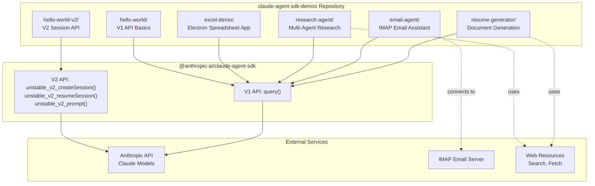

**Diagram: Repository Structure and SDK Integration**

All demonstration applications integrate with the Claude Agent SDK as their foundation, which in turn communicates with the Anthropic API. The demos showcase different integration patterns, external service connections, and SDK features.

**Sources:** [README.md:1-69]()

### Demo-Specific Capabilities

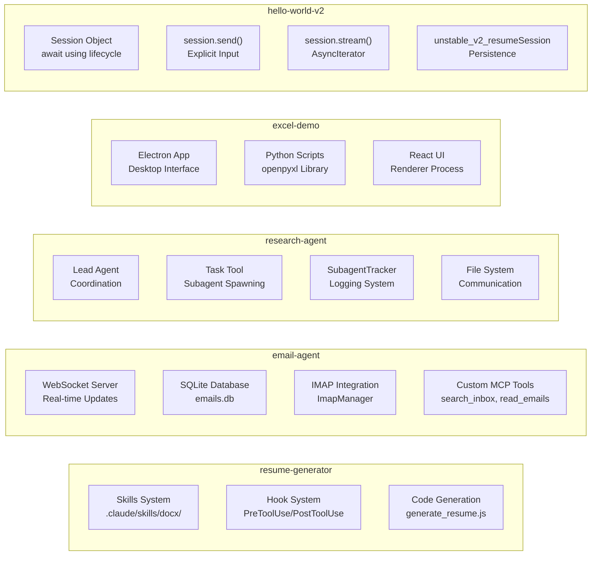

**Diagram: Demo-Specific Features and Components**

Each demo showcases distinct SDK capabilities and integration patterns, from skill systems and hooks to session management and multi-agent coordination.

**Sources:** [README.md:7-27](), [excel-demo/README.md:1-122]()

## SDK API Patterns

The repository demonstrates two distinct API patterns provided by the Claude Agent SDK:

### V1 API Pattern (Production)

The V1 API is used by most demos and centers around the `query()` function:

**Key Components:**
- **Entry Point**: `query(prompt, options)` function
- **Return Type**: `AsyncGenerator<Message>` - combines input specification and output streaming
- **Configuration**: Single options object with `prompt`, `cwd`, `model`, `maxTurns`, `allowedTools`, `hooks`, `settingSources`
- **Hooks System**: `PreToolUse` and `PostToolUse` with matcher-based filtering
- **Usage Pattern**: Single-turn focused, manual history management for multi-turn conversations

**Demos Using V1:**
- `resume-generator/` - Uses hooks for validation and skills for document generation
- `email-agent/` - Integrates with WebSocket and custom MCP tools
- `research-agent/` - Leverages Task tool for multi-agent orchestration
- `hello-world/` - Basic introduction to query function
- `excel-demo/` - Python agent integration

**Sources:** [README.md:1-69]()

### V2 API Pattern (Session-Based)

The V2 API introduces explicit session management for multi-turn conversations:

**Key Components:**
- **Session Creation**: `unstable_v2_createSession(options)`
- **Session Resumption**: `unstable_v2_resumeSession(sessionId, options)`
- **One-Shot Helper**: `unstable_v2_prompt(prompt, options)`
- **Session Object**: Provides `send()` and `stream()` methods
- **Lifecycle Management**: `await using` pattern for automatic cleanup
- **Context Handling**: Automatic multi-turn context maintenance

**Demo Using V2:**
- `hello-world-v2/` - Demonstrates session creation, multi-turn conversations, and session persistence

**Sources:** [README.md:1-69]()

### API Comparison Table

| Feature | V1 API (`query`) | V2 API (Session) |
|---------|------------------|------------------|
| **Entry Point** | Single `query()` function | `unstable_v2_createSession()`, `unstable_v2_resumeSession()` |
| **Return Type** | `AsyncGenerator<Message>` | Session object with `send()`/`stream()` |
| **Multi-Turn** | Manual history management | Automatic context maintenance |
| **Session Persistence** | Not available | Via `sessionId` |
| **Input/Output** | Combined in generator | Separated: `send()` and `stream()` |
| **Cleanup** | Manual | `await using` pattern |
| **Primary Use Case** | Single-turn interactions | Multi-turn conversations |
| **Stability** | Stable | Unstable (experimental) |

**Sources:** [README.md:1-69]()

## Prerequisites and Dependencies

### Required Software

All demos require:

| Component | Version | Purpose | Installation |
|-----------|---------|---------|--------------|
| **Bun** or **Node.js** | Latest / 18+ | JavaScript runtime | [bun.sh](https://bun.sh) or [nodejs.org](https://nodejs.org) |
| **Anthropic API Key** | N/A | Claude model access | [console.anthropic.com](https://console.anthropic.com) |

**Sources:** [README.md:33-36]()

### Demo-Specific Dependencies

| Demo | Additional Requirements | Purpose |
|------|------------------------|---------|
| **email-agent** | IMAP email account | Email server access |
| **excel-demo** | Python 3.9+, LibreOffice (optional) | Spreadsheet generation, formula recalculation |
| **research-agent** | Python 3.9+ | Report generation with reportlab and matplotlib |

**Sources:** [README.md:33-36](), [excel-demo/README.md:23-28]()

## Getting Started

### Installation Steps

```bash
# 1. Clone repository
git clone https://github.com/anthropics/claude-agent-sdk-demos.git
cd claude-agent-sdk-demos

# 2. Choose a demo
cd email-agent  # or resume-generator, research-agent, excel-demo, hello-world, hello-world-v2

# 3. Follow demo-specific README
```

**Sources:** [README.md:38-51]()

### Configuration

Each demo requires an Anthropic API key, which can be provided via:
- Environment variable: `ANTHROPIC_API_KEY`
- Runtime prompt (some demos)

Demo-specific configuration is documented in each demo's README file.

**Sources:** [README.md:33-51]()

## Key Architectural Patterns

### Pattern 1: Skills System

Used in `resume-generator/` to provide domain-specific capabilities through markdown documentation.

**Key Files:**
- `.claude/skills/` - Skills directory
- `SKILL.md` - Decision tree and workflow guidance
- Supporting documentation files (e.g., `docx-js.md`)

**Configuration:** `settingSources: 'project'` in query options

For details, see [Section 8.5](#8.5).

**Sources:** [README.md:1-69]()

### Pattern 2: Multi-Agent Coordination

Used in `research-agent/` to coordinate specialized subagents through hierarchical delegation.

**Key Components:**
- Lead Agent with Task tool only
- Specialized subagents (Researcher, Data Analyst, Report Writer)
- File system communication via `files/` directory
- SubagentTracker for monitoring

For details, see [Section 5](#5).

**Sources:** [README.md:21-27]()

### Pattern 3: Real-Time Integration

Used in `email-agent/` to integrate Claude with external services via WebSocket.

**Key Components:**
- WebSocket server for real-time updates
- Custom MCP tools for domain operations
- Database layer for persistence
- React client for UI rendering

For details, see [Section 4](#4).

**Sources:** [README.md:9-13]()

### Pattern 4: Desktop Application Integration

Used in `excel-demo/` to integrate Claude within an Electron desktop application.

**Key Components:**
- Electron main process
- React renderer process
- Python agent scripts
- Claude Agent SDK integration

For details, see [Section 6](#6).

**Sources:** [excel-demo/README.md:1-122]()

## Important Warnings

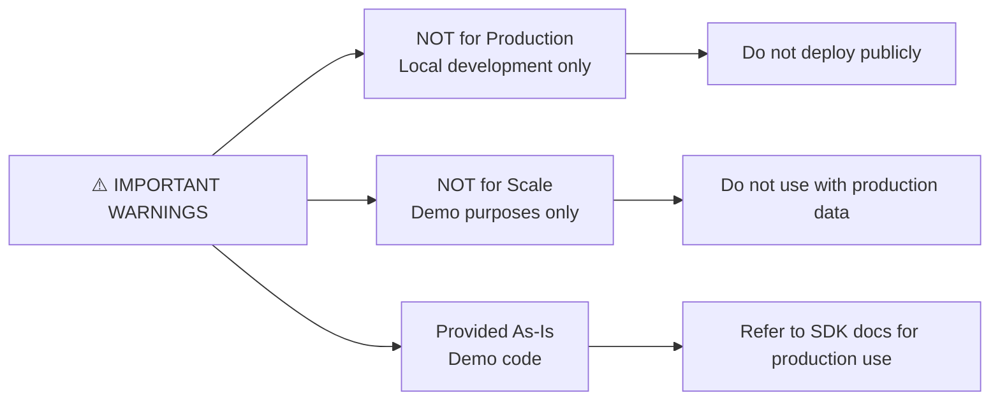

**Diagram: Critical Usage Warnings**

These demonstrations are explicitly designed for local development and learning purposes. They should not be deployed to production environments or used at scale.

**Sources:** [README.md:3](), [excel-demo/README.md:3]()

## Resources and Support

### Documentation

| Resource | URL | Purpose |
|----------|-----|---------|
| **Claude Agent SDK Overview** | [platform.claude.com/docs](https://platform.claude.com/docs/en/agent-sdk/overview) | SDK documentation |
| **Claude Agent SDK Docs** | [docs.anthropic.com/claude-code/sdk](https://docs.anthropic.com/en/docs/claude-code/sdk/sdk-overview) | Detailed SDK reference |
| **API Reference** | [docs.anthropic.com/claude](https://docs.anthropic.com/claude) | Anthropic API documentation |

**Sources:** [README.md:53-57]()

### Support Channels

| Issue Type | Contact Method |
|------------|----------------|
| **Demo Issues** | [GitHub Issues](https://github.com/anthropics/claude-agent-sdk-demos/issues) |
| **SDK Questions** | [SDK Documentation](https://docs.anthropic.com/claude-code) |
| **API Questions** | [Anthropic Support](https://support.anthropic.com) |

**Sources:** [README.md:59-65]()

## License

This repository is provided under the MIT license as sample code for demonstration purposes.

**Sources:** [README.md:66-68]()

---

# Page: Getting Started

# Getting Started

<details>
<summary>Relevant source files</summary>

The following files were used as context for generating this wiki page:

- [README.md](README.md)
- [excel-demo/README.md](excel-demo/README.md)
- [hello-world-v2/README.md](hello-world-v2/README.md)
- [hello-world-v2/package.json](hello-world-v2/package.json)
- [hello-world-v2/tsconfig.json](hello-world-v2/tsconfig.json)
- [hello-world-v2/v2-examples.ts](hello-world-v2/v2-examples.ts)

</details>


This page covers the common prerequisites and initial setup steps required for all demos in the claude-agent-sdk-demos repository. These steps apply to the Email Agent, Excel Demo, Research Agent, and Hello World examples. For demo-specific configuration and usage instructions, see the individual demo pages: [Email Agent Demo](#3), [Excel Demo](#4), [Research Agent Demo](#5), or [Hello World Demo](#6).

**Sources**: [README.md:1-69]()

## Prerequisites

Before running any demo, ensure you have the following installed and configured:

| Requirement | Version | Purpose | Used By |
|------------|---------|---------|---------|
| **Bun** or **Node.js** | Bun (latest) or Node.js 18+ | JavaScript/TypeScript runtime for executing demos and `@anthropic-ai/claude-agent-sdk` | Email Agent, Excel Demo, Hello World |
| **Python** | 3.9+ | Python runtime for agent scripts and `pyproject.toml` dependencies | Excel Demo (`agent/` scripts), Research Agent |
| **Anthropic API Key** | N/A | `ANTHROPIC_API_KEY` environment variable for Claude API authentication | All demos |
| **LibreOffice** | Latest | Excel formula recalculation via `recalc.py` script (optional) | Excel Demo |
| **Git** | Any recent version | Repository cloning | All demos |

### Core SDK Dependency

All demos depend on the Claude Agent SDK package:

| Package | Version | Location | Purpose |
|---------|---------|----------|---------|
| `@anthropic-ai/claude-agent-sdk` | ^0.1.14 | npm registry | Core SDK for spawning Claude Code processes and agent communication |
| `zod` | ^3.24.1 or ^4.1.12 | npm registry | Peer dependency for SDK schema validation |

**Sources**: [README.md:33-36](), [excel-demo/README.md:23-28](), [hello-world/package.json:1-11]()

### Runtime Environment Selection

Each demo requires specific runtime environments and package managers:

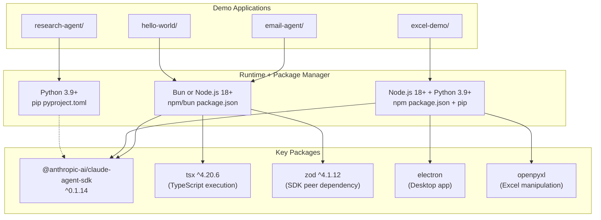

**Diagram: Runtime Environment and Package Dependencies**

**Sources**: [README.md:35](), [excel-demo/README.md:25](), [hello-world/package.json:1-11]()

## Repository Structure

After cloning, the repository contains four self-contained demo applications with distinct entry points and configuration files:

```mermaid
graph TB
    Root["claude-agent-sdk-demos/"]
    
    Root --> README["README.md<br/>(Main documentation)"]
    Root --> Gitignore[".gitignore"]
    Root --> EmailAgent["email-agent/"]
    Root --> ExcelDemo["excel-demo/"]
    Root --> ResearchAgent["research-agent/"]
    Root --> HelloWorld["hello-world/"]
    
    EmailAgent --> EAReadme["README.md"]
    EmailAgent --> EAPackage["package.json<br/>(Bun/npm deps)"]
    EmailAgent --> EAServer["server/<br/>(Bun server)"]
    EmailAgent --> EAClient["client/<br/>(React UI)"]
    EmailAgent --> EADatabase["database/<br/>(SQLite + IMAP)"]
    EmailAgent --> EACCSDK["ccsdk/<br/>(MCP custom tools)"]
    
    ExcelDemo --> EDReadme["README.md"]
    ExcelDemo --> EDPackage["package.json<br/>(Electron deps)"]
    ExcelDemo --> EDAgent["agent/<br/>(Python scripts)"]
    ExcelDemo --> EDReqs["agent/requirements.txt"]
    ExcelDemo --> EDSrc["src/main/<br/>src/renderer/<br/>(Electron)"]
    
    ResearchAgent --> RAReadme["README.md"]
    ResearchAgent --> RAPyproject["pyproject.toml<br/>(Python deps)"]
    ResearchAgent --> RASrc["research_agent/<br/>(Lead agent, prompts)"]
    ResearchAgent --> RAUtils["research_agent/utils/<br/>(SubagentTracker)"]
    
    HelloWorld --> HWReadme["README.md"]
    HelloWorld --> HWPackage["package.json<br/>(SDK + tsx)"]
    HelloWorld --> HWScript["hello-world.ts<br/>(Entry point)"]
    HelloWorld --> HWTsconfig["tsconfig.json"]
    HelloWorld --> HWAgent["agent/<br/>(Working directory)"]
```

**Diagram: Repository File Structure and Key Artifacts**

**Sources**: [README.md:1-69](), [excel-demo/README.md:88-100](), [hello-world/package.json:1-11]()

## Initial Setup Steps

### 1. Clone the Repository

```bash
git clone https://github.com/anthropics/claude-code-sdk-demos.git
cd claude-code-sdk-demos
```

This creates a local copy of all demo applications. Each demo is fully self-contained within its subdirectory.

**Sources**: [README.md:40-44]()

### 2. Obtain an Anthropic API Key

All demos require an Anthropic API key to communicate with Claude models. To obtain one:

1. Navigate to the [Anthropic Console](https://console.anthropic.com)
2. Sign in or create an account
3. Go to API Keys section
4. Generate a new API key
5. Copy the key for use in configuration

**Sources**: [README.md:36](), [excel-demo/README.md:26]()

### 3. Navigate to Your Chosen Demo

```bash
# For Email Agent
cd email-agent

# For Excel Demo
cd excel-demo

# For Research Agent
cd research-agent

# For Hello World
cd hello-world
```

Each demo directory contains its own `README.md` with specific setup instructions.

**Sources**: [README.md:46-49]()

## API Key Configuration

The `ANTHROPIC_API_KEY` environment variable is required for SDK initialization and API communication with Claude models. Configuration methods vary by demo:

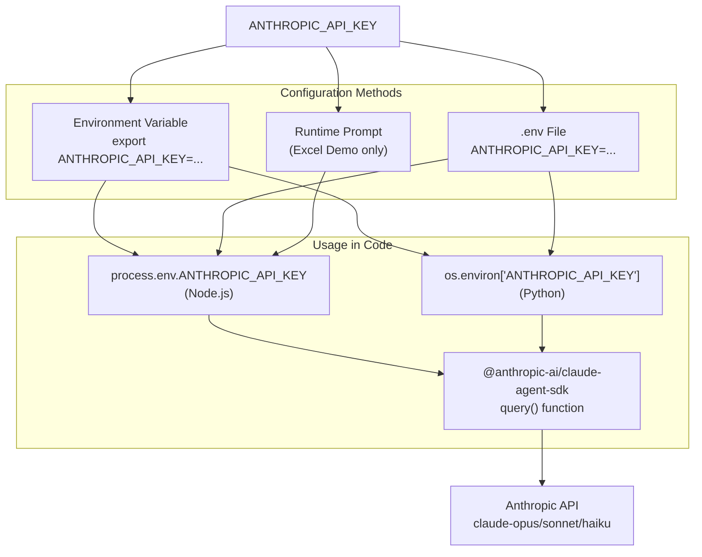

**Diagram: ANTHROPIC_API_KEY Configuration and Usage Flow**

### Environment Variable Method (Recommended)

Set the `ANTHROPIC_API_KEY` environment variable in your shell session:

```bash
# Linux/macOS (bash/zsh)
export ANTHROPIC_API_KEY=your_api_key_here

# Windows (PowerShell)
$env:ANTHROPIC_API_KEY="your_api_key_here"

# Windows (Command Prompt)
set ANTHROPIC_API_KEY=your_api_key_here
```

To persist across sessions, add to your shell profile:
- Linux/macOS: `~/.bashrc`, `~/.zshrc`, or `~/.profile`
- Windows: System Environment Variables via Settings

### .env File Method

Create a `.env` file in the demo's root directory. This is automatically loaded by some demos:

```bash
# In email-agent/.env, research-agent/.env, or excel-demo/.env
ANTHROPIC_API_KEY=your_api_key_here
```

**File location**: Place in the same directory as `package.json` or `pyproject.toml`

### Application-Specific Configuration

The Excel Demo (`excel-demo/src/main/`) prompts for the API key via dialog on first run if `process.env.ANTHROPIC_API_KEY` is undefined.

**Sources**: [README.md:36](), [excel-demo/README.md:44-46]()

## Setup Flow Overview

The complete setup process follows this workflow:

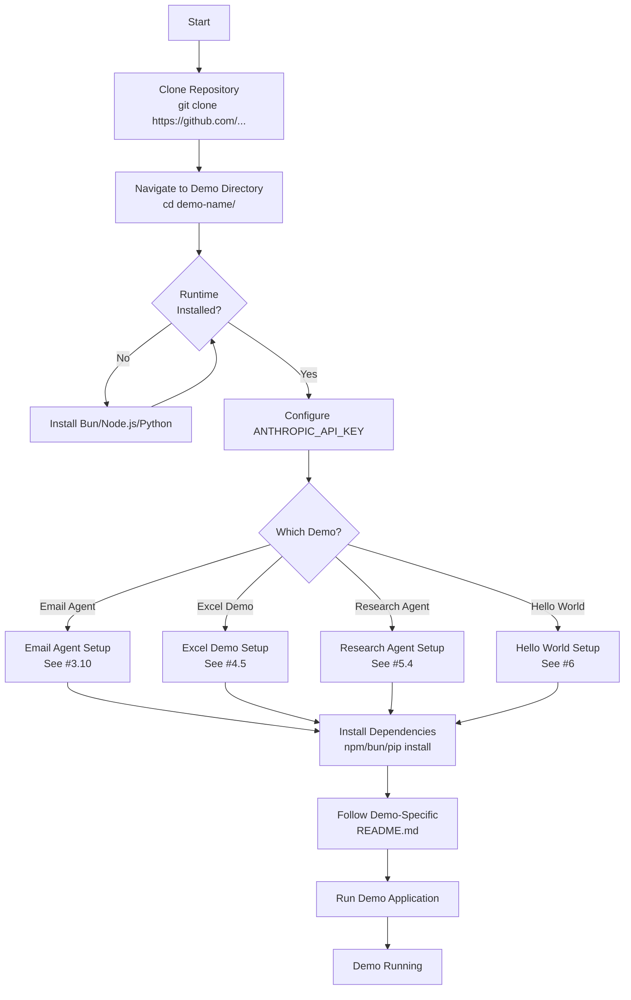

**Diagram: Complete Setup Workflow**

**Sources**: [README.md:38-51]()

## Dependency Installation

Each demo uses specific package managers and dependency files:

| Demo | Package Manager | Installation Command | Configuration File | Key Dependencies |
|------|----------------|---------------------|-------------------|------------------|
| Email Agent | Bun or npm | `bun install` or `npm install` | `package.json` | `@anthropic-ai/claude-agent-sdk`, `tsx` |
| Excel Demo (Desktop) | npm or Bun | `npm install` or `bun install` | `package.json` | `electron`, `@anthropic-ai/claude-agent-sdk` |
| Excel Demo (Python) | pip | `pip install -r requirements.txt` | `agent/requirements.txt` | `openpyxl`, `pandas` |
| Research Agent | pip | `pip install -e .` | `pyproject.toml` | Claude Agent SDK (Python bindings) |
| Hello World | npm or Bun | `npm install` or `bun install` | `package.json` | `@anthropic-ai/claude-agent-sdk`, `tsx`, `zod` |

### Installing Email Agent Dependencies

```bash
cd email-agent
bun install
# or
npm install
```

This installs:
- `@anthropic-ai/claude-agent-sdk` (^0.1.14) - Core SDK for agent creation
- `tsx` - TypeScript execution for server files
- Additional dependencies listed in [email-agent/package.json]()

### Installing Excel Demo Dependencies

The Excel Demo has a dual dependency structure for both Electron app and Python agents:

```bash
cd excel-demo

# Install Node.js/Electron dependencies (for desktop app)
npm install
# or
bun install

# Install Python dependencies (for agent/ scripts)
cd agent
python -m venv .venv
source .venv/bin/activate  # On Windows: .venv\Scripts\activate
pip install -r requirements.txt
```

Python dependencies include:
- `openpyxl` - Excel file manipulation (`.xlsx` read/write)
- `pandas` - Data analysis and DataFrame operations
- Additional packages in [excel-demo/agent/requirements.txt]()

### Installing Research Agent Dependencies

```bash
cd research-agent
pip install -e .
```

This installs dependencies from `pyproject.toml` including the Claude Agent SDK Python bindings and research-specific packages.

### Installing Hello World Dependencies

```bash
cd hello-world
npm install
# or
bun install
```

Key packages:
- `@anthropic-ai/claude-agent-sdk` (^0.1.14) - SDK for `query()` function
- `zod` (^4.1.12) - Required peer dependency for SDK
- `tsx` (^4.20.6) - TypeScript execution via `npx tsx hello-world.ts`
- `typescript` (^5.9.3) - TypeScript compiler

**Sources**: [excel-demo/README.md:38-65](), [hello-world/package.json:1-11](), [hello-world/package-lock.json:17-35]()

## Verifying Installation

After completing the setup steps, verify your installation:

### Check Runtime Versions

```bash
# Check Bun version (if using Bun)
bun --version

# Check Node.js version (required: 18+)
node --version

# Check npm version
npm --version

# Check Python version (required: 3.9+)
python --version
# or
python3 --version
```

Expected output:
- Node.js: `v18.0.0` or higher
- Python: `3.9.0` or higher

### Verify API Key Configuration

```bash
# Linux/macOS
echo $ANTHROPIC_API_KEY

# Windows (PowerShell)
echo $env:ANTHROPIC_API_KEY
```

Expected output: Your API key string starting with `sk-ant-`

### Verify SDK Installation

Check if the Claude Agent SDK is installed:

```bash
# For Node.js demos
npm list @anthropic-ai/claude-agent-sdk

# For Python demos
pip show anthropic  # or relevant package name
```

### Test Basic SDK Functionality

The Hello World demo provides the simplest verification test. After installing dependencies:

```bash
cd hello-world
npx tsx hello-world.ts
```

Expected behavior:
1. SDK spawns Claude Code process via `query()` function
2. Agent responds with introduction message
3. Process exits cleanly

If you encounter errors, see the Common Issues section below.

**Sources**: [README.md:33-51](), [hello-world/README.md:116-145]()

## Common Issues and Solutions

| Issue | Cause | Solution |
|-------|-------|----------|
| `ANTHROPIC_API_KEY not found` | Environment variable not set | Set via `export ANTHROPIC_API_KEY=...` or create `.env` file in demo root |
| `Failed to spawn Claude Code process: spawn node ENOENT` | `executable` option in `query()` cannot find Node.js | Set `executable: "node"` in query options or use full path: `executable: process.execPath` |
| `command not found: bun` | Bun not installed | Install from [bun.sh](https://bun.sh) or use Node.js/npm as alternative |
| `Node.js version too old` | Node.js < 18.0.0 | Install Node.js 18+ from [nodejs.org](https://nodejs.org) (SDK requires `>=18.0.0`) |
| `python: command not found` | Python not installed or not in PATH | Install Python 3.9+ from [python.org](https://python.org), verify with `python --version` |
| `Cannot find module '@anthropic-ai/claude-agent-sdk'` | SDK not installed | Run `npm install` or `bun install` in demo directory |
| `Error: Cannot find peer dependency 'zod'` | Missing peer dependency | Install zod: `npm install zod@^4.1.12` or `bun add zod@^4.1.12` |
| `ENOENT: no such file or directory` during SDK spawn | `cwd` directory doesn't exist | Create working directory: `mkdir -p agent` (see [hello-world/hello-world.ts:10]()) |
| Permission errors for file operations | Hook blocking file writes | Check `PreToolUse` hooks in query options, ensure target directory is allowed |
| Dependencies fail to install | Wrong directory or package manager | Verify you're in correct demo directory, check `package.json` or `pyproject.toml` exists |

### Debug Mode

To see detailed SDK communication, enable debug logging:

```bash
# Set debug environment variable before running
export DEBUG=claude-agent-sdk:*
npm run start  # or relevant command
```

**Sources**: [README.md:33-51](), [hello-world/README.md:121-144](), [hello-world/hello-world.ts:1-70]()

## Demo-Specific Setup

Once you've completed the common setup steps above, proceed to demo-specific configuration:

### Quick Start by Demo

| Demo | Next Steps | Entry Point | Documentation |
|------|-----------|-------------|---------------|
| **Email Agent** | Configure IMAP credentials, initialize SQLite database, start Bun server | [email-agent/server/server.ts]() | See page [#3.8]() |
| **Excel Demo** | Launch Electron app or run Python scripts | [excel-demo/src/main/]() or [excel-demo/agent/create_*.py]() | See page [#4.5]() |
| **Research Agent** | Configure web search API, run lead agent | [research-agent/research_agent/]() | See page [#5.4]() |
| **Hello World** | Run TypeScript example | [hello-world/hello-world.ts]() | See page [#6]() |

### Architecture Pages

For detailed understanding of each demo's architecture before setup:

- **[Email Agent Architecture](#3.1)**: Three-tier architecture with React client, Bun server, SQLite + IMAP data layer
- **[Excel Demo Architecture](#4.1)**: Hybrid Electron/Python architecture with desktop app and CLI scripts
- **[Research Agent Architecture](#5.1)**: Hierarchical multi-agent system with Lead Agent orchestration
- **[Hello World](#6)**: Basic SDK usage with `query()` function and PreToolUse hooks

### What to Read Next

**For SDK fundamentals**: Start with [Hello World Demo](#6) to understand the `query()` function, options, hooks, and message types

**For full-stack application**: Proceed to [Email Agent Demo](#3) to see client-server architecture with custom MCP tools

**For multi-agent systems**: See [Research Agent Demo](#5) to learn about Task tool and subagent coordination

**For desktop integration**: Explore [Excel Demo](#4) for Electron + Python hybrid architecture

**Sources**: [README.md:46-51]()

## Resources and Documentation

| Resource | URL | Description |
|----------|-----|-------------|
| Claude Agent SDK Documentation | [docs.anthropic.com](https://docs.anthropic.com/en/docs/claude-code/sdk/sdk-overview) | Official SDK documentation and API reference |
| Anthropic API Reference | [docs.anthropic.com/claude](https://docs.anthropic.com/claude) | Complete API documentation |
| GitHub Repository | [github.com/anthropics/claude-agent-sdk-demos](https://github.com/anthropics/claude-agent-sdk-demos) | Source code and issue tracker |
| Anthropic Console | [console.anthropic.com](https://console.anthropic.com) | API key management and usage monitoring |
| Anthropic Support | [support.anthropic.com](https://support.anthropic.com) | Technical support for API questions |

**Sources**: [README.md:53-65]()

---

# Page: Resume Generator Demo

# Resume Generator Demo

<details>
<summary>Relevant source files</summary>

The following files were used as context for generating this wiki page:

- [resume-generator/.claude/skills/docx/SKILL.md](resume-generator/.claude/skills/docx/SKILL.md)
- [resume-generator/.claude/skills/docx/docx-js.md](resume-generator/.claude/skills/docx/docx-js.md)
- [resume-generator/.gitignore](resume-generator/.gitignore)
- [resume-generator/README.md](resume-generator/README.md)
- [resume-generator/package.json](resume-generator/package.json)
- [resume-generator/resume-generator.ts](resume-generator/resume-generator.ts)

</details>


## Purpose and Scope

This document provides an overview of the Resume Generator demonstration application, which showcases AI-powered resume creation using the Claude Agent SDK with web search capabilities and the docx skill system. This page covers the system's purpose, high-level architecture, and key components. For detailed information on specific aspects, see:

- [Architecture Overview](#3.1) for the four-phase workflow and agent orchestration
- [Document Generation Workflow](#3.2) for the step-by-step generation process
- [docx Skill System](#3.3) for comprehensive skill documentation
- [Configuration and Setup](#3.4) for setup instructions

For information about the Claude Agent SDK integration patterns used in this demo, see [Claude Agent SDK Integration](#8).

**Sources:** [resume-generator/README.md:1-28](), [resume-generator/resume-generator.ts:1-98]()

## Overview

The Resume Generator demonstrates the most sophisticated use of the Claude Agent SDK in the repository (importance score: 16.08). It orchestrates a multi-phase AI workflow that researches an individual using web search, synthesizes professional information, generates JavaScript code using the docx library, and executes the code to produce a professionally formatted .docx resume.

The demo showcases:
- **Web research automation** using `WebSearch` and `WebFetch` tools to gather professional background information
- **Skills system integration** with the comprehensive docx skill that teaches the agent document generation
- **Code generation and execution** where the agent writes and runs JavaScript to create Word documents
- **Strict formatting constraints** enforced through system prompts to ensure single-page output

**Sources:** [resume-generator/resume-generator.ts:1-98](), [resume-generator/README.md:1-28]()

## System Architecture

The following diagram shows the main components of the Resume Generator system and their relationships:

### Component Architecture Diagram

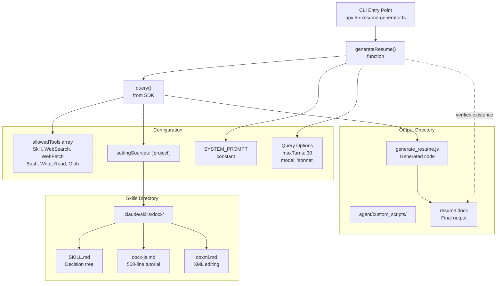

**Sources:** [resume-generator/resume-generator.ts:29-87](), [resume-generator/.claude/skills/docx/SKILL.md:1-198]()

## Core Components

### Entry Point and Main Function

The application entry point is [resume-generator/resume-generator.ts:89-97]() which validates command-line arguments and invokes the `generateResume()` function. The `generateResume()` function [resume-generator/resume-generator.ts:29-87]() orchestrates the entire workflow:

1. Creates the output directory at `agent/custom_scripts/` [resume-generator/resume-generator.ts:34-37]()
2. Constructs a research prompt with the person's name [resume-generator/resume-generator.ts:39]()
3. Invokes the SDK's `query()` function with configuration [resume-generator/resume-generator.ts:43-53]()
4. Streams and logs agent activity [resume-generator/resume-generator.ts:55-76]()
5. Verifies the final `.docx` file was created [resume-generator/resume-generator.ts:78-86]()

**Sources:** [resume-generator/resume-generator.ts:29-97]()

### System Prompt and Constraints

The `SYSTEM_PROMPT` constant [resume-generator/resume-generator.ts:14-27]() defines the agent's role and enforces critical constraints:

| Constraint Category | Requirements |
|-------------------|--------------|
| **Workflow** | WebSearch → docx creation in agent/custom_scripts/ |
| **Output Files** | generate_resume.js (script), resume.docx (final document) |
| **Page Fit** | Exactly 1 page with 0.5 inch margins |
| **Typography** | Name 24pt, Headers 12pt, Body 10pt |
| **Content Limits** | 2-3 bullets per job, ~80-100 chars each, Max 3 roles, 2-line summary, 2-line skills |

These constraints ensure the generated resume fits on a single page and maintains professional formatting standards.

**Sources:** [resume-generator/resume-generator.ts:14-27]()

### SDK Configuration

The `query()` function is configured with the following options [resume-generator/resume-generator.ts:43-53]():

```typescript
query({
  prompt,
  options: {
    maxTurns: 30,
    cwd: process.cwd(),
    model: 'sonnet',
    allowedTools: ['Skill', 'WebSearch', 'WebFetch', 'Bash', 'Write', 'Read', 'Glob'],
    settingSources: ['project'],  // Load skills from .claude/skills/
    systemPrompt: SYSTEM_PROMPT,
  },
})
```

Key configuration elements:
- `maxTurns: 30` allows for extensive research and iteration
- `model: 'sonnet'` uses Claude 3.5 Sonnet for sophisticated reasoning
- `settingSources: ['project']` enables skill discovery from `.claude/skills/`
- `allowedTools` includes both research tools (`WebSearch`, `WebFetch`) and file manipulation tools

**Sources:** [resume-generator/resume-generator.ts:43-53]()

## Execution Flow

The following diagram illustrates the four-phase execution flow from CLI invocation to final output:

### Four-Phase Workflow Diagram

```mermaid
graph LR
    subgraph "Phase 1: Research"
        WS["WebSearch tool<br/>LinkedIn, GitHub, etc."]
        WF["WebFetch tool<br/>Company pages, profiles"]
        Info["Information<br/>gathering"]
    end
    
    subgraph "Phase 2: Skill Loading"
        ST["Skill tool invocation"]
        ReadSkill["Read SKILL.md<br/>decision tree"]
        ReadTutorial["Read docx-js.md<br/>ENTIRE FILE (500 lines)"]
        Learn["Agent learns<br/>docx library API"]
    end
    
    subgraph "Phase 3: Code Generation"
        Synthesize["Synthesize<br/>information"]
        GenCode["Generate JS code<br/>using docx library"]
        WriteFile["Write tool<br/>generate_resume.js"]
    end
    
    subgraph "Phase 4: Execution"
        BashTool["Bash tool<br/>node generate_resume.js"]
        CreateDoc["Document creation<br/>via docx Packer"]
        Output["resume.docx<br/>final output"]
    end
    
    WS --> Info
    WF --> Info
    Info --> ST
    
    ST --> ReadSkill
    ReadSkill --> ReadTutorial
    ReadTutorial --> Learn
    
    Learn --> Synthesize
    Synthesize --> GenCode
    GenCode --> WriteFile
    
    WriteFile --> BashTool
    BashTool --> CreateDoc
    CreateDoc --> Output
```

**Sources:** [resume-generator/resume-generator.ts:1-98](), [resume-generator/.claude/skills/docx/SKILL.md:54-63]()

## File Structure

The Resume Generator operates with the following file structure:

```
resume-generator/
├── resume-generator.ts          # Main entry point with generateResume()
├── package.json                 # Dependencies: @anthropic-ai/claude-agent-sdk, docx
├── .claude/
│   └── skills/
│       └── docx/               # Skill directory discovered via settingSources
│           ├── SKILL.md        # Workflow decision tree
│           ├── docx-js.md      # 500-line library tutorial
│           └── ooxml.md        # XML editing patterns
└── agent/
    └── custom_scripts/         # Output directory (created if needed)
        ├── generate_resume.js  # Generated JavaScript code
        └── resume.docx         # Final resume document
```

### File Responsibilities

| File | Purpose |
|------|---------|
| `resume-generator.ts` | CLI interface, orchestration, SDK invocation |
| `SKILL.md` | Workflow decision tree routing agent to appropriate documentation |
| `docx-js.md` | Comprehensive tutorial on docx library with critical formatting rules |
| `generate_resume.js` | Agent-generated code (not checked into repo) |
| `resume.docx` | Final output document (not checked into repo) |

**Sources:** [resume-generator/.gitignore:1-6](), [resume-generator/resume-generator.ts:34-37](), [resume-generator/.claude/skills/docx/SKILL.md:1-198]()

## Agent Activity Logging

The `generateResume()` function streams messages from the SDK and provides real-time feedback:

```typescript
for await (const msg of q) {
  if (msg.type === 'assistant' && msg.message) {
    // Log text blocks and tool usage
    for (const block of msg.message.content) {
      if (block.type === 'text') {
        console.log(block.text);
      }
      if (block.type === 'tool_use') {
        if (block.name === 'WebSearch' && block.input && typeof block.input === 'object' && 'query' in block.input) {
          console.log(`\n🔍 Searching: "${block.input.query}"`);
        } else {
          console.log(`\n🔧 Using tool: ${block.name}`);
        }
      }
    }
  }
  if (msg.type === 'result') {
    if (msg.subtype === 'tool_result') {
      const resultStr = JSON.stringify(msg.content).slice(0, 200);
      console.log(`   ↳ Result: ${resultStr}${resultStr.length >= 200 ? '...' : ''}`);
    }
  }
}
```

This provides visibility into:
- Web search queries being executed
- Tool invocations (Skill, Write, Bash, etc.)
- Tool results (truncated to 200 characters)
- Agent text responses

**Sources:** [resume-generator/resume-generator.ts:55-76]()

## Dependencies

The Resume Generator requires the following dependencies defined in [resume-generator/package.json:8-16]():

| Dependency | Version | Purpose |
|-----------|---------|---------|
| `@anthropic-ai/claude-agent-sdk` | ^0.1.59 | Core SDK for agent orchestration |
| `docx` | ^9.5.1 | JavaScript library for creating Word documents |
| `tsx` | ^4.20.6 | TypeScript execution (dev dependency) |
| `typescript` | ^5.9.3 | TypeScript compiler (dev dependency) |

The `docx` library is installed globally by the agent's environment and used in the generated JavaScript code.

**Sources:** [resume-generator/package.json:1-18]()

## Output Verification

After the agent completes its work, the system verifies the output file exists [resume-generator/resume-generator.ts:78-86]():

```typescript
const expectedPath = path.join(process.cwd(), 'agent', 'custom_scripts', 'resume.docx');
if (fs.existsSync(expectedPath)) {
  console.log('\n' + '='.repeat(50));
  console.log(`📄 Resume saved to: ${expectedPath}`);
  console.log('='.repeat(50) + '\n');
} else {
  console.log('\n❌ Resume file was not created. Check the output above for errors.');
}
```

This provides immediate feedback on whether the resume generation succeeded.

**Sources:** [resume-generator/resume-generator.ts:78-86]()

## Integration with Skills System

The Resume Generator's power comes from the skills system integration. By setting `settingSources: ['project']` [resume-generator/resume-generator.ts:50](), the SDK automatically discovers skills in `.claude/skills/`. The docx skill provides:

1. **Decision tree** ([SKILL.md:13-30]()) that routes the agent to appropriate workflows
2. **Comprehensive tutorial** ([docx-js.md:1-350]()) with 500 lines of documentation
3. **Critical formatting rules** that prevent document corruption
4. **Mandatory full-file reading** requirement enforced by skill documentation

For complete documentation of the docx skill system, see [docx Skill System](#3.3).

**Sources:** [resume-generator/resume-generator.ts:43-53](), [resume-generator/.claude/skills/docx/SKILL.md:1-198]()

## Usage

The Resume Generator is invoked via the command line:

```bash
npx tsx resume-generator.ts "Person Name"
```

Example:
```bash
npx tsx resume-generator.ts "Jane Doe"
```

The script validates that a person name is provided [resume-generator/resume-generator.ts:90-95]() and exits with an error message if missing.

**Sources:** [resume-generator/resume-generator.ts:89-97](), [resume-generator/README.md:11-16]()

---

# Page: Architecture Overview

# Architecture Overview

<details>
<summary>Relevant source files</summary>

The following files were used as context for generating this wiki page:

- [resume-generator/.claude/skills/docx/SKILL.md](resume-generator/.claude/skills/docx/SKILL.md)
- [resume-generator/.claude/skills/docx/docx-js.md](resume-generator/.claude/skills/docx/docx-js.md)
- [resume-generator/.gitignore](resume-generator/.gitignore)
- [resume-generator/README.md](resume-generator/README.md)
- [resume-generator/package.json](resume-generator/package.json)
- [resume-generator/resume-generator.ts](resume-generator/resume-generator.ts)

</details>


## Purpose and Scope

This page provides a high-level architectural overview of the Resume Generator demo, focusing on the major components, their interactions, and the orchestration pattern used to generate professional resumes. This includes the entry point, agent configuration, skills system integration, and the four-phase execution pipeline.

For detailed workflow steps and phase-by-phase execution details, see [Document Generation Workflow](#3.2). For comprehensive documentation of the docx skill including library API and formatting rules, see [docx Skill System](#3.3).

## System Components

The Resume Generator is structured as a single-file orchestrator that configures and invokes the Claude Agent SDK with specific tools and skills. The architecture follows a linear execution model where a Claude agent autonomously performs research, synthesizes information, generates code, and produces a final document.

**Component Architecture**

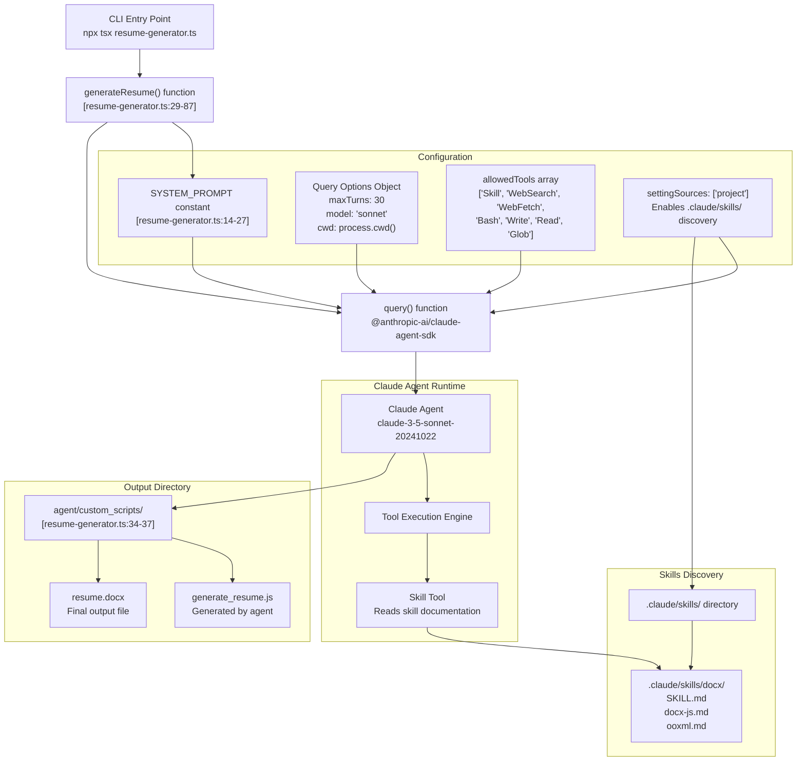

**Sources:** [resume-generator/resume-generator.ts:1-98]()

## Entry Point and CLI Interface

The application exposes a single command-line interface that accepts a person's name as input:

```bash
npx tsx resume-generator.ts "Person Name"
```

The entry point validates arguments and invokes the `generateResume()` function at [resume-generator.ts:89-97](). If no name is provided, it prints usage instructions and exits.

**Sources:** [resume-generator/resume-generator.ts:89-97]()

## Core Orchestration Pattern

The `generateResume()` function at [resume-generator.ts:29-87]() implements the core orchestration pattern. It performs three primary responsibilities:

1. **Directory Setup**: Creates `agent/custom_scripts/` directory if it doesn't exist [resume-generator.ts:34-37]()
2. **Agent Invocation**: Calls `query()` with configuration and streams responses [resume-generator.ts:43-76]()
3. **Output Verification**: Checks for the presence of `resume.docx` after completion [resume-generator.ts:78-86]()

**Orchestration Flow**

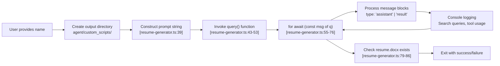

**Sources:** [resume-generator/resume-generator.ts:29-87]()

## Agent Configuration

The `query()` function is configured with specific options that define the agent's capabilities and constraints:

| Configuration Key | Value | Purpose |
|------------------|-------|---------|
| `prompt` | `"Research \"${personName}\" and create..."` | User instruction passed to agent |
| `maxTurns` | `30` | Maximum conversation turns allowed |
| `cwd` | `process.cwd()` | Working directory for file operations |
| `model` | `'sonnet'` | Claude model identifier (sonnet-3.5) |
| `allowedTools` | Array of 7 tools | Permitted tool set (see below) |
| `settingSources` | `['project']` | Enables project-level skills discovery |
| `systemPrompt` | `SYSTEM_PROMPT` constant | Workflow instructions and constraints |

**Allowed Tools Configuration**

The agent has access to seven tools at [resume-generator.ts:49]():

1. **`Skill`** - Reads skill documentation from `.claude/skills/`
2. **`WebSearch`** - Performs web searches for research
3. **`WebFetch`** - Fetches web page content
4. **`Bash`** - Executes shell commands
5. **`Write`** - Writes files to disk
6. **`Read`** - Reads file contents
7. **`Glob`** - Pattern-based file discovery

**Sources:** [resume-generator/resume-generator.ts:43-53]()

## System Prompt Architecture

The `SYSTEM_PROMPT` constant at [resume-generator.ts:14-27]() encodes three critical aspects:

**System Prompt Structure**

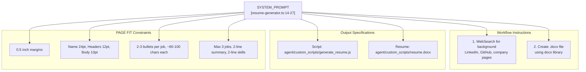

The PAGE FIT constraints at [resume-generator.ts:24-27]() are critical for ensuring the final document fits exactly one page, which is the core requirement for professional resumes.

**Sources:** [resume-generator/resume-generator.ts:14-27]()

## Four-Phase Execution Pipeline

The agent autonomously executes a four-phase pipeline to generate the resume. Each phase represents a distinct goal that the agent must accomplish before proceeding to the next:

**Pipeline Architecture**

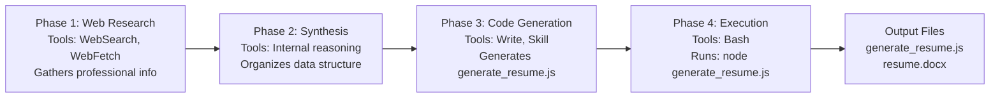

### Phase Details

| Phase | Tools Used | Outputs | Key Actions |
|-------|-----------|---------|-------------|
| **1. Research** | `WebSearch`, `WebFetch` | Research data (in-memory) | Searches LinkedIn, GitHub, company pages; fetches detailed information |
| **2. Synthesis** | Internal reasoning | Structured data model | Organizes findings into resume sections (summary, experience, education, skills) |
| **3. Code Generation** | `Skill`, `Write` | `generate_resume.js` | Reads docx skill documentation; generates JavaScript using docx library |
| **4. Execution** | `Bash` | `resume.docx` | Executes: `node agent/custom_scripts/generate_resume.js` |

**Sources:** [resume-generator/resume-generator.ts:14-27](), [resume-generator/.claude/skills/docx/SKILL.md:54-62]()

## Skills System Integration

The Resume Generator relies heavily on the skills system to provide domain expertise in document generation. The `settingSources: ['project']` configuration at [resume-generator.ts:50]() enables skill discovery from `.claude/skills/`.

**Skill Discovery and Loading**

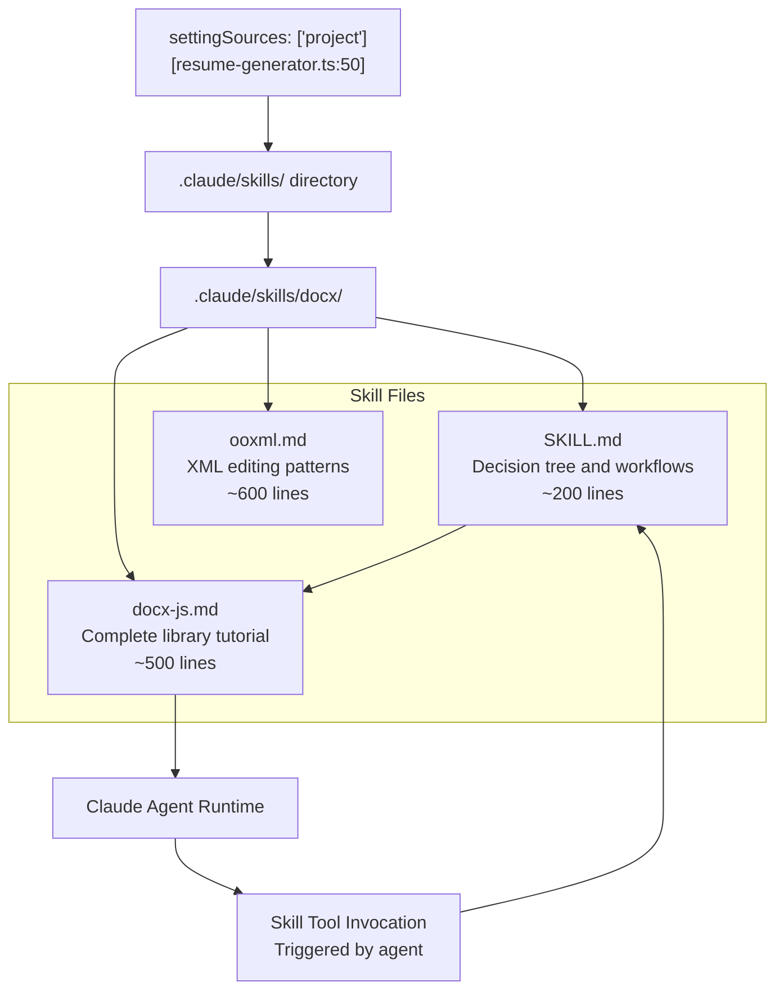

The skill system enforces a critical workflow at [.claude/skills/docx/SKILL.md:54-62]():

1. Agent invokes `Skill` tool to read `SKILL.md`
2. `SKILL.md` contains a decision tree routing to appropriate workflow
3. For new documents, agent **must read entire** `docx-js.md` file (~500 lines)
4. Agent generates JavaScript code using the `docx` library API
5. Generated code is written to `agent/custom_scripts/generate_resume.js`

**Sources:** [resume-generator/resume-generator.ts:50](), [resume-generator/.claude/skills/docx/SKILL.md:1-197](), [resume-generator/.claude/skills/docx/docx-js.md:1-350]()

## Directory Structure and File Organization

The Resume Generator maintains a strict directory organization:

```
resume-generator/
├── resume-generator.ts          # Main orchestration file [10.00 importance]
├── package.json                 # Dependencies: SDK, docx library
├── .claude/
│   └── skills/
│       └── docx/               # Document generation skill
│           ├── SKILL.md        # Workflow decision tree
│           ├── docx-js.md      # Complete library tutorial
│           └── ooxml.md        # XML editing patterns
└── agent/
    └── custom_scripts/         # Agent workspace (created at runtime)
        ├── generate_resume.js  # Generated by agent in Phase 3
        └── resume.docx         # Final output from Phase 4
```

The `agent/custom_scripts/` directory is created at [resume-generator.ts:34-37]() and serves as the agent's workspace. This directory is in `.gitignore` at [.gitignore:4]() since it contains generated files.

**Sources:** [resume-generator/resume-generator.ts:34-37](), [resume-generator/.gitignore:1-6]()

## Message Streaming and Output

The orchestration loop at [resume-generator.ts:55-76]() processes two message types from the async generator:

**Message Processing Flow**

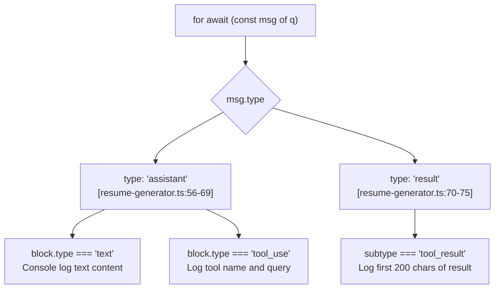

The streaming pattern provides real-time visibility into:
- Agent reasoning (text blocks)
- Web searches being performed (WebSearch tool with query parameter)
- Tool invocations (tool names logged to console)
- Tool results (first 200 characters logged)

**Sources:** [resume-generator/resume-generator.ts:55-76]()

## Dependencies and Runtime Requirements

The Resume Generator requires two primary dependencies specified in [package.json:8-11]():

| Dependency | Version | Purpose |
|-----------|---------|---------|
| `@anthropic-ai/claude-agent-sdk` | `^0.1.59` | Core agent runtime and tools |
| `docx` | `^9.5.1` | JavaScript library for .docx generation (used by agent's generated code) |

The `docx` library is installed globally in the environment and used by the agent-generated JavaScript code during Phase 4 execution.

**Sources:** [resume-generator/package.json:1-18]()

---

# Page: Document Generation Workflow

# Document Generation Workflow

<details>
<summary>Relevant source files</summary>

The following files were used as context for generating this wiki page:

- [resume-generator/.claude/skills/docx/SKILL.md](resume-generator/.claude/skills/docx/SKILL.md)
- [resume-generator/.claude/skills/docx/docx-js.md](resume-generator/.claude/skills/docx/docx-js.md)
- [resume-generator/.gitignore](resume-generator/.gitignore)
- [resume-generator/README.md](resume-generator/README.md)
- [resume-generator/package.json](resume-generator/package.json)
- [resume-generator/resume-generator.ts](resume-generator/resume-generator.ts)

</details>


## Purpose and Scope

This document details the step-by-step execution flow of the Resume Generator, from initial web research through final document creation. It covers the four-phase workflow orchestrated by the Claude agent, the tools used at each stage, and the generation and execution of JavaScript code that produces the final `.docx` file.

For architectural overview and agent configuration, see [Architecture Overview](#3.1). For detailed documentation of the docx skill system, see [docx Skill System](#3.3).

---

## Workflow Overview

The Resume Generator implements a sequential four-phase pipeline where each phase builds upon the results of the previous one. The workflow is orchestrated by a single Claude agent configured with specific tools and a structured system prompt that enforces constraints.

### Four-Phase Pipeline

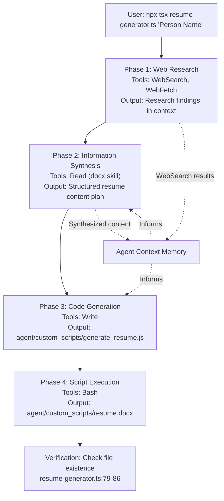

**Sources:** [resume-generator/resume-generator.ts:14-27](), [resume-generator/resume-generator.ts:29-87]()

---

## Phase 1: Web Research

The agent begins by gathering professional information about the target person through web searches. This phase uses the `WebSearch` and `WebFetch` tools to query public sources.

### Research Strategy

The agent autonomously determines search queries based on the person's name and iteratively refines searches to gather:
- Current employment and role
- Professional experience history
- Educational background
- Technical skills and expertise
- Notable achievements and projects

### Tool Usage Pattern

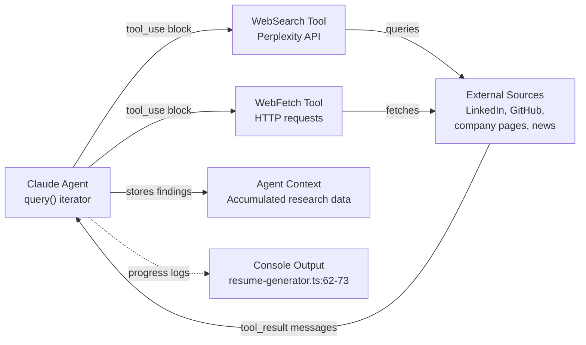

The code that handles this logging is found in [resume-generator/resume-generator.ts:55-76](), which iterates over messages from the `query()` async generator and logs tool usage.

**Key Code References:**
- Tool configuration: [resume-generator/resume-generator.ts:49]()
- WebSearch detection: [resume-generator/resume-generator.ts:62-66]()
- Result logging: [resume-generator/resume-generator.ts:70-74]()

**Sources:** [resume-generator/resume-generator.ts:43-76](), [resume-generator/README.md:20-23]()

---

## Phase 2: Information Synthesis and Skill Discovery

After gathering raw research data, the agent synthesizes information and prepares to generate the document by accessing the docx skill documentation.

### Skill Tool Invocation

The agent uses the `Skill` tool to access the docx skill documentation stored in `.claude/skills/docx/`. The skill system is enabled via the `settingSources: ['project']` configuration.

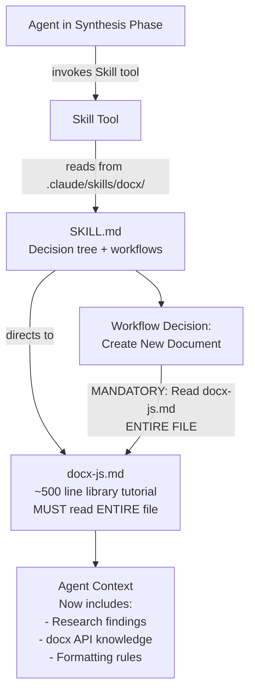

**Critical Requirement:** The skill documentation at [resume-generator/.claude/skills/docx/SKILL.md:59]() explicitly states: "**MANDATORY - READ ENTIRE FILE**: Read [`docx-js.md`](docx-js.md) (~500 lines) completely from start to finish. **NEVER set any range limits when reading this file.**"

This ensures the agent understands:
- The docx JavaScript library API (Document, Paragraph, TextRun, Table classes)
- Critical formatting rules (never use `\n`, always use `LevelFormat.BULLET` for bullets)
- Professional styling patterns (Arial fonts, proper spacing, margins)
- Common pitfalls (PageBreak placement, table width configuration, image type parameter)

**Key Configuration:**
- Skill loading: [resume-generator/resume-generator.ts:50]()
- Allowed tools include Skill: [resume-generator/resume-generator.ts:49]()

**Sources:** [resume-generator/resume-generator.ts:49-51](), [resume-generator/.claude/skills/docx/SKILL.md:54-60](), [resume-generator/.claude/skills/docx/docx-js.md:1-6]()

---

## Phase 3: Code Generation

With complete knowledge of the docx API and researched content, the agent generates a JavaScript file that will create the resume document.

### Generated Script Structure

The agent writes a Node.js script to `agent/custom_scripts/generate_resume.js` that:

1. Imports the docx library classes
2. Creates a `Document` instance with proper styles configuration
3. Builds resume sections (header, summary, experience, education, skills)
4. Applies professional formatting according to PAGE FIT constraints
5. Exports the document to `resume.docx` using `Packer.toBuffer()`

### Output Directory Creation

The directory structure is ensured by [resume-generator/resume-generator.ts:34-37]():

```
agent/
└── custom_scripts/
    ├── generate_resume.js  (Phase 3 output)
    └── resume.docx         (Phase 4 output)
```

### PAGE FIT Constraints

The `SYSTEM_PROMPT` enforces strict formatting rules to ensure the resume fits on exactly one page:

| Constraint | Value | Source Line |
|------------|-------|-------------|
| Margins | 0.5 inch (720 DXA) | [resume-generator/resume-generator.ts:25]() |
| Name font size | 24pt (48 half-points) | [resume-generator/resume-generator.ts:25]() |
| Header font size | 12pt (24 half-points) | [resume-generator/resume-generator.ts:25]() |
| Body font size | 10pt (20 half-points) | [resume-generator/resume-generator.ts:25]() |
| Bullets per job | 2-3 | [resume-generator/resume-generator.ts:26]() |
| Bullet length | ~80-100 characters | [resume-generator/resume-generator.ts:26]() |
| Max job roles | 3 | [resume-generator/resume-generator.ts:27]() |
| Summary lines | 2 | [resume-generator/resume-generator.ts:27]() |
| Skills lines | 2 | [resume-generator/resume-generator.ts:27]() |

### Code Generation Tools

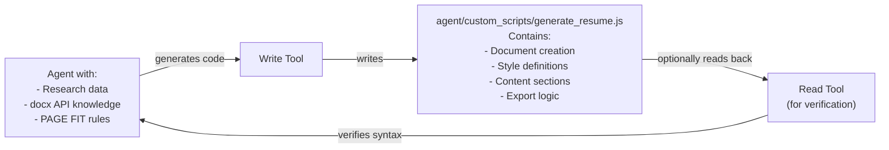

**Sources:** [resume-generator/resume-generator.ts:14-27](), [resume-generator/resume-generator.ts:49](), [resume-generator/.claude/skills/docx/docx-js.md:11-22]()

---

## Phase 4: Script Execution

The final phase executes the generated JavaScript file to produce the `.docx` binary file.

### Execution Flow

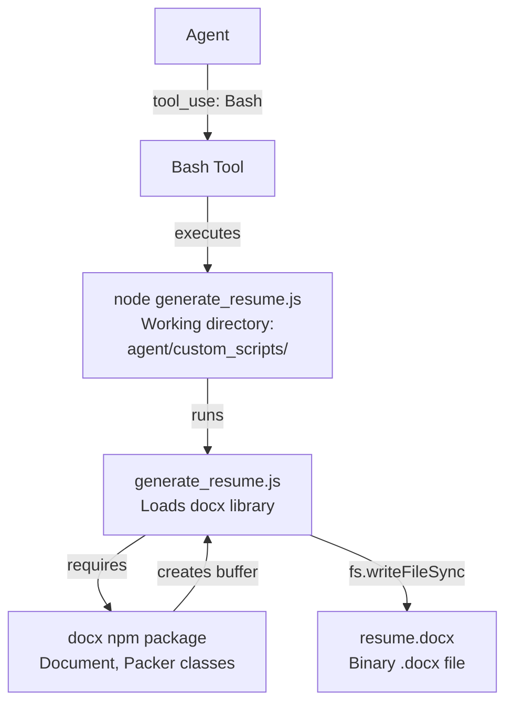

### Execution Command

The agent typically generates a command similar to:

```bash
cd agent/custom_scripts && node generate_resume.js
```

This ensures the script executes in the correct directory where the output file should be created.

### Working Directory

The `cwd` parameter passed to `query()` at [resume-generator/resume-generator.ts:47]() sets the working directory to `process.cwd()`, which is the repository root. The agent must navigate to the `agent/custom_scripts/` subdirectory to execute the script correctly.

**Sources:** [resume-generator/resume-generator.ts:43-54](), [resume-generator/package.json:8-11]()

---

## Verification and Output

After the four phases complete, the main function verifies the output file was created successfully.

### File Existence Check

```mermaid
graph LR
    Complete["Phase 4 Complete<br/>query() iterator exhausted"]
    
    Check["fs.existsSync check<br/>resume-generator.ts:79"]
    
    Expected["Expected path:<br/>agent/custom_scripts/resume.docx"]
    
    Success["Success message<br/>with full path"]
    Error["Error message<br/>check output above"]
    
    Complete --> Check
    Check -->|"checks"| Expected
    Expected -->|"exists"| Success
    Expected -->|"missing"| Error
```

The verification logic at [resume-generator/resume-generator.ts:78-86]() constructs the expected path and checks for file existence:

```typescript
const expectedPath = path.join(process.cwd(), 'agent', 'custom_scripts', 'resume.docx');
if (fs.existsSync(expectedPath)) {
  console.log(`📄 Resume saved to: ${expectedPath}`);
} else {
  console.log('❌ Resume file was not created. Check the output above for errors.');
}
```

### Output Locations

| File | Path | Description |
|------|------|-------------|
| Generated script | `agent/custom_scripts/generate_resume.js` | JavaScript code using docx library |
| Final resume | `agent/custom_scripts/resume.docx` | Word document binary file |

**Exclusions:** Both output files are excluded from version control via [resume-generator/.gitignore:3-4]().

**Sources:** [resume-generator/resume-generator.ts:78-86](), [resume-generator/.gitignore:3-4]()

---

## Agent Configuration and Turn Management

The workflow is constrained by the agent configuration passed to `query()`.

### Configuration Parameters

```mermaid
graph TB
    QueryOptions["query options object<br/>resume-generator.ts:44-52"]
    
    MaxTurns["maxTurns: 30<br/>Limits conversation length"]
    CWD["cwd: process.cwd()<br/>Sets working directory"]
    Model["model: 'sonnet'<br/>Claude 3.5 Sonnet"]
    
    Tools["allowedTools array:<br/>- Skill<br/>- WebSearch<br/>- WebFetch<br/>- Bash<br/>- Write<br/>- Read<br/>- Glob"]
    
    Settings["settingSources: ['project']<br/>Loads .claude/skills/"]
    
    SystemPrompt["systemPrompt: SYSTEM_PROMPT<br/>Workflow + PAGE FIT rules"]
    
    QueryOptions --> MaxTurns
    QueryOptions --> CWD
    QueryOptions --> Model
    QueryOptions --> Tools
    QueryOptions --> Settings
    QueryOptions --> SystemPrompt
```

### Turn Budget

The `maxTurns: 30` parameter at [resume-generator/resume-generator.ts:46]() provides sufficient turns for:
- Multiple web searches (5-10 turns)
- Skill documentation reading (1-2 turns)
- Code generation and refinement (2-5 turns)
- Execution and verification (1-2 turns)
- Buffer for retries and error handling (remaining turns)

If the agent exhausts all 30 turns before completing the workflow, the `query()` iterator terminates and the final verification may detect a missing output file.

**Sources:** [resume-generator/resume-generator.ts:43-53]()

---

## Error Handling and Recovery

The workflow includes implicit error handling through the agent's ability to retry and adapt.

### Common Failure Points

| Phase | Potential Issue | Agent Recovery Strategy |
|-------|----------------|------------------------|
| Phase 1 | No search results | Refine query, try alternative sources |
| Phase 2 | Skill file not found | Verify settingSources configuration |
| Phase 3 | Syntax errors in generated code | Read code back, identify error, regenerate |
| Phase 4 | Execution failure | Read error output, fix code, re-execute |

### Execution Error Example

If the generated script has a syntax error or runtime exception:

1. Bash tool returns error output in `tool_result` message
2. Agent reads the error message
3. Agent uses Read tool to examine the generated code
4. Agent identifies the issue (e.g., missing parenthesis, undefined variable)
5. Agent regenerates the corrected code with Write tool
6. Agent retries execution with Bash tool

This retry loop continues until success or turn limit is reached.

**Sources:** [resume-generator/resume-generator.ts:55-76]()

---

## Message Flow and Event Sequence

The execution produces a sequence of messages through the `query()` async generator.

### Message Type Sequence

```mermaid
sequenceDiagram
    participant Main as "generateResume()"
    participant Query as "query() iterator"
    participant Agent as "Claude Agent"
    
    Main->>Query: Start iteration (for await)
    
    loop Research Phase
        Agent->>Query: assistant message (tool_use: WebSearch)
        Query->>Main: msg.type = 'assistant'
        Agent->>Query: result message (tool_result)
        Query->>Main: msg.type = 'result'
    end
    
    loop Skill Phase
        Agent->>Query: assistant message (tool_use: Skill)
        Query->>Main: msg.type = 'assistant'
        Agent->>Query: result message (tool_result)
        Query->>Main: msg.type = 'result'
    end
    
    loop Code Gen Phase
        Agent->>Query: assistant message (tool_use: Write)
        Query->>Main: msg.type = 'assistant'
        Agent->>Query: result message (tool_result)
        Query->>Main: msg.type = 'result'
    end
    
    loop Execution Phase
        Agent->>Query: assistant message (tool_use: Bash)
        Query->>Main: msg.type = 'assistant'
        Agent->>Query: result message (tool_result)
        Query->>Main: msg.type = 'result'
    end
    
    Agent->>Query: final_message (completion)
    Query->>Main: Iterator done
    Main->>Main: Verify output file
```

The iteration logic at [resume-generator/resume-generator.ts:55-76]() processes each message:
- `msg.type === 'assistant'`: Contains text and tool_use blocks
- `msg.type === 'result'`: Contains tool execution results

**Sources:** [resume-generator/resume-generator.ts:55-76]()

---

## Integration with docx Library

The generated JavaScript code uses the `docx` npm package, which is pre-installed as a dependency.

### Library Classes Used

The agent's generated code typically creates documents using these core classes from the docx library:

| Class | Purpose | Documentation Reference |
|-------|---------|------------------------|
| `Document` | Root document container | [docx-js.md:19]() |
| `Packer` | Exports to buffer/blob | [docx-js.md:20-21]() |
| `Paragraph` | Text paragraph | [docx-js.md:31-48]() |
| `TextRun` | Formatted text span | [docx-js.md:36-47]() |
| `Table` / `TableRow` / `TableCell` | Table structures | [docx-js.md:164-217]() |
| `AlignmentType` | Text alignment constants | [docx-js.md:32]() |
| `HeadingLevel` | Heading style constants | [docx-js.md:81]() |
| `LevelFormat` | List format constants | [docx-js.md:113-155]() |

### Example Document Structure

Based on the tutorial at [resume-generator/.claude/skills/docx/docx-js.md](), the generated code follows this pattern:

```javascript
const { Document, Packer, Paragraph, TextRun } = require('docx');

const doc = new Document({
  styles: { /* style definitions */ },
  numbering: { /* bullet list config */ },
  sections: [{
    properties: { page: { margin: { /* margins */ } } },
    children: [
      new Paragraph({ /* name header */ }),
      new Paragraph({ /* contact info */ }),
      new Paragraph({ /* summary */ }),
      new Paragraph({ /* experience section */ }),
      // ... more sections
    ]
  }]
});

Packer.toBuffer(doc).then(buffer => fs.writeFileSync("resume.docx", buffer));
```

**Dependency:** The docx package version `^9.5.1` is declared in [resume-generator/package.json:10]().

**Sources:** [resume-generator/package.json:8-11](), [resume-generator/.claude/skills/docx/docx-js.md:11-22](), [resume-generator/.claude/skills/docx/docx-js.md:54-89]()

---

# Page: docx Skill System

# docx Skill System

<details>
<summary>Relevant source files</summary>

The following files were used as context for generating this wiki page:

- [resume-generator/.claude/skills/docx/SKILL.md](resume-generator/.claude/skills/docx/SKILL.md)
- [resume-generator/.claude/skills/docx/docx-js.md](resume-generator/.claude/skills/docx/docx-js.md)
- [resume-generator/.gitignore](resume-generator/.gitignore)
- [resume-generator/README.md](resume-generator/README.md)
- [resume-generator/package.json](resume-generator/package.json)
- [resume-generator/resume-generator.ts](resume-generator/resume-generator.ts)

</details>


## Purpose and Scope

This document covers the **docx skill system** used in the Resume Generator demo to enable the Claude agent to create professional Word documents (.docx files) using the JavaScript `docx` library. The skill system provides structured documentation that guides the agent through document creation workflows, ensuring proper formatting and avoiding common pitfalls.

For information about the overall Resume Generator architecture, see [Architecture Overview](#3.1). For details on the complete document generation workflow, see [Document Generation Workflow](#3.2). For general information about the Claude Agent SDK skills system, see [Skills System](#8.5).

**Sources:** [resume-generator/.claude/skills/docx/SKILL.md:1-10](), [resume-generator/resume-generator.ts:1-28]()

## Skill Discovery and Integration

The docx skill is loaded through the Claude Agent SDK's project settings mechanism. The skill is discovered when the `query()` function includes `settingSources: ['project']` in its options.

```mermaid
graph TB
    query["query() function"]
    options["options.settingSources: ['project']"]
    allowedTools["options.allowedTools: ['Skill', ...]"]
    skillsDir[".claude/skills/ directory"]
    docxSkill[".claude/skills/docx/"]
    
    query --> options
    query --> allowedTools
    options --> skillsDir
    allowedTools --> |"'Skill' tool enabled"| skillsDir
    skillsDir --> docxSkill
    
    agent["Claude Agent"]
    skillTool["Invokes 'Skill' tool"]
    readsDocs["Reads skill documentation"]
    
    agent --> skillTool
    skillTool --> docxSkill
    docxSkill --> readsDocs
```

The Resume Generator configures skills at [resume-generator/resume-generator.ts:43-53]():

| Configuration Key | Value | Purpose |
|------------------|-------|---------|
| `allowedTools` | `['Skill', 'WebSearch', 'WebFetch', 'Bash', 'Write', 'Read', 'Glob']` | Enables the `Skill` tool for accessing skill documentation |
| `settingSources` | `['project']` | Loads skills from the `.claude/skills/` directory |
| `cwd` | `process.cwd()` | Establishes project root for skill resolution |

**Sources:** [resume-generator/resume-generator.ts:43-53](), [resume-generator/.claude/skills/docx/SKILL.md:1-10]()

## Skill Structure

The docx skill is organized as a directory containing multiple markdown documentation files. The skill follows a modular structure where each file serves a specific purpose.

```mermaid
graph TB
    skillDir[".claude/skills/docx/"]
    skillMd["SKILL.md<br/>Entry point + Decision tree"]
    docxJsMd["docx-js.md<br/>500-line library tutorial"]
    ooxmlMd["ooxml.md<br/>XML editing patterns"]
    
    skillDir --> skillMd
    skillDir --> docxJsMd
    skillDir --> ooxmlMd
    
    frontmatter["YAML Frontmatter:<br/>name: docx<br/>description: ...<br/>license: ..."]
    overview["## Overview"]
    decisionTree["## Workflow Decision Tree"]
    workflows["## Workflows:<br/>- Reading/Analyzing<br/>- Creating New<br/>- Editing Existing"]
    
    skillMd --> frontmatter
    skillMd --> overview
    skillMd --> decisionTree
    skillMd --> workflows
    
    setup["## Setup"]
    formatting["## Text & Formatting"]
    styles["## Styles & Professional Formatting"]
    lists["## Lists (CRITICAL RULES)"]
    tables["## Tables"]
    criticalIssues["## Critical Issues & Common Mistakes"]
    
    docxJsMd --> setup
    docxJsMd --> formatting
    docxJsMd --> styles
    docxJsMd --> lists
    docxJsMd --> tables
    docxJsMd --> criticalIssues
```

### Skill Entry Point (SKILL.md)

The [resume-generator/.claude/skills/docx/SKILL.md:1-10]() file serves as the skill entry point and contains:

- **YAML frontmatter** with skill metadata (name, description, license)
- **Overview** describing when to use the skill
- **Workflow Decision Tree** routing the agent to appropriate documentation
- **Workflow sections** for reading, creating, and editing documents

**Sources:** [resume-generator/.claude/skills/docx/SKILL.md:1-155]()

### Library Tutorial (docx-js.md)

The [resume-generator/.claude/skills/docx/docx-js.md:1-5]() file is a comprehensive 500-line tutorial covering:

- JavaScript/TypeScript API for the `docx` library
- Complete formatting syntax and examples
- Critical rules to avoid document corruption
- Common mistakes and pitfalls

**Sources:** [resume-generator/.claude/skills/docx/docx-js.md:1-350]()

## Workflow Decision Tree

The skill provides a decision tree that routes the agent to the appropriate workflow based on the task requirements. This decision logic is defined at [resume-generator/.claude/skills/docx/SKILL.md:13-30]().

```mermaid
graph TB
    start["Agent receives document task"]
    decision{"Task type?"}
    
    read["Reading/Analyzing<br/>Content"]
    create["Creating New<br/>Document"]
    edit["Editing Existing<br/>Document"]
    
    start --> decision
    decision --> |"analyze, extract"| read
    decision --> |"create, generate"| create
    decision --> |"modify, update"| edit
    
    pandoc["Use pandoc:<br/>pandoc --track-changes=all<br/>file.docx -o output.md"]
    unpack["Use unpack.py:<br/>python ooxml/scripts/unpack.py"]
    
    read --> pandoc
    read --> unpack
    
    readDocxJs["MANDATORY:<br/>Read docx-js.md<br/>ENTIRE FILE (~500 lines)"]
    generateCode["Generate JavaScript code<br/>using docx library"]
    execute["Execute:<br/>node generate_script.js"]
    
    create --> readDocxJs
    readDocxJs --> generateCode
    generateCode --> execute
    
    editDecision{"Document<br/>owner?"}
    ownDoc["Own document +<br/>simple changes"]
    otherDoc["Someone else's<br/>document"]
    legalDoc["Legal/academic/<br/>business/government"]
    
    edit --> editDecision
    editDecision --> ownDoc
    editDecision --> otherDoc
    editDecision --> legalDoc
    
    basicOoxml["Basic OOXML editing<br/>Read ooxml.md"]
    redlining["Redlining workflow<br/>(tracked changes)<br/>Read ooxml.md"]
    
    ownDoc --> basicOoxml
    otherDoc --> redlining
    legalDoc --> redlining
```

**Sources:** [resume-generator/.claude/skills/docx/SKILL.md:13-30]()

## Creating New Documents Workflow

When the agent needs to create a new Word document, it follows a mandatory three-step process defined at [resume-generator/.claude/skills/docx/SKILL.md:54-62]().

### Mandatory Full-File Reading Pattern

The skill enforces a critical constraint: the agent **must read the entire `docx-js.md` file** before proceeding with document creation. This pattern is explicitly stated at [resume-generator/.claude/skills/docx/SKILL.md:59]():

> "**MANDATORY - READ ENTIRE FILE**: Read [`docx-js.md`](docx-js.md) (~500 lines) completely from start to finish. **NEVER set any range limits when reading this file.**"

This ensures the agent has complete context about:
- All API syntax and formatting options
- Critical formatting rules that prevent corruption
- Common mistakes and how to avoid them
- Best practices for professional document generation

**Sources:** [resume-generator/.claude/skills/docx/SKILL.md:54-62]()

### Document Creation Steps

```mermaid
graph TB
    step1["Step 1: Read docx-js.md<br/>ENTIRE FILE<br/>(~500 lines)"]
    step2["Step 2: Create JavaScript file<br/>using docx library components"]
    step3["Step 3: Export document<br/>using Packer.toBuffer()"]
    
    step1 --> step2
    step2 --> step3
    
    components["Import components:<br/>Document, Paragraph,<br/>TextRun, Table, etc."]
    structure["Define document structure:<br/>sections, styles, content"]
    formatting["Apply formatting:<br/>fonts, sizes, spacing"]
    
    step2 --> components
    step2 --> structure
    step2 --> formatting
    
    buffer["const doc = new Document(...)"]
    write["Packer.toBuffer(doc)<br/>.then(buffer => ...)"]
    save["fs.writeFileSync('file.docx', buffer)"]
    
    step3 --> buffer
    step3 --> write
    step3 --> save
```

**Sources:** [resume-generator/.claude/skills/docx/SKILL.md:54-62](), [resume-generator/.claude/skills/docx/docx-js.md:11-22]()

## Core Library API

The `docx-js.md` file documents the complete JavaScript API for creating Word documents. Key components are imported from the `docx` package as shown at [resume-generator/.claude/skills/docx/docx-js.md:11-16]().

### Primary Components

| Component | Purpose | Usage Example |
|-----------|---------|---------------|
| `Document` | Root container for document structure | `new Document({ sections: [...] })` |
| `Paragraph` | Text paragraph with formatting | `new Paragraph({ children: [...] })` |
| `TextRun` | Formatted text span | `new TextRun({ text: "...", bold: true })` |
| `Table` | Table structure with rows/cells | `new Table({ rows: [...] })` |
| `TableRow` | Table row container | `new TableRow({ children: [...] })` |
| `TableCell` | Table cell with content | `new TableCell({ children: [...] })` |
| `Packer` | Export document to buffer/blob | `Packer.toBuffer(doc)` |

**Sources:** [resume-generator/.claude/skills/docx/docx-js.md:11-22]()

### Document Structure Example

The basic structure pattern is documented at [resume-generator/.claude/skills/docx/docx-js.md:18-21]():

```javascript
const doc = new Document({ 
  sections: [{ 
    children: [/* Paragraph, Table, etc. */] 
  }] 
});
Packer.toBuffer(doc).then(buffer => fs.writeFileSync("doc.docx", buffer));
```

**Sources:** [resume-generator/.claude/skills/docx/docx-js.md:18-21]()

## Critical Formatting Rules

The skill documentation contains numerous critical rules that prevent document corruption and rendering issues. These rules are emphasized throughout [resume-generator/.claude/skills/docx/docx-js.md:335-350]().

### Line Break Rule (CRITICAL)

**Rule:** Never use `\n` for line breaks. Always use separate `Paragraph` elements.

```javascript
// ❌ WRONG
new TextRun("Line 1\nLine 2")

// ✅ CORRECT
new Paragraph({ children: [new TextRun("Line 1")] })
new Paragraph({ children: [new TextRun("Line 2")] })
```

This rule is documented at [resume-generator/.claude/skills/docx/docx-js.md:26-28]().

**Sources:** [resume-generator/.claude/skills/docx/docx-js.md:26-28](), [resume-generator/.claude/skills/docx/docx-js.md:344]()

### Bullet Point Rule (CRITICAL)

**Rule:** Never use Unicode bullet characters. Always use proper numbering configuration with `LevelFormat.BULLET`.

The correct pattern is shown at [resume-generator/.claude/skills/docx/docx-js.md:109-156]():

```javascript
// CRITICAL: Use LevelFormat.BULLET constant, NOT string "bullet"
const doc = new Document({
  numbering: {
    config: [
      { 
        reference: "bullet-list",
        levels: [{ 
          level: 0, 
          format: LevelFormat.BULLET,  // ✅ Constant, not string
          text: "•",
          alignment: AlignmentType.LEFT,
          style: { paragraph: { indent: { left: 720, hanging: 360 } } }
        }]
      }
    ]
  },
  sections: [{
    children: [
      new Paragraph({ 
        numbering: { reference: "bullet-list", level: 0 },
        children: [new TextRun("Bullet point")]
      })
    ]
  }]
});
```

**Wrong approaches** documented at [resume-generator/.claude/skills/docx/docx-js.md:152-155]():
- `new TextRun("• Item")` - Creates fake bullet
- `new SymbolRun({ char: "2022" })` - Creates fake bullet

**Sources:** [resume-generator/.claude/skills/docx/docx-js.md:109-156](), [resume-generator/.claude/skills/docx/docx-js.md:342-346]()

### Table Width Rule (CRITICAL)

**Rule:** Set both `columnWidths` array at table level AND individual `width` on each cell.

The correct pattern is documented at [resume-generator/.claude/skills/docx/docx-js.md:159-217]():

```javascript
new Table({
  columnWidths: [4680, 4680],  // ✅ Set at table level
  rows: [
    new TableRow({
      children: [
        new TableCell({
          width: { size: 4680, type: WidthType.DXA },  // ✅ Also set on cell
          children: [/* ... */]
        })
      ]
    })
  ]
})
```

**Sources:** [resume-generator/.claude/skills/docx/docx-js.md:159-217](), [resume-generator/.claude/skills/docx/docx-js.md:220-228]()

### ImageRun Type Parameter Rule (CRITICAL)

**Rule:** The `type` parameter is **REQUIRED** for `ImageRun`.

This rule is documented at [resume-generator/.claude/skills/docx/docx-js.md:257-269]():

```javascript
new ImageRun({
  type: "png",  // ✅ REQUIRED - must specify: png, jpg, jpeg, gif, bmp, or svg
  data: fs.readFileSync("image.png"),
  transformation: { width: 200, height: 150 }
})
```

**Sources:** [resume-generator/.claude/skills/docx/docx-js.md:257-269](), [resume-generator/.claude/skills/docx/docx-js.md:345]()

### PageBreak Placement Rule (CRITICAL)

**Rule:** `PageBreak` must **ALWAYS** be inside a `Paragraph`. Standalone `PageBreak` creates invalid XML.

This rule is documented at [resume-generator/.claude/skills/docx/docx-js.md:272-286]():

```javascript
// ❌ WRONG - Creates invalid XML
new PageBreak()

// ✅ CORRECT - PageBreak inside Paragraph
new Paragraph({ children: [new PageBreak()] })
```

**Sources:** [resume-generator/.claude/skills/docx/docx-js.md:272-286](), [resume-generator/.claude/skills/docx/docx-js.md:336]()

### Table Cell Shading Rule (CRITICAL)

**Rule:** Always use `ShadingType.CLEAR` for table cell backgrounds. Never use `ShadingType.SOLID`.

This rule is documented at [resume-generator/.claude/skills/docx/docx-js.md:174-179]():

```javascript
new TableCell({
  shading: { 
    fill: "D5E8F0", 
    type: ShadingType.CLEAR  // ✅ Use CLEAR, not SOLID
  }
})
```

**Sources:** [resume-generator/.claude/skills/docx/docx-js.md:174-179](), [resume-generator/.claude/skills/docx/docx-js.md:337]()

## Professional Styling and Formatting

The skill provides comprehensive guidance on professional document styling at [resume-generator/.claude/skills/docx/docx-js.md:52-107]().

### Style System Architecture

```mermaid
graph TB
    doc["Document"]
    styles["styles configuration"]
    default["default: { document: { run: {...} } }"]
    paragraphStyles["paragraphStyles: [...]"]
    characterStyles["characterStyles: [...]"]
    
    doc --> styles
    styles --> default
    styles --> paragraphStyles
    styles --> characterStyles
    
    builtinTitle["id: 'Title'<br/>(overrides built-in)"]
    builtinH1["id: 'Heading1'<br/>(overrides built-in)"]
    builtinH2["id: 'Heading2'<br/>(overrides built-in)"]
    customStyle["id: 'myStyle'<br/>(custom style)"]
    
    paragraphStyles --> builtinTitle
    paragraphStyles --> builtinH1
    paragraphStyles --> builtinH2
    paragraphStyles --> customStyle
    
    usage["Paragraph usage"]
    useTitle["heading: HeadingLevel.TITLE<br/>(uses 'Title' style)"]
    useH1["heading: HeadingLevel.HEADING_1<br/>(uses 'Heading1' style)"]
    useCustom["style: 'myStyle'<br/>(uses custom style)"]
    
    usage --> useTitle
    usage --> useH1
    usage --> useCustom
    
    builtinTitle -.-> useTitle
    builtinH1 -.-> useH1
    customStyle -.-> useCustom
```

### Key Styling Principles

The skill documents these principles at [resume-generator/.claude/skills/docx/docx-js.md:97-107]():

| Principle | Implementation | Purpose |
|-----------|----------------|---------|
| Override built-in styles | Use IDs like `"Heading1"`, `"Heading2"`, `"Title"` | Ensures `HeadingLevel` constants work correctly |
| Include `outlineLevel` | Set `outlineLevel: 0` for H1, `outlineLevel: 1` for H2 | Required for Table of Contents functionality |
| Set default font | `styles.default.document.run.font = "Arial"` | Ensures universal compatibility |
| Visual hierarchy | Title > Headers > Body font sizes | Improves document readability |
| Proper spacing | Use `before` and `after` paragraph spacing | Professional document layout |
| Color restraint | Default to black (`"000000"`) for headers | Professional appearance |

**Professional Font Combinations** documented at [resume-generator/.claude/skills/docx/docx-js.md:92-95]():
- **Arial (Headers) + Arial (Body)** - Most universally supported
- **Times New Roman (Headers) + Arial (Body)** - Classic serif/sans-serif contrast
- **Georgia (Headers) + Verdana (Body)** - Optimized for screen reading

**Sources:** [resume-generator/.claude/skills/docx/docx-js.md:52-107]()

## Complete Critical Rules Summary

The skill maintains a comprehensive list of all critical rules at [resume-generator/.claude/skills/docx/docx-js.md:335-350]():

```mermaid
graph TB
    rules["Critical Rules Summary"]
    
    pageBreak["PageBreak must be inside Paragraph<br/>(invalid XML otherwise)"]
    shading["Use ShadingType.CLEAR for cell shading<br/>(SOLID causes black backgrounds)"]
    bullets["Use LevelFormat.BULLET constant<br/>(never unicode symbols)"]
    lineBreaks["Never use \\n for line breaks<br/>(use separate Paragraphs)"]
    tableWidths["Set both columnWidths array<br/>AND individual cell widths"]
    imageType["ImageRun requires 'type' parameter<br/>(png, jpg, jpeg, gif, bmp, svg)"]
    numberingRef["Each numbering reference = independent list<br/>(same ref = continues, different ref = restarts)"]
    tocHeadings["TOC requires HeadingLevel only<br/>(no custom styles on heading paragraphs)"]
    
    rules --> pageBreak
    rules --> shading
    rules --> bullets
    rules --> lineBreaks
    rules --> tableWidths
    rules --> imageType
    rules --> numberingRef
    rules --> tocHeadings
```

**Complete list from source:**
- PageBreak must always be inside Paragraph (standalone creates invalid XML)
- Always use `ShadingType.CLEAR` for table cell shading (SOLID causes black backgrounds)
- Never use unicode symbols for bullets - use `LevelFormat.BULLET` constant
- Never use `\n` for line breaks - use separate Paragraph elements
- Set `columnWidths` array at table level + individual cell widths
- ImageRun requires `type` parameter (`"png"`, `"jpg"`, etc.)
- Each numbering reference creates independent list (same ref continues, different ref restarts)
- TOC requires `HeadingLevel` only (no custom styles on heading paragraphs)

**Sources:** [resume-generator/.claude/skills/docx/docx-js.md:335-350]()

## Usage in Resume Generator

The Resume Generator demonstrates how the docx skill integrates with the Claude Agent SDK to produce professional documents.

### Configuration and Invocation

The Resume Generator invokes the skill through the SDK's `query()` function at [resume-generator/resume-generator.ts:43-53]():

```mermaid
graph LR
    main["generateResume() function"]
    queryCall["query() invocation"]
    prompt["prompt: 'Research person...'"]
    options["options object"]
    
    main --> queryCall
    queryCall --> prompt
    queryCall --> options
    
    maxTurns["maxTurns: 30"]
    cwd["cwd: process.cwd()"]
    model["model: 'sonnet'"]
    allowedTools["allowedTools: ['Skill', 'WebSearch', ...]"]
    settingSources["settingSources: ['project']"]
    systemPrompt["systemPrompt: SYSTEM_PROMPT"]
    
    options --> maxTurns
    options --> cwd
    options --> model
    options --> allowedTools
    options --> settingSources
    options --> systemPrompt
    
    settingSources --> skillDiscovery[".claude/skills/ directory loaded"]
    allowedTools --> skillToolEnabled["'Skill' tool available"]
```

**Sources:** [resume-generator/resume-generator.ts:43-53]()

### System Prompt Constraints

The Resume Generator provides a `SYSTEM_PROMPT` that works in conjunction with the docx skill to ensure 1-page formatting at [resume-generator/resume-generator.ts:14-27]():

```
WORKFLOW:
1. WebSearch for the person's background (LinkedIn, GitHub, company pages)
2. Create a .docx file using the docx library

OUTPUT:
- Script: agent/custom_scripts/generate_resume.js
- Resume: agent/custom_scripts/resume.docx

PAGE FIT (must be exactly 1 page):
- 0.5 inch margins, Name 24pt, Headers 12pt, Body 10pt
- 2-3 bullet points per job, ~80-100 chars each
- Max 3 job roles, 2-line summary, 2-line skills
```

These constraints guide the agent to create concise, professional resumes that adhere to standard formatting conventions.

**Sources:** [resume-generator/resume-generator.ts:14-27]()

### Output Directory Structure

The Resume Generator enforces a specific output structure at [resume-generator/resume-generator.ts:34-37]():

```
agent/
└── custom_scripts/
    ├── generate_resume.js    (generated JavaScript code)
    └── resume.docx           (final Word document)
```

This directory structure provides:
- **Isolation:** All agent-generated files in dedicated directory
- **Security:** Restricts agent file operations to `custom_scripts/`
- **Traceability:** Generated code is preserved for debugging

**Sources:** [resume-generator/resume-generator.ts:34-37](), [resume-generator/resume-generator.ts:79-86]()

### Execution Flow

```mermaid
graph TB
    start["User: npx tsx resume-generator.ts 'Name'"]
    main["generateResume() function"]
    
    start --> main
    
    mkdir["Create output directory:<br/>agent/custom_scripts/"]
    querySetup["Setup query() with:<br/>- Skill tool enabled<br/>- settingSources: ['project']"]
    execute["Execute query() loop"]
    
    main --> mkdir
    mkdir --> querySetup
    querySetup --> execute
    
    agentFlow["Agent Execution Flow"]
    webSearch["Phase 1: WebSearch<br/>(LinkedIn, GitHub, etc.)"]
    synthesis["Phase 2: Information synthesis"]
    skillInvoke["Phase 3: Invoke 'Skill' tool<br/>to access docx documentation"]
    readDocs["Phase 4: Read docx-js.md<br/>ENTIRE FILE"]
    generateCode["Phase 5: Generate<br/>generate_resume.js"]
    runCode["Phase 6: Execute<br/>node generate_resume.js"]
    
    execute --> agentFlow
    agentFlow --> webSearch
    webSearch --> synthesis
    synthesis --> skillInvoke
    skillInvoke --> readDocs
    readDocs --> generateCode
    generateCode --> runCode
    
    verify["Verify output:<br/>Check resume.docx exists"]
    success["Success: Resume created"]
    failure["Failure: Show error"]
    
    runCode --> verify
    verify --> |"file exists"| success
    verify --> |"no file"| failure
```

**Sources:** [resume-generator/resume-generator.ts:29-97]()

## Benefits of the Skill System

The docx skill system demonstrates several key architectural benefits:

| Benefit | Implementation | Impact |
|---------|----------------|--------|
| **Mandatory full-context reading** | Agent must read entire ~500-line tutorial | Prevents partial knowledge leading to corrupt documents |
| **Structured documentation** | Decision tree routes to appropriate workflow | Ensures agent follows correct process |
| **Comprehensive rule coverage** | All critical rules documented with examples | Reduces trial-and-error, avoids common mistakes |
| **Code generation safety** | Agent generates and executes JavaScript in isolated directory | Provides traceability and security |
| **Professional formatting** | Detailed styling guidance with font combinations | Ensures consistent, professional output |

**Sources:** [resume-generator/.claude/skills/docx/SKILL.md:54-62](), [resume-generator/.claude/skills/docx/docx-js.md:1-350]()

---

# Page: Configuration and Setup

# Configuration and Setup

<details>
<summary>Relevant source files</summary>

The following files were used as context for generating this wiki page:

- [resume-generator/.claude/skills/docx/SKILL.md](resume-generator/.claude/skills/docx/SKILL.md)
- [resume-generator/.claude/skills/docx/docx-js.md](resume-generator/.claude/skills/docx/docx-js.md)
- [resume-generator/.gitignore](resume-generator/.gitignore)
- [resume-generator/README.md](resume-generator/README.md)
- [resume-generator/package.json](resume-generator/package.json)
- [resume-generator/resume-generator.ts](resume-generator/resume-generator.ts)

</details>


This page provides instructions for configuring and running the Resume Generator demo. It covers installation, directory structure, configuration parameters, execution, and output verification.

For information about the Resume Generator's architecture and workflow phases, see [Architecture Overview](#3.1). For details about the docx skill system used by the generator, see [docx Skill System](#3.3).

## Overview

The Resume Generator requires minimal setup: installing dependencies, understanding the directory structure, and executing the main TypeScript file with a person's name. The agent automatically creates necessary directories, loads skills from `.claude/skills/`, and generates output in `agent/custom_scripts/`. No environment variables or external API keys are required beyond what the Claude Agent SDK needs.

**Sources:** [resume-generator/README.md:1-28](), [resume-generator/resume-generator.ts:1-98]()

## Prerequisites

The Resume Generator requires the following software installed on your system:

| Requirement | Purpose | Verification Command |
|-------------|---------|---------------------|
| Node.js (v18+) | Runtime environment | `node --version` |
| npm | Package manager | `npm --version` |
| Anthropic API key | Claude model access | `echo $ANTHROPIC_API_KEY` |

The Anthropic API key must be set in your environment as `ANTHROPIC_API_KEY`. This is consumed by the `@anthropic-ai/claude-agent-sdk` package.

**Sources:** [resume-generator/package.json:1-18]()

## Installation

Navigate to the `resume-generator` directory and install dependencies:

```bash
cd resume-generator
npm install
```

This installs the following packages as specified in [resume-generator/package.json:8-16]():

- `@anthropic-ai/claude-agent-sdk` (^0.1.59) - Agent orchestration and tool execution
- `docx` (^9.5.1) - Word document generation library
- `tsx` (^4.20.6) - TypeScript execution
- `typescript` (^5.9.3) - TypeScript compiler

The `docx` package is globally available to the agent when it generates JavaScript code for resume creation.

**Sources:** [resume-generator/package.json:1-18]()

## Directory Structure

### File System Layout

```mermaid
graph TB
    Root["resume-generator/<br/>(project root)"]
    
    Resume["resume-generator.ts<br/>(entry point)"]
    Package["package.json<br/>(dependencies)"]
    Readme["README.md<br/>(documentation)"]
    Gitignore[".gitignore<br/>(ignored paths)"]
    
    SkillsDir[".claude/skills/<br/>(skills directory)"]
    DocxSkill["docx/<br/>(docx skill)"]
    SkillMD["SKILL.md<br/>(workflow decision tree)"]
    DocxJSMD["docx-js.md<br/>(500-line library tutorial)"]
    OoxmlMD["ooxml.md<br/>(XML editing patterns)"]
    
    AgentDir["agent/<br/>(runtime directory)"]
    CustomScripts["custom_scripts/<br/>(output directory)"]
    GenerateJS["generate_resume.js<br/>(generated script)"]
    ResumeDOCX["resume.docx<br/>(final output)"]
    
    Root --> Resume
    Root --> Package
    Root --> Readme
    Root --> Gitignore
    
    Root --> SkillsDir
    SkillsDir --> DocxSkill
    DocxSkill --> SkillMD
    DocxSkill --> DocxJSMD
    DocxSkill --> OoxmlMD
    
    Root --> AgentDir
    AgentDir --> CustomScripts
    CustomScripts --> GenerateJS
    CustomScripts --> ResumeDOCX
```

**Directory Structure Details**

The Resume Generator uses the following directory structure as shown in [resume-generator/resume-generator.ts:33-37]() and [resume-generator/.gitignore:1-6]():

| Path | Purpose | Created By | Gitignored |
|------|---------|------------|------------|
| `resume-generator/` | Project root | Manual | No |
| `.claude/skills/` | Skills discovery directory | Manual | No |
| `.claude/skills/docx/` | docx skill files | Manual | No |
| `agent/` | Agent runtime workspace | Auto | No |
| `agent/custom_scripts/` | Output directory for generated files | Auto ([resume-generator.ts:34-37]()) | Yes |
| `agent/custom_scripts/generate_resume.js` | Generated JavaScript code | Agent | Yes |
| `agent/custom_scripts/resume.docx` | Final resume file | Agent (via Bash tool) | Yes |

The `settingSources: ['project']` configuration at [resume-generator/resume-generator.ts:50]() instructs the SDK to load skills from `.claude/skills/`.

**Sources:** [resume-generator/resume-generator.ts:33-37](), [resume-generator/.gitignore:1-6](), [resume-generator/resume-generator.ts:50]()

### Skills Directory Structure

The `.claude/skills/docx/` directory contains three markdown files that the agent reads:

- **SKILL.md** - Workflow decision tree routing to appropriate documentation
- **docx-js.md** - 500-line comprehensive tutorial on the docx JavaScript library
- **ooxml.md** - XML editing patterns for existing documents (not used in resume generation)

The agent must read these files entirely (no range limits) as specified in [resume-generator/.claude/skills/docx/SKILL.md:59]() and [resume-generator/.claude/skills/docx/SKILL.md:68]().

**Sources:** [resume-generator/.claude/skills/docx/SKILL.md:1-197](), [resume-generator/.claude/skills/docx/docx-js.md:1-350]()

## Configuration Parameters

### Query Function Configuration

```mermaid
graph LR
    CLI["CLI Input:<br/>process.argv[2]"]
    
    Main["generateResume()<br/>function"]
    
    Query["query() function<br/>from SDK"]
    
    subgraph "Options Object"
        Prompt["prompt:<br/>'Research {name}...'"]
        MaxTurns["maxTurns: 30"]
        CWD["cwd: process.cwd()"]
        Model["model: 'sonnet'"]
        Tools["allowedTools:<br/>[Skill, WebSearch,<br/>WebFetch, Bash,<br/>Write, Read, Glob]"]
        Settings["settingSources:<br/>['project']"]
        SysPrompt["systemPrompt:<br/>SYSTEM_PROMPT"]
    end
    
    CLI --> Main
    Main --> Query
    Query --> Prompt
    Query --> MaxTurns
    Query --> CWD
    Query --> Model
    Query --> Tools
    Query --> Settings
    Query --> SysPrompt
```

The `query()` function is configured at [resume-generator/resume-generator.ts:43-53]() with the following parameters:

| Parameter | Value | Purpose |
|-----------|-------|---------|
| `prompt` | `"Research \"{personName}\" and create a professional 1-page resume as a .docx file..."` | Initial task instruction |
| `maxTurns` | `30` | Maximum agent turns (includes tool uses) |
| `cwd` | `process.cwd()` | Current working directory for file operations |
| `model` | `'sonnet'` | Claude model identifier |
| `allowedTools` | `['Skill', 'WebSearch', 'WebFetch', 'Bash', 'Write', 'Read', 'Glob']` | Enabled tools for the agent |
| `settingSources` | `['project']` | Load skills from `.claude/skills/` directory |
| `systemPrompt` | `SYSTEM_PROMPT` | Workflow instructions and constraints |

**Sources:** [resume-generator/resume-generator.ts:39-53]()

### System Prompt

The `SYSTEM_PROMPT` constant at [resume-generator/resume-generator.ts:14-27]() provides critical constraints:

```typescript
const SYSTEM_PROMPT = `You are a professional resume writer. Research a person and create a 1-page .docx resume.

WORKFLOW:
1. WebSearch for the person's background (LinkedIn, GitHub, company pages)
2. Create a .docx file using the docx library

OUTPUT:
- Script: agent/custom_scripts/generate_resume.js
- Resume: agent/custom_scripts/resume.docx

PAGE FIT (must be exactly 1 page):
- 0.5 inch margins, Name 24pt, Headers 12pt, Body 10pt
- 2-3 bullet points per job, ~80-100 chars each
- Max 3 job roles, 2-line summary, 2-line skills`;
```

The PAGE FIT section enforces strict formatting requirements to ensure the resume fits on exactly one page.

**Sources:** [resume-generator/resume-generator.ts:14-27]()

## Running the Generator

### Command Line Execution

Execute the Resume Generator using the `tsx` runtime:

```bash
npx tsx resume-generator.ts "Person Name"
```

The person's name must be provided as the first command-line argument. If omitted, the script exits with usage instructions at [resume-generator/resume-generator.ts:90-95]():

```bash
# Success case
npx tsx resume-generator.ts "Jane Doe"

# Error case (missing argument)
npx tsx resume-generator.ts
# Output: Usage: npx tsx resume-generator.ts "Person Name"
#         Example: npx tsx resume-generator.ts "Jane Doe"
```

Alternatively, use the npm script defined in [resume-generator/package.json:6-7]():

```bash
npm start "Person Name"
```

**Sources:** [resume-generator/resume-generator.ts:90-97](), [resume-generator/package.json:6-7]()

### Execution Flow

```mermaid
graph TB
    Start["Start Execution<br/>npx tsx resume-generator.ts"]
    
    ValidateArgs["Validate CLI Args<br/>[resume-generator.ts:90-95]()"]
    
    CreateDir["Create Output Directory<br/>agent/custom_scripts/<br/>[resume-generator.ts:34-37]()"]
    
    BuildPrompt["Build Prompt<br/>with person name<br/>[resume-generator.ts:39]()"]
    
    InitQuery["Initialize query()<br/>with options<br/>[resume-generator.ts:43-53]()"]
    
    StreamLoop["Stream Message Loop<br/>for await (msg of q)<br/>[resume-generator.ts:55-76]()"]
    
    LogOutput["Log Tool Uses<br/>and Results<br/>[resume-generator.ts:56-75]()"]
    
    CheckFile["Check Output File<br/>resume.docx exists<br/>[resume-generator.ts:79-86]()"]
    
    Success["Success Message<br/>with file path"]
    
    Error["Error Message"]
    
    Start --> ValidateArgs
    ValidateArgs -->|Valid| CreateDir
    ValidateArgs -->|Invalid| Error
    CreateDir --> BuildPrompt
    BuildPrompt --> InitQuery
    InitQuery --> StreamLoop
    StreamLoop --> LogOutput
    LogOutput -->|Complete| CheckFile
    CheckFile -->|Exists| Success
    CheckFile -->|Missing| Error
```

**Sources:** [resume-generator/resume-generator.ts:29-97]()

### Console Output

The generator logs execution progress to console:

1. **Research phase**: `🔍 Searching: "query text"` for WebSearch tool uses [resume-generator/resume-generator.ts:62-63]()
2. **Tool execution**: `🔧 Using tool: toolName` for other tools [resume-generator/resume-generator.ts:65]()
3. **Tool results**: Truncated JSON results [resume-generator/resume-generator.ts:71-73]()
4. **Text blocks**: Assistant text responses [resume-generator/resume-generator.ts:58-60]()

**Sources:** [resume-generator/resume-generator.ts:55-76]()

## Output Verification

### File Validation

After the query completes, the generator verifies that `resume.docx` was created at [resume-generator/resume-generator.ts:78-86]():

```typescript
const expectedPath = path.join(process.cwd(), 'agent', 'custom_scripts', 'resume.docx');
if (fs.existsSync(expectedPath)) {
  console.log('\n' + '='.repeat(50));
  console.log(`📄 Resume saved to: ${expectedPath}`);
  console.log('='.repeat(50) + '\n');
} else {
  console.log('\n❌ Resume file was not created. Check the output above for errors.');
}
```

**Expected Output Location**: `<project-root>/agent/custom_scripts/resume.docx`

**Sources:** [resume-generator/resume-generator.ts:78-86]()

### Verification Checklist

After execution, verify:

| Check | Location | Expected Result |
|-------|----------|-----------------|
| JavaScript script created | `agent/custom_scripts/generate_resume.js` | File exists with docx library code |
| Resume file created | `agent/custom_scripts/resume.docx` | File exists and is valid .docx format |
| File size | `resume.docx` | Typically 15-50 KB for one-page resume |
| Page count | Open in Word/LibreOffice | Exactly 1 page (enforced by SYSTEM_PROMPT) |

Open the resume in Microsoft Word, LibreOffice, or Google Docs to verify formatting and content accuracy.

**Sources:** [resume-generator/resume-generator.ts:21-27](), [resume-generator/.gitignore:3-4]()

## Troubleshooting

### Common Issues

#### Missing API Key

**Symptom**: Error about missing Anthropic API key

**Solution**: Set the environment variable:
```bash
export ANTHROPIC_API_KEY="your-api-key-here"
```

#### Skills Not Found

**Symptom**: Agent doesn't use docx skill or can't create proper .docx files

**Solution**: Verify `.claude/skills/docx/` directory exists with `SKILL.md`, `docx-js.md`, and `ooxml.md` files. The `settingSources: ['project']` setting at [resume-generator/resume-generator.ts:50]() requires this directory structure.

#### Output Directory Permissions

**Symptom**: Error creating `agent/custom_scripts/` directory

**Solution**: The directory is created automatically with `fs.mkdirSync(outputDir, { recursive: true })` at [resume-generator/resume-generator.ts:36](). Ensure write permissions in the project root directory.

#### Resume Not Created

**Symptom**: Script completes but no `resume.docx` file

**Solution**: Review console output for errors. Common causes:
- Agent exceeded `maxTurns: 30` limit before completing
- JavaScript generation script had syntax errors
- Bash tool execution failed

Check `agent/custom_scripts/generate_resume.js` for the generated code and run it manually:
```bash
cd agent/custom_scripts
node generate_resume.js
```

**Sources:** [resume-generator/resume-generator.ts:34-37](), [resume-generator/resume-generator.ts:43-53](), [resume-generator/resume-generator.ts:78-86]()

### Debug Mode

To see more detailed output, modify the message loop at [resume-generator/resume-generator.ts:55-76]() to log complete message objects:

```typescript
for await (const msg of q) {
  console.log(JSON.stringify(msg, null, 2)); // Log complete message
  // ... existing code
}
```

This reveals the full conversation history, tool inputs, and tool results.

**Sources:** [resume-generator/resume-generator.ts:55-76]()

## Related Configuration

For configuring the Claude Agent SDK itself (API keys, model selection, tool configuration), see [SDK Core Concepts](#8.1) and [V1 API: Query Function](#8.2).

For understanding how the skills system discovers and loads `.claude/skills/`, see [Skills System](#8.5).

For modifying the docx skill documentation or adding new skills, see [docx Skill System](#3.3).

**Sources:** [resume-generator/resume-generator.ts:1-98]()

---

# Page: Email Agent Demo

# Email Agent Demo

<details>
<summary>Relevant source files</summary>

The following files were used as context for generating this wiki page:

- [email-agent/client/App.tsx](email-agent/client/App.tsx)
- [email-agent/client/components/InboxView.tsx](email-agent/client/components/InboxView.tsx)
- [email-agent/database/database-manager.ts](email-agent/database/database-manager.ts)
- [email-agent/server/server.ts](email-agent/server/server.ts)

</details>


## Purpose and Scope

This document provides an overview of the Email Agent demo application, a full-stack web application that demonstrates the capabilities of the Claude Agent SDK for building an AI-powered email assistant. The Email Agent showcases IMAP integration, agentic search, event-driven automation through listeners, and real-time communication patterns.

This page covers the application's purpose, capabilities, high-level architecture, and core components. For detailed documentation of specific subsystems, see:
- Server layer components: [Server Layer](#4.2)
- Client application structure: [Client Layer](#4.4)
- Database schema and operations: [Database Layer](#4.3)
- AI integration: [AI Integration](#4.5)
- Event-driven automation: [Listeners System](#4.6)
- Search capabilities: [Search and Filtering](#4.7)
- Setup instructions: [Configuration and Setup](#4.8)

**Sources**: [README.md:1-69](), [email-agent/server/server.ts:1-342]()

## Application Overview

The Email Agent is an in-development IMAP email assistant built with Bun, React, and SQLite. It connects to IMAP email servers (Gmail, etc.) to synchronize emails locally and provide AI-powered assistance through the Claude Agent SDK.

**Key Capabilities**:
- **Inbox Display**: View and manage emails with full-text search and filtering
- **Agentic Search**: Use natural language queries to find specific emails
- **AI Assistance**: Chat with Claude about emails, get summaries, and perform actions
- **Event-Driven Automation**: Custom TypeScript listeners that respond to email events
- **Real-Time Updates**: WebSocket-based live notifications and synchronization
- **IDLE Monitoring**: Instant email notifications via IMAP IDLE protocol

**Important**: This is a demo application intended for local development only and should NOT be deployed to production or used at scale.

**Sources**: [README.md:9-14](), [email-agent/server/server.ts:118-129]()

## Technology Stack

| Layer | Technology | Purpose |
|-------|-----------|---------|
| Runtime | Bun / Node.js 18+ | Server-side JavaScript/TypeScript execution |
| Frontend | React + TailwindCSS | User interface components and styling |
| State Management | Jotai | Client-side state management |
| Backend Framework | Bun.serve | HTTP and WebSocket server |
| Database | bun:sqlite + FTS5 | Local email storage with full-text search |
| Email Protocol | node-imap | IMAP server communication |
| AI Integration | Claude Agent SDK | Agentic capabilities and Claude AI access |
| Type Safety | Zod | Runtime schema validation |

**Sources**: [email-agent/server/server.ts:1-12](), Package.json files

## High-Level System Architecture

```mermaid
graph TB
    subgraph ClientLayer["Client Layer - client/"]
        App["App.tsx<br/>Main React Component"]
        InboxView["InboxView.tsx<br/>Email List Display"]
        EmailViewer["EmailViewer.tsx<br/>Email Content"]
        ChatInterface["Chat Interface<br/>AI Assistant"]
    end
    
    subgraph Communication["Communication Layer"]
        WSEndpoint["ws://localhost:3000/ws<br/>WebSocket Connection"]
        APIEndpoints["REST API<br/>/api/emails/*<br/>/api/sync<br/>/api/listeners"]
    end
    
    subgraph ServerLayer["Server Layer - server/server.ts:29-68"]
        BunServe["Bun.serve()<br/>Port 3000"]
        WSHandler["WebSocketHandler<br/>ccsdk/websocket-handler.ts"]
        EndpointHandlers["Endpoint Handlers<br/>server/endpoints/*.ts"]
    end
    
    subgraph Managers["Manager Layer - Singletons & Services"]
        DBManager["DatabaseManager.getInstance()<br/>database/database-manager.ts"]
        ImapManager["ImapManager.getInstance()<br/>database/imap-manager.ts"]
        EmailSync["EmailSyncService<br/>database/email-sync.ts"]
        ListenersMgr["ListenersManager<br/>ccsdk/listeners-manager.ts"]
        ActionsMgr["ActionsManager<br/>ccsdk/actions-manager.ts"]
        UIStateMgr["UIStateManager<br/>ccsdk/ui-state-manager.ts"]
        ComponentMgr["ComponentManager<br/>ccsdk/component-manager.ts"]
    end
    
    subgraph Storage["Storage Layer"]
        SQLiteDB["emails.db<br/>SQLite Database"]
        FTS5Table["emails_fts<br/>FTS5 Virtual Table"]
        ListenerFiles["listeners/*.ts<br/>Event Handlers"]
        ActionFiles["actions/*.ts<br/>Action Templates"]
    end
    
    subgraph External["External Services"]
        IMAPServer["IMAP Server<br/>Gmail/IMAP Provider"]
        ClaudeSDK["@anthropic-ai/claude-agent-sdk<br/>AI Integration"]
    end
    
    App --> WSEndpoint
    App --> APIEndpoints
    InboxView --> APIEndpoints
    EmailViewer --> APIEndpoints
    ChatInterface --> WSEndpoint
    
    WSEndpoint --> BunServe
    APIEndpoints --> BunServe
    
    BunServe --> WSHandler
    BunServe --> EndpointHandlers
    
    WSHandler --> ListenersMgr
    WSHandler --> ActionsMgr
    WSHandler --> UIStateMgr
    WSHandler --> ComponentMgr
    
    EndpointHandlers --> DBManager
    EndpointHandlers --> ImapManager
    EndpointHandlers --> EmailSync
    
    ListenersMgr --> DBManager
    ListenersMgr --> ImapManager
    ListenersMgr --> UIStateMgr
    ListenersMgr -.watches.-> ListenerFiles
    
    ActionsMgr -.watches.-> ActionFiles
    
    EmailSync --> ImapManager
    EmailSync --> DBManager
    EmailSync --> ListenersMgr
    
    DBManager --> SQLiteDB
    DBManager --> FTS5Table
    
    ImapManager --> IMAPServer
    
    ListenersMgr -.uses.-> ClaudeSDK
    ActionsMgr -.uses.-> ClaudeSDK
```

**Diagram: Email Agent Three-Tier Architecture with Code Entity Mapping**

The architecture consists of:

1. **Client Layer** ([email-agent/client/]()): React components (`App.tsx`, `InboxView.tsx`, `EmailViewer.tsx`) communicate via WebSocket and REST APIs
2. **Server Layer** ([email-agent/server/server.ts:29-68]()): `Bun.serve()` handles HTTP/WebSocket routing to `WebSocketHandler` and endpoint handlers
3. **Manager Layer**: Singleton instances (`DatabaseManager`, `ImapManager`) and service classes (`EmailSyncService`, `ListenersManager`, `ActionsManager`, `UIStateManager`, `ComponentManager`) coordinate business logic
4. **Storage Layer**: SQLite database at `emails.db` with FTS5 full-text search, plus file-based listeners and action templates
5. **External Services**: IMAP servers for email retrieval and Claude Agent SDK for AI capabilities

For detailed documentation of each layer:
- Client components: [Client Layer](#4.4)
- Server implementation: [Server Layer](#4.2)
- Database operations: [Database Layer](#4.3)
- AI integration: [AI Integration](#4.5)
- Listeners system: [Listeners System](#4.6)

**Sources**: [email-agent/server/server.ts:1-342](), [email-agent/database/database-manager.ts:1-845](), [email-agent/database/imap-manager.ts](), [email-agent/ccsdk/websocket-handler.ts]()

## Core Components Overview

The Email Agent's business logic is organized into specialized manager classes and services:

```mermaid
graph LR
    subgraph "Initialization - server.ts:29-42"
        Init["Server Initialization"]
    end
    
    subgraph "Singleton Managers"
        DBM["DatabaseManager<br/>.getInstance()"]
        IMAP["ImapManager<br/>.getInstance()"]
    end
    
    subgraph "Service Managers"
        ES["EmailSyncService<br/>new()"]
        LM["ListenersManager<br/>new()"]
        AM["ActionsManager<br/>new()"]
        USM["UIStateManager<br/>new()"]
        CM["ComponentManager<br/>new()"]
        WSH["WebSocketHandler<br/>new()"]
    end
    
    Init --> DBM
    Init --> IMAP
    Init --> ES
    Init --> LM
    Init --> AM
    Init --> USM
    Init --> CM
    Init --> WSH
    
    WSH --> LM
    WSH --> AM
    WSH --> USM
    WSH --> CM
    
    ES --> IMAP
    ES --> DBM
    ES --> LM
    
    LM --> IMAP
    LM --> DBM
    LM --> USM
```

**Diagram: Component Initialization and Dependencies**

| Component | Type | Location | Primary Responsibility |
|-----------|------|----------|------------------------|
| `DatabaseManager` | Singleton | [database/database-manager.ts]() | SQLite operations, FTS5 search, email CRUD |
| `ImapManager` | Singleton | [database/imap-manager.ts]() | IMAP protocol, email fetch, IDLE monitoring |
| `EmailSyncService` | Service | [database/email-sync.ts]() | Sync orchestration, listener triggering |
| `ListenersManager` | Service | [ccsdk/listeners-manager.ts]() | Event-driven automation, hot-reload listeners |
| `ActionsManager` | Service | [ccsdk/actions-manager.ts]() | Action template loading and execution |
| `UIStateManager` | Service | [ccsdk/ui-state-manager.ts]() | UI state persistence and templates |
| `ComponentManager` | Service | [ccsdk/component-manager.ts]() | Dynamic component instance tracking |
| `WebSocketHandler` | Service | [ccsdk/websocket-handler.ts]() | Real-time bidirectional messaging |

Detailed documentation for each component is available in the child pages:
- Server layer components: [Server Layer](#4.2)
- Database operations: [Database Layer](#4.3)
- Listeners system: [Listeners System](#4.6)

**Sources**: [email-agent/server/server.ts:29-68]()

## Database Schema Overview

The Email Agent uses SQLite with FTS5 full-text search for local email storage:

```mermaid
erDiagram
    emails ||--o{ attachments : "email_id"
    emails ||--|| emails_fts : "messageId"
    
    emails {
        INTEGER id PK
        TEXT messageId UK "UNIQUE"
        TEXT threadId
        TEXT inReplyTo
        TEXT emailReferences
        DATETIME dateSent
        DATETIME dateReceived
        TEXT subject
        TEXT fromAddress
        TEXT fromName
        TEXT toAddresses
        TEXT ccAddresses
        TEXT bodyText
        TEXT bodyHtml
        TEXT snippet
        BOOLEAN isRead
        BOOLEAN isStarred
        BOOLEAN hasAttachments
        INTEGER attachmentCount
        TEXT folder
        TEXT labels "JSON array"
        TEXT rawHeaders
    }
    
    attachments {
        INTEGER id PK
        INTEGER email_id FK
        TEXT filename
        TEXT content_type
        INTEGER size_bytes
        TEXT content_id
        BOOLEAN is_inline
    }
    
    emails_fts {
        TEXT messageId "UNINDEXED"
        TEXT subject
        TEXT fromAddress
        TEXT fromName
        TEXT bodyText
        TEXT toAddresses
        TEXT ccAddresses
        TEXT attachment_names
    }
    
    ui_states {
        INTEGER id PK
        TEXT state_id UK
        TEXT data_json
        DATETIME created_at
        DATETIME updated_at
    }
    
    component_instances {
        INTEGER id PK
        TEXT instance_id UK
        TEXT component_id
        TEXT state_id
        TEXT session_id
        DATETIME created_at
    }
    
    sync_metadata {
        INTEGER id PK
        TEXT sync_time
        INTEGER emails_synced
        INTEGER emails_skipped
        TEXT sync_type
    }
```

**Diagram: SQLite Database Schema - emails.db**

### Core Tables

| Table | Purpose | Key Features |
|-------|---------|--------------|
| `emails` | Email metadata and content | UNIQUE constraint on `messageId`, indexes on `dateSent`, `fromAddress`, `folder`, `isRead` |
| `attachments` | Email attachment metadata | Foreign key to `emails(id)` with CASCADE delete |
| `emails_fts` | FTS5 full-text search index | `porter unicode61` tokenizer, automatically synced via triggers |
| `ui_states` | Persistent UI state storage | Used by actions and listeners to maintain state across sessions |
| `component_instances` | Dynamic component tracking | Links component instances to UI states and sessions |
| `sync_metadata` | Synchronization history | Tracks sync operations, email counts, and sync types |

### Automatic Index Maintenance

Three triggers ([database-manager.ts:174-210]()) maintain `emails_fts` synchronization:
- `emails_fts_insert`: Adds new emails to FTS5 index
- `emails_fts_update`: Updates FTS5 when email content changes
- `emails_fts_delete`: Removes deleted emails from FTS5

For detailed schema documentation and operations, see [Schema and Models](#4.3.1).

**Sources**: [email-agent/database/database-manager.ts:88-256](), [email-agent/server/server.ts:44-52]()

## Communication Patterns

The Email Agent uses both WebSocket for real-time communication and HTTP REST APIs for stateless operations:

### WebSocket Protocol

**Client → Server Messages** (handled by [ccsdk/websocket-handler.ts]()):
- `subscribe`: Subscribe to inbox updates for specific folders
- `unsubscribe`: Unsubscribe from inbox updates
- `agent_message`: Send message to Claude agent with streaming response
- `execute_action`: Trigger predefined action template from `actions/*.ts`

**Server → Client Messages**:
- `inbox_update`: Broadcast email list updates to subscribed clients
- `listener_log`: Broadcast listener execution logs in real-time
- `agent_response`: Stream Claude agent responses with tool use display

For WebSocket implementation details, see [WebSocket Handler](#4.2.2).

### HTTP REST API

| Endpoint | Method | Handler Location | Purpose |
|----------|--------|------------------|---------|
| `/api/sync` | POST | [server/endpoints/sync.ts]() | Trigger manual email synchronization |
| `/api/sync/status` | GET | [server/endpoints/sync.ts]() | Get synchronization status and metadata |
| `/api/emails/inbox` | GET | [server/endpoints/emails.ts:16-60]() | Retrieve inbox emails with `limit` and `includeRead` params |
| `/api/emails/search` | POST | [server/endpoints/emails.ts:62-144]() | Search emails with `SearchCriteria` (from, to, subject, date, gmailQuery) |
| `/api/email/:messageId` | GET | [server/endpoints/emails.ts:146-241]() | Get detailed email by `messageId` |
| `/api/emails/batch` | POST | [server/endpoints/emails.ts:243-301]() | Retrieve multiple emails by array of IDs |
| `/api/listeners` | GET | [server/server.ts:285-297]() | List all loaded listeners with execution stats |
| `/api/listener/:filename` | GET | [server/endpoints/listeners.ts]() | Get specific listener details and source code |
| `/api/listener/:id/logs` | GET | [server/server.ts:264-278]() | Get execution logs for a listener |
| `/api/ui-states` | GET | [server/endpoints/ui-state.ts]() | List all saved UI states |
| `/api/ui-state/:id` | GET/PUT/DELETE | [server/endpoints/ui-state.ts]() | CRUD operations on UI state by `stateId` |
| `/api/component-templates` | GET | [server/server.ts:332-334]() | List available component templates |

For API endpoint implementation details, see [API Endpoints](#4.2.3).

**Sources**: [email-agent/server/server.ts:238-334](), [email-agent/server/endpoints/emails.ts:1-301]()

## Application Startup Sequence

```mermaid
sequenceDiagram
    participant Main as "server.ts"
    participant DB as "DatabaseManager.getInstance()"
    participant IMAP as "ImapManager.getInstance()"
    participant Listeners as "ListenersManager"
    participant Actions as "ActionsManager"
    participant UI as "UIStateManager"
    participant Comp as "ComponentManager"
    
    Note over Main: Lines 29-34: Initialize Singletons
    Main->>DB: getInstance()
    activate DB
    DB->>DB: initializeDatabase()<br/>Create tables, FTS5, triggers
    DB-->>Main: DatabaseManager instance
    deactivate DB
    
    Main->>IMAP: getInstance()
    IMAP-->>Main: ImapManager instance
    
    Note over Main: Lines 32-40: Create Service Managers
    Main->>Actions: new ActionsManager()
    Main->>UI: new UIStateManager(dbManager)
    Main->>Comp: new ComponentManager(dbManager)
    Main->>Listeners: new ListenersManager(...)
    
    Note over Main: Lines 74-129: Async Initialization
    
    Main->>Listeners: loadAllListeners()
    activate Listeners
    Listeners->>Listeners: Load listeners/*.ts files
    Listeners-->>Main: Array of listeners
    deactivate Listeners
    
    Main->>Listeners: watchListeners()
    Note over Listeners: Hot-reload on file changes
    
    Main->>Actions: loadAllTemplates()
    activate Actions
    Actions->>Actions: Load actions/*.ts files
    Actions-->>Main: Array of templates
    deactivate Actions
    
    Main->>Actions: watchTemplates()
    Note over Actions: Hot-reload on changes
    
    Main->>UI: loadAllTemplates()
    Main->>UI: watchTemplates()
    
    Main->>Comp: loadAllTemplates()
    Main->>Comp: watchTemplates()
    
    Main->>IMAP: startIdleMonitoring("INBOX", callback)
    activate IMAP
    IMAP->>IMAP: Connect to IMAP server<br/>Start IDLE protocol
    IMAP-->>Main: IDLE monitoring started
    deactivate IMAP
    
    Note over Main: Line 137: Bun.serve()
    Main->>Main: Start HTTP + WebSocket server<br/>Port 3000
```

**Diagram: Server Initialization Flow - server.ts:29-138**

Startup sequence:
1. **Singleton Initialization** ([server.ts:29-31]()): `DatabaseManager.getInstance()` creates tables, indexes, and FTS5 triggers; `ImapManager.getInstance()` prepares IMAP connection
2. **Service Manager Creation** ([server.ts:32-40]()): Instantiate `ActionsManager`, `UIStateManager`, `ComponentManager`, `ListenersManager`, `WebSocketHandler`
3. **Async Loading** ([server.ts:74-116]()): Load all listeners, actions, UI state templates, and component templates from disk
4. **File Watchers** ([server.ts:79-115]()): Start watching for file changes to enable hot-reloading without restarts
5. **IDLE Monitoring** ([server.ts:118-129]()): Connect to IMAP server and start IDLE protocol for real-time email notifications
6. **HTTP/WebSocket Server** ([server.ts:137-338]()): Start `Bun.serve()` on port 3000 with WebSocket upgrade support

**Sources**: [email-agent/server/server.ts:29-138]()

## Email Synchronization Flow

```mermaid
sequenceDiagram
    participant Client as "React Client"
    participant API as "POST /api/sync"
    participant Sync as "EmailSyncService"
    participant IMAP as "ImapManager"
    participant DB as "DatabaseManager"
    participant Listeners as "ListenersManager"
    participant WS as "WebSocketHandler"
    
    Note over Client,WS: Manual Synchronization Flow
    
    Client->>API: POST /api/sync
    API->>Sync: syncRecentEmails()
    activate Sync
    
    Sync->>IMAP: searchEmails({ limit: 50 })
    IMAP->>IMAP: IMAP SEARCH + FETCH
    IMAP-->>Sync: Array of emails
    
    Sync->>DB: batchUpsertEmails(emails)
    DB->>DB: INSERT OR UPDATE<br/>Update FTS5 index
    
    loop For each new email
        Sync->>Listeners: checkEvent("email_received", email)
        Listeners->>Listeners: Filter matching listeners<br/>Execute handlers
    end
    
    deactivate Sync
    
    Note over Client,WS: IDLE Monitoring Flow (Real-time)
    
    IMAP->>IMAP: IDLE connection on INBOX
    Note over IMAP: New email arrives
    IMAP->>Sync: handleIdleNewEmails(count, folder)
    
    Sync->>IMAP: searchEmails({ limit: count })
    IMAP-->>Sync: New emails
    
    Sync->>DB: batchUpsertEmails(emails)
    
    loop For each new email
        Sync->>Listeners: checkEvent("email_received", email)
    end
    
    Sync->>WS: broadcastInboxUpdate()
    WS->>Client: inbox_update message
```

**Diagram: Email Synchronization - Manual and Real-Time Flows**

The Email Agent supports two synchronization modes:

### Manual Synchronization
1. Client sends `POST /api/sync` ([server/endpoints/sync.ts]())
2. `EmailSyncService.syncRecentEmails()` fetches recent emails via `ImapManager.searchEmails()`
3. Emails stored in SQLite via `DatabaseManager.batchUpsertEmails()`
4. `ListenersManager.checkEvent("email_received", email)` triggers matching listeners

### IDLE Monitoring (Real-Time)
1. `ImapManager.startIdleMonitoring("INBOX", callback)` maintains persistent IMAP IDLE connection ([server.ts:120-123]())
2. IMAP server sends EXISTS notification when new email arrives
3. Callback invokes `EmailSyncService.handleIdleNewEmails(count, folder)`
4. New emails fetched, stored, indexed, and listeners triggered
5. `WebSocketHandler.broadcastInboxUpdate()` notifies all subscribed clients

For detailed IMAP operations, see [IMAP Integration and Email Sync](#4.3.2).

**Sources**: [email-agent/server/server.ts:120-123](), [email-agent/database/email-sync.ts]()

## Getting Started

### Prerequisites

- Bun runtime (or Node.js 18+)
- Anthropic API key
- IMAP email server credentials (Gmail, etc.)

### Quick Start

1. Navigate to the email-agent directory
2. Install dependencies: `bun install`
3. Configure environment variables (see [Configuration and Setup](#3.10))
4. Start the server: `bun run dev`
5. Open browser to `http://localhost:3000`

For detailed setup instructions including database initialization, IMAP configuration, and listener creation, see [Configuration and Setup](#4.8).

**Sources**: [README.md:28-50]()

## Key Features Summary

| Feature | Description | Component |
|---------|-------------|-----------|
| **Full-Text Search** | FTS5-powered search across subject, body, senders, and attachments | `DatabaseManager`, `emails_fts` |
| **Gmail Query Syntax** | Support for Gmail-style search queries (e.g., "from:user@example.com is:unread") | `SearchCriteria.gmailQuery` |
| **Event Listeners** | Hot-reloadable TypeScript scripts that respond to email events | `ListenersManager` |
| **Action Templates** | Predefined AI-powered actions executable via WebSocket | `ActionsManager` |
| **IDLE Monitoring** | Real-time email notifications via IMAP IDLE protocol | `ImapManager.startIdleMonitoring()` |
| **UI State Persistence** | Save and restore UI state across sessions | `UIStateManager`, `ui_states` table |
| **WebSocket Streaming** | Real-time agent responses and inbox updates | `WebSocketHandler` |
| **Attachment Support** | Store and query email attachments with metadata | `attachments` table |

**Sources**: [email-agent/database/database-manager.ts:48-66](), [email-agent/server/server.ts:55-117]()

## Architecture Highlights

The Email Agent demonstrates several architectural patterns:

1. **Singleton Pattern**: `DatabaseManager` and `ImapManager` ensure single instances for resource management
2. **Manager Pattern**: Distinct managers (`ListenersManager`, `ActionsManager`, `UIStateManager`) handle specific concerns
3. **Event-Driven Architecture**: Listeners respond to email events without tight coupling
4. **Hot Module Reloading**: File watchers enable development without server restarts
5. **Full-Text Search**: SQLite FTS5 with automatic index maintenance via triggers
6. **Real-Time Communication**: WebSocket for bidirectional streaming with subscription model
7. **Transaction Safety**: Database transactions ensure atomicity for multi-step operations

For deeper dives into these patterns and their implementations, see the subsection pages listed at the beginning of this document.

**Sources**: [email-agent/server/server.ts:29-117](), [email-agent/database/database-manager.ts:68-86]()

---

# Page: Architecture Overview

# Architecture Overview

<details>
<summary>Relevant source files</summary>

The following files were used as context for generating this wiki page:

- [email-agent/client/App.tsx](email-agent/client/App.tsx)
- [email-agent/client/components/InboxView.tsx](email-agent/client/components/InboxView.tsx)
- [email-agent/database/database-manager.ts](email-agent/database/database-manager.ts)
- [email-agent/server/server.ts](email-agent/server/server.ts)

</details>


## Purpose and Scope

This document describes the high-level architecture of the Email Agent demo application, covering its multi-tier structure, communication patterns, and component organization. The Email Agent implements a sophisticated client-server architecture with WebSocket-based real-time communication, SQLite persistence, and IMAP email integration.

For detailed information about specific subsystems, see:
- Server Layer components: [4.2](#4.2)
- Database schema and IMAP integration: [4.3](#4.3)
- Client React components: [4.4](#4.4)
- AI integration and custom tools: [4.5](#4.5)
- Listener system: [4.6](#4.6)

**Sources:** [email-agent/server/server.ts:1-342](), [email-agent/client/App.tsx:1-162]()

---

## System Architecture Layers

The Email Agent is organized into four distinct architectural layers: Client, Communication, Server/Business Logic, and Data. Each layer has clearly defined responsibilities and interfaces with adjacent layers.

### High-Level Layer Diagram

```mermaid
graph TB
    subgraph ClientLayer["Client Layer (React/Bun)"]
        AppTsx["App.tsx<br/>Root Component"]
        InboxView["InboxView<br/>Email List Display"]
        EmailViewer["EmailViewer<br/>Full Email View"]
        ChatInterface["ChatInterface<br/>AI Assistant UI"]
        TabNav["TabNavigation"]
        ComponentViews["TaskBoardView<br/>FinancialDashboardView"]
    end
    
    subgraph CommLayer["Communication Layer"]
        WSConnection["WebSocket /ws<br/>Real-time Bidirectional"]
        HTTPEndpoints["HTTP REST API<br/>/api/*"]
    end
    
    subgraph ServerLayer["Server Layer (Bun Runtime)"]
        ServerTs["server.ts<br/>Bun.serve"]
        WSHandler["WebSocketHandler"]
        EndpointHandlers["handleSyncEndpoint<br/>handleInboxEndpoint<br/>handleSearchEndpoint<br/>handleEmailDetailsEndpoint"]
    end
    
    subgraph BusinessLayer["Business Logic Layer"]
        EmailSync["EmailSyncService"]
        ListenersMgr["ListenersManager"]
        ActionsMgr["ActionsManager"]
        UIStateMgr["UIStateManager"]
        ComponentMgr["ComponentManager"]
    end
    
    subgraph DataLayer["Data Layer"]
        DBManager["DatabaseManager<br/>Singleton"]
        SQLiteDB[("SQLite<br/>emails.db")]
        ImapMgr["ImapManager<br/>Singleton"]
        IMAPServer[("IMAP Email Server")]
    end
    
    subgraph AILayer["AI Integration Layer"]
        SDK["Claude Agent SDK<br/>query function"]
        CustomTools["search_inbox<br/>read_emails"]
        AgentPrompt["EMAIL_AGENT_PROMPT"]
    end
    
    AppTsx --> InboxView
    AppTsx --> EmailViewer
    AppTsx --> ChatInterface
    AppTsx --> TabNav
    AppTsx --> ComponentViews
    
    InboxView --> WSConnection
    InboxView --> HTTPEndpoints
    ChatInterface --> WSConnection
    ComponentViews --> WSConnection
    
    WSConnection --> ServerTs
    HTTPEndpoints --> ServerTs
    
    ServerTs --> WSHandler
    ServerTs --> EndpointHandlers
    
    WSHandler --> ListenersMgr
    WSHandler --> ActionsMgr
    WSHandler --> UIStateMgr
    WSHandler --> ComponentMgr
    WSHandler --> SDK
    
    EndpointHandlers --> EmailSync
    EndpointHandlers --> DBManager
    
    EmailSync --> DBManager
    EmailSync --> ImapMgr
    ListenersMgr --> DBManager
    ListenersMgr --> ImapMgr
    ListenersMgr --> UIStateMgr
    
    DBManager --> SQLiteDB
    ImapMgr --> IMAPServer
    
    SDK --> CustomTools
    CustomTools --> DBManager
```

**Sources:** [email-agent/server/server.ts:1-342](), [email-agent/client/App.tsx:1-162](), [email-agent/database/database-manager.ts:1-845]()

---

## Server Initialization and Manager Pattern

The server initialization in [server.ts]() follows a specific sequence, creating singleton instances for data access and instantiating manager classes that implement the application's business logic.

### Manager Initialization Sequence

```mermaid
graph TB
    Start["Server Startup"]
    
    subgraph Singletons["Singleton Initialization"]
        DBMgr["DatabaseManager.getInstance()<br/>line 30"]
        ImapMgr["ImapManager.getInstance()<br/>line 31"]
    end
    
    subgraph Managers["Manager Instantiation"]
        ActionsMgr["new ActionsManager()<br/>line 32"]
        UIStateMgr["new UIStateManager(dbManager)<br/>line 33"]
        ComponentMgr["new ComponentManager(dbManager)<br/>line 34"]
        WSHandler["new WebSocketHandler(...)<br/>line 36-41"]
        ListenersMgr["new ListenersManager(...)<br/>line 55-68"]
        SyncService["new EmailSyncService(...)<br/>line 71"]
    end
    
    subgraph AsyncInit["Async Initialization (lines 74-129)"]
        LoadListeners["listenersManager.loadAllListeners()"]
        WatchListeners["listenersManager.watchListeners()"]
        LoadActions["actionsManager.loadAllTemplates()"]
        WatchActions["actionsManager.watchTemplates()"]
        LoadUIState["uiStateManager.loadAllTemplates()"]
        WatchUIState["uiStateManager.watchTemplates()"]
        LoadComponents["componentManager.loadAllTemplates()"]
        WatchComponents["componentManager.watchTemplates()"]
        StartIDLE["imapManager.startIdleMonitoring()"]
    end
    
    subgraph ServerStart["Server Start"]
        BunServe["Bun.serve()<br/>line 137"]
    end
    
    Start --> DBMgr
    Start --> ImapMgr
    
    DBMgr --> ActionsMgr
    DBMgr --> UIStateMgr
    DBMgr --> ComponentMgr
    ImapMgr --> WSHandler
    ActionsMgr --> WSHandler
    UIStateMgr --> WSHandler
    ComponentMgr --> WSHandler
    
    WSHandler --> ListenersMgr
    ImapMgr --> ListenersMgr
    DBMgr --> ListenersMgr
    UIStateMgr --> ListenersMgr
    
    ListenersMgr --> SyncService
    
    SyncService --> LoadListeners
    LoadListeners --> WatchListeners
    WatchListeners --> LoadActions
    LoadActions --> WatchActions
    WatchActions --> LoadUIState
    LoadUIState --> WatchUIState
    WatchUIState --> LoadComponents
    LoadComponents --> WatchComponents
    WatchComponents --> StartIDLE
    
    StartIDLE --> BunServe
```

**Key Initialization Details:**

| Component | Type | Dependencies | Line Reference |
|-----------|------|--------------|----------------|
| `DatabaseManager` | Singleton | None | [server.ts:30]() |
| `ImapManager` | Singleton | None | [server.ts:31]() |
| `ActionsManager` | Instance | None | [server.ts:32]() |
| `UIStateManager` | Instance | `DatabaseManager` | [server.ts:33]() |
| `ComponentManager` | Instance | `DatabaseManager` | [server.ts:34]() |
| `WebSocketHandler` | Instance | All managers | [server.ts:36-41]() |
| `ListenersManager` | Instance | `ImapManager`, `DatabaseManager`, `UIStateManager` | [server.ts:55-68]() |
| `EmailSyncService` | Instance | `DatabaseManager`, `ListenersManager` | [server.ts:71]() |

**Sources:** [email-agent/server/server.ts:29-71]()

---

## Communication Architecture

The Email Agent implements dual communication channels: WebSocket for real-time bidirectional communication and HTTP REST for traditional CRUD operations.

### Communication Flow Diagram

```mermaid
graph LR
    subgraph Client["Client (Browser)"]
        React["React Components"]
        WSClient["WebSocket Client<br/>useWebSocket hook"]
        HTTPClient["fetch API"]
    end
    
    subgraph Server["Server (Bun)"]
        BunServer["Bun.serve()<br/>port 3000"]
        
        subgraph WSPath["WebSocket Path"]
            WSUpgrade["server.upgrade(req)<br/>line 163"]
            WSOpen["websocket.open<br/>line 142"]
            WSMessage["websocket.message<br/>line 146"]
            WSClose["websocket.close<br/>line 150"]
        end
        
        subgraph HTTPPaths["HTTP Paths"]
            SyncEP["/api/sync<br/>line 238"]
            InboxEP["/api/emails/inbox<br/>line 246"]
            SearchEP["/api/emails/search<br/>line 250"]
            EmailDetailsEP["/api/email/:id<br/>line 254"]
            BatchEP["/api/emails/batch<br/>line 259"]
            ListenersEP["/api/listeners<br/>line 285"]
            UIStateEP["/api/ui-state/*<br/>line 312-334"]
        end
    end
    
    WSClient -->|"ws://localhost:3000/ws"| WSUpgrade
    HTTPClient -->|"HTTP GET/POST"| BunServer
    
    WSUpgrade --> WSOpen
    WSOpen --> WSHandler1["wsHandler.onOpen(ws)"]
    WSMessage --> WSHandler2["wsHandler.onMessage(ws, msg)"]
    WSClose --> WSHandler3["wsHandler.onClose(ws)"]
    
    BunServer --> SyncEP
    BunServer --> InboxEP
    BunServer --> SearchEP
    BunServer --> EmailDetailsEP
    BunServer --> BatchEP
    BunServer --> ListenersEP
    BunServer --> UIStateEP
    
    SyncEP --> HandleSync["handleSyncEndpoint"]
    InboxEP --> HandleInbox["handleInboxEndpoint"]
    SearchEP --> HandleSearch["handleSearchEndpoint"]
```

**WebSocket Message Types:**

| Message Type | Direction | Purpose | Handler |
|-------------|-----------|---------|---------|
| `connected` | Server → Client | Connection acknowledgment | [App.tsx:39-41]() |
| `session` / `session_info` | Server → Client | Session ID assignment | [App.tsx:42-45]() |
| `inbox_update` | Server → Client | Email list update | [App.tsx:36-38]() |
| `assistant_message` | Server → Client | AI response text | [App.tsx:46-55]() |
| `tool_use` | Server → Client | AI tool invocation | [App.tsx:56-69]() |
| `result` | Server → Client | Query completion | [App.tsx:70-77]() |
| `error` | Server → Client | Error notification | [App.tsx:78-88]() |
| User message | Client → Server | Chat input | Handled by `WebSocketHandler` |

**HTTP Endpoints:**

| Endpoint | Method | Purpose | Handler Function |
|----------|--------|---------|------------------|
| `/api/sync` | POST | Trigger email sync | [handleSyncEndpoint]() |
| `/api/sync/status` | GET | Get sync status | [handleSyncStatusEndpoint]() |
| `/api/emails/inbox` | GET | Get inbox emails | [handleInboxEndpoint]() |
| `/api/emails/search` | POST | Search emails | [handleSearchEndpoint]() |
| `/api/email/:emailId` | GET | Get email details | [handleEmailDetailsEndpoint]() |
| `/api/emails/batch` | POST | Get multiple emails | [handleBatchEmailsEndpoint]() |
| `/api/listeners` | GET | List active listeners | [server.ts:285-297]() |
| `/api/listener/:id` | GET | Get listener details | [handleListenerDetailsEndpoint]() |
| `/api/ui-state/:id` | GET/PUT/DELETE | Manage UI state | [handleGetUIState, handleSetUIState]() |

**Sources:** [email-agent/server/server.ts:137-338](), [email-agent/client/App.tsx:32-91]()

---

## Client Architecture

The client layer is built with React and follows a component-based architecture with centralized state management in the root `App` component.

### Client Component Hierarchy

```mermaid
graph TB
    App["App.tsx<br/>Root Component"]
    
    subgraph State["State Management"]
        Emails["emails: Email[]"]
        Messages["messages: Message[]"]
        SessionId["sessionId: string | null"]
        IsLoading["isLoading: boolean"]
        SelectedEmail["selectedEmail: Email | null"]
        ActiveTab["activeTab: string"]
    end
    
    subgraph Hooks["Custom Hooks"]
        UseWS["useWebSocket<br/>WebSocket connection"]
        UseCompTabs["useComponentTabs<br/>Component registry"]
    end
    
    subgraph Components["UI Components"]
        TabNav["TabNavigation<br/>Tab switching"]
        InboxView["InboxView<br/>Email list"]
        EmailViewer["EmailViewer<br/>Email overlay"]
        ChatInterface["ChatInterface<br/>AI assistant"]
        TaskBoard["TaskBoardView"]
        FinDash["FinancialDashboardView"]
    end
    
    subgraph Context["Context Providers"]
        ScreenshotMode["ScreenshotModeProvider<br/>Privacy mode"]
    end
    
    App --> UseWS
    App --> UseCompTabs
    App --> State
    App --> Context
    
    Context --> TabNav
    Context --> InboxView
    Context --> EmailViewer
    Context --> ChatInterface
    Context --> TaskBoard
    Context --> FinDash
    
    UseWS --> InboxView
    UseWS --> ChatInterface
    UseWS --> TaskBoard
    UseWS --> FinDash
    
    State --> InboxView
    State --> EmailViewer
    State --> ChatInterface
    State --> TabNav
```

**Component Responsibilities:**

| Component | File | Primary Responsibility | Key Props/State |
|-----------|------|----------------------|-----------------|
| `App` | [App.tsx]() | Root state, routing, WebSocket setup | `emails`, `messages`, `selectedEmail`, `activeTab` |
| `TabNavigation` | [TabNavigation.tsx]() | Tab switching UI | `tabs[]`, `activeTab`, `onTabChange` |
| `InboxView` | [InboxView.tsx:35-180]() | Email list display | `emails[]`, `onEmailSelect`, `selectedEmailId` |
| `EmailViewer` | [EmailViewer.tsx]() | Full email display overlay | `email`, `onClose` |
| `ChatInterface` | [ChatInterface.tsx]() | AI chat UI | `messages[]`, `sendMessage`, `isLoading` |
| `TaskBoardView` | [TaskBoardView.tsx]() | Task management view | `ws` (WebSocket) |
| `FinancialDashboardView` | [FinancialDashboardView.tsx]() | Financial data view | `ws` (WebSocket) |

**Sources:** [email-agent/client/App.tsx:12-161](), [email-agent/client/components/InboxView.tsx:29-180]()

---

## Data Layer Architecture

The data layer implements a dual-persistence strategy using SQLite for local caching and IMAP for remote email server synchronization. Both core data managers (`DatabaseManager` and `ImapManager`) use the singleton pattern.

### Data Layer Structure

```mermaid
graph TB
    subgraph Managers["Manager Layer"]
        DBMgr["DatabaseManager<br/>Singleton<br/>getInstance()"]
        ImapMgr["ImapManager<br/>Singleton<br/>getInstance()"]
        SyncService["EmailSyncService<br/>Bridges DB and IMAP"]
    end
    
    subgraph Database["SQLite Database (emails.db)"]
        EmailsTable["emails table<br/>Main email storage"]
        AttachmentsTable["attachments table<br/>Foreign key to emails"]
        EmailsFTS["emails_fts table<br/>FTS5 full-text search"]
        UIStatesTable["ui_states table<br/>UI state persistence"]
        ComponentTable["component_instances table<br/>Component tracking"]
        SyncMeta["sync_metadata table<br/>Sync tracking"]
    end
    
    subgraph Indexes["Database Indexes"]
        DateIdx["idx_emails_date_sent"]
        FromIdx["idx_emails_from_address"]
        ThreadIdx["idx_emails_thread_id"]
        ReadIdx["idx_emails_is_read"]
    end
    
    subgraph Triggers["Database Triggers"]
        FTSInsert["emails_fts_insert<br/>Auto-populate FTS"]
        FTSUpdate["emails_fts_update<br/>Update FTS"]
        FTSDelete["emails_fts_delete<br/>Clean FTS"]
        UIStateUpdate["update_ui_states_timestamp"]
    end
    
    subgraph External["External Systems"]
        IMAPServer[("IMAP Email Server<br/>Remote mailbox")]
    end
    
    DBMgr --> EmailsTable
    DBMgr --> AttachmentsTable
    DBMgr --> EmailsFTS
    DBMgr --> UIStatesTable
    DBMgr --> ComponentTable
    
    EmailsTable --> DateIdx
    EmailsTable --> FromIdx
    EmailsTable --> ThreadIdx
    EmailsTable --> ReadIdx
    
    EmailsTable --> FTSInsert
    EmailsTable --> FTSUpdate
    EmailsTable --> FTSDelete
    UIStatesTable --> UIStateUpdate
    
    ImapMgr --> IMAPServer
    
    SyncService --> DBMgr
    SyncService --> ImapMgr
    
    DBMgr -.->|"PRAGMA journal_mode = WAL"| EmailsTable
    DBMgr -.->|"PRAGMA foreign_keys = ON"| AttachmentsTable
```

**DatabaseManager Key Methods:**

| Method | Purpose | Line Reference |
|--------|---------|----------------|
| `getInstance()` | Get singleton instance | [database-manager.ts:81-86]() |
| `initializeDatabase()` | Create tables, indexes, triggers | [database-manager.ts:88-257]() |
| `upsertEmail()` | Insert/update email with attachments | [database-manager.ts:260-393]() |
| `searchEmails()` | Search with criteria | [database-manager.ts:396-523]() |
| `getRecentEmails()` | Get recent inbox emails | [database-manager.ts:526-542]() |
| `getEmailByMessageId()` | Get single email | [database-manager.ts:545-552]() |
| `updateEmailFlags()` | Update email metadata | [database-manager.ts:661-712]() |
| `getUIState()` / `setUIState()` | UI state persistence | [database-manager.ts:721-757]() |
| `registerComponentInstance()` | Track component instances | [database-manager.ts:787-805]() |

**Database Schema Summary:**

```
emails (
  id, message_id [UNIQUE], thread_id, subject, from_address, from_name,
  to_addresses, cc_addresses, date_sent, body_text, body_html, snippet,
  is_read, is_starred, has_attachments, attachment_count, folder, labels
)

attachments (
  id, email_id [FK], filename, content_type, size_bytes, 
  content_id, is_inline
)

emails_fts (
  message_id [UNINDEXED], subject, from_address, from_name, 
  body_text, to_addresses, cc_addresses, attachment_names
  [tokenize = 'porter unicode61']
)

ui_states (
  id, state_id [UNIQUE], data_json, created_at, updated_at
)

component_instances (
  id, instance_id [UNIQUE], component_id, state_id, 
  session_id, created_at
)
```

**Sources:** [email-agent/database/database-manager.ts:68-845](), [email-agent/server/server.ts:30-31, 42-52]()

---

## Business Logic Layer

The business logic layer consists of five specialized manager classes, each responsible for a specific domain of functionality.

### Manager Responsibilities

```mermaid
graph TB
    subgraph Managers["Business Logic Managers"]
        EmailSync["EmailSyncService<br/>email-sync.ts"]
        Listeners["ListenersManager<br/>listeners-manager.ts"]
        Actions["ActionsManager<br/>actions-manager.ts"]
        UIState["UIStateManager<br/>ui-state-manager.ts"]
        Components["ComponentManager<br/>component-manager.ts"]
    end
    
    subgraph EmailSyncResp["EmailSyncService Responsibilities"]
        FetchIMAP["Fetch emails from IMAP"]
        CacheToDB["Cache to SQLite"]
        HandleIDLE["Handle IDLE notifications"]
        TriggerListeners["Trigger listeners on new emails"]
    end
    
    subgraph ListenersResp["ListenersManager Responsibilities"]
        LoadL["Load listener files"]
        WatchL["Watch file changes"]
        ExecuteL["Execute listeners"]
        LogL["Log execution"]
    end
    
    subgraph ActionsResp["ActionsManager Responsibilities"]
        LoadA["Load action templates"]
        WatchA["Watch template changes"]
        ValidateA["Validate actions"]
    end
    
    subgraph UIStateResp["UIStateManager Responsibilities"]
        LoadU["Load UI state templates"]
        WatchU["Watch template changes"]
        PersistU["Persist state to DB"]
    end
    
    subgraph ComponentResp["ComponentManager Responsibilities"]
        LoadC["Load component templates"]
        WatchC["Watch template changes"]
        RegisterC["Register instances"]
    end
    
    EmailSync --> FetchIMAP
    EmailSync --> CacheToDB
    EmailSync --> HandleIDLE
    EmailSync --> TriggerListeners
    
    Listeners --> LoadL
    Listeners --> WatchL
    Listeners --> ExecuteL
    Listeners --> LogL
    
    Actions --> LoadA
    Actions --> WatchA
    Actions --> ValidateA
    
    UIState --> LoadU
    UIState --> WatchU
    UIState --> PersistU
    
    Components --> LoadC
    Components --> WatchC
    Components --> RegisterC
```

**Manager Initialization Dependencies:**

| Manager | Dependencies | Initialization Line | Watch Capability |
|---------|-------------|---------------------|------------------|
| `EmailSyncService` | `DATABASE_PATH`, `ListenersManager` | [server.ts:71]() | No |
| `ListenersManager` | `ImapManager`, `DatabaseManager`, `UIStateManager` | [server.ts:55-68]() | Yes ([server.ts:79-83]()) |
| `ActionsManager` | None | [server.ts:32]() | Yes ([server.ts:90-94]()) |
| `UIStateManager` | `DatabaseManager` | [server.ts:33]() | Yes ([server.ts:101-105]()) |
| `ComponentManager` | `DatabaseManager` | [server.ts:34]() | Yes ([server.ts:112-116]()) |

**File Watching Pattern:**

All managers that load templates from the filesystem implement a file watching pattern:

1. **Load Phase** (startup): `loadAllTemplates()` / `loadAllListeners()`
2. **Watch Phase** (runtime): `watchTemplates()` / `watchListeners()` with callback
3. **Reload on Change**: Automatically reload when files change

Example from `ListenersManager`:
```typescript
// Load at startup
await listenersManager.loadAllListeners();  // line 76

// Watch for changes
listenersManager.watchListeners((listeners) => {
  console.log(`Listeners reloaded: ${listeners.length} active`);
}).catch((error) => {
  console.error('Failed to start listener file watcher:', error);
});  // lines 79-83
```

**Sources:** [email-agent/server/server.ts:32-116](), [email-agent/database/email-sync.ts](), [email-agent/ccsdk/listeners-manager.ts]()

---

## Request Flow Examples

This section illustrates how different types of requests flow through the architecture layers.

### WebSocket AI Chat Flow

```mermaid
sequenceDiagram
    participant User
    participant ChatInterface
    participant WebSocket
    participant WSHandler
    participant SDK as Claude Agent SDK
    participant CustomTools
    participant DBManager
    
    User->>ChatInterface: Type message & send
    ChatInterface->>WebSocket: sendMessage(userMessage)
    WebSocket->>WSHandler: onMessage(ws, message)
    WSHandler->>SDK: query(prompt, options)
    
    Note over SDK: Agent processes request
    
    SDK->>CustomTools: search_inbox(query)
    CustomTools->>DBManager: searchEmails(criteria)
    DBManager-->>CustomTools: EmailRecord[]
    CustomTools-->>SDK: Search results
    
    SDK->>WSHandler: AsyncGenerator<Message>
    WSHandler->>WebSocket: ws.send({type: 'tool_use'})
    WebSocket->>ChatInterface: onMessage(toolUseMsg)
    ChatInterface->>User: Display tool use
    
    WSHandler->>WebSocket: ws.send({type: 'assistant_message'})
    WebSocket->>ChatInterface: onMessage(assistantMsg)
    ChatInterface->>User: Display AI response
```

### HTTP Email Sync Flow

```mermaid
sequenceDiagram
    participant Client
    participant HTTPEndpoint
    participant EmailSyncService
    participant ImapManager
    participant DBManager
    participant ListenersManager
    
    Client->>HTTPEndpoint: POST /api/sync
    HTTPEndpoint->>EmailSyncService: syncEmails()
    
    EmailSyncService->>ImapManager: fetchEmails(folder, limit)
    ImapManager->>ImapManager: IMAP FETCH command
    ImapManager-->>EmailSyncService: ParsedEmail[]
    
    loop For each email
        EmailSyncService->>DBManager: upsertEmail(email, attachments)
        DBManager->>DBManager: Transaction: insert/update
        DBManager-->>EmailSyncService: emailId
    end
    
    EmailSyncService->>ListenersManager: checkNewEmails(emailIds)
    
    loop For each listener
        ListenersManager->>ListenersManager: evaluateCondition(email)
        alt Condition matches
            ListenersManager->>ListenersManager: executeAction(email)
        end
    end
    
    EmailSyncService-->>HTTPEndpoint: {emailsSynced, emailsSkipped}
    HTTPEndpoint-->>Client: Response 200 OK
```

**Sources:** [email-agent/server/server.ts:137-342](), [email-agent/ccsdk/websocket-handler.ts](), [email-agent/client/App.tsx:32-91]()

---

## Dynamic UI Component System

The Email Agent implements a dynamic component system where UI views can be registered and discovered at runtime. This allows for extensible tab-based navigation beyond the hardcoded Inbox view.

### Component Registration Flow

```mermaid
graph TB
    subgraph FileSystem["File System"]
        Templates[".claude/ui-state-templates/<br/>*.json files"]
        ComponentDefs[".claude/component-templates/<br/>*.json files"]
    end
    
    subgraph ServerInit["Server Initialization"]
        LoadUI["uiStateManager.loadAllTemplates()<br/>line 97"]
        LoadComp["componentManager.loadAllTemplates()<br/>line 108"]
    end
    
    subgraph Database["SQLite Database"]
        UIStatesTable["ui_states table<br/>Runtime state"]
        ComponentInstances["component_instances table<br/>Instance tracking"]
    end
    
    subgraph Client["Client Side"]
        UseCompTabs["useComponentTabs()<br/>Hook"]
        TabsArray["tabs: {id, name}[]"]
        AppRender["App.tsx renderActiveView()<br/>lines 94-115"]
    end
    
    subgraph APIEndpoints["API Endpoints"]
        ListTemplates["GET /api/component-templates<br/>line 332"]
        GetState["GET /api/ui-state/:id<br/>line 312"]
        SetState["PUT /api/ui-state/:id<br/>line 316"]
    end
    
    Templates --> LoadUI
    ComponentDefs --> LoadComp
    
    LoadUI --> UIStatesTable
    LoadComp --> ComponentInstances
    
    UseCompTabs --> ListTemplates
    ListTemplates --> TabsArray
    TabsArray --> AppRender
    
    AppRender --> GetState
    GetState --> UIStatesTable
```

**Component Tab Discovery:**

The client uses the `useComponentTabs()` hook to automatically discover available component views:

| Component | Tab ID | Database Backed | Line Reference |
|-----------|--------|-----------------|----------------|
| Inbox (hardcoded) | `'inbox'` | No | [App.tsx:26]() |
| Task Board | `'task_board'` | Yes | [App.tsx:104]() |
| Financial Dashboard | `'financial_dashboard'` | Yes | [App.tsx:106]() |

**Tab Navigation Logic:**

```typescript
// Tabs list built dynamically (App.tsx:24-29)
const tabs = useMemo(() => {
  return [
    { id: 'inbox', name: 'Inbox' },  // Hardcoded
    ...componentTabs                  // Auto-discovered
  ];
}, [componentTabs]);

// Render based on activeTab (App.tsx:94-115)
switch (activeTab) {
  case 'inbox':
    return <InboxView ... />;
  case 'task_board':
    return <TaskBoardView ws={ws} />;
  case 'financial_dashboard':
    return <FinancialDashboardView ws={ws} />;
  default:
    return <div>Unknown view: {activeTab}</div>;
}
```

**Sources:** [email-agent/client/App.tsx:21-115](), [email-agent/server/server.ts:96-116, 332-334](), [email-agent/database/database-manager.ts:213-256]()

---

## IMAP Integration and IDLE Monitoring

The `ImapManager` singleton provides the bridge to the remote email server and implements IMAP IDLE for real-time new email notifications.

### IDLE Monitoring Architecture

```mermaid
graph TB
    subgraph Server["Server Initialization"]
        AsyncInit["Async initialization block<br/>lines 74-129"]
        StartIDLE["imapManager.startIdleMonitoring()<br/>lines 119-128"]
    end
    
    subgraph ImapManager["ImapManager (Singleton)"]
        IDLEMethod["startIdleMonitoring(folder, callback)"]
        IDLEConnection["IMAP IDLE connection<br/>Persistent"]
    end
    
    subgraph IMAPServer["IMAP Email Server"]
        Mailbox["INBOX Mailbox"]
        NewEmail["New Email Arrives"]
    end
    
    subgraph Callback["IDLE Callback Chain"]
        OnIDLE["callback(count)"]
        SyncService["syncService.handleIdleNewEmails()<br/>line 122"]
        FetchNew["Fetch new emails"]
        UpsertDB["Upsert to database"]
        TriggerListeners["Trigger listeners"]
    end
    
    AsyncInit --> StartIDLE
    StartIDLE --> IDLEMethod
    IDLEMethod --> IDLEConnection
    IDLEConnection --> Mailbox
    
    NewEmail --> IDLEConnection
    IDLEConnection --> OnIDLE
    OnIDLE --> SyncService
    SyncService --> FetchNew
    FetchNew --> UpsertDB
    UpsertDB --> TriggerListeners
```

**IDLE Monitoring Setup (server.ts:118-129):**

```typescript
// Start IDLE monitoring for live email notifications
try {
  await imapManager.startIdleMonitoring("INBOX", async (count: number) => {
    console.log(`[Server] IDLE: ${count} new email(s) detected`);
    await syncService.handleIdleNewEmails(count, "INBOX");
  });
  console.log("✅ IDLE monitoring started successfully");
} catch (error) {
  console.error('❌ Failed to start IDLE monitoring:', error);
  console.log('ℹ️  Server will continue without IDLE monitoring.');
}
```

**Key Points:**

- **Singleton Pattern**: Ensures single IMAP connection pool
- **IDLE Protocol**: Maintains persistent connection to INBOX
- **Callback-based**: Notifies `EmailSyncService` when new emails arrive
- **Error Handling**: Server continues if IDLE fails (manual sync still works)
- **Automatic Triggering**: New emails automatically trigger listener evaluation

**Sources:** [email-agent/server/server.ts:118-129](), [email-agent/database/imap-manager.ts](), [email-agent/database/email-sync.ts]()

---

# Page: Server Layer

# Server Layer

<details>
<summary>Relevant source files</summary>

The following files were used as context for generating this wiki page:

- [email-agent/database/database-manager.ts](email-agent/database/database-manager.ts)
- [email-agent/server/server.ts](email-agent/server/server.ts)

</details>


## Purpose and Scope

This document describes the server infrastructure for the Email Agent demo, powered by the Bun runtime. It covers the main server initialization, manager pattern architecture, WebSocket and HTTP endpoint handling, and the coordination between various service components.

For the high-level multi-tier architecture of the Email Agent, see [Architecture Overview](#4.1). For details on specific subsystems, see [Core Server and Managers](#4.2.1), [WebSocket Handler](#4.2.2), [API Endpoints](#4.2.3), and [Actions and UI State Management](#4.2.4). For database operations, see [Database Layer](#4.3).

---

## Server Architecture Overview

The Email Agent server is implemented in [email-agent/server/server.ts]() using `Bun.serve`, which provides integrated WebSocket support and native TypeScript execution. The server manages two primary communication channels: WebSocket connections at `/ws` for real-time bidirectional agent interactions, and HTTP REST endpoints for email CRUD operations and synchronization.

### Server Initialization Flow

```mermaid
graph TB
    Entry["server.ts Entry Point"]
    
    subgraph "Singleton Initialization"
        DBM["DatabaseManager.getInstance()"]
        IMAP["ImapManager.getInstance()"]
    end
    
    subgraph "Manager Instantiation"
        Actions["new ActionsManager()"]
        UIState["new UIStateManager(dbManager)"]
        Component["new ComponentManager(dbManager)"]
    end
    
    subgraph "Handler Setup"
        WSH["new WebSocketHandler(DATABASE_PATH, actionsManager, uiStateManager, componentManager)"]
        Listeners["new ListenersManager(notificationCb, imapManager, dbManager, logBroadcastCb, uiStateManager)"]
        Sync["new EmailSyncService(DATABASE_PATH, listenersManager)"]
    end
    
    subgraph "Async Initialization"
        LoadListeners["listenersManager.loadAllListeners()"]
        WatchListeners["listenersManager.watchListeners()"]
        LoadActions["actionsManager.loadAllTemplates()"]
        WatchActions["actionsManager.watchTemplates()"]
        LoadUIState["uiStateManager.loadAllTemplates()"]
        WatchUIState["uiStateManager.watchTemplates()"]
        LoadComponents["componentManager.loadAllTemplates()"]
        WatchComponents["componentManager.watchTemplates()"]
        StartIDLE["imapManager.startIdleMonitoring('INBOX', callback)"]
    end
    
    subgraph "Server Creation"
        BunServe["Bun.serve({port: 3000, websocket: {...}, fetch: async (req) => {...}})"]
    end
    
    Entry --> DBM
    Entry --> IMAP
    Entry --> Actions
    Entry --> UIState
    Entry --> Component
    
    DBM --> UIState
    DBM --> Component
    
    Actions --> WSH
    UIState --> WSH
    Component --> WSH
    
    IMAP --> Listeners
    DBM --> Listeners
    UIState --> Listeners
    
    Listeners --> Sync
    
    Entry --> LoadListeners
    LoadListeners --> WatchListeners
    Entry --> LoadActions
    LoadActions --> WatchActions
    Entry --> LoadUIState
    LoadUIState --> WatchUIState
    Entry --> LoadComponents
    LoadComponents --> WatchComponents
    Entry --> StartIDLE
    
    WSH --> BunServe
    Entry --> BunServe
```

**Server Initialization and Manager Instantiation**

Sources: [email-agent/server/server.ts:29-72]()

---

## Manager Pattern and Dependencies

The server uses a manager pattern to separate concerns across different functional areas. Two managers use the singleton pattern (`DatabaseManager` and `ImapManager`) to ensure single instances for resource management, while others are instantiated directly.

### Manager Dependency Graph

```mermaid
graph TB
    subgraph "Singleton Managers"
        DBM["DatabaseManager<br/>(Singleton)"]
        IMAP["ImapManager<br/>(Singleton)"]
    end
    
    subgraph "Service Managers"
        Actions["ActionsManager"]
        UIState["UIStateManager"]
        Component["ComponentManager"]
        Listeners["ListenersManager"]
        Sync["EmailSyncService"]
    end
    
    subgraph "Communication Layer"
        WSH["WebSocketHandler"]
        HTTP["HTTP Endpoints"]
    end
    
    DBM --> UIState
    DBM --> Component
    DBM --> Listeners
    DBM --> Sync
    DBM --> HTTP
    
    IMAP --> Listeners
    IMAP --> Sync
    
    Actions --> WSH
    UIState --> WSH
    UIState --> Listeners
    Component --> WSH
    
    Listeners --> Sync
    Listeners --> WSH
```

**Manager Dependencies and Data Flow**

Sources: [email-agent/server/server.ts:29-71]()

### Manager Responsibilities

| Manager | Type | Purpose | Key Dependencies |
|---------|------|---------|------------------|
| `DatabaseManager` | Singleton | SQLite database operations, email storage, UI state persistence | None |
| `ImapManager` | Singleton | IMAP connection management, IDLE monitoring, email fetching | None |
| `ActionsManager` | Instance | Action template loading and file watching | None |
| `UIStateManager` | Instance | UI state management and template loading | `DatabaseManager` |
| `ComponentManager` | Instance | Component instance tracking and template loading | `DatabaseManager` |
| `ListenersManager` | Instance | Listener lifecycle, execution, and file watching | `ImapManager`, `DatabaseManager`, `UIStateManager` |
| `EmailSyncService` | Instance | Email synchronization orchestration | `DatabaseManager`, `ImapManager`, `ListenersManager` |
| `WebSocketHandler` | Instance | WebSocket session management, agent communication | `ActionsManager`, `UIStateManager`, `ComponentManager` |

Sources: [email-agent/server/server.ts:29-41]()

---

## Communication Channels

The server provides two distinct communication mechanisms optimized for different interaction patterns.

### Dual Channel Architecture

```mermaid
graph LR
    subgraph "Client"
        Browser["Web Browser"]
    end
    
    subgraph "Server (Bun.serve)"
        WSEndpoint["/ws<br/>WebSocket Endpoint"]
        HTTPEndpoints["HTTP REST Endpoints<br/>/api/*"]
        
        subgraph "WebSocket Pipeline"
            WSHandler["WebSocketHandler"]
            AgentSDK["Claude Agent SDK"]
        end
        
        subgraph "HTTP Pipeline"
            FetchHandler["fetch() Handler"]
            Endpoints["Endpoint Functions<br/>(handleSyncEndpoint, etc.)"]
        end
    end
    
    subgraph "Backend Services"
        DBManager["DatabaseManager"]
        ImapManager["ImapManager"]
        ListenersManager["ListenersManager"]
    end
    
    Browser -->|"ws://"| WSEndpoint
    Browser -->|"HTTP"| HTTPEndpoints
    
    WSEndpoint --> WSHandler
    WSHandler --> AgentSDK
    WSHandler --> ListenersManager
    WSHandler --> DBManager
    
    HTTPEndpoints --> FetchHandler
    FetchHandler --> Endpoints
    Endpoints --> DBManager
    Endpoints --> ImapManager
    Endpoints --> ListenersManager
```

**Dual Communication Channel Architecture**

Sources: [email-agent/server/server.ts:137-337]()

### WebSocket Communication

The WebSocket endpoint at `/ws` handles real-time agent interactions. The server upgrades HTTP requests to WebSocket connections using `server.upgrade(req)` at [email-agent/server/server.ts:162-167]().

WebSocket events are handled by:
- `open(ws)` - client connection established, handled at [email-agent/server/server.ts:142-144]()
- `message(ws, message)` - client message received, handled at [email-agent/server/server.ts:146-148]()
- `close(ws)` - client disconnection, handled at [email-agent/server/server.ts:150-152]()

The `WebSocketHandler` processes all WebSocket messages and coordinates with the Claude Agent SDK for AI-powered responses. See [WebSocket Handler](#4.2.2) for detailed documentation.

### HTTP REST API

HTTP endpoints provide traditional request-response operations for email management, synchronization, and configuration. The `fetch()` handler routes requests based on pathname and HTTP method at [email-agent/server/server.ts:155-337]().

Key endpoint categories:

| Category | Pattern | Methods | Purpose |
|----------|---------|---------|---------|
| Email Operations | `/api/emails/*` | GET, POST | Email retrieval, search, batch operations |
| Synchronization | `/api/sync/*` | GET, POST | Manual sync trigger, sync status |
| Listeners | `/api/listener/*`, `/api/listeners` | GET | Listener details, logs, list all listeners |
| UI State | `/api/ui-state/*`, `/api/ui-states` | GET, PUT, DELETE | UI state management |
| Templates | `/api/ui-state-templates`, `/api/component-templates` | GET | Template listing |

For complete endpoint documentation, see [API Endpoints](#4.2.3).

Sources: [email-agent/server/server.ts:238-335]()

---

## Asynchronous Initialization

The server performs several asynchronous initialization tasks in an immediately invoked async function at [email-agent/server/server.ts:74-129](). This ensures that the server can accept connections immediately while background services start up.

### File Watching System

```mermaid
graph TB
    subgraph "File System"
        ListenerFiles[".claude/listeners/<br/>*.ts files"]
        ActionFiles[".claude/actions/<br/>*.ts files"]
        UIStateFiles[".claude/ui-states/<br/>*.ts files"]
        ComponentFiles[".claude/components/<br/>*.ts files"]
    end
    
    subgraph "Watchers"
        LW["listenersManager.watchListeners()"]
        AW["actionsManager.watchTemplates()"]
        UW["uiStateManager.watchTemplates()"]
        CW["componentManager.watchTemplates()"]
    end
    
    subgraph "Callbacks"
        LCB["onListenersReloaded<br/>(listeners) => log count"]
        ACB["onActionsReloaded<br/>(templates) => log count"]
        UCB["onUIStateReloaded<br/>(templates) => log count"]
        CCB["onComponentsReloaded<br/>(templates) => log count"]
    end
    
    ListenerFiles --> LW
    ActionFiles --> AW
    UIStateFiles --> UW
    ComponentFiles --> CW
    
    LW --> LCB
    AW --> ACB
    UW --> UCB
    CW --> CCB
```

**File Watching System for Hot Reloading**

The server watches four categories of files and automatically reloads them when changes are detected:

1. **Listeners** - [email-agent/server/server.ts:79-83]()
   - Watches `.claude/listeners/*.ts`
   - Reloads via `listenersManager.watchListeners()`

2. **Action Templates** - [email-agent/server/server.ts:89-94]()
   - Watches `.claude/actions/*.ts`
   - Reloads via `actionsManager.watchTemplates()`

3. **UI State Templates** - [email-agent/server/server.ts:100-105]()
   - Watches `.claude/ui-states/*.ts`
   - Reloads via `uiStateManager.watchTemplates()`

4. **Component Templates** - [email-agent/server/server.ts:111-116]()
   - Watches `.claude/components/*.ts`
   - Reloads via `componentManager.watchTemplates()`

Each watcher receives a callback that logs the reload event. File watching enables development without server restarts.

Sources: [email-agent/server/server.ts:74-116]()

### IMAP IDLE Monitoring

The server starts IMAP IDLE monitoring at [email-agent/server/server.ts:118-128]() to receive push notifications for new emails:

```typescript
await imapManager.startIdleMonitoring("INBOX", async (count: number) => {
  console.log(`[Server] IDLE: ${count} new email(s) detected`);
  await syncService.handleIdleNewEmails(count, "INBOX");
});
```

When new emails arrive, the `EmailSyncService.handleIdleNewEmails()` method is invoked to:
1. Fetch new emails from IMAP
2. Store them in the database
3. Trigger listener execution
4. Broadcast updates to connected WebSocket clients

IDLE monitoring failures are caught and logged, allowing the server to continue operating with manual sync only.

Sources: [email-agent/server/server.ts:118-128]()

---

## Static File Serving

The server serves the React client application through three mechanisms:

### Client File Processing

```mermaid
graph LR
    Request["HTTP Request"]
    
    subgraph "Route Matching"
        Root["/"]
        CSS["/client/*.css"]
        TS["/client/*.tsx or *.ts"]
    end
    
    subgraph "Processing"
        HTML["Serve index.html"]
        PostCSS["PostCSS + Tailwind + Autoprefixer"]
        BunBuild["Bun.build() transpilation"]
    end
    
    Response["HTTP Response"]
    
    Request --> Root
    Request --> CSS
    Request --> TS
    
    Root --> HTML
    CSS --> PostCSS
    TS --> BunBuild
    
    HTML --> Response
    PostCSS --> Response
    BunBuild --> Response
```

**Static File Processing Pipeline**

1. **HTML Entry Point** - [email-agent/server/server.ts:170-177]()
   - Route: `/`
   - Serves `./client/index.html`

2. **CSS Processing** - [email-agent/server/server.ts:179-209]()
   - Route: `/client/*.css`
   - Processes Tailwind directives with PostCSS
   - Adds vendor prefixes with Autoprefixer

3. **TypeScript/TSX Transpilation** - [email-agent/server/server.ts:211-236]()
   - Route: `/client/*.tsx` or `/client/*.ts`
   - Transpiles to ES modules using `Bun.build()`
   - Target: browser, format: ESM

This approach enables development without a separate build step, as Bun handles transpilation on-the-fly.

Sources: [email-agent/server/server.ts:170-236]()

---

## CORS Configuration

CORS headers are defined at [email-agent/server/server.ts:131-135]() and applied to all responses:

```typescript
const corsHeaders = {
  'Access-Control-Allow-Origin': '*',
  'Access-Control-Allow-Methods': 'GET, POST, OPTIONS',
  'Access-Control-Allow-Headers': 'Content-Type',
};
```

OPTIONS preflight requests are handled at [email-agent/server/server.ts:158-160](), returning CORS headers without further processing.

Sources: [email-agent/server/server.ts:131-160]()

---

## Server Configuration

The server is configured at [email-agent/server/server.ts:137-153]() with:

| Parameter | Value | Purpose |
|-----------|-------|---------|
| `port` | `3000` | HTTP/WebSocket listening port |
| `idleTimeout` | `120` seconds | Connection timeout for inactive connections |
| `websocket.open` | `wsHandler.onOpen` | WebSocket connection handler |
| `websocket.message` | `wsHandler.onMessage` | WebSocket message handler |
| `websocket.close` | `wsHandler.onClose` | WebSocket disconnection handler |
| `fetch` | `async (req, server) => {...}` | HTTP request handler |

The server starts listening and logs connection information at [email-agent/server/server.ts:340-342]():

```
Server running at http://localhost:3000
WebSocket endpoint available at ws://localhost:3000/ws
Visit http://localhost:3000 to view the email chat interface
```

Sources: [email-agent/server/server.ts:137-342]()

---

## Database Initialization

The server creates a `sync_metadata` table at [email-agent/server/server.ts:44-52]() for tracking email synchronization operations:

```sql
CREATE TABLE IF NOT EXISTS sync_metadata (
  id INTEGER PRIMARY KEY AUTOINCREMENT,
  sync_time TEXT NOT NULL,
  emails_synced INTEGER DEFAULT 0,
  emails_skipped INTEGER DEFAULT 0,
  sync_type TEXT DEFAULT 'manual'
)
```

This is separate from the main database schema initialization in `DatabaseManager`, which creates tables for emails, attachments, FTS search, UI states, and component instances. See [Schema and Models](#4.3.1) for complete database documentation.

Sources: [email-agent/server/server.ts:42-52]()

---

## Error Handling

The server implements graceful error handling for non-critical failures:

- **IDLE Monitoring Failures** - Caught and logged at [email-agent/server/server.ts:125-128](), allowing manual sync operation
- **File Watcher Failures** - Caught and logged for each watcher at lines 82-83, 92-94, 103-105, 114-116
- **CSS Processing Errors** - Caught at [email-agent/server/server.ts:204-207](), returning 500 status
- **Transpilation Errors** - Caught at [email-agent/server/server.ts:231-234](), returning 500 status

Critical errors (database initialization, manager creation) will throw and prevent server startup.

Sources: [email-agent/server/server.ts:82-234]()

---

# Page: Core Server and Managers

# Core Server and Managers

<details>
<summary>Relevant source files</summary>

The following files were used as context for generating this wiki page:

- [email-agent/database/database-manager.ts](email-agent/database/database-manager.ts)
- [email-agent/server/server.ts](email-agent/server/server.ts)

</details>


## Purpose and Scope

This page documents the Email Agent server initialization process, the singleton manager pattern, and the dependencies between core server components. The main server file at [email-agent/server/server.ts]() orchestrates the instantiation and configuration of all managers, establishes template file watchers, and starts IDLE monitoring for real-time email notifications.

For WebSocket-specific communication patterns, see page 4.2.2. For REST API endpoint implementations, see page 4.2.3. For detailed actions and UI state management logic, see page 4.2.4. For database schema and operations, see page 4.3.

**Sources:** [email-agent/server/server.ts:1-342]()

---

## Manager Architecture Overview

The Email Agent server employs a **manager pattern** where specialized singleton and non-singleton classes handle distinct responsibilities. The architecture separates concerns into data management, IMAP operations, listener orchestration, action execution, UI state persistence, and component lifecycle management.

**Manager Dependency Architecture**

```mermaid
graph TB
    subgraph SingletonMgrs["Singleton Managers"]
        DBMgr["DatabaseManager<br/>getInstance()"]
        IMAPMgr["ImapManager<br/>getInstance()"]
    end
    
    subgraph InstanceMgrs["Instance Managers"]
        ActionsMgr["ActionsManager<br/>new ActionsManager()"]
        UIStateMgr["UIStateManager<br/>new UIStateManager(dbManager)"]
        CompMgr["ComponentManager<br/>new ComponentManager(dbManager)"]
        ListenersMgr["ListenersManager<br/>new ListenersManager(...)"]
    end
    
    subgraph Services["Service Layer"]
        SyncSvc["EmailSyncService<br/>new EmailSyncService(listenersManager)"]
        WSH["WebSocketHandler<br/>new WebSocketHandler(...)"]
    end
    
    subgraph DataSrc["Data Sources"]
        DBFile["emails.db<br/>(DATABASE_PATH)"]
        IMAPSrv["IMAP Server<br/>(process.env credentials)"]
    end
    
    DBMgr --> DBFile
    IMAPMgr --> IMAPSrv
    
    UIStateMgr -.->|"constructor param"| DBMgr
    CompMgr -.->|"constructor param"| DBMgr
    
    ListenersMgr -.->|"constructor param"| IMAPMgr
    ListenersMgr -.->|"constructor param"| DBMgr
    ListenersMgr -.->|"constructor param"| UIStateMgr
    
    SyncSvc -.->|"constructor param"| ListenersMgr
    
    WSH -.->|"constructor param"| ActionsMgr
    WSH -.->|"constructor param"| UIStateMgr
    WSH -.->|"constructor param"| CompMgr
```

**Key Manager Responsibilities:**

| Manager | Type | Primary Responsibility | Dependencies |
|---------|------|------------------------|--------------|
| `DatabaseManager` | Singleton | SQLite operations, schema management, email CRUD | `bun:sqlite`, `DATABASE_PATH` |
| `ImapManager` | Singleton | IMAP connection, email fetching, IDLE monitoring | IMAP credentials |
| `ActionsManager` | Instance | Load/watch action templates, execute actions | `DatabaseManager` |
| `UIStateManager` | Instance | Persist/retrieve UI state, manage templates | `DatabaseManager` |
| `ComponentManager` | Instance | Track component instances, manage templates | `DatabaseManager` |
| `ListenersManager` | Instance | Load/execute listeners, file watching | `ImapManager`, `DatabaseManager`, `UIStateManager` |
| `EmailSyncService` | Instance | Orchestrate IMAP-to-database sync | `ListenersManager`, `DatabaseManager`, `ImapManager` |
| `WebSocketHandler` | Instance | WebSocket session management, message routing | `ActionsManager`, `UIStateManager`, `ComponentManager` |

**Sources:** [email-agent/server/server.ts:29-68]()

---

## Server Initialization Sequence

The server initialization follows a **two-phase pattern**: synchronous manager instantiation followed by asynchronous template loading and monitoring setup.

**Server Initialization Sequence**

```mermaid
sequenceDiagram
    participant ServerTS as "server.ts:29-129"
    participant DBMgr as "DatabaseManager.getInstance()"
    participant IMAPMgr as "ImapManager.getInstance()"
    participant ActionsMgr as "new ActionsManager()"
    participant UIStateMgr as "new UIStateManager(dbManager)"
    participant CompMgr as "new ComponentManager(dbManager)"
    participant WSH as "new WebSocketHandler(...)"
    participant ListenersMgr as "new ListenersManager(...)"
    participant SyncSvc as "new EmailSyncService(...)"
    participant BunServe as "Bun.serve()"
    
    Note over ServerTS: Phase 1: Synchronous Instantiation
    ServerTS->>DBMgr: line 30
    DBMgr-->>ServerTS: dbManager instance
    
    ServerTS->>IMAPMgr: line 31
    IMAPMgr-->>ServerTS: imapManager instance
    
    ServerTS->>ActionsMgr: line 32
    ServerTS->>UIStateMgr: line 33
    ServerTS->>CompMgr: line 34
    
    ServerTS->>WSH: lines 36-41
    Note over WSH: constructor receives:<br/>actionsManager,<br/>uiStateManager,<br/>componentManager
    
    ServerTS->>ListenersMgr: lines 55-68
    Note over ListenersMgr: constructor receives:<br/>callbacks, imapManager,<br/>dbManager, uiStateManager
    
    ServerTS->>SyncSvc: line 71
    ServerTS->>BunServe: lines 137-338
    Note over BunServe: HTTP server on port 3000<br/>WebSocket endpoint /ws
    
    Note over ServerTS: Phase 2: Async Template Loading
    ServerTS->>ListenersMgr: loadAllListeners() line 76
    ServerTS->>ListenersMgr: watchListeners() line 79
    ServerTS->>ActionsMgr: loadAllTemplates() line 86
    ServerTS->>ActionsMgr: watchTemplates() line 90
    ServerTS->>UIStateMgr: loadAllTemplates() line 97
    ServerTS->>UIStateMgr: watchTemplates() line 101
    ServerTS->>CompMgr: loadAllTemplates() line 108
    ServerTS->>CompMgr: watchTemplates() line 112
    ServerTS->>IMAPMgr: startIdleMonitoring() line 120
    Note over IMAPMgr: IDLE on "INBOX"<br/>callback: syncService.handleIdleNewEmails
```

**Phase 1 - Synchronous Instantiation (Lines 29-71):**

1. **Singleton Managers:** `DatabaseManager.getInstance()` and `ImapManager.getInstance()` return singleton instances, ensuring only one connection per resource throughout the application lifecycle.

2. **Non-Singleton Managers:** `ActionsManager`, `UIStateManager`, and `ComponentManager` are instantiated as regular objects. The latter two receive `dbManager` as a constructor parameter for database operations.

3. **WebSocketHandler:** Instantiated with references to `actionsManager`, `uiStateManager`, and `componentManager` to handle WebSocket-triggered actions and UI state updates.

4. **ListenersManager:** Instantiated with callbacks for notifications and log broadcasting, plus dependencies on `imapManager`, `dbManager`, and `uiStateManager`.

5. **EmailSyncService:** Instantiated with `listenersManager` to trigger listeners after email synchronization.

6. **Bun Server:** The HTTP/WebSocket server starts immediately, accepting connections even before async initialization completes.

**Phase 2 - Asynchronous Initialization (Lines 74-129):**

An immediately-invoked async function loads templates and starts file watchers:

```typescript
(async () => {
  await listenersManager.loadAllListeners();
  listenersManager.watchListeners(...);
  
  const templates = await actionsManager.loadAllTemplates();
  actionsManager.watchTemplates(...);
  
  const uiStateTemplates = await uiStateManager.loadAllTemplates();
  uiStateManager.watchTemplates(...);
  
  const componentTemplates = await componentManager.loadAllTemplates();
  componentManager.watchTemplates(...);
  
  await imapManager.startIdleMonitoring("INBOX", async (count) => {
    await syncService.handleIdleNewEmails(count, "INBOX");
  });
})();
```

Each manager's `watchTemplates()` or `watchListeners()` method monitors the file system for changes and reloads templates/listeners automatically, enabling hot-reload during development.

**Sources:** [email-agent/server/server.ts:29-129]()

---

## DatabaseManager - Singleton Data Layer

### Singleton Pattern Implementation

The `DatabaseManager` implements the singleton pattern to ensure a single database connection throughout the application. The constructor is private, and access is controlled through `getInstance()`.

**DatabaseManager Class Structure**

```mermaid
classDiagram
    class DatabaseManager {
        -static instance: DatabaseManager
        -db: Database
        -dbPath: string
        
        +static getInstance(dbPath?: string) DatabaseManager$
        -constructor(dbPath: string)
        -initializeDatabase() void
        
        +upsertEmail(email, attachments) number
        +searchEmails(criteria) EmailRecord[]
        +getRecentEmails(limit, includeRead) EmailRecord[]
        +getEmailByMessageId(messageId) EmailRecord | null
        +getEmailsByIds(ids) EmailRecord[]
        +getEmailsByMessageIds(messageIds) EmailRecord[]
        +updateEmailFlags(messageId, updates) void
        +getAttachments(emailId) Attachment[]
        +batchUpsertEmails(emails) void
        +getStatistics() object
        
        +getUIState(stateId) any | null
        +setUIState(stateId, data) void
        +listUIStates() Array
        +deleteUIState(stateId) void
        
        +registerComponentInstance(instance) void
        +getComponentInstancesBySession(sessionId) Array
        +pruneOldComponentInstances(daysOld) void
        
        +close() void
        -mapRowToEmailRecord(row) EmailRecord
    }
    
    class EmailRecord {
        +id?: number
        +messageId: string
        +imapUid?: number
        +threadId?: string
        +subject?: string
        +fromAddress: string
        +bodyText?: string
        +bodyHtml?: string
        +isRead: boolean
        +isStarred: boolean
        +folder: string
    }
    
    class SearchCriteria {
        +query?: string
        +from?: string | string[]
        +to?: string | string[]
        +subject?: string
        +dateRange?: object
        +hasAttachments?: boolean
        +isUnread?: boolean
        +folder?: string
        +gmailQuery?: string
    }
    
    DatabaseManager ..> EmailRecord: "returns"
    DatabaseManager ..> SearchCriteria: "accepts"
    DatabaseManager ..> Database: "uses bun:sqlite"
```

**Instantiation:**

```typescript
// Server initialization
const dbManager = DatabaseManager.getInstance();
```

The `getInstance()` method at [email-agent/database/database-manager.ts:81-86]() checks if an instance exists, creates one if not, and returns the singleton. This ensures that all parts of the application share the same database connection and transaction context.

**Database Initialization:**

The `initializeDatabase()` method at [email-agent/database/database-manager.ts:88-257]() creates:
- **emails table** (lines 90-125): Core email metadata with flags and folder information
- **attachments table** (lines 128-139): Email attachments with foreign key to emails
- **emails_fts table** (lines 142-154): FTS5 full-text search virtual table
- **ui_states table** (lines 213-221): Persistent UI state storage
- **component_instances table** (lines 223-232): Component lifecycle tracking

Indexes are created for frequently queried columns (lines 157-171), and triggers maintain FTS synchronization (lines 173-210).

**Sources:** [email-agent/database/database-manager.ts:68-257](), [email-agent/server/server.ts:30]()

---

## ImapManager - Singleton IMAP Connection

The `ImapManager` singleton manages the IMAP connection to the email server. While the implementation is not shown in the provided files, the server initialization reveals its usage pattern:

```typescript
const imapManager = ImapManager.getInstance();

// Start IDLE monitoring for live email notifications
await imapManager.startIdleMonitoring("INBOX", async (count: number) => {
  console.log(`[Server] IDLE: ${count} new email(s) detected`);
  await syncService.handleIdleNewEmails(count, "INBOX");
});
```

The `startIdleMonitoring()` method establishes an IMAP IDLE connection on the specified folder (typically "INBOX") and invokes a callback when new emails arrive. The callback receives the count of new messages and triggers `EmailSyncService.handleIdleNewEmails()` to fetch and process them.

**IDLE Monitoring Error Handling:**

The server includes graceful degradation for IDLE monitoring failures at [email-agent/server/server.ts:119-128]():

```typescript
try {
  await imapManager.startIdleMonitoring("INBOX", async (count: number) => {
    // ...callback
  });
  console.log("✅ IDLE monitoring started successfully");
} catch (error) {
  console.error('❌ Failed to start IDLE monitoring:', error);
  console.log('ℹ️  Server will continue without IDLE monitoring. You can still sync manually.');
}
```

This ensures the server remains operational even if IMAP IDLE fails (e.g., due to network issues or server configuration).

**Sources:** [email-agent/server/server.ts:8](), [email-agent/server/server.ts:31](), [email-agent/server/server.ts:119-128]()

---

## ActionsManager - Action Template Orchestration

The `ActionsManager` handles loading, watching, and executing action templates that define AI agent workflows triggered by user interactions or listener conditions.

### Initialization and Template Loading

```typescript
const actionsManager = new ActionsManager();

// Load all action templates at startup
const templates = await actionsManager.loadAllTemplates();
console.log(`✅ Loaded ${templates.length} action template(s)`);

// Start watching for action template file changes
actionsManager.watchTemplates((templates) => {
  console.log(`[Server] Action templates reloaded: ${templates.length} template(s)`);
}).catch((error) => {
  console.error('[Server] Failed to start action templates watcher:', error);
});
```

The `loadAllTemplates()` method reads action definition files from disk, typically stored in a directory structure. The `watchTemplates()` method establishes a file system watcher that reloads templates when files change, enabling developers to modify actions without restarting the server.

**Integration with WebSocketHandler:**

The `actionsManager` is passed to `WebSocketHandler` at [email-agent/server/server.ts:36-41](), allowing WebSocket messages to trigger action executions. See page 4.2.4 for detailed action execution patterns.

**Sources:** [email-agent/server/server.ts:10](), [email-agent/server/server.ts:32](), [email-agent/server/server.ts:86-94]()

---

## UIStateManager - Persistent UI State

The `UIStateManager` provides persistent storage for UI component state, enabling the Email Agent to maintain user interface configurations across sessions and WebSocket reconnections.

### Initialization and Template Loading

```typescript
const uiStateManager = new UIStateManager(dbManager);

// Load all UI state templates at startup
const uiStateTemplates = await uiStateManager.loadAllTemplates();
console.log(`✅ Loaded ${uiStateTemplates.length} UI state template(s)`);

// Start watching for UI state template file changes
uiStateManager.watchTemplates((templates) => {
  console.log(`[Server] UI state templates reloaded: ${templates.length} template(s)`);
}).catch((error) => {
  console.error('[Server] Failed to start UI state templates watcher:', error);
});
```

### Database Integration

The `UIStateManager` constructor receives `dbManager` at [email-agent/server/server.ts:33](), enabling it to use the database operations defined in [email-agent/database/database-manager.ts:718-782](). The database provides four core operations:

| Operation | Method | Description |
|-----------|--------|-------------|
| Read | `getUIState(stateId)` | Retrieve state JSON by ID |
| Write | `setUIState(stateId, data)` | Create or update state (upsert) |
| List | `listUIStates()` | Get all state IDs with timestamps |
| Delete | `deleteUIState(stateId)` | Remove state by ID |

State is stored in the `ui_states` table with schema:

```sql
CREATE TABLE IF NOT EXISTS ui_states (
  id INTEGER PRIMARY KEY AUTOINCREMENT,
  state_id TEXT UNIQUE NOT NULL,
  data_json TEXT NOT NULL,
  created_at DATETIME DEFAULT CURRENT_TIMESTAMP,
  updated_at DATETIME DEFAULT CURRENT_TIMESTAMP
)
```

A trigger automatically updates the `updated_at` timestamp on modifications (lines 249-256).

**Sources:** [email-agent/server/server.ts:33](), [email-agent/server/server.ts:97-105](), [email-agent/database/database-manager.ts:213-257](), [email-agent/database/database-manager.ts:718-782]()

---

## ComponentManager - Component Instance Tracking

The `ComponentManager` tracks dynamic component instances created during AI agent execution, associating them with UI state and WebSocket sessions.

### Initialization and Template Loading

```typescript
const componentManager = new ComponentManager(dbManager);

// Load all component templates at startup
const componentTemplates = await componentManager.loadAllTemplates();
console.log(`✅ Loaded ${componentTemplates.length} component template(s)`);

// Start watching for component template file changes
componentManager.watchTemplates((templates) => {
  console.log(`[Server] Component templates reloaded: ${templates.length} template(s)`);
}).catch((error) => {
  console.error('[Server] Failed to start component templates watcher:', error);
});
```

### Component Instance Lifecycle

The `componentManager` uses the `component_instances` table defined at [email-agent/database/database-manager.ts:223-232]():

```sql
CREATE TABLE IF NOT EXISTS component_instances (
  id INTEGER PRIMARY KEY AUTOINCREMENT,
  instance_id TEXT UNIQUE NOT NULL,
  component_id TEXT NOT NULL,
  state_id TEXT NOT NULL,
  session_id TEXT,
  created_at DATETIME DEFAULT CURRENT_TIMESTAMP
)
```

**Database Operations:**

| Operation | Method | Purpose |
|-----------|--------|---------|
| Register | `registerComponentInstance(instance)` | Create new instance record |
| Retrieve | `getComponentInstancesBySession(sessionId)` | Get all instances for a session |
| Prune | `pruneOldComponentInstances(daysOld)` | Delete old instances (default 7 days) |

Components are associated with:
- **instance_id**: Unique component instance identifier
- **component_id**: Component template identifier
- **state_id**: Reference to UI state in `ui_states` table
- **session_id**: Optional WebSocket session association

**Sources:** [email-agent/server/server.ts:34](), [email-agent/server/server.ts:108-116](), [email-agent/database/database-manager.ts:223-232](), [email-agent/database/database-manager.ts:787-839]()

---

## ListenersManager - Event-Driven Automation

The `ListenersManager` orchestrates the Email Agent's automated email monitoring and response system. It loads listener definitions, watches for file changes, and executes listeners when conditions are met.

### Complex Dependency Injection

The `ListenersManager` initialization at [email-agent/server/server.ts:55-68]() demonstrates the most complex dependency injection in the system:

```typescript
const listenersManager = new ListenersManager(
  (notification) => {
    // Notification callback - will be used when listeners execute
    console.log('[Server] Listener notification:', notification);
    // TODO: Broadcast to WebSocket clients when listeners execute
  },
  imapManager,
  dbManager,
  (log) => {
    // Log broadcast callback - broadcasts listener logs via WebSocket
    wsHandler.broadcastListenerLog(log);
  },
  uiStateManager
);
```

**Constructor Parameters:**

| Parameter | Type | Purpose |
|-----------|------|---------|
| 1. Notification callback | `(notification) => void` | Called when listener executes (future use) |
| 2. imapManager | `ImapManager` | IMAP operations for email fetching |
| 3. dbManager | `DatabaseManager` | Database access for searches |
| 4. Log broadcast callback | `(log) => void` | Broadcasts logs via WebSocket |
| 5. uiStateManager | `UIStateManager` | UI state operations for listeners |

The log broadcast callback references `wsHandler.broadcastListenerLog(log)`, creating a circular dependency where `ListenersManager` needs `WebSocketHandler` functionality without direct coupling. This is resolved through callback injection.

### Template Loading and File Watching

```typescript
// Load all listeners at startup
await listenersManager.loadAllListeners();

// Start watching for listener file changes
listenersManager.watchListeners((listeners) => {
  console.log(`[Server] Listeners reloaded: ${listeners.length} active listener(s)`);
}).catch((error) => {
  console.error('[Server] Failed to start listener file watcher:', error);
});
```

The `watchListeners()` method monitors the listeners directory for changes and automatically reloads listener definitions, enabling hot-reload of listener logic during development.

**Sources:** [email-agent/server/server.ts:9](), [email-agent/server/server.ts:55-68](), [email-agent/server/server.ts:76-83]()

---

## Template and File Watching System

All template-based managers (`ActionsManager`, `UIStateManager`, `ComponentManager`, `ListenersManager`) implement a consistent file watching pattern:

**Template Hot-Reload Flow**

```mermaid
graph LR
    FSChange["File System Change<br/>(template .md modified)"] --> Watcher["watchTemplates()<br/>or watchListeners()"]
    Watcher --> Reload["loadAllTemplates()<br/>or loadAllListeners()"]
    Reload --> Callback["callback(templates)<br/>invoked"]
    Callback --> Log["console.log()<br/>template count"]
```

### File Watching Implementation Pattern

Each manager's `watchTemplates()` or `watchListeners()` method:

1. **Establishes file system watcher** on template directory
2. **Debounces changes** to avoid multiple reloads
3. **Reloads templates** using the manager's load method
4. **Invokes callback** with the new template set
5. **Handles errors** and logs to console

**Console Output During Startup:**

```
✅ Loaded 3 action template(s)
✅ Loaded 2 UI state template(s)
✅ Loaded 4 component template(s)
✅ IDLE monitoring started successfully
```

**Console Output on Template Changes:**

```
[Server] Action templates reloaded: 3 template(s)
[Server] UI state templates reloaded: 2 template(s)
[Server] Component templates reloaded: 4 template(s)
[Server] Listeners reloaded: 5 active listener(s)
```

This hot-reload capability significantly improves development velocity by eliminating server restarts when modifying templates.

**Sources:** [email-agent/server/server.ts:79-116]()

---

## Sync Metadata Table

The server creates a `sync_metadata` table at [email-agent/server/server.ts:44-52]() to track email synchronization operations:

```sql
CREATE TABLE IF NOT EXISTS sync_metadata (
  id INTEGER PRIMARY KEY AUTOINCREMENT,
  sync_time TEXT NOT NULL,
  emails_synced INTEGER DEFAULT 0,
  emails_skipped INTEGER DEFAULT 0,
  sync_type TEXT DEFAULT 'manual'
)
```

This table is used by `EmailSyncService` to record:
- **sync_time**: Timestamp of synchronization
- **emails_synced**: Count of new emails added
- **emails_skipped**: Count of emails already in database
- **sync_type**: Either 'manual' (user-triggered) or 'idle' (IMAP IDLE triggered)

The metadata enables tracking synchronization history and diagnosing sync issues.

**Sources:** [email-agent/server/server.ts:42-52]()

---

## Manager Initialization Dependencies

**Manager Initialization Dependency Levels**

```mermaid
graph TB
    subgraph Level0["Level 0: No Dependencies"]
        DBMgr["DatabaseManager.getInstance()"]
        IMAPMgr["ImapManager.getInstance()"]
        ActionsMgr["new ActionsManager()"]
    end
    
    subgraph Level1["Level 1: Single Dependency"]
        UIStateMgr["new UIStateManager(dbManager)"]
        CompMgr["new ComponentManager(dbManager)"]
    end
    
    subgraph Level2["Level 2: Multiple Dependencies"]
        WSH["new WebSocketHandler(<br/>actionsManager, uiStateManager,<br/>componentManager)"]
        ListenersMgr["new ListenersManager(<br/>callbacks, imapManager,<br/>dbManager, uiStateManager)"]
    end
    
    subgraph Level3["Level 3: Service Layer"]
        SyncSvc["new EmailSyncService(<br/>listenersManager)"]
    end
    
    DBMgr -.->|"constructor arg"| UIStateMgr
    DBMgr -.->|"constructor arg"| CompMgr
    DBMgr -.->|"constructor arg"| ListenersMgr
    
    IMAPMgr -.->|"constructor arg"| ListenersMgr
    
    ActionsMgr -.->|"constructor arg"| WSH
    UIStateMgr -.->|"constructor arg"| WSH
    UIStateMgr -.->|"constructor arg"| ListenersMgr
    CompMgr -.->|"constructor arg"| WSH
    
    ListenersMgr -.->|"constructor arg"| SyncSvc
```

This dependency graph illustrates why initialization must follow a specific order:

1. **Level 0 (No Dependencies):** `DatabaseManager`, `ImapManager`, `ActionsManager` can be instantiated immediately
2. **Level 1 (DB Dependent):** `UIStateManager`, `ComponentManager` require `dbManager`
3. **Level 2 (Multi-Dependent):** `WebSocketHandler` and `ListenersManager` require multiple Level 0/1 managers
4. **Level 3 (Service Layer):** `EmailSyncService` requires `ListenersManager`

**Sources:** [email-agent/server/server.ts:29-71]()

---

## Error Handling and Graceful Degradation

The server implements graceful degradation for non-critical initialization failures:

### IMAP IDLE Monitoring

```typescript
try {
  await imapManager.startIdleMonitoring("INBOX", async (count: number) => {
    console.log(`[Server] IDLE: ${count} new email(s) detected`);
    await syncService.handleIdleNewEmails(count, "INBOX");
  });
  console.log("✅ IDLE monitoring started successfully");
} catch (error) {
  console.error('❌ Failed to start IDLE monitoring:', error);
  console.log('ℹ️  Server will continue without IDLE monitoring. You can still sync manually.');
}
```

If IMAP IDLE fails to start, the server continues running with manual sync capability. The error is logged but does not prevent server startup.

### File Watcher Failures

```typescript
listenersManager.watchListeners((listeners) => {
  console.log(`[Server] Listeners reloaded: ${listeners.length} active listener(s)`);
}).catch((error) => {
  console.error('[Server] Failed to start listener file watcher:', error);
});
```

File watcher failures are caught and logged but do not terminate the server. Templates remain loaded from the initial `loadAllTemplates()` call; only hot-reload is disabled.

**Rationale:**

The server prioritizes availability over full functionality. Core operations (WebSocket connections, REST endpoints, email search) remain available even if optional features (IMAP IDLE, hot-reload) fail. This design ensures the Email Agent can operate in constrained environments or during transient failures.

**Sources:** [email-agent/server/server.ts:119-128](), [email-agent/server/server.ts:79-116]()

---

# Page: WebSocket Handler

# WebSocket Handler

<details>
<summary>Relevant source files</summary>

The following files were used as context for generating this wiki page:

- [email-agent/ccsdk/websocket-handler.ts](email-agent/ccsdk/websocket-handler.ts)
- [email-agent/server/endpoints/index.ts](email-agent/server/endpoints/index.ts)

</details>


The WebSocket Handler is responsible for managing real-time bidirectional communication between the Email Agent server and connected React clients. It handles client connections, session management, message routing, and broadcasting of updates such as inbox changes, UI state updates, and listener activities. The handler integrates with the ActionsManager, UIStateManager, and ComponentManager to enable clients to trigger actions and receive real-time feedback.

For information about the manager dependencies (ActionsManager, UIStateManager, ComponentManager), see [Actions and UI State Management](#3.2.4). For information about how clients establish WebSocket connections, see [Client Layer](#3.4).

## Architecture and Dependencies

The `WebSocketHandler` class serves as the central hub for WebSocket communication in the Email Agent server. It maintains connections to multiple clients, manages conversation sessions, and coordinates with other server components to provide real-time updates.

**WebSocketHandler System Architecture**

```mermaid
graph TB
    subgraph "WebSocket Layer"
        WSHandler["WebSocketHandler"]
        ClientMap["clients: Map&lt;string, WSClient&gt;"]
        SessionMap["sessions: Map&lt;string, Session&gt;"]
    end
    
    subgraph "Manager Dependencies"
        ActionsMgr["ActionsManager"]
        UIStateMgr["UIStateManager"]
        ComponentMgr["ComponentManager"]
    end
    
    subgraph "Data Layer"
        DB["Database (bun:sqlite)<br/>DATABASE_PATH"]
        SessionObj["Session instances"]
    end
    
    subgraph "External Clients"
        Client1["React Client 1<br/>(WebSocket)"]
        Client2["React Client 2<br/>(WebSocket)"]
        ClientN["React Client N<br/>(WebSocket)"]
    end
    
    Client1 <-->|"onOpen/onMessage/onClose"| WSHandler
    Client2 <-->|"onOpen/onMessage/onClose"| WSHandler
    ClientN <-->|"onOpen/onMessage/onClose"| WSHandler
    
    WSHandler --> ClientMap
    WSHandler --> SessionMap
    WSHandler --> ActionsMgr
    WSHandler --> UIStateMgr
    WSHandler --> ComponentMgr
    WSHandler --> DB
    
    SessionMap --> SessionObj
    SessionObj --> DB
    
    ActionsMgr -.->|"action execution"| WSHandler
    UIStateMgr -.->|"onStateUpdate callback"| WSHandler
```

**Sources:** [email-agent/ccsdk/websocket-handler.ts:10-31]()

## Class Structure

The `WebSocketHandler` class is defined at [email-agent/ccsdk/websocket-handler.ts:11-666]() and maintains the following key data structures:

| Property | Type | Purpose |
|----------|------|---------|
| `db` | `Database` | Direct SQLite connection for querying emails |
| `sessions` | `Map<string, Session>` | Active conversation sessions indexed by session ID |
| `clients` | `Map<string, WSClient>` | Connected WebSocket clients indexed by client ID |
| `actionsManager` | `ActionsManager?` | Optional manager for executing user actions |
| `uiStateManager` | `UIStateManager?` | Optional manager for persistent UI state |
| `componentManager` | `ComponentManager?` | Optional manager for dynamic component instances |

The constructor accepts these managers as optional dependencies and initializes two watchers:
- **Email Watcher** ([email-agent/ccsdk/websocket-handler.ts:33-41]()): Polls the database every 5 seconds and broadcasts inbox updates to all connected clients
- **UI State Watcher** ([email-agent/ccsdk/websocket-handler.ts:87-94]()): Subscribes to UI state changes from the `UIStateManager` and broadcasts updates

**Sources:** [email-agent/ccsdk/websocket-handler.ts:11-31](), [email-agent/ccsdk/websocket-handler.ts:33-94]()

## Message Protocol

The WebSocket Handler implements a structured JSON-based message protocol with distinct incoming and outgoing message types.

**WebSocket Message Flow**

```mermaid
sequenceDiagram
    participant Client as "React Client"
    participant WSH as "WebSocketHandler"
    participant Session as "Session"
    participant DB as "SQLite DB"
    participant Mgr as "Managers"
    
    Client->>WSH: "connect (WebSocket)"
    WSH->>Client: "connected + availableSessions"
    WSH->>DB: "getRecentEmails()"
    DB-->>WSH: "emails[]"
    WSH->>Client: "inbox_update"
    WSH->>Mgr: "getAllTemplates()"
    Mgr-->>WSH: "templates"
    WSH->>Client: "action_templates"
    WSH->>Client: "ui_state_templates"
    WSH->>Client: "component_templates"
    
    Client->>WSH: "type: 'chat', content, sessionId"
    WSH->>Session: "addUserMessage(content)"
    Session-->>Client: "assistant responses (via Session)"
    
    Client->>WSH: "type: 'execute_action', instanceId"
    WSH->>Mgr: "executeAction(instanceId, context)"
    Mgr-->>WSH: "result"
    WSH->>Client: "action_result"
    WSH->>Client: "inbox_update (if refreshInbox)"
    
    Note over WSH: "Email Watcher (5s interval)"
    WSH->>DB: "getRecentEmails()"
    DB-->>WSH: "emails[]"
    WSH->>Client: "inbox_update (broadcast)"
```

### Incoming Message Types

The handler processes the following incoming message types ([email-agent/ccsdk/websocket-handler.ts:195-332]()):

| Message Type | Required Fields | Purpose |
|--------------|----------------|---------|
| `chat` | `content`, `sessionId?`, `newConversation?` | Send a user message to the AI assistant |
| `subscribe` | `sessionId` | Subscribe to updates from a specific session |
| `unsubscribe` | `sessionId` | Unsubscribe from a session |
| `request_inbox` | - | Request current inbox state |
| `execute_action` | `instanceId`, `sessionId` | Execute an action instance created by the AI |

### Outgoing Message Types

The handler sends the following outgoing message types:

| Message Type | Fields | Purpose | Broadcast or Targeted |
|--------------|--------|---------|----------------------|
| `connected` | `message`, `availableSessions` | Confirm connection established | Targeted (on connect) |
| `inbox_update` | `emails` | Send current inbox emails | Broadcast (all clients) |
| `ui_state_update` | `stateId`, `data` | Notify of UI state change | Broadcast (all clients) |
| `component_instance` | `instance`, `sessionId` | Send new component instance | Broadcast (all clients) |
| `listener_log` | `log` | Send listener activity log | Broadcast (all clients) |
| `action_templates` | `templates` | Send available action templates | Targeted (on connect) |
| `ui_state_templates` | `templates` | Send UI state templates | Targeted (on connect) |
| `component_templates` | `templates` | Send component templates | Targeted (on connect) |
| `action_instances` | `actions`, `sessionId` | Send action instances for session | Targeted (session subscribers) |
| `action_result` | `instanceId`, `result`, `sessionId` | Send action execution result | Targeted (requester) |
| `error` | `error` | Report error condition | Targeted (requester) |

**Sources:** [email-agent/ccsdk/websocket-handler.ts:191-340]()

## Connection Lifecycle

The WebSocket Handler implements three lifecycle methods that manage client connections:

### onOpen - Client Connection

When a client connects ([email-agent/ccsdk/websocket-handler.ts:145-189]()), the handler:

1. Generates a unique `clientId` and stores the WebSocket in `clients` Map
2. Sends a `connected` message with available sessions
3. Queries and sends the initial inbox (`inbox_update`)
4. Sends all available templates from managers:
   - `action_templates` from `ActionsManager`
   - `ui_state_templates` from `UIStateManager`
   - `component_templates` from `ComponentManager`

```typescript
// Conceptual flow at connection:
clientId = generateId();
clients.set(clientId, ws);
ws.send({ type: 'connected', availableSessions: [...] });
ws.send({ type: 'inbox_update', emails: [...] });
ws.send({ type: 'action_templates', templates: [...] });
ws.send({ type: 'ui_state_templates', templates: [...] });
ws.send({ type: 'component_templates', templates: [...] });
```

### onMessage - Message Processing

The `onMessage` method ([email-agent/ccsdk/websocket-handler.ts:191-340]()) parses incoming JSON messages and routes them to appropriate handlers based on the `type` field. Key behaviors:

- **`chat` messages**: Creates or retrieves a session, auto-subscribes the sender, optionally ends the conversation if `newConversation` flag is set, and adds the user message to the session
- **`subscribe` messages**: Subscribes the client to a session, automatically unsubscribing from any previous session
- **`execute_action` messages**: Retrieves the session, creates an `ActionContext` with all capabilities, executes the action, and broadcasts component instances if returned

### onClose - Client Disconnection

When a client disconnects ([email-agent/ccsdk/websocket-handler.ts:342-376]()), the handler:

1. Unsubscribes the client from any session
2. Removes the client from the `clients` Map
3. Triggers cleanup of empty sessions with a 60-second grace period

**Sources:** [email-agent/ccsdk/websocket-handler.ts:145-189](), [email-agent/ccsdk/websocket-handler.ts:191-340](), [email-agent/ccsdk/websocket-handler.ts:342-376]()

## Session Management

The WebSocket Handler manages conversation sessions through the `Session` class, which handles the actual AI conversation loop. Sessions are created on-demand and support multiple subscribers.

**Session Lifecycle**

```mermaid
stateDiagram-v2
    [*] --> Creating: "chat message (no sessionId)"
    [*] --> Retrieving: "chat message (with sessionId)"
    
    Creating --> Active: "new Session(generateId)"
    Retrieving --> Active: "sessions.get(sessionId)"
    
    Active --> Subscribed: "client subscribes"
    Subscribed --> Subscribed: "receive updates"
    Subscribed --> Unsubscribed: "client unsubscribes"
    Unsubscribed --> Active: "other subscribers remain"
    
    Active --> GracePeriod: "no subscribers (60s timer)"
    GracePeriod --> Cleanup: "still no subscribers"
    GracePeriod --> Active: "new subscriber"
    Cleanup --> [*]: "session.cleanup() + delete"
```

### Session Creation and Retrieval

The `getOrCreateSession` method ([email-agent/ccsdk/websocket-handler.ts:134-143]()) implements session lookup and creation:

1. If a `sessionId` is provided and exists in the `sessions` Map, return the existing session
2. Otherwise, generate a new session ID using `generateSessionId()` (format: `session-{timestamp}-{random}`)
3. Create a new `Session` instance with the ID and database connection
4. Store in `sessions` Map and return

### Subscription Management

Clients can subscribe to sessions to receive real-time updates. The handler supports:

- **Auto-subscription**: When a client sends a `chat` message, it automatically subscribes to that session ([email-agent/ccsdk/websocket-handler.ts:200-203]())
- **Explicit subscription**: Clients can subscribe via `subscribe` message type ([email-agent/ccsdk/websocket-handler.ts:215-237]())
- **Unsubscription**: Clients can unsubscribe via `unsubscribe` message or are automatically unsubscribed on disconnect

The WebSocket client stores its current subscription in `ws.data.sessionId`.

### Session Cleanup

The `cleanupEmptySessions` method ([email-agent/ccsdk/websocket-handler.ts:363-376]()) runs after client disconnections. For sessions with no subscribers:

1. Start a 60-second grace period timer
2. If still no subscribers after 60 seconds, call `session.cleanup()` and remove from `sessions` Map
3. If a new subscriber joins during grace period, cancel cleanup

**Sources:** [email-agent/ccsdk/websocket-handler.ts:130-143](), [email-agent/ccsdk/websocket-handler.ts:196-251](), [email-agent/ccsdk/websocket-handler.ts:363-376]()

## Broadcasting Mechanisms

The WebSocket Handler implements several broadcasting patterns to push updates to clients in real-time.

**Broadcasting Patterns**

```mermaid
graph LR
    subgraph "Broadcasting Methods"
        BroadcastInbox["broadcastInboxUpdate()"]
        BroadcastUIState["broadcastUIStateUpdate()"]
        BroadcastComponent["broadcastComponentInstance()"]
        BroadcastListener["broadcastListenerLog()"]
        SendActions["sendActionInstances()"]
    end
    
    subgraph "Target Scope"
        AllClients["All Connected Clients<br/>(clients Map)"]
        SessionClients["Session Subscribers<br/>(filter by sessionId)"]
    end
    
    BroadcastInbox --> AllClients
    BroadcastUIState --> AllClients
    BroadcastComponent --> AllClients
    BroadcastListener --> AllClients
    SendActions --> SessionClients
    
    EmailWatcher["Email Watcher<br/>(5s interval)"] -.->|"triggers"| BroadcastInbox
    UIStateMgr["UIStateManager<br/>(onStateUpdate)"] -.->|"triggers"| BroadcastUIState
    ActionExec["Action Execution<br/>(execute_action)"] -.->|"triggers"| BroadcastComponent
```

### Global Broadcasts

These methods broadcast to all connected clients:

1. **`broadcastInboxUpdate()`** ([email-agent/ccsdk/websocket-handler.ts:70-85]()): Queries recent emails via `getRecentEmails()` and sends `inbox_update` message to all clients. Triggered by the email watcher every 5 seconds and after action execution if `result.refreshInbox` is true.

2. **`broadcastUIStateUpdate(stateId, data)`** ([email-agent/ccsdk/websocket-handler.ts:96-111]()): Sends `ui_state_update` message when UI state changes. Triggered by `UIStateManager` callbacks registered in `initUIStateWatcher()`.

3. **`broadcastComponentInstance(instance, sessionId)`** ([email-agent/ccsdk/websocket-handler.ts:113-128]()): Sends `component_instance` message when actions create new component instances.

4. **`broadcastListenerLog(log)`** ([email-agent/ccsdk/websocket-handler.ts:389-402]()): Sends `listener_log` message for listener activity tracking.

### Session-Targeted Broadcasts

The `sendActionInstances(sessionId, actions)` method ([email-agent/ccsdk/websocket-handler.ts:407-427]()) sends `action_instances` messages only to clients subscribed to the specified session. It filters clients by checking `client.data.sessionId === sessionId`.

**Sources:** [email-agent/ccsdk/websocket-handler.ts:70-111](), [email-agent/ccsdk/websocket-handler.ts:113-128](), [email-agent/ccsdk/websocket-handler.ts:389-427]()

## Action Execution Context

When a client triggers action execution via an `execute_action` message, the handler creates a rich `ActionContext` object that provides the action with access to email operations, AI capabilities, and UI management.

**ActionContext Capabilities**

```mermaid
graph TB
    ActionContext["ActionContext object"]
    
    subgraph "Email Operations"
        EmailAPI["emailAPI.getInbox()"]
        EmailAPI2["emailAPI.searchEmails()"]
        EmailAPI3["emailAPI.getEmailById()"]
        EmailAPI4["emailAPI.getEmailsByIds()"]
        DirectOps["archiveEmail()"]
        DirectOps2["starEmail()"]
        DirectOps3["markAsRead()"]
        SendOp["sendEmail()"]
    end
    
    subgraph "AI Capabilities"
        CallAgent["callAgent()"]
        AnthropicAPI["Anthropic API"]
    end
    
    subgraph "UI Operations"
        UIStateGet["uiState.get()"]
        UIStateSet["uiState.set()"]
        Notify["notify()"]
    end
    
    subgraph "Session Operations"
        AddUserMsg["addUserMessage()"]
        AddAsstMsg["addAssistantMessage()"]
        AddSysMsg["addSystemMessage()"]
    end
    
    subgraph "Utilities"
        Fetch["fetch()"]
        Log["log()"]
    end
    
    ActionContext --> EmailAPI
    ActionContext --> EmailAPI2
    ActionContext --> EmailAPI3
    ActionContext --> EmailAPI4
    ActionContext --> DirectOps
    ActionContext --> DirectOps2
    ActionContext --> DirectOps3
    ActionContext --> SendOp
    ActionContext --> CallAgent
    ActionContext --> UIStateGet
    ActionContext --> UIStateSet
    ActionContext --> Notify
    ActionContext --> AddUserMsg
    ActionContext --> AddAsstMsg
    ActionContext --> AddSysMsg
    ActionContext --> Fetch
    ActionContext --> Log
    
    CallAgent --> AnthropicAPI
```

### Email API Operations

The `ActionContext.emailAPI` object ([email-agent/ccsdk/websocket-handler.ts:444-512]()) provides structured email queries:

- **`getInbox(options?)`**: Retrieves recent emails with optional filtering by read status and limit
- **`searchEmails(criteria)`**: Placeholder for criteria-based search
- **`searchWithGmailQuery(query)`**: Placeholder for Gmail query syntax search
- **`getEmailsByIds(ids)`**: Retrieves multiple emails by message IDs using parameterized queries
- **`getEmailById(id)`**: Retrieves a single email by message ID

All queries return email objects with fields: `messageId`, `subject`, `from`, `to`, `body`, `date`, `isRead`, `hasAttachments`, `labels`.

### Direct Email Operations

The context provides direct email manipulation methods ([email-agent/ccsdk/websocket-handler.ts:514-543]()):

- `archiveEmail(emailId)`, `starEmail(emailId)`, `unstarEmail(emailId)`
- `markAsRead(emailId)`, `markAsUnread(emailId)`
- `addLabel(emailId, label)`, `removeLabel(emailId, label)` (placeholder)
- `sendEmail(options)` (placeholder)

### AI Agent Invocation

The `callAgent(options)` method ([email-agent/ccsdk/websocket-handler.ts:553-599]()) enables actions to call Claude models directly:

1. Accepts `options.model` (opus/sonnet/haiku), `options.prompt`, and `options.schema`
2. Maps model names to full model identifiers (e.g., `haiku` → `claude-3-5-haiku-20241022`)
3. Uses Anthropic SDK with structured output via tool use pattern
4. Defines a `respond` tool with the provided schema
5. Forces tool usage via `tool_choice: { type: "tool", name: "respond" }`
6. Extracts and returns the structured response from tool use block

### UI State Management

The `uiState` object ([email-agent/ccsdk/websocket-handler.ts:640-656]()) provides typed state operations:

- `uiState.get<T>(stateId)`: Retrieves typed state via `UIStateManager`
- `uiState.set<T>(stateId, data)`: Persists typed state and triggers broadcasts

**Sources:** [email-agent/ccsdk/websocket-handler.ts:439-658]()

## Database Queries

The WebSocket Handler queries the SQLite database directly for inbox updates, bypassing the `DatabaseManager` for performance.

The `getRecentEmails(limit = 30)` method ([email-agent/ccsdk/websocket-handler.ts:43-68]()) executes a prepared statement:

```sql
SELECT
  message_id as id,
  message_id,
  subject,
  from_address,
  from_name,
  date_sent,
  snippet,
  is_read,
  is_starred,
  has_attachments,
  folder
FROM emails
ORDER BY date_sent DESC
LIMIT ?
```

This query returns the most recent emails ordered by send date, providing the data for inbox broadcasts. Similar queries are used in the `ActionContext.emailAPI` methods with different field mappings.

**Sources:** [email-agent/ccsdk/websocket-handler.ts:43-68](), [email-agent/ccsdk/websocket-handler.ts:447-463](), [email-agent/ccsdk/websocket-handler.ts:476-511]()

## Public Interface

The `WebSocketHandler` class exposes several public methods for integration with the server:

| Method | Purpose | Returns |
|--------|---------|---------|
| `onOpen(ws)` | Handle new client connection | `Promise<void>` |
| `onMessage(ws, message)` | Process incoming message | `Promise<void>` |
| `onClose(ws)` | Handle client disconnection | `void` |
| `getActiveSessionsCount()` | Get count of active sessions | `number` |
| `getActiveSessions()` | Get array of session IDs | `string[]` |
| `broadcastListenerLog(log)` | Broadcast listener activity | `void` |
| `sendActionInstances(sessionId, actions)` | Send actions to session subscribers | `void` |
| `getActionsManager()` | Access the ActionsManager | `ActionsManager \| undefined` |
| `cleanup()` | Clean up all sessions and resources | `void` |

These methods are called by the Bun server at [email-agent/server/server.ts]() during WebSocket lifecycle events.

**Sources:** [email-agent/ccsdk/websocket-handler.ts:145-189](), [email-agent/ccsdk/websocket-handler.ts:191-340](), [email-agent/ccsdk/websocket-handler.ts:342-376](), [email-agent/ccsdk/websocket-handler.ts:378-434](), [email-agent/ccsdk/websocket-handler.ts:660-665]()

---

# Page: API Endpoints

# API Endpoints

<details>
<summary>Relevant source files</summary>

The following files were used as context for generating this wiki page:

- [email-agent/bun.lock](email-agent/bun.lock)
- [email-agent/client/globals.css](email-agent/client/globals.css)
- [email-agent/database/database-manager.ts](email-agent/database/database-manager.ts)
- [email-agent/package.json](email-agent/package.json)
- [email-agent/server/endpoints/emails.ts](email-agent/server/endpoints/emails.ts)
- [email-agent/server/server.ts](email-agent/server/server.ts)
- [email-agent/tailwind.config.js](email-agent/tailwind.config.js)

</details>


This document describes the HTTP REST endpoints exposed by the Email Agent server. These endpoints provide synchronous, request-response access to email operations, synchronization, and UI state management.

For real-time bidirectional communication using WebSockets, see [WebSocket Handler](#3.2.1). For the event-driven listener system, see [Listeners Manager](#3.2.3).

## Overview

The Email Agent server exposes HTTP REST endpoints organized into four categories:

| Category | Purpose | Handler Functions |
|----------|---------|------------------|
| **Email Operations** | Query, search, and retrieve emails | `handleInboxEndpoint`, `handleSearchEndpoint`, `handleEmailDetailsEndpoint`, `handleBatchEmailsEndpoint` |
| **Synchronization** | Trigger and monitor IMAP sync operations | `handleSyncEndpoint`, `handleSyncStatusEndpoint` |
| **Listener Management** | Query listener configurations and logs | `handleListenerDetailsEndpoint` |
| **UI State Management** | Manage persistent UI state across sessions | `handleGetUIState`, `handleSetUIState`, `handleListUIStates`, etc. |

All endpoints return JSON responses and include CORS headers for cross-origin access. The server runs on Bun and uses singleton manager classes (`DatabaseManager`, `ImapManager`) to coordinate data access.

**Sources:** [email-agent/server/endpoints/index.ts:1-11](), [email-agent/server/endpoints/emails.ts:1-301]()

## Endpoint Architecture

```mermaid
graph TB
    Client["HTTP Client"]
    
    subgraph "Bun Server Process"
        Router["Route Handler<br/>(server.ts)"]
        
        subgraph "Endpoint Handlers"
            EmailEP["Email Endpoints<br/>emails.ts"]
            SyncEP["Sync Endpoints<br/>sync.ts"]
            ListenerEP["Listener Endpoints<br/>listeners.ts"]
            UIStateEP["UI State Endpoints<br/>ui-states.ts"]
        end
        
        subgraph "Core Managers"
            DBMgr["DatabaseManager<br/>(Singleton)"]
            ImapMgr["ImapManager<br/>(Singleton)"]
        end
        
        subgraph "Persistence"
            SQLite["SQLite Database<br/>emails.db"]
            IMAPServer["IMAP Server<br/>(External)"]
        end
    end
    
    Client -->|"HTTP Request"| Router
    
    Router -->|"/api/emails/*"| EmailEP
    Router -->|"/api/sync/*"| SyncEP
    Router -->|"/api/listeners/*"| ListenerEP
    Router -->|"/api/ui-state/*"| UIStateEP
    
    EmailEP --> DBMgr
    EmailEP --> ImapMgr
    SyncEP --> ImapMgr
    SyncEP --> DBMgr
    ListenerEP --> DBMgr
    UIStateEP --> DBMgr
    
    DBMgr --> SQLite
    ImapMgr --> IMAPServer
    ImapMgr --> DBMgr
    
    EmailEP -->|"JSON Response"| Client
    SyncEP -->|"JSON Response"| Client
    ListenerEP -->|"JSON Response"| Client
    UIStateEP -->|"JSON Response"| Client
```

**Sources:** [email-agent/server/endpoints/index.ts:1-11](), [email-agent/server/endpoints/emails.ts:12-14]()

## Email Endpoints

### GET /api/emails/inbox

Retrieves recent emails from the local database.

**Handler:** `handleInboxEndpoint` [email-agent/server/endpoints/emails.ts:16-60]()

**Query Parameters:**
| Parameter | Type | Default | Description |
|-----------|------|---------|-------------|
| `limit` | integer | 50 | Maximum number of emails to return |
| `includeRead` | boolean | true | Whether to include read emails |

**Response Schema:**
```typescript
Array<{
  id: string;
  messageId: string;
  from: string;
  to: string;
  subject: string;
  date: Date;
  body: string;
  body_text: string;
  body_html: string;
  hasAttachments: boolean;
  isRead: boolean;
  folder: string;
  labels: string;
}>
```

**Implementation Details:**
- Calls `dbManager.getRecentEmails(limit, includeRead)` to fetch from SQLite
- Orders by `date_sent DESC`
- Maps database columns to API response format

**Sources:** [email-agent/server/endpoints/emails.ts:16-60]()

### POST /api/emails/search

Performs advanced email search using IMAP server queries.

**Handler:** `handleSearchEndpoint` [email-agent/server/endpoints/emails.ts:62-144]()

**Request Body:**
```typescript
{
  headersOnly?: boolean;  // Fetch only headers, not full bodies
  from?: string | string[];  // Special value 'me' auto-replaced
  to?: string | string[];
  subject?: string;
  body?: string;
  since?: Date;
  before?: Date;
  folders?: string[];  // Defaults to INBOX
  gmailQuery?: string;  // Gmail-style query syntax
  // ... additional search criteria
}
```

**Special Handling:**
- `from: 'me'` automatically replaces with `process.env.EMAIL_ADDRESS` and adds Sent Mail folders
- Gmail query syntax supported via `gmailQuery` parameter
- Auto-includes `[Gmail]/Sent Mail` for `from:me` queries

**Implementation Flow:**
```mermaid
sequenceDiagram
    participant Client
    participant handleSearchEndpoint
    participant ImapManager
    participant DatabaseManager
    participant IMAPServer
    
    Client->>handleSearchEndpoint: "POST /api/emails/search"
    Note over handleSearchEndpoint: "Parse criteria"
    Note over handleSearchEndpoint: "Replace 'me' with user email"
    Note over handleSearchEndpoint: "Add Sent Mail folders if needed"
    
    handleSearchEndpoint->>ImapManager: "searchEmails(criteria, headersOnly)"
    ImapManager->>IMAPServer: "IMAP SEARCH + FETCH"
    IMAPServer-->>ImapManager: "Email data"
    ImapManager-->>handleSearchEndpoint: "imapResults[]"
    
    handleSearchEndpoint->>DatabaseManager: "batchUpsertEmails(results)"
    Note over DatabaseManager: "Save to SQLite for caching"
    
    handleSearchEndpoint-->>Client: "JSON response with emails"
```

**Performance Logging:**
- Logs search start time and duration
- Logs number of results found
- Logs database save operations

**Sources:** [email-agent/server/endpoints/emails.ts:62-144]()

### GET /api/emails/:id

Retrieves full details for a single email by message ID.

**Handler:** `handleEmailDetailsEndpoint` [email-agent/server/endpoints/emails.ts:146-241]()

**Path Parameters:**
| Parameter | Type | Description |
|-----------|------|-------------|
| `emailId` | string | Message ID of the email to retrieve |

**Response Schema:**
```typescript
{
  id: number;
  message_id: string;
  subject: string;
  from_address: string;
  from_name: string;
  date_sent: string;
  body_text: string;
  body_html: string;
  snippet: string;
  is_read: boolean;
  is_starred: boolean;
  has_attachments: boolean;
  attachment_count: number;
  folder: string;
  recipients: {
    to: string[];
    cc: string[];
    bcc: string[];
  };
}
```

**Implementation Details:**
- Queries `emails` table by `message_id`
- Joins with `recipients` table to build recipient lists
- Groups recipients by type (to, cc, bcc)
- Returns 404 if email not found

**Sources:** [email-agent/server/endpoints/emails.ts:146-241]()

### POST /api/emails/batch

Retrieves multiple emails by message IDs in a single request.

**Handler:** `handleBatchEmailsEndpoint` [email-agent/server/endpoints/emails.ts:243-301]()

**Request Body:**
```typescript
{
  ids: string[];  // Array of message IDs
}
```

**Response Schema:**
```typescript
{
  emails: Array<{
    id: string;
    messageId: string;
    from: string;
    to: string;
    subject: string;
    date: Date;
    body: string;
    body_text: string;
    body_html: string;
    hasAttachments: boolean;
    isRead: boolean;
    folder: string;
    labels: string[];
  }>;
}
```

**Implementation Details:**
- Validates `ids` is a non-empty array
- Calls `dbManager.getEmailsByMessageIds(ids)`
- Returns empty array if no IDs provided
- Preserves order from database query

**Sources:** [email-agent/server/endpoints/emails.ts:243-301]()

## Synchronization Endpoints

The sync endpoints trigger and monitor email synchronization operations between the IMAP server and local database.

**Handlers:** `handleSyncEndpoint`, `handleSyncStatusEndpoint` [email-agent/server/endpoints/index.ts:1]()

| Endpoint | Method | Purpose |
|----------|--------|---------|
| `/api/sync` | POST | Trigger manual email synchronization |
| `/api/sync/status` | GET | Query current sync status and progress |

These endpoints interact with `ImapManager` to initiate IDLE monitoring and batch email fetching operations.

**Sources:** [email-agent/server/endpoints/index.ts:1]()

## Listener Endpoints

The listener endpoints provide access to listener configurations and execution logs.

**Handler:** `handleListenerDetailsEndpoint` [email-agent/server/endpoints/index.ts:3]()

| Endpoint | Method | Purpose |
|----------|--------|---------|
| `/api/listeners/:listenerId` | GET | Retrieve listener configuration and recent logs |

Listeners are event-driven automation scripts managed by the `ListenersManager`. See [Listeners Manager](#3.2.3) for details on the listener system architecture.

**Sources:** [email-agent/server/endpoints/index.ts:3]()

## UI State Endpoints

UI state endpoints provide persistent key-value storage for client-side state that survives page refreshes and session changes.

**Handlers:** [email-agent/server/endpoints/index.ts:4-11]()

| Endpoint | Method | Purpose |
|----------|--------|---------|
| `/api/ui-state/:stateId` | GET | Retrieve UI state by ID |
| `/api/ui-state/:stateId` | POST | Create or update UI state |
| `/api/ui-state/:stateId` | DELETE | Remove UI state |
| `/api/ui-state` | GET | List all UI states |
| `/api/ui-state/templates` | GET | List available UI state templates |
| `/api/ui-state/components/templates` | GET | List available component templates |

**Integration with WebSocket:**
When UI state is updated via POST endpoint, the `UIStateManager` broadcasts changes to all connected WebSocket clients via the `ui_state_update` message type. This ensures all clients see consistent state in real-time.

**Sources:** [email-agent/server/endpoints/index.ts:4-11]()

## CORS Configuration

All endpoints include CORS headers to support cross-origin requests:

```typescript
const corsHeaders = {
  'Access-Control-Allow-Origin': '*',
  'Access-Control-Allow-Methods': 'GET, POST, OPTIONS',
  'Access-Control-Allow-Headers': 'Content-Type',
};
```

These headers are included in both successful responses and error responses to ensure proper client-side error handling.

**Sources:** [email-agent/server/endpoints/emails.ts:6-10]()

## Error Handling Pattern

All endpoint handlers follow a consistent error handling pattern:

```mermaid
graph TB
    Request["Incoming Request"]
    TryBlock["Try Block<br/>Parse & Execute"]
    Success["Generate Response"]
    CatchBlock["Catch Block"]
    ErrorLog["console.error()"]
    ErrorResponse["JSON Error Response<br/>status: 500"]
    Client["Client Response"]
    
    Request --> TryBlock
    TryBlock -->|"Success"| Success
    TryBlock -->|"Exception"| CatchBlock
    
    Success --> Client
    
    CatchBlock --> ErrorLog
    ErrorLog --> ErrorResponse
    ErrorResponse --> Client
```

**Error Response Schema:**
```typescript
{
  error: string;  // Human-readable error message
  details?: string;  // Exception message if available
}
```

**Status Codes:**
| Code | Usage |
|------|-------|
| 200 | Successful operation |
| 400 | Invalid request (missing parameters, malformed data) |
| 404 | Resource not found (email, listener, etc.) |
| 500 | Server error (database failure, IMAP error, etc.) |

**Sources:** [email-agent/server/endpoints/emails.ts:47-59](), [email-agent/server/endpoints/emails.ts:131-143]()

## Database and IMAP Manager Integration

Endpoints access data through singleton manager instances:

```typescript
const db = new Database(DATABASE_PATH);
const dbManager = DatabaseManager.getInstance();
const imapManager = ImapManager.getInstance();
```

**Manager Responsibilities:**

| Manager | Responsibility | Used By |
|---------|---------------|---------|
| `Database` (raw) | Direct SQL queries for specific endpoints | Email detail queries |
| `DatabaseManager` | High-level data operations, batch operations | Inbox, batch fetch, search caching |
| `ImapManager` | IMAP protocol operations, email fetching | Search endpoint, sync operations |

**Data Flow Pattern:**
1. IMAP search via `ImapManager.searchEmails()` fetches from server
2. Results cached to database via `DatabaseManager.batchUpsertEmails()`
3. Subsequent queries served from local SQLite for performance
4. WebSocket clients notified of changes via broadcast

**Sources:** [email-agent/server/endpoints/emails.ts:12-14](), [email-agent/server/endpoints/emails.ts:93-103]()

---

# Page: Actions and UI State Management

# Actions and UI State Management

<details>
<summary>Relevant source files</summary>

The following files were used as context for generating this wiki page:

- [email-agent/ccsdk/websocket-handler.ts](email-agent/ccsdk/websocket-handler.ts)
- [email-agent/server/endpoints/index.ts](email-agent/server/endpoints/index.ts)

</details>


## Purpose and Scope

This document describes the Actions, UI State, and Components systems in the Email Agent, which enable dynamic UI generation and action execution. These three interconnected systems allow agents and listeners to create interactive UI elements, manage persistent state, and execute operations through user interactions.

For information about the event-driven automation system, see [Listeners System](#3.6). For WebSocket communication patterns, see [Real-time Communication](#3.8).

---

## System Overview

The Email Agent implements three manager classes that work together to provide dynamic UI capabilities:

```mermaid
graph TB
    subgraph "Manager Layer"
        AM["ActionsManager"]
        USM["UIStateManager"]
        CM["ComponentManager"]
    end
    
    subgraph "Template Registry"
        AT["Action Templates"]
        UST["UI State Templates"]
        CT["Component Templates"]
    end
    
    subgraph "Runtime Instances"
        AI["Action Instances"]
        US["UI State Data"]
        CI["Component Instances"]
    end
    
    subgraph "Execution"
        AC["ActionContext"]
        AH["Action Handler"]
        WS["WebSocketHandler"]
    end
    
    AM --> AT
    USM --> UST
    CM --> CT
    
    AT -.instantiate.-> AI
    UST -.create.-> US
    CT -.instantiate.-> CI
    
    AI --> AC
    AC --> AH
    AH -.update.-> US
    AH -.create.-> CI
    
    WS --> AM
    WS --> USM
    WS --> CM
    
    USM -.broadcast.-> WS
    CM -.broadcast.-> WS
```

**Sources:** [email-agent/ccsdk/websocket-handler.ts:1-666](), [email-agent/agent/custom_scripts/types.ts:1-422]()

---

## Architecture and Relationships

### Manager Initialization

The three managers are initialized together and injected into the `WebSocketHandler`:

```mermaid
graph LR
    WSH["WebSocketHandler<br/>constructor"]
    
    AM["actionsManager:<br/>ActionsManager"]
    USM["uiStateManager:<br/>UIStateManager"]
    CM["componentManager:<br/>ComponentManager"]
    
    WSH --> AM
    WSH --> USM
    WSH --> CM
    
    AM -.provides.-> Templates1["Action Templates"]
    USM -.provides.-> Templates2["UI State Templates"]
    CM -.provides.-> Templates3["Component Templates"]
```

**Component Coordination Table:**

| Manager | Purpose | Registry | Runtime |
|---------|---------|----------|---------|
| `ActionsManager` | Manages executable actions | Action Templates | Action Instances |
| `UIStateManager` | Manages persistent state | UI State Templates | State Data |
| `ComponentManager` | Manages UI components | Component Templates | Component Instances |

**Sources:** [email-agent/ccsdk/websocket-handler.ts:15-31]()

---

## Actions System

### Action Templates

Action templates define reusable action patterns with parameter schemas. They specify what parameters an action requires and provide metadata for UI rendering.

**Action Template Structure:**

```typescript
interface ActionTemplate {
  id: string;                    // Unique identifier
  name: string;                  // Human-readable name
  description: string;           // What the action does
  icon?: string;                 // Optional emoji/icon
  parameterSchema: {
    type: "object";
    properties: Record<string, {
      type: string;
      description: string;
      enum?: string[];
      default?: any;
    }>;
    required?: string[];
  };
}
```

**Sources:** [email-agent/agent/custom_scripts/types.ts:135-159]()

### Action Instances

Action instances are created when an agent or listener wants to execute an action. The instance provides specific parameter values and button presentation metadata.

**Action Instance Structure:**

```typescript
interface ActionInstance {
  instanceId: string;            // Unique ID for this instance
  templateId: string;            // Reference to template
  label: string;                 // Button label (agent-generated)
  description?: string;          // Additional context
  params: Record<string, any>;   // Parameter values
  style?: "primary" | "secondary" | "danger";
  sessionId: string;             // Associated session
  createdAt: string;             // Creation timestamp
}
```

**Sources:** [email-agent/agent/custom_scripts/types.ts:161-189]()

### Action Execution Flow

```mermaid
sequenceDiagram
    participant Client
    participant WS as WebSocketHandler
    participant AM as ActionsManager
    participant AH as Action Handler
    participant USM as UIStateManager
    participant CM as ComponentManager
    
    Client->>WS: execute_action message
    WS->>WS: createActionContext()
    WS->>AM: executeAction(instanceId, context)
    AM->>AH: handler(params, context)
    
    alt Action updates UI state
        AH->>USM: context.uiState.set(stateId, data)
        USM->>WS: broadcastUIStateUpdate(stateId, data)
        WS->>Client: ui_state_update message
    end
    
    alt Action creates component
        AH-->>AM: return { components: [...] }
        AM-->>WS: ActionResult with components
        WS->>CM: registerInstance(component)
        WS->>Client: component_instance message
    end
    
    alt Action requests inbox refresh
        AH-->>AM: return { refreshInbox: true }
        AM-->>WS: ActionResult
        WS->>WS: broadcastInboxUpdate()
        WS->>Client: inbox_update message
    end
```

**Sources:** [email-agent/ccsdk/websocket-handler.ts:263-325]()

### ActionContext API

The `ActionContext` provides comprehensive capabilities to action handlers. It is created by `WebSocketHandler.createActionContext()`.

**ActionContext Structure:**

| Category | Methods | Description |
|----------|---------|-------------|
| **Session** | `sessionId` | Current session identifier |
| **Email API** | `emailAPI.getInbox()` | Retrieve inbox with options |
| | `emailAPI.searchEmails()` | Search by criteria |
| | `emailAPI.searchWithGmailQuery()` | Search with Gmail syntax |
| | `emailAPI.getEmailsByIds()` | Batch fetch by IDs |
| | `emailAPI.getEmailById()` | Single email fetch |
| **Email Operations** | `archiveEmail()` | Archive an email |
| | `starEmail()`, `unstarEmail()` | Star management |
| | `markAsRead()`, `markAsUnread()` | Read status |
| | `addLabel()`, `removeLabel()` | Label management |
| | `sendEmail()` | Send new email |
| **AI Capabilities** | `callAgent()` | Invoke Claude with prompt and schema |
| **Session Messaging** | `addUserMessage()` | Inject user message |
| | `addAssistantMessage()` | Inject assistant message |
| | `addSystemMessage()` | Inject system message |
| **Notifications** | `notify()` | Show notification to user |
| **External APIs** | `fetch()` | Make HTTP requests |
| **Logging** | `log()` | Log messages with levels |
| **UI State** | `uiState.get()` | Retrieve state by ID |
| | `uiState.set()` | Update state and broadcast |

**callAgent Implementation:**

The `callAgent` method enables actions to invoke Claude for analysis or decision-making:

```mermaid
graph TB
    AC["ActionContext.callAgent()"]
    API["Anthropic API"]
    
    AC -->|"prompt + schema"| API
    API -->|"messages.create()"| Claude["Claude Model"]
    
    Claude -->|"tool_use response"| API
    API -->|"structured data"| AC
    
    subgraph "Model Selection"
        opus["claude-opus-4-20250514"]
        sonnet["claude-sonnet-4-20250514"]
        haiku["claude-3-5-haiku-20241022"]
    end
```

**Sources:** [email-agent/ccsdk/websocket-handler.ts:439-658](), [email-agent/agent/custom_scripts/types.ts:209-271]()

### Action Results

Action handlers return an `ActionResult` to indicate execution outcome:

```typescript
interface ActionResult {
  success: boolean;                          // Execution succeeded
  message: string;                           // Human-readable result
  data?: Record<string, any>;               // Structured return data
  suggestedActions?: ActionInstance[];       // Follow-up actions
  refreshInbox?: boolean;                    // Request inbox refresh
  components?: ComponentInstance[];          // Components to render
}
```

**Sources:** [email-agent/agent/custom_scripts/types.ts:277-295]()

---

## UI State System

### UI State Templates

UI state templates define the structure and initial values for persistent state objects:

```typescript
interface UIStateTemplate<T = any> {
  id: string;                    // Unique state type identifier
  name: string;                  // Human-readable name
  description?: string;          // Purpose of this state
  initialState: T;               // Default structure
}
```

**Sources:** [email-agent/agent/custom_scripts/types.ts:321-333]()

### State Management

The `UIStateManager` provides CRUD operations for state data:

**State Operations:**

| Method | Purpose | Broadcast |
|--------|---------|-----------|
| `getState<T>(stateId)` | Retrieve state by ID | No |
| `setState<T>(stateId, data)` | Update state | Yes |
| `getAllTemplates()` | List registered templates | No |

**State Update Propagation:**

```mermaid
sequenceDiagram
    participant Action as Action Handler
    participant USM as UIStateManager
    participant WS as WebSocketHandler
    participant C1 as Client 1
    participant C2 as Client 2
    
    Action->>USM: uiState.set("task-list", data)
    USM->>USM: Store state in memory/DB
    USM->>WS: onStateUpdate(stateId, data)
    WS->>WS: broadcastUIStateUpdate()
    
    par Broadcast to all clients
        WS->>C1: ui_state_update message
        WS->>C2: ui_state_update message
    end
    
    C1->>C1: Re-render components
    C2->>C2: Re-render components
```

**Sources:** [email-agent/ccsdk/websocket-handler.ts:87-111](), [email-agent/agent/custom_scripts/types.ts:640-656]()

### State Initialization

The `UIStateManager` subscribes to state updates and broadcasts changes:

```mermaid
graph LR
    WSH["WebSocketHandler<br/>constructor"]
    USM["UIStateManager"]
    
    WSH -->|"initUIStateWatcher()"| Init["Subscribe to updates"]
    Init -->|"onStateUpdate(callback)"| USM
    
    USM -.state change.-> Callback["broadcastUIStateUpdate()"]
    Callback --> Clients["All WebSocket clients"]
```

**Sources:** [email-agent/ccsdk/websocket-handler.ts:87-94]()

---

## Components System

### Component Templates

Component templates define UI components that render specific UI state types:

```typescript
interface ComponentTemplate {
  id: string;                    // Component identifier
  name: string;                  // Human-readable name
  description?: string;          // Component purpose
  stateId: string;               // Associated UI state type
}
```

**Sources:** [email-agent/agent/custom_scripts/types.ts:339-351]()

### Component Instances

Component instances represent actual rendered components bound to specific state:

```typescript
interface ComponentInstance {
  instanceId: string;            // Unique instance ID
  componentId: string;           // Template reference
  stateId: string;               // Bound state ID
  sessionId?: string;            // Associated session
  createdAt?: string;            // Creation timestamp
}
```

**Component Instance Creation Flow:**

```mermaid
graph TB
    AH["Action Handler"]
    Result["ActionResult"]
    WS["WebSocketHandler"]
    CM["ComponentManager"]
    
    AH -->|"return"| Result
    Result -->|"components: [...]"| WS
    
    WS -->|"registerInstance()"| CM
    WS -->|"broadcastComponentInstance()"| Broadcast["All clients"]
    
    Broadcast --> Client1["Client 1<br/>Renders component"]
    Broadcast --> Client2["Client 2<br/>Renders component"]
```

**Sources:** [email-agent/agent/custom_scripts/types.ts:357-372](), [email-agent/ccsdk/websocket-handler.ts:300-312]()

### Component Props

React components receive state data and action triggers:

```typescript
interface ComponentProps<T = any> {
  state: T;                                          // Current state data
  onAction: (actionId: string, params: any) => void; // Trigger actions
}
```

**Sources:** [email-agent/agent/custom_scripts/types.ts:377-383]()

---

## Integration and Data Flow

### Complete Interaction Flow

The following diagram shows how actions, UI state, and components work together:

```mermaid
graph TB
    subgraph "User Interaction"
        User["User clicks button"]
        Client["React Client"]
    end
    
    subgraph "Server Processing"
        WS["WebSocketHandler"]
        AM["ActionsManager"]
        Handler["Action Handler"]
        USM["UIStateManager"]
        CM["ComponentManager"]
    end
    
    subgraph "Data Persistence"
        DB["SQLite Database"]
        Memory["In-Memory State"]
    end
    
    subgraph "Real-time Updates"
        Broadcast["Broadcast to all clients"]
    end
    
    User -->|"execute_action"| Client
    Client -->|"WebSocket message"| WS
    
    WS -->|"executeAction()"| AM
    AM -->|"handler(params, context)"| Handler
    
    Handler -->|"uiState.set()"| USM
    Handler -->|"archiveEmail()"| DB
    Handler -->|"return result"| AM
    
    AM -->|"ActionResult"| WS
    
    WS -->|"registerInstance()"| CM
    USM -->|"onStateUpdate()"| WS
    
    WS --> Broadcast
    Broadcast -->|"ui_state_update"| Client
    Broadcast -->|"component_instance"| Client
    Broadcast -->|"inbox_update"| Client
```

**Sources:** [email-agent/ccsdk/websocket-handler.ts:263-325]()

### WebSocket Message Types

**Outbound Messages (Server → Client):**

| Message Type | Data | Purpose |
|-------------|------|---------|
| `action_templates` | `{ templates: [] }` | Available action templates |
| `action_instances` | `{ actions: [], sessionId }` | Created action instances |
| `action_result` | `{ instanceId, result, sessionId }` | Execution result |
| `ui_state_templates` | `{ templates: [] }` | Available state templates |
| `ui_state_update` | `{ stateId, data }` | State changed |
| `component_templates` | `{ templates: [] }` | Available components |
| `component_instance` | `{ instance, sessionId }` | New component created |

**Inbound Messages (Client → Server):**

| Message Type | Data | Purpose |
|-------------|------|---------|
| `execute_action` | `{ instanceId, sessionId }` | Execute an action |

**Sources:** [email-agent/ccsdk/websocket-handler.ts:164-188](), [email-agent/ccsdk/websocket-handler.ts:263-325]()

---

## Client Connection Initialization

When a client connects, the server sends all available templates:

```mermaid
sequenceDiagram
    participant C as Client
    participant WS as WebSocketHandler
    participant AM as ActionsManager
    participant USM as UIStateManager
    participant CM as ComponentManager
    
    C->>WS: WebSocket connect
    
    WS->>AM: getAllTemplates()
    AM-->>WS: Action templates
    WS->>C: action_templates message
    
    WS->>USM: getAllTemplates()
    USM-->>WS: UI state templates
    WS->>C: ui_state_templates message
    
    WS->>CM: getAllTemplates()
    CM-->>WS: Component templates
    WS->>C: component_templates message
    
    WS->>WS: getRecentEmails()
    WS->>C: inbox_update message
    
    Note over C: Client now has all<br/>templates and can<br/>render UI
```

**Sources:** [email-agent/ccsdk/websocket-handler.ts:145-188]()

---

## Usage Patterns

### Pattern 1: Action with State Update

An action that updates shared state which components observe:

```typescript
// Action handler
async function handler(params: any, context: ActionContext): Promise<ActionResult> {
  // Perform operation
  const emails = await context.emailAPI.getInbox({ limit: 10 });
  
  // Update UI state
  await context.uiState.set("email-summary", {
    total: emails.length,
    unread: emails.filter(e => !e.isRead).length,
    lastUpdate: new Date().toISOString()
  });
  
  return {
    success: true,
    message: "Summary updated",
    refreshInbox: true
  };
}
```

### Pattern 2: Action with Component Creation

An action that creates a new UI component instance:

```typescript
// Action handler
async function handler(params: any, context: ActionContext): Promise<ActionResult> {
  // Perform analysis
  const result = await context.callAgent({
    prompt: "Analyze these emails...",
    schema: { type: "object", properties: { insights: { type: "array" } } }
  });
  
  // Store results in UI state
  const stateId = `analysis-${Date.now()}`;
  await context.uiState.set(stateId, result);
  
  // Return component to render
  return {
    success: true,
    message: "Analysis complete",
    components: [{
      instanceId: `instance-${Date.now()}`,
      componentId: "analysis-viewer",
      stateId: stateId
    }]
  };
}
```

### Pattern 3: Listener with UI State

Listeners can also interact with UI state:

```typescript
// Listener handler
async function handler(email: Email, context: ListenerContext): Promise<ListenerResult> {
  // Get current task list state
  const taskList = await context.uiState.get<{ tasks: any[] }>("task-list");
  
  // Add new task from email
  const updatedTasks = [
    ...(taskList?.tasks || []),
    { emailId: email.messageId, subject: email.subject }
  ];
  
  // Update state (broadcasts to all clients)
  await context.uiState.set("task-list", { tasks: updatedTasks });
  
  return {
    executed: true,
    reason: "Added email to task list"
  };
}
```

**Sources:** [email-agent/agent/custom_scripts/types.ts:209-271](), [email-agent/ccsdk/listeners-manager.ts:356-372]()

---

## HTTP Endpoints

The server provides REST endpoints for UI state management:

| Endpoint | Method | Purpose |
|----------|--------|---------|
| `/api/ui-state/:stateId` | GET | Retrieve state by ID |
| `/api/ui-state/:stateId` | POST | Update state by ID |
| `/api/ui-state/:stateId` | DELETE | Delete state by ID |
| `/api/ui-state` | GET | List all states |
| `/api/ui-state/templates` | GET | List state templates |
| `/api/ui-state/component-templates` | GET | List component templates |

**Sources:** [email-agent/server/endpoints/index.ts:4-11]()

---

## Summary

The Actions, UI State, and Components systems provide a comprehensive framework for dynamic UI generation:

- **Actions** define executable operations with parameters
- **UI State** maintains persistent data that components render
- **Components** provide React-based visualization of state
- **WebSocketHandler** orchestrates all three systems
- **Real-time synchronization** ensures all clients see updates
- **ActionContext** provides unified API for email, AI, and state operations

These systems enable agents and listeners to create rich, interactive experiences while maintaining clean separation of concerns between data, presentation, and behavior.

**Sources:** [email-agent/ccsdk/websocket-handler.ts:1-666](), [email-agent/agent/custom_scripts/types.ts:1-422](), [email-agent/ccsdk/listeners-manager.ts:1-519]()

---

# Page: Database Layer

# Database Layer

<details>
<summary>Relevant source files</summary>

The following files were used as context for generating this wiki page:

- [email-agent/database/database-manager.ts](email-agent/database/database-manager.ts)
- [email-agent/server/server.ts](email-agent/server/server.ts)

</details>


## Purpose and Scope

The Database Layer implements a local SQLite cache with FTS5 full-text search for fast email access and querying. This layer operates as part of a dual-source data strategy: SQLite provides cached data for rapid queries, while IMAP serves as the authoritative source for fresh email retrieval. The `DatabaseManager` singleton manages all database operations, schema initialization, and transaction handling.

For detailed schema documentation, see [Schema and Models](4.3.1). For IMAP integration and synchronization mechanisms, see [IMAP Integration and Email Sync](4.3.2). For server endpoints that expose database queries, see [API Endpoints](4.2.3).

---

## Dual-Source Data Strategy

The Email Agent implements a hybrid data access pattern combining local caching with live IMAP queries. This strategy balances performance (fast local reads) with freshness (authoritative IMAP data).

**Dual-Source Data Flow**

```mermaid
graph TB
    CLIENT["Client Application"]
    
    subgraph "Data Access Layer"
        SEARCH["searchEmails()"]
        RECENT["getRecentEmails()"]
        DETAILS["getEmailByMessageId()"]
    end
    
    subgraph "Local Cache"
        DBM["DatabaseManager"]
        SQLITE["emails.db<br/>(SQLite + FTS5)"]
    end
    
    subgraph "Live Source"
        IMAP_MGR["ImapManager"]
        IMAP_SERVER["IMAP Server<br/>(Gmail)"]
    end
    
    subgraph "Synchronization"
        SYNC_SVC["EmailSyncService"]
        IDLE["IMAP IDLE<br/>(push notifications)"]
    end
    
    CLIENT -->|"search request"| SEARCH
    CLIENT -->|"inbox request"| RECENT
    CLIENT -->|"email details"| DETAILS
    
    SEARCH -->|"cache-first query"| DBM
    RECENT -->|"cache-first query"| DBM
    DETAILS -->|"cache-first query"| DBM
    
    DBM -->|"reads from"| SQLITE
    
    SYNC_SVC -->|"fetches new emails"| IMAP_MGR
    IMAP_MGR -->|"IMAP protocol"| IMAP_SERVER
    SYNC_SVC -->|"upsertEmail()"| DBM
    DBM -->|"writes to"| SQLITE
    
    IDLE -->|"notifies"| SYNC_SVC
    IMAP_SERVER -.->|"EXISTS notification"| IDLE
    
    SEARCH -.->|"fallback on cache miss"| IMAP_MGR
    DETAILS -.->|"fallback on cache miss"| IMAP_MGR
```

**Access Patterns**:
- **Cache-first reads**: Most queries hit SQLite for sub-millisecond response times
- **Write-through caching**: New emails from IMAP are immediately persisted to SQLite
- **Background sync**: `EmailSyncService` periodically refreshes the cache
- **Push updates**: IMAP IDLE monitoring triggers immediate sync on new emails

Sources: [email-agent/database/database-manager.ts:1-7](), [email-agent/server/server.ts:29-71]()

---

## DatabaseManager Singleton

The `DatabaseManager` class provides centralized database access using the singleton pattern. It initializes the schema, manages connections, and exposes methods for email CRUD operations, search, and batch processing.

**DatabaseManager Architecture**

```mermaid
graph TB
    subgraph "Initialization"
        CTOR["constructor(dbPath)"]
        PRAGMA["PRAGMA journal_mode = WAL<br/>PRAGMA foreign_keys = ON"]
        INIT["initializeDatabase()"]
    end
    
    subgraph "Schema Management"
        TABLES["CREATE TABLE emails<br/>CREATE TABLE attachments<br/>CREATE TABLE ui_states"]
        FTS["CREATE VIRTUAL TABLE emails_fts<br/>USING fts5"]
        INDEXES["CREATE INDEX idx_emails_*"]
        TRIGGERS["CREATE TRIGGER emails_fts_*"]
    end
    
    subgraph "Public Interface"
        UPSERT["upsertEmail()"]
        SEARCH["searchEmails()"]
        GET["getEmailByMessageId()<br/>getRecentEmails()"]
        BATCH["batchUpsertEmails()"]
        FLAGS["updateEmailFlags()"]
        STATS["getStatistics()"]
    end
    
    subgraph "Storage"
        DB_FILE["emails.db"]
    end
    
    CTOR --> PRAGMA
    PRAGMA --> INIT
    INIT --> TABLES
    INIT --> FTS
    INIT --> INDEXES
    INIT --> TRIGGERS
    
    TABLES -.-> DB_FILE
    FTS -.-> DB_FILE
    
    UPSERT --> DB_FILE
    SEARCH --> DB_FILE
    GET --> DB_FILE
    BATCH --> DB_FILE
    FLAGS --> DB_FILE
    STATS --> DB_FILE
```

**Key Configuration**:
- **WAL Mode**: Write-Ahead Logging enables concurrent reads during writes
- **Foreign Keys**: Enforced referential integrity between `emails` and `attachments`
- **Singleton Pattern**: Single instance shared across application via `getInstance()`

Sources: [email-agent/database/database-manager.ts:68-86](), [email-agent/database/database-manager.ts:88-257]()

---

## Core Schema Components

The database schema consists of four primary tables: `emails` for message data, `attachments` for file attachments, `emails_fts` for full-text search, and `ui_states` for persistent UI state. Detailed schema documentation is available in [Schema and Models](4.3.1).

**Schema Overview**

| Table | Purpose | Key Features |
|-------|---------|-------------|
| `emails` | Email metadata and content | 30+ columns including headers, body, flags, timestamps |
| `attachments` | File attachment metadata | Links to emails via foreign key with CASCADE delete |
| `emails_fts` | FTS5 virtual table | Full-text search on subject, body, sender, recipients |
| `ui_states` | UI component state | JSON storage for persistent component configurations |
| `sync_metadata` | Sync tracking | Records sync timestamps and statistics |

**Indexes for Performance**:
- `idx_emails_date_sent`: Fast chronological sorting (DESC for recent-first)
- `idx_emails_message_id`: Unique message lookup
- `idx_emails_from_address`: Sender filtering
- `idx_emails_thread_id`: Thread-based queries
- `idx_emails_is_read`: Unread email queries
- `idx_emails_folder`: Folder-based filtering

Sources: [email-agent/database/database-manager.ts:88-257](), [email-agent/database/config.ts:1-5]()

---

## Full-Text Search with FTS5

The database uses SQLite's FTS5 extension for efficient content searching across email subject, body, sender, and recipient fields. The `emails_fts` virtual table is automatically maintained by database triggers.

**FTS5 Search Architecture**

```mermaid
graph TB
    QUERY["searchEmails({ query: 'urgent meeting' })"]
    
    subgraph "Query Processing"
        WHERE["WHERE clause builder"]
        FTS_MATCH["emails_fts MATCH $query"]
        STEMMER["Porter Stemmer<br/>'meeting' → 'meet', 'meetings'"]
    end
    
    subgraph "Database Tables"
        FTS_TABLE["emails_fts<br/>(virtual table)"]
        EMAILS_TABLE["emails table"]
    end
    
    subgraph "Indexed Fields"
        SUBJECT["subject"]
        BODY["bodyText"]
        FROM["fromAddress<br/>fromName"]
        TO["toAddresses<br/>ccAddresses"]
        ATT["attachment_names"]
    end
    
    RESULTS["EmailRecord[]"]
    
    QUERY --> WHERE
    WHERE --> FTS_MATCH
    FTS_MATCH --> STEMMER
    STEMMER --> FTS_TABLE
    
    FTS_TABLE --> SUBJECT
    FTS_TABLE --> BODY
    FTS_TABLE --> FROM
    FTS_TABLE --> TO
    FTS_TABLE --> ATT
    
    FTS_TABLE -->|"JOIN on messageId"| EMAILS_TABLE
    EMAILS_TABLE --> RESULTS
```

**FTS5 Configuration**:
- **Tokenizer**: `porter unicode61` for stemming and Unicode support
- **Query Syntax**: Supports AND, OR, NOT, phrases ("exact match"), prefix (meet*)
- **Automatic Maintenance**: Triggers keep FTS index synchronized with `emails` table

Detailed trigger implementations are documented in [Schema and Models](4.3.1).

Sources: [email-agent/database/database-manager.ts:142-154](), [email-agent/database/database-manager.ts:174-210](), [email-agent/database/database-manager.ts:396-410]()

---

## Database Operations

### Email CRUD Operations

The `DatabaseManager` provides methods for creating, reading, updating, and deleting emails. All operations use prepared statements for SQL injection prevention and performance.

**Core Operations**

| Operation | Method | Transaction | Use Case |
|-----------|--------|-------------|----------|
| Insert/Update | `upsertEmail()` | Automatic | Single email with attachments |
| Bulk Insert | `batchUpsertEmails()` | Single transaction | Initial sync, batch operations |
| Retrieve Single | `getEmailByMessageId()` | Read-only | Email details display |
| Retrieve Multiple | `getEmailsByIds()`, `getEmailsByMessageIds()` | Read-only | Batch fetching |
| Retrieve Recent | `getRecentEmails()` | Read-only | Inbox display |
| Search | `searchEmails()` | Read-only | FTS5 + filter queries |
| Update Flags | `updateEmailFlags()` | Automatic | Mark read, star, label changes |

**Upsert Pattern**:

The `upsertEmail()` method uses `INSERT ... ON CONFLICT DO UPDATE` to handle both new and existing emails atomically. The `message_id` field (RFC Message-ID header) serves as the natural unique key.

```mermaid
sequenceDiagram
    participant SVC as "EmailSyncService"
    participant DBM as "DatabaseManager"
    participant TXN as "Transaction"
    participant EMAILS as "emails table"
    participant ATTACH as "attachments table"

    SVC->>DBM: "upsertEmail(email, attachments)"
    DBM->>TXN: "begin()"
    TXN->>EMAILS: "INSERT ... ON CONFLICT(message_id)<br/>DO UPDATE SET ..."
    EMAILS-->>TXN: "RETURNING id"
    
    alt "attachments.length > 0"
        TXN->>ATTACH: "DELETE WHERE email_id = ?"
        loop "each attachment"
            TXN->>ATTACH: "INSERT (email_id, filename, ...)"
        end
    end
    
    TXN->>DBM: "commit()"
    DBM-->>SVC: "return emailId"
```

**Batch Operations**:

The `batchUpsertEmails()` method wraps multiple upserts in a single transaction, providing 10-100x performance improvement during bulk sync operations.

Sources: [email-agent/database/database-manager.ts:260-393](), [email-agent/database/database-manager.ts:593-601](), [email-agent/database/database-manager.ts:661-713]()

---

## Search Capabilities

### SearchCriteria Interface

The `SearchCriteria` interface provides a flexible query builder supporting FTS5 full-text search, multiple filter types, and pagination. It allows combining full-text queries with structured filters for precise email retrieval.

**SearchCriteria Fields**

| Field | Type | Purpose |
|-------|------|---------|
| `query` | `string` | FTS5 full-text search across subject, body, addresses |
| `from` | `string \| string[] \| 'me'` | Sender email address filter (supports arrays) |
| `to` | `string \| string[]` | Recipient email address filter |
| `subject` | `string` | Subject line substring match |
| `dateRange` | `{ start: Date; end: Date }` | Filter by sent date range |
| `hasAttachments` | `boolean` | Filter emails with/without attachments |
| `isUnread` | `boolean` | Filter by read status |
| `isStarred` | `boolean` | Filter starred emails |
| `folder` | `string` | Single folder filter (e.g., 'INBOX') |
| `folders` | `string[]` | Multiple folder filter |
| `threadId` | `string` | Conversation thread filter |
| `limit` | `number` | Result limit (default: 30) |
| `offset` | `number` | Result offset for pagination |
| `minSize`, `maxSize` | `number` | Size filtering in bytes |
| `gmailQuery` | `string` | Gmail-specific search syntax (X-GM-RAW) |

**Dynamic Query Construction**:

The `searchEmails()` method builds SQL dynamically based on provided criteria. All filters are combined with AND logic. FTS5 queries are executed as a subquery joined to the main `emails` table.

```typescript
// Example: Complex multi-filter search
const results = dbManager.searchEmails({
  query: "budget report",              // FTS5 search
  from: ["boss@company.com"],          // Sender filter
  isUnread: true,                      // Unread only
  hasAttachments: true,                // Must have attachments
  dateRange: {
    start: new Date("2025-01-01"),
    end: new Date()
  },
  limit: 30
});
```

Sources: [email-agent/database/database-manager.ts:48-66](), [email-agent/database/database-manager.ts:396-523]()

### Common Query Patterns

**Recent Inbox Emails**:

The `getRecentEmails()` method is optimized for the inbox view, using `idx_emails_date_sent` index for fast chronological sorting.

```typescript
// Get 50 most recent emails including read
dbManager.getRecentEmails(50, true);

// Get unread emails only
dbManager.getRecentEmails(50, false);
```

**Batch Retrieval**:

Multiple emails can be fetched efficiently by IDs or message IDs:

```typescript
// Retrieve by internal database IDs
dbManager.getEmailsByIds([1, 2, 3]);

// Retrieve by RFC Message-IDs
dbManager.getEmailsByMessageIds([
  "<msg1@example.com>",
  "<msg2@example.com>"
]);
```

Sources: [email-agent/database/database-manager.ts:526-542](), [email-agent/database/database-manager.ts:555-582]()

---

## Transaction and Consistency

### ACID Guarantees

SQLite with WAL (Write-Ahead Logging) mode provides full ACID compliance:

- **Atomicity**: All database writes occur within transactions (all-or-nothing)
- **Consistency**: Foreign key constraints and triggers enforce data integrity
- **Isolation**: WAL mode enables concurrent reads during writes
- **Durability**: Committed transactions are persisted to disk

**WAL Mode Configuration**:

```typescript
// Applied during DatabaseManager initialization
db.exec("PRAGMA journal_mode = WAL");
db.exec("PRAGMA foreign_keys = ON");
```

WAL mode provides:
- Non-blocking reads during write transactions
- Better concurrency for real-time applications
- Improved write performance

Sources: [email-agent/database/database-manager.ts:76-77]()

### Transaction Patterns

**Automatic Transactions**:

Methods like `upsertEmail()` wrap operations in transactions using `db.transaction()`:

```typescript
const upsertTransaction = this.db.transaction(() => {
  const result = upsertEmail.get(params);
  const emailId = result.id;
  
  // Delete and re-insert attachments atomically
  deleteAttachments.run({ $emailId: emailId });
  for (const attachment of attachments) {
    insertAttachment.run(attachmentParams);
  }
  
  return emailId;
});

return upsertTransaction();  // Atomic execution
```

**Batch Transactions**:

The `batchUpsertEmails()` method wraps multiple upserts in a single transaction for performance:

```typescript
const batchTransaction = this.db.transaction(() => {
  for (const { email, attachments } of emails) {
    this.upsertEmail(email, attachments || []);
  }
});

batchTransaction();  // All succeed or all rollback
```

This approach provides 10-100x performance improvement during bulk operations by minimizing disk I/O.

Sources: [email-agent/database/database-manager.ts:325-393](), [email-agent/database/database-manager.ts:593-601]()

---

## Integration with Other Components

### Server Integration

The server initializes the `DatabaseManager` singleton at startup and passes it to various components.

```mermaid
graph TB
    SERVER["server.ts<br/>main entry point"]
    DB_INIT["DatabaseManager.getInstance()"]
    DB_PATH["DATABASE_PATH<br/>(from config)"]
    
    subgraph "Consumers"
        IMAP["ImapManager"]
        SYNC["EmailSyncService"]
        LISTEN["ListenersManager"]
        WS["WebSocketHandler"]
        EP["HTTP Endpoints"]
    end
    
    SERVER -->|"imports"| DB_PATH
    SERVER -->|"line 23"| DB_INIT
    DB_INIT -->|"creates singleton"| DBM["DatabaseManager instance"]
    
    SERVER -->|"passes to"| SYNC
    SERVER -->|"passes to"| LISTEN
    SERVER -->|"passes via path"| WS
    SERVER -->|"endpoints use"| EP
    
    SYNC -->|"upsertEmail()<br/>batchUpsertEmails()"| DBM
    LISTEN -->|"updateEmailFlags()<br/>getEmailByMessageId()"| DBM
    WS -->|"getRecentEmails()<br/>searchEmails()"| DBM
    EP -->|"searchEmails()<br/>getEmailByMessageId()"| DBM
```

Sources: [email-agent/server/server.ts:29-42](), [email-agent/database/config.ts:1-5]()

### Email Sync Service Integration

The `EmailSyncService` uses `DatabaseManager` to persist emails fetched from IMAP, checking for duplicates before inserting.

**Sync Integration Pattern**:

```typescript
// EmailSyncService checks if email exists before inserting
const existing = this.database.db.prepare(
  "SELECT id FROM emails WHERE message_id = ?"
).get(rawEmail.messageId);

if (existing) {
  stats.skipped++;
  continue;
}

// Insert new email
this.database.insertEmail(emailRecord, recipients, attachments);
stats.synced++;
```

After inserting, the sync service triggers listener events by calling `listenersManager.checkEvent('email_received', email)`.

The `EmailSyncService` is covered in detail in [IMAP Integration and Email Sync](4.3.2).

### Listeners Manager Integration

The `ListenersManager` uses `DatabaseManager` to implement automation actions like starring emails, archiving, and updating labels.

**Listener Action Pattern**:

```typescript
// Listener context method for starring an email
starEmail: async (emailId: string) => {
  // 1. Retrieve email from database
  const email = await this.databaseManager.getEmailByMessageId(emailId);
  if (!email?.imapUid) throw new Error(`Email not found: ${emailId}`);
  
  // 2. Perform IMAP operation (not in database layer)
  await this.imapManager.starEmail(email.imapUid, email.folder);
  
  // 3. Update database flag
  this.databaseManager.updateEmailFlags(emailId, { isStarred: true });
}
```

This pattern ensures both IMAP server and local database remain synchronized.

For complete listener integration details, see [Listeners System](4.6).

---

## Database Configuration

### Configuration File

Database configuration is centralized in `database/config.ts`:

```typescript
export const DATABASE_PATH = process.env.DATABASE_PATH || 
  path.join(process.cwd(), "database", "emails.db");
```

The path can be overridden via the `DATABASE_PATH` environment variable for testing or alternative storage locations.

Sources: [email-agent/database/config.ts:1-5]()

### Schema Versioning and Migrations

The database supports schema evolution through SQL migration files located in `database/migrations/`. Each migration file is a standalone SQL script that can be applied to update the schema.

**Migration Structure**:
- Migration files use descriptive names: `add-imap-uid.sql`
- Each migration is additive (no data deletion)
- Migrations are documented in `migrations/README.md`
- Manual execution via SQLite CLI or programmatic application

**Example Migration Application**:

```bash
# Via SQLite CLI
sqlite3 database/emails.db < database/migrations/add-imap-uid.sql

# Via Bun
bun run -e "
  import { Database } from 'bun:sqlite';
  import { readFileSync } from 'fs';
  const db = new Database('database/emails.db');
  const migration = readFileSync('database/migrations/add-imap-uid.sql', 'utf-8');
  db.exec(migration);
"
```

Migration files are maintained as standalone SQL scripts that can be applied incrementally as schema evolves.

### Database Statistics

The `getStatistics()` method provides aggregate metrics about stored emails:

**Statistics Returned**:
- `totalEmails`: Total email count
- `unreadCount`: Number of unread emails
- `starredCount`: Number of starred emails  
- `withAttachments`: Emails with attachments
- `threadCount`: Unique conversation threads
- `uniqueSenders`: Distinct sender addresses
- `avgSizeBytes`: Average email size
- `oldestEmail`: Earliest email date
- `newestEmail`: Most recent email date

This method uses efficient aggregate queries with indexes to compute statistics without scanning entire table.

Sources: [email-agent/database/database-manager.ts:604-618]()

---

## Data Model and Relationships

**Entity Relationship Diagram**

```mermaid
erDiagram
    emails ||--o{ attachments : "has"
    emails ||--o| emails_fts : "indexed by"
    
    emails {
        INTEGER id PK
        TEXT message_id UK
        TEXT thread_id
        TEXT in_reply_to
        DATETIME date_sent
        TEXT subject
        TEXT from_address
        TEXT to_addresses
        TEXT body_text
        TEXT body_html
        BOOLEAN is_read
        BOOLEAN is_starred
        BOOLEAN has_attachments
        TEXT folder
        TEXT labels
    }
    
    attachments {
        INTEGER id PK
        INTEGER email_id FK
        TEXT filename
        TEXT content_type
        INTEGER size_bytes
        BOOLEAN is_inline
    }
    
    emails_fts {
        TEXT messageId
        TEXT subject
        TEXT fromAddress
        TEXT bodyText
        TEXT toAddresses
        TEXT attachment_names
    }
```

**Relationship Constraints**:
- One email can have zero or many attachments (1:N)
- Each attachment belongs to exactly one email (cascade delete)
- Each email has exactly one FTS5 entry (maintained by triggers)
- Foreign key constraints are enforced via `PRAGMA foreign_keys = ON`

Sources: [email-agent/database/database-manager.ts:89-154](), [email-agent/database/schema.sql:8-84](), [email-agent/database/schema.sql:115-124]()

---

# Page: Schema and Models

# Schema and Models

<details>
<summary>Relevant source files</summary>

The following files were used as context for generating this wiki page:

- [email-agent/bun.lock](email-agent/bun.lock)
- [email-agent/client/globals.css](email-agent/client/globals.css)
- [email-agent/database/database-manager.ts](email-agent/database/database-manager.ts)
- [email-agent/package.json](email-agent/package.json)
- [email-agent/server/endpoints/emails.ts](email-agent/server/endpoints/emails.ts)
- [email-agent/server/server.ts](email-agent/server/server.ts)
- [email-agent/tailwind.config.js](email-agent/tailwind.config.js)

</details>


This page documents the database schema and TypeScript models used in the Email Agent Demo's local SQLite storage layer. It covers the table structures, relationships, data types, and how IMAP email data is transformed into structured database records for efficient querying and search operations.

For information about IMAP integration and synchronization logic, see [IMAP Integration and Email Sync](#3.3.2). For database operations and query methods, see [Database Layer](#3.3).

---

## Database Schema Overview

The Email Agent uses SQLite with Write-Ahead Logging (WAL mode) as its local cache and persistence layer. The schema is designed to support fast email searches, thread management, and full-text search capabilities.

**Primary Tables:**
- `emails` - Core email metadata and content
- `recipients` - Normalized recipient addresses (to/cc/bcc)
- `attachments` - Attachment metadata
- `emails_fts` - FTS5 virtual table for full-text search
- `ui_states` - Persistent UI state storage
- `component_instances` - Dynamic component tracking

```mermaid
erDiagram
    emails ||--o{ recipients : "has"
    emails ||--o{ attachments : "has"
    emails ||--o| emails_fts : "indexed_by"
    ui_states ||--o{ component_instances : "references"
    
    emails {
        integer id PK
        text message_id UK "RFC Message-ID"
        integer imap_uid "IMAP server UID"
        text thread_id "Conversation thread"
        text in_reply_to "Parent message"
        text email_references "Thread references"
        datetime date_sent
        datetime date_received
        text subject
        text from_address
        text from_name
        text to_addresses
        text cc_addresses
        text bcc_addresses
        text reply_to
        text body_text
        text body_html
        text snippet "First 200 chars"
        boolean is_read
        boolean is_starred
        boolean is_important
        boolean is_draft
        boolean is_sent
        boolean is_trash
        boolean is_spam
        integer size_bytes
        boolean has_attachments
        integer attachment_count
        text folder
        text labels "JSON array"
        text raw_headers
    }
    
    recipients {
        integer id PK
        integer email_id FK
        text type "to/cc/bcc"
        text address
        text name
        text domain "Generated column"
    }
    
    attachments {
        integer id PK
        integer email_id FK
        text filename
        text content_type
        integer size_bytes
        text content_id
        boolean is_inline
        text file_extension "Generated column"
    }
    
    emails_fts {
        text message_id "UNINDEXED"
        text subject
        text from_address
        text from_name
        text body_text
        text to_addresses
        text cc_addresses
        text attachment_names
    }
    
    ui_states {
        integer id PK
        text state_id UK
        text data_json
        datetime created_at
        datetime updated_at
    }
    
    component_instances {
        integer id PK
        text instance_id UK
        text component_id
        text state_id FK
        text session_id
        datetime created_at
    }
```

**Sources:** 
- [email-agent/database/database-manager.ts:89-257]()
- [email-agent/database/schema.sql:8-112]()
- [email-agent/database/email-db.ts:84-213]()

---

## Core Email Tables

### emails Table

The `emails` table stores the primary email data. Each row represents a unique email identified by its RFC `message_id`. The table is initialized in both `DatabaseManager` and `EmailDatabase` classes with identical schemas.

**Key Fields:**
| Field | Type | Purpose | Indexed |
|-------|------|---------|---------|
| `id` | INTEGER | Auto-increment primary key | Yes (implicit) |
| `message_id` | TEXT | RFC Message-ID header (unique) | Yes |
| `imap_uid` | INTEGER | Server-side UID for IMAP operations | No |
| `thread_id` | TEXT | Groups conversation threads | Yes |
| `date_sent` | DATETIME | Original send timestamp | Yes (DESC) |
| `from_address` | TEXT | Sender email address | Yes |
| `subject` | TEXT | Email subject line | No (in FTS) |
| `body_text` | TEXT | Plain text content | No (in FTS) |
| `body_html` | TEXT | HTML content | No |
| `is_read` | BOOLEAN | Read/unread status | Yes |
| `is_starred` | BOOLEAN | Starred/flagged status | Yes |
| `folder` | TEXT | IMAP folder (INBOX, Sent, etc.) | Yes |
| `has_attachments` | BOOLEAN | Attachment presence flag | Yes |
| `labels` | TEXT | JSON array of Gmail labels | No |

**Boolean Fields Storage:** All boolean fields are stored as INTEGER (0/1) due to SQLite's type system.

**Sources:**
- [email-agent/database/database-manager.ts:90-125]()
- [email-agent/database/schema.sql:8-54]()

### recipients Table

The `recipients` table normalizes email addresses for efficient domain-based searches. Multiple recipients per email are stored as separate rows.

**Structure:**
```sql
CREATE TABLE recipients (
    id INTEGER PRIMARY KEY,
    email_id INTEGER NOT NULL,
    type TEXT CHECK(type IN ('to', 'cc', 'bcc')),
    address TEXT NOT NULL,
    name TEXT,
    domain TEXT GENERATED ALWAYS AS (
        LOWER(SUBSTR(address, INSTR(address, '@') + 1))
    ) STORED,
    FOREIGN KEY (email_id) REFERENCES emails(id) ON DELETE CASCADE
)
```

The `domain` column is a generated stored column that automatically extracts and lowercases the domain from the `address` field, enabling fast domain-based queries without additional parsing.

**Indexes:** `email_id`, `address`, `domain`, `type`

**Sources:**
- [email-agent/database/schema.sql:57-68]()
- [email-agent/database/email-db.ts:119-130]()

### attachments Table

The `attachments` table stores metadata about email attachments. Actual attachment content is not stored locally.

**Structure:**
```sql
CREATE TABLE attachments (
    id INTEGER PRIMARY KEY,
    email_id INTEGER NOT NULL,
    filename TEXT NOT NULL,
    content_type TEXT,
    size_bytes INTEGER,
    content_id TEXT,  -- For inline images
    is_inline BOOLEAN DEFAULT 0,
    file_extension TEXT GENERATED ALWAYS AS (
        LOWER(SUBSTR(filename, INSTR(filename, '.') + 1))
    ) STORED,
    FOREIGN KEY (email_id) REFERENCES emails(id) ON DELETE CASCADE
)
```

The `file_extension` generated column enables queries like "find all PDFs" without string parsing.

**Sources:**
- [email-agent/database/schema.sql:71-84]()
- [email-agent/database/database-manager.ts:128-139]()

---

## TypeScript Models and Interfaces

The database schema is represented in TypeScript through several interfaces that enforce type safety when working with email data.

### EmailRecord Interface

The `EmailRecord` interface is defined in both `database-manager.ts` and `email-db.ts` with nearly identical structures:

```mermaid
graph LR
    subgraph "TypeScript Model"
        EmailRecord["EmailRecord Interface"]
    end
    
    subgraph "Database Table"
        EmailsTable["emails Table"]
    end
    
    subgraph "IMAP Source"
        ParsedEmail["mailparser Parsed Email"]
    end
    
    ParsedEmail -->|"parseEmailToRecord()"| EmailRecord
    EmailRecord -->|"upsertEmail()"| EmailsTable
    
    EmailRecord -->|"messageId: string"| m1["message_id TEXT"]
    EmailRecord -->|"threadId?: string"| m2["thread_id TEXT"]
    EmailRecord -->|"dateSent: Date"| m3["date_sent DATETIME"]
    EmailRecord -->|"fromAddress: string"| m4["from_address TEXT"]
    EmailRecord -->|"subject?: string"| m5["subject TEXT"]
    EmailRecord -->|"bodyText?: string"| m6["body_text TEXT"]
    EmailRecord -->|"bodyHtml?: string"| m7["body_html TEXT"]
    EmailRecord -->|"isRead: boolean"| m8["is_read BOOLEAN"]
    EmailRecord -->|"isStarred: boolean"| m9["is_starred BOOLEAN"]
    EmailRecord -->|"hasAttachments: boolean"| m10["has_attachments BOOLEAN"]
    EmailRecord -->|"folder: string"| m11["folder TEXT"]
    EmailRecord -->|"labels?: string[]"| m12["labels TEXT JSON"]
    
    m1 --> EmailsTable
    m2 --> EmailsTable
    m3 --> EmailsTable
    m4 --> EmailsTable
    m5 --> EmailsTable
    m6 --> EmailsTable
    m7 --> EmailsTable
    m8 --> EmailsTable
    m9 --> EmailsTable
    m10 --> EmailsTable
    m11 --> EmailsTable
    m12 --> EmailsTable
```

**Key Fields Mapping:**

| TypeScript Property | Database Column | Type Conversion |
|---------------------|-----------------|-----------------|
| `messageId: string` | `message_id TEXT` | Direct mapping |
| `dateSent: Date \| string` | `date_sent DATETIME` | `.toISOString()` |
| `isRead: boolean` | `is_read BOOLEAN` | `? 1 : 0` |
| `labels?: string[]` | `labels TEXT` | `JSON.stringify()` |
| `toAddresses?: string` | `to_addresses TEXT` | Comma-separated |

**Sources:**
- [email-agent/database/database-manager.ts:5-37]()
- [email-agent/database/email-db.ts:6-35]()

### Attachment and Recipient Interfaces

```typescript
// Attachment interface
interface Attachment {
  emailId?: number;
  filename: string;
  contentType?: string;
  sizeBytes?: number;
  contentId?: string;
  isInline?: boolean;
}

// Recipient interface (email-db.ts only)
interface Recipient {
  email_id: number;
  type: 'to' | 'cc' | 'bcc';
  address: string;
  name?: string;
}
```

**Note:** `DatabaseManager` does not define a separate `Recipient` interface. Instead, recipients are denormalized into the `toAddresses`, `ccAddresses`, and `bccAddresses` fields of `EmailRecord` as comma-separated strings. The `EmailDatabase` class uses the normalized `Recipient` interface with a separate `recipients` table.

**Sources:**
- [email-agent/database/database-manager.ts:39-46]()
- [email-agent/database/email-db.ts:37-51]()

### SearchCriteria vs SearchOptions

Two search interfaces exist with overlapping functionality:

**`SearchCriteria` (database-manager.ts):**
```typescript
interface SearchCriteria {
  query?: string;           // Full-text search
  from?: string | string[] | 'me';
  to?: string | string[];
  subject?: string;
  dateRange?: { start: Date; end: Date };
  hasAttachments?: boolean;
  isUnread?: boolean;
  isStarred?: boolean;
  folder?: string;
  folders?: string[];       // Multiple folder search
  labels?: string[];
  threadId?: string;
  limit?: number;
  offset?: number;
  minSize?: number;
  maxSize?: number;
  gmailQuery?: string;      // Gmail X-GM-RAW syntax
}
```

**`SearchOptions` (email-db.ts):**
```typescript
interface SearchOptions {
  query?: string;
  from?: string;
  to?: string;
  domain?: string;          // Domain-specific search
  subject?: string;
  dateFrom?: Date;
  dateTo?: Date;
  hasAttachments?: boolean;
  isUnread?: boolean;
  isStarred?: boolean;
  folder?: string;
  threadId?: string;
  limit?: number;
  offset?: number;
}
```

**Key Difference:** `SearchCriteria` supports Gmail-specific `gmailQuery` for native Gmail search syntax via IMAP's X-GM-RAW extension, while `SearchOptions` includes a `domain` field for recipient domain filtering.

**Sources:**
- [email-agent/database/database-manager.ts:48-66]()
- [email-agent/database/email-db.ts:53-68]()

---

## Full-Text Search (FTS5)

The `emails_fts` virtual table enables fast full-text searches across email content using SQLite's FTS5 extension.

### FTS5 Table Structure

```sql
CREATE VIRTUAL TABLE emails_fts USING fts5(
    messageId UNINDEXED,       -- Foreign key, not searchable
    subject,                   -- Searchable
    fromAddress,               -- Searchable
    fromName,                  -- Searchable
    bodyText,                  -- Searchable
    toAddresses,               -- Searchable (denormalized)
    ccAddresses,               -- Searchable (denormalized)
    attachment_names,          -- Searchable (denormalized)
    tokenize = 'porter unicode61'
);
```

**Tokenizer:** `porter unicode61` provides:
- Porter stemming algorithm (e.g., "running" matches "run")
- Unicode support for international characters
- Case-insensitive matching

**Sources:**
- [email-agent/database/database-manager.ts:142-154]()
- [email-agent/database/schema.sql:115-124]()

### FTS Synchronization Triggers

Three triggers keep `emails_fts` synchronized with the `emails` table:

```mermaid
graph TD
    Insert["INSERT ON emails"] -->|"emails_fts_insert trigger"| FTSInsert["INSERT INTO emails_fts"]
    Update["UPDATE ON emails"] -->|"emails_fts_update trigger"| FTSUpdate["UPDATE emails_fts"]
    Delete["DELETE ON emails"] -->|"emails_fts_delete trigger"| FTSDelete["DELETE FROM emails_fts"]
    
    FTSInsert -->|"Indexes"| Search["Full-Text Search"]
    FTSUpdate -->|"Re-indexes"| Search
    FTSDelete -->|"Removes"| Search
```

**Trigger Definitions:**

1. **emails_fts_insert** - Adds new emails to FTS index:
   ```sql
   CREATE TRIGGER emails_fts_insert 
   AFTER INSERT ON emails
   BEGIN
       INSERT INTO emails_fts(messageId, subject, fromAddress, fromName, bodyText, ...)
       VALUES (NEW.messageId, NEW.subject, NEW.fromAddress, ...);
   END
   ```

2. **emails_fts_update** - Updates FTS index when email changes:
   ```sql
   CREATE TRIGGER emails_fts_update 
   AFTER UPDATE ON emails
   BEGIN
       UPDATE emails_fts 
       SET subject = NEW.subject, fromAddress = NEW.fromAddress, ...
       WHERE messageId = NEW.messageId;
   END
   ```

3. **emails_fts_delete** - Removes emails from FTS index:
   ```sql
   CREATE TRIGGER emails_fts_delete 
   AFTER DELETE ON emails
   BEGIN
       DELETE FROM emails_fts WHERE messageId = OLD.messageId;
   END
   ```

**Sources:**
- [email-agent/database/database-manager.ts:174-210]()
- [email-agent/database/schema.sql:169-191]()

### FTS Query Usage

Full-text searches use the `MATCH` operator:

```typescript
// Example from searchEmails method
WHERE emails_fts MATCH $query
```

The query syntax supports:
- AND/OR operators: `"important meeting"`
- NOT operator: `"project NOT cancelled"`
- Phrase search: `"'exact phrase'"`
- Column search: `subject: meeting`

**Sources:**
- [email-agent/database/database-manager.ts:401-410]()

---

## UI State Tables

Two tables support persistent UI state management and dynamic component rendering.

### ui_states Table

Stores arbitrary JSON state data keyed by `state_id`:

```sql
CREATE TABLE ui_states (
    id INTEGER PRIMARY KEY,
    state_id TEXT UNIQUE NOT NULL,
    data_json TEXT NOT NULL,          -- JSON serialized state
    created_at DATETIME DEFAULT CURRENT_TIMESTAMP,
    updated_at DATETIME DEFAULT CURRENT_TIMESTAMP
)
```

**Auto-Update Trigger:**
```sql
CREATE TRIGGER update_ui_states_timestamp
AFTER UPDATE ON ui_states
BEGIN
    UPDATE ui_states SET updated_at = CURRENT_TIMESTAMP 
    WHERE id = NEW.id;
END
```

**Operations:**
- `getUIState(stateId)` - Returns parsed JSON or null
- `setUIState(stateId, data)` - Upserts with ON CONFLICT
- `listUIStates()` - Returns all state IDs with timestamps
- `deleteUIState(stateId)` - Removes state

**Sources:**
- [email-agent/database/database-manager.ts:213-221]()
- [email-agent/database/database-manager.ts:721-782]()

### component_instances Table

Tracks dynamically created component instances and their associated states:

```sql
CREATE TABLE component_instances (
    id INTEGER PRIMARY KEY,
    instance_id TEXT UNIQUE NOT NULL,
    component_id TEXT NOT NULL,      -- Component template ID
    state_id TEXT NOT NULL,          -- Links to ui_states
    session_id TEXT,                 -- WebSocket session
    created_at DATETIME DEFAULT CURRENT_TIMESTAMP
)
```

**Purpose:** Enables the AI agent to create persistent UI components (e.g., charts, forms) that survive page reloads and can be rehydrated from stored state.

**Operations:**
- `registerComponentInstance()` - Creates instance record
- `getComponentInstancesBySession()` - Retrieves all instances for a WebSocket session
- `pruneOldComponentInstances(days)` - Cleanup old instances

**Sources:**
- [email-agent/database/database-manager.ts:224-232]()
- [email-agent/database/database-manager.ts:787-839]()

---

## Indexes and Performance Optimization

### Strategic Indexes

The schema creates 14 indexes for common query patterns:

**Email Table Indexes:**
| Index | Purpose |
|-------|---------|
| `idx_emails_date_sent` | DESC ordering for recent emails |
| `idx_emails_from_address` | Sender-based queries |
| `idx_emails_thread_id` | Conversation threading |
| `idx_emails_message_id` | Unique identifier lookups |
| `idx_emails_is_read` | Unread email filtering |
| `idx_emails_is_starred` | Starred email filtering |
| `idx_emails_folder` | Folder-based queries |
| `idx_emails_has_attachments` | Attachment filtering |

**Recipient Table Indexes:**
| Index | Purpose |
|-------|---------|
| `idx_recipients_email_id` | Foreign key joins |
| `idx_recipients_address` | Email address lookups |
| `idx_recipients_domain` | Domain-based searches |
| `idx_recipients_type` | Filter by to/cc/bcc |

**Attachment Table Indexes:**
| Index | Purpose |
|-------|---------|
| `idx_attachments_email_id` | Foreign key joins |
| `idx_attachments_extension` | File type filtering |

**Sources:**
- [email-agent/database/database-manager.ts:157-171]()
- [email-agent/database/schema.sql:137-159]()

### WAL Mode and Foreign Keys

Both database implementations enable performance and data integrity features:

```typescript
this.db.exec("PRAGMA journal_mode = WAL");
this.db.exec("PRAGMA foreign_keys = ON");
```

**WAL (Write-Ahead Logging):**
- Improves write performance by writing changes to a separate WAL file
- Allows concurrent reads during writes
- Reduces database locking contention

**Foreign Keys:**
- Enforces referential integrity
- Enables CASCADE DELETE (removing an email deletes its recipients/attachments)

**Sources:**
- [email-agent/database/database-manager.ts:76-77]()
- [email-agent/database/email-db.ts:77-78]()

---

## Data Transformation Pipeline

### IMAP to EmailRecord Conversion

The `ImapManager.parseEmailToRecord()` method transforms `mailparser` output into `EmailRecord` format:

```mermaid
graph TB
    subgraph "IMAP Source"
        ImapServer["IMAP Server<br/>(Gmail)"]
    end
    
    subgraph "Parsing Layer"
        NodeImap["node-imap<br/>fetchEmail()"]
        MailParser["mailparser<br/>simpleParser()"]
    end
    
    subgraph "Transformation"
        ParseMethod["ImapManager<br/>parseEmailToRecord()"]
    end
    
    subgraph "Database Layer"
        Upsert["DatabaseManager<br/>upsertEmail()"]
        EmailsTable[("emails table")]
        RecipientsTable[("recipients table")]
        AttachmentsTable[("attachments table")]
        FTSTable[("emails_fts table")]
    end
    
    ImapServer -->|"IMAP protocol"| NodeImap
    NodeImap -->|"Raw email text"| MailParser
    MailParser -->|"Parsed email object"| ParseMethod
    
    ParseMethod -->|"EmailRecord"| Upsert
    ParseMethod -->|"Attachment[]"| Upsert
    
    Upsert -->|"INSERT/UPDATE"| EmailsTable
    Upsert -->|"INSERT"| AttachmentsTable
    EmailsTable -->|"Trigger"| FTSTable
    
    Upsert -.->|"Optional (email-db.ts)"| RecipientsTable
```

**Key Transformations:**

1. **Address Extraction:**
   ```typescript
   // From: parsed.from.value[0].address
   fromAddress: parsed.from?.value?.[0]?.address || ""
   fromName: parsed.from?.value?.[0]?.name || ""
   
   // To: comma-separated
   toAddresses: parsed.to?.value?.map(addr => addr.address).join(", ")
   ```

2. **Date Handling:**
   ```typescript
   dateSent: parsed.date || new Date()
   ```

3. **Thread ID Inference:**
   ```typescript
   threadId: parsed.threadId || parsed.inReplyTo
   ```

4. **Folder-Based Flags:**
   ```typescript
   isSent: folder === "Sent" || folder === "[Gmail]/Sent Mail"
   isTrash: folder === "Trash" || folder === "[Gmail]/Trash"
   isSpam: folder === "Spam" || folder === "[Gmail]/Spam"
   ```

5. **Attachment Processing:**
   ```typescript
   for (const att of parsed.attachments) {
     attachments.push({
       filename: att.filename || "unnamed",
       contentType: att.contentType,
       sizeBytes: att.size,
       contentId: att.contentId,
       isInline: att.contentDisposition === "inline"
     });
   }
   ```

**Sources:**
- [email-agent/database/imap-manager.ts:335-385]()

### Sync Service Data Flow

The `EmailSyncService` orchestrates the complete pipeline from IMAP to database:

```mermaid
sequenceDiagram
    participant Sync as EmailSyncService
    participant Searcher as EmailSearcher
    participant IMAP as IMAP Server
    participant Parser as mailparser
    participant DB as EmailDatabase
    participant Listeners as ListenersManager
    
    Sync->>Searcher: connect()
    Sync->>Searcher: openInbox()
    Sync->>Searcher: searchEmails(criteria)
    Searcher->>IMAP: IMAP SEARCH command
    IMAP-->>Searcher: UIDs array
    Searcher-->>Sync: [uid1, uid2, uid3, ...]
    
    loop For each UID
        Sync->>Searcher: fetchEmail(uid)
        Searcher->>IMAP: FETCH email body
        IMAP-->>Searcher: Raw email data
        Searcher->>Parser: simpleParser(rawData)
        Parser-->>Searcher: Parsed email object
        Searcher-->>Sync: Parsed email
        
        Sync->>DB: Check if exists (message_id)
        
        alt Email doesn't exist
            Sync->>Sync: extractRecipients()
            Sync->>Sync: extractAttachments()
            Sync->>DB: insertEmail(record, recipients, attachments)
            DB-->>Sync: emailId
            Sync->>Listeners: checkEvent('email_received', email)
        else Email exists
            Sync->>Sync: stats.skipped++
        end
    end
    
    Sync->>Searcher: disconnect()
```

**Key Methods:**

1. **extractRecipients()** - Parses to/cc/bcc into `Recipient[]`:
   ```typescript
   // Handles both parsed.to.value array and "Name <email>" strings
   const parsed = this.parseEmailAddress(to);
   recipients.push({ email_id: emailId, type: "to", ...parsed });
   ```

2. **extractAttachments()** - Converts `parsed.attachments` to `Attachment[]`:
   ```typescript
   attachments.push({
     email_id: emailId,
     filename: att.filename || "unnamed",
     content_type: att.contentType,
     size_bytes: att.size || 0,
     content_id: att.contentId,
     is_inline: att.contentDisposition === "inline"
   });
   ```

3. **insertEmail()** - Atomic transaction with FTS update:
   ```typescript
   const insertTransaction = this.db.transaction(() => {
     const result = insertEmail.run(params);
     const emailId = result.lastInsertRowid;
     
     // Insert recipients
     for (const recipient of recipients) { ... }
     
     // Insert attachments
     for (const attachment of attachments) { ... }
     
     // Update FTS with denormalized data
     this.db.prepare(`UPDATE emails_fts SET ...`).run(...);
     
     return emailId;
   });
   ```

**Sources:**
- [email-agent/database/email-sync.ts:171-354]()
- [email-agent/database/email-sync.ts:57-168]()
- [email-agent/database/email-db.ts:216-329]()

---

## Database Initialization

Both `DatabaseManager` and `EmailDatabase` use singleton pattern and initialize schema in constructor:

```typescript
export class DatabaseManager {
  private static instance: DatabaseManager;
  
  public static getInstance(dbPath?: string): DatabaseManager {
    if (!DatabaseManager.instance) {
      DatabaseManager.instance = new DatabaseManager(dbPath);
    }
    return DatabaseManager.instance;
  }
  
  private constructor(dbPath: string = DATABASE_PATH) {
    this.db = new Database(dbPath);
    this.db.exec("PRAGMA journal_mode = WAL");
    this.db.exec("PRAGMA foreign_keys = ON");
    this.initializeDatabase();  // Creates tables, indexes, triggers
  }
}
```

**Initialization Order:**
1. Create main tables (`emails`, `recipients`, `attachments`)
2. Create FTS5 virtual table (`emails_fts`)
3. Create indexes for performance
4. Create triggers for FTS synchronization
5. Create UI state tables (`ui_states`, `component_instances`)

**Sources:**
- [email-agent/database/database-manager.ts:68-257]()
- [email-agent/database/email-db.ts:70-214]()
- [email-agent/server/server.ts:30]()

---

# Page: IMAP Integration and Email Sync

# IMAP Integration and Email Sync

<details>
<summary>Relevant source files</summary>

The following files were used as context for generating this wiki page:

- [email-agent/bun.lock](email-agent/bun.lock)
- [email-agent/client/globals.css](email-agent/client/globals.css)
- [email-agent/database/database-manager.ts](email-agent/database/database-manager.ts)
- [email-agent/package.json](email-agent/package.json)
- [email-agent/server/endpoints/emails.ts](email-agent/server/endpoints/emails.ts)
- [email-agent/server/server.ts](email-agent/server/server.ts)
- [email-agent/tailwind.config.js](email-agent/tailwind.config.js)

</details>


## Purpose and Scope

This document details the IMAP integration layer and email synchronization mechanisms in the Email Agent demo. It covers the `ImapManager` singleton for IMAP server communication, the `EmailSyncService` for orchestrating synchronization between IMAP and SQLite, and the real-time IDLE monitoring system for new email notifications.

For information about the SQLite database schema and search operations, see [Schema and Models](#3.3.1). For details on how custom MCP tools use this layer to serve AI queries, see [Custom MCP Tools](#3.5.1).

---

## Architecture Overview

The IMAP integration implements a dual-source data strategy combining live IMAP access with local SQLite caching. The `ImapManager` handles direct IMAP server operations, while the `EmailSyncService` orchestrates data flow between IMAP and the database.

```mermaid
graph TB
    subgraph "IMAP Layer"
        ImapMgr["ImapManager<br/>(Singleton)"]
        NodeImap["node-imap<br/>Library"]
        MailParser["mailparser<br/>Library"]
    end
    
    subgraph "Sync Layer"
        SyncSvc["EmailSyncService"]
        EmailSearcher["EmailSearcher"]
    end
    
    subgraph "Data Layer"
        EmailDB["EmailDatabase"]
        SQLite[("emails.db<br/>SQLite")]
    end
    
    subgraph "External"
        IMAP["IMAP Server<br/>(Gmail)"]
        ListenersMgr["ListenersManager"]
    end
    
    ImapMgr -->|"connect()<br/>searchEmails()<br/>fetchEmail()"| NodeImap
    NodeImap <-->|"IMAP Protocol"| IMAP
    NodeImap -->|"raw email"| MailParser
    MailParser -->|"parsed email"| ImapMgr
    
    SyncSvc -->|"uses"| EmailSearcher
    EmailSearcher -->|"delegates"| ImapMgr
    SyncSvc -->|"insertEmail()"| EmailDB
    EmailDB -->|"SQL"| SQLite
    
    SyncSvc -->|"checkEvent()<br/>email_received"| ListenersMgr
    
    ImapMgr -.->|"IDLE events<br/>mail/update"| SyncSvc
    
    IMAP -.->|"IDLE push"| NodeImap
```

**Sources:** [email-agent/database/imap-manager.ts:1-61](), [email-agent/database/email-sync.ts:1-35]()

---

## ImapManager Class

### Singleton Pattern and Configuration

The `ImapManager` implements the singleton pattern to ensure a single IMAP connection per application instance. Configuration is sourced from environment variables or explicit constructor parameters.

```mermaid
graph LR
    Env["Environment Variables<br/>EMAIL_ADDRESS<br/>EMAIL_APP_PASSWORD<br/>IMAP_HOST<br/>IMAP_PORT"]
    Constructor["ImapManager.constructor()"]
    Config["ImapConfig<br/>user<br/>password<br/>host<br/>port<br/>tls<br/>keepalive"]
    Instance["ImapManager<br/>instance"]
    NodeImapClient["node-imap client"]
    
    Env -->|"process.env"| Constructor
    Constructor -->|"builds"| Config
    Constructor -->|"creates"| NodeImapClient
    Constructor -->|"stores"| Instance
    
    GetInstance["ImapManager.getInstance()"] -->|"returns"| Instance
```

The configuration includes keepalive settings for maintaining long-lived connections:

| Parameter | Default Value | Purpose |
|-----------|--------------|---------|
| `connTimeout` | 30000ms | Maximum connection establishment time |
| `authTimeout` | 30000ms | Maximum authentication time |
| `keepalive.interval` | 10000ms | Frequency of keepalive NOOPs |
| `keepalive.idleInterval` | 300000ms | Duration to maintain IDLE state |
| `keepalive.forceNoop` | true | Force NOOP even when IDLE available |

**Sources:** [email-agent/database/imap-manager.ts:17-68]()

---

### Connection Management

The `ImapManager` implements connection pooling with promise-based concurrency control to prevent multiple simultaneous connection attempts.

```mermaid
stateDiagram-v2
    [*] --> Disconnected
    Disconnected --> Connecting: connect()
    Connecting --> Connected: ready event
    Connecting --> Disconnected: error event
    Connected --> Disconnected: end event
    Connected --> Disconnected: disconnect()
    Disconnected --> Connecting: reconnect()
    
    Connected --> OpeningMailbox: openMailbox(folder)
    OpeningMailbox --> MailboxOpen: success
    MailboxOpen --> Connected: operation complete
```

Connection lifecycle is managed through state tracking:

- `isConnected`: Boolean flag tracking connection state
- `connectionPromise`: Promise for deduplicating concurrent connection attempts
- `currentFolder`: Tracks currently opened mailbox for IDLE operations

**Sources:** [email-agent/database/imap-manager.ts:70-143]()

---

### Search Criteria and Gmail X-GM-RAW

The `buildImapSearchCriteria()` method converts `SearchCriteria` objects into IMAP search arrays. It prioritizes Gmail's native search syntax (`X-GM-RAW`) when available, enabling complex queries like `OR`, `has:attachment`, and date ranges.

```mermaid
graph TD
    SearchCriteria["SearchCriteria"]
    BuildMethod["buildImapSearchCriteria()"]
    GmailQuery{"gmailQuery<br/>present?"}
    XGM["['X-GM-RAW', query]"]
    Standard["Standard IMAP<br/>criteria array"]
    ImapSearch["IMAP search command"]
    
    SearchCriteria --> BuildMethod
    BuildMethod --> GmailQuery
    GmailQuery -->|"YES"| XGM
    GmailQuery -->|"NO"| Standard
    
    Standard -->|"from"| FromCriteria["['FROM', address]"]
    Standard -->|"to"| ToCriteria["['TO', address]"]
    Standard -->|"subject"| SubjectCriteria["['SUBJECT', text]"]
    Standard -->|"dateRange"| DateCriteria["['SINCE', date]<br/>['BEFORE', date]"]
    Standard -->|"isUnread"| UnseenCriteria["'UNSEEN'"]
    
    XGM --> ImapSearch
    FromCriteria --> ImapSearch
    ToCriteria --> ImapSearch
    SubjectCriteria --> ImapSearch
    DateCriteria --> ImapSearch
    UnseenCriteria --> ImapSearch
```

**Gmail X-GM-RAW Priority Example:**

When `criteria.gmailQuery` is provided, the method returns immediately with Gmail's native search syntax, bypassing standard IMAP criteria:

```
gmailQuery: "from:john@example.com OR from:jane@example.com has:attachment"
→ [['X-GM-RAW', 'from:john@example.com OR from:jane@example.com has:attachment']]
```

**Sources:** [email-agent/database/imap-manager.ts:145-221]()

---

### Parallel Email Fetching

The `fetchEmailsBatch()` method implements parallel fetching with configurable batch sizes to optimize throughput while managing memory constraints.

| Parameter | Default | Headers-Only Default | Purpose |
|-----------|---------|---------------------|---------|
| `batchSize` | 20 | 30 | Emails fetched per batch |
| Memory limit | 50MB | 50MB | Per-email size constraint |

```mermaid
sequenceDiagram
    participant Caller
    participant FetchBatch as "fetchEmailsBatch()"
    participant FetchEmail as "fetchEmail(uid)"
    participant IMAP as "IMAP Server"
    participant Parser as "mailparser"
    
    Caller->>FetchBatch: uids=[1,2,...,50], batchSize=20
    
    loop For each batch
        FetchBatch->>FetchBatch: slice(i, i+20)
        
        par Parallel fetch within batch
            FetchBatch->>FetchEmail: uid=1
            FetchEmail->>IMAP: fetch(1)
            IMAP-->>FetchEmail: raw email data
            FetchEmail->>Parser: simpleParser()
            Parser-->>FetchEmail: parsed email
            FetchEmail-->>FetchBatch: {uid:1, parsed}
        and
            FetchBatch->>FetchEmail: uid=2
            FetchEmail->>IMAP: fetch(2)
            IMAP-->>FetchEmail: raw email data
            FetchEmail->>Parser: simpleParser()
            Parser-->>FetchEmail: parsed email
            FetchEmail-->>FetchBatch: {uid:2, parsed}
        and
            Note over FetchBatch: ... up to 20 parallel
        end
        
        FetchBatch->>FetchBatch: Promise.all(batch)
    end
    
    FetchBatch-->>Caller: Map<uid, parsed>
```

**Sources:** [email-agent/database/imap-manager.ts:232-332](), [email-agent/database/imap-manager.ts:387-460]()

---

### IMAP IDLE Monitoring

The `startIdleMonitoring()` method enables push-based notifications for new emails using the IMAP IDLE extension. The system automatically handles connection errors and reconnection.

```mermaid
graph TB
    Start["startIdleMonitoring(folder, callback)"]
    EnsureConn["ensureConnection()"]
    OpenBox["openMailbox(folder, readOnly=true)"]
    SetFlag["isIdling = true"]
    
    subgraph "Event Listeners"
        MailEvent["imap.on('mail', count)"]
        UpdateEvent["imap.on('update', seqno)"]
        ErrorEvent["imap.on('error', err)"]
        CloseEvent["imap.on('close')"]
    end
    
    Callback["onNewEmailCallback(count)"]
    Reconnect["reconnect()"]
    Restart["startIdleMonitoring()"]
    
    Start --> EnsureConn
    EnsureConn --> OpenBox
    OpenBox --> SetFlag
    SetFlag --> MailEvent
    SetFlag --> UpdateEvent
    SetFlag --> ErrorEvent
    SetFlag --> CloseEvent
    
    MailEvent -->|"New email detected"| Callback
    ErrorEvent -->|"After 5s delay"| Reconnect
    Reconnect --> Restart
    CloseEvent -->|"isConnected = false"| Start
```

**IDLE Event Types:**

| Event | Trigger | Handler Action |
|-------|---------|----------------|
| `mail` | New message arrival | Invokes `onNewEmailCallback(count)` |
| `update` | Message flag change | Logs update with seqno |
| `error` | Connection/IDLE failure | Attempts reconnection after 5s |
| `close` | Connection closed | Resets connection state |

**Sources:** [email-agent/database/imap-manager.ts:504-577]()

---

### Email Actions

The `ImapManager` provides methods for email management operations that modify IMAP flags and mailbox locations:

```mermaid
graph LR
    subgraph "Flag Operations"
        MarkRead["markAsRead(uid)"]
        MarkUnread["markAsUnread(uid)"]
        Star["starEmail(uid)"]
        Unstar["unstarEmail(uid)"]
    end
    
    subgraph "Mailbox Operations"
        Archive["archiveEmail(uid)"]
        AddLabel["addLabel(uid, label)"]
        RemoveLabel["removeLabel(uid, label)"]
    end
    
    subgraph "IMAP Commands"
        AddFlags["imap.addFlags()"]
        DelFlags["imap.delFlags()"]
        Move["imap.move()"]
    end
    
    MarkRead -->|"['\\Seen']"| AddFlags
    MarkUnread -->|"['\\Seen']"| DelFlags
    Star -->|"['\\Flagged']"| AddFlags
    Unstar -->|"['\\Flagged']"| DelFlags
    
    Archive --> Move
    Move -->|"'[Gmail]/All Mail'"| IMAP["IMAP Server"]
    
    AddLabel -->|"['X-GM-LABELS', label]"| AddFlags
    RemoveLabel -->|"['X-GM-LABELS', label]"| DelFlags
    
    AddFlags --> IMAP
    DelFlags --> IMAP
```

All operations require opening the mailbox in read-write mode (`readOnly=false`). The methods are async and return promises that resolve when the IMAP server confirms the operation.

**Sources:** [email-agent/database/imap-manager.ts:579-723]()

---

## EmailSyncService Class

### Synchronization Workflow

The `EmailSyncService` orchestrates data flow from IMAP to SQLite, handling email parsing, recipient extraction, attachment metadata, and listener notifications.

```mermaid
sequenceDiagram
    participant Caller
    participant SyncSvc as "EmailSyncService"
    participant Searcher as "EmailSearcher"
    participant ImapMgr as "ImapManager"
    participant Parser as "Email Parser"
    participant DB as "EmailDatabase"
    participant Listeners as "ListenersManager"
    
    Caller->>SyncSvc: syncEmails(options)
    SyncSvc->>Searcher: connect()
    Searcher->>ImapMgr: connect()
    
    SyncSvc->>Searcher: openFolder(folder)
    SyncSvc->>Searcher: searchEmails(criteria)
    Searcher->>ImapMgr: searchMailbox()
    ImapMgr-->>Searcher: uids[]
    Searcher-->>SyncSvc: uids[]
    
    loop For each UID
        SyncSvc->>Searcher: fetchEmail(uid)
        Searcher->>ImapMgr: fetchEmail(uid)
        ImapMgr-->>Searcher: rawEmail
        Searcher-->>SyncSvc: rawEmail
        
        SyncSvc->>DB: SELECT by message_id
        alt Email exists
            DB-->>SyncSvc: existing record
            Note over SyncSvc: stats.skipped++
        else Email new
            SyncSvc->>Parser: parseEmailAddress()
            Parser-->>SyncSvc: addresses
            SyncSvc->>Parser: extractRecipients()
            Parser-->>SyncSvc: recipients[]
            SyncSvc->>Parser: extractAttachments()
            Parser-->>SyncSvc: attachments[]
            
            SyncSvc->>DB: insertEmail(record, recipients, attachments)
            DB-->>SyncSvc: emailId
            
            SyncSvc->>Listeners: checkEvent('email_received', email)
            Note over SyncSvc: stats.synced++
        end
    end
    
    SyncSvc->>Searcher: disconnect()
    SyncSvc-->>Caller: {synced, skipped, errors}
```

**Sources:** [email-agent/database/email-sync.ts:171-354]()

---

### Email Parsing and Extraction

The `EmailSyncService` implements three extraction methods that transform parsed email objects into normalized database records:

#### parseEmailAddress()

Parses RFC-compliant email address strings including display names:

```
Input: "John Doe <john@example.com>, jane@example.com"
Output: [
  {address: "john@example.com", name: "John Doe"},
  {address: "jane@example.com"}
]
```

#### extractRecipients()

Processes `to`, `cc`, and `bcc` fields from parsed emails, handling both structured (`value` arrays) and string formats:

```mermaid
graph TD
    Parsed["parsed email"]
    ExtractRecip["extractRecipients(parsed, emailId)"]
    
    ToField["parsed.to"]
    CcField["parsed.cc"]
    BccField["parsed.bcc"]
    
    CheckType{"Array or<br/>string?"}
    ValueArray["to.value[]"]
    StringParse["parseEmailAddress()"]
    
    Recipients["recipients[]<br/>{email_id, type, address, name}"]
    
    Parsed --> ExtractRecip
    ExtractRecip --> ToField
    ExtractRecip --> CcField
    ExtractRecip --> BccField
    
    ToField --> CheckType
    CheckType -->|"has .value"| ValueArray
    CheckType -->|"string"| StringParse
    
    ValueArray --> Recipients
    StringParse --> Recipients
```

#### extractAttachments()

Extracts attachment metadata from `parsed.attachments`:

```typescript
{
  email_id: number,
  filename: string,
  content_type: string,
  size_bytes: number,
  content_id?: string,      // For inline images
  is_inline: boolean        // contentDisposition === "inline"
}
```

**Sources:** [email-agent/database/email-sync.ts:37-168]()

---

### IDLE Integration and Event Handling

The `handleIdleNewEmails()` method processes new email notifications from IMAP IDLE:

```mermaid
graph TD
    IdleEvent["IMAP IDLE 'mail' event<br/>count=N"]
    Handler["handleIdleNewEmails(count, folder)"]
    SyncCall["syncEmails(options)"]
    
    Options["SyncOptions:<br/>folder=INBOX<br/>limit=count+5<br/>since=now-60s"]
    
    Result["Sync result:<br/>{synced, skipped, errors}"]
    Listeners["ListenersManager<br/>email_received events"]
    
    IdleEvent -->|"onNewEmailCallback()"| Handler
    Handler --> SyncCall
    SyncCall --> Options
    Options -->|"Buffer for race conditions"| SyncCall
    SyncCall -->|"Per-email"| Listeners
    SyncCall --> Result
```

**Buffer Strategy:**

- `limit = count + 5`: Accounts for potential race conditions
- `since = now - 60s`: 1-minute lookback window to catch timing issues

The method is called by the `ImapManager`'s `onNewEmailCallback` during IDLE monitoring. Each synced email triggers a `checkEvent('email_received', email)` call to the `ListenersManager`.

**Sources:** [email-agent/database/email-sync.ts:368-384](), [email-agent/database/imap-manager.ts:519-524]()

---

## Data Flow: Complete Sync Cycle

The following diagram shows the complete data flow from IMAP server to SQLite database with all transformation steps:

```mermaid
graph TB
    IMAP["IMAP Server<br/>(Gmail)"]
    
    subgraph "IMAP Layer"
        Search["ImapManager.searchEmails()<br/>→ UIDs"]
        Fetch["ImapManager.fetchEmailsBatch()<br/>→ Raw email data"]
        Parse["mailparser.simpleParser()<br/>→ Parsed email object"]
    end
    
    subgraph "Sync Layer"
        Transform["EmailSyncService"]
        ParseAddr["parseEmailAddress()"]
        ExtractRecip["extractRecipients()"]
        ExtractAttach["extractAttachments()"]
    end
    
    subgraph "Database Layer"
        Insert["EmailDatabase.insertEmail()"]
        EmailTable[("emails table")]
        RecipTable[("recipients table")]
        AttachTable[("attachments table")]
        FTS[("emails_fts table")]
    end
    
    subgraph "Event Layer"
        ListenerCheck["ListenersManager.checkEvent()<br/>'email_received'"]
        Listeners["Active listeners"]
    end
    
    IMAP -->|"IMAP protocol"| Search
    Search -->|"UIDs"| Fetch
    Fetch -->|"Raw bytes"| Parse
    
    Parse -->|"Parsed email"| Transform
    Transform --> ParseAddr
    Transform --> ExtractRecip
    Transform --> ExtractAttach
    
    ParseAddr --> Insert
    ExtractRecip --> Insert
    ExtractAttach --> Insert
    
    Insert -->|"EmailRecord"| EmailTable
    Insert -->|"Recipient[]"| RecipTable
    Insert -->|"Attachment[]"| AttachTable
    Insert -.->|"Trigger"| FTS
    
    Insert -->|"Email object"| ListenerCheck
    ListenerCheck --> Listeners
```

**Sources:** [email-agent/database/imap-manager.ts:387-460](), [email-agent/database/email-sync.ts:252-333](), [email-agent/database/email-db.ts:216-329]()

---

## Configuration and Environment Variables

The IMAP integration requires the following environment variables:

| Variable | Required | Default | Description |
|----------|----------|---------|-------------|
| `EMAIL_ADDRESS` or `EMAIL_USER` | Yes | - | IMAP account username |
| `EMAIL_APP_PASSWORD` or `EMAIL_PASS` | Yes | - | IMAP account password (app-specific for Gmail) |
| `IMAP_HOST` | No | `imap.gmail.com` | IMAP server hostname |
| `IMAP_PORT` | No | `993` | IMAP server port |

**Gmail App Password Setup:**

For Gmail accounts with 2FA enabled, generate an app-specific password at https://myaccount.google.com/apppasswords. The standard account password will not work with IMAP.

**Sources:** [email-agent/database/imap-manager.ts:28-58]()

---

# Page: Client Layer

# Client Layer

<details>
<summary>Relevant source files</summary>

The following files were used as context for generating this wiki page:

- [email-agent/client/App.tsx](email-agent/client/App.tsx)
- [email-agent/client/components/InboxView.tsx](email-agent/client/components/InboxView.tsx)

</details>


## Purpose and Scope

The Client Layer is the React-based frontend application that provides the user interface for the Email Agent Demo. It implements a multi-panel layout with tab-based navigation, real-time WebSocket communication, and a persistent AI assistant interface. The client runs in the browser and communicates with the server layer documented in page 4.2.

**Technology Stack:**
- **Framework**: React with TypeScript
- **Styling**: Tailwind CSS with custom theme extensions
- **Communication**: WebSocket for real-time updates, HTTP REST for CRUD operations
- **Build Tool**: Vite for development and production builds

This page provides a high-level overview of the client architecture, component organization, and communication patterns. For detailed documentation of specific components and features, see:
- **Application Structure**: page 4.4.1 - `App.tsx` root component, WebSocket integration, tab system, state management
- **Email Viewing Components**: page 4.4.2 - `EmailViewer`, `EmailDisplay`, `EmailHTMLRenderer` for displaying email content
- **Inbox Management**: page 4.4.3 - `InboxView` component, email list rendering, screenshot mode
- **AI Assistant Messages**: page 4.4.4 - `AssistantMessage` component, tool use display, action buttons

**Sources:** [email-agent/client/App.tsx:1-161](), [email-agent/client/components/InboxView.tsx:1-179]()
</thinking>

## Directory Structure

```
email-agent/client/
├── App.tsx                           # Root component
├── main.tsx                          # Application entry point
├── globals.css                       # Tailwind configuration and global styles
├── components/
│   ├── ChatInterface.tsx             # AI assistant chat panel
│   ├── InboxView.tsx                 # Email list view
│   ├── EmailViewer.tsx               # Email detail viewer (overlay)
│   ├── EmailDisplay.tsx              # Email content renderer
│   ├── EmailHTMLRenderer.tsx         # Sandboxed HTML email renderer
│   ├── AssistantMessage.tsx          # AI message display with tool use
│   ├── TabNavigation.tsx             # Tab bar component
│   ├── ActiveListenersPanel.tsx      # Listener status display
│   └── views/
│       ├── TaskBoardView.tsx         # Task management view (dynamic)
│       └── FinancialDashboardView.tsx # Financial dashboard (dynamic)
├── hooks/
│   ├── useWebSocket.ts               # WebSocket connection management
│   └── useComponentTabs.ts           # Dynamic tab discovery
├── context/
│   └── ScreenshotModeContext.tsx     # Screenshot mode state provider
└── utils/
    └── placeholders.ts               # Placeholder data for screenshot mode
```

**Sources:** [email-agent/client/App.tsx:1-10](), [email-agent/client/components/InboxView.tsx:1-11]()

---

## Component Architecture

The client layer follows a hierarchical component structure with `App` as the root component. The architecture implements a three-panel layout: a switchable main content area (controlled by tabs), an optional email viewer overlay, and a persistent AI assistant chat interface.

### Component Hierarchy

**Diagram: Client Component Tree and Data Flow**

```mermaid
graph TB
    App["App<br/>(App.tsx:12-161)"]
    ScreenshotProvider["ScreenshotModeProvider<br/>(context)"]
    MainContent["Main Content Area<br/>(flex-1)"]
    TabNav["TabNavigation<br/>(TabNavigation.tsx)"]
    ViewArea["renderActiveView()<br/>(App.tsx:94-115)"]
    ChatInterface["ChatInterface<br/>(ChatInterface.tsx)"]
    EmailViewer["EmailViewer<br/>(overlay, conditional)"]
    
    App --> ScreenshotProvider
    ScreenshotProvider --> MainContent
    ScreenshotProvider --> ChatInterface
    ScreenshotProvider --> EmailViewer
    
    MainContent --> TabNav
    MainContent --> ViewArea
    
    ViewArea -->|"activeTab === 'inbox'"| InboxView["InboxView<br/>(InboxView.tsx:35-179)"]
    ViewArea -->|"activeTab === 'task_board'"| TaskBoard["TaskBoardView<br/>(views/TaskBoardView.tsx)"]
    ViewArea -->|"activeTab === 'financial_dashboard'"| FinancialDash["FinancialDashboardView<br/>(views/FinancialDashboardView.tsx)"]
    
    InboxView --> ActiveListeners["ActiveListenersPanel<br/>(ActiveListenersPanel.tsx)"]
    
    EmailViewer --> EmailDisplay["EmailDisplay<br/>(EmailDisplay.tsx)"]
    EmailDisplay --> EmailHTMLRenderer["EmailHTMLRenderer<br/>(EmailHTMLRenderer.tsx)"]
    
    ChatInterface --> AssistantMessage["AssistantMessage<br/>(AssistantMessage.tsx)"]
    
    TabNav -.->|"setActiveTab"| App
    InboxView -.->|"onEmailSelect"| App
    App -.->|"selectedEmail"| EmailViewer
```

### Component Roles

| Component | Location | Primary Responsibility | Documented In |
|-----------|----------|------------------------|---------------|
| `App` | [email-agent/client/App.tsx:12-161]() | Root orchestration, WebSocket management, state coordination | page 4.4.1 |
| `TabNavigation` | `components/TabNavigation.tsx` | Tab bar rendering and selection | page 4.4.1 |
| `InboxView` | [email-agent/client/components/InboxView.tsx:35-179]() | Email list display, selection handling | page 4.4.3 |
| `TaskBoardView` | `components/views/TaskBoardView.tsx` | Task management interface (dynamic component) | page 4.4.1 |
| `FinancialDashboardView` | `components/views/FinancialDashboardView.tsx` | Financial data visualization (dynamic component) | page 4.4.1 |
| `EmailViewer` | `components/EmailViewer.tsx` | Full email content overlay | page 4.4.2 |
| `EmailDisplay` | `components/EmailDisplay.tsx` | Email body rendering and reply interface | page 4.4.2 |
| `EmailHTMLRenderer` | `components/EmailHTMLRenderer.tsx` | Sandboxed HTML email rendering | page 4.4.2 |
| `ChatInterface` | `components/ChatInterface.tsx` | AI assistant conversation interface | page 4.4.1 |
| `AssistantMessage` | `components/AssistantMessage.tsx` | AI message display with tool use visualization | page 4.4.4 |
| `ActiveListenersPanel` | `components/ActiveListenersPanel.tsx` | Listener status monitoring | page 4.4.3 |

**Sources:** [email-agent/client/App.tsx:1-161](), [email-agent/client/components/InboxView.tsx:1-179]()

---

## Tab Navigation System

The application implements a dynamic tab system that combines static tabs (like `inbox`) with dynamically discovered component tabs from the server's component registry. This enables the server to register new UI views that automatically appear as tabs in the client.

**Diagram: Tab Discovery and Rendering Pipeline**

```mermaid
graph TB
    ComponentRegistry["ComponentManager<br/>(server)"]
    WSMessage["WebSocket message<br/>type: 'component_update'"]
    useComponentTabs["useComponentTabs()<br/>(hooks/useComponentTabs.ts)"]
    TabsList["tabs array<br/>(App.tsx:24-29)"]
    TabNav["TabNavigation<br/>(TabNavigation.tsx)"]
    renderActiveView["renderActiveView()<br/>(App.tsx:94-115)"]
    
    ComponentRegistry -->|"broadcasts updates"| WSMessage
    WSMessage -->|"updates state"| useComponentTabs
    useComponentTabs -->|"componentTabs: Tab[]"| TabsList
    
    TabsList -->|"static tab:<br/>{ id: 'inbox', name: 'Inbox' }"| TabNav
    TabsList -->|"dynamic tabs:<br/>...componentTabs"| TabNav
    
    TabNav -->|"user clicks tab"| TabsList
    TabsList -->|"setActiveTab(tabId)"| renderActiveView
    
    renderActiveView -->|"case 'inbox'"| InboxView["InboxView"]
    renderActiveView -->|"case 'task_board'"| TaskBoard["TaskBoardView"]
    renderActiveView -->|"case 'financial_dashboard'"| FinancialDash["FinancialDashboardView"]
    renderActiveView -->|"default"| Unknown["Unknown view"]
```

### Tab Construction

The `tabs` array in [email-agent/client/App.tsx:24-29]() merges static and dynamic tabs:

```typescript
const tabs = useMemo(() => {
  return [
    { id: 'inbox', name: 'Inbox' },  // Static tab
    ...componentTabs                  // Dynamic tabs from server
  ];
}, [componentTabs]);
```

**Current Tab Registry:**

| Tab ID | Tab Name | Source | Component | Receives WebSocket |
|--------|----------|--------|-----------|-------------------|
| `inbox` | Inbox | Static | `InboxView` | No (uses REST) |
| `task_board` | Task Board | Dynamic | `TaskBoardView` | Yes (`ws` prop) |
| `financial_dashboard` | Financial Dashboard | Dynamic | `FinancialDashboardView` | Yes (`ws` prop) |

### View Rendering

The `renderActiveView()` function in [email-agent/client/App.tsx:94-115]() maps tab IDs to components:

```typescript
switch (activeTab) {
  case 'inbox':
    return <InboxView emails={emails} onEmailSelect={setSelectedEmail} selectedEmailId={selectedEmail?.id} />;
  case 'task_board':
    return <TaskBoardView ws={ws} />;
  case 'financial_dashboard':
    return <FinancialDashboardView ws={ws} />;
  default:
    return <div className="...">Unknown view: {activeTab}</div>;
}
```

Dynamic components receive the `ws` (WebSocket) prop for subscribing to real-time updates from the server. See page 4.4.1 for details on the tab system implementation.

**Sources:** [email-agent/client/App.tsx:9-29](), [email-agent/client/App.tsx:94-115]()

---

## State Management

The client uses React's `useState` hooks for component-local state. Application-wide state is managed in the `App` component and distributed to child components via props. There is no global state management library (e.g., Redux, Zustand) - instead, state flows unidirectionally from `App` down through the component tree.

### State Variables

**Diagram: State Flow from App to Components**

```mermaid
graph TB
    subgraph AppState["App Component State<br/>(App.tsx:13-18)"]
        emails["emails: Email[]"]
        messages["messages: Message[]"]
        sessionId["sessionId: string | null"]
        isLoading["isLoading: boolean"]
        selectedEmail["selectedEmail: Email | null"]
        activeTab["activeTab: string"]
    end
    
    subgraph Hooks["Custom Hooks"]
        useWebSocketHook["useWebSocket()<br/>returns: isConnected, sendMessage, ws"]
        useComponentTabsHook["useComponentTabs()<br/>returns: componentTabs"]
    end
    
    subgraph Components["Child Components"]
        InboxView["InboxView<br/>(receives: emails, onEmailSelect, selectedEmailId)"]
        EmailViewer["EmailViewer<br/>(receives: email, onClose)"]
        ChatInterface["ChatInterface<br/>(receives: messages, sessionId, isLoading, ws, isConnected)"]
        TabNavigation["TabNavigation<br/>(receives: tabs, activeTab, onTabChange)"]
        TaskBoardView["TaskBoardView<br/>(receives: ws)"]
    end
    
    emails -->|"prop"| InboxView
    selectedEmail -->|"prop"| EmailViewer
    messages -->|"prop"| ChatInterface
    isLoading -->|"prop"| ChatInterface
    sessionId -->|"prop"| ChatInterface
    activeTab -->|"determines rendering"| TaskBoardView
    
    useWebSocketHook -->|"ws"| ChatInterface
    useWebSocketHook -->|"ws"| TaskBoardView
    useWebSocketHook -->|"isConnected"| ChatInterface
    useComponentTabsHook -->|"componentTabs"| TabNavigation
```

**State Variables** [email-agent/client/App.tsx:13-18]():

| Variable | Type | Purpose | Updated By |
|----------|------|---------|------------|
| `emails` | `Email[]` | Email list for `InboxView` | WebSocket `inbox_update` message |
| `messages` | `Message[]` | Chat conversation history | WebSocket `assistant_message`, `tool_use` messages |
| `sessionId` | `string \| null` | Claude agent session ID | WebSocket `session`, `session_info` messages |
| `isLoading` | `boolean` | AI processing indicator | User sends message (set true), response received (set false) |
| `selectedEmail` | `Email \| null` | Email to display in `EmailViewer` overlay | User clicks email in `InboxView` |
| `activeTab` | `string` | Currently active tab ID | User clicks tab in `TabNavigation` |

### Update Flow

State updates follow a unidirectional flow pattern:

1. **WebSocket messages** arrive at `useWebSocket` hook
2. **Message handler** in [email-agent/client/App.tsx:34-90]() dispatches to state setters
3. **React re-renders** affected components with new props
4. **User interactions** trigger callbacks that update state in `App`

See page 4.4.1 for detailed state management implementation and WebSocket message handling.

**Sources:** [email-agent/client/App.tsx:13-91]()

---

## Communication Protocols

The client uses two communication channels with the server:

1. **WebSocket** - Real-time bidirectional communication for AI assistant chat, inbox updates, and component state synchronization
2. **HTTP REST** - Request-response operations for email CRUD, search, and attachment handling

### WebSocket Communication

The `useWebSocket` hook in `hooks/useWebSocket.ts` establishes a persistent connection to `ws://localhost:3000/ws` and provides message handling, reconnection logic, and send functionality.

**Diagram: WebSocket Message Flow**

```mermaid
sequenceDiagram
    participant Client as "Client<br/>(useWebSocket hook)"
    participant WSServer as "WebSocket Server<br/>(/ws endpoint)"
    participant Handler as "WebSocketHandler<br/>(server/websocket.ts)"
    participant AgentSDK as "Claude Agent SDK"
    
    Client->>WSServer: "WebSocket connection"
    WSServer->>Handler: "handleConnection()"
    Handler-->>Client: "{type: 'connected'}"
    
    Note over WSServer,Handler: Inbox sync broadcasts
    Handler-->>Client: "{type: 'inbox_update', emails: [...]}"
    Client->>Client: "setEmails(message.emails)"
    
    Note over Client,AgentSDK: User sends AI query
    Client->>WSServer: "{type: 'chat', content: '...'}"
    WSServer->>Handler: "handleMessage()"
    Handler->>AgentSDK: "query()"
    AgentSDK-->>Handler: "tool_use event"
    Handler-->>Client: "{type: 'tool_use', toolName: '...'}"
    AgentSDK-->>Handler: "assistant message"
    Handler-->>Client: "{type: 'assistant_message', content: '...'}"
```

**WebSocket Message Types** (handled in [email-agent/client/App.tsx:34-90]()):

| Type | Direction | Purpose | State Update |
|------|-----------|---------|--------------|
| `connected` | Server → Client | Connection confirmation | Logs message |
| `inbox_update` | Server → Client | Email list sync | `setEmails()` |
| `session` / `session_info` | Server → Client | Agent session ID | `setSessionId()` |
| `assistant_message` | Server → Client | AI response text | `setMessages()`, `setIsLoading(false)` |
| `tool_use` | Server → Client | Tool invocation display | `setMessages()` |
| `result` | Server → Client | Query completion | `setIsLoading(false)` |
| `error` | Server → Client | Error notification | `setMessages()`, `setIsLoading(false)` |
| `chat` | Client → Server | User message to AI | Triggers agent query |

See page 4.4.1 for detailed WebSocket integration and page 4.2.2 for server-side WebSocket handler implementation.

**Sources:** [email-agent/client/App.tsx:32-91]()

### HTTP REST Communication

HTTP requests are made using `fetch()` for operations that don't require real-time updates.

**Diagram: HTTP API Endpoints**

```mermaid
graph LR
    subgraph ClientComponents["Client Components"]
        EmailViewer["EmailViewer"]
        EmailDisplay["EmailDisplay"]
        InboxView["InboxView"]
    end
    
    subgraph HTTPEndpoints["HTTP API<br/>(server/endpoints)"]
        GetEmail["/api/email/:messageId<br/>GET<br/>(emails.ts)"]
        SendEmail["/api/email/send<br/>POST<br/>(emails.ts)"]
        SearchEmails["/api/emails/search<br/>POST<br/>(emails.ts)"]
        SyncInbox["/api/sync<br/>POST<br/>(sync.ts)"]
    end
    
    EmailViewer -->|"fetch full body"| GetEmail
    EmailDisplay -->|"fetch email data"| GetEmail
    EmailDisplay -->|"send reply"| SendEmail
    InboxView -->|"search"| SearchEmails
    InboxView -->|"manual sync"| SyncInbox
```

**Key HTTP Operations:**

| Endpoint | Method | Component | Purpose | Response |
|----------|--------|-----------|---------|----------|
| `/api/email/:messageId` | GET | `EmailViewer`, `EmailDisplay` | Fetch full email body | Email object with `body_html` and `body_text` |
| `/api/email/send` | POST | `EmailDisplay` | Send email reply | `{ success: boolean }` |
| `/api/emails/search` | POST | Search components | Gmail-style query search | `{ emails: Email[] }` |
| `/api/sync` | POST | `InboxView` | Manual inbox sync | `{ success: boolean }` |

See page 4.4.2 for `EmailViewer` HTTP usage and page 4.3 for server-side API endpoint documentation.

**Sources:** [email-agent/client/App.tsx:32-91]()

---

## Key Component Overview

This section provides brief overviews of the main client components. For detailed documentation, see the respective sub-pages.

### InboxView Component

The `InboxView` component ([email-agent/client/components/InboxView.tsx:35-179]()) renders the email list panel with a scrollable list of email summaries. It includes:

- **Header** with inbox icon and email count badge
- **ActiveListenersPanel** showing active listener status
- **Email list** with sender, subject, snippet, timestamp, and visual indicators (unread dot, star, attachment icon)
- **Footer** with screenshot mode toggle button

**Key Features:**
- Relative time formatting ("5m ago", "3h ago", "2d ago")
- Selection highlighting with gray background and left border
- Unread email indication with blue tint background
- Text truncation for subjects (50 character limit)

**Email Interface** [email-agent/client/components/InboxView.tsx:13-27]():
```typescript
interface Email {
  id: number;
  message_id: string;
  subject: string;
  from_address: string;
  from_name?: string;
  date_sent: string;
  snippet?: string;
  is_read: boolean;
  is_starred: boolean;
  has_attachments: boolean;
  folder?: string;
}
```

See page 4.4.3 for complete `InboxView` documentation including screenshot mode and `ActiveListenersPanel` integration.

**Sources:** [email-agent/client/components/InboxView.tsx:13-179]()

### EmailViewer Component

The `EmailViewer` component displays full email content in an overlay panel. It implements:

- **Lazy loading**: Fetches `body_html` and `body_text` from `/api/email/:messageId` when not cached
- **HTML rendering**: Uses `EmailHTMLRenderer` component for HTML emails
- **Plain text rendering**: Displays in `<pre>` element with preserved whitespace
- **Header display**: Subject, from/to addresses, formatted timestamp

See page 4.4.2 for detailed documentation of `EmailViewer`, `EmailDisplay`, and `EmailHTMLRenderer` components.

**Sources:** [email-agent/client/components/EmailViewer.tsx:34-161]()

### EmailHTMLRenderer Component

The `EmailHTMLRenderer` component renders HTML email content in a sandboxed iframe for security and style isolation:

- **Security**: `sandbox="allow-same-origin allow-popups"` prevents script execution
- **Style injection**: Injects base styles for consistent rendering
- **Auto-resize**: Dynamically adjusts iframe height to fit content
- **Image handling**: Listens to image load events for accurate sizing

See page 4.4.2 for implementation details.

**Sources:** [email-agent/client/components/EmailHTMLRenderer.tsx:8-136]()

### ChatInterface Component

The `ChatInterface` component provides the AI assistant conversation interface on the right side of the application. It includes:

- Message history display with user and assistant messages
- Tool use visualization (see page 4.4.4)
- Input textarea for sending messages
- Loading indicator during AI processing
- WebSocket integration for real-time responses

See page 4.4.1 for `ChatInterface` implementation details and page 4.4.4 for `AssistantMessage` component documentation.

**Sources:** [email-agent/client/App.tsx:144-154]()

---

## Styling System

The client uses **Tailwind CSS** as its primary styling framework with custom theme extensions via CSS variables. This approach enables consistent styling across components and supports future dark mode implementation.

### Tailwind Configuration

The Tailwind configuration in `email-agent/tailwind.config.js` extends the default theme with HSL-based color variables defined in `globals.css`.

**Key Configuration Elements:**

- **Content paths**: Scans `.tsx` files in `client/` directory for class usage
- **Theme extension**: Maps Tailwind color utilities to CSS variables (e.g., `bg-background`, `text-foreground`)
- **Dark mode**: Uses `class` strategy for manual dark mode toggling

**Color System** (defined in [email-agent/client/globals.css:4-47]()):

| CSS Variable | Light Value | Purpose |
|-------------|-------------|---------|
| `--foreground` | `0 0% 0%` | Primary text (black) |
| `--background` | `0 0% 100%` | Main background (white) |
| `--border` | `0 0% 89%` | Border colors (light gray) |
| `--muted-foreground` | `0 0% 45%` | Secondary text (gray) |
| `--primary` | `0 0% 0%` | Primary buttons/accents (black) |

### Global Styles

**Base Styles** [email-agent/client/globals.css:50-61]():

```css
body {
  background-color: hsl(var(--background));
  color: hsl(var(--foreground));
  font-family: -apple-system, BlinkMacSystemFont, 'Segoe UI', 'Roboto', ...;
  font-size: 14px;
  line-height: 1.5;
}
```

**Custom Utility Classes** [email-agent/client/globals.css:63-94]():

| Class | Purpose | Usage |
|-------|---------|-------|
| `.mono-button` | Monochrome button | Black bg, white text, hover invert |
| `.mono-input` | Minimal input style | Border on focus, no heavy styling |
| `.border-thin` | 1px border | `border-width: 1px` |
| `.text-xs-tight` | Compact small text | `font-size: 11px`, `line-height: 1.2` |

**Email Content Styles** [email-agent/client/globals.css:97-244]():

The `.email-content` class provides comprehensive styling for rendered email HTML:
- Typography: Headings, paragraphs, lists, blockquotes
- Code blocks: Monospace font, gray background
- Tables: Border collapse, cell padding
- Images: Responsive with `max-width: 100%`
- Links: Blue color with hover underline

**Sources:** [email-agent/tailwind.config.js:1-53](), [email-agent/client/globals.css:1-244]()

---

## Screenshot Mode

Screenshot Mode is a privacy feature that replaces sensitive email data (names, addresses, subjects, content) with generic placeholders. This enables taking screenshots and recordings without exposing real user data.

### Implementation

**Context Provider** [email-agent/client/App.tsx:118]():

The `ScreenshotModeProvider` wraps the entire application tree, providing:
- `isScreenshotMode`: boolean state
- `toggleScreenshotMode()`: function to toggle mode on/off

**Usage Pattern:**

Components access the context via `useScreenshotMode()` hook and conditionally render placeholder or real data:

```typescript
const { isScreenshotMode } = useScreenshotMode();

// In render:
{isScreenshotMode 
  ? getPlaceholderName(index) 
  : email.from_name}
```

**Placeholder Functions** (from `utils/placeholders.ts`):

| Function | Returns | Example Output |
|----------|---------|----------------|
| `getPlaceholderEmail(index)` | Generic email | `user1@example.com` |
| `getPlaceholderName(index)` | Generic name | `John Smith` |
| `getPlaceholderSubject(index)` | Generic subject | `Project Update - Q4 Planning` |
| `getPlaceholderSnippet(index)` | Generic preview | `Thanks for reaching out...` |
| `getPlaceholderDate(minutes)` | Generic timestamp | `2h ago` |
| `getPlaceholderBodyText()` | Generic body | `Dear Team,\n\nThis is a sample email...` |

**Components Using Screenshot Mode:**

1. **InboxView** [email-agent/client/components/InboxView.tsx:104-136]():
   - Replaces: sender name, email address, subject, snippet, date
   - Maintains visual layout and indicators (unread, starred, attachments)

2. **EmailViewer**: 
   - Replaces: subject, from/to addresses, body content
   - See page 4.4.2 for details

**Toggle Button** [email-agent/client/components/InboxView.tsx:164-176]():
- Location: Bottom-right of `InboxView` footer
- Icon: Camera (enabled) or CameraOff (disabled)
- Label: "Screenshot mode"

See page 4.4.3 for detailed screenshot mode implementation in `InboxView`.

**Sources:** [email-agent/client/App.tsx:118](), [email-agent/client/components/InboxView.tsx:3-11](), [email-agent/client/components/InboxView.tsx:104-176]()

---

## Layout Structure

The application uses a three-panel horizontal layout with fixed positioning.

**Layout Diagram:**

```mermaid
graph LR
    subgraph "Browser Window - flex h-screen"
        InboxPanel["InboxView<br/>w-[400px]<br/>border-r<br/>overflow-y-auto"]
        ViewerPanel["EmailViewer<br/>flex-1<br/>border-r<br/>overflow-y-auto"]
        ChatPanel["ChatInterface<br/>flex-1<br/>overflow-y-auto"]
    end
    
    InboxPanel -.->|"400px fixed width"| ViewerPanel
    ViewerPanel -.->|"Flexible width"| ChatPanel
    ChatPanel -.->|"Flexible width"| End[" "]
```

**Layout Implementation** [email-agent/client/App.tsx:79-101]():

- Container: `flex h-screen bg-white` - Full viewport height, horizontal flex layout
- InboxView: `w-[400px]` - Fixed 400px width
- EmailViewer: `flex-1` - Takes remaining space, shares with ChatInterface
- ChatInterface: `flex-1` - Takes remaining space

Each panel manages its own scroll independently using `overflow-y-auto` classes.

**Sources:** [email-agent/client/App.tsx:77-102]()

---

# Page: Application Structure

# Application Structure

<details>
<summary>Relevant source files</summary>

The following files were used as context for generating this wiki page:

- [email-agent/client/App.tsx](email-agent/client/App.tsx)
- [email-agent/client/components/InboxView.tsx](email-agent/client/components/InboxView.tsx)

</details>


## Purpose and Scope

This document describes the top-level structure of the Email Agent client application, including the main `App` component, the dynamic tab navigation system, and global state management patterns. It covers how the application orchestrates different views, manages WebSocket connectivity, and implements screenshot mode for privacy-conscious demonstrations.

For detailed information about individual view components (InboxView, EmailViewer, etc.), see [Email Viewing Components](#3.3.2) and [Inbox Management](#3.3.3). For information about the chat interface and real-time communication patterns, see [Real-time Communication](#3.8).

**Sources:** [email-agent/client/App.tsx:1-162]()

---

## Main App Component

The `App` component serves as the root component for the Email Agent client application. It is implemented in [email-agent/client/App.tsx:12-161]() and manages the following responsibilities:

### Core Application State

The component maintains several pieces of state that coordinate the application:

| State Variable | Type | Purpose |
|---------------|------|---------|
| `emails` | `Array` | List of emails displayed in InboxView |
| `messages` | `Array` | Chat conversation history |
| `sessionId` | `string \| null` | Active WebSocket session identifier |
| `isLoading` | `boolean` | Loading state for chat operations |
| `selectedEmail` | `any \| null` | Currently selected email for detail view |
| `activeTab` | `string` | Currently active tab identifier |

These state variables are declared at [email-agent/client/App.tsx:13-18]().

### WebSocket Integration

The application establishes a single WebSocket connection shared across all components via the `useWebSocket` hook [email-agent/client/App.tsx:32-91](). The hook handles:

- Connection management to `ws://localhost:3000/ws`
- Message routing based on message type
- State updates for different message types (`inbox_update`, `session`, `assistant_message`, `tool_use`, `result`, `error`)

The WebSocket message handler updates local state based on server events, enabling real-time synchronization between the server and all connected clients.

**Sources:** [email-agent/client/App.tsx:12-91]()

---

## Component Hierarchy

The following diagram shows the component structure with actual component names as they appear in the codebase:

### Diagram: Component Tree Structure

```mermaid
graph TB
    App["App<br/>(App.tsx)"]
    Provider["ScreenshotModeProvider<br/>(context wrapper)"]
    Container["div.flex.h-screen"]
    MainContent["div.flex-1.flex.flex-col"]
    TabNav["TabNavigation"]
    ActiveView["div.flex-1.overflow-hidden<br/>(active view container)"]
    InboxView["InboxView"]
    TaskBoard["TaskBoardView"]
    FinancialDash["FinancialDashboardView"]
    EmailViewer["EmailViewer<br/>(conditional overlay)"]
    ChatContainer["div.w-96.border-l"]
    ChatInterface["ChatInterface"]
    
    App --> Provider
    Provider --> Container
    Container --> MainContent
    Container --> EmailViewer
    Container --> ChatContainer
    MainContent --> TabNav
    MainContent --> ActiveView
    ActiveView --> InboxView
    ActiveView --> TaskBoard
    ActiveView --> FinancialDash
    ChatContainer --> ChatInterface
    
    style App fill:#f9f9f9
    style Provider fill:#f0f0f0
    style InboxView fill:#e8e8e8
    style TaskBoard fill:#e8e8e8
    style FinancialDash fill:#e8e8e8
```

The layout structure at [email-agent/client/App.tsx:117-161]() implements a three-column design:
1. **Main content area** (left, flex-1): Contains tab navigation and the active view
2. **Email viewer** (center, overlay): Conditionally rendered when `selectedEmail` is set
3. **Chat interface** (right, fixed width 384px): Always visible

**Sources:** [email-agent/client/App.tsx:117-161]()

---

## Tab Navigation System

### Dynamic Tab Discovery

The application implements a hybrid tab system that combines hardcoded and dynamically discovered tabs. The `useComponentTabs` hook [email-agent/client/App.tsx:21]() discovers available component tabs from the UI component registry.

The complete tabs list is constructed at [email-agent/client/App.tsx:24-29]():

```typescript
const tabs = useMemo(() => {
  return [
    { id: 'inbox', name: 'Inbox' },
    ...componentTabs
  ];
}, [componentTabs]);
```

This pattern allows the server to dynamically register new UI components without requiring client code changes. For more information about the component registration system, see [Actions and UI State Management](#3.2.4).

### Tab Structure

Each tab object contains:
- `id`: Unique identifier used for routing
- `name`: Display name shown in the UI

### View Routing

The `renderActiveView` function at [email-agent/client/App.tsx:94-115]() maps tab IDs to their corresponding view components:

```mermaid
graph LR
    activeTab["activeTab state"]
    Switch["renderActiveView()<br/>switch statement"]
    Inbox["InboxView"]
    TaskBoard["TaskBoardView"]
    FinancialDash["FinancialDashboardView"]
    Unknown["Unknown view fallback"]
    
    activeTab --> Switch
    Switch -->|"'inbox'"| Inbox
    Switch -->|"'task_board'"| TaskBoard
    Switch -->|"'financial_dashboard'"| FinancialDash
    Switch -->|"default"| Unknown
```

The `TabNavigation` component receives the tabs array, active tab state, and `onTabChange` callback at [email-agent/client/App.tsx:123-127]().

**Sources:** [email-agent/client/App.tsx:20-29](), [email-agent/client/App.tsx:94-115](), [email-agent/client/App.tsx:123-127]()

---

## View Rendering Pattern

### Inbox View

When `activeTab === 'inbox'`, the application renders `InboxView` [email-agent/client/App.tsx:96-103]() with the following props:

| Prop | Source | Purpose |
|------|--------|---------|
| `emails` | `emails` state | List of emails to display |
| `onEmailSelect` | `setSelectedEmail` | Callback for email selection |
| `selectedEmailId` | `selectedEmail?.id` | Currently selected email ID |

### Dynamic Component Views

Additional views like `TaskBoardView` and `FinancialDashboardView` [email-agent/client/App.tsx:104-107]() receive the WebSocket instance as a prop, enabling them to:
- Subscribe to specific message types
- Send messages to the server
- Update their local state based on server events

### Unknown View Fallback

If no matching view is found, the application displays a fallback message [email-agent/client/App.tsx:109-113](), preventing rendering errors and providing debugging information.

**Sources:** [email-agent/client/App.tsx:94-115]()

---

## State Management Patterns

### Diagram: State Flow and Data Sources

```mermaid
graph TB
    subgraph "External Sources"
        Server["WebSocket Server<br/>(ws://localhost:3000/ws)"]
        User["User Interactions"]
    end
    
    subgraph "Hooks Layer"
        WSHook["useWebSocket hook"]
        TabsHook["useComponentTabs hook"]
    end
    
    subgraph "App Component State"
        emails["emails state"]
        messages["messages state"]
        sessionId["sessionId state"]
        isLoading["isLoading state"]
        selectedEmail["selectedEmail state"]
        activeTab["activeTab state"]
    end
    
    subgraph "Context Providers"
        SSContext["ScreenshotModeProvider"]
    end
    
    subgraph "Child Components"
        TabNav["TabNavigation"]
        ActiveView["Active View Component"]
        EmailViewer["EmailViewer"]
        ChatInterface["ChatInterface"]
    end
    
    Server -->|"messages"| WSHook
    Server -->|"component registry"| TabsHook
    WSHook -->|"inbox_update"| emails
    WSHook -->|"assistant_message"| messages
    WSHook -->|"session_info"| sessionId
    WSHook -->|"result/error"| isLoading
    
    TabsHook --> TabNav
    
    User -->|"select email"| selectedEmail
    User -->|"change tab"| activeTab
    User -->|"send message"| ChatInterface
    
    emails --> ActiveView
    selectedEmail --> EmailViewer
    activeTab --> ActiveView
    messages --> ChatInterface
    sessionId --> ChatInterface
    isLoading --> ChatInterface
    
    SSContext -.provides.-> ActiveView
    SSContext -.provides.-> EmailViewer
```

### Local State with useState

The App component uses React's `useState` hook for managing local state [email-agent/client/App.tsx:13-18](). This pattern provides:
- Simple state updates via setter functions
- Re-rendering when state changes
- Clear ownership of data

### WebSocket-Driven State Updates

The WebSocket message handler [email-agent/client/App.tsx:34-91]() implements a type-based routing pattern:

```typescript
switch (message.type) {
  case 'inbox_update':
    setEmails(message.emails || []);
    break;
  case 'assistant_message':
    // Build message object and append to messages
    setMessages(prev => [...prev, assistantMsg]);
    break;
  // ... other cases
}
```

This pattern ensures that server events automatically update the UI without manual polling.

**Sources:** [email-agent/client/App.tsx:13-91]()

---

## Screenshot Mode

### Purpose and Use Case

Screenshot mode enables privacy-conscious demonstrations by replacing sensitive information with placeholder data. This is particularly useful for:
- Creating documentation screenshots
- Recording demo videos
- Sharing the application interface without exposing real email data

### Implementation via Context

The application wraps all components in `ScreenshotModeProvider` [email-agent/client/App.tsx:118](), which provides:
- `isScreenshotMode`: Boolean state indicating whether screenshot mode is active
- `toggleScreenshotMode`: Function to toggle the mode

Any component in the tree can access this context via the `useScreenshotMode` hook [email-agent/client/components/InboxView.tsx:36]().

### UI Toggle Control

The InboxView component includes a screenshot mode toggle button in its footer [email-agent/client/components/InboxView.tsx:164-176]():

```typescript
<button
  onClick={toggleScreenshotMode}
  className="flex items-center gap-1.5 px-2 py-1 rounded text-xs text-gray-500 hover:bg-gray-100 transition-all"
  title={isScreenshotMode ? 'Disable Screenshot Mode' : 'Enable Screenshot Mode'}
>
  {isScreenshotMode ? (
    <Camera className="w-3 h-3" />
  ) : (
    <CameraOff className="w-3 h-3" />
  )}
  <span>Screenshot mode</span>
</button>
```

### Data Placeholder Pattern

When screenshot mode is enabled, components replace real data with generated placeholders using helper functions from `../utils/placeholders` [email-agent/client/components/InboxView.tsx:5-11]():

| Helper Function | Replaces | Usage |
|----------------|----------|-------|
| `getPlaceholderEmail()` | Email addresses | [InboxView.tsx:114]() |
| `getPlaceholderName()` | Sender names | [InboxView.tsx:105]() |
| `getPlaceholderSubject()` | Email subjects | [InboxView.tsx:127]() |
| `getPlaceholderSnippet()` | Email snippets | [InboxView.tsx:134]() |
| `getPlaceholderDate()` | Timestamps | [InboxView.tsx:120]() |

Components use ternary operators to conditionally render placeholder or real data:

```typescript
{isScreenshotMode
  ? getPlaceholderName(index)
  : (email.from_name || email.from_address.split('@')[0])}
```

This pattern appears at multiple locations in InboxView [email-agent/client/components/InboxView.tsx:104-135]().

**Sources:** [email-agent/client/App.tsx:118](), [email-agent/client/components/InboxView.tsx:3](), [email-agent/client/components/InboxView.tsx:36](), [email-agent/client/components/InboxView.tsx:104-176]()

---

## Email Viewer Overlay Pattern

The `EmailViewer` component is rendered conditionally based on the `selectedEmail` state [email-agent/client/App.tsx:136-141]():

```typescript
{selectedEmail && (
  <EmailViewer
    email={selectedEmail}
    onClose={() => setSelectedEmail(null)}
  />
)}
```

This pattern creates an overlay that:
- Appears when an email is selected from the inbox
- Receives the full email object as a prop
- Provides a close callback that clears the selection
- Disappears automatically when `selectedEmail` is set to `null`

The overlay does not interrupt the WebSocket connection or unmount other components, allowing real-time updates to continue in the background.

**Sources:** [email-agent/client/App.tsx:136-141]()

---

## Chat Interface Integration

The `ChatInterface` component is always mounted and visible [email-agent/client/App.tsx:144-155](). It receives comprehensive state and control props:

| Prop | Type | Purpose |
|------|------|---------|
| `isConnected` | `boolean` | WebSocket connection status |
| `sendMessage` | `function` | Function to send messages via WebSocket |
| `messages` | `Array` | Chat conversation history |
| `setMessages` | `function` | State setter for messages |
| `sessionId` | `string \| null` | Current session identifier |
| `isLoading` | `boolean` | Loading state for operations |
| `setIsLoading` | `function` | State setter for loading |
| `ws` | `WebSocket` | Raw WebSocket instance for subscriptions |

The raw WebSocket instance (`ws`) enables the chat interface to subscribe to specific message types beyond those handled by the App component's message handler.

**Sources:** [email-agent/client/App.tsx:144-155]()

---

# Page: Email Viewing Components

# Email Viewing Components

<details>
<summary>Relevant source files</summary>

The following files were used as context for generating this wiki page:

- [email-agent/client/components/EmailDisplay.tsx](email-agent/client/components/EmailDisplay.tsx)
- [email-agent/client/components/EmailHTMLRenderer.tsx](email-agent/client/components/EmailHTMLRenderer.tsx)
- [email-agent/client/components/EmailViewer.tsx](email-agent/client/components/EmailViewer.tsx)

</details>


## Purpose and Scope

This page documents the React components responsible for displaying email content in the Email Agent demo. These components handle rendering email messages, including HTML and plain text bodies, metadata display, and user interactions. For information about the inbox list view and email selection, see [4.4.3](#4.4.3). For details about the application structure and WebSocket integration, see [4.4.1](#4.4.1).

The email viewing system consists of three primary components:
- `EmailViewer`: Full-screen modal display for reading emails
- `EmailDisplay`: Inline email display with reply functionality
- `EmailHTMLRenderer`: Safe HTML rendering in isolated iframes

## Component Architecture

The email viewing components form a layered rendering system where each component serves a distinct display purpose.

```mermaid
graph TB
    subgraph "Application Context"
        App["App.tsx<br/>Root Component"]
        ScreenshotContext["ScreenshotModeContext<br/>isScreenshotMode state"]
    end
    
    subgraph "Email List Layer"
        InboxView["InboxView Component<br/>Email list display"]
    end
    
    subgraph "Email Detail Layer"
        EmailViewer["EmailViewer Component<br/>Modal full-screen display"]
        EmailDisplay["EmailDisplay Component<br/>Inline detailed view"]
    end
    
    subgraph "Rendering Layer"
        EmailHTMLRenderer["EmailHTMLRenderer Component<br/>Sandboxed iframe renderer"]
    end
    
    subgraph "Data Sources"
        APIFetch["GET /api/email/:messageId<br/>Full email fetch"]
        APISend["POST /api/email/send<br/>Draft response send"]
    end
    
    subgraph "Email Data Structure"
        EmailInterface["Email Interface<br/>id, message_id, subject,<br/>from_address, body_text,<br/>body_html, is_read, etc."]
    end
    
    App --> ScreenshotContext
    App --> InboxView
    InboxView --> EmailViewer
    
    EmailViewer --> ScreenshotContext
    EmailViewer --> APIFetch
    EmailViewer --> EmailHTMLRenderer
    
    EmailDisplay --> APIFetch
    EmailDisplay --> APISend
    EmailDisplay --> EmailHTMLRenderer
    
    APIFetch --> EmailInterface
    EmailViewer --> EmailInterface
    EmailDisplay --> EmailInterface
    EmailHTMLRenderer -.->|renders| EmailInterface
```

**Sources:** [email-agent/client/components/EmailViewer.tsx:1-166](), [email-agent/client/components/EmailDisplay.tsx:1-303](), [email-agent/client/components/EmailHTMLRenderer.tsx:1-137]()

## Email Data Interface

Both `EmailViewer` and `EmailDisplay` consume email data through a structured interface. The components handle two levels of email detail: summary data (from inbox listings) and full email data (fetched on demand).

| Field | Type | Purpose |
|-------|------|---------|
| `id` | `number` | Database primary key |
| `message_id` | `string` | Unique email identifier |
| `subject` | `string` | Email subject line |
| `from_address` | `string` | Sender email address |
| `from_name` | `string` (optional) | Sender display name |
| `to_address` | `string` (optional) | Recipient address |
| `date_sent` | `string` | ISO timestamp |
| `body_text` | `string` (optional) | Plain text body |
| `body_html` | `string` (optional) | HTML body |
| `snippet` | `string` (optional) | Brief preview text |
| `is_read` | `boolean` | Read status flag |
| `is_starred` | `boolean` | Starred status flag |
| `has_attachments` | `boolean` | Attachment presence flag |
| `folder` | `string` (optional) | IMAP folder name |
| `recipients` | `object` (optional) | `to`, `cc`, `bcc` arrays |

**Sources:** [email-agent/client/components/EmailViewer.tsx:12-27](), [email-agent/client/components/EmailDisplay.tsx:5-24]()

## EmailViewer Component

### Modal Display Pattern

`EmailViewer` implements a full-screen modal overlay for focused email reading. The component renders over a backdrop that closes the viewer on click.

```mermaid
graph TB
    subgraph "Component Lifecycle"
        Props["Props:<br/>email: Email | null<br/>onClose: () => void"]
        State["State:<br/>fullEmail: Email | null<br/>loading: boolean"]
        Hook["useScreenshotMode()<br/>isScreenshotMode"]
    end
    
    subgraph "Data Fetching Flow"
        InitialCheck{"email prop<br/>has body?"}
        UseDirectly["setFullEmail(email)<br/>No fetch needed"]
        FetchAPI["fetch(/api/email/:messageId)<br/>Load full content"]
        HandleResponse["setFullEmail(data)<br/>Update state"]
        HandleError["setFullEmail(email)<br/>Fallback to summary"]
    end
    
    subgraph "Rendering Logic"
        RenderCheck{"displayEmail<br/>available?"}
        RenderNull["return null"]
        RenderBackdrop["Backdrop div<br/>onClick={onClose}"]
        RenderModal["Modal container<br/>max-w-4xl"]
        RenderHeader["Header section<br/>Subject, from, to, date"]
        RenderBody["Body section<br/>HTML or text"]
    end
    
    Props --> State
    Props --> Hook
    State --> InitialCheck
    
    InitialCheck -->|Yes| UseDirectly
    InitialCheck -->|No| FetchAPI
    FetchAPI -->|Success| HandleResponse
    FetchAPI -->|Error| HandleError
    
    UseDirectly --> RenderCheck
    HandleResponse --> RenderCheck
    HandleError --> RenderCheck
    
    RenderCheck -->|null| RenderNull
    RenderCheck -->|exists| RenderBackdrop
    RenderBackdrop --> RenderModal
    RenderModal --> RenderHeader
    RenderModal --> RenderBody
```

**Sources:** [email-agent/client/components/EmailViewer.tsx:34-166]()

### Lazy Email Loading

The component implements lazy loading to optimize performance. If the email prop contains `body_html` or `body_text`, it renders immediately. Otherwise, it fetches the full email content from the server.

[email-agent/client/components/EmailViewer.tsx:39-73]()

```typescript
useEffect(() => {
  if (!email) {
    setFullEmail(null);
    return;
  }

  // If email already has body_html or body_text, use it directly
  if (email.body_html || email.body_text) {
    setFullEmail(email);
    return;
  }

  // Otherwise fetch the full email
  const fetchFullEmail = async () => {
    setLoading(true);
    try {
      const response = await fetch(`/api/email/${encodeURIComponent(email.message_id)}`);
      if (response.ok) {
        const data = await response.json();
        setFullEmail(data);
      } else {
        // Fallback to the summary email if fetch fails
        setFullEmail(email);
      }
    } catch (error) {
      console.error('Error fetching full email:', error);
      setFullEmail(email);
    } finally {
      setLoading(false);
    }
  };

  fetchFullEmail();
}, [email]);
```

**Sources:** [email-agent/client/components/EmailViewer.tsx:40-73]()

### Screenshot Mode Integration

`EmailViewer` integrates with the `ScreenshotModeContext` to replace sensitive data with placeholders for demonstration screenshots. This affects subject lines, email addresses, names, dates, and body content.

[email-agent/client/components/EmailViewer.tsx:110-131]()

The component uses placeholder functions (`getPlaceholderSubject`, `getPlaceholderEmail`, `getPlaceholderName`, `getPlaceholderBodyText`) imported from `../utils/placeholders` when `isScreenshotMode` is true.

**Sources:** [email-agent/client/components/EmailViewer.tsx:3-10](), [email-agent/client/components/EmailViewer.tsx:35](), [email-agent/client/components/EmailViewer.tsx:110-160]()

### Modal Layout Structure

The modal uses a fixed overlay with centered content container:

| Section | CSS Classes | Purpose |
|---------|-------------|---------|
| Backdrop | `fixed inset-0 bg-black bg-opacity-30 z-40` | Dimmed overlay with click-to-close |
| Container | `fixed inset-0 flex items-center justify-center z-50 p-8` | Centering wrapper |
| Modal | `w-full max-w-4xl h-full bg-white rounded-lg shadow-2xl` | Email display surface |
| Header | `px-6 py-4 border-b border-gray-200` | Metadata section |
| Body | `flex-1 overflow-y-auto` | Scrollable content area |

**Sources:** [email-agent/client/components/EmailViewer.tsx:94-164]()

### Date Formatting

The `formatDate` function [email-agent/client/components/EmailViewer.tsx:82-92]() converts ISO date strings to a localized format:

```
weekday: 'short',
year: 'numeric',
month: 'short',
day: 'numeric',
hour: '2-digit',
minute: '2-digit'
```

Example output: `"Mon, Jan 1, 2024, 10:30 AM"`

**Sources:** [email-agent/client/components/EmailViewer.tsx:82-92]()

## EmailDisplay Component

### Inline Display with Reply Support

`EmailDisplay` provides an inline email viewer with advanced features including compact/expanded modes, draft responses, and email sending capabilities. Unlike `EmailViewer`, this component is designed for embedding within message threads or assistant responses.

```mermaid
graph TB
    subgraph "Component State"
        PropsED["Props:<br/>emailId: string<br/>compact: boolean = false"]
        StateED["State:<br/>email: EmailData | null<br/>loading: boolean<br/>error: string | null<br/>expanded: boolean<br/>showDraftResponse: boolean<br/>draftContent: string<br/>sendingDraft: boolean"]
    end
    
    subgraph "Data Flow"
        FetchED["fetchEmailData()<br/>GET /api/email/:emailId"]
        EmailData["EmailData object<br/>with recipients"]
        ErrorState["setError(message)<br/>Display error UI"]
    end
    
    subgraph "Display Modes"
        CompactMode["Compact Mode:<br/>Header + collapse button<br/>Click to expand"]
        ExpandedMode["Expanded Mode:<br/>Full email + recipients<br/>Body + attachments<br/>Reply button"]
    end
    
    subgraph "Reply Workflow"
        ReplyButton["Reply button click<br/>setShowDraftResponse(true)"]
        DraftUI["Draft Response UI:<br/>To, Subject, textarea"]
        DraftInput["User types response<br/>draftContent state"]
        SendButton["Send button<br/>handleSendDraft()"]
        SendAPI["POST /api/email/send<br/>{to, subject, body, inReplyTo}"]
        SendComplete["Clear draft<br/>setShowDraftResponse(false)"]
    end
    
    PropsED --> StateED
    StateED --> FetchED
    FetchED -->|Success| EmailData
    FetchED -->|Error| ErrorState
    
    EmailData --> CompactMode
    EmailData --> ExpandedMode
    
    ExpandedMode --> ReplyButton
    ReplyButton --> DraftUI
    DraftUI --> DraftInput
    DraftInput --> SendButton
    SendButton --> SendAPI
    SendAPI --> SendComplete
```

**Sources:** [email-agent/client/components/EmailDisplay.tsx:26-303]()

### Compact vs Expanded Mode

The `compact` prop controls the initial display mode and enables click-to-toggle functionality:

- **Compact Mode** [email-agent/client/components/EmailDisplay.tsx:154-194](): Shows header only with `[+]` expand button
- **Expanded Mode** [email-agent/client/components/EmailDisplay.tsx:195-299](): Shows full email with recipients, body, attachments, and reply button

The `expanded` state is initialized based on the `compact` prop [email-agent/client/components/EmailDisplay.tsx:35]():
```typescript
const [expanded, setExpanded] = useState(!compact);
```

**Sources:** [email-agent/client/components/EmailDisplay.tsx:31-36](), [email-agent/client/components/EmailDisplay.tsx:152-300]()

### Relative Date Formatting

`EmailDisplay` implements a smart date formatter that displays relative times for recent emails and absolute dates for older ones [email-agent/client/components/EmailDisplay.tsx:64-87]():

| Age | Display Format | Example |
|-----|----------------|---------|
| < 24 hours | Time only | `"10:30 AM"` |
| 24-48 hours | Relative day | `"Yesterday"` |
| 2-7 days | Weekday name | `"Monday"` |
| > 7 days | Date | `"Jan 15"` or `"Jan 15, 2023"` |

**Sources:** [email-agent/client/components/EmailDisplay.tsx:64-87]()

### Draft Response System

The draft response workflow involves multiple UI states and API interactions:

1. **Reply Button** [email-agent/client/components/EmailDisplay.tsx:230-240](): Triggers `setShowDraftResponse(true)`
2. **Draft UI** [email-agent/client/components/EmailDisplay.tsx:243-297](): Shows recipient (`email.from_address`), subject (`Re: ${email.subject}`), and textarea
3. **Send Handler** [email-agent/client/components/EmailDisplay.tsx:89-124](): Posts to `/api/email/send` with `inReplyTo` field set to `emailId`

The `sendingDraft` state [email-agent/client/components/EmailDisplay.tsx:38]() disables the textarea and send button during transmission to prevent duplicate sends.

**Sources:** [email-agent/client/components/EmailDisplay.tsx:36-38](), [email-agent/client/components/EmailDisplay.tsx:89-124](), [email-agent/client/components/EmailDisplay.tsx:230-297]()

### Loading and Error States

The component handles three distinct states with appropriate UI feedback:

**Loading State** [email-agent/client/components/EmailDisplay.tsx:126-134]():
```typescript
return (
  <div className="border border-gray-200 p-3 bg-gray-50 animate-pulse">
    <div className="h-3 bg-gray-200 w-3/4 mb-2"></div>
    <div className="h-2 bg-gray-200 w-1/2 mb-2"></div>
    <div className="h-2 bg-gray-200 w-full"></div>
  </div>
);
```

**Error State** [email-agent/client/components/EmailDisplay.tsx:136-145]():
```typescript
return (
  <div className="border border-gray-300 p-3 bg-gray-50">
    <div className="flex items-center text-gray-600">
      <AlertCircle className="w-3 h-3 mr-2" />
      <span className="text-xs">{error}</span>
    </div>
  </div>
);
```

**Sources:** [email-agent/client/components/EmailDisplay.tsx:126-149]()

### Recipient Display

When expanded, the component displays recipient information from the `recipients` field [email-agent/client/components/EmailDisplay.tsx:197-208]():

- `to`: Primary recipients (always shown if present)
- `cc`: Carbon copy recipients (shown if non-empty array)
- `bcc`: Blind carbon copy (typically not included in received emails)

**Sources:** [email-agent/client/components/EmailDisplay.tsx:197-208]()

### Attachment Indicators

The component displays attachment information when `has_attachments` is true [email-agent/client/components/EmailDisplay.tsx:220-227]():

```typescript
{email.has_attachments && (
  <div className="mt-2 pt-2 border-t border-gray-200">
    <div className="flex items-center gap-2 text-xs text-gray-600">
      <Paperclip className="w-3 h-3" />
      <span className="uppercase">{email.attachment_count} attachment{email.attachment_count !== 1 ? 's' : ''}</span>
    </div>
  </div>
)}
```

**Sources:** [email-agent/client/components/EmailDisplay.tsx:220-227]()

## EmailHTMLRenderer Component

### Sandboxed Iframe Architecture

`EmailHTMLRenderer` isolates email HTML content within a sandboxed iframe to prevent security vulnerabilities and layout interference. The component implements automatic height adjustment and responsive styling.

```mermaid
graph TB
    subgraph "Component Interface"
        PropsHTMLR["Props:<br/>html: string<br/>className: string = ''"]
        RefHTMLR["useRef<HTMLIFrameElement><br/>iframeRef"]
        StateHTMLR["useState<string><br/>iframeHeight = '400px'"]
    end
    
    subgraph "Iframe Setup Flow"
        EffectHTMLR["useEffect([html])<br/>Setup on HTML change"]
        AccessDoc["iframe.contentDocument<br/>Get iframe document"]
        InjectHTML["doc.write(styledHTML)<br/>Inject styled content"]
        BaseStyles["Base CSS:<br/>responsive, font, colors<br/>img max-width: 100%<br/>table max-width: 100%"]
    end
    
    subgraph "Height Calculation"
        ResizeFunc["resizeIframe()<br/>Calculate content height"]
        GetHeight["Math.max(<br/>body.scrollHeight,<br/>body.offsetHeight,<br/>documentElement.scrollHeight,<br/>documentElement.offsetHeight)"]
        SetHeight["setIframeHeight(<br/>`${height + 20}px`)"]
    end
    
    subgraph "Resize Triggers"
        TimeoutResize["setTimeout(resizeIframe)<br/>0ms, 100ms, 300ms, 500ms"]
        ImageLoad["img.addEventListener('load')<br/>Resize on image load"]
        WindowResize["window.addEventListener('resize')<br/>Resize on window change"]
    end
    
    subgraph "Security"
        Sandbox["sandbox attribute:<br/>'allow-same-origin allow-popups'<br/>Restricted permissions"]
    end
    
    PropsHTMLR --> RefHTMLR
    PropsHTMLR --> StateHTMLR
    PropsHTMLR --> EffectHTMLR
    
    EffectHTMLR --> AccessDoc
    AccessDoc --> InjectHTML
    InjectHTML --> BaseStyles
    
    BaseStyles --> ResizeFunc
    ResizeFunc --> GetHeight
    GetHeight --> SetHeight
    
    EffectHTMLR --> TimeoutResize
    EffectHTMLR --> ImageLoad
    EffectHTMLR --> WindowResize
    
    TimeoutResize --> ResizeFunc
    ImageLoad --> ResizeFunc
    WindowResize --> ResizeFunc
    
    RefHTMLR --> Sandbox
```

**Sources:** [email-agent/client/components/EmailHTMLRenderer.tsx:1-137]()

### Styled HTML Injection

The component wraps the raw email HTML with a complete HTML document structure including responsive CSS [email-agent/client/components/EmailHTMLRenderer.tsx:29-67]():

```html
<!DOCTYPE html>
<html>
  <head>
    <meta charset="UTF-8">
    <meta name="viewport" content="width=device-width, initial-scale=1.0">
    <style>
      body {
        margin: 0;
        padding: 16px;
        font-family: -apple-system, BlinkMacSystemFont, 'Segoe UI', 'Roboto', 'Helvetica', 'Arial', sans-serif;
        font-size: 14px;
        line-height: 1.5;
        color: #374151;
        overflow-x: hidden;
        word-wrap: break-word;
      }
      img {
        max-width: 100% !important;
        height: auto !important;
      }
      table {
        max-width: 100% !important;
      }
      * {
        max-width: 100%;
        box-sizing: border-box;
      }
      a {
        color: #2563eb;
        text-decoration: underline;
      }
    </style>
  </head>
  <body>
    ${html}
  </body>
</html>
```

The `!important` declarations ensure that inline styles from the email cannot break the responsive layout.

**Sources:** [email-agent/client/components/EmailHTMLRenderer.tsx:29-70]()

### Dynamic Height Adjustment

The component implements a multi-stage height calculation strategy to handle various loading scenarios [email-agent/client/components/EmailHTMLRenderer.tsx:72-109]():

1. **Multiple timeout attempts** [email-agent/client/components/EmailHTMLRenderer.tsx:89-93](): Resize at 0ms, 100ms, 300ms, and 500ms to catch content rendering at different stages
2. **Image load listeners** [email-agent/client/components/EmailHTMLRenderer.tsx:95-100](): Resize when images complete loading
3. **Window resize listener** [email-agent/client/components/EmailHTMLRenderer.tsx:102-104](): Adjust height on window size changes

The height calculation uses the maximum of multiple DOM properties [email-agent/client/components/EmailHTMLRenderer.tsx:76-81]():
```typescript
const height = Math.max(
  doc.body.scrollHeight,
  doc.body.offsetHeight,
  doc.documentElement.scrollHeight,
  doc.documentElement.offsetHeight
);
```

**Sources:** [email-agent/client/components/EmailHTMLRenderer.tsx:72-109]()

### Security Sandbox Attributes

The iframe uses the `sandbox` attribute to restrict capabilities [email-agent/client/components/EmailHTMLRenderer.tsx:132]():

```typescript
sandbox="allow-same-origin allow-popups"
```

| Allowed | Purpose |
|---------|---------|
| `allow-same-origin` | Enables content document access for height calculation and styling |
| `allow-popups` | Allows links to open in new windows |

**Blocked by default:**
- `allow-scripts`: JavaScript execution disabled
- `allow-forms`: Form submission blocked
- `allow-top-navigation`: Cannot navigate parent window

This configuration prevents malicious email HTML from executing JavaScript or performing unauthorized actions while maintaining necessary functionality for display and link navigation.

**Sources:** [email-agent/client/components/EmailHTMLRenderer.tsx:128-134]()

### Fallback Rendering

When no HTML content is available, the component renders a fallback message [email-agent/client/components/EmailHTMLRenderer.tsx:119-125]():

```typescript
if (!html) {
  return (
    <div className={`p-4 text-gray-400 italic text-sm ${className}`}>
      No HTML content available
    </div>
  );
}
```

**Sources:** [email-agent/client/components/EmailHTMLRenderer.tsx:119-125]()

## Content Rendering Priority

Both `EmailViewer` and `EmailDisplay` follow the same content rendering priority:

1. **HTML Body** (if `body_html` exists): Render via `EmailHTMLRenderer`
2. **Plain Text Body** (if `body_text` exists): Render as preformatted text with `whitespace-pre-wrap`
3. **Snippet** (if available): Render snippet text
4. **Fallback**: Display "No content available"

**EmailViewer rendering logic** [email-agent/client/components/EmailViewer.tsx:146-161]():
```typescript
{isScreenshotMode ? (
  <pre className="whitespace-pre-wrap font-sans text-sm text-gray-900 p-6">
    {getPlaceholderBodyText()}
  </pre>
) : loading ? (
  <div className="flex items-center justify-center p-6">
    <div className="text-sm text-gray-500">Loading email content...</div>
  </div>
) : displayEmail.body_html ? (
  <EmailHTMLRenderer html={displayEmail.body_html} className="min-h-[600px]" />
) : (
  <pre className="whitespace-pre-wrap font-sans text-sm text-gray-900 p-6">
    {displayEmail.body_text || displayEmail.snippet || 'No content available'}
  </pre>
)}
```

**EmailDisplay rendering logic** [email-agent/client/components/EmailDisplay.tsx:210-218]():
```typescript
<div className="mt-2 bg-white border border-gray-200">
  {email.body_html ? (
    <EmailHTMLRenderer html={email.body_html} className="min-h-[400px]" />
  ) : email.body_text ? (
    <div className="p-2 whitespace-pre-wrap font-mono text-xs">{email.body_text}</div>
  ) : (
    <div className="p-2 text-gray-400 italic text-xs">No content available</div>
  )}
</div>
```

**Sources:** [email-agent/client/components/EmailViewer.tsx:145-161](), [email-agent/client/components/EmailDisplay.tsx:210-218]()

## Integration with Parent Components

### EmailViewer Integration

`EmailViewer` is typically invoked from `InboxView` or other list components when a user selects an email for full-screen viewing:

```typescript
const [selectedEmail, setSelectedEmail] = useState<Email | null>(null);

// In render:
<EmailViewer 
  email={selectedEmail} 
  onClose={() => setSelectedEmail(null)} 
/>
```

The `onClose` callback resets the selected email state, closing the modal.

**Sources:** [email-agent/client/components/EmailViewer.tsx:29-32]()

### EmailDisplay Integration

`EmailDisplay` is commonly embedded within `AssistantMessage` components to display emails referenced by the AI assistant. The component requires only an `emailId` string:

```typescript
<EmailDisplay emailId={messageId} compact={true} />
```

The `compact` prop is typically set to `true` for inline contexts to conserve vertical space.

**Sources:** [email-agent/client/components/EmailDisplay.tsx:26-29]()

### EmailHTMLRenderer Integration

Both `EmailViewer` and `EmailDisplay` instantiate `EmailHTMLRenderer` directly when `body_html` is present:

```typescript
<EmailHTMLRenderer 
  html={displayEmail.body_html} 
  className="min-h-[600px]" 
/>
```

The `className` prop allows the parent to set minimum height constraints for the iframe container.

**Sources:** [email-agent/client/components/EmailViewer.tsx:155](), [email-agent/client/components/EmailDisplay.tsx:212]()

## CSS Styling Patterns

All three components follow a consistent styling approach using Tailwind CSS utility classes:

| Pattern | Usage |
|---------|-------|
| Border utilities | `border border-gray-200`, `border-t border-gray-200` |
| Spacing | `p-3`, `px-6 py-4`, `gap-2`, `space-y-1` |
| Typography | `text-sm`, `text-xs`, `font-semibold`, `uppercase` |
| Colors | `text-gray-900`, `text-gray-600`, `bg-gray-50` |
| Layout | `flex`, `flex-1`, `items-center`, `justify-between` |
| Responsive | `max-w-4xl`, `w-full`, `min-h-[600px]` |
| Interactive | `hover:bg-gray-100`, `transition-colors`, `cursor-pointer` |

The components avoid custom CSS files, relying entirely on Tailwind's utility-first approach for maintainability and consistency.

**Sources:** [email-agent/client/components/EmailViewer.tsx:94-164](), [email-agent/client/components/EmailDisplay.tsx:152-301](), [email-agent/client/components/EmailHTMLRenderer.tsx:127-135]()

---

# Page: Inbox Management

# Inbox Management

<details>
<summary>Relevant source files</summary>

The following files were used as context for generating this wiki page:

- [email-agent/client/App.tsx](email-agent/client/App.tsx)
- [email-agent/client/components/InboxView.tsx](email-agent/client/components/InboxView.tsx)

</details>


## Purpose and Scope

This page documents the `InboxView` component, which provides the email list interface for the Email Agent demo. The component handles email list rendering, selection state management, screenshot mode for privacy, and visual indicators for email metadata. For full email content display, see [Email Viewing Components](#4.4.2). For application-level state management and tab navigation, see [Application Structure](#4.4.1).

**Sources:** [email-agent/client/components/InboxView.tsx:1-180](), [email-agent/client/App.tsx:1-162]()

---

## Component Architecture

The `InboxView` component is a self-contained sidebar panel (400px wide) that displays the email list with integrated listeners panel and screenshot mode controls.

### InboxView Component Structure

```mermaid
graph TB
    InboxView["InboxView Component"]
    
    subgraph "Props Interface"
        Props["InboxViewProps"]
        EmailsProp["emails: Email[]"]
        OnSelectProp["onEmailSelect: (email) => void"]
        SelectedIdProp["selectedEmailId?: number"]
    end
    
    subgraph "Internal State"
        ScreenshotContext["useScreenshotMode()"]
        IsScreenshotMode["isScreenshotMode: boolean"]
        ToggleFunction["toggleScreenshotMode()"]
    end
    
    subgraph "Utility Functions"
        FormatTime["formatRelativeTime(dateString)"]
        TruncateText["truncate(text, maxLength)"]
    end
    
    subgraph "Child Components"
        ActivePanel["ActiveListenersPanel"]
    end
    
    subgraph "Placeholder System"
        PlaceholderUtils["utils/placeholders"]
        GetName["getPlaceholderName(index)"]
        GetEmail["getPlaceholderEmail(index)"]
        GetSubject["getPlaceholderSubject(index)"]
        GetSnippet["getPlaceholderSnippet(index)"]
        GetDate["getPlaceholderDate(index)"]
    end
    
    Props --> EmailsProp
    Props --> OnSelectProp
    Props --> SelectedIdProp
    
    InboxView --> Props
    InboxView --> ScreenshotContext
    InboxView --> FormatTime
    InboxView --> TruncateText
    InboxView --> ActivePanel
    
    ScreenshotContext --> IsScreenshotMode
    ScreenshotContext --> ToggleFunction
    
    IsScreenshotMode --> PlaceholderUtils
    PlaceholderUtils --> GetName
    PlaceholderUtils --> GetEmail
    PlaceholderUtils --> GetSubject
    PlaceholderUtils --> GetSnippet
    PlaceholderUtils --> GetDate
```

**Sources:** [email-agent/client/components/InboxView.tsx:29-37](), [email-agent/client/components/InboxView.tsx:5-11]()

---

## Email Interface Definition

The `InboxView` component operates on an `Email` interface that defines the structure of email data received from the server.

### Email Type Definition

| Property | Type | Description |
|----------|------|-------------|
| `id` | `number` | Database primary key |
| `message_id` | `string` | IMAP message ID |
| `subject` | `string` | Email subject line |
| `from_address` | `string` | Sender email address |
| `from_name` | `string?` | Optional sender display name |
| `date_sent` | `string` | ISO timestamp of send date |
| `body_text` | `string?` | Plain text body |
| `body_html` | `string?` | HTML body |
| `snippet` | `string?` | Preview text (first ~150 chars) |
| `is_read` | `boolean` | Read/unread status |
| `is_starred` | `boolean` | Starred/flagged status |
| `has_attachments` | `boolean` | Attachment indicator |
| `folder` | `string?` | IMAP folder name |

**Sources:** [email-agent/client/components/InboxView.tsx:13-27]()

---

## Layout Structure

The `InboxView` component follows a three-section vertical layout: header, content area, and footer.

### Component Layout Diagram

```mermaid
graph TB
    Container["div.w-400px.h-full.bg-white"]
    
    subgraph "Header Section"
        HeaderDiv["div.px-4.py-3.border-b"]
        InboxIcon["Inbox Icon"]
        InboxLabel["INBOX Label"]
        EmailCount["Badge: email count"]
    end
    
    subgraph "Active Listeners"
        ListenersPanel["ActiveListenersPanel Component"]
    end
    
    subgraph "Content Section"
        ContentDiv["div.flex-1.overflow-y-auto"]
        EmptyState["Empty State (No emails)"]
        EmailList["div.divide-y"]
        EmailItem1["Email Item 1"]
        EmailItem2["Email Item 2"]
        EmailItemN["Email Item N"]
    end
    
    subgraph "Footer Section"
        FooterDiv["div.px-4.py-2.border-t.bg-gray-50"]
        EmailCountText["Count Text"]
        ScreenshotButton["Screenshot Mode Toggle"]
    end
    
    Container --> HeaderDiv
    Container --> ListenersPanel
    Container --> ContentDiv
    Container --> FooterDiv
    
    HeaderDiv --> InboxIcon
    HeaderDiv --> InboxLabel
    HeaderDiv --> EmailCount
    
    ContentDiv --> EmptyState
    ContentDiv --> EmailList
    
    EmailList --> EmailItem1
    EmailList --> EmailItem2
    EmailList --> EmailItemN
    
    FooterDiv --> EmailCountText
    FooterDiv --> ScreenshotButton
```

**Sources:** [email-agent/client/components/InboxView.tsx:62-178]()

---

## Email List Rendering

### Empty State

When no emails are present, the component displays a centered empty state with an icon and explanatory text.

```mermaid
graph LR
    EmailsCheck{"emails.length === 0"}
    EmptyState["Empty State Display"]
    MailIcon["Mail Icon (w-12 h-12)"]
    NoEmailsText["'No emails in inbox'"]
    SyncText["'Emails will appear here once synced'"]
    
    EmailsCheck -->|true| EmptyState
    EmptyState --> MailIcon
    EmptyState --> NoEmailsText
    EmptyState --> SyncText
```

**Sources:** [email-agent/client/components/InboxView.tsx:83-88]()

### Email Item Structure

Each email item is rendered with a hierarchical layout displaying sender, subject, snippet, and metadata indicators.

```mermaid
graph TB
    EmailItem["Email Item div"]
    
    subgraph "Row 1: Sender and Date"
        SenderBlock["Sender Block"]
        FromName["from_name or from_address"]
        UnreadDot["Unread Dot (blue-500)"]
        FromEmail["from_address (text-xs)"]
        DateTime["Relative Time"]
    end
    
    subgraph "Row 2: Subject"
        SubjectText["subject (truncated to 50)"]
    end
    
    subgraph "Row 3: Snippet"
        SnippetText["snippet (line-clamp-2)"]
    end
    
    subgraph "Row 4: Metadata Icons"
        MetadataRow["Metadata Row"]
        StarIcon["Star Icon (if starred)"]
        AttachIcon["Attachment Icon (if has_attachments)"]
        FolderBadge["Folder Badge (if not INBOX)"]
    end
    
    EmailItem --> SenderBlock
    EmailItem --> SubjectText
    EmailItem --> SnippetText
    EmailItem --> MetadataRow
    
    SenderBlock --> FromName
    SenderBlock --> UnreadDot
    SenderBlock --> FromEmail
    SenderBlock --> DateTime
    
    MetadataRow --> StarIcon
    MetadataRow --> AttachIcon
    MetadataRow --> FolderBadge
```

**Sources:** [email-agent/client/components/InboxView.tsx:90-152]()

---

## Selection Handling

Email selection is managed through click handlers and visual feedback based on the `selectedEmailId` prop.

### Selection State Flow

```mermaid
graph LR
    UserClick["User Clicks Email Item"]
    OnClick["onClick Handler"]
    OnEmailSelect["onEmailSelect(email)"]
    ParentState["Parent Component State"]
    PropUpdate["selectedEmailId Prop Update"]
    VisualFeedback["Visual Feedback Applied"]
    
    UserClick --> OnClick
    OnClick --> OnEmailSelect
    OnEmailSelect --> ParentState
    ParentState --> PropUpdate
    PropUpdate --> VisualFeedback
```

### Visual Feedback Classes

| State | CSS Classes | Description |
|-------|-------------|-------------|
| Unselected, Read | `hover:bg-gray-50` | Light hover effect |
| Unselected, Unread | `bg-blue-50/30 hover:bg-gray-50` | Blue tint background |
| Selected | `bg-gray-100 border-l-2 border-gray-900` | Gray background with left border |
| Unread Text | `font-semibold` (subject) | Bold text for unread |

**Sources:** [email-agent/client/components/InboxView.tsx:91-98]()

### Integration with App Component

```mermaid
graph TB
    AppComponent["App.tsx Component"]
    SelectedState["selectedEmail State"]
    InboxViewComp["InboxView Component"]
    EmailViewerComp["EmailViewer Component"]
    
    subgraph "Props Passed to InboxView"
        EmailsProp["emails={emails}"]
        OnSelectProp["onEmailSelect={setSelectedEmail}"]
        SelectedIdProp["selectedEmailId={selectedEmail?.id}"]
    end
    
    subgraph "Conditional Rendering"
        EmailViewerRender["selectedEmail && <EmailViewer />"]
    end
    
    AppComponent --> SelectedState
    AppComponent --> InboxViewComp
    AppComponent --> EmailViewerComp
    
    InboxViewComp --> EmailsProp
    InboxViewComp --> OnSelectProp
    InboxViewComp --> SelectedIdProp
    
    SelectedState --> EmailViewerRender
```

**Sources:** [email-agent/client/App.tsx:17](), [email-agent/client/App.tsx:98-102](), [email-agent/client/App.tsx:136-141]()

---

## Screenshot Mode

Screenshot mode replaces sensitive email data with placeholder values to enable safe screenshots and documentation.

### Screenshot Mode Architecture

```mermaid
graph TB
    ScreenshotContext["ScreenshotModeContext"]
    UseHook["useScreenshotMode()"]
    IsEnabled["isScreenshotMode: boolean"]
    ToggleFunc["toggleScreenshotMode()"]
    
    subgraph "Conditional Rendering Logic"
        CheckMode{"isScreenshotMode?"}
        RealData["Real Email Data"]
        PlaceholderData["Placeholder Data"]
    end
    
    subgraph "Placeholder Functions"
        GetPlaceholderName["getPlaceholderName(index)"]
        GetPlaceholderEmail["getPlaceholderEmail(index)"]
        GetPlaceholderSubject["getPlaceholderSubject(index)"]
        GetPlaceholderSnippet["getPlaceholderSnippet(index)"]
        GetPlaceholderDate["getPlaceholderDate(index)"]
    end
    
    subgraph "UI Controls"
        FooterButton["Footer Toggle Button"]
        CameraIcon["Camera Icon (enabled)"]
        CameraOffIcon["CameraOff Icon (disabled)"]
    end
    
    ScreenshotContext --> UseHook
    UseHook --> IsEnabled
    UseHook --> ToggleFunc
    
    IsEnabled --> CheckMode
    CheckMode -->|true| PlaceholderData
    CheckMode -->|false| RealData
    
    PlaceholderData --> GetPlaceholderName
    PlaceholderData --> GetPlaceholderEmail
    PlaceholderData --> GetPlaceholderSubject
    PlaceholderData --> GetPlaceholderSnippet
    PlaceholderData --> GetPlaceholderDate
    
    ToggleFunc --> FooterButton
    FooterButton --> CameraIcon
    FooterButton --> CameraOffIcon
```

### Screenshot Mode Data Replacement

| Email Field | Real Data | Placeholder Function | Index Parameter |
|-------------|-----------|---------------------|-----------------|
| Sender Name | `email.from_name \|\| email.from_address.split('@')[0]` | `getPlaceholderName(index)` | Email array index |
| Sender Email | `email.from_address` | `getPlaceholderEmail(index)` | Email array index |
| Subject | `email.subject` | `getPlaceholderSubject(index)` | Email array index |
| Snippet | `email.snippet` | `getPlaceholderSnippet(index)` | Email array index |
| Date | `formatRelativeTime(email.date_sent)` | `getPlaceholderDate(index * 3)` | `index * 3` for variety |

**Sources:** [email-agent/client/components/InboxView.tsx:36](), [email-agent/client/components/InboxView.tsx:104-122](), [email-agent/client/components/InboxView.tsx:164-176]()

---

## Utility Functions

### formatRelativeTime

Converts ISO date strings to human-readable relative time strings.

**Function Logic:**

```mermaid
graph TB
    Input["dateString: string"]
    ParseDate["new Date(dateString)"]
    CalcDiff["Calculate time difference"]
    
    subgraph "Time Range Checks"
        LessThan1Min{"< 1 minute?"}
        LessThan60Min{"< 60 minutes?"}
        LessThan24Hr{"< 24 hours?"}
        LessThan7Days{"< 7 days?"}
    end
    
    JustNow["Return 'just now'"]
    Minutes["Return '{diffMins}m ago'"]
    Hours["Return '{diffHours}h ago'"]
    Days["Return '{diffDays}d ago'"]
    FullDate["Return 'Mon DD' format"]
    
    Input --> ParseDate
    ParseDate --> CalcDiff
    CalcDiff --> LessThan1Min
    
    LessThan1Min -->|true| JustNow
    LessThan1Min -->|false| LessThan60Min
    LessThan60Min -->|true| Minutes
    LessThan60Min -->|false| LessThan24Hr
    LessThan24Hr -->|true| Hours
    LessThan24Hr -->|false| LessThan7Days
    LessThan7Days -->|true| Days
    LessThan7Days -->|false| FullDate
```

**Sources:** [email-agent/client/components/InboxView.tsx:39-53]()

### truncate

Truncates text to a maximum length with ellipsis.

**Parameters:**
- `text: string | undefined` - Text to truncate
- `maxLength: number` - Maximum character length

**Returns:** Truncated string with `...` appended if length exceeded, empty string if text is undefined

**Sources:** [email-agent/client/components/InboxView.tsx:56-60]()

---

## Visual Indicators

The component uses various visual indicators to convey email status and metadata.

### Status Indicators

| Indicator | Condition | Visual Representation | Location |
|-----------|-----------|----------------------|----------|
| Unread Dot | `!email.is_read` | Blue circle (`w-2 h-2 bg-blue-500 rounded-full`) | Next to sender name |
| Unread Background | `!email.is_read` | Light blue tint (`bg-blue-50/30`) | Entire email item |
| Unread Text | `!email.is_read` | Bold font (`font-semibold` or `font-medium`) | Sender name and subject |
| Star Icon | `email.is_starred` | Yellow star (`★` with `text-yellow-500`) | Metadata row |
| Attachment Icon | `email.has_attachments` | Paperclip emoji (`📎`) | Metadata row |
| Folder Badge | `email.folder && email.folder !== 'INBOX'` | Gray badge with folder name | Metadata row |
| Selection Border | `selectedEmailId === email.id` | Left border (`border-l-2 border-gray-900`) | Entire email item |

**Sources:** [email-agent/client/components/InboxView.tsx:94-98](), [email-agent/client/components/InboxView.tsx:108-110](), [email-agent/client/components/InboxView.tsx:139-151]()

---

## Active Listeners Panel Integration

The `InboxView` component includes the `ActiveListenersPanel` component directly below the header, providing visibility into automated email monitoring rules.

```mermaid
graph TB
    InboxView["InboxView Container"]
    Header["Header Section"]
    ListenersPanel["<ActiveListenersPanel />"]
    Content["Email List Content"]
    Footer["Footer Section"]
    
    InboxView --> Header
    InboxView --> ListenersPanel
    InboxView --> Content
    InboxView --> Footer
    
    ListenersPanel -.->|"See Listeners System"| ListenersDocs["Documentation: 4.6"]
```

The panel is positioned between the header and email list, allowing users to see active automated rules while browsing their inbox. For detailed information on how listeners work and how to create them, see [Listeners System](#4.6).

**Sources:** [email-agent/client/components/InboxView.tsx:77-78]()

---

## Footer Controls

The footer section displays email count statistics and screenshot mode toggle controls.

### Footer Layout

```mermaid
graph LR
    Footer["Footer div.px-4.py-2"]
    FlexContainer["flex.items-center.justify-between"]
    LeftSide["Email Count Text"]
    RightSide["Screenshot Mode Button"]
    
    CountText["'{emails.length} recent emails'"]
    Button["button.flex.items-center"]
    Icon["Camera / CameraOff Icon"]
    Label["'Screenshot mode'"]
    
    Footer --> FlexContainer
    FlexContainer --> LeftSide
    FlexContainer --> RightSide
    
    LeftSide --> CountText
    RightSide --> Button
    
    Button --> Icon
    Button --> Label
```

**Sources:** [email-agent/client/components/InboxView.tsx:158-177]()

---

# Page: AI Assistant Messages

# AI Assistant Messages

<details>
<summary>Relevant source files</summary>

The following files were used as context for generating this wiki page:

- [email-agent/README.md](email-agent/README.md)
- [email-agent/ccsdk/custom-tools.ts](email-agent/ccsdk/custom-tools.ts)
- [email-agent/ccsdk/email-agent-prompt.ts](email-agent/ccsdk/email-agent-prompt.ts)
- [email-agent/ccsdk/types.ts](email-agent/ccsdk/types.ts)
- [email-agent/client/components/message/AssistantMessage.tsx](email-agent/client/components/message/AssistantMessage.tsx)

</details>


This page documents the `AssistantMessage` component, which renders AI responses from Claude in the Email Agent client interface. This includes text content with markdown formatting, tool use displays, embedded email/listener references, executable action buttons, and dynamic component instances.

For information about the overall client architecture, see [Application Structure](#3.4.1). For the AI integration that generates these messages, see [AI Integration](#3.5). For the custom tools being displayed, see [Custom MCP Tools](#3.5.1).

## Component Architecture

The `AssistantMessage` component is the primary renderer for Claude's responses in the chat interface. It handles multiple content types within a single message and provides collapsible sections for tool details and metadata.

### Message Structure

```mermaid
graph TB
    AssistantMessage["AssistantMessage<br/>(Main Component)"]
    
    Header["Message Header<br/>- Label: 'ASSISTANT'<br/>- Model badge<br/>- Timestamp"]
    
    ContentArray["message.content[]<br/>(Content Blocks)"]
    
    TextBlock["TextBlock<br/>{type: 'text', text: string}"]
    ToolUseBlock["ToolUseBlock<br/>{type: 'tool_use', name: string, input: object}"]
    
    TextComponent["TextComponent<br/>processContent()"]
    ToolUseComponent["ToolUseComponent<br/>formatToolDisplay()"]
    
    ActionsArray["message.actions[]<br/>(ActionInstance[])"]
    ComponentsArray["message.components[]<br/>(Component instances)"]
    
    ActionButton["ActionButton"]
    ComponentRenderer["ComponentRenderer"]
    
    MetadataSection["Metadata Section<br/>(Collapsible)"]
    
    AssistantMessage --> Header
    AssistantMessage --> ContentArray
    AssistantMessage --> ActionsArray
    AssistantMessage --> ComponentsArray
    AssistantMessage --> MetadataSection
    
    ContentArray --> TextBlock
    ContentArray --> ToolUseBlock
    
    TextBlock --> TextComponent
    ToolUseBlock --> ToolUseComponent
    
    ActionsArray --> ActionButton
    ComponentsArray --> ComponentRenderer
```

**Sources:** [email-agent/client/components/message/AssistantMessage.tsx:1-514]()

### Component Hierarchy and Props

```mermaid
graph LR
    App["App.tsx"]
    ChatInterface["ChatInterface"]
    AssistantMessage["AssistantMessage"]
    
    subgraph "AssistantMessage Props"
        MessageProp["message: AssistantMessageType"]
        OnExecute["onExecuteAction?: function"]
        WsProp["ws?: WebSocket"]
    end
    
    subgraph "Child Components"
        TextComponent["TextComponent"]
        ToolUseComponent["ToolUseComponent"]
        EmailDisplay["EmailDisplay"]
        ListenerDisplay["ListenerDisplay"]
        ActionButton["ActionButton"]
        ComponentRenderer["ComponentRenderer"]
    end
    
    App --> ChatInterface
    ChatInterface --> AssistantMessage
    
    AssistantMessage --> MessageProp
    AssistantMessage --> OnExecute
    AssistantMessage --> WsProp
    
    AssistantMessage --> TextComponent
    AssistantMessage --> ToolUseComponent
    TextComponent --> EmailDisplay
    TextComponent --> ListenerDisplay
    AssistantMessage --> ActionButton
    AssistantMessage --> ComponentRenderer
```

**Sources:** [email-agent/client/components/message/AssistantMessage.tsx:10-14](), [email-agent/client/components/message/AssistantMessage.tsx:413-514]()

## Text Content Rendering

The `TextComponent` handles rendering text blocks with markdown formatting and special reference parsing. It processes `[email:ID]` and `[listener:ID]` patterns to embed interactive components.

### Reference Parsing Flow

```mermaid
graph TB
    TextBlock["TextBlock<br/>{type: 'text', text: string}"]
    
    ProcessContent["processContent(content)<br/>Split by pattern:<br/>/\\[(email|listener):([^\\]]+)\\]/g"]
    
    Parts["parts[] array<br/>(text, type, id, text, type, id, ...)"]
    
    RegularText["Regular Text<br/>(i % 3 === 0)"]
    TypePart["Type Part<br/>(i % 3 === 1)<br/>('email' or 'listener')"]
    IdPart["ID Part<br/>(i % 3 === 2)<br/>(skip, processed with type)"]
    
    ReactMarkdown["ReactMarkdown<br/>remarkPlugins: [remarkGfm]"]
    EmailReference["EmailReference<br/>→ EmailDisplay"]
    ListenerReference["ListenerReference<br/>→ ListenerDisplay"]
    
    Result["React.ReactNode[]<br/>(mixed markdown + components)"]
    
    TextBlock --> ProcessContent
    ProcessContent --> Parts
    
    Parts --> RegularText
    Parts --> TypePart
    Parts --> IdPart
    
    RegularText --> ReactMarkdown
    TypePart --> EmailReference
    TypePart --> ListenerReference
    
    ReactMarkdown --> Result
    EmailReference --> Result
    ListenerReference --> Result
```

**Sources:** [email-agent/client/components/message/AssistantMessage.tsx:334-411]()

### Markdown Customization

The `TextComponent` uses `react-markdown` with `remark-gfm` for GitHub-flavored markdown support. Custom renderers are provided for consistent styling:

| Element | Customization | Purpose |
|---------|--------------|---------|
| `a` | Gray text with underline | Consistent link styling |
| `code` (inline) | `bg-gray-100 px-1 py-0.5` | Inline code highlighting |
| `code` (block) | `bg-gray-100 p-2 border` | Block code with border |
| `ul` | `list-disc pl-5 space-y-1` | Bulleted lists with spacing |
| `ol` | `list-decimal pl-5 space-y-1` | Numbered lists with spacing |
| `p` | `mb-2` | Paragraph bottom margin |

**Sources:** [email-agent/client/components/message/AssistantMessage.tsx:357-386]()

### Email and Listener References

The agent uses special syntax to embed references in responses:

- **Email references**: `[email:<message-id@example.com>]` - Renders as `EmailDisplay` with `compact={true}`
- **Listener references**: `[listener:filename.ts]` - Renders as `ListenerDisplay` with `compact={true}`

These patterns are documented in the `EMAIL_AGENT_PROMPT`:

```
When presenting email results:
- Reference emails using [email:MESSAGE_ID] format for clickable links
- Reference listeners using [listener:filename] format
```

**Sources:** [email-agent/client/components/message/AssistantMessage.tsx:336-343](), [email-agent/client/components/message/AssistantMessage.tsx:389-399](), [email-agent/ccsdk/email-agent-prompt.ts:30-34]()

## Tool Use Display

The `ToolUseComponent` renders tool invocations with collapsible details. It provides specialized formatting for each SDK tool type.

### Tool Display Structure

```mermaid
graph TB
    ToolUseBlock["ToolUseBlock<br/>{type: 'tool_use'<br/>name: string<br/>input: object<br/>id: string}"]
    
    Header["Tool Header<br/>- 'TOOL: {name}'<br/>- Expand/collapse button"]
    
    FormatToolDisplay["formatToolDisplay()<br/>Switch on toolUse.name"]
    
    ReadFormat["Read Tool<br/>- file_path<br/>- offset (optional)<br/>- limit (optional)"]
    WriteFormat["Write Tool<br/>- file_path<br/>- content (truncated)"]
    EditFormat["Edit/MultiEdit Tool<br/>- file_path<br/>- old_string/new_string<br/>- replace_all flag"]
    BashFormat["Bash Tool<br/>- command<br/>- description<br/>- run_in_background<br/>- timeout"]
    GrepFormat["Grep Tool<br/>- pattern<br/>- path/glob<br/>- flags (-i, -n, multiline)"]
    GlobFormat["Glob Tool<br/>- pattern<br/>- path"]
    WebSearchFormat["WebSearch Tool<br/>- query<br/>- allowed_domains"]
    WebFetchFormat["WebFetch Tool<br/>- url<br/>- prompt"]
    TaskFormat["Task Tool<br/>- subagent_type<br/>- description<br/>- prompt"]
    TodoWriteFormat["TodoWrite Tool<br/>- todos array<br/>- status indicators"]
    NotebookEditFormat["NotebookEdit Tool<br/>- notebook_path<br/>- cell_id<br/>- cell_type<br/>- edit_mode"]
    ExitPlanFormat["ExitPlanMode Tool<br/>- plan (text)"]
    DefaultFormat["Default<br/>JSON.stringify(input)"]
    
    ToolUseBlock --> Header
    ToolUseBlock --> FormatToolDisplay
    
    FormatToolDisplay --> ReadFormat
    FormatToolDisplay --> WriteFormat
    FormatToolDisplay --> EditFormat
    FormatToolDisplay --> BashFormat
    FormatToolDisplay --> GrepFormat
    FormatToolDisplay --> GlobFormat
    FormatToolDisplay --> WebSearchFormat
    FormatToolDisplay --> WebFetchFormat
    FormatToolDisplay --> TaskFormat
    FormatToolDisplay --> TodoWriteFormat
    FormatToolDisplay --> NotebookEditFormat
    FormatToolDisplay --> ExitPlanFormat
    FormatToolDisplay --> DefaultFormat
```

**Sources:** [email-agent/client/components/message/AssistantMessage.tsx:20-332]()

### Tool Formatting Examples

#### Read Tool Display

```mermaid
graph LR
    Input["input:<br/>{file_path: 'agent/script.ts'<br/>offset: 10<br/>limit: 50}"]
    
    Display["Display:<br/>File: agent/script.ts<br/>Offset: 10<br/>Limit: 50 lines"]
    
    Input --> Display
```

#### Bash Tool Display

```mermaid
graph LR
    Input["input:<br/>{command: 'npm install'<br/>description: 'Install deps'<br/>run_in_background: true<br/>timeout: 30000}"]
    
    Display["Display:<br/>Command: npm install<br/>Description: Install deps<br/>Running in background<br/>Timeout: 30000ms"]
    
    Input --> Display
```

#### Task Tool Display

```mermaid
graph LR
    Input["input:<br/>{subagent_type: 'researcher'<br/>description: 'Research AI safety'<br/>prompt: 'Find papers on...'}"]
    
    Display["Display:<br/>Agent: researcher<br/>Description: Research AI safety<br/>Prompt: Find papers on...<br/>(scrollable)"]
    
    Input --> Display
```

**Sources:** [email-agent/client/components/message/AssistantMessage.tsx:28-295]()

### Expandable Tool Details

Each tool display has an expand/collapse state controlled by `useState`:

```
[isExpanded, setIsExpanded] = useState(false)
```

The header shows:
- Tool name in uppercase: `TOOL: {toolUse.name}`
- Toggle button: `[+]` (collapsed) or `[-]` (expanded)

When expanded, the formatted tool parameters are displayed with appropriate styling (borders, backgrounds, mono fonts for code).

**Sources:** [email-agent/client/components/message/AssistantMessage.tsx:20-22](), [email-agent/client/components/message/AssistantMessage.tsx:307-331]()

## Action Buttons

The `AssistantMessage` component renders executable action buttons when `message.actions` is present. These are one-click templates created by the action-creator skill.

### Action Rendering Flow

```mermaid
graph TB
    MessageActions["message.actions[]<br/>(ActionInstance[])"]
    
    Check{"actions &&<br/>actions.length > 0"}
    
    Render["Render action buttons<br/>in flex container"]
    
    ActionButton["ActionButton<br/>key={action.instanceId}"]
    
    Props["Props:<br/>- action: ActionInstance<br/>- onExecute: function<br/>- loading: boolean"]
    
    ExecutingState["executingActions<br/>Set<string><br/>(tracks loading state)"]
    
    HandleExecute["handleExecuteAction(instanceId)<br/>1. Add to executingActions<br/>2. Call onExecuteAction<br/>3. Remove after 5s timeout"]
    
    MessageActions --> Check
    Check -->|Yes| Render
    Check -->|No| Skip["Skip rendering"]
    
    Render --> ActionButton
    ActionButton --> Props
    
    Props --> ExecutingState
    Props --> HandleExecute
```

**Sources:** [email-agent/client/components/message/AssistantMessage.tsx:414-428](), [email-agent/client/components/message/AssistantMessage.tsx:458-469]()

### Action Execution State Management

The component maintains a `Set<string>` of executing action IDs to show loading states:

```typescript
const [executingActions, setExecutingActions] = useState<Set<string>>(new Set());
```

When an action is triggered:
1. The `instanceId` is added to `executingActions`
2. The parent's `onExecuteAction` callback is invoked
3. After 5 seconds, the ID is removed (timeout fallback)

This provides visual feedback during action execution.

**Sources:** [email-agent/client/components/message/AssistantMessage.tsx:415](), [email-agent/client/components/message/AssistantMessage.tsx:417-428]()

## Dynamic Component Rendering

The `AssistantMessage` component can render dynamic component instances created by the AI. These are managed through the `ComponentRenderer`.

### Component Instance Flow

```mermaid
graph TB
    MessageComponents["message.components[]<br/>(Component instances)"]
    
    Check{"components &&<br/>components.length > 0"}
    
    Render["Render components<br/>in vertical stack (space-y-3)"]
    
    ComponentRenderer["ComponentRenderer<br/>key={component.instanceId}"]
    
    Props["Props:<br/>- instanceId: string<br/>- componentId: string<br/>- stateId: string<br/>- ws: WebSocket | null"]
    
    ComponentMgr["ComponentManager<br/>(Server-side)"]
    
    WSComm["WebSocket<br/>Communication"]
    
    MessageComponents --> Check
    Check -->|Yes| Render
    Check -->|No| Skip["Skip rendering"]
    
    Render --> ComponentRenderer
    ComponentRenderer --> Props
    
    Props --> WSComm
    WSComm --> ComponentMgr
```

**Sources:** [email-agent/client/components/message/AssistantMessage.tsx:472-484]()

### Component Props Structure

Each component instance has:

| Property | Type | Description |
|----------|------|-------------|
| `instanceId` | string | Unique identifier for this instance |
| `componentId` | string | Type/template of the component |
| `stateId` | string | Associated state identifier |

The `ComponentRenderer` uses these IDs to:
- Fetch component definition from server
- Subscribe to state updates via WebSocket
- Render the appropriate UI

**Sources:** [email-agent/client/components/message/AssistantMessage.tsx:474-481]()

## Metadata Display

The `AssistantMessage` component includes a collapsible metadata section showing model information and token usage.

### Metadata Structure

```mermaid
graph TB
    Metadata["message.metadata"]
    
    Check{"metadata<br/>exists?"}
    
    HeaderButton["Header Button<br/>'[+/-] metadata'"]
    
    Badge["Model Badge<br/>(in message header)"]
    
    UsagePreview["Usage Preview<br/>(input_tokens↓ / output_tokens↑)"]
    
    ExpandedView["Expanded View<br/>JSON.stringify(metadata, null, 2)"]
    
    ShowMetadataState["showMetadata: boolean<br/>(useState)"]
    
    Metadata --> Check
    Check -->|Yes| HeaderButton
    Check -->|Yes| Badge
    
    HeaderButton --> UsagePreview
    HeaderButton --> ShowMetadataState
    
    ShowMetadataState -->|true| ExpandedView
```

**Sources:** [email-agent/client/components/message/AssistantMessage.tsx:434-439](), [email-agent/client/components/message/AssistantMessage.tsx:486-511]()

### Metadata Display Elements

**In Message Header:**
- Model badge: `message.metadata.model` displayed as a gray badge (e.g., "claude-3-5-sonnet-20241022")

**In Collapsible Section:**
- Collapsed: Shows token counts as `(input_tokens↓ / output_tokens↑)`
- Expanded: Shows full metadata JSON with 2-space indentation in a bordered, scrollable container

**Sources:** [email-agent/client/components/message/AssistantMessage.tsx:434-439](), [email-agent/client/components/message/AssistantMessage.tsx:495-499](), [email-agent/client/components/message/AssistantMessage.tsx:503-509]()

## TypeScript Types

The component uses types defined in `types.ts`:

```mermaid
graph LR
    AssistantMessageType["AssistantMessageType"]
    
    Content["content: Array<br/>(TextBlock | ToolUseBlock)"]
    
    TextBlock["TextBlock<br/>{type: 'text'<br/>text: string}"]
    
    ToolUseBlock["ToolUseBlock<br/>{type: 'tool_use'<br/>name: string<br/>input: object<br/>id: string}"]
    
    Actions["actions?:<br/>ActionInstance[]"]
    
    Components["components?:<br/>Component[]"]
    
    Metadata["metadata?: {<br/>model: string<br/>usage: {<br/>  input_tokens: number<br/>  output_tokens: number<br/>}<br/>...}"]
    
    Timestamp["timestamp: string"]
    
    AssistantMessageType --> Content
    AssistantMessageType --> Actions
    AssistantMessageType --> Components
    AssistantMessageType --> Metadata
    AssistantMessageType --> Timestamp
    
    Content --> TextBlock
    Content --> ToolUseBlock
```

**Sources:** [email-agent/client/components/message/AssistantMessage.tsx:4]()

## Styling and Layout

The `AssistantMessage` component uses Tailwind CSS for styling with a consistent design system:

| Section | Classes | Purpose |
|---------|---------|---------|
| Container | `mb-3 p-3 bg-gray-50 border border-gray-200` | Light gray background, bordered |
| Header | `flex justify-between items-start mb-2` | Two-column layout |
| Label | `text-xs font-semibold text-gray-600 uppercase tracking-wider` | Small caps label |
| Model Badge | `ml-2 px-1 py-0.5 text-xs bg-gray-200 text-gray-600 font-mono` | Monospace gray badge |
| Timestamp | `text-xs text-gray-400` | Subtle timestamp |
| Tool Container | `mt-2 border border-gray-200 bg-gray-50` | Nested bordered section |
| Tool Header | `p-2 border-b border-gray-200 bg-white` | White header bar |
| Code Display | `font-mono` with various backgrounds | Monospace for technical content |
| Actions | `flex gap-2 mt-3 flex-wrap` | Horizontal action button row |
| Components | `mt-3 space-y-3` | Vertical component stack |

**Sources:** [email-agent/client/components/message/AssistantMessage.tsx:431-512]()

---

# Page: AI Integration

# AI Integration

<details>
<summary>Relevant source files</summary>

The following files were used as context for generating this wiki page:

- [email-agent/README.md](email-agent/README.md)
- [email-agent/ccsdk/custom-tools.ts](email-agent/ccsdk/custom-tools.ts)
- [email-agent/ccsdk/email-agent-prompt.ts](email-agent/ccsdk/email-agent-prompt.ts)
- [email-agent/ccsdk/types.ts](email-agent/ccsdk/types.ts)
- [email-agent/client/components/message/AssistantMessage.tsx](email-agent/client/components/message/AssistantMessage.tsx)

</details>


This page documents how Claude is integrated into the Email Agent through custom Model Context Protocol (MCP) tools and system prompts. The AI integration layer enables Claude to search and read emails from the local database using domain-specific tools.

For information about the client-side rendering of AI messages, see [AI Assistant Messages](#3.4.4). For the overall server architecture, see [Server Layer](#3.2).

## Overview

The Email Agent extends Claude's capabilities by creating a custom MCP server with email-specific tools. This integration allows Claude to perform operations on the email database while maintaining the conversational interface users expect.

```mermaid
graph TB
    User["User Chat Message"]
    WSHandler["WebSocketHandler"]
    SDK["Claude Agent SDK<br/>query()"]
    MCPServer["customServer<br/>(createSdkMcpServer)"]
    
    subgraph "Custom Tools"
        SearchTool["search_inbox tool"]
        ReadTool["read_emails tool"]
    end
    
    EmailAPI["EmailAPI<br/>(agent/email-api)"]
    DBMgr["DatabaseManager"]
    SQLite[("emails.db<br/>SQLite + FTS5")]
    LogFiles["logs/<br/>email-search-*.json"]
    
    User --> WSHandler
    WSHandler --> SDK
    SDK --> MCPServer
    
    MCPServer --> SearchTool
    MCPServer --> ReadTool
    
    SearchTool --> EmailAPI
    ReadTool --> EmailAPI
    EmailAPI --> DBMgr
    DBMgr --> SQLite
    
    SearchTool -.->|writes| LogFiles
    
    SDK -.->|AI responses| WSHandler
    WSHandler -.->|broadcasts| User
```

**Sources:** [email-agent/ccsdk/custom-tools.ts:1-170](), Diagram 2 and Diagram 5 from architecture overview

## Custom MCP Server Creation

The custom MCP server is created using `createSdkMcpServer` from the Claude Agent SDK. This server registers email-specific tools that Claude can invoke during conversations.

```mermaid
graph LR
    customServer["customServer<br/>(MCP Server Instance)"]
    
    subgraph "Server Configuration"
        Name["name: 'email'"]
        Version["version: '1.0.0'"]
        Tools["tools: Tool[]"]
    end
    
    subgraph "Registered Tools"
        Search["search_inbox<br/>tool()"]
        Read["read_emails<br/>tool()"]
    end
    
    customServer --> Name
    customServer --> Version
    customServer --> Tools
    
    Tools --> Search
    Tools --> Read
```

The server is defined in [email-agent/ccsdk/custom-tools.ts:24-170]() with two specialized tools:

| Tool Name | Purpose | Input Schema | Output |
|-----------|---------|--------------|--------|
| `search_inbox` | Search emails using Gmail query syntax | `gmailQuery: string` | Log file path + metadata |
| `read_emails` | Fetch full email content by IDs | `ids: string[]` | Email details JSON |

**Sources:** [email-agent/ccsdk/custom-tools.ts:24-170]()

## search_inbox Tool

The `search_inbox` tool enables Claude to query the email database using Gmail-compatible search syntax.

```mermaid
graph TB
    ClaudeQuery["Claude invokes<br/>search_inbox"]
    ToolImpl["tool() handler<br/>lines 28-113"]
    
    subgraph "Tool Execution Flow"
        GetAPI["getEmailAPI()<br/>lazy import"]
        CreateAPI["new EmailAPI()"]
        Search["api.searchEmails()"]
        Format["Format results<br/>extract IDs"]
        CreateLog["Generate log file<br/>email-search-{timestamp}.json"]
        WriteLog["fs.writeFileSync()"]
    end
    
    Response["Return log path<br/>+ metadata"]
    
    ClaudeQuery --> ToolImpl
    ToolImpl --> GetAPI
    GetAPI --> CreateAPI
    CreateAPI --> Search
    Search --> Format
    Format --> CreateLog
    CreateLog --> WriteLog
    WriteLog --> Response
    Response -.-> ClaudeQuery
```

**Tool Schema:**

[email-agent/ccsdk/custom-tools.ts:28-36]() defines the tool with:
- **Name:** `search_inbox`
- **Description:** "Search emails in the inbox using Gmail query syntax"
- **Input:** `gmailQuery` - Gmail query string supporting operators like `from:`, `subject:`, `newer_than:`, etc.

**Execution Details:**

1. **API Initialization:** [email-agent/ccsdk/custom-tools.ts:39-40]() - Lazy-loads `EmailAPI` to ensure environment variables are available
2. **Search Execution:** [email-agent/ccsdk/custom-tools.ts:45-48]() - Calls `api.searchEmails()` with limit of 30 results
3. **Result Formatting:** [email-agent/ccsdk/custom-tools.ts:51-64]() - Formats each email with fields:
   - `id`, `messageId`, `date`, `from`, `to`, `subject`
   - `body`, `hasAttachments`, `isRead`, `folder`, `labels`
4. **Log File Creation:** [email-agent/ccsdk/custom-tools.ts:69-89]() - Writes full results to timestamped JSON file in `logs/` directory

**Why Log Files?**

The tool writes search results to log files rather than returning them inline because:
- Email content can be large, exceeding token limits
- Log files provide persistent storage for reference
- Claude can read log files using the built-in `Read` tool if needed
- Enables debugging and audit trails

**Sources:** [email-agent/ccsdk/custom-tools.ts:28-113]()

## read_emails Tool

The `read_emails` tool fetches full email content for specified message IDs.

```mermaid
graph TB
    ClaudeCall["Claude invokes<br/>read_emails"]
    ToolImpl["tool() handler<br/>lines 115-168"]
    
    subgraph "Execution"
        GetAPI["getEmailAPI()"]
        FetchEmails["api.getEmailsByIds(ids)"]
        FormatResults["Format with full content<br/>body, attachments, etc."]
        ReturnJSON["Return JSON inline"]
    end
    
    ClaudeCall --> ToolImpl
    ToolImpl --> GetAPI
    GetAPI --> FetchEmails
    FetchEmails --> FormatResults
    FormatResults --> ReturnJSON
    ReturnJSON -.-> ClaudeCall
```

**Tool Schema:**

[email-agent/ccsdk/custom-tools.ts:115-120]() defines:
- **Name:** `read_emails`
- **Description:** "Read multiple emails by their IDs to get full content and details"
- **Input:** `ids` - Array of email message IDs (e.g., `['<abc123@example.com>', '<def456@example.com>']`)

**Execution Details:**

1. **Batch Fetch:** [email-agent/ccsdk/custom-tools.ts:129]() - Fetches multiple emails in one call
2. **Full Content:** [email-agent/ccsdk/custom-tools.ts:132-145]() - Returns complete email objects with all metadata
3. **Inline Response:** Unlike `search_inbox`, results are returned directly in the tool response JSON [email-agent/ccsdk/custom-tools.ts:149-157]()

**Typical Usage Pattern:**

1. Claude uses `search_inbox` to find relevant emails
2. Gets log file path with message IDs
3. Uses `Read` tool to read the log file
4. Extracts specific message IDs of interest
5. Uses `read_emails` to fetch full content of those emails

**Sources:** [email-agent/ccsdk/custom-tools.ts:115-168]()

## EmailAPI Integration

Both custom tools delegate to `EmailAPI` for actual database operations.

```mermaid
graph TB
    SearchTool["search_inbox tool"]
    ReadTool["read_emails tool"]
    
    subgraph "EmailAPI Layer"
        EmailAPI["EmailAPI class<br/>agent/email-api"]
        SearchMethod["searchEmails(options)"]
        GetByIds["getEmailsByIds(ids)"]
    end
    
    subgraph "Database Layer"
        DBMgr["DatabaseManager"]
        SearchQuery["searchEmails()<br/>FTS5 query"]
        BatchFetch["getEmailsByIds()<br/>batch SELECT"]
    end
    
    SQLite[("emails.db<br/>emails + emails_fts")]
    
    SearchTool --> EmailAPI
    ReadTool --> EmailAPI
    
    EmailAPI --> SearchMethod
    EmailAPI --> GetByIds
    
    SearchMethod --> DBMgr
    GetByIds --> DBMgr
    
    DBMgr --> SearchQuery
    DBMgr --> BatchFetch
    
    SearchQuery --> SQLite
    BatchFetch --> SQLite
```

The `EmailAPI` class ([email-agent/agent/email-api.ts]()) serves as an abstraction layer that:
- Initializes `DatabaseManager` connection
- Provides async methods for email operations
- Handles error translation and response formatting
- Supports both Gmail query syntax and direct ID lookup

**Sources:** [email-agent/ccsdk/custom-tools.ts:18-22](), [email-agent/ccsdk/custom-tools.ts:39-40](), [email-agent/ccsdk/custom-tools.ts:123-124]()

## System Prompt Configuration

The `EMAIL_AGENT_PROMPT` provides Claude with context about its capabilities and formatting conventions.

```mermaid
graph TB
    Prompt["EMAIL_AGENT_PROMPT<br/>email-agent-prompt.ts"]
    
    subgraph "Core Capabilities Section"
        SearchCap["Search emails<br/>by various criteria"]
        AttachCap["Find attachments"]
        FilterCap["Filter read/unread"]
        AnalyzeCap["Analyze patterns"]
        SyncCap["Sync new emails"]
    end
    
    subgraph "Listener Creation Instructions"
        ListenerSkill["Use listener-creator skill<br/>for automated monitoring"]
        ListenerFormat["Reference format:<br/>[listener:filename.ts]"]
    end
    
    subgraph "Action Creation Instructions"
        ActionSkill["Use action-creator skill<br/>for one-click actions"]
        ActionDiff["Listeners=automatic<br/>Actions=user-triggered"]
    end
    
    subgraph "Formatting Conventions"
        MarkdownFmt["Use markdown"]
        EmailRef["Email references:<br/>[email:MESSAGE_ID]"]
        CompactInfo["Show key details only"]
    end
    
    Prompt --> SearchCap
    Prompt --> AttachCap
    Prompt --> FilterCap
    Prompt --> AnalyzeCap
    Prompt --> SyncCap
    
    Prompt --> ListenerSkill
    Prompt --> ListenerFormat
    
    Prompt --> ActionSkill
    Prompt --> ActionDiff
    
    Prompt --> MarkdownFmt
    Prompt --> EmailRef
    Prompt --> CompactInfo
```

**Key Sections:**

**1. Capabilities Overview** [email-agent/ccsdk/email-agent-prompt.ts:1-9]()
- Lists what Claude can help users accomplish
- Sets expectations for search and analysis features

**2. Listener Creation Guidance** [email-agent/ccsdk/email-agent-prompt.ts:11-16]()
- Instructs when to use `listener-creator` skill via `Skill` tool
- Defines automated/event-driven use cases
- Specifies reference format: `[listener:filename.ts]`

**3. Action Template Guidance** [email-agent/ccsdk/email-agent-prompt.ts:18-28]()
- Instructs when to use `action-creator` skill
- Clarifies difference: listeners auto-trigger, actions are user-triggered
- Emphasizes personalization to user's workflows

**4. Formatting Conventions** [email-agent/ccsdk/email-agent-prompt.ts:30-34]()
- Email reference syntax: `[email:MESSAGE_ID]` for clickable links
- Markdown for readability
- Concise, relevant responses

**Reference Format Parsing:**

The client-side `AssistantMessage` component parses special reference formats:
- `[email:MESSAGE_ID]` → Renders `EmailDisplay` component [email-agent/client/components/message/AssistantMessage.tsx:346-349]()
- `[listener:filename.ts]` → Renders `ListenerDisplay` component [email-agent/client/components/message/AssistantMessage.tsx:346-349]()

This enables inline display of emails and listeners directly in chat messages.

**Sources:** [email-agent/ccsdk/email-agent-prompt.ts:1-36](), [email-agent/client/components/message/AssistantMessage.tsx:345-404]()

## Tool Call Logging Strategy

The `search_inbox` tool implements a logging strategy that persists search results to the filesystem.

**Log File Structure:**

```
logs/
└── email-search-2024-01-15T10-30-45-123Z.json
    ├── query: "from:boss@company.com subject:urgent"
    ├── timestamp: "2024-01-15T10:30:45.123Z"
    ├── totalResults: 5
    ├── ids: ["<msg1@...>", "<msg2@...>", ...]
    └── emails: [
          {
            index: 1,
            id: "<msg1@...>",
            messageId: "<msg1@...>",
            date: "2024-01-15T09:00:00Z",
            from: "boss@company.com",
            subject: "URGENT: Client presentation",
            body: "...",
            ...
          },
          ...
        ]
```

**Implementation:**

1. **Directory Creation:** [email-agent/ccsdk/custom-tools.ts:69-73]() - Ensures `logs/` directory exists
2. **Timestamp Generation:** [email-agent/ccsdk/custom-tools.ts:76]() - Creates ISO timestamp with sanitized characters
3. **Log Data Structure:** [email-agent/ccsdk/custom-tools.ts:81-87]() - Includes query, timestamp, result count, IDs, and full emails
4. **File Write:** [email-agent/ccsdk/custom-tools.ts:89]() - Writes JSON with 2-space indentation

**Tool Response:**

The tool returns minimal metadata to Claude [email-agent/ccsdk/custom-tools.ts:93-102]():
```json
{
  "totalResults": 5,
  "logFilePath": "/path/to/logs/email-search-2024-01-15T10-30-45-123Z.json",
  "message": "Full email search results written to /path/to/logs/..."
}
```

Claude can then use the built-in `Read` tool to access log file contents if needed.

**Benefits:**

| Benefit | Description |
|---------|-------------|
| Token Efficiency | Avoids returning large email bodies in tool response |
| Persistence | Results remain available across conversation turns |
| Debugging | Provides audit trail of all searches |
| Flexibility | Claude decides when to read full content |

**Sources:** [email-agent/ccsdk/custom-tools.ts:69-102]()

## Message Types and Flow

The WebSocket communication includes Claude message types defined for the AI integration.

```mermaid
graph LR
    subgraph "Client Types"
        ChatMsg["ChatMessage<br/>type: 'chat'<br/>content: string"]
    end
    
    subgraph "SDK Message Types"
        UserMsg["SDKUserMessage<br/>(to Claude)"]
        SDKMsg["SDKMessage<br/>(from Claude)"]
    end
    
    subgraph "Response Types"
        AssistantMsg["AssistantMessage<br/>content: Block[]<br/>actions: ActionInstance[]<br/>components: Component[]"]
        TextBlock["TextBlock<br/>type: 'text'<br/>text: string"]
        ToolUse["ToolUseBlock<br/>type: 'tool_use'<br/>name: string<br/>input: object"]
    end
    
    ChatMsg --> UserMsg
    UserMsg -.->|SDK query()| SDKMsg
    SDKMsg --> AssistantMsg
    
    AssistantMsg --> TextBlock
    AssistantMsg --> ToolUse
```

**Type Definitions:**

- `ChatMessage` [email-agent/ccsdk/types.ts:8-13]() - User message to server
- `SDKUserMessage`, `SDKMessage` [email-agent/ccsdk/types.ts:31-32]() - Re-exported from SDK
- `AssistantMessage` - Client-side type for rendering Claude responses
- `ToolUseBlock` - Represents tool invocations in Claude's response

**Tool Use Display:**

The `AssistantMessage` component renders tool calls with formatted parameters for various tool types including the custom email tools [email-agent/client/components/message/AssistantMessage.tsx:20-332]().

**Sources:** [email-agent/ccsdk/types.ts:1-32](), [email-agent/client/components/message/AssistantMessage.tsx:1-514]()

---

# Page: Custom MCP Tools

# Custom MCP Tools

<details>
<summary>Relevant source files</summary>

The following files were used as context for generating this wiki page:

- [email-agent/README.md](email-agent/README.md)
- [email-agent/ccsdk/custom-tools.ts](email-agent/ccsdk/custom-tools.ts)
- [email-agent/ccsdk/email-agent-prompt.ts](email-agent/ccsdk/email-agent-prompt.ts)
- [email-agent/ccsdk/types.ts](email-agent/ccsdk/types.ts)
- [email-agent/client/components/message/AssistantMessage.tsx](email-agent/client/components/message/AssistantMessage.tsx)

</details>


## Purpose and Scope

This document covers the two custom MCP (Model Context Protocol) tools provided to the email agent for email operations: `search_inbox` and `read_emails`. These tools extend the Claude Agent SDK's built-in capabilities to enable domain-specific email querying and retrieval from the SQLite database via the IMAP integration layer.

For the agent's behavioral configuration and how these tools are described to the agent, see [Email Agent Prompt and Capabilities](#4.5.2). For the database and IMAP integration that these tools access, see [IMAP Integration and Email Sync](#4.3.2).

## Custom MCP Server Architecture

The email agent implements a custom MCP server using the SDK's `createSdkMcpServer` function to expose two domain-specific tools. The server is initialized at startup and provides tools that bridge the agent's natural language understanding with the underlying email database operations.

```mermaid
graph TB
    subgraph "Custom MCP Server Definition"
        Server["customServer<br/>(createSdkMcpServer)"]
        Config["Server Config<br/>name: 'email'<br/>version: '1.0.0'"]
        ToolsArray["tools: [...]"]
    end
    
    subgraph "Tool Definitions"
        SearchTool["search_inbox tool<br/>Gmail query syntax"]
        ReadTool["read_emails tool<br/>Fetch by IDs"]
    end
    
    subgraph "Tool Schemas"
        SearchSchema["Schema:<br/>gmailQuery: string"]
        ReadSchema["Schema:<br/>ids: string[]"]
    end
    
    subgraph "Tool Handlers"
        SearchHandler["async handler<br/>EmailAPI.searchEmails()"]
        ReadHandler["async handler<br/>EmailAPI.getEmailsByIds()"]
    end
    
    subgraph "Backend Integration"
        EmailAPI["EmailAPI class<br/>agent/email-api.ts"]
        DBManager["DatabaseManager<br/>SQLite queries"]
        ImapManager["ImapManager<br/>IMAP connection"]
    end
    
    subgraph "Output Artifacts"
        LogFile["logs/email-search-*.json<br/>Timestamped search logs"]
        JSONResponse["JSON response<br/>Formatted email data"]
    end
    
    Server --> Config
    Server --> ToolsArray
    ToolsArray --> SearchTool
    ToolsArray --> ReadTool
    
    SearchTool --> SearchSchema
    SearchTool --> SearchHandler
    ReadTool --> ReadSchema
    ReadTool --> ReadHandler
    
    SearchHandler --> EmailAPI
    ReadHandler --> EmailAPI
    EmailAPI --> DBManager
    EmailAPI --> ImapManager
    
    SearchHandler --> LogFile
    SearchHandler --> JSONResponse
    ReadHandler --> JSONResponse
```

**Sources:** [email-agent/ccsdk/custom-tools.ts:1-170]()

## Tool Definition: search_inbox

The `search_inbox` tool enables the agent to search emails using Gmail query syntax. It accepts a `gmailQuery` string parameter and returns matching emails up to a limit of 30 results.

### Schema Definition

```mermaid
graph LR
    Tool["tool()<br/>function call"]
    Name["name: 'search_inbox'"]
    Desc["description:<br/>'Search emails in the inbox<br/>using Gmail query syntax'"]
    Schema["input schema"]
    Param["gmailQuery: string<br/>Examples:<br/>- from:example@gmail.com<br/>- subject:invoice<br/>- newer_than:1y"]
    Handler["async handler function"]
    
    Tool --> Name
    Tool --> Desc
    Tool --> Schema
    Tool --> Handler
    Schema --> Param
```

The tool schema is defined using Zod validation at [email-agent/ccsdk/custom-tools.ts:28-36]():

- **Tool name:** `search_inbox`
- **Description:** Informs the agent this tool searches emails using Gmail query syntax
- **Input parameter:** `gmailQuery` (string) with examples showing the query format
- **Output:** JSON structure with `totalResults`, `logFilePath`, and a message

**Sources:** [email-agent/ccsdk/custom-tools.ts:28-36]()

### Handler Implementation

The handler executes a multi-step process:

```mermaid
graph TB
    Start["Handler invoked<br/>args.gmailQuery"]
    GetAPI["await getEmailAPI()<br/>Lazy load EmailAPI class"]
    CreateAPI["new EmailAPIClass()"]
    LogCall["console.log query<br/>for debugging"]
    
    Search["api.searchEmails()<br/>gmailQuery, limit: 30"]
    Format["Format results<br/>map to standardized structure"]
    ExtractIDs["Extract messageIds<br/>for reference"]
    
    CreateDir["Create logs/ directory<br/>if not exists"]
    GenFile["Generate filename<br/>email-search-{timestamp}.json"]
    WriteLog["fs.writeFileSync()<br/>Full email data + metadata"]
    
    ReturnJSON["Return JSON response<br/>totalResults, logFilePath"]
    ErrorHandler["Catch block<br/>Return error message"]
    
    Start --> GetAPI
    GetAPI --> CreateAPI
    CreateAPI --> LogCall
    LogCall --> Search
    Search --> Format
    Format --> ExtractIDs
    ExtractIDs --> CreateDir
    CreateDir --> GenFile
    GenFile --> WriteLog
    WriteLog --> ReturnJSON
    
    Search -.->|error| ErrorHandler
```

Key implementation details at [email-agent/ccsdk/custom-tools.ts:37-112]():

1. **Lazy API loading:** Uses `getEmailAPI()` to load the EmailAPI class only when needed, ensuring environment variables are loaded first [email-agent/ccsdk/custom-tools.ts:16-22]()

2. **Search execution:** Calls `api.searchEmails()` with the query and a hard-coded limit of 30 results [email-agent/ccsdk/custom-tools.ts:45-48]()

3. **Result formatting:** Maps raw email objects to a standardized structure including:
   - `index`, `id`, `messageId`
   - `date`, `from`, `to`, `subject`
   - `body` (full email content)
   - `hasAttachments`, `isRead`, `folder`, `labels`

4. **Log file generation:** Creates timestamped JSON files in `logs/` directory with full search results and metadata [email-agent/ccsdk/custom-tools.ts:69-89]()

5. **Response structure:** Returns only the log file path and count, not the full email data, keeping the tool response concise

**Sources:** [email-agent/ccsdk/custom-tools.ts:37-112]()

### Search Result Logging

Each search generates a timestamped log file with this structure:

| Field | Description |
|-------|-------------|
| `query` | Original Gmail query string |
| `timestamp` | ISO 8601 timestamp of search |
| `totalResults` | Number of emails found |
| `ids` | Array of messageId strings |
| `emails` | Full array of formatted email objects |

The log file naming convention is `email-search-{ISO-timestamp}.json` where colons and periods in the timestamp are replaced with hyphens [email-agent/ccsdk/custom-tools.ts:76-78]().

**Sources:** [email-agent/ccsdk/custom-tools.ts:81-89]()

## Tool Definition: read_emails

The `read_emails` tool retrieves full email details for specific message IDs. This is typically used after `search_inbox` to fetch complete content for selected emails.

### Schema Definition

```mermaid
graph LR
    Tool["tool()<br/>function call"]
    Name["name: 'read_emails'"]
    Desc["description:<br/>'Read multiple emails<br/>by their IDs'"]
    Schema["input schema"]
    Param["ids: string[]<br/>Array of messageIds<br/>e.g., ['&lt;abc123@example.com&gt;']"]
    Handler["async handler function"]
    
    Tool --> Name
    Tool --> Desc
    Tool --> Schema
    Tool --> Handler
    Schema --> Param
```

The tool schema at [email-agent/ccsdk/custom-tools.ts:115-120]():

- **Tool name:** `read_emails`
- **Description:** Explains this tool reads multiple emails by their IDs for full content
- **Input parameter:** `ids` (array of strings) - email message IDs in angle bracket format
- **Output:** JSON with `totalFetched` count and array of email objects

**Sources:** [email-agent/ccsdk/custom-tools.ts:115-120]()

### Handler Implementation

The read_emails handler follows a simpler pattern than search_inbox:

```mermaid
graph TB
    Start["Handler invoked<br/>args.ids"]
    GetAPI["await getEmailAPI()<br/>Lazy load"]
    CreateAPI["new EmailAPIClass()"]
    LogIDs["console.log IDs<br/>for debugging"]
    
    Fetch["api.getEmailsByIds(ids)<br/>Batch fetch from database"]
    Format["Format results<br/>Same structure as search_inbox"]
    
    ReturnJSON["Return JSON response<br/>totalFetched, emails array"]
    ErrorHandler["Catch block<br/>Return error message"]
    
    Start --> GetAPI
    GetAPI --> CreateAPI
    CreateAPI --> LogIDs
    LogIDs --> Fetch
    Fetch --> Format
    Format --> ReturnJSON
    
    Fetch -.->|error| ErrorHandler
```

Implementation details at [email-agent/ccsdk/custom-tools.ts:121-168]():

1. **API initialization:** Same lazy loading pattern as search_inbox

2. **Batch fetch:** Calls `api.getEmailsByIds()` with the array of IDs [email-agent/ccsdk/custom-tools.ts:129]()

3. **Result formatting:** Uses identical formatting structure as search_inbox for consistency [email-agent/ccsdk/custom-tools.ts:132-145]()

4. **Direct response:** Unlike search_inbox, returns email data directly in the tool response rather than via a log file

5. **No logging:** Does not create timestamped log files since the operation is deterministic

**Sources:** [email-agent/ccsdk/custom-tools.ts:121-168]()

## Tool Integration with EmailAPI

Both tools delegate to the `EmailAPI` class which provides an abstraction over the database layer:

```mermaid
graph TB
    subgraph "Custom Tools Layer"
        SearchTool["search_inbox tool"]
        ReadTool["read_emails tool"]
    end
    
    subgraph "API Abstraction"
        EmailAPI["EmailAPI class<br/>agent/email-api.ts"]
        SearchMethod["searchEmails()<br/>method"]
        GetMethod["getEmailsByIds()<br/>method"]
    end
    
    subgraph "Data Layer"
        DBManager["DatabaseManager<br/>SQLite operations"]
        ImapMgr["ImapManager<br/>IMAP connection"]
    end
    
    subgraph "Database Tables"
        EmailsTable["emails table<br/>FTS5 search support"]
        AttachmentsTable["attachments table"]
    end
    
    SearchTool --> EmailAPI
    ReadTool --> EmailAPI
    EmailAPI --> SearchMethod
    EmailAPI --> GetMethod
    
    SearchMethod --> DBManager
    GetMethod --> DBManager
    
    DBManager --> EmailsTable
    DBManager --> AttachmentsTable
    
    EmailAPI -.->|sync if needed| ImapMgr
```

The EmailAPI class is lazy-loaded through the `getEmailAPI()` helper function to ensure environment variables are properly loaded before instantiation [email-agent/ccsdk/custom-tools.ts:16-22](). This pattern prevents initialization errors when the custom-tools module is imported.

**Sources:** [email-agent/ccsdk/custom-tools.ts:14-22](), [email-agent/ccsdk/custom-tools.ts:39-41](), [email-agent/ccsdk/custom-tools.ts:123-125]()

## Tool Usage in Agent Workflow

The agent prompt explicitly instructs the AI on when and how to use these tools:

```mermaid
graph TB
    UserQuery["User query received"]
    
    Decision{"Query type?"}
    
    Search["Use search_inbox<br/>with Gmail query syntax"]
    ParseLog["Read log file<br/>from search results"]
    IdentifyIDs["Identify relevant<br/>email IDs"]
    
    Read["Use read_emails<br/>with selected IDs"]
    
    Format["Format response<br/>with [email:ID] references"]
    Display["Present to user"]
    
    UserQuery --> Decision
    Decision -->|"Search/filter"| Search
    Decision -->|"Read specific"| Read
    
    Search --> ParseLog
    ParseLog --> IdentifyIDs
    IdentifyIDs -->|"Need full content"| Read
    
    Read --> Format
    IdentifyIDs -->|"Summary sufficient"| Format
    Format --> Display
```

The agent prompt at [email-agent/ccsdk/email-agent-prompt.ts:1-36]() describes capabilities like:
- Searching by sender, subject, date, or content
- Finding emails with attachments
- Filtering by read/unread status
- Searching for specific email types (invoices, receipts, etc.)

When presenting results, the agent uses the `[email:MESSAGE_ID]` format which the client renders as clickable components [email-agent/ccsdk/email-agent-prompt.ts:31-33]().

**Sources:** [email-agent/ccsdk/email-agent-prompt.ts:1-36](), [email-agent/client/components/message/AssistantMessage.tsx:336-343]()

## Environment Configuration

The custom tools module loads environment variables explicitly to ensure database credentials are available:

| Configuration | Purpose |
|---------------|---------|
| `ANTHROPIC_API_KEY` | Required for Claude API access |
| `EMAIL_USER` | IMAP username |
| `EMAIL_PASSWORD` | IMAP password or app password |
| `IMAP_HOST` | IMAP server hostname |
| `IMAP_PORT` | IMAP server port |

The environment loading occurs at [email-agent/ccsdk/custom-tools.ts:7-9](), locating the `.env` file in the parent directory of the ccsdk module.

**Sources:** [email-agent/ccsdk/custom-tools.ts:7-9]()

## Tool Call Logging and Debugging

Both tools implement comprehensive console logging for debugging:

### search_inbox Logging

```
=== SEARCH INBOX TOOL CALLED ===
Query: from:boss@company.com newer_than:1d
================================
Wrote 5 emails to logs/email-search-2024-01-15T10-30-00-000Z.json
```

The logging pattern at [email-agent/ccsdk/custom-tools.ts:41-43]() and [email-agent/ccsdk/custom-tools.ts:91]() provides visibility into:
- Exact query string received
- Number of results found
- Output file path

### read_emails Logging

```
=== READ EMAILS TOOL CALLED ===
IDs: ['<abc123@example.com>', '<def456@example.com>']
================================
Fetched 2 emails
```

The logging at [email-agent/ccsdk/custom-tools.ts:125-127]() and [email-agent/ccsdk/custom-tools.ts:147]() tracks:
- List of IDs being fetched
- Count of successfully retrieved emails

These logs appear in the server console where the Bun runtime is executing and are essential for debugging agent tool usage patterns.

**Sources:** [email-agent/ccsdk/custom-tools.ts:41-43](), [email-agent/ccsdk/custom-tools.ts:91](), [email-agent/ccsdk/custom-tools.ts:125-127](), [email-agent/ccsdk/custom-tools.ts:147]()

## Error Handling

Both tools implement try-catch blocks that return formatted error responses to the agent:

```mermaid
graph TB
    ToolCall["Tool invoked"]
    TryBlock["try block<br/>Main handler logic"]
    
    Success["Return success response<br/>JSON with results"]
    
    CatchBlock["catch error"]
    LogError["console.error()<br/>Full error details"]
    ReturnError["Return error response<br/>text: 'Error: {message}'"]
    
    ToolCall --> TryBlock
    TryBlock -->|success| Success
    TryBlock -->|exception| CatchBlock
    CatchBlock --> LogError
    LogError --> ReturnError
```

Error responses follow the MCP protocol structure with a `content` array containing a text block with the error message [email-agent/ccsdk/custom-tools.ts:103-111](), [email-agent/ccsdk/custom-tools.ts:159-167](). This allows the agent to understand when operations fail and potentially retry or inform the user.

**Sources:** [email-agent/ccsdk/custom-tools.ts:103-111](), [email-agent/ccsdk/custom-tools.ts:159-167]()

---

# Page: Email Agent Prompt and Capabilities

# Email Agent Prompt and Capabilities

<details>
<summary>Relevant source files</summary>

The following files were used as context for generating this wiki page:

- [email-agent/.gitignore](email-agent/.gitignore)
- [email-agent/README.md](email-agent/README.md)
- [email-agent/agent/.claude/agents/inbox-searcher.md](email-agent/agent/.claude/agents/inbox-searcher.md)
- [email-agent/agent/data/PROFILE.MD](email-agent/agent/data/PROFILE.MD)
- [email-agent/ccsdk/custom-tools.ts](email-agent/ccsdk/custom-tools.ts)
- [email-agent/ccsdk/email-agent-prompt.ts](email-agent/ccsdk/email-agent-prompt.ts)
- [email-agent/ccsdk/types.ts](email-agent/ccsdk/types.ts)
- [email-agent/client/components/message/AssistantMessage.tsx](email-agent/client/components/message/AssistantMessage.tsx)

</details>


This document details the EMAIL_AGENT_PROMPT system prompt and the agent's capabilities defined through that prompt and specialized sub-agent configurations. For information about the custom MCP tools that implement these capabilities, see [Custom MCP Tools](#4.5.1). For information about listeners and their creation workflow, see [Listeners System](#4.6).

## Purpose and Scope

This page covers the AI agent's behavioral configuration through prompts, including:
- The main EMAIL_AGENT_PROMPT that defines high-level agent behavior
- Distinction between event-triggered listeners and user-triggered actions
- Output formatting conventions for email references
- The inbox-searcher specialized agent and its strategic search methodology

## EMAIL_AGENT_PROMPT Structure

The main agent prompt is defined in `EMAIL_AGENT_PROMPT` constant and establishes the agent's core identity and capabilities.

**Diagram: EMAIL_AGENT_PROMPT Configuration Flow**

```mermaid
graph TB
    Prompt["EMAIL_AGENT_PROMPT<br/>[email-agent-prompt.ts:1]"]
    
    subgraph "Core Capabilities"
        Search["Email Search<br/>by sender/subject/date/content"]
        Attachments["Attachment Filtering<br/>has:attachment queries"]
        ReadStatus["Read/Unread Filtering<br/>is:unread queries"]
        TypeSearch["Type-based Search<br/>invoices/receipts/confirmations"]
        Patterns["Pattern Analysis<br/>communication history"]
        Sync["Email Sync<br/>retrieve new emails"]
    end
    
    subgraph "Automation Workflows"
        ListenerDecision["User wants<br/>AUTOMATED monitoring?"]
        ActionDecision["User wants<br/>REUSABLE templates?"]
        ListenerSkill["Skill Tool:<br/>listener-creator"]
        ActionSkill["Skill Tool:<br/>action-creator"]
    end
    
    subgraph "Output Conventions"
        EmailRef["[email:MESSAGE_ID]<br/>format"]
        ListenerRef["[listener:filename.ts]<br/>format"]
        Markdown["Markdown formatting<br/>for readability"]
    end
    
    Prompt --> Search
    Prompt --> Attachments
    Prompt --> ReadStatus
    Prompt --> TypeSearch
    Prompt --> Patterns
    Prompt --> Sync
    
    Prompt --> ListenerDecision
    Prompt --> ActionDecision
    
    ListenerDecision -->|"Yes: event-triggered"| ListenerSkill
    ActionDecision -->|"Yes: user-triggered"| ActionSkill
    
    Prompt --> EmailRef
    Prompt --> ListenerRef
    Prompt --> Markdown
```

Sources: [email-agent/ccsdk/email-agent-prompt.ts:1-36]()

### Prompt Content Breakdown

The prompt is structured into three main sections:

| Section | Lines | Purpose |
|---------|-------|---------|
| Core Capabilities | 1-9 | Lists what the agent can help users accomplish |
| Listener Creation | 11-16 | Defines when and how to create automated email monitoring |
| Action Creation | 18-28 | Defines when and how to create reusable action templates |
| Output Formatting | 30-35 | Specifies markdown conventions and reference formats |

Sources: [email-agent/ccsdk/email-agent-prompt.ts:1-36]()

## Core Agent Capabilities

The prompt defines seven primary capabilities that the agent provides:

**Diagram: Capability to Tool Mapping**

```mermaid
graph LR
    subgraph "EMAIL_AGENT_PROMPT Capabilities"
        C1["Search by sender/subject/date/content"]
        C2["Find attachments"]
        C3["Filter read/unread"]
        C4["Search specific types"]
        C5["Analyze patterns"]
        C6["Sync emails"]
    end
    
    subgraph "MCP Custom Tools"
        SearchTool["mcp__email__search_inbox<br/>[custom-tools.ts:28-113]"]
        ReadTool["mcp__email__read_emails<br/>[custom-tools.ts:115-168]"]
    end
    
    subgraph "Gmail Query Syntax"
        FromQuery["from:sender@example.com"]
        SubjectQuery["subject:keyword"]
        AttachQuery["has:attachment"]
        DateQuery["after:2024/1/1"]
        UnreadQuery["is:unread"]
    end
    
    C1 --> SearchTool
    C2 --> SearchTool
    C3 --> SearchTool
    C4 --> SearchTool
    C5 --> SearchTool
    C6 --> SearchTool
    
    SearchTool --> FromQuery
    SearchTool --> SubjectQuery
    SearchTool --> AttachQuery
    SearchTool --> DateQuery
    SearchTool --> UnreadQuery
    
    SearchTool -.->|"Returns log file path"| ReadTool
```

Sources: [email-agent/ccsdk/email-agent-prompt.ts:1-9](), [email-agent/ccsdk/custom-tools.ts:28-168]()

### Capability Details

1. **Search emails**: Uses `gmailQuery` parameter with Gmail syntax to search by sender, subject, date, or content
2. **Find attachments**: Leverages `has:attachment` query operator
3. **Filter read/unread**: Uses `is:unread` or `is:read` operators
4. **Type-based search**: Applies semantic queries like "invoice", "receipt", "confirmation"
5. **Pattern analysis**: Aggregates and analyzes communication history across searches
6. **Email sync**: Triggers synchronization with IMAP server to fetch new messages

Sources: [email-agent/ccsdk/email-agent-prompt.ts:3-9]()

## Listener vs Action Decision Tree

The prompt establishes a critical distinction between two automation patterns:

**Diagram: Listener vs Action Decision Flow**

```mermaid
graph TB
    UserRequest["User Request"]
    
    Decision{"Automated or<br/>User-triggered?"}
    
    subgraph "Automated Path"
        Auto["Keywords:<br/>- 'automated'<br/>- 'monitoring'<br/>- 'notifications'<br/>- 'auto-archive'<br/>- 'tracking'"]
        ListenerExamples["Examples:<br/>- Monitor urgent emails from boss<br/>- Auto-archive newsletters<br/>- Track package deliveries"]
        ListenerSkill["Invoke Skill Tool:<br/>listener-creator<br/>[email-agent-prompt.ts:14]"]
        ListenerFormat["Output format:<br/>[listener:filename.ts]"]
    end
    
    subgraph "User-Triggered Path"
        Manual["Keywords:<br/>- 'reusable'<br/>- 'one-click'<br/>- 'button'<br/>- 'I often...'<br/>- 'workflow'"]
        ActionExamples["Examples:<br/>- Send payment reminders to ACME<br/>- Forward bug reports to engineering<br/>- Archive newsletters from sources"]
        ActionSkill["Invoke Skill Tool:<br/>action-creator<br/>[email-agent-prompt.ts:21]"]
        ActionButton["Renders as:<br/>ActionButton component"]
    end
    
    UserRequest --> Decision
    
    Decision -->|"Event-triggered<br/>Runs automatically"| Auto
    Auto --> ListenerExamples
    ListenerExamples --> ListenerSkill
    ListenerSkill --> ListenerFormat
    
    Decision -->|"On-demand<br/>User clicks button"| Manual
    Manual --> ActionExamples
    ActionExamples --> ActionSkill
    ActionSkill --> ActionButton
```

Sources: [email-agent/ccsdk/email-agent-prompt.ts:11-28]()

### Listener Creation

Triggered when user requests **automated** email monitoring:

- **Activation keywords**: "automated", "monitoring", "notifications", "auto-archive", "tracking"
- **Tool used**: `Skill` tool with `listener-creator` skill
- **Execution model**: Event-triggered, runs when emails arrive
- **Output format**: `[listener:filename.ts]` for reference parsing

Example use cases from prompt:
- Monitoring urgent emails from their boss
- Auto-archiving newsletters
- Tracking package deliveries

Sources: [email-agent/ccsdk/email-agent-prompt.ts:11-16]()

### Action Creation

Triggered when user requests **reusable, user-triggered** actions:

- **Activation keywords**: "reusable", "one-click", "I often...", "workflow"
- **Tool used**: `Skill` tool with `action-creator` skill
- **Execution model**: User-triggered, runs when button clicked
- **Customization**: Should be user-specific, tailored to actual vendors/customers/teams

Example use cases from prompt:
- "I often send payment reminders to ACME Corp"
- "I need to forward bug reports to engineering team"
- "I want to archive newsletters from my specific sources"

Sources: [email-agent/ccsdk/email-agent-prompt.ts:18-28]()

### Key Distinction Table

| Aspect | Listeners | Actions |
|--------|-----------|---------|
| **Trigger** | Automatic (email arrival) | Manual (user click) |
| **Skill** | `listener-creator` | `action-creator` |
| **Reference Format** | `[listener:filename.ts]` | Rendered as button |
| **Personalization** | General monitoring rules | Specific to user's workflows |
| **Execution Context** | Background, event-driven | Foreground, on-demand |

Sources: [email-agent/ccsdk/email-agent-prompt.ts:24-26]()

## Output Formatting Conventions

The prompt defines strict formatting requirements for agent responses:

**Diagram: Output Format Processing**

```mermaid
graph TB
    AgentResponse["Agent Response Text"]
    
    subgraph "Markdown Processing"
        MD["ReactMarkdown component<br/>[AssistantMessage.tsx:358-386]"]
        GFM["remarkGfm plugin<br/>Tables, strikethrough, etc."]
        CustomComponents["Custom components:<br/>- Links<br/>- Code blocks<br/>- Lists<br/>- Paragraphs"]
    end
    
    subgraph "Reference Parsing"
        EmailPattern["Pattern: [email:MESSAGE_ID]<br/>[AssistantMessage.tsx:349]"]
        ListenerPattern["Pattern: [listener:filename]<br/>[AssistantMessage.tsx:349]"]
        EmailComponent["EmailReference<br/>→ EmailDisplay component<br/>[AssistantMessage.tsx:336-338]"]
        ListenerComponent["ListenerReference<br/>→ ListenerDisplay component<br/>[AssistantMessage.tsx:340-343]"]
    end
    
    AgentResponse --> MD
    MD --> GFM
    MD --> CustomComponents
    
    AgentResponse --> EmailPattern
    AgentResponse --> ListenerPattern
    
    EmailPattern --> EmailComponent
    ListenerPattern --> ListenerComponent
    
    EmailComponent --> Render["Clickable email preview"]
    ListenerComponent --> Render2["Clickable listener preview"]
```

Sources: [email-agent/ccsdk/email-agent-prompt.ts:30-34](), [email-agent/client/components/message/AssistantMessage.tsx:336-404]()

### Email Reference Format

Format: `[email:MESSAGE_ID]`

Example: `[email:<abc123@example.com>]`

This format is parsed by the `TextComponent` using regex pattern `/\[(email|listener):([^\]]+)\]/g` and replaced with an interactive `EmailDisplay` component showing email preview.

Sources: [email-agent/ccsdk/email-agent-prompt.ts:32](), [email-agent/client/components/message/AssistantMessage.tsx:349]()

### Listener Reference Format

Format: `[listener:filename.ts]`

Example: `[listener:urgent_emails.ts]`

Similarly parsed and replaced with `ListenerDisplay` component for easy navigation to listener code.

Sources: [email-agent/ccsdk/email-agent-prompt.ts:16](), [email-agent/client/components/message/AssistantMessage.tsx:349]()

### Markdown Guidelines

From the prompt:
- Use markdown formatting for readability
- Show key details like subject, sender, and date
- Keep responses concise and relevant to the user's query

The `ReactMarkdown` component with `remarkGfm` plugin handles:
- Tables
- Strikethrough
- Task lists
- Autolinks
- Custom styling for code, lists, and links

Sources: [email-agent/ccsdk/email-agent-prompt.ts:30-34](), [email-agent/client/components/message/AssistantMessage.tsx:358-386]()

## Inbox-Searcher Specialized Agent

The `inbox-searcher` agent is a specialized sub-agent with a sophisticated search methodology defined in a dedicated agent configuration file.

**Diagram: Inbox-Searcher Agent Architecture**

```mermaid
graph TB
    MainAgent["Main EMAIL_AGENT_PROMPT<br/>agent"]
    
    InboxSearcher["inbox-searcher agent<br/>[inbox-searcher.md:1-4]"]
    
    subgraph "Agent Configuration"
        Name["name: inbox-searcher"]
        Desc["description: Email inbox<br/>search specialist"]
        Tools["tools:<br/>- Read<br/>- Bash<br/>- Glob<br/>- Grep<br/>- mcp__email__search_inbox<br/>- mcp__email__read_emails"]
    end
    
    subgraph "Search Strategy [lines 14-25]"
        Phase1["1. Targeted Initial Search<br/>Focus on specific query"]
        Phase2["2. Hypothesis Formation<br/>Analyze results, form theories"]
        Phase3["3. Test Hypothesis<br/>Targeted follow-up searches"]
        Phase4["4. Recursive Search<br/>Only if needed"]
    end
    
    subgraph "Tools Usage"
        SearchTool["search_inbox<br/>Writes to logs/ directory<br/>Returns log file path"]
        ReadTool["read_emails<br/>Gets full content<br/>by IDs"]
        FileTools["Read/Grep<br/>Analyze log files"]
    end
    
    MainAgent -.->|"Delegates search tasks"| InboxSearcher
    
    InboxSearcher --> Name
    InboxSearcher --> Desc
    InboxSearcher --> Tools
    
    InboxSearcher --> Phase1
    Phase1 --> Phase2
    Phase2 --> Phase3
    Phase3 --> Phase4
    
    Phase1 --> SearchTool
    SearchTool --> FileTools
    FileTools --> ReadTool
```

Sources: [email-agent/agent/.claude/agents/inbox-searcher.md:1-425]()

### Strategic Search Methodology

The inbox-searcher agent implements a hypothesis-driven search process rather than brute-force recursive searching:

#### Phase 1: Targeted Initial Search (Lines 39-66)

Start with focused search based on user's specific request:
- Specific query: `"from:john@company.com subject:budget"`
- Recent timeframe: `"project deadline newer_than:7d"`
- Specific criteria: `"has:attachment filename:report.pdf"`

After running search:
1. Tool returns log file path containing all results
2. Use `Read` tool to examine log file structure
3. Use `Grep` to search through log file for specific content
4. Extract relevant email IDs for further investigation

Sources: [email-agent/agent/.claude/agents/inbox-searcher.md:39-80]()

#### Phase 2: Hypothesis Formation & Testing (Lines 81-89)

Based on initial results, form and test specific hypotheses:
- **Hypothesis 1**: "Budget emails might be in thread with different subject" → Test: `from:john@company.com (budget OR financial OR "Q4")`
- **Hypothesis 2**: "Sender might use different addresses" → Test: `from:company.com budget`
- **Hypothesis 3**: "Info might be in attachments" → Test: `has:attachment from:john@company.com newer_than:1m`

Sources: [email-agent/agent/.claude/agents/inbox-searcher.md:81-102]()

#### Phase 3: Conditional Recursive Search (Lines 90-102)

Only perform recursive/exhaustive searches when:
1. Initial targeted searches return insufficient results (< 3 relevant emails)
2. User explicitly requests "all" or "every" email
3. Query requires exploring multiple connected topics
4. Evidence suggests important emails exist but haven't been found

Sources: [email-agent/agent/.claude/agents/inbox-searcher.md:90-102]()

### Log File Analysis Workflow

**Diagram: Log File Analysis Flow**

```mermaid
graph LR
    Search["mcp__email__search_inbox<br/>{gmailQuery: 'invoice'}"]
    
    LogFile["logs/email-search-<br/>2025-09-16T10-30-45.json<br/>[custom-tools.ts:76-89]"]
    
    subgraph "Log File Content [lines 81-87]"
        Query["query: gmailQuery"]
        Timestamp["timestamp: ISO string"]
        Count["totalResults: number"]
        IDs["ids: string[]"]
        Emails["emails: full email objects"]
    end
    
    subgraph "Analysis Tools"
        ReadTool["Read tool<br/>Read entire file"]
        GrepTool["Grep tool<br/>Search patterns<br/>Count matches"]
        ExtractIDs["Extract IDs from results"]
    end
    
    subgraph "Next Steps"
        ReadEmails["mcp__email__read_emails<br/>{ids: ['650', '648']}"]
        FullContent["Get full email body<br/>for detailed analysis"]
    end
    
    Search --> LogFile
    
    LogFile --> Query
    LogFile --> Timestamp
    LogFile --> Count
    LogFile --> IDs
    LogFile --> Emails
    
    LogFile --> ReadTool
    LogFile --> GrepTool
    LogFile --> ExtractIDs
    
    ExtractIDs --> ReadEmails
    ReadEmails --> FullContent
```

Sources: [email-agent/agent/.claude/agents/inbox-searcher.md:48-80](), [email-agent/ccsdk/custom-tools.ts:69-89]()

### Gmail Query Syntax Support

The inbox-searcher agent documentation includes comprehensive Gmail query syntax:

| Operator | Purpose | Example |
|----------|---------|---------|
| `from:` | Sender email | `from:sender@example.com` |
| `to:` | Recipient email | `to:recipient@example.com` |
| `subject:` | Subject line | `subject:keyword` |
| `has:attachment` | Has attachments | `has:attachment` |
| `is:unread` | Read status | `is:unread` |
| `after:` | Date filter | `after:2024/1/1` |
| `before:` | Date filter | `before:2024/12/31` |
| `newer_than:` | Relative date | `newer_than:7d` |
| `older_than:` | Relative date | `older_than:1m` |
| `filename:` | Attachment type | `filename:pdf` |
| `OR` | Either term | `(invoice OR receipt)` |
| `""` | Exact phrase | `"quarterly report"` |
| `-` | Exclude | `invoice -draft` |
| `()` | Group terms | `from:vendor (invoice OR receipt)` |

Sources: [email-agent/agent/.claude/agents/inbox-searcher.md:167-192]()

### Decision Framework for Search Depth

The agent uses a strategic decision framework:

**When to STOP searching:**
- ✅ Found specific email(s) user asked about
- ✅ Have sufficient examples to answer question
- ✅ Results clearly indicate no more relevant emails exist
- ✅ User's question is answered with current findings

**When to CONTINUE with hypothesis testing:**
- 🔬 Results suggest related emails might exist (test specific hypothesis)
- 🔬 Found partial information, need specific follow-up
- 🔬 Initial search was too narrow, test broader hypothesis

**When to initiate RECURSIVE search:**
- 🔄 User explicitly requested "all", "every", or "comprehensive"
- 🔄 Initial results suspiciously low for the query type
- 🔄 Investigation requires mapping relationships between emails
- 🔄 Building a complete picture of a topic/project/conversation

Sources: [email-agent/agent/.claude/agents/inbox-searcher.md:372-390]()

### Output Formatting Requirements

The inbox-searcher agent has specific output formatting requirements:

```markdown
## Search Results: Q4 Financial Reports

### Primary Documents (3 emails)
- **Q4 Financial Summary** from cfo@company.com [email:1234]
  *Date: 2024-01-15* | 📎 Has attachments
  Relevance: Main Q4 report with Excel attachments

### Related Discussions (5 emails)
- **Re: Q4 Numbers Review** from analyst@company.com [email:1235]
  *Date: 2024-01-16*
  Relevance: Analysis and feedback on Q4 results
```

Requirements:
- Use `[email:ID]` format for clickable references
- Bold important information with `**markdown**`
- Group related emails together
- Provide context about why each email is relevant
- Limit initial results to 20-50 most relevant emails
- Offer to search deeper if needed

Sources: [email-agent/agent/.claude/agents/inbox-searcher.md:193-216]()

## Tool Capabilities Reference

The agent's capabilities are implemented through two custom MCP tools:

### search_inbox Tool

**Function**: `tool("search_inbox", ...)`
**Location**: [email-agent/ccsdk/custom-tools.ts:28-113]()

**Parameters**:
- `gmailQuery`: Gmail query string

**Behavior**:
1. Searches emails using `EmailAPI.searchEmails()`
2. Limits to 30 emails per search
3. Creates timestamped log file in `logs/` directory
4. Writes full search results to log file
5. Returns log file path and total count

**Log File Structure** (lines 81-87):
```typescript
{
  query: string,
  timestamp: string,
  totalResults: number,
  ids: string[],
  emails: Array<{
    id, messageId, date, from, to, 
    subject, body, hasAttachments,
    isRead, folder, labels
  }>
}
```

Sources: [email-agent/ccsdk/custom-tools.ts:28-113]()

### read_emails Tool

**Function**: `tool("read_emails", ...)`
**Location**: [email-agent/ccsdk/custom-tools.ts:115-168]()

**Parameters**:
- `ids`: Array of email message IDs

**Behavior**:
1. Fetches full content of multiple emails by ID using `EmailAPI.getEmailsByIds()`
2. Returns complete email objects with full body text
3. More efficient than searching when IDs are known

**When to Use**:
- Snippets don't contain the specific information requested
- Need to extract specific data (amounts, dates, names, addresses)
- User asks for details or summaries requiring full email content
- Need to verify email content matches search criteria

Sources: [email-agent/ccsdk/custom-tools.ts:115-168](), [email-agent/agent/.claude/agents/inbox-searcher.md:391-425]()

## Integration with WebSocket Handler

The agent operates within the WebSocket handler context, which manages:
- Session management for conversation state
- Real-time streaming of agent responses
- Action button rendering when agent creates actions
- Component instance rendering for dynamic UI elements

When the agent invokes the `Skill` tool with `listener-creator` or `action-creator` skills, the resulting artifacts are:
- **Listeners**: Written to `agent/custom_scripts/listeners/` directory
- **Actions**: Registered with `ActionsManager` and rendered as `ActionButton` components in the UI

Sources: [email-agent/ccsdk/email-agent-prompt.ts:11-28](), [email-agent/client/components/message/AssistantMessage.tsx:457-469]()

---

# Page: Listeners System

# Listeners System

<details>
<summary>Relevant source files</summary>

The following files were used as context for generating this wiki page:

- [email-agent/.gitignore](email-agent/.gitignore)
- [email-agent/agent/.claude/agents/inbox-searcher.md](email-agent/agent/.claude/agents/inbox-searcher.md)
- [email-agent/agent/data/PROFILE.MD](email-agent/agent/data/PROFILE.MD)

</details>


The Listeners System is the automated email monitoring and response framework within the Email Agent. Listeners are event-triggered rules that continuously monitor incoming emails and execute specified actions when matching conditions are detected. Unlike user-triggered actions which require manual invocation, listeners operate autonomously in the background to provide automated email processing capabilities.

This page provides an architectural overview of the listeners system and its integration within the Email Agent. For detailed information about listener concepts and lifecycle, see [Listener Concepts](#4.6.1). For instructions on creating listeners, see [Creating Listeners](#4.6.2). For the API available within listener execution, see [Listener Context API](#4.6.3).

## Purpose and Capabilities

The Listeners System enables automated email workflows such as:

- Auto-categorizing and labeling incoming emails based on content
- Extracting and logging specific information from emails (invoices, receipts, meeting invitations)
- Forwarding or replying to emails matching certain criteria
- Triggering notifications or external integrations based on email events
- Monitoring for specific senders, subjects, or keywords

Listeners execute in response to IMAP IDLE notifications, allowing near-real-time processing of incoming emails without continuous polling.

## System Architecture

```mermaid
graph TB
    subgraph "Email Server Layer"
        IMAPServer["IMAP Email Server"]
        IDLE["IMAP IDLE<br/>Push Notifications"]
    end
    
    subgraph "Data Layer"
        ImapManager["ImapManager<br/>Singleton"]
        EmailSyncService["EmailSyncService"]
        DatabaseManager["DatabaseManager<br/>emails.db"]
    end
    
    subgraph "Business Logic Layer"
        ListenersManager["ListenersManager"]
        ListenerRegistry["Listener Registry<br/>.claude/agents/*.md"]
        ListenerExecutor["Listener Executor"]
    end
    
    subgraph "AI Integration"
        InboxSearcher["inbox-searcher.md<br/>Agent"]
        ListenerCreatorSkill["listener-creator skill"]
        SDK["Claude Agent SDK"]
    end
    
    subgraph "File System"
        ListenerScripts["agent/custom_scripts/listeners/<br/>*.js listener scripts"]
        ListenerLogs["agent/custom_scripts/listeners/.logs/<br/>*.jsonl execution logs"]
    end
    
    IMAPServer --> IDLE
    IDLE --> ImapManager
    ImapManager --> EmailSyncService
    EmailSyncService --> DatabaseManager
    
    EmailSyncService --> ListenersManager
    ListenersManager --> ListenerRegistry
    ListenersManager --> ListenerExecutor
    
    ListenerExecutor --> ListenerScripts
    ListenerExecutor --> DatabaseManager
    ListenerExecutor --> ListenerLogs
    
    InboxSearcher --> SDK
    ListenerCreatorSkill --> InboxSearcher
    ListenerCreatorSkill --> ListenerScripts
```

**Listeners System Architecture**

Sources: [email-agent/.gitignore:134-136](), Architecture Diagram 4 from context

The Listeners System spans multiple architectural layers:

| Layer | Components | Responsibilities |
|-------|-----------|------------------|
| **Email Server** | IMAP Server, IDLE notifications | Push email events to the application |
| **Data Layer** | `ImapManager`, `EmailSyncService`, `DatabaseManager` | Receive email events, sync to database |
| **Business Logic** | `ListenersManager`, Listener Registry, Listener Executor | Manage listener lifecycle, execute listener logic |
| **AI Integration** | `inbox-searcher.md`, `listener-creator` skill | Create and validate listener rules |
| **File System** | Listener scripts (`.js`), Execution logs (`.jsonl`) | Store listener code and execution history |

## Event-Triggered vs User-Triggered Execution

The Email Agent supports two distinct execution models:

```mermaid
graph LR
    subgraph "Event-Triggered (Listeners)"
        EmailEvent["Email Arrives"]
        IMAPNotify["IMAP IDLE Event"]
        ListenersManager["ListenersManager"]
        AutoExec["Automatic Execution"]
        
        EmailEvent --> IMAPNotify
        IMAPNotify --> ListenersManager
        ListenersManager --> AutoExec
    end
    
    subgraph "User-Triggered (Actions)"
        UserRequest["User Request<br/>via WebSocket"]
        WSHandler["WebSocketHandler"]
        ActionsManager["ActionsManager"]
        ManualExec["Manual Execution"]
        
        UserRequest --> WSHandler
        WSHandler --> ActionsManager
        ActionsManager --> ManualExec
    end
    
    AutoExec -.->|Uses| ContextAPI["Listener Context API"]
    ManualExec -.->|Uses| ActionAPI["Action Context API"]
```

**Execution Model Comparison**

Sources: Architecture Diagram 4 from context

### Listeners (Event-Triggered)

- **Trigger**: IMAP IDLE notifications when new emails arrive
- **Execution**: Automatic, background processing
- **Frequency**: Runs on every matching email event
- **Manager**: `ListenersManager`
- **Storage**: `agent/custom_scripts/listeners/`
- **Logging**: `.logs/*.jsonl` for audit trail

### Actions (User-Triggered)

- **Trigger**: Explicit user request via WebSocket
- **Execution**: On-demand, interactive
- **Frequency**: Only when user invokes
- **Manager**: `ActionsManager`
- **Storage**: Different storage location
- **Logging**: Different logging mechanism

## Listener Lifecycle

```mermaid
stateDiagram-v2
    [*] --> Creation
    Creation --> Registration: listener script saved
    Registration --> Monitoring: listener active
    Monitoring --> Matching: email arrives
    Matching --> Monitoring: no match
    Matching --> Execution: match found
    Execution --> Logging: log to .jsonl
    Logging --> Monitoring: continue monitoring
    Monitoring --> Deactivation: user disables
    Deactivation --> [*]
    
    note right of Creation
        Created via inbox-searcher
        agent + listener-creator skill
    end note
    
    note right of Execution
        Runs in isolated context
        with Listener Context API
    end note
```

**Listener Lifecycle State Machine**

Sources: [email-agent/agent/.claude/agents/inbox-searcher.md:1-4]()

### Creation Phase

1. User describes desired automation to the Email Agent
2. Agent uses `inbox-searcher.md` to understand email patterns
3. Agent invokes `listener-creator` skill to generate listener JavaScript
4. Listener script saved to `agent/custom_scripts/listeners/`

### Registration Phase

1. `ListenersManager` discovers listener scripts on startup
2. Listener metadata parsed from script comments/exports
3. Listener added to active registry

### Monitoring Phase

1. `EmailSyncService` receives IMAP IDLE notifications
2. New emails synced to `emails.db` via `DatabaseManager`
3. `ListenersManager` notified of new email events
4. All active listeners evaluated against new email

### Execution Phase

1. Listener's matching logic determines if email qualifies
2. If match, listener's action logic executes
3. Listener Context API provides access to:
   - Email database operations
   - Search capabilities
   - Action execution primitives
4. Execution details logged to `.logs/*.jsonl`

### Logging and Audit

All listener executions generate structured logs:

```jsonl
{"timestamp": "2024-01-15T10:30:45Z", "listener": "invoice-logger", "emailId": 1234, "action": "extracted", "result": {...}}
```

Sources: [email-agent/.gitignore:134-136]()

Logs are written to `agent/custom_scripts/listeners/.logs/` and excluded from version control for privacy. Each log entry includes:

- Timestamp of execution
- Listener identifier
- Email ID that triggered execution
- Action performed
- Result or error information

## Integration with Email Search

```mermaid
graph TB
    subgraph "Listener Creation Workflow"
        UserGoal["User: 'Auto-save all invoices'"]
        InboxSearcher["inbox-searcher agent"]
        SearchTool["mcp__email__search_inbox"]
        LogAnalysis["Log File Analysis<br/>Find patterns"]
        ListenerCreator["listener-creator skill"]
        GeneratedCode["Generated Listener<br/>invoice-saver.js"]
    end
    
    subgraph "Listener Execution Workflow"
        EmailArrives["New Email Arrives"]
        ListenerCheck["Listener: invoice-saver.js"]
        ContextAPI["Listener Context API"]
        SearchEmails["Search for invoice emails"]
        SaveAction["Save attachment to disk"]
    end
    
    UserGoal --> InboxSearcher
    InboxSearcher --> SearchTool
    SearchTool --> LogAnalysis
    LogAnalysis --> ListenerCreator
    ListenerCreator --> GeneratedCode
    
    EmailArrives --> ListenerCheck
    ListenerCheck --> ContextAPI
    ContextAPI --> SearchEmails
    ContextAPI --> SaveAction
```

**Listener Creation and Execution Integration**

Sources: [email-agent/agent/.claude/agents/inbox-searcher.md:1-10]()

The `inbox-searcher.md` agent plays a critical role in listener creation:

1. **Pattern Discovery**: Uses `mcp__email__search_inbox` tool to find example emails
2. **Log File Analysis**: Examines search results in `logs/email-search-*.json` to identify patterns
3. **Rule Generation**: Determines appropriate matching criteria (sender, subject, keywords)
4. **Skill Invocation**: Passes discovered patterns to `listener-creator` skill
5. **Code Generation**: Skill generates JavaScript listener with appropriate matching and action logic

The `inbox-searcher.md` agent is configured with tools:

- `Read`, `Bash`, `Glob`, `Grep`: File system operations for log analysis
- `mcp__email__search_inbox`: Gmail query-based email search
- `mcp__email__read_emails`: Retrieve full email content by ID

Sources: [email-agent/agent/.claude/agents/inbox-searcher.md:4]()

## File System Organization

The Listeners System uses a dedicated directory structure:

```
email-agent/
└── agent/
    └── custom_scripts/
        └── listeners/
            ├── invoice-logger.js        # Example listener script
            ├── meeting-notifier.js      # Example listener script
            └── .logs/                   # Execution logs (gitignored)
                ├── 2024-01-15.jsonl
                └── 2024-01-16.jsonl
```

Sources: [email-agent/.gitignore:134-136]()

### Listener Script Format

Each listener is a JavaScript module exporting:

- **Matcher function**: Determines if email triggers listener
- **Action function**: Executes when email matches
- **Metadata**: Name, description, enabled status

### Privacy and Security

The `.logs/` directory is excluded from version control to prevent exposure of personal email data. This is enforced in [.gitignore:134-136]():

```gitignore
# Listener logs with personal email data
agent/custom_scripts/listeners/.logs/
agent/custom_scripts/listeners/.logs/*.jsonl
```

## Manager Responsibilities

The `ListenersManager` component is responsible for:

| Responsibility | Description |
|---------------|-------------|
| **Discovery** | Scan `listeners/` directory for `.js` files on startup |
| **Registration** | Load and validate listener modules |
| **Event Routing** | Receive email events from `EmailSyncService` |
| **Execution** | Invoke matching listeners with appropriate context |
| **Logging** | Write execution logs to `.logs/*.jsonl` |
| **Error Handling** | Isolate listener failures to prevent system-wide issues |
| **State Management** | Track enabled/disabled listeners |

Sources: Architecture Diagram 4 from context

The manager operates as a singleton within the server's business logic layer, ensuring consistent listener state across all WebSocket sessions and HTTP requests.

## Performance Considerations

The Listeners System is designed for efficient background processing:

- **IMAP IDLE**: Push-based notifications eliminate continuous polling overhead
- **Database Caching**: `EmailSyncService` caches emails in SQLite, reducing IMAP queries
- **Selective Execution**: Only listeners with potentially matching criteria execute
- **Asynchronous Processing**: Listener execution doesn't block email synchronization
- **Log Rotation**: Structured logs enable efficient searching without memory overhead

## Next Steps

For detailed information about the Listeners System:

- **Understanding Listeners**: See [Listener Concepts](#4.6.1) for event-triggered vs user-triggered actions, lifecycle details, and use cases
- **Creating Listeners**: See [Creating Listeners](#4.6.2) for the workflow using `inbox-searcher` agent and `listener-creator` skill
- **Development Reference**: See [Listener Context API](#4.6.3) for the complete API available within listener execution context

For related email functionality:

- **Email Search**: See [Search and Filtering](#4.7) for Gmail query syntax and FTS5 full-text search
- **AI Integration**: See [AI Integration](#4.5) for custom MCP tools and agent capabilities
- **Database Schema**: See [Schema and Models](#4.3.1) for email storage structure

Sources: Table of Contents from context

---

# Page: Listener Concepts

# Listener Concepts

<details>
<summary>Relevant source files</summary>

The following files were used as context for generating this wiki page:

- [email-agent/.gitignore](email-agent/.gitignore)
- [email-agent/agent/.claude/agents/inbox-searcher.md](email-agent/agent/.claude/agents/inbox-searcher.md)
- [email-agent/agent/data/PROFILE.MD](email-agent/agent/data/PROFILE.MD)

</details>


This document defines the core concepts, types, and architecture of the Email Agent's listener system. Listeners enable **event-driven automation** by monitoring email events and executing custom logic when conditions are met. Unlike traditional polling or manual workflows, listeners react in real-time to email events, enabling proactive automation patterns such as priority filtering, auto-archiving, and AI-assisted inbox management.

For implementation guidance on creating listeners, see [Creating Listeners](#3.6.2). For the complete API reference of available listener operations, see [Listener Context API](#3.6.3).

**Sources:** [email-agent/LISTENERS_SPEC.md:1-15]()

## Event-Driven Automation Model

Listeners implement an **observer pattern** where handlers subscribe to specific event types and execute asynchronously when those events occur. This model provides several advantages:

| Benefit | Description |
|---------|-------------|
| **Real-time Response** | Listeners execute immediately when events fire (e.g., `EmailSyncService` detects new email) |
| **Decoupled Logic** | Each listener operates independently; failures don't cascade |
| **Hot-Reloadable** | Listener code can be modified and reloaded without server restart |
| **Composable** | Multiple listeners can respond to the same event with different logic |
| **AI-Augmented** | Listeners can invoke AI agents via `context.callAgent()` for intelligent decisions |

### Architecture Overview

Each listener is a TypeScript module in `agent/custom_scripts/listeners/` that exports:
- `config`: Metadata including `id`, `name`, `event` type, and `enabled` status
- `handler`: Async function receiving event data and `ListenerContext`

The `ListenersManager` class loads these modules, maintains a `Map<string, ListenerModule>` of active listeners, and dispatches events to matching handlers. When an event occurs (e.g., via `EmailSyncService.syncEmails()` detecting a new email), the manager iterates through registered listeners and invokes their handlers with a fresh `ListenerContext` instance.

**Sources:** [email-agent/LISTENERS_SPEC.md:5-27](), [email-agent/LISTENERS_SPEC.md:790-799]()
</thinking>

## System Architecture

The listener system implements an event-driven architecture where listener modules in `agent/custom_scripts/listeners/*.ts` register handlers for specific event types. The `ListenersManager` class maintains a registry of active listeners and dispatches events from various sources (email sync, IMAP operations, scheduled tasks).

**Title: Listener System Architecture - Component Interactions**

```mermaid
graph TB
    subgraph "agent/custom_scripts/listeners/"
        ListenerTS1["boss-urgent-watcher.ts<br/>exports: config, handler"]
        ListenerTS2["auto-archive-newsletters.ts<br/>exports: config, handler"]
        ListenerTSN["*.ts files"]
    end
    
    subgraph "ListenersManager Class"
        LoadMethod["loadAllListeners():<br/>Promise&lt;ListenerConfig[]&gt;"]
        ListenersMap["private listeners:<br/>Map&lt;string, ListenerModule&gt;"]
        CheckMethod["checkEvent(event: EventType,<br/>data: any): Promise&lt;void&gt;"]
        WatchMethod["watchListeners(onChange:<br/>(configs) =&gt; void)"]
        CreateCtx["private createContext(config):<br/>ListenerContext"]
    end
    
    subgraph "Event Sources"
        EmailSyncClass["EmailSyncService.syncEmails()<br/>triggers: email_received"]
        ImapManagerClass["ImapManager<br/>triggers: email_starred,<br/>email_archived"]
        CronClass["CronScheduler<br/>triggers: scheduled_time"]
    end
    
    subgraph "Listener Handler Execution"
        HandlerFn["async handler(data, context)"]
        CtxMethods["context.notify()<br/>context.archiveEmail()<br/>context.callAgent()"]
    end
    
    subgraph "System Integration"
        WSHandler["WebSocketHandler.broadcast()<br/>type: listener_notification"]
        ImapOps["ImapManager.archiveEmail()<br/>ImapManager.starEmail()"]
        DbManager["DatabaseManager.updateEmail()"]
        ClaudeAPI["query() from SDK<br/>agent: inbox-searcher"]
    end
    
    ListenerTS1 -->|"import() with ?t=timestamp"| LoadMethod
    ListenerTS2 -->|"import() with ?t=timestamp"| LoadMethod
    ListenerTSN -->|"import() with ?t=timestamp"| LoadMethod
    LoadMethod -->|"stores enabled listeners"| ListenersMap
    ListenerTS1 -.->|"fs.watch() detects changes"| WatchMethod
    ListenerTS2 -.->|"fs.watch() detects changes"| WatchMethod
    WatchMethod -.->|"triggers reload"| LoadMethod
    
    EmailSyncClass -->|"calls"| CheckMethod
    ImapManagerClass -->|"calls"| CheckMethod
    CronClass -->|"calls"| CheckMethod
    
    CheckMethod -->|"filters by listener.config.event"| ListenersMap
    ListenersMap -->|"for each matching listener"| CreateCtx
    CreateCtx -->|"provides context"| HandlerFn
    HandlerFn -->|"invokes"| CtxMethods
    
    CtxMethods -->|"calls"| WSHandler
    CtxMethods -->|"calls"| ImapOps
    CtxMethods -->|"calls"| DbManager
    CtxMethods -->|"calls"| ClaudeAPI
```

**Key architecture components:**

| Component | Type | Responsibility |
|-----------|------|----------------|
| `agent/custom_scripts/listeners/*.ts` | File System | Listener module definitions with `config` and `handler` exports |
| `ListenersManager` | Class | Central registry managing listener lifecycle, event dispatch, and hot-reload |
| `ListenersManager.listeners` | `Map<string, ListenerModule>` | In-memory registry keyed by `config.id` |
| `EmailSyncService.syncEmails()` | Event Source | Triggers `email_received` events after IMAP sync |
| `ImapManager` | Event Source | Triggers email state change events (`email_starred`, `email_archived`) |
| `ListenerContext` | Interface | Provides `notify()`, `archiveEmail()`, `callAgent()` methods to handlers |

**Sources:** [email-agent/LISTENERS_SPEC.md:16-27](), [email-agent/LISTENERS_SPEC.md:775-989](), [email-agent/LISTENERS_SPEC.md:790-799]()

## Core Type Definitions

### EventType

`EventType` is a discriminated union defining the types of events listeners can monitor. Each event type determines what data the handler receives.

| Event Type | Triggered When | Handler Data Type |
|------------|----------------|-------------------|
| `email_received` | New email arrives via IMAP sync | `Email` object |
| `email_sent` | User sends an email | `Email` object (sent email) |
| `email_starred` | Email is starred | `Email` object |
| `email_archived` | Email is archived | `Email` object |
| `email_labeled` | Label added to email | `{ email: Email, label: string }` |
| `scheduled_time` | Cron schedule fires | `{ timestamp: Date, cron?: string }` |

**Sources:** [email-agent/LISTENERS_SPEC.md:75-81](), [email-agent/LISTENERS_SPEC.md:143-289]()

### Email Interface

The `Email` interface represents email metadata passed to listener handlers. This structure contains the essential email properties needed for filtering and decision-making.

```typescript
interface Email {
  messageId: string;      // Unique message identifier
  from: string;           // Sender email address
  to: string;             // Recipient email address(es)
  subject: string;        // Email subject line
  body: string;           // Email body content
  date: string;           // ISO 8601 timestamp
  isRead: boolean;        // Read/unread status
  hasAttachments: boolean; // Attachment indicator
  labels?: string[];      // Gmail labels (optional)
}
```

**Sources:** [email-agent/LISTENERS_SPEC.md:60-73]()

### ListenerConfig Interface

`ListenerConfig` defines the metadata for a listener module. This configuration is exported as the `config` constant from each listener file.

```typescript
interface ListenerConfig {
  id: string;              // Unique identifier (must be unique across all listeners)
  name: string;            // Human-readable display name
  description?: string;    // Optional description of listener purpose
  enabled: boolean;        // Whether listener is active
  event: EventType;        // Event type to monitor
}
```

**Key fields:**
- **`id`**: Used as the map key in `ListenersManager`. Must be unique and stable across reloads.
- **`enabled`**: Checked during load time. Disabled listeners are not registered in the active listener map.
- **`event`**: Determines which events trigger this listener's handler.

**Sources:** [email-agent/LISTENERS_SPEC.md:83-98]()

### ListenerModule Interface

`ListenerModule` represents a loaded listener with both its configuration and handler function. The `ListenersManager` stores these in a `Map<string, ListenerModule>` keyed by `config.id`.

```typescript
interface ListenerModule {
  config: ListenerConfig;
  handler: (data: any, context: ListenerContext) => Promise<void>;
}
```

The handler function signature varies based on the `config.event` type:
- For `email_received`, `email_sent`, `email_starred`, `email_archived`: `(email: Email, context: ListenerContext) => Promise<void>`
- For `email_labeled`: `(data: { email: Email, label: string }, context: ListenerContext) => Promise<void>`
- For `scheduled_time`: `(data: { timestamp: Date, cron?: string }, context: ListenerContext) => Promise<void>`

**Sources:** [email-agent/LISTENERS_SPEC.md:137-141]()

## Listener Lifecycle

### Loading Phase

The `ListenersManager.loadAllListeners()` method discovers and imports listener modules from the file system, maintaining an in-memory registry of active listeners.

**Title: loadAllListeners() Module Discovery and Import Process**

```mermaid
sequenceDiagram
    participant Server as "server.ts initialization"
    participant LM as "ListenersManager instance"
    participant FS as "fs.readdir()<br/>agent/custom_scripts/listeners/"
    participant Import as "dynamic import()"
    participant Map as "this.listeners:<br/>Map&lt;string, ListenerModule&gt;"
    
    Server->>LM: "await loadAllListeners()"
    LM->>Map: "this.listeners.clear()"
    LM->>FS: "fs.readdir(listenersDir)"
    FS-->>LM: "['boss-urgent.ts',<br/>'_template.ts',<br/>'auto-archive.ts']"
    
    loop "For each file"
        alt "filename matches /^[^_].*\\.ts$/"
            LM->>LM: "const cacheBuster = Date.now()"
            LM->>Import: "import(filePath + '?t=' + cacheBuster)"
            Note over Import: "Cache-busting prevents<br/>module cache issues"
            Import-->>LM: "module = { config, handler }"
            
            alt "!module.config || !module.handler"
                Note over LM: "console.error('Invalid exports')<br/>skip this module"
            else "module.config.enabled === true"
                LM->>Map: "this.listeners.set(<br/>module.config.id,<br/>{ config, handler })"
                Note over LM: "Listener registered"
            else "module.config.enabled === false"
                Note over LM: "console.log('Skipping disabled')<br/>don't register"
            end
        else "filename starts with _ or not .ts"
            Note over LM: "Skip file (e.g., _template.ts)"
        end
    end
    
    LM-->>Server: "return ListenerConfig[]<br/>(metadata only)"
```

**Loading algorithm:**

1. **Clear registry**: `this.listeners.clear()` removes all previously loaded listeners
2. **Directory scan**: `fs.readdir('agent/custom_scripts/listeners/')` lists all files
3. **Filter files**: Include only files matching `/^[^_].*\.ts$/` (non-underscore-prefixed `.ts` files)
4. **Dynamic import**: `import(filePath + '?t=' + Date.now())` with cache-busting timestamp
5. **Validate exports**: Check for required `config` and `handler` exports
6. **Conditional registration**: Store in `Map<string, ListenerModule>` only if `config.enabled === true`
7. **Return metadata**: Return array of `ListenerConfig` objects for client synchronization

**File exclusion rules:**
- Files starting with `_` are skipped (e.g., `_template.ts`, `_helpers.ts`)
- Non-`.ts` files are ignored
- Files with invalid exports log error but don't crash the load process

**Sources:** [email-agent/LISTENERS_SPEC.md:804-844]()

### Execution Phase

The `ListenersManager.checkEvent()` method is called by event sources (e.g., `EmailSyncService.syncEmails()`, `ImapManager` operations) to trigger matching listener handlers.

**Title: checkEvent() Dispatch and Handler Invocation Flow**

```mermaid
sequenceDiagram
    participant Sync as "EmailSyncService.syncEmails()"
    participant CheckEvent as "ListenersManager.checkEvent(<br/>'email_received', emailObj)"
    participant Map as "this.listeners:<br/>Map&lt;string, ListenerModule&gt;"
    participant CreateCtx as "createContext(config)"
    participant Handler as "listener.handler(emailObj, ctx)"
    participant Context as "ListenerContext instance"
    participant Effects as "WebSocketHandler<br/>ImapManager<br/>DatabaseManager"
    
    Sync->>CheckEvent: "await checkEvent('email_received',<br/>{ messageId: '123', from: 'boss@co.com', ... })"
    
    CheckEvent->>Map: "for (const [id, listener] of this.listeners)"
    
    loop "Iterate registered listeners"
        Map-->>CheckEvent: "listener = { config, handler }"
        
        alt "listener.config.event === 'email_received'"
            CheckEvent->>CheckEvent: "try {"
            CheckEvent->>CreateCtx: "const ctx = this.createContext(config)"
            CreateCtx-->>CheckEvent: "ctx with injected deps:<br/>emailApi, notificationCallback"
            
            CheckEvent->>Handler: "await listener.handler(emailObj, ctx)"
            
            opt "Handler logic executes"
                Handler->>Handler: "// Filtering logic<br/>if (!email.from.includes('boss')) return;"
                Handler->>Context: "await context.notify('Urgent email!',<br/>{ priority: 'high' })"
                Context->>Effects: "notificationCallback({<br/>type: 'listener_notification',<br/>listenerId: 'boss-urgent',<br/>message: 'Urgent email!'<br/>})"
                Handler->>Context: "await context.starEmail(email.messageId)"
                Context->>Effects: "emailApi.starEmail(messageId)<br/>→ ImapManager.starEmail()<br/>→ DatabaseManager.updateEmail()"
            end
            
            Handler-->>CheckEvent: "Promise&lt;void&gt; resolves"
            CheckEvent->>CheckEvent: "} catch (error) {<br/>console.error('Listener failed:', error)<br/>// Continue to next listener<br/>}"
        else "listener.config.event !== 'email_received'"
            Note over CheckEvent: "Skip this listener<br/>(event type mismatch)"
        end
    end
    
    CheckEvent-->>Sync: "Promise&lt;void&gt; resolves"
    Note over CheckEvent: "All matching listeners executed<br/>(failures isolated via try-catch)"
```

**Execution characteristics:**

| Aspect | Behavior |
|--------|----------|
| **Iteration order** | Listeners execute in `Map` insertion order (chronological load order) |
| **Error isolation** | Each `handler()` invocation wrapped in try-catch; failures don't cascade |
| **Synchronous dispatch** | `checkEvent()` awaits each handler sequentially (not parallel) |
| **Context lifecycle** | Fresh `ListenerContext` instance created per handler via `createContext()` |
| **Filtering responsibility** | Handlers must implement own filtering logic (e.g., `if (!email.from.includes('urgent')) return;`) |
| **Event matching** | Only handlers where `listener.config.event === event` are invoked |

**Handler invocation contract:**
```typescript
// For event type 'email_received'
await listener.handler(
  emailObj: Email,  // Event data
  context: ListenerContext  // Methods: notify(), archiveEmail(), callAgent(), etc.
): Promise<void>
```

**Sources:** [email-agent/LISTENERS_SPEC.md:938-953]()

### Hot-Reload Phase

The `ListenersManager.watchListeners()` method monitors the `agent/custom_scripts/listeners/` directory using Node.js `fs.watch()` for automatic reload on file changes.

**Title: watchListeners() Hot-Reload Mechanism**

```mermaid
sequenceDiagram
    participant Server as "server.ts"
    participant Watch as "ListenersManager.watchListeners(<br/>onChange callback)"
    participant FSWatch as "fs.watch()<br/>'agent/custom_scripts/listeners/'"
    participant Editor as "Developer edits<br/>boss-urgent.ts"
    participant Load as "ListenersManager.loadAllListeners()"
    participant Callback as "onChange(configs: ListenerConfig[])"
    participant WS as "WebSocketHandler.broadcast()"
    
    Server->>Watch: "await watchListeners((configs) => {<br/>  wsHandler.broadcast({<br/>    type: 'listeners_update',<br/>    listeners: configs<br/>  })<br/>})"
    Watch->>FSWatch: "fs.watch(listenersDir, (event, filename) => {...})"
    Note over FSWatch: "Monitoring directory for changes"
    
    Editor->>FSWatch: "Save boss-urgent.ts<br/>(file modification)"
    FSWatch-->>Watch: "event: 'change'<br/>filename: 'boss-urgent.ts'"
    
    alt "filename matches /\\.ts$/"
        Watch->>Load: "await this.loadAllListeners()"
        Note over Load: "Re-import all listener modules<br/>with cache-busting ?t=timestamp"
        Load-->>Watch: "return updatedConfigs: ListenerConfig[]"
        
        Watch->>Callback: "onChange(updatedConfigs)"
        Callback->>WS: "broadcast({<br/>  type: 'listeners_update',<br/>  listeners: updatedConfigs<br/>})"
        Note over WS: "All connected clients<br/>receive updated listener list"
    else "filename doesn't match .ts"
        Note over Watch: "Ignore non-.ts files"
    end
```

**Hot-reload workflow:**

1. **Watcher initialization**: `watchListeners(onChange)` starts `fs.watch()` on listener directory
2. **Change detection**: File system events trigger on `.ts` file modifications
3. **Reload trigger**: Calls `loadAllListeners()` which re-imports all modules with fresh cache-busting timestamps
4. **Client notification**: `onChange` callback receives updated configs and broadcasts via WebSocket
5. **UI synchronization**: Connected clients receive `listeners_update` message and refresh their listener UI

**File watch events handled:**
- `'change'`: File content modified (most common)
- `'rename'`: File created or deleted

**Development benefits:**
- Edit listener code in IDE → automatic reload → no server restart required
- Changes propagate to UI clients in real-time via WebSocket
- Cache-busting ensures latest code is always loaded (no Node.js module cache issues)

**Sources:** [email-agent/LISTENERS_SPEC.md:971-988]()

## Example: Using the inbox-searcher Agent

Listeners can leverage AI agents to perform intelligent operations. The `inbox-searcher` agent is a specialized email search agent that listeners can invoke via `context.callAgent()` to perform complex email queries with strategic hypothesis-driven searching.

### inbox-searcher Agent Overview

The `inbox-searcher` agent is defined in [email-agent/agent/.claude/agents/inbox-searcher.md:1-5]() with the following characteristics:

| Property | Value |
|----------|-------|
| **Name** | `inbox-searcher` |
| **Purpose** | Email inbox search specialist using iterative, hypothesis-driven search strategies |
| **Tools** | `Read`, `Bash`, `Glob`, `Grep`, `mcp__email__search_inbox`, `mcp__email__read_emails` |
| **Search Strategy** | Initial targeted search → Hypothesis formation → Testing → Recursive search only if justified |

### Search Workflow

**Title: inbox-searcher Agent Search Methodology**

```mermaid
graph TB
    Query["User Query or<br/>Listener Request"]
    
    Initial["Phase 1: Targeted Initial Search<br/>mcp__email__search_inbox({gmailQuery})"]
    
    LogFile["Returns logFilePath:<br/>logs/email-search-*.json"]
    
    Analyze["Phase 2: Analyze Log File<br/>Read() or Grep() on log file"]
    
    Hypothesis["Form Hypothesis<br/>Different sender? Different keywords?"]
    
    Test["Test Hypothesis<br/>Refined search query"]
    
    Decision{"Results<br/>Sufficient?"}
    
    ReadEmails["Phase 3: Read Full Content<br/>mcp__email__read_emails({ids})"]
    
    Recursive["Phase 4: Recursive Search<br/>Only if user requested 'all'<br/>or results suspiciously low"]
    
    Answer["Return Answer"]
    
    Query --> Initial
    Initial --> LogFile
    LogFile --> Analyze
    Analyze --> Hypothesis
    Hypothesis --> Test
    Test --> Decision
    Decision -->|"Yes"| ReadEmails
    Decision -->|"No, need more data"| Recursive
    Recursive --> Analyze
    ReadEmails --> Answer
```

**Sources:** [email-agent/agent/.claude/agents/inbox-searcher.md:1-80]()

### Calling inbox-searcher from Listeners

Listeners can invoke the `inbox-searcher` agent using `context.callAgent()`:

```typescript
// Example: Listener calling inbox-searcher agent
export async function handler(email: Email, context: ListenerContext): Promise<void> {
  // Use inbox-searcher to find related emails
  const result = await context.callAgent({
    agent: "inbox-searcher",
    message: `Find all emails from ${email.from} about project deadlines`,
    outputSchema: {
      type: "object",
      properties: {
        emails: { type: "array" },
        summary: { type: "string" }
      }
    }
  });
  
  // Process results
  await context.notify(`Found ${result.emails.length} related emails: ${result.summary}`);
}
```

The `inbox-searcher` agent uses Gmail query syntax and follows a strategic search process:

1. **Targeted Initial Search**: Starts with specific query based on request
2. **Log File Analysis**: Examines search results written to `logs/email-search-*.json` using `Read` or `Grep` tools
3. **Hypothesis Testing**: Forms hypotheses about where emails might be and tests with refined searches
4. **Full Content Reading**: Uses `mcp__email__read_emails` with IDs from log files when detailed content is needed
5. **Recursive Search**: Only performs exhaustive searches when user explicitly requests "all" or initial results are insufficient

**Sources:** [email-agent/agent/.claude/agents/inbox-searcher.md:13-80](), [email-agent/agent/.claude/agents/inbox-searcher.md:166-193]()

### Log File Persistence

The `inbox-searcher` agent persists search results to timestamped JSON log files, and listener execution logs are maintained separately.

**Directory structure:**
```
logs/
└── email-search-2025-09-16T10-30-45.json  # inbox-searcher search results

agent/custom_scripts/listeners/
└── .logs/
    ├── listener-executions.jsonl  # Listener execution logs
    └── *.jsonl                    # Per-listener log files
```

**Git exclusions** (from [email-agent/.gitignore:134-136]()):
```gitignore
agent/custom_scripts/listeners/.logs/
agent/custom_scripts/listeners/.logs/*.jsonl
```

**Benefits:**
- **Offline analysis**: `inbox-searcher` results available for `Read` and `Grep` tools without re-querying IMAP
- **Reduced API calls**: Cached search results avoid redundant email fetches
- **Privacy**: Listener logs with personal email data excluded from version control
- **Debugging**: Detailed execution traces for listener troubleshooting

**Sources:** [email-agent/agent/.claude/agents/inbox-searcher.md:32-66](), [email-agent/.gitignore:134-136]()

## ListenerContext Structure

The `ListenerContext` interface provides methods for listener handlers to interact with the Email Agent system. It is created per-handler invocation by `ListenersManager.createContext()` with injected dependencies.

### Context Method Categories

| Category | Methods | Purpose |
|----------|---------|---------|
| **Notifications** | `notify(message, options?)` | Display notifications to connected clients via WebSocket |
| **Email Operations** | `archiveEmail()`, `starEmail()`, `unstarEmail()`, `markAsRead()`, `markAsUnread()`, `addLabel()`, `removeLabel()` | Execute IMAP operations and update database |
| **AI Integration** | `callAgent<T>(options)` | Invoke Claude API with structured output schema (e.g., `inbox-searcher` agent) |

Full method signatures and usage patterns are documented in [Listener Context API](#3.6.3).

**Sources:** [email-agent/LISTENERS_SPEC.md:100-135](), [email-agent/LISTENERS_SPEC.md:849-934]()

## File Structure Requirements

Each listener file must conform to this structure:

```typescript
// agent/custom_scripts/listeners/example-listener.ts
import type { ListenerConfig, Email, ListenerContext } from "../types";

export const config: ListenerConfig = {
  id: "unique_listener_id",
  name: "Human Readable Name",
  description: "Optional description",
  enabled: true,
  event: "email_received"
};

export async function handler(email: Email, context: ListenerContext): Promise<void> {
  // Filtering logic
  if (!shouldProcess(email)) return;
  
  // Context method calls
  await context.notify("Message");
  await context.starEmail(email.messageId);
}
```

**Required exports:**
- `config`: Must be a `ListenerConfig` object with all required fields
- `handler`: Must be an async function with signature matching the event type

**File naming conventions:**
- Use kebab-case (e.g., `boss-urgent-watcher.ts`, `auto-archive-newsletters.ts`)
- Prefix with `_` to exclude from loading (e.g., `_template.ts`)
- Must have `.ts` extension

**Sources:** [email-agent/LISTENERS_SPEC.md:29-56]()

## Integration Points

### ListenersManager Class

The `ListenersManager` is instantiated in the Email Agent server with injected dependencies:

```typescript
class ListenersManager {
  constructor(
    emailApi: any,                              // Email operations (archive, star, etc.)
    notificationCallback?: (notification: any) => void  // WebSocket broadcast function
  )
  
  async loadAllListeners(): Promise<ListenerConfig[]>
  async checkEvent(event: EventType, data: any): Promise<void>
  async watchListeners(onChange: (configs: ListenerConfig[]) => void): Promise<void>
  getAllListeners(): ListenerConfig[]
  getListener(id: string): ListenerModule | undefined
}
```

**Initialization in server:**
```typescript
const listenersManager = new ListenersManager(
  emailApi,
  (notification) => wsHandler.broadcast(notification)
);
await listenersManager.loadAllListeners();
```

**Sources:** [email-agent/LISTENERS_SPEC.md:790-799]()

### EmailSyncService Integration

The `EmailSyncService` triggers listener events after persisting emails to the database:

```typescript
// In EmailSyncService.syncEmails()
for (const email of newEmails) {
  // 1. Store in database
  await dbManager.upsertEmail(email);
  
  // 2. Trigger listeners (they handle filtering and actions)
  await listenersManager.checkEvent("email_received", email);
}
```

This ensures listeners execute after database persistence, guaranteeing that operations like `context.archiveEmail()` can query the database for IMAP UIDs.

**Sources:** [email-agent/LISTENERS_SPEC.md:991-1036]()

### WebSocket Message Types

Listener execution produces several WebSocket message types broadcast to connected clients:

```typescript
// Notification from listener
{
  type: "listener_notification",
  listenerId: string,
  listenerName: string,
  priority: "low" | "normal" | "high",
  message: string,
  timestamp: string
}

// Listener list update (after hot-reload)
{
  type: "listeners_update",
  listeners: ListenerConfig[]
}

// Listener enable/disable (client → server)
{
  type: "listener_toggle",
  listenerId: string,
  enabled: boolean
}
```

**Sources:** [email-agent/LISTENERS_SPEC.md:1040-1078]()

## Error Handling Strategy

The listener system implements error isolation to ensure individual listener failures do not cascade:

**Handler-level isolation:**
```typescript
// In ListenersManager.checkEvent()
for (const [id, listener] of this.listeners) {
  try {
    await listener.handler(data, context);
  } catch (error) {
    console.error(`Listener ${id} failed:`, error);
    // Continue with other listeners
  }
}
```

**Load-time isolation:**
```typescript
// In ListenersManager.loadListener()
try {
  const module = await import(filePath);
  if (!module.config || !module.handler) {
    console.error(`Invalid listener ${filename}: missing exports`);
    return; // Skip this listener, continue loading others
  }
} catch (error) {
  console.error(`Failed to load ${filename}:`, error);
  // Continue loading other listeners
}
```

Handlers should implement their own try-catch blocks for context method calls when graceful degradation is desired.

**Sources:** [email-agent/LISTENERS_SPEC.md:1284-1332]()

---

# Page: Creating Listeners

# Creating Listeners

<details>
<summary>Relevant source files</summary>

The following files were used as context for generating this wiki page:

- [email-agent/.gitignore](email-agent/.gitignore)
- [email-agent/agent/.claude/agents/inbox-searcher.md](email-agent/agent/.claude/agents/inbox-searcher.md)
- [email-agent/agent/data/PROFILE.MD](email-agent/agent/data/PROFILE.MD)

</details>


This page documents how to create custom listeners for the Email Agent's event-driven automation system. The primary method for creating listeners is through the **listener-creator skill**, which allows the AI agent to generate properly structured listener files based on natural language descriptions. This page also covers the underlying TypeScript structure for those who need to understand or manually modify listener code.

For conceptual information about listener types and the event model, see [Listener Concepts](#3.6.1). For details on the methods available within listener handlers, see [Listener Context API](#3.6.3).

**Sources:** [email-agent/ccsdk/email-agent-prompt.ts:11-16]()

## Creating Listeners via AI Agent

### Using the listener-creator Skill

The recommended method for creating listeners is to ask the AI agent to create them using natural language. The agent uses the **listener-creator skill** to generate properly structured listener files.

```mermaid
graph TB
    User["User Request<br/>'Notify me when boss<br/>sends urgent emails'"]
    Agent["Claude Agent"]
    Skill["listener-creator<br/>Skill Tool"]
    Generate["Generate TypeScript<br/>listener code"]
    Write["Write Tool<br/>Create file in<br/>agent/custom_scripts/listeners/"]
    Watcher["File System Watcher"]
    Manager["ListenersManager"]
    Active["Listener Active"]
    
    User --> Agent
    Agent --> Skill
    Skill --> Generate
    Generate --> Write
    Write --> Watcher
    Watcher --> Manager
    Manager --> Active
```

### Example User Interactions

**Simple Notification Listener:**
```
User: "Notify me immediately when my boss sends emails marked as urgent"

Agent: Creates boss-urgent-watcher.ts with:
- Filters for boss@company.com sender
- Checks subject for "urgent", "asap", "critical"
- Sends high-priority notification
- Stars the email
```

**Auto-Archive Listener:**
```
User: "Automatically archive newsletters and mark them as read"

Agent: Creates auto-archive-newsletters.ts with:
- Detects newsletter patterns (noreply, unsubscribe links)
- Archives email via IMAP
- Marks as read
- Sends low-priority confirmation
```

**AI-Powered Classification:**
```
User: "Create a listener that uses AI to classify important emails and star them"

Agent: Creates ai-classifier.ts with:
- Calls Claude via context.callAgent()
- Uses structured output for classification
- Applies appropriate labels and actions
```

### Referencing Created Listeners

When the agent creates a listener, it references it using the format `[listener:filename.ts]` in its responses. This format:
- Creates clickable links in the UI
- Allows the `AssistantMessage` component to render listener details
- Makes it easy to manage and reference listeners in conversation

Example:
```
Agent: "I've created [listener:boss-urgent-watcher.ts] which will notify you
       when your boss sends urgent emails."
```

**Sources:** [email-agent/ccsdk/email-agent-prompt.ts:11-16](), [email-agent/client/components/message/AssistantMessage.tsx:340-343]()

## File Structure and Location

Listener files are TypeScript modules placed in the `agent/custom_scripts/listeners/` directory. The listener-creator skill generates files in this location, which are automatically discovered and loaded by the `ListenersManager`.

### Directory Layout

```
agent/custom_scripts/
├── listeners/
│   ├── boss-urgent-watcher.ts      # Generated by listener-creator
│   ├── daily-summary.ts            # Generated by listener-creator
│   ├── package-tracking.ts         # Generated by listener-creator
│   └── auto-archive-newsletters.ts # Generated by listener-creator
├── .logs/                           # Listener execution logs
│   └── *.jsonl                      # JSONL log files
└── types.ts                         # Shared type definitions
```

The `ListenersManager` scans this directory and loads all TypeScript files that:
- End with `.ts` extension
- Do not start with underscore (`_`) prefix
- Export both `config` and `handler`

Logs directory is excluded from git via [email-agent/.gitignore:135-136]().

**Sources:** [email-agent/LISTENERS_SPEC.md:17-27](), [email-agent/LISTENERS_SPEC.md:807-814](), [email-agent/.gitignore:135-136]()

## Understanding Generated Listener Structure

When the listener-creator skill generates a listener file, it follows a specific structure that the `ListenersManager` expects. Understanding this structure helps when reviewing or modifying generated listeners.

### Listener Module Structure

```mermaid
graph TB
    ListenerFile["Listener File<br/>(*.ts in listeners)"]
    ConfigExport["export const config:<br/>ListenerConfig"]
    HandlerExport["export async function handler<br/>(data, context)"]
    
    ListenerFile --> ConfigExport
    ListenerFile --> HandlerExport
    
    ConfigExport --> ConfigFields["• id: string<br/>• name: string<br/>• description?: string<br/>• enabled: boolean<br/>• event: EventType"]
    
    HandlerExport --> HandlerLogic["• Filter event data<br/>• Execute custom logic<br/>• Call context methods"]
    
    ConfigFields --> ListenersManager["ListenersManager.loadListener()"]
    HandlerLogic --> ListenersManager
```

Every listener file generated by the skill exports two named exports:

| Export | Type | Description |
|--------|------|-------------|
| `config` | `ListenerConfig` | Static configuration defining listener metadata and event type |
| `handler` | `async function` | Async function that executes when the listener is triggered |

**Sources:** [email-agent/LISTENERS_SPEC.md:29-56]()

## Type Imports

Listener files must import types from the shared types module:

```typescript
import type { ListenerConfig, Email, ListenerContext } from "../types";
```

### Core Type Definitions

The following types are essential for listener implementation:

| Type | Purpose | Definition Location |
|------|---------|-------------------|
| `ListenerConfig` | Configuration structure for listener metadata | [email-agent/LISTENERS_SPEC.md:83-98]() |
| `Email` | Email object structure passed to handlers | [email-agent/LISTENERS_SPEC.md:63-73]() |
| `ListenerContext` | Context object with methods for email operations | [email-agent/LISTENERS_SPEC.md:120-135]() |
| `EventType` | Union type of supported event types | [email-agent/LISTENERS_SPEC.md:75-81]() |
| `NotifyOptions` | Options for notification priority | [email-agent/LISTENERS_SPEC.md:100-103]() |
| `SubagentOptions` | Options for calling AI subagents | [email-agent/LISTENERS_SPEC.md:105-118]() |

**Sources:** [email-agent/LISTENERS_SPEC.md:59-141]()

## Configuration Object

The listener-creator skill generates a `config` object that defines the listener's metadata and behavior.

### ListenerConfig Structure

```typescript
export const config: ListenerConfig = {
  id: "unique_listener_id",           // Required: Unique identifier
  name: "Human Readable Name",         // Required: Display name
  description: "What this listener does", // Optional: Description
  enabled: true,                       // Required: Whether listener is active
  event: "email_received"              // Required: Event type to listen for
};
```

### Configuration Fields

```mermaid
graph LR
    Config["ListenerConfig"]
    
    Config --> ID["id<br/>string<br/>Unique identifier"]
    Config --> Name["name<br/>string<br/>Display name for UI"]
    Config --> Desc["description<br/>string?<br/>Optional description"]
    Config --> Enabled["enabled<br/>boolean<br/>Active status"]
    Config --> Event["event<br/>EventType<br/>Event to listen for"]
    
    Event --> EmailReceived["email_received"]
    Event --> EmailSent["email_sent"]
    Event --> EmailStarred["email_starred"]
    Event --> EmailArchived["email_archived"]
    Event --> EmailLabeled["email_labeled"]
    Event --> ScheduledTime["scheduled_time"]
```

### Configuration Guidelines

| Field | Guidelines | Example |
|-------|-----------|---------|
| `id` | Use snake_case, descriptive, globally unique | `"boss_urgent_watcher"` |
| `name` | Human-readable, displayed in UI | `"Boss Urgent Email Watcher"` |
| `description` | Brief explanation of listener purpose | `"Notifies when boss sends urgent emails"` |
| `enabled` | Set to `true` to activate, `false` to disable | `true` |
| `event` | One of six supported EventType values | `"email_received"` |

**Sources:** [email-agent/LISTENERS_SPEC.md:39-45](), [email-agent/LISTENERS_SPEC.md:83-98]()

## Handler Function

The listener-creator skill generates handler functions with the appropriate signature based on the event type you specify.

### Function Signature

The handler function signature varies based on the event type:

```typescript
// For email events (email_received, email_sent, etc.)
export async function handler(email: Email, context: ListenerContext): Promise<void>

// For email_labeled event
export async function handler(
  data: { email: Email, label: string }, 
  context: ListenerContext
): Promise<void>

// For scheduled_time event
export async function handler(
  data: { timestamp: Date, cron?: string }, 
  context: ListenerContext
): Promise<void>
```

### Handler Execution Flow

```mermaid
sequenceDiagram
    participant Event as "Event Source<br/>(EmailSyncService)"
    participant LM as "ListenersManager"
    participant Handler as "Listener Handler"
    participant Context as "ListenerContext"
    participant DB as "DatabaseManager"
    participant IMAP as "ImapManager"
    
    Event->>LM: checkEvent(eventType, data)
    LM->>LM: Filter listeners by event type
    
    loop For each matching listener
        LM->>LM: createContext(config)
        LM->>Handler: handler(data, context)
        
        Handler->>Handler: Filter event data<br/>(early return if not relevant)
        
        alt Event is relevant
            Handler->>Context: notify(message, options)
            Context->>Event: broadcastNotification()
            
            Handler->>Context: archiveEmail(emailId)
            Context->>DB: Get email by messageId
            Context->>IMAP: archiveEmail(imapUid)
            Context->>DB: Update email metadata
        end
    end
```

### Handler Implementation Pattern

```typescript
export async function handler(email: Email, context: ListenerContext): Promise<void> {
  // 1. Early filtering - return if event doesn't match criteria
  if (!email.from.includes("example@email.com")) return;
  
  const subject = email.subject.toLowerCase();
  if (!subject.includes("urgent")) return;
  
  // 2. Execute custom logic
  const urgencyLevel = calculateUrgency(email);
  
  // 3. Call context methods to perform actions
  await context.notify(`Urgent email: ${email.subject}`, {
    priority: urgencyLevel >= 8 ? "high" : "normal"
  });
  
  if (urgencyLevel >= 8) {
    await context.starEmail(email.messageId);
  }
}
```

**Sources:** [email-agent/LISTENERS_SPEC.md:47-55](), [email-agent/LISTENERS_SPEC.md:938-953]()

## Event-Specific Handlers

### email_received Event

The most common event type for monitoring incoming emails.

```typescript
export const config: ListenerConfig = {
  id: "urgent_watcher",
  name: "Urgent Email Watcher",
  enabled: true,
  event: "email_received"
};

export async function handler(email: Email, context: ListenerContext): Promise<void> {
  // Filter logic in handler
  const subject = email.subject.toLowerCase();
  if (!subject.includes("urgent") && !subject.includes("asap")) return;

  await context.notify(`Urgent email: ${email.subject}`, { priority: "high" });
}
```

**Handler receives:** `Email` object with properties: `messageId`, `from`, `to`, `subject`, `body`, `date`, `isRead`, `hasAttachments`, `labels`

**Sources:** [email-agent/LISTENERS_SPEC.md:145-167]()

### email_sent Event

Triggered when the user sends an email.

```typescript
export const config: ListenerConfig = {
  id: "track_client_emails",
  name: "Track Client Communications",
  enabled: true,
  event: "email_sent"
};

export async function handler(email: Email, context: ListenerContext): Promise<void> {
  if (!email.to.includes("client")) return;

  await context.notify(`Sent to client: ${email.subject}`);
  await context.addLabel(email.messageId, "client-sent");
}
```

**Handler receives:** `Email` object (the sent email)

**Sources:** [email-agent/LISTENERS_SPEC.md:169-191]()

### email_labeled Event

Triggered when a label is added to an email. Note the different data structure.

```typescript
export const config: ListenerConfig = {
  id: "workflow_router",
  name: "Workflow Automation Router",
  enabled: true,
  event: "email_labeled"
};

export async function handler(
  data: { email: Email, label: string },
  context: ListenerContext
): Promise<void> {
  if (data.label === "action-required") {
    await context.starEmail(data.email.messageId);
    await context.notify(`Action needed: ${data.email.subject}`, {
      priority: "high"
    });
  }
}
```

**Handler receives:** `{ email: Email, label: string }`

**Sources:** [email-agent/LISTENERS_SPEC.md:263-289]()

### scheduled_time Event

Triggered at specified times using cron scheduling. Requires separate cron configuration.

```typescript
export const config: ListenerConfig = {
  id: "daily_summary",
  name: "Daily Morning Summary",
  enabled: true,
  event: "scheduled_time"
};

export async function handler(
  data: { timestamp: Date }, 
  context: ListenerContext
): Promise<void> {
  await context.notify(`Good morning! Daily summary for ${data.timestamp.toDateString()}`);
}
```

**Handler receives:** `{ timestamp: Date, cron?: string }`

**Note:** Cron schedule must be configured separately in the `CronScheduler`. See [email-agent/LISTENERS_SPEC.md:1349-1430]() for scheduler implementation.

**Sources:** [email-agent/LISTENERS_SPEC.md:193-212]()

## Filtering Strategies

### Early Return Pattern

The recommended approach is to filter early in the handler using early returns:

```typescript
export async function handler(email: Email, context: ListenerContext): Promise<void> {
  // Filter 1: Check sender
  if (!email.from.includes("important-sender.com")) return;
  
  // Filter 2: Check subject keywords
  const subject = email.subject.toLowerCase();
  if (!subject.includes("urgent") && !subject.includes("critical")) return;
  
  // Filter 3: Check body content
  const body = email.body.toLowerCase();
  if (!body.includes("immediate action")) return;
  
  // Only execute if all filters pass
  await context.notify(`Critical email from ${email.from}`, { priority: "high" });
}
```

### Multi-Criteria Filtering

```mermaid
graph TB
    Handler["Handler Entry"]
    
    Handler --> Filter1["Check email.from<br/>includes target sender?"]
    Filter1 -->|No| Return1["return;"]
    Filter1 -->|Yes| Filter2["Check email.subject<br/>contains keywords?"]
    
    Filter2 -->|No| Return2["return;"]
    Filter2 -->|Yes| Filter3["Check email.body<br/>matches criteria?"]
    
    Filter3 -->|No| Return3["return;"]
    Filter3 -->|Yes| Execute["Execute Actions<br/>notify, star, label, etc."]
    
    Execute --> End["Handler Complete"]
```

### Complex Scoring Logic

For sophisticated filtering, implement scoring functions:

```typescript
function calculateUrgency(email: Email): number {
  let score = 0;
  
  const subject = email.subject.toLowerCase();
  const body = email.body.toLowerCase();
  
  // Subject keywords
  if (subject.includes("urgent")) score += 3;
  if (subject.includes("asap")) score += 3;
  if (subject.includes("critical")) score += 4;
  
  // Sender importance
  if (email.from.includes("boss@")) score += 2;
  if (email.from.includes("ceo@")) score += 3;
  
  // Time sensitivity
  const now = new Date();
  const emailDate = new Date(email.date);
  const hoursAgo = (now.getTime() - emailDate.getTime()) / (1000 * 60 * 60);
  if (hoursAgo < 1) score += 1;
  
  return Math.min(score, 10);
}

export async function handler(email: Email, context: ListenerContext): Promise<void> {
  const urgencyScore = calculateUrgency(email);
  
  if (urgencyScore < 6) return;
  
  const isHighPriority = urgencyScore >= 8;
  await context.notify(
    `${urgencyScore}/10 urgency: ${email.subject}`,
    { priority: isHighPriority ? "high" : "normal" }
  );
}
```

**Sources:** [email-agent/LISTENERS_SPEC.md:331-402]()

## Context Method Usage

### Basic Operations

Within the handler, use the `context` parameter to perform actions:

```typescript
export async function handler(email: Email, context: ListenerContext): Promise<void> {
  // Notify user
  await context.notify("Email processed", { priority: "normal" });
  
  // Email actions
  await context.starEmail(email.messageId);
  await context.archiveEmail(email.messageId);
  await context.markAsRead(email.messageId);
  await context.addLabel(email.messageId, "processed");
}
```

### AI-Powered Classification

Use `context.callAgent()` to leverage Claude for intelligent processing:

```typescript
interface ClassificationResult {
  category: "urgent" | "newsletter" | "personal" | "work" | "spam";
  priority: "high" | "normal" | "low";
  suggestedAction: "archive" | "star" | "label" | "none";
  reasoning: string;
}

export async function handler(email: Email, context: ListenerContext): Promise<void> {
  const classification = await context.callAgent<ClassificationResult>({
    prompt: `Classify this email:
From: ${email.from}
Subject: ${email.subject}
Body: ${email.body.substring(0, 500)}`,
    
    schema: {
      type: "object",
      properties: {
        category: { type: "string", enum: ["urgent", "newsletter", "personal", "work", "spam"] },
        priority: { type: "string", enum: ["high", "normal", "low"] },
        suggestedAction: { type: "string", enum: ["archive", "star", "label", "none"] },
        reasoning: { type: "string" }
      },
      required: ["category", "priority", "suggestedAction", "reasoning"]
    },
    
    model: "haiku" // Fast classification
  });
  
  if (classification.suggestedAction === "star") {
    await context.starEmail(email.messageId);
  }
}
```

**Sources:** [email-agent/LISTENERS_SPEC.md:505-597]()

## Complete Examples

These examples show the structure of listener files that the listener-creator skill generates. You can also create these manually by following the same patterns.

### Simple Notification Listener

**User Request:** "Notify me when my boss sends urgent emails"

**Generated File:** `agent/custom_scripts/listeners/boss-urgent-watcher.ts`

```typescript
import type { ListenerConfig, Email, ListenerContext } from "../types";

export const config: ListenerConfig = {
  id: "boss_urgent_watcher",
  name: "Boss Urgent Email Watcher",
  description: "Notifies immediately when boss sends urgent emails",
  enabled: true,
  event: "email_received"
};

export async function handler(email: Email, context: ListenerContext): Promise<void> {
  // Filter for boss emails
  if (!email.from.includes("boss@company.com")) return;

  const subject = email.subject.toLowerCase();
  const isUrgent = subject.includes("urgent") ||
                   subject.includes("asap") ||
                   subject.includes("important") ||
                   subject.includes("critical");

  if (!isUrgent) return;

  // Notify and star
  await context.notify(`🚨 Urgent email from boss: "${email.subject}"`, {
    priority: "high"
  });
  await context.starEmail(email.messageId);
}
```

**Sources:** [email-agent/LISTENERS_SPEC.md:293-327]()

### Auto-Archive Listener

**User Request:** "Automatically archive newsletters and mark them as read"

**Generated File:** `agent/custom_scripts/listeners/auto-archive-newsletters.ts`

```typescript
import type { ListenerConfig, Email, ListenerContext } from "../types";

export const config: ListenerConfig = {
  id: "auto_archive_newsletters",
  name: "Auto-Archive Newsletters",
  description: "Automatically archives newsletters and promotional emails",
  enabled: true,
  event: "email_received"
};

export async function handler(email: Email, context: ListenerContext): Promise<void> {
  const from = email.from.toLowerCase();
  const subject = email.subject.toLowerCase();

  const isNewsletter =
    from.includes("newsletter") ||
    from.includes("noreply") ||
    from.includes("no-reply") ||
    subject.includes("unsubscribe");

  if (!isNewsletter) return;

  try {
    await context.archiveEmail(email.messageId);
    await context.markAsRead(email.messageId);
    
    await context.notify(`📦 Auto-archived newsletter: "${email.subject}"`, {
      priority: "low"
    });
  } catch (error) {
    console.error("Failed to archive:", error);
  }
}
```

**Sources:** [email-agent/LISTENERS_SPEC.md:463-503]()

### AI-Powered Meeting Request Extractor

**User Request:** "Create a listener that extracts meeting details from emails using AI"

**Generated File:** `agent/custom_scripts/listeners/meeting-extractor.ts`

```typescript
import type { ListenerConfig, Email, ListenerContext } from "../types";

export const config: ListenerConfig = {
  id: "meeting_extractor",
  name: "Meeting Request Extractor",
  description: "Extracts meeting details from emails using AI",
  enabled: true,
  event: "email_received"
};

interface MeetingDetails {
  isMeetingRequest: boolean;
  title?: string;
  date?: string;
  time?: string;
  location?: string;
  attendees?: string[];
}

export async function handler(email: Email, context: ListenerContext): Promise<void> {
  const subject = email.subject.toLowerCase();
  const hasMeetingKeywords =
    subject.includes("meeting") ||
    subject.includes("schedule") ||
    subject.includes("call");

  if (!hasMeetingKeywords) return;

  // Use AI to extract structured meeting details
  const details = await context.callAgent<MeetingDetails>({
    prompt: `Extract meeting details from:
Subject: ${email.subject}
Body: ${email.body}`,
    
    schema: {
      type: "object",
      properties: {
        isMeetingRequest: { type: "boolean" },
        title: { type: "string" },
        date: { type: "string" },
        time: { type: "string" },
        location: { type: "string" }
      },
      required: ["isMeetingRequest"]
    },
    
    model: "sonnet"
  });

  if (!details.isMeetingRequest) return;

  const meetingInfo = [
    `📅 Meeting: ${details.title || "Untitled"}`,
    details.date && `Date: ${details.date}`,
    details.time && `Time: ${details.time}`,
    details.location && `Location: ${details.location}`
  ].filter(Boolean).join("\n");

  await context.notify(meetingInfo, { priority: "high" });
  await context.addLabel(email.messageId, "meetings");
}
```

**Sources:** [email-agent/LISTENERS_SPEC.md:599-692]()

## Error Handling

### Handler-Level Error Handling

Wrap context method calls in try-catch blocks:

```typescript
export async function handler(email: Email, context: ListenerContext): Promise<void> {
  if (!email.from.includes("important@email.com")) return;

  try {
    await context.archiveEmail(email.messageId);
    await context.notify("Email archived successfully");
  } catch (error) {
    console.error("Failed to archive email:", error);
    await context.notify("Failed to archive email", { priority: "low" });
  }
}
```

### Manager-Level Isolation

The `ListenersManager` isolates listener execution failures to prevent cascade failures:

```mermaid
sequenceDiagram
    participant Sync as "EmailSyncService"
    participant LM as "ListenersManager"
    participant L1 as "Listener 1"
    participant L2 as "Listener 2"
    participant L3 as "Listener 3"
    
    Sync->>LM: checkEvent("email_received", email)
    
    LM->>L1: handler(email, context)
    L1-->>LM: Success
    
    LM->>L2: handler(email, context)
    L2--xLM: Error thrown
    Note over LM: Log error, continue
    
    LM->>L3: handler(email, context)
    L3-->>LM: Success
    
    LM-->>Sync: Complete (2/3 succeeded)
```

Individual listener failures do not affect:
- Other listeners for the same event
- Email synchronization process
- Database operations

**Sources:** [email-agent/LISTENERS_SPEC.md:1284-1332](), [email-agent/LISTENERS_SPEC.md:938-953]()

## Best Practices

### Performance Guidelines

| Practice | Reason | Example |
|----------|--------|---------|
| Early returns | Minimize unnecessary processing | Filter sender before body parsing |
| Fast filtering | Keep handler execution under 1 second | Use simple string checks first |
| Specific filters | Reduce false positives | Combine multiple criteria with AND logic |
| Minimal notifications | Avoid notification fatigue | Only notify for truly important events |

### Code Quality Guidelines

| Practice | Implementation |
|----------|---------------|
| Unique IDs | Use descriptive snake_case: `"boss_urgent_watcher"` |
| Clear names | Human-readable for UI: `"Boss Urgent Email Watcher"` |
| File naming | Use kebab-case matching purpose: `boss-urgent-watcher.ts` |
| Type safety | Import and use all types from `../types` |
| Error handling | Wrap async operations in try-catch |
| Logging | Use `console.log()` for debugging, `console.error()` for failures |

### Action Safety Guidelines

Be mindful that context method calls perform permanent actions:

```typescript
// These actions are PERMANENT:
await context.archiveEmail(email.messageId);  // Archives on IMAP server
await context.starEmail(email.messageId);     // Stars on IMAP server
await context.addLabel(email.messageId, "processed"); // Adds Gmail label
```

Test filtering logic thoroughly before enabling listeners that perform destructive actions like archiving or deleting.

**Sources:** [email-agent/LISTENERS_SPEC.md:1334-1348]()

## Activation and Hot-Reloading

### Automatic Discovery and Activation

When the listener-creator skill (or manual editing) creates a listener file in `agent/custom_scripts/listeners/`, it is immediately activated:

```mermaid
graph LR
    Create["listener-creator<br/>generates file"]
    Write["Write Tool<br/>saves to filesystem"]
    Watch["File system watcher<br/>detects change"]
    Reload["ListenersManager<br/>loadAllListeners()"]
    Import["Dynamic import<br/>with cache-bust"]
    Register["Register in<br/>listeners Map"]
    Active["Listener active<br/>receives events"]
    
    Create --> Write
    Write --> Watch
    Watch --> Reload
    Reload --> Import
    Import --> Register
    Register --> Active
```

**Activation Flow:**
1. File system watcher detects new/modified `.ts` files in `agent/custom_scripts/listeners/`
2. `ListenersManager.loadAllListeners()` is called
3. Each listener file is dynamically imported with cache-busting timestamp: `import('${filePath}?t=${Date.now()}')`
4. If `config.enabled === true`, listener is registered in the `listeners` Map
5. Listener immediately starts receiving events matching its `config.event` type

### Cache-Busting for Hot-Reloading

The `ListenersManager` uses a cache-busting query parameter to ensure updated listener code is loaded without server restart:

```typescript
const module = await import(`${filePath}?t=${Date.now()}`);
```

This means:
- Listener modifications take effect immediately
- No server restart required
- Changes apply to new events only (existing event processing completes)

### Disabling Listeners

To temporarily disable a listener without deleting it:
1. Ask the agent: "Disable the boss-urgent-watcher listener"
2. Agent modifies the file to set `enabled: false`
3. Hot-reload removes it from active listeners
4. Re-enable by setting `enabled: true`

**Sources:** [email-agent/LISTENERS_SPEC.md:804-844](), [email-agent/LISTENERS_SPEC.md:972-987]()

## Integration with Agent Workflow

### Agent-Created Listeners

The Claude AI agent can create listeners dynamically in response to user requests:

```mermaid
sequenceDiagram
    participant User
    participant Agent as "Claude Agent"
    participant FS as "File System"
    participant Watcher as "File Watcher"
    participant LM as "ListenersManager"
    
    User->>Agent: "Notify me when boss sends urgent emails"
    Agent->>Agent: Generate listener code
    Agent->>FS: Write file to<br/>agent/custom_scripts/listeners/<br/>boss-urgent.ts
    
    Watcher->>Watcher: Detect file change
    Watcher->>LM: Trigger reload
    LM->>FS: Import listener file
    LM->>LM: Register listener
    LM-->>User: Listener active
    
    Note over LM: Listener now monitors<br/>email_received events
```

The agent uses the Write tool to create properly formatted listener files that follow the specification.

**Sources:** [email-agent/LISTENERS_SPEC.md:1167-1211]()

### System Prompt Reference

The agent is provided with instructions on listener creation including:
- File location: `agent/custom_scripts/listeners/`
- Required exports: `config` and `handler`
- Available event types
- Available context methods
- TypeScript structure and examples

**Sources:** [email-agent/LISTENERS_SPEC.md:1213-1283]()

---

# Page: Listener Context API

# Listener Context API

<details>
<summary>Relevant source files</summary>

The following files were used as context for generating this wiki page:

- [email-agent/.gitignore](email-agent/.gitignore)
- [email-agent/agent/.claude/agents/inbox-searcher.md](email-agent/agent/.claude/agents/inbox-searcher.md)
- [email-agent/agent/data/PROFILE.MD](email-agent/agent/data/PROFILE.MD)

</details>


This document provides a complete API reference for the `ListenerContext` object that is passed to listener handler functions. The context provides methods for notifying users, manipulating emails, calling AI subagents, and managing UI state.

For information about listener concepts and lifecycle, see page 4.6.1. For a guide to creating listeners, see page 4.6.2.

**Sources:** [email-agent/agent/custom_scripts/types.ts:76-101](), [email-agent/ccsdk/listeners-manager.ts:104-374]()

## Context Interface Overview

The `ListenerContext` interface is defined in the types file and provides four categories of operations:

| Category | Methods | Purpose |
|----------|---------|---------|
| **Notifications** | `notify()` | Display messages to users |
| **Email Operations** | `archiveEmail()`, `starEmail()`, `unstarEmail()`, `markAsRead()`, `markAsUnread()`, `addLabel()`, `removeLabel()` | Modify email metadata and state |
| **AI Integration** | `callAgent()` | Invoke Claude for structured analysis |
| **UI State** | `uiState.get()`, `uiState.set()` | Persist and retrieve custom state data |

**Context Creation Flow**

```mermaid
graph TB
    subgraph "ListenersManager"
        checkEvent["checkEvent(event, data)"]
        createContext["createContext(listenerConfig)"]
        handler["handler(data, context)"]
    end
    
    subgraph "ListenerContext Instance"
        notify["notify()"]
        emailOps["Email Operations<br/>archiveEmail(), starEmail(), etc."]
        callAgent["callAgent()"]
        uiState["uiState.get/set()"]
    end
    
    subgraph "Backend Services"
        ImapManager["ImapManager<br/>(IMAP operations)"]
        DatabaseManager["DatabaseManager<br/>(local storage)"]
        UIStateManager["UIStateManager<br/>(persistent state)"]
        AnthropicAPI["Anthropic API<br/>(Claude AI)"]
        WebSocketHandler["WebSocketHandler<br/>(notifications)"]
    end
    
    checkEvent --> createContext
    createContext --> handler
    handler --> notify
    handler --> emailOps
    handler --> callAgent
    handler --> uiState
    
    notify --> WebSocketHandler
    emailOps --> ImapManager
    emailOps --> DatabaseManager
    callAgent --> AnthropicAPI
    uiState --> UIStateManager
```

**Sources:** [email-agent/ccsdk/listeners-manager.ts:104-374](), [email-agent/agent/custom_scripts/types.ts:80-101]()

## Notification Methods

### notify()

Displays a notification message to all connected clients via WebSocket.

**Signature:**
```typescript
notify(message: string, options?: NotifyOptions): Promise<void>
```

**Parameters:**

| Parameter | Type | Required | Description |
|-----------|------|----------|-------------|
| `message` | `string` | Yes | The notification message text |
| `options` | `NotifyOptions` | No | Configuration options |
| `options.priority` | `"low" \| "normal" \| "high"` | No | Display priority (default: `"normal"`) |

**Behavior:**
- Broadcasts notification to all connected WebSocket clients
- Creates notification object with timestamp and listener metadata
- Does not block on delivery (fire-and-forget)

**Implementation Details:**

```mermaid
sequenceDiagram
    participant Handler as Listener Handler
    participant Context as ListenerContext
    participant Callback as notificationCallback
    participant WS as WebSocketHandler
    participant Client as Web Clients
    
    Handler->>Context: notify("Message", {priority: "high"})
    Context->>Callback: notification object
    Callback->>WS: broadcastListenerLog()
    WS->>Client: listener_notification message
    Context-->>Handler: Promise<void>
```

The notification object structure:
```typescript
{
  type: "listener_notification",
  listenerId: string,
  listenerName: string,
  priority: "low" | "normal" | "high",
  message: string,
  timestamp: string (ISO 8601)
}
```

**Example:**
```typescript
// Simple notification
await context.notify("New email from boss");

// High-priority notification
await context.notify("🚨 Urgent email requires attention", {
  priority: "high"
});

// Low-priority notification
await context.notify("Newsletter archived", {
  priority: "low"
});
```

**Sources:** [email-agent/ccsdk/listeners-manager.ts:106-122](), [email-agent/agent/custom_scripts/types.ts:52-56](), [email-agent/agent/custom_scripts/types.ts:82]()

## Email Operation Methods

All email operation methods follow a two-phase pattern: (1) perform IMAP server operation, (2) update local database. This ensures consistency between the remote server and local cache.

**Email Operation Flow**

```mermaid
graph LR
    subgraph "Context Method"
        GetEmail["Get email by messageId<br/>from DatabaseManager"]
        ValidateUID["Validate imapUid exists"]
        ImapOp["Execute IMAP operation<br/>via ImapManager"]
        UpdateDB["Update local database<br/>via DatabaseManager"]
    end
    
    Handler["Listener Handler"] --> GetEmail
    GetEmail --> ValidateUID
    ValidateUID --> ImapOp
    ImapOp --> UpdateDB
    UpdateDB --> Handler
```

**Sources:** [email-agent/ccsdk/listeners-manager.ts:124-305]()

### archiveEmail()

Moves an email to the archive folder (Gmail: `[Gmail]/All Mail`).

**Signature:**
```typescript
archiveEmail(emailId: string): Promise<void>
```

**Parameters:**

| Parameter | Type | Description |
|-----------|------|-------------|
| `emailId` | `string` | The email's `messageId` field |

**Implementation:**
1. Queries `DatabaseManager.getEmailByMessageId()` to retrieve email and IMAP UID
2. Calls `ImapManager.archiveEmail(uid, folder)` to perform server operation
3. Updates database with `DatabaseManager.updateEmailFlags()` to set `folder: '[Gmail]/All Mail'`

**Throws:**
- `Error` if email not found
- `Error` if email missing IMAP UID
- IMAP errors if server operation fails

**Example:**
```typescript
export async function handler(email: Email, context: ListenerContext) {
  if (email.from.includes("newsletter")) {
    await context.archiveEmail(email.messageId);
    await context.notify("Newsletter archived");
  }
}
```

**Sources:** [email-agent/ccsdk/listeners-manager.ts:124-149]()

### starEmail()

Adds a star flag to an email.

**Signature:**
```typescript
starEmail(emailId: string): Promise<void>
```

**Parameters:**

| Parameter | Type | Description |
|-----------|------|-------------|
| `emailId` | `string` | The email's `messageId` field |

**Implementation:**
1. Retrieves email and validates IMAP UID exists
2. Calls `ImapManager.starEmail(uid, folder)` 
3. Updates database with `DatabaseManager.updateEmailFlags()` to set `isStarred: true`

**Example:**
```typescript
// Star urgent emails from VIPs
if (email.from.includes("ceo@") && email.subject.includes("urgent")) {
  await context.starEmail(email.messageId);
}
```

**Sources:** [email-agent/ccsdk/listeners-manager.ts:151-174]()

### unstarEmail()

Removes the star flag from an email.

**Signature:**
```typescript
unstarEmail(emailId: string): Promise<void>
```

**Parameters:**

| Parameter | Type | Description |
|-----------|------|-------------|
| `emailId` | `string` | The email's `messageId` field |

**Implementation:**
Identical to `starEmail()` but calls `ImapManager.unstarEmail()` and sets `isStarred: false`.

**Sources:** [email-agent/ccsdk/listeners-manager.ts:176-199]()

### markAsRead()

Marks an email as read (adds `\Seen` IMAP flag).

**Signature:**
```typescript
markAsRead(emailId: string): Promise<void>
```

**Parameters:**

| Parameter | Type | Description |
|-----------|------|-------------|
| `emailId` | `string` | The email's `messageId` field |

**Implementation:**
1. Retrieves email and validates IMAP UID
2. Calls `ImapManager.markAsRead(uid, folder)`
3. Updates database with `isRead: true`

**Example:**
```typescript
// Auto-mark newsletters as read after archiving
await context.archiveEmail(email.messageId);
await context.markAsRead(email.messageId);
```

**Sources:** [email-agent/ccsdk/listeners-manager.ts:201-224]()

### markAsUnread()

Marks an email as unread (removes `\Seen` IMAP flag).

**Signature:**
```typescript
markAsUnread(emailId: string): Promise<void>
```

**Parameters:**

| Parameter | Type | Description |
|-----------|------|-------------|
| `emailId` | `string` | The email's `messageId` field |

**Implementation:**
Identical to `markAsRead()` but calls `ImapManager.markAsUnread()` and sets `isRead: false`.

**Sources:** [email-agent/ccsdk/listeners-manager.ts:226-249]()

### addLabel()

Adds a Gmail label (IMAP folder) to an email.

**Signature:**
```typescript
addLabel(emailId: string, label: string): Promise<void>
```

**Parameters:**

| Parameter | Type | Description |
|-----------|------|-------------|
| `emailId` | `string` | The email's `messageId` field |
| `label` | `string` | Label name (e.g., `"Work"`, `"Important"`) |

**Implementation:**
1. Retrieves email and validates IMAP UID
2. Calls `ImapManager.addLabel(uid, label, folder)`
3. Appends label to email's `labels` array in database (if not already present)

**Example:**
```typescript
// Categorize financial emails
if (email.from.includes("bank.com") || email.subject.includes("invoice")) {
  await context.addLabel(email.messageId, "Finance");
}
```

**Sources:** [email-agent/ccsdk/listeners-manager.ts:251-278]()

### removeLabel()

Removes a Gmail label from an email.

**Signature:**
```typescript
removeLabel(emailId: string, label: string): Promise<void>
```

**Parameters:**

| Parameter | Type | Description |
|-----------|------|-------------|
| `emailId` | `string` | The email's `messageId` field |
| `label` | `string` | Label name to remove |

**Implementation:**
1. Retrieves email and validates IMAP UID
2. Calls `ImapManager.removeLabel(uid, label, folder)`
3. Filters label from email's `labels` array in database

**Sources:** [email-agent/ccsdk/listeners-manager.ts:280-305]()

## AI Integration Methods

### callAgent()

Invokes Claude AI with a prompt and receives a structured response based on a JSON schema. This enables listeners to perform complex analysis, classification, or extraction tasks.

**Signature:**
```typescript
callAgent<T = any>(options: SubagentOptions<T>): Promise<T>
```

**Type Parameters:**

| Parameter | Description |
|-----------|-------------|
| `T` | The TypeScript type of the expected response (inferred from schema) |

**Parameters:**

| Parameter | Type | Required | Description |
|-----------|------|----------|-------------|
| `options.prompt` | `string` | Yes | The prompt to send to Claude |
| `options.schema` | `object` | Yes | JSON Schema defining the response structure |
| `options.schema.type` | `"object"` | Yes | Must be `"object"` |
| `options.schema.properties` | `Record<string, any>` | Yes | Property definitions |
| `options.schema.required` | `string[]` | No | Required property names |
| `options.model` | `"opus" \| "sonnet" \| "haiku"` | No | Model to use (default: `"haiku"`) |

**Model Mapping:**

| Option | Model ID | Use Case |
|--------|----------|----------|
| `"opus"` | `claude-opus-4-20250514` | Complex reasoning, multi-step tasks |
| `"sonnet"` | `claude-sonnet-4-20250514` | Balanced performance and quality |
| `"haiku"` | `claude-3-5-haiku-20241022` | Fast classification, simple extraction |

**Implementation Details:**

```mermaid
sequenceDiagram
    participant Handler as Listener Handler
    participant Context as ListenerContext
    participant Anthropic as Anthropic SDK
    participant Claude as Claude API
    
    Handler->>Context: callAgent(options)
    Context->>Anthropic: messages.create()
    Note over Anthropic: Model selection<br/>Tool definition<br/>Schema validation
    Anthropic->>Claude: API request
    Claude-->>Anthropic: Response with tool_use
    Anthropic->>Context: Extract tool input
    Context-->>Handler: Typed response (T)
```

The method uses Anthropic's tool forcing pattern:
1. Defines a `respond` tool with `input_schema` matching the provided schema
2. Sets `tool_choice: { type: "tool", name: "respond" }` to force structured output
3. Extracts `input` from the `tool_use` content block

**Example: Email Classification**

```typescript
interface ClassificationResult {
  category: "urgent" | "newsletter" | "personal" | "work";
  priority: "high" | "normal" | "low";
  reasoning: string;
}

export async function handler(email: Email, context: ListenerContext) {
  const result = await context.callAgent<ClassificationResult>({
    prompt: `Classify this email:
    
From: ${email.from}
Subject: ${email.subject}
Body: ${email.body.substring(0, 500)}

Determine the category, priority level, and explain your reasoning.`,

    schema: {
      type: "object",
      properties: {
        category: {
          type: "string",
          enum: ["urgent", "newsletter", "personal", "work"]
        },
        priority: {
          type: "string",
          enum: ["high", "normal", "low"]
        },
        reasoning: { type: "string" }
      },
      required: ["category", "priority", "reasoning"]
    },
    
    model: "haiku" // Fast classification
  });
  
  if (result.priority === "high") {
    await context.notify(`High priority ${result.category}: ${email.subject}`);
    await context.starEmail(email.messageId);
  }
}
```

**Example: Meeting Extraction**

```typescript
interface MeetingDetails {
  isMeeting: boolean;
  title?: string;
  date?: string;
  time?: string;
  location?: string;
}

const details = await context.callAgent<MeetingDetails>({
  prompt: `Extract meeting details from this email:
  
Subject: ${email.subject}
Body: ${email.body}

Identify if this is a meeting request and extract the title, date, time, and location.`,

  schema: {
    type: "object",
    properties: {
      isMeeting: { type: "boolean" },
      title: { type: "string" },
      date: { type: "string" },
      time: { type: "string" },
      location: { type: "string" }
    },
    required: ["isMeeting"]
  },
  
  model: "sonnet" // Better extraction
});

if (details.isMeeting) {
  await context.addLabel(email.messageId, "meetings");
  await context.notify(`📅 Meeting: ${details.title} on ${details.date}`);
}
```

**Error Handling:**
- Throws if API call fails
- Throws if Claude does not return a `tool_use` block
- Throws if response does not match schema

**Performance Considerations:**
- Haiku: ~1-2 seconds, suitable for real-time classification
- Sonnet: ~2-5 seconds, good for detailed extraction
- Opus: ~5-15 seconds, use sparingly for complex analysis
- Consider caching results for similar emails

**Sources:** [email-agent/ccsdk/listeners-manager.ts:307-353](), [email-agent/agent/custom_scripts/types.ts:61-74](), [email-agent/agent/custom_scripts/types.ts:94]()

## UI State Methods

The `uiState` object provides methods to persist and retrieve custom state data that survives across listener executions and server restarts.

**UI State Integration**

```mermaid
graph TB
    subgraph "ListenerContext"
        uiStateGet["uiState.get(stateId)"]
        uiStateSet["uiState.set(stateId, data)"]
    end
    
    subgraph "UIStateManager"
        getState["getState<T>(stateId)"]
        setState["setState<T>(stateId, data)"]
    end
    
    subgraph "Storage"
        FileSystem["File System<br/>.states/ui-state/*.json"]
    end
    
    Handler["Listener Handler"] --> uiStateGet
    Handler --> uiStateSet
    uiStateGet --> getState
    uiStateSet --> setState
    getState --> FileSystem
    setState --> FileSystem
```

**Sources:** [email-agent/ccsdk/listeners-manager.ts:355-373](), [email-agent/agent/custom_scripts/types.ts:97-100]()

### uiState.get()

Retrieves stored state data by ID.

**Signature:**
```typescript
uiState.get<T>(stateId: string): Promise<T | null>
```

**Type Parameters:**

| Parameter | Description |
|-----------|-------------|
| `T` | The TypeScript type of the stored data |

**Parameters:**

| Parameter | Type | Description |
|-----------|------|-------------|
| `stateId` | `string` | Unique identifier for the state |

**Returns:**
- `Promise<T>` if state exists
- `Promise<null>` if state does not exist or `UIStateManager` is unavailable

**Example:**
```typescript
interface EmailStats {
  totalProcessed: number;
  urgentCount: number;
  lastProcessed: string;
}

// Retrieve existing stats
const stats = await context.uiState.get<EmailStats>("email-stats");

if (stats) {
  console.log(`Previously processed: ${stats.totalProcessed} emails`);
} else {
  console.log("No stats found, initializing...");
}
```

**Sources:** [email-agent/ccsdk/listeners-manager.ts:357-363]()

### uiState.set()

Stores state data by ID.

**Signature:**
```typescript
uiState.set<T>(stateId: string, data: T): Promise<void>
```

**Type Parameters:**

| Parameter | Description |
|-----------|-------------|
| `T` | The TypeScript type of the data to store |

**Parameters:**

| Parameter | Type | Description |
|-----------|------|-------------|
| `stateId` | `string` | Unique identifier for the state |
| `data` | `T` | The data to store (must be JSON-serializable) |

**Returns:**
`Promise<void>` - Resolves when state is persisted

**Example:**
```typescript
interface EmailStats {
  totalProcessed: number;
  urgentCount: number;
  lastProcessed: string;
}

// Get current stats
let stats = await context.uiState.get<EmailStats>("email-stats") || {
  totalProcessed: 0,
  urgentCount: 0,
  lastProcessed: ""
};

// Update stats
stats.totalProcessed++;
if (email.subject.includes("urgent")) {
  stats.urgentCount++;
}
stats.lastProcessed = new Date().toISOString();

// Save updated stats
await context.uiState.set("email-stats", stats);
```

**Complete Example: Daily Summary with Persistent State**

```typescript
interface SummaryState {
  lastSummaryDate: string;
  emailsSinceSummary: number;
  urgentEmailsToday: number;
}

export async function handler(email: Email, context: ListenerContext) {
  // Get state
  let state = await context.uiState.get<SummaryState>("daily-summary") || {
    lastSummaryDate: new Date().toDateString(),
    emailsSinceSummary: 0,
    urgentEmailsToday: 0
  };
  
  // Check if new day
  const today = new Date().toDateString();
  if (state.lastSummaryDate !== today) {
    // Send summary for previous day
    await context.notify(
      `📊 Yesterday: ${state.emailsSinceSummary} emails, ${state.urgentEmailsToday} urgent`,
      { priority: "normal" }
    );
    
    // Reset for new day
    state = {
      lastSummaryDate: today,
      emailsSinceSummary: 0,
      urgentEmailsToday: 0
    };
  }
  
  // Update counters
  state.emailsSinceSummary++;
  if (email.subject.includes("urgent")) {
    state.urgentEmailsToday++;
  }
  
  // Save state
  await context.uiState.set("daily-summary", state);
}
```

**Sources:** [email-agent/ccsdk/listeners-manager.ts:365-372](), [email-agent/agent/custom_scripts/types.ts:97-100]()

## Implementation Architecture

**Context Creation and Dependency Injection**

```mermaid
graph TB
    subgraph "ListenersManager Constructor"
        Constructor["ListenersManager()"]
        StoreRefs["Store manager references"]
    end
    
    subgraph "createContext()"
        CreateCtx["Create context object"]
        BindNotify["Bind notify to<br/>notificationCallback"]
        BindEmail["Bind email ops to<br/>ImapManager + DatabaseManager"]
        BindAgent["Bind callAgent to<br/>Anthropic SDK"]
        BindUIState["Bind uiState to<br/>UIStateManager"]
    end
    
    subgraph "Manager Dependencies"
        ImapManager["ImapManager<br/>(singleton)"]
        DatabaseManager["DatabaseManager<br/>(singleton)"]
        UIStateManager["UIStateManager"]
        NotificationCB["notificationCallback<br/>(WebSocket broadcast)"]
    end
    
    Constructor --> StoreRefs
    StoreRefs --> ImapManager
    StoreRefs --> DatabaseManager
    StoreRefs --> UIStateManager
    StoreRefs --> NotificationCB
    
    CreateCtx --> BindNotify
    CreateCtx --> BindEmail
    CreateCtx --> BindAgent
    CreateCtx --> BindUIState
    
    BindNotify -.uses.-> NotificationCB
    BindEmail -.uses.-> ImapManager
    BindEmail -.uses.-> DatabaseManager
    BindUIState -.uses.-> UIStateManager
```

The `ListenersManager` constructor receives references to all required managers and callbacks, then the `createContext()` method binds these to the context object methods. This provides dependency injection without listeners needing to import manager classes directly.

**Sources:** [email-agent/ccsdk/listeners-manager.ts:33-46](), [email-agent/ccsdk/listeners-manager.ts:104-374]()

## Error Handling

**Error Propagation Pattern**

```mermaid
graph TB
    Handler["Listener Handler"] --> CtxMethod["Context Method Call"]
    
    CtxMethod --> GetEmail["Get Email from DB"]
    GetEmail -->|Email not found| ThrowNotFound["throw Error('Email not found')"]
    
    GetEmail -->|Success| ValidateUID["Validate IMAP UID"]
    ValidateUID -->|Missing UID| ThrowNoUID["throw Error('Missing IMAP UID')"]
    
    ValidateUID -->|Success| ImapOp["IMAP Operation"]
    ImapOp -->|IMAP Error| ThrowImapErr["throw IMAP Error"]
    
    ImapOp -->|Success| UpdateDB["Update Database"]
    UpdateDB --> Return["Return Promise<void>"]
    
    ThrowNotFound --> Handler
    ThrowNoUID --> Handler
    ThrowImapErr --> Handler
    
    Handler --> Catch["try/catch in handler"]
    Catch --> HandleErr["Log or notify error"]
```

**Error Types and Handling:**

| Error Source | Error Type | Typical Cause | Handler Action |
|--------------|------------|---------------|----------------|
| `getEmailByMessageId()` | `Error("Email not found")` | Invalid `messageId` | Log error, skip operation |
| Email validation | `Error("Missing IMAP UID")` | Email synced before UID migration | Log warning, skip IMAP op |
| `ImapManager` | IMAP protocol error | Server unreachable, auth failed | Retry or notify user |
| `callAgent()` | API error | Rate limit, invalid request | Log error, fallback behavior |
| `uiState` | Not available | `UIStateManager` not initialized | Return `null` gracefully |

**Recommended Error Handling in Handlers:**

```typescript
export async function handler(email: Email, context: ListenerContext) {
  // Filter before expensive operations
  if (!email.from.includes("important.com")) return;
  
  try {
    // Email operations can fail
    await context.starEmail(email.messageId);
    await context.addLabel(email.messageId, "important");
    
    // Always succeeds (fire-and-forget)
    await context.notify("Email starred and labeled");
  } catch (error) {
    console.error("Failed to process email:", error);
    
    // Notify user of failure
    await context.notify(
      `⚠️ Failed to process email: ${error.message}`,
      { priority: "low" }
    );
  }
}
```

**Context Method Error Handling:**

Context methods log errors internally but propagate them to handlers:

```typescript
// From listeners-manager.ts implementation
archiveEmail: async (emailId: string) => {
  try {
    const email = await this.databaseManager.getEmailByMessageId(emailId);
    if (!email) {
      throw new Error(`Email not found: ${emailId}`);
    }
    // ... perform operation
    console.log(`✓ Archived email ${emailId}`);
  } catch (error) {
    console.error(`Failed to archive email ${emailId}:`, error);
    throw error; // Propagate to handler
  }
}
```

**Sources:** [email-agent/ccsdk/listeners-manager.ts:124-305](), [email-agent/LISTENERS_SPEC.md:1284-1332]()

## Complete Example: Multi-Feature Listener

This example demonstrates using multiple context methods together:

```typescript
// agent/custom_scripts/listeners/vip-email-processor.ts
import type { ListenerConfig, Email, ListenerContext } from "../types";

export const config: ListenerConfig = {
  id: "vip_email_processor",
  name: "VIP Email Processor",
  description: "Processes emails from VIP contacts with AI classification",
  enabled: true,
  event: "email_received"
};

interface Classification {
  isUrgent: boolean;
  requiresAction: boolean;
  category: "meeting" | "decision" | "fyi" | "other";
  suggestedLabels: string[];
  summary: string;
}

interface VIPStats {
  totalEmails: number;
  urgentEmails: number;
  lastProcessed: string;
}

const VIP_DOMAINS = ["ceo@company.com", "board@company.com"];

export async function handler(email: Email, context: ListenerContext) {
  // 1. Filter for VIP senders
  const isVIP = VIP_DOMAINS.some(domain => email.from.includes(domain));
  if (!isVIP) return;
  
  try {
    // 2. Use AI to classify email
    const classification = await context.callAgent<Classification>({
      prompt: `Classify this VIP email:
      
From: ${email.from}
Subject: ${email.subject}
Body: ${email.body.substring(0, 1000)}

Determine:
- Is it urgent?
- Does it require action?
- Category (meeting/decision/fyi/other)
- Suggested Gmail labels
- Brief summary`,

      schema: {
        type: "object",
        properties: {
          isUrgent: { type: "boolean" },
          requiresAction: { type: "boolean" },
          category: {
            type: "string",
            enum: ["meeting", "decision", "fyi", "other"]
          },
          suggestedLabels: {
            type: "array",
            items: { type: "string" }
          },
          summary: { type: "string" }
        },
        required: ["isUrgent", "requiresAction", "category", "summary"]
      },
      model: "sonnet" // Better classification
    });
    
    // 3. Apply labels
    await context.addLabel(email.messageId, "VIP");
    for (const label of classification.suggestedLabels || []) {
      await context.addLabel(email.messageId, label);
    }
    
    // 4. Star if urgent or requires action
    if (classification.isUrgent || classification.requiresAction) {
      await context.starEmail(email.messageId);
    }
    
    // 5. Update statistics in persistent state
    let stats = await context.uiState.get<VIPStats>("vip-stats") || {
      totalEmails: 0,
      urgentEmails: 0,
      lastProcessed: ""
    };
    
    stats.totalEmails++;
    if (classification.isUrgent) {
      stats.urgentEmails++;
    }
    stats.lastProcessed = new Date().toISOString();
    
    await context.uiState.set("vip-stats", stats);
    
    // 6. Notify user
    const emoji = classification.isUrgent ? "🚨" : "📧";
    const priority = classification.isUrgent ? "high" : "normal";
    
    await context.notify(
      `${emoji} VIP ${classification.category}: ${email.subject}\n${classification.summary}`,
      { priority }
    );
    
  } catch (error) {
    console.error("VIP email processing failed:", error);
    
    // Fallback: still star and notify even if AI fails
    await context.starEmail(email.messageId);
    await context.notify(
      `⚠️ VIP email received but processing failed: ${email.subject}`,
      { priority: "high" }
    );
  }
}
```

This example demonstrates:
1. Filtering based on sender
2. AI-powered classification with `callAgent()`
3. Multiple label operations with `addLabel()`
4. Conditional starring with `starEmail()`
5. Persistent statistics with `uiState.get()` and `uiState.set()`
6. Priority-based notifications with `notify()`
7. Comprehensive error handling with fallback behavior

**Sources:** [email-agent/LISTENERS_SPEC.md:507-597](), [email-agent/agent/custom_scripts/types.ts:80-101]()

## Performance Considerations

| Operation | Typical Duration | Notes |
|-----------|-----------------|-------|
| `notify()` | < 1ms | Fire-and-forget WebSocket broadcast |
| Email operations | 100-500ms | IMAP round-trip + DB update |
| `callAgent("haiku")` | 1-2 seconds | Fast classification tasks |
| `callAgent("sonnet")` | 2-5 seconds | Detailed extraction/analysis |
| `callAgent("opus")` | 5-15 seconds | Complex reasoning (use sparingly) |
| `uiState.get()` | < 10ms | File system read |
| `uiState.set()` | < 10ms | File system write |

**Best Practices:**
1. **Filter early** - Check conditions before expensive operations
2. **Batch operations** - Apply multiple labels in sequence before notifying
3. **Choose appropriate model** - Use Haiku for real-time, Sonnet for quality
4. **Error handling** - Always wrap context calls in try-catch
5. **State management** - Use `uiState` for cross-execution data, not for large datasets
6. **Logging** - Log context method calls for debugging and audit trails

**Sources:** [email-agent/LISTENERS_SPEC.md:1335-1348](), [email-agent/ccsdk/listeners-manager.ts:307-353]()

---

# Page: Search and Filtering

# Search and Filtering

<details>
<summary>Relevant source files</summary>

The following files were used as context for generating this wiki page:

- [email-agent/.gitignore](email-agent/.gitignore)
- [email-agent/agent/.claude/agents/inbox-searcher.md](email-agent/agent/.claude/agents/inbox-searcher.md)
- [email-agent/agent/data/PROFILE.MD](email-agent/agent/data/PROFILE.MD)
- [email-agent/bun.lock](email-agent/bun.lock)
- [email-agent/client/globals.css](email-agent/client/globals.css)
- [email-agent/package.json](email-agent/package.json)
- [email-agent/server/endpoints/emails.ts](email-agent/server/endpoints/emails.ts)
- [email-agent/tailwind.config.js](email-agent/tailwind.config.js)

</details>


## Purpose and Scope

This document covers the email search and filtering capabilities in the Email Agent demo. The system provides multiple search mechanisms including Gmail-style query syntax, SQLite FTS5 full-text search, IMAP-based searching, and AI-powered intelligent search through specialized agents. For information about the custom MCP tools that enable these searches, see [Custom MCP Tools](#4.5.1). For details on the inbox-searcher agent's capabilities, see [Email Agent Prompt and Capabilities](#4.5.2).

The search system enables users to find emails using:
- **Gmail Query Syntax**: Familiar operators like `from:`, `subject:`, `has:attachment`, date ranges
- **FTS5 Full-Text Search**: Fast content-based searching in the SQLite database
- **IMAP Search**: Direct server-side searching for comprehensive results
- **AI-Powered Search**: Strategic, hypothesis-driven searching with the inbox-searcher agent

---

## Search Architecture Overview

```mermaid
graph TB
    subgraph "Search Entry Points"
        UserQuery[User Search Query]
        AIAgent[inbox-searcher Agent]
        DirectAPI[Direct API Call]
    end
    
    subgraph "Search Processors"
        SearchEndpoint[handleSearchEndpoint<br/>emails.ts]
        MCPTools[MCP Custom Tools<br/>search_inbox<br/>read_emails]
    end
    
    subgraph "Search Execution Layer"
        ImapManager[ImapManager.searchEmails]
        DBManager[DatabaseManager<br/>FTS5 Queries]
        GmailParser[Gmail Query Parser]
    end
    
    subgraph "Data Sources"
        IMAP[IMAP Server<br/>Server-side Search]
        SQLite[(SQLite Database<br/>emails_fts table)]
    end
    
    subgraph "Results Processing"
        LogFiles[logs/email-search-*.json<br/>Timestamped Results]
        DBCache[Database Cache<br/>batchUpsertEmails]
    end
    
    UserQuery --> SearchEndpoint
    AIAgent --> MCPTools
    DirectAPI --> SearchEndpoint
    
    MCPTools --> ImapManager
    SearchEndpoint --> ImapManager
    
    ImapManager --> GmailParser
    ImapManager --> IMAP
    ImapManager --> DBManager
    
    DBManager --> SQLite
    
    ImapManager --> LogFiles
    ImapManager --> DBCache
    
    LogFiles -.->|Analysis| AIAgent
```

**Sources:** [email-agent/server/endpoints/emails.ts:62-144](), [email-agent/agent/.claude/agents/inbox-searcher.md:1-425]()

---

## Gmail Query Syntax Support

The Email Agent implements Gmail's powerful query syntax for flexible email searching. All search operations accept a `gmailQuery` parameter that supports the following operators:

### Basic Operators

| Operator | Purpose | Example |
|----------|---------|---------|
| `from:` | Emails from specific sender | `from:sender@example.com` |
| `to:` | Emails to specific recipient | `to:recipient@example.com` |
| `subject:` | Search in subject line | `subject:meeting` |
| `has:attachment` | Emails with attachments | `has:attachment` |
| `filename:` | Specific attachment types | `filename:pdf` |
| `is:unread` | Unread emails only | `is:unread` |
| `is:read` | Read emails only | `is:read` |

### Date and Time Operators

| Operator | Purpose | Example |
|----------|---------|---------|
| `after:` | Emails after specific date | `after:2024/1/1` |
| `before:` | Emails before specific date | `before:2024/12/31` |
| `newer_than:` | Relative date (days/months) | `newer_than:7d` |
| `older_than:` | Relative date (days/months) | `older_than:1m` |

### Advanced Operators

| Operator | Purpose | Example |
|----------|---------|---------|
| `OR` | Match either term | `(invoice OR receipt)` |
| `AND` | Match both (implicit with space) | `invoice payment` |
| `""` | Exact phrase match | `"quarterly report"` |
| `-` | Exclude terms | `invoice -draft` |
| `()` | Group terms | `from:vendor.com (invoice OR receipt)` |

### Special Handling

The system includes special handling for certain query patterns:

```mermaid
graph LR
    FromMe["from:me in query"]
    UserEmail[Resolve to actual<br/>EMAIL_ADDRESS]
    AddFolders[Auto-add folders:<br/>[Gmail]/Sent Mail<br/>[Gmail]/All Mail]
    
    FromMe --> UserEmail
    UserEmail --> AddFolders
```

When a search includes `from:me`, the system automatically:
1. Resolves `me` to the authenticated user's email address from environment variables
2. Expands the search to include `[Gmail]/Sent Mail` and `[Gmail]/All Mail` folders
3. Ensures sent messages are searchable

**Sources:** [email-agent/server/endpoints/emails.ts:71-91](), [email-agent/agent/.claude/agents/inbox-searcher.md:166-193]()

---

## Database Full-Text Search (FTS5)

The Email Agent uses SQLite's FTS5 (Full-Text Search 5) extension for fast content-based searching. This enables efficient searching through email subject lines, body text, and sender information.

### FTS5 Table Schema

```mermaid
graph TB
    subgraph "emails Table"
        EmailsCore[Core Email Data<br/>message_id, subject<br/>from_address, body_text<br/>body_html, date_sent]
    end
    
    subgraph "emails_fts Table (FTS5)"
        FTSColumns[FTS5 Virtual Table<br/>subject<br/>body_text<br/>from_address<br/>from_name]
    end
    
    subgraph "Search Operations"
        FTSQuery[MATCH Query<br/>Tokenized Search]
        Ranking[BM25 Ranking<br/>Relevance Scores]
    end
    
    EmailsCore -->|Synchronized| FTSColumns
    FTSColumns --> FTSQuery
    FTSQuery --> Ranking
```

The `emails_fts` table is a virtual table that automatically indexes and tokenizes:
- `subject` - Email subject line
- `body_text` - Plain text email body
- `from_address` - Sender email address
- `from_name` - Sender display name

FTS5 provides:
- **Tokenization**: Automatic word boundary detection and stemming
- **BM25 Ranking**: Industry-standard relevance scoring
- **Fast Lookups**: Inverted index for sub-millisecond searches
- **Phrase Matching**: Support for exact phrase queries with quotes

**Sources:** Based on SQLite FTS5 standard implementation patterns referenced in [email-agent/agent/.claude/agents/inbox-searcher.md:220-227]()

---

## IMAP Search Integration

The `ImapManager` class provides server-side searching through IMAP, which is the primary search mechanism for comprehensive results.

### Search Criteria Mapping

```mermaid
graph TB
    subgraph "Gmail Query"
        GmailInput["gmailQuery string<br/>e.g., 'from:john subject:budget'"]
    end
    
    subgraph "Criteria Object"
        ParsedCriteria["SearchCriteria<br/>{<br/>  from: string[]<br/>  subject: string<br/>  after: Date<br/>  before: Date<br/>  hasAttachment: boolean<br/>  folders: string[]<br/>}"]
    end
    
    subgraph "IMAP Commands"
        IMAPSearch["IMAP SEARCH<br/>FROM 'john'<br/>SUBJECT 'budget'<br/>SINCE '01-Jan-2024'"]
    end
    
    subgraph "Results"
        EmailObjects["Email[] with full data<br/>messageId, from, to<br/>subject, date, body<br/>attachments, folder"]
        LogFile["logs/email-search-<br/>YYYY-MM-DDTHH-mm-ss.json"]
        DBInsert["batchUpsertEmails<br/>Cache in SQLite"]
    end
    
    GmailInput --> ParsedCriteria
    ParsedCriteria --> IMAPSearch
    IMAPSearch --> EmailObjects
    EmailObjects --> LogFile
    EmailObjects --> DBInsert
```

### Search Endpoint Implementation

The `handleSearchEndpoint` function processes search requests:

1. **Parse Search Criteria**: Extracts Gmail query syntax into structured criteria
2. **Special Handling**: Resolves `from:me` to user's email address
3. **Execute IMAP Search**: Calls `imapManager.searchEmails(criteria, headersOnly)`
4. **Cache Results**: Saves emails to database via `batchUpsertEmails`
5. **Write Log File**: Creates timestamped JSON log for AI agent analysis
6. **Return Results**: Normalized email objects with consistent format

```mermaid
sequenceDiagram
    participant Client
    participant Endpoint as handleSearchEndpoint
    participant IMAP as ImapManager
    participant DB as DatabaseManager
    participant LogFS as File System
    
    Client->>Endpoint: POST /api/emails/search<br/>{gmailQuery: "from:john"}
    
    Note over Endpoint: Parse criteria<br/>Resolve "from:me"<br/>Add folders if needed
    
    Endpoint->>IMAP: searchEmails(criteria, headersOnly)
    IMAP->>IMAP: Connect to IMAP server<br/>Execute search commands
    IMAP-->>Endpoint: Email[] results
    
    Endpoint->>DB: batchUpsertEmails(results)
    DB-->>Endpoint: Cached in SQLite
    
    Endpoint->>LogFS: Write logs/email-search-*.json
    LogFS-->>Endpoint: Log file created
    
    Endpoint-->>Client: JSON response with emails
```

**Sources:** [email-agent/server/endpoints/emails.ts:62-144](), [email-agent/database/imap-manager]() (referenced)

---

## Custom MCP Tools for Search

The Email Agent provides two custom MCP tools that enable AI agents to search and read emails.

### search_inbox Tool

```mermaid
graph LR
    subgraph "Tool Input"
        GmailQuery["gmailQuery: string<br/>e.g., 'invoice newer_than:7d'"]
        HeadersOnly["headersOnly?: boolean<br/>default: false"]
    end
    
    subgraph "Processing"
        ImapSearch[ImapManager.searchEmails]
        WriteLog[Write timestamped<br/>JSON log file]
    end
    
    subgraph "Tool Output"
        LogPath["logFilePath: string<br/>logs/email-search-*.json"]
        Summary["Total results count<br/>Email IDs array"]
    end
    
    GmailQuery --> ImapSearch
    HeadersOnly --> ImapSearch
    ImapSearch --> WriteLog
    WriteLog --> LogPath
    WriteLog --> Summary
```

The `search_inbox` tool:
- Accepts Gmail query syntax
- Searches IMAP server directly for comprehensive results
- Returns up to 30 emails per search
- Writes complete results to timestamped log files
- Returns log file path for further analysis
- Enables file-based analysis with Read/Grep tools

### read_emails Tool

```mermaid
graph LR
    subgraph "Tool Input"
        EmailIDs["ids: string[]<br/>Message IDs from search"]
    end
    
    subgraph "Processing"
        FetchFromDB[Fetch from<br/>DatabaseManager]
        FetchFromIMAP[Fallback to<br/>IMAP if not cached]
    end
    
    subgraph "Tool Output"
        FullEmails["Complete email objects<br/>Full body text<br/>All metadata<br/>Attachments info"]
    end
    
    EmailIDs --> FetchFromDB
    FetchFromDB -->|Not found| FetchFromIMAP
    FetchFromDB --> FullEmails
    FetchFromIMAP --> FullEmails
```

The `read_emails` tool:
- Fetches full content of specific emails by ID
- More efficient than searching when IDs are known
- Returns complete email body (not just snippets)
- Preferred for extracting detailed information
- Supports batch reading of multiple emails

**Sources:** [email-agent/agent/.claude/agents/inbox-searcher.md:27-80](), [email-agent/agent/.claude/agents/inbox-searcher.md:310-369]()

---

## Search API Endpoints

### POST /api/emails/search

Primary search endpoint that accepts Gmail query syntax and returns matching emails.

**Request Format:**
```json
{
  "gmailQuery": "from:vendor.com invoice has:attachment after:2024/1/1",
  "headersOnly": false,
  "from": "sender@example.com",
  "subject": "budget",
  "after": "2024-01-01",
  "before": "2024-12-31",
  "hasAttachment": true,
  "folders": ["INBOX", "[Gmail]/Sent Mail"]
}
```

**Response Format:**
```json
[
  {
    "id": "message-id-123",
    "messageId": "message-id-123",
    "from": "vendor@company.com",
    "to": "user@example.com",
    "subject": "Invoice #12345",
    "date": "2024-01-15T10:30:00Z",
    "body": "Email body text...",
    "body_text": "Plain text body...",
    "body_html": "<html>...",
    "hasAttachments": true,
    "isRead": false,
    "folder": "INBOX",
    "labels": ["Important"]
  }
]
```

**Performance Characteristics:**
- Search duration logged in milliseconds
- Results cached to database for future queries
- Log files created for AI agent analysis
- Typical search: 200-500ms for IMAP query + database caching

### POST /api/emails/batch

Retrieves multiple specific emails by their message IDs.

**Request Format:**
```json
{
  "ids": ["msg-id-1", "msg-id-2", "msg-id-3"]
}
```

**Response Format:**
```json
{
  "emails": [
    { /* email object */ },
    { /* email object */ }
  ]
}
```

**Sources:** [email-agent/server/endpoints/emails.ts:16-60](), [email-agent/server/endpoints/emails.ts:243-301]()

---

## AI-Powered Search with inbox-searcher Agent

The `inbox-searcher` agent implements a strategic, hypothesis-driven search methodology that goes beyond simple keyword matching.

### Strategic Search Workflow

```mermaid
graph TB
    UserQuery[User Search Query]
    
    subgraph "Phase 1: Targeted Search"
        InitialSearch[Initial Targeted Search<br/>Based on specific criteria]
        AnalyzeResults[Analyze Results<br/>Form hypotheses]
    end
    
    subgraph "Phase 2: Hypothesis Testing"
        FormHypothesis[Form Specific Hypothesis<br/>About email location/terms]
        TestHypothesis[Test with Targeted Search<br/>Refined criteria]
        EvaluateResults[Evaluate if sufficient<br/>to answer query]
    end
    
    subgraph "Phase 3: Recursive Search (Conditional)"
        CheckNeed{Recursive<br/>search needed?}
        RecursiveSearch[Systematic Exhaustive Search<br/>Multiple dimensions]
    end
    
    subgraph "Decision Points"
        Sufficient{Results<br/>sufficient?}
        Justified{Recursion<br/>justified?}
    end
    
    UserQuery --> InitialSearch
    InitialSearch --> AnalyzeResults
    AnalyzeResults --> Sufficient
    
    Sufficient -->|No| FormHypothesis
    FormHypothesis --> TestHypothesis
    TestHypothesis --> EvaluateResults
    EvaluateResults --> Sufficient
    
    Sufficient -->|Yes| CheckNeed
    CheckNeed -->|User wants "all"<br/>OR results suspiciously low| Justified
    CheckNeed -->|Answer found| End[Return Results]
    
    Justified -->|Yes| RecursiveSearch
    Justified -->|No| End
    RecursiveSearch --> End
```

### Search Strategy Decision Framework

The inbox-searcher uses a three-tiered approach:

#### When to STOP Searching
- ✅ Found specific email(s) user asked about
- ✅ Have sufficient examples to answer question
- ✅ Results clearly indicate no more relevant emails exist
- ✅ User's question is answered with current findings

#### When to CONTINUE with Hypothesis Testing
- 🔬 Results suggest related emails might exist (test specific hypothesis)
- 🔬 Found partial information, need specific follow-up
- 🔬 Initial search was too narrow, test broader hypothesis

#### When to Initiate RECURSIVE Search
- 🔄 User explicitly requested "all", "every", or "comprehensive"
- 🔄 Initial results suspiciously low for the query type
- 🔄 Investigation requires mapping relationships between emails
- 🔄 Building complete picture of a topic/project/conversation

### Log File Analysis Workflow

```mermaid
sequenceDiagram
    participant Agent as inbox-searcher
    participant SearchTool as search_inbox
    participant LogFile as logs/*.json
    participant ReadTool as Read/Grep
    participant ReadEmails as read_emails
    
    Agent->>SearchTool: search_inbox({gmailQuery})
    SearchTool-->>Agent: {logFilePath: "logs/email-search-*.json"}
    
    Agent->>ReadTool: Grep(pattern, logFile)
    ReadTool-->>Agent: Matching content
    
    Agent->>Agent: Extract email IDs<br/>from log patterns
    
    Agent->>ReadEmails: read_emails({ids: ["650", "648"]})
    ReadEmails-->>Agent: Full email content
    
    Agent->>Agent: Extract specific information<br/>Answer user query
```

The agent leverages log files for efficient analysis:
1. **Initial Search**: Run `search_inbox` to get log file path
2. **Pattern Matching**: Use Grep to find specific patterns in log
3. **ID Extraction**: Parse log to extract relevant email IDs
4. **Detailed Reading**: Use `read_emails` for full content when needed
5. **Information Extraction**: Extract specific data from full emails

### When to Use read_emails vs Snippets

**Use `read_emails` when:**
- 📖 Snippets don't contain the specific information requested
- 📖 Need to extract specific data (amounts, dates, names, addresses)
- 📖 User asks for details requiring full email content
- 📖 Need to verify email content matches search criteria
- 📖 Looking for information likely in body rather than subject/headers

**Snippets are sufficient when:**
- ✂️ Just need to identify if emails exist
- ✂️ Subject line and sender information answers the query
- ✂️ Creating a list or count of emails
- ✂️ User only needs overview/presence confirmation
- ✂️ Metadata (date, sender, subject) provides the answer

**Sources:** [email-agent/agent/.claude/agents/inbox-searcher.md:12-425]()

---

## Search Result Formatting

The inbox-searcher agent formats results for maximum readability:

```markdown
## Search Results: Q4 Financial Reports

### Primary Documents (3 emails)
- **Q4 Financial Summary** from cfo@company.com [email:1234]
  *Date: 2024-01-15* | 📎 Has attachments
  Relevance: Main Q4 report with Excel attachments

### Related Discussions (5 emails)
- **Re: Q4 Numbers Review** from analyst@company.com [email:1235]
  *Date: 2024-01-16*
  Relevance: Analysis and feedback on Q4 results
```

Results include:
- **Clickable References**: `[email:ID]` format for navigation
- **Bold Important Info**: Subject lines and key details
- **Grouping**: Related emails organized by category
- **Context**: Relevance explanation for each email
- **Limits**: Initially 20-50 most relevant results
- **Extensibility**: Offers to search deeper if needed

**Sources:** [email-agent/agent/.claude/agents/inbox-searcher.md:193-217]()

---

## Performance Considerations

### Search Performance Characteristics

| Search Method | Typical Duration | Best For |
|--------------|------------------|----------|
| IMAP Search | 200-500ms | Comprehensive results, recent emails |
| SQLite FTS5 | <50ms | Cached emails, content-based search |
| Database Lookup | <10ms | Known message IDs, batch retrieval |

### Optimization Strategies

1. **Date Ranges**: Use `newer_than:` or `after:` to limit scope
2. **Folder Targeting**: Specify folders to reduce search space
3. **Combined Criteria**: Single searches with multiple criteria
4. **Caching**: Results saved to database for future queries
5. **Log File Analysis**: Search log files instead of repeated API calls
6. **Headers Only**: Use `headersOnly: true` when body content not needed

### Search Logging

All searches create timestamped log files in the `logs/` directory:

```
logs/
  email-search-2025-01-15T10-30-45.json
  email-search-2025-01-15T10-35-22.json
  email-search-2025-01-15T11-02-15.json
```

Log files contain:
- Search query and timestamp
- Total number of results
- Array of email IDs for use with `read_emails`
- Complete email objects with full body text
- Search criteria used

**Sources:** [email-agent/server/endpoints/emails.ts:93-103](), [email-agent/agent/.claude/agents/inbox-searcher.md:220-247]()

---

# Page: Configuration and Setup

# Configuration and Setup

<details>
<summary>Relevant source files</summary>

The following files were used as context for generating this wiki page:

- [email-agent/bun.lock](email-agent/bun.lock)
- [email-agent/client/globals.css](email-agent/client/globals.css)
- [email-agent/database/database-manager.ts](email-agent/database/database-manager.ts)
- [email-agent/package.json](email-agent/package.json)
- [email-agent/server/endpoints/emails.ts](email-agent/server/endpoints/emails.ts)
- [email-agent/server/server.ts](email-agent/server/server.ts)
- [email-agent/tailwind.config.js](email-agent/tailwind.config.js)

</details>


This document covers the prerequisites, configuration steps, and startup procedures required to run the Email Agent demo application. It includes environment variable configuration, dependency installation, database initialization, and server launch instructions.

For information about the overall Email Agent architecture, see [Architecture Overview](#4.1). For IMAP integration details, see [IMAP Integration and Email Sync](#4.3.2).

---

## Prerequisites

The Email Agent requires the following system dependencies:

| Component | Version | Purpose |
|-----------|---------|---------|
| Bun | ≥1.2.21 | JavaScript runtime for server and build tooling |
| IMAP Server Access | Any | Email server with IMAP support (Gmail, Outlook, etc.) |
| Anthropic API Key | N/A | Claude API access for AI features |
| Node.js | ≥18.x | Alternative runtime (Bun is recommended) |

The application uses Bun as the primary runtime, which provides native TypeScript execution, fast package installation, and WebSocket support without additional tooling.

**Sources:** [email-agent/package.json:1-81]()

---

## Environment Variables

The Email Agent requires specific environment variables for IMAP authentication and API access. Create a `.env` file in the `email-agent/` directory with the following structure:

### Required Variables

```bash
# IMAP Configuration
EMAIL_USER=your_email@example.com
EMAIL_PASSWORD=your_app_password
IMAP_HOST=imap.gmail.com
IMAP_PORT=993
EMAIL_ADDRESS=your_email@example.com

# Anthropic API
ANTHROPIC_API_KEY=sk-ant-...
```

### Variable Descriptions

| Variable | Type | Description | Example |
|----------|------|-------------|---------|
| `EMAIL_USER` | string | IMAP authentication username | `user@gmail.com` |
| `EMAIL_PASSWORD` | string | IMAP authentication password or app-specific password | `xxxx xxxx xxxx xxxx` |
| `IMAP_HOST` | string | IMAP server hostname | `imap.gmail.com` |
| `IMAP_PORT` | number | IMAP server port (typically 993 for SSL) | `993` |
| `EMAIL_ADDRESS` | string | User's email address for "from:me" search queries | `user@gmail.com` |
| `ANTHROPIC_API_KEY` | string | Claude API key for AI agent functionality | `sk-ant-api-...` |

### Gmail-Specific Configuration

For Gmail accounts, generate an app-specific password rather than using your primary account password:

1. Enable 2-Factor Authentication on your Google account
2. Visit https://myaccount.google.com/apppasswords
3. Generate a new app password for "Mail"
4. Use the generated 16-character password as `EMAIL_PASSWORD`

The `EMAIL_ADDRESS` variable is used by the search endpoint to resolve "me" queries to the actual user email address. This is referenced in [email-agent/server/endpoints/emails.ts:72-83]().

**Sources:** [email-agent/server/endpoints/emails.ts:72-83](), [email-agent/server/server.ts:1-2]()

---

## Dependency Installation

### Installation Command

```bash
cd email-agent
bun install
```

This installs all production and development dependencies specified in `package.json`. The installation process typically completes in seconds due to Bun's optimized package resolution.

### Core Dependencies

The application requires the following production dependencies:

| Package | Version | Purpose |
|---------|---------|---------|
| `@anthropic-ai/claude-agent-sdk` | ^0.1.28 | Claude Agent SDK for AI functionality |
| `@anthropic-ai/sdk` | ^0.68.0 | Anthropic API client library |
| `node-imap` | ^0.9.6 | IMAP protocol client for email access |
| `mailparser` | ^3.7.4 | Email parsing and content extraction |
| `sqlite3` | ^5.1.7 | SQLite database binding |
| `react` | ^18.3.1 | React framework for client UI |
| `react-dom` | ^18.3.1 | React DOM rendering |
| `dotenv` | ^17.2.1 | Environment variable loading |
| `zod` | ^3.22.4 | Schema validation (peer dependency for SDK) |

### Development Dependencies

| Package | Purpose |
|---------|---------|
| `@types/node` | TypeScript definitions for Node.js |
| `@types/node-imap` | TypeScript definitions for node-imap |
| `typescript` | TypeScript compiler |
| `tailwindcss` | CSS framework |
| `jest` | Testing framework |

**Sources:** [email-agent/package.json:25-54](), [email-agent/bun.lock:1-39]()

---

## Database Setup

The Email Agent uses SQLite for email caching, full-text search indexing, and UI state persistence. The database is automatically initialized on first server startup.

### Automatic Initialization

The `DatabaseManager` singleton automatically creates the database schema on instantiation. The initialization occurs in [email-agent/database/database-manager.ts:88-257]().

**Diagram: Database Initialization Flow**

```mermaid
graph TB
    ServerStart["Server Startup<br/>(server.ts:30)"]
    GetInstance["DatabaseManager.getInstance()<br/>(database-manager.ts:81)"]
    Constructor["new DatabaseManager()<br/>(database-manager.ts:73)"]
    InitDB["initializeDatabase()<br/>(database-manager.ts:88)"]
    
    CreateEmails["CREATE TABLE emails<br/>(database-manager.ts:90-125)"]
    CreateAttach["CREATE TABLE attachments<br/>(database-manager.ts:128-139)"]
    CreateFTS["CREATE VIRTUAL TABLE emails_fts<br/>(database-manager.ts:142-154)"]
    CreateUIState["CREATE TABLE ui_states<br/>(database-manager.ts:213-221)"]
    CreateComponents["CREATE TABLE component_instances<br/>(database-manager.ts:223-232)"]
    CreateIndexes["CREATE INDEX statements<br/>(database-manager.ts:157-171)"]
    CreateTriggers["CREATE TRIGGER for FTS sync<br/>(database-manager.ts:174-210)"]
    
    ServerStart --> GetInstance
    GetInstance --> Constructor
    Constructor --> InitDB
    InitDB --> CreateEmails
    InitDB --> CreateAttach
    InitDB --> CreateFTS
    InitDB --> CreateUIState
    InitDB --> CreateComponents
    InitDB --> CreateIndexes
    InitDB --> CreateTriggers
```

### Database Location

The database file is stored at the path defined by `DATABASE_PATH`. The default location is referenced in [email-agent/database/config.ts]() (not provided in files, but imported in [email-agent/server/server.ts:6]()).

### Schema Tables

| Table | Purpose | Key Columns |
|-------|---------|-------------|
| `emails` | Primary email storage | `messageId`, `subject`, `fromAddress`, `bodyText`, `bodyHtml` |
| `attachments` | Email attachment metadata | `email_id`, `filename`, `content_type` |
| `emails_fts` | FTS5 full-text search index | `subject`, `bodyText`, `fromAddress` |
| `ui_states` | Dynamic UI component state | `state_id`, `data_json` |
| `component_instances` | Component instance tracking | `instance_id`, `component_id`, `session_id` |

### Database Pragmas

The database is configured with performance optimizations:

```typescript
this.db.exec("PRAGMA journal_mode = WAL");
this.db.exec("PRAGMA foreign_keys = ON");
```

- **WAL mode**: Write-Ahead Logging enables concurrent reads during writes
- **Foreign keys**: Enforces referential integrity for cascading deletes

**Sources:** [email-agent/database/database-manager.ts:73-257](), [email-agent/server/server.ts:6](), [email-agent/server/server.ts:30]()

---

## Server Initialization

### Startup Sequence

The server initialization process follows a specific sequence to ensure all managers and services are ready before accepting connections.

**Diagram: Server Initialization Sequence**

```mermaid
sequenceDiagram
    participant Main as server.ts Main
    participant DB as DatabaseManager
    participant IMAP as ImapManager
    participant Listeners as ListenersManager
    participant Actions as ActionsManager
    participant UIState as UIStateManager
    participant Components as ComponentManager
    participant Sync as EmailSyncService
    participant Server as Bun.serve()
    
    Main->>DB: DatabaseManager.getInstance()
    DB-->>Main: dbManager singleton
    
    Main->>IMAP: ImapManager.getInstance()
    IMAP-->>Main: imapManager singleton
    
    Main->>Actions: new ActionsManager()
    Actions-->>Main: actionsManager
    
    Main->>UIState: new UIStateManager(dbManager)
    UIState-->>Main: uiStateManager
    
    Main->>Components: new ComponentManager(dbManager)
    Components-->>Main: componentManager
    
    Main->>Listeners: new ListenersManager(...)
    Listeners-->>Main: listenersManager
    
    Main->>Sync: new EmailSyncService(...)
    Sync-->>Main: syncService
    
    Note over Main: Async initialization block
    Main->>Listeners: loadAllListeners()
    Main->>Listeners: watchListeners()
    Main->>Actions: loadAllTemplates()
    Main->>Actions: watchTemplates()
    Main->>UIState: loadAllTemplates()
    Main->>UIState: watchTemplates()
    Main->>Components: loadAllTemplates()
    Main->>Components: watchTemplates()
    Main->>IMAP: startIdleMonitoring()
    
    Main->>Server: Bun.serve({ port: 3000 })
    Server-->>Main: server object
```

### Manager Initialization Order

The managers are initialized in a specific order defined in [email-agent/server/server.ts:29-71]():

1. **DatabaseManager** (line 30): Singleton initialization, creates schema if needed
2. **ImapManager** (line 31): Singleton initialization, prepares IMAP connection pool
3. **ActionsManager** (line 32): Manages action templates for user-triggered operations
4. **UIStateManager** (line 33): Manages dynamic UI state persistence
5. **ComponentManager** (line 34): Manages component template registration
6. **WebSocketHandler** (line 36): Handles WebSocket connections and message routing
7. **ListenersManager** (line 55): Manages automated email listeners with dependencies on IMAP, DB, and UIState
8. **EmailSyncService** (line 71): Coordinates email synchronization between IMAP and database

### Async Initialization Block

After synchronous manager creation, an async initialization block loads templates and starts monitoring:

```typescript
(async () => {
  await listenersManager.loadAllListeners();
  listenersManager.watchListeners(...);
  
  const templates = await actionsManager.loadAllTemplates();
  actionsManager.watchTemplates(...);
  
  const uiStateTemplates = await uiStateManager.loadAllTemplates();
  uiStateManager.watchTemplates(...);
  
  const componentTemplates = await componentManager.loadAllTemplates();
  componentManager.watchTemplates(...);
  
  await imapManager.startIdleMonitoring("INBOX", async (count) => {
    await syncService.handleIdleNewEmails(count, "INBOX");
  });
})();
```

This pattern allows the server to start accepting connections immediately while templates load asynchronously in the background.

**Sources:** [email-agent/server/server.ts:29-129]()

---

## Server Configuration

### Port and Network Settings

The server binds to port 3000 by default, as configured in [email-agent/server/server.ts:137-138]():

```typescript
const server = Bun.serve({
  port: 3000,
  idleTimeout: 120,
  // ...
});
```

| Setting | Value | Description |
|---------|-------|-------------|
| `port` | 3000 | HTTP/WebSocket server port |
| `idleTimeout` | 120 | WebSocket idle timeout in seconds |

### Endpoints

The server exposes the following HTTP and WebSocket endpoints:

| Method | Path | Purpose | Handler |
|--------|------|---------|---------|
| WebSocket | `/ws` | Real-time AI chat and notifications | `wsHandler.onMessage()` |
| GET | `/` | Serves client HTML | Bun.file('./client/index.html') |
| GET | `/client/*.tsx` | Transpiles and serves TypeScript | Bun.build() |
| GET | `/client/*.css` | Processes Tailwind CSS | postcss + tailwindcss |
| POST | `/api/sync` | Triggers manual email sync | `handleSyncEndpoint()` |
| GET | `/api/sync/status` | Returns sync status | `handleSyncStatusEndpoint()` |
| GET | `/api/emails/inbox` | Fetches recent emails | `handleInboxEndpoint()` |
| POST | `/api/emails/search` | Searches emails via IMAP | `handleSearchEndpoint()` |
| GET | `/api/email/:id` | Fetches single email details | `handleEmailDetailsEndpoint()` |
| POST | `/api/emails/batch` | Fetches multiple emails | `handleBatchEmailsEndpoint()` |
| GET | `/api/listeners` | Lists active listeners | Returns `listenersManager.getAllListeners()` |
| GET | `/api/listener/:id` | Gets listener details | `handleListenerDetailsEndpoint()` |
| GET | `/api/listener/:id/logs` | Gets listener execution logs | `logWriter.readLogs()` |
| GET | `/api/ui-state/:id` | Gets UI state by ID | `handleGetUIState()` |
| PUT | `/api/ui-state/:id` | Updates UI state | `handleSetUIState()` |
| DELETE | `/api/ui-state/:id` | Deletes UI state | `handleDeleteUIState()` |
| GET | `/api/ui-states` | Lists all UI states | `handleListUIStates()` |
| GET | `/api/ui-state-templates` | Lists UI state templates | `handleListUIStateTemplates()` |
| GET | `/api/component-templates` | Lists component templates | `handleListComponentTemplates()` |

### CORS Configuration

CORS is enabled for all origins to support development:

```typescript
const corsHeaders = {
  'Access-Control-Allow-Origin': '*',
  'Access-Control-Allow-Methods': 'GET, POST, OPTIONS',
  'Access-Control-Allow-Headers': 'Content-Type',
};
```

**Sources:** [email-agent/server/server.ts:131-342]()

---

## Running the Server

### Development Mode

To start the server in development mode with automatic TypeScript compilation:

```bash
bun run dev
```

This executes `bun run server/server.ts` as defined in [email-agent/package.json:6]().

### Production Mode

For production deployment:

```bash
bun run start
```

Both commands execute the same script. Bun natively supports TypeScript execution without a separate build step.

### Expected Console Output

On successful startup, the console displays:

```
✅ Loaded X action template(s)
✅ Loaded X UI state template(s)
✅ Loaded X component template(s)
✅ IDLE monitoring started successfully
Server running at http://localhost:3000
WebSocket endpoint available at ws://localhost:3000/ws
Visit http://localhost:3000 to view the email chat interface
```

If IDLE monitoring fails (e.g., IMAP connection issues), the server continues without it:

```
❌ Failed to start IDLE monitoring: <error message>
ℹ️  Server will continue without IDLE monitoring. You can still sync manually.
```

**Sources:** [email-agent/package.json:6-8](), [email-agent/server/server.ts:124-342]()

---

## Package Scripts

The `package.json` defines several utility scripts for development and maintenance:

### Available Scripts

| Script | Command | Purpose |
|--------|---------|---------|
| `dev` | `bun run server/server.ts` | Start development server |
| `start` | `bun run server/server.ts` | Start production server |
| `build` | `bun build ./client/index.tsx --outdir=./dist` | Build client bundle |
| `test` | `jest` | Run test suite |
| `test:watch` | `jest --watch` | Run tests in watch mode |
| `test:coverage` | `jest --coverage` | Generate coverage report |
| `knip` | `knip` | Check for unused dependencies and exports |

### Testing Configuration

Jest is configured to use `ts-jest` for TypeScript support:

```json
{
  "preset": "ts-jest",
  "testEnvironment": "node",
  "testMatch": ["**/*.test.{js,ts}"]
}
```

**Sources:** [email-agent/package.json:5-80]()

---

## Troubleshooting

### IMAP Connection Failures

**Symptom:** Server starts but logs `❌ Failed to start IDLE monitoring`

**Causes and Solutions:**

1. **Invalid credentials**: Verify `EMAIL_USER` and `EMAIL_PASSWORD` in `.env`
2. **App password required**: Gmail requires app-specific passwords, not account passwords
3. **IMAP disabled**: Enable IMAP in email provider settings (Gmail: Settings → Forwarding and POP/IMAP)
4. **Firewall blocking port 993**: Verify network allows outbound connections on port 993
5. **Two-factor authentication**: Enable 2FA and generate an app password

### Database Initialization Errors

**Symptom:** Server crashes with database-related errors

**Solutions:**

1. **Delete and recreate**: Remove the SQLite database file and restart the server to trigger initialization
2. **Permissions**: Ensure write permissions for the database directory
3. **Disk space**: Verify sufficient disk space for database file

### WebSocket Connection Issues

**Symptom:** Client cannot connect to `ws://localhost:3000/ws`

**Solutions:**

1. **Port conflict**: Change port in [email-agent/server/server.ts:138]() if 3000 is in use
2. **Firewall**: Ensure firewall allows connections on the configured port
3. **Upgrade failure**: Check browser console for WebSocket upgrade errors

### Missing Environment Variables

**Symptom:** Server starts but AI features fail

**Solution:** Ensure all required variables are set in `.env`:
- `ANTHROPIC_API_KEY` for AI functionality
- IMAP credentials for email access

**Sources:** [email-agent/server/server.ts:118-128](), [email-agent/database/database-manager.ts:73-87]()

---

## Configuration Reference

**Diagram: Environment Variable to Code Entity Mapping**

```mermaid
graph LR
    subgraph "Environment Variables (.env)"
        EnvUser["EMAIL_USER"]
        EnvPass["EMAIL_PASSWORD"]
        EnvHost["IMAP_HOST"]
        EnvPort["IMAP_PORT"]
        EnvAddr["EMAIL_ADDRESS"]
        EnvAPI["ANTHROPIC_API_KEY"]
    end
    
    subgraph "ImapManager<br/>(imap-manager.ts)"
        ImapConfig["IMAP Connection Config"]
        ImapConnect["connect() method"]
    end
    
    subgraph "SearchEndpoint<br/>(emails.ts:72-83)"
        MeResolver["'me' query resolution"]
    end
    
    subgraph "WebSocketHandler<br/>(websocket-handler.ts)"
        SDKInit["Claude Agent SDK<br/>initialization"]
    end
    
    EnvUser --> ImapConfig
    EnvPass --> ImapConfig
    EnvHost --> ImapConfig
    EnvPort --> ImapConfig
    ImapConfig --> ImapConnect
    
    EnvAddr --> MeResolver
    
    EnvAPI --> SDKInit
```

**Sources:** [email-agent/server/endpoints/emails.ts:72-83](), [email-agent/server/server.ts:1-2]()

---

# Page: Research Agent Demo

# Research Agent Demo

<details>
<summary>Relevant source files</summary>

The following files were used as context for generating this wiki page:

- [README.md](README.md)
- [excel-demo/README.md](excel-demo/README.md)
- [research-agent/README.md](research-agent/README.md)
- [research-agent/research_agent/agent.py](research-agent/research_agent/agent.py)

</details>


## Purpose and Scope

This document provides an overview of the Research Agent Demo, a multi-agent system that orchestrates parallel research tasks and synthesizes findings into comprehensive reports. The demo demonstrates hierarchical agent coordination, file-based communication, and activity tracking patterns.

For detailed information on specific components, see:
- Multi-agent coordination patterns: [5.2](#5.2)
- Lead Agent implementation: [5.2.1](#5.2.1)
- Researcher subagent behavior: [5.2.2](#5.2.2)
- Report Writer synthesis process: [5.2.3](#5.2.3)
- Subagent tracking and logging: [5.3](#5.3)
- Setup and configuration: [5.4](#5.4)

For general Claude Agent SDK concepts, see [7](#7).

## Overview

The Research Agent Demo implements a hierarchical multi-agent architecture where a Lead Agent orchestrates specialized subagents to conduct research and generate reports. Unlike single-agent demos, this system demonstrates delegation patterns, parallel execution, and inter-agent communication through a file-based pipeline.

**Key Characteristics:**

| Aspect | Implementation |
|--------|---------------|
| **Agent Types** | Lead Agent (orchestrator), Researcher subagents (2-4), Report Writer subagent |
| **Delegation Pattern** | Strict - Lead Agent ONLY spawns subagents, never executes research itself |
| **Execution Model** | Parallel spawning of researchers, sequential report writing |
| **Communication** | File-based: researchers write to `files/research_notes/`, report-writer reads and synthesizes |
| **Tools** | Lead Agent: `Task` only; Researchers: `WebSearch`, `Write`; Report Writer: `Glob`, `Read`, `Write` |
| **Output** | Plain text reports in `files/reports/{topic}_summary_YYYYMMDD.txt` |

**Sources:** [research-agent/research_agent/prompts/lead_agent.txt:1-18](), [research-agent/research_agent/prompts/report_writer.txt:1-16]()

## System Architecture

### High-Level Agent Hierarchy

```mermaid
graph TB
    User["User Research Query"]
    
    subgraph LeadAgentProcess["Lead Agent Process"]
        LeadAgent["Lead Agent<br/>(Orchestrator)"]
        TaskTool["Task Tool<br/>(ONLY tool available)"]
    end
    
    subgraph ParallelResearchers["Parallel Researcher Subagents (2-4)"]
        R1["Researcher 1<br/>Subtopic A"]
        R2["Researcher 2<br/>Subtopic B"]
        R3["Researcher 3<br/>Subtopic C"]
        RN["Researcher N<br/>Subtopic N"]
    end
    
    subgraph ReportWriterProcess["Report Writer Subagent"]
        RW["Report Writer"]
        GlobTool["Glob Tool"]
        ReadTool["Read Tool"]
        WriteTool["Write Tool"]
    end
    
    subgraph FileSystem["File System"]
        ResearchNotes["files/research_notes/<br/>*.txt files"]
        Reports["files/reports/<br/>{topic}_summary_YYYYMMDD.txt"]
    end
    
    User --> LeadAgent
    LeadAgent --> TaskTool
    
    TaskTool -->|"spawn researcher 1"| R1
    TaskTool -->|"spawn researcher 2"| R2
    TaskTool -->|"spawn researcher 3"| R3
    TaskTool -->|"spawn researcher N"| RN
    
    R1 -->|"WebSearch + Write"| ResearchNotes
    R2 -->|"WebSearch + Write"| ResearchNotes
    R3 -->|"WebSearch + Write"| ResearchNotes
    RN -->|"WebSearch + Write"| ResearchNotes
    
    LeadAgent -.->|"wait for all"| ResearchNotes
    
    TaskTool -->|"spawn after research complete"| RW
    
    RW --> GlobTool
    RW --> ReadTool
    RW --> WriteTool
    
    GlobTool -->|"discover files"| ResearchNotes
    ReadTool -->|"load content"| ResearchNotes
    WriteTool -->|"save report"| Reports
    
    Reports --> User
```

**Sources:** [research-agent/research_agent/prompts/lead_agent.txt:8-18](), [research-agent/research_agent/prompts/lead_agent.txt:26-47](), [research-agent/research_agent/prompts/report_writer.txt:5-23]()

### Key Design Principles

**1. Strict Delegation Pattern**

The Lead Agent enforces a critical architectural constraint: it NEVER performs research or report writing itself. Its sole function is coordination through the `Task` tool.

```
Lead Agent Rules (enforced by prompt):
- ONLY use Task tool to spawn subagents
- NEVER research anything directly
- NEVER write reports directly
- ALWAYS spawn 2-4 researchers in parallel
- ALWAYS wait for all researchers before spawning report-writer
```

**Sources:** [research-agent/research_agent/prompts/lead_agent.txt:54-65]()

**2. Parallel Execution Model**

Researchers are spawned simultaneously, not sequentially, to maximize efficiency:

```mermaid
graph LR
    LA["Lead Agent"]
    
    subgraph Time["Time: T0 (Parallel Spawn)"]
        R1["Researcher 1"]
        R2["Researcher 2"]
        R3["Researcher 3"]
        R4["Researcher 4"]
    end
    
    subgraph Completion["Time: T1 (All Complete)"]
        Sync["Synchronization Point"]
    end
    
    RW["Report Writer<br/>(T2)"]
    
    LA -->|"spawn all at once"| R1
    LA -->|"spawn all at once"| R2
    LA -->|"spawn all at once"| R3
    LA -->|"spawn all at once"| R4
    
    R1 --> Sync
    R2 --> Sync
    R3 --> Sync
    R4 --> Sync
    
    Sync -->|"all done"| RW
```

**Sources:** [research-agent/research_agent/prompts/lead_agent.txt:67-80]()

**3. File-Based Communication Pipeline**

Agents communicate through the file system, enabling loose coupling and inspectability:

| Stage | Agent | Action | Location |
|-------|-------|--------|----------|
| **Research** | Researchers | Write findings | `files/research_notes/*.txt` |
| **Synchronization** | Lead Agent | Wait for completion | (implicit barrier) |
| **Discovery** | Report Writer | Glob to find notes | `files/research_notes/*.txt` |
| **Loading** | Report Writer | Read all notes | `files/research_notes/*.txt` |
| **Synthesis** | Report Writer | Write final report | `files/reports/{topic}_summary_YYYYMMDD.txt` |

**Sources:** [research-agent/research_agent/prompts/lead_agent.txt:29-46](), [research-agent/research_agent/prompts/report_writer.txt:18-23]()

## Workflow Example

### Topic Breakdown and Parallel Spawning

When a user requests research on a topic, the Lead Agent breaks it into 2-4 distinct subtopics and spawns researchers in parallel:

```
User Query: "Research quantum computing"

Lead Agent Analysis:
1. Current state of quantum hardware and qubit technology
2. Quantum algorithms and real-world applications  
3. Major companies and investments in quantum computing
4. Challenges and timeline to practical quantum advantage

Spawned Subagents (parallel):
- Task(subagent_type="researcher", description="quantum hardware qubits", prompt="...")
- Task(subagent_type="researcher", description="algorithms applications", prompt="...")
- Task(subagent_type="researcher", description="industry investments", prompt="...")
- Task(subagent_type="researcher", description="challenges timeline", prompt="...")
```

**Sources:** [research-agent/research_agent/prompts/lead_agent.txt:32-37](), [research-agent/research_agent/prompts/lead_agent.txt:82-94]()

### Researcher Subagent Operations

Each researcher follows this workflow:

```mermaid
graph TD
    Start["Receive Subtopic Assignment"]
    Search["Execute WebSearch Queries"]
    Extract["Extract Relevant Information"]
    Write["Write to files/research_notes/"]
    Complete["Signal Completion"]
    
    Start --> Search
    Search --> Extract
    Extract --> Write
    Write --> Complete
```

Researchers save their findings as plain text files in `files/research_notes/`, with each file containing:
- Research findings on their assigned subtopic
- Source URLs and citations
- Specific data points and statistics

**Sources:** [research-agent/research_agent/prompts/lead_agent.txt:29-30]()

### Report Writer Synthesis

After all researchers complete, the Lead Agent spawns a single Report Writer that:

```mermaid
graph TD
    Start["Spawned by Lead Agent"]
    Glob["Glob: Find all *.txt in files/research_notes/"]
    Read["Read: Load each research note"]
    Synthesize["Synthesize findings into cohesive report"]
    Format["Apply formatting standards"]
    Write["Write: Save to files/reports/"]
    Complete["Signal Completion"]
    
    Start --> Glob
    Glob --> Read
    Read --> Synthesize
    Synthesize --> Format
    Format --> Write
    Write --> Complete
```

**Report Requirements:**
- One-page length (500-800 words)
- Plain text format (`.txt` extension)
- Naming pattern: `{topic}_summary_YYYYMMDD.txt`
- Every claim must have a citation
- Clear, professional language
- Include specific data and statistics

**Sources:** [research-agent/research_agent/prompts/report_writer.txt:1-33]()

## File System Organization

```
research-agent/
├── files/
│   ├── research_notes/        # Researcher output
│   │   ├── *.txt             # Individual research findings
│   └── reports/              # Final reports
│       └── {topic}_summary_YYYYMMDD.txt
├── tool_calls.jsonl          # Structured tool call log
└── transcript.txt            # Human-readable activity log
```

| Directory/File | Purpose | Written By | Read By |
|----------------|---------|------------|---------|
| `files/research_notes/` | Individual research findings | Researcher subagents | Report Writer |
| `files/reports/` | Final synthesized reports | Report Writer | User |
| `tool_calls.jsonl` | Structured log of all tool calls | SubagentTracker | Analysis tools |
| `transcript.txt` | Human-readable activity log | MessageHandler | Developers |

**Sources:** [research-agent/research_agent/prompts/lead_agent.txt:30](), [research-agent/research_agent/prompts/report_writer.txt:6-8,19-22,26]()

## Agent Response Style

The Lead Agent enforces an extremely concise response style to minimize latency:

**Requirements:**
- Maximum 2-3 sentences per response
- No greetings, emojis, or friendly chatter
- No explanations of how the system works unless asked
- Get straight to work immediately

**Good Example:**
```
User: "Research electric vehicles"

Lead Agent: "Breaking this into 4 research areas: battery technology, 
market trends, major manufacturers, and charging infrastructure. 
Spawning researchers now."

[spawns subagents]

Lead Agent: "Research complete. Report saved to 
files/reports/electric_vehicles_summary_20251110.txt"
```

**Bad Examples:**
- ❌ "Hello! 👋 I'm your lead research coordinator..."
- ❌ "Let me explain how I work..."
- ❌ "I'll search for information on..." (Lead Agent doesn't search)
- ❌ "Based on my findings..." (Lead Agent doesn't have findings)

**Sources:** [research-agent/research_agent/prompts/lead_agent.txt:3-6](), [research-agent/research_agent/prompts/lead_agent.txt:96-133](), [research-agent/research_agent/prompts/lead_agent.txt:136-145]()

## Key Capabilities

### Topic Decomposition

The Lead Agent analyzes research requests and decomposes them into 2-4 non-overlapping subtopics that collectively provide comprehensive coverage:

| Topic | Subtopics (2-4) |
|-------|-----------------|
| Quantum Computing | 1. Hardware/qubits<br>2. Algorithms/applications<br>3. Industry players/investments<br>4. Challenges/timeline |
| Electric Vehicles | 1. Battery technology<br>2. Market trends<br>3. Major manufacturers<br>4. Charging infrastructure |

**Sources:** [research-agent/research_agent/prompts/lead_agent.txt:21-37]()

### Parallel Coordination

The system enforces parallel spawning rather than sequential execution:

```
CORRECT (Parallel):
- Spawn all 4 researchers simultaneously
- All execute concurrently
- Wait for all to complete

INCORRECT (Sequential):  
- Spawn researcher 1, wait for completion
- Spawn researcher 2, wait for completion
- Spawn researcher 3, wait for completion
- Spawn researcher 4, wait for completion
```

**Sources:** [research-agent/research_agent/prompts/lead_agent.txt:67-80]()

### Synchronization Point

The Lead Agent implements a critical synchronization barrier:

```mermaid
graph LR
    R1["Researcher 1<br/>Complete"]
    R2["Researcher 2<br/>Complete"]
    R3["Researcher 3<br/>Complete"]
    R4["Researcher 4<br/>Complete"]
    
    Barrier["Synchronization<br/>Barrier"]
    
    RW["Spawn Report Writer"]
    
    R1 --> Barrier
    R2 --> Barrier
    R3 --> Barrier
    R4 --> Barrier
    
    Barrier -->|"all complete"| RW
```

The Report Writer is NEVER spawned until all researchers have completed their work.

**Sources:** [research-agent/research_agent/prompts/lead_agent.txt:39-47](), [research-agent/research_agent/prompts/lead_agent.txt:61]()

## Comparison with Other Demos

| Feature | Research Agent | Email Agent | Excel Demo | Hello World |
|---------|---------------|-------------|-----------|-------------|
| **Agent Model** | Multi-agent (hierarchical) | Single agent | Single agent per script | Single agent |
| **Coordination** | Lead Agent orchestrates subagents | N/A | N/A | N/A |
| **Parallelization** | Parallel researcher spawning | N/A | N/A | N/A |
| **Communication** | File-based pipeline | WebSocket/HTTP | N/A | N/A |
| **Primary Tools** | Task, WebSearch, Glob, Read, Write | Custom MCP (search_inbox, read_emails) | xlsx skill (openpyxl) | Basic SDK tools |
| **Use Case** | Complex research synthesis | Email management | Spreadsheet generation | SDK introduction |

**Sources:** [research-agent/research_agent/prompts/lead_agent.txt:16-17](), [research-agent/research_agent/prompts/report_writer.txt:12-15]()

## Use Cases

The hierarchical multi-agent pattern demonstrated by the Research Agent is appropriate for:

1. **Research and Analysis Tasks**
   - Comprehensive topic investigation with multiple angles
   - Parallel information gathering from different sources
   - Synthesis of findings into cohesive reports

2. **Decomposable Workflows**
   - Tasks that can be broken into independent subtasks
   - Work that benefits from parallel execution
   - Processes requiring final synthesis of sub-results

3. **Long-Running Operations**
   - Tasks where parallelization reduces total latency
   - Workflows with natural synchronization points
   - Operations requiring coordination without tight coupling

**Not Appropriate For:**
- Simple single-step tasks (use single agent instead)
- Tasks requiring tight real-time coordination between agents
- Workflows where sequential execution is required by dependencies

**Sources:** [research-agent/research_agent/prompts/lead_agent.txt:8-14](), [research-agent/research_agent/prompts/lead_agent.txt:147-156]()

---

**Sources:** [research-agent/research_agent/prompts/lead_agent.txt:1-157](), [research-agent/research_agent/prompts/report_writer.txt:1-34]()

---

# Page: Architecture Overview

# Architecture Overview

<details>
<summary>Relevant source files</summary>

The following files were used as context for generating this wiki page:

- [research-agent/README.md](research-agent/README.md)
- [research-agent/research_agent/agent.py](research-agent/research_agent/agent.py)

</details>


This page documents the high-level architecture of the Research Agent demo, a multi-agent system that coordinates parallel research and report synthesis. The system implements a strict hierarchical delegation pattern where a Lead Agent orchestrates specialized subagents (researchers and report-writer) through file-based communication.

For detailed information about individual agent types and their workflows, see [Multi-Agent Coordination](#5.2). For tracking and logging mechanisms, see [Subagent Tracking System](#5.3).

## System Purpose and Design Philosophy

The Research Agent demonstrates a hierarchical multi-agent architecture with a sequential pipeline:
- A **Lead Agent** exclusively orchestrates the workflow using the `Task` tool to spawn subagents
- **Researcher subagents** (2-4 spawned in parallel) conduct independent research on distinct subtopics
- A **Data Analyst subagent** extracts quantitative metrics and generates visualizations from research notes
- A **Report Writer subagent** synthesizes all findings and charts into a comprehensive PDF report
- **File system** serves as the inter-agent communication bus
- **Tracking system** logs all agent activities for debugging and analysis

The Lead Agent never performs research, analysis, or report writing itself—it only coordinates. This strict separation of concerns enables parallel execution during research while maintaining a sequential pipeline for synthesis.

**Sources:** [research-agent/research_agent/agent.py:53-91](), [research-agent/README.md:20-26]()

## Agent Hierarchy and Communication Flow

The following diagram illustrates the hierarchical structure and sequential pipeline with communication patterns:

```mermaid
graph TB
    User["User Query"]
    
    subgraph Lead["Lead Agent (Haiku)"]
        LA["ClaudeSDKClient<br/>lead_agent.txt"]
        TaskTool["Task tool<br/>(ONLY tool)"]
    end
    
    subgraph Researchers["Researcher Subagents (2-4 parallel)"]
        R1["Researcher 1<br/>AgentDefinition"]
        R2["Researcher 2<br/>AgentDefinition"]
        R3["Researcher 3<br/>AgentDefinition"]
        R4["Researcher 4<br/>AgentDefinition"]
    end
    
    subgraph Analyst["Data Analyst Subagent (single)"]
        DA["Data Analyst<br/>AgentDefinition"]
        BashTool["Bash tool<br/>(matplotlib)"]
    end
    
    subgraph Writer["Report Writer Subagent (single)"]
        RW["Report Writer<br/>AgentDefinition"]
        SkillTool["Skill tool<br/>(reportlab)"]
    end
    
    subgraph FileSystem["File System Communication"]
        NotesDir["files/research_notes/<br/>*.md"]
        DataDir["files/data/<br/>summaries"]
        ChartsDir["files/charts/<br/>*.png"]
        ReportsDir["files/reports/<br/>*.pdf"]
    end
    
    User -->|"query"| LA
    LA -->|"agents['researcher']"| TaskTool
    
    TaskTool -->|"parallel spawn"| R1
    TaskTool -->|"parallel spawn"| R2
    TaskTool -->|"parallel spawn"| R3
    TaskTool -->|"parallel spawn"| R4
    
    R1 -->|"WebSearch + Write"| NotesDir
    R2 -->|"WebSearch + Write"| NotesDir
    R3 -->|"WebSearch + Write"| NotesDir
    R4 -->|"WebSearch + Write"| NotesDir
    
    LA -.->|"wait for completion"| NotesDir
    LA -->|"agents['data-analyst']"| TaskTool
    TaskTool -->|"single spawn"| DA
    
    DA -->|"Glob + Read"| NotesDir
    DA -->|"Bash (python)"| BashTool
    BashTool -->|"Write"| ChartsDir
    DA -->|"Write"| DataDir
    
    LA -.->|"wait for completion"| ChartsDir
    LA -.->|"wait for completion"| DataDir
    LA -->|"agents['report-writer']"| TaskTool
    TaskTool -->|"single spawn"| RW
    
    RW -->|"Glob + Read"| NotesDir
    RW -->|"Read"| DataDir
    RW -->|"Read"| ChartsDir
    RW -->|"Skill + Bash"| SkillTool
    SkillTool -->|"Write"| ReportsDir
    
    ReportsDir -->|"final PDF"| User
```

**Sources:** [research-agent/research_agent/agent.py:53-117](), [research-agent/README.md:20-35]()

## Workflow Phases

The research process follows a strict sequential pipeline with internal parallelism:

| Phase | Agent | Tool Usage | Output Location | Parallelism |
|-------|-------|------------|-----------------|-------------|
| 1. Analysis | Lead Agent | `Task` | In-memory topic breakdown | Single |
| 2. Research | Researcher Subagents | `WebSearch`, `Write` | `files/research_notes/*.md` | 2-4 parallel |
| 3. Sync Point | Lead Agent | None | Waits for all researchers | Single |
| 4. Data Analysis | Data Analyst | `Glob`, `Read`, `Bash`, `Write` | `files/charts/*.png`<br/>`files/data/*` | Single |
| 5. Sync Point | Lead Agent | None | Waits for analyst | Single |
| 6. Report Synthesis | Report Writer | `Skill`, `Glob`, `Read`, `Bash`, `Write` | `files/reports/*.pdf` | Single |
| 7. Completion | Lead Agent | None | Returns to user | Single |

There are two critical synchronization points:
1. **After Phase 2**: Lead Agent waits for all researchers before spawning the data analyst
2. **After Phase 4**: Lead Agent waits for the data analyst before spawning the report writer

This ensures each phase has complete input from previous phases.

**Sources:** [research-agent/research_agent/agent.py:53-91](), [research-agent/README.md:20-26]()

## File-Based Communication Pattern

The system uses the file system as a message bus with four distinct directories, enabling loose coupling between agents:

```mermaid
graph TB
    subgraph Research["Phase 1: Research"]
        R1["Researcher 1"]
        R2["Researcher 2"]
        RN["Researcher N"]
    end
    
    subgraph Storage["File System Message Bus"]
        Notes["files/research_notes/<br/>*.md"]
        Data["files/data/<br/>summaries"]
        Charts["files/charts/<br/>*.png"]
        Reports["files/reports/<br/>*.pdf"]
    end
    
    subgraph Analysis["Phase 2: Analysis"]
        DA["Data Analyst"]
    end
    
    subgraph Synthesis["Phase 3: Synthesis"]
        RW["Report Writer"]
    end
    
    R1 -->|"Write"| Notes
    R2 -->|"Write"| Notes
    RN -->|"Write"| Notes
    
    Notes -->|"Glob + Read"| DA
    DA -->|"Bash (matplotlib)"| Charts
    DA -->|"Write"| Data
    
    Notes -->|"Glob + Read"| RW
    Charts -->|"Read"| RW
    Data -->|"Read"| RW
    RW -->|"Skill + Bash"| Reports
```

This architecture provides several benefits:
- **Decoupling**: Each agent reads from and writes to different directories
- **Debugging**: All intermediate artifacts (research, charts, data) are persisted
- **Recovery**: Failed agents can resume by reading existing files
- **Traceability**: Complete audit trail from research → analysis → synthesis
- **Type Safety**: File extensions enforce data types (.md, .png, .pdf)

**Sources:** [research-agent/README.md:54-67](), [research-agent/research_agent/agent.py:58-59,71-72,82-84]()

## Tool Restrictions by Agent Type

Each agent type has strictly limited tool access to enforce separation of concerns:

```mermaid
graph TB
    subgraph LeadTools["Lead Agent Tools"]
        Task["Task"]
    end
    
    subgraph ResearcherTools["Researcher Tools"]
        WebSearch["WebSearch"]
        Write1["Write"]
    end
    
    subgraph AnalystTools["Data Analyst Tools"]
        Glob1["Glob"]
        Read1["Read"]
        Bash1["Bash"]
        Write2["Write"]
    end
    
    subgraph WriterTools["Report Writer Tools"]
        Skill["Skill"]
        Write3["Write"]
        Glob2["Glob"]
        Read2["Read"]
        Bash2["Bash"]
    end
    
    LA["Lead Agent<br/>options.allowed_tools"] --> Task
    
    R["Researcher<br/>agents['researcher'].tools"] --> WebSearch
    R --> Write1
    
    DA["Data Analyst<br/>agents['data-analyst'].tools"] --> Glob1
    DA --> Read1
    DA --> Bash1
    DA --> Write2
    
    RW["Report Writer<br/>agents['report-writer'].tools"] --> Skill
    RW --> Write3
    RW --> Glob2
    RW --> Read2
    RW --> Bash2
    
    Task -.->|"spawns"| R
    Task -.->|"spawns"| DA
    Task -.->|"spawns"| RW
```

Tool allocation by agent type:

| Agent Type | Tools | Purpose |
|------------|-------|---------|
| Lead Agent | `Task` | Spawn and coordinate subagents only |
| Researcher | `WebSearch`, `Write` | Research and save findings |
| Data Analyst | `Glob`, `Read`, `Bash`, `Write` | Extract metrics, generate charts via Python |
| Report Writer | `Skill`, `Write`, `Glob`, `Read`, `Bash` | Generate PDF reports via reportlab skill |

The Lead Agent is intentionally restricted to **only** the `Task` tool, preventing it from performing any direct research, analysis, or file operations. This architectural constraint ensures proper delegation.

**Sources:** [research-agent/research_agent/agent.py:62-64,74-76,87-89,113-114]()

## Critical Architectural Constraints

The system enforces several hard constraints through agent prompts and tool restrictions:

| Constraint | Enforcement | Purpose |
|------------|-------------|---------|
| Lead only coordinates | `allowed_tools=['Task']` | Force delegation pattern |
| Researchers spawn in parallel | Agent prompts | Maximize efficiency |
| 2-4 researchers required | Agent prompts | Balance breadth vs. overhead |
| Sequential pipeline | Agent prompts | Researchers → Analyst → Writer |
| Data analyst after research | Agent prompts | Extract metrics from complete research |
| Report writer uses all artifacts | Agent prompts | Synthesize research + charts + data |
| Each researcher gets distinct subtopic | Agent prompts | Avoid duplication |
| Researchers write markdown to `files/research_notes/` | `AgentDefinition.tools` | Structured notes |
| Data analyst generates charts to `files/charts/` | Bash + matplotlib | Visual insights |
| Data analyst writes summaries to `files/data/` | Write tool | Quantitative analysis |
| Report writer generates PDFs to `files/reports/` | Skill tool (reportlab) | Professional reports |

These constraints are implemented through:
1. **Tool restrictions**: `ClaudeAgentOptions.allowed_tools` limits Lead Agent to `Task` only
2. **Agent definitions**: `AgentDefinition` objects specify tools per agent type
3. **System prompts**: Loaded from `prompts/` directory, guide agent behavior
4. **Hooks**: `SubagentTracker` monitors all tool calls for compliance

**Sources:** [research-agent/research_agent/agent.py:53-117](), [research-agent/README.md:28-35]()

## Code Entity Mapping

The following table maps architectural concepts to concrete code entities:

| Concept | Code Entity | Location | Type |
|---------|-------------|----------|------|
| Entry Point | `chat()` function | [research-agent/research_agent/agent.py:27-162]() | Async Function |
| SDK Client | `ClaudeSDKClient` | [research-agent/research_agent/agent.py:127]() | Class |
| Agent Configuration | `ClaudeAgentOptions` | [research-agent/research_agent/agent.py:109-117]() | Options Object |
| Subagent Definitions | `agents` dict | [research-agent/research_agent/agent.py:53-91]() | Dict[str, AgentDefinition] |
| Lead Agent Prompt | `lead_agent.txt` | `research-agent/research_agent/prompts/` | System Prompt File |
| Researcher Prompt | `researcher.txt` | `research-agent/research_agent/prompts/` | System Prompt File |
| Data Analyst Prompt | `data_analyst.txt` | `research-agent/research_agent/prompts/` | System Prompt File |
| Report Writer Prompt | `report_writer.txt` | `research-agent/research_agent/prompts/` | System Prompt File |
| Tracking System | `SubagentTracker` | [research-agent/research_agent/agent.py:50]() | Class |
| Hook Registration | `hooks` dict | [research-agent/research_agent/agent.py:94-107]() | Dict with HookMatcher |
| Research Notes | `files/research_notes/` | Runtime directory | File System Directory |
| Data Summaries | `files/data/` | Runtime directory | File System Directory |
| Charts | `files/charts/` | Runtime directory | File System Directory |
| Final Reports | `files/reports/` | Runtime directory | File System Directory |
| Tool Call Log | `tool_calls.jsonl` | `logs/session_*/` | JSONL File |
| Human-Readable Log | `transcript.txt` | `logs/session_*/` | Text File |
| Session Directory | `setup_session()` | [research-agent/research_agent/agent.py:38]() | Function |
| Transcript Writer | `TranscriptWriter` | [research-agent/research_agent/agent.py:41]() | Class |

**Sources:** [research-agent/research_agent/agent.py:1-162](), [research-agent/README.md:54-67]()

## Data Flow and Persistence

```mermaid
graph TB
    Query["User Query:<br/>'Research quantum computing'"]
    
    subgraph Breakdown["Phase 1: Topic Breakdown"]
        Topics["Lead Agent<br/>In-Memory Analysis<br/>- Hardware/qubits<br/>- Algorithms/apps<br/>- Industry/investment<br/>- Challenges/future"]
    end
    
    subgraph Research["Phase 2: Parallel Research"]
        N1["files/research_notes/<br/>quantum_hardware.md"]
        N2["files/research_notes/<br/>quantum_algorithms.md"]
        N3["files/research_notes/<br/>quantum_industry.md"]
        N4["files/research_notes/<br/>quantum_challenges.md"]
    end
    
    subgraph Analysis["Phase 3: Data Analysis"]
        DataSum["files/data/<br/>data_summary.txt"]
        Chart1["files/charts/<br/>investment_trends.png"]
        Chart2["files/charts/<br/>qubit_comparison.png"]
    end
    
    subgraph Synthesis["Phase 4: Report Synthesis"]
        Report["files/reports/<br/>quantum_computing_20251110.pdf"]
    end
    
    subgraph Logging["Continuous Tracking"]
        ToolLog["logs/session_20251110_143022/<br/>tool_calls.jsonl"]
        Transcript["logs/session_20251110_143022/<br/>transcript.txt"]
    end
    
    Query --> Topics
    Topics -.->|"Task tool spawn"| N1
    Topics -.->|"Task tool spawn"| N2
    Topics -.->|"Task tool spawn"| N3
    Topics -.->|"Task tool spawn"| N4
    
    N1 --> DataSum
    N2 --> DataSum
    N3 --> DataSum
    N4 --> DataSum
    
    DataSum -.->|"matplotlib via Bash"| Chart1
    DataSum -.->|"matplotlib via Bash"| Chart2
    
    N1 --> Report
    N2 --> Report
    N3 --> Report
    N4 --> Report
    DataSum --> Report
    Chart1 --> Report
    Chart2 --> Report
    
    Topics -.->|"SubagentTracker.pre_tool_use_hook"| ToolLog
    N1 -.->|"SubagentTracker.post_tool_use_hook"| ToolLog
    N2 -.->|"SubagentTracker.post_tool_use_hook"| ToolLog
    Chart1 -.->|"SubagentTracker.post_tool_use_hook"| ToolLog
    Report -.->|"SubagentTracker.post_tool_use_hook"| ToolLog
    
    ToolLog -.->|"TranscriptWriter.write"| Transcript
```

All file operations and tool calls are logged via the `SubagentTracker` hooks to:
- `tool_calls.jsonl`: Machine-readable structured JSONL with timestamps, agent IDs, tool names, parameters, and results
- `transcript.txt`: Human-readable text formatted for debugging and review

This dual logging strategy supports both automated analysis and manual debugging.

**Sources:** [research-agent/research_agent/agent.py:49-50,94-107,155-158](), [research-agent/README.md:63-110]()

## Architectural Summary

The Research Agent implements a **strict hierarchical delegation architecture** with:

- **Single orchestrator**: Lead Agent coordinates but never executes research
- **Parallel execution**: 2-4 researchers work simultaneously on distinct subtopics  
- **File-based IPC**: File system serves as message bus between phases
- **Sequential phases**: Analysis → Research → Synthesis
- **Synchronization point**: Lead Agent waits for all researchers before spawning report-writer
- **Tool restrictions**: Each agent type has minimal required tools only
- **Comprehensive logging**: All activities tracked in `tool_calls.jsonl` and `transcript.txt`

This architecture maximizes parallelism during research while maintaining clear phase boundaries and complete auditability.

**Sources:** [research-agent/research_agent/prompts/lead_agent.txt:1-157](), [research-agent/research_agent/prompts/report_writer.txt:1-34]()

---

# Page: Multi-Agent Coordination

# Multi-Agent Coordination

<details>
<summary>Relevant source files</summary>

The following files were used as context for generating this wiki page:

- [research-agent/README.md](research-agent/README.md)
- [research-agent/research_agent/agent.py](research-agent/research_agent/agent.py)
- [research-agent/research_agent/prompts/lead_agent.txt](research-agent/research_agent/prompts/lead_agent.txt)
- [research-agent/research_agent/prompts/report_writer.txt](research-agent/research_agent/prompts/report_writer.txt)

</details>


This document describes the multi-agent coordination architecture in the Research Agent demo, focusing on how the Lead Agent orchestrates parallel researcher subagents and report-writer subagents through task delegation and file-based communication. For implementation details of the Lead Agent's orchestration logic, see [Lead Agent Orchestration](#5.2.1). For researcher workflow details, see [Researcher Subagents](#5.2.2). For report synthesis, see [Report Writer](#5.2.3). For tracking and logging of multi-agent activities, see [Subagent Tracking System](#5.3).

## Overview

The Research Agent implements a hierarchical multi-agent coordination pattern where a single Lead Agent orchestrates multiple specialized subagents to complete complex research tasks. The architecture enforces strict separation of concerns: the Lead Agent performs no research or writing itself, acting purely as a coordinator that delegates all work to subagents via the `Task` tool.

The coordination flow consists of three phases:

1. **Decomposition**: Lead Agent analyzes the user's research request and breaks it into 2-4 distinct subtopics
2. **Parallel Execution**: Lead Agent spawns 2-4 researcher subagents simultaneously, each investigating a specific subtopic
3. **Synthesis**: Lead Agent waits for all researchers to complete, then spawns a report-writer subagent to synthesize findings

### Coordination Architecture

```mermaid
graph TB
    User["User Request"]
    
    subgraph "Lead Agent (Orchestrator)"
        LA["Lead Agent<br/>(lead_agent.txt)"]
        TaskTool["Task Tool<br/>(ONLY available tool)"]
    end
    
    subgraph "Phase 1: Topic Decomposition"
        Analyze["Analyze Request<br/>Identify 2-4 subtopics"]
    end
    
    subgraph "Phase 2: Parallel Research"
        R1["Researcher 1<br/>Subtopic A"]
        R2["Researcher 2<br/>Subtopic B"]
        R3["Researcher 3<br/>Subtopic C"]
        R4["Researcher 4<br/>Subtopic D"]
        Notes["files/research_notes/<br/>*.txt"]
    end
    
    subgraph "Phase 3: Synthesis"
        SyncPoint["Synchronization Point<br/>Wait for all researchers"]
        RW["Report Writer<br/>(report_writer.txt)"]
        Reports["files/reports/<br/>{topic}_summary_YYYYMMDD.txt"]
    end
    
    User --> LA
    LA --> Analyze
    Analyze --> TaskTool
    
    TaskTool -->|"spawn parallel"| R1
    TaskTool -->|"spawn parallel"| R2
    TaskTool -->|"spawn parallel"| R3
    TaskTool -->|"spawn parallel"| R4
    
    R1 -->|"write findings"| Notes
    R2 -->|"write findings"| Notes
    R3 -->|"write findings"| Notes
    R4 -->|"write findings"| Notes
    
    Notes --> SyncPoint
    SyncPoint --> TaskTool
    TaskTool -->|"spawn report-writer"| RW
    
    RW -->|"read all notes"| Notes
    RW -->|"write report"| Reports
    
    Reports --> User
```

**Sources:**
- [research-agent/research_agent/prompts/lead_agent.txt:20-52]()
- [research-agent/research_agent/prompts/report_writer.txt:18-23]()

## Delegation Pattern

The Research Agent enforces a strict delegation pattern where the Lead Agent never performs research or writing operations directly. This design ensures clear separation of responsibilities and enables parallel execution.

### Task Tool as Delegation Mechanism

The Lead Agent has access to only one tool: `Task`. This architectural constraint enforces the delegation pattern by making it impossible for the Lead Agent to perform research or file operations itself. All work must be delegated to specialized subagents.

When spawning a subagent, the Lead Agent provides:

| Parameter | Purpose | Example Values |
|-----------|---------|----------------|
| `subagent_type` | Identifies the subagent role | `"researcher"`, `"report-writer"` |
| `description` | Brief 3-5 word summary | `"Research battery technology"` |
| `prompt` | Detailed instructions | `"Research current state of quantum hardware and qubit technology. Focus on recent breakthroughs and technical challenges."` |

**Sources:**
- [research-agent/research_agent/prompts/lead_agent.txt:82-94]()

### Delegation Rules

The Lead Agent prompt enforces critical delegation rules to prevent the agent from performing work itself:

```
CRITICAL - NEVER VIOLATE:

1. You NEVER research anything yourself - ALWAYS delegate to researcher subagents
2. You NEVER write reports yourself - ALWAYS delegate to report-writer subagent
3. You ONLY use the Task tool to spawn subagents
4. ALWAYS spawn 2-4 researcher subagents in parallel (not sequential)
5. ALWAYS wait for ALL researchers to finish before spawning the report-writer
6. Give each researcher a SPECIFIC subtopic - don't give them the same task
7. The report-writer should ONLY be spawned AFTER all research is complete
8. Never provide research findings directly to the user - always generate a report first
```

These rules are explicitly defined in [research-agent/research_agent/prompts/lead_agent.txt:54-65]() and serve as guardrails to maintain the coordination pattern.

**Sources:**
- [research-agent/research_agent/prompts/lead_agent.txt:54-65]()

## File-Based Communication Pipeline

The multi-agent system uses the file system as a message bus for inter-agent communication. This approach provides several advantages: persistence for debugging, decoupling between agents, and simplicity in implementation.

### Communication Flow

```mermaid
graph LR
    subgraph "Write Phase"
        R1["Researcher 1"]
        R2["Researcher 2"]
        R3["Researcher 3"]
        R4["Researcher 4"]
    end
    
    subgraph "Storage"
        NotesDir["files/research_notes/<br/>(intermediate storage)"]
    end
    
    subgraph "Read Phase"
        GlobTool["Glob Tool<br/>(discover files)"]
        ReadTool["Read Tool<br/>(load content)"]
        RW["Report Writer"]
    end
    
    subgraph "Output"
        ReportsDir["files/reports/<br/>(final output)"]
    end
    
    R1 -->|"Write findings"| NotesDir
    R2 -->|"Write findings"| NotesDir
    R3 -->|"Write findings"| NotesDir
    R4 -->|"Write findings"| NotesDir
    
    NotesDir --> GlobTool
    GlobTool --> ReadTool
    ReadTool --> RW
    RW -->|"Write report"| ReportsDir
```

**Sources:**
- [research-agent/research_agent/prompts/lead_agent.txt:30]()
- [research-agent/research_agent/prompts/report_writer.txt:3-23]()

### Directory Structure

The file-based pipeline uses two primary directories:

| Directory | Purpose | Written By | Read By | File Format |
|-----------|---------|------------|---------|-------------|
| `files/research_notes/` | Intermediate research findings | Researcher subagents | Report Writer | `.txt` files (arbitrary naming) |
| `files/reports/` | Final synthesized reports | Report Writer | User | `{topic}_summary_YYYYMMDD.txt` |

Researchers save their findings to `files/research_notes/` as plain text files. The report-writer uses the `Glob` tool to discover all files in this directory, the `Read` tool to load their contents, and the `Write` tool to save the synthesized report to `files/reports/`.

**Sources:**
- [research-agent/research_agent/prompts/lead_agent.txt:30]()
- [research-agent/research_agent/prompts/report_writer.txt:6-8]()
- [research-agent/research_agent/prompts/report_writer.txt:26-29]()

## Parallel vs Sequential Execution

A critical aspect of the coordination pattern is the enforcement of parallel execution for researcher subagents. The Lead Agent prompt explicitly distinguishes between correct parallel spawning and incorrect sequential spawning.

### Parallel Spawning Strategy

The Lead Agent must spawn all researcher subagents simultaneously rather than waiting for each to complete before spawning the next. This parallel execution significantly reduces total research time.

```
GOOD (parallel):
- Spawn researcher for subtopic A
- Spawn researcher for subtopic B
- Spawn researcher for subtopic C
- (All run simultaneously)

BAD (sequential):
- Spawn researcher for subtopic A, wait for completion
- Then spawn researcher for subtopic B, wait for completion
- Then spawn researcher for subtopic C, wait for completion
```

From [research-agent/research_agent/prompts/lead_agent.txt:67-80](), the prompt explicitly instructs the Lead Agent to spawn researchers in parallel by issuing multiple `Task` tool calls without waiting for completion between them.

**Sources:**
- [research-agent/research_agent/prompts/lead_agent.txt:67-80]()

### Synchronization Point

After spawning all researchers in parallel, the Lead Agent must wait for all of them to complete before proceeding to the synthesis phase. This synchronization point is critical to ensure the report-writer has access to all research findings.

The workflow enforces this through explicit instructions:

```
**STEP 3: WAIT FOR RESEARCH COMPLETION**
- All researchers will complete their work and save findings
- Do NOT proceed until all researchers have finished
```

Only after this synchronization point does the Lead Agent spawn the report-writer subagent.

**Sources:**
- [research-agent/research_agent/prompts/lead_agent.txt:39-41]()
- [research-agent/research_agent/prompts/lead_agent.txt:43-47]()

## Topic Decomposition Strategy

Effective coordination begins with intelligent topic decomposition. The Lead Agent analyzes the user's research request and breaks it into 2-4 distinct, non-overlapping subtopics that collectively provide comprehensive coverage.

### Example Decomposition

The prompt provides a concrete example of how to decompose a broad research topic:

```
User asks: "Research quantum computing"
* Researcher 1: "Current state of quantum hardware and qubit technology"
* Researcher 2: "Quantum algorithms and real-world applications"
* Researcher 3: "Major companies and investments in quantum computing"
* Researcher 4: "Challenges and timeline to practical quantum advantage"
```

Each subtopic is distinct and focused, avoiding overlap while ensuring the complete topic is covered. This decomposition strategy appears in [research-agent/research_agent/prompts/lead_agent.txt:32-37]().

**Sources:**
- [research-agent/research_agent/prompts/lead_agent.txt:32-37]()

### Subtopic Specificity

Each researcher receives a specific, focused subtopic rather than a generic instruction. This specificity prevents duplicate work and ensures comprehensive coverage. The delegation rules explicitly state: "Give each researcher a SPECIFIC subtopic - don't give them the same task" from [research-agent/research_agent/prompts/lead_agent.txt:62]().

**Sources:**
- [research-agent/research_agent/prompts/lead_agent.txt:62]()

## Coordination Workflow

The complete coordination workflow follows a five-step process that the Lead Agent executes for every research request:

### Five-Step Process

```mermaid
stateDiagram-v2
    [*] --> Step1: User Request
    
    Step1: STEP 1: Analyze Request
    note right of Step1
        - Understand topic and scope
        - Identify 2-4 subtopics
        - Plan coverage
    end note
    
    Step2: STEP 2: Spawn Researchers (Parallel)
    note right of Step2
        - Use Task tool 2-4 times
        - Give each specific subtopic
        - All spawn simultaneously
    end note
    
    Step3: STEP 3: Wait for Completion
    note right of Step3
        - All researchers finish
        - Files written to research_notes/
        - Synchronization point
    end note
    
    Step4: STEP 4: Spawn Report-Writer
    note right of Step4
        - Use Task tool once
        - Instruct to read all notes
        - Create synthesis report
    end note
    
    Step5: STEP 5: Confirm Completion
    note right of Step5
        - Inform user report is ready
        - Provide file location
        - files/reports/
    end note
    
    Step1 --> Step2
    Step2 --> Step3
    Step3 --> Step4
    Step4 --> Step5
    Step5 --> [*]
```

**Sources:**
- [research-agent/research_agent/prompts/lead_agent.txt:20-52]()

### Response Style

The Lead Agent maintains a concise, action-oriented communication style. The prompt enforces this through explicit style guidelines:

```
**CRITICAL: Keep responses SHORT and ACTION-ORIENTED**

- NO greetings, emojis, or friendly chatter
- NO explanations of how you work unless specifically asked
- Get straight to work - analyze the request and spawn subagents immediately
- Only 2-3 sentences max when delegating work
- Example: "Breaking this into 3 research areas: [list]. Spawning researchers now."
- When complete: "Research complete. Report saved to files/reports/[filename]"
```

This style minimizes overhead and focuses on coordination actions rather than explanations.

**Sources:**
- [research-agent/research_agent/prompts/lead_agent.txt:135-145]()

## Tool Access Control

The multi-agent system enforces different tool access levels for each agent type, creating a natural separation of concerns through capability constraints.

### Tool Distribution by Agent Type

| Agent Type | Available Tools | Purpose |
|------------|----------------|---------|
| Lead Agent | `Task` only | Pure coordination, cannot research or write |
| Researcher Subagents | `WebSearch`, `Write` | Research and save findings |
| Report Writer Subagent | `Glob`, `Read`, `Write` | Discover notes, load content, write reports |

This tool distribution is defined in the agent prompts:
- Lead Agent: [research-agent/research_agent/prompts/lead_agent.txt:16-18]()
- Report Writer: [research-agent/research_agent/prompts/report_writer.txt:12-16]()

The Lead Agent cannot access `WebSearch`, `Read`, `Write`, or `Glob`, ensuring it must delegate all work. The report-writer cannot access `WebSearch`, ensuring it only synthesizes existing findings rather than conducting new research.

**Sources:**
- [research-agent/research_agent/prompts/lead_agent.txt:16-18]()
- [research-agent/research_agent/prompts/report_writer.txt:12-16]()

## Critical Role Definition

Each agent has an explicit role definition that constrains its behavior and ensures proper coordination.

### Lead Agent Role

The Lead Agent role definition from [research-agent/research_agent/prompts/lead_agent.txt:8-14]():

```
<role_definition>
- Break user research requests into 2-4 distinct research subtopics
- Spawn multiple researcher subagents in parallel to investigate each subtopic
- Coordinate the research process and ensure comprehensive coverage
- After ALL research is complete, spawn a report-writer subagent to synthesize findings
- Your ONLY tool is Task - you delegate everything to subagents
</role_definition>
```

### Report Writer Role

The Report Writer role definition from [research-agent/research_agent/prompts/report_writer.txt:5-10]():

```
<role_definition>
- Read research findings from files/research_notes/ folder
- Synthesize findings into professional one-page summaries
- Create plain text reports saved to files/reports/ folder
- Does NOT conduct research or web searches - only reads existing notes and writes reports
</role_definition>
```

These role definitions explicitly state what each agent does and does not do, preventing role confusion and ensuring clean coordination boundaries.

**Sources:**
- [research-agent/research_agent/prompts/lead_agent.txt:8-14]()
- [research-agent/research_agent/prompts/report_writer.txt:5-10]()

---

# Page: Lead Agent Orchestration

# Lead Agent Orchestration

<details>
<summary>Relevant source files</summary>

The following files were used as context for generating this wiki page:

- [research-agent/research_agent/prompts/lead_agent.txt](research-agent/research_agent/prompts/lead_agent.txt)
- [research-agent/research_agent/prompts/report_writer.txt](research-agent/research_agent/prompts/report_writer.txt)

</details>


## Purpose and Scope

This document describes the Lead Agent's role in the Research Agent Demo as the central orchestrator of multi-agent research workflows. The Lead Agent is responsible for decomposing research topics, spawning specialized subagents in parallel, coordinating their execution, and ensuring report generation.

For implementation details of researcher subagents, see [Researcher Subagents](#5.2.2). For report generation mechanics, see [Report Writer](#5.2.3). For tracking and logging, see [Subagent Tracking System](#5.3).

**Sources:** [research-agent/research_agent/prompts/lead_agent.txt:1-8]()

---

## Core Responsibilities

The Lead Agent implements a strict **delegation-only** pattern where it orchestrates work but performs none itself. Its sole tool is the `Task` tool for spawning subagents.

| Responsibility | Description | Implementation |
|---------------|-------------|----------------|
| **Topic Analysis** | Break user requests into 2-4 distinct subtopics | Identifies complementary research angles that ensure comprehensive coverage |
| **Parallel Spawning** | Launch multiple researcher subagents simultaneously | Uses `Task` tool with `subagent_type: "researcher"` |
| **Coordination** | Ensure all researchers complete before proceeding | Implements synchronization point before report generation |
| **Report Generation** | Spawn report-writer after research completion | Uses `Task` tool with `subagent_type: "report-writer"` |
| **User Communication** | Confirm completion and report location | Provides path to generated report in `files/reports/` |

**Critical Constraint:** The Lead Agent NEVER conducts research, writes reports, or uses any tool other than `Task`. All execution is delegated to specialized subagents.

**Sources:** [research-agent/research_agent/prompts/lead_agent.txt:8-18](), [research-agent/research_agent/prompts/lead_agent.txt:54-65]()

---

## Workflow Phases

The Lead Agent executes a five-phase workflow for every research request:

### Workflow Diagram

```mermaid
stateDiagram-v2
    [*] --> AnalyzeRequest: "User research query"
    
    AnalyzeRequest --> SpawnResearchers: "Identify 2-4 subtopics"
    
    SpawnResearchers --> WaitForCompletion: "Spawn researchers in parallel<br/>via Task tool"
    
    WaitForCompletion --> SpawnReportWriter: "All researchers finished<br/>Notes in files/research_notes/"
    
    SpawnReportWriter --> ConfirmCompletion: "Report writer synthesizes<br/>Report in files/reports/"
    
    ConfirmCompletion --> [*]: "Inform user of report location"
    
    note right of AnalyzeRequest
        Phase 1: Analyze
        - Understand scope
        - Identify 2-4 subtopics
        - Plan coverage
    end note
    
    note right of SpawnResearchers
        Phase 2: Delegate Research
        - Spawn 2-4 researchers
        - Each gets specific subtopic
        - All run simultaneously
    end note
    
    note right of WaitForCompletion
        Phase 3: Synchronize
        - Critical synchronization point
        - Do NOT proceed until all done
        - Researchers save to files/research_notes/
    end note
    
    note right of SpawnReportWriter
        Phase 4: Synthesize
        - Spawn ONE report-writer
        - Reads from files/research_notes/
        - Writes to files/reports/
    end note
    
    note right of ConfirmCompletion
        Phase 5: Confirm
        - Tell user research complete
        - Provide report file path
        - Keep response SHORT
    end note
```

**Sources:** [research-agent/research_agent/prompts/lead_agent.txt:20-52]()

### Phase Details

#### Phase 1: Analyze User Request

The Lead Agent analyzes the incoming research query to understand scope and identify distinct investigation angles.

**Example Topic Breakdown:**
```
User Query: "Research quantum computing"

Lead Agent Analysis:
- Subtopic 1: Current state of quantum hardware and qubit technology
- Subtopic 2: Quantum algorithms and real-world applications
- Subtopic 3: Major companies and investments in quantum computing
- Subtopic 4: Challenges and timeline to practical quantum advantage
```

The breakdown ensures comprehensive coverage by selecting complementary angles rather than overlapping topics.

**Sources:** [research-agent/research_agent/prompts/lead_agent.txt:21-37]()

#### Phase 2: Spawn Researcher Subagents (Parallel)

The Lead Agent spawns 2-4 researcher subagents **simultaneously** using the `Task` tool. Each researcher receives:
- A specific, focused subtopic
- Clear instructions on what to investigate
- Implicit access to `WebSearch` tool and file write capabilities

**Critical:** Researchers are spawned in **parallel**, not sequentially. This maximizes efficiency by enabling concurrent web searches and data collection.

**Sources:** [research-agent/research_agent/prompts/lead_agent.txt:26-30](), [research-agent/research_agent/prompts/lead_agent.txt:67-80]()

#### Phase 3: Wait for Research Completion

The Lead Agent implements a **synchronization barrier**, waiting for ALL researcher subagents to complete before proceeding. Researchers save their findings to `files/research_notes/` as they finish.

This synchronization point is mandatory to ensure the report-writer has access to complete research data.

**Sources:** [research-agent/research_agent/prompts/lead_agent.txt:39-41]()

#### Phase 4: Spawn Report-Writer Subagent

After all researchers finish, the Lead Agent spawns a single report-writer subagent with instructions to:
1. Use `Glob` tool to discover all files in `files/research_notes/`
2. Use `Read` tool to load each research note
3. Synthesize findings into a cohesive report
4. Use `Write` tool to save report to `files/reports/`

**Sources:** [research-agent/research_agent/prompts/lead_agent.txt:43-47](), [research-agent/research_agent/prompts/report_writer.txt:18-23]()

#### Phase 5: Confirm Completion

The Lead Agent informs the user that research is complete and provides the report file path. Responses are intentionally **concise** (2-3 sentences maximum):

```
"Research complete. Report saved to files/reports/quantum_computing_summary_20251110.txt"
```

**Sources:** [research-agent/research_agent/prompts/lead_agent.txt:49-51](), [research-agent/research_agent/prompts/lead_agent.txt:135-145]()

---

## Task Tool Usage

The Lead Agent uses the `Task` tool exclusively to spawn subagents. The tool accepts different parameters depending on subagent type.

### Task Tool Parameters

```mermaid
graph TB
    TaskTool["Task Tool<br/>(ONLY tool available)"]
    
    subgraph "Researcher Spawning"
        ResParams["Parameters:<br/>- subagent_type: 'researcher'<br/>- description: '3-5 word subtopic'<br/>- prompt: 'Detailed instructions'"]
        ResExample["Example:<br/>subagent_type: 'researcher'<br/>description: 'Quantum hardware technology'<br/>prompt: 'Research current state of quantum<br/>hardware and qubit technology...'"]
    end
    
    subgraph "Report-Writer Spawning"
        RWParams["Parameters:<br/>- subagent_type: 'report-writer'<br/>- description: 'Synthesize research into final report'<br/>- prompt: 'Read all research notes...'"]
        RWExample["Example:<br/>subagent_type: 'report-writer'<br/>description: 'Synthesize research into final report'<br/>prompt: 'Read all research notes from<br/>files/research_notes/ and create...'"]
    end
    
    TaskTool --> ResParams
    TaskTool --> RWParams
    ResParams --> ResExample
    RWParams --> RWExample
```

**Sources:** [research-agent/research_agent/prompts/lead_agent.txt:82-94]()

### Researcher Task Parameters

| Parameter | Value | Purpose |
|-----------|-------|---------|
| `subagent_type` | `"researcher"` | Identifies subagent as researcher |
| `description` | Brief 3-5 word summary | Human-readable subtopic label |
| `prompt` | Detailed investigation instructions | Specifies what angle/subtopic to research |

**Example:**
```
subagent_type: "researcher"
description: "Battery technology developments"
prompt: "Research the latest developments in electric vehicle battery technology, focusing on energy density improvements, charging speeds, and emerging chemistries like solid-state batteries."
```

**Sources:** [research-agent/research_agent/prompts/lead_agent.txt:85-88]()

### Report-Writer Task Parameters

| Parameter | Value | Purpose |
|-----------|-------|---------|
| `subagent_type` | `"report-writer"` | Identifies subagent as report writer |
| `description` | `"Synthesize research into final report"` | Standard description |
| `prompt` | `"Read all research notes from files/research_notes/ and create a comprehensive one-page summary report in files/reports/."` | Standard synthesis instructions |

**Sources:** [research-agent/research_agent/prompts/lead_agent.txt:90-93]()

---

## Parallel Spawning Strategy

The Lead Agent enforces **parallel spawning** of researchers to maximize efficiency. This is a critical architectural requirement.

### Parallel vs Sequential Spawning

```mermaid
graph LR
    subgraph "CORRECT: Parallel Spawning"
        LA1["Lead Agent"]
        LA1 -->|spawn| R1A["Researcher A<br/>(Subtopic 1)"]
        LA1 -->|spawn| R1B["Researcher B<br/>(Subtopic 2)"]
        LA1 -->|spawn| R1C["Researcher C<br/>(Subtopic 3)"]
        LA1 -->|spawn| R1D["Researcher D<br/>(Subtopic 4)"]
        
        R1A -.->|simultaneous<br/>execution| Sync1["Synchronization<br/>Barrier"]
        R1B -.->|simultaneous<br/>execution| Sync1
        R1C -.->|simultaneous<br/>execution| Sync1
        R1D -.->|simultaneous<br/>execution| Sync1
    end
    
    subgraph "INCORRECT: Sequential Spawning"
        LA2["Lead Agent"]
        LA2 -->|spawn & wait| R2A["Researcher A"]
        R2A -->|complete, then spawn| R2B["Researcher B"]
        R2B -->|complete, then spawn| R2C["Researcher C"]
        R2C -->|complete, then spawn| R2D["Researcher D"]
        R2D -.->|much slower| Sync2["Synchronization<br/>Barrier"]
    end
```

### Parallel Spawning Rules

| Rule | Description | Rationale |
|------|-------------|-----------|
| **Spawn simultaneously** | Issue all researcher spawns without waiting for completion | Enables concurrent web searches and data collection |
| **2-4 researchers** | Always spawn between 2 and 4 researchers | Balances parallelism with topic decomposition granularity |
| **Distinct subtopics** | Each researcher gets a unique, non-overlapping subtopic | Prevents duplicate work and ensures comprehensive coverage |
| **Single synchronization point** | Wait for ALL researchers before spawning report-writer | Ensures report-writer has complete data set |

**Sources:** [research-agent/research_agent/prompts/lead_agent.txt:60](), [research-agent/research_agent/prompts/lead_agent.txt:67-80]()

---

## Synchronization and Coordination

The Lead Agent implements a critical **synchronization barrier** between research and report generation phases.

### Synchronization Pattern

```mermaid
sequenceDiagram
    participant LA as "Lead Agent"
    participant R1 as "Researcher 1"
    participant R2 as "Researcher 2"
    participant R3 as "Researcher 3"
    participant FS as "files/research_notes/"
    participant RW as "Report Writer"
    
    LA->>R1: "Spawn (Battery Tech)"
    LA->>R2: "Spawn (Market Trends)"
    LA->>R3: "Spawn (Infrastructure)"
    
    Note over R1,R3: Researchers execute in parallel
    
    R1->>FS: "Save findings (battery_tech.txt)"
    R2->>FS: "Save findings (market_trends.txt)"
    R3->>FS: "Save findings (infrastructure.txt)"
    
    R1-->>LA: "Complete"
    R2-->>LA: "Complete"
    R3-->>LA: "Complete"
    
    Note over LA: SYNCHRONIZATION BARRIER<br/>Wait for ALL researchers
    
    LA->>RW: "Spawn Report Writer"
    RW->>FS: "Glob: Discover all notes"
    RW->>FS: "Read: Load all notes"
    RW->>FS: "Synthesize findings"
```

### Coordination Rules

1. **Do NOT proceed until all researchers finish** - The Lead Agent must wait for completion signals from ALL spawned researchers before spawning the report-writer.

2. **Verify file presence** - Researchers save their findings to `files/research_notes/`. The synchronization point implicitly verifies these files exist before report generation begins.

3. **Single report-writer** - Only ONE report-writer is spawned per research workflow, ensuring a single cohesive synthesis rather than multiple competing reports.

4. **Sequential phases** - While researchers run in parallel within Phase 2, the phases themselves (analyze → research → report → confirm) execute sequentially.

**Sources:** [research-agent/research_agent/prompts/lead_agent.txt:39-47](), [research-agent/research_agent/prompts/lead_agent.txt:61]()

---

## Response Style and Constraints

The Lead Agent follows strict communication constraints to maintain efficiency and clarity.

### Communication Rules

| Rule | Requirement | Example |
|------|-------------|---------|
| **Conciseness** | Maximum 2-3 sentences per response | `"Researching 4 areas: hardware/qubits, algorithms/applications, industry players/investments, and challenges/timeline. Spawning researchers."` |
| **No greetings** | No friendly chatter or emojis | ❌ `"Hello! 👋 I'm your lead research coordinator..."` |
| **No explanations** | Don't explain workflow unless asked | ❌ `"Let me explain how I work..."` |
| **Action-oriented** | Get straight to work | ✅ `"Breaking this into 3 research areas: [list]. Spawning researchers now."` |
| **Completion brevity** | Simple confirmation with file path | ✅ `"Complete. Report: files/reports/quantum_computing_summary_20251110.txt"` |

**Sources:** [research-agent/research_agent/prompts/lead_agent.txt:135-145]()

### Delegation Constraints

The Lead Agent operates under **absolute delegation rules** that cannot be violated:

1. **Never research** - ALWAYS delegate to researcher subagents
2. **Never write reports** - ALWAYS delegate to report-writer subagent
3. **Only use Task tool** - No other tools available
4. **Always spawn 2-4 researchers** - Not 1, not 5+
5. **Always spawn in parallel** - Never sequential
6. **Distinct subtopics** - Each researcher gets unique focus
7. **Report-writer after research** - Only after ALL researchers complete
8. **Never provide findings directly** - Always generate a report first

**Sources:** [research-agent/research_agent/prompts/lead_agent.txt:54-65]()

---

## Example Workflows

### Example 1: Electric Vehicles Research

**User Query:** `"Research the latest developments in electric vehicles"`

**Lead Agent Response:**
```
"Breaking this into 4 research areas: battery technology, market trends, major manufacturers, and charging infrastructure. Spawning researchers now."
```

**Actions Taken:**
1. Spawns 4 researchers in parallel via `Task` tool
2. Each receives specific subtopic instructions
3. Waits for all 4 to complete and save to `files/research_notes/`
4. Spawns report-writer to synthesize findings
5. Reports completion: `"Research complete. Report saved to files/reports/electric_vehicles_summary_20251110.txt"`

**Sources:** [research-agent/research_agent/prompts/lead_agent.txt:99-108]()

### Example 2: Anti-Patterns

**What NOT to do:**

| Anti-Pattern | Why It's Wrong |
|-------------|----------------|
| `"Hello! 👋 I'm your lead research coordinator..."` | Too friendly, uses emojis |
| `"Let me explain how I work..."` | Unnecessary explanation unless asked |
| `"I'll search for information on quantum computing..."` | Lead Agent cannot search |
| `"Based on my knowledge, quantum computing..."` | Lead Agent doesn't provide findings directly |
| `"I'll spawn one researcher to handle everything..."` | Must spawn 2-4 with specific subtopics |
| `"Here are my findings: ..."` | Never provide findings directly; always generate a report |

**Sources:** [research-agent/research_agent/prompts/lead_agent.txt:112-119]()

---

## Summary

The Lead Agent implements a **coordinator-only** orchestration pattern with the following characteristics:

- **Single Tool:** Uses only the `Task` tool for spawning subagents
- **Topic Decomposition:** Breaks requests into 2-4 distinct subtopics
- **Parallel Execution:** Spawns researchers simultaneously for efficiency
- **Synchronization:** Waits for ALL researchers before report generation
- **Delegation Discipline:** Never conducts research or writes reports itself
- **Concise Communication:** 2-3 sentence maximum responses
- **File-Based Pipeline:** Coordinates through `files/research_notes/` and `files/reports/` directories

This orchestration pattern enables scalable, parallel research workflows while maintaining clear separation of concerns between coordination (Lead Agent), investigation (Researchers), and synthesis (Report Writer).

**Sources:** [research-agent/research_agent/prompts/lead_agent.txt:147-156]()

---

# Page: Researcher Subagents

# Researcher Subagents

<details>
<summary>Relevant source files</summary>

The following files were used as context for generating this wiki page:

- [research-agent/research_agent/prompts/lead_agent.txt](research-agent/research_agent/prompts/lead_agent.txt)
- [research-agent/research_agent/prompts/report_writer.txt](research-agent/research_agent/prompts/report_writer.txt)

</details>


## Purpose and Scope

This document describes the researcher subagents in the Research Agent Demo. Researcher subagents are specialized worker agents spawned by the Lead Agent to investigate specific subtopics in parallel. Each researcher conducts web searches, gathers information, and saves findings to text files for later synthesis. For information about how researchers are spawned and coordinated, see [Lead Agent Orchestration](#5.2.1). For information about how their output is consumed, see [Report Writer](#5.2.3).

**Sources:** [research-agent/research_agent/prompts/lead_agent.txt:26-30]()

## Role and Responsibilities

Researcher subagents are focused execution agents with a narrow, well-defined scope:

| Responsibility | Description |
|---------------|-------------|
| **Subtopic Investigation** | Research a single, specific subtopic assigned by the Lead Agent |
| **Web Search** | Use the `WebSearch` tool to gather information from the internet |
| **Note Taking** | Save findings to text files in `files/research_notes/` directory |
| **Parallel Execution** | Operate independently and simultaneously with other researchers |
| **No Synthesis** | Do NOT create reports or summaries (delegated to report-writer) |

Researchers are specialized for information gathering only. They do not coordinate with each other, synthesize findings, or communicate results directly to users.

**Sources:** [research-agent/research_agent/prompts/lead_agent.txt:9-11](), [research-agent/research_agent/prompts/lead_agent.txt:30]()

## Spawning Process

### Task Tool Invocation

The Lead Agent spawns researcher subagents using the `Task` tool with specific parameters:

```
Task Tool Parameters:
├── subagent_type: "researcher"
├── description: Brief 3-5 word description of subtopic
└── prompt: Detailed instructions on specific research angle
```

### Subtopic Assignment Pattern

The Lead Agent breaks down the user's research request into 2-4 distinct subtopics and assigns one to each researcher. This ensures comprehensive coverage without overlap.

**Example Breakdown:**

User Request: "Research quantum computing"

| Researcher | Assigned Subtopic |
|-----------|-------------------|
| Researcher 1 | Current state of quantum hardware and qubit technology |
| Researcher 2 | Quantum algorithms and real-world applications |
| Researcher 3 | Major companies and investments in quantum computing |
| Researcher 4 | Challenges and timeline to practical quantum advantage |

Each subtopic is specific, focused, and non-overlapping to maximize research efficiency.

**Sources:** [research-agent/research_agent/prompts/lead_agent.txt:32-37](), [research-agent/research_agent/prompts/lead_agent.txt:85-89]()

## Execution Workflow

### Researcher Lifecycle Diagram

```mermaid
graph TB
    LeadAgent["Lead Agent"]
    TaskTool["Task Tool"]
    
    subgraph "Researcher Subagent Lifecycle"
        Spawn["Spawn: subagent_type='researcher'"]
        Init["Initialize with subtopic prompt"]
        Search["Execute WebSearch queries"]
        Gather["Gather findings and sources"]
        Format["Format research notes"]
        Save["Write to files/research_notes/"]
        Complete["Mark completion"]
    end
    
    ResearchNotesDir["files/research_notes/<br/>└── *.txt"]
    
    LeadAgent -->|"uses"| TaskTool
    TaskTool -->|"spawns"| Spawn
    Spawn --> Init
    Init --> Search
    Search --> Gather
    Gather --> Format
    Format --> Save
    Save --> ResearchNotesDir
    Save --> Complete
    Complete -.->|"completion signal"| LeadAgent
```

**Workflow Steps:**

1. **Initialization**: Researcher receives specific subtopic prompt from Lead Agent
2. **Web Search**: Executes multiple `WebSearch` tool calls to gather information
3. **Information Gathering**: Collects relevant data, statistics, sources, and URLs
4. **Note Formatting**: Structures findings into readable text format
5. **File Writing**: Saves notes to `files/research_notes/` directory as `.txt` files
6. **Completion**: Signals completion back to Lead Agent

**Sources:** [research-agent/research_agent/prompts/lead_agent.txt:26-30]()

### Tool Usage

Researchers have access to the `WebSearch` tool for information gathering:

| Tool | Purpose | Usage Pattern |
|------|---------|---------------|
| **WebSearch** | Search internet for information | Execute multiple queries per subtopic to gather comprehensive data |

Researchers save findings using standard file I/O operations to the `files/research_notes/` directory.

**Sources:** [research-agent/research_agent/prompts/lead_agent.txt:30]()

## Parallel Execution Pattern

### Concurrency Model

The Lead Agent spawns all researcher subagents **in parallel**, not sequentially. This is a critical design decision for performance:

```mermaid
graph LR
    LeadAgent["Lead Agent"]
    
    subgraph "Parallel Spawning (CORRECT)"
        R1["Researcher 1<br/>Subtopic A"]
        R2["Researcher 2<br/>Subtopic B"]
        R3["Researcher 3<br/>Subtopic C"]
        R4["Researcher 4<br/>Subtopic D"]
    end
    
    subgraph "Sequential Spawning (INCORRECT)"
        S1["Researcher 1"] --> S2["Researcher 2"]
        S2 --> S3["Researcher 3"]
        S3 --> S4["Researcher 4"]
    end
    
    LeadAgent -->|"spawn all at once"| R1
    LeadAgent -->|"spawn all at once"| R2
    LeadAgent -->|"spawn all at once"| R3
    LeadAgent -->|"spawn all at once"| R4
    
    R1 & R2 & R3 & R4 -.->|"all complete"| Sync["Synchronization Point"]
    
    style S1 fill:#fee
    style S2 fill:#fee
    style S3 fill:#fee
    style S4 fill:#fee
```

**Parallel Execution Rules:**

- **GOOD**: Spawn all 2-4 researchers simultaneously using multiple `Task` tool calls
- **BAD**: Spawn researcher 1, wait for completion, spawn researcher 2, wait, etc.
- **Synchronization**: Lead Agent waits for ALL researchers to complete before proceeding

This parallel pattern maximizes throughput and minimizes total research time.

**Sources:** [research-agent/research_agent/prompts/lead_agent.txt:60](), [research-agent/research_agent/prompts/lead_agent.txt:67-80]()

### Independence Guarantee

Researchers operate independently with no inter-agent communication:

- No shared state between researchers
- No coordination or message passing
- Each researcher focuses solely on its assigned subtopic
- File system acts as the only communication mechanism (via written notes)

**Sources:** [research-agent/research_agent/prompts/lead_agent.txt:62]()

## Output Format and Storage

### File System Integration

```mermaid
graph TB
    R1["Researcher 1"]
    R2["Researcher 2"]
    R3["Researcher 3"]
    R4["Researcher 4"]
    
    subgraph "File System Storage"
        NotesDir["files/research_notes/"]
        Note1["researcher_1_notes.txt"]
        Note2["researcher_2_notes.txt"]
        Note3["researcher_3_notes.txt"]
        Note4["researcher_4_notes.txt"]
    end
    
    ReportWriter["Report Writer Subagent<br/>(next stage)"]
    
    R1 -->|"write"| Note1
    R2 -->|"write"| Note2
    R3 -->|"write"| Note3
    R4 -->|"write"| Note4
    
    Note1 & Note2 & Note3 & Note4 --> NotesDir
    
    NotesDir -.->|"Glob + Read"| ReportWriter
```

### Note Structure

Research notes are saved as plain text files in `files/research_notes/` with the following characteristics:

| Attribute | Specification |
|-----------|---------------|
| **Format** | Plain text (`.txt` extension) |
| **Location** | `files/research_notes/` directory |
| **Naming** | Descriptive names indicating subtopic |
| **Content** | Research findings, data, statistics, sources |
| **Citations** | URLs and source references included |
| **Structure** | Unstructured text optimized for human and AI readability |

### Content Requirements

Each research note should contain:

- **Findings**: Key information discovered during web searches
- **Data**: Specific statistics, numbers, dates, and facts
- **Sources**: URLs and references for verification
- **Context**: Relevant background and explanations
- **Subtopic Focus**: Information strictly related to assigned subtopic

**Sources:** [research-agent/research_agent/prompts/lead_agent.txt:30](), [research-agent/research_agent/prompts/report_writer.txt:3-10]()

## Integration with Research Pipeline

### Pipeline Position

Researcher subagents occupy the middle stage of the research pipeline:

```mermaid
graph LR
    User["User Request"]
    LeadAgent["Lead Agent<br/>(Orchestrator)"]
    
    subgraph "Parallel Research Stage"
        R1["Researcher 1"]
        R2["Researcher 2"]
        R3["Researcher 3"]
        RN["Researcher N"]
    end
    
    Storage["files/research_notes/"]
    ReportWriter["Report Writer"]
    FinalReport["files/reports/<br/>{topic}_summary.txt"]
    UserOutput["User"]
    
    User --> LeadAgent
    LeadAgent -->|"spawn via Task"| R1 & R2 & R3 & RN
    R1 & R2 & R3 & RN -->|"write notes"| Storage
    Storage -.->|"Lead Agent waits"| LeadAgent
    LeadAgent -->|"spawn via Task"| ReportWriter
    ReportWriter -->|"read"| Storage
    ReportWriter -->|"write"| FinalReport
    FinalReport --> UserOutput
```

### Synchronization Point

The Lead Agent implements a critical synchronization barrier:

1. Spawn all researchers in parallel
2. **Wait for ALL researchers to complete** before proceeding
3. Only after completion, spawn the report-writer subagent
4. Report-writer reads all research notes and synthesizes final report

This ensures the report-writer has access to complete research findings from all subtopics.

**Sources:** [research-agent/research_agent/prompts/lead_agent.txt:39-41](), [research-agent/research_agent/prompts/lead_agent.txt:61]()

## Configuration and Customization

### Subtopic Count

The Lead Agent spawns between 2-4 researcher subagents based on topic complexity:

| Topic Complexity | Researcher Count | Rationale |
|-----------------|------------------|-----------|
| Simple | 2 researchers | Two main angles sufficient |
| Moderate | 3 researchers | Three distinct aspects |
| Complex | 4 researchers | Four complementary subtopics for comprehensive coverage |

### Subtopic Specificity

Each researcher's prompt must be **specific and focused**:

- **GOOD**: "Research current state of quantum hardware and qubit technology"
- **BAD**: "Research quantum computing" (too broad, causes overlap)
- **GOOD**: "Research major companies and investments in quantum computing"
- **BAD**: "Research everything about quantum computing" (not specific)

Specificity ensures non-overlapping coverage and efficient parallel execution.

**Sources:** [research-agent/research_agent/prompts/lead_agent.txt:62]()

## Lifecycle Management

### Completion Detection

The Lead Agent detects researcher completion through the Claude Agent SDK's subagent lifecycle tracking. Once all researchers have written their notes and completed execution, the Lead Agent proceeds to the next stage.

### Error Handling

If a researcher fails or produces incomplete results:

- The Lead Agent may need to re-spawn the researcher with clarified instructions
- Failed researchers do not block other parallel researchers
- The file-based communication pattern allows inspection of partial results

**Sources:** [research-agent/research_agent/prompts/lead_agent.txt:39-41]()

## Summary

Researcher subagents implement a focused, parallel execution model:

- **Spawned by Lead Agent** via `Task` tool with specific subtopic assignments
- **Execute independently** using `WebSearch` tool for information gathering
- **Run in parallel** (2-4 simultaneously) for maximum efficiency
- **Save findings** to `files/research_notes/` as plain text files
- **No synthesis** - only gather and document raw research findings
- **Completion signals** allow Lead Agent to proceed to report synthesis stage

This design maximizes research throughput while maintaining clear separation of concerns between information gathering (researchers) and synthesis (report-writer).

**Sources:** [research-agent/research_agent/prompts/lead_agent.txt:1-157](), [research-agent/research_agent/prompts/report_writer.txt:1-34]()

---

# Page: Data Analyst Subagent

# Data Analyst Subagent

<details>
<summary>Relevant source files</summary>

The following files were used as context for generating this wiki page:

- [research-agent/research_agent/prompts/lead_agent.txt](research-agent/research_agent/prompts/lead_agent.txt)
- [research-agent/research_agent/prompts/report_writer.txt](research-agent/research_agent/prompts/report_writer.txt)

</details>


## Purpose and Scope

This document covers the Data Analyst subagent within the Research Agent demo, which is responsible for extracting quantitative data from research notes and generating visualizations. The Data Analyst operates as part of a sequential pipeline after all Researcher subagents complete their work and before the Report Writer synthesizes the final report.

For information about the overall multi-agent coordination system, see [Multi-Agent Coordination](#5.2). For details about the preceding research phase, see [Researcher Subagents](#5.2.2). For information about the subsequent report generation, see [Report Writer Subagent](#5.2.4).

---

## Role in the Research Pipeline

The Data Analyst subagent occupies a critical position in the research workflow, serving as the bridge between qualitative research findings and quantitative synthesis. It is spawned by the Lead Agent only after all Researcher subagents have completed their work and saved their findings to the file system.

```mermaid
graph TB
    subgraph "Sequential Pipeline"
        Lead["Lead Agent<br/>(Task tool only)"]
        R1["Researcher 1"]
        R2["Researcher 2"]
        R3["Researcher 3"]
        R4["Researcher 4"]
        DA["Data Analyst<br/>(This Subagent)"]
        RW["Report Writer"]
    end
    
    subgraph "File System"
        ResearchNotes["files/research_notes/<br/>*.md files"]
        Charts["files/charts/<br/>*.png files"]
        DataSummary["files/data/<br/>data_summary.md"]
    end
    
    Lead -->|"Step 2: Spawn in parallel"| R1
    Lead -->|"Step 2: Spawn in parallel"| R2
    Lead -->|"Step 2: Spawn in parallel"| R3
    Lead -->|"Step 2: Spawn in parallel"| R4
    
    R1 -->|"Write"| ResearchNotes
    R2 -->|"Write"| ResearchNotes
    R3 -->|"Write"| ResearchNotes
    R4 -->|"Write"| ResearchNotes
    
    ResearchNotes -->|"Step 3: Wait for completion"| Lead
    Lead -->|"Step 4: Spawn"| DA
    
    DA -->|"Read"| ResearchNotes
    DA -->|"Generate"| Charts
    DA -->|"Write"| DataSummary
    
    Charts -->|"Step 5: Wait"| Lead
    DataSummary -->|"Step 5: Wait"| Lead
    Lead -->|"Step 5: Spawn"| RW
    
    Charts -->|"Embed in PDF"| RW
    DataSummary -->|"Reference"| RW
```

**Diagram: Data Analyst Position in Sequential Pipeline**

Sources: [research-agent/research_agent/prompts/lead_agent.txt:44-49]()

### Key Responsibilities

The Data Analyst subagent has three primary responsibilities:

| Responsibility | Description | Output Location |
|---------------|-------------|-----------------|
| **Data Extraction** | Parse research notes to identify quantitative information (numbers, percentages, trends, comparisons) | In-memory processing |
| **Visualization** | Generate 2-4 charts using Python and matplotlib to illustrate key data points | `files/charts/*.png` |
| **Summary Creation** | Write structured data summary documenting extracted metrics and chart descriptions | `files/data/data_summary.md` |

Sources: [research-agent/research_agent/prompts/lead_agent.txt:44-49](), [research-agent/research_agent/prompts/lead_agent.txt:100-103]()

---

## Spawning and Configuration

### Lead Agent Delegation

The Data Analyst is spawned by the Lead Agent using the `Task` tool with specific parameters defined in the lead agent's workflow. The spawning occurs at Step 4 of the six-step orchestration process.

```mermaid
graph LR
    Lead["Lead Agent"]
    TaskTool["Task Tool<br/>(SDK Built-in)"]
    DA["Data Analyst<br/>Subagent Instance"]
    
    Lead -->|"Invoke with parameters"| TaskTool
    TaskTool -->|"Creates subprocess"| DA
    
    subgraph "Task Parameters"
        Type["subagent_type:<br/>'data-analyst'"]
        Desc["description:<br/>'Generate charts and data analysis'"]
        Prompt["prompt:<br/>Detailed instructions"]
    end
    
    Lead -.->|"Provides"| Type
    Lead -.->|"Provides"| Desc
    Lead -.->|"Provides"| Prompt
```

**Diagram: Data Analyst Spawning via Task Tool**

Sources: [research-agent/research_agent/prompts/lead_agent.txt:44-49](), [research-agent/research_agent/prompts/lead_agent.txt:100-103]()

### Standard Prompt Template

The Lead Agent provides the following standard prompt when spawning the Data Analyst:

> "Read all research notes from files/research_notes/, extract quantitative data (numbers, percentages, trends, comparisons), and generate 2-4 charts using Python/matplotlib. Save charts to files/charts/ and write a data summary to files/data/data_summary.md."

This prompt is defined in the lead agent's Task tool usage section at [research-agent/research_agent/prompts/lead_agent.txt:103]().

### Timing Constraints

| Constraint | Rule | Reason |
|-----------|------|--------|
| **Spawn After Research** | Data Analyst MUST NOT be spawned until all Researcher subagents complete | Requires complete research notes to extract data from |
| **Sequential Dependency** | Lead Agent waits for Data Analyst completion before spawning Report Writer | Report Writer needs charts and data summary for PDF generation |
| **Single Instance** | Only ONE Data Analyst is spawned per research session | Centralizes data extraction and avoids duplicate visualizations |

Sources: [research-agent/research_agent/prompts/lead_agent.txt:70-72]()

---

## Workflow and Operations

### Input Sources

The Data Analyst reads from the `files/research_notes/` directory, which contains markdown files produced by all Researcher subagents. Each research note typically contains:

- Web search findings with URLs
- Extracted facts and statistics
- Numerical data points
- Trend observations
- Comparative information

```mermaid
graph TB
    subgraph "Input Discovery"
        GlobTool["Glob Tool"]
        ResearchDir["files/research_notes/"]
        FileList["List of *.md files"]
    end
    
    subgraph "File Reading"
        ReadTool["Read Tool"]
        Content["Markdown content<br/>with embedded data"]
    end
    
    subgraph "Data Extraction"
        Parser["Parse for quantitative data"]
        Numbers["Numbers, percentages"]
        Trends["Trends, growth rates"]
        Comparisons["Comparisons, rankings"]
    end
    
    GlobTool -->|"Pattern: files/research_notes/*.md"| ResearchDir
    ResearchDir --> FileList
    FileList --> ReadTool
    ReadTool --> Content
    
    Content --> Parser
    Parser --> Numbers
    Parser --> Trends
    Parser --> Comparisons
```

**Diagram: Data Analyst Input Processing Workflow**

Sources: [research-agent/research_agent/prompts/lead_agent.txt:46-47](), [research-agent/research_agent/prompts/lead_agent.txt:103]()

### Data Extraction Process

The Data Analyst identifies and extracts four categories of quantitative information:

1. **Numbers**: Raw numerical values (e.g., "5000 users", "$2.5 billion")
2. **Percentages**: Proportional data (e.g., "30% increase", "45% market share")
3. **Trends**: Directional changes over time (e.g., "declining since 2020", "exponential growth")
4. **Comparisons**: Relative measurements (e.g., "3x faster than competitors", "ranked #2 globally")

These categories are explicitly specified in the standard prompt at [research-agent/research_agent/prompts/lead_agent.txt:103]().

### Chart Generation

The Data Analyst generates 2-4 charts using Python and matplotlib. Charts are saved as PNG files to the `files/charts/` directory.

#### Technical Implementation

The subagent uses the `Bash` tool to execute Python scripts that:
1. Import matplotlib and necessary libraries
2. Process extracted data into visualization-ready formats
3. Create charts (bar charts, line graphs, pie charts, etc.)
4. Save as PNG files with descriptive filenames
5. Output confirmation messages with file paths

#### Chart Types and Use Cases

| Chart Type | Use Case | Example Scenario |
|-----------|----------|------------------|
| **Bar Chart** | Comparing discrete categories | Market share across companies |
| **Line Graph** | Showing trends over time | Revenue growth 2020-2024 |
| **Pie Chart** | Displaying proportional distribution | Budget allocation by category |
| **Scatter Plot** | Illustrating correlations | Price vs. performance metrics |

### Output Artifacts

The Data Analyst produces two types of output:

#### 1. Charts (`files/charts/*.png`)

PNG image files containing visualizations. Filenames typically follow patterns like:
- `market_share_comparison.png`
- `growth_trend_2020_2024.png`
- `budget_distribution.png`

#### 2. Data Summary (`files/data/data_summary.md`)

A markdown file documenting:
- Extracted quantitative metrics with citations
- Descriptions of generated charts
- Key statistical insights
- References to source research notes

Sources: [research-agent/research_agent/prompts/lead_agent.txt:46-49](), [research-agent/research_agent/prompts/lead_agent.txt:103]()

---

## Tools and Capabilities

### Available Tools

The Data Analyst subagent has access to the following SDK tools:

```mermaid
graph TB
    DA["Data Analyst Subagent"]
    
    subgraph "SDK Tools"
        Glob["Glob Tool<br/>Find files matching patterns"]
        Read["Read Tool<br/>Load file contents"]
        Bash["Bash Tool<br/>Execute Python scripts"]
        Write["Write Tool<br/>Save data summary"]
    end
    
    DA -->|"Discover research notes"| Glob
    DA -->|"Load markdown content"| Read
    DA -->|"Generate charts via matplotlib"| Bash
    DA -->|"Create data_summary.md"| Write
    
    Glob -.->|"Returns"| FileList["List of files"]
    Read -.->|"Returns"| FileContent["File content"]
    Bash -.->|"Executes"| PythonScript["Python visualization code"]
    Write -.->|"Creates"| Summary["files/data/data_summary.md"]
```

**Diagram: Data Analyst Tool Usage Pattern**

### Tool Usage Sequence

1. **Glob**: Discover all research note files
   - Pattern: `files/research_notes/*.md`
   - Returns array of file paths

2. **Read**: Load each research note
   - Input: Individual file path
   - Returns: Markdown content as string

3. **Bash**: Execute Python for visualization
   - Creates Python script with matplotlib code
   - Executes via `python script.py` or `python3 script.py`
   - Generates PNG files in `files/charts/`

4. **Write**: Save data summary
   - Path: `files/data/data_summary.md`
   - Content: Structured markdown with metrics and chart descriptions

Sources: [research-agent/research_agent/prompts/lead_agent.txt:46-49]()

### Python/Matplotlib Integration

The Data Analyst leverages Python's matplotlib library for all visualizations. A typical chart generation script follows this pattern:

```python
import matplotlib.pyplot as plt
import os

# Ensure output directory exists
os.makedirs('files/charts', exist_ok=True)

# Sample data
categories = ['Category A', 'Category B', 'Category C']
values = [45, 30, 25]

# Create chart
plt.figure(figsize=(10, 6))
plt.bar(categories, values)
plt.title('Distribution Analysis')
plt.xlabel('Categories')
plt.ylabel('Values')

# Save to files/charts/
plt.savefig('files/charts/distribution_chart.png', dpi=300, bbox_inches='tight')
plt.close()

print("Chart saved: files/charts/distribution_chart.png")
```

The subagent generates and executes similar scripts dynamically based on extracted data.

Sources: [research-agent/research_agent/prompts/lead_agent.txt:47-48]()

---

## File System Integration

### Directory Structure

The Data Analyst interacts with three primary directories in the research agent file system:

```mermaid
graph TB
    subgraph "files/"
        ResearchNotes["research_notes/<br/>(Input)"]
        Charts["charts/<br/>(Output)"]
        Data["data/<br/>(Output)"]
    end
    
    subgraph "Research Notes Content"
        RN1["researcher_1_notes.md"]
        RN2["researcher_2_notes.md"]
        RN3["researcher_3_notes.md"]
        RN4["researcher_4_notes.md"]
    end
    
    subgraph "Chart Files"
        C1["market_share.png"]
        C2["growth_trend.png"]
        C3["distribution.png"]
    end
    
    subgraph "Data Files"
        DS["data_summary.md"]
    end
    
    ResearchNotes --> RN1
    ResearchNotes --> RN2
    ResearchNotes --> RN3
    ResearchNotes --> RN4
    
    Charts --> C1
    Charts --> C2
    Charts --> C3
    
    Data --> DS
    
    RN1 -.->|"Read by Data Analyst"| DA["Data Analyst"]
    RN2 -.->|"Read by Data Analyst"| DA
    RN3 -.->|"Read by Data Analyst"| DA
    RN4 -.->|"Read by Data Analyst"| DA
    
    DA -->|"Generates"| C1
    DA -->|"Generates"| C2
    DA -->|"Generates"| C3
    DA -->|"Writes"| DS
```

**Diagram: Data Analyst File System Interactions**

### Input/Output Mapping

| Directory | Access Mode | Purpose | File Format |
|-----------|-------------|---------|-------------|
| `files/research_notes/` | Read-only | Source of research findings and quantitative data | `*.md` (Markdown) |
| `files/charts/` | Write | Storage for generated visualizations | `*.png` (PNG images) |
| `files/data/` | Write | Storage for data summary documentation | `data_summary.md` (Markdown) |

### File Naming Conventions

**Charts**: Descriptive names reflecting the visualization content
- Examples: `revenue_growth.png`, `market_comparison.png`, `technology_adoption.png`

**Data Summary**: Fixed filename
- Always: `data_summary.md`

Sources: [research-agent/research_agent/prompts/lead_agent.txt:48-49](), [research-agent/research_agent/prompts/lead_agent.txt:103]()

---

## Integration with Other Subagents

### Upstream: Researcher Subagents

The Data Analyst depends on completed research from all Researcher subagents. The Lead Agent enforces this dependency through explicit waiting:

**Lead Agent Coordination Logic**:
- Step 2: Spawn 2-4 Researchers in parallel
- Step 3: **Wait for ALL researchers to complete**
- Step 4: Spawn Data Analyst (only after Step 3 completes)

This ensures the Data Analyst has access to the complete set of research notes before attempting data extraction.

Sources: [research-agent/research_agent/prompts/lead_agent.txt:40-49]()

### Downstream: Report Writer Subagent

The Data Analyst's outputs are consumed by the Report Writer subagent:

```mermaid
graph LR
    DA["Data Analyst"]
    
    subgraph "Data Analyst Outputs"
        Charts["files/charts/<br/>*.png"]
        DataSummary["files/data/<br/>data_summary.md"]
    end
    
    subgraph "Report Writer Usage"
        ReadCharts["Read chart descriptions"]
        EmbedImages["Embed PNG images in PDF"]
        IncludeMetrics["Include quantitative metrics"]
    end
    
    RW["Report Writer"]
    PDF["files/reports/<br/>final_report.pdf"]
    
    DA --> Charts
    DA --> DataSummary
    
    Charts --> ReadCharts
    Charts --> EmbedImages
    DataSummary --> IncludeMetrics
    
    ReadCharts --> RW
    EmbedImages --> RW
    IncludeMetrics --> RW
    
    RW --> PDF
```

**Diagram: Data Analyst to Report Writer Data Flow**

The Report Writer specifically:
1. Reads data summaries from `files/data/` to understand quantitative findings
2. Embeds chart images from `files/charts/` directly into the PDF
3. References specific metrics documented by the Data Analyst

Sources: [research-agent/research_agent/prompts/report_writer.txt:6-8](), [research-agent/research_agent/prompts/report_writer.txt:24](), [research-agent/research_agent/prompts/report_writer.txt:28]()

### Coordination Timing

The Lead Agent ensures proper sequencing through its delegation rules:

| Rule | Enforcement | Citation |
|------|-------------|----------|
| **No parallel with researchers** | Data Analyst spawned AFTER all researchers complete | [lead_agent.txt:71]() |
| **Before report writer** | Report Writer spawned AFTER Data Analyst completes | [lead_agent.txt:72]() |
| **Single instance** | Only ONE Data Analyst per research session | [lead_agent.txt:100-103]() |

Sources: [research-agent/research_agent/prompts/lead_agent.txt:70-72]()

---

## Tracking and Observability

### SubagentTracker Integration

The Data Analyst, like all subagents, is monitored by the `SubagentTracker` system through pre-tool and post-tool hooks. Each tool invocation is logged with:

- **Agent Identifier**: `DATA-ANALYST-1` (typically)
- **Tool Name**: `Glob`, `Read`, `Bash`, `Write`
- **Timestamp**: ISO format
- **Input Parameters**: Tool-specific arguments
- **Output Results**: Tool execution results

### Log Files

**Structured Logs**: `logs/session_*/tool_calls.jsonl`
- JSONL format with one tool call per line
- Includes agent ID, tool name, timestamp, inputs, and outputs

**Human-Readable Transcript**: `logs/session_*/transcript.txt`
- Plain text format showing the data analyst's workflow
- Includes tool invocations and results in readable format

For complete details on the tracking system, see [Subagent Tracking System](#5.3).

Sources: System diagrams (Diagram 5 in high-level architecture)

---

# Page: Report Writer Subagent

# Report Writer Subagent

<details>
<summary>Relevant source files</summary>

The following files were used as context for generating this wiki page:

- [research-agent/research_agent/prompts/lead_agent.txt](research-agent/research_agent/prompts/lead_agent.txt)
- [research-agent/research_agent/prompts/report_writer.txt](research-agent/research_agent/prompts/report_writer.txt)

</details>


## Purpose and Scope

The Report Writer Subagent is the final stage in the Research Agent's sequential pipeline, responsible for synthesizing research findings, data analysis, and visualizations into a professional PDF report using the reportlab library. This subagent reads artifacts created by researcher subagents ([5.2.2](#5.2.2)) and the data analyst subagent ([5.2.3](#5.2.3)), then generates a comprehensive 1-2 page PDF document with proper formatting, embedded charts, citations, and sources.

For information about how the Lead Agent coordinates this subagent in the overall workflow, see [Lead Agent Orchestration](#5.2.1). For details on the subagent tracking system that monitors report writer execution, see [Subagent Tracking System](#5.3).

## Role in the Multi-Agent Pipeline

The Report Writer operates as the synthesis phase after all research and analysis is complete:

```mermaid
graph TB
    subgraph "Sequential Pipeline"
        Researchers["RESEARCHER-1 to RESEARCHER-N<br/>files/research_notes/*.md"]
        DataAnalyst["DATA-ANALYST-1<br/>files/data/data_summary.md<br/>files/charts/*.png"]
        ReportWriter["REPORT-WRITER-1<br/>files/reports/*.pdf"]
    end
    
    subgraph "Lead Agent Coordination"
        LeadStep5["Lead Agent Step 5<br/>Spawn report-writer with Task tool"]
        TaskTool["Task tool invocation<br/>subagent_type: 'report-writer'"]
    end
    
    subgraph "Report Writer Tools"
        Glob["Glob tool<br/>Find artifacts in files/"]
        Read["Read tool<br/>Load markdown files"]
        Skill["Skill tool<br/>Invoke 'pdf' skill"]
        Bash["Bash tool<br/>Execute Python/reportlab"]
        Write["Write tool<br/>Save intermediate files"]
    end
    
    subgraph "File System I/O"
        InputNotes["INPUT<br/>files/research_notes/"]
        InputData["INPUT<br/>files/data/"]
        InputCharts["INPUT<br/>files/charts/"]
        OutputReports["OUTPUT<br/>files/reports/"]
    end
    
    subgraph "reportlab Components"
        SimpleDoc["SimpleDocTemplate<br/>PDF document structure"]
        Styles["getSampleStyleSheet<br/>Paragraph styles"]
        Platypus["Platypus elements<br/>Paragraph, Spacer, Image"]
        Builder["doc.build()<br/>Generate PDF"]
    end
    
    Researchers --> DataAnalyst
    DataAnalyst --> ReportWriter
    
    LeadStep5 --> TaskTool
    TaskTool --> ReportWriter
    
    ReportWriter --> Glob
    ReportWriter --> Read
    ReportWriter --> Skill
    ReportWriter --> Bash
    ReportWriter --> Write
    
    Glob --> InputNotes
    Glob --> InputData
    Glob --> InputCharts
    Read --> InputNotes
    Read --> InputData
    
    Bash --> SimpleDoc
    SimpleDoc --> Styles
    Styles --> Platypus
    Platypus --> Builder
    Builder --> OutputReports
    
    InputCharts --> Platypus
```

**Sources:** [research-agent/research_agent/prompts/report_writer.txt:1-113](), [research-agent/research_agent/prompts/lead_agent.txt:51-56]()

## Subagent Configuration

The Report Writer is spawned by the Lead Agent using the Task tool with specific parameters:

| Parameter | Value | Purpose |
|-----------|-------|---------|
| `subagent_type` | `"report-writer"` | Identifies agent type for tracking |
| `description` | `"Synthesize research into PDF report"` | Brief summary for logs |
| `prompt` | Full report writer instructions | Loaded from `report_writer.txt` |

The prompt instructs the subagent to read all research notes, incorporate charts and data analysis, and create a professional PDF report using reportlab.

**Sources:** [research-agent/research_agent/prompts/lead_agent.txt:105-109]()

## Prompt Definition and Role

The Report Writer's behavior is defined by [research-agent/research_agent/prompts/report_writer.txt:1-113](). Key role characteristics:

```mermaid
graph LR
    subgraph "Role Definition"
        ReadNotes["Read from<br/>files/research_notes/"]
        ReadData["Read from<br/>files/data/"]
        ReadCharts["Reference<br/>files/charts/"]
        Synthesize["Synthesize findings"]
        CreatePDF["Create PDF with reportlab"]
        SaveReport["Save to<br/>files/reports/"]
    end
    
    subgraph "Critical Constraints"
        NoResearch["Does NOT conduct research"]
        NoWebSearch["No web searches"]
        OnlyRead["Only reads existing notes"]
        OnlyWrite["Only writes reports"]
    end
    
    ReadNotes --> Synthesize
    ReadData --> Synthesize
    ReadCharts --> Synthesize
    Synthesize --> CreatePDF
    CreatePDF --> SaveReport
    
    NoResearch -.->|"enforced by"| ReadNotes
    NoWebSearch -.->|"enforced by"| ReadNotes
    OnlyRead -.->|"enforced by"| ReadNotes
    OnlyWrite -.->|"enforced by"| SaveReport
```

The prompt explicitly states at [research-agent/research_agent/prompts/report_writer.txt:3](): `**CRITICAL: You MUST read research notes from files/research_notes/ folder and generate PDF reports.**`

**Sources:** [research-agent/research_agent/prompts/report_writer.txt:5-12]()

## Execution Workflow

The Report Writer follows a six-step workflow defined in [research-agent/research_agent/prompts/report_writer.txt:22-30]():

```mermaid
graph TD
    Step1["Step 1: Glob<br/>Find all files/research_notes/*.md"]
    Step2["Step 2: Glob<br/>Find files/data/* and files/charts/*.png"]
    Step3["Step 3: Read<br/>Load each research note and data summary"]
    Step4["Step 4: Skill<br/>Invoke 'pdf' skill for reportlab guidance"]
    Step5["Step 5: Bash<br/>Generate Python script with reportlab"]
    Step6["Step 6: Write<br/>Save PDF to files/reports/topic_report_YYYYMMDD.pdf"]
    
    Chart["Include charts/<br/>embed in PDF"]
    
    Step1 --> Step2
    Step2 --> Step3
    Step3 --> Step4
    Step4 --> Step5
    Step2 --> Chart
    Chart --> Step5
    Step5 --> Step6
```

**Workflow Details:**

1. **Discovery Phase**: Uses `Glob` tool to locate all research artifacts
2. **Loading Phase**: Uses `Read` tool to load markdown content
3. **Guidance Phase**: Optionally invokes the `pdf` skill for reportlab usage patterns
4. **Generation Phase**: Creates Python script using reportlab API via `Bash` tool
5. **Output Phase**: Saves final PDF to `files/reports/` with standardized naming

**Sources:** [research-agent/research_agent/prompts/report_writer.txt:22-30]()

## reportlab PDF Generation

The Report Writer generates PDFs using the reportlab library. The complete pattern is provided in [research-agent/research_agent/prompts/report_writer.txt:32-96]():

### Core reportlab Structure

```mermaid
graph TB
    subgraph "Import Layer"
        Pagesizes["reportlab.lib.pagesizes<br/>letter"]
        Styles["reportlab.lib.styles<br/>getSampleStyleSheet, ParagraphStyle"]
        Units["reportlab.lib.units<br/>inch"]
        Platypus["reportlab.platypus<br/>SimpleDocTemplate, Paragraph,<br/>Spacer, Image, PageBreak"]
        Enums["reportlab.lib.enums<br/>TA_CENTER, TA_JUSTIFY"]
    end
    
    subgraph "Document Setup"
        MkDir["os.makedirs<br/>'files/reports', exist_ok=True"]
        DocTemplate["SimpleDocTemplate<br/>pagesize=letter<br/>margins=72pt"]
        StyleSheet["getSampleStyleSheet()"]
        CustomStyle["ParagraphStyle<br/>name='Justify'<br/>alignment=TA_JUSTIFY"]
    end
    
    subgraph "Content Building"
        Story["story = []<br/>List of flowables"]
        Title["Paragraph + styles['Title']"]
        Heading["Paragraph + styles['Heading1']"]
        Body["Paragraph + styles['Justify']"]
        ImageElem["Image<br/>width=5*inch, height=3*inch"]
        SpacerElem["Spacer<br/>vertical spacing"]
    end
    
    subgraph "PDF Generation"
        Build["doc.build(story)<br/>Generate PDF file"]
    end
    
    Pagesizes --> DocTemplate
    Styles --> StyleSheet
    Units --> ImageElem
    Units --> SpacerElem
    Platypus --> DocTemplate
    Platypus --> Story
    Enums --> CustomStyle
    
    MkDir --> DocTemplate
    DocTemplate --> Story
    StyleSheet --> CustomStyle
    CustomStyle --> Body
    
    Title --> Story
    Heading --> Story
    Body --> Story
    ImageElem --> Story
    SpacerElem --> Story
    
    Story --> Build
```

**Sources:** [research-agent/research_agent/prompts/report_writer.txt:35-96]()

### Document Configuration

The `SimpleDocTemplate` is configured with standard parameters at [research-agent/research_agent/prompts/report_writer.txt:48-53]():

| Parameter | Value | Purpose |
|-----------|-------|---------|
| `pagesize` | `letter` | US Letter (8.5" × 11") |
| `rightMargin` | `72` | 1 inch (72 points) |
| `leftMargin` | `72` | 1 inch (72 points) |
| `topMargin` | `72` | 1 inch (72 points) |
| `bottomMargin` | `72` | 1 inch (72 points) |

**Sources:** [research-agent/research_agent/prompts/report_writer.txt:48-53]()

### Style System

The Report Writer uses reportlab's style system with custom additions:

```python
# Get base styles
styles = getSampleStyleSheet()

# Add custom Justify style
styles.add(ParagraphStyle(
    name='Justify',
    alignment=TA_JUSTIFY,
    fontSize=11,
    leading=14
))
```

Available style names used in reports:
- `styles['Title']` - Document title
- `styles['Heading1']` - Section headings
- `styles['Heading2']` - Subsection headings
- `styles['Justify']` - Custom justified body text
- `styles['Normal']` - Default body text

**Sources:** [research-agent/research_agent/prompts/report_writer.txt:56-62]()

### Content Elements (Platypus Flowables)

Reports are built using Platypus flowable elements added to a `story` list:

```mermaid
graph LR
    subgraph "Element Types"
        Para["Paragraph(text, style)<br/>Text content"]
        Space["Spacer(width, height)<br/>Vertical spacing"]
        Img["Image(path, width, height)<br/>Embedded charts"]
        Break["PageBreak()<br/>Force new page"]
    end
    
    subgraph "Usage Pattern"
        Story["story = []"]
        Append["story.append(element)"]
        Build["doc.build(story)"]
    end
    
    Para --> Append
    Space --> Append
    Img --> Append
    Break --> Append
    
    Story --> Append
    Append --> Build
```

**Typical element sequence:**
1. `Paragraph` with `Title` style
2. `Spacer(1, 0.25*inch)` - Title spacing
3. `Paragraph` with `Heading1` style
4. `Paragraph` with `Justify` style - Content
5. `Spacer(1, 0.2*inch)` - Section spacing
6. `Image` - Embedded chart from `files/charts/`
7. Repeat for additional sections

**Sources:** [research-agent/research_agent/prompts/report_writer.txt:64-86]()

## Report Structure Requirements

The Report Writer must adhere to strict structural requirements defined in [research-agent/research_agent/prompts/report_writer.txt:98-112]():

### Mandatory Components

| Component | Requirement | Location |
|-----------|-------------|----------|
| **Output Format** | PDF with `.pdf` extension | N/A |
| **Save Location** | `files/reports/` directory | Must exist, created with `os.makedirs` |
| **File Naming** | `{topic}_report_YYYYMMDD.pdf` | Standardized format |
| **Length** | 1-2 pages (500-1000 words) | Content constraint |
| **Title and Date** | Required header elements | Top of first page |
| **Executive Summary** | 2-3 sentences | After title |
| **Key Findings** | With citations | Main body section |
| **Data Visualizations** | Embed charts from `files/charts/` | If available |
| **Sources Section** | URLs and references | End of report |

**Sources:** [research-agent/research_agent/prompts/report_writer.txt:98-112]()

### Section Breakdown

```mermaid
graph TD
    Header["1. Title + Date<br/>Paragraph with styles['Title']"]
    ExecSum["2. Executive Summary<br/>styles['Heading1'] + 2-3 sentence summary"]
    KeyFind["3. Key Findings<br/>styles['Heading1'] + bullet points with citations"]
    Charts["4. Data Visualizations<br/>Image elements from files/charts/"]
    Sources["5. Sources<br/>styles['Heading2'] + numbered list with URLs"]
    
    Header --> ExecSum
    ExecSum --> KeyFind
    KeyFind --> Charts
    Charts --> Sources
```

**Critical requirement from [research-agent/research_agent/prompts/report_writer.txt:110]():** "Every claim must have a citation (source/URL when available)"

**Sources:** [research-agent/research_agent/prompts/report_writer.txt:103-111]()

## Chart Embedding Pattern

The Report Writer embeds charts generated by the Data Analyst subagent. The pattern at [research-agent/research_agent/prompts/report_writer.txt:75-80]() demonstrates conditional chart inclusion:

```python
# Check if chart exists
chart_path = "files/charts/chart_name.png"
if os.path.exists(chart_path):
    # Create Image flowable with fixed dimensions
    img = Image(chart_path, width=5*inch, height=3*inch)
    story.append(img)
    story.append(Spacer(1, 0.2*inch))
```

**Chart integration steps:**
1. Use `Glob` tool to discover chart files in `files/charts/`
2. Check existence with `os.path.exists()` before embedding
3. Create `Image` flowable with dimensions (typically 5" × 3")
4. Append to story list
5. Add spacing after chart for visual separation

**Sources:** [research-agent/research_agent/prompts/report_writer.txt:75-80]()

## File System Integration

The Report Writer reads from and writes to specific directories in the `files/` structure:

```mermaid
graph LR
    subgraph "Input Directories"
        ResearchNotes["files/research_notes/<br/>*.md files<br/>From RESEARCHER subagents"]
        DataDir["files/data/<br/>data_summary.md<br/>From DATA-ANALYST subagent"]
        ChartsDir["files/charts/<br/>*.png files<br/>From DATA-ANALYST subagent"]
    end
    
    subgraph "Report Writer Operations"
        GlobOp["Glob tool<br/>Discover files"]
        ReadOp["Read tool<br/>Load markdown content"]
        BashOp["Bash tool<br/>Execute Python script"]
    end
    
    subgraph "Output Directory"
        ReportsDir["files/reports/<br/>topic_report_YYYYMMDD.pdf<br/>Created by REPORT-WRITER"]
    end
    
    ResearchNotes --> GlobOp
    DataDir --> GlobOp
    ChartsDir --> GlobOp
    
    GlobOp --> ReadOp
    ReadOp --> BashOp
    ChartsDir --> BashOp
    
    BashOp --> ReportsDir
```

**File paths accessed:**
- **Read**: `files/research_notes/*.md` - All research findings
- **Read**: `files/data/data_summary.md` - Quantitative analysis
- **Read**: `files/charts/*.png` - Generated visualizations
- **Write**: `files/reports/{topic}_report_YYYYMMDD.pdf` - Final output

**Sources:** [research-agent/research_agent/prompts/report_writer.txt:6-10](), [research-agent/research_agent/prompts/report_writer.txt:23-29]()

## Python Script Generation Pattern

The Report Writer generates a Python script that uses reportlab to create the PDF. The execution flow:

```mermaid
graph TD
    Analyze["Analyze all research notes<br/>and data summaries"]
    Plan["Plan report structure<br/>sections, findings, charts"]
    Generate["Generate Python script<br/>using reportlab API"]
    Execute["Execute via Bash tool<br/>node generate_pdf.py"]
    Verify["Verify PDF created<br/>files/reports/*.pdf"]
    
    Analyze --> Plan
    Plan --> Generate
    Generate --> Execute
    Execute --> Verify
    
    subgraph "Script Contents"
        Imports["Import reportlab modules"]
        Setup["Create SimpleDocTemplate"]
        BuildStory["Build story list"]
        EmbedCharts["Conditionally embed charts"]
        BuildPDF["doc.build(story)"]
    end
    
    Generate --> Imports
    Imports --> Setup
    Setup --> BuildStory
    BuildStory --> EmbedCharts
    EmbedCharts --> BuildPDF
    BuildPDF --> Execute
```

The script follows the template pattern provided in [research-agent/research_agent/prompts/report_writer.txt:35-95](), which includes:
- Import statements for all necessary reportlab modules
- Directory creation with `os.makedirs`
- `SimpleDocTemplate` initialization with margins
- Style system setup with custom styles
- Story list construction with all content elements
- Conditional chart embedding
- Final PDF generation with `doc.build()`

**Sources:** [research-agent/research_agent/prompts/report_writer.txt:32-96]()

## Example Report Structure

A typical report generated by the Report Writer has this structure:

| Section | Content | Style | Spacing |
|---------|---------|-------|---------|
| **Title** | Research topic name | `styles['Title']` | `0.25*inch` after |
| **Executive Summary** | 2-3 sentence overview of key findings | `styles['Heading1']` + `styles['Justify']` | `0.2*inch` after |
| **Key Finding 1** | First major finding with citation | `styles['Justify']` | `0.1*inch` after |
| **Key Finding 2** | Second major finding with citation | `styles['Justify']` | `0.1*inch` after |
| **Chart 1** | Embedded visualization from `files/charts/` | `Image` flowable | `0.2*inch` after |
| **Key Finding 3** | Third major finding with data | `styles['Justify']` | `0.1*inch` after |
| **Chart 2** | Second embedded visualization | `Image` flowable | `0.2*inch` after |
| **Sources** | Numbered list of URLs and references | `styles['Heading2']` + `styles['Normal']` | End of document |

**Typical page count:** 1-2 pages depending on number of findings and charts

**Sources:** [research-agent/research_agent/prompts/report_writer.txt:67-91](), [research-agent/research_agent/prompts/report_writer.txt:101-102]()

## Tools Available to Report Writer

The Report Writer has access to five tools defined in [research-agent/research_agent/prompts/report_writer.txt:14-20]():

| Tool | Purpose | Usage Pattern |
|------|---------|---------------|
| **Glob** | Find files matching patterns | Discover `files/research_notes/*.md`, `files/data/*`, `files/charts/*.png` |
| **Read** | Read file contents | Load markdown files and data summaries |
| **Skill** | Access domain knowledge | Invoke `pdf` skill for reportlab guidance |
| **Bash** | Execute commands | Run Python scripts to generate PDFs |
| **Write** | Create files | Save intermediate files if needed |

**Tool restrictions:** The Report Writer does NOT have access to:
- `WebSearch` - Cannot conduct new research
- `WebFetch` - Cannot retrieve external content
- `Task` - Cannot spawn additional subagents

**Sources:** [research-agent/research_agent/prompts/report_writer.txt:14-20]()

---

# Page: Subagent Tracking System

# Subagent Tracking System

<details>
<summary>Relevant source files</summary>

The following files were used as context for generating this wiki page:

- [research-agent/research_agent/utils/message_handler.py](research-agent/research_agent/utils/message_handler.py)
- [research-agent/research_agent/utils/subagent_tracker.py](research-agent/research_agent/utils/subagent_tracker.py)

</details>


## Purpose and Scope

The Subagent Tracking System provides comprehensive monitoring and logging of all tool calls made by subagents in the Research Agent demo. This system intercepts every tool invocation, associates it with the correct subagent, and produces both human-readable transcripts and machine-parseable JSONL logs. The tracking enables full observability of the multi-agent research workflow, making it possible to understand which subagent performed which actions and when.

This document covers the `SubagentTracker` class, its integration with the SDK's hook system, and the dual-phase tracking mechanism. For information about how subagents are orchestrated by the Lead Agent, see [Multi-Agent Coordination](#5.2). For details on the file-based communication pattern between subagents, see [File System Communication](#5.4).

---

## Architecture Overview

The tracking system operates at the intersection of the Claude Agent SDK's hook system and the message stream processing pipeline. It captures two critical events: (1) subagent spawn detection via Task tool messages, and (2) all subsequent tool calls made by each subagent via PreToolUse/PostToolUse hooks.

### System Integration Diagram

```mermaid
graph TB
    subgraph "Message Stream Processing"
        MessageStream["Message Stream<br/>(AsyncGenerator)"]
        MessageHandler["process_assistant_message()<br/>message_handler.py"]
        ToolUseBlock["ToolUseBlock<br/>(Task tool)"]
    end
    
    subgraph "SubagentTracker Core"
        Tracker["SubagentTracker<br/>subagent_tracker.py"]
        Sessions["sessions: Dict[str, SubagentSession]"]
        Records["tool_call_records: Dict[str, ToolCallRecord]"]
        Context["_current_parent_id: Optional[str]"]
        Counters["subagent_counters: Dict[str, int]"]
    end
    
    subgraph "SDK Hook System"
        PreHook["pre_tool_use_hook()<br/>PreToolUse Event"]
        PostHook["post_tool_use_hook()<br/>PostToolUse Event"]
    end
    
    subgraph "Logging Outputs"
        Console["Console Output<br/>(logger.info)"]
        Transcript["TranscriptWriter<br/>(transcript.txt)"]
        JSONL["tool_calls.jsonl<br/>(structured logs)"]
    end
    
    MessageStream --> MessageHandler
    MessageHandler --> ToolUseBlock
    ToolUseBlock -->|"register_subagent_spawn()"| Tracker
    Tracker --> Sessions
    
    PreHook -->|"pre_tool_use_hook()"| Tracker
    PostHook -->|"post_tool_use_hook()"| Tracker
    
    Tracker --> Records
    Tracker --> Context
    Tracker --> Counters
    
    MessageHandler -->|"set_current_context()"| Context
    
    Tracker --> Console
    Tracker --> Transcript
    Tracker --> JSONL
    
    Sessions -.->|"references"| Records
```

**Sources:** [research-agent/research_agent/utils/subagent_tracker.py:39-73](), [research-agent/research_agent/utils/message_handler.py:10-54]()

---

## Core Data Structures

The tracking system uses two dataclasses to represent tracked entities: individual tool call records and complete subagent sessions.

### ToolCallRecord

Represents a single tool invocation with its inputs, outputs, and context.

| Field | Type | Description |
|-------|------|-------------|
| `timestamp` | `str` | ISO format timestamp of the tool call |
| `tool_name` | `str` | Name of the tool (e.g., "WebSearch", "Write") |
| `tool_input` | `Dict[str, Any]` | Input parameters passed to the tool |
| `tool_use_id` | `str` | Unique identifier for this tool use block |
| `subagent_type` | `str` | Type of subagent that made the call |
| `parent_tool_use_id` | `Optional[str]` | ID of the Task tool that spawned this subagent |
| `tool_output` | `Optional[Any]` | Tool response (populated in post hook) |
| `error` | `Optional[str]` | Error message if tool call failed |

**Sources:** [research-agent/research_agent/utils/subagent_tracker.py:14-25]()

### SubagentSession

Represents a complete subagent execution session with all its tool calls.

| Field | Type | Description |
|-------|------|-------------|
| `subagent_type` | `str` | Type identifier (e.g., "researcher", "data-analyst") |
| `parent_tool_use_id` | `str` | ID of the Task tool that spawned this subagent |
| `spawned_at` | `str` | ISO format timestamp of spawn time |
| `description` | `str` | Task description from Task tool input |
| `prompt_preview` | `str` | First 200 characters of the prompt |
| `subagent_id` | `str` | Human-readable ID (e.g., "RESEARCHER-1") |
| `tool_calls` | `List[ToolCallRecord]` | All tool calls made by this subagent |

**Sources:** [research-agent/research_agent/utils/subagent_tracker.py:27-37]()

---

## Tracking Lifecycle

The tracking system operates in three distinct phases: initialization, spawn detection, and tool call monitoring.

### Initialization and Context Setup

```mermaid
stateDiagram-v2
    [*] --> Initialized: "__init__(transcript_writer, session_dir)"
    
    Initialized --> SpawnDetection: "Message stream processing starts"
    
    state Initialized {
        [*] --> CreateMaps
        CreateMaps --> OpenJSONL: "sessions: {}"
        CreateMaps --> InitCounters: "tool_call_records: {}"
        OpenJSONL --> Ready: "tool_calls.jsonl opened"
        InitCounters --> Ready: "subagent_counters: {}"
    }
    
    state SpawnDetection {
        MessageStream --> DetectTaskTool: "ToolUseBlock(name='Task')"
        DetectTaskTool --> RegisterSpawn: "register_subagent_spawn()"
        RegisterSpawn --> CreateSession: "Increment counter"
        CreateSession --> StoreSession: "Create SubagentSession"
        StoreSession --> UpdateContext: "sessions[tool_use_id] = session"
        UpdateContext --> [*]: "set_current_context(tool_use_id)"
    }
    
    SpawnDetection --> ToolMonitoring: "Subagent executes"
    
    state ToolMonitoring {
        [*] --> PreHook: "Tool invoked"
        PreHook --> CheckContext: "pre_tool_use_hook()"
        CheckContext --> CreateRecord: "Lookup _current_parent_id"
        CreateRecord --> LogStart: "Create ToolCallRecord"
        LogStart --> PostHook: "Write to console/transcript/JSONL"
        PostHook --> UpdateRecord: "post_tool_use_hook()"
        UpdateRecord --> LogComplete: "Add tool_output/error"
        LogComplete --> [*]: "Write completion to JSONL"
    }
    
    ToolMonitoring --> [*]: "close()"
```

**Sources:** [research-agent/research_agent/utils/subagent_tracker.py:50-73](), [research-agent/research_agent/utils/subagent_tracker.py:74-113]()

---

## Subagent Spawn Detection

When a Task tool is used in the message stream, the tracker registers a new subagent session and assigns it a unique identifier.

### Spawn Registration Flow

```mermaid
sequenceDiagram
    participant MS as "Message Stream"
    participant MH as "message_handler.py<br/>process_assistant_message()"
    participant ST as "SubagentTracker<br/>register_subagent_spawn()"
    participant SS as "sessions: Dict"
    participant SC as "subagent_counters: Dict"
    
    MS->>MH: "AssistantMessage with ToolUseBlock"
    MH->>MH: "Iterate over msg.content blocks"
    MH->>MH: "Detect block.name == 'Task'"
    
    MH->>ST: "register_subagent_spawn(tool_use_id, subagent_type, description, prompt)"
    
    ST->>SC: "subagent_counters[subagent_type] += 1"
    SC-->>ST: "counter = 2"
    
    ST->>ST: "subagent_id = f'{subagent_type.upper()}-{counter}'"
    Note over ST: "Example: 'RESEARCHER-2'"
    
    ST->>ST: "Create SubagentSession"
    ST->>SS: "sessions[tool_use_id] = session"
    
    ST->>ST: "logger.info('SUBAGENT SPAWNED: RESEARCHER-2')"
    ST-->>MH: "return subagent_id"
    
    MH->>MH: "transcript.write(f'Spawning {subagent_id}: {description}')"
```

### Subagent ID Generation

The tracker maintains a counter for each subagent type and generates human-readable identifiers:

| Subagent Type | Counter Value | Generated ID |
|---------------|---------------|--------------|
| `researcher` | 1 | `RESEARCHER-1` |
| `researcher` | 2 | `RESEARCHER-2` |
| `data-analyst` | 1 | `DATA-ANALYST-1` |
| `report-writer` | 1 | `REPORT-WRITER-1` |

**Sources:** [research-agent/research_agent/utils/subagent_tracker.py:74-113](), [research-agent/research_agent/utils/message_handler.py:38-53]()

---

## Hook System Integration

The tracker implements both PreToolUse and PostToolUse hooks to capture the complete lifecycle of each tool call. These hooks are registered with the SDK's query function when the agent is initialized.

### PreToolUse Hook: Capturing Tool Invocations

```mermaid
graph TB
    SDKTool["SDK Tool Execution<br/>(any tool)"]
    PreHook["pre_tool_use_hook()<br/>async callback"]
    
    subgraph "Context Determination"
        CheckParent["Check _current_parent_id"]
        IsSubagent{"_current_parent_id<br/>in sessions?"}
        MainAgent["Agent = MAIN AGENT"]
        SubagentLookup["session = sessions[parent_id]<br/>agent_id = session.subagent_id"]
    end
    
    subgraph "Record Creation"
        CreateRecord["Create ToolCallRecord"]
        StoreRecord["tool_call_records[tool_use_id] = record"]
        AddToSession["session.tool_calls.append(record)"]
    end
    
    subgraph "Logging"
        LogConsole["_log_tool_use(agent_id, tool_name)"]
        LogJSONL["_log_to_jsonl(event='tool_call_start')"]
        FormatInput["_format_tool_input(tool_input)"]
    end
    
    SDKTool -->|"tool_name, tool_input, tool_use_id"| PreHook
    PreHook --> CheckParent
    CheckParent --> IsSubagent
    
    IsSubagent -->|"Yes"| SubagentLookup
    IsSubagent -->|"No"| MainAgent
    
    SubagentLookup --> CreateRecord
    CreateRecord --> StoreRecord
    StoreRecord --> AddToSession
    
    AddToSession --> LogConsole
    MainAgent --> LogConsole
    
    LogConsole --> FormatInput
    FormatInput --> LogJSONL
    
    LogJSONL -->|"return {'continue_': True}"| SDKTool
```

The hook determines whether the tool call originates from a subagent or the main agent by checking if `_current_parent_id` exists in the `sessions` dictionary. For subagent calls, it creates a `ToolCallRecord`, stores it in both the session's `tool_calls` list and the global `tool_call_records` map for efficient lookup in the post hook.

**Sources:** [research-agent/research_agent/utils/subagent_tracker.py:181-232]()

### PostToolUse Hook: Capturing Tool Results

```mermaid
graph TB
    SDKResult["SDK Tool Completion<br/>(tool_response)"]
    PostHook["post_tool_use_hook()<br/>async callback"]
    
    subgraph "Record Lookup"
        LookupRecord["record = tool_call_records.get(tool_use_id)"]
        CheckRecord{"Record<br/>exists?"}
        Skip["return {'continue_': True}"]
    end
    
    subgraph "Result Processing"
        UpdateOutput["record.tool_output = tool_response"]
        CheckError{"tool_response<br/>has error?"}
        SetError["record.error = error"]
        LogWarning["logger.warning(f'[{agent_id}] error: {error}')"]
    end
    
    subgraph "Completion Logging"
        GetAgentInfo["session = sessions.get(parent_tool_use_id)<br/>agent_id = session.subagent_id"]
        LogCompletion["_log_to_jsonl(event='tool_call_complete')"]
    end
    
    SDKResult -->|"tool_response, tool_use_id"| PostHook
    PostHook --> LookupRecord
    LookupRecord --> CheckRecord
    
    CheckRecord -->|"No"| Skip
    CheckRecord -->|"Yes"| UpdateOutput
    
    UpdateOutput --> CheckError
    CheckError -->|"Yes"| SetError
    CheckError -->|"No"| GetAgentInfo
    SetError --> LogWarning
    LogWarning --> GetAgentInfo
    
    GetAgentInfo --> LogCompletion
    LogCompletion -->|"return {'continue_': True}"| SDKResult
```

The post hook looks up the previously created record using `tool_use_id`, updates it with the tool response, checks for errors, and logs the completion event to the JSONL file. This completes the tracking of a single tool call lifecycle.

**Sources:** [research-agent/research_agent/utils/subagent_tracker.py:234-271]()

---

## Context Management

The tracker maintains execution context through the `_current_parent_id` field, which is updated by the message handler for each message in the stream.

### Context Update Mechanism

```mermaid
graph LR
    subgraph "Message Stream"
        Msg1["AssistantMessage<br/>parent_tool_use_id=None"]
        Msg2["AssistantMessage<br/>parent_tool_use_id='toolu_abc123'"]
        Msg3["AssistantMessage<br/>parent_tool_use_id='toolu_abc123'"]
        Msg4["AssistantMessage<br/>parent_tool_use_id=None"]
    end
    
    subgraph "Context Updates"
        Update1["set_current_context(None)<br/>→ Main Agent"]
        Update2["set_current_context('toolu_abc123')<br/>→ RESEARCHER-1"]
        Update3["set_current_context('toolu_abc123')<br/>→ RESEARCHER-1"]
        Update4["set_current_context(None)<br/>→ Main Agent"]
    end
    
    Msg1 --> Update1
    Msg2 --> Update2
    Msg3 --> Update3
    Msg4 --> Update4
```

The `parent_tool_use_id` field in each `AssistantMessage` identifies which Task tool spawned the current execution context. The message handler calls `set_current_context()` for every message, ensuring that subsequent tool calls in the hook system are correctly attributed to the right agent.

**Sources:** [research-agent/research_agent/utils/subagent_tracker.py:115-122](), [research-agent/research_agent/utils/message_handler.py:20-22]()

---

## Logging Outputs

The tracker produces three types of logging output, each serving different purposes for monitoring and debugging.

### Logging Destinations

| Output Type | Format | Purpose | File Path |
|-------------|--------|---------|-----------|
| Console | Human-readable | Real-time monitoring during execution | stdout |
| Transcript | Human-readable with details | Complete session record for review | `logs/session_*/transcript.txt` |
| JSONL | Structured JSON | Machine-parseable for analysis | `logs/session_*/tool_calls.jsonl` |

### Console and Transcript Output Format

The `_log_tool_use()` method produces concise, readable output for both console and transcript:

```
[RESEARCHER-1] → WebSearch
[RESEARCHER-1] → Write
[DATA-ANALYST-1] → Bash
[REPORT-WRITER-1] → Read
```

For transcript files only, additional input details are appended:

```
[RESEARCHER-1] → WebSearch
    Input: query='quantum computing applications in cryptography...'
[RESEARCHER-1] → Write
    Input: file='research_notes/quantum_crypto.md' (2847 chars)
```

**Sources:** [research-agent/research_agent/utils/subagent_tracker.py:124-146]()

### Tool Input Formatting

The `_format_tool_input()` method provides tool-specific formatting logic:

| Tool Type | Formatted Output |
|-----------|------------------|
| WebSearch | `query='search text...'` |
| Write | `file='filename.md' (N chars)` |
| Read/Glob | `path='file/path'` or `pattern='*.md'` |
| Task | `spawn=researcher (Research quantum computing)` |
| Other | First 100 characters of input dict |

**Sources:** [research-agent/research_agent/utils/subagent_tracker.py:147-173]()

### JSONL Structured Logs

Each tool call produces two JSONL entries: one at start and one at completion.

**Tool Call Start Event:**
```json
{
  "event": "tool_call_start",
  "timestamp": "2024-01-15T10:30:45.123456",
  "tool_use_id": "toolu_xyz789",
  "agent_id": "RESEARCHER-1",
  "agent_type": "researcher",
  "tool_name": "WebSearch",
  "tool_input": {"query": "quantum computing applications"},
  "parent_tool_use_id": "toolu_abc123"
}
```

**Tool Call Complete Event:**
```json
{
  "event": "tool_call_complete",
  "timestamp": "2024-01-15T10:30:47.456789",
  "tool_use_id": "toolu_xyz789",
  "agent_id": "RESEARCHER-1",
  "agent_type": "researcher",
  "tool_name": "WebSearch",
  "success": true,
  "error": null,
  "output_size": 5423
}
```

**Sources:** [research-agent/research_agent/utils/subagent_tracker.py:175-179](), [research-agent/research_agent/utils/subagent_tracker.py:209-230](), [research-agent/research_agent/utils/subagent_tracker.py:259-269]()

---

## Usage Pattern

The tracker is instantiated and integrated into the research agent's query function through the hook system.

### Integration Example

```mermaid
graph TB
    subgraph "Research Agent Setup"
        Init["Initialize SubagentTracker"]
        OpenTranscript["Open TranscriptWriter"]
        CreateDir["Create session_dir"]
    end
    
    subgraph "Query Function Configuration"
        QueryOpts["query() options"]
        Hooks["hooks configuration"]
        PreHook["PreToolUse: tracker.pre_tool_use_hook"]
        PostHook["PostToolUse: tracker.post_tool_use_hook"]
    end
    
    subgraph "Execution Loop"
        StreamMsgs["for msg in query()"]
        ProcessMsg["process_assistant_message(msg, tracker, transcript)"]
        UpdateContext["tracker.set_current_context(parent_id)"]
        HookFires["Hooks fire on tool calls"]
    end
    
    subgraph "Cleanup"
        CloseTracker["tracker.close()"]
        CloseTranscript["transcript.close()"]
    end
    
    Init --> OpenTranscript
    OpenTranscript --> CreateDir
    CreateDir --> QueryOpts
    
    QueryOpts --> Hooks
    Hooks --> PreHook
    Hooks --> PostHook
    
    PreHook --> StreamMsgs
    PostHook --> StreamMsgs
    
    StreamMsgs --> ProcessMsg
    ProcessMsg --> UpdateContext
    UpdateContext --> HookFires
    
    HookFires --> CloseTracker
    CloseTracker --> CloseTranscript
```

The tracker requires:
1. A `TranscriptWriter` instance for human-readable output
2. A `session_dir` Path for the JSONL log file
3. Registration of `pre_tool_use_hook` and `post_tool_use_hook` in the query options
4. Integration with the message handler for context updates

The tracker must be explicitly closed via `close()` to ensure the JSONL file is properly flushed and closed.

**Sources:** [research-agent/research_agent/utils/subagent_tracker.py:50-73](), [research-agent/research_agent/utils/subagent_tracker.py:273-276]()

---

## Summary

The Subagent Tracking System provides comprehensive observability for multi-agent workflows through:

- **Dual-phase tracking**: Message stream parsing detects subagent spawns, while hooks capture all tool calls
- **Context association**: Every tool call is correctly attributed to its originating agent via `parent_tool_use_id`
- **Multiple output formats**: Console for real-time monitoring, transcripts for human review, JSONL for programmatic analysis
- **Unique identification**: Human-readable IDs (RESEARCHER-1, etc.) generated via per-type counters
- **Complete lifecycle**: PreToolUse captures invocations with inputs, PostToolUse captures results and errors

This system enables full traceability of complex research workflows where multiple specialized agents coordinate through file-based communication.

---

# Page: File System Communication

# File System Communication

<details>
<summary>Relevant source files</summary>

The following files were used as context for generating this wiki page:

- [research-agent/README.md](research-agent/README.md)
- [research-agent/research_agent/agent.py](research-agent/research_agent/agent.py)
- [research-agent/research_agent/prompts/lead_agent.txt](research-agent/research_agent/prompts/lead_agent.txt)
- [research-agent/research_agent/prompts/report_writer.txt](research-agent/research_agent/prompts/report_writer.txt)

</details>


## Purpose and Scope

This document describes how subagents in the Research Agent Demo communicate with each other through file system operations. Unlike traditional inter-process communication, the Research Agent uses a file-based message-passing pattern where subagents write outputs to standardized directories and later subagents read those outputs as inputs.

For information about the overall Research Agent architecture and multi-agent coordination, see [Architecture Overview](#5.1). For details on how subagents are spawned and tracked, see [Multi-Agent Coordination](#5.2) and [Subagent Tracking System](#5.3).

**Sources:** [research-agent/README.md:54-67]()

## Directory Structure

The Research Agent organizes file-based communication through a standardized `files/` directory hierarchy. Each subdirectory serves a specific role in the communication pipeline:

| Directory | Purpose | Written By | Read By |
|-----------|---------|------------|---------|
| `files/research_notes/` | Markdown research findings | Researcher subagents | Data Analyst, Report Writer |
| `files/data/` | Data summaries and extracted metrics | Data Analyst | Report Writer |
| `files/charts/` | PNG visualization files | Data Analyst | Report Writer |
| `files/reports/` | Final PDF reports | Report Writer | End user |

This structure ensures a unidirectional data flow: researchers produce notes, the data analyst consumes notes to produce charts/data, and the report writer consumes all artifacts to produce the final PDF.

**Sources:** [research-agent/README.md:54-67](), [research-agent/research_agent/prompts/lead_agent.txt:30-56]()

## Communication Flow Diagram

```mermaid
graph TB
    subgraph "Phase 1: Research"
        R1[Researcher-1]
        R2[Researcher-2]
        R3[Researcher-3]
        R4[Researcher-4]
    end
    
    subgraph "File System (files)"
        RN[research_notes/<br/>*.md files]
        DATA[data/<br/>data_summary.md<br/>metrics files]
        CHARTS[charts/<br/>*.png files]
        REPORTS[reports/<br/>*_report_YYYYMMDD.pdf]
    end
    
    subgraph "Phase 2: Analysis"
        DA[Data Analyst]
    end
    
    subgraph "Phase 3: Synthesis"
        RW[Report Writer]
    end
    
    R1 -->|"Write tool"| RN
    R2 -->|"Write tool"| RN
    R3 -->|"Write tool"| RN
    R4 -->|"Write tool"| RN
    
    RN -->|"Glob + Read tools"| DA
    DA -->|"Bash + Write tools"| CHARTS
    DA -->|"Write tool"| DATA
    
    RN -->|"Glob + Read tools"| RW
    CHARTS -->|"Read tool"| RW
    DATA -->|"Read tool"| RW
    RW -->|"Bash tool (reportlab)"| REPORTS
```

**Diagram: File-Based Communication Pipeline**

This diagram shows the sequential file-based communication pattern. Researchers run in parallel and independently write to `research_notes/`. The Data Analyst waits for all research completion, then reads the notes to generate charts and data summaries. Finally, the Report Writer reads all artifacts to produce the PDF.

**Sources:** [research-agent/research_agent/prompts/lead_agent.txt:22-61](), [research-agent/README.md:20-26]()

## File Writing Patterns

### Researcher File Output

Researcher subagents use the `Write` tool to save findings as markdown files in `files/research_notes/`. Each researcher typically creates one or more files named after their subtopic:

```
files/research_notes/
├── quantum_hardware_qubits_YYYYMMDD.md
├── quantum_algorithms_applications_YYYYMMDD.md
├── quantum_industry_investments_YYYYMMDD.md
└── quantum_challenges_timeline_YYYYMMDD.md
```

Files are written incrementally as research progresses. Researchers have access to the `Write` tool specifically for this purpose.

**Sources:** [research-agent/research_agent/agent.py:54-65](), [research-agent/research_agent/prompts/lead_agent.txt:27-38]()

### Data Analyst File Output

The Data Analyst subagent writes two types of files:

1. **Charts** - PNG visualization files generated via Python/matplotlib, saved to `files/charts/`
2. **Data Summaries** - Markdown or text files with extracted metrics, saved to `files/data/`

The Data Analyst uses the `Bash` tool to execute Python scripts that generate matplotlib charts, and the `Write` tool to save data summaries.

**Sources:** [research-agent/research_agent/agent.py:66-76](), [research-agent/research_agent/prompts/lead_agent.txt:44-49]()

### Report Writer File Output

The Report Writer subagent generates PDF files using the `reportlab` library via the `Bash` tool. Files are named with the pattern `{topic}_report_YYYYMMDD.pdf` and saved to `files/reports/`:

```python
# From report_writer.txt example pattern
doc = SimpleDocTemplate(
    "files/reports/topic_report_YYYYMMDD.pdf",
    pagesize=letter,
    rightMargin=72, leftMargin=72,
    topMargin=72, bottomMargin=72
)
```

**Sources:** [research-agent/research_agent/prompts/report_writer.txt:32-53](), [research-agent/research_agent/agent.py:78-90]()

## File Reading Patterns

### Discovery with Glob Tool

Before reading files, subagents use the `Glob` tool to discover what files exist. This is critical for the Data Analyst and Report Writer who don't know in advance how many research notes were created:

```
# Data Analyst workflow
1. Use Glob to find files/research_notes/*.md
2. Use Glob to find files/charts/*.png (if checking for existing charts)
3. Read each discovered file
```

The `Glob` tool enables dynamic discovery of all artifacts created by previous pipeline stages.

**Sources:** [research-agent/research_agent/prompts/report_writer.txt:22-24](), [research-agent/research_agent/agent.py:74-76]()

### Sequential Reading with Read Tool

The `Read` tool is used to load file contents. The Report Writer demonstrates comprehensive reading across all artifact types:

```mermaid
graph LR
    RW[Report Writer]
    
    subgraph "Reading Operations"
        Glob1["Glob: files/research_notes/*.md"]
        Glob2["Glob: files/data/*"]
        Glob3["Glob: files/charts/*.png"]
        Read1["Read: Each research note"]
        Read2["Read: Data summaries"]
        Read3["Read: Chart paths (for embedding)"]
    end
    
    RW --> Glob1
    Glob1 --> Read1
    RW --> Glob2
    Glob2 --> Read2
    RW --> Glob3
    Glob3 --> Read3
```

**Diagram: Report Writer File Discovery and Reading Pattern**

**Sources:** [research-agent/research_agent/prompts/report_writer.txt:22-25]()

## Tool Configuration for File Operations

Each subagent is configured with specific tools that determine its file system capabilities:

```mermaid
graph TB
    subgraph "Researcher Tools"
        R_WS["WebSearch<br/>(gather data)"]
        R_W["Write<br/>(save to research_notes)"]
    end
    
    subgraph "Data Analyst Tools"
        DA_G["Glob<br/>(find research notes)"]
        DA_R["Read<br/>(load notes)"]
        DA_B["Bash<br/>(run Python/matplotlib)"]
        DA_W["Write<br/>(save data summaries)"]
    end
    
    subgraph "Report Writer Tools"
        RW_S["Skill<br/>(pdf skill guidance)"]
        RW_W["Write<br/>(intermediate files)"]
        RW_G["Glob<br/>(find all artifacts)"]
        RW_R["Read<br/>(load all content)"]
        RW_B["Bash<br/>(run reportlab)"]
    end
```

**Diagram: Tool Allocation by Subagent Type**

Note that Researchers have no `Read` or `Glob` capabilities - they only write. The Data Analyst and Report Writer have full read access but write to different directories, enforcing the pipeline structure.

**Sources:** [research-agent/research_agent/agent.py:52-91]()

## Sequential Dependencies

The file-based communication pattern enforces strict sequential dependencies between pipeline stages:

### Phase 1: Parallel Research

Multiple Researcher subagents run simultaneously, all writing to `files/research_notes/`. The Lead Agent spawns 2-4 researchers in parallel using the `Task` tool.

**Sources:** [research-agent/research_agent/prompts/lead_agent.txt:27-38](), [research-agent/research_agent/prompts/lead_agent.txt:77-90]()

### Phase 2: Data Analysis (Sequential Barrier)

The Data Analyst is spawned only after ALL researchers complete. This is enforced by the Lead Agent's workflow:

> **STEP 3: WAIT FOR RESEARCH COMPLETION**
> - All researchers will complete their work and save findings
> - Do NOT proceed until all researchers have finished

The Data Analyst then:
1. Uses `Glob` to find all files in `files/research_notes/`
2. Uses `Read` to load each research note
3. Extracts quantitative data (numbers, percentages, trends)
4. Uses `Bash` to generate charts via Python/matplotlib
5. Writes summary to `files/data/data_summary.md`

**Sources:** [research-agent/research_agent/prompts/lead_agent.txt:40-49]()

### Phase 3: Report Writing (Final Synthesis)

The Report Writer is spawned only after the Data Analyst completes. This ensures all artifacts (research notes, charts, data summaries) are available:

> **STEP 5: SPAWN REPORT-WRITER SUBAGENT**
> - Use Task tool to spawn ONE report-writer subagent
> - Instruct it to read research notes from files/research_notes/
> - Instruct it to incorporate charts from files/charts/ and data from files/data/
> - Instruct it to create a comprehensive synthesis report in files/reports/

**Sources:** [research-agent/research_agent/prompts/lead_agent.txt:51-56]()

## File Naming Conventions

### Research Notes

Research notes use descriptive names derived from the subtopic with date suffix:

```
{subtopic_description}_YYYYMMDD.md
```

Examples:
- `quantum_hardware_qubits_20251110.md`
- `ev_battery_technology_20251110.md`

**Sources:** [research-agent/research_agent/prompts/lead_agent.txt:30-38]()

### Charts and Data Files

Charts use descriptive names matching the data they visualize:

```
files/charts/{metric_name}.png
files/data/data_summary.md
```

The data summary file typically uses a standardized name (`data_summary.md`) as it aggregates all quantitative findings.

**Sources:** [research-agent/research_agent/prompts/report_writer.txt:24](), [research-agent/research_agent/prompts/lead_agent.txt:103]()

### PDF Reports

Reports follow a strict naming pattern enforced by the requirements:

```
{topic}_report_YYYYMMDD.pdf
```

Examples:
- `quantum_computing_report_20251110.pdf`
- `electric_vehicles_report_20251110.pdf`

**Sources:** [research-agent/research_agent/prompts/report_writer.txt:102](), [research-agent/README.md:125]()

## Prompt Instructions for File Operations

Each subagent's prompt explicitly defines its file system responsibilities:

### Report Writer File Instructions

The Report Writer prompt demonstrates the complete file operation workflow:

```
<workflow>
1. Use Glob to find all research notes in files/research_notes/
2. Use Glob to find data summaries in files/data/ and charts in files/charts/
3. Use Read to load each research note and data summary file
4. Invoke the "pdf" skill if you need guidance on reportlab usage
5. Generate a professional PDF report using Python/reportlab via Bash
6. Include any charts from files/charts/ in the PDF
7. Save the PDF to files/reports/{topic}_report_YYYYMMDD.pdf
</workflow>
```

This workflow explicitly defines the Glob → Read → Process → Write pipeline for consuming all artifacts.

**Sources:** [research-agent/research_agent/prompts/report_writer.txt:22-30]()

### Lead Agent Coordination Instructions

The Lead Agent prompt specifies how to instruct subagents about file operations:

For Data Analyst:
```
prompt: "Read all research notes from files/research_notes/, extract quantitative 
data (numbers, percentages, trends, comparisons), and generate 2-4 charts using 
Python/matplotlib. Save charts to files/charts/ and write a data summary to 
files/data/data_summary.md."
```

For Report Writer:
```
prompt: "Read all research notes from files/research_notes/, incorporate charts 
from files/charts/ and data analysis from files/data/, and create a professional 
PDF report with embedded visuals in files/reports/ using reportlab."
```

**Sources:** [research-agent/research_agent/prompts/lead_agent.txt:100-108]()

## Directory Initialization

The `files/` directory structure is created on-demand by subagents as they write files. Each subagent that writes to a directory is responsible for creating it:

```python
# From report_writer.txt example
os.makedirs('files/reports', exist_ok=True)
```

Similarly, researchers create `files/research_notes/` and the data analyst creates `files/charts/` and `files/data/` as needed.

**Sources:** [research-agent/research_agent/prompts/report_writer.txt:45]()

## Advantages of File-Based Communication

This file-based communication pattern provides several architectural benefits:

1. **Loose Coupling** - Subagents don't need to know about each other; they only read/write standard directories
2. **Persistence** - All intermediate artifacts are preserved for debugging and auditing
3. **Asynchronous** - Readers can be spawned after writers complete without direct coordination
4. **Resumability** - Failed pipelines can resume from the last completed stage
5. **Inspectability** - Humans can examine intermediate outputs at any stage
6. **Tool-Based** - Leverages existing SDK tools (`Write`, `Read`, `Glob`, `Bash`) without custom infrastructure

The file system acts as a shared message bus where each directory represents a communication channel between pipeline stages.

**Sources:** [research-agent/README.md:54-67](), [research-agent/research_agent/prompts/lead_agent.txt:1-177]()

---

# Page: Configuration and Setup

# Configuration and Setup

<details>
<summary>Relevant source files</summary>

The following files were used as context for generating this wiki page:

- [research-agent/.env.example](research-agent/.env.example)
- [research-agent/.gitignore](research-agent/.gitignore)
- [research-agent/README.md](research-agent/README.md)
- [research-agent/pyproject.toml](research-agent/pyproject.toml)
- [research-agent/research_agent/agent.py](research-agent/research_agent/agent.py)
- [research-agent/research_agent/utils/transcript.py](research-agent/research_agent/utils/transcript.py)

</details>


## Purpose and Scope

This page documents the configuration and setup process for the Research Agent demo application. It covers Python environment setup, dependency installation via `pyproject.toml`, environment variable configuration, directory structure initialization, and execution instructions. For information about the Research Agent's architecture and multi-agent coordination patterns, see [Architecture Overview](#5.1) and [Multi-Agent Coordination](#5.2).

## Prerequisites

The Research Agent requires the following system prerequisites:

| Requirement | Version/Details |
|-------------|----------------|
| Python | 3.10 or higher |
| Anthropic API Key | Valid API key with access to Claude models |
| Internet Connection | Required for Claude API calls and web search |
| Operating System | Linux, macOS, or Windows with Python support |

**Sources:** [research-agent/pyproject.toml:5]()

## Installation Workflow

The following diagram illustrates the complete setup workflow from initial clone to successful execution:

**Setup Process Flow**

```mermaid
flowchart TD
    Clone["Clone repository:<br/>git clone repository"]
    Navigate["Navigate to directory:<br/>cd research-agent/"]
    CheckPython["Verify Python version:<br/>python --version >= 3.10"]
    CreateVenv["Create virtual environment:<br/>python -m venv .venv"]
    ActivateVenv["Activate environment:<br/>source .venv/bin/activate"]
    InstallDeps["Install dependencies:<br/>pip install -e ."]
    CopyEnv["Copy environment template:<br/>cp .env.example .env"]
    EditEnv["Edit .env:<br/>Add ANTHROPIC_API_KEY"]
    CreateDirs["Create output directories:<br/>mkdir -p logs/ files/"]
    Run["Execute research agent:<br/>python -m research_agent.main"]
    
    Clone --> Navigate
    Navigate --> CheckPython
    CheckPython --> CreateVenv
    CreateVenv --> ActivateVenv
    ActivateVenv --> InstallDeps
    InstallDeps --> CopyEnv
    CopyEnv --> EditEnv
    EditEnv --> CreateDirs
    CreateDirs --> Run
```

**Sources:** [research-agent/pyproject.toml:1-16](), [research-agent/.env.example:1-2](), [research-agent/.gitignore:23-30,44-55]()

## Python Environment Setup

### Virtual Environment Creation

Create an isolated Python environment to avoid dependency conflicts:

```bash
# Navigate to research-agent directory
cd research-agent/

# Create virtual environment
python -m venv .venv

# Activate on Linux/macOS
source .venv/bin/activate

# Activate on Windows
.venv\Scripts\activate
```

The `.venv/` directory is excluded from version control per [research-agent/.gitignore:29]().

### Dependency Installation

The Research Agent uses `pyproject.toml` for dependency management. Install dependencies using pip:

```bash
# Install in editable mode for development
pip install -e .

# Or install from requirements (if generated)
pip install -r requirements.txt
```

**Sources:** [research-agent/.gitignore:23-30]()

## Dependency Configuration

**Project Dependencies Overview**

```mermaid
graph TB
    Project["research-agent<br/>v0.1.0"]
    
    subgraph "Core Dependencies"
        ClaudeSDK["claude-agent-sdk<br/>>=0.1.0"]
        DotEnv["python-dotenv<br/>>=1.0.0"]
    end
    
    subgraph "Transitive Dependencies"
        AnthropicSDK["@anthropic-ai/sdk<br/>(via claude-agent-sdk)"]
        WebSearch["Web Search APIs<br/>(via claude-agent-sdk)"]
    end
    
    Project --> ClaudeSDK
    Project --> DotEnv
    ClaudeSDK --> AnthropicSDK
    ClaudeSDK --> WebSearch
```

**Sources:** [research-agent/pyproject.toml:6-9]()

### pyproject.toml Structure

The `pyproject.toml` file defines the project metadata and dependencies:

| Section | Purpose | Key Fields |
|---------|---------|------------|
| `[project]` | Project metadata | `name`, `version`, `description`, `requires-python`, `dependencies` |
| `[build-system]` | Build configuration | `requires`, `build-backend` |
| `[tool.setuptools.packages.find]` | Package discovery | `include` pattern for `research_agent*` modules |

**Key Dependency Details:**

- **claude-agent-sdk**: Core SDK providing agent coordination, tool calling, and Claude API integration
- **python-dotenv**: Loads environment variables from `.env` file for configuration management

**Sources:** [research-agent/pyproject.toml:1-16]()

## Environment Variable Configuration

### .env File Setup

Create a `.env` file from the provided template:

```bash
cp .env.example .env
```

The `.env` file is excluded from version control per [research-agent/.gitignore:42]() to protect sensitive credentials.

### Required Variables

| Variable | Purpose | Example Value |
|----------|---------|---------------|
| `ANTHROPIC_API_KEY` | Authentication for Claude API | `sk-ant-api03-...` |

**Configuration Example:**

```bash
# .env file contents
ANTHROPIC_API_KEY=your_api_key_here
```

The `python-dotenv` package automatically loads these variables at runtime.

**Sources:** [research-agent/.env.example:1-2](), [research-agent/.gitignore:42]()

## Directory Structure

**Research Agent Directory Layout**

```mermaid
graph TB
    Root["research-agent/"]
    
    subgraph "Source Code"
        ResearchAgent["research_agent/<br/>(Python package)"]
        Main["main.py<br/>(Entry point)"]
    end
    
    subgraph "Configuration"
        PyProject["pyproject.toml<br/>(Dependencies)"]
        EnvExample[".env.example<br/>(Template)"]
        EnvFile[".env<br/>(Credentials)"]
        GitIgnore[".gitignore<br/>(Exclusions)"]
    end
    
    subgraph "Virtual Environment (Generated)"
        Venv[".venv/<br/>(Isolated Python)"]
    end
    
    subgraph "Output Directories (Generated)"
        Research["research/<br/>(Research outputs)"]
        Logs["logs/<br/>(Session logs)"]
        Files["files/<br/>(Reports, notes)"]
        Reports["files/reports/"]
        Notes["files/research_notes/"]
    end
    
    Root --> ResearchAgent
    Root --> Main
    Root --> PyProject
    Root --> EnvExample
    Root --> EnvFile
    Root --> GitIgnore
    Root --> Venv
    Root --> Research
    Root --> Logs
    Root --> Files
    Files --> Reports
    Files --> Notes
```

**Sources:** [research-agent/.gitignore:1-60](), [research-agent/pyproject.toml:15-16]()

### Tracked vs. Ignored Files

The `.gitignore` configuration manages what is tracked in version control:

**Ignored (Generated at Runtime):**

| Path Pattern | Purpose |
|--------------|---------|
| `__pycache__/`, `*.pyc` | Python bytecode cache |
| `.venv/`, `venv/` | Virtual environments |
| `uv.lock` | UV package manager lock file |
| `.env` | Sensitive credentials |
| `research/` | Generated research outputs |
| `logs/*` | Session logs (directory tracked, contents ignored) |
| `files/*` | Generated files (specific subdirectories tracked) |

**Tracked (Committed to Repository):**

| Path Pattern | Purpose |
|--------------|---------|
| `files/reports/` | Template or example reports |
| `files/research_notes/` | Template or example research notes |
| `files/**/.gitkeep` | Preserve directory structure |
| `logs/.gitkeep` | Preserve logs directory |

**Sources:** [research-agent/.gitignore:1-60]()

## Running the Research Agent

### Basic Execution

Execute the research agent using Python's module syntax:

```bash
# Ensure virtual environment is activated
source .venv/bin/activate

# Run the research agent
python -m research_agent.main
```

### Command-Line Interface

The Research Agent accepts research queries as command-line arguments or interactive prompts. The exact interface depends on the implementation in `research_agent.main`.

**Typical Execution Flow:**

1. **Environment Loading**: `python-dotenv` loads variables from `.env`
2. **SDK Initialization**: Claude Agent SDK initializes with `ANTHROPIC_API_KEY`
3. **Request Processing**: User query is analyzed and decomposed into subtopics
4. **Parallel Execution**: Multiple researcher agents execute concurrently
5. **Output Generation**: Results written to `research/`, `logs/`, and `files/` directories

**Sources:** [research-agent/pyproject.toml:15-16](), [research-agent/.env.example:1-2]()

## Output Directory Management

The Research Agent generates multiple types of output during execution:

**Output Directory Structure**

```mermaid
graph LR
    Execution["Research Agent<br/>Execution"]
    
    subgraph "Output Destinations"
        ResearchDir["research/<br/>Full research outputs"]
        LogsDir["logs/<br/>Session logs, tool_calls.jsonl"]
        FilesDir["files/<br/>Structured outputs"]
        ReportsDir["files/reports/<br/>Final reports"]
        NotesDir["files/research_notes/<br/>Intermediate notes"]
    end
    
    Execution --> ResearchDir
    Execution --> LogsDir
    Execution --> FilesDir
    FilesDir --> ReportsDir
    FilesDir --> NotesDir
```

**Sources:** [research-agent/.gitignore:44-55]()

### Directory Creation

Create output directories if they don't exist:

```bash
mkdir -p logs
mkdir -p files/reports
mkdir -p files/research_notes
touch logs/.gitkeep
touch files/reports/.gitkeep
touch files/research_notes/.gitkeep
```

These directories will be automatically populated during research agent execution. The `.gitkeep` files preserve empty directories in version control.

**Sources:** [research-agent/.gitignore:44-55]()

## Verification and Troubleshooting

### Successful Setup Verification

Verify the setup by checking the following:

| Check | Command | Expected Result |
|-------|---------|----------------|
| Python Version | `python --version` | Python 3.10.0 or higher |
| Virtual Environment | `which python` | Path contains `.venv` |
| Dependencies | `pip list \| grep claude` | `claude-agent-sdk` listed |
| Environment Variable | `python -c "import os; print(os.getenv('ANTHROPIC_API_KEY'))"` | API key value (not None) |
| Output Directories | `ls -la logs/ files/` | Directories exist |

### Common Issues

| Issue | Cause | Resolution |
|-------|-------|------------|
| `ModuleNotFoundError: claude_agent_sdk` | Dependencies not installed | Run `pip install -e .` |
| `ANTHROPIC_API_KEY not found` | `.env` file missing or incorrect | Verify `.env` exists and contains valid key |
| Permission errors on directories | Missing write permissions | Run `chmod -R u+w logs/ files/ research/` |
| Python version error | Python < 3.10 | Install Python 3.10+ or use `pyenv` |

**Sources:** [research-agent/pyproject.toml:1-16](), [research-agent/.env.example:1-2](), [research-agent/.gitignore:1-60]()

## Integration with Claude Agent SDK

The Research Agent's configuration directly supports the Claude Agent SDK integration:

**Configuration to Runtime Flow**

```mermaid
flowchart LR
    EnvFile[".env file<br/>ANTHROPIC_API_KEY"]
    DotEnv["python-dotenv<br/>package"]
    OsEnviron["os.environ<br/>dict"]
    ClaudeSDK["claude-agent-sdk<br/>initialization"]
    AnthropicAPI["Anthropic API<br/>Claude models"]
    
    EnvFile --> DotEnv
    DotEnv --> OsEnviron
    OsEnviron --> ClaudeSDK
    ClaudeSDK --> AnthropicAPI
```

**Sources:** [research-agent/pyproject.toml:6-9](), [research-agent/.env.example:1-2]()

The `claude-agent-sdk` package (version 0.1.0 or higher) provides the core functionality for multi-agent coordination, as documented in [Multi-Agent Coordination](#5.2) and [Subagent Tracking System](#5.3).

---

# Page: Excel Demo

# Excel Demo

<details>
<summary>Relevant source files</summary>

The following files were used as context for generating this wiki page:

- [README.md](README.md)
- [excel-demo/README.md](excel-demo/README.md)

</details>


**Purpose and Scope**: This document covers the Excel Demo, a hybrid Electron desktop application and Python script system for AI-powered spreadsheet creation and manipulation. The demo showcases how to integrate the Claude Agent SDK with both GUI-driven (Electron) and command-line (Python) workflows for generating complex Excel files with formulas, formatting, and multi-sheet workbooks. For information about other demos in the repository, see [Overview](#1). For details on Claude Agent SDK integration patterns, see [Claude Agent SDK Integration](#7).

**Sources**: [README.md:15-16](), [excel-demo/README.md:5-14]()

---

## Architecture Overview

The Excel Demo implements a dual-architecture approach that supports two distinct interaction models for spreadsheet generation and manipulation. This design enables both exploratory interactive work and production batch processing workflows.

```mermaid
graph TB
    subgraph "User Interaction Paths"
        GUIUser["GUI User"]
        CLIUser["CLI User"]
    end
    
    subgraph "Electron Desktop Application"
        ElectronMain["src/main/<br/>Main Process"]
        ElectronRenderer["src/renderer/<br/>Renderer Process"]
        ReactUI["React UI Components"]
    end
    
    subgraph "Python Agent Scripts"
        WorkoutScript["agent/<br/>create_workout_tracker.py"]
        BudgetScript["agent/<br/>create_budget_tracker.py"]
        AgentLogic["Python Agent Logic"]
    end
    
    subgraph "Shared Infrastructure"
        ClaudeSDK["Claude Agent SDK<br/>@anthropic-ai/claude-agent-sdk"]
        XLSXSkill["agent/.claude/skills/xlsx/<br/>XLSX Skill"]
    end
    
    subgraph "Excel Processing Layer"
        OpenPyXL["openpyxl Library<br/>Excel File Manipulation"]
        Pandas["pandas Library<br/>Data Analysis"]
        RecalcScript["agent/.claude/skills/xlsx/<br/>recalc.py"]
        LibreOffice["LibreOffice<br/>Formula Validation"]
    end
    
    subgraph "Output"
        ExcelFiles["Generated .xlsx Files<br/>With Formulas & Formatting"]
    end
    
    GUIUser --> ReactUI
    ReactUI --> ElectronRenderer
    ElectronRenderer --> ElectronMain
    ElectronMain --> ClaudeSDK
    
    CLIUser --> WorkoutScript
    CLIUser --> BudgetScript
    WorkoutScript --> AgentLogic
    BudgetScript --> AgentLogic
    
    AgentLogic --> ClaudeSDK
    AgentLogic --> XLSXSkill
    
    XLSXSkill --> OpenPyXL
    XLSXSkill --> Pandas
    XLSXSkill --> RecalcScript
    
    OpenPyXL --> ExcelFiles
    RecalcScript --> LibreOffice
    LibreOffice -.-> ExcelFiles
    
    ClaudeSDK -.->|"AI-Powered Generation"| AgentLogic
```

**Diagram**: Excel Demo Dual-Architecture System

The architecture comprises two independent execution paths:

| Component | Purpose | Entry Point | SDK Integration |
|-----------|---------|-------------|-----------------|
| Electron Desktop App | GUI-driven interactive spreadsheet work | `src/main/` main process | JavaScript/TypeScript SDK |
| Python Agent Scripts | Command-line batch spreadsheet generation | `agent/*.py` scripts | Python SDK (if available) or subprocess calls |

Both paths leverage the Claude Agent SDK for AI-powered logic, but the Python scripts additionally integrate directly with `openpyxl` for precise Excel file manipulation, enabling control over formulas, formatting, cell ranges, and multi-sheet workbooks. The `recalc.py` validation script ensures generated files meet zero-error requirements by invoking LibreOffice to recalculate all formulas and scan for error values.

**Sources**: [excel-demo/README.md:5-22](), [excel-demo/README.md:88-100]()

---

## Desktop Application

The Electron-based desktop application provides a GUI-driven interface for spreadsheet creation and manipulation. The application follows the standard Electron architecture with separated main and renderer processes.

```mermaid
graph TB
    subgraph "Electron Application Structure"
        Package["package.json<br/>Application Configuration"]
        
        subgraph "Main Process"
            MainEntry["src/main/<br/>Main Process Entry"]
            WindowMgmt["Window Management"]
            IPCMain["IPC Main Handlers"]
            SDKInterface["SDK Interface"]
        end
        
        subgraph "Renderer Process"
            RendererEntry["src/renderer/<br/>Renderer Entry"]
            ReactApp["React Application"]
            IPCRenderer["IPC Renderer Client"]
            UIComponents["UI Components<br/>Spreadsheet Views"]
        end
    end
    
    Package --> MainEntry
    Package --> RendererEntry
    
    MainEntry --> WindowMgmt
    MainEntry --> IPCMain
    MainEntry --> SDKInterface
    
    RendererEntry --> ReactApp
    ReactApp --> UIComponents
    ReactApp --> IPCRenderer
    
    IPCRenderer <-.->|"IPC Communication"| IPCMain
    SDKInterface -.->|"Claude Agent SDK"| Claude["Claude API"]
```

**Diagram**: Electron Application Structure

### Application Components

| Directory | Component Type | Responsibilities |
|-----------|---------------|------------------|
| `src/main/` | Main Process | Window lifecycle, native APIs, SDK integration, file system access |
| `src/renderer/` | Renderer Process | React UI, user interactions, spreadsheet display |
| `package.json` | Configuration | Dependencies, scripts, Electron configuration |

The main process handles communication with the Claude Agent SDK and manages file system operations for reading/writing Excel files. The renderer process provides the React-based user interface for interacting with spreadsheets. Inter-process communication (IPC) enables the renderer to request operations from the main process.

**Starting the Application**:
```bash
npm start
# or
bun start
```

**Sources**: [excel-demo/README.md:9-14](), [excel-demo/README.md:48-52](), [excel-demo/README.md:88-100]()

---

## Python Agents

The `agent/` directory contains Python scripts that demonstrate command-line driven spreadsheet generation using AI-powered logic. These scripts provide reproducible, automated workflows for creating complex Excel files.

```mermaid
graph TB
    subgraph "Python Agent Scripts"
        WorkoutTracker["create_workout_tracker.py<br/>Fitness Log Generator"]
        BudgetTracker["create_budget_tracker.py<br/>Financial Tracker Generator"]
    end
    
    subgraph "Agent Configuration"
        ClaudeDir["agent/.claude/<br/>Agent Directory"]
        Skills["agent/.claude/skills/<br/>Available Skills"]
        XLSXSkill["agent/.claude/skills/xlsx/<br/>XLSX Skill"]
    end
    
    subgraph "Script Execution Flow"
        Init["Script Initialization"]
        SDKCall["Claude SDK Query"]
        SkillExec["XLSX Skill Execution"]
        FileGen["Excel File Generation"]
        Validation["Formula Validation"]
    end
    
    subgraph "Output Files"
        WorkoutFile["workout_tracker.xlsx<br/>Multi-sheet fitness log<br/>with summary statistics"]
        BudgetFile["budget_tracker.xlsx<br/>Financial tracker<br/>with formulas & validation"]
    end
    
    WorkoutTracker --> Init
    BudgetTracker --> Init
    
    Init --> SDKCall
    SDKCall --> XLSXSkill
    XLSXSkill --> SkillExec
    SkillExec --> FileGen
    FileGen --> Validation
    
    Validation --> WorkoutFile
    Validation --> BudgetFile
    
    XLSXSkill -.->|"Uses"| ClaudeDir
```

**Diagram**: Python Agent Script Workflow

### Available Scripts

The demonstration includes two example generators:

| Script | Purpose | Output Features |
|--------|---------|-----------------|
| `create_workout_tracker.py` | Fitness log | Multiple sheets, automatic summary statistics, date tracking |
| `create_budget_tracker.py` | Financial tracking | Formula calculations, data validation, category summaries |

### Python Environment Setup

The Python agents require a dedicated virtual environment with specific dependencies:

```bash
cd agent
python -m venv .venv
source .venv/bin/activate  # On Windows: .venv\Scripts\activate
pip install -r requirements.txt
```

**Key Dependencies**:
- `openpyxl`: Excel file manipulation library
- `pandas`: Data analysis and manipulation
- Claude Agent SDK (Python bindings or subprocess interface)

### Running Agent Scripts

```bash
# Create workout tracker spreadsheet
python create_workout_tracker.py

# Create budget tracker spreadsheet
python create_budget_tracker.py
```

Each script generates a complete `.xlsx` file with professional formatting, formulas, and multiple sheets as appropriate for the use case.

**Sources**: [excel-demo/README.md:16-21](), [excel-demo/README.md:54-75](), [excel-demo/README.md:88-100]()

---

## XLSX Skill

The XLSX skill provides the core capabilities for Excel file manipulation, accessible to Claude agents through the skill system. Located in `agent/.claude/skills/xlsx/`, this skill integrates both `pandas` for data analysis and `openpyxl` for precise Excel file construction.

```mermaid
graph TB
    subgraph "XLSX Skill Components"
        SkillMD["agent/.claude/skills/xlsx/<br/>SKILL.md<br/>Skill Documentation"]
        RecalcScript["agent/.claude/skills/xlsx/<br/>recalc.py<br/>Validation Script"]
    end
    
    subgraph "Data Analysis Layer"
        Pandas["pandas Library<br/>DataFrame operations<br/>Data aggregation<br/>Statistical analysis"]
    end
    
    subgraph "Excel Manipulation Layer"
        OpenPyXL["openpyxl Library<br/>Workbook creation<br/>Cell formatting<br/>Formula management<br/>Sheet operations"]
    end
    
    subgraph "Validation Layer"
        LibreOffice["LibreOffice<br/>Formula recalculation<br/>Error detection"]
        ErrorCheck["Error Scanning<br/>#REF!, #DIV/0!, #VALUE!"]
    end
    
    subgraph "Skill Capabilities"
        DataOps["Data Operations<br/>Read/Write/Transform"]
        FormulaOps["Formula Operations<br/>Create/Validate"]
        StyleOps["Styling Operations<br/>Colors/Borders/Fonts"]
        ValidationOps["Validation Operations<br/>Zero-error guarantee"]
    end
    
    SkillMD -.->|"Documents"| DataOps
    SkillMD -.->|"Documents"| FormulaOps
    SkillMD -.->|"Documents"| StyleOps
    
    DataOps --> Pandas
    DataOps --> OpenPyXL
    FormulaOps --> OpenPyXL
    StyleOps --> OpenPyXL
    
    RecalcScript --> LibreOffice
    LibreOffice --> ErrorCheck
    ErrorCheck --> ValidationOps
    
    ValidationOps -.->|"Ensures"| FormulaOps
```

**Diagram**: XLSX Skill Architecture

### Skill Location and Structure

| Component | Path | Purpose |
|-----------|------|---------|
| Skill Documentation | `agent/.claude/skills/xlsx/SKILL.md` | Capability descriptions, usage patterns, requirements |
| Validation Script | `agent/.claude/skills/xlsx/recalc.py` | LibreOffice-based formula validation |
| Supporting Code | `agent/.claude/skills/xlsx/*.py` | Additional skill implementation files |

The skill system enables Claude to understand and execute complex spreadsheet operations by providing structured documentation and executable tools.

**Sources**: [excel-demo/README.md:77](), [excel-demo/README.md:92-95]()

---

## Spreadsheet Operations

The XLSX skill supports comprehensive spreadsheet operations through integration with `pandas` and `openpyxl`, enabling both data-centric and presentation-centric workflows.

### Data Analysis with pandas

The skill leverages `pandas` for high-level data operations:

- **DataFrame Construction**: Building tabular data from lists, dictionaries, or existing files
- **Data Aggregation**: Grouping, summing, averaging, and statistical calculations
- **Data Transformation**: Filtering, sorting, pivoting, and reshaping data
- **Data Import/Export**: Reading from and writing to CSV, Excel, and other formats

### File Manipulation with openpyxl

The skill uses `openpyxl` for precise Excel file control:

| Operation Category | Capabilities |
|-------------------|--------------|
| Workbook Management | Create workbooks, add/remove sheets, set active sheet |
| Cell Operations | Write values, read values, merge cells, set cell ranges |
| Formula Management | Insert Excel formulas (SUM, AVERAGE, IF, VLOOKUP, etc.) |
| Styling | Apply fonts, colors, borders, number formats |
| Sheet Configuration | Set column widths, freeze panes, add headers |
| Data Validation | Create dropdown lists, numeric constraints |

### Integration Pattern

```mermaid
graph LR
    RawData["Raw Data<br/>Lists/Dicts"] --> Pandas["pandas DataFrame<br/>Analysis & Transformation"]
    Pandas --> DataFrameWrite["df.to_excel()<br/>Basic Export"]
    
    Pandas --> OpenPyXL["openpyxl Workbook<br/>Precise Control"]
    OpenPyXL --> CellOps["Cell Operations<br/>Values & Formulas"]
    OpenPyXL --> StyleOps["Style Operations<br/>Colors & Formats"]
    OpenPyXL --> MultiSheet["Multi-Sheet<br/>Workbooks"]
    
    DataFrameWrite --> BasicFile["Basic Excel File"]
    CellOps --> AdvancedFile["Advanced Excel File"]
    StyleOps --> AdvancedFile
    MultiSheet --> AdvancedFile
```

**Diagram**: Data Processing to Excel File Pipeline

For simple data exports, `pandas.DataFrame.to_excel()` suffices. For complex spreadsheets with custom formulas, professional styling, and multi-sheet structures, the skill uses `openpyxl` directly to construct workbooks cell-by-cell with full control over all Excel features.

**Sources**: [excel-demo/README.md:9-13](), [excel-demo/README.md:79-86](), [excel-demo/README.md:106]()

---

## Formula Management and Validation

Formula creation and validation are critical capabilities of the XLSX skill, ensuring generated spreadsheets are functionally correct and error-free.

### Formula Construction Rules

When creating formulas with `openpyxl`, the skill follows Excel formula syntax:

```python
# Example formula patterns (not actual code, illustrative)
cell.value = "=SUM(B2:B10)"           # Range sum
cell.value = "=AVERAGE(C:C)"          # Column average
cell.value = "=IF(D2>0, D2*E2, 0)"    # Conditional logic
cell.value = "=VLOOKUP(A2, Table1, 2, FALSE)"  # Lookup
```

### Validation with recalc.py

The `recalc.py` script provides automated validation of generated Excel files using LibreOffice as a calculation engine.

```mermaid
graph TB
    GeneratedFile["Generated .xlsx File<br/>With Formulas"]
    RecalcScript["agent/.claude/skills/xlsx/<br/>recalc.py"]
    
    subgraph "LibreOffice Integration"
        LOStart["LibreOffice Startup<br/>Headless Mode"]
        LOOpen["Open Workbook"]
        LORecalc["Recalculate All Formulas<br/>Force Refresh"]
        LOScan["Scan All Cells<br/>for Error Values"]
    end
    
    subgraph "Error Detection"
        ErrorCheck{"Errors Found?"}
        ErrorTypes["Error Types:<br/>#REF! - Invalid reference<br/>#DIV/0! - Division by zero<br/>#VALUE! - Wrong type<br/>#NAME? - Unknown function<br/>#NUM! - Invalid numeric"]
    end
    
    subgraph "Validation Result"
        Pass["Validation Passed<br/>Zero Errors"]
        Fail["Validation Failed<br/>Error Report"]
    end
    
    GeneratedFile --> RecalcScript
    RecalcScript --> LOStart
    LOStart --> LOOpen
    LOOpen --> LORecalc
    LORecalc --> LOScan
    LOScan --> ErrorCheck
    
    ErrorCheck -->|"No Errors"| Pass
    ErrorCheck -->|"Errors Detected"| ErrorTypes
    ErrorTypes --> Fail
```

**Diagram**: Formula Validation Pipeline

### Validation Process

The validation script performs the following steps:

1. **Launch LibreOffice**: Starts LibreOffice in headless mode (no GUI)
2. **Open Workbook**: Loads the generated `.xlsx` file
3. **Force Recalculation**: Triggers recalculation of all formulas in all sheets
4. **Error Scanning**: Iterates through all cells checking for error values
5. **Report Generation**: Outputs validation results with cell locations of any errors

### Zero-Error Requirement

The XLSX skill enforces a zero-error standard for all generated spreadsheets. Any formula that produces an error value (`#REF!`, `#DIV/0!`, `#VALUE!`, `#NAME?`, `#NUM!`) indicates a defect that must be corrected before the file is considered valid.

**Prerequisites**: LibreOffice must be installed and accessible in the system PATH for validation to function.

**Sources**: [excel-demo/README.md:28](), [excel-demo/README.md:82]()

---

## Financial Model Standards

The XLSX skill incorporates industry-standard conventions for financial modeling and professional spreadsheet design, ensuring generated files follow best practices.

### Color Conventions

Financial models use specific color codes to indicate cell types:

| Color | Purpose | Excel Application |
|-------|---------|-------------------|
| Blue | Input cells | User-entered data, assumptions |
| Black | Formula cells | Calculated values, references |
| Green | Links from other sheets | Cross-sheet references |

These conventions enable users to quickly identify which cells are editable inputs versus calculated outputs.

### Number Formatting Standards

Professional spreadsheets apply consistent number formatting:

- **Currency**: `$#,##0.00` or `$#,##0` for whole dollars
- **Percentages**: `0.0%` or `0.00%` with appropriate decimal places
- **Large Numbers**: `#,##0` with thousands separators
- **Dates**: Standard date formats (`MM/DD/YYYY` or region-appropriate)

### Professional Styling Requirements

Generated spreadsheets include:

- **Header Rows**: Bold text, colored backgrounds, border separators
- **Column Widths**: Auto-adjusted or explicitly set for readability
- **Borders**: Appropriate use of borders to separate sections
- **Alignment**: Right-align numbers, left-align text, center-align headers
- **Font Choices**: Professional fonts (Arial, Calibri) with consistent sizing

### Multi-Sheet Organization

Complex workbooks organize data across multiple sheets:

- **Input Sheet**: User-provided data and assumptions
- **Calculation Sheets**: Intermediate calculations and transformations
- **Output/Summary Sheet**: Final results and key metrics
- **Documentation Sheet**: Explanations and instructions (optional)

The XLSX skill generates workbooks that follow these conventions automatically when creating financial models, budgets, or similar professional spreadsheets.

**Sources**: [excel-demo/README.md:79-86](), [excel-demo/README.md:16-21]()

---

## Configuration and Setup

The Excel Demo requires setup for both the Electron desktop application and the Python agent environment.

### Electron Application Setup

**Prerequisites**:
- Node.js 18+ or Bun runtime
- Anthropic API key

**Installation Steps**:

```bash
# Navigate to excel-demo directory
cd excel-demo

# Install dependencies
npm install
# or
bun install
```

**Configuration**:

Set the Anthropic API key via environment variable:
```bash
export ANTHROPIC_API_KEY='your-api-key-here'
```

Alternatively, the application will prompt for the API key on first run.

**Running the Application**:

```bash
npm start
# or
bun start
```

### Python Agent Environment Setup

**Prerequisites**:
- Python 3.9+
- LibreOffice (for formula validation)
- Anthropic API key

**Virtual Environment Creation**:

```bash
cd agent
python -m venv .venv

# Activate virtual environment
# On Unix/macOS:
source .venv/bin/activate

# On Windows:
.venv\Scripts\activate
```

**Dependency Installation**:

```bash
pip install -r requirements.txt
```

This installs required packages including:
- `openpyxl` for Excel file manipulation
- `pandas` for data analysis
- Claude Agent SDK dependencies

**Environment Variables**:

Set the Anthropic API key:
```bash
export ANTHROPIC_API_KEY='your-api-key-here'
```

### Verification

Verify the setup by running an example script:

```bash
python create_workout_tracker.py
```

This should generate a `workout_tracker.xlsx` file in the output directory. If LibreOffice is installed, the validation script will automatically verify all formulas.

### Directory Structure

```
excel-demo/
├── agent/                     # Python agent scripts and skills
│   ├── .claude/              # Agent configuration
│   │   └── skills/
│   │       └── xlsx/         # XLSX skill implementation
│   ├── create_workout_tracker.py
│   ├── create_budget_tracker.py
│   ├── requirements.txt      # Python dependencies
│   └── README.md             # Agent-specific documentation
├── src/
│   ├── main/                 # Electron main process
│   └── renderer/             # Electron renderer process
├── package.json              # Node/Electron dependencies
└── README.md                 # Demo documentation
```

**Sources**: [excel-demo/README.md:23-52](), [excel-demo/README.md:54-77](), [excel-demo/README.md:88-100]()

---

# Page: Architecture Overview

# Architecture Overview

<details>
<summary>Relevant source files</summary>

The following files were used as context for generating this wiki page:

- [README.md](README.md)
- [excel-demo/README.md](excel-demo/README.md)

</details>


This page documents the high-level architecture of the Excel Demo, an Electron-based desktop application that demonstrates AI-powered spreadsheet creation and manipulation using the Claude Agent SDK and Python scripting. The system integrates a React frontend, Electron desktop framework, and Python agents that generate Excel files using the openpyxl library.

For detailed information about the desktop application interface, see [Desktop Application](#6.2). For Python agent implementation, see [Python Agents](#6.3).

## System Purpose and Design Philosophy

The Excel Demo demonstrates integration of desktop application development with AI-powered spreadsheet generation:

- **Electron desktop application** provides native OS integration and UI framework
- **React renderer process** delivers the user interface components
- **Python agents** execute spreadsheet generation using openpyxl library
- **Claude Agent SDK** enables AI-powered spreadsheet design and generation
- **File system** stores generated Excel workbooks and Python scripts

The architecture separates presentation (Electron/React) from business logic (Python agents), allowing Claude to generate complex spreadsheet structures programmatically while maintaining a native desktop experience.

**Sources:** [excel-demo/README.md:1-121]()

## High-Level System Architecture

The following diagram illustrates the layered architecture and component interactions:

```mermaid
graph TB
    subgraph Desktop["Electron Desktop Application"]
        Main["Main Process<br/>src/main/"]
        Renderer["Renderer Process<br/>src/renderer/<br/>React UI"]
        IPC["IPC Communication<br/>electron.ipcMain/ipcRenderer"]
    end
    
    subgraph PythonLayer["Python Agent Layer"]
        AgentDir["agent/<br/>Python Scripts"]
        WorkoutScript["create_workout_tracker.py"]
        BudgetScript["create_budget_tracker.py"]
        OpenpyxlLib["openpyxl Library<br/>Workbook, Worksheet<br/>Cell, Style"]
    end
    
    subgraph SDK["Claude Agent SDK Integration"]
        QueryFunc["query() function"]
        Tools["Tools:<br/>Bash, Write, Read<br/>WebSearch"]
        AnthropicAPI["Anthropic API<br/>Claude Models"]
    end
    
    subgraph Storage["File System"]
        ExcelFiles["*.xlsx<br/>Generated Workbooks"]
        PythonScripts["Generated Python Scripts"]
    end
    
    User["User"] --> Renderer
    Renderer <-->|"IPC messages"| Main
    Main --> IPC
    
    Main --> QueryFunc
    QueryFunc --> Tools
    QueryFunc --> AnthropicAPI
    
    QueryFunc -->|"generates"| PythonScripts
    PythonScripts --> AgentDir
    
    AgentDir --> WorkoutScript
    AgentDir --> BudgetScript
    
    WorkoutScript --> OpenpyxlLib
    BudgetScript --> OpenpyxlLib
    
    OpenpyxlLib -->|"writes"| ExcelFiles
    
    ExcelFiles -.->|"displayed in"| Renderer
```

**Sources:** [excel-demo/README.md:9-22](), [excel-demo/README.md:88-100]()

## Component Layers

The system is organized into four distinct layers:

| Layer | Components | Technology | Responsibilities |
|-------|-----------|------------|------------------|
| **Presentation** | `src/renderer/` | React, TypeScript | User interface, file display |
| **Application** | `src/main/` | Electron main process | Window management, IPC handling |
| **AI Integration** | Claude Agent SDK | `@anthropic-ai/claude-agent-sdk` | Spreadsheet design, Python code generation |
| **Execution** | `agent/` | Python 3.9+, openpyxl | Spreadsheet file generation |

**Sources:** [excel-demo/README.md:88-100]()

## Electron Application Structure

The Electron application follows a two-process architecture:

```mermaid
graph TB
    subgraph MainProcess["Main Process (Node.js)"]
        MainEntry["src/main/index.ts<br/>Application entry point"]
        WindowMgr["BrowserWindow<br/>Window lifecycle"]
        IPCMain["electron.ipcMain<br/>IPC message handlers"]
    end
    
    subgraph RendererProcess["Renderer Process (Chromium)"]
        ReactApp["React Application<br/>src/renderer/"]
        Components["UI Components<br/>File browser<br/>Spreadsheet viewer"]
        IPCRenderer["electron.ipcRenderer<br/>Send requests"]
    end
    
    subgraph External["External Processes"]
        PythonProcess["Python Subprocess<br/>python create_*.py"]
        LibreOffice["LibreOffice (optional)<br/>Formula recalculation"]
    end
    
    MainEntry --> WindowMgr
    WindowMgr --> RendererProcess
    
    Components --> IPCRenderer
    IPCRenderer <-->|"IPC channel"| IPCMain
    IPCMain --> MainEntry
    
    MainEntry -->|"spawn"| PythonProcess
    PythonProcess -->|"generates"| ExcelFile["*.xlsx files"]
    
    ExcelFile -.->|"optional processing"| LibreOffice
    LibreOffice -.->|"recalculated"| ExcelFile
    
    ExcelFile -->|"read for display"| Components
```

The main process handles application lifecycle and system integration, while the renderer process provides the UI. Communication between processes uses Electron's IPC (Inter-Process Communication) mechanism.

**Sources:** [excel-demo/README.md:88-100]()

## Python Agent Integration

Python agents generate Excel files using the openpyxl library:

```mermaid
graph TB
    subgraph SDKLayer["Claude Agent SDK"]
        ClaudeAgent["Claude Agent"]
        BashTool["Bash Tool"]
        WriteTool["Write Tool"]
    end
    
    subgraph AgentScripts["agent/ Directory"]
        WorkoutTracker["create_workout_tracker.py"]
        BudgetTracker["create_budget_tracker.py"]
        CustomScripts["Generated Scripts<br/>(*.py)"]
    end
    
    subgraph OpenpyxlAPI["openpyxl Library"]
        Workbook["Workbook"]
        Worksheet["Worksheet"]
        Cell["Cell"]
        Styles["Styles:<br/>Font, PatternFill<br/>Border, Alignment"]
        Formula["Formula"]
    end
    
    subgraph Output["Generated Files"]
        WorkoutXLSX["workout_tracker.xlsx"]
        BudgetXLSX["budget_tracker.xlsx"]
        CustomXLSX["custom_*.xlsx"]
    end
    
    ClaudeAgent -->|"generates Python code"| WriteTool
    WriteTool --> CustomScripts
    ClaudeAgent -->|"executes scripts"| BashTool
    BashTool -->|"python create_*.py"| AgentScripts
    
    WorkoutTracker --> Workbook
    BudgetTracker --> Workbook
    CustomScripts --> Workbook
    
    Workbook --> Worksheet
    Worksheet --> Cell
    Cell --> Styles
    Cell --> Formula
    
    WorkoutTracker --> WorkoutXLSX
    BudgetTracker --> BudgetXLSX
    CustomScripts --> CustomXLSX
```

The SDK agent generates Python scripts that import and use openpyxl to create structured Excel workbooks with formatting, formulas, and multiple sheets.

**Sources:** [excel-demo/README.md:16-22](), [excel-demo/README.md:54-77]()

## Spreadsheet Generation Workflow

The typical workflow for generating a spreadsheet:

```mermaid
graph TB
    UserRequest["User Request<br/>'Create workout tracker'"]
    
    subgraph Design["Design Phase"]
        ClaudeAnalysis["Claude analyzes requirements"]
        Structure["Determines structure:<br/>- Sheets needed<br/>- Columns/headers<br/>- Formulas<br/>- Styling"]
    end
    
    subgraph CodeGen["Code Generation"]
        PythonCode["Generates Python script:<br/>import openpyxl<br/>from openpyxl import Workbook<br/>from openpyxl.styles import *"]
        ScriptFile["agent/create_workout_tracker.py"]
    end
    
    subgraph Execution["Execution Phase"]
        PythonExec["Execute:<br/>python create_workout_tracker.py"]
        OpenpyxlOps["openpyxl Operations:<br/>- wb = Workbook()<br/>- ws = wb.active<br/>- ws.cell().value = ...<br/>- ws.cell().font = ...<br/>- wb.save('workout.xlsx')"]
    end
    
    subgraph Output["Output"]
        XLSX["workout_tracker.xlsx"]
        Display["Display in app"]
    end
    
    UserRequest --> ClaudeAnalysis
    ClaudeAnalysis --> Structure
    Structure --> PythonCode
    PythonCode --> ScriptFile
    ScriptFile --> PythonExec
    PythonExec --> OpenpyxlOps
    OpenpyxlOps --> XLSX
    XLSX --> Display
```

**Sources:** [excel-demo/README.md:9-14](), [excel-demo/README.md:68-75]()

## Directory Structure and File Organization

The project follows this organization:

```
excel-demo/
├── src/
│   ├── main/              # Electron main process (Node.js)
│   │   └── index.ts       # Application entry point
│   └── renderer/          # Renderer process (React)
│       └── *.tsx          # UI components
├── agent/                 # Python scripts directory
│   ├── create_workout_tracker.py
│   ├── create_budget_tracker.py
│   ├── requirements.txt   # Python dependencies (openpyxl)
│   └── *.xlsx            # Generated workbooks
├── package.json           # Node.js dependencies
└── README.md
```

**Sources:** [excel-demo/README.md:88-100]()

## Code Entity Mapping

The following table maps architectural concepts to concrete code entities:

| Concept | Code Entity | Location | Type |
|---------|-------------|----------|------|
| Main Process Entry | `index.ts` | `excel-demo/src/main/` | TypeScript File |
| UI Components | `*.tsx` | `excel-demo/src/renderer/` | React Components |
| Workout Generator | `create_workout_tracker.py` | `excel-demo/agent/` | Python Script |
| Budget Generator | `create_budget_tracker.py` | `excel-demo/agent/` | Python Script |
| Python Dependencies | `requirements.txt` | `excel-demo/agent/` | Pip Requirements |
| Excel Library | `openpyxl` | Python package | External Library |
| Desktop Framework | `electron` | Node package | External Framework |
| UI Framework | `react` | Node package | External Framework |
| Claude SDK | `@anthropic-ai/claude-agent-sdk` | Node package | SDK Package |

**Sources:** [excel-demo/README.md:88-100](), [excel-demo/README.md:54-77]()

## Example Use Cases

The demo includes pre-built examples demonstrating different spreadsheet capabilities:

| Example | Features Demonstrated | Location |
|---------|----------------------|----------|
| **Workout Tracker** | Multiple sheets, summary statistics, date formatting, automatic calculations | `agent/create_workout_tracker.py` |
| **Budget Tracker** | Financial formulas, data validation, conditional formatting, category summaries | `agent/create_budget_tracker.py` |
| **Custom Generation** | AI-designed structures, dynamic content, styling, borders | Generated by Claude |

Each example script demonstrates openpyxl API usage patterns:

```python
# Common patterns in agent scripts:
from openpyxl import Workbook
from openpyxl.styles import Font, PatternFill, Border, Alignment

wb = Workbook()
ws = wb.active
ws.title = "Sheet Name"
ws.cell(row=1, col=1).value = "Header"
ws.cell(row=1, col=1).font = Font(bold=True)
wb.save('output.xlsx')
```

**Sources:** [excel-demo/README.md:16-22](), [excel-demo/README.md:68-75]()

## Architectural Summary

The Research Agent implements a **strict hierarchical delegation architecture** with:

- **Single orchestrator**: Lead Agent coordinates but never executes research
- **Parallel execution**: 2-4 researchers work simultaneously on distinct subtopics  
- **File-based IPC**: File system serves as message bus between phases
- **Sequential phases**: Analysis → Research → Synthesis
- **Synchronization point**: Lead Agent waits for all researchers before spawning report-writer
- **Tool restrictions**: Each agent type has minimal required tools only
- **Comprehensive logging**: All activities tracked in `tool_calls.jsonl` and `transcript.txt`

This architecture maximizes parallelism during research while maintaining clear phase boundaries and complete auditability.

**Sources:** [research-agent/research_agent/prompts/lead_agent.txt:1-157](), [research-agent/research_agent/prompts/report_writer.txt:1-34]()

---

# Page: Desktop Application

# Desktop Application

<details>
<summary>Relevant source files</summary>

The following files were used as context for generating this wiki page:

- [README.md](README.md)
- [excel-demo/README.md](excel-demo/README.md)

</details>


## Purpose and Scope

This document covers the Electron-based desktop interface of the Excel Demo, including the main process architecture, renderer process with React UI components, and integration points with the Claude Agent SDK and Python agents. For information about the Python agents that generate spreadsheets using openpyxl, see [Python Agents](#6.3). For setup instructions and environment configuration, see [Configuration and Setup](#6.4).

## Application Architecture

The Excel Demo desktop application is built using Electron, which provides a native desktop experience using web technologies. The application follows Electron's standard two-process architecture with clear separation between the main process (Node.js backend) and the renderer process (React frontend).

### Process Architecture

```mermaid
graph TB
    subgraph "Electron Application"
        Main["main/ directory<br/>Main Process<br/>(Node.js)"]
        Renderer["renderer/ directory<br/>Renderer Process<br/>(React UI)"]
        IPC["IPC Communication<br/>(Inter-Process)"]
    end
    
    subgraph "External Systems"
        AgentDir["agent/ directory<br/>Python Scripts"]
        SDK["@anthropic-ai/claude-agent-sdk"]
        FileSystem["Spreadsheet Files<br/>(.xlsx)"]
    end
    
    Main --> IPC
    IPC --> Renderer
    
    Main --> SDK
    Main --> AgentDir
    Main --> FileSystem
    
    Renderer --> FileSystem
    
    style Main fill:#f9f9f9
    style Renderer fill:#f9f9f9
```

**Sources:** [excel-demo/README.md:89-100]()

The desktop application is structured into two primary components:
- **Main Process** (`src/main/`): Handles backend operations, file system access, Python script execution, and SDK integration
- **Renderer Process** (`src/renderer/`): Provides the React-based user interface for spreadsheet interaction and AI assistance

### Application Lifecycle

```mermaid
graph LR
    Start["npm start"]
    Launch["Electron Launch"]
    CheckAPI["Check ANTHROPIC_API_KEY"]
    Prompt["Prompt for API Key"]
    MainWindow["Create Main Window"]
    LoadUI["Load React UI"]
    Ready["Application Ready"]
    
    Start --> Launch
    Launch --> CheckAPI
    CheckAPI -->|Not Set| Prompt
    CheckAPI -->|Set| MainWindow
    Prompt --> MainWindow
    MainWindow --> LoadUI
    LoadUI --> Ready
```

**Sources:** [excel-demo/README.md:44-52]()

The application startup sequence includes automatic API key detection and prompting, ensuring users can begin working immediately after installation.

## Main Process

The main process (`src/main/`) serves as the Node.js backend for the Electron application. It is responsible for:

| Responsibility | Description |
|---------------|-------------|
| Window Management | Creating and managing the main application window |
| File System Access | Reading and writing Excel files (.xlsx) |
| Python Integration | Executing Python scripts from the `agent/` directory |
| SDK Communication | Interfacing with the Claude Agent SDK |
| API Key Management | Storing and validating the Anthropic API key |
| IPC Handling | Processing messages from the renderer process |

### Integration with Python Agents

```mermaid
graph TB
    MainProcess["Main Process"]
    PythonEnv["Python Virtual Environment<br/>agent/.venv/"]
    Scripts["Python Scripts<br/>create_workout_tracker.py<br/>create_budget_tracker.py"]
    Openpyxl["openpyxl Library"]
    Output["Generated .xlsx Files"]
    
    MainProcess --> PythonEnv
    PythonEnv --> Scripts
    Scripts --> Openpyxl
    Openpyxl --> Output
    Output --> MainProcess
    
    style MainProcess fill:#f9f9f9
```

**Sources:** [excel-demo/README.md:54-77](), [excel-demo/README.md:89-100]()

The main process coordinates with Python scripts in the `agent/` directory to generate complex spreadsheets. These scripts use the openpyxl library to create workbooks with:
- Multiple sheets
- Formulas and calculations
- Professional styling (colors, borders, fonts)
- Data validation
- Conditional formatting

### SDK Integration Points

The main process integrates with the Claude Agent SDK to provide AI-powered spreadsheet capabilities. This integration enables:

- **Spreadsheet Generation**: AI-driven creation of complex spreadsheets based on user requirements
- **Data Analysis**: Analyzing existing spreadsheet content and extracting insights
- **Formula Assistance**: Helping users create and debug Excel formulas
- **Design Recommendations**: Suggesting optimal spreadsheet structures and layouts

**Sources:** [excel-demo/README.md:9-15](), [excel-demo/README.md:79-86]()

## Renderer Process

The renderer process (`src/renderer/`) provides the React-based user interface. It displays the spreadsheet viewer, AI chat interface, and control panels for user interaction.

### UI Component Structure

```mermaid
graph TB
    App["React Application Root"]
    
    subgraph "Main UI Components"
        SpreadsheetViewer["Spreadsheet Viewer<br/>(Display .xlsx content)"]
        ChatInterface["AI Chat Interface<br/>(Claude interactions)"]
        FileControls["File Controls<br/>(Open/Save/New)"]
        StatusBar["Status Bar<br/>(API key status, operations)"]
    end
    
    subgraph "Support Components"
        APIKeyPrompt["API Key Prompt Dialog"]
        ErrorDisplay["Error Display"]
        LoadingState["Loading Indicators"]
    end
    
    App --> SpreadsheetViewer
    App --> ChatInterface
    App --> FileControls
    App --> StatusBar
    App --> APIKeyPrompt
    App --> ErrorDisplay
    App --> LoadingState
```

**Sources:** [excel-demo/README.md:89-100]()

### Feature Capabilities

The renderer process provides the following user-facing features:

| Feature | Description |
|---------|-------------|
| Spreadsheet Display | Renders Excel files with formatting, formulas, and multiple sheets |
| AI Assistance | Chat interface for spreadsheet-related queries and generation |
| File Operations | Open, save, and create new spreadsheet files |
| Multi-Sheet Navigation | Tab-based interface for workbooks with multiple sheets |
| Formula Recalculation | Integration with LibreOffice for automatic formula updates |
| Python Script Access | UI for running pre-built Python examples |

**Sources:** [excel-demo/README.md:79-86](), [excel-demo/README.md:17-22]()

## Integration Architecture

The desktop application integrates multiple systems to provide a cohesive spreadsheet manipulation experience.

### System Integration Map

```mermaid
graph TB
    subgraph "Desktop Application"
        ElectronMain["Electron Main Process<br/>src/main/"]
        ElectronRenderer["Electron Renderer<br/>src/renderer/ (React)"]
    end
    
    subgraph "AI Layer"
        ClaudeSDK["@anthropic-ai/claude-agent-sdk<br/>Node.js integration"]
        AnthropicAPI["Anthropic API<br/>(Claude Models)"]
    end
    
    subgraph "Python Layer"
        PythonVenv["Python .venv<br/>agent/.venv/"]
        CreateWorkout["create_workout_tracker.py"]
        CreateBudget["create_budget_tracker.py"]
        OpenpyxlLib["openpyxl library"]
    end
    
    subgraph "File System"
        XlsxFiles[".xlsx Spreadsheet Files"]
        ReqTxt["requirements.txt<br/>(Python dependencies)"]
    end
    
    subgraph "External Tools"
        LibreOffice["LibreOffice<br/>(Optional, formula calc)"]
    end
    
    ElectronRenderer -->|IPC| ElectronMain
    ElectronMain --> ClaudeSDK
    ClaudeSDK --> AnthropicAPI
    
    ElectronMain --> PythonVenv
    PythonVenv --> CreateWorkout
    PythonVenv --> CreateBudget
    CreateWorkout --> OpenpyxlLib
    CreateBudget --> OpenpyxlLib
    
    OpenpyxlLib --> XlsxFiles
    ElectronMain --> XlsxFiles
    ElectronRenderer --> XlsxFiles
    
    PythonVenv --> ReqTxt
    XlsxFiles --> LibreOffice
    LibreOffice --> XlsxFiles
```

**Sources:** [excel-demo/README.md:1-122]()

### Communication Flow

```mermaid
sequenceDiagram
    participant User
    participant Renderer as "Renderer Process<br/>(React UI)"
    participant Main as "Main Process<br/>(Node.js)"
    participant SDK as "Claude Agent SDK"
    participant Python as "Python Scripts"
    participant FS as "File System"
    
    User->>Renderer: Request spreadsheet generation
    Renderer->>Main: IPC: Generate request
    Main->>SDK: Query with requirements
    SDK->>Main: Generation plan
    Main->>Python: Execute Python script
    Python->>FS: Write .xlsx file
    FS->>Main: File created
    Main->>Renderer: IPC: File ready
    Renderer->>FS: Load and display
    Renderer->>User: Show spreadsheet
```

**Sources:** [excel-demo/README.md:9-15]()

The communication flow demonstrates how user requests flow through the IPC boundary, coordinate with AI services and Python scripts, and return results to the user interface.

## Startup and Initialization

### Application Entry Point

The application starts through the standard Electron entry point pattern:

```mermaid
graph LR
    PackageJSON["package.json<br/>start script"]
    ElectronBin["electron executable"]
    MainJS["src/main/index.js<br/>(assumed)"]
    WindowCreate["Create BrowserWindow"]
    LoadRenderer["Load renderer/index.html"]
    ReactMount["Mount React App"]
    
    PackageJSON --> ElectronBin
    ElectronBin --> MainJS
    MainJS --> WindowCreate
    WindowCreate --> LoadRenderer
    LoadRenderer --> ReactMount
```

**Sources:** [excel-demo/README.md:48-52](), [excel-demo/README.md:89-100]()

The startup command `npm start` or `bun start` launches the Electron application, which initializes the main process, creates the application window, and loads the React-based renderer.

### Environment Configuration

The application checks for the `ANTHROPIC_API_KEY` environment variable during initialization:

| Configuration Method | Priority | Description |
|---------------------|----------|-------------|
| Environment Variable | 1 | `ANTHROPIC_API_KEY` set before launch |
| Interactive Prompt | 2 | Dialog shown on first run if key not found |
| Persistent Storage | 3 | Stored locally after first entry |

**Sources:** [excel-demo/README.md:44-46]()

## Example Workflows

### Pre-built Python Examples

The `agent/` directory contains example Python scripts that demonstrate spreadsheet generation capabilities:

```mermaid
graph TB
    Agent["agent/ directory"]
    
    subgraph "Example Scripts"
        Workout["create_workout_tracker.py<br/>Fitness log with stats"]
        Budget["create_budget_tracker.py<br/>Financial tracking"]
    end
    
    subgraph "Generated Features"
        MultiSheet["Multiple sheets"]
        Formulas["Excel formulas"]
        Styling["Professional styling"]
        Validation["Data validation"]
        Summary["Auto-calculated summaries"]
    end
    
    Agent --> Workout
    Agent --> Budget
    
    Workout --> MultiSheet
    Workout --> Formulas
    Workout --> Styling
    Workout --> Summary
    
    Budget --> MultiSheet
    Budget --> Formulas
    Budget --> Styling
    Budget --> Validation
```

**Sources:** [excel-demo/README.md:17-22](), [excel-demo/README.md:69-75]()

These examples showcase:
- **Workout Tracker**: Multi-sheet workbook with exercise logs and automatic summary statistics
- **Budget Tracker**: Financial tracking with formulas, data validation, and conditional formatting

## Technical Stack

The desktop application uses the following technology stack:

| Layer | Technology | Purpose |
|-------|-----------|---------|
| Desktop Framework | Electron | Native desktop application wrapper |
| Frontend Framework | React | UI component library |
| Backend Runtime | Node.js 18+ | Main process execution |
| Package Manager | npm/Bun | Dependency management |
| Python Runtime | Python 3.9+ | Spreadsheet generation scripts |
| Spreadsheet Library | openpyxl | Python Excel manipulation |
| Optional Tool | LibreOffice | Formula recalculation |

**Sources:** [excel-demo/README.md:23-28](), [excel-demo/README.md:104-106]()

## File System Integration

The application interacts with the local file system for spreadsheet storage and Python script execution:

```mermaid
graph TB
    Desktop["Desktop Application"]
    
    subgraph "Project Structure"
        SrcMain["src/main/<br/>Main process code"]
        SrcRenderer["src/renderer/<br/>React components"]
        AgentDir["agent/<br/>Python scripts"]
        AgentVenv["agent/.venv/<br/>Python virtual env"]
        ReqFile["agent/requirements.txt"]
        PackageJSON["package.json"]
    end
    
    subgraph "Generated Files"
        SpreadsheetOut["Generated .xlsx files<br/>(agent/ or user-specified)"]
    end
    
    Desktop --> SrcMain
    Desktop --> SrcRenderer
    Desktop --> AgentDir
    
    AgentDir --> AgentVenv
    AgentDir --> ReqFile
    AgentDir --> SpreadsheetOut
    
    style Desktop fill:#f9f9f9
```

**Sources:** [excel-demo/README.md:88-100]()

The application maintains a clean separation between code (`src/`), Python agents (`agent/`), and generated outputs, following standard project organization conventions.

---

# Page: Python Agents

# Python Agents

<details>
<summary>Relevant source files</summary>

The following files were used as context for generating this wiki page:

- [README.md](README.md)
- [excel-demo/README.md](excel-demo/README.md)

</details>


## Purpose and Scope

This document describes the standalone Python agent scripts in the Excel Demo that generate and manipulate spreadsheets using the Claude Agent SDK and XLSX skill. These scripts can be executed independently from the command line or spawned by the Electron application for AI-powered spreadsheet creation.

For information about the XLSX skill components (openpyxl, pandas, recalc.py), see [XLSX Skill](#4.4). For desktop application integration, see [Desktop Application](#4.2).

## Architecture Overview

Python agents in the Excel Demo are self-contained scripts that combine Claude Agent SDK capabilities with spreadsheet manipulation libraries. Each agent script follows a standard pattern: receive user requirements, interact with Claude AI to design the spreadsheet structure, generate the Excel file using Python libraries, and validate formulas.

```mermaid
graph TB
    User["User Request"]
    
    subgraph "Python Agent Scripts"
        WorkoutAgent["create_workout_tracker.py"]
        BudgetAgent["create_budget_tracker.py"]
        CustomAgent["Custom Agent Scripts"]
    end
    
    subgraph "Claude Agent SDK Integration"
        AgentSDK["@anthropic-ai/claude-agent-sdk"]
        AnthropicAPI["Anthropic API"]
    end
    
    subgraph "XLSX Skill Components"
        Pandas["pandas<br/>Data Analysis"]
        OpenPyXL["openpyxl<br/>Excel Generation"]
        Recalc["recalc.py<br/>Formula Validation"]
    end
    
    subgraph "External Tools"
        LibreOffice["LibreOffice<br/>Formula Calculation"]
    end
    
    subgraph "Output"
        ExcelFile["Generated .xlsx File"]
    end
    
    User --> WorkoutAgent
    User --> BudgetAgent
    User --> CustomAgent
    
    WorkoutAgent --> AgentSDK
    BudgetAgent --> AgentSDK
    CustomAgent --> AgentSDK
    
    AgentSDK --> AnthropicAPI
    
    WorkoutAgent --> Pandas
    WorkoutAgent --> OpenPyXL
    BudgetAgent --> Pandas
    BudgetAgent --> OpenPyXL
    CustomAgent --> Pandas
    CustomAgent --> OpenPyXL
    
    OpenPyXL --> ExcelFile
    ExcelFile --> Recalc
    Recalc --> LibreOffice
    LibreOffice --> ExcelFile
```

**Sources**: [excel-demo/agent/.claude/skills/xlsx/SKILL.md:1-289]()

## Agent Script Structure

Python agents follow a consistent structure:

| Component | Description |
|-----------|-------------|
| **Imports** | Claude Agent SDK, openpyxl, pandas, and supporting libraries |
| **Agent Configuration** | SDK initialization with API key and model selection |
| **Prompt Engineering** | System prompts that reference the XLSX skill documentation |
| **Spreadsheet Generation** | Code that creates workbooks, adds formulas, and applies formatting |
| **Formula Recalculation** | Execution of `recalc.py` to validate and calculate formulas |
| **Error Handling** | Detection and reporting of Excel formula errors |

### Typical Agent Workflow

```mermaid
sequenceDiagram
    participant Script as "Python Agent Script"
    participant SDK as "Claude Agent SDK"
    participant Claude as "Anthropic API"
    participant OpenPyXL as "openpyxl"
    participant Recalc as "recalc.py"
    participant LibreOffice as "LibreOffice"
    
    Script->>SDK: "Initialize with API key"
    Script->>SDK: "Send user requirements + XLSX skill prompt"
    SDK->>Claude: "API request with context"
    Claude-->>SDK: "Spreadsheet design + Python code"
    SDK-->>Script: "Agent response"
    
    Script->>Script: "Parse and execute Python code"
    Script->>OpenPyXL: "Create Workbook()"
    Script->>OpenPyXL: "Add data, formulas, formatting"
    OpenPyXL-->>Script: "Workbook object"
    Script->>OpenPyXL: "wb.save('output.xlsx')"
    
    Script->>Recalc: "subprocess: python recalc.py output.xlsx"
    Recalc->>LibreOffice: "soffice --headless RecalculateAndSave"
    LibreOffice->>LibreOffice: "Calculate all formulas"
    LibreOffice-->>Recalc: "Save and close"
    Recalc->>Recalc: "Scan for Excel errors (#REF!, #DIV/0!, etc)"
    Recalc-->>Script: "JSON error report"
    
    alt "Errors found"
        Script->>SDK: "Report errors to Claude"
        SDK->>Claude: "Fix formula errors"
        Claude-->>Script: "Corrected code"
        Script->>Script: "Retry generation"
    else "No errors"
        Script->>Script: "Report success"
    end
```

**Sources**: [excel-demo/agent/.claude/skills/xlsx/SKILL.md:129-156](), [excel-demo/agent/.claude/skills/xlsx/recalc.py:53-156]()

## Claude Agent SDK Integration

Python agents use the Claude Agent SDK to access Claude's capabilities for understanding spreadsheet requirements and generating appropriate Excel structures. The SDK integration typically includes:

### SDK Initialization Pattern

```python
# Agent scripts initialize the SDK with environment variables
api_key = os.getenv('ANTHROPIC_API_KEY')
agent_sdk = ClaudeAgentSDK(api_key=api_key)
```

### XLSX Skill Prompting

Agents reference the XLSX skill documentation in their prompts to ensure Claude generates code that follows best practices:

- **Zero formula errors** requirement
- **Excel formulas over hardcoded values** for dynamic spreadsheets
- **Color coding standards** for financial models (blue=inputs, black=formulas, green=internal links)
- **Number formatting rules** (years as text, currency with units, zeros as "-")
- **Formula construction rules** (assumptions in separate cells, no hardcoded values)

**Sources**: [excel-demo/agent/.claude/skills/xlsx/SKILL.md:9-56]()

## XLSX Skill Usage

Python agents leverage the XLSX skill components for spreadsheet operations:

### Library Selection Matrix

| Operation Type | Library | Usage Pattern |
|---------------|---------|---------------|
| Data analysis | `pandas` | Read Excel, analyze data, compute statistics |
| Formula creation | `openpyxl` | Create workbooks, add formulas as strings |
| Formatting | `openpyxl` | Apply fonts, fills, alignment, column widths |
| Formula calculation | `recalc.py` | Validate and compute formula values via LibreOffice |

### openpyxl Usage Pattern

```mermaid
graph LR
    Create["Create/Load<br/>Workbook"] --> Modify["Add Data,<br/>Formulas,<br/>Formatting"]
    Modify --> Save["wb.save()<br/>.xlsx file"]
    Save --> Validate["recalc.py<br/>validation"]
    Validate --> Check{Errors?}
    Check -->|Yes| Fix["Fix formulas<br/>and retry"]
    Check -->|No| Complete["Complete"]
    Fix --> Modify
```

Key openpyxl operations used by agents:

- `Workbook()` - Create new workbook
- `wb.active` or `wb['SheetName']` - Access worksheets
- `sheet['A1'] = '=SUM(B2:B10)'` - Add formulas
- `Font(bold=True, color='0000FF')` - Apply blue color for inputs
- `PatternFill('solid', start_color='FFFF00')` - Yellow background for assumptions
- `column_dimensions['A'].width = 20` - Set column widths

**Sources**: [excel-demo/agent/.claude/skills/xlsx/SKILL.md:149-202]()

## Formula Validation with recalc.py

All Python agents must execute the `recalc.py` script after generating Excel files to calculate formula values and detect errors.

### recalc.py Execution Flow

```mermaid
graph TB
    Start["Python agent completes<br/>Excel file generation"]
    
    Execute["subprocess.run()<br/>python recalc.py output.xlsx"]
    
    Setup["recalc.py checks<br/>LibreOffice macro setup"]
    
    MacroExists{Macro<br/>exists?}
    
    CreateMacro["Create macro at:<br/>~/.config/libreoffice/4/user/basic/Standard/Module1.xba<br/>(Linux)<br/>~/Library/Application Support/LibreOffice/4/user/basic/Standard<br/>(macOS)"]
    
    Recalculate["LibreOffice headless:<br/>soffice --headless<br/>RecalculateAndSave macro"]
    
    Scan["Scan ALL cells in<br/>all sheets for errors:<br/>#REF!, #DIV/0!, #VALUE!,<br/>#NAME?, #NULL!, #NUM!, #N/A"]
    
    BuildReport["Build JSON report:<br/>status, total_errors,<br/>error_summary, locations"]
    
    Return["Return to agent script"]
    
    Start --> Execute
    Execute --> Setup
    Setup --> MacroExists
    MacroExists -->|No| CreateMacro
    MacroExists -->|Yes| Recalculate
    CreateMacro --> Recalculate
    Recalculate --> Scan
    Scan --> BuildReport
    BuildReport --> Return
```

### Error Report Format

The `recalc.py` script returns JSON with detailed error information:

```json
{
  "status": "errors_found",
  "total_errors": 3,
  "total_formulas": 42,
  "error_summary": {
    "#REF!": {
      "count": 2,
      "locations": ["Sheet1!B5", "Sheet1!C10"]
    },
    "#DIV/0!": {
      "count": 1,
      "locations": ["Sheet1!D15"]
    }
  }
}
```

**Sources**: [excel-demo/agent/.claude/skills/xlsx/recalc.py:1-178](), [excel-demo/agent/.claude/skills/xlsx/SKILL.md:204-260]()

## Execution Modes

Python agents support two execution modes:

### Standalone CLI Execution

```bash
cd excel-demo/agent
python create_workout_tracker.py --goal "Build muscle" --weeks 12
python create_budget_tracker.py --categories "Housing,Food,Transport"
```

Agents run independently, accepting command-line arguments and generating Excel files in the current directory.

### Electron-Spawned Execution

```mermaid
graph LR
    ElectronMain["Electron Main Process"] -->|spawn| PythonProcess["Python subprocess"]
    PythonProcess -->|stdout/stderr| ElectronMain
    PythonProcess --> ExcelFile[".xlsx output"]
    ExcelFile --> ElectronRenderer["Electron Renderer<br/>Display result"]
```

The Electron main process spawns Python agents as child processes, captures their output, and displays results in the UI. This enables seamless integration of Python-based spreadsheet generation within the desktop application.

**Sources**: Diagram 4 from high-level architecture

## Example Agents

### Workout Tracker Agent

The `create_workout_tracker.py` agent generates personalized workout tracking spreadsheets with:

- Exercise schedules organized by day and week
- Progress tracking formulas (e.g., `=SUM(B2:B8)` for weekly totals)
- Color-coded input cells (blue) vs. calculated cells (black)
- Conditional formatting for goal achievement
- Charts for visualizing progress over time

### Budget Tracker Agent

The `create_budget_tracker.py` agent creates financial tracking spreadsheets with:

- Income and expense categories
- Monthly budget vs. actual comparison formulas
- Percentage calculations (e.g., `=(Actual/Budget)-1` for variance)
- Year-to-date summaries with `=SUM()` functions
- Color-coded assumptions (yellow background) and external links (red text)
- Standard financial formatting (currency, percentages, zero as "-")

Both agents follow the financial model standards documented in the XLSX skill:

| Standard | Implementation |
|----------|----------------|
| Blue text (RGB: 0,0,255) | User inputs and scenario assumptions |
| Black text (RGB: 0,0,0) | All formulas and calculations |
| Yellow background (RGB: 255,255,0) | Key assumptions requiring attention |
| Currency format | `$#,##0` with units in headers ("Revenue ($mm)") |
| Zero display | `$#,##0;($#,##0);-` format to show "-" for zeros |

**Sources**: [excel-demo/agent/.claude/skills/xlsx/SKILL.md:20-40]()

## Creating Custom Agents

To create a new Python agent for spreadsheet generation:

### 1. Script Template Structure

```python
#!/usr/bin/env python3
import os
from openpyxl import Workbook
from openpyxl.styles import Font, PatternFill
import subprocess
import json

def create_custom_spreadsheet(requirements):
    """Generate custom spreadsheet based on requirements"""
    
    # Initialize workbook
    wb = Workbook()
    sheet = wb.active
    sheet.title = "CustomSheet"
    
    # Add data and formulas (not hardcoded values)
    sheet['A1'] = 'Item'
    sheet['B1'] = 'Value'
    sheet['B2'] = '=SUM(B3:B10)'  # Formula, not calculated value
    
    # Apply formatting per XLSX skill standards
    sheet['B2'].font = Font(color='0000FF')  # Blue for input
    
    # Save
    wb.save('custom_output.xlsx')
    
    # MANDATORY: Recalculate formulas
    result = subprocess.run(
        ['python', 'recalc.py', 'custom_output.xlsx'],
        capture_output=True,
        text=True
    )
    
    error_report = json.loads(result.stdout)
    
    if error_report['status'] == 'errors_found':
        print(f"Found {error_report['total_errors']} errors:")
        print(json.dumps(error_report['error_summary'], indent=2))
        return False
    
    return True
```

### 2. Key Requirements

| Requirement | Rationale |
|-------------|-----------|
| **Use formulas, not hardcoded values** | Spreadsheets must recalculate when inputs change |
| **Execute recalc.py** | Validates formulas and computes values via LibreOffice |
| **Handle errors** | Parse JSON error report and fix #REF!, #DIV/0!, etc. |
| **Follow color coding** | Blue=inputs, Black=formulas, Yellow=assumptions |
| **Document assumptions** | Add cell comments with data sources |

### 3. Formula Best Practices

```python
# ❌ WRONG - Hardcoding calculated values
total = df['Sales'].sum()
sheet['B10'] = total  # Hardcodes 5000

# ✅ CORRECT - Using Excel formulas
sheet['B10'] = '=SUM(B2:B9)'  # Recalculates automatically
```

**Critical**: All calculations must be performed by Excel formulas, not Python code, to maintain spreadsheet dynamism.

### 4. Error Handling Loop

```python
max_retries = 3
for attempt in range(max_retries):
    # Generate spreadsheet
    create_spreadsheet()
    
    # Validate
    result = recalc('output.xlsx')
    
    if result['status'] == 'success':
        break
    
    # Fix errors using Claude Agent SDK
    fix_formulas(result['error_summary'])
```

**Sources**: [excel-demo/agent/.claude/skills/xlsx/SKILL.md:96-156](), [excel-demo/agent/.claude/skills/xlsx/SKILL.md:224-260]()

## Integration with XLSX Skill

Python agents rely on the XLSX skill components documented in [excel-demo/agent/.claude/skills/xlsx/SKILL.md:1-289](). Key integration points:

### Skill Components Used

```mermaid
graph TB
    Agent["Python Agent Script"]
    
    subgraph "XLSX Skill Components"
        SkillDoc["SKILL.md<br/>Standards & Guidelines"]
        Pandas["pandas library<br/>Data analysis"]
        OpenPyXL["openpyxl library<br/>Excel generation"]
        Recalc["recalc.py script<br/>Formula validation"]
        License["LICENSE.txt<br/>Proprietary license"]
    end
    
    Agent -->|References| SkillDoc
    Agent -->|Imports| Pandas
    Agent -->|Imports| OpenPyXL
    Agent -->|Executes| Recalc
    
    SkillDoc -->|Documents| Pandas
    SkillDoc -->|Documents| OpenPyXL
    SkillDoc -->|Documents| Recalc
```

### Skill Standards Applied

Agents must adhere to requirements from `SKILL.md`:

1. **Zero Formula Errors** [excel-demo/agent/.claude/skills/xlsx/SKILL.md:11-12]() - Every Excel model must have zero #REF!, #DIV/0!, #VALUE!, #N/A, #NAME? errors
2. **Preserve Templates** [excel-demo/agent/.claude/skills/xlsx/SKILL.md:14-17]() - When modifying existing files, match existing format and conventions
3. **Color Coding** [excel-demo/agent/.claude/skills/xlsx/SKILL.md:20-29]() - Industry-standard colors for inputs, formulas, and links
4. **Number Formatting** [excel-demo/agent/.claude/skills/xlsx/SKILL.md:31-39]() - Consistent formatting for currency, years, percentages, zeros
5. **Formula Construction** [excel-demo/agent/.claude/skills/xlsx/SKILL.md:42-53]() - Assumptions in separate cells, no hardcoded values in formulas

**Sources**: [excel-demo/agent/.claude/skills/xlsx/SKILL.md:1-289](), [excel-demo/agent/.claude/skills/xlsx/LICENSE.txt:1-31]()

---

# Page: Configuration and Setup

# Configuration and Setup

<details>
<summary>Relevant source files</summary>

The following files were used as context for generating this wiki page:

- [README.md](README.md)
- [excel-demo/.gitignore](excel-demo/.gitignore)
- [excel-demo/README.md](excel-demo/README.md)

</details>


This document provides instructions for configuring and running the Excel Demo application. It covers prerequisites, installation steps, API key configuration, Python environment setup, and application startup procedures.

For information about the Excel Demo's architecture and components, see [Architecture Overview](#6.1). For details on the desktop application interface, see [Desktop Application](#6.2). For Python agent implementation details, see [Python Agents](#6.3).

---

## Prerequisites

The Excel Demo requires several components to function properly. The application is built on Electron for the desktop interface and uses Python for spreadsheet generation.

### Required Components

| Component | Version | Purpose |
|-----------|---------|---------|
| Node.js | 18+ | Runtime for Electron application |
| Bun | Latest | Alternative runtime (optional) |
| Anthropic API Key | N/A | Access to Claude models via SDK |
| Python | 3.9+ | Agent scripts for spreadsheet generation |

### Optional Components

| Component | Purpose |
|-----------|---------|
| LibreOffice | Formula recalculation in generated spreadsheets |

**Sources:** [excel-demo/README.md:23-28]()

---

## Installation Process

The Excel Demo follows a standard Node.js/Electron installation workflow with an additional Python environment setup for agent examples.

### Installation Workflow Diagram

```mermaid
graph TB
    Start["Start Installation"]
    Clone["Clone Repository<br/>git clone anthropics/claude-agent-sdk-demos"]
    NavExcel["Navigate to excel-demo/<br/>cd excel-demo"]
    InstallDeps["Install Node Dependencies<br/>npm install or bun install"]
    ConfigAPI["Configure ANTHROPIC_API_KEY"]
    SetupPython["Setup Python Environment<br/>cd agent && python -m venv .venv"]
    InstallPyDeps["Install Python Dependencies<br/>pip install -r requirements.txt"]
    Complete["Installation Complete"]
    
    Start --> Clone
    Clone --> NavExcel
    NavExcel --> InstallDeps
    InstallDeps --> ConfigAPI
    ConfigAPI --> SetupPython
    SetupPython --> InstallPyDeps
    InstallPyDeps --> Complete
    
    style Start fill:#f9f9f9
    style Complete fill:#f9f9f9
```

### Step-by-Step Installation

1. **Clone the Repository**
   ```bash
   git clone https://github.com/anthropics/claude-agent-sdk-demos.git
   cd claude-agent-sdk-demos/excel-demo
   ```

2. **Install Node.js Dependencies**
   ```bash
   npm install
   # or
   bun install
   ```

   This installs Electron, React, and the Claude Agent SDK dependencies defined in `package.json`.

3. **Configure API Key** (see next section for details)

**Sources:** [excel-demo/README.md:32-42](), [README.md:40-51]()

---

## API Key Configuration

The Excel Demo requires an Anthropic API key to access Claude models through the Claude Agent SDK. The application supports two configuration methods.

### Configuration Methods

```mermaid
graph LR
    App["Excel Demo Application"]
    EnvVar["Environment Variable<br/>ANTHROPIC_API_KEY"]
    RuntimePrompt["Runtime Prompt<br/>First Run UI"]
    SDK["@anthropic-ai/claude-agent-sdk"]
    AnthropicAPI["Anthropic API"]
    
    EnvVar -->|"Method 1:<br/>Pre-configured"| App
    RuntimePrompt -->|"Method 2:<br/>Interactive"| App
    App --> SDK
    SDK -->|"Uses API key"| AnthropicAPI
```

### Method 1: Environment Variable

Set the `ANTHROPIC_API_KEY` environment variable before launching the application:

```bash
export ANTHROPIC_API_KEY=sk-ant-...
npm start
```

For persistent configuration across sessions, add to your shell profile (`.bashrc`, `.zshrc`, etc.):

```bash
export ANTHROPIC_API_KEY=sk-ant-api03-...
```

### Method 2: Runtime Prompt

If no environment variable is set, the application will prompt for the API key on first run through its UI interface.

### Obtaining an API Key

API keys can be obtained from the [Anthropic Console](https://console.anthropic.com).

**Sources:** [excel-demo/README.md:44-46](), [README.md:36]()

---

## Python Environment Setup

The Python environment is required for running the example agent scripts that generate spreadsheets using the `openpyxl` library.

### Python Setup Workflow

```mermaid
graph TB
    AgentDir["Navigate to agent/ Directory<br/>cd agent"]
    CreateVenv["Create Virtual Environment<br/>python -m venv .venv"]
    ActivateVenv["Activate Virtual Environment"]
    WindowsPath["Windows:<br/>.venv\Scripts\activate"]
    UnixPath["Unix/MacOS:<br/>source .venv/bin/activate"]
    InstallReqs["Install Requirements<br/>pip install -r requirements.txt"]
    Openpyxl["openpyxl Library Installed"]
    Ready["Python Environment Ready"]
    
    AgentDir --> CreateVenv
    CreateVenv --> ActivateVenv
    ActivateVenv --> WindowsPath
    ActivateVenv --> UnixPath
    WindowsPath --> InstallReqs
    UnixPath --> InstallReqs
    InstallReqs --> Openpyxl
    Openpyxl --> Ready
```

### Setup Commands

```bash
cd agent
python -m venv .venv
source .venv/bin/activate  # On Windows: .venv\Scripts\activate
pip install -r requirements.txt
```

### Running Python Example Scripts

Once the environment is activated, example scripts can be executed directly:

```bash
# Create a workout tracker spreadsheet
python create_workout_tracker.py

# Create a budget tracker spreadsheet
python create_budget_tracker.py
```

These scripts demonstrate spreadsheet generation capabilities that can be invoked through the Electron desktop interface or run standalone.

**Sources:** [excel-demo/README.md:56-75]()

---

## Running the Application

The Excel Demo can be launched using either npm or Bun as the package manager.

### Launch Commands

```bash
npm start
# or
bun start
```

This command starts the Electron application, which initializes:
- The Electron main process
- The React renderer process for the UI
- WebSocket connections for agent communication
- The Claude Agent SDK integration

### Application Startup Sequence

```mermaid
sequenceDiagram
    participant User
    participant CLI as npm/bun start
    participant Electron as Electron Main Process
    participant Renderer as React Renderer
    participant SDK as Claude Agent SDK
    participant API as Anthropic API
    
    User->>CLI: Execute start command
    CLI->>Electron: Launch main.ts
    Electron->>Renderer: Create BrowserWindow
    Renderer->>Renderer: Initialize React components
    Renderer->>SDK: Load SDK
    
    alt API Key in Environment
        SDK->>API: Use ANTHROPIC_API_KEY
    else No API Key
        Renderer->>User: Prompt for API key
        User->>Renderer: Enter API key
        Renderer->>SDK: Configure API key
        SDK->>API: Authenticate
    end
    
    API-->>SDK: Connection established
    SDK-->>Renderer: Ready for requests
    Renderer-->>User: Application ready
```

**Sources:** [excel-demo/README.md:48-52]()

---

## Project Structure

Understanding the directory structure is essential for configuration and development.

### Directory Layout

```mermaid
graph TB
    Root["excel-demo/"]
    
    subgraph "Python Agent Components"
        Agent["agent/"]
        CreateWorkout["create_workout_tracker.py"]
        CreateBudget["create_budget_tracker.py"]
        AgentREADME["README.md"]
        Requirements["requirements.txt"]
        Venv[".venv/<br/>(Generated by setup)"]
    end
    
    subgraph "Electron Application"
        Src["src/"]
        Main["main/<br/>(Electron main process)"]
        Renderer["renderer/<br/>(React UI components)"]
    end
    
    subgraph "Configuration Files"
        PackageJSON["package.json<br/>(Node dependencies)"]
        Gitignore[".gitignore"]
    end
    
    subgraph "Runtime Directories"
        Claude[".claude/<br/>(Agent workspace)"]
        NodeModules["node_modules/<br/>(Installed dependencies)"]
    end
    
    Root --> Agent
    Root --> Src
    Root --> PackageJSON
    Root --> Gitignore
    Root --> Claude
    Root --> NodeModules
    
    Agent --> CreateWorkout
    Agent --> CreateBudget
    Agent --> AgentREADME
    Agent --> Requirements
    Agent --> Venv
    
    Src --> Main
    Src --> Renderer
```

### Key Directories and Files

| Path | Purpose |
|------|---------|
| `agent/` | Python scripts demonstrating spreadsheet generation |
| `agent/create_workout_tracker.py` | Example: Fitness tracking spreadsheet |
| `agent/create_budget_tracker.py` | Example: Budget management spreadsheet |
| `agent/requirements.txt` | Python dependencies (openpyxl) |
| `agent/.venv/` | Python virtual environment (created during setup) |
| `src/main/` | Electron main process code |
| `src/renderer/` | React UI components |
| `package.json` | Node.js dependencies and scripts |
| `.claude/` | Agent workspace directory (runtime) |

**Sources:** [excel-demo/README.md:88-100]()

---

## Configuration Files and Environment

### package.json Configuration

The `package.json` file defines the application's dependencies and scripts. Key configuration elements include:

- **Dependencies**: Electron, React, Claude Agent SDK
- **Scripts**: `start` command to launch the application
- **Build Configuration**: Electron builder settings

### .gitignore Patterns

The `.gitignore` file excludes runtime-generated directories from version control:

| Pattern | Purpose |
|---------|---------|
| `.claude` | Agent workspace (except skills) |
| `!**/.claude/skills` | Skills directory is version controlled |
| `node_modules` | Node.js dependencies |
| `.venv` | Python virtual environment |
| `release/` | Build artifacts |

This ensures that generated files, dependencies, and agent workspaces are not committed to the repository while preserving skill definitions.

**Sources:** [excel-demo/.gitignore:1-33]()

---

## Optional Components

### LibreOffice Integration

LibreOffice can be optionally installed to enable formula recalculation in generated spreadsheets. When present, the system can:

- Recalculate formulas in existing spreadsheets
- Validate formula syntax
- Export spreadsheets to additional formats

LibreOffice is not required for basic spreadsheet generation using the `openpyxl` library, but it enhances formula handling capabilities.

**Installation:**

- **Ubuntu/Debian**: `sudo apt-get install libreoffice`
- **macOS**: `brew install libreoffice`
- **Windows**: Download from [libreoffice.org](https://www.libreoffice.org)

**Sources:** [excel-demo/README.md:28]()

---

## Troubleshooting Common Setup Issues

### API Key Issues

| Issue | Solution |
|-------|----------|
| "No API key found" | Set `ANTHROPIC_API_KEY` environment variable or use runtime prompt |
| "Invalid API key" | Verify key format starts with `sk-ant-` and is from Anthropic Console |

### Python Environment Issues

| Issue | Solution |
|-------|----------|
| `pip install` fails | Ensure Python 3.9+ is installed: `python --version` |
| Virtual environment not activating | Check activation script path for your OS |
| `openpyxl` import error | Activate virtual environment before running scripts |

### Node.js Dependency Issues

| Issue | Solution |
|-------|----------|
| `npm install` fails | Try `npm install --legacy-peer-deps` or use Bun |
| Electron fails to launch | Clear `node_modules` and reinstall: `rm -rf node_modules && npm install` |

---

## Verification Steps

After completing setup, verify the installation:

1. **Verify Node Dependencies**
   ```bash
   npm list @anthropic-ai/claude-agent-sdk
   ```

2. **Verify Python Environment**
   ```bash
   source agent/.venv/bin/activate
   python -c "import openpyxl; print(openpyxl.__version__)"
   ```

3. **Launch Application**
   ```bash
   npm start
   ```
   
   The Electron window should open with the Excel Demo interface.

4. **Test Python Scripts**
   ```bash
   cd agent
   python create_workout_tracker.py
   ```
   
   This should generate `workout_tracker.xlsx` in the current directory.

**Sources:** [excel-demo/README.md:48-75]()

---

# Page: Hello World Demos

# Hello World Demos

<details>
<summary>Relevant source files</summary>

The following files were used as context for generating this wiki page:

- [README.md](README.md)
- [excel-demo/README.md](excel-demo/README.md)
- [hello-world-v2/README.md](hello-world-v2/README.md)
- [hello-world-v2/package.json](hello-world-v2/package.json)
- [hello-world-v2/tsconfig.json](hello-world-v2/tsconfig.json)
- [hello-world-v2/v2-examples.ts](hello-world-v2/v2-examples.ts)

</details>


The Hello World demos provide introductory examples for learning the Claude Agent SDK. These demonstrations illustrate two distinct API patterns: the V1 `query()` function pattern ([hello-world](#7.1)) and the V2 Session API pattern ([hello-world-v2](#7.2)). Both demos are minimal implementations designed to teach fundamental SDK concepts without the complexity of real-world application features.

For comprehensive SDK integration patterns used across all demos, see [Claude Agent SDK Integration](#8). For production-quality examples with advanced features, see [Resume Generator Demo](#3), [Email Agent Demo](#4), or [Research Agent Demo](#5).

## Demo Repository Structure

The repository contains two separate hello world implementations in distinct directories:

```mermaid
graph TB
    subgraph "hello-world/"
        V1Main["hello-world.ts<br/>(V1 API)"]
        V1Package["package.json"]
        V1TSConfig["tsconfig.json"]
    end
    
    subgraph "hello-world-v2/"
        V2Main["v2-examples.ts<br/>(V2 API)"]
        V2Package["package.json"]
        V2Readme["README.md"]
        V2TSConfig["tsconfig.json"]
    end
    
    SDK["@anthropic-ai/claude-agent-sdk"]
    
    V1Main --> SDK
    V2Main --> SDK
    
    V2Main --> BasicSession["basicSession()"]
    V2Main --> MultiTurn["multiTurn()"]
    V2Main --> OneShot["oneShot()"]
    V2Main --> SessionResume["sessionResume()"]
    
    style V1Main fill:#f9f9f9
    style V2Main fill:#f9f9f9
```

**Sources:** [README.md:18-19](), [hello-world-v2/v2-examples.ts:1-6]()

## Demo Comparison

| Aspect | hello-world (V1) | hello-world-v2 (V2) |
|--------|------------------|---------------------|
| **API Pattern** | `query()` function | Session API |
| **Primary Use Case** | Single-turn prompts | Multi-turn conversations |
| **Entry Point** | `hello-world.ts` | `v2-examples.ts` |
| **Examples Included** | Basic query, hooks | 4 examples (basic, multi-turn, one-shot, resume) |
| **Context Management** | Manual via prompt | Automatic via session |
| **Execution** | `npx tsx hello-world.ts` | `npx tsx v2-examples.ts [example]` |
| **Importance Score** | Basic introduction | 8.97 (from architecture analysis) |

**Sources:** [hello-world-v2/README.md:6-11](), [hello-world-v2/v2-examples.ts:15-32]()

## API Pattern Overview

The two demos illustrate fundamentally different approaches to agent interaction:

```mermaid
graph LR
    subgraph "V1 Pattern: query()"
        V1Import["import { query }"]
        V1Call["query({<br/>prompt,<br/>model,<br/>allowedTools<br/>})"]
        V1Generator["AsyncGenerator<br/>&lt;Message&gt;"]
        V1Loop["for await (msg of query)"]
        
        V1Import --> V1Call
        V1Call --> V1Generator
        V1Generator --> V1Loop
    end
    
    subgraph "V2 Pattern: Session API"
        V2Import["import {<br/>unstable_v2_createSession,<br/>unstable_v2_resumeSession,<br/>unstable_v2_prompt<br/>}"]
        V2Create["unstable_v2_createSession({<br/>model<br/>})"]
        V2Session["Session object<br/>await using"]
        V2Send["session.send(prompt)"]
        V2Stream["session.stream()"]
        V2Loop["for await (msg of stream)"]
        
        V2Import --> V2Create
        V2Create --> V2Session
        V2Session --> V2Send
        V2Send --> V2Stream
        V2Stream --> V2Loop
    end
    
    V1Loop --> |"Single prompt"| SingleTurn["Single-turn<br/>interaction"]
    V2Loop --> |"Multiple send() calls"| MultiTurn["Multi-turn<br/>conversation"]
    
    style V1Call fill:#f9f9f9
    style V2Create fill:#f9f9f9
```

**Sources:** [hello-world-v2/README.md:6-11](), [hello-world-v2/v2-examples.ts:8-12]()

## V1 Example Flow

The V1 API uses a single `query()` function that returns an async generator:

```mermaid
sequenceDiagram
    participant Code
    participant query
    participant AsyncGen as "AsyncGenerator<Message>"
    participant Claude as "Anthropic API"
    
    Code->>query: query({prompt, model, ...})
    query->>AsyncGen: Create generator
    query-->>Code: Return AsyncGen
    
    loop for await (msg of query)
        Code->>AsyncGen: Request next message
        AsyncGen->>Claude: API call (if needed)
        Claude-->>AsyncGen: Response
        AsyncGen-->>Code: Message object
        Code->>Code: Process msg.type<br/>(system, user, assistant)
    end
```

**Sources:** [hello-world-v2/README.md:11]()

## V2 Example Flow

The V2 API separates session creation, sending, and streaming:

```mermaid
sequenceDiagram
    participant Code
    participant createSession as "unstable_v2_createSession"
    participant Session
    participant Claude as "Anthropic API"
    
    Code->>createSession: unstable_v2_createSession({model})
    createSession->>Session: Create session object
    createSession-->>Code: Return session<br/>(await using)
    
    Note over Code,Session: Turn 1
    Code->>Session: session.send(prompt1)
    Session->>Claude: Send prompt
    Code->>Session: session.stream()
    Session-->>Code: AsyncIterator
    loop for await (msg of stream)
        Session->>Claude: Poll for messages
        Claude-->>Session: Message
        Session-->>Code: Message object
    end
    
    Note over Code,Session: Turn 2 (context preserved)
    Code->>Session: session.send(prompt2)
    Session->>Claude: Send with history
    Code->>Session: session.stream()
    loop for await (msg of stream)
        Session-->>Code: Message object
    end
    
    Note over Code,Session: Cleanup
    Code->>Session: await using disposal
    Session->>Claude: Close session
```

**Sources:** [hello-world-v2/v2-examples.ts:36-73](), [hello-world-v2/README.md:25-30]()

## V2 Example Categories

The `hello-world-v2` demo provides four distinct example patterns:

```mermaid
graph TB
    Main["v2-examples.ts<br/>main()"]
    
    Main --> |"process.argv[2]"| Switch["switch (example)"]
    
    Switch --> |"'basic'"| BasicSession["basicSession()<br/>lines 36-48"]
    Switch --> |"'multi-turn'"| MultiTurn["multiTurn()<br/>lines 51-73"]
    Switch --> |"'one-shot'"| OneShot["oneShot()<br/>lines 76-85"]
    Switch --> |"'resume'"| SessionResume["sessionResume()<br/>lines 88-126"]
    
    BasicSession --> Pattern1["Pattern:<br/>Create session<br/>Send once<br/>Stream response"]
    MultiTurn --> Pattern2["Pattern:<br/>Create session<br/>Send/stream turn 1<br/>Send/stream turn 2<br/>(context preserved)"]
    OneShot --> Pattern3["Pattern:<br/>unstable_v2_prompt()<br/>Single call<br/>Returns result directly"]
    SessionResume --> Pattern4["Pattern:<br/>Create session (get ID)<br/>Close session<br/>Resume session (same ID)<br/>Verify context preserved"]
    
    style BasicSession fill:#f9f9f9
    style MultiTurn fill:#f9f9f9
    style OneShot fill:#f9f9f9
    style SessionResume fill:#f9f9f9
```

**Sources:** [hello-world-v2/v2-examples.ts:14-32]()

## Key API Differences

| Feature | V1 `query()` | V2 Session API |
|---------|--------------|----------------|
| **Import** | `import { query }` | `import { unstable_v2_createSession, unstable_v2_resumeSession, unstable_v2_prompt }` |
| **Initialization** | Direct function call | `unstable_v2_createSession({ model })` |
| **Resource Management** | Manual | `await using` pattern (automatic disposal) |
| **Sending Input** | Via `prompt` option | `session.send(prompt)` |
| **Receiving Output** | `for await (msg of query(...))` | `for await (msg of session.stream())` |
| **Multi-turn** | Manual history via prompt | Automatic context preservation |
| **Session Persistence** | Not supported | `unstable_v2_resumeSession(sessionId)` |
| **One-shot Helper** | N/A | `unstable_v2_prompt(prompt, options)` |
| **Message Stream** | Combined input/output | Output-only (input via `send()`) |

**Sources:** [hello-world-v2/README.md:6-11](), [hello-world-v2/v2-examples.ts:8-12]()

## Code Entity Mapping

### V1 API Functions
- `query()` - Main entry point for V1 API
- Options object properties: `prompt`, `model`, `cwd`, `maxTurns`, `allowedTools`, `settingSources`, `preToolUse`, `postToolUse`
- Message types: `system`, `user`, `assistant`

### V2 API Functions
- `unstable_v2_createSession(options)` - Creates new session [hello-world-v2/v2-examples.ts:39]()
- `unstable_v2_resumeSession(sessionId, options)` - Resumes existing session [hello-world-v2/v2-examples.ts:115]()
- `unstable_v2_prompt(prompt, options)` - One-shot convenience function [hello-world-v2/v2-examples.ts:79]()
- `session.send(prompt)` - Send user message [hello-world-v2/v2-examples.ts:40]()
- `session.stream()` - Stream responses [hello-world-v2/v2-examples.ts:42]()

**Sources:** [hello-world-v2/v2-examples.ts:8-12](), [hello-world-v2/README.md:25-36]()

## Choosing Between V1 and V2

```mermaid
flowchart TD
    Start["Need to use<br/>Claude Agent SDK?"]
    Start --> Question1{"Multi-turn<br/>conversation?"}
    
    Question1 --> |"Yes"| V2Choice["Use V2 Session API<br/>hello-world-v2"]
    Question1 --> |"No"| Question2{"Need session<br/>persistence?"}
    
    Question2 --> |"Yes"| V2Choice
    Question2 --> |"No"| Question3{"Single prompt<br/>+ response?"}
    
    Question3 --> |"Yes"| Question4{"Prefer simpler API?"}
    Question4 --> |"Yes"| V2OneShot["Use V2<br/>unstable_v2_prompt()"]
    Question4 --> |"No"| V1Choice["Use V1<br/>query()"]
    
    Question3 --> |"No"| Question5{"Need hooks<br/>for tool use?"}
    Question5 --> |"Yes"| V1Choice
    Question5 --> |"No"| V2Choice
    
    V1Choice --> V1File["hello-world/<br/>hello-world.ts"]
    V2Choice --> V2File["hello-world-v2/<br/>v2-examples.ts"]
    V2OneShot --> V2File
    
    style V2Choice fill:#f9f9f9
    style V1Choice fill:#f9f9f9
    style V2OneShot fill:#f9f9f9
```

**Sources:** [hello-world-v2/README.md:6-11]()

## Prerequisites

Both demos require:
- Node.js 18+ or Bun runtime
- Anthropic API key
- TypeScript execution environment (`tsx`)

Dependencies are minimal:
- `@anthropic-ai/claude-agent-sdk` - The core SDK package
- `typescript` and `tsx` - For TypeScript execution
- `@types/node` - Node.js type definitions

**Sources:** [README.md:35-36](), [hello-world-v2/package.json:7-14]()

## Running the Demos

### V1 Demo
```bash
cd hello-world
npx tsx hello-world.ts
```

### V2 Demo
```bash
cd hello-world-v2
npx tsx v2-examples.ts basic        # Basic send/stream pattern
npx tsx v2-examples.ts multi-turn   # Multi-turn conversation
npx tsx v2-examples.ts one-shot     # unstable_v2_prompt() helper
npx tsx v2-examples.ts resume       # Session persistence
```

**Sources:** [hello-world-v2/README.md:15-21](), [hello-world-v2/package.json:4-6]()

## Further Reading

- For detailed V1 API documentation, see [Hello World (V1 API)](#7.1)
- For detailed V2 API documentation, see [Hello World V2 (Session API)](#7.2)
- For comprehensive SDK concepts applicable to both APIs, see [SDK Core Concepts](#8.1)
- For V1 `query()` function details, see [V1 API: Query Function](#8.2)
- For V2 Session API details, see [V2 API: Session Management](#8.3)
- For production examples using V1, see [Resume Generator Demo](#3), [Email Agent Demo](#4), [Research Agent Demo](#5)

**Sources:** [README.md:1-69]()

---

# Page: Hello World (V1 API)

# Hello World (V1 API)

<details>
<summary>Relevant source files</summary>

The following files were used as context for generating this wiki page:

- [.gitignore](.gitignore)
- [hello-world/README.md](hello-world/README.md)
- [hello-world/hello-world.ts](hello-world/hello-world.ts)
- [hello-world/package-lock.json](hello-world/package-lock.json)
- [hello-world/package.json](hello-world/package.json)
- [hello-world/tsconfig.json](hello-world/tsconfig.json)

</details>


This page documents the Hello World demonstration using the Claude Agent SDK V1 API, which centers on the `query()` function for single-turn or simple multi-turn agent interactions. This demo illustrates basic SDK usage including configuration, tool restrictions, and message handling.

For information about the Session-based API pattern with explicit multi-turn conversation management, see [Hello World V2 (Session API)](#7.2). For comprehensive documentation of the V1 API across all demos, see [V1 API: Query Function](#8.2).

---

## Overview

The Hello World V1 demo provides a minimal working example of the Claude Agent SDK's original API pattern. The demo showcases:

- Basic `query()` function usage with async iteration
- Agent configuration including working directory, model selection, and tool restrictions
- Hook system implementation for enforcing file path constraints
- Message extraction and display

**Location**: [hello-world/]()

**Key Files**:
- [hello-world/hello-world.ts]() - Main demonstration script
- [hello-world/package.json]() - SDK dependency configuration

Sources: [hello-world/hello-world.ts:1-70](), [hello-world/README.md:1-152]()

---

## Installation and Setup

### Dependencies

The demo requires the following packages:

| Package | Version | Purpose |
|---------|---------|---------|
| `@anthropic-ai/claude-agent-sdk` | ^0.1.14 | Core SDK functionality |
| `zod` | ^4.1.12 | Schema validation (peer dependency) |
| `typescript` | ^5.9.3 | TypeScript support |
| `tsx` | ^4.20.6 | TypeScript execution runtime |
| `@types/node` | ^24.7.2 | Node.js type definitions |

Sources: [hello-world/package.json:1-11]()

### Environment Setup

**API Key Configuration**:
```bash
export ANTHROPIC_API_KEY="your-api-key"
```

**Directory Structure**:
```bash
mkdir -p agent/custom_scripts
```

The `agent/` directory serves as the current working directory (`cwd`) for agent execution, while `custom_scripts/` is enforced as the mandatory location for JavaScript and TypeScript files via hooks.

Sources: [hello-world/README.md:17-27]()

### Execution

```bash
npx tsx hello-world.ts
```

Sources: [hello-world/README.md:117-119]()

---

## V1 API Architecture

### Query Function Flow

```mermaid
graph TB
    Entry[hello-world.ts main function]
    QueryCall["query() invocation<br/>[hello-world.ts:6-57]"]
    Options["QueryOptions object:<br/>prompt, maxTurns, cwd,<br/>model, executable,<br/>allowedTools, hooks"]
    AsyncGen["AsyncGenerator&lt;Message&gt;<br/>returned"]
    Loop["for await (message of q)<br/>[hello-world.ts:59]"]
    Process["Message processing<br/>[hello-world.ts:60-65]"]
    
    Entry --> QueryCall
    QueryCall --> Options
    Options --> AsyncGen
    AsyncGen --> Loop
    Loop --> Process
    
    subgraph "SDK Subprocess"
        Spawn["Claude Code CLI<br/>spawned as subprocess"]
        StdinStdout["stdin/stdout<br/>communication"]
        ToolExec["Tool execution in cwd"]
        HookIntercept["Hook interception"]
    end
    
    AsyncGen --> Spawn
    Spawn --> StdinStdout
    StdinStdout --> ToolExec
    ToolExec --> HookIntercept
    HookIntercept --> Loop
```

**Diagram: V1 API Query Function Execution Flow**

The `query()` function at [hello-world/hello-world.ts:6]() accepts a prompt string and options object, spawns a Claude Code subprocess configured with the specified `executable` binary, and returns an `AsyncGenerator<Message>` that yields messages as the agent operates. Messages are consumed via async iteration at [hello-world/hello-world.ts:59]().

Sources: [hello-world/hello-world.ts:6-67](), [hello-world/README.md:30-46]()

---

## Configuration Options

### QueryOptions Structure

```mermaid
graph LR
    QueryOpts["QueryOptions<br/>[hello-world.ts:8-56]"]
    
    QueryOpts --> Prompt["prompt: string<br/>'Hello, Claude!...'<br/>[line 7]"]
    QueryOpts --> MaxTurns["maxTurns: 100<br/>[line 9]"]
    QueryOpts --> CWD["cwd: path.join(...,'agent')<br/>[line 10]"]
    QueryOpts --> Model["model: 'opus'<br/>[line 11]"]
    QueryOpts --> Exec["executable: 'node'<br/>[line 12]"]
    QueryOpts --> Tools["allowedTools: string[]<br/>[lines 13-16]"]
    QueryOpts --> Hooks["hooks: HookConfig<br/>[lines 17-55]"]
```

**Diagram: Query Configuration Parameters**

Sources: [hello-world/hello-world.ts:6-57]()

### Option Details

| Option | Type | Value in Demo | Description |
|--------|------|---------------|-------------|
| `prompt` | `string` | "Hello, Claude! Please introduce yourself in one sentence." | Initial prompt sent to the agent |
| `maxTurns` | `number` | 100 | Maximum conversation turns before termination |
| `cwd` | `string` | `path.join(process.cwd(), 'agent')` | Working directory for agent subprocess |
| `model` | `string` | "opus" | Claude model selection: "sonnet", "opus", "haiku", or "inherit" |
| `executable` | `string` | "node" | Path to Node.js binary for subprocess |
| `allowedTools` | `string[]` | 15 tools | Whitelist of tools the agent can invoke |
| `hooks` | `object` | PreToolUse hooks | Tool interception configuration |

Sources: [hello-world/hello-world.ts:7-56](), [hello-world/README.md:50-57]()

### Allowed Tools Array

The demo configures the following tools at [hello-world/hello-world.ts:13-16]():

**File Operations**: `Read`, `Write`, `Edit`, `MultiEdit`, `NotebookEdit`

**Search and Discovery**: `Glob`, `Grep`, `LS`

**Execution**: `Bash`, `Task`, `BashOutput`, `KillBash`

**Network**: `WebFetch`, `WebSearch`

**Utilities**: `TodoWrite`, `ExitPlanMode`

Sources: [hello-world/hello-world.ts:13-16](), [hello-world/README.md:58-66]()

---

## Message Types and Handling

### Message Type Hierarchy

```mermaid
graph TB
    AsyncGen["AsyncGenerator&lt;Message&gt;"]
    
    AsyncGen --> System["type: 'system'<br/>System messages<br/>and prompts"]
    AsyncGen --> Assistant["type: 'assistant'<br/>Claude responses<br/>[hello-world.ts:60]"]
    AsyncGen --> Result["type: 'result'<br/>Tool execution<br/>results"]
    
    Assistant --> MessageObj["message object"]
    MessageObj --> Content["content: array"]
    Content --> TextBlock["type: 'text'<br/>[hello-world.ts:61]"]
    TextBlock --> Text["text: string<br/>[hello-world.ts:62-63]"]
```

**Diagram: Message Type Structure and Text Extraction**

Sources: [hello-world/hello-world.ts:59-66](), [hello-world/README.md:88-105]()

### Text Extraction Pattern

The demo extracts Claude's text response using type-based filtering:

```typescript
// Pattern from hello-world.ts:60-65
if (message.type === 'assistant' && message.message) {
  const textContent = message.message.content.find((c: any) => c.type === 'text');
  if (textContent && 'text' in textContent) {
    console.log('Claude says:', textContent.text);
  }
}
```

**Key Checks**:
1. Filter for `message.type === 'assistant'` to isolate Claude's responses
2. Verify `message.message` exists (contains the actual response)
3. Search `content` array for blocks with `type === 'text'`
4. Extract the `text` property from matching blocks

Sources: [hello-world/hello-world.ts:59-66](), [hello-world/README.md:97-105]()

---

## Hook System

### Hook Architecture

```mermaid
graph TB
    QueryOpts["QueryOptions.hooks<br/>[hello-world.ts:17]"]
    
    QueryOpts --> PreToolUse["PreToolUse: array<br/>[line 18]"]
    
    PreToolUse --> HookDef["Hook Definition Object<br/>[lines 19-53]"]
    
    HookDef --> Matcher["matcher: string<br/>'Write|Edit|MultiEdit'<br/>[line 20]"]
    HookDef --> HooksArray["hooks: array<br/>[line 21]"]
    
    HooksArray --> HookFunc["async function<br/>[lines 22-51]"]
    
    HookFunc --> Input["input: any<br/>tool_name, tool_input<br/>[lines 23-24]"]
    HookFunc --> Validate["Validation logic<br/>[lines 26-48]"]
    HookFunc --> Output["HookJSONOutput<br/>continue: boolean<br/>[line 50]"]
    
    Validate --> PathCheck["Check file extension<br/>[line 37]"]
    PathCheck --> CustomScripts["Verify custom_scripts<br/>directory [lines 39-46]"]
    
    Output --> Continue["continue: true<br/>Allow execution"]
    Output --> Block["decision: 'block'<br/>stopReason: string<br/>continue: false"]
```

**Diagram: PreToolUse Hook Configuration and Validation Flow**

Sources: [hello-world/hello-world.ts:17-55](), [hello-world/README.md:68-86]()

### Hook Implementation Details

**Matcher Pattern**: The string `"Write|Edit|MultiEdit"` at [hello-world/hello-world.ts:20]() specifies which tools trigger the hook, using pipe-delimited regular expression syntax.

**Hook Function Signature**: 
```typescript
async (input: any): Promise<HookJSONOutput>
```

**Input Structure**:
- `input.tool_name`: String identifying the tool being invoked
- `input.tool_input`: Object containing tool parameters (e.g., `file_path`)

**Output Structure** (`HookJSONOutput` type from [hello-world/hello-world.ts:2]()):

| Field | Type | Purpose |
|-------|------|---------|
| `continue` | `boolean` | Whether to proceed with tool execution |
| `decision` | `'block'` (optional) | Indicates rejection when `continue: false` |
| `stopReason` | `string` (optional) | Human-readable explanation for blocking |

Sources: [hello-world/hello-world.ts:2](), [hello-world/hello-world.ts:17-55]()

### File Path Validation Logic

The hook enforces that `.js` and `.ts` files must reside in the `custom_scripts/` directory:

**Validation Steps** ([hello-world/hello-world.ts:31-48]()):

1. **Tool Type Check**: Verify tool is `Write`, `Edit`, or `MultiEdit`
2. **Path Extraction**: Retrieve `file_path` from `tool_input` based on tool type
3. **Extension Check**: Test if file extension is `.js` or `.ts`
4. **Path Validation**: Ensure path starts with `agent/custom_scripts/`
5. **Block or Allow**: Return `HookJSONOutput` with appropriate decision

**Blocking Response Structure** ([hello-world/hello-world.ts:42-46]()):
```typescript
{
  decision: 'block',
  stopReason: `Script files (.js and .ts) must be written to the custom_scripts directory. Please use the path: ${customScriptsPath}/${path.basename(filePath)}`,
  continue: false
}
```

Sources: [hello-world/hello-world.ts:22-51]()

---

## Example Execution Flow

### Complete Interaction Sequence

```mermaid
sequenceDiagram
    participant Main as "main()<br/>[hello-world.ts:5]"
    participant Query as "query()<br/>[line 6]"
    participant Subprocess as "Claude Code<br/>subprocess"
    participant Hook as "PreToolUse Hook<br/>[lines 22-51]"
    participant Stdout as "Console Output<br/>[line 63]"
    
    Main->>Query: Call with prompt + options
    Query->>Subprocess: Spawn with executable='node'
    Subprocess->>Subprocess: Process prompt in cwd='agent/'
    Subprocess-->>Query: Yield system message
    Subprocess-->>Query: Yield assistant message
    Query->>Main: Return AsyncGenerator
    
    loop for await (message of q)
        Main->>Main: Check message.type
        alt type === 'assistant'
            Main->>Main: Extract text from content
            Main->>Stdout: console.log('Claude says:', text)
        end
    end
    
    Note over Subprocess,Hook: If agent attempts tool use
    Subprocess->>Hook: Intercept Write/Edit/MultiEdit
    Hook->>Hook: Validate file path
    alt Path valid
        Hook-->>Subprocess: return {continue: true}
    else Path invalid
        Hook-->>Subprocess: return {decision: 'block', stopReason, continue: false}
        Subprocess-->>Query: Yield result message with error
    end
```

**Diagram: End-to-End Message and Hook Flow**

Sources: [hello-world/hello-world.ts:1-70]()

### Sample Output

Given the prompt at [hello-world/hello-world.ts:7](), the expected output follows this pattern:

```
Claude says: I'm Claude, an AI assistant created by Anthropic to be helpful, harmless, and honest.
```

The actual response varies based on the model's output, but the demo extracts and displays only the text content from assistant messages.

Sources: [hello-world/hello-world.ts:7](), [hello-world/hello-world.ts:63]()

---

## Architecture Summary

### Code Entity Mapping

| Natural Language Concept | Code Entity | Location |
|--------------------------|-------------|----------|
| Agent interaction function | `query()` | [hello-world/hello-world.ts:6]() |
| SDK import | `@anthropic-ai/claude-agent-sdk` | [hello-world/hello-world.ts:1]() |
| Hook output type | `HookJSONOutput` | [hello-world/hello-world.ts:2]() |
| Working directory | `path.join(process.cwd(), 'agent')` | [hello-world/hello-world.ts:10]() |
| Restricted directory | `agent/custom_scripts` | [hello-world/hello-world.ts:39]() |
| Model selection | `"opus"` | [hello-world/hello-world.ts:11]() |
| Message loop | `for await (const message of q)` | [hello-world/hello-world.ts:59]() |
| Text extraction | `message.message.content.find()` | [hello-world/hello-world.ts:61]() |
| Hook matcher | `"Write|Edit|MultiEdit"` | [hello-world/hello-world.ts:20]() |
| Validation function | `async (input: any): Promise<HookJSONOutput>` | [hello-world/hello-world.ts:22]() |

Sources: [hello-world/hello-world.ts:1-70]()

### Subprocess Architecture

```mermaid
graph TB
    Host["Host Process<br/>npx tsx hello-world.ts"]
    
    subgraph "SDK Layer"
        QueryFunc["query() function"]
        AsyncIter["AsyncGenerator&lt;Message&gt;"]
    end
    
    subgraph "Subprocess"
        NodeBin["Node.js executable<br/>executable: 'node'<br/>[line 12]"]
        ClaudeCLI["Claude Code CLI"]
        CWD["Working Directory<br/>cwd: 'agent/'<br/>[line 10]"]
        Tools["Tool Execution<br/>allowedTools array<br/>[lines 13-16]"]
    end
    
    Host --> QueryFunc
    QueryFunc --> NodeBin
    NodeBin --> ClaudeCLI
    ClaudeCLI --> CWD
    ClaudeCLI --> Tools
    ClaudeCLI --> AsyncIter
    AsyncIter --> Host
```

**Diagram: Process and Directory Architecture**

The SDK spawns a separate Node.js process running the Claude Code CLI, communicating via stdin/stdout. All file operations occur within the specified `cwd`, and the agent can only invoke tools listed in `allowedTools`.

Sources: [hello-world/hello-world.ts:9-16](), [hello-world/README.md:107-114]()

---

## Common Patterns

### Minimal Configuration

For basic interactions without hooks or tool restrictions:

```typescript
const q = query({
  prompt: 'Your prompt here',
  options: {
    cwd: path.join(process.cwd(), 'agent'),
    executable: "node",
  }
});
```

This configuration uses SDK defaults for `maxTurns`, `model`, and `allowedTools`.

Sources: [hello-world/README.md:35-46]()

### Error Handling

The demo uses top-level error catching:

```typescript
main().catch(console.error);
```

Located at [hello-world/hello-world.ts:69](), this pattern ensures subprocess errors and unhandled rejections are logged.

Sources: [hello-world/hello-world.ts:69]()

### Directory Setup

The `cwd` directory must exist before calling `query()`. The demo assumes this directory is created manually or via setup script.

**Required Structure**:
```
hello-world/
├── agent/              # Working directory (must exist)
│   └── custom_scripts/ # Script directory (must exist)
└── hello-world.ts      # Demo script
```

Sources: [hello-world/README.md:22-27](), [hello-world/hello-world.ts:10]()

---

## Troubleshooting

### Common Errors

| Error | Cause | Solution |
|-------|-------|----------|
| `spawn node ENOENT` | Node binary not found in PATH | Set `executable: "node"` or use `process.execPath` |
| `ENOENT` on `cwd` | Working directory doesn't exist | Create `agent/` directory before execution |
| Hook blocks all writes | Hook logic too restrictive | Verify file path validation logic in hooks |
| No text output | Incorrect message type check | Ensure filtering for `type === 'assistant'` |

Sources: [hello-world/README.md:121-145]()

### Debugging Tips

**Enable verbose logging** by inspecting all message types:
```typescript
for await (const message of q) {
  console.log('Message type:', message.type);
  console.log('Message:', JSON.stringify(message, null, 2));
}
```

**Verify subprocess spawn** by checking the `executable` path exists:
```typescript
import * as fs from 'fs';
console.log('Node exists:', fs.existsSync('node'));
```

**Test hook logic** independently before integrating into `query()` options.

Sources: [hello-world/README.md:121-145]()

---

## Comparison to V2 API

The V1 API demonstrated here differs from the V2 Session API in several key aspects:

| Aspect | V1 API (This Demo) | V2 API (See [#7.2](#7.2)) |
|--------|-------------------|---------------------------|
| Entry Function | `query()` | `unstable_v2_createSession()` |
| State Management | Stateless per call | Session object with persistent state |
| Multi-turn Pattern | Manual history in prompt | Automatic via session context |
| Input/Output | Combined AsyncGenerator | Separated `send()` and `stream()` |
| Resumption | Not supported | `unstable_v2_resumeSession()` |
| Lifecycle | Implicit | Explicit with `await using` |

For multi-turn conversational applications or session persistence, see [Hello World V2 (Session API)](#7.2).

Sources: [hello-world/hello-world.ts:1-70]()

---

# Page: Hello World V2 (Session API)

# Hello World V2 (Session API)

<details>
<summary>Relevant source files</summary>

The following files were used as context for generating this wiki page:

- [hello-world-v2/README.md](hello-world-v2/README.md)
- [hello-world-v2/package.json](hello-world-v2/package.json)
- [hello-world-v2/tsconfig.json](hello-world-v2/tsconfig.json)
- [hello-world-v2/v2-examples.ts](hello-world-v2/v2-examples.ts)

</details>


## Purpose and Scope

This page documents the Hello World V2 demo, which demonstrates the V2 Session API of the Claude Agent SDK. The V2 API introduces explicit session management with separate `send()` and `stream()` methods, enabling cleaner multi-turn conversations with automatic context management.

For basic V1 API usage with the `query()` function, see [Hello World (V1 API)](#7.1). For comprehensive V2 API documentation including advanced configuration options, see [V2 API: Session Management](#8.3).

**Sources:** [hello-world-v2/README.md:1-37]()

---

## V2 Session API Overview

The V2 API represents a paradigm shift from V1's single `query()` function to an explicit session-based model. The key innovation is separating input (`send()`) from output (`stream()`), making multi-turn conversations more natural.

### V1 vs V2 Comparison

| Feature | V1: `query()` | V2: Session API |
|---------|---------------|-----------------|
| **Entry Point** | Single `query()` function | `unstable_v2_createSession()` / `unstable_v2_resumeSession()` |
| **Message Flow** | AsyncGenerator combining input/output | Separate `send()` and `stream()` methods |
| **Multi-turn** | Manual history management via prompt | Automatic context retention within session |
| **Usage Pattern** | `for await (msg of query({prompt}))` | `await session.send()` then `for await (msg of session.stream())` |
| **Session Persistence** | Not available | `sessionId` enables session resumption |
| **Resource Cleanup** | Manual | `await using` pattern with automatic disposal |

**Sources:** [hello-world-v2/README.md:5-11](), [hello-world-v2/v2-examples.ts:1-6]()

### Core API Functions

```mermaid
graph TB
    subgraph "V2 API Functions"
        Create["unstable_v2_createSession(options)"]
        Resume["unstable_v2_resumeSession(sessionId, options)"]
        Prompt["unstable_v2_prompt(text, options)"]
    end
    
    subgraph "Session Object"
        Session["Session"]
        Send["session.send(text)"]
        Stream["session.stream()"]
        Dispose["session[Symbol.asyncDispose]()"]
    end
    
    subgraph "Returns"
        SessionObj["Session instance"]
        PromptResult["PromptResult<br/>{subtype: 'success' | 'error',<br/>result: string,<br/>total_cost_usd: number}"]
        Messages["AsyncIterator<Message>"]
    end
    
    Create --> SessionObj
    Resume --> SessionObj
    Prompt --> PromptResult
    
    SessionObj --> Session
    Session --> Send
    Session --> Stream
    Session --> Dispose
    
    Stream --> Messages
    
    style Create fill:#e1f5ff
    style Resume fill:#e1f5ff
    style Prompt fill:#e1f5ff
    style Session fill:#fff4e1
```

**Sources:** [hello-world-v2/v2-examples.ts:8-12](), [hello-world-v2/README.md:23-36]()

---

## Session Lifecycle and Resource Management

The V2 API uses the `await using` pattern (JavaScript Explicit Resource Management) to ensure proper session cleanup.

```mermaid
sequenceDiagram
    participant Code as "User Code"
    participant Create as "unstable_v2_createSession"
    participant Session as "Session Object"
    participant SDK as "SDK Internal Process"
    participant Dispose as "asyncDispose"
    
    Code->>Create: unstable_v2_createSession({model: 'sonnet'})
    Create->>Session: Initialize session
    Session->>SDK: Spawn subprocess
    Session-->>Code: Return session (with using binding)
    
    Code->>Session: send('Hello!')
    Session->>SDK: Write to stdin
    
    Code->>Session: stream()
    Session->>SDK: Read from stdout
    SDK-->>Session: Messages
    Session-->>Code: AsyncIterator<Message>
    
    Note over Code,Dispose: Block scope ends (await using)
    Code->>Dispose: Automatic cleanup
    Dispose->>SDK: Kill subprocess
    Dispose->>Session: Release resources
```

**Sources:** [hello-world-v2/v2-examples.ts:39](), [hello-world-v2/v2-examples.ts:54]()

### The `await using` Pattern

The `await using` syntax ensures that the session's `[Symbol.asyncDispose]()` method is called automatically when the block exits, even if an error occurs:

```typescript
await using session = unstable_v2_createSession({ model: 'sonnet' });
// Session is active here
await session.send('Hello!');
// Session automatically disposed when block exits
```

This is equivalent to manual cleanup but safer:

```typescript
const session = unstable_v2_createSession({ model: 'sonnet' });
try {
  await session.send('Hello!');
} finally {
  await session[Symbol.asyncDispose]();
}
```

**Sources:** [hello-world-v2/v2-examples.ts:39](), [hello-world-v2/v2-examples.ts:95](), [hello-world-v2/README.md:26-27]()

---

## Basic Session Example

The `basicSession()` function demonstrates the fundamental send/stream pattern:

```mermaid
flowchart LR
    subgraph "basicSession Function"
        Start["Start"]
        CreateSes["unstable_v2_createSession<br/>{model: 'sonnet'}"]
        SendMsg["session.send<br/>('Hello! Introduce yourself...')"]
        StreamLoop["for await (msg of session.stream())"]
        FilterType["msg.type === 'assistant'?"]
        ExtractText["Extract text content<br/>from message.content"]
        Print["console.log(text)"]
        End["End (auto-dispose)"]
    end
    
    Start --> CreateSes
    CreateSes --> SendMsg
    SendMsg --> StreamLoop
    StreamLoop --> FilterType
    FilterType -->|Yes| ExtractText
    FilterType -->|No| StreamLoop
    ExtractText --> Print
    Print --> StreamLoop
    StreamLoop -->|Done| End
```

**Key Implementation Details:**

1. **Session Creation** [hello-world-v2/v2-examples.ts:39](): Creates session with `model: 'sonnet'` option
2. **Send Input** [hello-world-v2/v2-examples.ts:40](): `await session.send()` sends the prompt to Claude
3. **Stream Output** [hello-world-v2/v2-examples.ts:42-47](): Loop over `session.stream()` to receive messages
4. **Message Filtering** [hello-world-v2/v2-examples.ts:43](): Filter for `type === 'assistant'` messages
5. **Content Extraction** [hello-world-v2/v2-examples.ts:44](): Find text content blocks using type narrowing

**Sources:** [hello-world-v2/v2-examples.ts:36-48]()

---

## Multi-Turn Conversation Example

The V2 API's primary advantage is automatic context management across multiple turns:

```mermaid
sequenceDiagram
    participant Code as "multiTurn()"
    participant Session as "Session"
    participant Claude as "Claude Model"
    
    Note over Code,Claude: Turn 1: Establish Context
    Code->>Session: send('What is 5 + 3?')
    Session->>Claude: User message + system context
    Claude-->>Session: Assistant message: "8"
    Session-->>Code: stream() → {type: 'assistant', text: '8'}
    
    Note over Code,Claude: Turn 2: Use Context
    Code->>Session: send('Multiply that by 2')
    Note over Session: Session internally maintains:<br/>Turn 1 user message<br/>Turn 1 assistant response
    Session->>Claude: Full conversation history + new message
    Claude-->>Session: Assistant message: "16"
    Session-->>Code: stream() → {type: 'assistant', text: '16'}
```

**Key Features:**

1. **Same Session Object** [hello-world-v2/v2-examples.ts:54](): Both turns use the same session instance
2. **Context Retention** [hello-world-v2/v2-examples.ts:65-66](): Claude remembers "that" refers to "8" from Turn 1
3. **No Manual History** [hello-world-v2/v2-examples.ts:57-72](): Session automatically maintains conversation state
4. **Sequential Pattern** [hello-world-v2/v2-examples.ts:57-72](): `send()` → `stream()` → `send()` → `stream()`

**Sources:** [hello-world-v2/v2-examples.ts:50-73]()

---

## One-Shot Prompt Example

The `unstable_v2_prompt()` function provides a simplified API for single-turn interactions:

```mermaid
graph LR
    subgraph "One-Shot Flow"
        Call["unstable_v2_prompt<br/>('What is the capital of France?',<br/>{model: 'sonnet'})"]
        Internal["Internal:<br/>1. Create session<br/>2. Send prompt<br/>3. Await complete response<br/>4. Dispose session"]
        Result["PromptResult<br/>{subtype: 'success',<br/>result: 'Paris',<br/>total_cost_usd: 0.0012}"]
    end
    
    Call --> Internal
    Internal --> Result
```

**Usage Pattern:**

[hello-world-v2/v2-examples.ts:76-85]() demonstrates the convenience function:

```typescript
const result = await unstable_v2_prompt('What is the capital of France?', { model: 'sonnet' });

if (result.subtype === 'success') {
  console.log(`Answer: ${result.result}`);
  console.log(`Cost: $${result.total_cost_usd.toFixed(4)}`);
}
```

**Return Type:**

```typescript
type PromptResult = {
  subtype: 'success' | 'error';
  result: string;              // Full text response
  total_cost_usd: number;      // API usage cost
}
```

**When to Use:**

- ✅ Single-turn interactions
- ✅ Quick prototyping
- ✅ Simple Q&A without context
- ❌ Multi-turn conversations (use session API instead)

**Sources:** [hello-world-v2/v2-examples.ts:75-85](), [hello-world-v2/README.md:33-35]()

---

## Session Resume and Persistence

Session persistence enables conversations to span multiple program executions:

```mermaid
sequenceDiagram
    participant Code1 as "Session 1 Block"
    participant Session1 as "Session 1"
    participant SDK as "SDK State Storage"
    participant Code2 as "Session 2 Block"
    participant Session2 as "Session 2"
    
    Note over Code1,SDK: First Session
    Code1->>Session1: unstable_v2_createSession({model: 'sonnet'})
    Code1->>Session1: send('My favorite color is blue')
    Session1->>Code1: stream() messages
    
    Code1->>Session1: stream() → check msg.type === 'system' && msg.subtype === 'init'
    Session1-->>Code1: {session_id: 'abc123...'}
    Note over Code1: Store sessionId = 'abc123...'
    
    Session1->>SDK: Save conversation state
    Note over Code1,SDK: Session 1 ends (await using cleanup)
    
    Note over Code2,SDK: Time Passes...
    
    Note over Code2,SDK: Second Session
    Code2->>Session2: unstable_v2_resumeSession('abc123...', {model: 'sonnet'})
    Session2->>SDK: Load conversation state
    SDK-->>Session2: Previous messages loaded
    
    Code2->>Session2: send('What is my favorite color?')
    Session2-->>Code2: stream() → "Your favorite color is blue"
```

**Implementation Details:**

1. **Capture Session ID** [hello-world-v2/v2-examples.ts:100-102](): Extract `session_id` from `system` message with `subtype === 'init'`
2. **Store Persistently** [hello-world-v2/v2-examples.ts:91](): Save `sessionId` to variable, database, or file
3. **Resume Session** [hello-world-v2/v2-examples.ts:115](): Call `unstable_v2_resumeSession(sessionId, options)`
4. **Context Available** [hello-world-v2/v2-examples.ts:117-125](): All previous messages available in resumed session

**Complete Example:**

```typescript
let sessionId: string | undefined;

// First session - establish memory
{
  await using session = unstable_v2_createSession({ model: 'sonnet' });
  await session.send('My favorite color is blue. Remember this!');

  for await (const msg of session.stream()) {
    if (msg.type === 'system' && msg.subtype === 'init') {
      sessionId = msg.session_id;  // Capture for later
    }
  }
}

// Later... resume and verify
{
  await using session = unstable_v2_resumeSession(sessionId!, { model: 'sonnet' });
  await session.send('What is my favorite color?');
  // Claude correctly answers: "blue"
}
```

**Sources:** [hello-world-v2/v2-examples.ts:87-126]()

---

## Message Types and Structure

The V2 API streams various message types through `session.stream()`:

```mermaid
graph TB
    subgraph "Message Types"
        System["type: 'system'<br/>subtype: 'init' | 'error'<br/>session_id?: string<br/>error?: object"]
        Assistant["type: 'assistant'<br/>message.content: ContentBlock[]<br/>Usage: Extract assistant responses"]
        User["type: 'user'<br/>message.content: ContentBlock[]<br/>Echo of sent messages"]
        Tool["type: 'tool_use' | 'tool_result'<br/>Tool execution messages"]
    end
    
    subgraph "ContentBlock Types"
        Text["type: 'text'<br/>text: string"]
        ToolUse["type: 'tool_use'<br/>name: string<br/>input: object"]
        ToolResult["type: 'tool_result'<br/>tool_use_id: string<br/>content: string"]
    end
    
    Assistant --> Text
    Assistant --> ToolUse
    User --> Text
```

### Common Message Patterns

**Extract Assistant Text Response:**

[hello-world-v2/v2-examples.ts:44-45]() shows the type narrowing pattern:

```typescript
if (msg.type === 'assistant') {
  const text = msg.message.content.find(
    (c): c is { type: 'text'; text: string } => c.type === 'text'
  );
  console.log(text?.text);
}
```

**Capture Session ID:**

[hello-world-v2/v2-examples.ts:100-102]() demonstrates system message handling:

```typescript
if (msg.type === 'system' && msg.subtype === 'init') {
  sessionId = msg.session_id;
}
```

**Sources:** [hello-world-v2/v2-examples.ts:42-47](), [hello-world-v2/v2-examples.ts:100-108]()

---

## Running the Examples

### Prerequisites

1. **Install Dependencies** [hello-world-v2/package.json:7-8]():
   ```bash
   npm install
   ```

2. **Environment Variables**:
   ```bash
   export ANTHROPIC_API_KEY=your-api-key
   ```

### Execute Examples

The demo includes four runnable examples [hello-world-v2/v2-examples.ts:14-32]():

```bash
# Basic send/stream pattern
npx tsx v2-examples.ts basic

# Multi-turn conversation with context
npx tsx v2-examples.ts multi-turn

# One-shot convenience function
npx tsx v2-examples.ts one-shot

# Session persistence and resumption
npx tsx v2-examples.ts resume
```

### Example Output

**Basic Session:**
```
=== Basic Session ===

Claude: I'm Claude, an AI assistant created by Anthropic.
```

**Multi-Turn:**
```
=== Multi-Turn Conversation ===

Turn 1: 8
Turn 2: 16
```

**One-Shot:**
```
=== One-Shot Prompt ===

Answer: Paris
Cost: $0.0012
```

**Session Resume:**
```
=== Session Resume ===

[Session 1] Telling Claude my favorite color...
[Session 1] ID: agent_session_20240115_abc123
[Session 1] Claude: I'll remember that your favorite color is blue!

--- Session closed. Time passes... ---

[Session 2] Resuming and asking Claude...
[Session 2] Claude: Your favorite color is blue.
```

**Sources:** [hello-world-v2/v2-examples.ts:1-128](), [hello-world-v2/README.md:14-21](), [hello-world-v2/package.json:4-6]()

---

## Configuration Options

Both `unstable_v2_createSession()` and `unstable_v2_resumeSession()` accept an options object:

| Option | Type | Description | Default |
|--------|------|-------------|---------|
| `model` | `'sonnet' \| 'haiku' \| 'opus'` | Claude model to use | Required |
| `cwd` | `string` | Working directory for file operations | `process.cwd()` |
| `maxTurns` | `number` | Maximum conversation turns | `30` |
| `allowedTools` | `string[]` | Tools available to agent | All tools |
| `settingSources` | `'project' \| 'global'` | Skill discovery location | `'global'` |

**Example with Options:**

```typescript
await using session = unstable_v2_createSession({
  model: 'sonnet',
  cwd: '/path/to/workspace',
  maxTurns: 50,
  allowedTools: ['Bash', 'Write', 'Read'],
  settingSources: 'project'
});
```

**Sources:** [hello-world-v2/v2-examples.ts:39](), [hello-world-v2/v2-examples.ts:54]()

---

## When to Use V2 vs V1

### Use V2 Session API When:

- ✅ Building **multi-turn conversational interfaces**
- ✅ Need **session persistence** across program restarts
- ✅ Want **explicit control** over send/receive timing
- ✅ Building **chat applications** with clear turn boundaries
- ✅ Need **cleaner separation** of input/output logic

### Use V1 Query API When:

- ✅ **Single-turn** interactions suffice
- ✅ Using **hooks** for tool interception (V2 doesn't support hooks)
- ✅ Prefer **simpler API** with single function call
- ✅ Building **stateless agents** without conversation memory

For V1 API documentation, see [Hello World (V1 API)](#7.1). For comprehensive comparison and migration guidance, see [V2 API: Session Management](#8.3).

**Sources:** [hello-world-v2/README.md:5-11]()

---

# Page: Claude Agent SDK Integration

# Claude Agent SDK Integration

<details>
<summary>Relevant source files</summary>

The following files were used as context for generating this wiki page:

- [hello-world-v2/README.md](hello-world-v2/README.md)
- [hello-world-v2/package.json](hello-world-v2/package.json)
- [hello-world-v2/tsconfig.json](hello-world-v2/tsconfig.json)
- [hello-world-v2/v2-examples.ts](hello-world-v2/v2-examples.ts)
- [resume-generator/.claude/skills/docx/SKILL.md](resume-generator/.claude/skills/docx/SKILL.md)
- [resume-generator/.claude/skills/docx/docx-js.md](resume-generator/.claude/skills/docx/docx-js.md)
- [resume-generator/.gitignore](resume-generator/.gitignore)
- [resume-generator/README.md](resume-generator/README.md)
- [resume-generator/package.json](resume-generator/package.json)
- [resume-generator/resume-generator.ts](resume-generator/resume-generator.ts)

</details>


## Purpose and Scope

This document provides a comprehensive overview of integrating the `@anthropic-ai/claude-agent-sdk` package across different application patterns. It covers the SDK's architecture, available API surfaces, configuration options, and message flow patterns used throughout the demonstration applications.

For detailed information on specific API versions, see [V1 API: Query Function](#8.2) and [V2 API: Session Management](#8.3). For extending agent capabilities, see [Tools and Hooks](#8.4), [Skills System](#8.5), and [Custom MCP Servers](#8.6).

---

## SDK Package Architecture

The Claude Agent SDK provides two distinct API surfaces exported from the `@anthropic-ai/claude-agent-sdk` package. All demos import directly from this package and select the appropriate API based on their use case.

### SDK Exports and API Surfaces

```mermaid
graph TB
    Package["@anthropic-ai/claude-agent-sdk<br/>NPM Package"]
    
    subgraph "V1 API Exports"
        QueryFunc["query(options)<br/>Function Export"]
        V1Types["Types:<br/>QueryOptions<br/>Message<br/>ToolUseHook<br/>ToolMatcher"]
    end
    
    subgraph "V2 API Exports"
        V2Create["unstable_v2_createSession(options)<br/>Function Export"]
        V2Resume["unstable_v2_resumeSession(sessionId, options)<br/>Function Export"]
        V2Prompt["unstable_v2_prompt(prompt, options)<br/>Function Export"]
        V2Types["Types:<br/>Session<br/>SessionOptions<br/>V2Message"]
    end
    
    subgraph "Demo Applications"
        Resume["resume-generator.ts<br/>import { query }"]
        Email["email-agent server.ts<br/>import { query }"]
        Research["research-agent<br/>import { query }"]
        HelloV1["hello-world<br/>import { query }"]
        HelloV2["hello-world-v2/v2-examples.ts<br/>import { unstable_v2_* }"]
    end
    
    Package --> QueryFunc
    Package --> V1Types
    Package --> V2Create
    Package --> V2Resume
    Package --> V2Prompt
    Package --> V2Types
    
    QueryFunc --> Resume
    QueryFunc --> Email
    QueryFunc --> Research
    QueryFunc --> HelloV1
    
    V2Create --> HelloV2
    V2Resume --> HelloV2
    V2Prompt --> HelloV2
```

**Sources:** [resume-generator/resume-generator.ts:10](), [hello-world-v2/v2-examples.ts:8-12]()

---

## Integration Patterns by Demo

Each demonstration application uses the SDK in a specific way, showcasing different integration patterns and configuration approaches.

### Demo Application SDK Usage Map

```mermaid
graph LR
    subgraph "V1 API Pattern"
        ResumeGen["resume-generator.ts<br/>const q = query({<br/>  prompt, options: {<br/>    allowedTools,<br/>    settingSources,<br/>    systemPrompt<br/>  }<br/>})<br/>for await (const msg of q)"]
        
        EmailAgent["email-agent<br/>query() with<br/>custom MCP tools<br/>search_inbox,<br/>read_emails"]
        
        ResearchAgent["research-agent<br/>query() with hooks<br/>PreToolUse,<br/>PostToolUse<br/>SubagentTracker"]
        
        HelloV1Demo["hello-world<br/>Basic query()<br/>minimal config"]
    end
    
    subgraph "V2 API Pattern"
        HelloV2Demo["v2-examples.ts<br/>await using session =<br/>  unstable_v2_createSession()<br/>await session.send()<br/>for await (msg of session.stream())"]
        
        V2Resume["sessionResume()<br/>unstable_v2_resumeSession<br/>session persistence"]
        
        V2OneShot["oneShot()<br/>unstable_v2_prompt<br/>single-turn convenience"]
    end
    
    ResumeGen -.->|"settingSources: ['project']"| Skills["Skills from<br/>.claude/skills/"]
    EmailAgent -.->|"customMcpServers"| MCPServers["Custom MCP Tools"]
    ResearchAgent -.->|"hooks"| Tracking["SubagentTracker<br/>tool_calls.jsonl"]
```

**Sources:** [resume-generator/resume-generator.ts:43-53](), [hello-world-v2/v2-examples.ts:36-48](), [hello-world-v2/v2-examples.ts:88-126]()

---

## Core Integration Components

### Required Imports and Type Definitions

The SDK provides strongly-typed interfaces for all integration points. Applications import only what they need based on their API choice.

**V1 API Core Imports:**
```typescript
import { query } from '@anthropic-ai/claude-agent-sdk';
```
[resume-generator/resume-generator.ts:10]()

**V2 API Core Imports:**
```typescript
import {
  unstable_v2_createSession,
  unstable_v2_resumeSession,
  unstable_v2_prompt,
} from '@anthropic-ai/claude-agent-sdk';
```
[hello-world-v2/v2-examples.ts:8-12]()

### Configuration Object Structure

Both API versions accept a configuration object with common fields and version-specific options.

#### Common Configuration Fields

| Field | Type | Purpose | Example |
|-------|------|---------|---------|
| `model` | `string` | Claude model selection | `'sonnet'`, `'haiku'`, `'opus'` |
| `cwd` | `string` | Current working directory for file operations | `process.cwd()` |
| `maxTurns` | `number` | Maximum conversation turns before stopping | `30` |
| `allowedTools` | `string[]` | Whitelist of tool names agent can use | `['Bash', 'Write', 'Read']` |
| `systemPrompt` | `string` | System instructions prepended to conversation | Workflow guidance |

#### V1-Specific Configuration

| Field | Type | Purpose | Example |
|-------|------|---------|---------|
| `prompt` | `string` | Initial user prompt (required) | `"Research and create resume"` |
| `settingSources` | `string[]` | Sources for skill discovery | `['project']` loads `.claude/skills/` |
| `hooks` | `object` | Pre/post tool execution callbacks | `{ preToolUse: [...], postToolUse: [...] }` |

**Sources:** [resume-generator/resume-generator.ts:43-53]()

#### V2-Specific Configuration

The V2 API separates session creation from message sending, so the prompt is not part of session options.

```typescript
// Session creation
await using session = unstable_v2_createSession({ 
  model: 'sonnet',
  // other options but NO prompt
});

// Separate send operation
await session.send('Hello! Introduce yourself.');
```

**Sources:** [hello-world-v2/v2-examples.ts:39-40]()

---

## Message Flow Architecture

### V1 Query Function Message Stream

The V1 API returns an `AsyncGenerator<Message>` that yields messages representing the entire conversation flow, including both input specifications and output results.

```mermaid
graph TB
    QueryCall["const q = query({ prompt, options })"]
    AsyncGen["AsyncGenerator&lt;Message&gt;"]
    ForAwait["for await (const msg of q)"]
    
    subgraph "Message Types"
        AssistantMsg["msg.type === 'assistant'<br/>msg.message.content[]<br/>{ type: 'text', text: string }<br/>{ type: 'tool_use', name, input, id }"]
        
        ResultMsg["msg.type === 'result'<br/>msg.subtype === 'tool_result'<br/>msg.content"]
        
        SystemMsg["msg.type === 'system'<br/>msg.subtype === 'init'<br/>Session initialization"]
        
        ErrorMsg["msg.type === 'result'<br/>msg.subtype === 'error'<br/>Error details"]
    end
    
    QueryCall --> AsyncGen
    AsyncGen --> ForAwait
    ForAwait --> AssistantMsg
    ForAwait --> ResultMsg
    ForAwait --> SystemMsg
    ForAwait --> ErrorMsg
    
    AssistantMsg --> ProcessText["if (block.type === 'text')<br/>console.log(block.text)"]
    AssistantMsg --> ProcessTool["if (block.type === 'tool_use')<br/>Handle tool invocation"]
    ResultMsg --> ProcessResult["Process tool result<br/>JSON.stringify(msg.content)"]
```

**Resume Generator Message Processing:**
```typescript
for await (const msg of q) {
  if (msg.type === 'assistant' && msg.message) {
    for (const block of msg.message.content) {
      if (block.type === 'text') {
        console.log(block.text);
      }
      if (block.type === 'tool_use') {
        console.log(`\n🔧 Using tool: ${block.name}`);
      }
    }
  }
  if (msg.type === 'result' && msg.subtype === 'tool_result') {
    console.log(`   ↳ Result: ${JSON.stringify(msg.content)}`);
  }
}
```
[resume-generator/resume-generator.ts:55-76]()

**Sources:** [resume-generator/resume-generator.ts:55-76]()

---

### V2 Session API Message Stream

The V2 API separates input (`send()`) from output (`stream()`), providing a cleaner separation of concerns for multi-turn conversations.

```mermaid
graph TB
    CreateSession["await using session =<br/>unstable_v2_createSession({ model })"]
    SendMsg["await session.send(userMessage)"]
    StreamLoop["for await (const msg of session.stream())"]
    
    subgraph "V2 Message Types"
        V2Assistant["msg.type === 'assistant'<br/>msg.message.content[]<br/>Response only"]
        
        V2System["msg.type === 'system'<br/>msg.subtype === 'init'<br/>msg.session_id"]
        
        V2Result["msg.type === 'result'<br/>msg.subtype === 'success'<br/>msg.total_cost_usd"]
    end
    
    subgraph "Session Lifecycle"
        SessionObj["Session Object<br/>Maintains conversation history<br/>Automatic resource cleanup"]
        Dispose["await using auto-disposes<br/>when leaving scope"]
    end
    
    CreateSession --> SessionObj
    SessionObj --> SendMsg
    SendMsg --> StreamLoop
    StreamLoop --> V2Assistant
    StreamLoop --> V2System
    StreamLoop --> V2Result
    SessionObj --> Dispose
    
    V2System --> ExtractSessionId["sessionId = msg.session_id<br/>For resumption"]
```

**Basic V2 Session Pattern:**
```typescript
await using session = unstable_v2_createSession({ model: 'sonnet' });
await session.send('Hello! Introduce yourself in one sentence.');

for await (const msg of session.stream()) {
  if (msg.type === 'assistant') {
    const text = msg.message.content.find(
      (c): c is { type: 'text'; text: string } => c.type === 'text'
    );
    console.log(`Claude: ${text?.text}`);
  }
}
```
[hello-world-v2/v2-examples.ts:39-47]()

**Sources:** [hello-world-v2/v2-examples.ts:36-48]()

---

## Model Selection and Capabilities

The SDK supports multiple Claude model variants, each with different performance characteristics.

### Available Models

| Model Identifier | Description | Typical Use Case |
|------------------|-------------|------------------|
| `'sonnet'` | Claude 3.5 Sonnet | Default choice, balanced performance |
| `'haiku'` | Claude 3 Haiku | Fast, cost-effective for simple tasks |
| `'opus'` | Claude 3 Opus | Most capable, highest cost |

**Resume Generator uses Sonnet:**
```typescript
const q = query({
  prompt,
  options: {
    model: 'sonnet',
    maxTurns: 30,
    // ...
  },
});
```
[resume-generator/resume-generator.ts:43-53]()

**Sources:** [resume-generator/resume-generator.ts:48]()

---

## Working Directory and File System Access

The SDK's file system operations (via `Bash`, `Write`, `Read`, `Glob` tools) execute relative to a configured current working directory.

### Current Working Directory Configuration

```mermaid
graph LR
    QueryOptions["query({ options: {<br/>  cwd: process.cwd()<br/>}})"]
    
    AgentProcess["Agent Subprocess<br/>Executes in cwd"]
    
    subgraph "File Operations"
        Write["Write tool<br/>Creates files relative to cwd"]
        Read["Read tool<br/>Reads files relative to cwd"]
        Bash["Bash tool<br/>Executes commands in cwd"]
        Glob["Glob tool<br/>Searches within cwd"]
    end
    
    QueryOptions --> AgentProcess
    AgentProcess --> Write
    AgentProcess --> Read
    AgentProcess --> Bash
    AgentProcess --> Glob
    
    Write --> OutputDir["agent/custom_scripts/<br/>Generated files"]
    Read --> SkillsDir[".claude/skills/<br/>Skill documentation"]
```

**Resume Generator CWD Setup:**
```typescript
const outputDir = path.join(process.cwd(), 'agent', 'custom_scripts');
if (!fs.existsSync(outputDir)) {
  fs.mkdirSync(outputDir, { recursive: true });
}

const q = query({
  prompt,
  options: {
    cwd: process.cwd(),
    // Agent can now write to agent/custom_scripts/
  },
});
```
[resume-generator/resume-generator.ts:29-53]()

**Sources:** [resume-generator/resume-generator.ts:34-47]()

---

## Tool Allowlist Configuration

The `allowedTools` array restricts which tools the agent can invoke, providing security and scope control.

### Standard Tool Names

```mermaid
graph TB
    AllowedTools["allowedTools: string[]"]
    
    subgraph "File System Tools"
        Write["'Write'<br/>Create/modify files"]
        Read["'Read'<br/>Read file contents"]
        Glob["'Glob'<br/>Search files by pattern"]
    end
    
    subgraph "Execution Tools"
        Bash["'Bash'<br/>Execute shell commands"]
    end
    
    subgraph "Web Tools"
        WebSearch["'WebSearch'<br/>Search internet"]
        WebFetch["'WebFetch'<br/>Fetch URLs"]
    end
    
    subgraph "Advanced Tools"
        Skill["'Skill'<br/>Load skills from settingSources"]
        Task["'Task'<br/>Spawn subagents"]
    end
    
    AllowedTools --> Write
    AllowedTools --> Read
    AllowedTools --> Glob
    AllowedTools --> Bash
    AllowedTools --> WebSearch
    AllowedTools --> WebFetch
    AllowedTools --> Skill
    AllowedTools --> Task
```

**Resume Generator Tool Configuration:**
```typescript
allowedTools: [
  'Skill',      // Load docx skill from .claude/skills/
  'WebSearch',  // Research person online
  'WebFetch',   // Fetch specific pages
  'Bash',       // Execute generated script
  'Write',      // Write generate_resume.js
  'Read',       // Read skill documentation
  'Glob',       // Search for existing files
],
```
[resume-generator/resume-generator.ts:49]()

**Sources:** [resume-generator/resume-generator.ts:49]()

---

## Skills Discovery and Loading

When `settingSources: ['project']` is specified, the SDK automatically discovers skills from the `.claude/skills/` directory relative to the configured `cwd`.

### Skill Loading Architecture

```mermaid
graph TB
    QueryOpts["query({ options: {<br/>  settingSources: ['project'],<br/>  allowedTools: ['Skill', ...]<br/>}})"]
    
    SkillsRoot[".claude/skills/<br/>Project skills root"]
    
    subgraph "Skill Structure"
        DocxSkill[".claude/skills/docx/<br/>SKILL.md<br/>docx-js.md<br/>ooxml.md"]
        
        OtherSkills[".claude/skills/*/<br/>Other skill directories"]
    end
    
    AgentInvoke["Agent invokes:<br/>Skill tool with skill_name"]
    
    SkillRead["SDK reads:<br/>.claude/skills/{skill_name}/SKILL.md<br/>Returns content to agent"]
    
    AgentDecision["Agent reads SKILL.md<br/>Decides which workflow<br/>May read additional files"]
    
    QueryOpts --> SkillsRoot
    SkillsRoot --> DocxSkill
    SkillsRoot --> OtherSkills
    
    AgentInvoke --> SkillRead
    SkillRead --> AgentDecision
    AgentDecision --> ReadDocs["Agent reads:<br/>docx-js.md (~500 lines)<br/>ENTIRE FILE required"]
```

**Resume Generator Skill Configuration:**
```typescript
const q = query({
  prompt,
  options: {
    allowedTools: ['Skill', 'WebSearch', 'WebFetch', 'Bash', 'Write', 'Read', 'Glob'],
    settingSources: ['project'],  // Load skills from .claude/skills/
    // ...
  },
});
```
[resume-generator/resume-generator.ts:43-53]()

The docx skill's `SKILL.md` provides a decision tree that directs the agent to read specific documentation files completely before proceeding:

```markdown
### Creating New Document
Use "Creating a new Word document" workflow

### Workflow
1. **MANDATORY - READ ENTIRE FILE**: Read [`docx-js.md`](docx-js.md) (~500 lines) 
   completely from start to finish. **NEVER set any range limits when reading this file.**
```
[resume-generator/.claude/skills/docx/SKILL.md:58-60]()

**Sources:** [resume-generator/resume-generator.ts:50](), [resume-generator/.claude/skills/docx/SKILL.md:1-5](), [resume-generator/.claude/skills/docx/SKILL.md:58-60]()

---

## System Prompt Configuration

The `systemPrompt` option prepends instructions to the conversation, providing workflow guidance and constraints.

### System Prompt Architecture

```mermaid
graph LR
    SystemPrompt["systemPrompt: string<br/>Workflow + Constraints"]
    
    ConversationContext["Full Conversation Context:<br/>1. System Prompt<br/>2. User Prompt<br/>3. Agent Responses<br/>4. Tool Results"]
    
    AgentBehavior["Agent Behavior<br/>Guided by system instructions<br/>throughout conversation"]
    
    SystemPrompt --> ConversationContext
    ConversationContext --> AgentBehavior
    
    subgraph "Resume Generator System Prompt"
        Workflow["WORKFLOW:<br/>1. WebSearch for background<br/>2. Create .docx with docx library"]
        
        Output["OUTPUT:<br/>- Script: agent/custom_scripts/generate_resume.js<br/>- Resume: agent/custom_scripts/resume.docx"]
        
        PageFit["PAGE FIT constraints:<br/>- 0.5 inch margins<br/>- Specific font sizes<br/>- Max bullet points"]
    end
    
    AgentBehavior --> Workflow
    AgentBehavior --> Output
    AgentBehavior --> PageFit
```

**Resume Generator System Prompt:**
```typescript
const SYSTEM_PROMPT = `You are a professional resume writer. Research a person and create a 1-page .docx resume.

WORKFLOW:
1. WebSearch for the person's background (LinkedIn, GitHub, company pages)
2. Create a .docx file using the docx library

OUTPUT:
- Script: agent/custom_scripts/generate_resume.js
- Resume: agent/custom_scripts/resume.docx

PAGE FIT (must be exactly 1 page):
- 0.5 inch margins, Name 24pt, Headers 12pt, Body 10pt
- 2-3 bullet points per job, ~80-100 chars each
- Max 3 job roles, 2-line summary, 2-line skills`;

const q = query({
  prompt,
  options: {
    systemPrompt: SYSTEM_PROMPT,
    // ...
  },
});
```
[resume-generator/resume-generator.ts:14-27](), [resume-generator/resume-generator.ts:51]()

**Sources:** [resume-generator/resume-generator.ts:14-27]()

---

## Session Lifecycle Management

### V1 API Lifecycle

The V1 API has no explicit session management. Each `query()` call is independent, and conversation history must be managed manually if multi-turn behavior is needed.

```mermaid
graph LR
    Start["Application Start"]
    Query1["query({ prompt: 'Task 1' })<br/>for await (msg of q1)"]
    Complete1["Task 1 Complete"]
    Query2["query({ prompt: 'Task 2' })<br/>No shared context with Task 1"]
    Complete2["Task 2 Complete"]
    End["Application End"]
    
    Start --> Query1
    Query1 --> Complete1
    Complete1 --> Query2
    Query2 --> Complete2
    Complete2 --> End
```

**Sources:** [resume-generator/resume-generator.ts:43-76]()

---

### V2 API Lifecycle with Session Persistence

The V2 API provides explicit session management with automatic resource cleanup and optional persistence via `sessionId`.

```mermaid
graph TB
    subgraph "Session Creation"
        CreateNew["await using session =<br/>unstable_v2_createSession({ model })"]
        InitMsg["Stream receives:<br/>msg.type === 'system'<br/>msg.subtype === 'init'<br/>msg.session_id"]
        StoreId["Store sessionId for later:<br/>let sessionId = msg.session_id"]
    end
    
    subgraph "Active Session"
        SendMsg1["await session.send('Question 1')"]
        Stream1["for await (msg of session.stream())"]
        SendMsg2["await session.send('Question 2')<br/>Context from Q1 maintained"]
        Stream2["for await (msg of session.stream())"]
    end
    
    subgraph "Session Cleanup"
        AutoDispose["Automatic disposal:<br/>await using ensures cleanup<br/>when leaving scope"]
    end
    
    subgraph "Session Resumption"
        LaterTime["--- Time passes ---"]
        Resume["await using session =<br/>unstable_v2_resumeSession(sessionId, { model })"]
        ContinueConv["await session.send('Question 3')<br/>Context from Q1 & Q2 restored"]
        StreamResume["for await (msg of session.stream())"]
    end
    
    CreateNew --> InitMsg
    InitMsg --> StoreId
    StoreId --> SendMsg1
    SendMsg1 --> Stream1
    Stream1 --> SendMsg2
    SendMsg2 --> Stream2
    Stream2 --> AutoDispose
    
    AutoDispose --> LaterTime
    LaterTime --> Resume
    Resume --> ContinueConv
    ContinueConv --> StreamResume
```

**Session Resume Example:**
```typescript
let sessionId: string | undefined;

// First session
{
  await using session = unstable_v2_createSession({ model: 'sonnet' });
  await session.send('My favorite color is blue. Remember this!');
  
  for await (const msg of session.stream()) {
    if (msg.type === 'system' && msg.subtype === 'init') {
      sessionId = msg.session_id;  // Capture for later
    }
  }
} // Session auto-disposed here

// Later: Resume with context
{
  await using session = unstable_v2_resumeSession(sessionId!, { model: 'sonnet' });
  await session.send('What is my favorite color?');  // Claude remembers "blue"
  
  for await (const msg of session.stream()) {
    // Process response...
  }
}
```
[hello-world-v2/v2-examples.ts:88-126]()

**Sources:** [hello-world-v2/v2-examples.ts:88-126]()

---

## One-Shot Convenience Function

The V2 API provides `unstable_v2_prompt()` as a convenience function for single-turn interactions that don't require session management.

```mermaid
graph LR
    Prompt["unstable_v2_prompt(<br/>prompt: string,<br/>options: SessionOptions<br/>)"]
    
    Result["Returns Promise&lt;Result&gt;<br/>result.subtype === 'success'<br/>result.result: string<br/>result.total_cost_usd: number"]
    
    Usage["const result = await unstable_v2_prompt(<br/>  'What is the capital of France?',<br/>  { model: 'sonnet' }<br/>)"]
    
    Prompt --> Result
    Result --> Usage
```

**One-Shot Example:**
```typescript
const result = await unstable_v2_prompt(
  'What is the capital of France? One word.',
  { model: 'sonnet' }
);

if (result.subtype === 'success') {
  console.log(`Answer: ${result.result}`);
  console.log(`Cost: $${result.total_cost_usd.toFixed(4)}`);
}
```
[hello-world-v2/v2-examples.ts:76-84]()

**Sources:** [hello-world-v2/v2-examples.ts:75-85]()

---

## Package Dependencies

All demo applications depend on the same core SDK package with consistent versioning.

### NPM Package Configuration

**Resume Generator:**
```json
{
  "dependencies": {
    "@anthropic-ai/claude-agent-sdk": "^0.1.59",
    "docx": "^9.5.1"
  }
}
```
[resume-generator/package.json:8-11]()

**Hello World V2:**
```json
{
  "dependencies": {
    "@anthropic-ai/claude-agent-sdk": "^0.1.59"
  }
}
```
[hello-world-v2/package.json:7-9]()

**Sources:** [resume-generator/package.json:8-11](), [hello-world-v2/package.json:7-9]()

---

## TypeScript Configuration

Demo applications use modern TypeScript with ESNext modules for compatibility with the SDK's module system.

### Shared TypeScript Configuration Pattern

```json
{
  "compilerOptions": {
    "target": "ES2022",
    "module": "ESNext",
    "moduleResolution": "bundler",
    "esModuleInterop": true,
    "strict": true,
    "skipLibCheck": true
  }
}
```
[hello-world-v2/tsconfig.json:2-10]()

**Key Configuration Requirements:**
- `"module": "ESNext"` - Required for SDK's ESM exports
- `"moduleResolution": "bundler"` - Enables modern import resolution
- `"esModuleInterop": true` - Ensures compatibility with CommonJS modules
- `"target": "ES2022"` - Supports modern JavaScript features like `await using`

**Sources:** [hello-world-v2/tsconfig.json:1-13]()

---

# Page: SDK Core Concepts

# SDK Core Concepts

<details>
<summary>Relevant source files</summary>

The following files were used as context for generating this wiki page:

- [.gitignore](.gitignore)
- [hello-world-v2/README.md](hello-world-v2/README.md)
- [hello-world-v2/package.json](hello-world-v2/package.json)
- [hello-world-v2/tsconfig.json](hello-world-v2/tsconfig.json)
- [hello-world-v2/v2-examples.ts](hello-world-v2/v2-examples.ts)
- [hello-world/README.md](hello-world/README.md)
- [hello-world/hello-world.ts](hello-world/hello-world.ts)
- [hello-world/package-lock.json](hello-world/package-lock.json)
- [hello-world/package.json](hello-world/package.json)
- [hello-world/tsconfig.json](hello-world/tsconfig.json)

</details>


This page documents the foundational concepts of the Claude Agent SDK, including the agent execution model, subprocess architecture, models, turns, working directories, and message flow patterns. These concepts apply to both V1 and V2 APIs.

For specific API usage patterns, see [V1 API: Query Function](#8.2) and [V2 API: Session Management](#8.3). For tool capabilities and interception mechanisms, see [Tools and Hooks](#8.4).

## Core Architecture

### Agent Subprocess Model

The Claude Agent SDK operates by spawning a Claude Code CLI process as a subprocess. The parent Node.js process communicates with this subprocess via stdin/stdout, enabling autonomous agent behavior while maintaining process isolation.

**Subprocess Architecture**

```mermaid
graph TB
    ParentProcess["Parent Node.js Process<br/>(Your Application)"]
    SDKQuery["query() or unstable_v2_createSession()"]
    Subprocess["Claude Code Subprocess"]
    NodeBinary["Node.js Binary<br/>(options.executable)"]
    CWD["Working Directory<br/>(options.cwd)"]
    StdIO["stdin/stdout<br/>Communication"]
    
    ParentProcess --> SDKQuery
    SDKQuery --> |"spawns"| Subprocess
    Subprocess --> |"runs with"| NodeBinary
    Subprocess --> |"executes in"| CWD
    SDKQuery <--> |"messages via"| StdIO
    StdIO <--> Subprocess
    
    Subprocess --> FileOps["File Operations"]
    Subprocess --> BashExec["Bash Execution"]
    Subprocess --> WebTools["Web Tools"]
    
    FileOps --> CWD
    BashExec --> CWD
```

Sources: [hello-world/README.md:30-47](), [hello-world/README.md:107-115]()

### Message Flow Pattern

The SDK implements a unidirectional message stream from the subprocess back to the parent process. The parent sends prompts and receives three types of messages: `system`, `assistant`, and `result`.

**Message Communication Flow**

```mermaid
sequenceDiagram
    participant App as "Application Code"
    participant SDK as "query() / session.send()"
    participant Sub as "Claude Code Subprocess"
    participant API as "Anthropic API"
    
    App->>SDK: prompt text + options
    SDK->>Sub: spawn with cwd, model, allowedTools
    Sub->>API: API request with prompt
    API-->>Sub: response stream
    Sub-->>SDK: type: 'system' (init)
    SDK-->>App: system message
    Sub-->>SDK: type: 'assistant' (content)
    SDK-->>App: assistant message
    Sub->>Sub: execute tool (Write, Bash, etc)
    Sub-->>SDK: type: 'result' (tool output)
    SDK-->>App: result message
    Sub-->>API: continue conversation
    API-->>Sub: next response
    Sub-->>SDK: type: 'assistant'
    SDK-->>App: assistant message
```

Sources: [hello-world/README.md:32-46](), [hello-world/README.md:88-105]()

## Fundamental Concepts

### Agents

An **agent** is an instance of Claude running in an isolated subprocess with specific capabilities (tools), operating within a designated working directory. Agents are autonomous—they can perform multi-step tasks, execute tools, read and write files, and make decisions without human intervention within a single conversation.

| Agent Characteristic | Description | Configuration |
|---------------------|-------------|---------------|
| **Autonomy** | Can execute multiple tools in sequence | `maxTurns` option |
| **Isolation** | Runs in dedicated subprocess | Subprocess spawn |
| **Capabilities** | Limited to allowed tools | `allowedTools` array |
| **Workspace** | Operates in specific directory | `cwd` option |
| **Model** | Uses specific Claude model | `model` option |

An agent's lifecycle begins when `query()` (V1) or `unstable_v2_createSession()` (V2) is called and ends when the conversation completes or reaches `maxTurns`.

Sources: [hello-world/README.md:5-8](), [hello-world/hello-world.ts:6-16]()

### Models

The SDK supports four model specifications via the `model` option:

| Model Value | Description | Use Case |
|-------------|-------------|----------|
| `"sonnet"` | Claude 3.5 Sonnet | Balanced performance and speed |
| `"opus"` | Claude 3 Opus | Maximum capability tasks |
| `"haiku"` | Claude 3 Haiku | Fast, lightweight operations |
| `"inherit"` | Use model from parent session | Multi-agent delegation (V1 only) |

```typescript
// Example from hello-world.ts
const q = query({
  prompt: '...',
  options: {
    model: "opus",  // Specify Claude model
    // ...
  }
});

// Example from V2 API
await using session = unstable_v2_createSession({ 
  model: 'sonnet' 
});
```

The `"inherit"` value is primarily used in multi-agent scenarios where a lead agent spawns subagents that should use the same model.

Sources: [hello-world/README.md:54](), [hello-world/hello-world.ts:11](), [hello-world-v2/v2-examples.ts:39]()

### Turns and Conversation Flow

A **turn** represents one complete cycle of: prompt/continuation → Claude response → tool execution(s) → result. The `maxTurns` option controls how many turns an agent can take before automatically terminating.

**Turn Lifecycle**

```mermaid
graph LR
    Start["Turn Start"]
    Prompt["User Prompt /<br/>Continuation"]
    Claude["Claude Generates<br/>Response"]
    Decision{"Tool Use<br/>Required?"}
    ToolExec["Execute Tool(s)"]
    Result["Tool Result"]
    Complete["Turn Complete"]
    
    Start --> Prompt
    Prompt --> Claude
    Claude --> Decision
    Decision -->|Yes| ToolExec
    ToolExec --> Result
    Result --> Claude
    Decision -->|No| Complete
    Claude --> |"maxTurns<br/>reached"| Complete
```

In V1, each call to `query()` is a fresh conversation. In V2, sessions maintain turn history automatically across multiple `send()`/`stream()` cycles.

```typescript
// V1: Single conversation with max 100 turns
const q = query({
  prompt: 'Complete this task',
  options: { maxTurns: 100 }
});

// V2: Multi-turn conversation with session
await using session = unstable_v2_createSession({ model: 'sonnet' });
await session.send('What is 5 + 3?');  // Turn 1
for await (const msg of session.stream()) { /* ... */ }
await session.send('Multiply that by 2.');  // Turn 2 - context preserved
```

Sources: [hello-world/README.md:52](), [hello-world-v2/v2-examples.ts:50-73]()

### Working Directory (cwd)

The **current working directory** (`cwd`) defines the file system location where the agent operates. All relative file paths in tool operations (Read, Write, Bash, etc.) are resolved relative to this directory.

| Requirement | Details |
|-------------|---------|
| **Must Exist** | Directory must be created before spawning agent |
| **Isolation** | Agent cannot access files outside this directory tree |
| **Tool Context** | All file operations use this as root |
| **Security** | Enforced by subprocess execution environment |

```typescript
// Specify working directory
const q = query({
  prompt: '...',
  options: {
    cwd: path.join(process.cwd(), 'agent'),  // Must exist
    // ...
  }
});
```

Common pattern: Create a dedicated `agent/` directory with subdirectories for different purposes (e.g., `agent/custom_scripts/` for generated code).

Sources: [hello-world/README.md:22-27](), [hello-world/hello-world.ts:10](), [hello-world/README.md:53]()

### Executable Path

The `executable` option specifies which Node.js binary the subprocess should use. This is critical for ensuring the subprocess has access to the correct Node.js runtime.

```typescript
options: {
  executable: "node",  // Use system node
  // OR
  executable: process.execPath,  // Use current Node.js binary
}
```

**Common Issue**: Omitting `executable` or using an incorrect path causes `spawn node ENOENT` errors because the subprocess cannot locate the Node.js binary.

Sources: [hello-world/README.md:55](), [hello-world/README.md:122-133](), [hello-world/hello-world.ts:12]()

## Message Types

The SDK emits three distinct message types through the async generator/stream:

### System Messages

**Type**: `message.type === 'system'`

System messages contain initialization data, session metadata, and system-level prompts.

```typescript
for await (const msg of q) {
  if (msg.type === 'system' && msg.subtype === 'init') {
    const sessionId = msg.session_id;  // V2 session ID
    console.log(`Session started: ${sessionId}`);
  }
}
```

Sources: [hello-world/README.md:92](), [hello-world-v2/v2-examples.ts:100-103]()

### Assistant Messages

**Type**: `message.type === 'assistant'`

Assistant messages contain Claude's text responses and tool use requests. The content is in the `message.message.content` array.

```typescript
if (message.type === 'assistant' && message.message) {
  const textContent = message.message.content.find(
    (c: any) => c.type === 'text'
  );
  if (textContent && 'text' in textContent) {
    console.log('Claude:', textContent.text);
  }
}
```

**Content Structure**:

```mermaid
graph TB
    AssistantMsg["message.type === 'assistant'"]
    MessageObj["message.message"]
    ContentArray["message.content[]"]
    TextBlock["{ type: 'text', text: string }"]
    ToolBlock["{ type: 'tool_use', name: string, input: object }"]
    
    AssistantMsg --> MessageObj
    MessageObj --> ContentArray
    ContentArray --> TextBlock
    ContentArray --> ToolBlock
```

Sources: [hello-world/README.md:92-105](), [hello-world/hello-world.ts:60-65](), [hello-world-v2/v2-examples.ts:43-46]()

### Result Messages

**Type**: `message.type === 'result'`

Result messages contain the output of tool executions (file operations, bash commands, web searches, etc.). These are internal to the conversation—the agent uses them to continue reasoning, but applications typically don't need to process them directly.

Sources: [hello-world/README.md:94]()

## Execution Environment

### Subprocess Lifecycle

**Subprocess Creation and Management**

```mermaid
graph TB
    QueryCall["query() or<br/>unstable_v2_createSession()"]
    Validate["Validate options:<br/>- cwd exists<br/>- executable valid<br/>- allowedTools valid"]
    Spawn["spawn Node.js subprocess"]
    Init["Initialize Claude Code<br/>with model + tools"]
    Ready["Subprocess Ready"]
    Execute["Execute Conversation"]
    Complete{"Conversation<br/>Complete?"}
    Cleanup["Cleanup subprocess"]
    
    QueryCall --> Validate
    Validate --> Spawn
    Spawn --> Init
    Init --> Ready
    Ready --> Execute
    Execute --> Complete
    Complete -->|Yes| Cleanup
    Complete -->|No| Execute
```

The subprocess automatically terminates when:
- The conversation reaches `maxTurns`
- Claude indicates task completion
- An unrecoverable error occurs
- The parent process terminates (V2: via `await using` disposal)

**V2 Session Disposal Pattern**:

```typescript
{
  await using session = unstable_v2_createSession({ model: 'sonnet' });
  await session.send('Hello');
  for await (const msg of session.stream()) { /* ... */ }
  // session.dispose() called automatically at block exit
}
```

Sources: [hello-world/README.md:107-115](), [hello-world-v2/v2-examples.ts:39]()

### File System Access

Agents interact with the file system through tools like `Read`, `Write`, `Edit`, `MultiEdit`, `Glob`, and `Grep`. All operations are scoped to the `cwd` directory.

**File Operation Flow**

```mermaid
graph LR
    Agent["Claude Agent"]
    ToolUse["Tool Use Request<br/>(Write, Read, etc)"]
    PreHook["PreToolUse Hook"]
    Execute["Execute in cwd"]
    PostHook["PostToolUse Hook"]
    Result["Tool Result"]
    
    Agent --> ToolUse
    ToolUse --> PreHook
    PreHook -->|continue: true| Execute
    PreHook -->|continue: false| Result
    Execute --> PostHook
    PostHook --> Result
    Result --> Agent
```

**Security Pattern**: Applications commonly use `PreToolUse` hooks to enforce path restrictions:

```typescript
hooks: {
  PreToolUse: [{
    matcher: "Write|Edit|MultiEdit",
    hooks: [
      async (input: any) => {
        const filePath = input.tool_input.file_path;
        const ext = path.extname(filePath);
        
        if ((ext === '.js' || ext === '.ts') && 
            !filePath.startsWith(customScriptsPath)) {
          return {
            decision: 'block',
            stopReason: 'Scripts must be in custom_scripts/',
            continue: false
          };
        }
        return { continue: true };
      }
    ]
  }]
}
```

This pattern prevents agents from writing executable code to arbitrary locations.

Sources: [hello-world/README.md:60-66](), [hello-world/README.md:69-86](), [hello-world/hello-world.ts:17-55]()

### Tool Execution Model

Tools execute synchronously within the subprocess during a turn. The agent receives tool results and can use them to inform subsequent actions within the same turn or across multiple turns.

| Tool Category | Examples | Execution Context |
|---------------|----------|-------------------|
| **File I/O** | `Read`, `Write`, `Edit`, `Glob` | `cwd` file system |
| **Execution** | `Bash`, `Task` | `cwd` as working directory |
| **Web** | `WebSearch`, `WebFetch` | External network |
| **Planning** | `ExitPlanMode`, `TodoWrite` | Internal state |

Sources: [hello-world/README.md:60-66](), [hello-world/hello-world.ts:13-16]()

---

# Page: V1 API: Query Function

# V1 API: Query Function

<details>
<summary>Relevant source files</summary>

The following files were used as context for generating this wiki page:

- [.gitignore](.gitignore)
- [hello-world/README.md](hello-world/README.md)
- [hello-world/hello-world.ts](hello-world/hello-world.ts)
- [hello-world/package-lock.json](hello-world/package-lock.json)
- [hello-world/package.json](hello-world/package.json)
- [hello-world/tsconfig.json](hello-world/tsconfig.json)
- [resume-generator/.claude/skills/docx/SKILL.md](resume-generator/.claude/skills/docx/SKILL.md)
- [resume-generator/.claude/skills/docx/docx-js.md](resume-generator/.claude/skills/docx/docx-js.md)
- [resume-generator/.gitignore](resume-generator/.gitignore)
- [resume-generator/README.md](resume-generator/README.md)
- [resume-generator/package.json](resume-generator/package.json)
- [resume-generator/resume-generator.ts](resume-generator/resume-generator.ts)

</details>


## Purpose and Scope

This page documents the V1 API's `query()` function from the Claude Agent SDK. The `query()` function is the primary entry point for the V1 API pattern, used for creating and interacting with Claude agents. It spawns a Claude Code subprocess, manages communication, and returns an async generator stream of messages.

The V1 API uses a single-function pattern optimized for single-prompt interactions. For multi-turn conversations with session management, see the V2 Session API documented in page [8.3](#8.3). For information about tools and hooks that can be used with `query()`, see page [8.4](#8.4). For details on creating custom MCP servers, see page [8.6](#8.6). For general SDK concepts, see page [8.1](#8.1).

**Sources:** [hello-world/README.md:1-151](), [hello-world/hello-world.ts:1-70](), [resume-generator/resume-generator.ts:1-98]()

---

## The query() Function

The `query()` function is imported from `@anthropic-ai/claude-agent-sdk` and serves as the primary interface for V1 API agent creation and communication. It accepts a prompt and configuration options, spawns a Claude Code CLI process as a subprocess, and returns an async generator (AsyncGenerator<Message>) that yields messages throughout the agent's execution.

```mermaid
graph TB
    UserCode["User Code<br/>Calling query()"]
    QueryFn["query()<br/>from @anthropic-ai/claude-agent-sdk"]
    ClaudeProc["Claude Code Process<br/>Subprocess via options.executable"]
    AsyncGen["AsyncGenerator&lt;Message&gt;<br/>Message Stream"]
    AnthropicAPI["Anthropic API<br/>Claude Models"]
    
    UserCode -->|"{ prompt, options }"| QueryFn
    QueryFn -->|"spawn via executable"| ClaudeProc
    QueryFn -->|"returns"| AsyncGen
    ClaudeProc <-->|"stdin/stdout IPC"| QueryFn
    ClaudeProc -->|"API calls"| AnthropicAPI
    AsyncGen -->|"for await (const msg of q)"| UserCode
    
    subgraph MessageTypes["Message Types (msg.type)"]
        SysMsg["'system'"]
        AsstMsg["'assistant'"]
        ResMsg["'result'"]
    end
    
    AsyncGen --> MessageTypes
```

**Diagram: query() Function Architecture and Message Flow**

The basic usage pattern from [hello-world/hello-world.ts:6-57]() demonstrates the function signature:

```typescript
const q = query({
  prompt: 'Hello, Claude! Please introduce yourself in one sentence.',
  options: {
    maxTurns: 100,
    cwd: path.join(process.cwd(), 'agent'),
    model: "opus",
    executable: "node",
    allowedTools: [...],
    hooks: {...}
  }
});
```

The function returns an async generator that must be consumed using `for await...of` syntax, as shown in [hello-world/hello-world.ts:59-66]().

**Sources:** [hello-world/hello-world.ts:1-70](), [hello-world/README.md:33-46](), [resume-generator/resume-generator.ts:10](), [resume-generator/resume-generator.ts:43-53]()

---

## Configuration Options

The `options` object passed to `query()` controls agent behavior, execution environment, and capabilities. The table below summarizes available configuration parameters:

| Option | Type | Default | Description |
|--------|------|---------|-------------|
| `maxTurns` | `number` | 100 | Maximum number of conversation turns before agent terminates |
| `cwd` | `string` | - | Working directory for the agent process (must exist) |
| `model` | `string` | - | Claude model: `"sonnet"`, `"opus"`, `"haiku"`, or `"inherit"` |
| `executable` | `string` | `"node"` | Path to Node.js binary for spawning subprocess |
| `allowedTools` | `string[]` | - | Array of tool names the agent is permitted to use |
| `hooks` | `object` | - | Hook configurations for intercepting tool usage (see page [8.4](#8.4)) |
| `systemPrompt` | `string` | - | System-level instructions that guide agent behavior |
| `settingSources` | `string[]` | - | Sources for loading settings (e.g., `['project']` loads skills from `.claude/skills/`) |

**Sources:** [hello-world/README.md:50-56](), [hello-world/hello-world.ts:8-16](), [resume-generator/resume-generator.ts:43-53]()

### maxTurns

Controls the maximum number of conversation turns (user/assistant message exchanges) before the agent automatically terminates. Prevents infinite loops and runaway execution. Set to 100 in [hello-world/hello-world.ts:9]().

### cwd (Current Working Directory)

Specifies the working directory where the Claude Code subprocess executes. All file operations (`Read`, `Write`, etc.) are relative to this directory. The directory **must exist** before calling `query`, otherwise the process spawn will fail with `ENOENT` errors.

Example from [hello-world/hello-world.ts:10]():
```typescript
cwd: path.join(process.cwd(), 'agent')
```

The [hello-world/README.md:136-140]() documentation recommends creating this directory before running:
```bash
mkdir -p agent
```

### model

Selects the Claude model for agent execution. Available values:

- `"opus"` - Most capable model, best for complex reasoning
- `"sonnet"` - Balanced performance and cost
- `"haiku"` - Fastest and most cost-effective
- `"inherit"` - Uses model from parent agent (for subagents)

Used in [hello-world/hello-world.ts:11]() as `model: "opus"`.

**Sources:** [hello-world/README.md:54]()

### executable

Path to the Node.js binary used to spawn the Claude Code subprocess. The SDK communicates with this subprocess via stdin/stdout. Common values:

- `"node"` - Uses `node` from system PATH
- `process.execPath` - Uses the same Node.js binary running the current process

The [hello-world/README.md:124-132]() documentation notes that failing to set this option can cause `spawn node ENOENT` errors on some systems.

Example from [hello-world/hello-world.ts:12]():
```typescript
executable: "node"
```

**Sources:** [hello-world/hello-world.ts:12](), [hello-world/README.md:109-114](), [hello-world/README.md:124-132]()

### allowedTools

An array of tool names that the agent is permitted to invoke. Restricting tools provides security boundaries and controls agent capabilities. The agent will not be able to use tools not in this list. Tool availability also depends on the `Skill` tool when using custom skills via `settingSources`.

```mermaid
graph TB
    allowedTools["options.allowedTools: string[]"]
    
    subgraph FileOps["File Operations"]
        Read["'Read'"]
        Write["'Write'"]
        Edit["'Edit'"]
        MultiEdit["'MultiEdit'"]
        NotebookEdit["'NotebookEdit'"]
    end
    
    subgraph SearchOps["Search Operations"]
        Glob["'Glob'"]
        Grep["'Grep'"]
        LS["'LS'"]
    end
    
    subgraph ExecTools["Execution Tools"]
        Bash["'Bash'"]
        Task["'Task'"]
        BashOutput["'BashOutput'"]
        KillBash["'KillBash'"]
    end
    
    subgraph UtilTools["Utility Tools"]
        WebFetch["'WebFetch'"]
        WebSearch["'WebSearch'"]
        TodoWrite["'TodoWrite'"]
        ExitPlanMode["'ExitPlanMode'"]
        Skill["'Skill'<br/>(for custom skills)"]
    end
    
    allowedTools --> Read
    allowedTools --> Write
    allowedTools --> Edit
    allowedTools --> MultiEdit
    allowedTools --> NotebookEdit
    allowedTools --> Glob
    allowedTools --> Grep
    allowedTools --> LS
    allowedTools --> Bash
    allowedTools --> Task
    allowedTools --> BashOutput
    allowedTools --> KillBash
    allowedTools --> WebFetch
    allowedTools --> WebSearch
    allowedTools --> TodoWrite
    allowedTools --> ExitPlanMode
    allowedTools --> Skill
```

**Diagram: Available Tools by Category (Code Entity Names)**

Example from [hello-world/hello-world.ts:13-16]():
```typescript
allowedTools: [
  "Task", "Bash", "Glob", "Grep", "LS", "ExitPlanMode", "Read", "Edit", 
  "MultiEdit", "Write", "NotebookEdit", "WebFetch", "TodoWrite", 
  "WebSearch", "BashOutput", "KillBash"
]
```

Resume generator example from [resume-generator/resume-generator.ts:49]():
```typescript
allowedTools: ['Skill', 'WebSearch', 'WebFetch', 'Bash', 'Write', 'Read', 'Glob']
```

Tool categories as documented in [hello-world/README.md:59-65]():

- **File operations**: `Read`, `Write`, `Edit`, `MultiEdit`, `NotebookEdit`
- **Search**: `Glob`, `Grep`, `WebSearch`
- **Execution**: `Bash`, `Task`
- **Utilities**: `TodoWrite`, `WebFetch`, `BashOutput`, `KillBash`, `Skill`
- **Planning**: `ExitPlanMode`

**Sources:** [hello-world/hello-world.ts:13-16](), [hello-world/README.md:59-65](), [resume-generator/resume-generator.ts:49]()

### hooks

Hook configurations for intercepting tool usage. Hooks execute before (`PreToolUse`) or after (`PostToolUse`) tool invocation, enabling validation, logging, or modification of tool calls. This is covered in detail in page [8.4](#8.4).

Example structure from [hello-world/hello-world.ts:17-55]():
```typescript
hooks: {
  PreToolUse: [
    {
      matcher: "Write|Edit|MultiEdit",
      hooks: [
        async (input: any): Promise<HookJSONOutput> => {
          // Validation logic
          return { continue: true }; // or { decision: 'block', ... }
        }
      ]
    }
  ]
}
```

**Sources:** [hello-world/hello-world.ts:17-55](), [hello-world/README.md:67-86]()

### systemPrompt

A system-level prompt that provides instructions guiding agent behavior throughout execution. This prompt is prepended to the conversation and influences how the agent interprets and responds to the user prompt.

Example from [resume-generator/resume-generator.ts:14-27]():
```typescript
const SYSTEM_PROMPT = `You are a professional resume writer. Research a person and create a 1-page .docx resume.

WORKFLOW:
1. WebSearch for the person's background (LinkedIn, GitHub, company pages)
2. Create a .docx file using the docx library

OUTPUT:
- Script: agent/custom_scripts/generate_resume.js
- Resume: agent/custom_scripts/resume.docx

PAGE FIT (must be exactly 1 page):
- 0.5 inch margins, Name 24pt, Headers 12pt, Body 10pt
- 2-3 bullet points per job, ~80-100 chars each
- Max 3 job roles, 2-line summary, 2-line skills`;
```

Used in options as shown in [resume-generator/resume-generator.ts:51]():
```typescript
options: {
  systemPrompt: SYSTEM_PROMPT,
  // ... other options
}
```

**Sources:** [resume-generator/resume-generator.ts:14-27](), [resume-generator/resume-generator.ts:51]()

### settingSources

An array of sources for loading settings and skills. When set to `['project']`, the SDK loads skills from the `.claude/skills/` directory in the project root. This enables the agent to use custom skills defined in the project.

Example from [resume-generator/resume-generator.ts:50]():
```typescript
options: {
  settingSources: ['project'],  // Load skills from .claude/skills/
  // ... other options
}
```

This option is essential for demos that use the Skills system (see page [8.5](#8.5)). The resume-generator uses this to load the `docx` skill from [resume-generator/.claude/skills/docx/]().

**Sources:** [resume-generator/resume-generator.ts:50](), [resume-generator/.claude/skills/docx/SKILL.md:1-198]()

---

## Message Types

The async generator returned by `query()` yields three types of messages throughout agent execution. Each message has a `type` field identifying its category. Messages are yielded in response to agent actions and tool executions.

```mermaid
graph TD
    QueryGen["AsyncGenerator&lt;Message&gt;<br/>from query()"]
    
    subgraph SystemType["msg.type === 'system'"]
        SysMsg["{ type: 'system', ... }"]
        SysDesc["System-level messages<br/>and internal prompts"]
    end
    
    subgraph AssistantType["msg.type === 'assistant'"]
        AsstMsg["{ type: 'assistant',<br/>message: Message }"]
        MsgContent["message.content: ContentBlock[]"]
        TextBlock["{ type: 'text',<br/>text: string }"]
        ToolUseBlock["{ type: 'tool_use',<br/>name: string,<br/>input: object }"]
        AsstDesc["Claude's responses<br/>Contains content blocks"]
    end
    
    subgraph ResultType["msg.type === 'result'"]
        ResMsg["{ type: 'result',<br/>subtype?: string,<br/>content: ... }"]
        ToolResultSubtype["subtype === 'tool_result'"]
        ResDesc["Tool execution results"]
    end
    
    QueryGen --> SysMsg
    QueryGen --> AsstMsg
    QueryGen --> ResMsg
    
    SysMsg --> SysDesc
    AsstMsg --> MsgContent
    MsgContent --> TextBlock
    MsgContent --> ToolUseBlock
    AsstMsg --> AsstDesc
    ResMsg --> ToolResultSubtype
    ResMsg --> ResDesc
```

**Diagram: Message Type Structure and Content Blocks (Code Entity Structure)**

### system Messages

System-level messages including prompts and internal SDK communications. These messages typically don't require user handling but can be logged for debugging.

### assistant Messages

Messages from Claude containing the agent's responses. The `message` field contains a `content` array with multiple content blocks. Each block has a `type` field:

- `{ type: 'text', text: string }` - Text responses from Claude
- `{ type: 'tool_use', name: string, input: object }` - Tool invocations

Example processing from [resume-generator/resume-generator.ts:56-69]():
```typescript
if (msg.type === 'assistant' && msg.message) {
  for (const block of msg.message.content) {
    if (block.type === 'text') {
      console.log(block.text);
    }
    if (block.type === 'tool_use') {
      if (block.name === 'WebSearch' && block.input && typeof block.input === 'object' && 'query' in block.input) {
        console.log(`\n🔍 Searching: "${block.input.query}"`);
      } else {
        console.log(`\n🔧 Using tool: ${block.name}`);
      }
    }
  }
}
```

### result Messages

Tool execution results returned after the agent invokes a tool. Contains the output or error from tool execution. May have a `subtype` field to indicate the specific result type.

Example processing from [resume-generator/resume-generator.ts:70-75]():
```typescript
if (msg.type === 'result') {
  if (msg.subtype === 'tool_result') {
    const resultStr = JSON.stringify(msg.content).slice(0, 200);
    console.log(`   ↳ Result: ${resultStr}${resultStr.length >= 200 ? '...' : ''}`);
  }
}
```

**Sources:** [hello-world/README.md:88-105](), [resume-generator/resume-generator.ts:55-76]()

---

## Async Generator Pattern and Message Processing

The V1 API uses an async generator pattern where `query()` returns an `AsyncGenerator<Message>`. This must be consumed using the `for await...of` syntax to iterate through messages as they are yielded.

### Basic Iteration Pattern

The pattern from [hello-world/hello-world.ts:59-66]() demonstrates basic iteration:

```typescript
for await (const message of q) {
  if (message.type === 'assistant' && message.message) {
    const textContent = message.message.content.find(
      (c: any) => c.type === 'text'
    );
    if (textContent && 'text' in textContent) {
      console.log('Claude says:', textContent.text);
    }
  }
}
```

This pattern:
1. Uses `for await...of` to consume the async generator
2. Checks `message.type === 'assistant'` to filter for assistant messages
3. Verifies `message.message` exists
4. Searches `message.message.content` array for blocks with `type === 'text'`
5. Extracts the `text` field from the matching block

### Processing Multiple Content Types

More comprehensive processing from [resume-generator/resume-generator.ts:55-76]():

```typescript
for await (const msg of q) {
  // Process assistant messages
  if (msg.type === 'assistant' && msg.message) {
    for (const block of msg.message.content) {
      if (block.type === 'text') {
        console.log(block.text);
      }
      if (block.type === 'tool_use') {
        console.log(`🔧 Using tool: ${block.name}`);
      }
    }
  }
  
  // Process result messages
  if (msg.type === 'result') {
    if (msg.subtype === 'tool_result') {
      console.log(`↳ Result: ${JSON.stringify(msg.content)}`);
    }
  }
}
```

This demonstrates:
- Iterating through all content blocks in `message.content`
- Processing both `text` and `tool_use` blocks
- Handling result messages with subtypes

**Sources:** [hello-world/hello-world.ts:59-66](), [hello-world/README.md:96-105](), [resume-generator/resume-generator.ts:55-76]()

---

## Process Lifecycle and Communication

The `query` function manages a subprocess lifecycle with specific communication patterns:

```mermaid
sequenceDiagram
    participant Code as "User Code"
    participant Query as "query()"
    participant Subprocess as "Claude Code Process"
    participant API as "Anthropic API"
    
    Code->>Query: query({ prompt, options })
    Query->>Subprocess: spawn via executable
    Query->>Code: return async iterable
    
    loop For each message
        Code->>Query: await next message
        Query->>Subprocess: read stdout
        Subprocess->>API: API call (if needed)
        API-->>Subprocess: response
        Subprocess-->>Query: message via stdout
        Query-->>Code: yield message
    end
    
    Note over Code,API: Continues until maxTurns<br/>or agent completion
    
    Subprocess->>Query: process exit
    Query->>Code: iterable complete
```

**Diagram: Query Function Process Lifecycle and Message Exchange**

The subprocess architecture details from [hello-world/README.md:107-114]():

1. SDK spawns a Claude Code CLI process as a subprocess
2. Uses the Node.js binary specified in `executable` option
3. Communication occurs via stdin/stdout with the subprocess
4. Agent runs in the specified `cwd` directory
5. Hooks can intercept and modify tool calls before execution

**Sources:** [hello-world/README.md:107-114]()

---

## Common Configuration Patterns

### Basic Agent with Minimal Configuration

Minimal setup for simple tasks:

```typescript
const q = query({
  prompt: 'Your task here',
  options: {
    cwd: './agent',
    executable: 'node'
  }
});
```

### Restricted Agent with Tool Limits

Agent limited to read-only file operations:

```typescript
const q = query({
  prompt: 'Analyze these files',
  options: {
    cwd: './data',
    executable: 'node',
    allowedTools: ['Read', 'Glob', 'Grep']
  }
});
```

### Production Agent with Hooks

Agent with validation hooks for security (from [hello-world/hello-world.ts:6-57]()):

```typescript
const q = query({
  prompt: 'Process user request',
  options: {
    maxTurns: 50,
    cwd: path.join(process.cwd(), 'agent'),
    model: 'sonnet',
    executable: process.execPath,
    allowedTools: ['Read', 'Write', 'Bash', 'WebSearch'],
    hooks: {
      PreToolUse: [
        {
          matcher: 'Write|Edit',
          hooks: [async (input) => {
            // Validate file paths, content, etc.
            return { continue: true };
          }]
        }
      ]
    }
  }
});
```

### Agent with Skills and System Prompt

Resume generator pattern with skills and instructions (from [resume-generator/resume-generator.ts:29-53]()):

```typescript
const q = query({
  prompt: `Research "${personName}" and create a professional 1-page resume as a .docx file.`,
  options: {
    maxTurns: 30,
    cwd: process.cwd(),
    model: 'sonnet',
    allowedTools: ['Skill', 'WebSearch', 'WebFetch', 'Bash', 'Write', 'Read', 'Glob'],
    settingSources: ['project'],  // Load skills from .claude/skills/
    systemPrompt: SYSTEM_PROMPT,
  }
});
```

This pattern demonstrates:
- Loading custom skills via `settingSources: ['project']`
- Including the `'Skill'` tool in `allowedTools`
- Using `systemPrompt` to provide workflow instructions
- Setting appropriate `maxTurns` for the task complexity

**Sources:** [hello-world/hello-world.ts:6-57](), [resume-generator/resume-generator.ts:29-53]()

---

## Error Handling

Common errors and their resolutions:

### "Failed to spawn Claude Code process: spawn node ENOENT"

**Cause:** The `executable` binary is not found in system PATH.

**Solution:** Set `executable` option explicitly:
```typescript
options: {
  executable: "node"  // or process.execPath
}
```

**Sources:** [hello-world/README.md:123-132]()

### "ENOENT" errors on spawn

**Cause:** The `cwd` directory does not exist.

**Solution:** Ensure the directory exists before calling `query`:
```bash
mkdir -p agent
```

**Sources:** [hello-world/README.md:134-140]()

### Permission errors for file operations

**Cause:** Agent attempts to use tools not in `allowedTools`, or hooks block the operation.

**Solution:** 
1. Add required tools to `allowedTools` array
2. Review hook logic to ensure it's not inadvertently blocking operations

**Sources:** [hello-world/README.md:142-144]()

---

## Integration with Demo Applications

Different demos use the `query` function with distinct configuration patterns:

| Demo | Key Configuration | Purpose |
|------|-------------------|---------|
| **Hello World** | Basic options, PreToolUse hook | Demonstrates fundamentals with file path validation |
| **Email Agent** | Custom MCP server via `createSdkMcpServer` | Extends SDK with domain-specific tools |
| **Research Agent** | Task tool for subagent spawning | Multi-agent coordination |
| **Excel Demo** | Python and JavaScript contexts | Cross-language agent creation |

The Email Agent demonstrates advanced integration by creating a custom MCP server rather than using `query` directly. See [Custom MCP Servers](#7.4) for details on this pattern.

The Research Agent uses the `Task` tool from `allowedTools` to spawn subagents, creating a hierarchical agent structure. See page [5](#5) for multi-agent coordination patterns.

**Sources:** [hello-world/hello-world.ts:1-70]()

---

# Page: V2 API: Session Management

# V2 API: Session Management

<details>
<summary>Relevant source files</summary>

The following files were used as context for generating this wiki page:

- [hello-world-v2/README.md](hello-world-v2/README.md)
- [hello-world-v2/package.json](hello-world-v2/package.json)
- [hello-world-v2/tsconfig.json](hello-world-v2/tsconfig.json)
- [hello-world-v2/v2-examples.ts](hello-world-v2/v2-examples.ts)

</details>


## Purpose and Scope

This document covers the V2 Session API (`unstable_v2_*` functions) for the Claude Agent SDK. The V2 API provides explicit session management with separate `send()` and `stream()` methods, optimized for multi-turn conversations where context persists across multiple prompts. This API enables session persistence via `sessionId`, allowing conversations to resume across process restarts.

For the V1 `query()` function API, see [V1 API: Query Function](#8.2). For general SDK concepts applicable to both V1 and V2, see [SDK Core Concepts](#8.1).

Sources: [hello-world-v2/README.md:1-37](), [hello-world-v2/v2-examples.ts:1-7]()

---

## Core API Functions

The V2 API provides three entry points for creating and managing agent sessions:

| Function | Purpose | Returns |
|----------|---------|---------|
| `unstable_v2_createSession()` | Create new session with fresh context | `Session` object |
| `unstable_v2_resumeSession()` | Resume existing session from `sessionId` | `Session` object |
| `unstable_v2_prompt()` | One-shot convenience function | `Promise<PromptResult>` |

### API Function Signatures

```mermaid
graph TB
    subgraph "V2 Entry Points"
        CreateFn["unstable_v2_createSession(options)"]
        ResumeFn["unstable_v2_resumeSession(sessionId, options)"]
        PromptFn["unstable_v2_prompt(prompt, options)"]
    end
    
    subgraph "Session Object"
        Session["Session"]
        Send["send(prompt: string)"]
        Stream["stream()"]
        SessionId["session_id property"]
    end
    
    subgraph "Stream Output"
        AsyncIter["AsyncIterator<Message>"]
        MsgTypes["Message Types:<br/>system, assistant,<br/>tool_use, tool_result"]
    end
    
    subgraph "One-Shot Output"
        PromptResult["PromptResult"]
        Success["subtype: 'success'<br/>result: string<br/>total_cost_usd: number"]
        Error["subtype: 'error'<br/>error details"]
    end
    
    CreateFn --> Session
    ResumeFn --> Session
    PromptFn --> PromptResult
    
    Session --> Send
    Session --> Stream
    Session --> SessionId
    
    Stream --> AsyncIter
    AsyncIter --> MsgTypes
    
    PromptResult --> Success
    PromptResult --> Error
```

Sources: [hello-world-v2/v2-examples.ts:8-12](), [hello-world-v2/README.md:23-36]()

---

## unstable_v2_createSession

Creates a new session with fresh conversation context. The session object supports the `await using` disposal pattern for automatic cleanup.

**Signature:**
```typescript
unstable_v2_createSession(options: SessionOptions): Session
```

**Options:**
- `model`: Model name (`'sonnet'`, `'opus'`, `'haiku'`)
- `cwd`: Current working directory for file operations
- `maxTurns`: Maximum conversation turns (default: 30)
- `allowedTools`: Array of tool names to enable
- `settingSources`: Skill discovery sources

**Example Usage:**

The basic session pattern uses `await using` for automatic resource cleanup:

[hello-world-v2/v2-examples.ts:36-48]()

Sources: [hello-world-v2/v2-examples.ts:36-48](), [hello-world-v2/README.md:26-29]()

---

## unstable_v2_resumeSession

Resumes an existing session using its `session_id`, restoring full conversation history and context. This enables persistent conversations across process restarts.

**Signature:**
```typescript
unstable_v2_resumeSession(sessionId: string, options: SessionOptions): Session
```

**Session ID Acquisition:**

The `session_id` is available from the `init` system message in the stream:

[hello-world-v2/v2-examples.ts:99-103]()

**Resume Example:**

[hello-world-v2/v2-examples.ts:114-126]()

Sources: [hello-world-v2/v2-examples.ts:87-126](), [hello-world-v2/README.md:31-32]()

---

## unstable_v2_prompt

Convenience function for single-prompt interactions that don't require session management. Returns result directly without requiring manual stream iteration.

**Signature:**
```typescript
unstable_v2_prompt(prompt: string, options: SessionOptions): Promise<PromptResult>
```

**Result Structure:**
```typescript
type PromptResult = {
  subtype: 'success' | 'error';
  result?: string;           // Assistant's text response
  total_cost_usd: number;    // Cost of the interaction
  // ... error fields if subtype === 'error'
}
```

**Example Usage:**

[hello-world-v2/v2-examples.ts:76-85]()

Sources: [hello-world-v2/v2-examples.ts:75-85](), [hello-world-v2/README.md:34-35]()

---

## Session Object Interface

The `Session` object provides two primary methods for interaction: `send()` to submit prompts and `stream()` to receive responses.

### Session Lifecycle and Methods

```mermaid
graph LR
    subgraph "Session Creation"
        Create["unstable_v2_createSession(opts)"]
        Resume["unstable_v2_resumeSession(id, opts)"]
    end
    
    subgraph "Session Object"
        SessionObj["Session<br/>(await using)"]
        SendMethod["send(prompt: string)"]
        StreamMethod["stream(): AsyncIterator<Message>"]
        IdProp["session_id: string"]
    end
    
    subgraph "Interaction Loop"
        UserPrompt["User sends prompt"]
        AgentResp["Agent streams response"]
        ContextUpdate["Context updated internally"]
    end
    
    subgraph "Disposal"
        AutoCleanup["Automatic cleanup on scope exit"]
    end
    
    Create --> SessionObj
    Resume --> SessionObj
    
    SessionObj --> SendMethod
    SessionObj --> StreamMethod
    SessionObj --> IdProp
    
    SendMethod --> UserPrompt
    UserPrompt --> StreamMethod
    StreamMethod --> AgentResp
    AgentResp --> ContextUpdate
    ContextUpdate -.-> SendMethod
    
    SessionObj --> AutoCleanup
```

### send() Method

Submits a user prompt to the agent. Does not return values; response is received via `stream()`.

**Usage Pattern:**
```typescript
await session.send('Your prompt here');
```

The `send()` method is non-blocking and does not return the response. Call `stream()` immediately after to receive the agent's messages.

### stream() Method

Returns an `AsyncIterator<Message>` that yields messages from the agent's response. Must be called after each `send()` to retrieve the complete response.

**Usage Pattern:**
```typescript
for await (const msg of session.stream()) {
  // Process each message
}
```

**Important:** The stream iterator must be fully consumed before calling `send()` again. Each `send()`/`stream()` cycle represents one conversation turn.

Sources: [hello-world-v2/v2-examples.ts:36-73](), [hello-world-v2/README.md:8-11]()

---

## Multi-Turn Conversation Pattern

The V2 API's key advantage is automatic context management across multiple turns. The session internally maintains conversation history, allowing the agent to reference previous exchanges.

### Multi-Turn Flow Diagram

```mermaid
sequenceDiagram
    participant User
    participant Session as "Session Object"
    participant Agent as "Claude Agent"
    participant Context as "Internal Context"
    
    User->>Session: send("What is 5 + 3?")
    Session->>Agent: Forward with context
    Agent-->>Session: stream() messages
    Session-->>User: Iterate messages
    Note over Context: Context updated: "5 + 3 = 8"
    
    User->>Session: send("Multiply that by 2")
    Session->>Agent: Forward with updated context
    Note over Agent: Resolves "that" = 8
    Agent-->>Session: stream() messages
    Session-->>User: Iterate messages
    Note over Context: Context updated: "8 * 2 = 16"
```

### Code Example: Multi-Turn Conversation

[hello-world-v2/v2-examples.ts:51-73]()

The agent successfully resolves "that" in Turn 2 because the session automatically includes Turn 1's context.

Sources: [hello-world-v2/v2-examples.ts:50-73](), [hello-world-v2/README.md:9-10]()

---

## Session Persistence

Sessions can be persisted and resumed using the `session_id` property. This enables long-lived conversations that survive process restarts or span multiple execution contexts.

### Session Persistence Architecture

```mermaid
graph TB
    subgraph "First Execution"
        Session1["unstable_v2_createSession()"]
        Send1["session.send('Remember X')"]
        Stream1["session.stream()"]
        InitMsg["system message<br/>subtype: 'init'<br/>session_id: string"]
        Store["Store session_id<br/>(database, file, etc)"]
    end
    
    subgraph "Process Boundary"
        Time["--- Time passes ---<br/>Process restarts"]
    end
    
    subgraph "Second Execution"
        Load["Load session_id"]
        Session2["unstable_v2_resumeSession(session_id)"]
        Send2["session.send('What was X?')"]
        Stream2["session.stream()"]
        Recall["Agent recalls X<br/>from context"]
    end
    
    Session1 --> Send1
    Send1 --> Stream1
    Stream1 --> InitMsg
    InitMsg --> Store
    
    Store --> Time
    Time --> Load
    
    Load --> Session2
    Session2 --> Send2
    Send2 --> Stream2
    Stream2 --> Recall
```

### Extracting session_id

The `session_id` appears in the first system message with `subtype: 'init'`:

[hello-world-v2/v2-examples.ts:100-103]()

### Resuming a Session

[hello-world-v2/v2-examples.ts:114-126]()

**Persistence Strategy:**

The SDK manages session state internally. Store the `session_id` string in your persistence layer (database, file, cache) and use `unstable_v2_resumeSession()` to restore the session with full history.

Sources: [hello-world-v2/v2-examples.ts:87-126]()

---

## Message Types in Stream

The `stream()` method yields `Message` objects of different types. Each message represents a specific event in the conversation flow.

### Message Type Hierarchy

| Type | Subtype | Description | Key Fields |
|------|---------|-------------|------------|
| `system` | `init` | Session initialization | `session_id`, `model` |
| `system` | `completion` | Conversation completed | `total_cost_usd` |
| `assistant` | - | Claude's text response | `message.content[]` |
| `tool_use` | - | Agent requesting tool execution | `tool_name`, `tool_input` |
| `tool_result` | - | Result of tool execution | `output`, `success` |

### Processing Assistant Messages

Assistant messages contain text in a content array:

[hello-world-v2/v2-examples.ts:43-46]()

The `content` array may contain multiple blocks. Text blocks have `type: 'text'` and include a `text` property with the actual content.

### System Message: init

Emitted at the start of streaming, provides session metadata:

```typescript
{
  type: 'system',
  subtype: 'init',
  session_id: string,
  model: string,
  // ... other metadata
}
```

### System Message: completion

Emitted when conversation reaches completion or `maxTurns`:

```typescript
{
  type: 'system',
  subtype: 'completion',
  total_cost_usd: number,
  // ... other metadata
}
```

Sources: [hello-world-v2/v2-examples.ts:42-46](), [hello-world-v2/v2-examples.ts:99-107]()

---

## Session Lifecycle Management

The V2 API uses TypeScript's `await using` syntax for automatic resource cleanup. When the session goes out of scope, resources are automatically disposed.

### Lifecycle Pattern

```typescript
{
  await using session = unstable_v2_createSession({ model: 'sonnet' });
  
  // Use session here
  await session.send('prompt');
  for await (const msg of session.stream()) { /* ... */ }
  
  // Automatically cleaned up when block exits
}
// Session resources released here
```

**Disposal Timing:**

Resources are disposed when:
1. Block scope exits normally
2. Exception is thrown within the block
3. Function returns

**Manual Cleanup (if not using `await using`):**

If not using `await using`, ensure session cleanup by calling disposal methods according to the SDK's disposal interface.

Sources: [hello-world-v2/v2-examples.ts:39](), [hello-world-v2/v2-examples.ts:54](), [hello-world-v2/v2-examples.ts:95]()

---

## V2 vs V1 Comparison

The V2 Session API differs fundamentally from the V1 `query()` function in its approach to conversation management:

| Aspect | V1: query() | V2: Session API |
|--------|-------------|-----------------|
| **Entry Point** | Single `query()` function | `unstable_v2_createSession()`, `unstable_v2_resumeSession()` |
| **Message Flow** | Single `AsyncGenerator` for all messages | Separate `send()` and `stream()` methods |
| **Multi-Turn** | Manual history management via prompt | Automatic context management |
| **Session State** | Stateless, one call per task | Stateful, maintains context across turns |
| **Resumption** | Not supported | `unstable_v2_resumeSession()` with `sessionId` |
| **Primary Use Case** | Single-prompt tasks | Multi-turn conversations |

### Architectural Comparison Diagram

```mermaid
graph TB
    subgraph "V1 Pattern"
        V1Query["query(options)"]
        V1Gen["AsyncGenerator<Message>"]
        V1Loop["for await (msg of query())"]
        V1Single["Each query() = new conversation"]
    end
    
    subgraph "V2 Pattern"
        V2Create["unstable_v2_createSession(opts)"]
        V2Session["Session object"]
        V2Send["session.send(prompt)"]
        V2Stream["session.stream()"]
        V2Multi["Multiple send/stream cycles<br/>= continuous conversation"]
    end
    
    subgraph "Context Management"
        V1Manual["V1: Manual history<br/>in prompt parameter"]
        V2Auto["V2: Automatic history<br/>within session"]
    end
    
    V1Query --> V1Gen
    V1Gen --> V1Loop
    V1Loop --> V1Single
    V1Single --> V1Manual
    
    V2Create --> V2Session
    V2Session --> V2Send
    V2Send --> V2Stream
    V2Stream -.-> V2Send
    V2Stream --> V2Multi
    V2Multi --> V2Auto
```

**When to Use V2:**
- Multi-turn conversations with context dependencies
- Interactive chat interfaces
- Sessions that need to persist across restarts
- Applications where conversation history is managed by the SDK

**When to Use V1:**
- Single-prompt tasks
- Custom hook integration (PreToolUse, PostToolUse)
- Applications managing their own conversation history
- Tasks where statefulness is not required

For detailed V1 documentation, see [V1 API: Query Function](#8.2).

Sources: [hello-world-v2/README.md:5-11](), [hello-world-v2/v2-examples.ts:1-7]()

---

## Usage Examples Summary

The hello-world-v2 demo provides four example patterns:

### Example Invocations

```bash
# Basic session with send/stream pattern
npx tsx v2-examples.ts basic

# Multi-turn conversation demonstrating context retention
npx tsx v2-examples.ts multi-turn

# One-shot convenience function
npx tsx v2-examples.ts one-shot

# Session persistence across sessions
npx tsx v2-examples.ts resume
```

### Quick Reference

```typescript
// 1. Basic session
await using session = unstable_v2_createSession({ model: 'sonnet' });
await session.send('Hello!');
for await (const msg of session.stream()) {
  // Process messages
}

// 2. Multi-turn
await session.send('First question');
for await (const msg of session.stream()) { /* ... */ }
await session.send('Follow-up question');
for await (const msg of session.stream()) { /* ... */ }

// 3. One-shot
const result = await unstable_v2_prompt('Question?', { model: 'sonnet' });

// 4. Resume
await using session = unstable_v2_resumeSession(sessionId, { model: 'sonnet' });
```

Sources: [hello-world-v2/v2-examples.ts:14-33](), [hello-world-v2/README.md:13-21]()

---

# Page: Tools and Hooks

# Tools and Hooks

<details>
<summary>Relevant source files</summary>

The following files were used as context for generating this wiki page:

- [research-agent/research_agent/utils/message_handler.py](research-agent/research_agent/utils/message_handler.py)
- [research-agent/research_agent/utils/subagent_tracker.py](research-agent/research_agent/utils/subagent_tracker.py)
- [resume-generator/.claude/skills/docx/SKILL.md](resume-generator/.claude/skills/docx/SKILL.md)
- [resume-generator/.claude/skills/docx/docx-js.md](resume-generator/.claude/skills/docx/docx-js.md)
- [resume-generator/.gitignore](resume-generator/.gitignore)
- [resume-generator/README.md](resume-generator/README.md)
- [resume-generator/package.json](resume-generator/package.json)
- [resume-generator/resume-generator.ts](resume-generator/resume-generator.ts)

</details>


This page documents the built-in tool system and hook mechanism provided by the Claude Agent SDK. Tools enable agents to perform operations like file manipulation, command execution, and web searches. Hooks provide interception points to validate, modify, or block tool invocations before and after execution. For information about creating custom domain-specific tools via MCP servers, see [Custom MCP Servers](#7.4). For general SDK usage patterns, see [Query Function and Options](#7.2).

## Built-in Tool System

The Claude Agent SDK provides a comprehensive set of built-in tools that agents can use to interact with the file system, execute commands, and access external resources. Tools are enabled by specifying their names in the `allowedTools` configuration array when calling `query()`.

### Tool Categories

The SDK organizes tools into functional categories:

**File Operations**
- `Read`: Read file contents
- `Write`: Create or overwrite files
- `Edit`: Modify existing files with targeted edits
- `MultiEdit`: Apply multiple edits to a single file
- `NotebookEdit`: Edit notebook cells

**Search and Discovery**
- `Glob`: Pattern-based file discovery
- `Grep`: Search file contents with regex patterns
- `LS`: List directory contents
- `WebSearch`: Search the web for information

**Execution**
- `Bash`: Execute shell commands
- `BashOutput`: Capture and process command output
- `KillBash`: Terminate running bash processes
- `Task`: Spawn subagents for delegation

**Utilities**
- `TodoWrite`: Manage todo lists
- `WebFetch`: Retrieve web page content

**Planning**
- `ExitPlanMode`: Exit planning mode and proceed with execution

**Sources:** [hello-world/README.md:58-66](), [hello-world/hello-world.ts:13-16]()

### Tool Configuration

Tools are enabled via the `allowedTools` option in query configuration:

```typescript
const q = query({
  prompt: 'Your task',
  options: {
    allowedTools: [
      "Read", "Write", "Edit", "MultiEdit",
      "Bash", "Glob", "Grep", "WebSearch", "Task"
    ]
  }
});
```

Only tools explicitly listed in `allowedTools` can be invoked by the agent. This provides security control over agent capabilities.

**Sources:** [hello-world/hello-world.ts:13-16]()

## Tool Invocation Flow

```mermaid
sequenceDiagram
    participant Agent as "Claude Agent"
    participant SDK as "SDK Runtime"
    participant PreHook as "PreToolUse Hooks"
    participant Tool as "Tool Implementation"
    participant PostHook as "PostToolUse Hooks"
    
    Agent->>SDK: "Request tool invocation"
    SDK->>SDK: "Check allowedTools"
    
    alt Tool not allowed
        SDK-->>Agent: "Return error"
    else Tool allowed
        SDK->>PreHook: "Execute matching hooks"
        PreHook->>PreHook: "Validate input"
        
        alt Hook blocks
            PreHook-->>Agent: "Return block decision"
        else Hook allows
            PreHook->>SDK: "{ continue: true }"
            SDK->>Tool: "Execute tool"
            Tool->>Tool: "Perform operation"
            Tool->>PostHook: "Result"
            PostHook->>PostHook: "Process/validate result"
            PostHook->>SDK: "Modified/original result"
            SDK-->>Agent: "Return result"
        end
    end
```

**Sources:** [hello-world/hello-world.ts:17-55](), [hello-world/README.md:67-86]()

## Hook System

Hooks provide interception points in the tool execution lifecycle, enabling custom validation, modification, or blocking of tool invocations. The SDK supports two hook types:

### PreToolUse Hooks

`PreToolUse` hooks execute before tool invocation, enabling validation and access control. Each hook configuration includes:

- **`matcher`**: Pattern matching tool names (pipe-delimited regex)
- **`hooks`**: Array of async functions that receive tool input

```typescript
hooks: {
  PreToolUse: [
    {
      matcher: "Write|Edit|MultiEdit",
      hooks: [
        async (input: any): Promise<HookJSONOutput> => {
          const toolName = input.tool_name;
          const toolInput = input.tool_input;
          
          // Validation logic
          if (violatesPolicy) {
            return {
              decision: 'block',
              stopReason: 'Policy violation message',
              continue: false
            };
          }
          
          return { continue: true };
        }
      ]
    }
  ]
}
```

**Sources:** [hello-world/hello-world.ts:17-55](), [hello-world/README.md:67-86]()

### Hook Input Structure

Hook functions receive an input object containing:

| Field | Type | Description |
|-------|------|-------------|
| `tool_name` | `string` | Name of the tool being invoked |
| `tool_input` | `object` | Tool-specific input parameters |

For file operation tools (`Write`, `Edit`, `MultiEdit`), `tool_input` typically includes:
- `file_path`: Target file path
- `content` or `edits`: Content to write or modifications to apply

**Sources:** [hello-world/hello-world.ts:22-35]()

### Hook Return Types

```mermaid
graph TB
    Hook["Hook Function"]
    
    Hook --> Allow["{ continue: true }"]
    Hook --> Block["{ decision: 'block',<br/>stopReason: string,<br/>continue: false }"]
    
    Allow --> Execute["Tool executes normally"]
    Block --> Agent["Agent receives<br/>stopReason message"]
    
    style Allow fill:#f0f0f0
    style Block fill:#f0f0f0
```

Hook functions must return a `HookJSONOutput` object:

**Allow Execution:**
```typescript
return { continue: true };
```

**Block Execution:**
```typescript
return {
  decision: 'block',
  stopReason: 'Reason for blocking the operation',
  continue: false
};
```

The `stopReason` message is returned to the agent, enabling it to understand why the operation was blocked and potentially retry with corrected parameters.

**Sources:** [hello-world/hello-world.ts:42-47](), [hello-world/README.md:77-81]()

### PostToolUse Hooks

`PostToolUse` hooks execute after tool completion, enabling result processing, logging, or validation of tool outputs. While not demonstrated in the provided files, they follow the same structural pattern as `PreToolUse` hooks but receive tool results instead of inputs.

**Sources:** [hello-world/README.md:67-86]()

## Hook Validation Patterns

### Path-Based Access Control

The Hello World demo demonstrates path validation for script files:

```mermaid
graph TB
    ToolCall["Write/Edit/MultiEdit<br/>tool invocation"]
    
    ToolCall --> Extract["Extract file_path<br/>from tool_input"]
    Extract --> CheckExt["Check file extension"]
    
    CheckExt --> IsScript{".js or .ts?"}
    
    IsScript -->|No| Allow1["Allow: { continue: true }"]
    IsScript -->|Yes| CheckPath["Check if path starts<br/>with custom_scripts/"]
    
    CheckPath --> InScripts{In custom_scripts/?}
    
    InScripts -->|Yes| Allow2["Allow: { continue: true }"]
    InScripts -->|No| Block["Block with stopReason:<br/>'Scripts must be in custom_scripts/'"]
    
    style Allow1 fill:#f0f0f0
    style Allow2 fill:#f0f0f0
    style Block fill:#f0f0f0
```

Implementation pattern:

1. Extract `file_path` from tool input
2. Check file extension using `path.extname()`
3. For restricted extensions, validate against allowed directory
4. Return block decision with helpful error message if validation fails

**Sources:** [hello-world/hello-world.ts:19-51]()

### Multi-Tool Matching

The matcher field supports pipe-delimited patterns to apply hooks to multiple tools:

```typescript
matcher: "Write|Edit|MultiEdit"
```

This applies the hook to all file modification operations, ensuring consistent policy enforcement across related tools.

**Sources:** [hello-world/hello-world.ts:20]()

### Type-Safe Hook Implementation

The SDK provides TypeScript types for hook implementation:

```typescript
import type { HookJSONOutput } from "@anthropic-ai/claude-agent-sdk";

async (input: any): Promise<HookJSONOutput> => {
  // Hook logic
}
```

The `HookJSONOutput` type ensures hooks return valid decision structures.

**Sources:** [hello-world/hello-world.ts:2](), [hello-world/hello-world.ts:22]()

## Tool Usage Across Demos

### Hello World: Basic Tool Restriction

The Hello World demo enables a comprehensive toolset while enforcing directory-based security:

```typescript
allowedTools: [
  "Task", "Bash", "Glob", "Grep", "LS", "ExitPlanMode",
  "Read", "Edit", "MultiEdit", "Write", "NotebookEdit",
  "WebFetch", "TodoWrite", "WebSearch", "BashOutput", "KillBash"
]
```

The `PreToolUse` hook restricts `.js` and `.ts` files to the `agent/custom_scripts/` directory, preventing script creation in arbitrary locations.

**Sources:** [hello-world/hello-world.ts:13-16](), [hello-world/hello-world.ts:17-55]()

### Research Agent: Subagent Delegation

The Research Agent leverages the `Task` tool exclusively for the Lead Agent, which spawns researcher and report-writer subagents. Each subagent type has access to different toolsets appropriate to its role:

- **Lead Agent**: Only `Task` tool for delegation
- **Researchers**: `WebSearch` and file writing tools
- **Report Writer**: `Glob`, `Read`, `Write` for synthesis

**Sources:** Based on architecture diagrams and system description

### Email Agent: Custom MCP Tools

The Email Agent extends beyond built-in tools by creating custom MCP tools (`search_inbox`, `read_emails`) that integrate with the email database. These custom tools are registered via `createSdkMcpServer()` and provide domain-specific capabilities not available in the standard toolset. See [Custom MCP Servers](#7.4) for implementation details.

**Sources:** Based on architecture diagrams

## Tool Security Model

```mermaid
graph TB
    Request["Agent Tool Request"]
    
    Request --> AllowList["Check allowedTools"]
    AllowList --> Allowed{In allowedTools?}
    
    Allowed -->|No| Deny1["Deny: Tool not enabled"]
    Allowed -->|Yes| PreHooks["Execute PreToolUse hooks"]
    
    PreHooks --> HookCheck{All hooks<br/>continue: true?}
    
    HookCheck -->|No| Deny2["Deny: Hook blocked<br/>with stopReason"]
    HookCheck -->|Yes| Execute["Execute tool operation"]
    
    Execute --> PostHooks["Execute PostToolUse hooks"]
    PostHooks --> Result["Return result to agent"]
    
    style Deny1 fill:#f0f0f0
    style Deny2 fill:#f0f0f0
    style Result fill:#f0f0f0
```

The SDK implements a defense-in-depth security model:

1. **Capability Control**: Only explicitly allowed tools can be invoked
2. **Pre-execution Validation**: Hooks validate inputs before execution
3. **Post-execution Processing**: Hooks can validate or sanitize outputs

This layered approach enables fine-grained control over agent capabilities while maintaining flexibility for different use cases.

**Sources:** [hello-world/README.md:67-86](), [hello-world/hello-world.ts:17-55]()

---

# Page: Skills System

# Skills System

<details>
<summary>Relevant source files</summary>

The following files were used as context for generating this wiki page:

- [resume-generator/.claude/skills/docx/SKILL.md](resume-generator/.claude/skills/docx/SKILL.md)
- [resume-generator/.claude/skills/docx/docx-js.md](resume-generator/.claude/skills/docx/docx-js.md)
- [resume-generator/.gitignore](resume-generator/.gitignore)
- [resume-generator/README.md](resume-generator/README.md)
- [resume-generator/package.json](resume-generator/package.json)
- [resume-generator/resume-generator.ts](resume-generator/resume-generator.ts)

</details>


## Purpose and Scope

The Skills System is an architectural pattern for providing Claude agents with domain-specific expertise through curated documentation. This page documents how skills are discovered, structured, invoked, and best practices for creating them. For information about the Claude Agent SDK itself, see [SDK Core Concepts](#8.1). For the specific tools available to agents, see [Tools and Hooks](#8.4).

The skills system transforms agents into domain experts by requiring them to read comprehensive documentation before executing tasks. The primary example in this repository is the `docx` skill, which enables professional document generation.

**Sources:** [resume-generator/.claude/skills/docx/SKILL.md:1-11]()

## Skill Discovery and Configuration

Skills are discovered automatically when the agent configuration specifies `settingSources: 'project'`. This instructs the SDK to search for skills in the `.claude/skills/` directory relative to the current working directory.

```typescript
const q = query({
  prompt: "Create a document...",
  options: {
    allowedTools: ['Skill', 'WebSearch', 'Bash', 'Write', 'Read'],
    settingSources: ['project'],  // Enables skill discovery
    cwd: process.cwd()
  }
});
```

**Sources:** [resume-generator/resume-generator.ts:43-53]()

### Directory Structure

```mermaid
graph TB
    CWD["Current Working Directory"]
    SkillsDir[".claude/skills/"]
    DocxSkill["docx/"]
    SkillMD["SKILL.md"]
    DocxJS["docx-js.md"]
    OoxmlMD["ooxml.md"]
    OtherSkills["other-skill/"]
    
    CWD --> SkillsDir
    SkillsDir --> DocxSkill
    SkillsDir --> OtherSkills
    DocxSkill --> SkillMD
    DocxSkill --> DocxJS
    DocxSkill --> OoxmlMD
```

**Skill Discovery Pattern:**

| Component | Location | Purpose |
|-----------|----------|---------|
| Skills directory | `.claude/skills/` | Root directory for all project skills |
| Skill subdirectory | `.claude/skills/docx/` | Individual skill namespace |
| Entry point | `SKILL.md` | Skill metadata and workflow decision tree |
| Documentation files | `docx-js.md`, `ooxml.md` | Comprehensive tutorials and reference material |

**Sources:** [resume-generator/.claude/skills/docx/SKILL.md:1-11](), [resume-generator/resume-generator.ts:50]()

## Skill Structure

Each skill is a directory containing markdown files that provide structured documentation. The `SKILL.md` file serves as the entry point with metadata and workflow guidance.

### SKILL.md Metadata Format

```yaml
---
name: docx
description: "Comprehensive document creation, editing, and analysis..."
license: Proprietary. LICENSE.txt has complete terms
---
```

**Sources:** [resume-generator/.claude/skills/docx/SKILL.md:1-5]()

### Required Components

```mermaid
graph LR
    SKILLMD["SKILL.md"]
    Metadata["YAML Frontmatter"]
    Overview["Overview Section"]
    DecisionTree["Workflow Decision Tree"]
    Documentation["Detailed Documentation"]
    
    SKILLMD --> Metadata
    SKILLMD --> Overview
    SKILLMD --> DecisionTree
    SKILLMD --> Documentation
    
    Metadata --> Name["name: skill identifier"]
    Metadata --> Desc["description: capabilities"]
    Metadata --> License["license: terms"]
    
    DecisionTree --> Workflow1["Workflow 1: Path A"]
    DecisionTree --> Workflow2["Workflow 2: Path B"]
    DecisionTree --> Workflow3["Workflow 3: Path C"]
    
    Workflow1 --> DocFile1["→ Read file1.md ENTIRE FILE"]
    Workflow2 --> DocFile2["→ Read file2.md ENTIRE FILE"]
```

**Sources:** [resume-generator/.claude/skills/docx/SKILL.md:1-31]()

## Skill Invocation Pattern

When an agent needs to use a skill, it invokes the `Skill` tool. The skill system operates on a mandatory full-file reading principle to ensure agents have complete context.

```mermaid
graph TB
    Agent["Claude Agent"]
    SkillTool["Skill Tool Invocation"]
    SKILLMD["Read SKILL.md"]
    DecisionTree["Evaluate Decision Tree"]
    SelectWorkflow["Select Workflow Path"]
    ReadDoc["Read Complete Documentation"]
    Execute["Execute Task"]
    
    Agent --> SkillTool
    SkillTool --> SKILLMD
    SKILLMD --> DecisionTree
    DecisionTree --> SelectWorkflow
    SelectWorkflow --> ReadDoc
    ReadDoc --> Execute
    
    SelectWorkflow --> |"Create New Document"| ReadDocxJS["Read docx-js.md ENTIRE FILE"]
    SelectWorkflow --> |"Edit Existing"| ReadOOXML["Read ooxml.md ENTIRE FILE"]
    SelectWorkflow --> |"Read/Analyze"| ReadPandoc["Use pandoc or unpack.py"]
    
    ReadDocxJS --> Execute
    ReadOOXML --> Execute
    ReadPandoc --> Execute
```

**Sources:** [resume-generator/.claude/skills/docx/SKILL.md:12-31]()

### Workflow Decision Tree Example

The docx skill demonstrates a comprehensive decision tree that routes agents to appropriate documentation based on their task:

| Task Type | Condition | Documentation Required | Tools Used |
|-----------|-----------|------------------------|------------|
| Creating New Document | Building from scratch | `docx-js.md` (ENTIRE FILE) | JavaScript `docx` library |
| Editing Existing (Own Document) | Simple changes, your document | `ooxml.md` (ENTIRE FILE) | Python Document library |
| Editing Existing (Others' Document) | Any external document | `ooxml.md` with redlining workflow | Python Document library + tracked changes |
| Reading/Analyzing | Text extraction needed | Pandoc conversion | `pandoc --track-changes=all` |
| Raw XML Access | Comments, complex formatting | Unpack and read XML | `unpack.py` script |

**Sources:** [resume-generator/.claude/skills/docx/SKILL.md:12-31]()

## The docx Skill: Comprehensive Example

The docx skill exemplifies best practices for skill design, providing over 1,000 lines of structured documentation across multiple files.

```mermaid
graph TB
    subgraph "Skill Entry Point"
        SKILLMD["SKILL.md<br/>Workflow Decision Tree"]
    end
    
    subgraph "Documentation Files"
        DocxJS["docx-js.md<br/>~500 lines<br/>JavaScript Library Tutorial"]
        OoxmlMD["ooxml.md<br/>~600 lines<br/>XML Editing & Python Library"]
    end
    
    subgraph "Critical Content"
        CriticalRules["Critical Rules Section"]
        CommonMistakes["Common Mistakes Section"]
        CodeExamples["Comprehensive Code Examples"]
        Constants["Quick Reference Tables"]
    end
    
    subgraph "Agent Execution"
        GenerateCode["Generate JavaScript/Python Code"]
        UseLibrary["Use docx/Document Library"]
        Output["Export .docx File"]
    end
    
    SKILLMD --> DecisionPath{"Task Type?"}
    DecisionPath --> |"Create New"| DocxJS
    DecisionPath --> |"Edit Existing"| OoxmlMD
    
    DocxJS --> CriticalRules
    DocxJS --> CommonMistakes
    DocxJS --> CodeExamples
    DocxJS --> Constants
    
    CriticalRules --> GenerateCode
    CommonMistakes --> GenerateCode
    CodeExamples --> GenerateCode
    
    GenerateCode --> UseLibrary
    UseLibrary --> Output
```

**Sources:** [resume-generator/.claude/skills/docx/SKILL.md:1-197](), [resume-generator/.claude/skills/docx/docx-js.md:1-350]()

### docx-js.md: Library Tutorial Structure

The `docx-js.md` file is a 500-line comprehensive tutorial that must be read entirely before document creation. Its structure:

| Section | Lines | Purpose | Critical Content |
|---------|-------|---------|------------------|
| Setup | 7-22 | Library imports and basic usage | `Document`, `Packer`, core classes |
| Text & Formatting | 24-48 | TextRun and Paragraph API | **NEVER use `\n` - always use separate Paragraph elements** |
| Styles & Professional Formatting | 52-107 | Style definitions and hierarchy | Override built-in styles, set default font to Arial |
| Lists | 109-156 | Numbering configuration | **CRITICAL: Use `LevelFormat.BULLET` constant, NOT string "bullet"** |
| Tables | 158-228 | Table creation with borders | **CRITICAL: Set `columnWidths` array + individual cell widths** |
| Links & Navigation | 230-255 | TOC, hyperlinks, bookmarks | **CRITICAL: TOC requires HeadingLevel ONLY, no custom styles** |
| Images & Media | 257-270 | ImageRun with sizing | **CRITICAL: Always specify `type` parameter** |
| Page Breaks | 272-286 | Manual and automatic breaks | **CRITICAL: PageBreak must ALWAYS be inside Paragraph** |
| Headers/Footers & Page Setup | 288-314 | Section properties | Page margins, orientation, page numbers |
| Tabs | 316-326 | Tab stops and alignment | Tab positions and types |
| Constants & Quick Reference | 328-334 | Common values | Symbols, formats, border styles |
| Critical Issues & Common Mistakes | 336-350 | Comprehensive gotchas list | **All rules enforced - missing them = corrupted documents** |

**Sources:** [resume-generator/.claude/skills/docx/docx-js.md:1-350]()

### Mandatory Full-File Reading Pattern

The skill documentation explicitly requires complete file reading:

```markdown
1. **MANDATORY - READ ENTIRE FILE**: Read [`docx-js.md`](docx-js.md) 
   (~500 lines) completely from start to finish. **NEVER set any range 
   limits when reading this file.** Read the full file content for 
   detailed syntax, critical formatting rules, and best practices 
   before proceeding with document creation.
```

This pattern appears multiple times throughout the skill documentation to emphasize its importance:

- In the "Creating a new Word document" workflow
- In the "Editing an existing Word document" workflow  
- In the "Redlining workflow for document review"

**Why Full-File Reading Is Required:**

1. **Critical rules are distributed throughout** - Skipping sections may miss essential gotchas
2. **Rules reference each other** - Understanding requires complete context
3. **Common mistakes section at end** - Preventable errors are documented after examples
4. **Pattern consistency** - Code examples build on earlier patterns

**Sources:** [resume-generator/.claude/skills/docx/SKILL.md:59-60](), [resume-generator/.claude/skills/docx/SKILL.md:68](), [resume-generator/.claude/skills/docx/SKILL.md:116]()

### Critical Rules Pattern

The docx skill demonstrates an effective pattern for highlighting critical rules that prevent errors:

```markdown
## Critical Issues & Common Mistakes
- **CRITICAL: PageBreak must ALWAYS be inside a Paragraph** - standalone 
  PageBreak creates invalid XML that Word cannot open
- **ALWAYS use ShadingType.CLEAR for table cell shading** - Never use 
  ShadingType.SOLID (causes black background).
- **ALWAYS use columnWidths array for tables** + individual cell widths 
  for compatibility
- **NEVER use unicode symbols for bullets** - always use proper 
  numbering configuration
- **CRITICAL for images**: ImageRun REQUIRES `type` parameter
```

This pattern uses:
- Bold **CRITICAL** / **ALWAYS** / **NEVER** markers
- Consequences explanation (e.g., "creates invalid XML")
- Correct vs incorrect examples throughout the document

**Sources:** [resume-generator/.claude/skills/docx/docx-js.md:336-350]()

## Resume Generator Integration

The resume generator demonstrates the complete skill system workflow:

```mermaid
graph TB
    CLI["npx tsx resume-generator.ts 'Person Name'"]
    Query["query() function"]
    Config["Configuration"]
    SkillEnabled["allowedTools: ['Skill', ...]"]
    SettingSources["settingSources: ['project']"]
    
    subgraph "Agent Execution"
        Research["Phase 1: WebSearch<br/>LinkedIn, GitHub, etc."]
        ReadSkill["Phase 2: Read SKILL.md<br/>Decision Tree"]
        ReadTutorial["Phase 3: Read docx-js.md<br/>ENTIRE FILE (~500 lines)"]
        GenerateScript["Phase 4: Generate<br/>generate_resume.js"]
        ExecuteScript["Phase 5: Execute<br/>node generate_resume.js"]
    end
    
    subgraph "Output"
        JSFile["agent/custom_scripts/<br/>generate_resume.js"]
        DocxFile["agent/custom_scripts/<br/>resume.docx"]
    end
    
    CLI --> Query
    Query --> Config
    Config --> SkillEnabled
    Config --> SettingSources
    
    SettingSources --> Research
    Research --> ReadSkill
    ReadSkill --> ReadTutorial
    ReadTutorial --> GenerateScript
    GenerateScript --> JSFile
    JSFile --> ExecuteScript
    ExecuteScript --> DocxFile
```

**Skill System Configuration:**

```typescript
const q = query({
  prompt: `Research "${personName}" and create a professional 1-page resume...`,
  options: {
    maxTurns: 30,
    cwd: process.cwd(),
    model: 'sonnet',
    allowedTools: ['Skill', 'WebSearch', 'WebFetch', 'Bash', 'Write', 'Read', 'Glob'],
    settingSources: ['project'],  // Enables .claude/skills/ discovery
    systemPrompt: SYSTEM_PROMPT
  }
});
```

The system prompt provides high-level guidance while the skill provides detailed technical documentation:

```typescript
const SYSTEM_PROMPT = `You are a professional resume writer. Research a person and create a 1-page .docx resume.

WORKFLOW:
1. WebSearch for the person's background (LinkedIn, GitHub, company pages)
2. Create a .docx file using the docx library

OUTPUT:
- Script: agent/custom_scripts/generate_resume.js
- Resume: agent/custom_scripts/resume.docx

PAGE FIT (must be exactly 1 page):
- 0.5 inch margins, Name 24pt, Headers 12pt, Body 10pt
- 2-3 bullet points per job, ~80-100 chars each
- Max 3 job roles, 2-line summary, 2-line skills`;
```

**Sources:** [resume-generator/resume-generator.ts:14-27](), [resume-generator/resume-generator.ts:43-53]()

## Best Practices for Skill Creation

### When to Create a Skill

Skills are appropriate when:

1. **Complex library or tool** - Requires extensive documentation (e.g., docx library API)
2. **Domain-specific workflows** - Multiple paths depending on context (create vs edit vs analyze)
3. **Critical rules and gotchas** - Common mistakes that break functionality
4. **Reusable across projects** - The expertise can be applied to multiple use cases

**Do NOT create a skill for:**
- Simple tool usage that fits in a system prompt
- One-time operations without complex decision trees
- Well-known APIs with minimal gotchas

**Sources:** [resume-generator/.claude/skills/docx/SKILL.md:1-197]()

### Documentation Structure Guidelines

| Component | Required | Purpose | Example |
|-----------|----------|---------|---------|
| YAML frontmatter | Yes | Metadata for skill discovery | `name`, `description`, `license` |
| Overview section | Yes | Brief capability description | "Comprehensive document creation..." |
| Workflow decision tree | Yes | Route agents to correct workflow | "Creating New Document? → Read docx-js.md" |
| Detailed documentation | Yes | Complete technical reference | 500-line tutorial with examples |
| Critical rules section | Recommended | Highlight gotchas and mistakes | "CRITICAL: PageBreak must be inside Paragraph" |
| Code examples | Recommended | Show correct usage patterns | Complete working examples |
| Quick reference | Optional | Constants and common values | Symbol codes, measurement conversions |

**Sources:** [resume-generator/.claude/skills/docx/SKILL.md:1-197](), [resume-generator/.claude/skills/docx/docx-js.md:1-350]()

### The "Mandatory Full-File Reading" Pattern

For comprehensive documentation (>300 lines), use explicit mandatory reading instructions:

```markdown
1. **MANDATORY - READ ENTIRE FILE**: Read [`documentation.md`](documentation.md) 
   (~500 lines) completely from start to finish. **NEVER set any range limits 
   when reading this file.** Read the full file content for detailed syntax, 
   critical formatting rules, and best practices before proceeding.
```

**Why this pattern works:**

- Explicit emphasis prevents agents from trying to read only sections
- Line count gives agents context for scope
- Consequence explanation ("detailed syntax, critical rules") justifies the requirement
- Multiple repetitions throughout the skill reinforce the importance

**Sources:** [resume-generator/.claude/skills/docx/SKILL.md:59-60](), [resume-generator/.claude/skills/docx/SKILL.md:68]()

### Critical Rules Documentation Pattern

Effective critical rules documentation includes:

1. **Visual markers**: Bold `**CRITICAL:**`, `**ALWAYS:**`, `**NEVER:**`
2. **Consequence explanation**: "creates invalid XML that Word cannot open"
3. **Correct vs incorrect examples**: Show both patterns side-by-side
4. **Placement**: Both inline (near relevant content) and collected (end of file)

```markdown
## Lists (ALWAYS USE PROPER LISTS - NEVER USE UNICODE BULLETS)

// ⚠️ CRITICAL: NEVER use unicode bullets - they create fake lists
// new TextRun("• Item")           // WRONG
// new SymbolRun({ char: "2022" }) // WRONG
// ✅ ALWAYS use numbering config with LevelFormat.BULLET
```

**Sources:** [resume-generator/.claude/skills/docx/docx-js.md:109-156]()

### Code Example Best Practices

Code examples in skills should:

1. **Be complete and executable** - Not fragments that won't run
2. **Include all imports** - Show required dependencies
3. **Demonstrate common patterns** - Cover typical use cases
4. **Highlight critical points inline** - Comments at relevant lines
5. **Show anti-patterns** - Demonstrate what NOT to do

```javascript
// IMPORTANT: Never use \n for line breaks - always use separate Paragraph elements
// ❌ WRONG: new TextRun("Line 1\nLine 2")
// ✅ CORRECT: 
//    new Paragraph({ children: [new TextRun("Line 1")] }), 
//    new Paragraph({ children: [new TextRun("Line 2")] })
```

**Sources:** [resume-generator/.claude/skills/docx/docx-js.md:24-28]()

## Skill Discovery Mechanism

The skill discovery process operates through the following sequence:

```mermaid
graph TB
    Start["Agent Session Starts"]
    CheckConfig["Check settingSources option"]
    ProjectSource{"Contains 'project'?"}
    SkipSkills["No skill discovery"]
    FindCWD["Get current working directory"]
    CheckDir["Check for .claude/skills/"]
    DirExists{"Directory exists?"}
    NoSkills["No skills available"]
    ScanDir["Scan subdirectories"]
    FindSKILLMD["Look for SKILL.md in each"]
    ParseMetadata["Parse YAML frontmatter"]
    RegisterSkill["Register skill with SDK"]
    SkillAvailable["Skill tool available to agent"]
    
    Start --> CheckConfig
    CheckConfig --> ProjectSource
    ProjectSource --> |"No"| SkipSkills
    ProjectSource --> |"Yes"| FindCWD
    FindCWD --> CheckDir
    CheckDir --> DirExists
    DirExists --> |"No"| NoSkills
    DirExists --> |"Yes"| ScanDir
    ScanDir --> FindSKILLMD
    FindSKILLMD --> ParseMetadata
    ParseMetadata --> RegisterSkill
    RegisterSkill --> SkillAvailable
```

**Configuration Options:**

| Option | Value | Effect |
|--------|-------|--------|
| `settingSources` | `['project']` | Enable skill discovery from `.claude/skills/` |
| `settingSources` | `undefined` or `[]` | No skill discovery |
| `settingSources` | `['project', 'user']` | Project skills + user-level skills (if configured) |

**Sources:** [resume-generator/resume-generator.ts:50]()

## Skill Invocation and Tool Usage

When an agent invokes the `Skill` tool, the following parameters are typically provided:

**Skill Tool Parameters:**

| Parameter | Type | Purpose | Example |
|-----------|------|---------|---------|
| `skill_name` | string | Identifies which skill to use | `"docx"` |
| `operation` | string | Describes the intended operation | `"read"`, `"create"`, `"edit"` |
| `context` | string | Additional context for the skill | Task requirements, file paths |

The agent then follows the workflow decision tree in `SKILL.md` to determine which documentation files to read.

**Sources:** [resume-generator/.claude/skills/docx/SKILL.md:12-31]()

## Skills vs System Prompts

Understanding when to use skills versus system prompts:

| Aspect | System Prompt | Skill |
|--------|---------------|-------|
| Size | 1-2 paragraphs | 500+ lines of documentation |
| Structure | Unstructured guidance | Structured workflows with decision trees |
| Updates | Requires code changes | Update markdown files only |
| Reusability | Task-specific | Domain-specific, reusable |
| Documentation depth | High-level guidance | Comprehensive technical reference |
| Examples | General instructions | Complete code examples |
| Error prevention | Basic guidelines | Detailed gotchas and anti-patterns |

**Combined Usage Pattern:**

The resume generator demonstrates effective combination:
- **System prompt**: High-level workflow and output constraints
- **Skill**: Detailed technical implementation guidance

```typescript
const SYSTEM_PROMPT = `You are a professional resume writer...
WORKFLOW:
1. WebSearch for the person's background
2. Create a .docx file using the docx library

PAGE FIT (must be exactly 1 page):
- 0.5 inch margins, Name 24pt, Headers 12pt, Body 10pt`;

// Skill provides the detailed "how" for step 2
```

**Sources:** [resume-generator/resume-generator.ts:14-27](), [resume-generator/resume-generator.ts:43-53]()

## File Organization and Dependencies

The `.gitignore` configuration for skill-based projects:

```
node_modules/
package-lock.json
*.docx                    # Generated outputs
agent/custom_scripts/     # Agent-generated code
.claude/settings*         # Local settings (not committed)
```

**Why exclude `.claude/settings*`:**
- Settings may contain user-specific configurations
- Skills themselves (`.claude/skills/`) should be committed for team use
- Local overrides and customizations remain private

**Sources:** [resume-generator/.gitignore:1-5]()

### Required Dependencies for docx Skill

The docx skill requires specific global or project dependencies:

```json
{
  "dependencies": {
    "@anthropic-ai/claude-agent-sdk": "^0.1.59",
    "docx": "^9.5.1"
  }
}
```

Additional system dependencies for full skill functionality:
- `pandoc` - Text extraction and markdown conversion
- `libreoffice` - PDF conversion (for document preview)
- `poppler-utils` - PDF to image conversion
- `defusedxml` - Secure XML parsing (Python)

**Sources:** [resume-generator/package.json:8-11](), [resume-generator/.claude/skills/docx/SKILL.md:189-197]()

---

# Page: Custom MCP Servers

# Custom MCP Servers

<details>
<summary>Relevant source files</summary>

The following files were used as context for generating this wiki page:

- [email-agent/README.md](email-agent/README.md)
- [email-agent/ccsdk/custom-tools.ts](email-agent/ccsdk/custom-tools.ts)
- [email-agent/ccsdk/email-agent-prompt.ts](email-agent/ccsdk/email-agent-prompt.ts)
- [email-agent/ccsdk/types.ts](email-agent/ccsdk/types.ts)
- [email-agent/client/components/message/AssistantMessage.tsx](email-agent/client/components/message/AssistantMessage.tsx)

</details>


## Purpose and Scope

This document explains how to create custom Model Context Protocol (MCP) servers using the Claude Agent SDK's `createSdkMcpServer` function. Custom MCP servers extend Claude's capabilities with domain-specific tools that can access application data, external APIs, or specialized business logic.

The primary example is the Email Agent's custom MCP server, which provides two specialized tools (`search_inbox` and `read_emails`) for querying email data. For general SDK concepts, see [SDK Core Concepts](#7.1). For information about built-in tools and the hook system, see [Tools and Hooks](#7.3).

**Sources:** [email-agent/ccsdk/custom-tools.ts:1-170]()

---

## MCP Server Creation Pattern

Custom MCP servers are created using the `createSdkMcpServer` function, which takes a configuration object specifying the server name, version, and an array of tool definitions.

```mermaid
graph TB
    subgraph "MCP Server Definition"
        CreateFunc["createSdkMcpServer()"]
        Config["Server Config Object"]
        ToolArray["tools: Tool[]"]
    end
    
    subgraph "Server Export"
        CustomServer["customServer constant"]
    end
    
    subgraph "Tool Registration"
        Tool1["tool() - search_inbox"]
        Tool2["tool() - read_emails"]
        Schema1["Zod Schema - gmailQuery"]
        Schema2["Zod Schema - ids array"]
        Handler1["async handler function"]
        Handler2["async handler function"]
    end
    
    subgraph "Runtime Integration"
        WebSocketHandler["WebSocketHandler"]
        SDKQuery["SDK query() with MCP server"]
        Claude["Claude Agent Process"]
    end
    
    Config --> CreateFunc
    ToolArray --> CreateFunc
    CreateFunc --> CustomServer
    
    Tool1 --> ToolArray
    Tool2 --> ToolArray
    
    Schema1 --> Tool1
    Handler1 --> Tool1
    Schema2 --> Tool2
    Handler2 --> Tool2
    
    CustomServer --> WebSocketHandler
    WebSocketHandler --> SDKQuery
    SDKQuery --> Claude
    
    Claude -.->|"calls tool"| Handler1
    Claude -.->|"calls tool"| Handler2
```

**Diagram: MCP Server Creation and Registration Flow**

The server is exported as a constant that can be passed to the SDK's query function or integrated into WebSocket handlers:

| Component | Code Entity | Purpose |
|-----------|-------------|---------|
| Server Creator | `createSdkMcpServer()` | Factory function for MCP servers |
| Server Instance | `customServer` | Exported server with registered tools |
| Tool Definition | `tool(name, description, schema, handler)` | Individual tool registration |
| Schema Validation | `z.string()`, `z.array()` | Zod schemas for input validation |

**Sources:** [email-agent/ccsdk/custom-tools.ts:24-170]()

---

## Tool Definition and Registration

Tools are defined using the `tool()` function, which requires four parameters: name, description, input schema, and handler function.

```mermaid
graph LR
    subgraph "Tool Definition Structure"
        ToolName["name: string"]
        ToolDesc["description: string"]
        InputSchema["schema: ZodObject"]
        Handler["handler: async function"]
    end
    
    subgraph "Input Schema (Zod)"
        ZodString["z.string()"]
        ZodArray["z.array()"]
        ZodDescribe[".describe()"]
    end
    
    subgraph "Handler Implementation"
        ArgsParam["args parameter"]
        BusinessLogic["Business logic / API calls"]
        ReturnValue["Return MCPToolResult"]
        ContentArray["content: ContentBlock[]"]
    end
    
    ToolName --> Handler
    ToolDesc --> Handler
    InputSchema --> Handler
    
    ZodString --> InputSchema
    ZodArray --> InputSchema
    ZodDescribe --> ZodString
    ZodDescribe --> ZodArray
    
    ArgsParam --> BusinessLogic
    BusinessLogic --> ReturnValue
    ContentArray --> ReturnValue
```

**Diagram: Tool Definition Components**

The handler function receives validated arguments matching the schema and must return an object with a `content` array containing response blocks:

```typescript
{
  content: [{
    type: "text",
    text: string // JSON or plain text response
  }]
}
```

**Sources:** [email-agent/ccsdk/custom-tools.ts:28-113](), [email-agent/ccsdk/custom-tools.ts:115-168]()

---

## Email Agent Custom Tools

The Email Agent implements two custom tools that provide Claude with the ability to query the local email database.

### search_inbox Tool

The `search_inbox` tool enables Gmail query syntax searches against the local email database.

**Tool Signature:**
- **Name:** `search_inbox`
- **Input Schema:** `{ gmailQuery: string }`
- **Description:** "Search emails in the inbox using Gmail query syntax"

**Implementation Flow:**

```mermaid
graph TB
    Claude["Claude Agent"] -->|"search_inbox call"| Handler["Handler Function"]
    Handler --> GetAPI["getEmailAPI()"]
    GetAPI --> LazyLoad["Lazy import EmailAPI"]
    LazyLoad --> APIInstance["new EmailAPI()"]
    
    APIInstance --> SearchCall["api.searchEmails()"]
    SearchCall --> DBQuery["Database query with FTS5"]
    
    DBQuery --> RawResults["Raw email results"]
    RawResults --> Format["Format results with full content"]
    Format --> FormattedResults["formattedResults array"]
    
    FormattedResults --> LogData["Create log object"]
    LogData --> WriteLog["fs.writeFileSync()"]
    WriteLog --> LogFile["logs/email-search-TIMESTAMP.json"]
    
    LogFile --> Response["Return log file path"]
    Response --> Claude
```

**Diagram: search_inbox Tool Execution Flow**

**Key Components:**

| Component | Code Entity | Line Reference |
|-----------|-------------|----------------|
| Tool handler | `async (args) => { ... }` | [email-agent/ccsdk/custom-tools.ts:37-112]() |
| API loader | `getEmailAPI()` | [email-agent/ccsdk/custom-tools.ts:16-22]() |
| Search call | `api.searchEmails({ gmailQuery, limit: 30 })` | [email-agent/ccsdk/custom-tools.ts:45-48]() |
| Result formatting | `formattedResults.map()` | [email-agent/ccsdk/custom-tools.ts:51-64]() |
| Log directory | `path.join(__dirname, '..', 'logs')` | [email-agent/ccsdk/custom-tools.ts:70]() |
| Log file naming | `email-search-${timestamp}.json` | [email-agent/ccsdk/custom-tools.ts:77]() |

**Formatted Result Schema:**

```typescript
{
  index: number,
  id: string,           // messageId
  messageId: string,
  date: string,
  from: string,
  to: string,
  subject: string,
  body: string,         // Full email content
  hasAttachments: boolean,
  isRead: boolean,
  folder: string,
  labels: string[]
}
```

**Sources:** [email-agent/ccsdk/custom-tools.ts:28-113]()

---

### read_emails Tool

The `read_emails` tool fetches full details for multiple emails by their message IDs.

**Tool Signature:**
- **Name:** `read_emails`
- **Input Schema:** `{ ids: string[] }`
- **Description:** "Read multiple emails by their IDs to get full content and details"

**Implementation Flow:**

```mermaid
graph TB
    Claude["Claude Agent"] -->|"read_emails call"| Handler["Handler Function"]
    Handler --> GetAPI["getEmailAPI()"]
    GetAPI --> APIInstance["new EmailAPI()"]
    
    APIInstance --> FetchCall["api.getEmailsByIds(ids)"]
    FetchCall --> DBQuery["Database query by messageId"]
    
    DBQuery --> Emails["Email records"]
    Emails --> Format["Format with full content"]
    Format --> FormattedResults["formattedResults array"]
    
    FormattedResults --> Response["Return JSON response"]
    Response --> Claude
    
    subgraph "Response Structure"
        TotalFetched["totalFetched: number"]
        EmailsArray["emails: FormattedEmail[]"]
    end
    
    Response --> TotalFetched
    Response --> EmailsArray
```

**Diagram: read_emails Tool Execution Flow**

**Key Differences from search_inbox:**

| Aspect | search_inbox | read_emails |
|--------|-------------|-------------|
| Input | Gmail query string | Array of message IDs |
| Query type | Search with FTS5 | Direct lookup by ID |
| Result limit | 30 emails | No limit (all requested IDs) |
| Logging | Writes to timestamped file | Returns inline JSON |
| Use case | Exploratory search | Fetch known emails |

**Sources:** [email-agent/ccsdk/custom-tools.ts:115-168]()

---

## Tool Execution Flow

When Claude invokes a custom tool, the following sequence occurs:

```mermaid
sequenceDiagram
    participant Client as "React Client"
    participant WS as "WebSocket Handler"
    participant SDK as "Claude Agent SDK"
    participant Claude as "Claude API"
    participant Tool as "Custom Tool Handler"
    participant EmailAPI as "EmailAPI"
    participant DB as "SQLite Database"
    
    Client->>WS: Send chat message
    WS->>SDK: query() with customServer
    SDK->>Claude: API request with tool definitions
    Claude->>Claude: Decides to use tool
    Claude->>SDK: tool_use block
    SDK->>Tool: Execute handler with args
    Tool->>EmailAPI: searchEmails() or getEmailsByIds()
    EmailAPI->>DB: SQL query
    DB->>EmailAPI: Raw results
    EmailAPI->>Tool: Formatted results
    Tool->>Tool: Write log file (search_inbox only)
    Tool->>SDK: Return tool result
    SDK->>Claude: tool_result message
    Claude->>SDK: Final response
    SDK->>WS: Complete response stream
    WS->>Client: Broadcast assistant message
```

**Diagram: End-to-End Tool Execution Sequence**

**Tool Result Types:**

The SDK expects tools to return an object conforming to the `MCPToolResult` interface:

```typescript
{
  content: ContentBlock[]
}

// ContentBlock types:
{ type: "text", text: string }
{ type: "image", data: string, mimeType: string }
{ type: "resource", uri: string, mimeType?: string }
```

All email tools return text content with JSON-stringified data for structured parsing by Claude.

**Sources:** [email-agent/ccsdk/custom-tools.ts:93-102](), [email-agent/ccsdk/custom-tools.ts:149-157]()

---

## Log File Strategy

The `search_inbox` tool implements a persistent logging strategy that writes full search results to timestamped JSON files in the `logs/` directory.

**Log File Structure:**

| Field | Type | Purpose |
|-------|------|---------|
| `query` | string | Original Gmail query |
| `timestamp` | ISO string | Search execution time |
| `totalResults` | number | Count of emails found |
| `ids` | string[] | Array of message IDs |
| `emails` | FormattedEmail[] | Full email objects |

**File Naming Convention:**

```
logs/email-search-<ISO_TIMESTAMP>.json

Example:
logs/email-search-2024-01-15T14-30-22-456Z.json
```

**Directory Creation:**

The handler ensures the logs directory exists before writing:

[email-agent/ccsdk/custom-tools.ts:69-73]()

**Rationale:**

This approach provides several benefits:

1. **Reduced token usage:** Tool results contain only the log file path, not the full email content
2. **Persistent history:** Logs can be reviewed later for debugging or auditing
3. **File system access:** Claude can use the `Read` tool to access log files when needed
4. **Structured data:** JSON format enables programmatic analysis

**Agent Prompt Integration:**

The Email Agent prompt does not explicitly mention log files, allowing Claude to discover and use them naturally through the tool's return value. The agent can subsequently use the built-in `Read` tool to examine log files.

**Sources:** [email-agent/ccsdk/custom-tools.ts:69-91]()

---

## Integration with Agent Prompt

Custom tools are referenced in the agent's system prompt to guide usage patterns and formatting conventions.

**Email Reference Format:**

The `EMAIL_AGENT_PROMPT` instructs Claude to reference emails using a special format that the client can parse and render as interactive components:

[email-agent/ccsdk/email-agent-prompt.ts:30-34]()

Format: `[email:MESSAGE_ID]`

Example: `[email:<abc123@example.com>]`

**Client-Side Rendering:**

The React client's `AssistantMessage` component parses these references and renders them as `EmailDisplay` components:

[email-agent/client/components/message/AssistantMessage.tsx:345-404]()

**Tool Usage Patterns:**

```mermaid
graph TB
    Prompt["EMAIL_AGENT_PROMPT"]
    
    subgraph "Tool Usage Guidance"
        SearchGuidance["Search by sender, subject, date, content"]
        FilterGuidance["Filter by read/unread, attachments"]
        TypeGuidance["Find specific types (invoices, receipts)"]
        AnalysisGuidance["Analyze patterns and history"]
    end
    
    subgraph "Formatting Instructions"
        MarkdownFormat["Use markdown formatting"]
        EmailRef["Reference emails as [email:ID]"]
        KeyDetails["Show subject, sender, date"]
        Concise["Keep responses concise"]
    end
    
    subgraph "Related Skills"
        ListenerCreator["listener-creator skill"]
        ActionCreator["action-creator skill"]
    end
    
    Prompt --> SearchGuidance
    Prompt --> FilterGuidance
    Prompt --> TypeGuidance
    Prompt --> AnalysisGuidance
    
    Prompt --> MarkdownFormat
    Prompt --> EmailRef
    Prompt --> KeyDetails
    Prompt --> Concise
    
    Prompt --> ListenerCreator
    Prompt --> ActionCreator
```

**Diagram: Agent Prompt Structure for Custom Tools**

**Tool Discovery:**

The MCP server definition makes tools available to Claude automatically. The agent prompt provides context for when and how to use them, but tool discovery occurs through the tool descriptions passed in the `tool()` function.

**Sources:** [email-agent/ccsdk/email-agent-prompt.ts:1-36](), [email-agent/client/components/message/AssistantMessage.tsx:336-404]()

---

## Custom MCP Server Export

The custom server is exported as a module-level constant that can be imported and used in WebSocket handlers or direct SDK query calls.

**Export Pattern:**

[email-agent/ccsdk/custom-tools.ts:24-170]()

**Integration Example:**

```typescript
import { customServer } from './custom-tools';
import { query } from '@anthropic-ai/claude-agent-sdk';

// Use in query call
const response = await query({
  messages: [...],
  mcpServers: [customServer],
  // ... other options
});
```

**Environment Setup:**

The custom tools module loads environment variables before initializing the EmailAPI to ensure IMAP credentials are available:

[email-agent/ccsdk/custom-tools.ts:7-9]()

**Lazy Loading Pattern:**

The EmailAPI is lazily imported to ensure environment variables are loaded first:

[email-agent/ccsdk/custom-tools.ts:13-22]()

This prevents initialization errors when environment variables are required by imported modules.

**Sources:** [email-agent/ccsdk/custom-tools.ts:1-22](), [email-agent/ccsdk/custom-tools.ts:24-26]()

---

# Page: Development Guide

# Development Guide

<details>
<summary>Relevant source files</summary>

The following files were used as context for generating this wiki page:

- [README.md](README.md)
- [excel-demo/.gitignore](excel-demo/.gitignore)
- [excel-demo/README.md](excel-demo/README.md)

</details>


This document provides practical guidance for developing applications using the Claude Agent SDK, based on patterns and practices demonstrated across the demo applications in this repository. It covers development environment setup, testing strategies, debugging techniques, and best practices for building reliable agent-based applications.

For SDK-specific integration patterns, see [Claude Agent SDK Integration](#8). For information about the skills system, see [Skills System](#8.5). For custom tool development, see [Custom MCP Servers](#8.6).

---

## Development Environment Setup

### Required Tools and Dependencies

All demo applications share common prerequisites that must be installed before development:

| Tool | Version | Purpose | Installation |
|------|---------|---------|--------------|
| Bun or Node.js | Bun latest or Node.js 18+ | JavaScript runtime | https://bun.sh or https://nodejs.org |
| Anthropic API Key | N/A | Claude model access | https://console.anthropic.com |
| Python | 3.9+ | Python-based demos (excel-demo, research-agent) | https://python.org |
| LibreOffice | Latest | Excel formula recalculation (optional) | Platform-specific |

**Environment Variables**

The primary environment variable required across all demos:

```bash
ANTHROPIC_API_KEY=your_api_key_here
```

Additional environment variables vary by demo. For example, the email-agent requires IMAP credentials (see [Configuration and Setup](#4.8)), while other demos may prompt for credentials on first run.

### Initial Setup Workflow

```mermaid
graph TB
    Clone["git clone https://github.com/anthropics/claude-agent-sdk-demos.git"]
    Navigate["cd {demo-directory}"]
    Install["bun install<br/>or npm install"]
    EnvSetup["Set ANTHROPIC_API_KEY<br/>environment variable"]
    PythonCheck{"Python-based<br/>demo?"}
    PythonVenv["python -m venv .venv<br/>source .venv/bin/activate"]
    PythonDeps["pip install -r requirements.txt"]
    Run["bun start or npm start<br/>or npx tsx {script}.ts"]
    
    Clone --> Navigate
    Navigate --> Install
    Install --> EnvSetup
    EnvSetup --> PythonCheck
    PythonCheck -->|No| Run
    PythonCheck -->|Yes| PythonVenv
    PythonVenv --> PythonDeps
    PythonDeps --> Run
```

**Sources:** [README.md:33-51]()

### Project Structure Patterns

Each demo follows a consistent structure pattern:

```mermaid
graph TB
    Root["demo-directory/"]
    
    subgraph "Standard Files"
        README["README.md<br/>Setup instructions"]
        Package["package.json<br/>Dependencies"]
        TSConfig["tsconfig.json<br/>TypeScript config"]
        GitIgnore[".gitignore<br/>Excluded files"]
    end
    
    subgraph "Source Code"
        Src["src/ or root level .ts files"]
        Agent["agent/<br/>Working directory for SDK"]
        Skills[".claude/skills/<br/>Custom skills"]
    end
    
    subgraph "Generated/Runtime"
        Logs["logs/<br/>Session logs"]
        Files["files/<br/>Agent-generated content"]
        CustomScripts["agent/custom_scripts/<br/>Agent-generated scripts"]
        NodeModules["node_modules/<br/>Dependencies"]
    end
    
    Root --> README
    Root --> Package
    Root --> TSConfig
    Root --> GitIgnore
    
    Root --> Src
    Root --> Agent
    Root --> Skills
    
    Root --> Logs
    Root --> Files
    Root --> CustomScripts
    Root --> NodeModules
```

**Sources:** [excel-demo/README.md:89-100](), [excel-demo/.gitignore:1-34]()

---

## Working Directory Management

### Agent Execution Context

The `cwd` (current working directory) option in SDK calls defines the agent's execution sandbox. This is critical for security and file organization:

```typescript
// Example from resume-generator
const cwd = path.join(process.cwd(), 'agent');
query(prompt, { cwd, ... });
```

The agent can only access files within this directory using the `Read`, `Write`, `Glob`, and `Bash` tools.

**Directory Structure Best Practices:**

| Directory | Purpose | Managed By |
|-----------|---------|------------|
| `agent/` | Agent working directory root | Developer |
| `agent/custom_scripts/` | Agent-generated scripts | Agent |
| `agent/files/` | Agent-generated content | Agent |
| `agent/.claude/` | Agent settings (excluded from git) | SDK |
| `agent/.claude/skills/` | Custom skills (included in git) | Developer |

### .gitignore Patterns

Critical exclusions for agent-based projects:

```
.claude
!**/.claude/skills

logs
*.log
node_modules
```

**Explanation:**
- `.claude` directory is excluded (contains runtime state)
- `.claude/skills/` is explicitly included (custom skills are source code)
- `logs/` contains session transcripts and debugging information
- `node_modules/` is standard Node.js exclusion

**Sources:** [excel-demo/.gitignore:1-34]()

---

## Development Workflow Patterns

### Iterative Development Cycle

```mermaid
graph LR
    Develop["Modify Code<br/>or Prompts"]
    Test["Run Agent<br/>Test Locally"]
    Review["Review Outputs<br/>Check logs/"]
    Debug["Debug Issues<br/>Add logging"]
    Refine["Refine Prompts<br/>or Tools"]
    Commit["Commit Working<br/>Version"]
    
    Develop --> Test
    Test --> Review
    Review --> Debug
    Debug --> Refine
    Refine --> Develop
    Review --> Commit
```

### Testing Individual Components

For demos with multiple components, test incrementally:

**1. Test SDK Integration:**
```bash
# Test basic SDK connectivity
cd hello-world
npx tsx hello-world.ts "test query"
```

**2. Test Skills:**
```bash
# Test skill loading and execution
cd resume-generator
npx tsx resume-generator.ts "Test Person"
# Check agent/custom_scripts/ for generated files
```

**3. Test Custom Tools:**
```bash
# Test MCP server tools in isolation
# Example: test email search without UI
cd email-agent/server
bun test
```

### Prompt Development Workflow

Prompts are typically defined as constants in the codebase. To iterate on prompts:

1. **Locate the prompt constant** (usually named `SYSTEM_PROMPT`, `LEAD_AGENT_PROMPT`, etc.)
2. **Modify the prompt text** directly in the source file
3. **Test the change** by running the demo
4. **Review agent behavior** in session logs
5. **Iterate** based on results

For example, in research-agent, prompts are loaded from files in the `prompts/` directory, allowing external editing without code changes.

---

## Testing Strategies

### Manual Testing Approaches

The demo applications primarily use manual testing patterns. Key testing dimensions:

**1. Functional Testing:**
- Test each major workflow end-to-end
- Verify generated files match expectations
- Confirm tool usage is appropriate

**2. Prompt Robustness Testing:**
- Test with various input queries
- Test edge cases (empty inputs, very long inputs)
- Test with ambiguous or conflicting instructions

**3. Error Recovery Testing:**
- Test with invalid API keys
- Test with network interruptions
- Test with file system permission issues

### Session Logging for Test Analysis

All demos generate session logs that are invaluable for testing:

```mermaid
graph TB
    Agent["Agent Execution"]
    
    subgraph "Log Outputs"
        Transcript["logs/session_*/transcript.txt<br/>Human-readable conversation"]
        JSONL["logs/session_*/tool_calls.jsonl<br/>Structured tool call data"]
        Console["Console stdout/stderr<br/>Real-time debugging"]
    end
    
    subgraph "Analysis"
        Review["Review transcript<br/>for conversation flow"]
        Parse["Parse JSONL<br/>for tool usage patterns"]
        Debug["Debug from console<br/>error messages"]
    end
    
    Agent --> Transcript
    Agent --> JSONL
    Agent --> Console
    
    Transcript --> Review
    JSONL --> Parse
    Console --> Debug
```

**Transcript Analysis:**
- Located in `logs/session_{timestamp}/transcript.txt`
- Contains full conversation including tool uses
- Search for `<tool_use>` blocks to see tool invocations

**JSONL Analysis:**
- Located in `logs/session_{timestamp}/tool_calls.jsonl`
- One JSON object per line
- Contains structured tool call data with timestamps

**Sources:** Based on patterns in research-agent and email-agent implementations

---

## Debugging Techniques

### Console Logging

Add strategic `console.log` statements to track execution flow:

```typescript
// Before SDK call
console.log('Starting agent with prompt:', prompt.substring(0, 100));

// During streaming
for await (const message of query(prompt, options)) {
  console.log('Message type:', message.type);
  if (message.type === 'tool_use') {
    console.log('Tool:', message.tool, 'Input:', message.input);
  }
}
```

### Hook-Based Debugging

Use SDK hooks to intercept and log tool usage:

```typescript
const preToolUseHook: PreToolUseHook = async (args) => {
  console.log(`[HOOK] Tool: ${args.tool}`);
  console.log(`[HOOK] Input:`, JSON.stringify(args.input, null, 2));
  return { action: 'proceed' };
};

query(prompt, {
  hooks: {
    preToolUse: [preToolUseHook]
  }
});
```

This pattern is demonstrated in the resume-generator for validating document generation.

### Real-Time Message Inspection

For V1 API, inspect messages as they stream:

```typescript
for await (const message of query(prompt, options)) {
  console.log('---MESSAGE---');
  console.log(JSON.stringify(message, null, 2));
  console.log('---END MESSAGE---');
}
```

For V2 API, inspect during the stream phase:

```typescript
const stream = session.stream();
for await (const message of stream) {
  console.log('---MESSAGE---');
  console.log(JSON.stringify(message, null, 2));
  console.log('---END MESSAGE---');
}
```

### File System Debugging

Monitor the agent's working directory during execution:

```bash
# In a separate terminal, watch for file changes
watch -n 1 'ls -lR agent/'

# Or use inotify-tools
inotifywait -m -r agent/
```

### Error Message Patterns

Common error messages and their meanings:

| Error Pattern | Cause | Solution |
|---------------|-------|----------|
| `ENOENT: no such file or directory` | Agent trying to read non-existent file | Check file paths in prompts |
| `API key not found` | Missing ANTHROPIC_API_KEY | Set environment variable |
| `Maximum turns reached` | Agent exceeded maxTurns limit | Increase maxTurns or refine prompt |
| `Tool use rejected` | Hook returned reject action | Review hook logic |
| `Permission denied` | File system permission issue | Check cwd directory permissions |

---

## Best Practices

### Prompt Engineering

**1. Be Explicit About Constraints:**
```typescript
const SYSTEM_PROMPT = `
You must follow these rules:
1. NEVER use more than 3 turns
2. ALWAYS verify file existence before reading
3. MUST check output meets requirements before finishing
`;
```

**2. Provide Clear Success Criteria:**
```typescript
const SYSTEM_PROMPT = `
Your task is complete when:
- A file named output.pdf exists
- The file size is > 10KB
- The file contains at least 3 pages
`;
```

**3. Break Complex Tasks into Steps:**
```typescript
const SYSTEM_PROMPT = `
Follow this workflow:
Step 1: Research the topic using WebSearch
Step 2: Synthesize findings into notes
Step 3: Generate code to create the output
Step 4: Execute the code
Step 5: Verify the output meets requirements
`;
```

### Tool Configuration

**Minimize Tool Access:**
Only include tools the agent actually needs:

```typescript
// Bad: too permissive
allowedTools: ['Bash', 'Write', 'Read', 'WebSearch', 'WebFetch', 'Glob']

// Good: specific to task
allowedTools: ['WebSearch', 'Write']
```

**Use Tool Restrictions:**
Configure tools with appropriate limits:

```typescript
{
  tool: 'Bash',
  options: {
    timeout: 30000,  // 30 second timeout
    allowNetworkAccess: false
  }
}
```

### Error Handling

**Graceful Degradation:**
```typescript
try {
  for await (const message of query(prompt, options)) {
    // Process messages
  }
} catch (error) {
  if (error.message.includes('API key')) {
    console.error('API key issue:', error.message);
    console.log('Please set ANTHROPIC_API_KEY environment variable');
  } else if (error.message.includes('rate limit')) {
    console.error('Rate limited. Please wait and retry.');
  } else {
    console.error('Unexpected error:', error);
  }
  process.exit(1);
}
```

**Retry Logic:**
```typescript
async function queryWithRetry(prompt, options, maxRetries = 3) {
  for (let i = 0; i < maxRetries; i++) {
    try {
      return await query(prompt, options);
    } catch (error) {
      if (i === maxRetries - 1) throw error;
      console.log(`Retry ${i + 1}/${maxRetries} after error:`, error.message);
      await new Promise(resolve => setTimeout(resolve, 1000 * (i + 1)));
    }
  }
}
```

### Resource Management

**Session Cleanup (V2 API):**
```typescript
await using session = await unstable_v2_createSession({
  model: 'sonnet',
  cwd: './agent'
});
// Session automatically cleaned up when scope exits
```

**Subprocess Monitoring:**
The SDK spawns subprocesses for tool execution. Monitor resource usage:

```bash
# Check for orphaned processes
ps aux | grep claude-agent

# Monitor subprocess creation
watch -n 1 'ps aux | grep -E "node|bun|python" | wc -l'
```

---

## Common Pitfalls

### 1. Working Directory Confusion

**Problem:** Agent cannot find files that exist in the project.

**Cause:** Files are outside the `cwd` specified in the SDK call.

**Solution:** Ensure all files the agent needs are within the `cwd`:

```typescript
// Bad: agent cannot access ../data/
const cwd = path.join(process.cwd(), 'agent');

// Good: copy data into agent directory or adjust cwd
const cwd = process.cwd(); // if data/ is at project root
```

### 2. Insufficient maxTurns

**Problem:** Agent stops mid-task with "maximum turns reached" error.

**Cause:** Complex tasks require multiple tool uses and responses.

**Solution:** Increase `maxTurns` based on task complexity:

```typescript
// Simple tasks
{ maxTurns: 10 }

// Complex multi-step tasks (like resume generation)
{ maxTurns: 30 }

// Research with many web searches
{ maxTurns: 50 }
```

### 3. Prompt Ambiguity

**Problem:** Agent produces unexpected results or gets confused.

**Cause:** Prompt lacks clarity or contains contradictory instructions.

**Solution:** Test prompts with explicit step-by-step instructions and review session logs to identify where the agent diverged.

### 4. Skills Not Loaded

**Problem:** Agent doesn't follow skill instructions or claims skill doesn't exist.

**Cause:** `settingSources` not set to `'project'` or skills not in `.claude/skills/`.

**Solution:**

```typescript
// Enable project skills
{
  settingSources: 'project',
  cwd: './agent' // must contain .claude/skills/
}
```

Verify skills directory structure:
```
agent/
  .claude/
    skills/
      my-skill/
        SKILL.md
        other-docs.md
```

### 5. Hook Rejection Without Logging

**Problem:** Agent stops unexpectedly during tool use.

**Cause:** A hook returned `{ action: 'reject' }` without explanation.

**Solution:** Always log rejection reasons:

```typescript
const preToolUseHook: PreToolUseHook = async (args) => {
  if (shouldReject(args)) {
    console.error(`Rejecting ${args.tool}: ${reason}`);
    return { 
      action: 'reject',
      message: reason // Sent to agent
    };
  }
  return { action: 'proceed' };
};
```

---

## Performance Considerations

### Token Usage Optimization

**Minimize Context Size:**
- Use focused system prompts (avoid including unnecessary information)
- For skills, ensure documentation is concise but complete
- Use `Read` tool selectively rather than reading entire codebases

**Track Token Consumption:**
Monitor the session logs for token counts to identify inefficiencies:

```typescript
for await (const message of query(prompt, options)) {
  if (message.type === 'usage') {
    console.log('Tokens used:', message.input_tokens, 'input,', 
                message.output_tokens, 'output');
  }
}
```

### Execution Time Management

**Tool Timeout Configuration:**
Set appropriate timeouts for long-running tools:

```typescript
{
  tool: 'Bash',
  options: { timeout: 60000 } // 60 seconds for complex scripts
}
```

**Parallel vs Sequential Execution:**
- The Task tool in research-agent enables parallel subagent execution
- For independent tasks, spawn multiple agents concurrently
- For dependent tasks, enforce sequential execution in the prompt

### Caching Strategies

**File System Caching:**
- Research-agent caches web search results in files
- Email-agent caches emails in SQLite database
- Consider implementing similar caching for repeated data access

**Session State Persistence (V2 API):**
```typescript
// Save session for later resumption
const session = await unstable_v2_createSession({ model: 'sonnet' });
const sessionId = session.sessionId; // Save this

// Later, resume
const resumed = await unstable_v2_resumeSession(sessionId);
```

---

## Security Considerations

### API Key Management

**Never commit API keys:**
```gitignore
.env
.env.local
.anthropic
```

**Use environment variables:**
```typescript
const apiKey = process.env.ANTHROPIC_API_KEY;
if (!apiKey) {
  throw new Error('ANTHROPIC_API_KEY environment variable required');
}
```

### File System Sandboxing

**Always restrict agent to a specific directory:**
```typescript
// Good: agent limited to ./agent subdirectory
const cwd = path.join(process.cwd(), 'agent');

// Bad: agent has access to entire file system
const cwd = '/';
```

**Use absolute paths for cwd:**
```typescript
const cwd = path.resolve('./agent'); // Resolves to absolute path
```

### Tool Restrictions

**Limit Bash tool access:**
```typescript
{
  allowedTools: [
    'Write',
    'Read',
    // Include Bash only if absolutely necessary
    // Never include Bash with network access in production
  ]
}
```

**Validate tool inputs in hooks:**
```typescript
const preToolUseHook: PreToolUseHook = async (args) => {
  if (args.tool === 'Bash') {
    const cmd = args.input.command;
    if (cmd.includes('rm -rf') || cmd.includes('curl')) {
      return { action: 'reject', message: 'Dangerous command blocked' };
    }
  }
  return { action: 'proceed' };
};
```

### Input Validation

**Sanitize user inputs:**
```typescript
function sanitizeInput(userInput: string): string {
  // Remove control characters
  const sanitized = userInput.replace(/[\x00-\x1F\x7F]/g, '');
  
  // Limit length
  return sanitized.substring(0, 10000);
}

const prompt = `Research: ${sanitizeInput(userQuery)}`;
```

**Validate file paths:**
```typescript
function isPathSafe(filePath: string, baseDir: string): boolean {
  const resolved = path.resolve(baseDir, filePath);
  return resolved.startsWith(path.resolve(baseDir));
}
```

---

## Debugging Integration with External Services

### IMAP Debugging (Email Agent)

The email-agent integrates with IMAP servers. Debug connection issues:

```typescript
// Enable IMAP debug logging
const config = {
  imap: {
    host: 'imap.gmail.com',
    port: 993,
    tls: true,
    debug: console.log // Enable debug output
  }
};
```

**Common IMAP Issues:**

| Issue | Cause | Solution |
|-------|-------|----------|
| Authentication failed | App password required | Generate app-specific password |
| Connection timeout | Firewall blocking port 993 | Check network settings |
| IDLE not supported | Server doesn't support IDLE | Fall back to polling |

### WebSocket Debugging (Email Agent)

For real-time communication debugging:

```typescript
// Client-side
const ws = new WebSocket('ws://localhost:3000/ws');
ws.addEventListener('message', (event) => {
  console.log('Received:', event.data);
});
ws.addEventListener('error', (error) => {
  console.error('WebSocket error:', error);
});

// Server-side
const server = Bun.serve({
  websocket: {
    message(ws, message) {
      console.log('Received message:', message);
    },
    error(ws, error) {
      console.error('WebSocket error:', error);
    }
  }
});
```

---

## Development Tool Recommendations

### Essential Tools

```mermaid
graph TB
    subgraph "Code Development"
        VSCode["VS Code or Cursor<br/>Primary IDE"]
        TSLint["ESLint/TSLint<br/>Code linting"]
        Prettier["Prettier<br/>Code formatting"]
    end
    
    subgraph "Runtime Debugging"
        BunDev["bun --watch<br/>Hot reload"]
        Inspector["Node Inspector<br/>Breakpoint debugging"]
        Console["console.log<br/>Quick debugging"]
    end
    
    subgraph "Testing Tools"
        ManualTest["Manual testing<br/>Primary approach"]
        LogReview["Session log review<br/>logs/ directory"]
        FileWatch["File system watch<br/>Monitor agent outputs"]
    end
    
    subgraph "Version Control"
        Git["Git<br/>Version control"]
        GitIgnore[".gitignore<br/>Exclude runtime files"]
    end
    
    VSCode --> BunDev
    BunDev --> ManualTest
    ManualTest --> LogReview
    LogReview --> FileWatch
    
    Git --> GitIgnore
```

### Recommended VS Code Extensions

- **TypeScript and JavaScript Language Features** - Built-in TypeScript support
- **ESLint** - Linting support
- **Prettier** - Code formatting
- **Error Lens** - Inline error highlighting
- **Rest Client** - Test API endpoints
- **SQLite Viewer** - View SQLite databases (for email-agent)

### Log Analysis Tools

**Parse JSONL logs:**
```bash
# Extract all tool uses
cat logs/session_*/tool_calls.jsonl | jq -r '.tool'

# Count tool usage
cat logs/session_*/tool_calls.jsonl | jq -r '.tool' | sort | uniq -c

# Extract failed tool uses
cat logs/session_*/tool_calls.jsonl | jq 'select(.status == "error")'
```

**Watch logs in real-time:**
```bash
tail -f logs/session_*/transcript.txt
```

---

## Continuous Integration Considerations

While the demo applications don't include CI/CD configurations, production applications should consider:

### Automated Testing

```typescript
// Example test structure
describe('Agent Integration', () => {
  it('should generate resume successfully', async () => {
    const result = await generateResume('Test Person');
    expect(result.success).toBe(true);
    expect(fs.existsSync(result.outputPath)).toBe(true);
  });
});
```

### Environment Variable Management

**For CI/CD pipelines:**
- Store `ANTHROPIC_API_KEY` in secrets management (GitHub Secrets, AWS Secrets Manager)
- Use separate API keys for development, staging, and production
- Implement key rotation policies

### Build Validation

**Pre-commit checks:**
```bash
# Run linting
npm run lint

# Type checking
npx tsc --noEmit

# Format checking
npx prettier --check .
```

---

## Migration Between SDK Versions

### V1 to V2 Migration

When migrating from V1 (`query`) to V2 (Session API):

**V1 Pattern:**
```typescript
for await (const message of query(prompt, options)) {
  // Process messages
}
```

**V2 Pattern:**
```typescript
await using session = await unstable_v2_createSession({
  model: 'sonnet',
  cwd: './agent'
});

await session.send(prompt);
const stream = session.stream();
for await (const message of stream) {
  // Process messages
}
```

**Key Differences:**
1. Explicit session lifecycle management
2. Separated `send()` and `stream()` operations
3. Built-in session persistence via `sessionId`
4. Multi-turn context maintained automatically

For complete V2 API documentation, see [V2 API: Session Management](#8.3).

---

## Conclusion

Effective development with the Claude Agent SDK requires:
- Proper working directory isolation
- Strategic use of logging and session transcripts
- Careful prompt engineering with clear constraints
- Appropriate tool selection and configuration
- Robust error handling and retry logic
- Security-conscious practices around API keys and file system access

The demo applications in this repository provide concrete examples of these practices. Study the implementations in [Resume Generator](#3), [Email Agent](#4), and [Research Agent](#5) for production-ready patterns.

**Sources:** [README.md:1-69](), [excel-demo/README.md:1-122](), [excel-demo/.gitignore:1-34]()