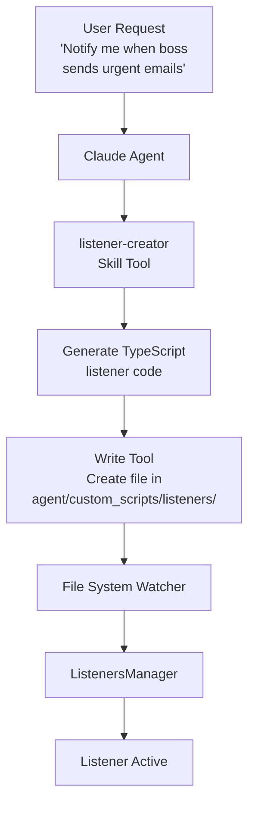
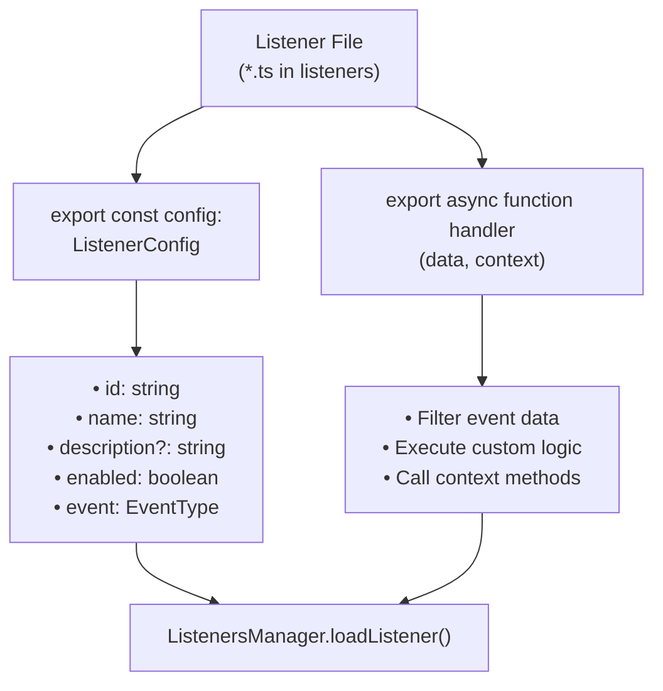
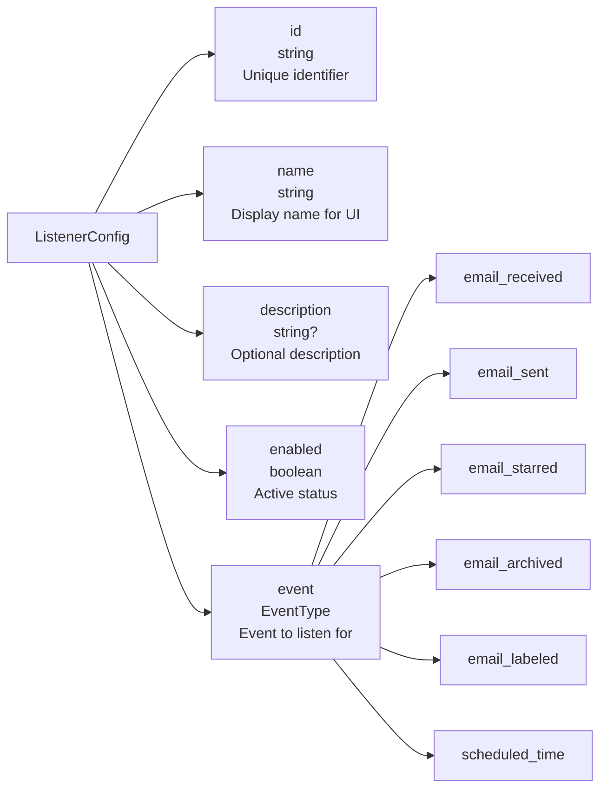
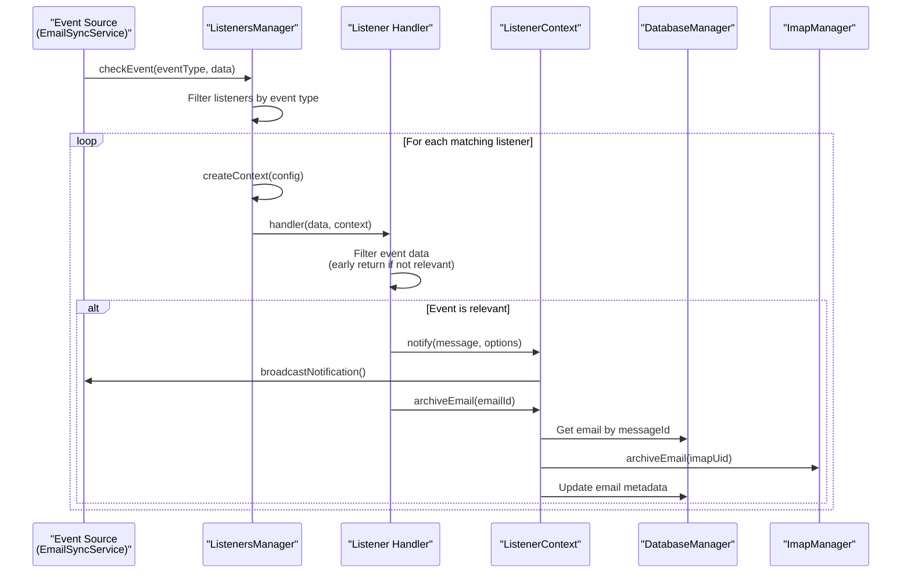
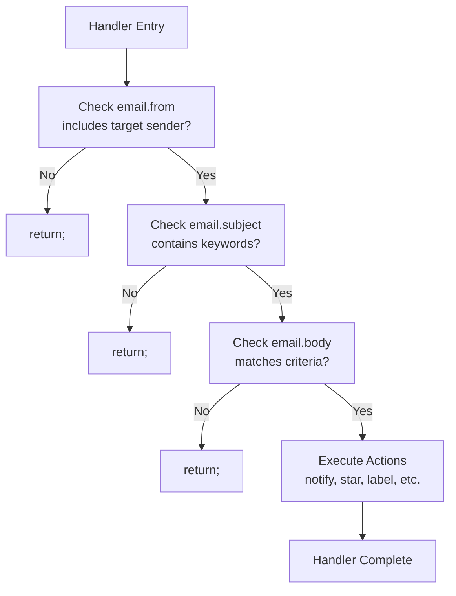
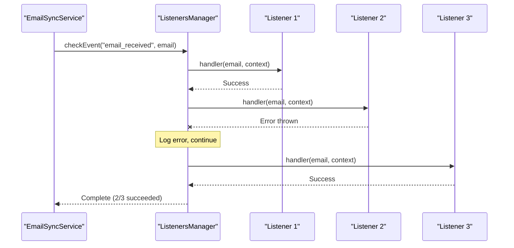
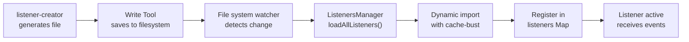
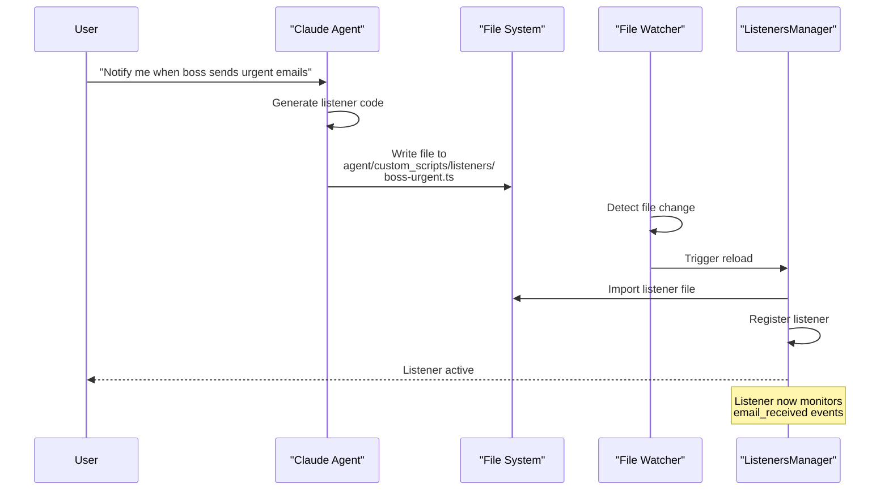

<!-- source: DeepWiki mcp.deepwiki.com · repo anthropics/claude-agent-sdk-demos · extra page Creating Listeners · fetched 2026-10-26 -->

# Creating Listeners

<details>
<summary>Relevant source files</summary>

The following files were used as context for generating this wiki page:

- [email-agent/.gitignore](email-agent/.gitignore)
- [email-agent/agent/.claude/agents/inbox-searcher.md](email-agent/agent/.claude/agents/inbox-searcher.md)
- [email-agent/agent/data/PROFILE.MD](email-agent/agent/data/PROFILE.MD)

</details>


This page documents how to create custom listeners for the Email Agent's event-driven automation system. The primary method for creating listeners is through the **listener-creator skill**, which allows the AI agent to generate properly structured listener files based on natural language descriptions. This page also covers the underlying TypeScript structure for those who need to understand or manually modify listener code.

For conceptual information about listener types and the event model, see [Listener Concepts](#3.6.1). For details on the methods available within listener handlers, see [Listener Context API](#3.6.3).

**Sources:** [email-agent/ccsdk/email-agent-prompt.ts:11-16]()

## Creating Listeners via AI Agent

### Using the listener-creator Skill

The recommended method for creating listeners is to ask the AI agent to create them using natural language. The agent uses the **listener-creator skill** to generate properly structured listener files.



### Example User Interactions

**Simple Notification Listener:**
```
User: "Notify me immediately when my boss sends emails marked as urgent"

Agent: Creates boss-urgent-watcher.ts with:
- Filters for boss@company.com sender
- Checks subject for "urgent", "asap", "critical"
- Sends high-priority notification
- Stars the email
```

**Auto-Archive Listener:**
```
User: "Automatically archive newsletters and mark them as read"

Agent: Creates auto-archive-newsletters.ts with:
- Detects newsletter patterns (noreply, unsubscribe links)
- Archives email via IMAP
- Marks as read
- Sends low-priority confirmation
```

**AI-Powered Classification:**
```
User: "Create a listener that uses AI to classify important emails and star them"

Agent: Creates ai-classifier.ts with:
- Calls Claude via context.callAgent()
- Uses structured output for classification
- Applies appropriate labels and actions
```

### Referencing Created Listeners

When the agent creates a listener, it references it using the format `[listener:filename.ts]` in its responses. This format:
- Creates clickable links in the UI
- Allows the `AssistantMessage` component to render listener details
- Makes it easy to manage and reference listeners in conversation

Example:
```
Agent: "I've created [listener:boss-urgent-watcher.ts] which will notify you
       when your boss sends urgent emails."
```

**Sources:** [email-agent/ccsdk/email-agent-prompt.ts:11-16](), [email-agent/client/components/message/AssistantMessage.tsx:340-343]()

## File Structure and Location

Listener files are TypeScript modules placed in the `agent/custom_scripts/listeners/` directory. The listener-creator skill generates files in this location, which are automatically discovered and loaded by the `ListenersManager`.

### Directory Layout

```
agent/custom_scripts/
├── listeners/
│   ├── boss-urgent-watcher.ts      # Generated by listener-creator
│   ├── daily-summary.ts            # Generated by listener-creator
│   ├── package-tracking.ts         # Generated by listener-creator
│   └── auto-archive-newsletters.ts # Generated by listener-creator
├── .logs/                           # Listener execution logs
│   └── *.jsonl                      # JSONL log files
└── types.ts                         # Shared type definitions
```

The `ListenersManager` scans this directory and loads all TypeScript files that:
- End with `.ts` extension
- Do not start with underscore (`_`) prefix
- Export both `config` and `handler`

Logs directory is excluded from git via [email-agent/.gitignore:135-136]().

**Sources:** [email-agent/LISTENERS_SPEC.md:17-27](), [email-agent/LISTENERS_SPEC.md:807-814](), [email-agent/.gitignore:135-136]()

## Understanding Generated Listener Structure

When the listener-creator skill generates a listener file, it follows a specific structure that the `ListenersManager` expects. Understanding this structure helps when reviewing or modifying generated listeners.

### Listener Module Structure



Every listener file generated by the skill exports two named exports:

| Export | Type | Description |
|--------|------|-------------|
| `config` | `ListenerConfig` | Static configuration defining listener metadata and event type |
| `handler` | `async function` | Async function that executes when the listener is triggered |

**Sources:** [email-agent/LISTENERS_SPEC.md:29-56]()

## Type Imports

Listener files must import types from the shared types module:

```typescript
import type { ListenerConfig, Email, ListenerContext } from "../types";
```

### Core Type Definitions

The following types are essential for listener implementation:

| Type | Purpose | Definition Location |
|------|---------|-------------------|
| `ListenerConfig` | Configuration structure for listener metadata | [email-agent/LISTENERS_SPEC.md:83-98]() |
| `Email` | Email object structure passed to handlers | [email-agent/LISTENERS_SPEC.md:63-73]() |
| `ListenerContext` | Context object with methods for email operations | [email-agent/LISTENERS_SPEC.md:120-135]() |
| `EventType` | Union type of supported event types | [email-agent/LISTENERS_SPEC.md:75-81]() |
| `NotifyOptions` | Options for notification priority | [email-agent/LISTENERS_SPEC.md:100-103]() |
| `SubagentOptions` | Options for calling AI subagents | [email-agent/LISTENERS_SPEC.md:105-118]() |

**Sources:** [email-agent/LISTENERS_SPEC.md:59-141]()

## Configuration Object

The listener-creator skill generates a `config` object that defines the listener's metadata and behavior.

### ListenerConfig Structure

```typescript
export const config: ListenerConfig = {
  id: "unique_listener_id",           // Required: Unique identifier
  name: "Human Readable Name",         // Required: Display name
  description: "What this listener does", // Optional: Description
  enabled: true,                       // Required: Whether listener is active
  event: "email_received"              // Required: Event type to listen for
};
```

### Configuration Fields



### Configuration Guidelines

| Field | Guidelines | Example |
|-------|-----------|---------|
| `id` | Use snake_case, descriptive, globally unique | `"boss_urgent_watcher"` |
| `name` | Human-readable, displayed in UI | `"Boss Urgent Email Watcher"` |
| `description` | Brief explanation of listener purpose | `"Notifies when boss sends urgent emails"` |
| `enabled` | Set to `true` to activate, `false` to disable | `true` |
| `event` | One of six supported EventType values | `"email_received"` |

**Sources:** [email-agent/LISTENERS_SPEC.md:39-45](), [email-agent/LISTENERS_SPEC.md:83-98]()

## Handler Function

The listener-creator skill generates handler functions with the appropriate signature based on the event type you specify.

### Function Signature

The handler function signature varies based on the event type:

```typescript
// For email events (email_received, email_sent, etc.)
export async function handler(email: Email, context: ListenerContext): Promise<void>

// For email_labeled event
export async function handler(
  data: { email: Email, label: string }, 
  context: ListenerContext
): Promise<void>

// For scheduled_time event
export async function handler(
  data: { timestamp: Date, cron?: string }, 
  context: ListenerContext
): Promise<void>
```

### Handler Execution Flow



### Handler Implementation Pattern

```typescript
export async function handler(email: Email, context: ListenerContext): Promise<void> {
  // 1. Early filtering - return if event doesn't match criteria
  if (!email.from.includes("example@email.com")) return;
  
  const subject = email.subject.toLowerCase();
  if (!subject.includes("urgent")) return;
  
  // 2. Execute custom logic
  const urgencyLevel = calculateUrgency(email);
  
  // 3. Call context methods to perform actions
  await context.notify(`Urgent email: ${email.subject}`, {
    priority: urgencyLevel >= 8 ? "high" : "normal"
  });
  
  if (urgencyLevel >= 8) {
    await context.starEmail(email.messageId);
  }
}
```

**Sources:** [email-agent/LISTENERS_SPEC.md:47-55](), [email-agent/LISTENERS_SPEC.md:938-953]()

## Event-Specific Handlers

### email_received Event

The most common event type for monitoring incoming emails.

```typescript
export const config: ListenerConfig = {
  id: "urgent_watcher",
  name: "Urgent Email Watcher",
  enabled: true,
  event: "email_received"
};

export async function handler(email: Email, context: ListenerContext): Promise<void> {
  // Filter logic in handler
  const subject = email.subject.toLowerCase();
  if (!subject.includes("urgent") && !subject.includes("asap")) return;

  await context.notify(`Urgent email: ${email.subject}`, { priority: "high" });
}
```

**Handler receives:** `Email` object with properties: `messageId`, `from`, `to`, `subject`, `body`, `date`, `isRead`, `hasAttachments`, `labels`

**Sources:** [email-agent/LISTENERS_SPEC.md:145-167]()

### email_sent Event

Triggered when the user sends an email.

```typescript
export const config: ListenerConfig = {
  id: "track_client_emails",
  name: "Track Client Communications",
  enabled: true,
  event: "email_sent"
};

export async function handler(email: Email, context: ListenerContext): Promise<void> {
  if (!email.to.includes("client")) return;

  await context.notify(`Sent to client: ${email.subject}`);
  await context.addLabel(email.messageId, "client-sent");
}
```

**Handler receives:** `Email` object (the sent email)

**Sources:** [email-agent/LISTENERS_SPEC.md:169-191]()

### email_labeled Event

Triggered when a label is added to an email. Note the different data structure.

```typescript
export const config: ListenerConfig = {
  id: "workflow_router",
  name: "Workflow Automation Router",
  enabled: true,
  event: "email_labeled"
};

export async function handler(
  data: { email: Email, label: string },
  context: ListenerContext
): Promise<void> {
  if (data.label === "action-required") {
    await context.starEmail(data.email.messageId);
    await context.notify(`Action needed: ${data.email.subject}`, {
      priority: "high"
    });
  }
}
```

**Handler receives:** `{ email: Email, label: string }`

**Sources:** [email-agent/LISTENERS_SPEC.md:263-289]()

### scheduled_time Event

Triggered at specified times using cron scheduling. Requires separate cron configuration.

```typescript
export const config: ListenerConfig = {
  id: "daily_summary",
  name: "Daily Morning Summary",
  enabled: true,
  event: "scheduled_time"
};

export async function handler(
  data: { timestamp: Date }, 
  context: ListenerContext
): Promise<void> {
  await context.notify(`Good morning! Daily summary for ${data.timestamp.toDateString()}`);
}
```

**Handler receives:** `{ timestamp: Date, cron?: string }`

**Note:** Cron schedule must be configured separately in the `CronScheduler`. See [email-agent/LISTENERS_SPEC.md:1349-1430]() for scheduler implementation.

**Sources:** [email-agent/LISTENERS_SPEC.md:193-212]()

## Filtering Strategies

### Early Return Pattern

The recommended approach is to filter early in the handler using early returns:

```typescript
export async function handler(email: Email, context: ListenerContext): Promise<void> {
  // Filter 1: Check sender
  if (!email.from.includes("important-sender.com")) return;
  
  // Filter 2: Check subject keywords
  const subject = email.subject.toLowerCase();
  if (!subject.includes("urgent") && !subject.includes("critical")) return;
  
  // Filter 3: Check body content
  const body = email.body.toLowerCase();
  if (!body.includes("immediate action")) return;
  
  // Only execute if all filters pass
  await context.notify(`Critical email from ${email.from}`, { priority: "high" });
}
```

### Multi-Criteria Filtering



### Complex Scoring Logic

For sophisticated filtering, implement scoring functions:

```typescript
function calculateUrgency(email: Email): number {
  let score = 0;
  
  const subject = email.subject.toLowerCase();
  const body = email.body.toLowerCase();
  
  // Subject keywords
  if (subject.includes("urgent")) score += 3;
  if (subject.includes("asap")) score += 3;
  if (subject.includes("critical")) score += 4;
  
  // Sender importance
  if (email.from.includes("boss@")) score += 2;
  if (email.from.includes("ceo@")) score += 3;
  
  // Time sensitivity
  const now = new Date();
  const emailDate = new Date(email.date);
  const hoursAgo = (now.getTime() - emailDate.getTime()) / (1000 * 60 * 60);
  if (hoursAgo < 1) score += 1;
  
  return Math.min(score, 10);
}

export async function handler(email: Email, context: ListenerContext): Promise<void> {
  const urgencyScore = calculateUrgency(email);
  
  if (urgencyScore < 6) return;
  
  const isHighPriority = urgencyScore >= 8;
  await context.notify(
    `${urgencyScore}/10 urgency: ${email.subject}`,
    { priority: isHighPriority ? "high" : "normal" }
  );
}
```

**Sources:** [email-agent/LISTENERS_SPEC.md:331-402]()

## Context Method Usage

### Basic Operations

Within the handler, use the `context` parameter to perform actions:

```typescript
export async function handler(email: Email, context: ListenerContext): Promise<void> {
  // Notify user
  await context.notify("Email processed", { priority: "normal" });
  
  // Email actions
  await context.starEmail(email.messageId);
  await context.archiveEmail(email.messageId);
  await context.markAsRead(email.messageId);
  await context.addLabel(email.messageId, "processed");
}
```

### AI-Powered Classification

Use `context.callAgent()` to leverage Claude for intelligent processing:

```typescript
interface ClassificationResult {
  category: "urgent" | "newsletter" | "personal" | "work" | "spam";
  priority: "high" | "normal" | "low";
  suggestedAction: "archive" | "star" | "label" | "none";
  reasoning: string;
}

export async function handler(email: Email, context: ListenerContext): Promise<void> {
  const classification = await context.callAgent<ClassificationResult>({
    prompt: `Classify this email:
From: ${email.from}
Subject: ${email.subject}
Body: ${email.body.substring(0, 500)}`,
    
    schema: {
      type: "object",
      properties: {
        category: { type: "string", enum: ["urgent", "newsletter", "personal", "work", "spam"] },
        priority: { type: "string", enum: ["high", "normal", "low"] },
        suggestedAction: { type: "string", enum: ["archive", "star", "label", "none"] },
        reasoning: { type: "string" }
      },
      required: ["category", "priority", "suggestedAction", "reasoning"]
    },
    
    model: "haiku" // Fast classification
  });
  
  if (classification.suggestedAction === "star") {
    await context.starEmail(email.messageId);
  }
}
```

**Sources:** [email-agent/LISTENERS_SPEC.md:505-597]()

## Complete Examples

These examples show the structure of listener files that the listener-creator skill generates. You can also create these manually by following the same patterns.

### Simple Notification Listener

**User Request:** "Notify me when my boss sends urgent emails"

**Generated File:** `agent/custom_scripts/listeners/boss-urgent-watcher.ts`

```typescript
import type { ListenerConfig, Email, ListenerContext } from "../types";

export const config: ListenerConfig = {
  id: "boss_urgent_watcher",
  name: "Boss Urgent Email Watcher",
  description: "Notifies immediately when boss sends urgent emails",
  enabled: true,
  event: "email_received"
};

export async function handler(email: Email, context: ListenerContext): Promise<void> {
  // Filter for boss emails
  if (!email.from.includes("boss@company.com")) return;

  const subject = email.subject.toLowerCase();
  const isUrgent = subject.includes("urgent") ||
                   subject.includes("asap") ||
                   subject.includes("important") ||
                   subject.includes("critical");

  if (!isUrgent) return;

  // Notify and star
  await context.notify(`🚨 Urgent email from boss: "${email.subject}"`, {
    priority: "high"
  });
  await context.starEmail(email.messageId);
}
```

**Sources:** [email-agent/LISTENERS_SPEC.md:293-327]()

### Auto-Archive Listener

**User Request:** "Automatically archive newsletters and mark them as read"

**Generated File:** `agent/custom_scripts/listeners/auto-archive-newsletters.ts`

```typescript
import type { ListenerConfig, Email, ListenerContext } from "../types";

export const config: ListenerConfig = {
  id: "auto_archive_newsletters",
  name: "Auto-Archive Newsletters",
  description: "Automatically archives newsletters and promotional emails",
  enabled: true,
  event: "email_received"
};

export async function handler(email: Email, context: ListenerContext): Promise<void> {
  const from = email.from.toLowerCase();
  const subject = email.subject.toLowerCase();

  const isNewsletter =
    from.includes("newsletter") ||
    from.includes("noreply") ||
    from.includes("no-reply") ||
    subject.includes("unsubscribe");

  if (!isNewsletter) return;

  try {
    await context.archiveEmail(email.messageId);
    await context.markAsRead(email.messageId);
    
    await context.notify(`📦 Auto-archived newsletter: "${email.subject}"`, {
      priority: "low"
    });
  } catch (error) {
    console.error("Failed to archive:", error);
  }
}
```

**Sources:** [email-agent/LISTENERS_SPEC.md:463-503]()

### AI-Powered Meeting Request Extractor

**User Request:** "Create a listener that extracts meeting details from emails using AI"

**Generated File:** `agent/custom_scripts/listeners/meeting-extractor.ts`

```typescript
import type { ListenerConfig, Email, ListenerContext } from "../types";

export const config: ListenerConfig = {
  id: "meeting_extractor",
  name: "Meeting Request Extractor",
  description: "Extracts meeting details from emails using AI",
  enabled: true,
  event: "email_received"
};

interface MeetingDetails {
  isMeetingRequest: boolean;
  title?: string;
  date?: string;
  time?: string;
  location?: string;
  attendees?: string[];
}

export async function handler(email: Email, context: ListenerContext): Promise<void> {
  const subject = email.subject.toLowerCase();
  const hasMeetingKeywords =
    subject.includes("meeting") ||
    subject.includes("schedule") ||
    subject.includes("call");

  if (!hasMeetingKeywords) return;

  // Use AI to extract structured meeting details
  const details = await context.callAgent<MeetingDetails>({
    prompt: `Extract meeting details from:
Subject: ${email.subject}
Body: ${email.body}`,
    
    schema: {
      type: "object",
      properties: {
        isMeetingRequest: { type: "boolean" },
        title: { type: "string" },
        date: { type: "string" },
        time: { type: "string" },
        location: { type: "string" }
      },
      required: ["isMeetingRequest"]
    },
    
    model: "sonnet"
  });

  if (!details.isMeetingRequest) return;

  const meetingInfo = [
    `📅 Meeting: ${details.title || "Untitled"}`,
    details.date && `Date: ${details.date}`,
    details.time && `Time: ${details.time}`,
    details.location && `Location: ${details.location}`
  ].filter(Boolean).join("\n");

  await context.notify(meetingInfo, { priority: "high" });
  await context.addLabel(email.messageId, "meetings");
}
```

**Sources:** [email-agent/LISTENERS_SPEC.md:599-692]()

## Error Handling

### Handler-Level Error Handling

Wrap context method calls in try-catch blocks:

```typescript
export async function handler(email: Email, context: ListenerContext): Promise<void> {
  if (!email.from.includes("important@email.com")) return;

  try {
    await context.archiveEmail(email.messageId);
    await context.notify("Email archived successfully");
  } catch (error) {
    console.error("Failed to archive email:", error);
    await context.notify("Failed to archive email", { priority: "low" });
  }
}
```

### Manager-Level Isolation

The `ListenersManager` isolates listener execution failures to prevent cascade failures:



Individual listener failures do not affect:
- Other listeners for the same event
- Email synchronization process
- Database operations

**Sources:** [email-agent/LISTENERS_SPEC.md:1284-1332](), [email-agent/LISTENERS_SPEC.md:938-953]()

## Best Practices

### Performance Guidelines

| Practice | Reason | Example |
|----------|--------|---------|
| Early returns | Minimize unnecessary processing | Filter sender before body parsing |
| Fast filtering | Keep handler execution under 1 second | Use simple string checks first |
| Specific filters | Reduce false positives | Combine multiple criteria with AND logic |
| Minimal notifications | Avoid notification fatigue | Only notify for truly important events |

### Code Quality Guidelines

| Practice | Implementation |
|----------|---------------|
| Unique IDs | Use descriptive snake_case: `"boss_urgent_watcher"` |
| Clear names | Human-readable for UI: `"Boss Urgent Email Watcher"` |
| File naming | Use kebab-case matching purpose: `boss-urgent-watcher.ts` |
| Type safety | Import and use all types from `../types` |
| Error handling | Wrap async operations in try-catch |
| Logging | Use `console.log()` for debugging, `console.error()` for failures |

### Action Safety Guidelines

Be mindful that context method calls perform permanent actions:

```typescript
// These actions are PERMANENT:
await context.archiveEmail(email.messageId);  // Archives on IMAP server
await context.starEmail(email.messageId);     // Stars on IMAP server
await context.addLabel(email.messageId, "processed"); // Adds Gmail label
```

Test filtering logic thoroughly before enabling listeners that perform destructive actions like archiving or deleting.

**Sources:** [email-agent/LISTENERS_SPEC.md:1334-1348]()

## Activation and Hot-Reloading

### Automatic Discovery and Activation

When the listener-creator skill (or manual editing) creates a listener file in `agent/custom_scripts/listeners/`, it is immediately activated:



**Activation Flow:**
1. File system watcher detects new/modified `.ts` files in `agent/custom_scripts/listeners/`
2. `ListenersManager.loadAllListeners()` is called
3. Each listener file is dynamically imported with cache-busting timestamp: `import('${filePath}?t=${Date.now()}')`
4. If `config.enabled === true`, listener is registered in the `listeners` Map
5. Listener immediately starts receiving events matching its `config.event` type

### Cache-Busting for Hot-Reloading

The `ListenersManager` uses a cache-busting query parameter to ensure updated listener code is loaded without server restart:

```typescript
const module = await import(`${filePath}?t=${Date.now()}`);
```

This means:
- Listener modifications take effect immediately
- No server restart required
- Changes apply to new events only (existing event processing completes)

### Disabling Listeners

To temporarily disable a listener without deleting it:
1. Ask the agent: "Disable the boss-urgent-watcher listener"
2. Agent modifies the file to set `enabled: false`
3. Hot-reload removes it from active listeners
4. Re-enable by setting `enabled: true`

**Sources:** [email-agent/LISTENERS_SPEC.md:804-844](), [email-agent/LISTENERS_SPEC.md:972-987]()

## Integration with Agent Workflow

### Agent-Created Listeners

The Claude AI agent can create listeners dynamically in response to user requests:



The agent uses the Write tool to create properly formatted listener files that follow the specification.

**Sources:** [email-agent/LISTENERS_SPEC.md:1167-1211]()

### System Prompt Reference

The agent is provided with instructions on listener creation including:
- File location: `agent/custom_scripts/listeners/`
- Required exports: `config` and `handler`
- Available event types
- Available context methods
- TypeScript structure and examples

**Sources:** [email-agent/LISTENERS_SPEC.md:1213-1283]()

---

