# Page: Overview

# Overview

<details>
<summary>Relevant source files</summary>

The following files were used as context for generating this wiki page:

- [.github/workflows/generate-changelog.yml](.github/workflows/generate-changelog.yml)
- [CLAUDE.md](CLAUDE.md)
- [README.md](README.md)
- [src/claude_agent_sdk/__init__.py](src/claude_agent_sdk/__init__.py)
- [tests/test_mcp_large_output.py](tests/test_mcp_large_output.py)
- [tests/test_query.py](tests/test_query.py)
- [tests/test_sdk_mcp_integration.py](tests/test_sdk_mcp_integration.py)

</details>


This page describes the purpose, structure, and major subsystems of the `claude-agent-sdk` Python package. It is intended as an entry point for developers reading the codebase for the first time. 

For quick setup and usage, see [Quick Start](#1.1). For detailed installation requirements and options, see [Installation and Setup](#1.2). For version tracking, release information, and changelogs, see [Version Information and Changelog](#1.3).

---

## What the SDK Is

`claude-agent-sdk` is a Python library that lets application code drive a Claude agent session programmatically. It is published as `claude-agent-sdk` on PyPI [pyproject.toml:6-7]() and currently targets Python 3.10 and later [pyproject.toml:10](), [README.md:13]().

The SDK does **not** communicate with the Anthropic API directly. Instead, it manages a subprocess running the bundled Claude CLI binary [README.md:15](). All API calls flow through that CLI process. The SDK's job is to:

- Spawn and manage the CLI subprocess via `SubprocessCLITransport` [src/claude_agent_sdk/_internal/transport/subprocess_cli.py:38-50]().
- Serialize configuration and user prompts into the CLI's control protocol [src/claude_agent_sdk/query.py:40-60]().
- Parse the CLI's JSON-lines output into typed Python objects via `parse_message` [src/claude_agent_sdk/_internal/message_parser.py:20-45]().
- Expose Python-level hooks, custom tools (`@tool`), and permission callbacks (`can_use_tool`) that the CLI calls back into [src/claude_agent_sdk/client.py:22-50]().

This design means the SDK version and the bundled CLI version are tracked separately. For details, see [Bundled CLI Version Management](#2.4).

Sources: [pyproject.toml:6-10](), [README.md:13-18](), [src/claude_agent_sdk/_internal/transport/subprocess_cli.py:38-50]()

---

## Runtime Dependencies

The package relies on a small set of core runtime dependencies defined in `pyproject.toml`:

| Package | Minimum Version | Role |
|---|---|---|
| `anyio` | 4.0.0 | Async I/O and memory streams; supports both asyncio and Trio [pyproject.toml:28]() |
| `mcp` | 1.23.0 | In-process MCP server for custom tools [pyproject.toml:31]() |
| `sniffio` | 1.0.0 | Runtime async backend detection (asyncio vs Trio) [pyproject.toml:29]() |
| `typing_extensions` | 4.0.0 | Backports for Python < 3.11 [pyproject.toml:30]() |

Sources: [pyproject.toml:27-32]()

---

## Major Subsystems

The architecture connects user-facing Python constructs down through control layers and transport mechanisms to the CLI binary.

**System-to-Code mapping diagram:**

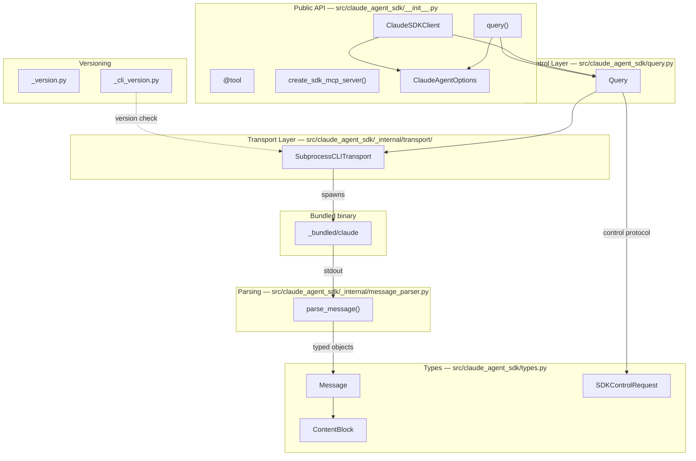

Sources: [src/claude_agent_sdk/client.py:22-40](), [src/claude_agent_sdk/query.py:23-35](), [CLAUDE.md:21-28]()

---

The table below maps each subsystem to its primary source file(s) and its role.

| Subsystem | Primary File(s) | Role |
|---|---|---|
| Public API | `src/claude_agent_sdk/__init__.py` | Exports `query()`, `ClaudeSDKClient`, `@tool`, `create_sdk_mcp_server`, all types and errors [src/claude_agent_sdk/__init__.py:68-194](). |
| Configuration | `src/claude_agent_sdk/types.py` | `ClaudeAgentOptions` and associated typed settings [src/claude_agent_sdk/types.py:79-141](). |
| Control protocol | `src/claude_agent_sdk/query.py` | `query()` function and internal logic for the bidirectional control protocol [src/claude_agent_sdk/query.py:30-90](). |
| Transport | `src/claude_agent_sdk/_internal/transport/` | `Transport` and `SubprocessCLITransport`: spawns CLI and handles I/O [src/claude_agent_sdk/_internal/transport/subprocess_cli.py:38-70](). |
| Message parsing | `src/claude_agent_sdk/_internal/message_parser.py` | `parse_message()`: deserializes CLI JSON lines to typed `Message` objects [src/claude_agent_sdk/_internal/message_parser.py:20-50](). |
| Error types | `src/claude_agent_sdk/_errors.py` | `CLINotFoundError`, `CLIConnectionError`, `ProcessError`, `ClaudeSDKError` [src/claude_agent_sdk/_errors.py:1-45](). |
| Session Store | `src/claude_agent_sdk/_internal/session_store.py` | `SessionStore` protocol and `InMemorySessionStore` implementation [src/claude_agent_sdk/_internal/session_store.py:20-80](). |

Sources: [src/claude_agent_sdk/__init__.py:68-194](), [src/claude_agent_sdk/_errors.py:1-45](), [src/claude_agent_sdk/_internal/session_store.py:20-80]()

---

## Two Entry Points

The SDK exposes two public ways to interact with Claude:

### `query()` — One-shot async generator

`query()` is an async generator that accepts a prompt (string or `AsyncIterable`) and an optional `ClaudeAgentOptions` instance, then yields `Message` objects until the session ends [README.md:33-55](). It internally creates and manages a `ClaudeSDKClient` for each call. Use this for simple, stateless queries.

For details, see [query() Function](#3.1).

### `ClaudeSDKClient` — Stateful streaming session

`ClaudeSDKClient` maintains an open session across multiple queries [README.md:97-146](). It supports context-manager usage, interruption, model switching, permission mode changes, MCP status inspection, and custom tools via in-process SDK MCP servers [README.md:100-146]().

For details, see [ClaudeSDKClient](#3.2).

Sources: [README.md:33-55](), [README.md:97-146]()

---

## Data Flow

The message flow bridges user code invocation down to the CLI subprocess and Anthropic API.

**End-to-end message flow diagram:**

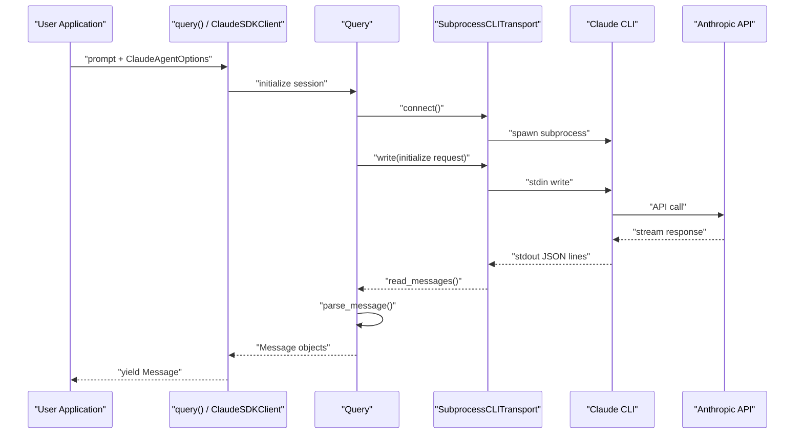

Sources: [README.md:34-55](), [README.md:85-134](), [src/claude_agent_sdk/query.py:30-100]()

---

## Extension Points

The SDK supports three primary extension mechanisms:

| Mechanism | Key Types | Purpose |
|---|---|---|
| Custom tools | `@tool`, `SdkMcpTool`, `create_sdk_mcp_server()` | Define Python functions as in-process MCP tools Claude can call [README.md:100-134]() |
| Permission callbacks | `can_use_tool`, `ToolPermissionContext`, `PermissionResultAllow` | Approve, deny, or modify tool inputs at runtime [README.md:59]() |
| Lifecycle hooks | `hooks`, `HookMatcher`, `HookEventMessage` | React to agent loop events like `PreToolUse`, `PostToolUse`, or `Stop` [src/claude_agent_sdk/types.py:92-133]() |

For details, see [Custom Tools (SDK MCP Servers)](#5.1), [Permission System and Callbacks](#5.2), and [Lifecycle Hooks](#5.3).

Sources: [README.md:59-134](), [src/claude_agent_sdk/types.py:92-133]()

---

## Version Information

- **SDK Package Version**: Managed in `src/claude_agent_sdk/_version.py` [src/claude_agent_sdk/_version.py:1-3]().
- **Bundled CLI Version**: Managed in `src/claude_agent_sdk/_cli_version.py` [src/claude_agent_sdk/_cli_version.py:1-3]().

For instructions on consulting version numbers programmatically or reading the changelog, see [Version Information and Changelog](#1.3).

Sources: [src/claude_agent_sdk/_version.py:1-3](), [src/claude_agent_sdk/_cli_version.py:1-3]()

---

# Page: Quick Start

# Quick Start

<details>
<summary>Relevant source files</summary>

The following files were used as context for generating this wiki page:

- [examples/quick_start.py](examples/quick_start.py)
- [src/claude_agent_sdk/_internal/transport/__init__.py](src/claude_agent_sdk/_internal/transport/__init__.py)
- [src/claude_agent_sdk/query.py](src/claude_agent_sdk/query.py)
- [tests/test_close_cancellation.py](tests/test_close_cancellation.py)

</details>


This page provides minimal working examples to get started with the Claude Agent SDK. It demonstrates the two primary interaction modes (`query()` and `ClaudeSDKClient`), custom tool creation, and basic hook usage, detailing their underlying implementation and data flow.

## Prerequisites and Installation

The Claude Agent SDK requires Python 3.10 or later. The Claude Code CLI is automatically bundled with the package and requires no separate installation. The SDK communicates with Claude through the bundled CLI subprocess by default or via the abstract `Transport` interface [src/claude_agent_sdk/_internal/transport/__init__.py:8-19]().

```bash
pip install claude-agent-sdk
```

Sources: [src/claude_agent_sdk/_internal/transport/__init__.py:8-19]()

## Two Interaction Modes

The SDK provides two primary modes of interaction with Claude, each suited to different architectural needs [src/claude_agent_sdk/query.py:18-43]():

| Mode | Function / Class | Use Case | Features |
|------|----------|----------|----------|
| One-shot | `query()` | Simple queries, batch jobs, CI/CD | Async iterator, automatic cleanup via `InternalClient`, stateless execution [src/claude_agent_sdk/query.py:20-35]() |
| Interactive | `ClaudeSDKClient` | Multi-turn conversations, REPLs, custom tools | Bidirectional control, stateful session management, interrupt handling [src/claude_agent_sdk/query.py:37-43]() |

Sources: [src/claude_agent_sdk/query.py:11-43]()

## Basic Interaction Flow

The following diagram illustrates the data flow from a high-level `query()` call down to the `InternalClient`, `SubprocessCLITransport`, and the bundled CLI subprocess.

Title: SDK Interaction Sequence
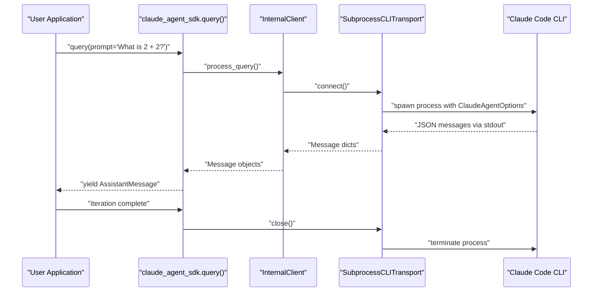

Sources: [src/claude_agent_sdk/query.py:11-132](), [src/claude_agent_sdk/_internal/transport/__init__.py:21-70]()

## One-Shot Queries with query()

The `query()` function provides a simple async iterator interface for single-turn interactions [src/claude_agent_sdk/query.py:11-16](). It wraps `InternalClient` to instantiate options, manage transport connection, and yield parsed `Message` instances [src/claude_agent_sdk/query.py:124-132]().

### Minimal Example

The simplest usage pattern demonstrates basic message iteration [examples/quick_start.py:15-24]():

```python
import anyio
from claude_agent_sdk import query

async def main():
    async for message in query(prompt="What is 2 + 2?"):
        print(message)

anyio.run(main)
```

### Processing Response Content

To extract specific content types, inspect message content blocks [examples/quick_start.py:19-24]():

```python
from claude_agent_sdk import query, AssistantMessage, TextBlock

async for message in query(prompt="Hello Claude"):
    if isinstance(message, AssistantMessage):
        for block in message.content:
            if isinstance(block, TextBlock):
                print(block.text)
```

### Configuration with ClaudeAgentOptions

The `query()` function accepts a `ClaudeAgentOptions` parameter for configuration [src/claude_agent_sdk/query.py:11-15](), such as setting a system prompt or tool restrictions [examples/quick_start.py:30-54]():

```python
from claude_agent_sdk import query, ClaudeAgentOptions

options = ClaudeAgentOptions(
    system_prompt="You are a helpful assistant",
    allowed_tools=["Read", "Write", "Bash"],
    permission_mode='acceptEdits',
    max_turns=1
)

async for message in query(prompt="Create a hello.py file", options=options):
    print(message)
```

Sources: [src/claude_agent_sdk/query.py:11-132](), [examples/quick_start.py:15-65]()

## Interactive Sessions with ClaudeSDKClient

`ClaudeSDKClient` provides a context manager for multi-turn conversations with bidirectional control, supporting custom tools and session state.

### Basic Session Pattern

```python
from claude_agent_sdk import ClaudeSDKClient, ClaudeAgentOptions

options = ClaudeAgentOptions(
    allowed_tools=["Bash"],
    permission_mode='acceptEdits'
)

async with ClaudeSDKClient(options=options) as client:
    await client.query("Echo 'Hello World'")
    async for msg in client.receive_response():
        print(msg)
```

Sources: [tests/test_close_cancellation.py:129-138]()

## Client Lifecycle and Message Flow

This diagram bridges the natural language prompt entry point to the concrete classes and methods handling communication in the codebase.

Title: Client Architecture and Entity Mapping
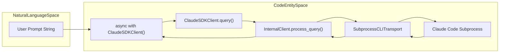

Sources: [src/claude_agent_sdk/query.py:127-132](), [tests/test_close_cancellation.py:129-138]()

## Custom Tools with SDK MCP Servers

SDK MCP servers run in-process, eliminating IPC overhead. They are defined using the `@tool` decorator and registered via `create_sdk_mcp_server()`.

### Complete Example: Calculator Server

```python
from claude_agent_sdk import tool, create_sdk_mcp_server, ClaudeAgentOptions, ClaudeSDKClient

@tool("add", "Add two numbers", {"a": float, "b": float})
async def add_numbers(args):
    result = args["a"] + args["b"]
    return {"content": [{"type": "text", "text": f"Result: {result}"}]}

calculator = create_sdk_mcp_server(
    name="calculator",
    version="1.0.0",
    tools=[add_numbers]
)

options = ClaudeAgentOptions(
    mcp_servers={"calc": calculator},
    allowed_tools=["mcp__calc__add"]
)

async with ClaudeSDKClient(options=options) as client:
    await client.query("Calculate 15 + 27")
    async for msg in client.receive_response():
        print(msg)
```

Sources: [src/claude_agent_sdk/query.py:11-132](), [examples/quick_start.py:15-65]()

## Lifecycle Hooks

Hooks enable deterministic control at specific points in the execution loop (e.g., `PreToolUse`), registered via `ClaudeAgentOptions.hooks`.

### Hook Registration Pattern

```python
from claude_agent_sdk import ClaudeAgentOptions, ClaudeSDKClient, HookMatcher

async def check_bash_command(input_data, tool_use_id, context):
    command = input_data["tool_input"].get("command", "")
    if "rm -rf" in command:
        return {
            "hookSpecificOutput": {
                "hookEventName": "PreToolUse",
                "permissionDecision": "deny",
                "permissionDecisionReason": "Dangerous command blocked"
            }
        }
    return {}

options = ClaudeAgentOptions(
    hooks={"PreToolUse": [HookMatcher(matcher="Bash", hooks=[check_bash_command])]}
)
```

Sources: [src/claude_agent_sdk/query.py:11-132]()

## Message Type Overview

All interactions produce typed message objects parsed from the underlying transport stream.

Title: Message and Content Block Hierarchy
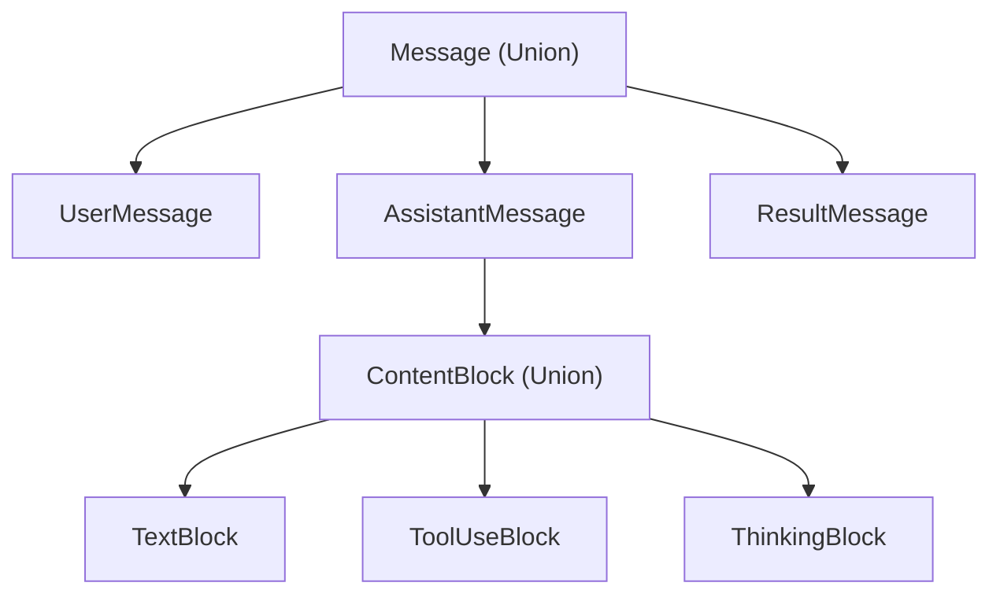

Sources: [src/claude_agent_sdk/query.py:8-16](), [examples/quick_start.py:6-12]()

---

# Page: Installation and Setup

# Installation and Setup

<details>
<summary>Relevant source files</summary>

The following files were used as context for generating this wiki page:

- [CHANGELOG.md](CHANGELOG.md)
- [pyproject.toml](pyproject.toml)
- [scripts/initial-setup.sh](scripts/initial-setup.sh)
- [scripts/pre-push](scripts/pre-push)
- [src/claude_agent_sdk/_cli_version.py](src/claude_agent_sdk/_cli_version.py)
- [src/claude_agent_sdk/_version.py](src/claude_agent_sdk/_version.py)
- [tests/test_changelog.py](tests/test_changelog.py)

</details>


This page explains package installation via `pip`, runtime dependencies (`anyio`, `sniffio`, `typing_extensions`, `mcp`, `jsonschema`), optional async backends, and the `ANTHROPIC_API_KEY` requirement. For information about configuring the SDK after installation, see [ClaudeAgentOptions Configuration Reference](). For details on versioning and release history, see [Version Information and Changelog]().

## Basic Installation

The SDK is distributed via PyPI and bundles the Claude Code CLI binary directly within the package structure:

```bash
pip install claude-agent-sdk
```

This command installs:
- The `claude-agent-sdk` Python package [pyproject.toml:6-7]()
- All core runtime dependencies [pyproject.toml:27-33]()
- The platform-specific bundled Claude Code CLI binary [pyproject.toml:62-64]()

No separate CLI installation is required. The SDK automatically resolves and executes the bundled CLI binary by default.

Sources: [pyproject.toml:5-33](), [pyproject.toml:62-64]()

## ANTHROPIC_API_KEY Requirement

The SDK communicates with the Anthropic API by spawning the bundled Claude CLI as a managed subprocess. The CLI process expects the `ANTHROPIC_API_KEY` environment variable to be present in its inherited environment before initialization:

```bash
export ANTHROPIC_API_KEY="sk-ant-..."
```

The SDK itself does not parse or validate the API key directly; the spawned subprocess reads it from the environment upon startup. If the key is omitted or malformed, the CLI process terminates or emits error messages that surface through the transport layer as execution exceptions.

Sources: [pyproject.toml:5-33]()

## Installation Architecture

**Diagram: Package Structure and CLI Discovery**

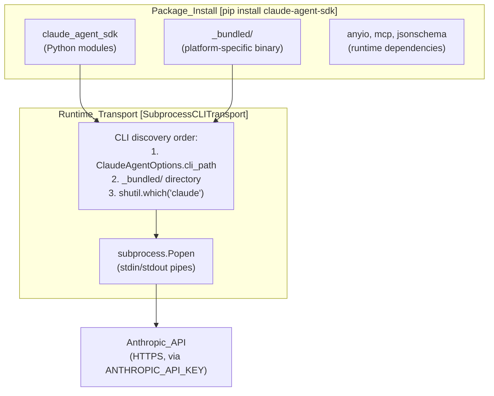

The transport layer resolves the executable using a tiered discovery strategy, checking `ClaudeAgentOptions.cli_path`, falling back to the bundled binary inside the package layout, and finally attempting system path resolution.

Sources: [pyproject.toml:62-64]()

## Python Version Requirements

The SDK officially supports Python 3.10 through 3.13 [pyproject.toml:10-23]():

| Python Version | Support Status | Notes |
|----------------|----------------|-------|
| 3.13 | ✅ Supported | Fully tested [pyproject.toml:23]() |
| 3.12 | ✅ Supported | Fully tested [pyproject.toml:22]() |
| 3.11 | ✅ Supported | Native typing features [pyproject.toml:21]() |
| 3.10 | ✅ Supported | Minimum required version [pyproject.toml:20]() |
| 3.9 and earlier | ❌ Not Supported | Incompatible |

The minimum version constraint is declared in `pyproject.toml` [pyproject.toml:10]():

```toml
requires-python = ">=3.10"
```

Sources: [pyproject.toml:10-25]()

## Understanding the Bundled CLI

**Diagram: Version Tracking and CLI Binary Layout**

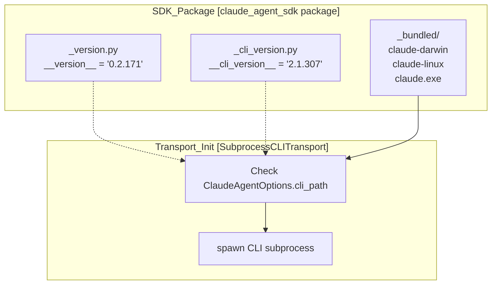

The package version is defined in `_version.py` [src/claude_agent_sdk/_version.py:3](), while the exact bundled CLI version is pinned in `_cli_version.py` [src/claude_agent_sdk/_cli_version.py:3](). Upgrades to the bundled CLI accompany SDK releases [CHANGELOG.md:3-8]().

Sources: [src/claude_agent_sdk/_version.py:3](), [src/claude_agent_sdk/_cli_version.py:3](), [CHANGELOG.md:3-8]()

## Core Dependencies

The SDK depends on several core packages declared in `pyproject.toml` [pyproject.toml:27-33]():

| Dependency | Version Requirement | Purpose |
|------------|---------------------|---------|
| `anyio` | `>=4.0.0` | Async I/O abstraction supporting asyncio and trio [pyproject.toml:28]() |
| `sniffio` | `>=1.0.0` | Async backend detection [pyproject.toml:29]() |
| `typing_extensions` | `>=4.0.0` (Python <3.11) | Backport of typing constructs [pyproject.toml:30]() |
| `mcp` | `>=1.23.0,<3.0.0` | Model Context Protocol core types and server utilities [pyproject.toml:31]() |
| `jsonschema` | `>=4.20.0` | JSON schema validation for tool definitions [pyproject.toml:32]() |

**Conditional Backporting:**

`typing_extensions` is conditionally required for Python versions preceding 3.11 [pyproject.toml:30]():

```toml
"typing_extensions>=4.0.0; python_version<'3.11'"
```

**Async Backend Execution:**

Using `anyio` allows the SDK to run seamlessly under both `asyncio` and `trio` event loops [pyproject.toml:38](). 

Sources: [pyproject.toml:27-33](), [pyproject.toml:38]()

## Optional Dependencies

Optional dependency groups extend functionality for development, tracing, and storage examples [pyproject.toml:35-55]():

### Development Extra
```bash
pip install claude-agent-sdk[dev]
```
Includes testing and validation tools: `pytest` (`>=7.0.0`), `anyio[trio]` (`>=4.0.0`), `pytest-cov` (`>=4.0.0`), `mypy` (`>=1.0.0`), and `ruff` (`>=0.1.0`) [pyproject.toml:36-42]().

### OpenTelemetry Extra
```bash
pip install claude-agent-sdk[otel]
```
Enables distributed tracing instrumentation via `opentelemetry-api` (`>=1.20.0`) [pyproject.toml:43-45]().

### Examples Extra
```bash
pip install claude-agent-sdk[examples]
```
Installs drivers required for reference `SessionStore` adapters (`boto3`, `moto`, `redis`, `fakeredis`, `asyncpg`) [pyproject.toml:46-55]().

Sources: [pyproject.toml:35-55]()

## Verifying Installation

Verify the installed SDK version programmatically:

```python
import claude_agent_sdk
print(claude_agent_sdk.__version__)  # "0.2.171"
```

Run a simple query via `anyio` to verify correct environment setup and subprocess communication:

```python
import anyio
from claude_agent_sdk import query

async def main():
    async for message in query(prompt="What is 2 + 2?"):
        print(message)

anyio.run(main)
```

Sources: [src/claude_agent_sdk/_version.py:3]()

## Package Build Configuration

The package utilizes Hatchling as its build backend [pyproject.toml:1-3]():

```toml
[build-system]
requires = ["hatchling"]
build-backend = "hatchling.build"
```

Wheel targets package modules under `src/claude_agent_sdk`, whereas source distributions include tests, scripts, and examples [pyproject.toml:62-77]().

Sources: [pyproject.toml:1-77]()

---

# Page: Version Information and Changelog

# Version Information and Changelog

<details>
<summary>Relevant source files</summary>

The following files were used as context for generating this wiki page:

- [CHANGELOG.md](CHANGELOG.md)
- [pyproject.toml](pyproject.toml)
- [src/claude_agent_sdk/_cli_version.py](src/claude_agent_sdk/_cli_version.py)
- [src/claude_agent_sdk/_version.py](src/claude_agent_sdk/_version.py)
- [tests/test_changelog.py](tests/test_changelog.py)

</details>


This document provides technical details on version management for the `claude-agent-sdk` package, covering where SDK and bundled CLI versions are defined, how they are accessed programmatically, dependency constraints, and how the `CHANGELOG.md` is structured and validated.

For installation instructions, see [1.2 Installation and Setup](). For architectural details on how the transport layer utilizes the bundled CLI version, see [2.1 Architecture Overview]() and [2.4 Bundled CLI Version Management]().

---

## Current Versions

The SDK tracks two primary release versions independently, along with package metadata configured in build scripts.

| Component | Current Value | Source File |
|-----------|--------------|-------------|
| SDK Version (`__version__`) | `0.2.171` | [src/claude_agent_sdk/_version.py:3]() |
| Bundled CLI Version (`__cli_version__`) | `2.1.307` | [src/claude_agent_sdk/_cli_version.py:3]() |
| Package Build Version | `0.2.171` | [pyproject.toml:7]() |

The SDK version and the bundled Claude Code CLI version advance on separate cycles. Updates to the bundled CLI typically trigger patch releases of the SDK to incorporate the latest binary transport compatibility.

Sources: [src/claude_agent_sdk/_version.py:1-3](), [src/claude_agent_sdk/_cli_version.py:1-3](), [pyproject.toml:5-8](), [CHANGELOG.md:3-8]()

---

## Programmatic Version Access

Both version identifiers are exposed as module-level constants and can be imported directly at runtime for diagnostics, telemetry payloads, or capability negotiation:

```python
from claude_agent_sdk._version import __version__          # SDK version string (e.g. "0.2.171")
from claude_agent_sdk._cli_version import __cli_version__  # Bundled CLI version string (e.g. "2.1.307")
```

The runtime loader relies on `src/claude_agent_sdk/_version.py` as the authoritative source for package version introspection, while `src/claude_agent_sdk/_cli_version.py` dictates the expected version of the Claude Code CLI binary invoked by `SubprocessCLITransport`.

Sources: [src/claude_agent_sdk/_version.py:1-3](), [src/claude_agent_sdk/_cli_version.py:1-3]()

---

## Version Tracking Architecture

The following diagram maps the logical entities and files responsible for version definition, wheel packaging, and automated validation:

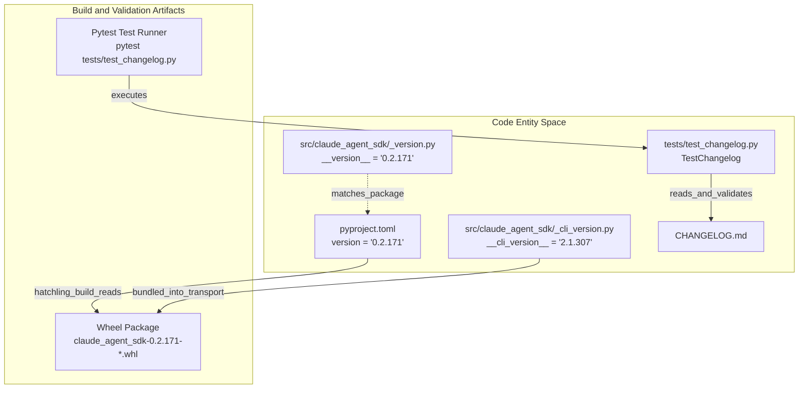

Sources: [src/claude_agent_sdk/_version.py:1-3](), [src/claude_agent_sdk/_cli_version.py:1-3](), [pyproject.toml:1-8](), [tests/test_changelog.py:5-85]()

---

## Version Compatibility Matrix

### Python Version Support

The SDK requires Python 3.10 or higher and declares explicit support up to Python 3.13 via PyPI classifiers in [pyproject.toml:15-25]().

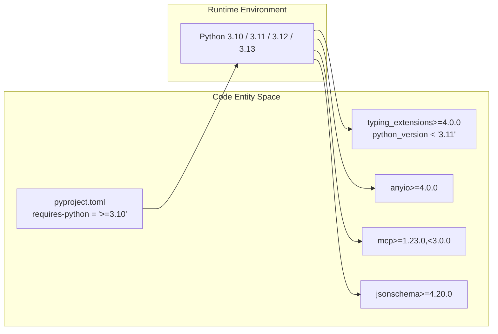

### Dependency Specifications

The required runtime dependencies and their constraints are defined in [pyproject.toml:27-33]():

| Dependency | Version Constraint | Role in SDK |
|------------|-------------------|-------------|
| `anyio` | `>=4.0.0` | Asynchronous I/O abstraction layer supporting asyncio and Trio backends |
| `sniffio` | `>=1.0.0` | Automatic async library detection at runtime |
| `typing_extensions` | `>=4.0.0` (`python_version<'3.11'`) | Backports modern type hint primitives (e.g., `NotRequired`) |
| `mcp` | `>=1.23.0,<3.0.0` | Model Context Protocol core library |
| `jsonschema` | `>=4.20.0` | JSON Schema validation for tool inputs and options |

Optional dependency extras include `dev` (linting/testing tools), `otel` (`opentelemetry-api>=1.20.0`), and `examples` (database/storage drivers for session store reference adapters) [pyproject.toml:35-55]().

Sources: [pyproject.toml:10-55]()

---

## Changelog Structure and Validation

Changes to the SDK are recorded in `CHANGELOG.md`. The repository enforces formatting rules via automated tests implemented in `tests/test_changelog.py`.

### Automated Validation Rules

The `TestChangelog` test suite verifies the following invariants:
1. **Existence**: `CHANGELOG.md` must exist in the root directory [tests/test_changelog.py:9-10]().
2. **Header Prefix**: The file must start with `# Changelog` [tests/test_changelog.py:12-16]().
3. **Version Format**: Version headers must match the pattern `## \d+\.\d+\.\d+(?:\s+\(\d{4}-\d{2}-\d{2}\))?` [tests/test_changelog.py:22-31]().
4. **Descending Order**: Version numbers must appear in strict descending semantic order [tests/test_changelog.py:63-78]().
5. **Bullet Points**: Every version section must contain at least one non-empty bullet point (`- `) [tests/test_changelog.py:34-85]().

Sources: [tests/test_changelog.py:1-85](), [CHANGELOG.md:1-10]()

---

## Recent Release History

The following summary highlights key updates from recent entries in `CHANGELOG.md`:

- **Version 0.2.171**: Updated bundled Claude CLI to version `2.1.307` [CHANGELOG.md:3-8]().
- **Version 0.2.170**: Fixed parallel tool calls missing from session messages in `get_session_messages` and `get_session_messages_from_store`; updated bundled Claude CLI to version `2.1.306`; migrated PyPI publishing to trusted publishing via GitHub OIDC [CHANGELOG.md:9-19]().
- **Version 0.2.169**: Clarified hook event documentation; updated bundled Claude CLI to version `2.1.305` [CHANGELOG.md:20-30]().
- **Version 0.2.166**: Added typed output classes for hook implementations and fully typed `SystemInitData` TypedDict; fixed `SandboxSettings.ignoreViolations` type schema; updated bundled Claude CLI to version `2.1.299` [CHANGELOG.md:43-57]().

Sources: [CHANGELOG.md:3-60]()

---

# Page: Core Concepts

# Core Concepts

<details>
<summary>Relevant source files</summary>

The following files were used as context for generating this wiki page:

- [src/claude_agent_sdk/types.py](src/claude_agent_sdk/types.py)

</details>


This section serves as the parent container for foundational architectural and conceptual material in the `claude-agent-sdk-python` repository. It covers the high-level design principles, type contracts, configuration options, and binary lifecycle management that govern how the SDK communicates with the bundled Claude Code CLI.

Since this is a parent overview page, high-level summaries are provided below. For comprehensive technical deep dives, refer to the child pages:
- **[Architecture Overview](#2.1)** — Layered architecture covering user code, the public API, the `Query` control layer, `SubprocessCLITransport`, the bundled Claude CLI binary, and the Anthropic API.
- **[Type System and Message Architecture](#2.2)** — Type hierarchy definitions in `types.py`, including the `Message` union, `ContentBlock` subtypes, and `SDKControl` request/response variants.
- **[ClaudeAgentOptions Configuration Reference](#2.3)** — Comprehensive reference for every field of `ClaudeAgentOptions`.
- **[Bundled CLI Version Management](#2.4)** — The role of `_cli_version.py`, release-time updates, `MINIMUM_CLAUDE_CODE_VERSION` checks, and the `cli_path` override.

---

## 1. Architecture Overview and Layered Design

The SDK is organized into three distinct layers that separate concerns between user-facing abstractions, internal protocol control, and process transport.

### System Mapping: Natural Language Space to Code Entity Space

```mermaid
graph TB
    subgraph "Public API Layer"
        query[""query() function (src/claude_agent_sdk/__init__.py)""]
        Client[""ClaudeSDKClient (src/claude_agent_sdk/client.py)""]
        Options[""ClaudeAgentOptions (src/claude_agent_sdk/types.py)""]
        Decorators["@tool decorator create_sdk_mcp_server (src/claude_agent_sdk/__init__.py)"]
    end
    
    subgraph "Internal Implementation Layer"
        QueryProtocol[""Query (src/claude_agent_sdk/_internal/query.py)""]
        Transport[""SubprocessCLITransport (src/claude_agent_sdk/_internal/transport/subprocess_cli.py)""]
        Parser[""parse_message (src/claude_agent_sdk/_internal/message_parser.py)""]
    end
    
    subgraph "External Dependencies"
        CLI["Claude Code CLI (bundled binary)"]
        API["Anthropic API"]
        MCP["External MCP Servers"]
    end
    
    query --> QueryProtocol
    Client --> QueryProtocol
    Options --> QueryProtocol
    Options --> Transport
    Decorators --> MCP
    
    QueryProtocol --> Transport
    QueryProtocol --> Parser
    Transport --> CLI
    CLI --> API
    CLI --> MCP
```

For details, see [Architecture Overview](#2.1).

Sources: `[src/claude_agent_sdk/_internal/transport/subprocess_cli.py:40-673]()`, `[src/claude_agent_sdk/_internal/query.py:53-626]`, `[src/claude_agent_sdk/client.py:14-404]()`, `[src/claude_agent_sdk/__init__.py:47-155]()`

---

## 2. Communication Modes and Control Protocol

The SDK supports two primary interaction patterns: one-shot execution via `query()` and bidirectional stateful communication via `ClaudeSDKClient`.

### Communication Modes: Natural Language Space to Code Entity Space

```mermaid
graph LR
    subgraph "One-Shot Mode"
        Q1[""query(prompt: str) in __init__.py""]
        Q2[""SubprocessCLITransport --print flag""]
        Q3["CLI process exits"]
        Q1 --> Q2 --> Q3
    end
    
    subgraph "Bidirectional Mode"
        C1[""ClaudeSDKClient.connect() in client.py""]
        C2[""SubprocessCLITransport stream-json""]
        C3[""Query.initialize() in query.py""]
        C4["Bidirectional Control Protocol"]
        C1 --> C2 --> C3 --> C4
    end
```

For details on the bidirectional control protocol, request correlation, task lifecycle tracking, and stream buffering, see [Architecture Overview](#2.1).

Sources: `[src/claude_agent_sdk/_internal/transport/subprocess_cli.py:329-335]()`, `[src/claude_agent_sdk/client.py:87-169]()`, `[src/claude_agent_sdk/_internal/query.py:116-158]()`

---

## 3. Type System and Message Architecture

The SDK relies on a rigorous type hierarchy defined in `src/claude_agent_sdk/types.py`. This module acts as the formal contract between user code, internal parsing logic, and the Claude CLI protocol messages. It defines core unions like `Message`, rich `ContentBlock` subtypes, system prompt structures (`SystemPromptPreset`, `SystemPromptCustom`, `SystemPromptFile`), and permission control types (`PermissionUpdate`, `PermissionRuleValue`).

For details, see [Type System and Message Architecture](#2.2).

Sources: `[src/claude_agent_sdk/types.py:1-2901]()`

---

## 4. Configuration and CLI Version Management

Configuration is handled uniformly via `ClaudeAgentOptions`, which exposes parameters for tools, MCP servers, lifecycle hooks, permission modes, and sandboxing. Concurrently, the SDK manages the bundled Claude CLI binary via `_cli_version.py`, enforcing runtime compatibility checks (`MINIMUM_CLAUDE_CODE_VERSION`) while allowing user overrides through `cli_path`.

For details on configuration fields, see [ClaudeAgentOptions Configuration Reference](#2.3). For details on binary version constraints and compatibility checks, see [Bundled CLI Version Management](#2.4).

Sources: `[src/claude_agent_sdk/types.py:465-574]()`, `[src/claude_agent_sdk/_cli_version.py:1-3]()`

---

# Page: Architecture Overview

# Architecture Overview

<details>
<summary>Relevant source files</summary>

The following files were used as context for generating this wiki page:

- [e2e-tests/test_run_end.py](e2e-tests/test_run_end.py)
- [src/claude_agent_sdk/_internal/client.py](src/claude_agent_sdk/_internal/client.py)
- [src/claude_agent_sdk/_internal/query.py](src/claude_agent_sdk/_internal/query.py)
- [tests/test_run_end_subprocess.py](tests/test_run_end_subprocess.py)

</details>


This page describes the full layered architecture of the `claude-agent-sdk` Python package: how user code flows down through the public API, the internal orchestration layer, the bidirectional control protocol layer, the subprocess transport, and ultimately reaches the bundled Claude CLI binary and the Anthropic API.

For field-level documentation of `ClaudeAgentOptions`, see [2.3](). For details on the message type hierarchy, see [2.2](). For the transport internals, see [4.1]() and [4.2]().

---

## Purpose and Scope

The SDK does not call the Anthropic API directly. Instead, it delegates all API communication to a bundled Claude CLI binary, communicating with it over a subprocess's `stdin`/`stdout` pipes using a JSON-line streaming protocol [src/claude_agent_sdk/_internal/transport/subprocess_cli.py:1-3](). This architecture means:

- The SDK is a thin orchestration layer above the CLI binary.
- Business logic for model selection, tool use, permission gating, session management, and cost accounting lives in the CLI.
- The Python SDK's role is to spawn the CLI via `SubprocessCLITransport` [src/claude_agent_sdk/_internal/transport/subprocess_cli.py:111-135](), serialize configuration and prompts into the wire format via `Query` [src/claude_agent_sdk/_internal/query.py:146-176](), deserialize typed responses using `parse_message` [src/claude_agent_sdk/_internal/message_parser.py:1-30](), and manage the bidirectional control protocol.

Sources: [src/claude_agent_sdk/_internal/transport/subprocess_cli.py:1-3](), [src/claude_agent_sdk/_internal/query.py:146-176]()

---

## Layer Overview

### System to Code Entity Mapping

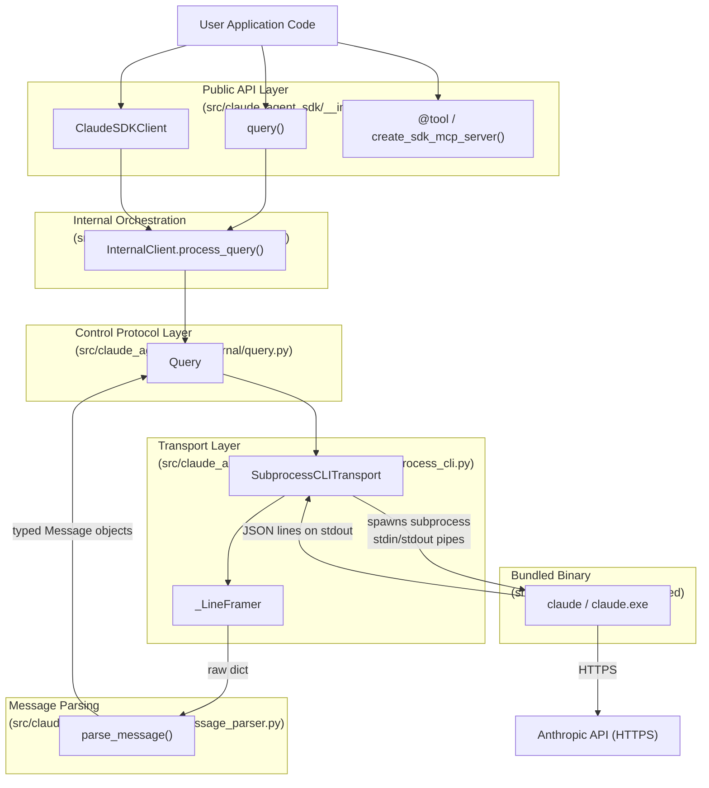

Sources: [src/claude_agent_sdk/_internal/client.py:28-72](), [src/claude_agent_sdk/_internal/query.py:146-176](), [src/claude_agent_sdk/_internal/transport/subprocess_cli.py:111-145]()

---

## Layers in Detail

### Layer 1 — Public API and Internal Client

The public entry points delegate execution to `InternalClient` [src/claude_agent_sdk/_internal/client.py:28-40]() located in `client.py`:

| Symbol | Location | Role |
|--------|----------|------|
| `query()` | `query.py` | Async generator for one-shot queries, wrapping `ClaudeSDKClient`. |
| `ClaudeSDKClient` | `client.py` | Stateful bidirectional session managing connection, queries, and control methods. |
| `InternalClient` | `client.py` | Coordinates session resume materialization, configuration validation, and `Query` setup [src/claude_agent_sdk/_internal/client.py:34-72](). |
| `@tool` | `__init__.py` | Decorator creating an `SdkMcpTool` dataclass from a Python async function. |

Sources: [src/claude_agent_sdk/_internal/client.py:28-72](), [src/claude_agent_sdk/_internal/query.py:61-102]()

---

### Layer 2 — Configuration (`ClaudeAgentOptions`)

`ClaudeAgentOptions` (defined in `types.py`) is the single configuration object threaded through every layer. It holds parameters such as model selection, tools, permissions, hooks, and MCP server definitions. It is consumed by `SubprocessCLITransport` to construct subprocess command arguments and environment variables [src/claude_agent_sdk/_internal/transport/subprocess_cli.py:117-150]().

Sources: [src/claude_agent_sdk/_internal/transport/subprocess_cli.py:117-150](), [src/claude_agent_sdk/types.py:1-50]()

---

### Layer 3 — Control Protocol Layer (`Query`)

`Query` ([src/claude_agent_sdk/_internal/query.py:146]()) manages bidirectional control communication over `Transport`:

- **Initialization handshake**: sends an `initialize` control request containing hooks, skills, and agent definitions [src/claude_agent_sdk/_internal/query.py:172-248]().
- **Outgoing control requests**: handles methods like `interrupt()`, `set_permission_mode()`, `set_model()`, and `rewind_files()`.
- **Incoming control request handling**: processes subtypes such as `can_use_tool`, `hook_callback`, and `mcp_message` [src/claude_agent_sdk/_internal/query.py:344-389]().
- **Message routing**: separates control traffic from regular SDK messages, placing regular messages into an `anyio` memory object stream [src/claude_agent_sdk/_internal/query.py:121-123]().

### Query Control Flow

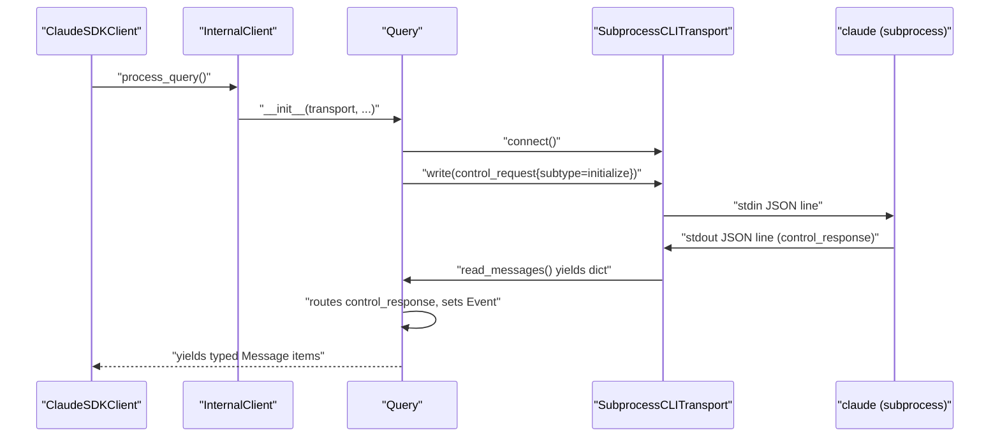

Sources: [src/claude_agent_sdk/_internal/client.py:73-156](), [src/claude_agent_sdk/_internal/query.py:146-248]()

---

### Layer 4 — Transport Layer (`SubprocessCLITransport`)

`SubprocessCLITransport` ([src/claude_agent_sdk/_internal/transport/subprocess_cli.py:111]()) manages the subprocess lifecycle:

| Method | Responsibility |
|--------|----------------|
| `_find_cli()` | Locates the CLI binary: bundled binary → `shutil.which("claude")` → fixed fallback paths [src/claude_agent_sdk/_internal/transport/subprocess_cli.py:142-173](). |
| `_build_command()` | Translates `ClaudeAgentOptions` fields into CLI arguments (e.g., `--output-format stream-json`). |
| `connect()` | Spawns subprocess via `anyio.open_process()`, validates CLI version, and opens pipes. |
| `write(data)` | Writes a JSON line to subprocess stdin, protected by an `anyio.Lock` [src/claude_agent_sdk/_internal/transport/subprocess_cli.py:140-140](). |
| `read_messages()` | Uses `_LineFramer` to reassemble complete JSON lines from raw stream chunks. |

Sources: [src/claude_agent_sdk/_internal/transport/subprocess_cli.py:50-188]()

---

### Layer 5 — Message Parsing and Buffering

The SDK utilizes `_LineFramer` to parse NDJSON output streams from the CLI stdout, handling chunked reads and buffering constraints robustly. Parsed dictionaries are passed to `parse_message()` to instantiate strongly-typed `Message` objects [src/claude_agent_sdk/_internal/message_parser.py:1-30]().

Sources: [src/claude_agent_sdk/_internal/transport/subprocess_cli.py:50-85](), [src/claude_agent_sdk/_internal/message_parser.py:1-30]()

---

### Layer 6 — Bundled CLI Binary

The Claude CLI binary resides in `src/claude_agent_sdk/_bundled/claude` (or `claude.exe` on Windows), tracking versions via `_cli_version.py` [src/claude_agent_sdk/_cli_version.py:3-3](). On connection, `SubprocessCLITransport` checks compatibility against `MINIMUM_CLAUDE_CODE_VERSION` [src/claude_agent_sdk/_internal/transport/subprocess_cli.py:31-31]().

Sources: [src/claude_agent_sdk/_cli_version.py:3-3](), [src/claude_agent_sdk/_internal/transport/subprocess_cli.py:31-31]()

---

## Key Design Decisions

| Decision | Rationale |
|----------|-----------|
| CLI subprocess abstraction | Avoids duplicating complex Anthropic API integration logic and session handling in Python. |
| Internal streaming mode | Enforces streaming mode internally to allow rich configuration (agents, hooks) via `initialize` requests [src/claude_agent_sdk/_internal/client.py:138-142](). |
| `anyio` memory object streams in `Query` | Decouples background message-reading coroutines from consumer iteration. |
| `anyio.Lock` on `write()` | Prevents concurrent write corruption on subprocess stdin pipes [src/claude_agent_sdk/_internal/transport/subprocess_cli.py:140-140](). |

Sources: [src/claude_agent_sdk/_internal/client.py:138-142](), [src/claude_agent_sdk/_internal/query.py:121-123](), [src/claude_agent_sdk/_internal/transport/subprocess_cli.py:140-140]()

---

# Page: Type System and Message Architecture

# Type System and Message Architecture

<details>
<summary>Relevant source files</summary>

The following files were used as context for generating this wiki page:

- [e2e-tests/test_verbatim_prompts.py](e2e-tests/test_verbatim_prompts.py)
- [src/claude_agent_sdk/types.py](src/claude_agent_sdk/types.py)
- [tests/test_types.py](tests/test_types.py)
- [tests/test_verbatim_prompts.py](tests/test_verbatim_prompts.py)

</details>


## Purpose and Scope

This document provides a technical reference for the SDK's type system, covering all message types, content block subtypes, configuration objects, and control protocol structures defined in `types.py`. The SDK uses Python dataclasses and `TypedDict`s to provide a strongly-typed API surface that serves as the contract between all SDK layers and the underlying JSON protocol with the Claude CLI.

The type system is designed for forward compatibility; the message parser is explicitly tested to return `None` for unknown message types rather than crashing, allowing the SDK to operate with newer CLI versions that might introduce new event types.

Sources: `[src/claude_agent_sdk/types.py:1-74]`, `[tests/test_rate_limit_event_repro.py:85-94]`

## Message Type Hierarchy

The SDK defines a discriminated union of message types that represent all communication between the application, SDK, and Claude CLI. These types are parsed from JSON frames in `_internal/message_parser.py`.

### Core Message Union

```python
Message = (
    UserMessage
    | AssistantMessage
    | SystemMessage
    | ResultMessage
    | StreamEvent
    | TaskStartedMessage
    | TaskProgressMessage
    | TaskNotificationMessage
    | RateLimitEvent
    | HookEventMessage
    | MirrorErrorMessage
)
```

Diagram: Message Union to Code Entities
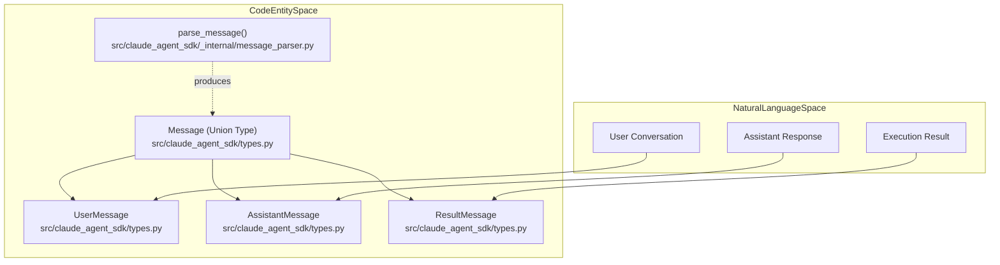

Sources: `[src/claude_agent_sdk/types.py:607-618]`, `[src/claude_agent_sdk/_internal/message_parser.py:34-195]`

### UserMessage

Represents input from the user or application to Claude. Can contain plain text or structured content blocks.

| Field | Type | Description |
|-------|------|-------------|
| `content` | `str \| list[ContentBlock]` | User input as text or structured blocks |
| `uuid` | `str \| None` | Message identifier for file checkpointing |
| `parent_tool_use_id` | `str \| None` | Tool use ID if message is from a subagent |
| `tool_use_result` | `dict[str, Any] \| None` | Metadata about tool execution |

Sources: `[src/claude_agent_sdk/types.py:566-572]`, `[tests/test_message_parser.py:30-166]`

### AssistantMessage

Represents Claude's responses, including text, tool invocations, and reasoning.

| Field | Type | Description |
|-------|------|-------------|
| `content` | `list[ContentBlock]` | Always a list of content blocks |
| `model` | `str` | Model identifier |
| `parent_tool_use_id` | `str \| None` | Tool use ID if in subagent context |
| `error` | `AssistantMessageError \| None` | API error type if request failed |
| `usage` | `dict[str, Any] \| None` | Token usage for this specific message |

Sources: `[src/claude_agent_sdk/types.py:555-585]`

### RateLimitEvent

A specialized message type emitted when rate limit status changes.

| Field | Type | Description |
|-------|------|-------------|
| `rate_limit_info` | `RateLimitInfo` | Detailed status and reset times |
| `session_id` | `str` | Associated session |

Sources: `[src/claude_agent_sdk/types.py:255-285]`, `[tests/test_rate_limit_event_repro.py:19-47]`

## Content Block Types

Content blocks are the atomic units within message content.

### ContentBlock Union

```python
ContentBlock = (
    TextBlock 
    | ThinkingBlock 
    | ToolUseBlock 
    | ToolResultBlock 
    | ServerToolUseBlock 
    | ServerToolResultBlock
)
```

Diagram: Content Block Parsing Flow
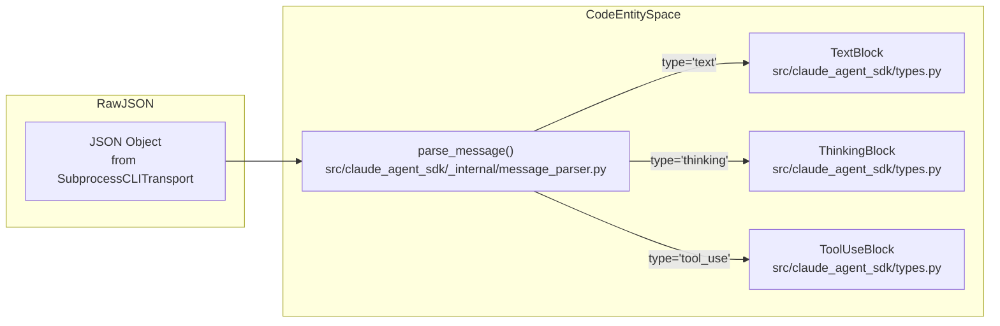

Sources: `[src/claude_agent_sdk/types.py:517-551]`, `[src/claude_agent_sdk/_internal/message_parser.py:128-171]`

### ThinkingBlock

Extended thinking output when using models with reasoning capabilities.

| Field | Type | Description |
|-------|------|-------------|
| `thinking` | `str` | Claude's internal reasoning string |
| `signature` | `str` | Cryptographic signature for the thinking block |

Sources: `[src/claude_agent_sdk/types.py:525-530]`, `[tests/test_types.py:91-99]`

## Configuration Type System

The SDK uses `ClaudeAgentOptions` as the central configuration object.

### ClaudeAgentOptions Structure

Diagram: Configuration Mapping to Code Entities
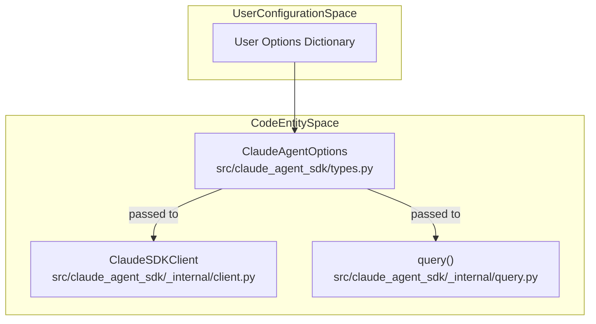

Sources: `[src/claude_agent_sdk/types.py:622-686]`

### System Prompt Presets
The SDK supports advanced system prompt configurations via `SystemPromptPreset`, allowing dynamic section stripping for cross-user prompt caching, as well as `SystemPromptFile` for loading prompts from disk.

Sources: `[src/claude_agent_sdk/types.py:36-87]`

## Control Protocol Types

The control protocol enables bidirectional communication where the CLI sends requests to the SDK for tool permissions, hook execution, or MCP routing.

### SDKControlRequest Union

The `SDKControlRequest` is a `TypedDict` containing a `request_id` and a nested `request` object.

| Subtype | Purpose |
|---------|---------|
| `interrupt` | CLI notification to stop processing |
| `can_use_tool` | Request for tool permission |
| `initialize` | Registration of hooks and capabilities |
| `hook_callback` | Triggering a registered lifecycle hook |
| `mcp_message` | Routing messages to in-process SDK MCP servers |

Sources: `[src/claude_agent_sdk/types.py:689-743]`

### Permission Updates

Permissions can be dynamically updated via `PermissionUpdate` objects. These objects support operations like `addRules`, `setMode`, and `addDirectories`, and include logic to serialize to the TypeScript-compatible wire format.

Sources: `[src/claude_agent_sdk/types.py:121-193]`, `[tests/test_types.py:35-74]`

## Type Discrimination and Parsing

The `parse_message` function in `_internal/message_parser.py` serves as the primary entry point for converting raw JSON from the CLI stdout into the SDK's type hierarchy.

- **Hook Events:** Messages with `type: system` and subtypes `hook_started` or `hook_response` are routed to `HookEventMessage`.
- **System Subtypes:** Generic `system` messages are further discriminated into `TaskStartedMessage`, `TaskProgressMessage`, and `TaskNotificationMessage`.
- **Error Handling:** Missing required fields raise a `MessageParseError`.
- **Forward Compatibility:** Unknown `type` fields return `None` to ensure resilience against newer CLI payloads.

Sources: `[src/claude_agent_sdk/_internal/message_parser.py:34-255]`, `[tests/test_message_parser.py:27-166]`

---

# Page: ClaudeAgentOptions Configuration Reference

# ClaudeAgentOptions Configuration Reference

<details>
<summary>Relevant source files</summary>

The following files were used as context for generating this wiki page:

- [examples/system_prompt.py](examples/system_prompt.py)
- [src/claude_agent_sdk/types.py](src/claude_agent_sdk/types.py)
- [tests/test_option_warnings.py](tests/test_option_warnings.py)

</details>


`ClaudeAgentOptions` is the single configuration object passed to both `query()` and `ClaudeSDKClient`. Every behavioral setting — model selection, tool access, permission callbacks, session management, hooks, sandbox, and transport details — is expressed through fields on this dataclass.

This page provides a comprehensive, field-by-field reference for every attribute of `ClaudeAgentOptions`. For how options flow into the subprocess command line, see [Subprocess CLI Transport](4.1). For how `can_use_tool` and `hooks` operate at runtime, see [Permission System](5.2) and [Lifecycle Hooks](5.3). For session-level concepts like `resume` and `fork_session`, see [Session Management](6.1).

---

## Location and Type

`ClaudeAgentOptions` is defined as a Python `dataclass` in `src/claude_agent_sdk/types.py` [src/claude_agent_sdk/types.py:732-800](). It is re-exported from `claude_agent_sdk.__init__` and serves as the primary configuration surface for all SDK entry points.

The following diagram maps the dataclass fields to the CLI flags and internal subsystems they control, bridging natural language requirements to precise code entities.

---

## Field-to-Subsystem Map

**Diagram: ClaudeAgentOptions field routing to CLI flags and internal handlers**

```mermaid
graph TD
    CAO["ClaudeAgentOptions"]

    subgraph cli_flags["CLI Flags (SubprocessCLITransport._build_command)"]
        F1["--system-prompt / --append-system-prompt / --system-prompt-file"]
        F2["--allowedTools / --disallowedTools / --tools"]
        F3["--model / --fallback-model"]
        F4["--permission-mode"]
        F5["--max-turns"]
        F6["--continue / --resume"]
        F7["--max-thinking-tokens / --thinking / --effort"]
        F8["--mcp-config"]
        F9["--settings"]
        F10["--add-dir"]
        F11["--output-format"]
        F12["--betas"]
        F13["--max-budget-tokens"]
        F14["--skills"]
        F15["--strict-mcp-config"]
        F16["--include-hook-events"]
    end

    subgraph control_protocol["Control Protocol (Query._handle_control_request)"]
        CP1["SDKControlInitializeRequest"]
        CP2["can_use_tool callback"]
        CP3["SDKHookCallbackRequest"]
    end

    subgraph transport_config["Transport Configuration"]
        TC1["cli_path resolution"]
        TC2["cwd for subprocess"]
        TC3["env vars merge"]
        TC4["max_buffer_size guard"]
        TC5["user override"]
        TC6["stderr callback"]
    end

    CAO --> F1
    CAO --> F2
    CAO --> F3
    CAO --> F4
    CAO --> F5
    CAO --> F6
    CAO --> F7
    CAO --> F8
    CAO --> F9
    CAO --> F10
    CAO --> F11
    CAO --> F12
    CAO --> F13
    CAO --> F14
    CAO --> F15
    CAO --> F16

    CAO --> CP1
    CAO --> CP2
    CAO --> CP3

    CAO --> TC1
    CAO --> TC2
    CAO --> TC3
    CAO --> TC4
    CAO --> TC5
    CAO --> TC6
```

Sources: [src/claude_agent_sdk/types.py:732-800](), [src/claude_agent_sdk/_internal/transport/subprocess_cli.py:190-300](), [tests/test_transport.py:67-126]()

---

## Complete Field Reference

### System Prompt

| Field | Type | Default | CLI flag |
|-------|------|---------|----------|
| `system_prompt` | `str \| SystemPromptPreset \| SystemPromptFile \| None` | `None` | `--system-prompt`, `--append-system-prompt`, or `--system-prompt-file` |

Controls the system prompt sent to Claude.

- **`str`**: Passed verbatim as `--system-prompt <value>` [src/claude_agent_sdk/_internal/transport/subprocess_cli.py:196-197]().
- **`SystemPromptPreset`**: Uses the built-in Claude Code system prompt. If an `append` key is present, `--append-system-prompt <value>` is added [src/claude_agent_sdk/_internal/transport/subprocess_cli.py:199-205](). The `exclude_dynamic_sections` field allows stripping per-user content (git status, working directory) to improve prompt-caching hits across users [src/claude_agent_sdk/types.py:43-54]().
- **`SystemPromptFile`**: Uses a prompt stored in a file via `--system-prompt-file <path>` [src/claude_agent_sdk/_internal/transport/subprocess_cli.py:207-209]().
- **`None`** (default): Passes `--system-prompt ""` — an empty system prompt [src/claude_agent_sdk/_internal/transport/subprocess_cli.py:194-195]().

`SystemPromptPreset` and `SystemPromptFile` are defined in `src/claude_agent_sdk/types.py` [src/claude_agent_sdk/types.py:37-87]().

Sources: [src/claude_agent_sdk/types.py:37-87](), [src/claude_agent_sdk/_internal/transport/subprocess_cli.py:190-215](), [examples/system_prompt.py:1-87]()

---

### Tool Selection and Skills

| Field | Type | Default | CLI flag |
|-------|------|---------|----------|
| `tools` | `list[str] \| ToolsPreset \| None` | `None` | `--tools` |
| `allowed_tools` | `list[str]` | `[]` | `--allowedTools` |
| `disallowed_tools` | `list[str]` | `[]` | `--disallowedTools` |
| `skills` | `Literal["all"] \| list[str] \| None` | `None` | `--skills` |

- **`tools`**: Controls the base set of available built-in tools [src/claude_agent_sdk/_internal/transport/subprocess_cli.py:217-225]().
- **`allowed_tools`**: Comma-joined list passed as `--allowedTools` [src/claude_agent_sdk/_internal/transport/subprocess_cli.py:228-230]().
- **`disallowed_tools`**: Comma-joined list passed as `--disallowedTools` [src/claude_agent_sdk/_internal/transport/subprocess_cli.py:233-235]().
- **`skills`**: Configures high-level capabilities. Passed as a comma-separated list to `--skills` [src/claude_agent_sdk/_internal/transport/subprocess_cli.py:291-293](). Setting this to `[]` suppresses all skills [src/claude_agent_sdk/types.py:795]().

Sources: [src/claude_agent_sdk/types.py:732-800](), [src/claude_agent_sdk/_internal/transport/subprocess_cli.py:217-295](), [tests/test_option_warnings.py:155-171]()

---

### Model Selection

| Field | Type | Default | CLI flag |
|-------|------|---------|----------|
| `model` | `str \| None` | `None` | `--model` |
| `fallback_model` | `str \| None` | `None` | `--fallback-model` |

- **`model`**: Sets the primary model identifier [src/claude_agent_sdk/_internal/transport/subprocess_cli.py:238-239]().
- **`fallback_model`**: Provides an alternative model if the primary is unavailable [src/claude_agent_sdk/_internal/transport/subprocess_cli.py:241-242]().

Sources: [src/claude_agent_sdk/_internal/transport/subprocess_cli.py:238-245]()

---

### Permission Mode and Callbacks

| Field | Type | Default | CLI flag |
|-------|------|---------|----------|
| `permission_mode` | `PermissionMode \| None` | `None` | `--permission-mode` |
| `can_use_tool` | `CanUseTool \| None` | `None` | N/A |

- **`permission_mode`**: A `PermissionMode` literal defined as `"default"`, `"acceptEdits"`, `"plan"`, `"bypassPermissions"`, `"dontAsk"`, or `"auto"` [src/claude_agent_sdk/types.py:25-27]().
- **`can_use_tool`**: An async callable invoked by the control protocol whenever the CLI requests permission to execute a tool [src/claude_agent_sdk/types.py:226-228]().

Sources: [src/claude_agent_sdk/types.py:25-27](), [tests/test_option_warnings.py:1-35]()

---

### Lifecycle Hooks and Agents

| Field | Type | Default |
|-------|------|---------|
| `hooks` | `dict[HookEvent, list[HookMatcher]] \| None` | `None` |
| `agents` | `dict[str, AgentDefinition] \| None` | `None` |
| `include_hook_events` | `bool` | `False` |

- **`hooks`**: Maps event names (e.g., `"PreToolUse"`) to lists of matchers [src/claude_agent_sdk/types.py:232-244]().
- **`agents`**: Defines inline sub-agents with specific prompts, tools, and configurations [src/claude_agent_sdk/types.py:108-127]().
- **`include_hook_events`**: When `True`, passes the `--include-hook-events` flag to the CLI, ensuring hook telemetry is streamed [src/claude_agent_sdk/_internal/transport/subprocess_cli.py:287-289]().

Sources: [src/claude_agent_sdk/types.py:108-127](), [src/claude_agent_sdk/_internal/transport/subprocess_cli.py:287-289]()

---

### Session and Resource Limits

| Field | Type | Default | CLI flag |
|-------|------|---------|----------|
| `continue_conversation` | `bool` | `False` | `--continue` |
| `resume` | `str \| None` | `None` | `--resume <session_id>` |
| `max_turns` | `int \| None` | `None` | `--max-turns` |
| `max_budget_usd` | `float \| None` | `None` | `--max-budget-usd` |
| `task_budget` | `TaskBudget \| None` | `None` | `--max-budget-tokens` |

- **`max_budget_usd`**: Hard spending limit in USD for the session [src/claude_agent_sdk/_internal/transport/subprocess_cli.py:300-301]().
- **`task_budget`**: Token-based budget sent via API beta headers [src/claude_agent_sdk/types.py:88-98]().

Sources: [src/claude_agent_sdk/types.py:88-98](), [src/claude_agent_sdk/_internal/transport/subprocess_cli.py:300-310]()

---

### Thinking Configuration

| Field | Type | Default | CLI flag |
|-------|------|---------|----------|
| `thinking` | `ThinkingConfig \| None` | `None` | `--thinking` |
| `effort` | `EffortLevel \| int \| None` | `None` | `--effort` |
| `max_thinking_tokens` | `int \| None` | `None` | `--max-thinking-tokens` |

- **`thinking`**: Handles adaptive or fixed token budgets for reasoning models [src/claude_agent_sdk/types.py:715-728]().
- **`effort`**: Specifies reasoning effort level (`"low"`, `"medium"`, `"high"`, `"xhigh"`, `"max"`) [src/claude_agent_sdk/types.py:37]().

Sources: [src/claude_agent_sdk/types.py:37](), [src/claude_agent_sdk/types.py:715-728]()

---

### Environment and Sources

| Field | Type | Default | CLI flag |
|-------|------|---------|----------|
| `setting_sources` | `list[SettingSource] \| None` | `None` | N/A |
| `mcp_servers` | `dict[str, McpServerConfig] \| str \| Path` | `{}` | `--mcp-config` |
| `strict_mcp_config` | `bool` | `False` | `--strict-mcp-config` |

- **`setting_sources`**: Controls which settings configuration files are loaded (`"user"`, `"project"`, `"local"`) [src/claude_agent_sdk/types.py:33]().
- **`strict_mcp_config`**: Forces the CLI to restrict available MCP servers exclusively to those provided via `mcp_servers`, ignoring external environment settings [src/claude_agent_sdk/_internal/transport/subprocess_cli.py:244-245]().

Sources: [src/claude_agent_sdk/types.py:33](), [src/claude_agent_sdk/_internal/transport/subprocess_cli.py:244-245]()

---

## Field-to-Code Entity Diagram

**Diagram: ClaudeAgentOptions field mapping to type definitions in types.py**

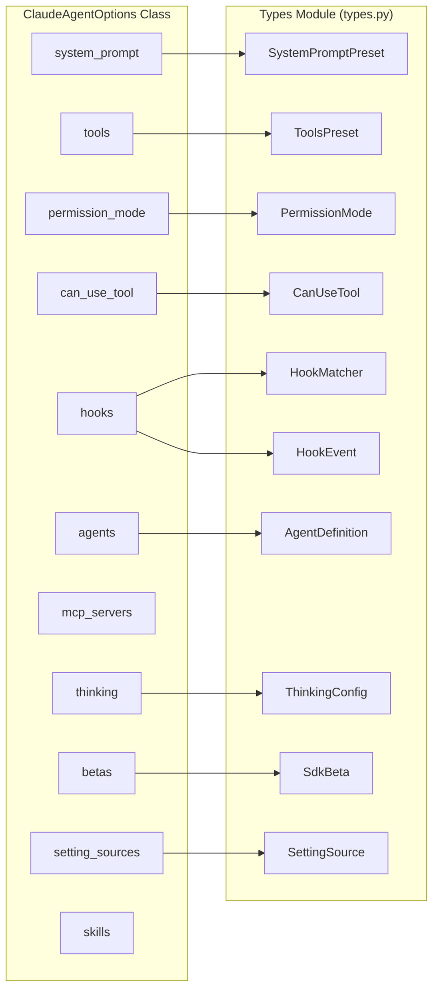

Sources: [src/claude_agent_sdk/types.py:1-800](), [src/claude_agent_sdk/_internal/transport/subprocess_cli.py:190-300](), [tests/test_types.py:135-214]()

---

# Page: Bundled CLI Version Management

# Bundled CLI Version Management

<details>
<summary>Relevant source files</summary>

The following files were used as context for generating this wiki page:

- [CHANGELOG.md](CHANGELOG.md)
- [pyproject.toml](pyproject.toml)
- [src/claude_agent_sdk/_cli_version.py](src/claude_agent_sdk/_cli_version.py)
- [src/claude_agent_sdk/_version.py](src/claude_agent_sdk/_version.py)
- [tests/test_changelog.py](tests/test_changelog.py)
- [tests/test_download_cli.py](tests/test_download_cli.py)
- [tests/test_update_cli_version.py](tests/test_update_cli_version.py)

</details>


This page covers how the SDK tracks, validates, and overrides the Claude Code CLI binary version. It details the role of `_cli_version.py`, release-time updates via update scripts, the runtime compatibility checks against `MINIMUM_CLAUDE_CODE_VERSION`, and the `cli_path` configuration override.

---

## 1. Version Tracking: SDK vs. Bundled CLI

The SDK maintains a clear separation between the Python package release version and the bundled Claude Code CLI binary version. Each version is tracked independently in its own module.

| Version Type | File Path | Code Variable | Description |
|---|---|---|---|
| SDK Package Version | `src/claude_agent_sdk/_version.py` | `__version__` | Follows semver for the Python SDK package. |
| Bundled CLI Version | `src/claude_agent_sdk/_cli_version.py` | `__cli_version__` | Pins the exact Claude CLI build bundled into platform wheels. |

Both files expose top-level string constants. For example, the bundled CLI version is defined as:

```python
__cli_version__ = "2.1.307"
```

Sources: [src/claude_agent_sdk/_version.py:1-3](), [src/claude_agent_sdk/_cli_version.py:1-3]()

---

## 2. Role of `_cli_version.py` and Release-Time Updates

The `_cli_version.py` module serves as the single source of truth for release automation scripts when fetching and bundling the Claude CLI binary. During package releases, update scripts validate new CLI versions and rewrite `__cli_version__`.

### Version Validation and Update Flow

**Diagram: CLI Version Update Lifecycle**

```mermaid
flowchart TD
    "UpdateScript["update_cli_version.py"]" --> "ValidateVersion["update_cli_version()"]"
    "ValidateVersion" --> "CheckPattern{"Matches VERSION_PATTERN?}"
    "CheckPattern" -->|"No"| "RaiseValueError["raise ValueError('Invalid CLI version')"]"
    "CheckPattern" -->|"Yes"| "WriteFile["Write __cli_version__ to src/claude_agent_sdk/_cli_version.py"]"
    "WriteFile" --> "BuildWheel["scripts/build_wheel.py"]"
```

Sources: [scripts/update_cli_version.py:1-71](), [src/claude_agent_sdk/_cli_version.py:1-3]()

The release script `scripts/update_cli_version.py` enforces strict validation to prevent shell injection or malformed version strings from entering the codebase. Dist-tags like `latest` or `stable` are explicitly rejected for `_cli_version.py` because the file must pin a single, reproducible build.

Sources: [tests/test_update_cli_version.py:1-178]()

---

## 3. Build-Time Bundling Process

When building platform-specific wheels, `scripts/build_wheel.py` reads `__cli_version__` and invokes `scripts/download_cli.py` to retrieve the correct binary executable.

### Bundling Pipeline

**Diagram: Build-Time CLI Bundling**

```mermaid
flowchart TD
    "BuildWheelScript["scripts/build_wheel.py"]" --> "GetVer["get_bundled_cli_version()"]"
    "GetVer" --> "ReadCliVersion["Read __cli_version__ from _cli_version.py"]"
    "ReadCliVersion" --> "DownloadScript["scripts/download_cli.py"]"
    "DownloadScript" --> "FetchBinary["Download CLI binary via install script"]"
    "FetchBinary" --> "CopyBundle["copy_cli_to_bundle()"]"
    "CopyBundle" --> "TargetDir["Save to src/claude_agent_sdk/_bundled/"]"
    "TargetDir" --> "RetagWheel["retag_wheel()"]"
```

Sources: [scripts/download_cli.py:1-162](), [pyproject.toml:62-77]()

---

## 4. Runtime Compatibility and `MINIMUM_CLAUDE_CODE_VERSION`

At runtime, the transport layer verifies that the discovered CLI binary meets the minimum version required to support the SDK's control protocol and message serialization formats.

### Compatibility Check Architecture

**Diagram: Runtime Version Enforcement**

```mermaid
flowchart TD
    "Transport["SubprocessCLITransport"]" --> "Connect["connect()"]"
    "Connect" --> "CheckEnv{"CLAUDE_AGENT_SDK_SKIP_VERSION_CHECK set?"}"
    "CheckEnv" -->|"Yes"| "Proceed["Proceed with execution"]"
    "CheckEnv" -->|"No"| "RunVersionCommand["Execute [cli_path, '-v']"]"
    "RunVersionCommand" --> "ParseOutput["Extract version via regex"]"
    "ParseOutput" --> "CompareVersion{"Version < MINIMUM_CLAUDE_CODE_VERSION?"}"
    "CompareVersion" -->|"Yes"| "LogWarning["Log warning / print to stderr"]"
    "CompareVersion" -->|"No"| "Proceed"
    "LogWarning" --> "Proceed"
```

Sources: [src/claude_agent_sdk/_cli_version.py:1-3]()

If the binary version falls below the required threshold, the SDK logs a warning rather than raising an immediate hard error, offering backward-compatibility tolerance for slightly older local installations while strongly encouraging updates.

---

## 5. The `cli_path` Override

By default, the SDK resolves the CLI binary using a discovery order that checks bundled assets, `PATH`, and standard installation paths. Developers can bypass this automated search by supplying an explicit path via `ClaudeAgentOptions.cli_path`.

```python
from claude_agent_sdk import ClaudeSDKClient, ClaudeAgentOptions

# Override CLI path to use a specific local build
options = ClaudeAgentOptions(cli_path="/opt/claude/bin/claude")
client = ClaudeSDKClient(options=options)
```

Sources: [pyproject.toml:5-10]()

---

# Page: Basic Usage

# Basic Usage

<details>
<summary>Relevant source files</summary>

The following files were used as context for generating this wiki page:

- [src/claude_agent_sdk/_internal/transport/__init__.py](src/claude_agent_sdk/_internal/transport/__init__.py)
- [src/claude_agent_sdk/query.py](src/claude_agent_sdk/query.py)
- [tests/test_close_cancellation.py](tests/test_close_cancellation.py)

</details>


This section covers the two primary entry points for interacting with Claude through the SDK — the `query()` async generator and the `ClaudeSDKClient` stateful session client — along with the message and content block types that both return.

For detailed reference on configuration options, see [ClaudeAgentOptions Configuration Reference](#2.3). For defining custom tools, see [Custom Tools (SDK MCP Servers)](#5.1). For error handling patterns, see [Error Handling Patterns](#7.3).

---

## Choosing Between `query()` and `ClaudeSDKClient`

The SDK exposes two distinct interaction models. The right choice depends on the complexity of the interaction required.

| Capability | `query()` | `ClaudeSDKClient` |
|---|---|---|
| Single-turn or simple iteration | ✓ | ✓ |
| Custom in-process tools (`@tool`) | — | ✓ |
| Lifecycle hooks | — | ✓ |
| Interrupt a running query | — | ✓ |
| Change permission mode mid-session | — | ✓ |
| Change model mid-session | — | ✓ |
| Rewind file state | — | ✓ |
| Async context manager | — | ✓ |
| Minimal boilerplate | ✓ | — |

`query()` is a convenience wrapper that internally instantiates an `InternalClient` to process the request [src/claude_agent_sdk/query.py:121-126](). While `query()` is ideal for fire-and-forget automation or simple scripts [src/claude_agent_sdk/query.py:30-35](), `ClaudeSDKClient` is preferred for building interactive applications, maintaining conversation context, or providing real-time user interrupts [src/claude_agent_sdk/client.py:40-46]().

Sources: [src/claude_agent_sdk/query.py:11-43](), [src/claude_agent_sdk/query.py:124-131]()

---

## How Both APIs Fit Into the System

The following diagram maps the public API surface to the internal code entities.

**Diagram: Public API to Internal Layer Mapping**
```mermaid
graph TD
    subgraph "Public API"
        query_fn["query() async generator"]
        client_cls["ClaudeSDKClient context manager"]
    end

    subgraph "Configuration"
        cao["ClaudeAgentOptions"]
    end

    subgraph "Internal"
        internal_client["InternalClient"]
        query_cls["Query control dispatcher"]
        transport["SubprocessCLITransport"]
    end

    subgraph "Message Types"
        UM["UserMessage"]
        AM["AssistantMessage"]
        SM["SystemMessage"]
        RM["ResultMessage"]
        SE["StreamEvent"]
    end

    query_fn -->|"uses"| internal_client
    client_cls -->|"accepts"| cao
    client_cls -->|"instantiates"| query_cls
    query_cls -->|"uses"| transport
    transport -->|"yields typed"| UM
    transport -->|"yields typed"| AM
    transport -->|"yields typed"| SM
    transport -->|"yields typed"| RM
    transport -->|"yields typed"| SE
```
Sources: [src/claude_agent_sdk/query.py:124-131]()

---

## `query()` — Simple Async Generator

`query()` is the simplest way to start a conversation. It handles the lifecycle of the connection and yields messages as they arrive from the CLI. It supports both simple string prompts and complex `AsyncIterable` message streams [src/claude_agent_sdk/query.py:45-53]().

For full details on signature, prompt types, options, and yielded messages, see [query() Function](#3.1).

Sources: [src/claude_agent_sdk/query.py:11-132]()

---

## `ClaudeSDKClient` — Stateful Session Client

`ClaudeSDKClient` manages a persistent bidirectional session. It is required for advanced features like `can_use_tool` callbacks, `hooks`, and mid-session control requests.

**Diagram: ClaudeSDKClient Method Surface**
```mermaid
graph LR
    subgraph "ClaudeSDKClient"
        subgraph "Lifecycle"
            connect["connect()"]
            disconnect["disconnect()"]
            aenter["__aenter__()"]
            aexit["__aexit__()"]
        end

        subgraph "Interaction"
            query_m["query()"]
            recv_msg["receive_messages()"]
            recv_resp["receive_response()"]
        end

        subgraph "Control"
            interrupt["interrupt()"]
            set_perm["set_permission_mode()"]
            set_model["set_model()"]
            rewind["rewind_files()"]
        end

        subgraph "MCP"
            add_mcp["add_mcp_server()"]
            rem_mcp["remove_mcp_server()"]
            get_mcp["get_mcp_status()"]
        end
    end
```
For the full method reference and state management details, see [ClaudeSDKClient](#3.2).

Sources: [src/claude_agent_sdk/_internal/transport/__init__.py:8-70]()

---

## Message Types and Content Blocks

All communication with Claude is typed via the `Message` union and `ContentBlock` variants. These types act as the strict contract between the CLI subprocess transport and user-facing application code.

For complete field definitions of each concrete message type and ContentBlock subtype, plus the `parse_message` dispatcher, see [Message Types and Content Blocks](#3.3).

Sources: [src/claude_agent_sdk/query.py:8-10]()

---

# Page: query() Function

# query() Function

<details>
<summary>Relevant source files</summary>

The following files were used as context for generating this wiki page:

- [README.md](README.md)
- [src/claude_agent_sdk/_internal/transport/__init__.py](src/claude_agent_sdk/_internal/transport/__init__.py)
- [src/claude_agent_sdk/query.py](src/claude_agent_sdk/query.py)
- [tests/test_close_cancellation.py](tests/test_close_cancellation.py)
- [tests/test_query.py](tests/test_query.py)

</details>


This page documents the `query()` function, which provides a simple, one-shot interface for querying Claude Code [src/claude_agent_sdk/query.py:1-1]. It is designed for stateless operations where you have all inputs upfront and want to process a single request-response cycle [src/claude_agent_sdk/query.py:20-26]. For interactive, multi-turn conversations with bidirectional communication, hooks, or custom tools, see [ClaudeSDKClient](3.2) [src/claude_agent_sdk/query.py:20-29].

**Scope:**
- Function signature and parameters [src/claude_agent_sdk/query.py:11-16], [src/claude_agent_sdk/query.py:44-71].
- Message iteration patterns and return types [src/claude_agent_sdk/query.py:11-16], [src/claude_agent_sdk/query.py:72-74].
- Configuration through `ClaudeAgentOptions` [src/claude_agent_sdk/query.py:14].
- Internal execution flow wrapping `InternalClient` and `Transport` [src/claude_agent_sdk/query.py:127-132], [src/claude_agent_sdk/_internal/transport/__init__.py:8-86].
- When to use `query()` versus `ClaudeSDKClient` [src/claude_agent_sdk/query.py:20-43].

**Related pages:**
- For interactive sessions: [ClaudeSDKClient](3.2) [src/claude_agent_sdk/query.py:21-22]
- For configuration options: [ClaudeAgentOptions Configuration](2.3) [README.md:48-51]
- For message types: [Message Types and Content Blocks](3.3) [src/claude_agent_sdk/query.py:8]

---

## Function Signature

```python
async def query(
    *,
    prompt: str | AsyncIterable[dict[str, Any]],
    options: ClaudeAgentOptions | None = None,
    transport: Transport | None = None,
) -> AsyncIterator[Message]:
```

The `query()` function is an asynchronous generator function that yields `Message` objects representing the conversation stream with the Claude CLI subprocess [src/claude_agent_sdk/query.py:11-16]. It manages the complete invocation lifecycle: resolving options, instantiating an `InternalClient`, dispatching via `process_query()`, streaming output chunks, and tearing down resources [src/claude_agent_sdk/query.py:124-132].

Sources: [src/claude_agent_sdk/query.py:11-16], [src/claude_agent_sdk/query.py:124-132]

---

## Parameters

### prompt Parameter

- **Type:** `str | AsyncIterable[dict[str, Any]]`
- **Required:** Yes [src/claude_agent_sdk/query.py:13]

The `prompt` parameter accepts two distinct forms:
1. **Plain `str`**: A single-shot prompt string sent directly to the CLI subprocess [src/claude_agent_sdk/query.py:45-46].
2. **`AsyncIterable[dict[str, Any]]`**: An async iterable yielding structured message dictionaries for streaming/continuous prompt scenarios [src/claude_agent_sdk/query.py:46-53]. Each dict conforms to user message schemas containing keys like `"type": "user"`, `"message": {"role": "user", "content": "..."}`, and optional session metadata [src/claude_agent_sdk/query.py:47-53].

### options Parameter

- **Type:** `ClaudeAgentOptions | None`
- **Required:** No (defaults to `ClaudeAgentOptions()` if `None`) [src/claude_agent_sdk/query.py:14], [src/claude_agent_sdk/query.py:124-125]

Allows configuring runtime behavior, permissions, tools, working directory (`cwd`), model selection, and budgets [src/claude_agent_sdk/query.py:54-62].

### transport Parameter

- **Type:** `Transport | None`
- **Required:** No [src/claude_agent_sdk/query.py:15]

Allows injecting a custom `Transport` implementation instead of the default `SubprocessCLITransport` [src/claude_agent_sdk/query.py:63-65]. When provided, the SDK calls `connect()`, delivers the prompt via `write()`, and routes initialization capabilities over the control protocol, while bypassing command-line flags and store-backed session resumption [src/claude_agent_sdk/query.py:63-70].

Sources: [src/claude_agent_sdk/query.py:13-15], [src/claude_agent_sdk/query.py:44-70], [src/claude_agent_sdk/query.py:124-125]

---

## Return Value and Message Iteration

`query()` returns an `AsyncIterator[Message]` [src/claude_agent_sdk/query.py:16]. The stream yields concrete subclasses of `Message` as they are decoded from the CLI stdout NDJSON stream:

| Message Class | Role / Purpose | Code Reference |
| --- | --- | --- |
| `AssistantMessage` | Contains Claude's generated blocks (text, thinking, tool calls). | [tests/test_query.py:19](), [src/claude_agent_sdk/types.py:14-23]() |
| `SystemMessage` | Administrative events, session ID notifications, and init states. | [tests/test_query.py:23](), [src/claude_agent_sdk/types.py:14-23]() |
| `ResultMessage` | Termination summary providing execution status, turn counts, and `total_cost_usd`. | [tests/test_query.py:22](), [src/claude_agent_sdk/types.py:14-23]() |

Sources: [src/claude_agent_sdk/query.py:11-16], [tests/test_query.py:19-23]

---

## Internal Architecture and Execution Flow

The `query()` function serves as the high-level entrypoint in Natural Language Space, bridging user requests to the core subsystems (`InternalClient`, `Query`, and `SubprocessCLITransport`) in Code Entity Space.

### Component Architecture: Natural Language to Code Entity Space

```mermaid
graph TB
    subgraph "NaturalLanguageSpace"
        UserQuery["User One-Shot Question"]
        StreamPrompt["Batch / Streaming Prompts"]
    end

    subgraph "CodeEntitySpace"
        QueryFunc["claude_agent_sdk.query()"]
        IntClient["claude_agent_sdk._internal.client.InternalClient"]
        SubTransport["claude_agent_sdk._internal.transport.subprocess_cli.SubprocessCLITransport"]
        QueryRunner["claude_agent_sdk._internal.query.Query"]
        CLIProcess["Claude Code CLI Subprocess"]
    end

    UserQuery -->|"invokes"| QueryFunc
    StreamPrompt -->|"invokes"| QueryFunc
    QueryFunc -->|"instantiates and calls"| IntClient
    IntClient -->|"spawns"| SubTransport
    IntClient -->|"wraps with control protocol"| QueryRunner
    SubTransport -->|"executes"| CLIProcess
    QueryRunner -->|"reads NDJSON lines"| SubTransport

    classDef ns fill:#fff,stroke:#333,stroke-width:2px;
    class UserQuery,StreamPrompt ns;
```

Sources: [src/claude_agent_sdk/query.py:11-16], [src/claude_agent_sdk/query.py:127-132], [src/claude_agent_sdk/_internal/transport/__init__.py:8-86]

### Message Streaming Sequence Flow

```mermaid
sequenceDiagram
    autonumber
    actor User as "User Code"
    participant QFn as "query()"
    participant IClient as "InternalClient"
    participant Trans as "SubprocessCLITransport"
    participant Qry as "Query"
    participant CLI as "Claude CLI"

    User->>QFn: "query(prompt=..., options=...)"
    QFn->>IClient: "process_query(prompt, options, transport)"
    IClient->>Trans: "__init__(prompt, options)"
    IClient->>Trans: "connect()"
    Trans->>CLI: "spawn subprocess (--output-format stream-json)"
    IClient->>Qry: "Query(transport, is_streaming_mode=True)"
    
    loop Stream Execution
        CLI->>Trans: "NDJSON output line"
        Trans->>Qry: "read_messages()"
        Qry->>IClient: "parsed message dict"
        IClient->>QFn: "Message object"
        QFn->>User: "yield message"
    end

    CLI->>Trans: "ResultMessage JSON"
    Qry->>IClient: "Stream complete"
    IClient->>QFn: "Final yield"
    QFn->>User: "StopAsyncIteration"
```

Sources: [src/claude_agent_sdk/query.py:127-132], [src/claude_agent_sdk/_internal/transport/__init__.py:21-46], [tests/test_query.py:110-139]

---

## When to Use `query()` vs `ClaudeSDKClient`

| Dimension | `query()` | `ClaudeSDKClient` |
| --- | --- | --- |
| **API Pattern** | Async generator function (`async for msg in query(...)`) | Async context manager (`async with ClaudeSDKClient() as client:`) |
| **Communication Flow** | Unidirectional (send prompt upfront, read responses) [src/claude_agent_sdk/query.py:24-26] | Bidirectional (interactive read/write cycles, multi-turn follow-ups) [README.md:99-100] |
| **State Management** | Stateless per invocation [src/claude_agent_sdk/query.py:26] | Stateful conversation sessions [README.md:101-102] |
| **Custom Tools (`@tool`)** | Not supported [README.md:102] | Fully supported via in-process SDK MCP servers [README.md:102-108] |
| **Hooks** | Not supported [README.md:102] | Supported (`HookMatcher`) [README.md:102] |
| **Interrupts** | Cannot interrupt mid-flight [src/claude_agent_sdk/query.py:28] | Supported via `client.interrupt()` [README.md:40-41] |
| **Target Use Cases** | Simple questions, batch processing, CI/CD pipelines [src/claude_agent_sdk/query.py:30-35] | Chat applications, REPL interfaces, complex agent loops [src/claude_agent_sdk/query.py:37-42] |

Sources: [src/claude_agent_sdk/query.py:20-43], [README.md:99-102], [README.md:40-41]

---

## Error Handling

When interacting with `query()`, several SDK exceptions may be raised depending on transport and execution failures [src/claude_agent_sdk/_errors.py:1-1]:
- `CLINotFoundError`: Raised if the CLI binary cannot be located [README.md:15-18].
- `CLIConnectionError`: Raised if communication fails during connection setup [src/claude_agent_sdk/_errors.py:28].
- `ProcessError`: Raised if the underlying subprocess exits abnormally [src/claude_agent_sdk/_errors.py:28].
- `CLIJSONDecodeError`: Raised if stdout lines cannot be parsed as valid JSON [src/claude_agent_sdk/_internal/transport/__init__.py:40-45].

Sources: [src/claude_agent_sdk/_errors.py:28], [src/claude_agent_sdk/_internal/transport/__init__.py:40-45], [README.md:15-18]

---

# Page: ClaudeSDKClient

# ClaudeSDKClient

<details>
<summary>Relevant source files</summary>

The following files were used as context for generating this wiki page:

- [examples/max_budget_usd.py](examples/max_budget_usd.py)
- [examples/streaming_mode.py](examples/streaming_mode.py)
- [examples/streaming_mode_ipython.py](examples/streaming_mode_ipython.py)
- [src/claude_agent_sdk/client.py](src/claude_agent_sdk/client.py)
- [tests/test_client.py](tests/test_client.py)
- [tests/test_integration.py](tests/test_integration.py)
- [tests/test_streaming_client.py](tests/test_streaming_client.py)

</details>


## Purpose and Scope

This document provides the full technical specification for `ClaudeSDKClient`, the core client class defined in `[src/claude_agent_sdk/client.py]()` that enables bidirectional, stateful, and interactive communication with the Claude Code CLI. Unlike the high-level `query()` function designed for one-off tasks, `ClaudeSDKClient` maintains a persistent subprocess connection and background task group, supporting streaming message consumption, dynamic model switching, task interruption, file rewinding, tool authorization callbacks, and Model Context Protocol (MCP) server management.

Sources: `[src/claude_agent_sdk/client.py:27-65]()`

## Overview

`ClaudeSDKClient` acts as the primary programmatic driver for long-lived agentic sessions [src/claude_agent_sdk/client.py:27-38](). It bridges high-level user intentions and raw CLI subprocess interactions by wrapping an internal `Query` controller [src/claude_agent_sdk/client.py:87]() and a transport layer (`SubprocessCLITransport` or custom transport) [src/claude_agent_sdk/client.py:70]().

```mermaid
graph TB
    subgraph "Natural Language Space"
        UserPrompt["User Prompt (str)"]
        StreamedResponse["Streaming Assistant Response"]
    end

    subgraph "Code Entity Space"
        App["Application Code"]
        Client["ClaudeSDKClient [src/claude_agent_sdk/client.py:26]"]
        Query["Query [src/claude_agent_sdk/_internal/query.py]"]
        Transport["SubprocessCLITransport [src/claude_agent_sdk/_internal/transport/subprocess_cli.py]"]
        CLI["Claude CLI Subprocess"]
    end
    
    UserPrompt -.->|"passed via query()"| Client
    App -->|"connect()"| Client
    App -->|"query(prompt)"| Client
    Client -->|"manages lifecycle"| Query
    Query -->|"communicates via"| Transport
    Transport -->|"NDJSON stdin/stdout"| CLI
    CLI -->|"stdout messages"| Transport
    Transport -->|"raw messages"| Query
    Query -->|"parsed Message objects"| Client
    Client -->|"yields"| StreamedResponse
```

**Diagram**: ClaudeSDKClient Architecture Bridge - Connecting natural language inputs and streaming responses to internal SDK code entities.

Sources: `[src/claude_agent_sdk/client.py:27-90]()`, `[src/claude_agent_sdk/client.py:153-164]()`

## Client Lifecycle

The client lifecycle encompasses instantiation, asynchronous connection, interactive message exchange, and teardown [src/claude_agent_sdk/client.py:67-140]().

### Context Manager Usage
The standard pattern utilizes an asynchronous context manager which automatically invokes `connect()` on entry and `disconnect()` on exit [src/claude_agent_sdk/client.py:171-177]():

```python
async with ClaudeSDKClient(options=options) as client:
    await client.query("Analyze current directory")
    async for msg in client.receive_response():
        # Handle message stream
        pass
```

### Manual Lifecycle Management
For fine-grained control, `connect()` and `disconnect()` can be invoked explicitly [src/claude_agent_sdk/client.py:93-139]()`:

```python
client = ClaudeSDKClient(options=options)
await client.connect()
try:
    await client.query("Hello")
    async for msg in client.receive_messages():
        # Process messages
        break
finally:
    await client.disconnect()
```

### Runtime Context Constraint
`ClaudeSDKClient` maintains a persistent `anyio` task group internally for reading asynchronous message streams from `connect()` until `disconnect()` [src/claude_agent_sdk/client.py:59-65](). Consequently, all operations on a client instance must execute within the identical async runtime context (e.g., the same event loop or nursery) where `connect()` was called [src/claude_agent_sdk/client.py:58-64]().

```mermaid
stateDiagram-v2
    [*] --> Disconnected
    Disconnected --> Connected: "connect()"
    Connected --> Messaging: "query()"
    Messaging --> Messaging: "send / receive"
    Messaging --> Interrupted: "interrupt()"
    Interrupted --> Messaging: "query()"
    Connected --> Disconnected: "disconnect()"
    Messaging --> Disconnected: "disconnect()"
    Disconnected --> [*]
```

**Diagram**: ClaudeSDKClient State Machine - Lifecycle states and transition methods.

Sources: `[src/claude_agent_sdk/client.py:58-65]()`, `[src/claude_agent_sdk/client.py:93-140]()`, `[tests/test_streaming_client.py:162-178]()`

## Core Methods

### query()
`async def query(prompt: str | AsyncIterable[dict[str, Any]]) -> None`

Sends a prompt or stream of structured message dictionaries into the active session [src/claude_agent_sdk/client.py:261-297](). String prompts are automatically stamped and wrapped into `UserMessage` payload structures before writing to the transport [src/claude_agent_sdk/client.py:288-294]().

### receive_messages()
`async def receive_messages() -> AsyncIterator[Message]`

An async generator yielding all parsed `Message` instances (such as `AssistantMessage`, `ToolUseBlock`, `SystemMessage`, and `ResultMessage`) as they arrive from the CLI subprocess [src/claude_agent_sdk/client.py:315-325]().

### receive_response()
`async def receive_response() -> AsyncIterator[Message]`

A high-level convenience iterator that wraps `receive_messages()` and automatically terminates iteration when a terminal `ResultMessage` is encountered for the current turn [src/claude_agent_sdk/client.py:327-338]().

### interrupt()
`async def interrupt() -> None`

Sends an asynchronous control request (`subtype: interrupt`) to halt ongoing model generation or active tool execution [src/claude_agent_sdk/client.py:340-344]().

Sources: `[src/claude_agent_sdk/client.py:261-344]()`, `[examples/streaming_mode.py:63-70]()`

## Session, Model, and File Control

`ClaudeSDKClient` provides dedicated methods for modifying session parameters dynamically at runtime:

| Method | Signature | Description |
| :--- | :--- | :--- |
| `set_model` | `async def set_model(model: str) -> None` | Switches the active LLM model mid-session [src/claude_agent_sdk/client.py:347-351](). |
| `set_permission_mode` | `async def set_permission_mode(mode: PermissionMode) -> None` | Updates tool authorization mode (`AlwaysAllow`, `AlwaysDeny`, `Notify`) [src/claude_agent_sdk/client.py:353-357](). |
| `stop_task` | `async def stop_task() -> None` | Signals the CLI to stop the current task execution [src/claude_agent_sdk/client.py:450-454](). |
| `rewind_files` | `async def rewind_files(user_message_id: str) -> None` | Reverts file modifications back to the checkpoint associated with a specific `UserMessage` UUID [src/claude_agent_sdk/client.py:444-448](). Requires file checkpointing enabled in options. |
| `get_context_usage` | `async def get_context_usage() -> ContextUsageResponse` | Fetches token usage statistics for the current session [src/claude_agent_sdk/client.py:457-461](). |

Sources: `[src/claude_agent_sdk/client.py:347-358]`, `[src/claude_agent_sdk/client.py:444-461]`

## MCP Server Management

The client interfaces with Model Context Protocol (MCP) servers through control protocol messages, enabling runtime introspection and management:

| Method | Signature | Description |
| :--- | :--- | :--- |
| `get_mcp_status` | `async def get_mcp_status() -> McpStatusResponse` | Retrieves connection status and telemetry for all configured MCP servers [src/claude_agent_sdk/client.py:360-374](). |
| `add_mcp_server` | `async def add_mcp_server(name: str, config: McpServerConfig) -> None` | Dynamically registers and starts a new MCP server [src/claude_agent_sdk/client.py:376-389](). |
| `remove_mcp_server` | `async def remove_mcp_server(name: str) -> None` | Unregisters and stops an existing MCP server by name [src/claude_agent_sdk/client.py:391-403](). |
| `reconnect_mcp_server`| `async def reconnect_mcp_server(name: str) -> None` | Forces a reconnection cycle for a specific MCP server [src/claude_agent_sdk/client.py:405-415](). |
| `toggle_mcp_server` | `async def toggle_mcp_server(name: str, enabled: bool) -> None` | Enables or disables an MCP server without purging its configuration [src/claude_agent_sdk/client.py:417-428](). |
| `get_server_info` | `async def get_server_info(name: str) -> dict[str, Any]` | Inspects initialization parameters and output styles for a server [src/claude_agent_sdk/client.py:430-442](). |

Sources: `[src/claude_agent_sdk/client.py:360-442]()`

## Implementation Details & Data Flow

When `connect()` is executed, the client validates session store configuration, prepares resume materialization if specified, and spawns the underlying subprocess transport [src/claude_agent_sdk/client.py:93-139](). It then instantiates the `Query` control coordinator, initiates the handshake protocol, and starts background reader tasks.

```mermaid
sequenceDiagram
    participant App as "Application Code"
    participant Client as "ClaudeSDKClient [src/claude_agent_sdk/client.py]"
    participant Query as "Query [src/claude_agent_sdk/_internal/query.py]"
    participant Transport as "SubprocessCLITransport"
    participant CLI as "Claude CLI Subprocess"

    App->>Client: "connect()"
    Client->>Transport: "connect()"
    Transport->>CLI: "Spawn Subprocess (NDJSON)"
    Client->>Query: "start()"
    Client->>Query: "initialize()"
    Query->>CLI: "SDKControlRequest (initialize)"
    CLI-->>Query: "SDKControlResponse (success)"
    
    App->>Client: "query('Hello')"
    Client->>CLI: "UserMessage (NDJSON line)"
    
    loop Message Processing Loop
        CLI-->>Transport: "stdout NDJSON line"
        Transport-->>Query: "raw message dict"
        Query->>Query: "parse_message()"
        App->>Client: "receive_messages()"
        Client-->>App: "yield Message object"
    end

    App->>Client: "disconnect()"
    Client->>Query: "close()"
    Client->>Transport: "close()"
    Transport->>CLI: "Terminate Process"
```

**Diagram**: ClaudeSDKClient Connection, Query, and Message Streaming Flow - Tracing data flow from application calls down to subprocess NDJSON communication.

Sources: `[src/claude_agent_sdk/client.py:100-185]()`, `[tests/test_streaming_client.py:48-106]()`

---

# Page: Message Types and Content Blocks

# Message Types and Content Blocks

<details>
<summary>Relevant source files</summary>

The following files were used as context for generating this wiki page:

- [e2e-tests/test_message_origin.py](e2e-tests/test_message_origin.py)
- [src/claude_agent_sdk/_internal/message_parser.py](src/claude_agent_sdk/_internal/message_parser.py)
- [tests/test_message_parser.py](tests/test_message_parser.py)
- [tests/test_rate_limit_event_repro.py](tests/test_rate_limit_event_repro.py)

</details>


This page documents the typed message and content block classes that the SDK yields to application code. These types are the primary data structures you interact with when consuming the `query()` async generator or `ClaudeSDKClient.receive_messages()`.

For the parsing logic that converts raw CLI JSON into these types, see page 4.3. For the configuration options that affect which message types are emitted (e.g., `include_partial_messages`), see page 2.3.

---

## Overview

All types are defined in [src/claude_agent_sdk/types.py:594-718]() and parsed by `parse_message()` in [src/claude_agent_sdk/_internal/message_parser.py:50-231](). The top-level union type is:

```python
Message = (
    UserMessage 
    | AssistantMessage 
    | SystemMessage 
    | ResultMessage 
    | StreamEvent 
    | RateLimitEvent
    | HookEventMessage
)
```

Content blocks appear nested inside `UserMessage` and `AssistantMessage`:

```python
ContentBlock = (
    TextBlock 
    | ThinkingBlock 
    | ToolUseBlock 
    | ToolResultBlock 
    | ServerToolUseBlock 
    | ServerToolResultBlock
)
```

**Type Taxonomy Diagram**

```mermaid
graph TD
    M["Message (union)"]
    M --> UM["UserMessage"]
    M --> AM["AssistantMessage"]
    M --> SM["SystemMessage"]
    M --> RM["ResultMessage"]
    M --> SE["StreamEvent"]
    M --> RLE["RateLimitEvent"]
    M --> HEM["HookEventMessage"]

    CB["ContentBlock (union)"]
    CB --> TB["TextBlock"]
    CB --> ThB["ThinkingBlock"]
    CB --> TUB["ToolUseBlock"]
    CB --> TRB["ToolResultBlock"]
    CB --> STUB["ServerToolUseBlock"]
    CB --> STRB["ServerToolResultBlock"]

    UM -->|".content: list[ContentBlock] | str"| CB
    AM -->|".content: list[ContentBlock]"| CB
```

Sources: [src/claude_agent_sdk/types.py:594-718](), [src/claude_agent_sdk/_internal/message_parser.py:7-32]()

---

## Message Types

### UserMessage

[src/claude_agent_sdk/types.py:642-649]()

Represents a user turn in the conversation. Emitted when the CLI echoes back a user message, including when tool results are fed back into the conversation.

| Field | Type | Description |
|---|---|---|
| `content` | `str \| list[ContentBlock]` | Message body. A plain string when the user sent a text prompt; a list of `ContentBlock` objects when the message includes tool use or tool results. |
| `uuid` | `str \| None` | Unique identifier for this message. Used as the argument to `rewind_files()` for file checkpointing [tests/test_message_parser.py:45-57](). |
| `parent_tool_use_id` | `str \| None` | Set when this message originates from inside a subagent. Identifies the tool use that spawned the subagent. |
| `tool_use_result` | `dict \| None` | Raw metadata about a tool execution result (e.g., file edit details: `filePath`, `oldString`, `newString`, `structuredPatch`). |
| `origin` | `MessageOrigin \| None` | Origin metadata (e.g., `{"kind": "human"}`) [tests/test_message_parser.py:60-78](), echoed back on result messages [e2e-tests/test_message_origin.py:34-58](). |

**When it appears:** Once per user turn, mirroring the prompt sent to Claude. Also appears after tool results are delivered back to the model [src/claude_agent_sdk/_internal/message_parser.py:96-150]().

Sources: [src/claude_agent_sdk/types.py:642-649](), [src/claude_agent_sdk/_internal/message_parser.py:96-150](), [tests/test_message_parser.py:33-111]()

---

### AssistantMessage

[src/claude_agent_sdk/types.py:652-659]()

Represents a complete assistant turn. Contains one or more content blocks.

| Field | Type | Description |
|---|---|---|
| `content` | `list[ContentBlock]` | One or more blocks: text, thinking, tool use, or tool result. |
| `model` | `str` | The model identifier that produced this message (e.g., `"claude-3-5-sonnet-20241022"`). |
| `parent_tool_use_id` | `str \| None` | Non-null when this message comes from a subagent. |
| `error` | `AssistantMessageError \| None` | Set when the API returned an error. See error values below. |
| `usage` | `dict \| None` | Token usage for this specific assistant turn. |
| `message_id` | `str \| None` | The underlying Anthropic API message ID. |
| `stop_reason` | `str \| None` | Why the model stopped generating (e.g., `"end_turn"`, `"tool_use"`). |

**`AssistantMessageError` values** ([src/claude_agent_sdk/types.py:632-639]()):

| Value | Meaning |
|---|---|
| `"authentication_failed"` | Invalid or missing API key |
| `"billing_error"` | Billing issue on the account |
| `"rate_limit"` | API rate limit exceeded |
| `"invalid_request"` | Malformed request sent to API |
| `"server_error"` | Internal server error from the API |
| `"unknown"` | Any other API error (details in text content) |

Sources: [src/claude_agent_sdk/types.py:632-639](), [src/claude_agent_sdk/types.py:652-659]()

---

### SystemMessage

[src/claude_agent_sdk/types.py:662-667]()

Carries metadata events emitted by the CLI itself, not by the model. This is the base class for specialized task messages.

| Field | Type | Description |
|---|---|---|
| `subtype` | `str` | Event kind (e.g., `"init"`, `"task_started"`, `"task_progress"`, `"task_notification"`). |
| `data` | `dict[str, Any]` | The full raw JSON dict from the CLI for this event. |

**Specialized System Subtypes:**
- **TaskStartedMessage**: Emitted when a subagent or long-running task begins [src/claude_agent_sdk/types.py:721-730]().
- **TaskProgressMessage**: Emitted periodically to update status and usage [src/claude_agent_sdk/types.py:733-743]().
- **TaskNotificationMessage**: Emitted for task completions or summaries [src/claude_agent_sdk/types.py:746-756]().
- **TaskUpdatedMessage**: Emitted when task metadata changes [src/claude_agent_sdk/types.py:759-766]().

Sources: [src/claude_agent_sdk/types.py:662-667](), [src/claude_agent_sdk/types.py:721-766]()

---

### ResultMessage

[src/claude_agent_sdk/types.py:670-683]()

The final message in any query. Summarizes cost, timing, and turn count.

| Field | Type | Description |
|---|---|---|
| `subtype` | `str` | Either `"success"` or `"error"`. |
| `duration_ms` | `int` | Wall-clock time for the full session in milliseconds. |
| `duration_api_ms` | `int` | Time spent waiting on the Anthropic API in milliseconds. |
| `is_error` | `bool` | `True` if the session ended with an error. |
| `num_turns` | `int` | Number of conversation turns completed. |
| `session_id` | `str` | Unique session identifier. |
| `total_cost_usd` | `float \| None` | Estimated cost of the session in USD. |
| `usage` | `dict \| None` | Cumulative token usage breakdown. |
| `result` | `str \| None` | Plain-text result when using non-streaming mode. |
| `structured_output` | `Any` | Populated when `output_format` is used. |
| `origin` | `MessageOrigin \| None` | Echoed origin metadata from the initiating prompt [e2e-tests/test_message_origin.py:34-58](). |

Sources: [src/claude_agent_sdk/types.py:670-683](), [e2e-tests/test_message_origin.py:34-58]()

---

### StreamEvent

[src/claude_agent_sdk/types.py:686-693]()

A partial message update emitted during streaming. Only produced when `include_partial_messages=True` is set in `ClaudeAgentOptions`.

| Field | Type | Description |
|---|---|---|
| `uuid` | `str` | Identifier for the in-progress message being streamed. |
| `session_id` | `str` | Current session identifier. |
| `event` | `dict[str, Any]` | Raw Anthropic API streaming event payload. |
| `parent_tool_use_id` | `str \| None` | Non-null if the event originated inside a subagent. |

Sources: [src/claude_agent_sdk/types.py:686-693]()

---

### RateLimitEvent

[src/claude_agent_sdk/types.py:711-718]()

Emitted when the CLI detects changes in rate limit status (e.g., warnings for claude.ai subscription users). Added to handle `rate_limit_event` messages introduced in CLI v2.1.45+ [tests/test_rate_limit_event_repro.py:1-10]().

| Field | Type | Description |
|---|---|---|
| `rate_limit_info` | `RateLimitInfo` | Detailed info: `status`, `resets_at`, `utilization`, etc. |
| `uuid` | `str` | Unique event ID. |
| `session_id` | `str` | Current session identifier. |

**RateLimitInfo Fields** ([src/claude_agent_sdk/types.py:699-708]()):
- `status`: `"allowed"`, `"allowed_warning"`, or `"rejected"` [tests/test_rate_limit_event_repro.py:20-24]().
- `resets_at`: Unix timestamp of when limits reset [tests/test_rate_limit_event_repro.py:42]().
- `utilization`: Float (0.0 to 1.0) indicating current quota usage [tests/test_rate_limit_event_repro.py:44]().
- `raw`: Dictionary containing any additional unmodeled fields [tests/test_rate_limit_event_repro.py:46]().

Sources: [src/claude_agent_sdk/types.py:699-718](), [tests/test_rate_limit_event_repro.py:19-47]()

---

## Content Block Types

Content blocks appear in the `content` list of `UserMessage` and `AssistantMessage`.

**Content Block Usage by Message Type**

```mermaid
graph LR
    AM["AssistantMessage.content"]
    UM["UserMessage.content"]

    AM --> TB["TextBlock\n(.text: str)"]
    AM --> ThB["ThinkingBlock\n(.thinking: str)\n(.signature: str)"]
    AM --> TUB_A["ToolUseBlock\n(.id, .name, .input)"]
    AM --> STUB["ServerToolUseBlock\n(.id, .name, .input)"]

    UM --> TB2["TextBlock\n(.text: str)"]
    UM --> TUB_U["ToolUseBlock\n(.id, .name, .input)"]
    UM --> TRB["ToolResultBlock\n(.tool_use_id)\n(.content)\n(.is_error)"]
```

Sources: [src/claude_agent_sdk/types.py:594-628](), [src/claude_agent_sdk/_internal/message_parser.py:96-185]()

---

### TextBlock

[src/claude_agent_sdk/types.py:595-599]()

| Field | Type | Description |
|---|---|---|
| `text` | `str` | Plain text content of the block. |

Sources: [src/claude_agent_sdk/types.py:595-599]()

---

### ThinkingBlock

[src/claude_agent_sdk/types.py:602-607]()

Represents extended reasoning content when Claude uses the Thinking feature.

| Field | Type | Description |
|---|---|---|
| `thinking` | `str` | The model's internal reasoning text. |
| `signature` | `str` | Cryptographic signature allowing the block to be passed back to the API. |

Sources: [src/claude_agent_sdk/types.py:602-607]()

---

### ToolUseBlock

[src/claude_agent_sdk/types.py:610-616]()

Represents a call to a standard tool (e.g., local CLI tools).

| Field | Type | Description |
|---|---|---|
| `id` | `str` | Unique tool call identifier. |
| `name` | `str` | Name of the tool being called (e.g., `"Bash"`, `"LS"`). |
| `input` | `dict[str, Any]` | Arguments passed to the tool. |

Sources: [src/claude_agent_sdk/types.py:610-616]()

---

### ToolResultBlock

[src/claude_agent_sdk/types.py:619-625]()

| Field | Type | Description |
|---|---|---|
| `tool_use_id` | `str` | Matches the `id` on the corresponding `ToolUseBlock`. |
| `content` | `str \| list[dict] \| None` | The result returned by the tool. |
| `is_error` | `bool \| None` | `True` if the tool execution failed. |

Sources: [src/claude_agent_sdk/types.py:619-625]()

---

### ServerToolUseBlock / ServerToolResultBlock

[src/claude_agent_sdk/types.py:628-630]()

Used for tools executed on the server side or by advisors. `ServerToolUseBlock` mirrors `ToolUseBlock` structure, while `ServerToolResultBlock` is used specifically for advisor tool results [src/claude_agent_sdk/_internal/message_parser.py:176-185]().

Sources: [src/claude_agent_sdk/types.py:628-630](), [src/claude_agent_sdk/_internal/message_parser.py:176-185]()

---

## Parsing and Forward Compatibility

**Parse Flow Diagram**

```mermaid
flowchart TD
    J["Raw JSON dict\nfrom CLI stdout"]
    PM["parse_message(data)\nmessage_parser.py"]
    J --> PM

    PM -->|"type == 'user'"| UM["UserMessage\n+ ContentBlock list"]
    PM -->|"type == 'assistant'"| AM["AssistantMessage\n+ ContentBlock list"]
    PM -->|"type == 'system' & subtype == 'hook_*'"| HEM["HookEventMessage"]
    PM -->|"type == 'system' (other)"| SM["SystemMessage variants"]
    PM -->|"type == 'result'"| RM["ResultMessage"]
    PM -->|"type == 'rate_limit_event'"| RLE["RateLimitEvent"]
    PM -->|"type == 'stream_event'"| SE["StreamEvent"]
    PM -->|"missing 'type' field"| ERR1["MessageParseError"]
    PM -->|"known type, missing fields"| ERR2["MessageParseError"]
    PM -->|"unknown type"| NONE["returns None\n(caller filters out)"]
```

Sources: [src/claude_agent_sdk/_internal/message_parser.py:50-231](), [tests/test_rate_limit_event_repro.py:85-94]()

The `parse_message()` function defined in [src/claude_agent_sdk/_internal/message_parser.py:50]() is the single entry point for converting raw CLI JSON into typed objects. It uses a `match` statement on the `type` field to determine which class to instantiate.

- **Forward Compatibility**: If the CLI emits a message type unknown to the SDK version, `parse_message` returns `None` instead of crashing [tests/test_rate_limit_event_repro.py:85-94](). This allows the SDK to be resilient to new CLI features.
- **Hook Routing**: Messages with type `system` and subtypes `hook_started` or `hook_response` are routed to `HookEventMessage` before generic `SystemMessage` handling [src/claude_agent_sdk/_internal/message_parser.py:73-89]().
- **Error Handling**: Missing required fields for known types raise `MessageParseError`, wrapping the underlying `KeyError` [src/claude_agent_sdk/_internal/message_parser.py:146-149]().

Sources: [src/claude_agent_sdk/_internal/message_parser.py:50-231](), [tests/test_message_parser.py:30-182](), [tests/test_rate_limit_event_repro.py:16-95]()

---

# Page: Transport and Communication

# Transport and Communication

<details>
<summary>Relevant source files</summary>

The following files were used as context for generating this wiki page:

- [src/claude_agent_sdk/_internal/transport/subprocess_cli.py](src/claude_agent_sdk/_internal/transport/subprocess_cli.py)
- [tests/test_subprocess_buffering.py](tests/test_subprocess_buffering.py)
- [tests/test_transport.py](tests/test_transport.py)

</details>


This section documents how the SDK communicates with the Claude CLI subprocess: the transport mechanism that spawns and manages the process, the bidirectional control protocol that sits on top of it, and the JSON streaming pipeline that converts raw stdout bytes into typed message objects.

For details on the public-facing client APIs that consume messages produced by this layer, see [ClaudeSDKClient](#3.2). For the typed message objects themselves, see [Message Types and Content Blocks](#3.3).

---

## Overview

The SDK does not communicate with the Anthropic API directly. Instead, it delegates all API interaction to a Claude CLI binary, which it launches as a subprocess. The transport layer owns the full lifecycle of that subprocess: discovery, spawn, I/O, and teardown.

**Transport layer diagram:**

```mermaid
graph TD
    subgraph "sdk [SDK Process]"
        InternalClient["InternalClient\n(src/claude_agent_sdk/_internal/client.py)"]
        Query["Query\n(src/claude_agent_sdk/_internal/query.py)"]
        Transport["SubprocessCLITransport\n(src/claude_agent_sdk/_internal/transport/subprocess_cli.py)"]
        Parser["parse_message()\n(src/claude_agent_sdk/_internal/message_parser.py)"]
        MemStream["anyio.create_memory_object_stream"]
    end

    subgraph "child [Child Process]"
        CLI["Claude CLI binary\n(stdin/stdout pipes)"]
    end

    API["Anthropic API\n(HTTPS)"]

    InternalClient -->|"instantiates"| Transport
    InternalClient -->|"wraps with"| Query
    Query -->|"write() JSON control messages"| Transport
    Transport -->|"stdin pipe"| CLI
    CLI -->|"stdout JSON lines"| Transport
    Transport -->|"raw dicts"| Parser
    Parser -->|"typed Message objects"| MemStream
    MemStream -->|"async iteration"| Query
    CLI -->|"HTTPS"| API
```

Sources: [src/claude_agent_sdk/_internal/client.py:127-175](), [src/claude_agent_sdk/_internal/transport/subprocess_cli.py:111-140](), [src/claude_agent_sdk/_internal/query.py:61-131](), [src/claude_agent_sdk/_internal/message_parser.py:12-40]()

---

## Transport Abstraction

The transport layer is defined by a `Transport` base interface. `SubprocessCLITransport` is the primary concrete implementation used by the SDK. It manages the underlying `anyio.abc.Process` and provides high-level methods for bidirectional communication.

| Method | Purpose |
|---|---|
| `connect()` | Version-check CLI, spawn subprocess, open stdio streams |
| `write(data)` | Send a JSON string to CLI stdin, serialized under an `anyio.Lock` |
| `end_input()` | Close stdin to signal no more input |
| `read_messages()` | Return an async iterator of parsed JSON dicts from stdout |
| `close()` | Terminate subprocess, release all streams and task groups |

For details, see [Subprocess CLI Transport](#4.1).

Sources: [src/claude_agent_sdk/_internal/transport/subprocess_cli.py:111-140](), [src/claude_agent_sdk/_internal/transport/subprocess_cli.py:335-410](), [src/claude_agent_sdk/_internal/transport/subprocess_cli.py:530-610]()

---

## CLI Discovery

When `options.cli_path` is not set, `SubprocessCLITransport._find_cli()` searches for the binary in a fixed priority order. It first checks for a bundled binary within the package `_bundled` directory before falling back to `shutil.which` and common installation paths.

**CLI discovery order:**

```mermaid
flowchart TD
    A["SubprocessCLITransport._find_cli()"] --> B{"_find_bundled_cli()\n_bundled/claude[.exe]"}
    B -->|"found"| Z["return path"]
    B -->|"not found"| C{"shutil.which('claude')"}
    C -->|"found"| Z
    C -->|"not found"| D["Check fixed locations\n~/.npm-global/bin/claude\n/usr/local/bin/claude\n~/.local/bin/claude\n~/node_modules/.bin/claude\n~/.yarn/bin/claude\n~/.claude/local/claude"]
    D -->|"first match"| Z
    D -->|"none found"| E["raise CLINotFoundError"]
```

Sources: [src/claude_agent_sdk/_internal/transport/subprocess_cli.py:142-188](), [tests/test_transport.py:29-52]()

---

## Control Protocol

The `Query` class manages a bidirectional control protocol over the transport's stdin/stdout. This protocol handles the initial `initialize` handshake, allows the SDK to send control requests (like `interrupt` or `set_model`), and enables the CLI to request permissions (`can_use_tool`) or invoke lifecycle `hooks`.

**Control protocol sequence:**

```mermaid
sequenceDiagram
    participant Q as "Query (query.py)"
    participant T as "SubprocessCLITransport"
    participant CLI as "Claude CLI"

    Note over Q, CLI: Handshake
    Q->>T: write({"subtype": "initialize", ...})
    T->>CLI: stdin
    CLI-->>T: stdout ({"subtype": "initialize", "supportedCommands": [...]})
    T-->>Q: response

    Note over Q, CLI: Runtime Control
    Q->>T: write({"subtype": "interrupt", "requestId": "req_1"})
    CLI-->>T: (action taken)
    
    Note over Q, CLI: Incoming Requests
    CLI-->>T: stdout ({"subtype": "control_request", "request": {"subtype": "can_use_tool", ...}})
    T-->>Q: dispatch to can_use_tool callback
    Q->>T: write({"subtype": "control_response", "requestId": "cli_1", "result": "allow"})
```

For details, see [Control Protocol](#4.2).

Sources: [src/claude_agent_sdk/_internal/query.py:61-141](), [src/claude_agent_sdk/_internal/query.py:172-230](), [src/claude_agent_sdk/_internal/query.py:330-400]()

---

## Message Streaming and Buffering

The CLI writes newline-delimited JSON to stdout. However, pipe buffering can cause JSON objects to be fragmented across multiple reads or concatenated into a single read. `SubprocessCLITransport` uses a `_LineFramer` to reassemble these fragments into complete lines before parsing them as JSON.

**Buffering logic:**
1. Read chunk from `TextReceiveStream`.
2. `_LineFramer.push(chunk)` accumulates fragments and splits on `\n`.
3. `_parse_stdout_line(line)` attempts `json.loads(line)`.
4. If the line starts with `{`, it must parse or it raises `CLIJSONDecodeError`.
5. Valid dictionaries are yielded to the `Query` read loop.

For details, see [Message Streaming and Buffering](#4.3).

Sources: [src/claude_agent_sdk/_internal/transport/subprocess_cli.py:50-85](), [src/claude_agent_sdk/_internal/transport/subprocess_cli.py:86-109](), [tests/test_subprocess_buffering.py:46-184]()

---

## Subprocess Lifecycle and Safety

The transport manages the subprocess lifecycle from `connect()` to `close()`. It uses an `anyio.Lock` (`_write_lock`) to ensure that writes to `stdin` are thread-safe and that the stream is not corrupted by concurrent access.

Environment variables injected at spawn time include `CLAUDE_CODE_ENTRYPOINT="sdk-py"` and `CLAUDE_AGENT_SDK_VERSION`. To prevent orphaned processes, the SDK uses an `atexit` handler (`_kill_active_children`) to terminate any active child processes stored in `_ACTIVE_CHILDREN` if the parent Python process exits unexpectedly.

Sources: [src/claude_agent_sdk/_internal/transport/subprocess_cli.py:33-47](), [src/claude_agent_sdk/_internal/transport/subprocess_cli.py:140](), [src/claude_agent_sdk/_internal/transport/subprocess_cli.py:335-410](), [src/claude_agent_sdk/_internal/transport/subprocess_cli.py:481-505]()

---

## Child Pages

| Section | Topic |
|---|---|
| [Subprocess CLI Transport](#4.1) | Deep-dive into discovery, command construction, subprocess management, and error types like `CLINotFoundError`. |
| [Control Protocol](#4.2) | Explanation of the `Query` class, the `initialize` handshake, request ID correlation, and bidirectional requests. |
| [Message Streaming and Buffering](#4.3) | Technical details on handling fragmented JSON, the `_LineFramer` mechanism, and `CLIJSONDecodeError`. |

---

# Page: Subprocess CLI Transport

# Subprocess CLI Transport

<details>
<summary>Relevant source files</summary>

The following files were used as context for generating this wiki page:

- [src/claude_agent_sdk/_internal/transport/__init__.py](src/claude_agent_sdk/_internal/transport/__init__.py)
- [src/claude_agent_sdk/_internal/transport/subprocess_cli.py](src/claude_agent_sdk/_internal/transport/subprocess_cli.py)
- [src/claude_agent_sdk/query.py](src/claude_agent_sdk/query.py)
- [tests/test_close_cancellation.py](tests/test_close_cancellation.py)
- [tests/test_subprocess_buffering.py](tests/test_subprocess_buffering.py)
- [tests/test_transport.py](tests/test_transport.py)

</details>


This page documents `SubprocessCLITransport`, the internal component responsible for spawning the Claude CLI binary, managing its lifecycle, constructing command-line arguments, executing Windows security validation, handling child process reaping, and streaming NDJSON data over standard input/output pipes [src/claude_agent_sdk/_internal/transport/subprocess_cli.py:1-1228](). For message framing and NDJSON parsing details, see [4.3](). For control protocol request/response handling, see [4.2]().

---

## 1. Role in the Architecture

`SubprocessCLITransport` implements the abstract `Transport` interface defined in `src/claude_agent_sdk/_internal/transport/__init__.py` [src/claude_agent_sdk/_internal/transport/__init__.py:8-86](). It forms the communication bridge between the `Query` / `InternalClient` orchestration layer and the physical Claude CLI executable [src/claude_agent_sdk/query.py:127-131](), [src/claude_agent_sdk/_internal/transport/subprocess_cli.py:1-33]().

**Diagram: Transport Layer and Code Entity Mapping**

```mermaid
flowchart TD
    QueryCls["Query (src/claude_agent_sdk/query.py)"]
    InternalClientCls["InternalClient (src/claude_agent_sdk/_internal/client.py)"]
    TransportInterface["Transport (src/claude_agent_sdk/_internal/transport/__init__.py)"]
    SubprocessCLITransportCls["SubprocessCLITransport (src/claude_agent_sdk/_internal/transport/subprocess_cli.py)"]
    LineFramerCls["_LineFramer (src/claude_agent_sdk/_internal/transport/subprocess_cli.py)"]
    CLIProc["Claude CLI Subprocess (stdin/stdout/stderr pipes)"]

    QueryCls -->|"invokes"| InternalClientCls
    InternalClientCls -->|"implements connect(), write(), read_messages(), close()"| TransportInterface
    TransportInterface <|-- SubprocessCLITransportCls
    SubprocessCLITransportCls -->|"spawns via anyio.open_process()"| CLIProc
    CLIProc -->|"chunks via TextReceiveStream"| LineFramerCls
    LineFramerCls -->|"yields raw dicts"| SubprocessCLITransportCls
```

Sources: [src/claude_agent_sdk/_internal/transport/__init__.py:8-86](), [src/claude_agent_sdk/_internal/transport/subprocess_cli.py:1-33](), [src/claude_agent_sdk/query.py:127-131]()

---

## 2. CLI Discovery and Windows Security Checks

When `ClaudeAgentOptions.cli_path` is not specified (`None`), `SubprocessCLITransport` searches for the binary using `_find_cli()`, checking bundled assets, the system `PATH` via `shutil.which()`, and known fallback directories [src/claude_agent_sdk/_internal/transport/subprocess_cli.py:142-188]().

On Windows platforms, `SubprocessCLITransport` executes security checks (`_reject_windows_batch_cli` and `_reject_windows_cmd_metacharacters`) to prevent arbitrary command execution or unexpected `cmd.exe` shell interpretation [src/claude_agent_sdk/_internal/transport/subprocess_cli.py:46-53](). It explicitly rejects batch script wrappers (`.bat`, `.cmd`) and arguments containing cmd.exe metacharacters (`&|<>^%!"`) when passed unquoted [src/claude_agent_sdk/_internal/transport/subprocess_cli.py:46-53]().

**Diagram: CLI Discovery and Validation Flow**

```mermaid
flowchart TD
    Start["_find_cli() (subprocess_cli.py)"] --> Bundled["_find_bundled_cli() checks _bundled/claude(.exe)"]
    Bundled -->|"found"| CheckWin["Windows Security Validation"]
    Bundled -->|"not found"| Which["shutil.which('claude')"]
    Which -->|"found"| CheckWin
    Which -->|"not found"| Fallback["Check hardcoded fallback paths"]
    Fallback -->|"found"| CheckWin
    Fallback -->|"not found"| Raise["raise CLINotFoundError (_errors.py)"]
    CheckWin -->|"Windows: batch file / metacharacters detected"| RaiseSecurity["raise ValueError / CLIConnectionError"]
    CheckWin -->|"valid executable"| Success["Return verified cli_path"]
```

Sources: [src/claude_agent_sdk/_internal/transport/subprocess_cli.py:46-188](), [tests/test_transport.py:29-53]()

---

## 3. Version Checking

Prior to spawning the main persistent subprocess, `connect()` executes `_check_claude_version()` unless the environment variable `CLAUDE_AGENT_SDK_SKIP_VERSION_CHECK` is present [src/claude_agent_sdk/_internal/transport/subprocess_cli.py:480-490](). 

This check spawns a temporary process with `[cli_path, "-v"]`, bounded by a 2-second `anyio.fail_after` timeout [src/claude_agent_sdk/_internal/transport/subprocess_cli.py:688-726](). It parses the output semver string and validates compatibility against `MINIMUM_CLAUDE_CODE_VERSION = "2.0.0"` [src/claude_agent_sdk/_internal/transport/subprocess_cli.py:37-37](). If the version check fails or times out, a warning is logged or suppressed to prevent blocking offline or air-gapped environments [src/claude_agent_sdk/_internal/transport/subprocess_cli.py:688-726]().

Sources: [src/claude_agent_sdk/_internal/transport/subprocess_cli.py:37-37](), [src/claude_agent_sdk/_internal/transport/subprocess_cli.py:480-490](), [src/claude_agent_sdk/_internal/transport/subprocess_cli.py:688-726]()

---

## 4. Command Construction

`_build_command()` translates fields from `ClaudeAgentOptions` into CLI arguments for `anyio.open_process()` [src/claude_agent_sdk/_internal/transport/subprocess_cli.py:287-434]().

**Diagram: Option Translation Mapping**

```mermaid
flowchart LR
    subgraph Options["ClaudeAgentOptions"]
        Opt1["system_prompt"]
        Opt2["model / fallback_model"]
        Opt3["tools / allowed_tools"]
        Opt4["permission_mode"]
        Opt5["setting_sources / sandbox"]
    end

    subgraph Command["SubprocessCLITransport._build_command()"]
        Cmd1["--system-prompt / --append-system-prompt"]
        Cmd2["--model / --fallback-model"]
        Cmd3["--tools / --allowedTools"]
        Cmd4["--permission-mode"]
        Cmd5["--setting-sources / --settings"]
    end

    Opt1 --> Cmd1
    Opt2 --> Cmd2
    Opt3 --> Cmd3
    Opt4 --> Cmd4
    Opt5 --> Cmd5
```

Sources: [src/claude_agent_sdk/_internal/transport/subprocess_cli.py:287-434](), [tests/test_transport.py:67-200]()

Key command arguments include `--output-format stream-json`, `--input-format stream-json`, and structured formatting flags for session resumption, budget limits, thinking tokens, and hook event dispatching [src/claude_agent_sdk/_internal/transport/subprocess_cli.py:287-434]().

Sources: [src/claude_agent_sdk/_internal/transport/subprocess_cli.py:287-434]()

---

## 5. Subprocess Lifecycle, Child Reaping, and Cancellation

`SubprocessCLITransport` manages the full lifecycle of the Claude CLI subprocess through asynchronous methods and global tracking mechanisms [src/claude_agent_sdk/_internal/transport/subprocess_cli.py:436-615]().

```mermaid
stateDiagram-v2
    [*] --> Unconnected: "__init__()"
    Unconnected --> Connecting: "connect()"
    Connecting --> Ready: "anyio.open_process() succeeds\n_ready = True\nadded to _ACTIVE_CHILDREN"
    Connecting --> Error: "FileNotFoundError -> CLINotFoundError\nException -> CLIConnectionError"
    Ready --> Ready: "write(data)\nread_messages()"
    Ready --> Closing: "close() or end_input()"
    Closing --> Terminated: "SIGTERM / terminate()\nSIGKILL if unresponsive\nremoved from _ACTIVE_CHILDREN"
    Terminated --> [*]: "_process = None\n_ready = False"
```

Sources: [src/claude_agent_sdk/_internal/transport/subprocess_cli.py:436-686]()

### Child Reaping and Parent-Exit Cleanup
To prevent orphaned processes when the host Python process crashes or exits prematurely, active child subprocesses are tracked in the module-level set `_ACTIVE_CHILDREN` [src/claude_agent_sdk/_internal/transport/subprocess_cli.py:58-69](). An `atexit` hook `_kill_active_children()` iterates over live processes and sends `SIGTERM` (or calls `terminate()` on Windows) [src/claude_agent_sdk/_internal/transport/subprocess_cli.py:61-68]().

Furthermore, `close()` is executed within cancellation shields to ensure that task cancellations or timeout expirations do not bypass cleanup and orphan the CLI subprocess [tests/test_close_cancellation.py:1-188]().

Sources: [src/claude_agent_sdk/_internal/transport/subprocess_cli.py:58-69](), [tests/test_close_cancellation.py:1-188]()

---

## 6. Error Types and Concurrency

### Error Classes
The transport layer maps low-level subprocess and I/O failures to SDK exception types:
- `CLINotFoundError`: Raised when the CLI executable cannot be located [src/claude_agent_sdk/_errors.py:10-50]().
- `CLIConnectionError`: Raised when process startup fails or communication cannot be established [src/claude_agent_sdk/_errors.py:10-50]().
- `ProcessError`: Raised when the CLI process terminates with a non-zero exit code [src/claude_agent_sdk/_errors.py:10-50]().
- `SDKJSONDecodeError` (`CLIJSONDecodeError`): Raised when NDJSON parsing fails or when internal buffer limits (`_DEFAULT_MAX_BUFFER_SIZE`) are exceeded [src/claude_agent_sdk/_internal/transport/subprocess_cli.py:21-36]().

Sources: [src/claude_agent_sdk/_errors.py:10-50](), [src/claude_agent_sdk/_internal/transport/subprocess_cli.py:21-36]()

### Concurrency Control
All write operations, input terminations, and close calls are serialized using an internal `anyio.Lock` (`_write_lock`) [src/claude_agent_sdk/_internal/transport/subprocess_cli.py:582-606](). This prevents concurrent coroutines from triggering `BusyResourceError` on underlying `anyio` text streams [src/claude_agent_sdk/_internal/transport/subprocess_cli.py:582-606]().

Sources: [src/claude_agent_sdk/_internal/transport/subprocess_cli.py:582-606]()

---

# Page: Control Protocol

# Control Protocol

<details>
<summary>Relevant source files</summary>

The following files were used as context for generating this wiki page:

- [e2e-tests/test_dynamic_control.py](e2e-tests/test_dynamic_control.py)
- [e2e-tests/test_run_end.py](e2e-tests/test_run_end.py)
- [src/claude_agent_sdk/_internal/client.py](src/claude_agent_sdk/_internal/client.py)
- [src/claude_agent_sdk/_internal/query.py](src/claude_agent_sdk/_internal/query.py)
- [tests/test_run_end_subprocess.py](tests/test_run_end_subprocess.py)

</details>


The control protocol implements bidirectional communication between the SDK and the Claude Code CLI subprocess. It enables runtime control features (interrupts, model switching, permission changes), callback-based extensibility (hooks and permission checks), in-process MCP server integration, task lifecycle tracking, and run-end ceiling management. This protocol operates on top of the subprocess transport layer and provides type-safe message routing using request IDs for correlation.

Sources: [src/claude_agent_sdk/_internal/query.py:1-29]()

## Protocol Architecture

The control protocol is implemented by the `Query` class (`[src/claude_agent_sdk/_internal/query.py:146-176]()`) and operates as a layer above the `Transport` interface. It maintains separate channels for control messages and regular SDK messages, routing each appropriately.

### Diagram: Protocol Layer and Query Subsystems
```mermaid
graph TB
    subgraph "Code Entity Space: Client and Query"
        ClaudeSDKClient["ClaudeSDKClient\n.connect() / .query()\n.interrupt() / .set_model()\n.set_permission_mode()\n.rewind_files()"]
        Query["Query\n[src/claude_agent_sdk/_internal/query.py:146]"]
        init_fn["Query.initialize()\n[src/claude_agent_sdk/_internal/query.py]"]
        read_fn["Query._read_messages()\n[src/claude_agent_sdk/_internal/query.py]"]
        handle_fn["Query._handle_control_request()\n[src/claude_agent_sdk/_internal/query.py:277]"]
        send_fn["Query._send_control_request()\n[src/claude_agent_sdk/_internal/query.py:388]"]
        stream_fn["Query.stream_input()\n[src/claude_agent_sdk/_internal/query.py]"]
        recv_fn["Query.receive_messages()\n[src/claude_agent_sdk/_internal/query.py]"]

        subgraph "Internal State Correlators"
            pending_resp["self.pending_control_responses\ndict[str, anyio.Event]"]
            pending_results["self.pending_control_results\ndict[str, dict | Exception]"]
            hook_cbs["self.hook_callbacks\ndict[str, Callable]"]
            sdk_mcps["self.sdk_mcp_servers\ndict[str, McpServer]"]
            mem_stream["_message_send / _message_receive\nanyio MemoryObjectStream"]
        end
    end

    subgraph "Code Entity Space: Transport"
        Transport["Transport\n[src/claude_agent_sdk/_internal/transport/"]
        stdin["transport.write() / stdin"]
        stdout["transport.read_messages() / stdout"]
    end

    ClaudeSDKClient --> Query
    Query --> init_fn
    Query --> read_fn
    read_fn --> handle_fn
    read_fn --> pending_resp
    read_fn --> mem_stream
    handle_fn --> hook_cbs
    handle_fn --> sdk_mcps
    ClaudeSDKClient --> send_fn
    send_fn --> pending_resp
    send_fn --> pending_results
    send_fn --> stdin
    recv_fn --> mem_stream
    read_fn --> stdout
    handle_fn --> stdin
```
Sources: [src/claude_agent_sdk/_internal/query.py:146-176](), [src/claude_agent_sdk/client.py:55-177]()

### Message Type Routing

The protocol distinguishes between message categories in the reader loop (`Query._read_messages()`):

| `type` field | Direction | Purpose | Routing Mechanism |
|---|---|---|---|
| `control_response` | CLI → SDK | Response to an SDK-initiated control request | Matched by `request_id` in `pending_control_responses`; result stored in `pending_control_results` [src/claude_agent_sdk/_internal/query.py:224-234]() |
| `control_request` | CLI → SDK | Request from CLI requiring an SDK callback (permission, hook, MCP) | Dispatched to `_handle_control_request()` via `spawn_detached()` [src/claude_agent_sdk/_internal/query.py:236-241]() |
| `control_cancel_request` | CLI → SDK | Cancel a pending control request | Reserved/Ignored |
| `result` | CLI → SDK | Signals the end of a model turn | Sets `_first_result_event`; forwarded to message stream [src/claude_agent_sdk/_internal/query.py:243-254]() |
| (other types) | CLI → SDK | `user`, `assistant`, `system`, stream events | Forwarded to `_message_send` for application consumption via `receive_messages()` [src/claude_agent_sdk/_internal/query.py:256-258]() |

Sources: [src/claude_agent_sdk/_internal/query.py:214-275]()

## Initialization Handshake

Before processing queries, `Query` performs an initialization handshake in streaming mode, transmitting hooks, agents, and MCP server configurations over the control channel.

```mermaid
sequenceDiagram
    participant Client as "ClaudeSDKClient"
    participant Query as "Query.initialize()"
    participant Transport as "Transport"
    participant CLI as "Claude Code CLI"
    
    Client->>Query: "initialize()"
    Query->>Query: "Build hooks config & register callbacks with IDs"
    Query->>Query: "Build control request {subtype: initialize, ...}"
    Query->>Transport: "_send_control_request()"
    Transport->>CLI: "JSON via stdin"
    CLI->>CLI: "Process config, setup hooks & load agents"
    CLI->>Transport: "control_response via stdout"
    Transport->>Query: "Parse response"
    Query->>Query: "_initialized = True"
    Query->>Client: "Return init response"
```

Sources: [src/claude_agent_sdk/_internal/query.py:172-212](), [src/claude_agent_sdk/client.py:143-177]()

## Outgoing and Incoming Control Requests

### Outgoing Control Requests (`_send_control_request`)
All SDK-initiated control requests (`interrupt`, `set_model`, `set_permission_mode`, `rewind_files`, `stop_task`, etc.) flow through `_send_control_request()`. They are correlated using unique request IDs and `anyio.Event` primitives.

```mermaid
sequenceDiagram
    participant App as "Application / Client"
    participant Query as "Query._send_control_request()"
    participant Transport as "Transport"
    participant CLI as "CLI Subprocess"
    
    App->>Query: "Control method call (e.g. set_model)"
    Query->>Query: "Generate request_id: req_N_hex"
    Query->>Query: "Store anyio.Event in pending_control_responses[request_id]"
    Query->>Transport: "write(control_request JSON)"
    Transport->>CLI: "JSON via stdin"
    CLI->>Query: "control_response via stdout"
    Query->>Query: "Store in pending_control_results, call event.set()"
    Query->>App: "Return response dict or raise Exception"
```

Sources: [src/claude_agent_sdk/_internal/query.py:388-433]()

### Incoming Control Requests (`_handle_control_request`)
The CLI sends `control_request` messages back to the SDK for permission checks (`can_use_tool`), hook execution (`hook_callback`), and in-process MCP message routing (`mcp_message`).

| `subtype` | Handler Method / Target | Purpose |
|---|---|---|
| `can_use_tool` | `can_use_tool` callback | Invokes user permission verification with `ToolPermissionContext` [src/claude_agent_sdk/_internal/query.py:286-327]() |
| `hook_callback` | `self.hook_callbacks` | Executes registered hook functions, converting Python-safe field names (`async_`, `continue_`) to CLI expectations (`async`, `continue`) [src/claude_agent_sdk/_internal/query.py:42-58](), [src/claude_agent_sdk/_internal/query.py:329-343]() |
| `mcp_message` | `_handle_sdk_mcp_request()` | Routes JSON-RPC requests (`initialize`, `tools/list`, `tools/call`) to in-process SDK MCP servers [src/claude_agent_sdk/_internal/query.py:345-365](), [src/claude_agent_sdk/_internal/query.py:435-571]() |

Sources: [src/claude_agent_sdk/_internal/query.py:277-386](), [src/claude_agent_sdk/types.py:788-843]()

## Request ID Correlation

Concurrency and request correlation are managed via instance-level dictionaries on `Query`:
- `self._request_counter`: An incrementing integer counter `[src/claude_agent_sdk/_internal/query.py:399]()`.
- `self.pending_control_responses`: Maps `request_id` strings to `anyio.Event` instances `[src/claude_agent_sdk/_internal/query.py:114-115]()`.
- `self.pending_control_results`: Stores the response payload or exception received from the CLI before an event is triggered `[src/claude_agent_sdk/_internal/query.py:115]()`.

When a response arrives, `_read_messages()` extracts the `request_id`, places the response data into `pending_control_results`, and wakes up the waiting coroutine by setting the event `[src/claude_agent_sdk/_internal/query.py:224-234]()`.

Sources: [src/claude_agent_sdk/_internal/query.py:114-115](), [src/claude_agent_sdk/_internal/query.py:224-234](), [src/claude_agent_sdk/_internal/query.py:399-405]()

## Task Lifecycle Tracking and Run-End Ceiling

### Task Lifecycle Tracking
The SDK tracks long-running agent tasks and subtasks to determine when stdin can safely be closed. Tasks whose completion triggers follow-up turns are classified under `DEFERRING_TASK_TYPES` (`frozenset({"local_agent", "local_workflow"})`) `[src/claude_agent_sdk/_internal/query.py:52]()`. These tasks ensure that the control channel remains open for subsequent hooks, permissions, or MCP calls even after an initial model turn result frame is received (`[tests/test_run_end_subprocess.py:1-13]()`, `[e2e-tests/test_run_end.py:1-10]()`).

### Run-End Ceiling and Timeouts
The SDK bounds its wait for the CLI's idle state using the run-end ceiling configuration (`run_end_ceiling_ms`) `[src/claude_agent_sdk/_internal/query.py:54-83]()`. 
- It inspects the `CLAUDE_CODE_PRINT_BG_WAIT_CEILING_MS` environment variable (falling back to `DEFAULT_RUN_END_CEILING_MS` of 600,000 ms / 10 minutes) `[src/claude_agent_sdk/_internal/query.py:56-82]()`.
- `ClaudeAgentOptions.env` overrides inherited environment variables for the subprocess, ensuring consistent timeout enforcement (`[src/claude_agent_sdk/_internal/query.py:63-83]()`).

### Diagram: Task Lifecycle and Run-End Ceiling
```mermaid
graph TB
    subgraph "Natural Language Space: Task Management & Ceilings"
        Subprocess["Claude Code CLI Subprocess"] -->|"Emits Session State / Results"| QueryRead["Query._read_messages()\n[src/claude_agent_sdk/_internal/query.py:214]"]
        QueryRead -->|"Checks Task Status"| TaskTrack["Task Lifecycle Tracker\nDEFERRING_TASK_TYPES: local_agent, local_workflow\n[src/claude_agent_sdk/_internal/query.py:52]"]
        TaskTrack -->|"Waits for Idle / Follow-up Turn"| CeilingCheck["Run-End Ceiling Timer\nrun_end_ceiling_ms()\nCLAUDE_CODE_PRINT_BG_WAIT_CEILING_MS\n[src/claude_agent_sdk/_internal/query.py:63]"]
        CeilingCheck -->|"Timeout Reached or Idle Settled"| CloseStdin["Close Stdin / Finish Query"]
    end
```
Sources: [src/claude_agent_sdk/_internal/query.py:52-83](), [src/claude_agent_sdk/_internal/query.py:214-275]()

## Error Handling

The control protocol provides robust error propagation across transport boundaries:
- **Control Request Timeouts**: If a request exceeds its timeout (default 60s), `anyio.fail_after` raises an exception `[src/claude_agent_sdk/_internal/query.py:418-420]()`.
- **Stored Exception Propagation**: If the result object stored in `pending_control_results` is an `Exception`, it is re-raised in the calling task (`[src/claude_agent_sdk/_internal/query.py:421-426]()`).
- **Control Error Responses**: When an incoming CLI control request handler fails, the SDK replies with an `error` subtype control response containing the error message string (`[src/claude_agent_sdk/_internal/query.py:376-386]()`, `[src/claude_agent_sdk/types.py:845-859]()`).
- **Reader Failures**: Unhandled reader exceptions populate all pending control responses with the error, emit an error message into the message stream, and shut down gracefully (`[src/claude_agent_sdk/_internal/query.py:260-275]()`).

Sources: [src/claude_agent_sdk/_internal/query.py:260-275](), [src/claude_agent_sdk/_internal/query.py:376-386](), [src/claude_agent_sdk/_internal/query.py:418-433]()

---

# Page: Message Streaming and Buffering

# Message Streaming and Buffering

<details>
<summary>Relevant source files</summary>

The following files were used as context for generating this wiki page:

- [.github/scripts/e2e-failure-summary.sh](.github/scripts/e2e-failure-summary.sh)
- [.github/scripts/run-e2e-firewalled-macos.sh](.github/scripts/run-e2e-firewalled-macos.sh)
- [e2e-tests/test_include_partial_messages.py](e2e-tests/test_include_partial_messages.py)
- [examples/include_partial_messages.py](examples/include_partial_messages.py)
- [examples/streaming_mode_trio.py](examples/streaming_mode_trio.py)
- [src/claude_agent_sdk/_internal/transport/subprocess_cli.py](src/claude_agent_sdk/_internal/transport/subprocess_cli.py)
- [tests/test_subprocess_buffering.py](tests/test_subprocess_buffering.py)
- [tests/test_transport.py](tests/test_transport.py)

</details>


This page covers how raw bytes from the Claude CLI subprocess stdout are accumulated into complete JSON objects, how those objects are parsed into typed `Message` instances, and how the `anyio` memory stream decouples the production of parsed messages from their consumption by user code.

For the subprocess lifecycle (spawning, stdin/stdout pipes, process teardown), see [Subprocess CLI Transport](#4.1). For the control protocol that dispatches parsed messages to hooks and permission callbacks, see [Control Protocol](#4.2). For the full `Message` type hierarchy, see [Message Types and Content Blocks](#3.3).

---

## Overview

The CLI process writes newline-delimited JSON (JSON Lines) to stdout. However, in practice the stream does not arrive as clean one-object-per-read chunks. The transport must handle:

- **Fragmented JSON** — a single JSON object split across multiple stream reads [tests/test_subprocess_buffering.py:142-184]().
- **Concatenated JSON** — multiple JSON objects delivered in a single read, separated by embedded `\n` characters [tests/test_subprocess_buffering.py:49-84]().
- **Mixed cases** — a mix of complete objects and fragments within the same read batch [tests/test_subprocess_buffering.py:1-545]().

Once a complete JSON object is decoded, it is handed to `parse_message()`, which converts the raw dictionary into a typed `Message` (or `None` for unknown types). Parsed messages are placed into an `anyio` memory stream so that the produce-and-parse loop can run independently from the consumer iterating over messages.

Sources: [src/claude_agent_sdk/_internal/transport/subprocess_cli.py:1-168](), [tests/test_subprocess_buffering.py:46-184]()

---

## JSON Accumulation and Parsing Pipeline

**Diagram: Data flow from CLI stdout to typed Messages**

```mermaid
flowchart TD
    cli[""Claude CLI process (stdout)""]
    trs[""TextReceiveStream (_stdout_stream)""]
    framer[""_LineFramer (push/flush)""]
    loop[""SubprocessCLITransport.read_messages() async for chunk""]
    parse_line[""_parse_stdout_line(line)""]
    buf[""_LineFramer._pending list""]
    guard[""pending_len > max_buffer_size?""]
    err[""raise SDKJSONDecodeError""]
    attempt[""json.loads(line)""]
    ok[""yield data dict""]
    parser[""parse_message(data) -> Message | None""]
    query[""InternalClient.process_query""]

    cli -->|"raw bytes"| trs
    trs -->|"text chunk"| loop
    loop -->|"push(chunk)"| framer
    framer --> buf
    buf --> guard
    guard -->|"yes"| err
    framer -->|"complete lines"| parse_line
    parse_line -->|"json.loads"| attempt
    attempt -->|"success"| ok
    ok --> parser
    parser -->|"Message or None"| query
```

Sources: [src/claude_agent_sdk/_internal/transport/subprocess_cli.py:1-168](), [tests/test_subprocess_buffering.py:46-184]()

---

## The JSON Buffering Loop

The accumulation logic utilizes a helper class `_LineFramer` to reassemble complete lines from arbitrary stream chunks [src/claude_agent_sdk/_internal/transport/subprocess_cli.py:163-168]().

### Line Framing Strategy
`_LineFramer` maintains a `_pending` list of string fragments [src/claude_agent_sdk/_internal/transport/subprocess_cli.py:163-168](). When a new chunk arrives:
1. It is appended to the internal buffer tracking list [src/claude_agent_sdk/_internal/transport/subprocess_cli.py:1-168]().
2. If the chunk contains a newline, the fragments are joined and split on `\n` [src/claude_agent_sdk/_internal/transport/subprocess_cli.py:1-168]().
3. Complete lines are returned, and any trailing fragment is kept in `_pending` for the next chunk [src/claude_agent_sdk/_internal/transport/subprocess_cli.py:1-168]().

### Speculative Parsing
Once a line is framed, `_parse_stdout_line` attempts to convert it to a dictionary [src/claude_agent_sdk/_internal/transport/subprocess_cli.py:1-168]().
- **Stripping**: Surrounding whitespace (like `\r` in CRLF) is stripped from complete lines.
- **Non-JSON Filter**: Lines not starting with `{` (e.g., CLI debug logs) are logged and skipped.
- **Strict Decoding**: If a line looks like JSON but fails to parse, a `CLIJSONDecodeError` (aliased as `SDKJSONDecodeError`) is raised immediately [src/claude_agent_sdk/_internal/transport/subprocess_cli.py:21-23]().

Sources: [src/claude_agent_sdk/_internal/transport/subprocess_cli.py:21-168]()

---

## Buffer Size Limit

The constant `_DEFAULT_MAX_BUFFER_SIZE` is set to `1024 * 1024` bytes (1 MB) [src/claude_agent_sdk/_internal/transport/subprocess_cli.py:36]().

This limit is configurable via `ClaudeAgentOptions.max_buffer_size`. When `max_buffer_size` is `None`, the default 1 MB applies.

| Configuration | Default | How to override |
|---|---|---|
| `_DEFAULT_MAX_BUFFER_SIZE` | `1_048_576` (1 MB) | Set `ClaudeAgentOptions(max_buffer_size=N)` [src/claude_agent_sdk/_internal/transport/subprocess_cli.py:36]() |
| Error raised | `CLIJSONDecodeError` (`SDKJSONDecodeError`) | [src/claude_agent_sdk/_internal/transport/subprocess_cli.py:22]() |

The `_LineFramer` tracks pending data length and the transport raises an error if this exceeds the threshold, preventing memory exhaustion from malicious or malformed CLI output [src/claude_agent_sdk/_internal/transport/subprocess_cli.py:1-168]().

Sources: [src/claude_agent_sdk/_internal/transport/subprocess_cli.py:21-36]()

---

## Message Parser

Once a complete `dict` is yielded from the transport, it is processed into typed messages by `parse_message()`.

### Forward Compatibility: Returning `None`
The message parsing logic is designed to be forward-compatible. If the CLI emits a message type that the SDK does not yet recognize, the parser returns `None` rather than raising an error. This allows the SDK to gracefully skip unknown events while maintaining compatibility with newer CLI versions.

### Specific Type Handling
The parser handles various message types including:
- **`user`**: Parses content blocks including `text`, `tool_use`, and `tool_result`. It also handles the `uuid` field required for file checkpointing.
- **`assistant`**: Parses content blocks (including `thinking` blocks via `StreamEvent` or direct blocks) and metadata like `usage` and `model`.
- **`system`**: Handles task lifecycle events (`task_started`, `task_progress`, `task_notification`) and initialization.
- **`rate_limit_event`**: Parses subscription and overage status into `RateLimitEvent`.
- **`StreamEvent`**: When `include_partial_messages=True` is configured, raw incremental streaming events (`message_start`, `content_block_start`, `content_block_delta`, `content_block_stop`, `message_stop`) are parsed and yielded [e2e-tests/test_include_partial_messages.py:26-91]().

Sources: [e2e-tests/test_include_partial_messages.py:26-91]()

---

## anyio Memory Stream: Decoupling Production from Consumption

The transport layer reads from the subprocess stdout in an async loop. User code consuming messages via `ClaudeSDKClient.receive_messages()` or the `query()` generator has its own async context [examples/streaming_mode_trio.py:46-77]().

An **`anyio` memory object stream** (a pair of `MemoryObjectSendStream` / `MemoryObjectReceiveStream`) is used to decouple these layers.

**Diagram: Entity mapping for Streaming Concurrency**

```mermaid
sequenceDiagram
    participant cli as ""Subprocess stdout""
    participant transport as ""SubprocessCLITransport.read_messages()""
    participant parser as ""parse_message()""
    participant send as ""MemoryObjectSendStream""
    participant recv as ""MemoryObjectReceiveStream""
    participant consumer as ""ClaudeSDKClient.receive_messages()""

    cli->>transport: ""raw text chunk""
    transport->>transport: ""_LineFramer.push(chunk)""
    transport->>parser: ""complete JSON dict""
    parser->>transport: ""typed Message object""
    transport->>send: ""send(Message)""
    Note over send,recv: ""anyio memory stream""
    recv->>consumer: ""receive()""
    consumer->>consumer: ""yield to user loop""
```

The send end is driven by the background task that reads the subprocess; the receive end is iterated by the user. This means the producer never blocks waiting for the consumer to finish processing, and the consumer never needs to interleave raw I/O concerns with business logic.

Sources: [examples/streaming_mode_trio.py:46-77]()

---

## Error Conditions Summary

| Condition | Exception | Where raised |
|---|---|---|
| Buffer grows beyond `max_buffer_size` | `CLIJSONDecodeError` (`SDKJSONDecodeError`) | `_LineFramer` / Transport logic [src/claude_agent_sdk/_internal/transport/subprocess_cli.py:22]() |
| Invalid JSON structure on a framed line | `CLIJSONDecodeError` (`SDKJSONDecodeError`) | `_parse_stdout_line()` [src/claude_agent_sdk/_internal/transport/subprocess_cli.py:22]() |
| Message data is not a dictionary | `MessageParseError` | `parse_message()` |
| Missing required fields in User message | `MessageParseError` | `parse_message()` |

Sources: [src/claude_agent_sdk/_internal/transport/subprocess_cli.py:21-23]()

---

## Tested Buffering Scenarios

The test file `tests/test_subprocess_buffering.py` covers the following edge cases:

| Test | Scenario |
|---|---|
| `test_multiple_json_objects_on_single_line` | Two JSON objects concatenated with an embedded `\n` in a single read [tests/test_subprocess_buffering.py:49-82]() |
| `test_json_with_embedded_newlines` | JSON string values that contain `\n` characters [tests/test_subprocess_buffering.py:86-112]() |
| `test_multiple_newlines_between_objects` | Multiple blank lines between objects [tests/test_subprocess_buffering.py:114-140]() |
| `test_split_json_across_multiple_reads` | One JSON object fragmented across three separate reads [tests/test_subprocess_buffering.py:142-184]() |

Sources: [tests/test_subprocess_buffering.py:46-184]()

---

# Page: Extension Points

# Extension Points

<details>
<summary>Relevant source files</summary>

The following files were used as context for generating this wiki page:

- [src/claude_agent_sdk/__init__.py](src/claude_agent_sdk/__init__.py)
- [tests/test_mcp_large_output.py](tests/test_mcp_large_output.py)
- [tests/test_sdk_mcp_integration.py](tests/test_sdk_mcp_integration.py)

</details>


## Purpose and Scope

This page documents the SDK's extensibility mechanisms that allow developers to customize and extend Claude's behavior. The SDK provides four primary extension points for injecting custom functionality:

- **SDK MCP Servers** - In-process tools that extend Claude's capabilities via the `@tool` decorator and `create_sdk_mcp_server()`. For details, see [Custom Tools (SDK MCP Servers)](#5.1).
- **Permission System and Callbacks** - Dynamic permission control for tool execution using `can_use_tool`. For details, see [Permission System and Callbacks](#5.2).  
- **Lifecycle Hooks** - Event-driven interception of agent operations using `HookMatcher` and `HookCallback`. For details, see [Lifecycle Hooks](#5.3).
- **Plugins and External MCP Servers** - External process integration via `SdkPluginConfig` and `mcp_servers`. For details, see [Plugins and External MCP Servers](#5.4).

For basic SDK usage without extensions, see [Basic Usage](#3). For configuration details, see [ClaudeAgentOptions Configuration Reference](#2.3).

Sources: [src/claude_agent_sdk/__init__.py:71-194]()

---

## Extension Mechanism Overview

The SDK provides extension points at multiple levels of the execution stack:

| Extension Type | Integration Method | Execution Context | Use Case |
|---------------|-------------------|-------------------|----------|
| SDK MCP Servers | `@tool` decorator + `create_sdk_mcp_server()` | In-process Python | Custom capabilities, application state access |
| Permission Callbacks | `ClaudeAgentOptions.can_use_tool` | In-process Python | Dynamic tool authorization |
| Lifecycle Hooks | `ClaudeAgentOptions.hooks` | In-process Python | Behavior monitoring and control |
| External MCP Servers | `McpServerConfig` (stdio/SSE/HTTP) | Subprocess/remote | Third-party tools, language-agnostic services |
| Plugins | `SdkPluginConfig` | External process | Packaged extensions |

Sources: [src/claude_agent_sdk/__init__.py:71-194]()

---

## Extension Architecture

### Diagram: Component Integration Space

```mermaid
graph TB
    subgraph UserCode["User Application Space"]
        ToolDef["SdkMcpTool definitions"]
        PermCallback["can_use_tool callback"]
        HookCallbacks["HookCallback functions"]
        PluginConfig["SdkPluginConfig manifests"]
    end
    
    subgraph Options["ClaudeAgentOptions Configuration"]
        McpServers["mcp_servers: dict"]
        CanUseTool["can_use_tool: CanUseTool"]
        Hooks["hooks: dict"]
        Plugins["plugins: list"]
    end
    
    subgraph QueryLayer["Query Control Protocol"]
        McpHandler["_handle_sdk_mcp_request"]
        PermHandler["Permission execution"]
        HookHandler["Hook event dispatch"]
    end
    
    subgraph CLI["SubprocessCLITransport Subprocess"]
        Agent["Claude Agent Engine"]
    end
    
    ToolDef --> McpServers
    PermCallback --> CanUseTool
    HookCallbacks --> Hooks
    PluginConfig --> Plugins
    
    McpServers --> McpHandler
    CanUseTool --> PermHandler
    Hooks --> HookHandler
    
    Agent -.SDKControlRequest.-> QueryLayer
    QueryLayer -.SDKControlResponse.-> Agent
```

Sources: [src/claude_agent_sdk/__init__.py:71-194](), [tests/test_sdk_mcp_integration.py:52-108]()

---

## Extension Configuration

All extension points are configured through `ClaudeAgentOptions` before starting a session:

### Diagram: Configuration Entity Tree

```mermaid
graph LR
    subgraph Options["ClaudeAgentOptions Class"]
        direction TB
        Tools["mcp_servers"]
        Perm["can_use_tool"]
        Hook["hooks"]
        Plugin["plugins"]
    end
    
    subgraph ToolConfig["MCP Server Types"]
        SdkServer["McpSdkServerConfig"]
        StdioServer["stdio config"]
        SseServer["sse config"]
        HttpServer["http config"]
    end
    
    subgraph PermConfig["Permission Entities"]
        Callback["CanUseTool callable"]
        Result["PermissionResult"]
        Update["PermissionUpdate"]
    end
    
    subgraph HookConfig["Lifecycle Hook Entities"]
        Matcher["HookMatcher"]
        Callback2["HookCallback"]
    end
    
    Tools --> SdkServer
    Tools --> StdioServer
    Tools --> SseServer
    Tools --> HttpServer
    
    Perm --> Callback
    Callback --> Result
    Result --> Update
    
    Hook --> Matcher
    Matcher --> Callback2
```

Sources: [src/claude_agent_sdk/__init__.py:71-194]()

---

## Type System for Extensions

The SDK provides strongly-typed interfaces for all extension points:

### Core Extension Types

| Type | Purpose | Key Fields | Defined At |
|------|---------|-----------|------------|
| `ToolAnnotations` | Tool behavior hints and limits | `readOnlyHint`, `maxResultSizeChars` | [src/claude_agent_sdk/__init__.py:213-228]() |
| `McpSdkServerConfig` | SDK server configuration | `type="sdk"`, `name`, `instance` | [src/claude_agent_sdk/__init__.py:99-100]() |
| `CanUseTool` | Permission callback signature | `(tool_name, input, context) -> PermissionResult` | [src/claude_agent_sdk/__init__.py:77-77]() |
| `HookCallback` | Hook callback signature | `(input, tool_use_id, context) -> HookJSONOutput` | [src/claude_agent_sdk/__init__.py:92-92]() |
| `HookMatcher` | Hook pattern matcher | `matcher`, `hooks`, `timeout` | [src/claude_agent_sdk/__init__.py:98-98]() |
| `PermissionUpdate` | Permission update configuration | `type`, `rules`, `behavior`, `mode` | [src/claude_agent_sdk/__init__.py:123-123]() |

Sources: [src/claude_agent_sdk/__init__.py:71-228]()

---

## Execution Flow with Extensions

### Diagram: Tool Execution Path with Extension Points

```mermaid
sequenceDiagram
    participant Agent as "Claude Agent (CLI Subprocess)"
    participant Query as "Query Protocol Layer"
    participant PermHandler as "CanUseTool Callback"
    participant HookHandler as "HookCallback"
    participant SdkTool as "SdkMcpTool Handler"
    
    Agent->>Query: "SDKControlRequest"
    Query->>PermHandler: "Invoke can_use_tool"
    PermHandler-->>Query: "PermissionResult"
    
    alt Permission Allowed
        Query->>HookHandler: "PreToolUse event"
        HookHandler-->>Query: "HookJSONOutput"
        
        alt Hook allows
            Query->>SdkTool: "Execute handler"
            SdkTool-->>Query: "Tool result dict"
            
            Query->>HookHandler: "PostToolUse event"
            HookHandler-->>Query: "HookJSONOutput"
            
            Query-->>Agent: "SDKControlResponse"
        end
    end
```

Sources: [src/claude_agent_sdk/__init__.py:71-194](), [tests/test_sdk_mcp_integration.py:52-108]()

---

## Extension Point Selection Guide

### Decision Matrix

| Requirement | Recommended Extension | Rationale |
|-------------|----------------------|-----------|
| Access application state/variables | SDK MCP Server | In-process execution, direct memory access |
| Call external APIs/services | SDK MCP Server | Async handler, native Python integration |
| Validate tool inputs before execution | Permission Callback | Synchronous gate before tool runs |
| Enforce security policies | Permission Callback | Direct allow/deny/modify control |
| Log/audit agent actions | Lifecycle Hooks | Event-driven, non-blocking |
| Add context to agent reasoning | Lifecycle Hooks | `additionalContext` in hook output |
| Integrate third-party tools | External MCP Server | Language-agnostic, subprocess isolation |
| Package reusable extensions | Plugin System | Distribution and discovery |

Sources: [src/claude_agent_sdk/__init__.py:71-194]()

---

## Extension Registration Patterns

### SDK MCP Server Registration

```python
from claude_agent_sdk import create_sdk_mcp_server, ClaudeAgentOptions

# Tools are defined using decorators and registered into an SDK MCP server config
server_config = create_sdk_mcp_server(
    name="my-server",
    version="1.0.0",
    tools=[]
)

options = ClaudeAgentOptions(
    mcp_servers={"my-server": server_config}
)
```

Sources: [src/claude_agent_sdk/__init__.py:40-41](), [tests/test_sdk_mcp_integration.py:128-141]()

---

## Next Steps

- **Custom Tools**: Learn how to create SDK MCP servers in detail ([Custom Tools (SDK MCP Servers)](#5.1))
- **Permission System**: Implement dynamic authorization ([Permission System and Callbacks](#5.2))
- **Lifecycle Hooks**: Monitor and control agent behavior ([Lifecycle Hooks](#5.3))
- **External Integration**: Connect external MCP servers and plugins ([Plugins and External MCP Servers](#5.4))

---

# Page: Custom Tools (SDK MCP Servers)

# Custom Tools (SDK MCP Servers)

<details>
<summary>Relevant source files</summary>

The following files were used as context for generating this wiki page:

- [examples/tools_option.py](examples/tools_option.py)
- [src/claude_agent_sdk/__init__.py](src/claude_agent_sdk/__init__.py)
- [src/claude_agent_sdk/_internal/_mcp_compat.py](src/claude_agent_sdk/_internal/_mcp_compat.py)
- [src/claude_agent_sdk/_internal/_task_compat.py](src/claude_agent_sdk/_internal/_task_compat.py)
- [src/claude_agent_sdk/_internal/sdk_mcp_bridge.py](src/claude_agent_sdk/_internal/sdk_mcp_bridge.py)
- [tests/test_mcp_large_output.py](tests/test_mcp_large_output.py)
- [tests/test_sdk_mcp_integration.py](tests/test_sdk_mcp_integration.py)
- [tests/test_task_compat.py](tests/test_task_compat.py)

</details>


## Purpose and Scope

This page details the implementation of **SDK MCP (Model Context Protocol) servers** within the `claude-agent-sdk-python` library. SDK MCP servers allow developers to define custom tools as native asynchronous Python functions using the `@tool` decorator, bundle them with `create_sdk_mcp_server()`, and execute them entirely in-process via `SdkMcpBridge` without requiring external subprocesses, network sockets, or IPC overhead.

This mechanism bridges the Claude CLI's JSON-RPC control requests (`mcp_message`) directly to Python callables, supporting both `mcp` library major versions (1.x and 2.x) through a compatibility layer (`_mcp_compat.py`).

Sources: [src/claude_agent_sdk/__init__.py:1-41](), [src/claude_agent_sdk/_internal/sdk_mcp_bridge.py:1-22](), [src/claude_agent_sdk/_internal/_mcp_compat.py:1-18]()

---

## Architecture and Bridge Flow

When the Claude CLI needs to interact with an SDK MCP server, it transmits JSON-RPC requests through the SDK's control channel. The SDK intercepts these messages in `Query` and routes them into the in-process memory stream via `SdkMcpBridge` and `_Session`.

### Diagram: Natural Language Space to Code Entity Space (`SdkMcpBridge` Integration)

```mermaid
graph TB
    subgraph "NaturalLanguageSpace"
        CLI["Claude CLI Subprocess"]
        PromptQuery["User Query & Tool Execution"]
    end

    subgraph "CodeEntitySpace"
        QueryHandler["claude_agent_sdk._internal.query.Query._handle_sdk_mcp_request"]
        Bridge["claude_agent_sdk._internal.sdk_mcp_bridge.SdkMcpBridge"]
        Session["claude_agent_sdk._internal.sdk_mcp_bridge._Session"]
        McpServer["mcp.server.Server (instance)"]
        ToolHandler["SdkMcpTool.handler"]
    end

    CLI -->|"JSON-RPC Request"| QueryHandler
    QueryHandler -->|"Route Message"| Bridge
    Bridge -->|"Deliver StreamMessage"| Session
    Session -->|"Dispatch Method"| McpServer
    McpServer -->|"Execute Tool"| ToolHandler
```

Sources: [src/claude_agent_sdk/_internal/sdk_mcp_bridge.py:1-22](), [tests/test_sdk_mcp_integration.py:52-67]()

---

## Core Types and Annotations

### SdkMcpTool and ToolAnnotations
The SDK defines specialized classes for handling tool definitions and hints:

| Class / Symbol | Defined In | Role / Description |
|----------------|------------|--------------------|
| `SdkMcpTool` | `src/claude_agent_sdk/__init__.py` | Dataclass representing an individual tool (`name`, `description`, `input_schema`, `handler`, `annotations`). |
| `ToolAnnotations` | `src/claude_agent_sdk/__init__.py` | Extends `_McpToolAnnotations` supporting both camelCase (1.x) and snake_case (2.x) hint spellings (`read_only_hint`, `destructive_hint`, `idempotent_hint`, `open_world_hint`, `max_result_size_chars`). |
| `McpSdkServerConfig` | `src/claude_agent_sdk/types.py` | TypedDict configuration schema for registering SDK servers (`type: "sdk"`, `name`, `instance`). |

The `ToolAnnotations` class maps snake_case hint names to wire camelCase equivalents using `_HINT_WIRE_NAMES`:

```python
_HINT_WIRE_NAMES = {
    "read_only_hint": "readOnlyHint",
    "destructive_hint": "destructiveHint",
    "idempotent_hint": "idempotentHint",
    "open_world_hint": "openWorldHint",
    "max_result_size_chars": "maxResultSizeChars",
}
```

Sources: [src/claude_agent_sdk/__init__.py:199-228](), [src/claude_agent_sdk/types.py:75-75]()

---

## Defining Tools with the `@tool` Decorator

The `@tool` decorator transforms an asynchronous Python function into an `SdkMcpTool` instance. 

### Schema Translation and Conversion
Tool input schemas can be defined using:
1. **Simple Dictionaries**: Mapping argument names to Python types (e.g., `str`, `int`).
2. **JSON Schema Dictionaries**: Full dictionary conformance to JSON Schema standards.
3. **TypedDict Classes**: Inspected automatically via `_typeddict_to_json_schema`.

### Diagram: Schema Translation Data Flow

```mermaid
graph LR
    subgraph "CodeEntitySpace"
        InputDef["Python Type / TypedDict / Dict"]
        Decorator["claude_agent_sdk.__init__.tool()"]
        Converter["_python_type_to_json_schema / _typeddict_to_json_schema"]
        ToolObj["SdkMcpTool"]
    end

    InputDef --> Decorator
    Decorator --> Converter
    Converter --> ToolObj
```

Sources: [src/claude_agent_sdk/__init__.py:36-40](), [tests/test_sdk_mcp_integration.py:144-160]()

---

## Server Creation and Compatibility Layer (`create_sdk_mcp_server`)

`create_sdk_mcp_server()` instantiates an in-memory MCP server instance using `build_tool_server` from `_mcp_compat.py`. This isolates differences between `mcp` 1.x and 2.x (such as legacy decorator registration vs. constructor callbacks).

### Compatibility Routing (`_mcp_compat.py`)
- **MCP Major 2**: Uses constructor parameters (`on_list_tools`, `on_call_tool`) and `jsonrpc_message_adapter`.
- **MCP Major 1**: Uses legacy `.list_tools()` and `.call_tool(validate_input=False)` decorators, tracking cancel-safe servers via a `weakref.WeakSet`.

Sources: [src/claude_agent_sdk/_internal/_mcp_compat.py:36-154]()

---

## In-Process Invocation via `SdkMcpBridge`

The `SdkMcpBridge` coordinates message flow between the CLI control handler and the in-process `mcp.server.Server` using `create_client_server_memory_streams()`.

### Diagram: Session Lifecycle and Request Correlation

```mermaid
graph TB
    subgraph "CodeEntitySpace"
        QueryClient["Query._handle_sdk_mcp_request"]
        BridgeClass["SdkMcpBridge"]
        SessionClass["_Session"]
        PendingResp["_PendingResponse"]
        TaskSpawn["spawn_detached()"]
    end

    QueryClient -->|"Send JSON-RPC"| BridgeClass
    BridgeClass -->|"Manage Session"| SessionClass
    SessionClass -->|"Spawn Background Task"| TaskSpawn
    SessionClass -->|"Track Request IDs"| PendingResp
```

Each session runs as a single detached background task (`spawn_detached`) managing streams, request ID tables (`_PendingResponse`), and lifecycle timeouts (`SHUTDOWN_GRACE_SECONDS = 5.0`).

Sources: [src/claude_agent_sdk/_internal/sdk_mcp_bridge.py:43-155](), [src/claude_agent_sdk/_internal/_task_compat.py:147-184]()

---

## Large Output Handling and `maxResultSizeChars`

SDK MCP tool results interact with two independent spill thresholds inside the Claude CLI:
1. **Layer 1 (MCP-specific Token Limit)**: Governed by the `MAX_MCP_OUTPUT_TOKENS` environment variable (default ~25,000 tokens). The SDK automatically passes this through `SubprocessCLITransport`.
2. **Layer 2 (Generic Tool Result Character Limit)**: Hardcoded at 50,000 characters (`_LAYER2_THRESHOLD_CHARS`). Tools declaring `maxResultSizeChars` in `ToolAnnotations` are subject to persistence clamping if outputs exceed this threshold, returning a `<persisted-output>` tag with a 2 KB preview.

Sources: [src/claude_agent_sdk/__init__.py:209-227](), [tests/test_mcp_large_output.py:1-49]()

---

## Error Handling and Cancellation

- **Tool Error Flag**: Handlers can return `{"content": [...], "is_error": True}`, which maps to `CallToolResult.isError`.
- **Exception Propagation**: Unhandled exceptions raised within tool handlers are caught by the underlying `mcp` server wrapper and returned as JSON-RPC error responses.
- **Cancellation**: Request cancellation safety is verified via `can_cancel_requests(server)`, allowing MCP 2.x and SDK-built MCP 1.x servers to process client cancellations cleanly.

Sources: [src/claude_agent_sdk/_internal/_mcp_compat.py:98-110](), [tests/test_sdk_mcp_integration.py:100-103]()

---

# Page: Permission System and Callbacks

# Permission System and Callbacks

<details>
<summary>Relevant source files</summary>

The following files were used as context for generating this wiki page:

- [e2e-tests/test_sdk_mcp_tools.py](e2e-tests/test_sdk_mcp_tools.py)
- [e2e-tests/test_tool_permissions.py](e2e-tests/test_tool_permissions.py)
- [examples/mcp_calculator.py](examples/mcp_calculator.py)
- [examples/tool_permission_callback.py](examples/tool_permission_callback.py)
- [src/claude_agent_sdk/types.py](src/claude_agent_sdk/types.py)

</details>


This document covers the SDK's permission system, which enables fine-grained control over tool usage through callbacks and dynamic permission updates. For information about lifecycle hooks that intercept agent events, see [Lifecycle Hooks](5.3). For sandbox settings that control bash command isolation, see [Sandbox Settings](6.5).

## Overview

The permission system provides two mechanisms for controlling tool usage:

1. **Permission Callback (`can_use_tool`)**: An async callback that intercepts tool use requests, allowing you to approve, deny, or modify tool invocations at runtime.
2. **Permission Updates**: Structured updates that dynamically modify permission rules, modes, and allowed directories.

The permission callback is invoked through the bidirectional control protocol whenever the CLI agent needs permission to execute a tool. Your callback can inspect the tool name and input, then return a decision with optional modifications.

Sources: [src/claude_agent_sdk/types.py:25-27](), [src/claude_agent_sdk/types.py:146-198](), [e2e-tests/test_tool_permissions.py:34-43]()

## Permission Callback Architecture

The following diagram illustrates the flow from a tool request within the CLI to the user-defined callback in the SDK.

### Sequence: Tool Permission Request Flow

```mermaid
sequenceDiagram
    participant Agent as "Claude Agent"
    participant CLI as "CLI Process"
    participant Query as "Query._handle_control_request()"
    participant Callback as "can_use_tool Callback"
    participant User as "User Code"

    Agent->>CLI: "Request tool use"
    CLI->>Query: "SDKControlPermissionRequest"
    Note over Query: "subtype: can_use_tool<br/>tool_name, input,<br/>tool_use_id, agent_id"
    Query->>Callback: "Invoke with context"
    Callback->>User: "Execute user logic"
    User-->>Callback: "Return PermissionResult"
    
    alt PermissionResultAllow
        Callback-->>Query: "behavior: allow<br/>updated_input (optional)<br/>updated_permissions (optional)"
        Query-->>CLI: "SDKControlResponse success"
        CLI-->>Agent: "Proceed with tool"
    else PermissionResultDeny
        Callback-->>Query: "behavior: deny<br/>message, interrupt"
        Query-->>CLI: "SDKControlResponse success"
        CLI-->>Agent: "Block tool usage"
    end
```

Sources: [src/claude_agent_sdk/types.py:146-198](), [e2e-tests/test_tool_permissions.py:34-43](), [examples/tool_permission_callback.py:26-94]()

## The can_use_tool Callback

### Callback Signature

The `can_use_tool` callback is defined as a `Callable` in `ClaudeAgentOptions`:

```python
# Defined via ClaudeAgentOptions
can_use_tool: Callable[
    [str, dict[str, Any], ToolPermissionContext], 
    Awaitable[PermissionResultAllow | PermissionResultDeny]
] | None
```

**Parameters:**
1. `tool_name: str`: Name of the tool being requested (e.g., `"Bash"`, `"Edit"`, `"Read"`).
2. `input_data: dict[str, Any]`: Tool input parameters.
3. `context: ToolPermissionContext`: Additional context including permission suggestions and IDs.

**Returns:** Either `PermissionResultAllow` or `PermissionResultDeny`.

Sources: [src/claude_agent_sdk/types.py:25-27](), [e2e-tests/test_tool_permissions.py:34-43]()

### ToolPermissionContext

The `ToolPermissionContext` provides metadata for making permission decisions:

| Field | Type | Description |
| :--- | :--- | :--- |
| `signal` | `Any | None` | Reserved for future abort signal support. |
| `suggestions` | `list[PermissionUpdate]` | Permission suggestions from the CLI based on blocked paths or rules. |
| `tool_use_id` | `str | None` | Unique identifier for this specific tool call within the assistant message. |
| `agent_id` | `str | None` | If running within a sub-agent, the sub-agent's ID. |

The `suggestions` field is populated when the CLI encounters a blocked operation and recommends specific permission updates. `tool_use_id` allows correlating permission requests with specific tool use events in the message stream.

Sources: [src/claude_agent_sdk/types.py:146-198](), [examples/tool_permission_callback.py:37]()

## Permission Result Types

### PermissionResultAllow

Grants permission for the tool to execute, with optional modifications:

| Field | Type | Default | Description |
| :--- | :--- | :--- | :--- |
| `behavior` | `Literal["allow"]` | `"allow"` | Explicitly allow the tool. |
| `updated_input` | `dict[str, Any] | None` | `None` | Modified tool input parameters (e.g., changing a file path). |
| `updated_permissions` | `list[PermissionUpdate] | None` | `None` | Permission rules to apply to the session or settings. |

Sources: [src/claude_agent_sdk/types.py:146-198](), [examples/tool_permission_callback.py:63-65]()

### PermissionResultDeny

Denies permission for the tool to execute:

| Field | Type | Default | Description |
| :--- | :--- | :--- | :--- |
| `behavior` | `Literal["deny"]` | `"deny"` | Explicitly deny the tool. |
| `message` | `str` | `""` | Explanation shown to the agent for the denial. |
| `interrupt` | `bool` | `False` | If `True`, stops the entire task execution. |

Sources: [src/claude_agent_sdk/types.py:146-198](), [examples/tool_permission_callback.py:53-55]()

## Permission Updates

`PermissionUpdate` enables dynamic modification of permission rules, modes, and directories.

### PermissionUpdate Structure

```mermaid
classDiagram
    class PermissionUpdate {
        +str type
        +list~PermissionRuleValue~ rules
        +PermissionBehavior behavior
        +PermissionMode mode
        +list~str~ directories
        +PermissionUpdateDestination destination
        +to_dict() dict
    }
    
    class PermissionRuleValue {
        +str tool_name
        +str rule_content
    }
    
    class PermissionBehavior {
        <<enumeration>>
        allow
        deny
        ask
    }
    
    class PermissionMode {
        <<enumeration>>
        default
        acceptEdits
        plan
        bypassPermissions
        dontAsk
        auto
    }
    
    PermissionUpdate --> PermissionRuleValue
    PermissionUpdate --> PermissionBehavior
    PermissionUpdate --> PermissionMode
```

Sources: [src/claude_agent_sdk/types.py:25-27](), [src/claude_agent_sdk/types.py:130-162]()

### Update Types

The `type` field determines the update action:

| Type | Purpose |
| :--- | :--- |
| `"addRules"` | Append new rules to existing permissions. |
| `"replaceRules"` | Replace all existing rules. |
| `"removeRules"` | Remove matching rules. |
| `"setMode"` | Switch between modes (e.g., `default` to `bypassPermissions`). |
| `"addDirectories"` | Grant access to additional file system directories. |
| `"removeDirectories"` | Revoke access to directories. |

Sources: [src/claude_agent_sdk/types.py:149-156]()

### Serialization

The `to_dict()` method converts `PermissionUpdate` to the camelCase format expected by the CLI control protocol (e.g., `tool_name` becomes `toolName`, `rule_content` becomes `ruleContent`).

Sources: [src/claude_agent_sdk/types.py:163-197]()

## Permission Modes

Permission modes control the default behavior for tool usage:

| Mode | Behavior |
| :--- | :--- |
| `"default"` | Prompt for each tool use (invokes `can_use_tool`). |
| `"acceptEdits"` | Auto-approve Edit/Write/MultiEdit tools. |
| `"plan"` | Agent plans without executing (read-only mode). |
| `"bypassPermissions"` | Skip all permission checks (use with caution). |
| `"dontAsk"` | Do not prompt the user; rely on existing rules. |
| `"auto"` | Automatic mode selection based on context. |

Sources: [src/claude_agent_sdk/types.py:25-27]()

## Practical Patterns

### Allowing, Denying, and Modifying Input

The following pattern demonstrates how to implement a custom permission callback that handles read-only tools, system write protections, path redirection, and bash command safety checks:

```python
async def my_permission_callback(
    tool_name: str,
    input_data: dict,
    context: ToolPermissionContext
) -> PermissionResultAllow | PermissionResultDeny:
    # 1. ALLOW: Always allow read operations
    if tool_name in ["Read", "Glob", "Grep"]:
        return PermissionResultAllow()

    # 2. DENY: Block writes to system directories
    if tool_name in ["Write", "Edit", "MultiEdit"]:
        file_path = input_data.get("file_path", "")
        if file_path.startswith("/etc/") or file_path.startswith("/usr/"):
            return PermissionResultDeny(
                message=f"Cannot write to system directory: {file_path}"
            )

        # 3. MODIFY: Redirect writes to a safe directory
        if not file_path.startswith("/tmp/") and not file_path.startswith("./"):
            modified_input = input_data.copy()
            modified_input["file_path"] = f"./safe_output/{file_path.split('/')[-1]}"
            return PermissionResultAllow(updated_input=modified_input)

    # 4. BASH SAFETY: Check for dangerous commands
    if tool_name == "Bash":
        command = input_data.get("command", "")
        if "rm -rf /" in command:
            return PermissionResultDeny(message="Destructive command blocked")

    return PermissionResultAllow()
```

Sources: [examples/tool_permission_callback.py:26-94](), [e2e-tests/test_tool_permissions.py:34-43]()

---

# Page: Lifecycle Hooks

# Lifecycle Hooks

<details>
<summary>Relevant source files</summary>

The following files were used as context for generating this wiki page:

- [e2e-tests/conftest.py](e2e-tests/conftest.py)
- [e2e-tests/test_hook_events.py](e2e-tests/test_hook_events.py)
- [e2e-tests/test_hooks.py](e2e-tests/test_hooks.py)
- [e2e-tests/test_structured_output.py](e2e-tests/test_structured_output.py)
- [examples/hooks.py](examples/hooks.py)
- [tests/test_tool_callbacks.py](tests/test_tool_callbacks.py)

</details>


This page documents the lifecycle hook system that allows Python callbacks to be invoked at key events during Claude agent execution. Hooks enable deterministic processing, automated validation, and fine-grained control over agent behavior by intercepting communication between the SDK and the underlying Claude CLI.

For information about tool permission control, see [Permission System and Callbacks](5.2). For custom tool definitions, see [Custom Tools (SDK MCP Servers)](5.1).

---

## Overview

The hook system provides callback invocation at critical lifecycle events in the Claude agent loop. Each hook receives strongly-typed input data and can return output that controls execution flow, blocks operations, or provides additional context to Claude.

**Key Capabilities:**
- Intercept tool invocations before and after execution via `PreToolUse`, `PostToolUse`, and `PostToolUseFailure`.
- Validate and modify tool inputs or decisions.
- Block tool usage based on custom logic using `permissionDecision: "deny"` or `continue_: False`.
- Inject additional context into the conversation using `additionalContext`.
- Monitor agent events (notifications, subagent lifecycle).
- Stop or pause agent execution with a custom `stopReason`.

Sources: [examples/hooks.py:46-70](), [e2e-tests/test_hooks.py:17-48](), [e2e-tests/test_hook_events.py:19-39]()

---

## Hook Event Types

The SDK supports various hook events configured through the options dictionary and handled via matchers:

| Event | Trigger | Primary Use Case |
|-------|---------|------------------|
| `PreToolUse` | Before tool execution | Validate/modify tool inputs, permission decisions |
| `PostToolUse` | After successful tool execution | Log results, inject context, monitor outputs |
| `PostToolUseFailure` | After tool execution failure | Handle errors, retry logic, warnings |
| `UserPromptSubmit` | When user submits a prompt | Validate user input, inject context |
| `Stop` | When agent stops | Cleanup, save state |
| `SubagentStop` | When subagent completes | Track subagent results |
| `PreCompact` | Before conversation compaction | Control compaction behavior |
| `Notification` | When agent sends notification | Monitor agent actions |
| `SubagentStart` | When subagent launches | Track subagent initialization |
| `PermissionRequest` | When permission is requested | Custom permission logic |

Sources: [examples/hooks.py:46-154](), [e2e-tests/test_hook_events.py:19-142]()

---

## Hook Configuration

Hooks are configured through the `hooks` field in `ClaudeAgentOptions`, which maps each `HookEvent` name to a list of `HookMatcher` objects.

### HookMatcher Configuration

```python
@dataclass
class HookMatcher:
    matcher: str | None = None  # Pattern to match (e.g., "Bash", "Read|Write")
    hooks: list[HookCallback] = field(default_factory=list)  # Callback functions
    timeout: float | None = None  # Timeout in seconds (default: 60)
```

The `matcher` field uses patterns specific to each hook event:
- A tool name like `"Bash"` or `"Write"`.
- A combination of tool names like `"Write|MultiEdit|Edit"`.
- `None` to match all events of that type.

Sources: [examples/hooks.py:161-169](), [e2e-tests/test_hooks.py:50-57]()

---

## Hook Callback Interface and HookInput Unions

Hook callbacks must match the `HookCallback` type signature, accepting input data, an optional tool use ID, and a context object.

```python
HookCallback = Callable[
    [HookInput, str | None, HookContext],
    Awaitable[HookJSONOutput]
]
```

### Parameters
- `input_data`: `HookInput` — Strongly-typed input containing session metadata, working directory (`cwd`), transcript path, and event-specific fields (such as `tool_name`, `tool_input`, `tool_response`, or `notification_type`).
- `tool_use_id`: `str | None` — Optional tool use identifier present for tool-related hooks (`PreToolUse`, `PostToolUse`).
- `context`: `HookContext` — Context object providing execution controls.

Sources: [examples/hooks.py:46-48](), [e2e-tests/test_hook_events.py:23-25]()

---

## Hook JSON Output and Field Renaming for the CLI

Hook callbacks return `HookJSONOutput`, which can control execution flow and provide feedback to Claude. 

### Output Fields and Python-to-CLI Field Renaming
To avoid Python keyword conflicts, the SDK uses trailing underscores (`async_`, `continue_`) in Python TypedDict definitions. Before sending data to the Claude CLI subprocess, these fields are renamed:
- `continue_` becomes `continue`
- `async_` becomes `async`

### Synchronous Hook Output Structure
- `continue_`: `bool` — Whether to proceed with execution (default: `True`).
- `suppressOutput`: `bool` — Hide output from transcript.
- `stopReason`: `str` — Message shown when `continue_` is `False`.
- `systemMessage`: `str` — Warning message displayed to the user.
- `reason`: `str` — Feedback for Claude's reasoning loop.
- `hookSpecificOutput`: Dictionary supporting event-specific options:
  - **PreToolUse**: `permissionDecision` (`"allow"` / `"deny"`), `permissionDecisionReason`, `additionalContext`.
  - **PostToolUse / Notification / SessionStart**: `additionalContext`.

Sources: [examples/hooks.py:62-68](), [examples/hooks.py:147-153](), [e2e-tests/test_hooks.py:30-48](), [e2e-tests/test_hooks.py:85-91]()

---

## Hook Execution and Control Flow Diagrams

The following diagrams bridge the Natural Language lifecycle events to the internal SDK `Query` and transport execution logic, mapping how hook inputs and outputs flow through the system.

### Diagram: Lifecycle Hook Invocation Sequence

```mermaid
sequenceDiagram
    participant App as "Application Code (examples/hooks.py)"
    participant Client as "ClaudeSDKClient"
    participant Query as "Query (_internal/query.py)"
    participant CLI as "Claude CLI Subprocess"
    
    Note over App,CLI: "Initialization Phase"
    App->>Client: "Configure hooks in ClaudeAgentOptions"
    Client->>Query: "Initialize with HookMatcher list"
    Query->>CLI: "Send initialize handshake with hookCallbackIds"
    
    Note over App,CLI: "Hook Invocation Phase"
    CLI->>CLI: "Lifecycle Trigger (e.g. PreToolUse)"
    CLI->>Query: "SDKControlHookCallbackRequest (subtype: hook_callback)"
    Query->>Query: "Lookup callback_id in internal registry"
    Query->>App: "Invoke HookCallback(input_data, tool_use_id, context)"
    App->>App: "Process validation logic"
    App->>Query: "Return HookJSONOutput (e.g. continue_=False)"
    Query->>Query: "_convert_hook_output_for_cli() (renames continue_ -> continue)"
    Query->>CLI: "SDKControlResponse with converted JSON payload"
    CLI->>CLI: "Apply Decision (e.g. Stop execution or deny tool)"
```

Sources: [examples/hooks.py:161-169](), [e2e-tests/test_hooks.py:50-57]()

### Diagram: Hook Output Control Flow

```mermaid
graph TB
    subgraph "NaturalLanguageSpace"
        Trigger["ToolExecutionEvent"]
    end

    subgraph "CodeEntitySpace"
        Match["LookupCallbackRegistry"]
        Invoke["ExecuteHookCallback"]
        Convert["_convert_hook_output_for_cli"]
    end

    subgraph "OutputProcessing"
        CheckContinue{Checkcontinue_}
        Stop["ApplystopReasonAndHalt"]
        ProcessSpecific["ProcesshookSpecificOutput"]
    end

    Trigger --> Match
    Match --> Invoke
    Invoke --> Convert
    Convert --> CheckContinue
    CheckContinue -- "False" --> Stop
    CheckContinue -- "True" --> ProcessSpecific
```

Sources: [examples/hooks.py:62-68](), [examples/hooks.py:147-153](), [e2e-tests/test_hooks.py:30-48]()

---

## Common Usage Patterns

### Blocking Specific Commands (`PreToolUse`)
Using `PreToolUse` to intercept and block specific bash commands based on pattern matching:

```python
async def check_bash_command(input_data: HookInput, tool_use_id: str | None, context: HookContext) -> HookJSONOutput:
    tool_name = input_data.get("tool_name")
    tool_input = input_data.get("tool_input", {})
    if tool_name == "Bash" and "foo.sh" in tool_input.get("command", ""):
        return {
            "continue_": False,
            "stopReason": "Dangerous command blocked by policy",
            "hookSpecificOutput": {
                "hookEventName": "PreToolUse",
                "permissionDecision": "deny",
                "permissionDecisionReason": "Security policy blocks destructive commands",
            },
        }
    return {"continue_": True}
```

Sources: [examples/hooks.py:46-70](), [e2e-tests/test_hooks.py:17-48]()

### Stopping on Critical Errors (`PostToolUse`)
Using `continue_ = False` to halt execution when critical error strings appear in tool output:

```python
async def stop_on_error_hook(input_data: HookInput, tool_use_id: str | None, context: HookContext) -> HookJSONOutput:
    tool_response = input_data.get("tool_response", "")
    if "critical" in str(tool_response).lower():
        return {
            "continue_": False,
            "stopReason": "Critical error detected - execution halted for safety",
            "systemMessage": "🛑 Execution stopped due to critical error",
        }
    return {"continue_": True}
```

Sources: [examples/hooks.py:138-153](), [e2e-tests/test_hooks.py:74-91]()

### Providing Additional Context (`PostToolUse`)
Injecting monitoring details and additional context into the agent loop:

```python
async def context_hook(input_data: HookInput, tool_use_id: str | None, context: HookContext) -> HookJSONOutput:
    return {
        "systemMessage": "Additional context provided by hook",
        "reason": "Hook providing monitoring feedback",
        "hookSpecificOutput": {
            "hookEventName": "PostToolUse",
            "additionalContext": "The command executed successfully with hook monitoring",
        },
    }
```

Sources: [examples/hooks.py:85-102](), [e2e-tests/test_hooks.py:117-136]()

---

# Page: Plugins and External MCP Servers

# Plugins and External MCP Servers

<details>
<summary>Relevant source files</summary>

The following files were used as context for generating this wiki page:

- [examples/plugin_example.py](examples/plugin_example.py)
- [examples/plugins/demo-plugin/.claude-plugin/plugin.json](examples/plugins/demo-plugin/.claude-plugin/plugin.json)
- [examples/plugins/demo-plugin/commands/greet.md](examples/plugins/demo-plugin/commands/greet.md)
- [src/claude_agent_sdk/types.py](src/claude_agent_sdk/types.py)

</details>


## Purpose and Scope

This page documents how to integrate external MCP (Model Context Protocol) servers and plugins with the Claude Agent SDK. External MCP servers run as separate processes or network services, enabling Claude to access tools and resources beyond the built-in toolset. For in-process SDK MCP servers using the `@tool` decorator, see [5.1 Custom Tools (SDK MCP Servers)]().

**Key Distinction:**
- **SDK MCP Servers**: In-process Python tools defined using the `@tool` decorator [src/claude_agent_sdk/__init__.py:170-175]() and `create_sdk_mcp_server()` [src/claude_agent_sdk/client.py:46-47](). These eliminate subprocess management and IPC overhead by running within the SDK's environment.
- **External MCP Servers**: Standalone servers communicating via `stdio`, `sse`, or `http` [src/claude_agent_sdk/types.py:468-491]().
- **Plugins**: Custom command and agent extensions loaded from a local directory [src/claude_agent_sdk/types.py:507-515]().

Sources: [src/claude_agent_sdk/types.py:468-515](), [src/claude_agent_sdk/client.py:46-47](), [src/claude_agent_sdk/__init__.py:170-175]()

## MCP Server Configuration Types

The SDK supports four types of MCP server connections, defined as a discriminated union in `McpServerConfig` [src/claude_agent_sdk/types.py:503-504]():

### Entity Mapping: Configuration to Code

The following diagram maps the conceptual configuration types to their respective `TypedDict` and `dataclass` definitions in the codebase.

Title: MCP Configuration Type Mapping
```mermaid
graph TB
    subgraph "NaturalLanguageSpace"
        Stdio["Stdio Server"]
        SSE["SSE Server"]
        HTTP["HTTP Server"]
        SDK["SDK In-Process Server"]
    end

    subgraph "CodeEntitySpace"
        McpServerConfig["McpServerConfig Union"]
        
        T_Stdio["McpStdioServerConfig"]
        T_SSE["McpSSEServerConfig"]
        T_HTTP["McpHttpServerConfig"]
        T_SDK["McpSdkServerConfig"]
        
        McpServerConfig --> T_Stdio
        McpServerConfig --> T_SSE
        McpServerConfig --> T_HTTP
        McpServerConfig --> T_SDK
    end

    Stdio -.-> T_Stdio
    SSE -.-> T_SSE
    HTTP -.-> T_HTTP
    SDK -.-> T_SDK
```

Sources: [src/claude_agent_sdk/types.py:468-504]()

### Configuration Details

| Class / Type | `type` Literal | Key Fields | Purpose |
| :--- | :--- | :--- | :--- |
| `McpStdioServerConfig` | `"stdio"` | `command`, `args`, `env` | Subprocess-based servers communicating via standard I/O [src/claude_agent_sdk/types.py:469-476](). |
| `McpSSEServerConfig` | `"sse"` | `url`, `headers` | Server-Sent Events over HTTP for real-time updates [src/claude_agent_sdk/types.py:478-483](). |
| `McpHttpServerConfig` | `"http"` | `url`, `headers` | Standard stateless HTTP MCP endpoint [src/claude_agent_sdk/types.py:486-491](). |
| `McpSdkServerConfig` | `"sdk"` | `name`, `instance` | In-process `mcp.server.Server` instance [src/claude_agent_sdk/types.py:494-500](). |

The `McpStdioServerConfig` allows passing environment variables via the `env` field [src/claude_agent_sdk/types.py:475](). This is critical for servers requiring API keys or specific runtime paths. Additionally, environment variables can be passed globally via `ClaudeAgentOptions.env` [src/claude_agent_sdk/types.py:772](), which the `SubprocessCLITransport` merges with the system environment [tests/test_mcp_large_output.py:147-152]().

Sources: [src/claude_agent_sdk/types.py:469-500](), [src/claude_agent_sdk/types.py:772](), [tests/test_mcp_large_output.py:147-152]()

## Configuration Formats for `mcp_servers`

The `mcp_servers` field in `ClaudeAgentOptions` [src/claude_agent_sdk/types.py:722]() is polymorphic and supports three primary input formats.

### 1. Dictionary Configuration
A `dict[str, McpServerConfig]` where keys are server names and values are the configurations described above.
- **Implementation**: The SDK serializes this into the `--settings` argument for the CLI [src/claude_agent_sdk/types.py:722]().
- **Integration**: `create_sdk_mcp_server` produces a config of type `"sdk"` that can be included in this dictionary [tests/test_sdk_mcp_integration.py:46-51]().

### 2. File Path Configuration
A `str` or `Path` pointing to a `.json` file containing MCP configurations (similar to `claude_desktop_config.json`).
- **Implementation**: The SDK passes the path to the CLI, which reads the file directly [src/claude_agent_sdk/types.py:722]().

### 3. JSON String Configuration
A raw JSON string starting with `{` containing the MCP server definitions.

Sources: [src/claude_agent_sdk/types.py:722](), [tests/test_sdk_mcp_integration.py:46-51]()

## Plugin System

Plugins allow extending the bundled Claude CLI with custom commands (e.g., `/greet`), agents, and skills. They are configured via the `plugins` field in `ClaudeAgentOptions` [src/claude_agent_sdk/types.py:770]().

### SdkPluginConfig and Entity Mapping
Currently, the SDK supports local plugins defined via manifest structures [src/claude_agent_sdk/types.py:507-515]():
- `type`: Must be `"local"`.
- `path`: Absolute or relative path to the plugin directory containing a `.claude-plugin/plugin.json` manifest [examples/plugins/demo-plugin/.claude-plugin/plugin.json:1-8]().

Title: Plugin Configuration Type Mapping
```mermaid
graph TB
    subgraph "NaturalLanguageSpace"
        LocalPlugin["Local Plugin Directory"]
        PluginManifest["Plugin Manifest JSON"]
    end

    subgraph "CodeEntitySpace"
        SdkPluginConfig["SdkPluginConfig TypedDict"]
        PluginField["ClaudeAgentOptions.plugins"]
        
        PluginField --> SdkPluginConfig
    end

    LocalPlugin -.-> SdkPluginConfig
    PluginManifest -.-> SdkPluginConfig
```

Sources: [src/claude_agent_sdk/types.py:507-515](), [examples/plugins/demo-plugin/.claude-plugin/plugin.json:1-8]()

### Plugin Data Flow
When a plugin is loaded, its metadata (name, path) is included in the `SystemMessage` with `subtype="init"` under the `data["plugins"]` key [examples/plugin_example.py:45-55]().

Title: Plugin Loading Sequence
```mermaid
sequenceDiagram
    participant App as "PythonApplication"
    participant SDK as "ClaudeSDKClient"
    participant CLI as "ClaudeCLI"
    
    App->>SDK: ClaudeAgentOptions(plugins=[{"type": "local", "path": "..."}])
    SDK->>CLI: Spawns with plugin paths in --settings
    CLI->>CLI: Loads .claude-plugin/plugin.json
    CLI->>SDK: Yields SystemMessage(subtype="init", data={"plugins": [...]})
    SDK->>App: Notifies of loaded plugins
```

Sources: [src/claude_agent_sdk/types.py:507-515](), [examples/plugin_example.py:23-62](), [examples/plugins/demo-plugin/.claude-plugin/plugin.json:1-8]()

## Integration with Control Protocol

External MCP servers are managed by the bundled CLI, but the SDK can interact with them via the bidirectional control protocol.

### MCP Message Routing
The `SDKControlMcpMessageRequest` [src/claude_agent_sdk/types.py:820-824]() allows the SDK to send messages to a specific named MCP server via the `send_mcp_message` method on the client.

Title: MCP Message Routing through Control Protocol
```mermaid
graph LR
    subgraph "SDKProcess"
        Client["ClaudeSDKClient"]
        Query["QueryObject"]
    end

    subgraph "CLIProcess"
        CLI["ClaudeCLI"]
        McpMgr["McpManager"]
    end

    subgraph "ExternalProcess"
        SrvA["StdioServerA"]
        SrvB["HttpServerB"]
    end

    Client -- "send_mcp_message()" --> Query
    Query -- "SDKControlMcpMessageRequest" --> CLI
    CLI --> McpMgr
    McpMgr -- "stdio write" --> SrvA
    McpMgr -- "POST /mcp" --> SrvB
```

- **Server Names**: The `server_name` in the control request must match the key provided in the `mcp_servers` dictionary [src/claude_agent_sdk/types.py:822]().
- **Opaque Messages**: The `message` field is a `dict[str, Any]` representing the raw MCP protocol message [src/claude_agent_sdk/types.py:823]().

Sources: [src/claude_agent_sdk/types.py:820-824]()

## Large Output Handling

When an MCP server returns a large result, the bundled CLI may apply two layers of "spilling" or persistence [tests/test_mcp_large_output.py:3-17]():

1.  **Layer 1 (Token Limit)**: Governed by `MAX_MCP_OUTPUT_TOKENS` environment variable (default ~25,000 tokens). If exceeded, it spills to a plain error string [tests/test_mcp_large_output.py:6-9]().
2.  **Layer 2 (Character Limit)**: Hardcoded threshold of 50,000 characters. If exceeded, it persists the output and provides a `<persisted-output>` tag with a 2KB preview [tests/test_mcp_large_output.py:11-17]().

The SDK message parser surfaces these `<persisted-output>` tags unchanged so callers can detect degraded paths [tests/test_mcp_large_output.py:33-34]().

Sources: [tests/test_mcp_large_output.py:3-34]()

## Summary of Differences

| Feature | SDK MCP Servers (In-Process) | External MCP Servers |
| :--- | :--- | :--- |
| **Location** | Same Python process as SDK | Separate process or remote service |
| **Definition** | `@tool` decorator [src/claude_agent_sdk/__init__.py:170-175]() | External executable or URL [src/claude_agent_sdk/types.py:468-491]() |
| **Config Class** | `McpSdkServerConfig` | `McpStdio/SSE/HttpServerConfig` |
| **Communication** | Direct function calls via Control Protocol | Stdio pipes or Network (HTTP/SSE) |
| **Lifecycle** | Managed by Python application | Managed by Claude CLI subprocess |

Sources: [src/claude_agent_sdk/types.py:468-504](), [src/claude_agent_sdk/client.py:46-55](), [src/claude_agent_sdk/__init__.py:170-175]()

---

# Page: Advanced Features

# Advanced Features

<details>
<summary>Relevant source files</summary>

The following files were used as context for generating this wiki page:

- [e2e-tests/test_parallel_tool_session_reads.py](e2e-tests/test_parallel_tool_session_reads.py)
- [src/claude_agent_sdk/_internal/sessions.py](src/claude_agent_sdk/_internal/sessions.py)
- [tests/test_session_helpers_store.py](tests/test_session_helpers_store.py)
- [tests/test_sessions.py](tests/test_sessions.py)

</details>


This section covers the less-common but important capabilities of the SDK that go beyond basic prompt-response interaction. Topics include session continuity and branching, transcript persistence, filesystem checkpointing, resource limits, sandboxing, model/thinking configuration, skills, and distributed tracing.

For foundational configuration fields like `system_prompt`, `tools`, and `permission_mode`, see [ClaudeAgentOptions Configuration Reference](#2.3). For custom tool integration and hooks, see [Extension Points](#5).

Sources: [src/claude_agent_sdk/types.py:441-558](), [src/claude_agent_sdk/client.py:26-65]()

---

## Feature Overview

The advanced features in this section are all controlled through fields on `ClaudeAgentOptions` (defined in `src/claude_agent_sdk/types.py`) or through methods on `ClaudeSDKClient` (defined in `src/claude_agent_sdk/client.py`). The table below maps each capability to its primary API surface.

| Capability | Primary API | Detail Page |
|---|---|---|
| Session continuation | `ClaudeAgentOptions.continue_conversation` | [Session Management and Forking](#6.1) |
| Session resumption by ID | `ClaudeAgentOptions.resume` | [Session Management and Forking](#6.1) |
| Session forking | `ClaudeAgentOptions.fork_session` | [Session Management and Forking](#6.1) |
| Settings isolation | `ClaudeAgentOptions.setting_sources` | [Session Management and Forking](#6.1) |
| Transcript Persistence | `SessionStore` Protocol | [SessionStore: Transcript Persistence](#6.2) |
| File checkpointing | `ClaudeAgentOptions.enable_file_checkpointing` | [File Checkpointing and Rewinding](#6.3) |
| File rewind | `ClaudeSDKClient.rewind_files()` | [File Checkpointing and Rewinding](#6.3) |
| Spending cap | `ClaudeAgentOptions.max_budget_usd` | [Resource Limits and Cost Control](#6.4) |
| Turn limit | `ClaudeAgentOptions.max_turns` | [Resource Limits and Cost Control](#6.4) |
| Rate limit detection | `AssistantMessage.error` | [Resource Limits and Cost Control](#6.4) |
| Sandbox restrictions | `ClaudeAgentOptions.sandbox` | [Sandbox Settings](#6.5) |
| Model selection | `ClaudeAgentOptions.model` / `ClaudeSDKClient.set_model()` | [Model Selection, Thinking, and Output Formats](#6.6) |
| Thinking depth | `ClaudeAgentOptions.thinking` / `ClaudeAgentOptions.effort` | [Model Selection, Thinking, and Output Formats](#6.6) |
| Structured output | `ClaudeAgentOptions.output_format` | [Model Selection, Thinking, and Output Formats](#6.6) |
| Extended context | `ClaudeAgentOptions.betas` | [Model Selection, Thinking, and Output Formats](#6.6) |
| Skills system | `ClaudeAgentOptions.skills` | [Skills System](#6.7) |
| Distributed tracing | `pip install claude-agent-sdk[otel]` | [Distributed Tracing (OpenTelemetry)](#6.8) |

Sources: [src/claude_agent_sdk/types.py:441-558](), [src/claude_agent_sdk/client.py:26-65](), [src/claude_agent_sdk/types.py:615-635]()

---

## How Advanced Features Relate to ClaudeAgentOptions

The `ClaudeAgentOptions` class serves as the central configuration hub. Advanced behaviors are toggled by populating specific fields before passing the options to a `ClaudeSDKClient` or the `query()` function.

**Diagram: ClaudeAgentOptions Advanced Fields**

```mermaid
graph TD
    CAO["ClaudeAgentOptions"]

    subgraph session["Session Control"]
        cont["continue_conversation: bool"]
        resume["resume: str (session_id)"]
        fork["fork_session: bool"]
        srcs["setting_sources: list[SettingSource]"]
        sid["session_id: str"]
        store["session_store: SessionStore"]
    end

    subgraph checkpoint["File Checkpointing"]
        ckpt["enable_file_checkpointing: bool"]
        rewind["ClaudeSDKClient.rewind_files(user_message_id)"]
        uuid["UserMessage.uuid"]
    end

    subgraph limits["Resource Limits"]
        budget["max_budget_usd: float"]
        turns["max_turns: int"]
        err["AssistantMessage.error"]
        tbudget["task_budget: TaskBudget"]
    end

    subgraph sandbox["Sandbox"]
        sbx["sandbox: SandboxSettings"]
    end

    subgraph model_cfg["Model and Inference"]
        model["model: str"]
        fallback["fallback_model: str"]
        thinking["thinking: ThinkingConfig"]
        effort["effort: EffortLevel"]
        output["output_format: OutputFormat"]
        betas["betas: list[SdkBeta]"]
        setmodel["ClaudeSDKClient.set_model()"]
    end

    subgraph skills_sys["Skills"]
        skills["skills: list[str] | Literal['all']"]
    end

    CAO --> session
    CAO --> checkpoint
    CAO --> limits
    CAO --> sandbox
    CAO --> model_cfg
    CAO --> skills_sys

    ckpt -->|"enables"| uuid
    uuid -->|"used with"| rewind
```

Sources: [src/claude_agent_sdk/types.py:441-558](), [src/claude_agent_sdk/client.py:314-319](), [src/claude_agent_sdk/types.py:62-71]()

---

## Runtime Interaction of Advanced Features

Several of these features interact at runtime rather than only at initialization. For instance, the SDK manages a bidirectional control protocol to update models or rewind state while a session is active.

**Diagram: Runtime Feature Interaction**

```mermaid
sequenceDiagram
    participant U as "User Code"
    participant C as "ClaudeSDKClient"
    participant Q as "Query (_internal/query.py)"
    participant CLI as "Claude CLI Subprocess"

    U->>C: "connect() with ClaudeAgentOptions"
    C->>Q: "initialize()"
    Q->>CLI: "SDKControlInitializeRequest (resume, fork, setting_sources, skills)"

    CLI-->>Q: "SystemMessage (init event, session_id)"
    Q-->>C: "SystemMessage"
    C-->>U: "session_id available"

    U->>C: "query(prompt)"
    CLI-->>Q: "UserMessage (uuid populated)"
    Q-->>U: "UserMessage.uuid -> used for checkpointing"

    CLI-->>Q: "AssistantMessage (error if rate_limit)"
    Q-->>U: "AssistantMessage"

    U->>C: "set_model(new_model)"
    Q->>CLI: "SDKControlSetModelRequest"

    U->>C: "rewind_files(user_message_id)"
    Q->>CLI: "SDKControlRewindFilesRequest"

    CLI-->>Q: "ResultMessage (total_cost_usd, num_turns)"
    Q-->>U: "ResultMessage"
    
    Note over U,CLI: "OpenTelemetry TRACEPARENT propagated in env"
```

Sources: [src/claude_agent_sdk/client.py:99-135](), [src/claude_agent_sdk/client.py:314-329](), [src/claude_agent_sdk/types.py:410-438]()

---

## Subsection Summaries

### Session Management and Forking
Covered in [Session Management and Forking](#6.1). Addresses how to continue an existing conversation (`continue_conversation`), resume a specific past session by its ID (`resume`), branch a session into multiple threads (`fork_session`), and control which filesystem settings directories are loaded (`setting_sources`). 
*   **Key Types**: `SettingSource` [src/claude_agent_sdk/types.py:33-33](), `SystemMessage` [src/claude_agent_sdk/types.py:236-250]().

Sources: [src/claude_agent_sdk/_internal/sessions.py:1-50]()

### SessionStore: Transcript Persistence
Covered in [SessionStore: Transcript Persistence](#6.2). Documents the `SessionStore` protocol [src/claude_agent_sdk/types.py:615-635]() for persisting conversation transcripts to external backends like S3, Redis, or Postgres. It covers the `SessionKey` structure, `InMemorySessionStore` implementation, and the `TranscriptMirrorBatcher` for handling transcript synchronization.

Sources: [src/claude_agent_sdk/types.py:615-635]()

### File Checkpointing and Rewinding
Covered in [File Checkpointing and Rewinding](#6.3). Addresses how `enable_file_checkpointing` [src/claude_agent_sdk/types.py:537-537]() activates file state capture per message turn. `UserMessage.uuid` [src/claude_agent_sdk/types.py:221-221]() identifies the checkpoint, and `ClaudeSDKClient.rewind_files(user_message_id)` [src/claude_agent_sdk/client.py:314-319]() restores filesystem state to that point.

Sources: [src/claude_agent_sdk/types.py:537-537](), [src/claude_agent_sdk/client.py:314-319]()

### Resource Limits and Cost Control
Covered in [Resource Limits and Cost Control](#6.4). Addresses `max_budget_usd` [src/claude_agent_sdk/types.py:553-553]() for a session-level spending cap, `max_turns` [src/claude_agent_sdk/types.py:554-554]() to limit conversation length, and the `AssistantMessage.error` [src/claude_agent_sdk/types.py:263-263]() field for detecting API-level errors. Also covers `TaskBudget` [src/claude_agent_sdk/types.py:64-75]() for model-aware token pacing.

Sources: [src/claude_agent_sdk/types.py:553-554](), [src/claude_agent_sdk/types.py:64-75]()

### Sandbox Settings
Covered in [Sandbox Settings](#6.5). The `SandboxSettings` [src/claude_agent_sdk/types.py:356-368]() TypedDict controls which shell commands are excluded, network access restrictions via `SandboxNetworkConfig` [src/claude_agent_sdk/types.py:339-346](), and whether sandbox violations terminate the session.

Sources: [src/claude_agent_sdk/types.py:339-368]()

### Model Selection, Thinking, and Output Formats
Covered in [Model Selection, Thinking, and Output Formats](#6.6). Addresses the `model` and `fallback_model` fields, the `thinking` field (`ThinkingConfigAdaptive`, etc.) [src/claude_agent_sdk/types.py:382-396]() for reasoning control, the `effort` field [src/claude_agent_sdk/types.py:378-378](), `output_format` [src/claude_agent_sdk/types.py:402-407]() for structured JSON outputs, and `betas` [src/claude_agent_sdk/types.py:30-30]() for API feature flags.

Sources: [src/claude_agent_sdk/types.py:378-407]()

### Skills System
Covered in [Skills System](#6.7). The `skills` parameter in `ClaudeAgentOptions` [src/claude_agent_sdk/types.py:549-549]() provides a high-level way to enable discovered skills (e.g., `pdf`, `docx`) without manually configuring tools. Setting `skills="all"` enables every discovered skill.

Sources: [src/claude_agent_sdk/types.py:549-549]()

### Distributed Tracing (OpenTelemetry)
Covered in [Distributed Tracing (OpenTelemetry)](#6.8). The SDK supports propagating W3C trace context (`TRACEPARENT`/`TRACESTATE`) to the CLI subprocess when an OpenTelemetry span is active. This enables end-to-end observability from the SDK through the CLI. Requires the `[otel]` extra.

Sources: [src/claude_agent_sdk/client.py:99-135]()

---

# Page: Session Management and Forking

# Session Management and Forking

<details>
<summary>Relevant source files</summary>

The following files were used as context for generating this wiki page:

- [e2e-tests/test_parallel_tool_session_reads.py](e2e-tests/test_parallel_tool_session_reads.py)
- [e2e-tests/test_session_store_resume_settings.py](e2e-tests/test_session_store_resume_settings.py)
- [e2e-tests/test_truncating_resume.py](e2e-tests/test_truncating_resume.py)
- [src/claude_agent_sdk/_internal/session_mutations.py](src/claude_agent_sdk/_internal/session_mutations.py)
- [src/claude_agent_sdk/_internal/session_resume.py](src/claude_agent_sdk/_internal/session_resume.py)
- [src/claude_agent_sdk/_internal/session_store_validation.py](src/claude_agent_sdk/_internal/session_store_validation.py)
- [src/claude_agent_sdk/_internal/sessions.py](src/claude_agent_sdk/_internal/sessions.py)
- [tests/test_session_helpers_store.py](tests/test_session_helpers_store.py)
- [tests/test_session_mutations.py](tests/test_session_mutations.py)
- [tests/test_session_resume.py](tests/test_session_resume.py)
- [tests/test_session_store_conformance.py](tests/test_session_store_conformance.py)
- [tests/test_sessions.py](tests/test_sessions.py)

</details>


## Purpose and Scope

This document explains how the Claude Agent SDK manages sessions, including listing, renaming, tagging, deletion, resumption, forking, and session resume materialization when using external session stores. Sessions enable multi-turn conversations while preserving context, allowing you to continue previous interactions or branch into alternative conversation paths.

The SDK provides both high-level session mutation functions for metadata management and `ClaudeAgentOptions` parameters for conversation flow control and store-backed resume synchronization.

Sources: [src/claude_agent_sdk/_internal/sessions.py:1-5](), [src/claude_agent_sdk/_internal/session_mutations.py:1-17](), [src/claude_agent_sdk/_internal/session_resume.py:1-12]()

## What Are Sessions?

A **session** represents a conversation thread with Claude, maintaining the complete message history, file state, and context across multiple interactions. Each session is identified by a unique UUID session ID [src/claude_agent_sdk/_internal/sessions.py:45-48]().

Sessions are persisted as `.jsonl` files within project-specific directories under the Claude configuration home (typically `~/.claude/projects/` or the path defined by `CLAUDE_CONFIG_DIR`) [src/claude_agent_sdk/_internal/sessions.py:122-130]().

### Session Identification and Metadata
Sessions are identified by a UUID. Metadata such as custom titles and tags are stored as trailing JSON lines within the session's `.jsonl` file to ensure the SDK can retrieve them efficiently without parsing the entire history [src/claude_agent_sdk/_internal/session_mutations.py:1-6]().

| Metadata Type | Field in JSONL | Function |
| :--- | :--- | :--- |
| **Custom Title** | `customTitle` | `rename_session()` |
| **Tag** | `tag` | `tag_session()` |
| **Summary** | `summary` | Generated by CLI |

Sources: [src/claude_agent_sdk/_internal/sessions.py:3-6](), [src/claude_agent_sdk/_internal/session_mutations.py:1-17](), [src/claude_agent_sdk/types.py:588-601]()

## Session Discovery and Listing

The SDK can scan the filesystem to list available sessions. This is implemented in `list_sessions()`, which performs "lite" reads (scanning the head and tail of files) to extract metadata without parsing the entire conversation history [src/claude_agent_sdk/_internal/sessions.py:1-5]().

### `list_sessions()`
Returns a list of `SDKSessionInfo` objects.

```python
async def list_sessions(
    directory: str | None = None,
    limit: int | None = None
) -> list[SDKSessionInfo]:
    ...
```

**Session Discovery Logic**
1. **Directory Resolution**: If `directory` is provided, the SDK sanitizes the path to find the corresponding project folder in `~/.claude/projects/` [src/claude_agent_sdk/_internal/sessions.py:130-145]().
2. **Path Sanitization**: Paths are sanitized by replacing non-alphanumeric characters with hyphens. Long paths (>200 chars) are truncated and appended with a 32-bit hash to match the CLI's directory naming [src/claude_agent_sdk/_internal/sessions.py:104-114]().
3. **Metadata Extraction**: The SDK reads a buffer (default 64KB, `LITE_READ_BUF_SIZE`) from the head (to find the initial user prompt) and the tail (to find the latest title, tag, or summary) [src/claude_agent_sdk/_internal/sessions.py:31-33]().

**Natural Language to Code Entity Mapping: Session Discovery**

```mermaid
graph TD
    subgraph "Natural Language Space"
        Path["Project Path: '/Users/dev/project'"]
        ID["Session ID: '550e8400...'"]
    end

    subgraph "Code Entity Space (SDK Internals)"
        Sanitizer["_sanitize_path()"]
        Finder["_find_project_dir()"]
        Reader["_extract_last_json_string_field()"]
        Info["SDKSessionInfo"]
    end

    subgraph "Storage Space (Filesystem)"
        ConfigDir["_get_claude_config_home_dir()"]
        ProjectDir["-Users-dev-project/"]
        SessionFile["550e8400....jsonl"]
    end

    Path --> Sanitizer
    Sanitizer --> ProjectDir
    ProjectDir --> Finder
    Finder --> SessionFile
    SessionFile --> Reader
    Reader --> Info
    ID --> SessionFile
```
Sources: [src/claude_agent_sdk/_internal/sessions.py:104-114](), [src/claude_agent_sdk/_internal/sessions.py:157-184](), [src/claude_agent_sdk/_internal/sessions.py:205-210]()

## Session Mutations

You can modify session metadata or delete sessions without starting a full CLI process. These functions directly manipulate the session files on disk using `O_APPEND` semantics to ensure compatibility with concurrent CLI writers [src/claude_agent_sdk/_internal/session_mutations.py:12-17]().

### `rename_session(session_id, title, directory=None)`
Appends a `{type: "custom-title", "customTitle": title}` entry to the JSONL file [src/claude_agent_sdk/_internal/session_mutations.py:97-107](). The `list_sessions` function always returns the *last* title found in the file tail [src/claude_agent_sdk/_internal/session_mutations.py:60-61]().

### `tag_session(session_id, tag, directory=None)`
Appends a `{type: "tag", "tag": tag}` entry [src/claude_agent_sdk/_internal/session_mutations.py:167-177](). Passing `None` as the tag clears it by appending an empty string, which the SDK treats as cleared [src/claude_agent_sdk/_internal/session_mutations.py:121-123]().

### `delete_session(session_id, directory=None)`
Performs a hard delete of the `{session_id}.jsonl` file and its associated subagent transcript directory (the sibling `{session_id}/` folder) [src/claude_agent_sdk/_internal/session_mutations.py:182-192]().

Sources: [src/claude_agent_sdk/_internal/session_mutations.py:53-109](), [src/claude_agent_sdk/_internal/session_mutations.py:112-179](), [src/claude_agent_sdk/_internal/session_mutations.py:182-212]()

## Resumption, Forking, and Resume Materialization

Session flow is controlled via `ClaudeAgentOptions` when initializing a `ClaudeSDKClient` or calling `query()`.

### Session Resumption
Continues an existing conversation. New messages are appended to the same session ID.
*   **Config**: `resume="<session_id>"` [src/claude_agent_sdk/types.py:659]()
*   **Behavior**: The CLI loads the history from the project directory and continues the thread.

### Session Forking
Creates a new session branching from an existing one.
*   **Config**: `resume="<session_id>"`, `fork_session=True` [src/claude_agent_sdk/types.py:661]()
*   **Behavior**: The CLI creates a new session ID and copies the transcript history up to the point of resumption into the new file [src/claude_agent_sdk/_internal/session_mutations.py:3-5]().

### Session Resume Materialization (`session_store`)
When `options.resume` or `options.continue_conversation` is paired with an external `options.session_store`, the session transcript does not exist on local disk. The SDK bridges this by materializing the store-backed session into a temporary `CLAUDE_CONFIG_DIR` directory layout prior to spawning the CLI subprocess [src/claude_agent_sdk/_internal/session_resume.py:1-12]().

- **`materialize_resume_session(options)`**: Loads the session entries from the store, writes them to a temporary path, copies necessary credential files (with sensitive tokens redacted), and returns a `MaterializedResume` container [src/claude_agent_sdk/_internal/session_resume.py:59-75]().
- **`apply_materialized_options(options, materialized)`**: Updates `CLAUDE_CONFIG_DIR` in the process environment and sets the resolved `resume` session ID [src/claude_agent_sdk/_internal/session_resume.py:77-94]().

**Session State Transitions**

```mermaid
stateDiagram-v2
    [*] --> NewSession: "resume=None"
    NewSession --> ResultMessage: "session_id: A"
    
    state "Resumption Flow" as Res {
        ResultMessage --> Resumed: "resume=A, fork_session=False"
        Resumed --> ResultMessage: "session_id: A"
    }

    state "Forking Flow" as Fork {
        ResultMessage --> Forked: "resume=A, fork_session=True"
        Forked --> ResultMessage: "session_id: B"
    }
```
Sources: [src/claude_agent_sdk/types.py:659-661](), [src/claude_agent_sdk/_internal/session_mutations.py:3-5](), [src/claude_agent_sdk/_internal/session_resume.py:59-94]()

## SystemMessage Init Event

When a session starts, the SDK emits a `SystemMessage` with `subtype="init"` [src/claude_agent_sdk/types.py:431](). This message communicates the environment state and configuration to the agent.

Key data fields in the `init` event [src/claude_agent_sdk/types.py:433-443]():
*   **`session_id`**: The UUID for the current session.
*   **`agents`**: List of available subagents defined in `ClaudeAgentOptions`.
*   **`mcp_servers`**: List of connected MCP servers.
*   **`config`**: The active configuration, including `setting_sources`.
*   **`slash_commands`**: Custom slash commands available to the session.

Sources: [src/claude_agent_sdk/types.py:431-443](), [e2e-tests/test_agents_and_settings.py:61-69]()

## Implementation Details: `setting_sources`

The `setting_sources` parameter (type `list[SettingSource]`) controls which configuration files are loaded for the session [src/claude_agent_sdk/types.py:663]().

| Source | Description |
| :--- | :--- |
| `"user"` | Global settings (e.g., `~/.claude/config.json`) |
| `"project"` | Project-level settings (`.claude/` in project) |
| `"local"` | Local gitignored settings (`.claude-local/`) |

This is critical for loading filesystem-based agents or custom slash commands. Passing an empty list `[]` disables all filesystem setting sources [e2e-tests/test_agents_and_settings.py:178-183]().

Sources: [src/claude_agent_sdk/types.py:663](), [e2e-tests/test_agents_and_settings.py:142-154]()

## Retrieval of History and Subagents

To retrieve message history and subagent data, the SDK provides functions to parse the JSONL transcripts stored in the `.claude` directory or mirrored in a session store.

### `get_session_messages(session_id)`
Performs a full parse of the session's `.jsonl` file, reconstructing the conversation chain of `SessionMessage` objects [src/claude_agent_sdk/_internal/sessions.py:23]().

### `get_session_info(session_id)`
Fetches summary metadata for a single session [src/claude_agent_sdk/_internal/sessions.py:23]().

### `list_subagents(session_id)`
Lists all subagents that were spawned during the parent session by scanning the sibling directory `{session_id}/subagents/` [src/claude_agent_sdk/_internal/session_import.py:89-91]().

### `get_subagent_messages(session_id, subagent_id)`
Retrieves the full message transcript for a specific subagent call by reading its specific JSONL file within the subagent directory [src/claude_agent_sdk/_internal/session_import.py:92-104]().

**Natural Language to Code Entity Mapping: Transcript Folding and Retrieval**

```mermaid
graph LR
    subgraph "Natural Language Space"
        UserPrompt["User's first prompt text"]
        Meta["Metadata (Title/Tag)"]
    end

    subgraph "Code Entity Space (SDK Internals)"
        Folder["fold_session_summary()"]
        Filter["_SKIP_FIRST_PROMPT_PATTERN"]
        Summary["SessionSummaryEntry"]
        Store["SessionStore.append()"]
    end

    UserPrompt --> Folder
    Meta --> Folder
    Folder --> Filter
    Filter --> Summary
    Summary --> Store
```
Sources: [src/claude_agent_sdk/_internal/sessions.py:23](), [src/claude_agent_sdk/_internal/session_summary.py:1-10](), [src/claude_agent_sdk/_internal/session_import.py:28-67]()

---

# Page: SessionStore: Transcript Persistence

# SessionStore: Transcript Persistence

<details>
<summary>Relevant source files</summary>

The following files were used as context for generating this wiki page:

- [e2e-tests/test_agents_and_settings.py](e2e-tests/test_agents_and_settings.py)
- [e2e-tests/test_subagent_session_reads.py](e2e-tests/test_subagent_session_reads.py)
- [examples/session_stores/README.md](examples/session_stores/README.md)
- [examples/session_stores/__init__.py](examples/session_stores/__init__.py)
- [examples/session_stores/postgres_session_store.py](examples/session_stores/postgres_session_store.py)
- [examples/session_stores/redis_session_store.py](examples/session_stores/redis_session_store.py)
- [examples/session_stores/s3_session_store.py](examples/session_stores/s3_session_store.py)
- [src/claude_agent_sdk/_internal/session_import.py](src/claude_agent_sdk/_internal/session_import.py)
- [src/claude_agent_sdk/_internal/session_store.py](src/claude_agent_sdk/_internal/session_store.py)
- [src/claude_agent_sdk/_internal/session_summary.py](src/claude_agent_sdk/_internal/session_summary.py)
- [src/claude_agent_sdk/_internal/transcript_mirror_batcher.py](src/claude_agent_sdk/_internal/transcript_mirror_batcher.py)
- [src/claude_agent_sdk/testing/session_store_conformance.py](src/claude_agent_sdk/testing/session_store_conformance.py)
- [tests/test_session_import.py](tests/test_session_import.py)
- [tests/test_session_store_anyio.py](tests/test_session_store_anyio.py)
- [tests/test_session_summary.py](tests/test_session_summary.py)
- [tests/test_transcript_mirror.py](tests/test_transcript_mirror.py)

</details>


The purpose of this page is to document the `SessionStore` protocol and its associated subsystems for transcript persistence, live session mirroring, batching, migration, conformance testing, and reference adapters (`S3SessionStore`, `RedisSessionStore`, `PostgresSessionStore`).

---

## 1. Architecture and Data Flow

The SDK persistence mechanism uses a **transcript mirroring** strategy. While the Claude CLI subprocess remains the primary writer for local `.jsonl` files under `~/.claude/projects/`, it emits `transcript_mirror` frames over `stdout`. The SDK receive loop intercepts these frames, extracts file paths and entry lists, converts paths to composite keys via `file_path_to_session_key()`, and hands them to `TranscriptMirrorBatcher` for persistence into any implementation of the `SessionStore` protocol.

```mermaid
graph TD
    subgraph "CLI Subprocess"
        CLI["ClaudeCLI"] -->|"stdout: JSON Lines"| Transport["SubprocessCLITransport"]
    end

    subgraph "SDK Core"
        Transport -->|"Raw Frame"| ReceiveLoop["Query._receive_loop()"]
        ReceiveLoop -->|"type: transcript_mirror"| Batcher["TranscriptMirrorBatcher.enqueue()"]
        ReceiveLoop -->|"type: result"| BatcherFlush["TranscriptMirrorBatcher.flush()"]
    end

    subgraph "Storage Subsystem"
        Batcher -->|"append(key, entries)"| Store["SessionStore Implementation"]
        Store -->|"Storage I/O"| DB["External Storage Backends"]
    end

    style CLI stroke-dasharray: 5 5
    style DB stroke-dasharray: 5 5
```

**Sources:** `src/claude_agent_sdk/_internal/transcript_mirror_batcher.py:1-10](), `src/claude_agent_sdk/_internal/session_store.py:149-165]()

---

## 2. The SessionStore Protocol and Data Structures

A session store is any class conforming to the `SessionStore` protocol defined in `src/claude_agent_sdk/types.py`. It manages two main entities: the primary session transcript and optional subagent transcripts (sidechains).

### Interface Definitions
The protocol specifies required methods for read/write operations and optional methods for enumeration, summary derivation, and deletion:

| Method | Role & Description |
| :--- | :--- |
| `append(key, entries)` | Appends a batch of `SessionStoreEntry` dicts to the given `SessionKey`. |
| `load(key)` | Retrieves all entries for a `SessionKey`, or returns `None` if not found. |
| `list_sessions(project_key)` | Returns a list of `SessionStoreListEntry` dicts containing `session_id` and `mtime`. |
| `list_session_summaries(project_key)` | Returns pre-folded `SessionSummaryEntry` objects for fast session listing. |
| `delete(key)` | Deletes a specific transcript key and cascades to subkeys if a main key. |
| `list_subkeys(key)` | Lists subpaths (such as subagent transcripts) associated with a session. |

**Sources:** `src/claude_agent_sdk/types.py:34-119](), `src/claude_agent_sdk/_internal/session_store.py:35-121]()

### Key and Entry Types
*   **`SessionKey`**: A TypedDict containing `project_key`, `session_id`, and an optional `subpath` for subagent transcripts.
*   **`SessionStoreEntry`**: A permissive TypedDict representing a single log line (user message, assistant message, tool use, metadata, etc.).
*   **`SessionSummaryEntry`**: A sidecar structure maintained incrementally via `fold_session_summary()` during `append()` calls to avoid full-transcript reads during `list_sessions()`.

**Sources:** `src/claude_agent_sdk/types.py:10-33](), `src/claude_agent_sdk/_internal/session_summary.py:112-146]()

---

## 3. TranscriptMirrorBatcher and Flush Modes

`TranscriptMirrorBatcher` acts as a buffering layer between CLI stdout frames and the `SessionStore`, preventing network I/O from blocking model streaming loops.

### Configuration and Thresholds
*   `max_pending_entries`: Defaults to `MAX_PENDING_ENTRIES` (500 entries).
*   `max_pending_bytes`: Defaults to `MAX_PENDING_BYTES` (1 MiB).
*   **Eager Flush**: When thresholds are exceeded, `enqueue()` spawns a detached background task via `spawn_detached(self._drain())` to flush entries without waiting for a result message.
*   **Explicit Flush**: When a `result` message arrives, an explicit `flush()` call drains remaining items.

### Resilience, Retries, and Error Handling
*   Failed `append()` calls undergo bounded retries up to `MIRROR_APPEND_MAX_ATTEMPTS` (3 attempts) with short backoff delays (`0.2s`, `0.8s`).
*   Timeouts (`send_timeout`) are not retried to prevent duplicate inflight writes.
*   If all retries fail, the batch is dropped, and the `on_error` callback is invoked. Persistence errors never raise exceptions to user code, ensuring conversation continuity.

**Sources:** `src/claude_agent_sdk/_internal/transcript_mirror_batcher.py:27-120](), `src/claude_agent_sdk/_internal/transcript_mirror_batcher.py:149-162]()

---

## 4. Session Migration and Import

The `import_session_to_store()` function allows migrating existing local JSONL transcripts into any `SessionStore`.

```mermaid
graph TD
    Start["import_session_to_store(session_id, store)"] --> Validate["_validate_uuid(session_id)"]
    Validate --> Resolve["_resolve_session_file_path(session_id, directory)"]
    Resolve --> MainImport["_append_jsonl_file_in_batches() Main Transcript"]
    MainImport --> CheckSub["include_subagents == True?"]
    CheckSub -->|"Yes"| SubCollect["_collect_jsonl_files(subagents_dir)"]
    SubCollect --> SubImport["_append_jsonl_file_in_batches() Subagent Transcripts"]
    SubImport --> MetaImport["_read_agent_metadata_sidecar() .meta.json"]
    CheckSub -->|"No"| Done["Import Complete"]
    MetaImport --> Done

    style Start stroke-dasharray: 5 5
    style Done stroke-dasharray: 5 5
```

**Sources:** `src/claude_agent_sdk/_internal/session_import.py:29-120](), `src/claude_agent_sdk/_internal/session_import.py:121-146]()

---

## 5. Conformance Testing Harness

To ensure custom store implementations are robust and behave correctly, the SDK provides `run_session_store_conformance()`.

```mermaid
classDiagram
    class SessionStore {
        <<Protocol>>
        +append(key, entries)
        +load(key)
        +list_sessions(project_key)
        +list_session_summaries(project_key)
        +delete(key)
        +list_subkeys(key)
    }
    class ConformanceHarness {
        +run_session_store_conformance(make_store, skip_optional)
    }
    class InMemorySessionStore {
        +append(key, entries)
        +load(key)
        +list_sessions(project_key)
    }

    ConformanceHarness ..> SessionStore : "Validates 14 Contracts"
    InMemorySessionStore --|> SessionStore : "Implements"
    
    note for ConformanceHarness "Defined in testing/session_store_conformance.py"
```

**Sources:** `src/claude_agent_sdk/testing/session_store_conformance.py:54-74](), `src/claude_agent_sdk/testing/session_store_conformance.py:81-136]()

---

## 6. Reference Adapters

The SDK includes reference implementations in `examples/session_stores/` for production-grade storage systems. These are intended to be copied and customized for specific project requirements.

| Adapter Module | Storage Strategy | Key Scheme / Structure |
| :--- | :--- | :--- |
| `s3_session_store.py` | JSONL Part Files on Amazon S3 | `s3://{bucket}/{prefix}{project_key}/{session_id}/part-{epochMs13}-{rand6}.jsonl` |
| `redis_session_store.py` | Redis Lists via `redis.asyncio` | `{prefix}:{project_key}:{session_id}` (or subpath suffix) |
| `postgres_session_store.py` | Relational Rows with `asyncpg` | Table schema storing `project_key`, `session_id`, `subpath`, `seq`, and `entry` (JSONB) |

### Key Production Considerations
*   **S3**: Use NTP to prevent clock skew across writers. Sorting relies on zero-padded millisecond timestamps and random hexadecimal suffixes.
*   **Redis**: Configure `maxmemory-policy noeviction` to prevent silent data loss on memory pressure.
*   **Postgres**: Size connection pools appropriately and use `jsonb` column types. Note that JSONB reorders dictionary keys, which is why the SDK performs deep-equal checks rather than byte-comparisons.

**Sources:** `examples/session_stores/README.md:51-90](), `examples/session_stores/s3_session_store.py:89-115]()

---

# Page: File Checkpointing and Rewinding

# File Checkpointing and Rewinding

<details>
<summary>Relevant source files</summary>

The following files were used as context for generating this wiki page:

- [src/claude_agent_sdk/_internal/query.py](src/claude_agent_sdk/_internal/query.py)
- [src/claude_agent_sdk/client.py](src/claude_agent_sdk/client.py)

</details>


This document describes the file checkpointing system that allows reverting filesystem changes made during a Claude agent session back to a specific point in time. This feature enables exploring different approaches or recovering from unwanted modifications without manual file restoration.

For information about session continuation and forking, see [6.1 Session Management and Forking](). For general resource limits including budget controls, see [6.4 Resource Limits and Cost Control]().

Sources: [src/claude_agent_sdk/types.py:784-784](), [src/claude_agent_sdk/client.py:275-305]()

## Purpose and System Overview

File checkpointing tracks filesystem state at each user message during a session. When enabled, Claude Code creates snapshots of file contents, allowing applications to rewind all file changes back to any previous checkpoint. This is particularly useful for:

- Exploring alternative implementation approaches without losing progress.
- Recovering from unwanted file modifications.
- Testing different solutions to the same problem.
- Creating branching workflows where each branch starts from a known state.

The system operates through three primary components:
1. The `enable_file_checkpointing` configuration flag in `ClaudeAgentOptions` [src/claude_agent_sdk/types.py:784-784]().
2. The `UserMessage.uuid` field [src/claude_agent_sdk/types.py:642-650]() that identifies each checkpoint.
3. The `rewind_files()` method available on `ClaudeSDKClient` [src/claude_agent_sdk/client.py:275-305]() and `Query` [src/claude_agent_sdk/_internal/query.py:555-568]() classes.

Sources: [src/claude_agent_sdk/types.py:784-784](), [src/claude_agent_sdk/types.py:642-650](), [src/claude_agent_sdk/client.py:275-305](), [src/claude_agent_sdk/_internal/query.py:555-568]()

## Checkpoint Lifecycle

Title: "Checkpoint Creation and Rewinding Flow"
```mermaid
sequenceDiagram
    participant App as "Application"
    participant SDK as "ClaudeSDKClient"
    participant Transport as "SubprocessCLITransport"
    participant CLI as "Claude CLI Subprocess"

    App->>SDK: "connect(prompt, enable_file_checkpointing=True)"
    SDK->>Transport: "spawn process & write prompt"
    Transport->>CLI: "NDJSON initialization"
    
    rect rgb(245, 245, 245)
        Note over App,CLI: "First User Message (Checkpoint 1)"
        SDK->>CLI: "UserMessage (content='create app.py')"
        CLI->>SDK: "UserMessage (uuid='msg-001')"
        SDK->>App: "Yield UserMessage"
    end
    
    rect rgb(245, 245, 245)
        Note over App,CLI: "Rewind Execution"
        App->>SDK: "rewind_files('msg-001')"
        SDK->>Query: "Query.rewind_files('msg-001')"
        Query->>Transport: "SDKControlRewindFilesRequest"
        Transport->>CLI: "Control request (subtype='rewind_files')"
        CLI->>SDK: "Control Response (success)"
    end
```

Each `UserMessage` echoed back from the CLI includes a `uuid` field that serves as the checkpoint identifier [src/claude_agent_sdk/types.py:642-650](). This requires `extra_args={"replay-user-messages": None}` to be set in `ClaudeAgentOptions` [src/claude_agent_sdk/client.py:275-305]() so that the CLI emits `UserMessage` objects into the response stream. Applications store these UUIDs and later use them to rewind file changes. The CLI maintains internal snapshots of file states at each checkpoint.

Sources: [src/claude_agent_sdk/client.py:275-305](), [src/claude_agent_sdk/types.py:642-650]()

## Enabling File Checkpointing

File checkpointing is disabled by default and must be explicitly enabled via the `enable_file_checkpointing` option in `ClaudeAgentOptions` [src/claude_agent_sdk/types.py:784-784](). There are two requirements for the feature to work end-to-end:

| Requirement | Purpose |
|-------------|---------|
| `enable_file_checkpointing=True` | Tells the CLI to snapshot file states at each user message boundary [src/claude_agent_sdk/types.py:784-784](). |
| `extra_args={"replay-user-messages": None}` | Causes the CLI to echo `UserMessage` objects (with `uuid`) back into the response stream [src/claude_agent_sdk/client.py:275-305](). |

Both must be set together. Without `extra_args`, `UserMessage` objects with `uuid` are not emitted and there is no way to obtain checkpoint identifiers to pass to `rewind_files()`.

```python
from claude_agent_sdk import ClaudeSDKClient, ClaudeAgentOptions
from claude_agent_sdk.types import UserMessage

options = ClaudeAgentOptions(
    enable_file_checkpointing=True,
    extra_args={"replay-user-messages": None},
    cwd="/path/to/project",
)

async with ClaudeSDKClient(options) as client:
    await client.connect("create main.py")
    async for message in client.receive_response():
        if isinstance(message, UserMessage) and message.uuid:
            checkpoint_id = message.uuid
            print(f"Checkpoint created: {checkpoint_id}")
```

The `enable_file_checkpointing` field is defined in `ClaudeAgentOptions` in `src/claude_agent_sdk/types.py` [src/claude_agent_sdk/types.py:784-784](). When enabled, the SDK communicates this during session initialization, instructing the CLI to track file modifications at each user message boundary.

Sources: [src/claude_agent_sdk/client.py:275-305](), [src/claude_agent_sdk/types.py:784-784]()

## UserMessage UUID Field

The `uuid` field in `UserMessage` [src/claude_agent_sdk/types.py:642-650]() serves as the checkpoint identifier:

| Field | Type | Description |
|-------|------|-------------|
| `content` | `str \| list[ContentBlock]` | User message content [src/claude_agent_sdk/types.py:645-645](). |
| `uuid` | `str \| None` | Checkpoint identifier for file rewinding [src/claude_agent_sdk/types.py:646-646](). |
| `parent_tool_use_id` | `str \| None` | Parent tool use context for subagents [src/claude_agent_sdk/types.py:647-647](). |
| `tool_use_result` | `dict[str, Any] \| None` | File edit metadata [src/claude_agent_sdk/types.py:648-648](). |

The UUID is generated by the CLI and returned as part of the echoed `UserMessage`. It uniquely identifies the filesystem state after all tool executions for that user message have completed. Applications should capture this value when processing user messages and store it for later use with `rewind_files()`.

> **Note:** `UserMessage` objects with a populated `uuid` are only emitted when `extra_args={"replay-user-messages": None}` is set in `ClaudeAgentOptions`. Without this flag, the CLI does not echo user messages back into the stream, so there is no source for checkpoint IDs.

Sources: [src/claude_agent_sdk/types.py:642-650](), [src/claude_agent_sdk/client.py:275-305]()

## Rewinding Files

The `rewind_files()` method reverts all filesystem changes back to a specific checkpoint. This method is available on both `ClaudeSDKClient` and `Query` classes:

### Method Signatures

`rewind_files()` is exposed at two levels of the SDK:

| Class | Method | Location |
|-------|--------|----------|
| `ClaudeSDKClient` | `rewind_files(user_message_id: str) -> None` | [src/claude_agent_sdk/client.py:275-305]() |
| `Query` | `rewind_files(user_message_id: str) -> None` | [src/claude_agent_sdk/_internal/query.py:555-568]() |

`ClaudeSDKClient.rewind_files()` delegates directly to `Query.rewind_files()`. The `Query` implementation sends a `rewind_files` control request via `_send_control_request()` [src/claude_agent_sdk/_internal/query.py:344-389]() and waits for the CLI response.

The single parameter is:
- `user_message_id: str` — The `uuid` value from a `UserMessage` received during the session.

The method raises an exception if:
- The control request times out (default 60 s) [src/claude_agent_sdk/_internal/query.py:103-103]().
- The CLI responds with `subtype: "error"`.
- The CLI process has terminated before the response is received.

Sources: [src/claude_agent_sdk/client.py:275-305](), [src/claude_agent_sdk/_internal/query.py:555-568](), [src/claude_agent_sdk/_internal/query.py:344-389]()

## Control Protocol Implementation

Title: "Code-Level Flow for rewind_files()"
```mermaid
graph TB
    subgraph "Application_Layer"
        App["Application Code"]
        CheckpointStore["uuid from UserMessage"]
    end

    subgraph "SDK_Layer"
        ClientRewind["ClaudeSDKClient.rewind_files()"]
        QueryRewind["Query.rewind_files()"]
        SendControl["Query._send_control_request()"]
        PendingMap["pending_control_responses: dict[str, anyio.Event]"]
    end

    subgraph "Transport_Layer"
        Stdin["SubprocessCLITransport.write()"]
        Stdout["SubprocessCLITransport.read_messages()"]
    end

    subgraph "CLI_Layer"
        CLIControl["CLI control_response handler"]
        Checkpoints["Internal checkpoint manager"]
        FileRestore["File restoration"]
    end

    App --> CheckpointStore
    CheckpointStore -->|"rewind_files(uuid)"| ClientRewind
    ClientRewind --> QueryRewind
    QueryRewind --> SendControl
    SendControl -->|"generates request_id"| PendingMap
    SendControl --> Stdin

    Stdin -->|"JSON: subtype=rewind_files"| CLIControl
    CLIControl --> Checkpoints
    Checkpoints --> FileRestore
    FileRestore -->|"JSON: control_response"| Stdout

    Stdout -->|"_read_messages() routes"| PendingMap
    PendingMap -->|"sets anyio.Event"| SendControl
    SendControl --> QueryRewind
    QueryRewind --> App
```

Sources: [src/claude_agent_sdk/client.py:275-305](), [src/claude_agent_sdk/_internal/query.py:344-389](), [src/claude_agent_sdk/_internal/query.py:555-568]()

### SDKControlRewindFilesRequest

The `Query.rewind_files()` implementation [src/claude_agent_sdk/_internal/query.py:555-568]() constructs the following control request and passes it to `_send_control_request()`:

```python
# Internal request structure
{
    "subtype": "rewind_files",
    "user_message_id": user_message_id
}
```

This corresponds to the `SDKControlRewindFilesRequest` protocol message [src/claude_agent_sdk/types.py:1174-1178]() (aliased within `SDKControlRequest` [src/claude_agent_sdk/types.py:1212-1224]()). The dict is wrapped by `_send_control_request()` [src/claude_agent_sdk/_internal/query.py:344-389]() into a full `control_request` envelope with a unique `request_id` before being written to the CLI's stdin.

The CLI responds with a `control_response` message. `_send_control_request()` blocks on an `anyio.Event` keyed by `request_id` and either returns the response or raises an `Exception` if the CLI responds with an error or times out.

Sources: [src/claude_agent_sdk/_internal/query.py:344-389](), [src/claude_agent_sdk/_internal/query.py:555-568](), [src/claude_agent_sdk/types.py:1174-1178]()

## Limitations and Considerations

### Checkpoint Scope

Checkpoints are session-specific and only track changes made through Claude Code tools:
- File operations performed by `Edit`, `Write`, `MultiEdit` tools are tracked.
- Bash command modifications are tracked if they use tool-based file operations.
- Direct filesystem operations outside Claude Code are not captured.

### Session State

Rewinding files does **not** affect:
- Conversation history in the transcript.
- Model context or conversation state.
- System state outside the tracked filesystem (e.g., environment variables, external databases).

The conversation continues from its current point in the transcript, but with files reverted to the checkpoint state. This allows exploring different implementation paths while maintaining the conversational context.

Sources: [src/claude_agent_sdk/types.py:784-784](), [src/claude_agent_sdk/client.py:275-305]()

---

# Page: Resource Limits and Cost Control

# Resource Limits and Cost Control

<details>
<summary>Relevant source files</summary>

The following files were used as context for generating this wiki page:

- [e2e-tests/test_error_results.py](e2e-tests/test_error_results.py)
- [examples/max_budget_usd.py](examples/max_budget_usd.py)
- [src/claude_agent_sdk/_errors.py](src/claude_agent_sdk/_errors.py)
- [src/claude_agent_sdk/_internal/message_parser.py](src/claude_agent_sdk/_internal/message_parser.py)
- [tests/test_client.py](tests/test_client.py)
- [tests/test_errors.py](tests/test_errors.py)
- [tests/test_integration.py](tests/test_integration.py)
- [tests/test_message_parser.py](tests/test_message_parser.py)
- [tests/test_rate_limit_event_repro.py](tests/test_rate_limit_event_repro.py)

</details>


This page covers the mechanisms the SDK provides for bounding session cost and turn count, tracking cumulative spend, detecting API-level errors (rate limits, authentication failures), and handling typed events like `RateLimitEvent`. For the full `ClaudeAgentOptions` reference see [2.3](). For session lifecycle and forking see [6.1]().

---

## Overview

The SDK exposes two primary resource-limiting levers on `ClaudeAgentOptions` defined in `src/claude_agent_sdk/types.py`:

| Field | Type | Effect |
|---|---|---|
| `max_budget_usd` | `float | None` | Hard spending cap passed via CLI flags; CLI terminates the session when exceeded |
| `max_turns` | `int | None` | Maximum number of conversation turns before the session ends |

In addition, several message types carry cost and error information at runtime:

| Message | Field | Purpose |
|---|---|---|
| `ResultMessage` | `total_cost_usd` | Cumulative USD cost of the session at completion |
| `ResultMessage` | `subtype` | Termination reason, e.g. `"success"` or `"error_max_budget_usd"` |
| `AssistantMessage` | `error` | Signals API errors such as `rate_limit` or `authentication_failed` |
| `RateLimitEvent` | `rate_limit_info` | Detailed quota and utilization info for subscription users |

Sources: [src/claude_agent_sdk/types.py:351-353](), [src/claude_agent_sdk/types.py:614-633](), [src/claude_agent_sdk/types.py:734-758](), [src/claude_agent_sdk/types.py:761-792]()

---

## Spending Cap: `max_budget_usd`

Setting `max_budget_usd` on `ClaudeAgentOptions` passes a `--max-budget-usd` flag to the bundled Claude CLI subprocess through `SubprocessCLITransport`. The CLI tracks cumulative token spend and stops the session when the threshold is crossed. 

Additionally, the SDK supports `TaskBudget` (via `task_budget` in `ClaudeAgentOptions`), which informs the model of its remaining token budget via the `task-budgets-2026-03-13` beta header so it can pace tool use.

**How the limit surfaces in messages**

When the budget is exceeded, the CLI emits a `ResultMessage` with:
- `subtype = "error_max_budget_usd"`
- `is_error = False` (the session terminated intentionally, not due to an internal fault)
- `total_cost_usd` set to the actual spend at termination

The integration test at [tests/test_integration.py:234-307]() demonstrates this flow, and the example in [examples/max_budget_usd.py:51-77]() shows how to handle the budget-exceeded state in application logic.

**Budget Cap Data Flow**

Title: Budget Limit Data Flow
```mermaid
flowchart TD
    uo["ClaudeAgentOptions\n(src/claude_agent_sdk/types.py)"]
    transport["SubprocessCLITransport\n(src/claude_agent_sdk/_internal/transport.py)"]
    cli["Claude CLI subprocess"]
    result["ResultMessage\n(src/claude_agent_sdk/types.py)"]
    app["User application"]

    uo -->|"max_budget_usd"| transport
    transport -->|"--max-budget-usd flag"| cli
    cli -->|"JSON line type=result"| result
    result -->|"yielded via query()"| app

    style uo fill:none
    style transport fill:none
    style cli fill:none
    style result fill:none
    style app fill:none
```

Sources: [src/claude_agent_sdk/types.py:353-353](), [src/claude_agent_sdk/types.py:64-74](), [tests/test_integration.py:234-307](), [examples/max_budget_usd.py:51-77]()

---

## Turn Limit: `max_turns`

`max_turns` on `ClaudeAgentOptions` is passed to the CLI as `--max-turns`. When the number of agentic turns reaches the configured value, the CLI stops issuing further tool calls and returns a `ResultMessage`.

Unlike `max_budget_usd`, exceeding `max_turns` does not produce a distinct `subtype` in the `ResultMessage`; the session ends with `subtype = "success"` after the final turn completes.

Sources: [src/claude_agent_sdk/types.py:351-351](), [src/claude_agent_sdk/_internal/message_parser.py:188-210]()

---

## Cost Tracking: `ResultMessage`

Every session emits exactly one `ResultMessage` as its final message. The relevant cost fields are parsed by `parse_message()` in `src/claude_agent_sdk/_internal/message_parser.py`.

| Field | Type | Notes |
|---|---|---|
| `total_cost_usd` | `float | None` | Cumulative cost; `None` if the CLI did not report it |
| `subtype` | `str` | `"success"`, `"error_max_budget_usd"`, or other subtypes |
| `is_error` | `bool` | `True` for unexpected failures, `False` for planned terminations |
| `num_turns` | `int` | Total turns consumed |
| `duration_ms` | `int` | Wall-clock duration of the session |
| `usage` | `dict | None` | Raw token counts (`input_tokens`, `output_tokens`) if available |

**`ResultMessage` Subtype Logic**

Title: ResultMessage Subtype Logic
```mermaid
graph LR
    rm["ResultMessage\n(src/claude_agent_sdk/types.py)"]
    s["\"success\"\nnormal completion"]
    b["\"error_max_budget_usd\"\nspending cap reached"]
    e["other subtypes\nforward-compatible unknowns"]

    rm -->|"subtype=success"| s
    rm -->|"subtype=error_max_budget_usd"| b
    rm -->|"subtype=..."| e

    style rm fill:none
    style s fill:none
    style b fill:none
    style e fill:none
```

Sources: [src/claude_agent_sdk/types.py:734-758](), [src/claude_agent_sdk/_internal/message_parser.py:188-210]()

---

## API Error Detection: `AssistantMessage.error`

When the Anthropic API returns an error mid-session (e.g., a rate limit rejection or an authentication failure), the CLI surfaces it as an `AssistantMessage` with its `error` field populated.

The parser reads the field at `src/claude_agent_sdk/_internal/message_parser.py`:

```python
return AssistantMessage(
    content=content_blocks,
    model=data["message"]["model"],
    parent_tool_use_id=data.get("parent_tool_use_id"),
    error=data.get("error"),
    usage=data["message"].get("usage"),
    # ... other fields
)
```

**Typical `error` values**

| Value | Meaning |
|---|---|
| `"rate_limit"` | API rate limit hit; request was not completed |
| `"authentication_failed"` | Invalid or expired API key |
| `None` | No error; normal message |

Sources: [src/claude_agent_sdk/types.py:614-633](), [src/claude_agent_sdk/_internal/message_parser.py:170-185]()

---

## Rate Limit Events: `RateLimitEvent`

The CLI emits `rate_limit_event` messages when rate limit status changes for subscription users. The SDK parses these into typed `RateLimitEvent` objects containing `RateLimitInfo`.

**`RateLimitInfo` Structure**

| Field | Type | Description |
|---|---|---|
| `status` | `str` | `"allowed"`, `"allowed_warning"`, or `"rejected"` |
| `resets_at` | `int | None` | Unix timestamp for when the limit resets |
| `rate_limit_type` | `str | None` | Type of limit (e.g., `"five_hour"`, `"seven_day"`) |
| `utilization` | `float | None` | Usage fraction (0.0 to 1.0) |
| `overage_status` | `str | None` | Status of overage credits if applicable |

The parser logic at [src/claude_agent_sdk/_internal/message_parser.py:228-257]() maps these fields, including camelCase to snake_case conversion for fields like `resetsAt` and `rateLimitType`.

Sources: [src/claude_agent_sdk/types.py:761-792](), [src/claude_agent_sdk/_internal/message_parser.py:228-257](), [tests/test_rate_limit_event_repro.py:19-47]()

---

## Forward Compatibility: Unknown Message Types

CLI versions newer than the SDK may emit message types the SDK has no handler for. To prevent crashes, `parse_message()` in `src/claude_agent_sdk/_internal/message_parser.py` returns `None` for unrecognized types instead of raising `MessageParseError`.

```python
case _:
    # Forward-compatible: skip unrecognized message types
    logger.debug("Skipping unknown message type: %s", message_type)
    return None
```

The caller (in `InternalClient`) filters out `None` values, so unknown messages are silently dropped and never yielded to user code.

**`parse_message` Logic Flow**

Title: Message Parsing and Validation Flow
```mermaid
flowchart TD
    input["dict from CLI stdout\n{\"type\": \"...\"}"]
    pm["parse_message()\n(src/claude_agent_sdk/_internal/message_parser.py)"]
    known{"Known type?"}
    typed["Typed Message object\n(UserMessage, AssistantMessage,\nRateLimitEvent, ResultMessage)"]
    none["None\nsilently filtered"]
    error["MessageParseError\n(src/claude_agent_sdk/_errors.py)"]

    input --> pm
    pm --> known
    known -->|"yes, fields valid"| typed
    known -->|"yes, fields missing"| error
    known -->|"no (future types)"| none

    style input fill:none
    style pm fill:none
    style known fill:none
    style typed fill:none
    style none fill:none
    style error fill:none
```

Sources: [src/claude_agent_sdk/_internal/message_parser.py:261-265](), [tests/test_rate_limit_event_repro.py:85-94]()

---

## Summary: Resource Limit Mechanisms

Title: Resource Management and Message Routing
```mermaid
graph TD
    subgraph options["ClaudeAgentOptions"]
        mbu["max_budget_usd: float | None"]
        mt["max_turns: int | None"]
        tb["task_budget: TaskBudget | None"]
    end

    subgraph messages["Message types"]
        am["AssistantMessage\n.error: str | None"]
        rle["RateLimitEvent\n.rate_limit_info: RateLimitInfo"]
        rm["ResultMessage\n.subtype / .total_cost_usd"]
    end

    subgraph parser["parse_message()\n(src/claude_agent_sdk/_internal/message_parser.py)"]
        known["known types → typed Message"]
        unknown["unknown types → None (filtered)"]
    end

    mbu -->|"--max-budget-usd flag"| rm
    mt -->|"--max-turns flag"| rm
    tb -->|"task-budgets-2026-03-13 beta"| am
    am -->|"rate_limit / auth_failed"| app["User application"]
    rle -->|"utilization / status"| app
    rm -->|"total_cost_usd / subtype"| app
    parser --> known
    parser --> unknown
    unknown -->|"dropped"| app

    style options fill:none
    style messages fill:none
    style parser fill:none
    style mbu fill:none
    style mt fill:none
    style tb fill:none
    style am fill:none
    style rle fill:none
    style rm fill:none
    style known fill:none
    style unknown fill:none
    style app fill:none
```

Sources: [src/claude_agent_sdk/_internal/message_parser.py:1-265](), [src/claude_agent_sdk/types.py:351-353](), [src/claude_agent_sdk/types.py:64-74](), [examples/max_budget_usd.py:1-95]()

---

# Page: Sandbox Settings

# Sandbox Settings

<details>
<summary>Relevant source files</summary>

The following files were used as context for generating this wiki page:

- [e2e-tests/test_verbatim_prompts.py](e2e-tests/test_verbatim_prompts.py)
- [src/claude_agent_sdk/types.py](src/claude_agent_sdk/types.py)
- [tests/test_types.py](tests/test_types.py)
- [tests/test_verbatim_prompts.py](tests/test_verbatim_prompts.py)

</details>


This page documents the `SandboxSettings` configuration system for controlling bash command sandboxing in Claude Code. Sandbox settings provide filesystem and network isolation for bash commands executed by the agent, enhancing security when running untrusted or potentially dangerous commands.

**Important**: Sandbox settings control *how* bash commands are sandboxed, not *what* resources are accessible. Filesystem and network access restrictions are configured separately via permission rules (see [Permission System and Callbacks](5.2)).

For related security features, see:
- [Permission System and Callbacks](5.2) — Tool permission callbacks and access control.
- [Resource Limits and Cost Control](6.4) — Budget and turn limits.

## Overview

The sandboxing system isolates bash commands executed by Claude Code using platform-level isolation mechanisms (available on macOS and Linux only). When enabled, bash commands run in a restricted environment that limits their access to the filesystem and network according to configured rules.

**Key Distinction**: Sandbox settings configure the *isolation mechanism* for bash commands. The *access rules* (which files can be read/written, which network hosts can be accessed) are configured through permission rules in the permission system, not through sandbox settings.

Sources: [src/claude_agent_sdk/types.py:466-510]()

## Configuration Structure

### SandboxSettings Type Hierarchy

The following diagram maps the relationship between the `SandboxSettings` TypedDict and its nested configuration objects.

**Diagram: Sandbox Configuration Entity Mapping**
```mermaid
graph TB
    subgraph "SandboxSettings [src/claude_agent_sdk/types.py]"
        SS["SandboxSettings (TypedDict)"]
        SS --> enabled["enabled: bool"]
        SS --> autoAllow["autoAllowBashIfSandboxed: bool"]
        SS --> excluded["excludedCommands: list[str]"]
        SS --> allowUnsandboxed["allowUnsandboxedCommands: bool"]
        SS --> network["network: SandboxNetworkConfig"]
        SS --> ignore["ignoreViolations: SandboxIgnoreViolations"]
        SS --> weaker["enableWeakerNestedSandbox: bool"]
    end
    
    subgraph "SandboxNetworkConfig [src/claude_agent_sdk/types.py]"
        network --> allowUnix["allowUnixSockets: list[str]"]
        network --> allowAllUnix["allowAllUnixSockets: bool"]
        network --> allowLocal["allowLocalBinding: bool"]
        network --> httpProxy["httpProxyPort: int"]
        network --> socksProxy["socksProxyPort: int"]
    end
    
    subgraph "SandboxIgnoreViolations [src/claude_agent_sdk/types.py]"
        ignore --> fileViolations["file: list[str]"]
        ignore --> netViolations["network: list[str]"]
    end
```

Sources: [src/claude_agent_sdk/types.py:435-510]()

### SandboxSettings Field Reference

| Field | Type | Default | Description |
|-------|------|---------|-------------|
| `enabled` | `bool` | `False` | Enable bash command sandboxing (macOS/Linux only). |
| `autoAllowBashIfSandboxed` | `bool` | `True` | Auto-approve bash commands when sandboxing is enabled. |
| `excludedCommands` | `list[str]` | `[]` | Commands that run outside the sandbox (e.g., `["git", "docker"]`). |
| `allowUnsandboxedCommands` | `bool` | `True` | Allow commands to bypass sandbox via `dangerouslyDisableSandbox` flag. |
| `network` | `SandboxNetworkConfig` | `{}` | Network access configuration for sandboxed commands. |
| `ignoreViolations` | `SandboxIgnoreViolations` | `{}` | File and network violations to ignore. |
| `enableWeakerNestedSandbox` | `bool` | `False` | Enable weaker sandbox for unprivileged Docker environments (Linux only). |

Sources: [src/claude_agent_sdk/types.py:466-510]()

## Network Configuration

The `SandboxNetworkConfig` type [src/claude_agent_sdk/types.py:436-452]() controls network access for sandboxed bash commands:

| Field | Type | Description |
|-------|------|-------------|
| `allowUnixSockets` | `list[str]` | Unix socket paths accessible in sandbox (e.g., `["/var/run/docker.sock"]`). |
| `allowAllUnixSockets` | `bool` | Allow access to all Unix sockets (less secure). |
| `allowLocalBinding` | `bool` | Allow binding to localhost ports (macOS only). |
| `httpProxyPort` | `int` | HTTP proxy port if bringing your own proxy. |
| `socksProxyPort` | `int` | SOCKS5 proxy port if bringing your own proxy. |

Sources: [src/claude_agent_sdk/types.py:436-452]()

## Violation Ignoring

The `SandboxIgnoreViolations` type [src/claude_agent_sdk/types.py:454-464]() allows selective bypassing of sandbox violations for known-safe operations:

| Field | Type | Description |
|-------|------|-------------|
| `file` | `list[str]` | File paths for which violations should be ignored. |
| `network` | `list[str]` | Network hosts for which violations should be ignored. |

Sources: [src/claude_agent_sdk/types.py:454-464]()

## Data Flow: Sandbox Settings to CLI

The SDK merges the `sandbox` configuration into the CLI's `--settings` argument. This is handled within the transport layer during command construction.

**Diagram: Sandbox Settings Serialization Flow**
```mermaid
sequenceDiagram
    participant User as "User Code"
    participant CAO as "ClaudeAgentOptions [src/claude_agent_sdk/types.py]"
    participant Transport as "SubprocessCLITransport [src/claude_agent_sdk/_internal/transport/subprocess_cli.py]"
    participant BuildSettings as "_build_settings_value() [src/claude_agent_sdk/_internal/transport/subprocess_cli.py]"
    participant CLI as "Claude Code CLI Subprocess"
    
    User->>CAO: "Configure sandbox: SandboxSettings"
    User->>Transport: "Initialize with options"
    
    Transport->>BuildSettings: "Call with options.settings and options.sandbox"
    
    Note over BuildSettings: "1. Load existing settings JSON/File<br/>2. Merge sandbox dict into settings['sandbox']<br/>3. Serialize to JSON string"
    
    BuildSettings-->>Transport: "Returns JSON string"
    
    Transport->>CLI: "Spawn with --settings <json_string>"
    Note over CLI: "CLI receives sandbox config<br/>via the merged settings object"
```

Sources: [src/claude_agent_sdk/_internal/transport/subprocess_cli.py:190-218](), [src/claude_agent_sdk/_internal/transport/subprocess_cli.py:270-273]()

## Integration with Permission Rules

**Critical Distinction**: Sandbox settings and permission rules serve different purposes:

### Sandbox Settings
- Control **how** bash commands are isolated.
- Configure the sandboxing mechanism itself.
- Platform-specific isolation features (Unix sockets, local binding, etc.).
- Defined in `ClaudeAgentOptions.sandbox` [src/claude_agent_sdk/types.py:734]().

### Permission Rules
- Control **what** resources are accessible.
- Define allowed/denied file paths for Read/Edit operations.
- Define allowed/denied network hosts for WebFetch operations.
- Enforced through permission callbacks and tool rules.

Sources: [src/claude_agent_sdk/types.py:467-477](), [src/claude_agent_sdk/types.py:732-735]()

## Usage Examples

### Basic Sandbox Configuration

```python
from claude_agent_sdk.types import ClaudeAgentOptions, SandboxSettings

# Enable basic sandboxing
sandbox_settings: SandboxSettings = {
    "enabled": True,
    "autoAllowBashIfSandboxed": True,
}

options = ClaudeAgentOptions(sandbox=sandbox_settings)
```

### Docker Development Environment

```python
# Configuration for Docker-based development
sandbox_settings: SandboxSettings = {
    "enabled": True,
    "autoAllowBashIfSandboxed": True,
    "excludedCommands": ["docker", "docker-compose"],
    "network": {
        "allowUnixSockets": ["/var/run/docker.sock"],
        "allowLocalBinding": True
    }
}

options = ClaudeAgentOptions(
    sandbox=sandbox_settings,
    cwd="/path/to/project"
)
```

Sources: [src/claude_agent_sdk/types.py:489-500]()

## Settings Merging Mechanism

The SDK automatically merges sandbox settings with other settings when creating the CLI subprocess. This logic is implemented in `_build_settings_value` within `subprocess_cli.py` [src/claude_agent_sdk/_internal/transport/subprocess_cli.py:190-218]().

1. **Load**: It checks `options.settings`. If it's a path, it reads the file; if it's a string, it parses it as JSON [src/claude_agent_sdk/_internal/transport/subprocess_cli.py:202-212]().
2. **Merge**: If `options.sandbox` is provided, it is inserted into the `sandbox` key of the settings dictionary [src/claude_agent_sdk/_internal/transport/subprocess_cli.py:214-216]().
3. **Serialize**: The final dictionary is serialized back to a JSON string [src/claude_agent_sdk/_internal/transport/subprocess_cli.py:218]().
4. **Invoke**: This string is passed to the CLI via the `--settings` flag [src/claude_agent_sdk/_internal/transport/subprocess_cli.py:270-273]().

Sources: [src/claude_agent_sdk/_internal/transport/subprocess_cli.py:190-218](), [src/claude_agent_sdk/_internal/transport/subprocess_cli.py:270-273]()

## Platform Considerations

### macOS and Linux
- Full sandbox support with filesystem and network isolation.
- `allowLocalBinding` enables localhost port binding (macOS only) [src/claude_agent_sdk/types.py:442-443]().
- `enableWeakerNestedSandbox` for unprivileged Docker containers (Linux only) [src/claude_agent_sdk/types.py:485-488]().

### Windows
- Sandbox settings are **not supported** on Windows.
- Setting `enabled: True` on Windows will have no effect.
- Use permission rules for access control on Windows instead.

### Docker Environments
For unprivileged Docker containers on Linux where standard sandboxing may fail:
```python
sandbox_settings: SandboxSettings = {
    "enabled": True,
    "enableWeakerNestedSandbox": True  # Reduces security but works in Docker
}
```

Sources: [src/claude_agent_sdk/types.py:479-488]()

## Command Exclusion

The `excludedCommands` field [src/claude_agent_sdk/types.py:479-480]() allows specific commands to run outside the sandbox:

```python
sandbox_settings: SandboxSettings = {
    "enabled": True,
    "excludedCommands": [
        "git",           # Version control operations
        "docker",        # Container management
        "kubectl"        # Kubernetes control
    ]
}
```

When `allowUnsandboxedCommands` is `False`, only commands in `excludedCommands` can bypass the sandbox. All other commands must run sandboxed.

Sources: [src/claude_agent_sdk/types.py:479-483]()

---

# Page: Model Selection, Thinking, and Output Formats

# Model Selection, Thinking, and Output Formats

<details>
<summary>Relevant source files</summary>

The following files were used as context for generating this wiki page:

- [e2e-tests/conftest.py](e2e-tests/conftest.py)
- [e2e-tests/test_hook_events.py](e2e-tests/test_hook_events.py)
- [e2e-tests/test_structured_output.py](e2e-tests/test_structured_output.py)
- [src/claude_agent_sdk/types.py](src/claude_agent_sdk/types.py)

</details>


This page documents model selection, extended thinking configuration, effort levels, beta feature flags, and structured output formats in the Claude Agent SDK. It covers configuration-time options in `ClaudeAgentOptions` and dynamic model switching during active sessions via `ClaudeSDKClient.set_model()`.

For session management and continuation features, see page 6.1. For agent definitions and their configuration, see page 2.3.

## Overview

The SDK provides model and output control mechanisms as fields within `ClaudeAgentOptions` and through client-side control methods. The mapping between user configurations and CLI flags is handled by the transport layer.

| Field | Type | Purpose | CLI Flag |
|-------|------|---------|----------|
| `model` | `str | None` | Primary model identifier | `--model` |
| `fallback_model` | `str | None` | Fallback model when primary unavailable | `--fallback-model` |
| `thinking` | `ThinkingConfig | None` | Extended thinking behavior | `--max-thinking-tokens` |
| `effort` | `EffortLevel | int | None` | Thinking depth | `--effort` |
| `betas` | `list[SdkBeta]` | Anthropic API beta features | `--betas` |
| `output_format` | `dict[str, Any] | None` | Structured JSON output schema | `--json-schema` |
| `task_budget` | `TaskBudget | None` | API-side token budget awareness | `--task-budget` |

Sources: [src/claude_agent_sdk/types.py:756-815](), [src/claude_agent_sdk/_internal/transport/subprocess_cli.py:207-334]()

## Model Selection and Fallbacks

### Configuration-Time Model Selection

The `ClaudeAgentOptions` dataclass provides fields for model configuration. The `model` field accepts Claude model identifiers such as full version strings (`"claude-3-5-haiku-20241022"`, `"claude-sonnet-4-5"`) or short aliases (`"sonnet"`, `"opus"`, `"haiku"`). When `fallback_model` is specified, the underlying CLI automatically switches to it if the primary model becomes unavailable due to capacity or rate limits.

Sources: [src/claude_agent_sdk/types.py:756-761](), [src/claude_agent_sdk/_internal/transport/subprocess_cli.py:207-211]()

### Model Selection Flow

**Diagram: Model Selection and Dynamic Switching Code Mapping**

```mermaid
graph TB
    subgraph "Code_Entity_Space"
        ClaudeAgentOptions["ClaudeAgentOptions"]
        SubprocessCLITransport["SubprocessCLITransport._build_command()"]
        ClaudeSDKClient["ClaudeSDKClient.set_model()"]
        SDKControlSetModelRequest["SDKControlSetModelRequest"]
    end

    subgraph "Natural_Language_Space"
        modelField["Primary Model Configuration"]
        fallbackField["Fallback Model Configuration"]
        dynamicSwitch["Runtime Model Switching"]
    end

    modelField -->|setting| ClaudeAgentOptions
    fallbackField -->|setting| ClaudeAgentOptions
    ClaudeAgentOptions -->|"--model and --fallback-model"| SubprocessCLITransport
    
    dynamicSwitch -->|invokes| ClaudeSDKClient
    ClaudeSDKClient -->|constructs| SDKControlSetModelRequest
    SDKControlSetModelRequest -->|stdin control protocol| SubprocessCLITransport
```

Sources: [src/claude_agent_sdk/_internal/transport/subprocess_cli.py:207-211](), [src/claude_agent_sdk/types.py:756-757](), [src/claude_agent_sdk/client.py:246-250]()

### Agent-Level Model Configuration

Individual agents defined in `ClaudeAgentOptions.agents` specify their own model preferences via `AgentDefinition.model`, supporting model aliases (`"sonnet"`, `"opus"`, `"haiku"`, `"inherit"`) or full model IDs.

Sources: [src/claude_agent_sdk/types.py:89-91]()

## Dynamic Model Switching

`ClaudeSDKClient.set_model()` changes the active model during a session without restarting the subprocess client. It accepts a model identifier string or `None` to restore the session default. The method sends an `SDKControlSetModelRequest` control request via the bidirectional control protocol [src/claude_agent_sdk/_internal/query.py:533-541]().

Sources: [src/claude_agent_sdk/client.py:246-250](), [src/claude_agent_sdk/_internal/query.py:533-541]()

## Extended Thinking Configuration

The `thinking` field in `ClaudeAgentOptions` controls extended thinking behavior, taking precedence over the deprecated `max_thinking_tokens` field [src/claude_agent_sdk/_internal/transport/subprocess_cli.py:307-320](). 

The SDK defines three `ThinkingConfig` types:
- `ThinkingConfigAdaptive`: type `"adaptive"`, defaults to a 32,000 token budget.
- `ThinkingConfigEnabled`: type `"enabled"` with an explicit `budget_tokens: int`.
- `ThinkingConfigDisabled`: type `"disabled"`.

The transport layer resolves these configurations into `--max-thinking-tokens` CLI flags during command construction [src/claude_agent_sdk/_internal/transport/subprocess_cli.py:307-320]().

Sources: [src/claude_agent_sdk/types.py:726-739](), [src/claude_agent_sdk/_internal/transport/subprocess_cli.py:307-320]()

## Effort Level

The `effort` field controls thinking depth and accepts an `EffortLevel` literal (`"low"`, `"medium"`, `"high"`, `"xhigh"`, `"max"`) or an integer [src/claude_agent_sdk/types.py:33](). It maps directly to the `--effort` CLI argument [src/claude_agent_sdk/_internal/transport/subprocess_cli.py:322-323]().

Sources: [src/claude_agent_sdk/types.py:33](), [src/claude_agent_sdk/_internal/transport/subprocess_cli.py:322-323]()

## Beta Features

The `betas` field enables Anthropic API beta features via a `list[SdkBeta]` (such as `"context-1m-2025-08-07"`), mapping to the `--betas` CLI argument [src/claude_agent_sdk/_internal/transport/subprocess_cli.py:213-214]().

Sources: [src/claude_agent_sdk/types.py:29](), [src/claude_agent_sdk/_internal/transport/subprocess_cli.py:213-214]()

## Output Formats and Structured JSON

### Structured Output Configuration

The `output_format` field in `ClaudeAgentOptions` configures structured JSON output conforming to a JSON Schema. The transport extracts the schema definition and supplies it to the CLI via `--json-schema` [src/claude_agent_sdk/_internal/transport/subprocess_cli.py:325-334]().

Sources: [src/claude_agent_sdk/types.py:809-810](), [src/claude_agent_sdk/_internal/transport/subprocess_cli.py:325-334]()

### Structured Output Message Flow

**Diagram: Structured Output Processing Code Mapping**

```mermaid
graph TB
    subgraph "Code_Entity_Space"
        ClaudeAgentOptions["ClaudeAgentOptions.output_format"]
        SubprocessCLITransport["SubprocessCLITransport._build_command()"]
        parse_message["claude_agent_sdk._internal.message_parser.parse_message()"]
        ResultMessage["ResultMessage.structured_output"]
    end

    subgraph "Data_Flow"
        schemaDict["JSON Schema Dictionary"]
        cliArg["--json-schema CLI Flag"]
        ndjsonStream["NDJSON Stream Output"]
    end

    ClaudeAgentOptions -->|extracts schema| schemaDict
    schemaDict -->|passed to| SubprocessCLITransport
    SubprocessCLITransport -->|constructs| cliArg
    cliArg -->|CLI execution| ndjsonStream
    ndjsonStream -->|parsed by| parse_message
    parse_message -->|populates| ResultMessage
```

Sources: [src/claude_agent_sdk/_internal/transport/subprocess_cli.py:325-334](), [src/claude_agent_sdk/types.py:702-715](), [e2e-tests/test_structured_output.py:20-65]()

## Task Budgets

The `task_budget` field sets an API-side token budget, allowing the model to pace its tool use and token consumption. This configuration is transmitted as `output_config.task_budget` using the `task-budgets-2026-03-13` beta header [src/claude_agent_sdk/_internal/transport/subprocess_cli.py:336-340]().

Sources: [src/claude_agent_sdk/types.py:62-71](), [src/claude_agent_sdk/_internal/transport/subprocess_cli.py:336-340]()

---

# Page: Skills System

# Skills System

<details>
<summary>Relevant source files</summary>

The following files were used as context for generating this wiki page:

- [.claude/commands/commit.md](.claude/commands/commit.md)
- [examples/agents.py](examples/agents.py)
- [examples/setting_sources.py](examples/setting_sources.py)
- [src/claude_agent_sdk/_internal/transport/subprocess_cli.py](src/claude_agent_sdk/_internal/transport/subprocess_cli.py)
- [tests/test_subprocess_buffering.py](tests/test_subprocess_buffering.py)
- [tests/test_transport.py](tests/test_transport.py)

</details>


The Skills System in the `claude-agent-sdk` provides a high-level mechanism for enabling modular capabilities (skills) within a Claude session. This system simplifies the configuration of `allowed_tools` and `setting_sources` by providing a unified `skills` parameter in `ClaudeAgentOptions`, handling tool injection, and validating skill names.

Sources: [src/claude_agent_sdk/_internal/transport/subprocess_cli.py:1-161](), [src/claude_agent_sdk/types.py:307-310]()

## Overview

Skills represent specialized tools or sets of capabilities discovered by the Claude CLI. The SDK manages the injection of these skills into the agent's environment through `SubprocessCLITransport`, ensuring that allowed tools and configuration search paths are correctly configured.

Sources: [src/claude_agent_sdk/_internal/transport/subprocess_cli.py:183-214]()

## Configuration Options and Validation

The `skills` option in `ClaudeAgentOptions` accepts three distinct types of values, processed by `_reject_non_list_skills()` and validated via `_validate_skill_name()`:

| Value | Description | Tool Injection Behavior |
| :--- | :--- | :--- |
| `"all"` | Enables every discovered skill. | Injects the bare `Skill` tool into `allowed_tools`. |
| `list[str]` | Enables specific named skills (e.g., `['pdf', 'docx']`). | Injects `Skill(name)` for each validated entry in the list. |
| `[]` (Empty List) | Suppresses all skills. | No skill-related tools are injected. |

Skill names undergo strict validation in `_validate_skill_name()` to prevent malformed rules or tokenization exploits in the CLI's `--allowed-tools` parser.

Sources: [src/claude_agent_sdk/_internal/transport/subprocess_cli.py:82-161]()

## Technical Architecture and Data Flow

The following diagram illustrates how user-supplied configuration options in Natural Language Space are mapped to code entities and CLI arguments within `SubprocessCLITransport`.

### Skills Configuration to CLI Command Mapping

```mermaid
graph TD
    subgraph Natural_Language_Space ["Natural Language / User Configuration Space"]
        U_SKILLS["ClaudeAgentOptions.skills: 'all' | list[str] | []"]
        U_SOURCES["ClaudeAgentOptions.setting_sources: list[str] | None"]
    end

    subgraph Code_Entity_Space ["Code Entity Space (subprocess_cli.py)"]
        L_REJECT["_reject_non_list_skills(skills)"]
        L_VALIDATE["_validate_skill_name(name)"]
        L_FUNC["SubprocessCLITransport._apply_skills_defaults()"]
        L_BUILD["SubprocessCLITransport._build_command()"]
    end

    subgraph CLI_Process_Space ["CLI Process Space"]
        C_TOOLS["--allowed-tools flag"]
        C_SOURCES["--setting-sources flag"]
    end

    U_SKILLS --> L_REJECT
    L_REJECT --> L_VALIDATE
    L_VALIDATE --> L_FUNC
    U_SOURCES --> L_FUNC
    L_FUNC --> L_BUILD
    L_BUILD --> C_TOOLS
    L_BUILD --> C_SOURCES
```

Sources: [src/claude_agent_sdk/_internal/transport/subprocess_cli.py:82-214](), [src/claude_agent_sdk/types.py:307-310]()

## Interaction with Setting Sources

The `setting_sources` parameter determines where the CLI loads configuration files from, including project and user-level skills.

*   **Default Behavior:** When `skills` are active and `setting_sources` is not explicitly provided (`None`), the SDK defaults `setting_sources` to `["user", "project"]` to ensure the Claude CLI discovers skill definitions.
*   **Disabled Behavior:** If an empty list `[]` is provided, setting sources are disabled.

### Component Relationship Diagram

```mermaid
classDiagram
    class ClaudeAgentOptions {
        +skills: Union[Literal['all'], list[str], None]
        +setting_sources: Optional[list[str]]
        +allowed_tools: list[str]
    }

    class SubprocessCLITransport {
        -_options: ClaudeAgentOptions
        -_apply_skills_defaults() tuple[list, list]
        -_build_command() list[str]
        +connect()
    }

    class CLIProcess {
        <<executable>>
        --allowed-tools
        --setting-sources
    }

    SubprocessCLITransport o-- ClaudeAgentOptions : "inspects"
    SubprocessCLITransport ..> CLIProcess : "spawns"
```

Sources: [src/claude_agent_sdk/_internal/transport/subprocess_cli.py:82-214](), [src/claude_agent_sdk/types.py:307-310]()

## Usage Examples

Enabling all discovered skills while configuring allowed tools:

```python
from claude_agent_sdk.types import ClaudeAgentOptions

options = ClaudeAgentOptions(
    skills="all",
    allowed_tools=["Bash", "Read"]  # "Skill" will be automatically injected by the transport
)
```

Enabling a specific named skill:

```python
options = ClaudeAgentOptions(
    skills=["pdf"],  # Results in Skill(pdf) being added to effective allowed_tools
)
```

Sources: [src/claude_agent_sdk/_internal/transport/subprocess_cli.py:183-214](), [src/claude_agent_sdk/types.py:307-310]()

---

# Page: Distributed Tracing (OpenTelemetry)

# Distributed Tracing (OpenTelemetry)

<details>
<summary>Relevant source files</summary>

The following files were used as context for generating this wiki page:

- [CHANGELOG.md](CHANGELOG.md)
- [pyproject.toml](pyproject.toml)
- [src/claude_agent_sdk/_cli_version.py](src/claude_agent_sdk/_cli_version.py)
- [src/claude_agent_sdk/_internal/transport/subprocess_cli.py](src/claude_agent_sdk/_internal/transport/subprocess_cli.py)
- [src/claude_agent_sdk/_version.py](src/claude_agent_sdk/_version.py)
- [tests/test_changelog.py](tests/test_changelog.py)
- [tests/test_subprocess_buffering.py](tests/test_subprocess_buffering.py)
- [tests/test_transport.py](tests/test_transport.py)

</details>


Distributed tracing allows developers to track the flow of requests across service boundaries. In the `claude-agent-sdk`, this feature enables the propagation of W3C trace context from the Python application into the Claude CLI subprocess, ensuring that spans generated by the SDK and the underlying CLI are connected in a single end-to-end trace.

## Overview

The SDK supports OpenTelemetry (OTEL) as an optional dependency via the `claude-agent-sdk[otel]` extra [pyproject.toml:43-45](). When enabled, the SDK automatically detects active OTEL spans and injects the corresponding trace context into the environment of the Claude CLI subprocess. This ensures that any operations performed by the CLI (such as tool calls or API requests to Anthropic) are attributed to the correct parent span in the SDK.

### Key Capabilities
- **W3C Context Propagation**: Automatically forwards `TRACEPARENT` and `TRACESTATE` headers.
- **Subprocess Integration**: Injects trace context into the environment variables of the `SubprocessCLITransport`.
- **Stale Context Scrubbing**: Ensures that outdated or irrelevant trace information does not pollute the subprocess environment.

Sources: [pyproject.toml:43-45]()

---

## Installation and Configuration

OpenTelemetry support is provided as an optional extra to keep the core SDK lightweight.

### Installation
To enable tracing, install the SDK with the `otel` extra:

```bash
pip install "claude-agent-sdk[otel]"
```

The `otel` extra installs the `opentelemetry-api` package [pyproject.toml:43-45]().

### Basic Configuration
Once installed, the SDK will automatically look for an active OpenTelemetry span. You must configure your OTEL exporter (e.g., Jaeger, Honeycomb, or OTLP) in your application code as you normally would for any Python project. Mypy type-checking overrides are provided for the optional `opentelemetry` module [pyproject.toml:103-107]().

```python
from opentelemetry import trace
from claude_agent_sdk import query

tracer = trace.get_tracer(__name__)

async def main():
    with tracer.start_as_current_span("agent-task"):
        # The trace context from this span will be propagated 
        # to the Claude CLI subprocess automatically.
        async for message in query("Help me refactor this code"):
            print(message)
```

Sources: [pyproject.toml:43-45](), [pyproject.toml:103-107]()

---

## Implementation Details

The tracing logic is encapsulated within the transport layer, specifically in the `SubprocessCLITransport` class. This class is responsible for managing the lifecycle and environment of the Claude CLI subprocess [src/claude_agent_sdk/_internal/transport/subprocess_cli.py:1-188]().

### Trace Context Injection Logic

The `SubprocessCLITransport` manages the execution environment for the CLI using `anyio` [src/claude_agent_sdk/_internal/transport/subprocess_cli.py:17-18]().

1.  **Span Detection**: The SDK checks for an active OpenTelemetry span in the current context using the `opentelemetry` API.
2.  **Header Generation**: If a span exists, it generates W3C-compliant `TRACEPARENT` and `TRACESTATE` strings.
3.  **Environment Injection**: These strings are added to the environment variables passed to the subprocess during initialization.

### Data Flow Diagram: Trace Propagation

This diagram illustrates how trace context moves from the "Natural Language Space" (User Prompt) through the "Code Entity Space" (SDK Transport) into the System Process.

Title: "Trace Context Propagation Flow"
```mermaid
graph TD
    subgraph "User_Application_Space"
        A["User_Code (tracer.start_as_current_span)"] -- "Calls" --> B["query() / ClaudeSDKClient"]
    end

    subgraph "SDK_Internal_Space"
        B -- "Initializes" --> C["SubprocessCLITransport"]
        C -- "get_current_span()" --> D["OpenTelemetry_API"]
        D -- "W3C_Headers" --> E["_build_command()"]
    end

    subgraph "System_Process_Space"
        E -- "os.environ['TRACEPARENT']" --> F["Claude_CLI_Binary"]
        F -- "Sub-spans" --> G["Anthropic_API / MCP_Tools"]
    end
```
Sources: [src/claude_agent_sdk/_internal/transport/subprocess_cli.py:1-188]()

---

## Technical Components

### SubprocessCLITransport
The `SubprocessCLITransport` is the primary entity that bridges the Python environment and the CLI. It handles the discovery of the CLI binary and the construction of the execution command [src/claude_agent_sdk/_internal/transport/subprocess_cli.py:1-188]().

| Feature | Implementation Detail |
| :--- | :--- |
| **Discovery** | Locates the CLI binary via absolute paths, environment overrides, or system lookup [src/claude_agent_sdk/_internal/transport/subprocess_cli.py:1-188](). |
| **Context Propagation** | Injects `TRACEPARENT` into the subprocess environment variables. |
| **Process Management** | Uses `anyio.abc.Process` to manage the lifecycle and I/O streams [src/claude_agent_sdk/_internal/transport/subprocess_cli.py:17-19](). |
| **Cleanup** | Uses an `atexit` handler `_kill_active_children` to terminate leaked processes [src/claude_agent_sdk/_internal/transport/subprocess_cli.py:61-68](). |

### Stale Context Scrubbing
To prevent the CLI from inheriting incorrect or "stale" trace contexts from the shell environment where the Python script was launched, the SDK explicitly manages environment variables, ensuring that current active OTEL contexts take precedence.

### Interaction with CLI Versions
The tracing feature requires a compatible version of the Claude CLI that can interpret W3C trace headers. The SDK defines a `MINIMUM_CLAUDE_CODE_VERSION` of `2.0.0` [src/claude_agent_sdk/_internal/transport/subprocess_cli.py:37-37](). The current bundled CLI version is tracked in `_cli_version.py` [src/claude_agent_sdk/_cli_version.py:3-3]().

Title: "SDK to CLI Entity Mapping"
```mermaid
graph LR
    subgraph "claude_agent_sdk_Python"
        T["SubprocessCLITransport"]
        O["ClaudeAgentOptions"]
    end

    subgraph "Claude_CLI_Binary"
        B["Binary_Entrypoint"]
        P["Protocol_Handler"]
    end

    T -- "executes_with_env" --> B
    O -- "configures_path" --> T
    B -- "parses_TRACEPARENT" --> P
```
Sources: [src/claude_agent_sdk/_internal/transport/subprocess_cli.py:37-37](), [src/claude_agent_sdk/_cli_version.py:3-3]()

---

## Troubleshooting

1.  **Missing Traces**: Ensure `claude-agent-sdk[otel]` is installed. If the `opentelemetry` package is not present, the SDK skips context injection safely [pyproject.toml:43-45]().
2.  **Version Mismatch**: If traces appear in the SDK but not the CLI, verify the CLI version meets the `MINIMUM_CLAUDE_CODE_VERSION` of `2.0.0` [src/claude_agent_sdk/_internal/transport/subprocess_cli.py:37-37](). The SDK version is tracked in `_version.py` [src/claude_agent_sdk/_version.py:3-3]() and the CLI version in `_cli_version.py` [src/claude_agent_sdk/_cli_version.py:3-3]().
3.  **Environment Overrides**: If you are manually setting `cli_path` in `ClaudeAgentOptions`, ensure the target binary supports OpenTelemetry propagation.
4.  **Buffer Limits**: For very large trace states, ensure payloads do not exceed `_DEFAULT_MAX_BUFFER_SIZE` (default 1MB) [src/claude_agent_sdk/_internal/transport/subprocess_cli.py:36-36]().

Sources: [src/claude_agent_sdk/_internal/transport/subprocess_cli.py:36-37](), [src/claude_agent_sdk/_version.py:3-3](), [src/claude_agent_sdk/_cli_version.py:3-3](), [pyproject.toml:43-45]()

---

# Page: Examples and Usage Patterns

# Examples and Usage Patterns

<details>
<summary>Relevant source files</summary>

The following files were used as context for generating this wiki page:

- [examples/streaming_mode.py](examples/streaming_mode.py)
- [examples/streaming_mode_ipython.py](examples/streaming_mode_ipython.py)
- [tests/test_streaming_client.py](tests/test_streaming_client.py)

</details>


This page provides concrete code examples and common patterns for building applications with the Claude Agent SDK. It demonstrates practical usage of the `query()` function [claude_agent_sdk/__init__.py:1-50](), `ClaudeSDKClient` [claude_agent_sdk/__init__.py:1-50](), custom tools, and error handling through real-world scenarios.

For foundational information on the public API interfaces, see [query() Function](#3.1) and [ClaudeSDKClient](#3.2). For details on creating custom tools, see [Custom Tools (SDK MCP Servers)](#5.1). For hook configuration, see [Lifecycle Hooks](#5.3).

## Overview of Usage Patterns

The SDK supports three primary interaction patterns, each suited to different use cases:

```mermaid
graph TB
    UseCase[/"Application Use Case"/]
    
    UseCase --> OneShot["One-shot queries<br/>Single question/response"]
    UseCase --> MultiTurn["Multi-turn conversations<br/>Interactive sessions"]
    UseCase --> ToolInteg["Tool integration<br/>Custom functionality"]
    
    OneShot --> QueryFunc["query()"]
    MultiTurn --> ClientAsync["ClaudeSDKClient"]
    ToolInteg --> MCPServer["create_sdk_mcp_server()"]
    
    QueryFunc --> AsyncIter["AsyncIterator[Message]"]
    ClientAsync --> ReceiveResp["receive_response()"]
    ClientAsync --> ReceiveMsgs["receive_messages()"]
    MCPServer --> ToolDec["@tool"]
    
    AsyncIter --> Handle["Message handling"]
    ReceiveResp --> Handle
    ReceiveMsgs --> Handle
    ToolDec --> Handle
    
    Handle --> AssistMsg["AssistantMessage"]
    Handle --> UserMsg["UserMessage"]
    Handle --> ResultMsg["ResultMessage"]
    
    style QueryFunc fill:none
    style ClientAsync fill:none
    style MCPServer fill:none
```
Sources: [examples/streaming_mode.py:59-130](), [examples/mcp_calculator.py:1-10]()

**Pattern Selection Guide:**

| Pattern | Use When | Example File |
|---------|----------|--------------|
| `query()` function | Simple one-shot queries without state | [examples/streaming_mode.py:59-71]() |
| `ClaudeSDKClient` with `receive_response()` | Multi-turn conversations with sequential turns | [examples/streaming_mode.py:74-94]() |
| `ClaudeSDKClient` with `receive_messages()` | Custom message processing logic or concurrent handling | [examples/streaming_mode.py:97-130]() |
| SDK MCP servers | Adding custom in-process tools | [examples/mcp_calculator.py:1-10]() |

Sources: [examples/streaming_mode.py:59-130](), [examples/mcp_calculator.py:1-10]()

## Interactive Streaming Examples

For a detailed walkthrough of all streaming patterns, including `streaming_mode.py`, IPython snippets, trio variants, and `include_partial_messages`, see [Interactive Streaming Examples](#7.1).

### Basic Streaming and Interrupts

The `ClaudeSDKClient` supports streaming responses and the ability to `interrupt()` active tasks. Interrupts require active message consumption to be processed by the underlying transport.

**Example Implementation:**

[examples/streaming_mode.py:133-173]() demonstrates interrupting a long-running task:

```python
async with ClaudeSDKClient() as client:
    await client.query("Count from 1 to 100 slowly")
    
    # Background task to consume messages (required for interrupt)
    consume_task = asyncio.create_task(consume_messages(client))
    
    await asyncio.sleep(2)
    await client.interrupt() # [examples/streaming_mode.py:160]()
    await consume_task
```

Sources: [examples/streaming_mode.py:133-173](), [examples/streaming_mode_ipython.py:87-139]()

### Multi-Turn Conversations

Multi-turn conversations maintain session state across multiple query-response cycles. The `ClaudeSDKClient` manages the stateful session internally, allowing follow-up questions to refer to previous context.

**Example Implementation:**

[examples/streaming_mode.py:74-94]() shows a two-turn conversation where the second query refers to "that city" mentioned in the first turn's response.

Sources: [examples/streaming_mode.py:74-94](), [examples/streaming_mode_ipython.py:54-84]()

## Tool Integration Examples

For detailed tool configuration, `@tool` decorators, SDK MCP server creation, and permission wiring (`allowed_tools`, `can_use_tool`), see [Tool Integration Examples](#7.2).

### SDK MCP Server Pattern

The SDK allows defining in-process tools using the `@tool` decorator, which are then bundled into an SDK MCP server and passed to `ClaudeAgentOptions` [claude_agent_sdk/_internal/types.py:1-100]().

```mermaid
graph TB
    subgraph ToolDefinition["Tool Definition Code Space"]
        ToolDec["@tool decorator"]
        FuncDef["async def add_numbers(args):<br/>return {'content': [{'type': 'text', ...}]}"]
    end
    
    subgraph ServerCreation["Server Creation Code Space"]
        CreateServer["create_sdk_mcp_server(<br/>name='calculator',<br/>tools=[add_numbers, ...]<br/>)"]
    end
    
    subgraph Configuration["Configuration Code Space"]
        MCPServers["mcp_servers={'calc': calculator}"]
        AllowedTools["allowed_tools=[<br/>'mcp__calc__add',<br/>...]"]
    end
    
    ToolDec --> FuncDef
    FuncDef --> CreateServer
    CreateServer --> MCPServers
    MCPServers --> AllowedTools
    
    style ToolDec fill:none
    style CreateServer fill:none
    style MCPServers fill:none
```
Sources: [examples/mcp_calculator.py:24-30](), [examples/mcp_calculator.py:143-168]()

**Tool Definition:**

[examples/mcp_calculator.py:24-30]() shows how to define a tool that adds two numbers and returns a formatted result.

Sources: [examples/mcp_calculator.py:24-30](), [examples/mcp_calculator.py:143-168]()

### Lifecycle Hooks

Hooks provide a way to intercept and modify behavior at specific lifecycle events like `PreToolUse`, `PostToolUse`, or `UserPromptSubmit`.

**Example Implementation:**

[examples/hooks.py:156-192]() demonstrates using a `PreToolUse` hook to block specific bash commands based on string patterns:

```python
options = ClaudeAgentOptions(
    hooks={
        "PreToolUse": [
            HookMatcher(matcher="Bash", hooks=[check_bash_command]),
        ],
    }
)
```

Sources: [examples/hooks.py:46-70](), [examples/hooks.py:156-192](), [e2e-tests/test_hooks.py:17-70]()

## Error Handling Patterns

For comprehensive error documentation covering all public error types, when each is raised, and recommended handling strategies, see [Error Handling Patterns](#7.3).

### Handling CLI and Protocol Errors

The SDK raises specific exceptions for different failure modes, such as `CLIConnectionError` when the subprocess fails to start or `CLIJSONDecodeError` when the output is malformed [tests/test_streaming_client.py:13-24]().

**Example Implementation:**

[examples/streaming_mode_ipython.py:146-165]() shows a pattern for wrapping client interactions in try-except blocks, including handling `asyncio.TimeoutError`.

Sources: [examples/streaming_mode_ipython.py:146-165](), [claude_agent_sdk/__init__.py:1-50]()

## Stderr Callback and Agents Examples

For multi-agent workflows, sub-agent definitions via `AgentDefinition`, and the `filesystem_agents.py` multi-agent pattern, see [Stderr Callback and Agents Examples](#7.4).

### Capturing CLI Output

The `stderr_callback` option in `ClaudeAgentOptions` allows capturing low-level CLI output. This is useful for monitoring the underlying progress of the Claude CLI subprocess, such as internal tool logs or status updates not sent via the standard message protocol.

### Multi-Agent Workflows

The `agents` field in `ClaudeAgentOptions` allows defining `AgentDefinition` objects. These sub-agents can be invoked by the primary Claude instance to delegate specific tasks, enabling complex multi-agent orchestration.

Sources: [examples/hooks.py:18-28](), [e2e-tests/test_hooks.py:5-12]()

---

# Page: Interactive Streaming Examples

# Interactive Streaming Examples

<details>
<summary>Relevant source files</summary>

The following files were used as context for generating this wiki page:

- [examples/include_partial_messages.py](examples/include_partial_messages.py)
- [examples/streaming_mode.py](examples/streaming_mode.py)
- [examples/streaming_mode_ipython.py](examples/streaming_mode_ipython.py)
- [examples/streaming_mode_trio.py](examples/streaming_mode_trio.py)
- [tests/test_streaming_client.py](tests/test_streaming_client.py)

</details>


This page provides practical examples, code walkthroughs, and architectural patterns for using the `ClaudeSDKClient` streaming interface. It demonstrates how to build interactive applications that maintain bidirectional communication with the Claude CLI subprocess, handle messages in real-time, and manage complex execution patterns like multi-turn conversations, concurrent operations, partial message streaming via `include_partial_messages`, CLI interrupts, and backend alternatives like Trio and IPython.

---

## Streaming Lifecycle Overview

The streaming architecture establishes a continuous bidirectional JSON-line communication channel over standard input/output streams between your application and the bundled Claude CLI subprocess.

```mermaid
sequenceDiagram
    participant App as "ApplicationCode"
    participant Client as "ClaudeSDKClient"
    participant Transport as "SubprocessCLITransport"
    participant CLI as "ClaudeCLIProcess"

    App->>Client: "async with ClaudeSDKClient()"
    Client->>Transport: "connect()"
    Transport->>CLI: "spawn subprocess"
    Client->>Transport: "initialize request"
    Transport->>CLI: "control_request"
    CLI-->>Transport: "control_response"
    Transport-->>Client: "success"

    loop "ConversationLoop"
        App->>Client: "query(prompt)"
        Client->>Transport: "write(UserMessage)"
        Transport->>CLI: "JSON to stdin"
        CLI-->>Transport: "AssistantMessage stream"
        Transport-->>Client: "read_messages()"
        Client-->>App: "yield AssistantMessage"
        CLI-->>Transport: "ResultMessage"
        Transport-->>Client: "yield ResultMessage"
        Client-->>App: "yield ResultMessage"
    end

    App->>Client: "disconnect()"
    Client->>Transport: "close()"
    Transport->>CLI: "terminate"
```

Sources: [examples/streaming_mode.py:1-33](), [src/claude_agent_sdk/client.py:87-173]()

---

## Basic Streaming Pattern

The simplest streaming pattern uses an asynchronous context manager for automated resource allocation and connection cleanup, combined with `receive_response()` to collect all messages generated for a single prompt until a `ResultMessage` is encountered.

```mermaid
graph TB
    Start["ApplicationStart"] --> CtxMgr["ClaudeSDKClientContextManager"]
    CtxMgr --> AutoConnect["connect()"]
    AutoConnect --> Query["await client.query()"]
    Query --> Receive["receive_response()"]
    Receive --> Process["display_message()"]
    Process --> CheckResult{"ResultMessage?"}
    CheckResult -->|No| Receive
    CheckResult -->|Yes| Exit["ExitContext"]
    Exit --> AutoDisconnect["disconnect()"]
    AutoDisconnect --> End["ApplicationEnd"]
```

The basic pattern is implemented in [examples/streaming_mode.py:59-72](). It uses a standardized display function `display_message()` [examples/streaming_mode.py:36-57]() to filter and format `UserMessage` and `AssistantMessage` content blocks while ignoring internal control system messages.

Sources: [examples/streaming_mode.py:36-72](), [src/claude_agent_sdk/client.py:191-219](), [src/claude_agent_sdk/client.py:358-397]()

---

## Multi-Turn Conversations and Backend Variants

Multi-turn conversations allow sequential queries within a persistent client session. Because the underlying CLI process retains conversation state, subsequent prompts build directly on previous turns without requiring manual transcript history passing.

### Trio Variant
The SDK fully supports alternative async runtimes such as `trio`. The [examples/streaming_mode_trio.py:46-76]() script demonstrates multi-turn mathematical reasoning using `trio.run()` [examples/streaming_mode_trio.py:80]() instead of `asyncio`.

```mermaid
stateDiagram-v2
    [*] --> Connected: "connect()"
    Connected --> AwaitingQuery: "Ready"
    AwaitingQuery --> ProcessingTurn1: "query('First question')"
    ProcessingTurn1 --> Turn1Response: "receive_response()"
    Turn1Response --> ContextUpdated: "ResultMessage received"
    ContextUpdated --> AwaitingQuery: "State maintained in CLI"
    AwaitingQuery --> ProcessingTurn2: "query('Follow-up')"
    ProcessingTurn2 --> Turn2Response: "receive_response()"
    Turn2Response --> ContextUpdated
    ContextUpdated --> AwaitingQuery
    AwaitingQuery --> [*]: "disconnect()"
```

Sources: [examples/streaming_mode.py:74-94](), [examples/streaming_mode_trio.py:46-80](), [src/claude_agent_sdk/client.py:191-219]()

---

## Partial Message Streaming (`include_partial_messages`)

When building real-time user interfaces, waiting for a complete assistant block can introduce perceived latency. By setting `include_partial_messages=True` in `ClaudeAgentOptions`, the SDK yields incremental `StreamEvent` objects (such as `content_block_delta` and `thinking_delta`) as they are generated by the model.

```mermaid
sequenceDiagram
    participant App as "ApplicationCode"
    participant Client as "ClaudeSDKClient"
    participant CLI as "ClaudeCLIProcess"

    App->>Client: "query(prompt)"
    CLI-->>Client: "StreamEvent(message_start)"
    Client-->>App: "yield StreamEvent"
    loop "IncrementalDeltas"
        CLI-->>Client: "StreamEvent(content_block_delta)"
        Client-->>App: "yield StreamEvent"
    end
    CLI-->>Client: "AssistantMessage(final)"
    Client-->>App: "yield AssistantMessage"
    CLI-->>Client: "ResultMessage"
    Client-->>App: "yield ResultMessage"
```

As demonstrated in [examples/include_partial_messages.py:28-57](), enabling this option requires configuring `ClaudeAgentOptions` with `include_partial_messages=True` [examples/include_partial_messages.py:30-37]() before passing the options object to `ClaudeSDKClient`.

Sources: [examples/include_partial_messages.py:28-57](), [e2e-tests/test_include_partial_messages.py:25-130]()

---

## Concurrent Send and Receive Operations

The SDK architecture supports concurrent task execution where background routines consume message streams while the main application asynchronously injects new prompts or monitors operational tasks.

```mermaid
graph TB
    subgraph "MainTaskSpace"
    MainTask["MainRoutine"]
    end
    
    subgraph "ReceiveSubsystem"
    ReceiveLoop["receive_messages()"]
    ProcessMsg["display_message()"]
    ReceiveLoop --> ProcessMsg
    end
    
    subgraph "SendSubsystem"
    SendLoop["QueryQueueLoop"]
    QueryCall["query()"]
    Delay["asyncio.sleep()"]
    SendLoop --> QueryCall
    QueryCall --> Delay
    Delay --> SendLoop
    end
    
    MainTask --> ReceiveTask["asyncio.create_task()"]
    MainTask --> SendTask["Execute Queries"]
    ReceiveTask --> ReceiveLoop
    SendTask --> SendLoop
    SendLoop --> Cancel["receive_task.cancel()"]
```

The concurrent pattern shown in [examples/streaming_mode.py:97-130]() uses `client.receive_messages()` within a background `asyncio.create_task()` worker to process messages continuously while the primary coroutine sequences queries with timed intervals [examples/streaming_mode.py:117-120]().

Sources: [examples/streaming_mode.py:97-130](), [src/claude_agent_sdk/client.py:179-189](), [src/claude_agent_sdk/client.py:358-397]()

---

## Interrupt Handling

Long-running agent executions can be cancelled using `client.interrupt()`. Because interrupts rely on the SDK control protocol, **active message consumption is strictly required** for the CLI subprocess to process and acknowledge the control request.

```mermaid
sequenceDiagram
    participant App as "ApplicationCode"
    participant Client as "ClaudeSDKClient"
    participant ConsumeTask as "BackgroundConsumeTask"
    participant CLI as "ClaudeCLIProcess"

    App->>Client: "query('Long running task')"
    Client->>CLI: "UserMessage"
    
    App->>ConsumeTask: "create_task(consume_messages())"
    activate ConsumeTask
    ConsumeTask->>Client: "receive_response()"
    Client->>CLI: "read_messages()"
    CLI-->>ConsumeTask: "AssistantMessage (partial)"
    
    App->>Client: "interrupt()"
    Client->>CLI: "SDKControlRequest(interrupt)"
    
    Note over CLI: "Interrupt processed during active consumption"
    
    CLI-->>ConsumeTask: "ResultMessage"
    deactivate ConsumeTask
    
    App->>Client: "query('New task')"
    Client->>CLI: "UserMessage"
```

The requirements for safe interruption are shown in [examples/streaming_mode.py:133-173]() and the IPython counterpart [examples/streaming_mode_ipython.py:92-138]() (which emphasizes running a consumer background task prior to calling `await client.interrupt()` [examples/streaming_mode_ipython.py:124]()).

Sources: [examples/streaming_mode.py:133-173](), [examples/streaming_mode_ipython.py:92-138](), [src/claude_agent_sdk/client.py:284-301]()

---

## Manual Message Processing and Async Iterables

### Manual Message Processing
Applications requiring deep inspection of block-level contents use manual loops over `client.receive_messages()` or `client.receive_response()`, checking type attributes such as `AssistantMessage`, `TextBlock`, `ToolUseBlock`, and `ToolResultBlock` [examples/streaming_mode.py:176-210]().

### Async Iterable Prompts
Instead of passing a static string to `client.query()`, callers can supply an asynchronous generator yielding dictionary-formatted user messages [examples/streaming_mode_ipython.py:168-191](). Each yielded dictionary must include `type: "user"`, message content structures, `session_id`, and `parent_tool_use_id` [examples/streaming_mode_ipython.py:177-182]().

Sources: [examples/streaming_mode.py:176-210](), [examples/streaming_mode_ipython.py:168-207]()

---

## Message Collection Patterns Summary

| Pattern | Memory Overhead | Latency Profile | Concurrency Level | Reference Location |
|---------|-----------------|-----------------|-------------------|--------------------|
| **Immediate Streaming** | Low | Lowest | Sequential | [examples/streaming_mode.py:68-69]() |
| **List Accumulation** | High | Highest | Sequential | [examples/streaming_mode_ipython.py:152-160]() |
| **Background Accumulation** | Medium | Low | Concurrent | [examples/streaming_mode.py:147-152]() |
| **Persistent Client Session** | Low | Low | Sequential | [examples/streaming_mode_ipython.py:54-83]() |

Sources: [examples/streaming_mode.py:68-69](), [examples/streaming_mode_ipython.py:54-160](), [examples/streaming_mode.py:147-152]()

---

# Page: Tool Integration Examples

# Tool Integration Examples

<details>
<summary>Relevant source files</summary>

The following files were used as context for generating this wiki page:

- [e2e-tests/test_sdk_mcp_tools.py](e2e-tests/test_sdk_mcp_tools.py)
- [e2e-tests/test_tool_permissions.py](e2e-tests/test_tool_permissions.py)
- [examples/mcp_calculator.py](examples/mcp_calculator.py)
- [examples/tool_permission_callback.py](examples/tool_permission_callback.py)
- [examples/tools_option.py](examples/tools_option.py)

</details>


This page covers end-to-end patterns for defining custom Python tools, registering them as in-process MCP servers, and controlling their invocation through `ClaudeAgentOptions`. It references the `mcp_calculator.py` example, tool permission callbacks, and the `tools_option.py` configuration patterns.

For conceptual background on the `@tool` decorator and `create_sdk_mcp_server()` internals, see the Custom Tools reference at [5.1](). For controlling permissions via hooks or callbacks, see [5.2]() and [5.3](). For configuring external MCP servers (subprocess-based), see [5.4]().

---

## Concepts at a Glance

The SDK provides an in-process alternative to external MCP subprocess servers. Rather than spawning a separate process, tools run as Python async functions in the same process as your application.

Title: "SDK Tool Integration Flow"
```mermaid
flowchart LR
    A["@tool"] --> B["SdkMcpTool"]
    B --> C["create_sdk_mcp_server"]
    C --> D["McpSdkServerConfig"]
    D --> E["ClaudeAgentOptions"]
    E --> F["ClaudeSDKClient"]
    F --> G["ControlProtocol"]
    G --> H["ServerHandlers"]
    H --> I["AsyncHandlerFunction"]
```

Sources: [src/claude_agent_sdk/__init__.py:156-226](), [examples/mcp_calculator.py:12-193]()

---

## Key Types and Functions

| Symbol | Location | Role |
|---|---|---|
| `tool()` | [src/claude_agent_sdk/__init__.py:170-223]() | Decorator that wraps an async function into an `SdkMcpTool` |
| `SdkMcpTool` | [src/claude_agent_sdk/__init__.py:159-167]() | Dataclass holding `name`, `description`, `input_schema`, `handler`, `annotations` |
| `create_sdk_mcp_server()` | [src/claude_agent_sdk/__init__.py:229-319]() | Builds an `mcp.server.Server` and returns a `McpSdkServerConfig` |
| `McpSdkServerConfig` | [src/claude_agent_sdk/types.py:1015-1019]() | TypedDict: `type="sdk"`, `name`, `instance` (the `mcp.server.Server`) |
| `ClaudeAgentOptions.mcp_servers` | [src/claude_agent_sdk/types.py:1200-1200]() | Dict mapping server key name → server config |
| `ClaudeAgentOptions.allowed_tools` | [src/claude_agent_sdk/types.py:1189-1189]() | List of tool names Claude is pre-authorized to use |
| `ClaudeAgentOptions.disallowed_tools` | [src/claude_agent_sdk/types.py:1190-1190]() | List of tool names Claude is blocked from using |
| `ClaudeAgentOptions.can_use_tool` | [src/claude_agent_sdk/types.py:1191-1191]() | Async callback invoked per tool call for dynamic permission |
| `PermissionResultAllow` | [src/claude_agent_sdk/types.py:375-378]() | Returned from `can_use_tool` to permit (optionally with `updated_input`) |
| `PermissionResultDeny` | [src/claude_agent_sdk/types.py:381-384]() | Returned from `can_use_tool` to block (with `message`) |
| `ToolPermissionContext` | [src/claude_agent_sdk/types.py:387-391]() | Passed to `can_use_tool`: contains `.signal` and `.suggestions` |

Sources: [src/claude_agent_sdk/__init__.py:156-319](), [src/claude_agent_sdk/types.py:375-1200]()

---

## Step 1 — Define Tools with `@tool`

The `@tool` decorator takes a name, description, and an `input_schema`, then wraps an `async def` function into an `SdkMcpTool` instance.

**`input_schema` accepts three forms:**

| Form | Example | How it is converted |
|---|---|---|
| Simple type dict | `{"a": float, "b": float}` | Auto-converted to JSON Schema object with required properties [src/claude_agent_sdk/__init__.py:263-272]() |
| Full JSON Schema dict | `{"type": "object", "properties": {...}}` | Used as-is [src/claude_agent_sdk/__init__.py:256-257]() |
| TypedDict class | `class MyInput(TypedDict): ...` | Produces a JSON Schema object based on TypedDict fields [src/claude_agent_sdk/__init__.py:258-261]() |

The handler must be `async def` and receive a single `dict` argument. It must return a dict with a `"content"` key containing a list of content items.

For errors, include `"is_error": True`:
```python
{
    "content": [{"type": "text", "text": "Error: Division by zero"}],
    "is_error": True
}
```

Sources: [examples/mcp_calculator.py:24-97](), [src/claude_agent_sdk/__init__.py:170-223]()

---

## Step 2 — Create an SDK MCP Server

`create_sdk_mcp_server()` instantiates an `mcp.server.Server`, registers `list_tools` and `call_tool` handlers on it, and returns a `McpSdkServerConfig` dict.

Title: "SDK MCP Server Internal Handlers"
```mermaid
flowchart TD
    A["create_sdk_mcp_server"] --> B["mcp.server.Server"]
    B --> C["list_tools_handler"]
    B --> D["call_tool_handler"]
    C --> E["ConvertSchemas"]
    D --> F["InvokeHandler"]
    B --> G["McpSdkServerConfig"]
```

Sources: [src/claude_agent_sdk/__init__.py:229-319](), [examples/mcp_calculator.py:143-154]()

---

## Step 3 — Wire into `ClaudeAgentOptions`

Pass the server config under a chosen key name in `mcp_servers`. That key name becomes part of every tool's canonical identifier following the naming convention `mcp__{server_key}__{tool_name}` [src/claude_agent_sdk/__init__.py:229-319]().

```python
options = ClaudeAgentOptions(
    mcp_servers={"calc": calculator},
    allowed_tools=["mcp__calc__add", "mcp__calc__subtract"],
)
```

Sources: [examples/mcp_calculator.py:158-168](), [src/claude_agent_sdk/__init__.py:229-319](), [examples/tools_option.py:22-30]()

---

## Step 4 — Run with `ClaudeSDKClient`

The client lifecycle manages connection, protocol initialization, and message streaming:
1. `async with ClaudeSDKClient(options=options) as client:` connects and initializes the session.
2. `await client.query(prompt)` sends the prompt.
3. `async for message in client.receive_response():` iterates through message blocks.

Sources: [examples/mcp_calculator.py:138-193](), [tests/test_sdk_mcp_integration.py:77-105]()

---

## Permission Control

### Option A — `allowed_tools` (Static Pre-Authorization)
List tool names in `ClaudeAgentOptions.allowed_tools` to permit execution without prompts [e2e-tests/test_sdk_mcp_tools.py:37-40](). Conversely, `disallowed_tools` blocks specific tools [e2e-tests/test_sdk_mcp_tools.py:79-80]().

### Option B — `can_use_tool` (Dynamic Per-Call Callback)
Provide a `can_use_tool` async callable for runtime evaluation [examples/tool_permission_callback.py:26-30]().

Title: "Permission and Tool Invocation Logic"
```mermaid
flowchart TD
    subgraph options["ClaudeAgentOptions"]
        A["mcp_servers"]
        B["allowed_tools"]
        C["can_use_tool"]
    end

    subgraph runtime["Runtime"]
        D["ToolRequest"]
        E{"Allowed?"}
        F{"CallbackSet?"}
        G["InvokeCallback"]
        H["AllowResult"]
        I["DenyResult"]
        J["ServerHandler"]
    end

    A --> D
    B --> E
    C --> F
    D --> E
    E -->|"yes"| J
    E -->|"no"| F
    F -->|"yes"| G
    F -->|"no"| I
    G --> H
    G --> I
    H --> J
```

Sources: [src/claude_agent_sdk/types.py:375-391](), [e2e-tests/test_tool_permissions.py:32-40](), [examples/tool_permission_callback.py:26-30]()

---

## Mixed SDK and External Servers

`mcp_servers` accepts both `McpSdkServerConfig` (in-process) and external server configs (`McpStdioServerConfig`, `McpSSEServerConfig`, etc.) in the same dict [src/claude_agent_sdk/types.py:1015-1051]().

Sources: [README.md:173-185](), [src/claude_agent_sdk/types.py:1015-1051]()

---

## Reference: The `mcp_calculator.py` Example

`examples/mcp_calculator.py` demonstrates defining six mathematical tools using `@tool`, grouping them into an SDK MCP server, and executing queries against them via `ClaudeSDKClient`.

Sources: [examples/mcp_calculator.py:1-193]()

---

# Page: Error Handling Patterns

# Error Handling Patterns

<details>
<summary>Relevant source files</summary>

The following files were used as context for generating this wiki page:

- [e2e-tests/test_conversation_reset.py](e2e-tests/test_conversation_reset.py)
- [e2e-tests/test_error_results.py](e2e-tests/test_error_results.py)
- [src/claude_agent_sdk/_errors.py](src/claude_agent_sdk/_errors.py)
- [tests/test_errors.py](tests/test_errors.py)

</details>


This page documents the public error types, when each is raised, exception payload structures, and recommended error-handling and recovery strategies across the Claude Agent SDK. It covers error detection, exception propagation, and result parsing in both the public API and internal transport layers.

For configuration of resource limits and cost controls, see [Resource Limits and Cost Control](). For subprocess lifecycle management, see [Subprocess CLI Transport]().

## Error Type Hierarchy

The SDK defines a robust hierarchy of exception types in `src/claude_agent_sdk/_errors.py` that represent distinct failure modes. All SDK errors inherit from a common base class, `ClaudeSDKError`.

**Error Class Relationship Diagram**
```mermaid
graph TB
    subgraph "ErrorHierarchy["src/claude_agent_sdk/_errors.py"]"
        ClaudeSDKError["ClaudeSDKError"] --> CLIConnectionError["CLIConnectionError"]
        CLIConnectionError --> CLINotFoundError["CLINotFoundError"]
        
        ClaudeSDKError --> ProcessError["ProcessError"]
        ProcessError --> ResultError["ResultError"]
        
        ClaudeSDKError --> CLIJSONDecodeError["CLIJSONDecodeError"]
        ClaudeSDKError --> MessageParseError["MessageParseError"]
    end
```
Sources: [src/claude_agent_sdk/_errors.py:1-134]()

### Error Type Summary

| Error Type | Purpose | Key Attributes & Implementation Location |
|------------|---------|------------------------------------------|
| `ClaudeSDKError` | Base exception for all Claude SDK errors. | `Exception` base [src/claude_agent_sdk/_errors.py:6-7]() |
| `CLIConnectionError` | Raised when unable to connect to Claude Code. | Subclass of `ClaudeSDKError` [src/claude_agent_sdk/_errors.py:10-11]() |
| `CLINotFoundError` | Raised when Claude Code is not found or not installed. | `cli_path: str \| None` [src/claude_agent_sdk/_errors.py:14-23]() |
| `ProcessError` | Raised when the CLI process fails or exits non-zero. | `exit_code: int \| None`, `stderr: str \| None` [src/claude_agent_sdk/_errors.py:25-40]() |
| `ResultError` | Raised when the CLI exits after reporting a terminal error result. | `subtype`, `errors`, `result`, `api_error_status`, `terminal_reason`, `session_id`, `data` [src/claude_agent_sdk/_errors.py:56-118]() |
| `CLIJSONDecodeError` | Raised when unable to decode JSON from CLI output. | `line: str`, `original_error: Exception` [src/claude_agent_sdk/_errors.py:120-127]() |
| `MessageParseError` | Raised when unable to parse a message from CLI output. | `data: dict[str, Any] \| None` [src/claude_agent_sdk/_errors.py:129-134]() |

Sources: [src/claude_agent_sdk/_errors.py:1-134](), [tests/test_errors.py:1-112]()

## CLI Discovery and Initialization Errors

### CLI Not Found Pattern

The `SubprocessCLITransport` attempts to locate the Claude Code CLI binary through multiple fallback mechanisms (bundled path, explicit `cli_path` option, and system search). If all discovery attempts fail, a `CLINotFoundError` is raised during transport initialization [src/claude_agent_sdk/_errors.py:14-23]().

**CLI Discovery and Error Propagation Flow**
```mermaid
graph TD
    subgraph "TransportLayer["src/claude_agent_sdk/_internal/transport/subprocess_cli.py"]"
        SubprocessCLITransport["SubprocessCLITransport.connect"] --> FindCLI["_find_bundled_cli / shutil.which"]
    end

    subgraph "ErrorSpace["src/claude_agent_sdk/_errors.py"]"
        FindCLI -- "NotFound" --> CLINotFoundError["CLINotFoundError"]
        FindCLI -- "SpawnFailure" --> CLIConnectionError["CLIConnectionError"]
    end
```
Sources: [src/claude_agent_sdk/_errors.py:10-23](), [src/claude_agent_sdk/_internal/transport/subprocess_cli.py:1-200]()

## ResultError and Terminal Error Payloads

When the CLI encounters a terminal failure during execution (such as an invalid model ID or an upstream API error), it emits a `result` frame with `is_error: true` and then exits non-zero [e2e-tests/test_error_results.py:13-16](). Rather than raising a generic `ProcessError`, the SDK wraps this response in a `ResultError`.

`ResultError` subclasses `ProcessError`, ensuring backwards compatibility with existing `except ProcessError` handlers while exposing structured attributes for programmatic inspection [src/claude_agent_sdk/_errors.py:56-75]().

### ResultError Attributes

*   `subtype`: The result subtype (e.g., `"error_max_turns"`, `"error_during_execution"`, or `"success"` when the agent loop completed but the final turn encountered an API error) [src/claude_agent_sdk/_errors.py:78-80]().
*   `errors`: Normalized list of error strings reported by the CLI [src/claude_agent_sdk/_errors.py:42-53, 81]().
*   `result`: The raw result text (e.g., API error prose such as `"API Error: Stream idle timeout"`) [src/claude_agent_sdk/_errors.py:82-83]().
*   `api_error_status`: HTTP status code of the failing API call, if reported [src/claude_agent_sdk/_errors.py:84]().
*   `terminal_reason`: The reason the run ended (e.g., `"api_error"`, `"max_turns"`) [src/claude_agent_sdk/_errors.py:85-86]().
*   `session_id`: The session identifier associated with the failure [src/claude_agent_sdk/_errors.py:87]().
*   `data`: The raw dictionary payload emitted by the CLI [src/claude_agent_sdk/_errors.py:88]().
*   `exit_code`: Inherited process exit code [src/claude_agent_sdk/_errors.py:89]().

Sources: [src/claude_agent_sdk/_errors.py:56-118](), [e2e-tests/test_error_results.py:1-59]()

## JSON Decoding and Message Parsing Errors

*   **`CLIJSONDecodeError`**: Raised when a line received from stdout starts with `{` but fails to parse via `json.loads` [src/claude_agent_sdk/_errors.py:120-127](). It retains the failing line and original exception for debugging [src/claude_agent_sdk/_errors.py:123-126]().
*   **`MessageParseError`**: Raised when a successfully decoded JSON object does not conform to expected message schemas or missing required fields [src/claude_agent_sdk/_errors.py:129-134]().

Sources: [src/claude_agent_sdk/_errors.py:120-134](), [tests/test_errors.py:102-112]()

## Recommended Handling Strategies

### Branching on ResultError

Applications can catch `ResultError` to distinguish between different failure reasons (such as rate limits, max turns exceeded, or API upstream errors) without resorting to fragile string matching [src/claude_agent_sdk/_errors.py:63-73]().

```python
from claude_agent_sdk import query, ResultError, ProcessError, ClaudeSDKError

try:
    async for message in query(prompt="Analyze codebase"):
        pass
except ResultError as e:
    if e.terminal_reason == "api_error":
        print(f"API failed with status {e.api_error_status}: {e.result}")
        # Implement retry logic
    elif e.subtype == "error_max_turns":
        print(f"Task reached turn limit in session {e.session_id}")
    else:
        print(f"Terminal error: {e.errors}")
except ProcessError as e:
    print(f"CLI process failed (exit code {e.exit_code}): {e.stderr}")
except ClaudeSDKError as e:
    print(f"Generic SDK error: {e}")
```

Sources: [src/claude_agent_sdk/_errors.py:63-75](), [e2e-tests/test_error_results.py:22-59]()

### Pickle and Multiprocessing Conformance

Because exceptions frequently cross process boundaries via `pickle` (such as in multiprocessing or `ProcessPoolExecutor`), `ResultError` is implemented to safely round-trip with its raw payload dictionary intact [tests/test_errors.py:85-101]().

Sources: [tests/test_errors.py:85-101]()

---

# Page: Stderr Callback and Agents Examples

# Stderr Callback and Agents Examples

<details>
<summary>Relevant source files</summary>

The following files were used as context for generating this wiki page:

- [.claude/commands/commit.md](.claude/commands/commit.md)
- [e2e-tests/test_forward_subagent_text.py](e2e-tests/test_forward_subagent_text.py)
- [e2e-tests/test_stderr_callback.py](e2e-tests/test_stderr_callback.py)
- [examples/agents.py](examples/agents.py)
- [examples/setting_sources.py](examples/setting_sources.py)
- [examples/stderr_callback_example.py](examples/stderr_callback_example.py)

</details>


This page documents the mechanisms for capturing CLI diagnostic output via the `stderr_callback`, defining inline subagents using the `agents` option, and managing filesystem-based agents via `setting_sources`.

## Stderr Callback

The `stderr` option in `ClaudeAgentOptions` allows developers to provide a callback function that receives every line of output from the Claude CLI's `stderr` stream [examples/stderr_callback_example.py:14-25](). This is primarily used for logging, debugging, or monitoring the internal state of the CLI subprocess.

### Implementation and Data Flow

When a `ClaudeSDKClient` is initialized, it starts a subprocess. If a `stderr` callback is provided, the SDK monitors the subprocess's stderr pipe and executes the callback for each line. By default, without debug mode enabled, the CLI emits minimal output [e2e-tests/test_stderr_callback.py:12-35]().

| Component | Role |
| :--- | :--- |
| `ClaudeAgentOptions.stderr` | A callable `(line: str) -> None` that receives stderr lines [examples/stderr_callback_example.py:24](). |
| `extra_args` | Can be used to pass `debug-file` or other CLI flags to increase verbosity [examples/stderr_callback_example.py:21-23](). |
| `SubprocessCLITransport` | Responsible for reading the raw stderr stream from the spawned process and piping it to the callback. |

### Debugging Pattern

To capture detailed internal logs from the CLI, you can implement a callback that filters for specific log levels or keywords.

```python
def stderr_callback(message: str):
    """Callback that receives each line of stderr output."""
    if "[ERROR]" in message:
        print(f"Error detected: {message}")

options = ClaudeAgentOptions(stderr=stderr_callback)
```
Sources: [examples/stderr_callback_example.py:11-25](), [e2e-tests/test_stderr_callback.py:12-35]()

---

## Custom Agent Definitions

The `agents` option allows for the definition of inline subagents that Claude can delegate tasks to. These are defined using the `AgentDefinition` class [examples/agents.py:13-20]().

### AgentDefinition Structure

An `AgentDefinition` encapsulates the persona, capabilities, and constraints of a subagent:

*   **`description`**: A short summary used by the main model to decide when to call this agent [examples/agents.py:29-30]().
*   **`prompt`**: The system instructions specifically for this subagent [examples/agents.py:31-33]().
*   **`tools`**: A list of tools (e.g., `["Read", "Grep"]`) the subagent is permitted to use [examples/agents.py:34]().
*   **`model`**: The specific model to use for this agent's turns (e.g., `"sonnet"`) [examples/agents.py:35]().

### Code Entity Mapping: Inline Agents

This diagram bridges the Natural Language request for a subagent to the specific code entities in the SDK.

**Agent Delegation Flow**
```mermaid
graph TD
    User["User Prompt: 'Use code-reviewer'"] --> Client["ClaudeSDKClient"]
    Client --> Options["ClaudeAgentOptions"]
    Options --> AD["AgentDefinition ('code-reviewer')"]
    AD --> P["prompt: 'You are a code reviewer...'"]
    AD --> T["tools: ['Read', 'Grep']"]
    AD --> M["model: 'sonnet'"]
    
    subgraph "Code Entity Space"
    Options["ClaudeAgentOptions"]
    AD["AgentDefinition"]
    end
```
Sources: [examples/agents.py:27-38](), [examples/agents.py:57-67]()

---

## Filesystem-based Agents and Setting Sources

In addition to inline definitions, agents can be loaded from the filesystem. This is controlled via the `setting_sources` option [examples/setting_sources.py:4-15]().

### Setting Sources Hierarchy

The SDK can load configurations (agents, slash commands, etc.) from three primary locations:

1.  **`user`**: Global settings in `~/.claude/` [examples/setting_sources.py:9]().
2.  **`project`**: Project-specific settings in `.claude/` within the current working directory [examples/setting_sources.py:10]().
3.  **`local`**: Git-ignored local settings in `.claude-local/` [examples/setting_sources.py:11]().

If `setting_sources` is `None`, the CLI loads all three by default [examples/setting_sources.py:13-15](). Passing an empty list `[]` disables all filesystem sources [examples/setting_sources.py:83-85]().

### Loading Filesystem Agents

Agents defined in Markdown files are automatically discovered if the corresponding source is enabled. These agents appear in the `SystemMessage` with subtype `init` during session startup [examples/setting_sources.py:39-44]().

**Example Filesystem Command / Agent Metadata (`.claude/commands/commit.md`)**
```markdown
---
allowed-tools: Bash(git add:*), Bash(git status:*), Bash(git commit:*)
description: Create a git commit
---
```
Sources: [.claude/commands/commit.md:1-4](), [examples/setting_sources.py:39-44]()

### Configuration Mapping

The following diagram shows how `setting_sources` filters which files are visible to the CLI subprocess.

**Setting Sources Data Flow**
```mermaid
graph LR
    FS[".claude/commands/commit.md"] --> ProjectSource["'project' source"]
    UserHome["~/.claude/config.json"] --> UserSource["'user' source"]
    
    subgraph "ClaudeAgentOptions"
    SS["setting_sources: ['project']"]
    end
    
    ProjectSource --> SS
    UserSource -- "Filtered Out" --> SS
    SS --> CLI["Claude CLI Subprocess"]
```
Sources: [examples/setting_sources.py:104-116](), [examples/setting_sources.py:136-147]()

---

## Multi-Agent Workflow Summary

| Feature | Configuration Key | Use Case |
| :--- | :--- | :--- |
| **Inline Agents** | `agents` | Defining temporary, script-specific subagents programmatically [examples/agents.py:28-37](). |
| **Filesystem Agents** | `setting_sources` | Reusing complex agent personas shared across a team/project via `.md` files [examples/setting_sources.py:136-147](). |
| **Slash Commands** | `setting_sources` | Enabling project-specific commands like `/commit` defined in `.claude/commands/` [examples/setting_sources.py:136-147](). |

### Testing in Containerized Environments
For environments like Docker, ensure the `PATH` includes the Claude CLI and that `cwd` is set correctly so `setting_sources` can resolve project-level `.claude` directories. This helps prevent issues where project-level agents fail to load in isolated environments.

Sources: [examples/setting_sources.py:1-26](), [examples/agents.py:1-9](), [.claude/commands/commit.md:1-4]()

---

# Page: Development Guide

# Development Guide

<details>
<summary>Relevant source files</summary>

The following files were used as context for generating this wiki page:

- [.github/workflows/generate-changelog.yml](.github/workflows/generate-changelog.yml)
- [CLAUDE.md](CLAUDE.md)

</details>


## Purpose and Scope

This document provides guidance for developers contributing to the Claude Agent SDK. It covers development environment setup, project organization, testing practices, release procedures, code quality standards, and CI integration. For information about using the SDK in your applications, see the [Core Concepts](2) and [Basic Usage](3) sections. 

Detailed treatment of each topic is covered in the child pages:
- **[Project Structure](#8.1)** — Repository layout, `src/claude_agent_sdk/` internals, tests, and configuration directories.
- **[Testing Strategy](#8.2)** — Test tiers (unit, e2e, Docker-based), mock transport patterns, pytest-asyncio setup, and conformance harnesses.
- **[Build and Release Process](#8.3)** — Release pipeline, auto-release on CLI bumps, build jobs, wheel building, and changelog generation.
- **[Code Quality Standards](#8.4)** — Linting and type-checking toolchain with `ruff`, `mypy` strict mode, and pre-push hooks.
- **[Claude AI Integration and CI Hardening](#8.5)** — Claude-powered GitHub Actions workflows, egress firewall protection, and authentication token setup.

Sources: [CLAUDE.md:1-84](), [pyproject.toml:1-126]()

## Prerequisites

### Required Tools

| Tool | Minimum Version | Purpose |
|------|----------------|---------|
| Python | 3.10 | Core runtime (tested through 3.13) [pyproject.toml:10]() |
| pip | Latest | Package management |
| pytest | 7.0.0 | Test framework [pyproject.toml:36]() |
| mypy | 1.0.0 | Static type checking (strict mode) [pyproject.toml:39]() |
| ruff | 0.1.0 | Linting and formatting [pyproject.toml:40]() |
| Claude CLI | Latest | E2E testing (auto-installed in CI) |

### Environment Setup

1. **Clone the repository** and enter the directory.

2. **Install development dependencies**:
   ```bash
   pip install -e ".[dev]"
   ```
   The `[dev]` extra includes `pytest`, `anyio[trio]`, `pytest-cov`, `mypy`, and `ruff` as defined in [pyproject.toml:35-41]().

3. **Install Git Hooks**:
   The repository includes a pre-push hook to ensure code quality before pushing to remote.
   ```bash
   ./scripts/initial-setup.sh
   ```
   This script copies [scripts/pre-push:1-30]() to your local `.git/hooks/` directory [scripts/initial-setup.sh:12-16]().

4. **Set up API credentials** (required for E2E tests):
   ```bash
   export ANTHROPIC_API_KEY=your_api_key_here
   ```

Sources: [pyproject.toml:35-41](), [CLAUDE.md:1-28](), [scripts/initial-setup.sh:1-21](), [scripts/pre-push:1-30]()

## Development Workflow

```mermaid
graph TB
    subgraph "NaturalLanguageSpace"
    Fork["Fork / Clone Repository"]
    Branch["Create Feature Branch"]
    end

    subgraph "CodeEntitySpace" [Local Development (CLAUDE.md)]
        Code["Write Code in src/claude_agent_sdk/"]
        UnitTest["python -m pytest tests/"]
        Lint["python -m ruff check src/ tests/ --fix"]
        Format["python -m ruff format src/ tests/"]
        Typecheck["python -m mypy src/"]
        PrePush["scripts/pre-push"]
    end

    subgraph "CIAutomation"
        Matrix["test job pytest py3.10-3.13"]
        E2E["e2e-tests/ @pytest.mark.e2e"]
        Docker["Docker-based e2e tests"]
        Review["Code Review (@claude)"]
    end

    Fork --> Branch
    Branch --> Code
    Code --> UnitTest
    UnitTest --> Lint
    Lint --> Format
    Format --> Typecheck
    Typecheck --> PrePush
    PrePush --> Matrix
    Matrix --> E2E
    E2E --> Docker
    Docker --> Review
```

This diagram maps the local development loop (commands from `CLAUDE.md`) to the CI validation stages. The `pre-push` hook ensures that `ruff check` and `ruff format` are validated before the code reaches CI [scripts/pre-push:8-26](). For details on child workflows, see [Project Structure](#8.1) and [Code Quality Standards](#8.4).

Sources: [CLAUDE.md:1-17](), [pyproject.toml:74-80](), [scripts/pre-push:1-30](), [scripts/initial-setup.sh:10-16]()

## Project Organization

The SDK separates public API from internal implementation layers. The following diagram maps module names to file paths:

```mermaid
graph TB
    subgraph "CodeEntitySpace" [src/claude_agent_sdk/]
        init["__init__.py (query, ClaudeSDKClient, tool)"]
        types["types.py (ClaudeAgentOptions, Message, ContentBlock)"]
        client["client.py (ClaudeSDKClient)"]
        query_py["query.py (query)"]
        
        subgraph internal["_internal/"]
            transport["transport/subprocess_cli.py (SubprocessCLITransport)"]
            parser["message_parser.py (parse_message)"]
        end
    end

    subgraph "TestSuites"
        unit["tests/ (Unit tests)"]
        e2e["e2e-tests/ (E2E tests)"]
    end

    init --> client
    init --> types
    client --> query_py
    query_py --> transport
    query_py --> parser

    unit -. "tests" .-> client
    e2e -. "tests" .-> init
```

For detailed directory layout, module responsibilities, and configuration directories, see [Project Structure](#8.1).

Sources: [CLAUDE.md:19-28](), [pyproject.toml:62-63](), [src/claude_agent_sdk/client.py:1-50](), [src/claude_agent_sdk/query.py:1-30]()

## Testing Overview

The SDK employs a multi-layered testing strategy, ensuring compatibility across different Python versions and async backends.

| Test Type | Location | Purpose | Requirements |
|-----------|----------|---------|--------------|
| **Unit Tests** | `tests/` | Fast, isolated component tests with mocking | None [CLAUDE.md:12-13]() |
| **E2E Tests** | `e2e-tests/` | Integration tests with real API calls | `ANTHROPIC_API_KEY` |
| **Docker Tests** | `e2e-tests/` | Container-specific validation | Docker, API key |
| **Conformance** | `tests/` | SessionStore adapter validation | `run_session_store_conformance()` |

For comprehensive testing documentation, test tiers, and mock transport patterns, see [Testing Strategy](#8.2).

Sources: [CLAUDE.md:1-17](), [pyproject.toml:74-80](), [scripts/pre-push:10-26]()

## Code Quality Standards

Code quality is enforced by `mypy` (strict mode) and `ruff` (lint + format). All functions require complete type annotations. The CI pipeline and the local `pre-push` hook fail on type errors or lint violations [scripts/pre-push:11-26]().

| Tool | Configuration | Scope |
|------|---------------|-------|
| **mypy** | `strict = true` [pyproject.toml:84]() | `src/` [CLAUDE.md:9-10]() |
| **ruff** | `target-version = "py310"` [pyproject.toml:105]() | `src/`, `tests/` [CLAUDE.md:4-7]() |

For detailed configuration, lint workflows, and the verify skill, see [Code Quality Standards](#8.4).

Sources: [pyproject.toml:82-126](), [CLAUDE.md:3-10](), [scripts/pre-push:1-30]()

## Build and Release Process

Version information is maintained in `pyproject.toml` [pyproject.toml:7]() and `src/claude_agent_sdk/_version.py`. The build backend is `hatchling` [pyproject.toml:1-3](). Releases are automated via GitHub Actions workflows like `build-and-publish.yml` and `generate-changelog.yml` [.github/workflows/generate-changelog.yml:1-97]().

```mermaid
graph TD
    trigger["CLI Version Bump / Workflow Dispatch"] --> build["build-and-publish.yml (Build Wheel & sdist)"]
    build --> test["Matrix Testing (OS x Python x Async Backend)"]
    test --> pypi["PyPI Upload (production environment)"]
    pypi --> changelog["generate-changelog.yml (Claude writes CHANGELOG.md)"]
    changelog --> tag["Git Tag & Release"]
```

For complete release documentation, PyPI quota checks, and version updates, see [Build and Release Process](#8.3).

Sources: [pyproject.toml:1-7](), [CLAUDE.md:54-62](), [.github/workflows/generate-changelog.yml:1-97]()

## Claude AI Integration and CI Hardening

The repository leverages Claude for automated maintenance tasks via GitHub Actions, supported by strict workflow hardening [CLAUDE.md:29-84]():
- **Egress Firewall**: Jobs calling Claude run on `ubuntu-24.04-firewall` with domain filtering defined in `.github/egress-firewall.yaml` [CLAUDE.md:34-40]().
- **Auto Permission Mode**: Steps running the Claude Code action pass `--permission-mode auto` [CLAUDE.md:41-48]().
- **Workload Identity Federation**: Authentication via OIDC tokens instead of static API keys [.github/workflows/generate-changelog.yml:52-58]().

For details on these integrations and workflow hardening rules, see [Claude AI Integration and CI Hardening](#8.5).

Sources: [CLAUDE.md:29-84](), [.github/workflows/generate-changelog.yml:1-97]()

---

# Page: Project Structure

# Project Structure

<details>
<summary>Relevant source files</summary>

The following files were used as context for generating this wiki page:

- [.claude/commands/label-issue.md](.claude/commands/label-issue.md)
- [.github/workflows/generate-changelog.yml](.github/workflows/generate-changelog.yml)
- [.gitignore](.gitignore)
- [CLAUDE.md](CLAUDE.md)
- [scripts/edit-issue-labels.sh](scripts/edit-issue-labels.sh)
- [scripts/gh.sh](scripts/gh.sh)
- [src/claude_agent_sdk/_internal/__init__.py](src/claude_agent_sdk/_internal/__init__.py)

</details>


This page documents the organization of the Claude Agent SDK codebase, including directory layout, module organization, configuration files, and build artifacts. For information about testing methodology and strategies, see [8.2 Testing Strategy](). For details on the build and release process, see [8.3 Build and Release Process]().

## Purpose and Scope

The Claude Agent SDK follows a clear separation between public API surface and internal implementation. The repository structure supports both development workflows and distribution packaging, with distinct areas for source code, tests, examples, and build configuration. The SDK primarily acts as a Python wrapper around the bundled Claude CLI binary.

Sources: [CLAUDE.md:1-28]()

## Repository Layout Overview

The repository is structured to separate the core SDK logic from supporting scripts, tests, and examples. The `src/` directory contains the distributable package, while other directories facilitate development and CI/CD.

### System Map: Repository Layout
```mermaid
graph TB
    subgraph "Root_Directory [/]"
        Root["/"]
        Root --> Src["src/"]
        Root --> Tests["tests/"]
        Root --> E2E["e2e-tests/"]
        Root --> Examples["examples/"]
        Root --> Scripts["scripts/"]
        Root --> ClaudeCmds[".claude/"]
        Root --> Config["Configuration_Files"]
    end
    
    subgraph "Source_Code [src/]"
        Src --> Package["claude_agent_sdk/"]
        Package --> PublicAPI["Public_API_Modules"]
        Package --> Internal["_internal/"]
        Package --> Bundled["_bundled/"]
    end
    
    subgraph "Public_API_Modules"
        PublicAPI --> ClientPy["client.py"]
        PublicAPI --> QueryPy["query.py"]
        PublicAPI --> TypesPy["types.py"]
        PublicAPI --> InitPy["__init__.py"]
        PublicAPI --> VersionPy["_version.py"]
        PublicAPI --> CLIVersionPy["_cli_version.py"]
    end
    
    subgraph "Internal_Implementation"
        Internal --> InternalInit["_internal/__init__.py"]
        Internal --> Transport["_internal/transport/"]
        Internal --> MsgParser["_internal/message_parser.py"]
        Transport --> SubprocessCLI["_internal/transport/subprocess_cli.py"]
    end
    
    subgraph "Configuration_&_Metadata"
        Config --> PyProject["pyproject.toml"]
        Config --> CLAUDEMD["CLAUDE.md"]
        Config --> License["LICENSE"]
        Config --> Readme["README.md"]
    end
```

**Directory Structure:**

| Directory/File | Purpose | Included in Distribution |
|---------------|---------|-------------------------|
| `src/claude_agent_sdk/` | Public API and core package. | Wheel & Source |
| `src/claude_agent_sdk/_internal/` | Internal transport and protocol logic. | Wheel & Source |
| `src/claude_agent_sdk/_bundled/` | Storage for downloaded CLI binaries. | Wheel & Source |
| `tests/` | Unit tests for SDK logic. | Source only |
| `e2e-tests/` | Integration tests requiring API keys. | Source only |
| `examples/` | Sample code and usage patterns. | Source only |
| `scripts/` | Build-time automation and CLI management. | Source only |
| `.claude/` | Custom commands, agents, and configuration for Claude-assisted development. | Source only |
| `CLAUDE.md` | Development workflow guide and codebase map. | Source only |
| `src/claude_agent_sdk/py.typed` | PEP 561 marker for type checking support. | Wheel & Source |

Sources: [CLAUDE.md:19-28](), [src/claude_agent_sdk/_internal/__init__.py:1]()

## Public API Surface (`src/claude_agent_sdk/`)

The public API is exposed through the top-level `claude_agent_sdk` package. All user-facing classes, functions, and types are defined or imported in this directory.

### Core Module Organization

```mermaid
graph LR
    subgraph "Public_API_Modules"
        Init["__init__.py"]
        
        Client["client.py"]
        Query["query.py"]
        Types["types.py"]
        
        Version["_version.py"]
        CLIVersion["_cli_version.py"]
    end
    
    subgraph "Code_Entities"
        Client --> ClaudeSDKClient["class ClaudeSDKClient"]
        Query --> QueryFunc["async def query()"]
        
        Types --> MessageTypes["UserMessage<br/>AssistantMessage<br/>ResultMessage"]
        Types --> ConfigTypes["ClaudeAgentOptions"]
        
        Version --> SDKVer["__version__"]
        CLIVersion --> CLIVer["CLAUDE_CODE_VERSION"]
    end
```

### Key Public Modules

| Module | Primary Entities | Purpose |
|--------|------------------|---------|
| `client.py` | `ClaudeSDKClient` | Stateful session manager. Handles connections and resource management. |
| `query.py` | `query()` | Async generator for streaming messages from a session. |
| `types.py` | `Message`, `ClaudeAgentOptions` | Contract for all SDK data structures and configuration. |
| `_version.py` | `__version__` | SDK package version. |
| `_cli_version.py` | `CLAUDE_CODE_VERSION` | Single source of truth for the compatible bundled CLI version. |

Sources: [CLAUDE.md:21-24]()

## Internal Implementation (`src/claude_agent_sdk/_internal/`)

The `_internal` directory contains the machinery that drives the SDK. These modules are not intended for direct use by SDK consumers but provide the foundational logic for communication with the Claude CLI.

### Data Flow and Internal Entities

```mermaid
sequenceDiagram
    participant User as "User Code"
    participant Client as "ClaudeSDKClient (client.py)"
    participant Trans as "SubprocessCLITransport (subprocess_cli.py)"
    participant Parser as "message_parser.py"
    participant CLI as "Claude CLI Subprocess"

    User->>Client: "query(prompt, options)"
    Client->>Trans: "connect()"
    Trans->>CLI: "spawn subprocess"
    Client->>Trans: "write(SDKControlRequest)"
    Trans->>CLI: "stdin (JSON line)"
    CLI-->>Trans: "stdout (JSON lines)"
    Trans->>Parser: "parse_message(raw_json)"
    Parser-->>Client: "Message (Union)"
    Client-->>User: "yield Message"
```

### Key Internal Modules

- **`_internal/transport/subprocess_cli.py`**: Manages the lifecycle of the Claude CLI subprocess. It handles CLI discovery and command construction from `ClaudeAgentOptions` [CLAUDE.md:26]().
- **`_internal/message_parser.py`**: Contains the logic to convert raw JSON strings received from the CLI stdout into the structured types defined in `types.py` [CLAUDE.md:27]().

| Component | Responsibility |
|-----------|----------------|
| `SubprocessCLITransport` | Process management, stdin/stdout piping, and version validation. |
| `message_parser.py` | Deserialization of the CLI's JSON-line protocol into SDK Type objects. |

Sources: [CLAUDE.md:25-28](), [src/claude_agent_sdk/_internal/__init__.py:1]()

## Supporting Directories and Extension Metadata

### `examples/`
Contains usage patterns demonstrating various SDK capabilities:
- Interactive streaming examples.
- Reference implementations for persistence adapters.
- Custom tool integration and SDK MCP server definitions.

Sources: [CLAUDE.md:12-16]()

### `tests/` and `e2e-tests/`
- **`tests/`**: Unit tests that typically mock the transport layer to verify SDK logic in isolation [CLAUDE.md:13-16]().
- **`e2e-tests/`**: Integration tests that execute against the real Claude CLI and Anthropic API, requiring valid authentication credentials.

Sources: [CLAUDE.md:12-16]()

### `scripts/`
Contains automation utilities for the development lifecycle, including CLI binary management, publishing scripts, and administrative wrappers like `scripts/gh.sh` and `scripts/edit-issue-labels.sh` [scripts/gh.sh:1-13](), [scripts/edit-issue-labels.sh:1-6]().

Sources: [scripts/gh.sh:1-13](), [scripts/edit-issue-labels.sh:1-6]()

### `.claude/` (Commands, Agents, and Skills)
The `.claude/` directory hosts custom definitions, agents, and instructions for Claude-assisted workflows within the repository. For instance, `.claude/commands/label-issue.md` defines issue triage behaviors and interacts with repo automation wrappers [.claude/commands/label-issue.md:1-10]().

Sources: [.claude/commands/label-issue.md:1-10]()

---

# Page: Testing Strategy

# Testing Strategy

<details>
<summary>Relevant source files</summary>

The following files were used as context for generating this wiki page:

- [.claude/agents/test-agent.md](.claude/agents/test-agent.md)
- [.dockerignore](.dockerignore)
- [.github/workflows/test.yml](.github/workflows/test.yml)
- [Dockerfile.test](Dockerfile.test)
- [e2e-tests/README.md](e2e-tests/README.md)
- [examples/filesystem_agents.py](examples/filesystem_agents.py)
- [scripts/test-docker.sh](scripts/test-docker.sh)
- [scripts/trust_workspace.py](scripts/trust_workspace.py)
- [src/claude_agent_sdk/testing/__init__.py](src/claude_agent_sdk/testing/__init__.py)
- [tests/conftest.py](tests/conftest.py)

</details>


## Purpose and Scope

This document details the testing strategy for the `claude-agent-sdk-python` repository. The SDK implements a rigorous multi-tier testing architecture designed to guarantee correctness across isolated components, cross-backend async event loops, containerized setups, and live interactions with the Claude CLI subprocess and Anthropic API. 

The testing strategy spans three primary tiers: unit and integration tests (`tests/`), end-to-end checks against the live API (`e2e-tests/`), and containerized test executions (`Dockerfile.test`), augmented by strict version-compatibility floors (MCP v1) and automated workspace trust initialization (`scripts/trust_workspace.py`).

---

## Test Tiers and Organization

### Directory Structure and Execution Matrix

The testing suite is organized to separate isolated logic from end-to-end API validations.

**Test Architecture to Code Entity Mapping**
```mermaid
graph TB
    Root["Repository Root"]
    
    Root --> Tests["tests/ <br/> (Unit & Integration)"]
    Root --> E2E["e2e-tests/ <br/> (End-to-End API)"]
    Root --> Docker["Dockerfile.test <br/> (Containerized Environment)"]
    
    Tests --> AnyioConf["tests/conftest.py <br/> anyio_backend()"]
    Tests --> StoreTests["tests/test_session_helpers_store.py"]
    
    E2E --> E2EMarker["@pytest.mark.e2e <br/> e2e-tests/README.md"]
    Docker --> TrustScript["scripts/trust_workspace.py <br/> workspace_key()"]
    
    subgraph "CI Pipeline (.github/workflows/test.yml)"
        MainJob["job: test (Matrix OS x Py 3.13)"]
        FloorJob["job: test-mcp-v1-floor (mcp==1.23.0)"]
        E2EJob["job: test-e2e (Firewall Runner)"]
    end
    
    MainJob --> Tests
    FloorJob --> Tests
    E2EJob --> E2E
```
**Sources:** [.github/workflows/test.yml:1-80](), [tests/conftest.py:1-9](), [e2e-tests/README.md:1-45]()

| Directory / File | Purpose | Mocking / Dependencies | Execution Target |
|------------------|---------|-------------------------|------------------|
| `tests/` | Unit and internal integration tests | Subprocess / mock components | Standard `pytest` suite |
| `e2e-tests/` | Live integration against Claude API | None (Requires `ANTHROPIC_API_KEY`) | `@pytest.mark.e2e` |
| `Dockerfile.test` | Containerized regression testing | Isolated `python:3.12-slim` + CLI | Docker runner (`scripts/test-docker.sh`) |
| `scripts/trust_workspace.py` | Bypasses trust dialog restrictions in CI | Filesystem configuration | Pre-test initialization |

**Sources:** [.github/workflows/test.yml:34-80](), [Dockerfile.test:1-55](), [scripts/trust_workspace.py:1-68]()

---

## Unit Testing & Pytest-Asyncio Setup

Unit tests validate internal functions, parser mechanics, and storage managers without requiring network access. 

### Cross-Backend Async Execution
The SDK supports multiple asynchronous event loop backends (`asyncio` and `trio`). To ensure zero regressions across backends, `tests/conftest.py` defines a parameterized `anyio_backend` fixture that runs every `@pytest.mark.anyio` test under both loops [.github/workflows/test.yml:34-36](), [tests/conftest.py:1-9]().

**Async Execution Flow**
```mermaid
graph LR
    TestFn["@pytest.mark.anyio test"] --> Fixture["anyio_backend() <br/> tests/conftest.py:7-10"]
    Fixture -->|Param: asyncio| AsyncioLoop["Asyncio Event Loop"]
    Fixture -->|Param: trio| TrioLoop["Trio Event Loop"]
    AsyncioLoop --> Assert["Assertion Checks"]
    TrioLoop --> Assert
```
**Sources:** [tests/conftest.py:1-9]()

**Sources:** [tests/conftest.py:1-9](), [.github/workflows/test.yml:34-36]()

---

## MCP v1 Compatibility Floor Job

To guarantee backward compatibility with earlier major versions of the Model Context Protocol (`mcp`), the CI workflow includes a specialized job (`test-mcp-v1-floor`) alongside the main test job [.github/workflows/test.yml:44-80]().

- **Main Job**: Pins or resolves the newest supported `mcp` 2.x release [.github/workflows/test.yml:29-33]().
- **MCP v1 Floor Job**: Pins `mcp==1.23.0` and runs both `mypy` type checking (`mypy src/ scripts/`) and the full pytest suite (`pytest tests/`) to catch protocol deprecations or signature mismatches early [.github/workflows/test.yml:57-71]().

**Sources:** [.github/workflows/test.yml:44-80]()

---

## Workspace Trust Initialization (`scripts/trust_workspace.py`)

Claude Code enforces security checks that drop project-scoped permission grants from committed `.claude/settings.json` files unless the workspace is explicitly marked as trusted. Because CI workflows perform fresh checkouts on every run, the repository would otherwise be treated as untrusted, breaking permission tests [scripts/trust_workspace.py:1-26]().

### Implementation Mechanics
The script `scripts/trust_workspace.py` resolves the repository's physical path, derives the exact project trust key matching Claude Code's internal hashing rules, and updates the global configuration file (`.claude.json`) with `hasTrustDialogAccepted: true` [scripts/trust_workspace.py:33-64]().

**Workspace Trust Code Flow**
```mermaid
graph TD
    Start["python scripts/trust_workspace.py"] --> PathResolve["workspace_key() <br/> scripts/trust_workspace.py:33"]
    PathResolve --> GitCheck["Check for .git parents <br/> scripts/trust_workspace.py:39"]
    GitCheck --> KeyGen["Normalize Slashes (OS dependent) <br/> scripts/trust_workspace.py:45"]
    KeyGen --> ConfigRead["Read $CLAUDE_CONFIG_DIR/.claude.json <br/> scripts/trust_workspace.py:48-58"]
    ConfigRead --> Update["Set projects[key].hasTrustDialogAccepted = true <br/> scripts/trust_workspace.py:60-62"]
    Update --> Write["Write Updated JSON <br/> scripts/trust_workspace.py:63"]
```
**Sources:** [scripts/trust_workspace.py:33-68]()

**Sources:** [.github/workflows/test.yml:148-149](), [Dockerfile.test:45-52](), [scripts/trust_workspace.py:1-68]()

---

## SessionStore Conformance Testing Harness

The SDK provides a conformance test runner in `src/claude_agent_sdk/testing/` to validate custom `SessionStore` implementations (such as Redis, S3, or Postgres adapters) [src/claude_agent_sdk/testing/__init__.py:1-9]().

### `run_session_store_conformance()`
The `run_session_store_conformance` function executes behavioral contract verifications covering:
1. **Append and Load Consistency**: Verifies chronological ordering and persistence integrity.
2. **Project and Subpath Isolation**: Ensures distinct tenant/project keys and subagent keys do not leak data.
3. **Summary Verbatim Round-tripping**: Asserts session summaries fold and unfold cleanly through the store interface.

**Conformance Harness Integration**
```mermaid
graph LR
    Harness["run_session_store_conformance() <br/> src/claude_agent_sdk/testing/__init__.py:7"] --> StoreProtocol["Custom SessionStore Adapter"]
    StoreProtocol --> Check1["Order Preservation"]
    StoreProtocol --> Check2["Project Isolation"]
    StoreProtocol --> Check3["Summary Roundtrip"]
```
**Sources:** [src/claude_agent_sdk/testing/__init__.py:1-9]()

**Sources:** [src/claude_agent_sdk/testing/__init__.py:1-9]()

---

## Containerized Testing (`Dockerfile.test` and `test-docker.sh`)

To prevent platform-specific bugs (such as Issue #406 related to container environments and filesystem agent paths), the repository includes a dedicated Docker container setup [Dockerfile.test:1-55](), [scripts/test-docker.sh:1-77]().

- **Container Image (`Dockerfile.test`)**: Uses `python:3.12-slim`, installs system utilities (`curl`, `git`), installs the bundled Claude CLI, copies source code, and invokes `scripts/trust_workspace.py` during build time [Dockerfile.test:4-53]().
- **Runner Script (`scripts/test-docker.sh`)**: Orchestrates running unit tests (`unit`), live API checks (`e2e`), or both (`all`) within ephemeral containers [scripts/test-docker.sh:1-77]().

**Sources:** [Dockerfile.test:1-55](), [scripts/test-docker.sh:1-77]()

---

# Page: Build and Release Process

# Build and Release Process

<details>
<summary>Relevant source files</summary>

The following files were used as context for generating this wiki page:

- [.claude/commands/generate-changelog.md](.claude/commands/generate-changelog.md)
- [.github/workflows/auto-release.yml](.github/workflows/auto-release.yml)
- [.github/workflows/build-and-publish.yml](.github/workflows/build-and-publish.yml)
- [.github/workflows/build-wheel-check.yml](.github/workflows/build-wheel-check.yml)
- [.github/workflows/publish.yml](.github/workflows/publish.yml)
- [.github/workflows/pypi-quota-check.yml](.github/workflows/pypi-quota-check.yml)
- [.github/workflows/release-alert.yml](.github/workflows/release-alert.yml)
- [.github/workflows/slack-issue-notification.yml](.github/workflows/slack-issue-notification.yml)
- [RELEASING.md](RELEASING.md)
- [scripts/build_wheel.py](scripts/build_wheel.py)
- [scripts/check_pypi_quota.py](scripts/check_pypi_quota.py)
- [scripts/download_cli.py](scripts/download_cli.py)
- [scripts/requirements-build.in](scripts/requirements-build.in)
- [scripts/requirements-build.txt](scripts/requirements-build.txt)
- [scripts/requirements-recompress.txt](scripts/requirements-recompress.txt)
- [scripts/update_cli_version.py](scripts/update_cli_version.py)
- [scripts/update_version.py](scripts/update_version.py)
- [src/claude_agent_sdk/_bundled/.gitignore](src/claude_agent_sdk/_bundled/.gitignore)
- [tests/test_build_wheel.py](tests/test_build_wheel.py)

</details>


This page covers the full CI/CD pipeline for building, verifying, and publishing the `claude-agent-sdk` Python package. It details the two release triggers (automatic CLI version bumps and manual dispatch), the shared build and publish workflow (`build-and-publish.yml`), platform-specific wheel construction, CLI downloading scripts, version updates, PyPI quota pre-flight checks, trusted publishing via OIDC, and packaging verification guards.

---

## 1. Release Overview and Triggers

Releases for `claude-agent-sdk` converge on a single reusable workflow: `.github/workflows/build-and-publish.yml` `[.github/workflows/build-and-publish.yml:1-5]`, `[RELEASING.md:3-5]`. There are two distinct paths to trigger this pipeline:

| Trigger Type | Workflow File | Initiation Mechanism |
|---|---|---|
| **Automatic Release** | `.github/workflows/auto-release.yml` `[.github/workflows/auto-release.yml:1-8]` | Automated `workflow_run` upon a commit message starting with `chore: bump bundled CLI version to` `[.github/workflows/auto-release.yml:14-15]` |
| **Manual Release** | `.github/workflows/publish.yml` `[.github/workflows/publish.yml:1-10]` | Developer dispatch via GitHub Actions UI with a version input `[RELEASING.md:49-55]` |

### Auto-Release Flow

The auto-release workflow `.github/workflows/auto-release.yml` listens to the completion of the `Test` workflow on the `main` branch `[.github/workflows/auto-release.yml:4-8]`. It evaluates whether the triggering commit message matches the CLI bump pattern `[.github/workflows/auto-release.yml:15-15]`, verifies that `src/claude_agent_sdk/_cli_version.py` was modified in `HEAD~1` `[.github/workflows/auto-release.yml:24-29]`, computes the next SDK patch version by incrementing the patch component of `src/claude_agent_sdk/_version.py` `[.github/workflows/auto-release.yml:31-38]`, and invokes the reusable `build-and-publish.yml` workflow `[.github/workflows/auto-release.yml:46-56]`.

```mermaid
flowchart TD
    subgraph AutoReleaseSpace ["Auto-Release Pipeline"]
        commit["Commit pushed to main\n'chore: bump bundled CLI version to X.Y.Z'"] --> test_wf["Test Workflow\n(.github/workflows/test.yml)"]
        test_wf -->|"conclusion == success\nevent == push"| auto_wf["check-trigger job\n(.github/workflows/auto-release.yml:10-45)"]
        auto_wf --> verify_file["Verify _cli_version.py changed\n(git diff HEAD~1)"]
        verify_file --> calc_version["Read _version.py\nIncrement patch number\n(.github/workflows/auto-release.yml:33-38)"]
        calc_version --> get_tag["Get previous release tag\n(git describe --tags --abbrev=0)"]
        get_tag --> build_pub["release job\n(.github/workflows/build-and-publish.yml)"]
    end
```

Sources: [.github/workflows/auto-release.yml:1-56](), [RELEASING.md:30-47]()

### Manual Release Flow

Manual releases are handled by `.github/workflows/publish.yml` `[.github/workflows/publish.yml:1-10]`. Before triggering the build and publish workflow, it runs a full quality gate consisting of test matrices across Python 3.10 through 3.13 and strict lint/type checks (`ruff` and `mypy`) `[.github/workflows/publish.yml:11-59]`.

Sources: [.github/workflows/publish.yml:1-85](), [RELEASING.md:49-59]()

---

## 2. Shared Build and Publish Workflow (`build-and-publish.yml`)

The reusable workflow `.github/workflows/build-and-publish.yml` accepts `version` and `previous_tag` inputs `[.github/workflows/build-and-publish.yml:4-14]`. It executes in two primary phases: parallel wheel builds across five target operating systems, followed by sequence validation, sdist creation, PyPI quota checking, trusted publishing via OIDC, and release tagging.

### Build Matrix

The `build-wheels` job runs across five distinct runner configurations to produce platform-specific wheels containing the bundled Claude CLI binary `[.github/workflows/build-and-publish.yml:16-44]`, `[RELEASING.md:7-16]`:

| Runner Environment | Target Platform Tag | Output Artifact Name |
|---|---|---|
| `ubuntu-latest` `[.github/workflows/build-and-publish.yml:21]` | `manylinux_2_17_x86_64` `[.github/workflows/build-wheel-check.yml:30]` | `wheel-ubuntu-latest` `[.github/workflows/build-and-publish.yml:41]` |
| `ubuntu-24.04-arm` `[.github/workflows/build-and-publish.yml:21]` | `manylinux_2_17_aarch64` `[.github/workflows/build-wheel-check.yml:32]` | `wheel-ubuntu-24.04-arm` `[.github/workflows/build-and-publish.yml:41]` |
| `macos-latest` `[.github/workflows/build-and-publish.yml:21]` | `macosx_11_0_arm64` `[.github/workflows/build-wheel-check.yml:34]` | `wheel-macos-latest` `[.github/workflows/build-and-publish.yml:41]` |
| `macos-15-intel` `[.github/workflows/build-and-publish.yml:21]` | `macosx_11_0_x86_64` `[.github/workflows/build-wheel-check.yml:36]` | `wheel-macos-15-intel` `[.github/workflows/build-and-publish.yml:41]` |
| `windows-latest` `[.github/workflows/build-and-publish.yml:21]` | `win_amd64` `[.github/workflows/build-wheel-check.yml:38]` | `wheel-windows-latest` `[.github/workflows/build-and-publish.yml:41]` |

```mermaid
flowchart TD
    subgraph BuildPublishSpace ["Shared Build & Publish Pipeline"]
        entry["workflow_call\n(.github/workflows/build-and-publish.yml:4)"] --> build_wheels["build-wheels job (Matrix)\nscripts/build_wheel.py"]
        build_wheels --> upload_arts["Upload Artifacts\nwheel-{os} -> dist/*.whl"]
        upload_arts --> publish_job["publish job (ubuntu-latest)\nid-token: write (OIDC)"]
        publish_job --> update_ver["scripts/update_version.py\n(pyproject.toml, _version.py)"]
        update_ver --> dl_arts["Download all wheel-* artifacts"]
        dl_arts --> verify_wheels["Verify 5 expected wheels present\n(.github/workflows/build-and-publish.yml:73-91)"]
        verify_wheels --> build_sdist["python -m build --sdist"]
        build_sdist --> quota_check["Pre-flight PyPI Quota Check\n(50 GiB project, 250 MiB file limits)"]
        quota_check --> twine_upload["twine upload dist/* sdist/*\n(Trusted Publishing via OIDC)"]
        twine_upload --> git_commit["git commit\n'chore: release vVERSION'"]
        git_commit --> changelog["anthropics/claude-code-action@v1\n/generate-changelog prompt"]
        changelog --> push_tag["git push origin main & tag release"]
    end
```

Sources: [.github/workflows/build-and-publish.yml:1-210](), [RELEASING.md:7-16]()

### Trusted Publishing and Credentials

Publishing to PyPI requires no static API token secrets. Instead, the `publish` job requests an OpenID Connect (OIDC) `id-token: write` permission `[.github/workflows/build-and-publish.yml:49-52]`. PyPI utilizes trusted publishing, mapping the GitHub Actions workflow environment (`production`) and repository to PyPI's project configuration `[RELEASING.md:78-84]`. Git commits and tags back to the repository are performed via SSH using `DEPLOY_KEY` `[RELEASING.md:73-77]`.

Sources: [.github/workflows/build-and-publish.yml:45-55](), [RELEASING.md:71-84]()

---

## 3. Wheel Building and CLI Download Subsystem

Building platform wheels is managed by `scripts/build_wheel.py` in coordination with `scripts/download_cli.py` and version pins in `src/claude_agent_sdk/_cli_version.py` `[scripts/build_wheel.py:1-28]`, `[scripts/download_cli.py:1-15]`.

### Wheel Building Logic (`scripts/build_wheel.py`)

The wheel building script performs the following sequence:
1. Validates the bundled CLI version pin from `src/claude_agent_sdk/_cli_version.py` via `get_bundled_cli_version()` `[scripts/build_wheel.py:104-127]`. Dist-tags like `latest` or `stable` are strictly disallowed during builds to ensure reproducible binaries across parallel runner architectures `[scripts/build_wheel.py:104-110]`.
2. Sets `CLAUDE_CLI_VERSION` in the environment and calls `scripts/download_cli.py` to fetch the binary into `src/claude_agent_sdk/_bundled/` `[scripts/build_wheel.py:128-144]`.
3. Invokes the standard build backend to build the wheel and retags the output artifact using `wheel tags --platform-tag` with compatibility tags such as `macosx_11_0_arm64` or `manylinux_2_17_x86_64` `[scripts/build_wheel.py:157-216]`.

```mermaid
flowchart TD
    subgraph ScriptSpace ["Wheel Construction & CLI Download"]
        build_wheel_py["scripts/build_wheel.py\nget_bundled_cli_version()"] --> check_pin["Verify _cli_version.py\n(No moving dist-tags allowed)"]
        check_pin --> set_env["os.environ['CLAUDE_CLI_VERSION'] = version"]
        set_env --> download_cli_py["scripts/download_cli.py\ndownload_cli()"]
        download_cli_py --> fetch_binary["Fetch official installer\nSave to src/claude_agent_sdk/_bundled/"]
        fetch_binary --> build_pkg["Build Wheel package\n(python -m build --wheel)"]
        build_pkg --> retag["retag_wheel()\nApply platform tag (e.g. manylinux_2_17_x86_64)"]
    end
```

Sources: [scripts/build_wheel.py:1-218](), [scripts/download_cli.py:1-63]()

---

## 4. Version Management, Tagging, and Changelog Generation

The SDK tracks version identifiers across multiple files, while git tags reflect the SDK version `[RELEASING.md:21-29]`.

### Version Files

| Component | File Path | Code Representation |
|---|---|---|
| **SDK Version** | `pyproject.toml` and `src/claude_agent_sdk/_version.py` `[RELEASING.md:25]` | `__version__ = "X.Y.Z"` `[scripts/update_version.py:27-41]` |
| **Bundled CLI Version** | `src/claude_agent_sdk/_cli_version.py` `[RELEASING.md:26]` | `__cli_version__ = "X.Y.Z"` `[scripts/build_wheel.py:84-87]` |

`scripts/update_version.py` updates both `pyproject.toml` and `src/claude_agent_sdk/_version.py` atomically during release execution `[scripts/update_version.py:9-41]`. Changelog generation is performed via `anthropics/claude-code-action@v1` using the prompt template in `.claude/commands/generate-changelog.md` `[.github/workflows/build-and-publish.yml:186-198]`.

Sources: [scripts/update_version.py:1-49](), [.github/workflows/build-and-publish.yml:64-66,186-198]()

---

## 5. PyPI Quota Pre-Flight and Monitoring

To prevent upload failures due to storage constraints, the pipeline enforces strict pre-flight checks and continuous daily quota monitoring `[scripts/check_pypi_quota.py:1-22]`, `[.github/workflows/pypi-quota-check.yml:1-22]`.

### Quota Thresholds and Limits

- **Project Storage Limit**: `50 GiB` (`PYPI_PROJECT_LIMIT_BYTES = 50 * 1024**3`) `[scripts/check_pypi_quota.py:20]`
- **Per-File Size Limit**: `250 MiB` (`PYPI_FILE_LIMIT_BYTES = 250 * 1024**2`) `[scripts/check_pypi_quota.py:21]`
- **Warning Threshold**: `80%` (`--warn-threshold 0.80`) `[scripts/check_pypi_quota.py:62-66]`

During the publish workflow, `scripts/check_pypi_quota.py` queries PyPI's JSON API. If any built artifact or project total exceeds limits, the script logs warnings or halts upload to ensure system resilience without corrupting partial releases `[.github/workflows/build-and-publish.yml:101-165]`. A scheduled workflow (`.github/workflows/pypi-quota-check.yml`) runs daily at 13:23 UTC to post Slack notifications if storage usage crosses warning bounds `[.github/workflows/pypi-quota-check.yml:1-72]`.

Sources: [.github/workflows/build-and-publish.yml:101-170](), [scripts/check_pypi_quota.py:1-125](), [.github/workflows/pypi-quota-check.yml:1-71]()

---

## 6. Packaging Verification and CI Guards

To catch build regressions prior to merging pull requests, `.github/workflows/build-wheel-check.yml` dry-runs the entire wheel building matrix on PRs touching packaging scripts or version pins `[.github/workflows/build-wheel-check.yml:1-21]`.

### Verification Steps
1. **Platform Tag Validation**: Confirms that the generated wheel filename contains the expected platform tag (`win_amd64`, `manylinux_2_17_x86_64`, etc.) `[.github/workflows/build-wheel-check.yml:60-70]`.
2. **Binary Bundle Inspection**: Inspects the wheel archive via `python -m zipfile -l` to verify that the CLI executable (`_bundled/claude` or `_bundled/claude.exe`) is present inside the package structure `[.github/workflows/build-wheel-check.yml:72-90]`.
3. **Smoke Testing**: Installs the built wheel locally and executes an import and path verification test `[.github/workflows/build-wheel-check.yml:92-98]`.
4. **Matrix Synchronization Check**: Automatically checks that `build-wheel-check.yml` remains synchronized with `build-and-publish.yml` `[.github/workflows/build-wheel-check.yml:105-121]`.

```mermaid
flowchart TD
    subgraph VerificationSpace ["CI Packaging Guards"]
        pr_event["Pull Request Trigger\n(.github/workflows/build-wheel-check.yml)"] --> build_dry["Build Wheel Matrix (5 OS targets)"]
        build_dry --> tag_check["Verify Wheel Filename Platform Tag"]
        tag_check --> zip_check["Inspect Archive Contents\n(_bundled/claude or claude.exe)"]
        zip_check --> smoke_test["Smoke Test:\npip install dist/*.whl && python -c 'import claude_agent_sdk'"]
        smoke_test --> matrix_sync["Verify Matrix Sync between build-wheel-check.yml and build-and-publish.yml"]
    end
```

Sources: [.github/workflows/build-wheel-check.yml:1-120](), [RELEASING.md:17-20]()

---

# Page: Code Quality Standards

# Code Quality Standards

<details>
<summary>Relevant source files</summary>

The following files were used as context for generating this wiki page:

- [.claude/settings.json](.claude/settings.json)
- [.claude/skills/verify/SKILL.md](.claude/skills/verify/SKILL.md)
- [.github/workflows/lint.yml](.github/workflows/lint.yml)
- [CHANGELOG.md](CHANGELOG.md)
- [pyproject.toml](pyproject.toml)
- [scripts/_cli_version_validation.py](scripts/_cli_version_validation.py)
- [scripts/initial-setup.sh](scripts/initial-setup.sh)
- [scripts/pre-push](scripts/pre-push)
- [src/claude_agent_sdk/_cli_version.py](src/claude_agent_sdk/_cli_version.py)
- [src/claude_agent_sdk/_version.py](src/claude_agent_sdk/_version.py)
- [tests/test_changelog.py](tests/test_changelog.py)

</details>


This document details the code quality standards and enforcement mechanisms used in the `claude-agent-sdk` repository. The project maintains rigorous standards through strict static type checking with `mypy`, comprehensive linting and formatting via `ruff`, automated CI pipelines, local git hooks, and specialized verification skills.

---

## Purpose and Scope

The code quality toolchain ensures that all contributions adhere to PEP 8, adopt modern Python 3.10+ idioms, and remain fully type-safe. Quality checks are enforced at multiple checkpoints: locally via git hooks and Claude agent settings, during pull requests and pushes via GitHub Actions, and through dedicated verification skills.

---

## 1. Type Checking with mypy

The SDK runs `mypy` in **strict mode** to eliminate type-related runtime errors and provide precise type signatures for IDE autocompletion and API consumption.

### Strict Mode Configuration

The type checking parameters are centralized under `[tool.pyproject.toml]` [pyproject.toml:87-102](). 

Title: Mypy Strict Enforcement Flow
```mermaid
graph TD
    subgraph "Natural_Language_Space"
        NL_STRICT["Strict Type Safety"]
        NL_DEFS["Explicit Function Definitions"]
        NL_OPT["No Implicit Optionals"]
    end

    subgraph "Code_Entity_Space"
        TOOL_MYPY["[tool.mypy] pyproject.toml:87-102"]
        CFG_STRICT["strict = true pyproject.toml:89"]
        CFG_DEFS["disallow_untyped_defs = true pyproject.toml:92"]
        CFG_OPT["no_implicit_optional = true pyproject.toml:96"]
    end

    NL_STRICT --> TOOL_MYPY
    TOOL_MYPY --> CFG_STRICT
    NL_DEFS --> CFG_DEFS
    NL_OPT --> CFG_OPT
```

### Key Type Rules and Overrides
*   **Strict Mode**: `strict = true` enforces comprehensive checking across the entire codebase [pyproject.toml:89]().
*   **Definition Constraints**: `disallow_untyped_defs = true` and `disallow_incomplete_defs = true` require complete type annotations on all functions and methods [pyproject.toml:92-93]().
*   **Optional Handling**: `no_implicit_optional = true` mandates explicit `Optional` or union syntax (`T | None`) [pyproject.toml:96]().
*   **Optional Dependencies**: Special module overrides handle untyped or optional packages such as `opentelemetry`, `jsonschema`, `twine`, and `zopfli` [pyproject.toml:103-126]().

**Sources:** [pyproject.toml:87-126]()

---

## 2. Linting and Formatting with ruff

The SDK utilizes `ruff` for fast linting and formatting, targeting Python 3.10 syntax [pyproject.toml:127-149]().

### Rule Sets and Linter Categories

The linter enables rules covering error checking, code style simplification, and import sorting:
*   **E, W**: `pycodestyle` errors and warnings [pyproject.toml:132-134]()
*   **F**: `pyflakes` logical error detection [pyproject.toml:135]()
*   **I**: `isort` import ordering [pyproject.toml:136]()
*   **N**: `pep8-naming` conventions [pyproject.toml:137]()
*   **UP**: `pyupgrade` modern syntax transformations [pyproject.toml:138]()
*   **B**: `flake8-bugbear` design flaw identification [pyproject.toml:139]()
*   **PTH**: `flake8-use-pathlib` path modernization [pyproject.toml:141]()
*   **SIM**: `flake8-simplify` code simplification [pyproject.toml:142]()

Line lengths are capped at 88 characters, with `E501` ignored in favor of `ruff format` [pyproject.toml:128-146]().

**Sources:** [pyproject.toml:127-149]()

---

## 3. CI/CD Quality Gates

Automated quality gates run on every pull request and push to `main` via the GitHub Actions lint workflow [.github/workflows/lint.yml:1-33]().

### The Lint Workflow

Title: CI Quality Pipeline
```mermaid
graph LR
    subgraph "Natural_Language_Space"
        NL_GATE["Automated CI Quality Gate"]
        NL_LINT["Lint & Format Verification"]
        NL_TYPE["Static Type Analysis"]
    end

    subgraph "Code_Entity_Space"
        WF_LINT[".github/workflows/lint.yml:1-33"]
        STEP_SETUP["actions/setup-python@v5 .github/workflows/lint.yml:16-19"]
        STEP_DEPS["pip install -e .dev .github/workflows/lint.yml:21-24"]
        STEP_RUFF["ruff check src/ tests/ scripts/ .github/workflows/lint.yml:26-29"]
        STEP_MYPY["mypy src/ scripts/ .github/workflows/lint.yml:31-33"]
    end

    NL_GATE --> WF_LINT
    WF_LINT --> STEP_SETUP
    STEP_SETUP --> STEP_DEPS
    NL_LINT --> STEP_RUFF
    NL_TYPE --> STEP_MYPY
```

The workflow provisions Python 3.12, installs development requirements (`.[dev]`), and executes `ruff check`, `ruff format --check`, and `mypy` [.github/workflows/lint.yml:16-33]().

**Sources:** [.github/workflows/lint.yml:1-33]()

---

## 4. Local Development and Git Hooks

Contributors maintain code quality locally using installation scripts and git pre-push hooks.

### Initial Setup and Pre-Push Enforcement
*   **Setup Script**: Running `scripts/initial-setup.sh` copies the pre-push hook into `.git/hooks/pre-push` and marks it executable [scripts/initial-setup.sh:1-22]().
*   **Pre-Push Hook**: `scripts/pre-push` runs `ruff check` and `ruff format --check` across source, test, and script directories, aborting pushes if checks fail [scripts/pre-push:1-33]().

**Sources:** [scripts/initial-setup.sh:1-22](), [scripts/pre-push:1-33]()

---

## 5. IDE and Assistant Integration

The repository integrates quality controls directly into agentic workflows via Claude settings and specialized verification skills.

### Settings and Verification Skill
*   **Local Claude Settings**: `.claude/settings.json` pre-authorizes bash commands for `ruff`, `mypy`, and `pytest`, and defines a `PostToolUse` hook to automatically check and format edited files [/.claude/settings.json:1-24]().
*   **Verify Skill**: The `.claude/skills/verify/SKILL.md` file defines a sandboxed verification workflow for release and build scripts (`scripts/download_cli.py`, `scripts/build_wheel.py`, `scripts/update_cli_version.py`) [.claude/skills/verify/SKILL.md:1-50]().

**Sources:** [.claude/settings.json:1-24](), [.claude/skills/verify/SKILL.md:1-50]()

---

# Page: Claude AI Integration and CI Hardening

# Claude AI Integration and CI Hardening

<details>
<summary>Relevant source files</summary>

The following files were used as context for generating this wiki page:

- [.github/actions/setup-claude-auth/action.yml](.github/actions/setup-claude-auth/action.yml)
- [.github/actions/setup-claude-auth/refresh-identity-token.js](.github/actions/setup-claude-auth/refresh-identity-token.js)
- [.github/egress-firewall.yaml](.github/egress-firewall.yaml)
- [.github/scripts/check_workflow_hardening.py](.github/scripts/check_workflow_hardening.py)
- [.github/scripts/run-e2e-firewalled-windows.ps1](.github/scripts/run-e2e-firewalled-windows.ps1)
- [.github/workflows/claude-code-review.yml](.github/workflows/claude-code-review.yml)
- [.github/workflows/claude-issue-triage.yml](.github/workflows/claude-issue-triage.yml)
- [.github/workflows/claude.yml](.github/workflows/claude.yml)
- [.github/workflows/workflow-hardening.yml](.github/workflows/workflow-hardening.yml)

</details>


This page details the CI/CD integration of Claude AI within the `claude-agent-sdk` repository. It covers the automated GitHub Actions workflows (`@claude` on-demand interactions, automated PR reviews, and issue triage), the comprehensive security hardening infrastructure (including network egress firewalls, automated policy checking, and Windows firewalled test runners), and OIDC-based Workload Identity Federation via the `setup-claude-auth` action.

---

## Workflows and Infrastructure at a Glance

| Component | File / Path | Purpose / Trigger | Key Security Features |
|---|---|---|---|
| **On-Demand Claude** | [.github/workflows/claude.yml]() | Responds to `@claude` mentions in issues, PRs, and comments | Egress firewall runner, OIDC federation, `--permission-mode auto` |
| **PR Code Review** | [.github/workflows/claude-code-review.yml]() | Automatically reviews PRs on open/synchronize | Egress firewall runner, OIDC federation, fork filtering |
| **Issue Triage** | [.github/workflows/claude-issue-triage.yml]() | Triage and labels new issues | Script capabilities caps (`CLAUDE_CODE_SCRIPT_CAPS`), disallowed tools |
| **Egress Firewall Policy** | [.github/egress-firewall.yaml]() | Enforces outbound network restrictions for AI jobs | Strict host allowlisting (`api.anthropic.com`, etc.) |
| **Workflow Hardening Check** | [.github/workflows/workflow-hardening.yml]() & [.github/scripts/check_workflow_hardening.py]() | CI check ensuring all Claude-invoking workflows adhere to security policies | Automated AST/YAML policy validation |
| **Auth Setup Action** | [.github/actions/setup-claude-auth/action.yml]() | Mints GitHub OIDC tokens and handles background refreshing | Short-lived token exchange, detached refresh process |

Sources: [.github/workflows/claude.yml:1-72](), [.github/workflows/claude-code-review.yml:1-58](), [.github/workflows/claude-issue-triage.yml:1-43](), [.github/egress-firewall.yaml:1-40](), [.github/workflows/workflow-hardening.yml:1-23](), [.github/scripts/check_workflow_hardening.py:1-166](), [.github/actions/setup-claude-auth/action.yml:1-35]()

---

## 1. Core Workflows

### On-Demand Claude Interaction (`claude.yml`)
Maintains developer velocity by allowing users to invoke Claude directly via `@claude` mentions in issues, review comments, and PR reviews [.github/workflows/claude.yml:4-19](). 

- **Runner Environment:** Executes on GitHub's hardened `ubuntu-24.04-firewall` runner [.github/workflows/claude.yml:22]().
- **Permissions:** Requires `contents: read`, `pull-requests: read`, `issues: read`, and `id-token: write` for OIDC token minting [.github/workflows/claude.yml:23-27]().
- **Execution Arguments:** Configures `--model claude-opus-4-6`, `--permission-mode auto`, and restricts allowed tools to project quality control scripts (`ruff`, `mypy`, `pytest`) [.github/workflows/claude.yml:69-71]().

**Diagram: On-Demand Interaction Flow**
```mermaid
flowchart TD
    subgraph "NaturalLanguageSpace"
        USER_MSG["UsermentionsclaudeinGitHubComment"]
    end

    subgraph "CodeEntitySpace"
        WORKFLOW[".github/workflows/claude.yml"]
        ACTION["anthropics/claude-code-action@v1"]
        RUFF["python-m-ruff"]
        MYPY["python-m-mypy"]
        PYTEST["python-m-pytest"]
    end

    USER_MSG -->|"Triggers"| WORKFLOW
    WORKFLOW -->|"Executes"| ACTION
    ACTION -->|"RestrictedTo"| RUFF
    ACTION -->|"RestrictedTo"| MYPY
    ACTION -->|"RestrictedTo"| PYTEST
```
Sources: [.github/workflows/claude.yml:1-72]()

### Automated PR Code Review (`claude-code-review.yml`)
Automatically evaluates code quality, security, potential bugs, performance, and test coverage whenever a pull request is opened or synchronized [.github/workflows/claude-code-review.yml:4-5, 49-57]().

- **Fork Isolation:** Skipped for external forks (`if: github.event.pull_request.head.repo.full_name == github.repository`) to protect repository secrets [.github/workflows/claude-code-review.yml:16]().
- **Execution Arguments:** Runs model `claude-opus-4-6` under `--permission-mode auto` [.github/workflows/claude-code-review.yml:46]().

Sources: [.github/workflows/claude-code-review.yml:1-58]()

### Automated Issue Triage (`claude-issue-triage.yml`)
Triggers upon the opening of a new issue, utilizing specialized command definitions (`.claude/commands/label-issue.md`) and shell wrappers to apply appropriate labels [.github/workflows/claude-issue-triage.yml:3-5, 30]().

- **Security Limits:** Restricts script capabilities using `CLAUDE_CODE_SCRIPT_CAPS: '{"edit-issue-labels.sh":2}'` [.github/workflows/claude-issue-triage.yml:28]().
- **Tool Restrictions:** Disables potentially dangerous file mutation tools via `--disallowedTools "WebFetch,WebSearch,Write,Edit,MultiEdit,NotebookEdit"` [.github/workflows/claude-issue-triage.yml:41]().

Sources: [.github/workflows/claude-issue-triage.yml:1-43]()

---

## 2. CI Hardening and Egress Firewall

To prevent exfiltration of sensitive build data or unauthorized network calls, all jobs invoking Claude are heavily isolated.

### Network Egress Firewall Policy
The repository enforces strict outbound network restrictions using `ubuntu-24.04-firewall` runners [claude.github/workflows/claude.yml:22](). The policy file [.github/egress-firewall.yaml]() defines an explicit allow-list of reachable external hosts:

- **Anthropic API:** `api.anthropic.com` [.github/egress-firewall.yaml:9]()
- **GitHub API & Assets:** `api.github.com`, `release-assets.githubusercontent.com` [.github/egress-firewall.yaml:12, 20]().
- **Tool Registries & Downloads:** `claude.ai`, `downloads.claude.ai`, `registry.npmjs.org`, `pypi.org`, `files.pythonhosted.org` [.github/egress-firewall.yaml:15-25]().

Sources: [.github/egress-firewall.yaml:1-40]()

### Automated Workflow Hardening Enforcement
To guarantee that newly added workflows or modifications do not bypass security constraints, [.github/workflows/workflow-hardening.yml]() runs `.github/scripts/check_workflow_hardening.py` on pull requests and pushes [.github/workflows/workflow-hardening.yml:1-23]().

The checking script validates:
1. That any job calling Claude runs on the `ubuntu-24.04-firewall` runner.
2. That proper permission modes (`--permission-mode auto`) are specified.
3. That models meet minimum version thresholds (`AUTO_MODE_MIN_VERSION = (4, 6)`) required for safe autonomous execution [.github/scripts/check_workflow_hardening.py:14-22]().
4. The absence of dangerous flags like `--dangerously-skip-permissions` [.github/scripts/check_workflow_hardening.py:127-131]().

Sources: [.github/workflows/workflow-hardening.yml:1-23](), [.github/scripts/check_workflow_hardening.py:1-166]()

**Diagram: Hardening Validation Pipeline**
```mermaid
flowchart TD
    subgraph "NaturalLanguageSpace"
        POLICY_REQ["Maintainerwritessecureworkflow"]
    end

    subgraph "CodeEntitySpace"
        WORKFLOW_DEF[".github/workflows/workflow-hardening.yml"]
        CHECK_SCRIPT[".github/scripts/check_workflow_hardening.py"]
        EGRESS_POLICY[".github/egress-firewall.yaml"]
    end

    POLICY_REQ -->|"Commit/PR"| WORKFLOW_DEF
    WORKFLOW_DEF -->|"Executes"| CHECK_SCRIPT
    CHECK_SCRIPT -->|"ValidatesAgainst"| EGRESS_POLICY
```
Sources: [.github/workflows/workflow-hardening.yml:1-23](), [.github/scripts/check_workflow_hardening.py:1-166](), [.github/egress-firewall.yaml:1-40]()

---

## 3. Authentication and Identity Token Management

Workflows avoid long-lived static API keys by utilizing GitHub OIDC tokens exchanged for short-lived Anthropic API access tokens via Workload Identity Federation [.github/workflows/claude.yml:48-50]().

### The `setup-claude-auth` Action
Managed via [.github/actions/setup-claude-auth/action.yml](), this composite action performs the initial OIDC token request and establishes background maintenance:

1. **Mint Identity Token:** Calls `core.getIDToken("https://api.anthropic.com")` to acquire a GitHub OIDC token with the correct audience [.github/actions/setup-claude-auth/action.yml:23]().
2. **File Persistence:** Writes the token to a secure temporary file (`claude-identity-token` with mode `0o600`) and exports `ANTHROPIC_IDENTITY_TOKEN_FILE` [.github/actions/setup-claude-auth/action.yml:26-28]().
3. **Background Refreshing:** Spawns a detached Node.js process (`refresh-identity-token.js`) that periodically fetches new OIDC tokens every 4 minutes to prevent expiration during long-running CI jobs [.github/actions/setup-claude-auth/action.yml:30-35](), [.github/actions/setup-claude-auth/refresh-identity-token.js:1-31]().

Sources: [.github/actions/setup-claude-auth/action.yml:1-35](), [.github/actions/setup-claude-auth/refresh-identity-token.js:1-31]()

---

## 4. Firewalled E2E Testing on Windows

Because GitHub offers native `ubuntu-24.04-firewall` runners only for Linux, Windows test execution requires a custom local sandboxing script: [.github/scripts/run-e2e-firewalled-windows.ps1]() [.github/scripts/run-e2e-firewalled-windows.ps1:1-15]().

- **Isolated Standard User:** Creates a restricted local user (`claude-e2e`) to execute end-to-end tests, ensuring tests cannot tamper with administrator privileges or firewall rules [.github/scripts/run-e2e-firewalled-windows.ps1:18-43]().
- **Windows Firewall Rules:** Applies strict outbound blocking rules for the `claude-e2e` user account, blocking all IP ranges except the official published ranges for `api.anthropic.com` [.github/scripts/run-e2e-firewalled-windows.ps1:23-33, 70-74]().
- **Secure File ACLs:** Denies write access to the runner workspace, tool cache, and temporary directories for the e2e user to maintain workspace integrity [.github/scripts/run-e2e-firewalled-windows.ps1:52-66]().

Sources: [.github/scripts/run-e2e-firewalled-windows.ps1:1-127]()

---

# Page: Glossary

# Glossary

<details>
<summary>Relevant source files</summary>

The following files were used as context for generating this wiki page:

- [e2e-tests/test_parallel_tool_session_reads.py](e2e-tests/test_parallel_tool_session_reads.py)
- [e2e-tests/test_verbatim_prompts.py](e2e-tests/test_verbatim_prompts.py)
- [src/claude_agent_sdk/_internal/query.py](src/claude_agent_sdk/_internal/query.py)
- [src/claude_agent_sdk/_internal/sessions.py](src/claude_agent_sdk/_internal/sessions.py)
- [src/claude_agent_sdk/types.py](src/claude_agent_sdk/types.py)
- [tests/test_session_helpers_store.py](tests/test_session_helpers_store.py)
- [tests/test_sessions.py](tests/test_sessions.py)
- [tests/test_types.py](tests/test_types.py)
- [tests/test_verbatim_prompts.py](tests/test_verbatim_prompts.py)

</details>


## Purpose and Scope

This page provides definitions for codebase-specific terms, jargon, and architectural concepts used within the `claude-agent-sdk`. It is intended to help onboarding engineers navigate the relationship between the Python SDK, the bundled Claude CLI, and the underlying Model Context Protocol (MCP).

Sources: [src/claude_agent_sdk/types.py:1-40]()

## Core Concepts & Jargon

### MCP (Model Context Protocol)
A standard protocol that allows AI models to interact with external tools and data sources. In this SDK, MCP is used in two ways:
1.  **External MCP Servers**: Independent processes (stdio, SSE, HTTP) configured via the `mcp_servers` dictionary or file path in `ClaudeAgentOptions`.
2.  **SDK MCP Servers**: In-process Python servers created using the `@tool` decorator and `create_sdk_mcp_server`. These allow Python functions to be exposed as tools to the Claude CLI without a separate process, managed internally via `Query.sdk_mcp_servers` [src/claude_agent_sdk/_internal/query.py:167]().

Sources: [src/claude_agent_sdk/types.py:388-399](), [src/claude_agent_sdk/_internal/query.py:157-175]()

### Control Protocol
The bidirectional JSON-RPC-like communication layer managed by the `Query` class [src/claude_agent_sdk/_internal/query.py:146-155](). It sits on top of the transport and handles high-level coordination such as:
*   **Initialize Handshake**: Exchanging capabilities, registering hooks, and passing agent definitions at session start [src/claude_agent_sdk/_internal/query.py:146-176]().
*   **Permission Requests**: The CLI asking the SDK if a tool execution is allowed via `SDKControlPermissionRequest` [src/claude_agent_sdk/types.py:20-25]().
*   **Hook Callbacks**: Executing SDK-side logic in response to CLI lifecycle events using `SDKHookCallbackRequest` [src/claude_agent_sdk/_internal/query.py:23]().

Sources: [src/claude_agent_sdk/_internal/query.py:146-176](), [src/claude_agent_sdk/types.py:20-25]()

### Transport & NDJSON Line Framing
The low-level communication mechanism. The primary implementation is `SubprocessCLITransport`, which spawns the Claude CLI as a subprocess and communicates via `stdin` and `stdout`. Messages are framed as newline-delimited JSON (NDJSON) lines, handled via line framers and buffers to parse streaming output.

Sources: [src/claude_agent_sdk/_internal/query.py:146-176]()

### Permission Modes
A configuration setting (`PermissionMode`) that determines how the CLI handles tool execution requests [src/claude_agent_sdk/types.py:25-27]().
*   `default`: Standard interactive prompts.
*   `acceptEdits`: Automatically allows file modifications.
*   `plan`: Allows planning but asks for execution.
*   `bypassPermissions`: Grants all tool requests without checking.
*   `auto`: Automatic permission handling [src/claude_agent_sdk/types.py:26]().
*   `dontAsk`: Suppresses permission prompts [src/claude_agent_sdk/types.py:26]().

Sources: [src/claude_agent_sdk/types.py:24-27]()

### Thinking Config
Configuration for Claude's internal reasoning capabilities ("thinking"). Managed via `ThinkingConfig` types. It allows users to control the depth and budget of model reasoning through the `effort` and `thinking` fields in `ClaudeAgentOptions` [src/claude_agent_sdk/types.py:37-37]().

Sources: [src/claude_agent_sdk/types.py:37-37]()

### Skills & Verbatim Prompts
*   **Skills**: A system for enabling discovered capabilities. `ClaudeAgentOptions.skills` supports `"all"`, a list of named skills, or `[]` to suppress all skills [src/claude_agent_sdk/types.py:35-36]().
*   **Verbatim Prompts**: Controlled via `verbatim_prompts=True`, which sets `client_composed: true` on user messages via `stamp_user_message()`, instructing the CLI to deliver the prompt as written without expanding `@path` file mentions or executing slash commands [src/claude_agent_sdk/_internal/query.py:133-144]().

Sources: [src/claude_agent_sdk/types.py:35-36](), [src/claude_agent_sdk/_internal/query.py:133-144]()

### SessionStore & Transcript Mirroring
A mechanism for external transcript persistence. The CLI emits `transcript_mirror` frames interleaved with normal messages.
*   **TranscriptMirrorBatcher**: Accumulates these frames and flushes them to a `SessionStore`.
*   **SessionStore**: A protocol for storage adapters (InMemory, S3, Redis, Postgres) to persist and resume sessions [src/claude_agent_sdk/types.py:23-24]().

Sources: [src/claude_agent_sdk/types.py:23-24](), [src/claude_agent_sdk/_internal/sessions.py:1-25]()

---

## Architectural Mapping

### Data Flow: From User Query to Subprocess

Title: "Data Flow from User Query to Subprocess CLI"
```mermaid
graph TD
    User["UserCode"] -- "calls" --> Client["ClaudeSDKClient.query()"]
    Client -- "manages" --> Q["claude_agent_sdk._internal.query.Query"]
    Q -- "initializes" --> Trans["claude_agent_sdk._internal.transport.subprocess_cli.SubprocessCLITransport"]
    Trans -- "spawns" --> CLI["ClaudeCLIProcess"]
    
    subgraph "ControlProtocol"
        Q -- "SDKControlRequest" --> Trans
        Trans -- "SDKControlResponse" --> Q
        Q -- "can_use_tool callback" --> User
    end
```
Sources: [src/claude_agent_sdk/_internal/query.py:146-176]()

### Extension Point: SDK MCP Tools

Title: "Extension Point SDK MCP Tools Architecture"
```mermaid
graph LR
    Func["@tool decorated function"] -- "wraps" --> SDKTool["SdkMcpTool"]
    SDKTool -- "passed to" --> Server["create_sdk_mcp_server()"]
    Server -- "registers" --> MCPServer["McpServer"]
    MCPServer -- "stored in" --> Q["Query.sdk_mcp_servers"]
    
    CLI["ClaudeCLI"] -- "CallToolRequest" --> Q
    Q -- "dispatches to" --> MCPServer
    MCPServer -- "executes" --> Func
```
Sources: [src/claude_agent_sdk/_internal/query.py:146-176]()

---

## Terminology Table

| Term | Code Pointer | Description |
| :--- | :--- | :--- |
| **AgentDefinition** | [src/claude_agent_sdk/types.py:108-127]() | Metadata for a sub-agent, including system prompt, tools, skills, and memory settings. |
| **PermissionUpdate** | [src/claude_agent_sdk/types.py:146-162]() | Object used to modify tool permissions dynamically (e.g., `addRules`, `setMode`, `addDirectories`). |
| **ResultMessage** | [tests/test_types.py:137-147]() | A message indicating the completion of a turn, containing duration, cost, and session ID. |
| **SandboxSettings** | [tests/test_types.py:19-19]() | Configuration for restricted execution (network, commands), merged into CLI `--settings`. |
| **SettingSource** | [src/claude_agent_sdk/types.py:33-33]() | Indicates where a configuration is stored: `user`, `project`, or `local`. |
| **TaskBudget** | [src/claude_agent_sdk/types.py:88-98]() | API-side token budget that makes the model aware of its remaining limits to pace tool use. |
| **Distributed Tracing** | [src/claude_agent_sdk/_internal/query.py:1-30]() | Propagation of W3C trace context to the CLI subprocess for end-to-end observability. |
| **Conformance Testing** | [tests/test_session_helpers_store.py:1-30]() | A standardized test suite used to validate that custom `SessionStore` adapters behave correctly. |

Sources: [src/claude_agent_sdk/types.py:1-199](), [tests/test_types.py:1-187]()

## Technical Abbreviations

*   **CWD**: Current Working Directory. Configurable via options.
*   **JSONL**: JSON Lines. The format used by session transcripts and storage [src/claude_agent_sdk/_internal/sessions.py:3-5]().
*   **OTEL**: OpenTelemetry. Supported for distributed tracing.
*   **SDK**: Software Development Kit. Refers to the Python package `claude-agent-sdk`.
*   **CLI**: Command Line Interface. Refers to the `claude` binary.

Sources: [src/claude_agent_sdk/_internal/sessions.py:1-25]()