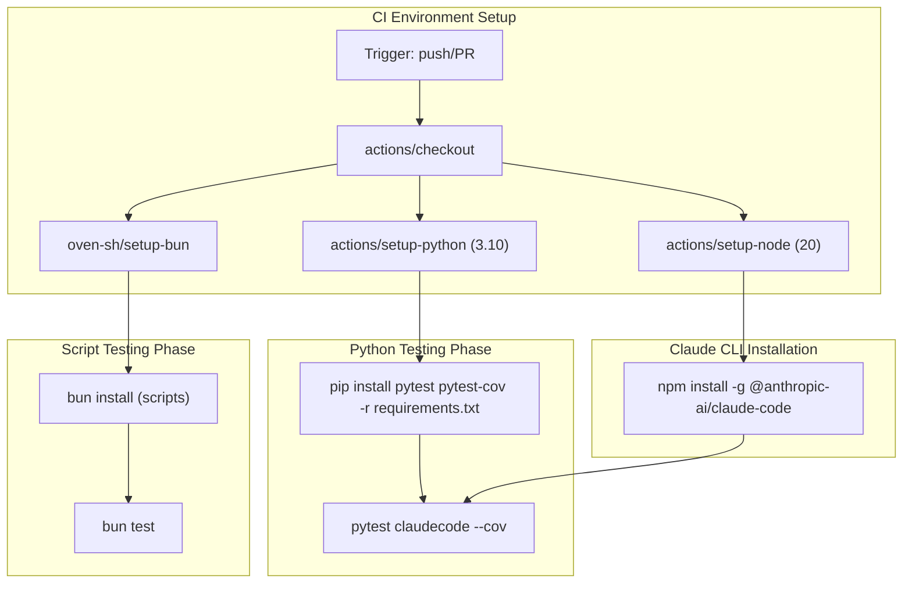
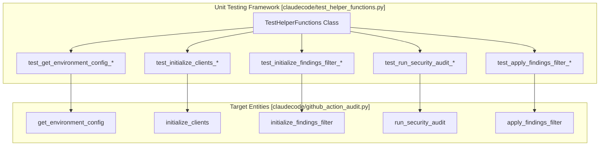

<!-- source: DeepWiki mcp.deepwiki.com · repo anthropics/claude-code-security-review · page 5.3 Test Infrastructure · fetched 2026-10-26 -->

# Test Infrastructure

Relevant source files

The following files were used as context for generating this wiki page:

- [.github/workflows/test-claudecode.yml](.github/workflows/test-claudecode.yml)
- [claudecode/test_helper_functions.py](claudecode/test_helper_functions.py)
- [claudecode/test_integration.py](claudecode/test_integration.py)
- [claudecode/test_workflow_integration.py](claudecode/test_workflow_integration.py)
- [pytest.ini](pytest.ini)

This page documents the test suite and Continuous Integration (CI) workflows for the Claude Code Security Review system. The testing infrastructure provides unit tests, integration tests, and automated validation to ensure system reliability across the Python engine and supporting scripts.

## CI Workflows

The system uses GitHub Actions to automate testing on every pull request and push to the `main` branch. The primary workflow is defined in `.github/workflows/test-claudecode.yml` [1-8]().

### Workflow Execution Flow

The CI pipeline orchestrates a multi-language environment to test both the Python core and the Bun-based utility scripts.

Sources: [.github/workflows/test-claudecode.yml:16-61]()

## Test Suite Organization

The testing infrastructure is organized into unit tests, integration tests, and full workflow simulations.

### Unit Test Structure

Unit tests focus on validating individual functions in `github_action_audit.py` using `pytest` and `unittest.mock`.

Sources: [claudecode/test_helper_functions.py:20-174](), [claudecode/github_action_audit.py:1-250]()

### Integration Test Structure

Integration tests validate cross-component interactions, such as how the `SimpleClaudeRunner` interacts with environment variables or how the `FindingsFilter` processes simulated findings.

| Test Class | File | Purpose |
|------------|------|---------|
| `TestClaudeCodeAudit` | `claudecode/test_integration.py` | Validates `main()` entry point and exit codes [9-57]() |
| `TestEnvironmentSetup` | `claudecode/test_integration.py` | Checks `ANTHROPIC_API_KEY` handling in `SimpleClaudeRunner` [59-81]() |
| `TestFilteringIntegration` | `claudecode/test_integration.py` | Tests `FindingsFilter` with LLM components disabled [83-108]() |
| `TestFullWorkflowIntegration` | `claudecode/test_workflow_integration.py` | Simulates a full PR audit with mocked GitHub API and Claude CLI [16-200]() |

Sources: [claudecode/test_integration.py:9-108](), [claudecode/test_workflow_integration.py:16-200]()

## Mocking and Simulation Strategy

To test the system without incurring API costs or requiring a live GitHub environment, the test suite heavily utilizes mocking.

### GitHub API Simulation
In `TestFullWorkflowIntegration`, the `requests.get` method is patched to return `Mock` objects representing:
- **PR Metadata**: Simulated JSON from `repos/{owner}/{repo}/pulls/{number}` [25-45]().
- **File List**: Simulated list of changed files with patches [48-87]().
- **Raw Diff**: Simulated git diff text [90-122]().

### Claude CLI Simulation
The `subprocess.run` call used by `SimpleClaudeRunner` is mocked to simulate the output of the `@anthropic-ai/claude-code` tool [169-185]().
- **Version Check**: Simulates `claude --version` [170-173]().
- **Audit Execution**: Returns a JSON string containing a `result` field, which itself contains the stringified security findings [175-182]().

Sources: [claudecode/test_workflow_integration.py:19-185]()

## Test Configuration

The test environment is configured via `pytest.ini`, which defines the discovery patterns for test files and classes.

| Setting | Value | Description |
|---------|-------|-------------|
| `testpaths` | `tests` | Directory to search for tests [2]() |
| `python_files` | `test_*.py` | Pattern for test modules [3]() |
| `python_classes` | `Test*` | Pattern for test classes [4]() |
| `addopts` | `-v --tb=short` | Verbose output with short tracebacks [6]() |

Sources: [pytest.ini:1-6]()

## Error Handling Validation

A critical part of the test infrastructure is verifying that the system fails gracefully with descriptive errors.

- **Configuration Errors**: Tests ensure that missing `GITHUB_REPOSITORY` or `PR_NUMBER` variables result in an exit code of `2` (`EXIT_CONFIGURATION_ERROR`) and a JSON error message [claudecode/test_integration.py:20-41]().
- **Invalid Inputs**: Tests verify that non-integer PR numbers are caught during initialization [claudecode/test_helper_functions.py:50-60]().
- **API Failures**: Tests simulate GitHub API errors to ensure the system raises a `ConfigurationError` [claudecode/test_helper_functions.py:77-87]().

Sources: [claudecode/test_integration.py:20-41](), [claudecode/test_helper_functions.py:50-87]()

---

