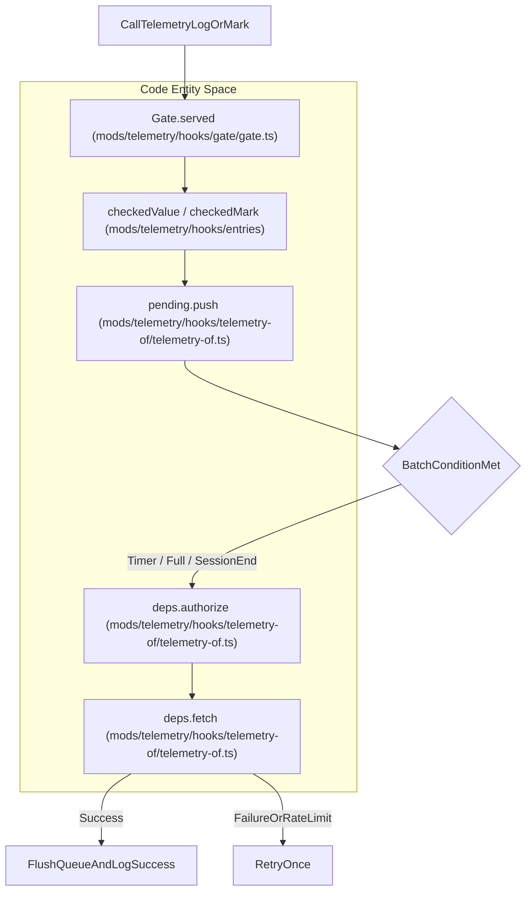
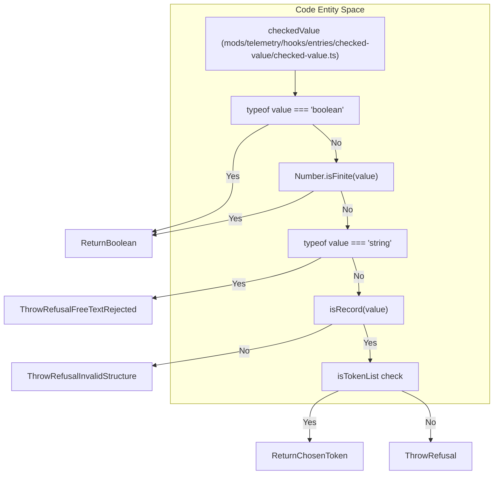
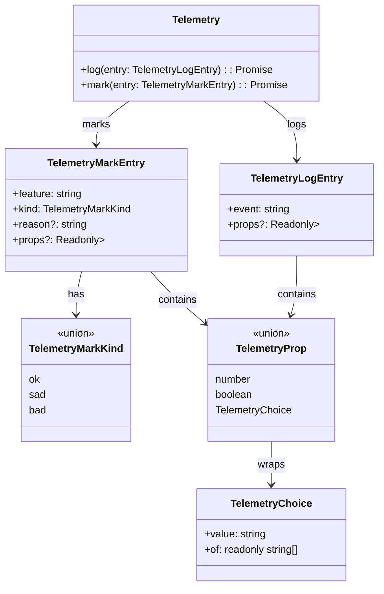

<!-- source: DeepWiki mcp.deepwiki.com · repo anthropics/claude-code · page 4.3 Telemetry Mod · fetched 2026-10-26 -->

# Telemetry Mod

Relevant source files

The following files were used as context for generating this wiki page:

- [mods/agents-md/tests/fixtures/recording.ts](mods/agents-md/tests/fixtures/recording.ts)
- [mods/telemetry/.claude-plugin/plugin.json](mods/telemetry/.claude-plugin/plugin.json)
- [mods/telemetry/README.md](mods/telemetry/README.md)
- [mods/telemetry/hooks/answer-of/answer-of.ts](mods/telemetry/hooks/answer-of/answer-of.ts)
- [mods/telemetry/hooks/answer-of/index.ts](mods/telemetry/hooks/answer-of/index.ts)
- [mods/telemetry/hooks/context/environment-fields-of/environment-fields-of.ts](mods/telemetry/hooks/context/environment-fields-of/environment-fields-of.ts)
- [mods/telemetry/hooks/context/environment-fields/environment-fields.ts](mods/telemetry/hooks/context/environment-fields/environment-fields.ts)
- [mods/telemetry/hooks/context/probe-of/probe-of.ts](mods/telemetry/hooks/context/probe-of/probe-of.ts)
- [mods/telemetry/hooks/context/probe/probe.ts](mods/telemetry/hooks/context/probe/probe.ts)
- [mods/telemetry/hooks/entries/checked-fields.ts](mods/telemetry/hooks/entries/checked-fields.ts)
- [mods/telemetry/hooks/entries/checked-mark.ts](mods/telemetry/hooks/entries/checked-mark.ts)
- [mods/telemetry/hooks/entries/checked-props/checked-props.ts](mods/telemetry/hooks/entries/checked-props/checked-props.ts)
- [mods/telemetry/hooks/entries/checked-props/index.ts](mods/telemetry/hooks/entries/checked-props/index.ts)
- [mods/telemetry/hooks/entries/checked-value/checked-value.ts](mods/telemetry/hooks/entries/checked-value/checked-value.ts)
- [mods/telemetry/hooks/entries/choice-token/choice-token.ts](mods/telemetry/hooks/entries/choice-token/choice-token.ts)
- [mods/telemetry/hooks/entries/choice-token/index.ts](mods/telemetry/hooks/entries/choice-token/index.ts)
- [mods/telemetry/hooks/entries/core-event-prefix/core-event-prefix.ts](mods/telemetry/hooks/entries/core-event-prefix/core-event-prefix.ts)
- [mods/telemetry/hooks/entries/core-event-prefix/index.ts](mods/telemetry/hooks/entries/core-event-prefix/index.ts)
- [mods/telemetry/hooks/entries/event-prefix/event-prefix.ts](mods/telemetry/hooks/entries/event-prefix/event-prefix.ts)
- [mods/telemetry/hooks/entries/fields-of/fields-of.ts](mods/telemetry/hooks/entries/fields-of/fields-of.ts)
- [mods/telemetry/hooks/entries/index.ts](mods/telemetry/hooks/entries/index.ts)
- [mods/telemetry/hooks/entries/is-mark-kind/is-mark-kind.ts](mods/telemetry/hooks/entries/is-mark-kind/is-mark-kind.ts)
- [mods/telemetry/hooks/entries/is-refused-entry/index.ts](mods/telemetry/hooks/entries/is-refused-entry/index.ts)
- [mods/telemetry/hooks/entries/is-refused-entry/is-refused-entry.ts](mods/telemetry/hooks/entries/is-refused-entry/is-refused-entry.ts)
- [mods/telemetry/hooks/entries/mark-fields-of/mark-fields-of.ts](mods/telemetry/hooks/entries/mark-fields-of/mark-fields-of.ts)
- [mods/telemetry/hooks/entries/mark-kinds/mark-kinds.ts](mods/telemetry/hooks/entries/mark-kinds/mark-kinds.ts)
- [mods/telemetry/hooks/entries/mark/mark.ts](mods/telemetry/hooks/entries/mark/mark.ts)
- [mods/telemetry/hooks/entries/refusal/refusal.ts](mods/telemetry/hooks/entries/refusal/refusal.ts)
- [mods/telemetry/hooks/entries/refused-entry/index.ts](mods/telemetry/hooks/entries/refused-entry/index.ts)
- [mods/telemetry/hooks/entries/refused-entry/refused-entry.ts](mods/telemetry/hooks/entries/refused-entry/refused-entry.ts)
- [mods/telemetry/hooks/entries/token/token.ts](mods/telemetry/hooks/entries/token/token.ts)
- [mods/telemetry/hooks/index.ts](mods/telemetry/hooks/index.ts)
- [mods/telemetry/hooks/register.ts](mods/telemetry/hooks/register.ts)
- [mods/telemetry/hooks/telemetry-deps/telemetry-deps.ts](mods/telemetry/hooks/telemetry-deps/telemetry-deps.ts)
- [mods/telemetry/hooks/telemetry-of/telemetry-of.ts](mods/telemetry/hooks/telemetry-of/telemetry-of.ts)
- [mods/telemetry/tests/fixtures/engine-version.ts](mods/telemetry/tests/fixtures/engine-version.ts)
- [mods/telemetry/tests/fixtures/expected-row.ts](mods/telemetry/tests/fixtures/expected-row.ts)
- [mods/telemetry/tests/fixtures/first-party-session.ts](mods/telemetry/tests/fixtures/first-party-session.ts)
- [mods/telemetry/tests/fixtures/index.ts](mods/telemetry/tests/fixtures/index.ts)
- [mods/telemetry/tests/fixtures/plugins/holding.ts](mods/telemetry/tests/fixtures/plugins/holding.ts)
- [mods/telemetry/tests/fixtures/plugins/meddling.ts](mods/telemetry/tests/fixtures/plugins/meddling.ts)
- [mods/telemetry/tests/fixtures/plugins/reaching.ts](mods/telemetry/tests/fixtures/plugins/reaching.ts)
- [mods/telemetry/tests/fixtures/plugins/replacing.ts](mods/telemetry/tests/fixtures/plugins/replacing.ts)
- [mods/telemetry/tests/fixtures/plugins/swallowing.ts](mods/telemetry/tests/fixtures/plugins/swallowing.ts)
- [mods/telemetry/tests/fixtures/plugins/visiting.ts](mods/telemetry/tests/fixtures/plugins/visiting.ts)
- [mods/telemetry/tests/fixtures/record.ts](mods/telemetry/tests/fixtures/record.ts)
- [mods/telemetry/tests/fixtures/survey-answer.ts](mods/telemetry/tests/fixtures/survey-answer.ts)
- [mods/telemetry/tests/gate.test.ts](mods/telemetry/tests/gate.test.ts)
- [mods/telemetry/tests/register.test.ts](mods/telemetry/tests/register.test.ts)
- [mods/telemetry/types/index.d.ts](mods/telemetry/types/index.d.ts)

The Telemetry Mod (`mods/telemetry`) provides a standardized mechanism for plugins to log events and mark feature usage within the Claude Code environment. It exposes the `$.telemetry` noun to the engine interface, allowing built-in plugins to send analytics data as first-party rows to an event-logging ingest in batched transmissions [mods/telemetry/README.md:3-25](). This page details the implementation of the `$.telemetry` noun, its entry validation rules, event prefixes, choice tokens, gating/refusals, batching logic, analytics-off behavior, and the telemetry type contract.

## `$.telemetry` Noun & Batching Pipeline

The `$.telemetry` noun is added to the `EngineInterface` via an `engine.create` hook in `mods/telemetry/hooks/register.ts` [mods/telemetry/hooks/register.ts:53-85](). It provides two primary methods for sending telemetry data: `log` and `mark` [mods/telemetry/README.md:14-17]().

### `$.telemetry.log`
The `log` method queues a general event prefixed with `tengu_plugin_` as a first-party row [mods/telemetry/README.md:14-15](). It takes a `TelemetryLogEntry` object consisting of an `event` name and optional `props` [mods/telemetry/tests/fixtures/record.ts:13-18]().

### `$.telemetry.mark`
The `mark` method records the usage of a feature under `tengu_feature_<kind>`, attaching a `feature_name`, an optional `reason` (required for `sad` or `bad` states, and refused for `ok`), and accompanying properties [mods/telemetry/README.md:15-17]().

### Batching & Transmission
Rows are queued locally and flushed in batches under three conditions [mods/telemetry/README.md:18-22]():
1. A timer expires a few seconds after the first row is queued (`BATCH_WINDOW_MS`) [mods/telemetry/README.md:18-21]().
2. The queue reaches capacity (`BATCH_ROWS`) [mods/telemetry/tests/register.test.ts:110-112]().
3. The session terminates via the `session.end` hook [mods/telemetry/README.md:21]().

Batches are posted via `http.fetch` to the event-logging ingest URL using the session's authorization credential (`$.session.authorize()`) [mods/telemetry/README.md:19-20](). If a batch is refused due to server error, timeout, or rate limit, it is retried once [mods/telemetry/README.md:22-23]().

**Telemetry Event and Batching Flow**

Sources: [mods/telemetry/README.md:10-25](), [mods/telemetry/hooks/register.ts:27-51](), [mods/telemetry/hooks/telemetry-of/telemetry-of.ts:72-183]()

## Gating and Refusals

The telemetry mod employs a strict gating mechanism (`Gate`) on `telemetry.*` to restrict analytics ingestion to authorized components [mods/telemetry/README.md:5-8]().

* **Built-in Tier Enforcement**: Callers in the built-in tier (or the host engine) are permitted to proceed, while third-party plugins installed by users are refused with a descriptive reason [mods/telemetry/README.md:5-8]().
* **Origin Stamping**: The host stamps every call with `next.origin` to determine the caller's tier [mods/telemetry/README.md:7-8]().
* **Refusal Handling**: If an unauthorized caller attempts to invoke `$.telemetry` methods, the promise rejects with a `HooksError` detailing the refusal [mods/telemetry/tests/gate.test.ts:8]().

Sources: [mods/telemetry/README.md:3-8](), [mods/telemetry/tests/gate.test.ts:1-40]()

## Entry Validation

The Telemetry Mod enforces strict validation rules across all properties and log entries to ensure no free-form text reaches telemetry rows [mods/telemetry/README.md:52-59]().

### Checked Values and Properties
The `checkedValue` function located in `mods/telemetry/hooks/entries/checked-value/checked-value.ts` validates individual property values [mods/telemetry/hooks/entries/checked-value/checked-value.ts:19-23](). It permits only finite numbers, booleans, or structured `Choice` objects, explicitly rejecting bare strings [mods/telemetry/hooks/entries/checked-value/checked-value.ts:24-42]().

**`checkedValue` Validation Pipeline**

Sources: [mods/telemetry/hooks/entries/checked-value/checked-value.ts:19-74]()

### Choice Tokens
When a property value is restricted to a set of options, it must be submitted as a `Choice` object containing a `value` and an `of` token list [mods/telemetry/README.md:53-54](). Each token must match the regular expression defined in `mods/telemetry/hooks/entries/choice-token/choice-token.ts`:
- `CHOICE_TOKEN = /^[a-z0-9][a-z0-9_-]{0,63}$/` [mods/telemetry/hooks/entries/choice-token/choice-token.ts:8]()

Sources: [mods/telemetry/README.md:52-60](), [mods/telemetry/hooks/entries/checked-value/checked-value.ts:1-74](), [mods/telemetry/hooks/entries/choice-token/choice-token.ts:1-8]()

## Analytics-Off Behavior

The telemetry mod respects system settings and environment variables that disable tracking [mods/telemetry/README.md:41-50](). It evaluates environment flags and policy options before transmitting any batch [mods/telemetry/README.md:46-48]().

Analytics transmission is suppressed under any of the following conditions:
* Environment flags are set: `DISABLE_TELEMETRY`, `CLAUDE_CODE_DISABLE_NONESSENTIAL_TRAFFIC`, or `DO_NOT_TRACK` [mods/telemetry/README.md:41-43]().
* The execution environment is a test run [mods/telemetry/README.md:43]().
* The host is connected to an unmanaged third-party provider (Bedrock, Vertex, Foundry) or a custom cloud gateway with login pins [mods/telemetry/README.md:43-45]().
* The deployment configures its own custom OAuth URL [mods/telemetry/README.md:45-46]().

Sources: [mods/telemetry/README.md:41-51](), [mods/telemetry/tests/register.test.ts:164-220]()

## Telemetry Type Contract

The formal type contract for the telemetry mod is defined in `mods/telemetry/types/index.d.ts` [mods/telemetry/README.md:61-63]() and shared across all mods, hooks, and test fixtures.

**Telemetry Type Contract Classes**

Sources: [mods/telemetry/.claude-plugin/plugin.json:1-9](), [mods/telemetry/README.md:61-63]()

---

