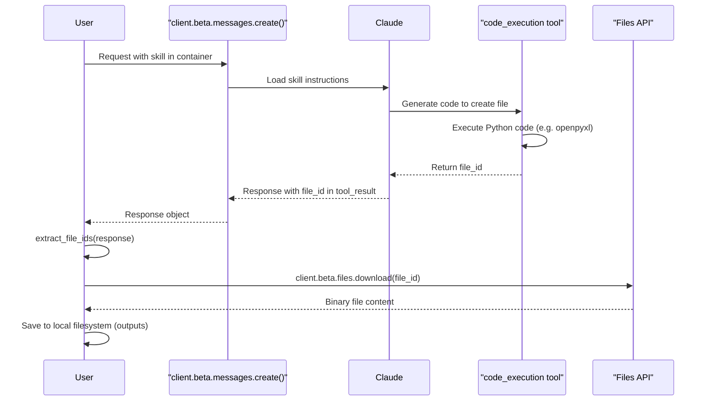

<!-- source: DeepWiki mcp.deepwiki.com · repo anthropics/claude-cookbooks · page 4.2 Using Built-in Skills · fetched 2026-10-26 -->

# Using Built-in Skills

<details>
<summary>Relevant source files</summary>

The following files were used as context for generating this wiki page:

- [skills/.claude/hooks/pre-bash.sh](skills/.claude/hooks/pre-bash.sh)
- [skills/.claude/hooks/pre-write.sh](skills/.claude/hooks/pre-write.sh)
- [skills/.claude/hooks/session-start.sh](skills/.claude/hooks/session-start.sh)
- [skills/.claude/settings.json](skills/.claude/settings.json)
- [skills/.env.example](skills/.env.example)
- [skills/.gitignore](skills/.gitignore)
- [skills/README.md](skills/README.md)
- [skills/file_utils.py](skills/file_utils.py)
- [skills/notebooks/01_skills_introduction.ipynb](skills/notebooks/01_skills_introduction.ipynb)
- [skills/notebooks/02_skills_financial_applications.ipynb](skills/notebooks/02_skills_financial_applications.ipynb)
- [skills/notebooks/03_skills_custom_development.ipynb](skills/notebooks/03_skills_custom_development.ipynb)
- [skills/requirements.txt](skills/requirements.txt)
- [skills/skill_utils.py](skills/skill_utils.py)

</details>


## Purpose and Scope

This page documents the four Anthropic-managed Skills that enable Claude to generate formatted documents: Excel spreadsheets (`xlsx`), PowerPoint presentations (`pptx`), PDF documents (`pdf`), and Word files (`docx`). These skills are production-ready capabilities maintained by Anthropic and accessible via the Skills API beta.

Built-in skills leverage a **Progressive Disclosure Architecture**, where instructions and resources are loaded only when needed to optimize token usage [skills/README.md:1-23](). Required files for using these skills include the Anthropic SDK (v0.71.0+) and specific environment configurations [skills/requirements.txt:5-8]().

**Sources:** [skills/README.md:1-23](), [skills/README.md:134-154](), [skills/requirements.txt:5-8]()

## Built-in Skills Reference

Anthropic provides four pre-built skills for document generation:

| Skill ID | Type | Capabilities | Common Use Cases |
|----------|------|-------------|------------------|
| `xlsx` | Excel | Workbooks with multiple sheets, formulas, charts, pivot tables, conditional formatting | Financial models, data analysis, budgets, dashboards |
| `pptx` | PowerPoint | Slides with text, images, charts, tables, transitions | Executive presentations, reports, pitch decks |
| `pdf` | PDF | Formatted documents with text, tables, images | Receipts, invoices, formal reports, documentation |
| `docx` | Word | Rich text documents with formatting, headers, footers, tables | Contracts, letters, proposals, documentation |

**Sources:** [skills/README.md:11-14](), [skills/README.md:173-180](), [skills/notebooks/01_skills_introduction.ipynb:135-141]()

## API Configuration Requirements

### Beta Headers

Built-in skills require three specific beta features to be enabled in the request headers to support code execution and file retrieval:

```mermaid
graph TB
    ["client.beta.messages.create()"] --> ["Beta Headers"]
    
    subgraph "Required_Beta_Features"
        ["code-execution-2025-08-25"] -- "Enables code execution environment" --> ["Runtime"]
        ["files-api-2025-04-14"] -- "Enables file download capability" --> ["Retrieval"]
        ["skills-2025-10-02"] -- "Enables Skills feature" --> ["Orchestration"]
    end
    
    subgraph "Request_Parameters"
        ["container: {'skills': [...]}"]
        ["tools: [{'type': 'code_execution_20250825'}]"]
    end
```

**Diagram: Beta Configuration for Built-in Skills**

**Sources:** [skills/README.md:149-154](), [skills/notebooks/01_skills_introduction.ipynb:86-96]()

### Configuration Pattern

To use built-in skills, the `Anthropic` client must include the `anthropic-beta` headers [skills/README.md:138-147]().

```python
from anthropic import Anthropic

client = Anthropic(
    api_key="your-api-key",
    default_headers={
        "anthropic-beta": "code-execution-2025-08-25,files-api-2025-04-14,skills-2025-10-02"
    }
)

response = client.beta.messages.create(
    model="claude-sonnet-4-6",
    max_tokens=4096,
    container={
        "skills": [
            {"type": "anthropic", "skill_id": "xlsx", "version": "latest"}
        ]
    },
    tools=[{"type": "code_execution_20250825", "name": "code_execution"}],
    messages=[{"role": "user", "content": "Create an Excel file..."}]
)
```

**Sources:** [skills/README.md:138-147](), [skills/notebooks/01_skills_introduction.ipynb:54-97]()

### Container Parameter Structure

The `container` parameter is the primary mechanism for loading skills [skills/notebooks/01_skills_introduction.ipynb:151-166]():

| Field | Type | Description | Example |
|-------|------|-------------|---------|
| `type` | string | Skill source: "anthropic" or "custom" | `"anthropic"` |
| `skill_id` | string | Identifier for the skill | `"xlsx"`, `"pptx"`, `"pdf"`, `"docx"` |
| `version` | string | Version to use | `"latest"` (recommended) |

**Sources:** [skills/README.md:177-180](), [skills/notebooks/01_skills_introduction.ipynb:151-166]()

## Skills-to-Files Workflow

The workflow involves Claude generating code, executing it in a secure environment using the `code_execution` tool, and returning a file identifier [skills/README.md:159-208]().



**Diagram: Skills Document Generation and Download Flow**

**Sources:** [skills/README.md:159-208](), [skills/file_utils.py:18-87](), [skills/file_utils.py:90-155]()

## Specific Skill Capabilities

### Excel Skill (xlsx)
The `xlsx` skill utilizes `openpyxl` and `xlsxwriter` in the remote environment [skills/requirements.txt:13](). It supports multi-sheet workbooks, complex formulas, and financial dashboarding [skills/notebooks/02_skills_financial_applications.ipynb:6-22]().

### PowerPoint Skill (pptx)
Generates presentations using the `python-pptx` library logic. It supports slide layouts, tables, and embedded charts derived from financial data [skills/notebooks/02_skills_financial_applications.ipynb:17]().

### PDF Skill (pdf)
Creates styled PDF documents using `reportlab`. Ideal for generating formal financial reports, invoices, and executive summaries [skills/notebooks/02_skills_financial_applications.ipynb:18]().

**Sources:** [skills/requirements.txt:13](), [skills/notebooks/02_skills_financial_applications.ipynb:6-22]()

## Files API Integration

### Utility Helpers (`file_utils.py`)

The codebase includes a specialized utility module, `file_utils.py`, to bridge the "Natural Language" output of Claude with the "Code Entity" space of file management.

```mermaid
graph TB
    subgraph "file_utils.py"
        ["extract_file_ids(response)"] -- "Parses blocks" --> ["file_id list"]
        ["download_file(client, file_id, output_path)"] -- "Saves binary" --> ["Local File"]
        ["download_all_files(client, response, output_dir)"] -- "Orchestrates" --> ["Batch Download"]
    end
    
    subgraph "Anthropic_SDK_Entities"
        ["client.beta.files.download()"]
        ["client.beta.files.retrieve_metadata()"]
    end
    
    ["extract_file_ids(response)"] --> ["download_all_files(client, response, output_dir)"]
    ["download_all_files(client, response, output_dir)"] --> ["client.beta.files.retrieve_metadata()"]
    ["download_all_files(client, response, output_dir)"] --> ["download_file(client, file_id, output_path)"]
    ["download_file(client, file_id, output_path)"] --> ["client.beta.files.download()"]
```

**Diagram: Files API Utility Mapping**

**Sources:** [skills/file_utils.py:18-35](), [skills/file_utils.py:90-119](), [skills/file_utils.py:158-189]()

### Implementation Details

1.  **`extract_file_ids`**: Iterates through response blocks. It checks for `bash_code_execution_tool_result` (beta format) and extracts `file_id` from the content array [skills/file_utils.py:38-50]().
2.  **`download_file`**: Uses `client.beta.files.download(file_id=file_id)` to get the content, then writes the binary stream to the path specified in `output_path` [skills/file_utils.py:90-155]().
3.  **`download_all_files`**: A convenience wrapper that extracts all IDs, retrieves metadata to determine filenames, and saves them to the `outputs/` directory [skills/file_utils.py:158-202]().

### Metadata Retrieval
Before downloading, users can call `client.beta.files.retrieve_metadata(file_id=file_id)` to get the original `filename` and `size_bytes` [skills/file_utils.py:196-197]().

**Sources:** [skills/file_utils.py:18-87](), [skills/file_utils.py:90-155](), [skills/file_utils.py:158-202]()

## Multi-Skill Workflows

Claude can load multiple skills simultaneously to perform complex data pipelines. A common pattern is loading both `xlsx` and `pptx` to transform raw CSV data into a comprehensive financial model and a summary presentation in a single turn [skills/notebooks/02_skills_financial_applications.ipynb:19-22]().

**Sources:** [skills/README.md:177-180](), [skills/notebooks/02_skills_financial_applications.ipynb:19-22]()

---

