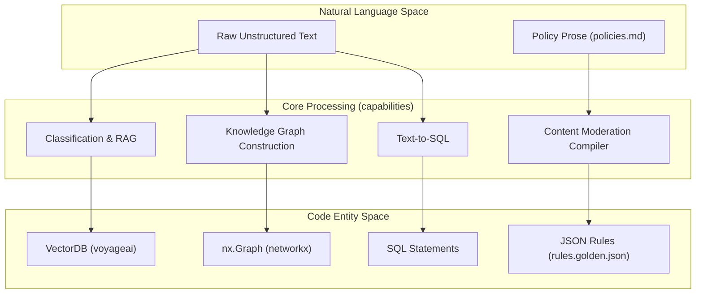
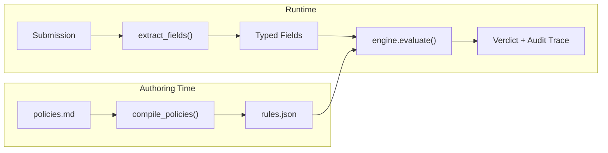

<!-- source: DeepWiki mcp.deepwiki.com · repo anthropics/claude-cookbooks · page 5 Core Capabilities · fetched 2026-10-26 -->

# Core Capabilities

Relevant source files

The following files were used as context for generating this wiki page:

- [capabilities/README.md](capabilities/README.md)
- [capabilities/content_moderation/README.md](capabilities/content_moderation/README.md)
- [capabilities/content_moderation/data/ad_creatives/build_creatives.py](capabilities/content_moderation/data/ad_creatives/build_creatives.py)
- [capabilities/content_moderation/data/ad_creatives/context.json](capabilities/content_moderation/data/ad_creatives/context.json)
- [capabilities/content_moderation/data/ad_creatives/images/betpeak_bonus.png](capabilities/content_moderation/data/ad_creatives/images/betpeak_bonus.png)
- [capabilities/content_moderation/data/ad_creatives/images/luma_before_after.png](capabilities/content_moderation/data/ad_creatives/images/luma_before_after.png)
- [capabilities/content_moderation/data/ad_creatives/images/northpeak_trail.png](capabilities/content_moderation/data/ad_creatives/images/northpeak_trail.png)
- [capabilities/content_moderation/data/ad_creatives/images/peaklend_rate.png](capabilities/content_moderation/data/ad_creatives/images/peaklend_rate.png)
- [capabilities/content_moderation/data/ad_creatives/images/vinepeak_wine.png](capabilities/content_moderation/data/ad_creatives/images/vinepeak_wine.png)
- [capabilities/content_moderation/evaluation/run_eval.py](capabilities/content_moderation/evaluation/run_eval.py)
- [capabilities/content_moderation/guide.ipynb](capabilities/content_moderation/guide.ipynb)
- [capabilities/content_moderation/pipeline.py](capabilities/content_moderation/pipeline.py)
- [capabilities/knowledge_graph/README.md](capabilities/knowledge_graph/README.md)
- [capabilities/knowledge_graph/data/alias_map.json](capabilities/knowledge_graph/data/alias_map.json)
- [capabilities/knowledge_graph/data/sample_triples.json](capabilities/knowledge_graph/data/sample_triples.json)
- [capabilities/knowledge_graph/evaluation/README.md](capabilities/knowledge_graph/evaluation/README.md)
- [capabilities/knowledge_graph/evaluation/eval_extraction.py](capabilities/knowledge_graph/evaluation/eval_extraction.py)
- [capabilities/knowledge_graph/guide.ipynb](capabilities/knowledge_graph/guide.ipynb)
- [pyproject.toml](pyproject.toml)
- [uv.lock](uv.lock)

The `capabilities/` directory serves as a central hub for demonstrating Claude's advanced Natural Language Processing (NLP) and reasoning strengths. These cookbooks provide modular, executable examples of how to implement complex logic—ranging from structured data extraction to sophisticated retrieval strategies—using Claude's long context window and reasoning capabilities [capabilities/README.md:1-5]().

### High-Level Architecture

The capabilities are organized into domains that bridge the gap between unstructured natural language and structured, actionable data. The repository emphasizes a "LLM-in-the-loop" approach where Claude handles extraction and synthesis, while deterministic code (e.g., Python rule engines or graph libraries) handles final logic and storage.

#### Capability Flow: Text to Structured Insights
The following diagram illustrates how different capabilities within the repository transform raw input into structured knowledge or executable code.

Sources: [capabilities/README.md:7-20](), [capabilities/knowledge_graph/guide.ipynb:74-78](), [capabilities/content_moderation/pipeline.py:44-74]()

---

### 5.1 Classification and RAG
This section focuses on text and data classification, particularly in scenarios with complex business rules and limited training data [capabilities/README.md:7-12](). It demonstrates how to combine Retrieval Augmented Generation (RAG) with classification to improve accuracy by providing Claude with relevant examples at runtime.

*   **Prompt Engineering**: Implementation of RAG-based classification and chain-of-thought patterns to handle domain-specific nuances.
*   **Contextual Embeddings**: Techniques for adding relevant context to document chunks before embedding to improve retrieval precision [capabilities/README.md:11-11]().
*   **Evaluation**: Strategies for handling the balance of subjectivity and accuracy in RAG and classification outputs.

For details, see [Classification and RAG](#5.1).

---

### 5.2 Knowledge Graph Construction
Knowledge graphs represent a sophisticated way to manage unstructured information by extracting entities and their relationships. This capability demonstrates an end-to-end pipeline for building these graphs using Claude's reasoning [capabilities/knowledge_graph/guide.ipynb:7-11]().

*   **NER and Relation Extraction**: Identifying `entities` as nodes and `typed relations` as edges using `client.messages.parse()` for schema validation [capabilities/knowledge_graph/guide.ipynb:9-19]().
*   **Entity Resolution**: Using Claude to collapse surface-form variants (e.g., "NASA" vs "National Aeronautics and Space Administration") into canonical nodes [capabilities/knowledge_graph/evaluation/eval_extraction.py:54-62]().
*   **Graph Assembly**: Utilizing `networkx` to assemble in-memory graphs for multi-hop reasoning [capabilities/knowledge_graph/guide.ipynb:19-22]().

For details, see [Knowledge Graph Construction](#5.2).

---

### 5.3 Text-to-SQL and Summarization
These capabilities focus on translating natural language into specific technical outputs or condensed information.

*   **Text-to-SQL**: Generating complex SQL queries from natural language using prompting, self-improvement, and RAG to provide database schemas [capabilities/README.md:15-15]().
*   **Summarization**: Techniques for processing long-form content and multi-document synthesis, including multi-shot and chunking methods [capabilities/README.md:13-13]().

For details, see [Text-to-SQL and Summarization](#5.3).

---

### 5.4 Content Moderation Pipeline
This capability demonstrates a "policy-to-rules compiler" pattern. Instead of asking Claude for a verdict directly, Claude compiles human-readable policy prose into a deterministic JSON ruleset [capabilities/content_moderation/guide.ipynb:18-21]().

*   **Policy Compiler**: `compile_policies` uses `COMPILER_MODEL` (Claude 3.5 Opus) to turn `policies.md` into a validated JSON document [capabilities/content_moderation/pipeline.py:23-26]().
*   **Rule Engine**: A ~200 line Python `engine.py` that evaluates extracted fields against rules without further model calls, ensuring consistency and auditability [capabilities/content_moderation/README.md:43-48]().
*   **Multi-Domain Eval**: Validation across ad creatives, product listings, and user-generated content (UGC) [capabilities/content_moderation/evaluation/run_eval.py:35-36]().

For details, see [Content Moderation Pipeline](#5.4).

---

### Technical Implementation Overview

The capabilities are implemented using a consistent validation and execution stack to ensure reliability across different Anthropic models.

| Component | Purpose | Code Reference |
| :--- | :--- | :--- |
| **Model Selection** | Using Haiku for extraction and Sonnet/Opus for reasoning | [capabilities/knowledge_graph/guide.ipynb:83-92]() |
| **Structured Output** | Enforcing Pydantic schemas via `client.messages.parse` | [capabilities/knowledge_graph/evaluation/eval_extraction.py:73-79]() |
| **Dependency Management** | Unified environment via `uv` and `pyproject.toml` | [pyproject.toml:1-21]() |
| **Evaluation Metrics** | Macro-averaged P/R/F1 scoring against gold sets | [capabilities/knowledge_graph/evaluation/eval_extraction.py:82-87]() |

#### Content Moderation Data Flow
This diagram shows how the moderation pipeline separates policy authoring from runtime execution.

Sources: [capabilities/content_moderation/pipeline.py:4-9](), [capabilities/content_moderation/evaluation/run_eval.py:82-86]()

---

