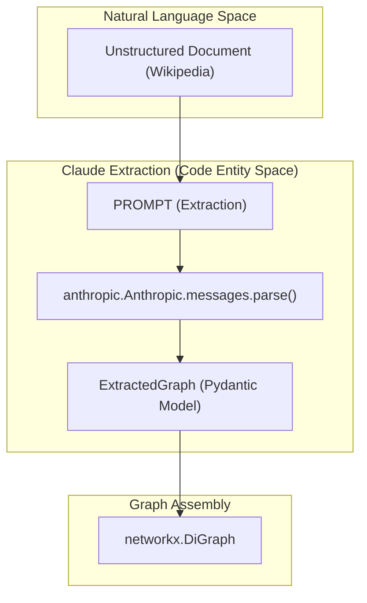
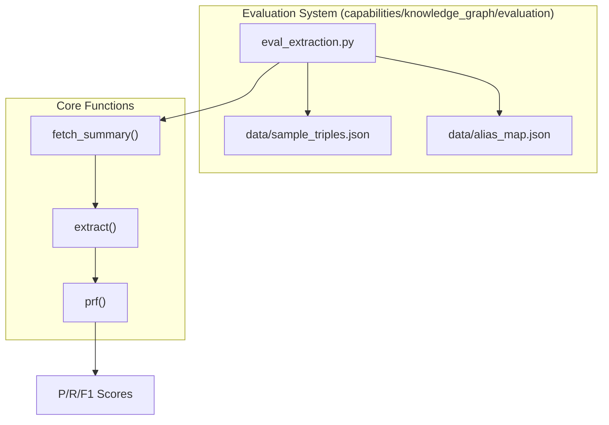

<!-- source: DeepWiki mcp.deepwiki.com · repo anthropics/claude-cookbooks · page 5.2 Knowledge Graph Construction · fetched 2026-10-26 -->

# Knowledge Graph Construction

Relevant source files

The following files were used as context for generating this wiki page:

- [capabilities/README.md](capabilities/README.md)
- [capabilities/knowledge_graph/README.md](capabilities/knowledge_graph/README.md)
- [capabilities/knowledge_graph/data/alias_map.json](capabilities/knowledge_graph/data/alias_map.json)
- [capabilities/knowledge_graph/data/sample_triples.json](capabilities/knowledge_graph/data/sample_triples.json)
- [capabilities/knowledge_graph/evaluation/README.md](capabilities/knowledge_graph/evaluation/README.md)
- [capabilities/knowledge_graph/evaluation/eval_extraction.py](capabilities/knowledge_graph/evaluation/eval_extraction.py)
- [capabilities/knowledge_graph/guide.ipynb](capabilities/knowledge_graph/guide.ipynb)
- [pyproject.toml](pyproject.toml)
- [uv.lock](uv.lock)

The Knowledge Graph (KG) construction pipeline demonstrates how to transform unstructured text into a structured network of entities and typed relations. By leveraging Claude's ability to handle structured outputs and complex reasoning, this implementation replaces traditional, brittle NLP pipelines (NER, relation extraction, and heuristic-based entity resolution) with LLM-driven prompts.

## Pipeline Architecture

The construction process follows a multi-stage pipeline that transitions from raw text to a queryable graph structure using `NetworkX`.

### 1. Data Acquisition and Corpus Building
The pipeline begins by fetching overlapping documents to ensure the entity resolution stage has sufficient data to process. In the provided example, Wikipedia summaries of the Apollo program are used [capabilities/knowledge_graph/guide.ipynb:98-102]().

### 2. Extraction (NER and Relation Extraction)
Claude extracts entities and subject–predicate–object triples in a single pass. This is achieved using the `client.messages.parse()` method with a defined Pydantic schema [capabilities/knowledge_graph/guide.ipynb:166-172]().

**Data Flow: Natural Language to Code Entities**

**Sources:** [capabilities/knowledge_graph/guide.ipynb:166-172](), [capabilities/knowledge_graph/evaluation/eval_extraction.py:72-80]()

### 3. Entity Resolution
To prevent duplicate nodes for the same real-world entity (e.g., "NASA" vs. "National Aeronautics and Space Administration"), Claude performs entity resolution. Unlike string-similarity heuristics, Claude weighs context and descriptions to collapse surface-form variants into canonical nodes [capabilities/knowledge_graph/guide.ipynb:18-20]().

### 4. Graph Assembly and Querying
Extracted triples are loaded into a `networkx.DiGraph`. Multi-hop questions are answered by serializing relevant subgraphs back to Claude for synthesis [capabilities/knowledge_graph/guide.ipynb:19-22]().

## Implementation Details

### Model Selection
The pipeline utilizes a two-model strategy to balance cost and reasoning capability:
*   **Extraction Model (`claude-haiku-4-5`)**: Handles high-volume, schema-constrained extraction tasks where speed and cost are prioritized [capabilities/knowledge_graph/guide.ipynb:83-85]().
*   **Synthesis Model (`claude-sonnet-4-6`)**: Handles entity resolution and summarization, requiring the model to weigh conflicting evidence across multiple documents [capabilities/knowledge_graph/guide.ipynb:84-91]().

### Schema Definition
The extraction is governed by Pydantic models to ensure structural integrity:

| Class | Purpose | Key Attributes |
| :--- | :--- | :--- |
| `Entity` | Defines a node in the graph | `name`, `type` (Literal), `description` |
| `Relation` | Defines an edge between nodes | `source`, `predicate`, `target` |
| `ExtractedGraph` | Container for a document's extraction | `entities: list[Entity]`, `relations: list[Relation]` |

**Sources:** [capabilities/knowledge_graph/evaluation/eval_extraction.py:25-40]()

## Evaluation Framework

The system includes a precision/recall scoring suite to measure extraction quality against a hand-labeled "gold set" located in `capabilities/knowledge_graph/data/sample_triples.json` [capabilities/knowledge_graph/evaluation/README.md:1-3]().

### Scoring Logic
*   **Entity P/R/F1**: An extracted entity is a true positive if its canonicalized name matches a gold entity [capabilities/knowledge_graph/evaluation/README.md:22-22]().
*   **Relation P/R/F1**: A relation is a true positive if both endpoints match a gold pair. Predicate wording is ignored to focus on connectivity [capabilities/knowledge_graph/evaluation/README.md:24-24]().
*   **Canonicalization**: Uses `alias_map.json` to map variants (e.g., "Project Apollo" → "apollo program") before comparison [capabilities/knowledge_graph/evaluation/eval_extraction.py:93-97]().

### System Component Interaction

**Sources:** [capabilities/knowledge_graph/evaluation/eval_extraction.py:90-153]()

### Expected Baselines
Using `claude-haiku-4-5`, the following performance ranges are typical:

| Metric | Precision | Recall | F1 |
| :--- | :--- | :--- | :--- |
| **Entities** | 0.80–0.90 | 0.70–0.85 | 0.75–0.85 |
| **Relations** | 0.70–0.85 | 0.55–0.70 | 0.60–0.75 |

**Sources:** [capabilities/knowledge_graph/evaluation/README.md:28-34]()

## Execution
To run the evaluation pipeline:
1.  Install dependencies via `uv sync --all-extras` [capabilities/knowledge_graph/evaluation/README.md:10-10]().
2.  Execute the script: `uv run python capabilities/knowledge_graph/evaluation/eval_extraction.py` [capabilities/knowledge_graph/evaluation/README.md:17-17]().

**Sources:** [capabilities/knowledge_graph/evaluation/README.md:1-18](), [pyproject.toml:1-21]()

---

