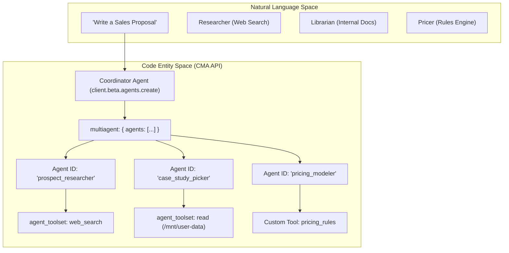
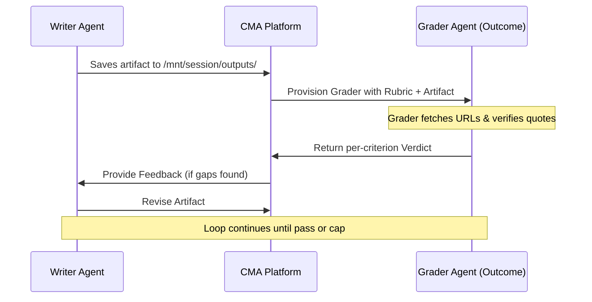

<!-- source: DeepWiki mcp.deepwiki.com · repo anthropics/claude-cookbooks · page 8.2 Multi-Agent Coordination Patterns · fetched 2026-10-26 -->

# Multi-Agent Coordination Patterns

Relevant source files

The following files were used as context for generating this wiki page:

- [authors.yaml](authors.yaml)
- [managed_agents/CMA_coordinate_specialist_team.ipynb](managed_agents/CMA_coordinate_specialist_team.ipynb)
- [managed_agents/CMA_explore_unfamiliar_codebase.ipynb](managed_agents/CMA_explore_unfamiliar_codebase.ipynb)
- [managed_agents/CMA_gate_human_in_the_loop.ipynb](managed_agents/CMA_gate_human_in_the_loop.ipynb)
- [managed_agents/CMA_iterate_fix_failing_tests.ipynb](managed_agents/CMA_iterate_fix_failing_tests.ipynb)
- [managed_agents/CMA_plan_big_execute_small.ipynb](managed_agents/CMA_plan_big_execute_small.ipynb)
- [managed_agents/CMA_remember_user_preferences.ipynb](managed_agents/CMA_remember_user_preferences.ipynb)
- [managed_agents/CMA_verify_with_outcome_grader.ipynb](managed_agents/CMA_verify_with_outcome_grader.ipynb)
- [managed_agents/CMA_watch_subagents_live.ipynb](managed_agents/CMA_watch_subagents_live.ipynb)
- [managed_agents/README.md](managed_agents/README.md)
- [managed_agents/data_analyst_agent.ipynb](managed_agents/data_analyst_agent.ipynb)
- [managed_agents/slack_data_bot.ipynb](managed_agents/slack_data_bot.ipynb)
- [managed_agents/sre_incident_responder.ipynb](managed_agents/sre_incident_responder.ipynb)
- [registry.yaml](registry.yaml)

Claude Managed Agents (CMA) provides a native hosted runtime for coordinating multiple stateful agents. This pattern allows developers to decompose complex tasks into specialized roles, optimize for cost by using smaller models for token-heavy execution, and implement rigorous quality control via automated grading loops.

## The Multi-Agent Coordinator Pattern

The core of multi-agent coordination in CMA is the `multiagent` configuration field on an agent definition. A **Coordinator** is an agent that has no tools of its own but instead manages a **Roster** of subagents [managed_agents/CMA_plan_big_execute_small.ipynb:110-118]().

### Roster Definitions and Scoping
When defining a coordinator, you provide a `multiagent` roster naming the subagents it can spawn. Each subagent is a fully independent agent definition with its own model, system prompt, and scoped toolset [managed_agents/CMA_coordinate_specialist_team.ipynb:77-82]().

*   **Tool Scoping**: By giving specialists only the tools they need (e.g., a researcher gets `web_search`, but a writer does not), you prevent subagents from hallucinating external data or leaking sensitive context [managed_agents/CMA_coordinate_specialist_team.ipynb:77-82]().
*   **Context Isolation**: Each subagent runs in its own session thread. The massive context generated by a subagent (like hundreds of thousands of tokens from web pages) never enters the coordinator's primary context window [managed_agents/CMA_plan_big_execute_small.ipynb:110-118]().

### Natural Language to Code Mapping: Team Orchestration

The following diagram bridges the conceptual "Specialist Team" to the specific CMA API entities used to implement them.

**Diagram: Multi-Agent Orchestration Entities**

Sources: [managed_agents/CMA_coordinate_specialist_team.ipynb:8-14](), [managed_agents/CMA_coordinate_specialist_team.ipynb:97-145]()

## Economic Model: Plan-Big-Execute-Small

The "Plan-Big-Execute-Small" pattern optimizes agent economics by splitting workloads between high-reasoning frontier models and high-throughput, low-cost models [managed_agents/CMA_plan_big_execute_small.ipynb:8-14]().

| Role | Model Choice | Responsibility | Token Usage |
| :--- | :--- | :--- | :--- |
| **Coordinator** | Frontier (e.g., Claude 3.5 Sonnet) | Planning, Synthesis, Judgment | Low (Orchestration only) |
| **Worker** | Efficient (e.g., Claude 3 Haiku) | Reading, Tool Use, Data Extraction | High (Bulk processing) |

### Per-Thread Cost Metering
CMA provides granular observability into the cost of multi-agent workflows. Developers can monitor cumulative usage via the `usage.list_cost` field and the `session.usage` snapshot events [managed_agents/CMA_plan_big_execute_small.ipynb:16-23](). 

To prevent runaway costs during parallel fan-out, sessions support a `budget` field on `sessions.create`. When the cumulative cost across all threads hits this ceiling, the session enters a `budget_reached` pause state [managed_agents/CMA_cap_session_spend.ipynb:8-14]().

Sources: [managed_agents/CMA_plan_big_execute_small.ipynb:8-23](), [managed_agents/CMA_cap_session_spend.ipynb:8-14]()

## Advanced Coordination Primitives

### Advisor Entries
An `advisor` is a specific roster entry type that allows a mid-tier working agent to consult a stronger model mid-turn. Unlike a standard subagent, an advisor consultation is often a single-turn request for guidance or verification [managed_agents/CMA_consult_an_advisor.ipynb:8-15]().

### Outcome Graders
The **Outcome** pattern implements a "Grade-and-Revise" loop. A writer agent produces an artifact, and a stateless **Grader** agent (provisioned in its own context) evaluates the work against a provided **Rubric** [managed_agents/CMA_verify_with_outcome_grader.ipynb:8-15]().

*   **`user.define_outcome`**: The event used to start the grading process [managed_agents/CMA_verify_with_outcome_grader.ipynb:155-165]().
*   **Span Events**: The platform emits `span.outcome_evaluation_*` events, allowing the application to track the grader's verdict per criterion [managed_agents/CMA_verify_with_outcome_grader.ipynb:16-21]().

### Fan-out Parallelism
CMA handles the lifecycle of parallel sub-tasks. The coordinator uses `create_agent` to spawn multiple workers, `send_to_agent` to dispatch tasks, and `wait_for_agents` to block until results are returned via `submit_result` [managed_agents/CMA_plan_big_execute_small.ipynb:110-118]().

**Diagram: Data Flow in a Grader Loop**

Sources: [managed_agents/CMA_verify_with_outcome_grader.ipynb:8-15](), [managed_agents/CMA_verify_with_outcome_grader.ipynb:155-165]()

## Implementation Reference

### Key Event Types for Coordination
*   **`thread_created`**: Emitted when the coordinator spawns a new subagent thread [managed_agents/CMA_plan_big_execute_small.ipynb:16-23]().
*   **`thread_message_received`**: Emitted when a subagent sends a message back to the coordinator [managed_agents/CMA_plan_big_execute_small.ipynb:16-23]().
*   **`agent.custom_tool_use`**: Used for Human-in-the-Loop (HITL) gates, where the session pauses for external application logic [managed_agents/CMA_gate_human_in_the_loop.ipynb:8-14]().

### Effort Configuration
Developers can control the "rigor" of subagents using the `model.effort` parameter (values: `low`, `medium`, `high`, `xhigh`, `max`). This allows for higher reasoning depth on critical sub-tasks (like standards alignment) while saving costs on mechanical tasks [managed_agents/CMA_watch_subagents_live.ipynb:47-50]().

Sources: [managed_agents/CMA_plan_big_execute_small.ipynb:16-23](), [managed_agents/CMA_gate_human_in_the_loop.ipynb:8-14](), [managed_agents/CMA_watch_subagents_live.ipynb:47-50]()

---

