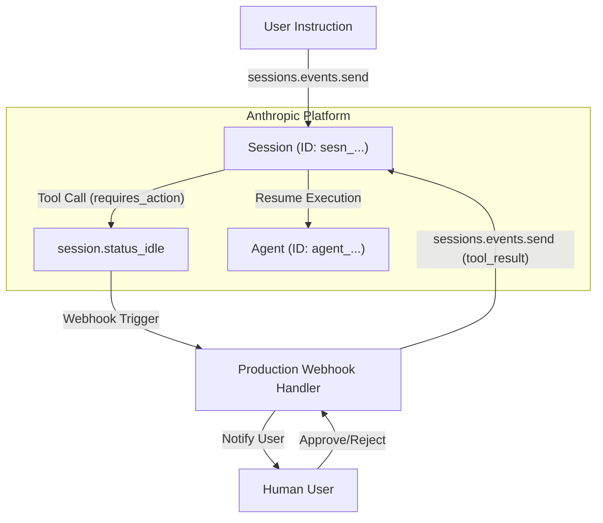
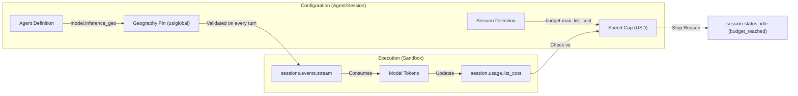

<!-- source: DeepWiki mcp.deepwiki.com · repo anthropics/claude-cookbooks · page 8.4 Production Operations and Webhooks · fetched 2026-10-26 -->

# Production Operations and Webhooks

Relevant source files

The following files were used as context for generating this wiki page:

- [managed_agents/.gitignore](managed_agents/.gitignore)
- [managed_agents/CMA_cap_session_spend.ipynb](managed_agents/CMA_cap_session_spend.ipynb)
- [managed_agents/CMA_consult_an_advisor.ipynb](managed_agents/CMA_consult_an_advisor.ipynb)
- [managed_agents/CMA_operate_in_production.ipynb](managed_agents/CMA_operate_in_production.ipynb)
- [managed_agents/CMA_orchestrate_issue_to_pr.ipynb](managed_agents/CMA_orchestrate_issue_to_pr.ipynb)
- [managed_agents/CMA_pin_inference_geo.ipynb](managed_agents/CMA_pin_inference_geo.ipynb)
- [managed_agents/CMA_use_skills_from_a_repo.ipynb](managed_agents/CMA_use_skills_from_a_repo.ipynb)
- [managed_agents/pyproject.toml](managed_agents/pyproject.toml)
- [managed_agents/sentry/.env.example](managed_agents/sentry/.env.example)
- [managed_agents/sentry/.gitignore](managed_agents/sentry/.gitignore)
- [managed_agents/sentry/CLAUDE.md](managed_agents/sentry/CLAUDE.md)
- [managed_agents/sentry/README.md](managed_agents/sentry/README.md)
- [managed_agents/sentry/agent_config.py](managed_agents/sentry/agent_config.py)
- [managed_agents/sentry/cma.py](managed_agents/sentry/cma.py)
- [managed_agents/sentry/deploy.py](managed_agents/sentry/deploy.py)
- [managed_agents/sentry/pyproject.toml](managed_agents/sentry/pyproject.toml)
- [managed_agents/sentry/run_now.py](managed_agents/sentry/run_now.py)

This section documents the patterns and infrastructure required to move Claude Managed Agents (CMA) from experimental notebooks into production environments. It covers secure credential management, resource lifecycle operations, and techniques for handling long-running agentic workflows without persistent client-side connections.

## MCP Toolsets and Vaults

Production agents often require access to third-party SaaS APIs (GitHub, Slack, Linear, etc.). CMA provides two primary primitives for managing these integrations securely at scale: **MCP Toolsets** and **Vaults**.

### MCP Toolsets
Unlike custom tools that require round-tripping every call through your application, an MCP toolset points the agent directly at an external server implementing the [Model Context Protocol](https://modelcontextprotocol.io). Anthropic proxies these calls from inside the sandbox, reducing latency and application complexity [managed_agents/CMA_operate_in_production.ipynb:48-52]().

### Vaults and Credentials
Vaults solve the problem of per-user secret isolation. A **Vault** is a container for credentials associated with a specific end-user, identified by a `display_name` and optional `metadata` (e.g., your internal `user_id`) [managed_agents/CMA_operate_in_production.ipynb:54-64]().

**Credentials** live within a vault and pair an MCP server URL with an authentication mechanism, such as `static_bearer` tokens or OAuth flows [managed_agents/CMA_operate_in_production.ipynb:86-90](). At session creation, referencing a `vault_id` allows the agent to use these credentials server-side without the model or the client ever seeing the raw tokens [managed_agents/CMA_operate_in_production.ipynb:115-117]().

| Entity | Purpose | Key Fields |
| :--- | :--- | :--- |
| **Vault** | Per-user isolation | `display_name`, `metadata` |
| **Credential** | Secret storage | `auth.type`, `mcp_server_url`, `token` |
| **MCP Toolset** | Sandbox-to-SaaS bridge | `mcp_server_name`, `permission_policy` |

**Sources:** [managed_agents/CMA_operate_in_production.ipynb:48-117]()

## Webhook-Driven HITL

In production, agents often reach "Human-in-the-Loop" (HITL) gates where they require approval or additional information. Maintaining a long-lived HTTP connection during these pauses is resource-intensive and fragile.

### The Webhook Pattern
CMA uses a webhook-driven architecture to handle asynchronous events. When an agent reaches a state requiring action (e.g., a tool call requiring manual approval), the session enters a `status_idle` state with a `stop_reason` of `requires_action` [managed_agents/sentry/cma.py:42-50]().

Instead of polling, developers register a webhook URL. The platform sends a POST request to this URL whenever the session status changes. This allows the production server to:
1. Receive the event.
2. Notify the user (via Slack, email, or UI).
3. Terminate the immediate request handling.
4. Resume the session later via `sessions.events.send` once the human has responded [managed_agents/CMA_orchestrate_issue_to_pr.ipynb:144-157]().

### Data Flow: Asynchronous HITL
"Natural Language Space" (User Request) $\rightarrow$ "Code Entity Space" (API Objects)

**Sources:** [managed_agents/sentry/cma.py:42-68](), [managed_agents/CMA_orchestrate_issue_to_pr.ipynb:10-19](), [managed_agents/CMA_orchestrate_issue_to_pr.ipynb:144-157]()

## Resource Lifecycle Management

Production environments accumulate many entities. CMA provides standard management verbs to maintain workspace hygiene:

*   **List/Retrieve:** Discover existing agents, environments, and sessions.
*   **Update:** Modify agent system prompts or model configurations. Note that `model` updates are replacements; omitting fields like `inference_geo` during an update will clear them [managed_agents/CMA_pin_inference_geo.ipynb:146-151]().
*   **Archive/Delete:** Sessions and environments should be archived when complete to free up resources and maintain clean audit trails [managed_agents/sentry/teardown.py:27]().

**Sources:** [managed_agents/CMA_operate_in_production.ipynb:10-18](), [managed_agents/CMA_pin_inference_geo.ipynb:146-151]()

## Governance: Geography Pinning and Budgets

To satisfy compliance and cost-control requirements, CMA provides two critical governance features: `inference_geo` and `budget`.

### Inference Geography Pinning
For regulated data, the `model.inference_geo` field ensures that model requests are served from a specific region (e.g., `us`). This pin is validated at agent creation, session start, and on every turn [managed_agents/CMA_pin_inference_geo.ipynb:67-72](). It is strictly enforced against the workspace's `data_residency` policy [managed_agents/CMA_pin_inference_geo.ipynb:146-148]().

### Session Budget Caps
Unattended agents can incur unexpected costs if they enter infinite loops or perform excessive searches. A `budget` can be set at `sessions.create` using `max_list_cost` in minor units (e.g., `"1000"` for $10.00 USD) [managed_agents/CMA_cap_session_spend.ipynb:139-152]().
*   **Enforcement:** The platform tracks the `list_cost` of all threads (including sub-agents and advisors).
*   **Stop Reason:** When the cap is hit, the session transitions to `status_idle` with `stop_reason: budget_reached` [managed_agents/CMA_cap_session_spend.ipynb:10-12]().
*   **Resumption:** Raising the budget via `sessions.update` allows the session to continue from its exact state [managed_agents/CMA_cap_session_spend.ipynb:12]().

### System Entity Mapping: Governance & Execution
This diagram maps governance parameters to the execution entities in the `managed_agents` codebase.

**Sources:** [managed_agents/CMA_pin_inference_geo.ipynb:67-72](), [managed_agents/CMA_cap_session_spend.ipynb:139-152](), [managed_agents/CMA_cap_session_spend.ipynb:10-12]()

## Advisor Pattern for Cost Optimization

To balance capability and cost, developers can use the **Advisor** pattern. Instead of running every turn on a high-end model (e.g., Claude 3 Opus), the agent runs on a mid-tier model (e.g., Claude 3.5 Sonnet) but has access to an `advisor` entry in its `multiagent` roster [managed_agents/CMA_consult_an_advisor.ipynb:8-12]().

The primary model uses the `advisor` tool mid-turn to escalate irreversible or complex decisions. The advisor model reviews the conversation history and provides guidance, which is then returned to the primary model to complete the task [managed_agents/CMA_consult_an_advisor.ipynb:82-90]().

**Sources:** [managed_agents/CMA_consult_an_advisor.ipynb:8-12](), [managed_agents/CMA_consult_an_advisor.ipynb:82-90]()

---

