# Page: Overview

# Overview

<details>
<summary>Relevant source files</summary>

The following files were used as context for generating this wiki page:

- [.claude/commands/add-registry.md](.claude/commands/add-registry.md)
- [.github/pull_request_template.md](.github/pull_request_template.md)
- [.github/registry_schema.json](.github/registry_schema.json)
- [.gitignore](.gitignore)
- [.pre-commit-config.yaml](.pre-commit-config.yaml)
- [CLAUDE.md](CLAUDE.md)
- [CONTRIBUTING.md](CONTRIBUTING.md)
- [README.md](README.md)
- [anthropic_cookbook/__init__.py](anthropic_cookbook/__init__.py)
- [claude_agent_sdk/06_The_vulnerability_detection_agent.ipynb](claude_agent_sdk/06_The_vulnerability_detection_agent.ipynb)
- [claude_agent_sdk/vulnerability_detection_agent/canary/canary.c](claude_agent_sdk/vulnerability_detection_agent/canary/canary.c)
- [evals/agentic_search/.gitignore](evals/agentic_search/.gitignore)
- [evals/agentic_search/reproduce_agentic_search_benchmarks.ipynb](evals/agentic_search/reproduce_agentic_search_benchmarks.ipynb)
- [evals/agentic_search/utils/__init__.py](evals/agentic_search/utils/__init__.py)
- [evals/agentic_search/utils/agentic_search.py](evals/agentic_search/utils/agentic_search.py)
- [requirements-dev.txt](requirements-dev.txt)
- [scripts/validate_notebooks.py](scripts/validate_notebooks.py)

</details>


The Claude Cookbooks repository is a collection of executable Jupyter notebook examples and guides designed to help developers build with the Claude API. It provides copy-paste ready code snippets and reference implementations for sophisticated patterns including tool use, prompt caching, agentic workflows, and multimodal processing. [README.md:1-4](), [README.md:29-64]()

**Scope**: This page covers the high-level architecture and organization of the repository. For detailed setup, see **Getting Started**. For specifics on the quality system, see **Quality Assurance System**. For documentation on individual domains, see **Skills System**, **Tool Use Framework**, **Agent Patterns and SDK**, and **Multimodal Capabilities**.

## Repository Purpose

The repository serves two primary functions:

1.  **Educational Resource**: Provides executable examples for developers learning Claude API fundamentals and advanced features. [README.md:1-11]()
2.  **Reference Implementation**: Demonstrates production-grade patterns such as context engineering (compaction, memory, clearing), multi-agent orchestration, and specialized API features like extended thinking. [CLAUDE.md:91-105]()

All examples are primarily Python-based Jupyter notebooks that can be run locally with an Anthropic API key. [README.md:5-9]()

## Repository Structure

The repository is organized into content domains, quality infrastructure, and development utilities.

### Directory Layout

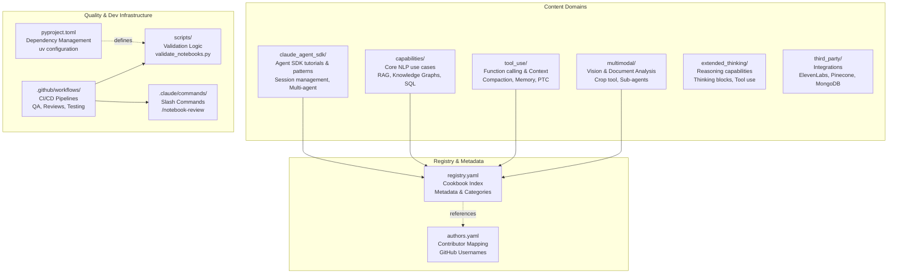

**Sources**: [CLAUDE.md:91-105](), [README.md:29-64](), [CONTRIBUTING.md:5-49]()

### Key Files and Their Roles

| File | Purpose | Reference |
| :--- | :--- | :--- |
| `registry.yaml` | Central index of all cookbooks, including paths, authors, and categories. | [.github/registry_schema.json:1-97]() |
| `authors.yaml` | Maps GitHub usernames to full names and profile details. | [.claude/commands/add-registry.md:11-17]() |
| `pyproject.toml` | Defines dependencies and tool settings (Ruff, pytest). | [CLAUDE.md:62-63]() |
| `CONTRIBUTING.md` | Documentation for development setup, quality standards, and git workflow. | [CONTRIBUTING.md:1-224]() |
| `scripts/validate_notebooks.py` | Validates notebook structure, checking for empty cells and error outputs. | [scripts/validate_notebooks.py:1-65]() |

## Content Organization System

Cookbooks are indexed through a metadata system that enables discoverability and validation. The `registry.yaml` file follows a strict schema defined in `.github/registry_schema.json`. [registry_schema.json:1-97]()

### Registry and Author Mapping

The `registry.yaml` file uses a schema-validated structure to track every example. Each entry maps to a unique path and references authors defined in `authors.yaml`. The `add-registry` command automates this mapping. [.claude/commands/add-registry.md:1-73]()

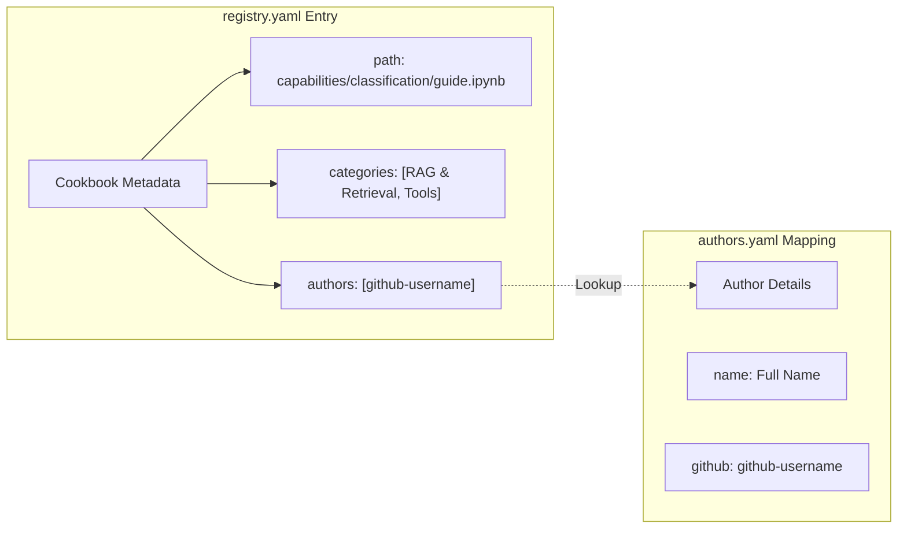

**Sources**: [.github/registry_schema.json:1-97](), [.claude/commands/add-registry.md:53-73]()

## Quality Assurance Architecture

The repository employs a multi-layered QA system combining automated linting, notebook execution, and AI-powered reviews. [CONTRIBUTING.md:51-61]()

### Validation Stack

1.  **Local Hooks**: Uses `pre-commit` to run `ruff` for linting/formatting and `validate_notebooks.py` for structural checks. [.pre-commit-config.yaml:1-25](), [CONTRIBUTING.md:100-107]()
2.  **Notebook Execution**: Uses `nbconvert` to ensure notebooks run top-to-bottom without errors. [CONTRIBUTING.md:57](), [CONTRIBUTING.md:92-98]()
3.  **Claude-Powered Reviews**: Intelligent slash commands (`/notebook-review`, `/model-check`, `/link-review`) run in both local `Claude Code` and GitHub Actions. [CONTRIBUTING.md:63-80](), [CLAUDE.md:83-90]()

**Sources**: [CONTRIBUTING.md:51-80](), [CONTRIBUTING.md:187-209](), [scripts/validate_notebooks.py:14-33]()

## Core Frameworks and Patterns

The repository highlights several advanced integration frameworks:

### Claude Agent SDK
A tutorial series demonstrating the building of autonomous agents, multi-agent systems, and session management. [CLAUDE.md:96]()

### Context Engineering
Demonstrates primitives for managing long-horizon conversations, including compaction and memory storage. [CLAUDE.md:97](), [.gitignore:159-162]()

### Model Management
The repository enforces the use of model aliases (e.g., `claude-sonnet-5`, `claude-haiku-4-5`) rather than dated model IDs to ensure maintainability. [CLAUDE.md:64-75](), [CONTRIBUTING.md:119-124]()

**Sources**: [CLAUDE.md:64-75](), [CONTRIBUTING.md:119-124]()

## Development Infrastructure

### Package Management
The repository recommends `uv` for high-performance dependency management. [CONTRIBUTING.md:9-17]()
*   `uv sync --all-extras`: Sets up the full environment. [CONTRIBUTING.md:31-33]()
*   `make check`: Runs formatting and linting checks. [CLAUDE.md:24]()

### Security
*   **Secret Management**: Never commit API keys; use `.env` files and `os.environ.get`. [CONTRIBUTING.md:45-49](), [CONTRIBUTING.md:216-221](), [CLAUDE.md:59-60]()
*   **CI Gates**: External contributors have limited API testing to prevent resource exhaustion and secret exposure. [CONTRIBUTING.md:209]()

**Sources**: [CONTRIBUTING.md:5-49](), [CLAUDE.md:19-37](), [CONTRIBUTING.md:216-221]()

---

# Page: Getting Started

# Getting Started

<details>
<summary>Relevant source files</summary>

The following files were used as context for generating this wiki page:

- [.claude/commands/add-registry.md](.claude/commands/add-registry.md)
- [.github/pull_request_template.md](.github/pull_request_template.md)
- [.github/registry_schema.json](.github/registry_schema.json)
- [.gitignore](.gitignore)
- [.pre-commit-config.yaml](.pre-commit-config.yaml)
- [CONTRIBUTING.md](CONTRIBUTING.md)
- [README.md](README.md)
- [anthropic_cookbook/__init__.py](anthropic_cookbook/__init__.py)
- [claude_agent_sdk/06_The_vulnerability_detection_agent.ipynb](claude_agent_sdk/06_The_vulnerability_detection_agent.ipynb)
- [claude_agent_sdk/vulnerability_detection_agent/canary/canary.c](claude_agent_sdk/vulnerability_detection_agent/canary/canary.c)
- [requirements-dev.txt](requirements-dev.txt)
- [scripts/validate_notebooks.py](scripts/validate_notebooks.py)

</details>


This page provides an overview of how to begin contributing to the Claude Cookbooks repository. It covers the essential prerequisites, initial setup steps, and basic development workflow. For detailed instructions on environment configuration, see [Environment Setup](#2.1). For comprehensive contribution guidelines including PR workflow and quality standards, see [Contributing Guidelines](#2.2). For information about organizing and indexing cookbook content, see [Registry and Content Organization](#2.3).

## Prerequisites

To contribute to this repository, you need:

| Requirement | Version | Purpose |
|------------|---------|---------|
| Python | ≥3.11 | Core runtime for notebooks and scripts [CONTRIBUTING.md:9]() |
| uv (recommended) | Latest | Fast package manager for dependency installation [CONTRIBUTING.md:10]() |
| Claude API key | N/A | Required for executing notebooks with live API calls [README.md:7]() |
| Git | Latest | Version control [CONTRIBUTING.md:26]() |

**Sources:** [README.md:5-11](), [CONTRIBUTING.md:7-10]()

## Quick Start Workflow

The following diagram illustrates the path from local setup to a merged Pull Request, bridging the local environment setup with the automated CI/CD pipeline.

**Developer Onboarding to CI Pipeline**

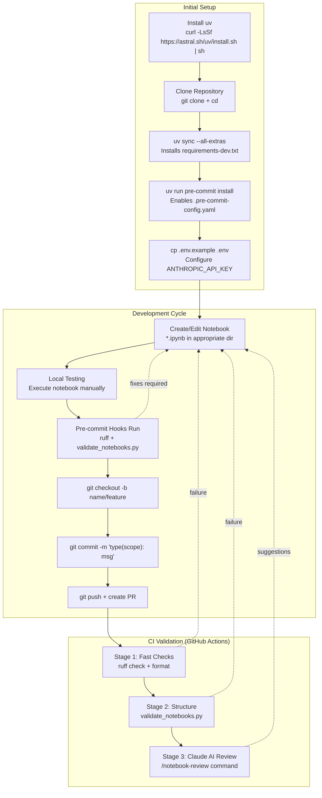

**Sources:** [CONTRIBUTING.md:12-49](), [.pre-commit-config.yaml:1-25](), [scripts/validate_notebooks.py:1-65]()

## Installation Commands

### Using uv (Recommended)

```bash
# Install uv package manager
curl -LsSf https://astral.sh/uv/install.sh | sh

# Clone repository
git clone https://github.com/anthropics/anthropic-cookbook.git
cd anthropic-cookbook

# Create virtual environment and install all dependencies
uv sync --all-extras

# Install pre-commit hooks
uv run pre-commit install

# Configure API key
cp .env.example .env
# Edit .env and set ANTHROPIC_API_KEY=your-key-here
```

The `uv sync --all-extras` command ensures that development dependencies listed in `requirements-dev.txt` (such as `ruff`, `pytest`, and `nbval`) are installed alongside the core requirements [CONTRIBUTING.md:33](), [requirements-dev.txt:1-5]().

**Sources:** [CONTRIBUTING.md:14-43](), [requirements-dev.txt:1-5]()

### Alternative: Using pip

```bash
# Clone and navigate to repository
git clone https://github.com/anthropics/anthropic-cookbook.git
cd anthropic-cookbook

# Install in editable mode with dev dependencies
pip install -e ".[dev]"

# Install pre-commit hooks
pre-commit install
```

**Sources:** [CONTRIBUTING.md:35-43]()

## Development Tool Stack

The following diagram maps the logical development phases to the specific code entities and scripts responsible for validation and maintenance.

**Code Entity Mapping: Local Tools to CI Scripts**

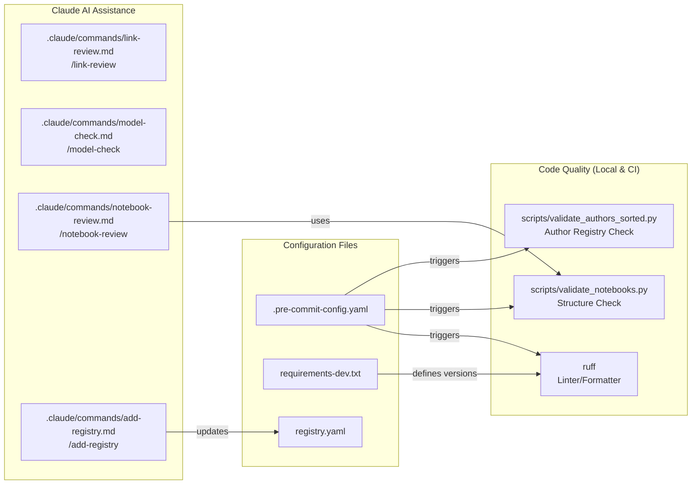

**Sources:** [.pre-commit-config.yaml:1-25](), [CONTRIBUTING.md:52-80](), [requirements-dev.txt:1-5](), [.claude/commands/add-registry.md:1-73]()

## Pre-commit Hook Configuration

The repository uses pre-commit hooks defined in [.pre-commit-config.yaml:1-25]() to enforce quality standards before code is committed:

| Hook ID | Tool | Action | Files |
|---------|------|--------|-------|
| `ruff-check` | Ruff | Lint and auto-fix issues | `*.py`, `*.pyi`, `*.ipynb` [ .pre-commit-config.yaml:5-7]() |
| `ruff-format` | Ruff | Format code | `*.py`, `*.pyi`, `*.ipynb` [ .pre-commit-config.yaml:8-9]() |
| `validate-notebooks` | `scripts/validate_notebooks.py` | Check structure, empty cells, error outputs | `*.ipynb` [ .pre-commit-config.yaml:13-17]() |
| `validate-authors-sorted` | `scripts/validate_authors_sorted.py` | Sort `authors.yaml` alphabetically | `authors.yaml` [ .pre-commit-config.yaml:20-24]() |

The `validate-notebooks` hook invokes [scripts/validate_notebooks.py:1-65](), which performs two critical checks:
1. **Empty cell detection** ([scripts/validate_notebooks.py:22-24]()): Ensures no notebook cells have empty `source` fields.
2. **Error output detection** ([scripts/validate_notebooks.py:26-31]()): Fails if any code cell contains `output_type == "error"`.

**Sources:** [.pre-commit-config.yaml:1-25](), [scripts/validate_notebooks.py:1-65]()

## Claude Code Slash Commands

This repository includes specialized slash commands that work in both **Claude Code** (local development) and **GitHub Actions CI**. These commands allow contributors to run the same validations that the CI pipeline will execute.

- `/link-review`: Validate links in markdown and notebooks [CONTRIBUTING.md:68]().
- `/model-check`: Verify Claude model usage is current [CONTRIBUTING.md:69]().
- `/notebook-review`: Comprehensive notebook quality check [CONTRIBUTING.md:70]().
- `/add-registry`: Automates adding a new notebook entry to `registry.yaml` and updating `authors.yaml` if necessary [.claude/commands/add-registry.md:3-73]().

These commands ensure consistency between local development and remote CI [CONTRIBUTING.md:80]().

**Sources:** [CONTRIBUTING.md:63-80](), [.claude/commands/add-registry.md:1-73]()

## Basic Contribution Workflow

The repository follows a standard feature-branch workflow with strict commit message requirements.

1.  **Create a feature branch**: `git checkout -b <your-name>/<feature-description>` [CONTRIBUTING.md:137-141]().
2.  **Use conventional commits**: Commit messages must follow the `<type>(<scope>): <subject>` format [CONTRIBUTING.md:143-161]().
    *   Types include: `feat`, `fix`, `docs`, `style`, `refactor`, `test`, `chore`, `ci`.
3.  **Run quality checks**: Before pushing, run `uv run python scripts/validate_notebooks.py` and `ruff` [CONTRIBUTING.md:84-90]().
4.  **Register your cookbook**: Use the `/add-registry` command to add your notebook to `registry.yaml` [.claude/commands/add-registry.md:6]().
5.  **Push and create PR**: Push to origin and use `gh pr create` or the GitHub web interface [CONTRIBUTING.md:168-172]().

**Sources:** [CONTRIBUTING.md:135-184](), [.claude/commands/add-registry.md:1-73]()

## Next Steps

Once you've completed the initial setup, consult these child pages for detailed information:

1.  **[Environment Setup](#2.1)** — Detail the process of setting up the development environment including uv installation, dependency management, pre-commit hooks, and API key configuration.
2.  **[Contributing Guidelines](#2.2)** — Explain the contribution process, PR workflow, quality standards, and review expectations including conventional commits and Claude Code slash commands.
3.  **[Registry and Content Organization](#2.3)** — Describe the `registry.yaml` and `authors.yaml` structure, how cookbooks are indexed, categorized, and discovered, including the `add-registry` command.

For information about the quality assurance system that validates your contributions, see [Quality Assurance System](#3).

**Sources:** [CONTRIBUTING.md:1-224](), [README.md:21-28]()

---

# Page: Environment Setup

# Environment Setup

<details>
<summary>Relevant source files</summary>

The following files were used as context for generating this wiki page:

- [.pre-commit-config.yaml](.pre-commit-config.yaml)
- [CONTRIBUTING.md](CONTRIBUTING.md)
- [README.md](README.md)
- [anthropic_cookbook/__init__.py](anthropic_cookbook/__init__.py)
- [requirements-dev.txt](requirements-dev.txt)
- [scripts/validate_notebooks.py](scripts/validate_notebooks.py)
- [uv.toml](uv.toml)

</details>


## Purpose and Scope

This page details the development environment setup process for contributing to Claude Cookbooks. It covers installation of the `uv` package manager, dependency management, pre-commit hook configuration, and API key setup. For contribution workflow and quality standards after setup is complete, see [Contributing Guidelines](#2.2). For information about organizing and registering your cookbooks, see [Registry and Content Organization](#2.3).

---

## Prerequisites

The Claude Cookbooks repository requires:

| Requirement | Version | Purpose |
|------------|---------|---------|
| Python | 3.11 or higher | Runtime environment [CONTRIBUTING.md:9]() |
| uv | Latest | Recommended fast package manager [CONTRIBUTING.md:10]() |
| Git | Any recent | Version control [CONTRIBUTING.md:26]() |
| Claude API Key | - | Required for executing notebooks [README.md:7]() |

---

## Installation Workflow

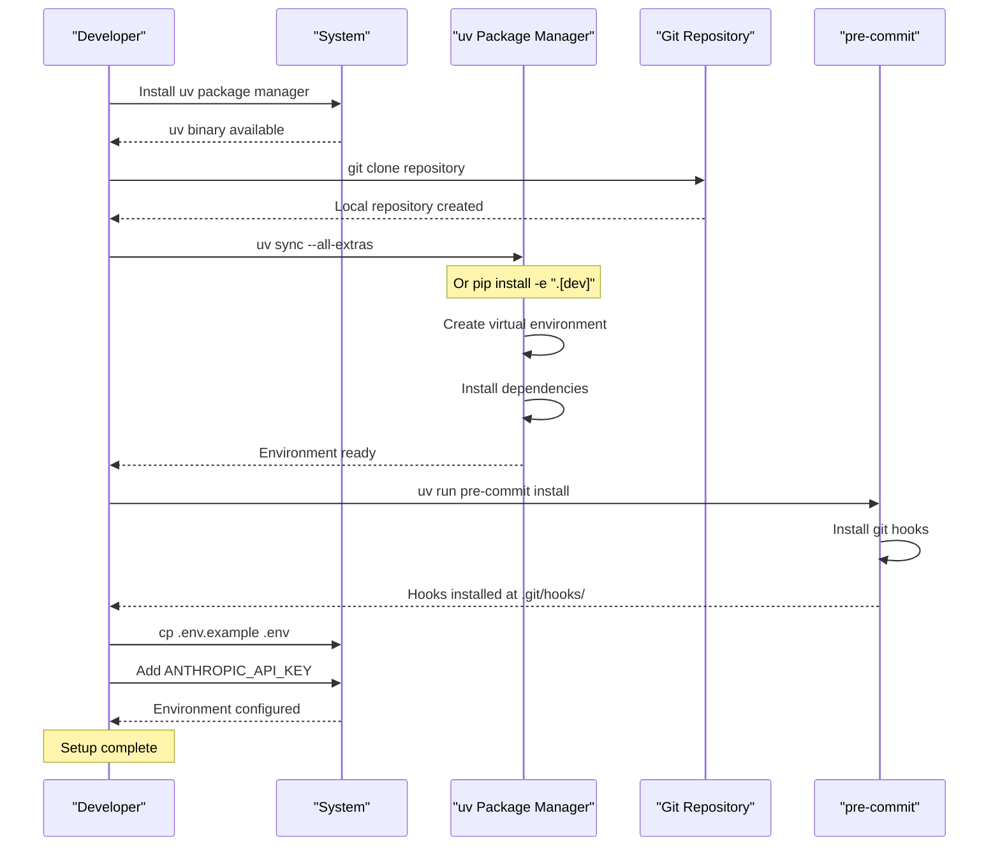

**Sources:** [CONTRIBUTING.md:12-49]()

---

## Package Manager: uv

The repository recommends `uv` as the primary package manager for faster dependency resolution and integrated virtual environment management [CONTRIBUTING.md:10-14](). The project configuration explicitly points to PyPI as the default index.

**File Configuration:**
- `uv.toml`: Configures the default package index [uv.toml:1-3]().

### Installing uv

**Linux/macOS:**
```bash
curl -LsSf https://astral.sh/uv/install.sh | sh
```

**Homebrew:**
```bash
brew install uv
```

**Sources:** [CONTRIBUTING.md:14-22](), [uv.toml:1-3]()

---

## Repository Setup

### Cloning and Initial Setup

```bash
# Clone the repository
git clone https://github.com/anthropics/anthropic-cookbook.git
cd anthropic-cookbook

# Create virtual environment and install all dependencies
uv sync --all-extras
```

Alternatively, standard `pip` can be used:
```bash
pip install -e ".[dev]"
```

**Sources:** [CONTRIBUTING.md:24-37]()

---

## Dependency Architecture

The project distinguishes between runtime dependencies and development tools. Development dependencies are tracked in `requirements-dev.txt`.

### Development Dependencies

Defined in [requirements-dev.txt:1-5]():

| Package | Version | Purpose |
|---------|---------|---------|
| `papermill` | ≥2.6.0 | Notebook parameterization and execution |
| `ruff` | ≥0.12.0 | Fast Python linter and formatter |
| `pytest` | ≥8.3.3 | Testing framework |
| `nbval` | ≥0.11.0 | Notebook validation for pytest |
| `pre-commit` | ≥3.8.0 | Git hook framework |

**Sources:** [requirements-dev.txt:1-5](), [CONTRIBUTING.md:57-59]()

---

## Pre-commit Hook Configuration

Pre-commit hooks run automated checks before each `git commit` to catch structural issues and formatting errors early [CONTRIBUTING.md:100-107]().

### Hook Pipeline

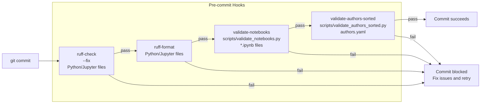

### Hook Definitions

Defined in [.pre-commit-config.yaml:1-25]():

**1. Ruff Check & Format**
- Uses `astral-sh/ruff-pre-commit` [.pre-commit-config.yaml:2-3]().
- Runs `ruff-check` with `--fix` on `python`, `pyi`, and `jupyter` types [.pre-commit-config.yaml:5-7]().
- Runs `ruff-format` for consistent styling [.pre-commit-config.yaml:8-9]().

**2. Validate Notebooks**
- **ID**: `validate-notebooks`
- **Entry**: `uv run python scripts/validate_notebooks.py` [.pre-commit-config.yaml:13-15]().
- **Trigger**: Any `.ipynb` file change [.pre-commit-config.yaml:17]().
- **Function**: Validates internal notebook structure and content.

**3. Validate Authors**
- **ID**: `validate-authors-sorted`
- **Entry**: `uv run python scripts/validate_authors_sorted.py --fix` [.pre-commit-config.yaml:20-22]().
- **Trigger**: Changes to `authors.yaml` [.pre-commit-config.yaml:24]().

**Sources:** [.pre-commit-config.yaml:1-25]()

---

## Validation Logic Details

### Notebook Structural Validation

The script `scripts/validate_notebooks.py` ensures that notebooks meet quality standards before they are committed.

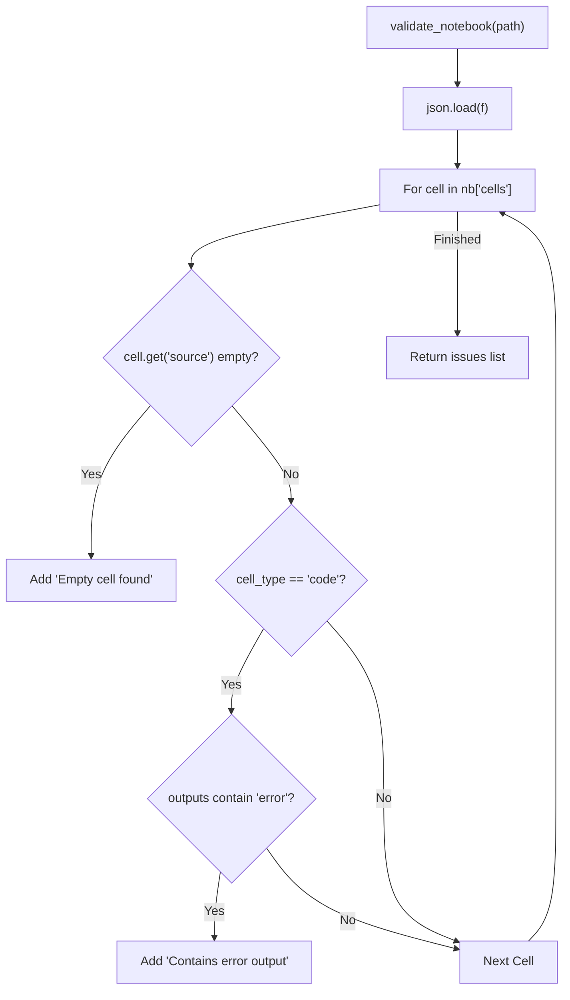

Key logic from [scripts/validate_notebooks.py]():
- **Empty Cells**: Flags any cell where the `source` field is missing or empty [scripts/validate_notebooks.py:22-24]().
- **Error States**: For code cells, it inspects `outputs` for an `output_type` of `error` [scripts/validate_notebooks.py:27-31]().
- **CLI Interface**: Accepts notebook paths as arguments, returning a non-zero exit code if any validation fails [scripts/validate_notebooks.py:36-61]().

**Sources:** [scripts/validate_notebooks.py:14-65]()

---

## API Key Configuration

Claude Cookbooks require an `ANTHROPIC_API_KEY` for executing notebooks against the live API.

### Environment Variable Setup

**Step 1:** Create a `.env` file from the provided example [CONTRIBUTING.md:47]().
```bash
cp .env.example .env
```
**Step 2:** Edit `.env` and add your Claude API key [CONTRIBUTING.md:48-49]().

### Best Practices

1. **Accessing in Code**: Always use `os.environ.get("ANTHROPIC_API_KEY")` [CONTRIBUTING.md:113-117]().
2. **Security**: Never commit API keys or secrets to the repository [CONTRIBUTING.md:218]().
3. **Local Testing**: You can test notebook execution locally using `nbconvert` if an API key is configured [CONTRIBUTING.md:92-98]().

---

## Verification and Testing

### Verify Installation

After setup, verify your environment:

```bash
# Check if uv is managing the environment
uv run python --version

# Run pre-commit checks on all files
uv run pre-commit run --all-files
```

### Manual Validation

You can trigger the notebook validation script directly to check specific files before committing:

```bash
uv run python scripts/validate_notebooks.py skills/my-notebook.ipynb
```

**Sources:** [CONTRIBUTING.md:84-98](), [scripts/validate_notebooks.py:36-65]()

---

# Page: Contributing Guidelines

# Contributing Guidelines

<details>
<summary>Relevant source files</summary>

The following files were used as context for generating this wiki page:

- [.claude/agents/code-reviewer.md](.claude/agents/code-reviewer.md)
- [.claude/commands/review-issue.md](.claude/commands/review-issue.md)
- [.claude/commands/review-pr-ci.md](.claude/commands/review-pr-ci.md)
- [.claude/commands/review-pr.md](.claude/commands/review-pr.md)
- [.github/ISSUE_GUIDELINES.md](.github/ISSUE_GUIDELINES.md)
- [.github/ISSUE_TEMPLATE/bug_report.yml](.github/ISSUE_TEMPLATE/bug_report.yml)
- [.github/ISSUE_TEMPLATE/config.yml](.github/ISSUE_TEMPLATE/config.yml)
- [.github/ISSUE_TEMPLATE/cookbook_proposal.yml](.github/ISSUE_TEMPLATE/cookbook_proposal.yml)
- [.github/ISSUE_TEMPLATE/question.yml](.github/ISSUE_TEMPLATE/question.yml)
- [.pre-commit-config.yaml](.pre-commit-config.yaml)
- [CONTRIBUTING.md](CONTRIBUTING.md)
- [README.md](README.md)
- [anthropic_cookbook/__init__.py](anthropic_cookbook/__init__.py)
- [requirements-dev.txt](requirements-dev.txt)
- [scripts/validate_notebooks.py](scripts/validate_notebooks.py)

</details>


This document describes the technical process for contributing to the Claude Cookbooks repository, including development environment setup, cookbook creation guidelines, quality standards enforcement through automated tooling, testing procedures, and the submission workflow.

For information about the automated quality checks that run on pull requests, see page 3.1 (CI/CD Pipeline and GitHub Actions). For details on the Claude-powered review system, see page 3.2 (Claude-Powered Reviews).

## Development Environment Setup

### Prerequisites and Installation

Contributors must have Python 3.11+ and the `uv` package manager installed. The repository uses `uv` for dependency management and virtual environment creation [CONTRIBUTING.md:7-10]().

**Installation commands:**

```bash
# Install uv package manager
curl -LsSf https://astral.sh/uv/install.sh | sh

# Clone repository
git clone https://github.com/anthropics/anthropic-cookbook.git
cd anthropic-cookbook

# Create virtual environment and install all dependencies
uv sync --all-extras

# Install pre-commit hooks
uv run pre-commit install
```
Sources: [CONTRIBUTING.md:14-43]()

### Environment Configuration

API keys and configuration are managed through a `.env` file [CONTRIBUTING.md:45-49]().

```bash
# Create from template
cp .env.example .env
# Edit .env and add your Claude API key
```

**Key Configuration Practices:**
- Use environment variables for API keys: `api_key = os.environ.get("ANTHROPIC_API_KEY")` [CONTRIBUTING.md:113-117]().
- Use current Claude models (e.g., `claude-haiku-4-5`) [CONTRIBUTING.md:119-122]().

## Quality Assurance Stack Architecture

The repository employs a multi-layered validation stack combining local hooks, custom scripts, and AI-powered reviews.

### System Architecture Diagram

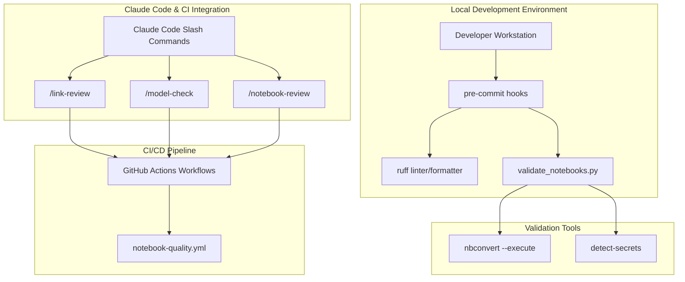
Sources: [CONTRIBUTING.md:53-80](), [CONTRIBUTING.md:100-107](), [scripts/validate_notebooks.py:1-65]()

### Notebook Validation Stack

The repository enforces quality through three primary layers:

1.  **Ruff Linter/Formatter**: Fast Python linter with native Jupyter support used for code quality [CONTRIBUTING.md:58](), [.pre-commit-config.yaml:2-9]().
2.  **nbconvert Execution**: Notebooks are executed to verify they run from top to bottom without errors [CONTRIBUTING.md:57](), [CONTRIBUTING.md:94-98]().
3.  **Claude AI Review**: Intelligent code review using Claude via specialized slash commands [CONTRIBUTING.md:59](), [.claude/commands/notebook-review.md]().

Sources: [CONTRIBUTING.md:55-61](), [requirements-dev.txt:1-5]()

## Pre-commit Validation Workflow

Pre-commit hooks run automatically before each commit to ensure code quality [CONTRIBUTING.md:100-107]().

### Pre-commit Operations

| Hook | Operation | Scope | File Pattern |
|------|-----------|-------|--------------|
| `ruff-check` | Lint code and apply fixes | Python/Jupyter | `[python, pyi, jupyter]` |
| `ruff-format` | Format code | Python/Jupyter | `[python, pyi, jupyter]` |
| `validate-notebooks` | Check structure (empty cells, errors) | Notebooks | `\.ipynb$` |
| `validate-authors-sorted` | Sort and validate authors.yaml | Metadata | `authors\.yaml$` |

Sources: [.pre-commit-config.yaml:1-25](), [scripts/validate_notebooks.py:14-33]()

## Git Workflow and Branch Naming

### Branch Naming Convention

Contributors should create feature branches using the following format:
```bash
git checkout -b <your-name>/<feature-description>
# Example: git checkout -b alice/add-rag-example
```
Sources: [CONTRIBUTING.md:137-141]()

### Conventional Commit Format

The repository uses conventional commits to maintain a clean history [CONTRIBUTING.md:143-145]().

**Commit Types:**

| Type | Purpose | Example |
|------|---------|---------|
| `feat` | New feature | `feat(skills): add text-to-sql notebook` |
| `fix` | Bug fix | `fix(api): use environment variable for API key` |
| `docs` | Documentation | `docs(readme): update installation instructions` |
| `style` | Formatting | `style(notebooks): apply ruff formatting` |
| `refactor` | Code restructuring | `refactor(tools): simplify logic` |
| `ci` | CI/CD changes | `ci(actions): update workflow` |

Sources: [CONTRIBUTING.md:147-161]()

## Creating a Cookbook

### Notebook Best Practices

1.  **Focused Content**: One concept per notebook with clear explanations [CONTRIBUTING.md:126-127]().
2.  **Expected Outputs**: Include expected results as markdown cells or within the code output [CONTRIBUTING.md:128]().
3.  **Testing**: Ensure notebooks run top-to-bottom and include error handling [CONTRIBUTING.md:131-133]().
4.  **Learning Objectives**: List 2-4 Terminal Learning Objectives (TLOs) in the introduction [.claude/agents/code-reviewer.md:25-26]().

### Issue Triage and Proposals

Before implementation, new ideas should be submitted via the **Cookbook Proposal** template [.github/ISSUE_TEMPLATE/cookbook_proposal.yml:1-7]().

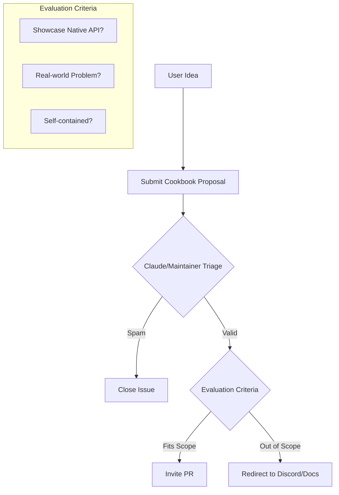
Sources: [.claude/commands/review-issue.md:21-30](), [.github/ISSUE_TEMPLATE/cookbook_proposal.yml:13-18]()

## Testing and Validation

### Local Testing Commands

```bash
# Run the validation suite
uv run python scripts/validate_notebooks.py

# Run pre-commit on all files
uv run pre-commit run --all-files

# Optional: Test notebook execution (requires API key)
uv run jupyter nbconvert --to notebook --execute <notebook_path>
```
Sources: [CONTRIBUTING.md:187-198](), [scripts/validate_notebooks.py:36-61]()

### Claude Code Slash Commands

Available commands for local development and CI [CONTRIBUTING.md:67-71]():

| Command | Purpose |
|---------|---------|
| `/link-review` | Validate links in markdown and notebooks |
| `/model-check` | Verify Claude model usage is current |
| `/notebook-review` | Comprehensive notebook quality check |
| `/review-issue` | Triage and draft responses for GitHub issues |
| `/review-pr` | Perform local review of a PR branch |

Sources: [CONTRIBUTING.md:63-80](), [.claude/commands/review-issue.md:3-4](), [.claude/commands/review-pr.md:3-4]()

## Pull Request Process

### PR Submission Checklist

When submitting a PR, ensure the following [CONTRIBUTING.md:174-184]():
- [ ] PR Title uses conventional commit format.
- [ ] Code is formatted with `ruff`.
- [ ] API keys are handled via environment variables.
- [ ] Notebook structure validated via `scripts/validate_notebooks.py`.

### Review Workflow

The repository uses automated agents for PR reviews [CONTRIBUTING.md:207](), [.claude/commands/review-pr-ci.md:10-12]().

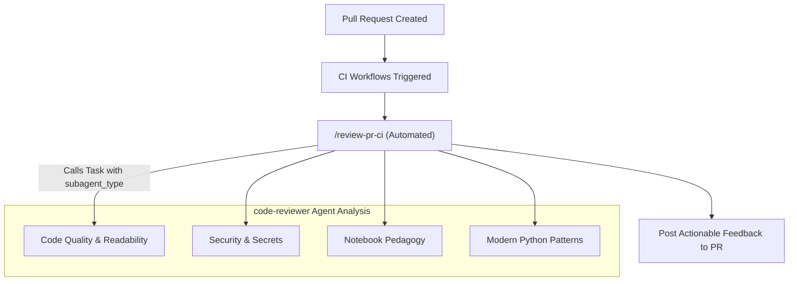
Sources: [.claude/commands/review-pr-ci.md:22-32](), [.claude/agents/code-reviewer.md:11-17]()

## Security

- **Secrets**: Never commit API keys or secrets. Use `.env` files and `dotenv.load_dotenv()` [CONTRIBUTING.md:218-219](), [.claude/agents/code-reviewer.md:89-92]().
- **Reporting**: Report security issues privately to `security@anthropic.com` [CONTRIBUTING.md:220]().

Sources: [CONTRIBUTING.md:216-221]()

---

# Page: Registry and Content Organization

# Registry and Content Organization

<details>
<summary>Relevant source files</summary>

The following files were used as context for generating this wiki page:

- [.claude/commands/add-registry.md](.claude/commands/add-registry.md)
- [.github/authors_schema.json](.github/authors_schema.json)
- [.github/pull_request_template.md](.github/pull_request_template.md)
- [.github/registry_schema.json](.github/registry_schema.json)
- [.github/scripts/verify_registry.py](.github/scripts/verify_registry.py)
- [.github/workflows/verify-authors.yml](.github/workflows/verify-authors.yml)
- [.gitignore](.gitignore)
- [authors.yaml](authors.yaml)
- [claude_agent_sdk/06_The_vulnerability_detection_agent.ipynb](claude_agent_sdk/06_The_vulnerability_detection_agent.ipynb)
- [claude_agent_sdk/vulnerability_detection_agent/canary/canary.c](claude_agent_sdk/vulnerability_detection_agent/canary/canary.c)
- [managed_agents/CMA_coordinate_specialist_team.ipynb](managed_agents/CMA_coordinate_specialist_team.ipynb)
- [managed_agents/CMA_plan_big_execute_small.ipynb](managed_agents/CMA_plan_big_execute_small.ipynb)
- [managed_agents/CMA_remember_user_preferences.ipynb](managed_agents/CMA_remember_user_preferences.ipynb)
- [managed_agents/CMA_verify_with_outcome_grader.ipynb](managed_agents/CMA_verify_with_outcome_grader.ipynb)
- [managed_agents/CMA_watch_subagents_live.ipynb](managed_agents/CMA_watch_subagents_live.ipynb)
- [managed_agents/README.md](managed_agents/README.md)
- [registry.yaml](registry.yaml)

</details>


## Purpose and Scope

This document describes the content management system used to organize and index cookbooks in the repository. The system relies on a central metadata registry consisting of `registry.yaml` for cookbook entries and `authors.yaml` for contributor profiles. This page details the structure of these files, the validation logic enforced by JSON schemas and scripts, and the automated `/add-registry` workflow.

**Sources**: [registry.yaml:1-10](), [authors.yaml:1-5](), [.github/registry_schema.json:1-5](), [.github/authors_schema.json:1-4]()

---

## Registry Data Model

The repository uses a two-file architecture to separate cookbook metadata from author profiles, ensuring that author information is defined once and reused across multiple entries.

### Registry Schema

The `registry.yaml` file contains a list of cookbook objects. Each object is validated against [.github/registry_schema.json]().

| Field | Type | Required | Description |
|-------|------|----------|-------------|
| `title` | string | Yes | The display title of the cookbook. |
| `description` | string | Yes | A brief summary of the cookbook's purpose. |
| `path` | string | Yes | Relative path to the `.ipynb` file. |
| `authors` | array[string] | Yes | List of GitHub usernames matching keys in `authors.yaml`. |
| `date` | string | Yes | Publication date in `YYYY-MM-DD` format. |
| `categories` | array[string] | Yes | 1 or more categories from the allowed enum. |
| `slug` | string | No | URL-friendly identifier (regex: `^[a-z0-9-]+$`). |
| `difficulty` | string | No | `beginner`, `intermediate`, or `advanced`. |

**Example Entry**:
```yaml
- title: Build a data analyst agent with Claude Managed Agents
  description: Build an analyst that turns a CSV into a narrative HTML report.
  path: managed_agents/data_analyst_agent.ipynb
  authors:
  - charmaine
  - jyan-anthropic
  date: '2026-04-08'
  categories:
  - Claude Managed Agents
  - Tools
```

**Sources**: [registry.yaml:2-12](), [.github/registry_schema.json:8-94]()

### Authors Schema

The `authors.yaml` file maps GitHub usernames to profile details. It is validated against [.github/authors_schema.json]().

| Field | Type | Required | Description |
|-------|------|----------|-------------|
| `name` | string | Yes | Full display name of the author. |
| `website` | string | No | URL to author's website or GitHub profile. |
| `avatar` | string | No | URL to profile image (defaults to GitHub avatar). |

**Sources**: [authors.yaml:6-16](), [.github/authors_schema.json:9-26]()

### System Entity Mapping

The following diagram bridges the YAML metadata definitions to the actual filesystem entities and the validation logic used to keep them in sync.

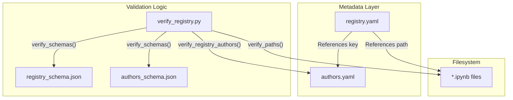

**Sources**: [.github/scripts/verify_registry.py:111-158](), [.github/scripts/verify_registry.py:161-205](), [registry.yaml:1-5]()

---

## Categories and Taxonomy

Cookbooks are classified using a strictly enforced enum in the registry schema. This ensures consistent discovery on the frontend.

### Available Categories

| Category | Purpose |
|----------|---------|
| `Agent Patterns` | Multi-step agentic workflows and orchestration. |
| `Claude Agent SDK` | Tutorials specifically for the `claude-agent-sdk`. |
| `Claude Managed Agents` | Content utilizing Anthropic's hosted agent runtime. |
| `RAG & Retrieval` | Knowledge retrieval, embeddings, and context management. |
| `Tools` | Tool use, function calling, and API integration. |
| `Cybersecurity` | Threat intelligence and vulnerability detection. |
| `Multimodal` | Vision and image processing capabilities. |
| `Skills` | Use of the Claude Skills API (xlsx, pdf, etc.). |

**Sources**: [.github/registry_schema.json:30-45]()

---

## Registry Management Automation

The repository provides automation to ensure the registry remains accurate and valid.

### The `add-registry` Command

The `/add-registry` slash command, defined in [.claude/commands/add-registry.md](), automates the inclusion of new notebooks. It follows a structured workflow:
1. **Content Analysis**: Reads the notebook to extract the `title` and generate a `description` [[.claude/commands/add-registry.md:10-22]]().
2. **Author Verification**: Checks if the GitHub username exists in `authors.yaml`. If missing, it prompts for details to create a new entry [[.claude/commands/add-registry.md:11-17]]().
3. **Entry Generation**: Creates a YAML block with required fields including `date` and `categories` [[.claude/commands/add-registry.md:18-39]]().
4. **Alphabetical Insertion**: Appends the new entry while maintaining alphabetical order by `path` [[.claude/commands/add-registry.md:51]]().

### Validation Script (`verify_registry.py`)

The script [.github/scripts/verify_registry.py]() performs the following checks:
1. **Schema Validation**: Uses `jsonschema` to validate both YAML files against their respective JSON schemas [[.github/scripts/verify_registry.py:161-205]]().
2. **Path Integrity**: Verifies that every `path` entry in `registry.yaml` points to an existing file in the repository [[.github/scripts/verify_registry.py:134-158]]().
3. **Author Integrity**: Ensures every author listed in `registry.yaml` has a corresponding entry in `authors.yaml` [[.github/scripts/verify_registry.py:111-131]]().

### CI/CD Integration

The `Verify Authors` workflow [[.github/workflows/verify-authors.yml]]() triggers on pull requests modifying the registry. It executes the verification script to prevent broken links or invalid metadata.

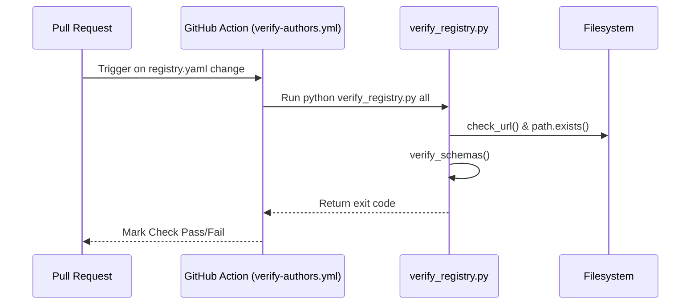

**Sources**: [.github/workflows/verify-authors.yml:1-33](), [.github/scripts/verify_registry.py:35-108](), [.claude/commands/add-registry.md:1-52]()

---

# Page: Quality Assurance System

# Quality Assurance System

<details>
<summary>Relevant source files</summary>

The following files were used as context for generating this wiki page:

- [.claude/skills/cookbook-audit/.gitignore](.claude/skills/cookbook-audit/.gitignore)
- [.claude/skills/cookbook-audit/SKILL.md](.claude/skills/cookbook-audit/SKILL.md)
- [.claude/skills/cookbook-audit/style_guide.md](.claude/skills/cookbook-audit/style_guide.md)
- [.claude/skills/cookbook-audit/validate_notebook.py](.claude/skills/cookbook-audit/validate_notebook.py)
- [.github/workflows/claude-link-review.yml](.github/workflows/claude-link-review.yml)
- [.github/workflows/claude-model-check.yml](.github/workflows/claude-model-check.yml)
- [.github/workflows/claude-pr-review.yml](.github/workflows/claude-pr-review.yml)
- [.github/workflows/links.yml](.github/workflows/links.yml)
- [.github/workflows/lint-format.yml](.github/workflows/lint-format.yml)
- [.github/workflows/notebook-diff-comment.yml](.github/workflows/notebook-diff-comment.yml)
- [.github/workflows/notebook-quality.yml](.github/workflows/notebook-quality.yml)
- [.github/workflows/notebook-tests.yml](.github/workflows/notebook-tests.yml)
- [lychee.toml](lychee.toml)
- [scripts/detect-secrets/.secrets.baseline](scripts/detect-secrets/.secrets.baseline)
- [scripts/detect-secrets/plugins.py](scripts/detect-secrets/plugins.py)
- [scripts/validate_all_notebooks.py](scripts/validate_all_notebooks.py)

</details>


The Quality Assurance System provides automated code quality enforcement, security validation, and content review for the Claude Cookbooks repository. This system ensures that executable examples remain functional, follow security best practices, and provide high-quality educational value.

This system combines GitHub Actions workflows, AI-powered review commands, and specialized validation scripts.

## System Architecture

The Quality Assurance System integrates multiple validation layers to ensure code quality and maintainability.

### QA System Overview

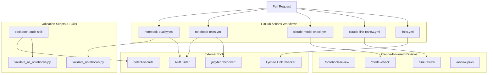

Sources: [.github/workflows/notebook-quality.yml:1-128](), [.github/workflows/claude-model-check.yml:1-82](), [.github/workflows/claude-link-review.yml:1-81](), [.github/workflows/links.yml:1-140](), [.claude/skills/cookbook-audit/SKILL.md:22-37]()

## CI/CD Pipeline and GitHub Actions

The repository utilizes over 40 GitHub Actions workflows to automate testing and validation. The primary entry points are `notebook-quality.yml` and `notebook-tests.yml`, which handle linting, structural validation, and execution testing.

The pipeline features conditional execution logic based on contributor trust levels:
- **Internal Contributors (Members/Owners):** Full notebook execution using the Anthropic API to verify end-to-end functionality [.github/workflows/notebook-quality.yml:96-116]().
- **External Contributors:** Structural validation using `nbformat.validator` to ensure notebook integrity without incurring API costs [.github/workflows/notebook-quality.yml:119-130]().
- **Security Gates:** The pipeline uses Anthropic Workload Identity Federation to securely access the Claude API without static keys [.github/workflows/notebook-quality.yml:61-66]().

For details, see [CI/CD Pipeline and GitHub Actions](#3.1).

## Claude-Powered Reviews

The system leverages `claude-code-action` to provide intelligent feedback directly on Pull Requests. These reviews are triggered by specific slash commands or automated workflow steps.

| Command | Purpose | Workflow |
|---------|---------|----------|
| `/notebook-review` | Summarizes structural issues and provides fix suggestions | [.github/workflows/notebook-quality.yml:57-89]() |
| `/model-check` | Validates that notebooks use non-dated model aliases | [.github/workflows/claude-model-check.yml:69-87]() |
| `/link-review` | Checks for broken or outdated documentation links | [.github/workflows/claude-link-review.yml:68-86]() |
| `/review-pr-ci` | Comprehensive PR review including logic and structure | [.github/workflows/claude-pr-review.yml:44-59]() |

For details, see [Claude-Powered Reviews](#3.2).

## Testing Infrastructure

The testing suite ensures that code examples are not only syntactically correct but also functionally accurate. 

- **Linting:** `ruff` is used to enforce Python style and format for both `.py` and `.ipynb` files [.github/workflows/notebook-quality.yml:39-42]().
- **Execution Testing:** `jupyter nbconvert` executes notebooks in the CI environment to catch runtime errors and timeouts [.github/workflows/notebook-quality.yml:108-115]().
- **Link Validation:** `lychee` checks all URLs in notebooks and markdown files against a strict configuration [.github/workflows/links.yml:113-141](), using settings defined in `lychee.toml` [lychee.toml:1-59]().
- **Diff Analysis:** `nbdime` generates human-readable diffs for notebook changes to assist reviewers [.github/workflows/notebook-diff-comment.yml:78-79]().

For details, see [Testing Infrastructure](#3.3).

## Validation Scripts and Utilities

A suite of specialized Python scripts performs targeted checks that standard linters might miss.

### Core Validation Flow

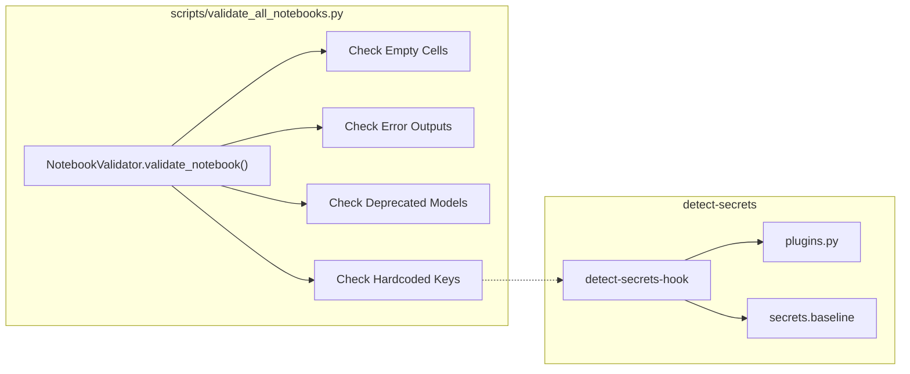

- **`validate_all_notebooks.py`**: A comprehensive validator that checks for empty cells, error outputs, dated model IDs, and hardcoded secrets [scripts/validate_all_notebooks.py:67-172]().
- **`detect-secrets`**: Integrated via `scripts/detect-secrets/plugins.py` to identify leaked Anthropic API keys (`sk-ant-...`) and other credentials [.claude/skills/cookbook-audit/validate_notebook.py:87-133]().
- **Model Aliases**: The system enforces the use of non-dated aliases like `claude-sonnet-4-6` over specific date-versioned IDs [scripts/validate_all_notebooks.py:112-145]().

For details, see [Validation Scripts and Utilities](#3.5).

## Cookbook Audit Process

Beyond automated checks, the repository follows a structured audit process for new content. This includes manual reviews of educational clarity and automated audits using the `cookbook-audit` skill.

- **`cookbook-audit` Skill**: A Claude-powered tool that reviews notebooks against a specific rubric defined in `style_guide.md` [.claude/skills/cookbook-audit/SKILL.md:1-18]().
- **Scoring Rubric**: Evaluates content across Narrative Quality, Code Quality, Technical Accuracy, and Actionability [.claude/skills/cookbook-audit/SKILL.md:47-60]().
- **Workflow**: Includes running `validate_notebook.py` to generate a clean markdown version of the notebook for easier AI review [.claude/skills/cookbook-audit/SKILL.md:22-37]().

For details, see [Cookbook Audit Process](#3.4).

Sources: [.github/workflows/notebook-quality.yml:1-138](), [scripts/validate_all_notebooks.py:1-180](), [.claude/skills/cookbook-audit/SKILL.md:1-155](), [.claude/skills/cookbook-audit/validate_notebook.py:1-175](), [lychee.toml:1-59]()

---

# Page: CI/CD Pipeline and GitHub Actions

# CI/CD Pipeline and GitHub Actions

<details>
<summary>Relevant source files</summary>

The following files were used as context for generating this wiki page:

- [.github/authors_schema.json](.github/authors_schema.json)
- [.github/scripts/verify_registry.py](.github/scripts/verify_registry.py)
- [.github/workflows/claude-link-review.yml](.github/workflows/claude-link-review.yml)
- [.github/workflows/claude-model-check.yml](.github/workflows/claude-model-check.yml)
- [.github/workflows/claude-pr-review.yml](.github/workflows/claude-pr-review.yml)
- [.github/workflows/links.yml](.github/workflows/links.yml)
- [.github/workflows/lint-format.yml](.github/workflows/lint-format.yml)
- [.github/workflows/notebook-diff-comment.yml](.github/workflows/notebook-diff-comment.yml)
- [.github/workflows/notebook-quality.yml](.github/workflows/notebook-quality.yml)
- [.github/workflows/notebook-tests.yml](.github/workflows/notebook-tests.yml)
- [.github/workflows/verify-authors.yml](.github/workflows/verify-authors.yml)

</details>


This document details the GitHub Actions CI/CD pipeline that enforces quality standards for Claude Cookbooks. The pipeline implements a multi-layered validation system with security-aware conditional execution based on contributor trust levels.

For information about the Claude-powered review commands themselves (`/notebook-review`, `/model-check`, `/link-review`), see [3.2](). For details on the validation scripts these workflows execute, see [3.5](). For testing infrastructure including pytest and nbval, see [3.3]().

## Pipeline Architecture

The CI/CD system orchestrates several primary GitHub Actions workflows that validate different aspects of cookbook quality, from structural integrity to runtime execution.

### Logic Flow and Security Gating

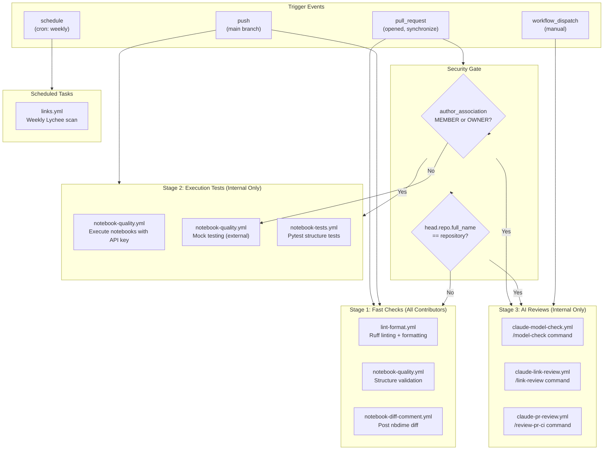

**Sources:** [.github/workflows/notebook-quality.yml:1-138](), [.github/workflows/claude-model-check.yml:1-87](), [.github/workflows/links.yml:1-157](), [.github/workflows/notebook-tests.yml:1-181]()

## Workflow Inventory

The repository utilizes over 40 GitHub Actions (including shared actions and specialized triggers) to maintain the cookbook registry.

| Workflow | Triggers | Purpose | Runs For |
|----------|----------|---------|----------|
| `notebook-quality.yml` | PR, push to main | Lint, validate structure, execute notebooks | All (execution gated) |
| `notebook-tests.yml` | PR, push to main | Granular pytest structure and execution checks | All (execution gated) |
| `lint-format.yml` | PR, push to main | Ruff linting and formatting checks | All contributors |
| `notebook-diff-comment.yml` | PR (notebooks changed) | Post visual notebook diffs using `nbdime` | All contributors |
| `claude-model-check.yml` | PR, workflow_dispatch | Validate Claude model versions via AI | Internal only |
| `claude-link-review.yml` | PR, workflow_dispatch | AI-powered link quality review | Internal only |
| `claude-pr-review.yml` | PR, workflow_dispatch | Comprehensive PR review by Claude | Internal only |
| `links.yml` | PR, weekly, dispatch | Broken link detection with `lychee` | All contributors |
| `verify-authors.yml` | PR, push to main | Validate `authors.yaml` and `registry.yaml` | All contributors |

**Sources:** [.github/workflows/]()

## Security Model and Trust Boundaries

The pipeline implements security gates to prevent `ANTHROPIC_API_KEY` exposure and cost abuse from untrusted contributors. 

### Resource Access Mapping

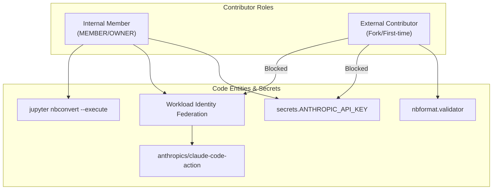

### Authentication via Workload Identity Federation (WIF)
The repository has migrated from static API keys to Anthropic Workload Identity Federation for AI-powered steps. The `claude-code-action` exchanges a GitHub OIDC token (requiring `id-token: write`) for a short-lived access token using configured federation rules [.github/workflows/notebook-quality.yml:14-17](), [.github/workflows/notebook-quality.yml:59-66]().

### Conditional Execution Logic

Workflows use GitHub context variables to enforce boundaries:

*   **Notebook Execution Gate**: Only runs on `push` to main or if the PR author is a `MEMBER` or `OWNER` [.github/workflows/notebook-quality.yml:96-100](), [.github/workflows/notebook-tests.yml:171-177]().
*   **AI Review Gate**: Only runs if the head repository matches the base repository (internal PR) or via manual dispatch [.github/workflows/claude-model-check.yml:25](), [.github/workflows/claude-pr-review.yml:22]().
*   **Mock Testing**: External contributors trigger non-executing structure validation using `nbformat.validator` instead of live API calls [.github/workflows/notebook-quality.yml:119-130]().

**Sources:** [.github/workflows/notebook-quality.yml:14-130](), [.github/workflows/claude-model-check.yml:25]()

## Stage 1: Fast Validation Checks

### Lint and Format Check (`lint-format.yml`)

This workflow validates Python and notebook files using `ruff`. It is optimized to check only changed files in PRs [.github/workflows/lint-format.yml:48-55]().

1.  **Format Check**: Runs `uv run ruff format --check` [.github/workflows/lint-format.yml:81-88]().
2.  **Lint Check**: Runs `uv run ruff check` [.github/workflows/lint-format.yml:104-112]().
3.  **Claude Feedback**: If issues are found, the `claude-code-action` summarizes the lint errors and instructs the contributor to run `make fix` locally [.github/workflows/lint-format.yml:115-148]().

### Registry Integrity (`verify-authors.yml`)

Ensures the cookbook metadata stays consistent by running `scripts/verify_registry.py` [.github/workflows/verify-authors.yml:31-33]().
*   **GitHub Handles**: Validates that usernames in `authors.yaml` actually exist [.github/scripts/verify_registry.py:35-45]().
*   **URL Verification**: Checks website and avatar URLs for accessibility [.github/scripts/verify_registry.py:48-61]().
*   **Schema Validation**: Validates `authors.yaml` and `registry.yaml` against their respective JSON schemas [.github/scripts/verify_registry.py:161-206]().

**Sources:** [.github/workflows/lint-format.yml:1-163](), [.github/scripts/verify_registry.py:1-206]()

## Stage 2: Notebook Execution and Structure Testing

### Structural Pytests (`notebook-tests.yml`)
Beyond simple script validation, this workflow runs `pytest tests/notebook_tests/test_notebooks.py` on changed notebooks [.github/workflows/notebook-tests.yml:90-94]().
*   **Validation Logic**: Checks for hardcoded API keys, deprecated models, and sequential execution order.
*   **AI Feedback**: Failed tests are piped to Claude, which identifies the failure reason and provides fix instructions (e.g., "Use os.environ.get('ANTHROPIC_API_KEY')") [.github/workflows/notebook-tests.yml:130-164]().

### API Testing (`notebook-quality.yml`)
For trusted contributors, the pipeline performs live execution of notebooks to ensure code remains functional against the current Claude API.
*   **Execution**: Uses `jupyter nbconvert --execute` with a 120-second timeout per cell [.github/workflows/notebook-quality.yml:109-114]().
*   **Artifacts**: Executed notebooks are saved to `test_outputs/` and uploaded as artifacts for 7 days [.github/workflows/notebook-quality.yml:132-138]().

**Sources:** [.github/workflows/notebook-tests.yml:72-164](), [.github/workflows/notebook-quality.yml:96-138]()

## Stage 3: Claude AI Reviews

These workflows leverage the `anthropics/claude-code-action` to perform high-level qualitative reviews using specific slash commands.

### Model Version Check (`claude-model-check.yml`)
Invokes the `/model-check` command to ensure contributors are using recommended model versions (e.g., `claude-3-5-sonnet-latest`) and not deprecated strings [.github/workflows/claude-model-check.yml:69-81]().

### PR and Link Review
*   **Link Review**: Uses `/link-review` to check for relevant and secure external links in `.md` and `.ipynb` files [.github/workflows/claude-link-review.yml:68-80]().
*   **PR Review**: Uses `/review-pr-ci` for a comprehensive code review including logic and adherence to repo patterns [.github/workflows/claude-pr-review.yml:44-55]().

**Sources:** [.github/workflows/claude-model-check.yml:1-87](), [.github/workflows/claude-link-review.yml:1-86](), [.github/workflows/claude-pr-review.yml:1-59]()

## Infrastructure and Tooling

### Dependency Management
All workflows utilize `astral-sh/setup-uv` for fast dependency installation with `uv sync --frozen --all-extras` and caching configured for `uv.lock` [.github/workflows/notebook-quality.yml:26-38]().

### Notebook Diffing
The `notebook-diff-comment.yml` workflow uses `nbdime` (`nbdiff`) to post human-readable diffs to PRs. It ignores metadata (`-M`), cell IDs (`-I`), and details (`-D`) to focus purely on content changes [.github/workflows/notebook-diff-comment.yml:78-79]().

**Sources:** [.github/workflows/notebook-quality.yml:26-38](), [.github/workflows/notebook-diff-comment.yml:76-83]()

---

# Page: Claude-Powered Reviews

# Claude-Powered Reviews

<details>
<summary>Relevant source files</summary>

The following files were used as context for generating this wiki page:

- [.claude/commands/link-review.md](.claude/commands/link-review.md)
- [.claude/commands/model-check.md](.claude/commands/model-check.md)
- [.claude/commands/notebook-review.md](.claude/commands/notebook-review.md)
- [.github/workflows/claude-link-review.yml](.github/workflows/claude-link-review.yml)
- [.github/workflows/claude-model-check.yml](.github/workflows/claude-model-check.yml)
- [.github/workflows/claude-pr-review.yml](.github/workflows/claude-pr-review.yml)
- [.github/workflows/links.yml](.github/workflows/links.yml)
- [.github/workflows/lint-format.yml](.github/workflows/lint-format.yml)
- [.github/workflows/notebook-diff-comment.yml](.github/workflows/notebook-diff-comment.yml)
- [.github/workflows/notebook-quality.yml](.github/workflows/notebook-quality.yml)
- [.github/workflows/notebook-tests.yml](.github/workflows/notebook-tests.yml)

</details>


## Purpose and Scope

This document describes the automated Claude-based code review system that provides intelligent feedback on pull requests. The system uses Claude to analyze notebooks, validate model usage, and review links through three specialized slash commands: `/notebook-review`, `/model-check`, and `/link-review`. These reviews are integrated with GitHub Actions and triggered when pull requests are created or updated.

For general GitHub Actions workflows and CI/CD automation, see [CI/CD Pipeline and GitHub Actions](3.1). For local validation tools that run before commit, see [Validation Scripts and Utilities](3.5). For comprehensive manual notebook auditing, see [Cookbook Audit Process](3.4).

## System Overview

The Claude-powered review system operates as part of the automated CI/CD pipeline. Unlike traditional static analysis tools, it uses Claude's reasoning capabilities to understand the semantic content of notebooks, evaluate the appropriateness of model choices, and assess link quality based on live documentation.

### Review Architecture

The following diagram bridges the "Natural Language Space" (Slash Commands) to the "Code Entity Space" (Workflow Files and Action).

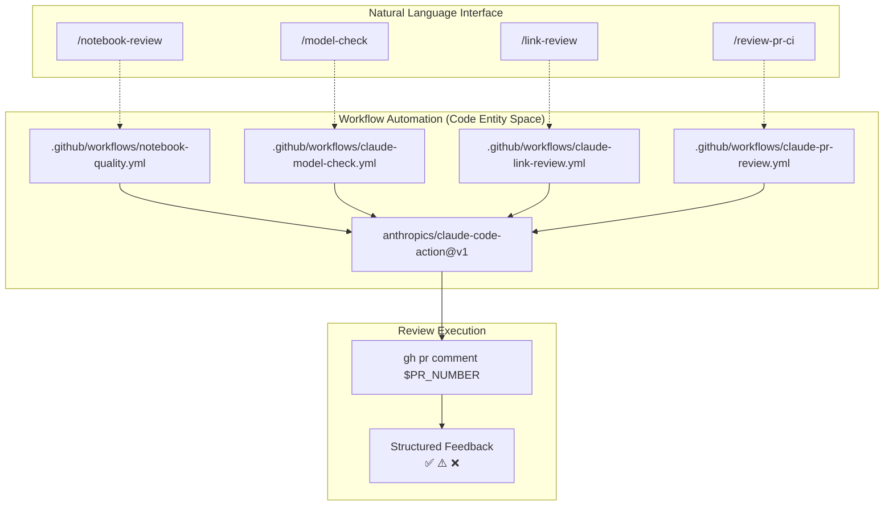

**Sources:** [.github/workflows/notebook-quality.yml:58-60](), [.github/workflows/claude-model-check.yml:70-72](), [.github/workflows/claude-link-review.yml:69-71](), [.github/workflows/claude-pr-review.yml:44-46]()

## Review Types and Slash Commands

The system implements specialized review types defined by slash commands located in `.claude/commands/`.

### Slash Command Definitions

| Command | Definition File | Purpose | File Types | Allowed Tools |
|---------|------|---------|------------|---------------|
| `/notebook-review` | `.claude/commands/notebook-review.md` | Review of Jupyter notebooks and Python scripts for logic and quality | `.ipynb`, `.py` | `Bash(gh pr comment)`, `Bash(gh pr diff)`, `Bash(gh pr view)`, `Read`, `Glob`, `WebFetch` |
| `/model-check` | `.claude/commands/model-check.md` | Validate Claude model usage against current public models | `.ipynb`, `.py`, `.md` | `Bash(gh pr comment)`, `Bash(gh pr diff)`, `Bash(gh pr view)` |
| `/link-review` | `.claude/commands/link-review.md` | Review links for quality, security, and Anthropic documentation standards | `.md`, `.mdx`, `.ipynb` | `Bash(gh pr comment)`, `Bash(gh pr diff)`, `Bash(gh pr view)` |

**Sources:** [.claude/commands/notebook-review.md:1-15](), [.claude/commands/model-check.md:1-21](), [.claude/commands/link-review.md:1-33]()

### /notebook-review Command
The notebook review command performs comprehensive analysis. It provides structured feedback including what looks good, suggestions for improvement, and critical issues [[.claude/commands/notebook-review.md:10-13]](). It utilizes the `Notebook review skill` to analyze the code cells and markdown within notebooks [[.claude/commands/notebook-review.md:8]]().

### /model-check Command
This command ensures model references are up-to-date. It fetches current model data from the Anthropic documentation [[.claude/commands/model-check.md:10-11]]() and flags:
1. Deprecated model versions (e.g., older Sonnet 3.5, Opus 3) [[.claude/commands/model-check.md:15]]().
2. Internal or non-public model names [[.claude/commands/model-check.md:16]]().
3. Opportunities to use `-latest` aliases for maintainability [[.claude/commands/model-check.md:17]]().

### /link-review Command
This command focuses on link integrity and security. It checks for broken links, ensures HTTPS usage, and verifies that internal links use relative paths [[.claude/commands/link-review.md:11-17]](). It also includes specific checks for Anthropic content to ensure documentation links point to the latest versions [[.claude/commands/link-review.md:19-24]]().

## GitHub Actions Integration

Review workflows utilize the `anthropics/claude-code-action` and Anthropic Workload Identity Federation (WIF) for secure authentication without static API keys.

### Authentication and Identity Federation
The workflows use GitHub's OIDC token (`id-token: write`) to exchange for short-lived Anthropic access tokens [[.github/workflows/notebook-quality.yml:17](), [.github/workflows/notebook-quality.yml:61-66]]().

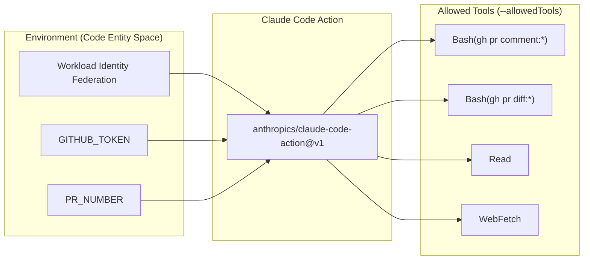

**Sources:** [.github/workflows/claude-model-check.yml:73-79](), [.github/workflows/claude-link-review.yml:72-78](), [.github/workflows/notebook-quality.yml:61-67]()

### Workflow Lifecycle
All review workflows follow a consistent execution pattern:

1.  **PR Detection**: Resolve the PR number from either the `pull_request` event or `workflow_dispatch` input [[.github/workflows/claude-model-check.yml:29-36]]().
2.  **Change Detection**: Filter changed files based on extension (e.g., `grep -E '\.(ipynb|py|md)$'`) to pass a refined list to Claude [[.github/workflows/claude-model-check.yml:44-55]]().
3.  **Claude Invocation**: Pass the file list and the specific slash command to the `claude-code-action` [[.github/workflows/claude-model-check.yml:69-81]]().
4.  **Feedback Posting**: Claude uses the `gh` CLI (permitted via `allowedTools`) to post the review as a PR comment [[.claude/commands/notebook-review.md:15](), [.github/workflows/claude-model-check.yml:86]]().

## Quality Gate Integrations

### Notebook Quality Summarization
In `notebook-quality.yml`, a standard Python script `scripts/validate_notebooks.py` first checks for structural issues like empty cells or error outputs [[.github/workflows/notebook-quality.yml:44-47]](). If issues are found, Claude is invoked to transform the raw validation log into a friendly, grouped PR comment [[.github/workflows/notebook-quality.yml:57-84]]().

### Testing Failure Analysis
In `notebook-tests.yml`, Claude reviews the output of `pytest` when notebook structure tests fail [[.github/workflows/notebook-tests.yml:125-130]](). Claude identifies common failure patterns such as execution order issues or hardcoded API keys and provides specific remediation steps [[.github/workflows/notebook-tests.yml:149-160]]().

## Security and Permission Gating

1.  **Fork Protection**: Workflows involving Claude reviews generally run only for internal contributors or manual triggers [[.github/workflows/claude-model-check.yml:25](), [.github/workflows/claude-link-review.yml:21]]().
2.  **Tool Scoping**: Tools are restricted per workflow. For example, `notebook-quality.yml` allows `cat` to read validation logs but restricts general shell access [[.github/workflows/notebook-quality.yml:86]]().
3.  **Strict File Review**: Commands include an `IMPORTANT` instruction to only review files explicitly listed in the prompt to prevent scanning the entire repository [[.claude/commands/notebook-review.md:6](), [.claude/commands/link-review.md:6]]().

**Sources:** [.github/workflows/claude-model-check.yml:25](), [.github/workflows/notebook-quality.yml:86](), [.claude/commands/notebook-review.md:6]()

---

# Page: Testing Infrastructure

# Testing Infrastructure

<details>
<summary>Relevant source files</summary>

The following files were used as context for generating this wiki page:

- [.github/workflows/claude-link-review.yml](.github/workflows/claude-link-review.yml)
- [.github/workflows/claude-model-check.yml](.github/workflows/claude-model-check.yml)
- [.github/workflows/claude-pr-review.yml](.github/workflows/claude-pr-review.yml)
- [.github/workflows/links.yml](.github/workflows/links.yml)
- [.github/workflows/lint-format.yml](.github/workflows/lint-format.yml)
- [.github/workflows/notebook-diff-comment.yml](.github/workflows/notebook-diff-comment.yml)
- [.github/workflows/notebook-quality.yml](.github/workflows/notebook-quality.yml)
- [.github/workflows/notebook-tests.yml](.github/workflows/notebook-tests.yml)
- [Makefile](Makefile)
- [scripts/test_notebooks.py](scripts/test_notebooks.py)
- [tests/__init__.py](tests/__init__.py)
- [tests/conftest.py](tests/conftest.py)
- [tests/notebook_tests/__init__.py](tests/notebook_tests/__init__.py)
- [tests/notebook_tests/conftest.py](tests/notebook_tests/conftest.py)
- [tests/notebook_tests/test_notebooks.py](tests/notebook_tests/test_notebooks.py)
- [tests/notebook_tests/utils.py](tests/notebook_tests/utils.py)
- [tox.ini](tox.ini)

</details>


## Purpose and Scope

This document describes the testing infrastructure used to validate cookbook quality and correctness. It covers the core testing tools (`pytest`, `nbval`, `nbconvert`), notebook execution testing, structure validation, and the distinction between fast structural checks and slow API-based execution tests. For information about the CI/CD workflows that orchestrate these tests, see [CI/CD Pipeline and GitHub Actions](). For validation scripts used by the testing infrastructure, see [Validation Scripts and Utilities]().

---

## Testing Tools Ecosystem

The repository uses a multi-layered testing approach combining Python testing frameworks, notebook-specific tools, and custom validation scripts.

### Core Testing Dependencies

The testing dependencies are managed by `uv` and defined in the development environment. Key tools include:

| Tool | Purpose |
|------|---------|
| `pytest` | Core test runner and parameterization engine [.github/workflows/notebook-tests.yml:90-93]() |
| `nbval` | Pytest plugin for validating notebook outputs [tox.ini:14-14]() |
| `nbconvert` | Notebook execution and format conversion [.github/workflows/notebook-quality.yml:109-114]() |
| `tox` | Environment isolation and standardized test entry points [tox.ini:1-154]() |
| `ruff` | Linting and formatting for code cells [.github/workflows/lint-format.yml:68-113]() |
| `nbdime` | Generates rich diffs for notebooks in PR comments [.github/workflows/notebook-diff-comment.yml:78-79]() |
| `lychee` | Link checking across markdown and notebooks [.github/workflows/links.yml:113-130]() |

### Pytest Configuration and Fixtures

The testing scaffold in `tests/notebook_tests/` provides comprehensive validation through a set of reusable fixtures defined in `tests/conftest.py`.

- **`notebook_path`**: Parameterized fixture that determines which notebooks to test based on CLI flags like `--notebook` or `--notebook-dir` [tests/conftest.py:116-125]().
- **`notebook_data`**: Loads the raw JSON content of the notebook [tests/conftest.py:134-137]().
- **`notebook_cells`**: Parses the notebook into `CellInfo` dataclasses for easier inspection [tests/conftest.py:140-143]().
- **`execute_notebooks`**: A boolean flag that triggers actual code execution [tests/conftest.py:152-155]().

**Sources:** [tests/conftest.py:1-172](), [tox.ini:1-154](), [Makefile:1-128](), [.github/workflows/notebook-diff-comment.yml:78-79]()

---

## Testing Infrastructure Architecture

The following diagram maps the relationship between the command-line entry points, the test orchestration layer, and the underlying validation logic.

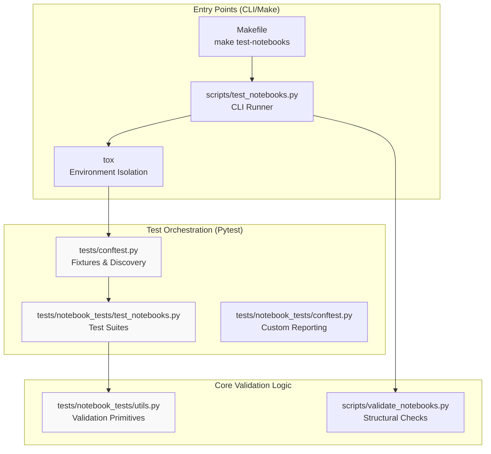

**Diagram: Testing Infrastructure Component Architecture**

**Sources:** [Makefile:83-128](), [tests/notebook_tests/test_notebooks.py:34-172](), [tests/conftest.py:78-113]()

---

## Notebook Execution Testing

The repository distinguishes between **Structural Testing** (fast, no API calls) and **Execution Testing** (slow, requires API keys).

### API Testing vs. Structural Testing

| Feature | Structural Testing (`-m "not slow"`) | Execution Testing (`--execute-notebooks`) |
|------|---------|---------|
| **Speed** | Fast (seconds) | Slow (minutes) |
| **API Keys** | Not Required | Required (`ANTHROPIC_API_KEY`) |
| **Validation** | JSON format, cell order, secrets [tests/notebook_tests/test_notebooks.py:34-145]() | Full code execution, runtime errors [.github/workflows/notebook-quality.yml:96-116]() |
| **Tooling** | `json`, `nbformat.validator` | `nbconvert`, `jupyter` |

### Execution Logic and Security

Actual notebook execution is handled by `jupyter nbconvert` during CI [.github/workflows/notebook-quality.yml:109-114](). Security is enforced by `TestSecurity`, which checks for:
- **Hardcoded Secrets**: Uses regex patterns to detect strings like `sk-ant-...` [tests/notebook_tests/test_notebooks.py:137-145]().
- **Environment Variable Usage**: Ensures API keys are loaded via `os.environ.get("ANTHROPIC_API_KEY")` [tests/notebook_tests/test_notebooks.py:147-170]().

**Sources:** [tests/notebook_tests/test_notebooks.py:134-170](), [.github/workflows/notebook-quality.yml:96-130](), [tests/conftest.py:35-46]()

---

## Structural Validation Logic

Structural validation is performed by the `TestNotebookStructure` and `TestCellExecution` classes, which rely on the `CellInfo` dataclass for metadata analysis.

### CellInfo Dataclass
The `CellInfo` class (defined in `tests/notebook_tests/utils.py`) stores metadata such as `index`, `cell_type`, `execution_count`, and `has_error_output` [tests/notebook_tests/test_notebooks.py:22-31]().

### Sequential Execution Check
The `TestCellExecution` class ensures that:
1. All code cells have been executed [tests/notebook_tests/test_notebooks.py:84-91]().
2. Cells are executed in strictly sequential order [tests/notebook_tests/test_notebooks.py:93-98]().
3. Execution starts from `1` (indicating a fresh kernel run) [tests/notebook_tests/test_notebooks.py:100-110]().

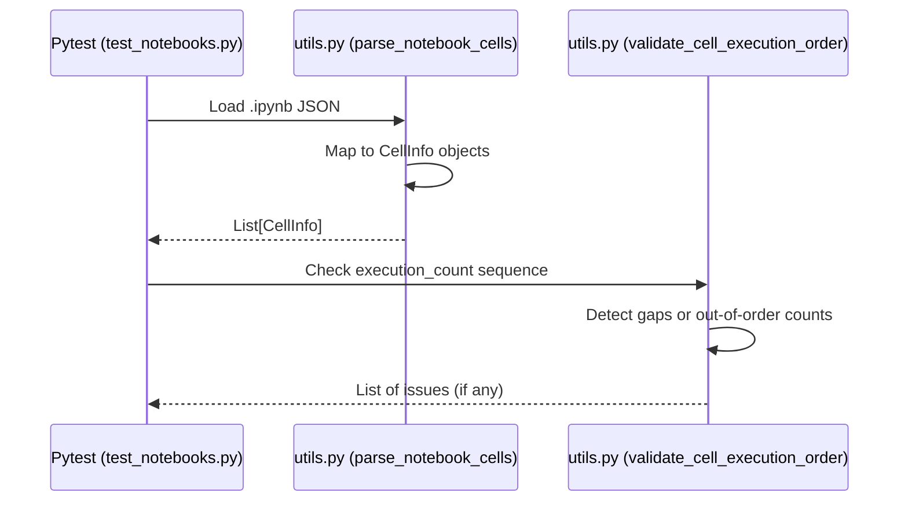

**Diagram: Structural Validation Flow**

**Sources:** [tests/notebook_tests/test_notebooks.py:81-112](), [tests/conftest.py:140-143]()

---

## Automated Review Integration

The infrastructure leverages Claude-powered reviews to provide feedback when tests fail.

### Claude Model Check and PR Review
Specialized workflows trigger Claude to analyze code changes and test failures:
- **`claude-model-check.yml`**: Runs the `/model-check` command to validate model usage in changed files [.github/workflows/claude-model-check.yml:69-87]().
- **`claude-pr-review.yml`**: Runs the `/review-pr-ci` command for a comprehensive PR review [.github/workflows/claude-pr-review.yml:44-58]().
- **`notebook-tests.yml`**: If `pytest` fails, Claude summarizes the `all_test_output.txt` and posts a PR comment with fix instructions [.github/workflows/notebook-tests.yml:125-164]().

**Sources:** [.github/workflows/claude-model-check.yml:1-87](), [.github/workflows/claude-pr-review.yml:1-59](), [.github/workflows/notebook-tests.yml:125-164]()

---

## Summary of Test Suites

| Suite Class | File | Responsibility |
|------|------|---------|
| `TestNotebookStructure` | `test_notebooks.py` | Validates JSON, kernel specs, and cell types [tests/notebook_tests/test_notebooks.py:34-80]() |
| `TestCellExecution` | `test_notebooks.py` | Checks execution order and kernel freshness [tests/notebook_tests/test_notebooks.py:81-112]() |
| `TestCellOutputs` | `test_notebooks.py` | Detects error outputs and empty cells [tests/notebook_tests/test_notebooks.py:113-133]() |
| `TestSecurity` | `test_notebooks.py` | Scans for hardcoded API keys [tests/notebook_tests/test_notebooks.py:134-171]() |
| `TestDependencies` | `test_notebooks.py` | Ensures pip installs are at the top of the notebook [tests/notebook_tests/test_notebooks.py:175-182]() |

**Sources:** [tests/notebook_tests/test_notebooks.py:1-182](), [tests/notebook_tests/conftest.py:21-33]()

---

# Page: Cookbook Audit Process

# Cookbook Audit Process

<details>
<summary>Relevant source files</summary>

The following files were used as context for generating this wiki page:

- [.claude/commands/link-review.md](.claude/commands/link-review.md)
- [.claude/commands/model-check.md](.claude/commands/model-check.md)
- [.claude/commands/notebook-review.md](.claude/commands/notebook-review.md)
- [.claude/skills/cookbook-audit/.gitignore](.claude/skills/cookbook-audit/.gitignore)
- [.claude/skills/cookbook-audit/SKILL.md](.claude/skills/cookbook-audit/SKILL.md)
- [.claude/skills/cookbook-audit/style_guide.md](.claude/skills/cookbook-audit/style_guide.md)
- [.claude/skills/cookbook-audit/validate_notebook.py](.claude/skills/cookbook-audit/validate_notebook.py)
- [lychee.toml](lychee.toml)
- [scripts/detect-secrets/.secrets.baseline](scripts/detect-secrets/.secrets.baseline)
- [scripts/detect-secrets/plugins.py](scripts/detect-secrets/plugins.py)
- [scripts/validate_all_notebooks.py](scripts/validate_all_notebooks.py)

</details>


## Purpose and Scope

The Cookbook Audit Process provides a comprehensive system for manually and automatically evaluating Jupyter notebooks against quality standards. This page documents the `cookbook-audit` Claude skill, the validation scripts it orchestrates, and the scoring rubrics used to assess notebook quality.

For automated CI/CD validation that runs on every pull request, see [3.1 CI/CD Pipeline and GitHub Actions](). For Claude-powered slash command reviews, see [3.2 Claude-Powered Reviews](). For standalone validation scripts, see [3.5 Validation Scripts and Utilities]().

Sources: [.claude/skills/cookbook-audit/SKILL.md:1-20](), [.claude/commands/notebook-review.md:1-15]()

## Audit Workflow Overview

The audit process combines automated checks with manual review guided by Claude AI. The workflow follows a structured progression from automated validation through manual evaluation against a comprehensive rubric.

### Audit Process Data Flow

The diagram below shows how a notebook file is processed through the audit pipeline, from raw file to final report.

```mermaid
flowchart TD
    subgraph "Natural Language Space"
        USER["User Request"]
        RUBRIC["style_guide.md<br/>(Rubrics & TLOs)"]
        REPORT["Audit Report<br/>(Executive Summary)"]
    end

    subgraph "Code Entity Space"
        SKILL["cookbook-audit Skill<br/>(SKILL.md)"]
        VAL_SCRIPT["validate_notebook.py<br/>(NotebookValidator)"]
        MD_CONV["nbconvert<br/>(Markdown Conversion)"]
        DS_HOOK["detect-secrets-hook<br/>(Security Scan)"]
        TMP_DIR["tmp/ folder<br/>(Review Artifacts)"]
    end

    USER -->|"/audit"| SKILL
    SKILL -->|Reads| RUBRIC
    SKILL -->|Executes| VAL_SCRIPT
    VAL_SCRIPT -->|Calls| MD_CONV
    VAL_SCRIPT -->|Calls| DS_HOOK
    MD_CONV -->|Generates| TMP_DIR
    TMP_DIR -->|Manual Review| SKILL
    SKILL -->|Outputs| REPORT
```

Sources: [.claude/skills/cookbook-audit/SKILL.md:20-37](), [.claude/skills/cookbook-audit/validate_notebook.py:49-86]()

**Audit Workflow Stages**

| Stage | Tool | Output | Purpose |
|-------|------|--------|---------|
| Automated Checks | `validate_notebook.py` | Issue list + markdown | Catch technical violations |
| Security Scan | `detect-secrets` | Secret findings | Identify hardcoded credentials |
| Manual Review | Claude + `style_guide.md` | Evaluation notes | Assess quality dimensions |
| Scoring | Rubric application | 4 scores (X/5 each) | Objective assessment |
| Reporting | Audit report format | Structured feedback | Actionable recommendations |

Sources: [.claude/skills/cookbook-audit/SKILL.md:20-68](), [.claude/skills/cookbook-audit/validate_notebook.py:87-168]()

## The cookbook-audit Skill

The `cookbook-audit` skill is a Claude-powered tool that orchestrates the complete audit workflow. It resides in `.claude/skills/cookbook-audit/` and follows the standard Skills API structure.

### Skill Structure and Dependencies

The skill encapsulates both the logic for validation and the instructions for manual review.

```mermaid
graph TB
    subgraph "cookbook-audit Skill"
        SKILL_MD["SKILL.md<br/>(Instructions)"]
        VALIDATE_PY["validate_notebook.py<br/>(Validator Logic)"]
        STYLE_GUIDE["style_guide.md<br/>(Quality Rubrics)"]
        TMP[".gitignore<br/>(Excludes tmp)"]
    end
    
    subgraph "External Integration"
        PLUGINS["scripts/detect-secrets/plugins.py<br/>(AnthropicSecretsDetector)"]
        BASELINE[".secrets.baseline<br/>(Known Secrets)"]
    end
    
    SKILL_MD -.->|Uses| STYLE_GUIDE
    SKILL_MD -.->|Invokes| VALIDATE_PY
    VALIDATE_PY -->|Runs| PLUGINS
    PLUGINS -->|Checks| BASELINE
```

Sources: [.claude/skills/cookbook-audit/SKILL.md:1-10](), [scripts/detect-secrets/plugins.py:7-22](), [.claude/skills/cookbook-audit/.gitignore:1-4]()

### Audit Report Format

The skill produces structured reports with executive summary, detailed scoring, and actionable recommendations:

1.  **Executive Summary**: Overall score (X/20), key strengths, and critical issues [[.claude/skills/cookbook-audit/SKILL.md:42-46]()].
2.  **Detailed Scoring**: Narrative Quality, Code Quality, Technical Accuracy, and Actionability (each X/5) [[.claude/skills/cookbook-audit/SKILL.md:47-60]()].
3.  **Specific Recommendations**: Prioritized list of improvements with line references [[.claude/skills/cookbook-audit/SKILL.md:61-64]()].
4.  **Examples & Suggestions**: Concrete excerpts showing proposed changes [[.claude/skills/cookbook-audit/SKILL.md:65-68]()].

Sources: [.claude/skills/cookbook-audit/SKILL.md:38-68]()

## Automated Validation Checks

The `validate_notebook.py` script performs automated structural and security checks. It uses the `NotebookValidator` class to manage the lifecycle of a single notebook audit.

### NotebookValidator Logic

```mermaid
classDiagram
    class NotebookValidator {
        +Path notebook_path
        +list issues
        +list warnings
        +dict nb
        +__init__(notebook_path)
        +convert_to_markdown()
        +check_hardcoded_secrets()
        +get_cell_source(cell)
        +markdown_output
    }
    
    NotebookValidator --> "calls" detect-secrets-hook : Security Scan
    NotebookValidator --> "calls" nbconvert : Markdown Generation
```

Sources: [.claude/skills/cookbook-audit/validate_notebook.py:27-48]()

### Key Automated Checks

*   **Security Scan** (`check_hardcoded_secrets`): Uses `detect-secrets` with the `AnthropicSecretsDetector` plugin to find keys like `sk-ant-api03-` [[.claude/skills/cookbook-audit/validate_notebook.py:87-133](), [scripts/detect-secrets/plugins.py:13-22]()].
*   **Markdown Generation** (`convert_to_markdown`): Converts the `.ipynb` to a clean `.md` file in the `tmp/` directory for easier LLM processing, excluding cell outputs to save context [[.claude/skills/cookbook-audit/validate_notebook.py:49-86]()].
*   **Model Validation**: The `validate_all_notebooks.py` script specifically flags dated model IDs (e.g., `claude-3-5-sonnet-20240620`) and suggests non-dated aliases like `claude-sonnet-4-6` [[scripts/validate_all_notebooks.py:111-161]()].
*   **Code Structure**: Verifies that `MODEL` is defined as a constant and that `dotenv.load_dotenv()` is used instead of hardcoding environments [[.claude/skills/cookbook-audit/style_guide.md:77-86]()].

Sources: [.claude/skills/cookbook-audit/validate_notebook.py:49-168](), [scripts/validate_all_notebooks.py:111-161]()

## Repository-Wide Audit Infrastructure

For bulk processing, the repository uses `scripts/validate_all_notebooks.py`. This script provides a dashboard and state persistence for auditing the entire collection.

### State Management

The `NotebookValidator` in the global script maintains a state file at `.notebook_validation_state.json` to track history and avoid re-validating unchanged files [[scripts/validate_all_notebooks.py:25-45]()].

| Feature | Implementation |
| :--- | :--- |
| **Caching** | `load_state` and `save_state` track passing counts and dates [[scripts/validate_all_notebooks.py:30-66]()] |
| **Issue Detection** | Categorizes issues into `invalid_json`, `empty_cell`, `error_output`, and `dated_model_id` [[scripts/validate_all_notebooks.py:72-145]()] |
| **History Tracking** | Keeps a 30-day rolling window of validation history [[scripts/validate_all_notebooks.py:62]()] |
| **Security Gate** | Detects hardcoded `sk-ant-` keys as critical errors [[scripts/validate_all_notebooks.py:163-172]()] |

Sources: [scripts/validate_all_notebooks.py:22-180]()

## Quality Rubrics

The manual portion of the audit is guided by `style_guide.md`, which defines the "Anthropic Way" for cookbooks.

### Scoring Dimensions (0-5 points each)

1.  **Narrative Quality**: Does it frame a problem? Are there clear Terminal Learning Objectives (TLOs)? [[.claude/skills/cookbook-audit/style_guide.md:1-45]()]
2.  **Code Quality**: Is it readable? Are variable names meaningful? Is `MODEL` a constant? [[.claude/skills/cookbook-audit/style_guide.md:66-102](), [.claude/skills/cookbook-audit/SKILL.md:102-109]()]
3.  **Technical Accuracy**: Does it run top-to-bottom? Does it use non-deprecated API patterns? [[.claude/skills/cookbook-audit/SKILL.md:123-132]()]
4.  **Actionability**: Does it teach transferable patterns? Does it explain "why" instead of just "what"? [[.claude/skills/cookbook-audit/SKILL.md:133-145]()]

Sources: [.claude/skills/cookbook-audit/SKILL.md:47-60](), [.claude/skills/cookbook-audit/style_guide.md:1-149]()

### Content Philosophy

The audit process enforces a "Problem-First" framing:
*   **Good**: "Your engineering team's GitHub Actions workflows fail... An AI observability agent can cut triage time by 80%." [[.claude/skills/cookbook-audit/style_guide.md:13-19]()]
*   **Bad**: "In this notebook we will build a research agent using the `query()` function." [[.claude/skills/cookbook-audit/style_guide.md:20-28]()]

Sources: [.claude/skills/cookbook-audit/style_guide.md:13-28]()

---

# Page: Validation Scripts and Utilities

# Validation Scripts and Utilities

<details>
<summary>Relevant source files</summary>

The following files were used as context for generating this wiki page:

- [.claude/skills/cookbook-audit/.gitignore](.claude/skills/cookbook-audit/.gitignore)
- [.claude/skills/cookbook-audit/SKILL.md](.claude/skills/cookbook-audit/SKILL.md)
- [.claude/skills/cookbook-audit/style_guide.md](.claude/skills/cookbook-audit/style_guide.md)
- [.claude/skills/cookbook-audit/validate_notebook.py](.claude/skills/cookbook-audit/validate_notebook.py)
- [.github/authors_schema.json](.github/authors_schema.json)
- [.github/scripts/verify_registry.py](.github/scripts/verify_registry.py)
- [.github/workflows/verify-authors.yml](.github/workflows/verify-authors.yml)
- [.pre-commit-config.yaml](.pre-commit-config.yaml)
- [CONTRIBUTING.md](CONTRIBUTING.md)
- [README.md](README.md)
- [anthropic_cookbook/__init__.py](anthropic_cookbook/__init__.py)
- [lychee.toml](lychee.toml)
- [requirements-dev.txt](requirements-dev.txt)
- [scripts/detect-secrets/.secrets.baseline](scripts/detect-secrets/.secrets.baseline)
- [scripts/detect-secrets/plugins.py](scripts/detect-secrets/plugins.py)
- [scripts/validate_all_notebooks.py](scripts/validate_all_notebooks.py)
- [scripts/validate_notebooks.py](scripts/validate_notebooks.py)

</details>


This document covers the validation scripts and utilities used to ensure quality and consistency across the Claude Cookbooks repository. These scripts validate notebook structure, metadata integrity, API key security, and compliance with project standards.

For information about the CI/CD workflows that execute these scripts, see [CI/CD Pipeline and GitHub Actions](3.1). For the Claude-powered review system, see [Claude-Powered Reviews](3.2). For the cookbook audit process, see [Cookbook Audit Process](3.4).

## Overview

The validation system consists of standalone Python scripts that perform structural, security, and metadata checks across Jupyter notebooks and YAML configuration files. These scripts run locally via pre-commit hooks, in CI/CD pipelines, and manually during development.

Sources: [scripts/validate_notebooks.py:1-65](), [.pre-commit-config.yaml:1-25]()

## Validation Scripts Architecture

```mermaid
graph TB
    subgraph "Entry_Points"
        PRECOMMIT["Pre-commit Hooks<br/>.pre-commit-config.yaml"]
        CI["GitHub Actions<br/>verify-authors.yml"]
        MANUAL["Manual Execution<br/>uv run python scripts/..."]
        SKILL["Claude Skill<br/>.claude/skills/cookbook-audit"]
    end
    
    subgraph "Core_Validation_Scripts"
        VAL_NB["validate_notebooks.py<br/>validate_notebook()"]
        VAL_AUTH["validate_authors_sorted.py<br/>--fix flag"]
        VER_REG["verify_registry.py<br/>verify_authors()<br/>verify_paths()"]
        VAL_ALL["validate_all_notebooks.py<br/>NotebookValidator class"]
    end
    
    subgraph "Specialized_Validators"
        VAL_SKILL["validate_notebook.py<br/>NotebookValidator class<br/>(skill version)"]
        DETECT_SEC["detect-secrets<br/>AnthropicSecretsDetector<br/>plugins.py"]
    end
    
    subgraph "Configuration_&_Schema"
        SCHEMAS["JSON Schemas<br/>authors_schema.json<br/>registry_schema.json"]
        BASELINE[".secrets.baseline<br/>Secret exceptions"]
    end
    
    PRECOMMIT --> VAL_NB
    PRECOMMIT --> VAL_AUTH
    CI --> VER_REG
    MANUAL --> VAL_ALL
    SKILL --> VAL_SKILL
    
    VAL_NB --> |"checks structure"| VAL_ALL
    VAL_SKILL --> |"uses"| DETECT_SEC
    VER_REG --> |"validates against"| SCHEMAS
    DETECT_SEC --> |"checks baseline"| BASELINE
```

Sources: [.pre-commit-config.yaml:1-25](), [scripts/validate_notebooks.py:1-65](), [scripts/validate_all_notebooks.py:1-25](), [.claude/skills/cookbook-audit/validate_notebook.py:1-42](), [.github/workflows/verify-authors.yml:1-33]()

## validate_notebooks.py

**Purpose**: Fast structural validation of Jupyter notebooks, checking for empty cells and error outputs.

**Key Functions**:

| Function | Purpose | Lines |
|----------|---------|-------|
| `validate_notebook(path: Path)` | Validates a single notebook | [scripts/validate_notebooks.py:14-33]() |
| `main()` | Processes command-line arguments and validates notebooks | [scripts/validate_notebooks.py:36-65]() |

**Validation Checks**:

1. **Empty Cells**: Detects cells with no source content ([scripts/validate_notebooks.py:22-24]()).
2. **Error Outputs**: Identifies code cells containing error outputs ([scripts/validate_notebooks.py:27-31]()).
3. **JSON Structure**: Ensures notebook is valid JSON ([scripts/validate_notebooks.py:18-19]()).

**Usage**:
```bash
# Manual run
uv run python scripts/validate_notebooks.py path/to/notebook.ipynb
```

Sources: [scripts/validate_notebooks.py:1-65](), [.pre-commit-config.yaml:12-18]()

## verify_registry.py

**Purpose**: Ensures the integrity of the repository's metadata files (`authors.yaml` and `registry.yaml`). It verifies that all authors are defined, paths exist, and external URLs are reachable.

**Key Components**:

| Function | Purpose | Lines |
|----------|---------|-------|
| `verify_authors(authors)` | Validates GitHub handles and author website/avatar URLs | [.github/scripts/verify_registry.py:63-108]() |
| `verify_registry_authors(registry, authors)` | Ensures all authors in `registry.yaml` exist in `authors.yaml` | [.github/scripts/verify_registry.py:111-131]() |
| `verify_paths(registry, repo_root)` | Confirms all cookbook paths in the registry exist on disk | [.github/scripts/verify_registry.py:134-158]() |
| `verify_schemas(...)` | Validates YAML files against their respective JSON schemas | [.github/scripts/verify_registry.py:161-213]() |

**Schema Validation**:
The script uses `jsonschema` to validate `authors.yaml` against `.github/authors_schema.json` and `registry.yaml` against `.github/registry_schema.json` ([.github/scripts/verify_registry.py:172-205]()).

Sources: [.github/scripts/verify_registry.py:1-213](), [.github/workflows/verify-authors.yml:31-33]()

## validate_all_notebooks.py

**Purpose**: Comprehensive validation tool with state persistence, dashboard reporting, and checks for deprecated models and hardcoded API keys.

### NotebookValidator Class

```mermaid
graph LR
    NB_VAL["NotebookValidator"]
    
    subgraph "State_Management"
        LOAD["load_state()<br/>.notebook_validation_state.json"]
        SAVE["save_state()<br/>Update history"]
    end
    
    subgraph "Validation_Methods"
        VAL["validate_notebook(path, mode)<br/>Returns dict with status"]
    end
    
    NB_VAL --> LOAD
    NB_VAL --> SAVE
    NB_VAL --> VAL
```

Sources: [scripts/validate_all_notebooks.py:22-181]()

### Validation Checks

| Check Type | Severity | Description | Lines |
|------------|----------|-------------|-------|
| Invalid JSON | critical | Notebook JSON parsing fails | [scripts/validate_all_notebooks.py:73-80]() |
| Empty cells | info | Cells with no source content | [scripts/validate_all_notebooks.py:83-92]() |
| Error outputs | warning | Code cells with error outputs | [scripts/validate_all_notebooks.py:95-109]() |
| Deprecated models | warning | Old model versions (e.g., `claude-3-haiku-20240307`) | [scripts/validate_all_notebooks.py:111-161]() |
| Hardcoded API keys | critical | `sk-ant-` patterns in source | [scripts/validate_all_notebooks.py:163-172]() |
| API key not env | critical | API key not using environment variable | [scripts/validate_all_notebooks.py:173-181]() |

**Deprecated Models Mapping**:
The script maps older model strings to current non-dated aliases like `claude-sonnet-4-6`, `claude-haiku-4-5`, and `claude-opus-4-6` ([scripts/validate_all_notebooks.py:112-127]()).

Sources: [scripts/validate_all_notebooks.py:111-181]()

## validate_notebook.py (Cookbook Audit Skill)

**Purpose**: Enhanced validation for the `cookbook-audit` skill, providing markdown conversion for AI review and integrated secret detection.

**Location**: `.claude/skills/cookbook-audit/validate_notebook.py`

### Markdown Conversion

**convert_to_markdown()** ([.claude/skills/cookbook-audit/validate_notebook.py:49-85]()):
Converts the notebook to a markdown file in a `tmp/` directory. It excludes cell outputs to save token context during AI review while keeping code cells visible ([.claude/skills/cookbook-audit/validate_notebook.py:78]()).

### Secret Detection System

The audit skill integrates `detect-secrets` to scan for hardcoded credentials ([.claude/skills/cookbook-audit/validate_notebook.py:88-133]()).

**Plugin and Baseline**:
The system uses a custom plugin at `scripts/detect-secrets/plugins.py` and a baseline at `scripts/detect-secrets/.secrets.baseline` to ignore known false positives ([.claude/skills/cookbook-audit/validate_notebook.py:112-119]()).

**Fallback Detection**:
If `detect-secrets` is unavailable, the script uses regex pattern matching for Anthropic and OpenAI keys ([.claude/skills/cookbook-audit/validate_notebook.py:180-192]()):

```python
patterns = {
    "Anthropic API key": r"sk-ant-[a-zA-Z0-9-]+",
    "OpenAI API key": r"sk-[a-zA-Z0-9]{32,}",
    "Generic secret": r'(secret|password|token)\s*=\s*["\'][^"\']{20,}["\']',
}
```

Sources: [.claude/skills/cookbook-audit/validate_notebook.py:87-192](), [.claude/skills/cookbook-audit/SKILL.md:27-29]()

## Pre-commit Hooks Integration

The repository uses `pre-commit` to enforce code quality before changes are committed.

### Hook Definitions

**Ruff Hooks** ([.pre-commit-config.yaml:2-9]()):
Used for linting (`ruff-check`) and formatting (`ruff-format`) Python and Jupyter files.

**Local Validation Hooks**:
1. **validate-notebooks**: Runs `scripts/validate_notebooks.py` on all `.ipynb` files ([.pre-commit-config.yaml:13-18]()).
2. **validate-authors-sorted**: Runs `scripts/validate_authors_sorted.py --fix` on `authors.yaml` ([.pre-commit-config.yaml:20-24]()).

Sources: [.pre-commit-config.yaml:1-25](), [CONTRIBUTING.md:100-108]()

## Link Validation (Lychee)

**Purpose**: Validates all internal and external links within notebooks and documentation.

**Configuration**:
The `lychee.toml` file configures the link checker to:
- Accept status codes like `403` (gated sites) and `429` (rate limited) to prevent false failures ([lychee.toml:40]()).
- Exclude specific API endpoints and local development URLs ([lychee.toml:52-59]()).
- Use a custom user agent for requests ([lychee.toml:44]()).

Sources: [lychee.toml:1-59]()

---

# Page: Skills System

# Skills System

<details>
<summary>Relevant source files</summary>

The following files were used as context for generating this wiki page:

- [skills/CLAUDE.md](skills/CLAUDE.md)
- [skills/README.md](skills/README.md)
- [skills/custom_skills/analyzing-financial-statements/SKILL.md](skills/custom_skills/analyzing-financial-statements/SKILL.md)
- [skills/custom_skills/applying-brand-guidelines/SKILL.md](skills/custom_skills/applying-brand-guidelines/SKILL.md)
- [skills/custom_skills/creating-financial-models/SKILL.md](skills/custom_skills/creating-financial-models/SKILL.md)
- [skills/notebooks/01_skills_introduction.ipynb](skills/notebooks/01_skills_introduction.ipynb)
- [skills/notebooks/02_skills_financial_applications.ipynb](skills/notebooks/02_skills_financial_applications.ipynb)
- [skills/notebooks/03_skills_custom_development.ipynb](skills/notebooks/03_skills_custom_development.ipynb)
- [skills/skill_utils.py](skills/skill_utils.py)

</details>


The Skills System enables Claude to generate professional documents (Excel, PowerPoint, PDF, Word) and execute specialized workflows through organized packages of instructions, executable code, and resources. This system uses a progressive disclosure architecture to minimize token usage while providing deep domain expertise on-demand.

For information about the general Tool Use framework, see [Tool Use Framework](#6). This page focuses specifically on the Skills API for document generation and custom capability packages.

---

## System Architecture

The Skills System operates through a three-tier progressive disclosure model where Claude loads skill components incrementally based on relevance.

### Bridging Natural Language to Code Entities

The following diagram maps the high-level Skills concepts to the specific code entities and API parameters used in the implementation.

```mermaid
graph TB
    subgraph "Natural Language Space"
        REQ["'Create an Excel budget'"]
        DISCOVERY["Skill Discovery"]
        EXECUTION["Skill Execution"]
    end
    
    subgraph "Code Entity Space"
        CLIENT["Anthropic(api_key=...)"]
        BETA_HEADERS["default_headers={'anthropic-beta': 'skills-2025-10-02', ...}"]
        CONTAINER["container={'skills': [{'skill_id': 'xlsx', ...}]}"]
        CODE_TOOL["tools=[{'type': 'code_execution_20250825'}]"]
        
        subgraph "Files API Entities"
            FILE_ID["file_id (from response.content)"]
            DOWNLOAD["client.beta.files.download(file_id=...)"]
            METADATA["client.beta.files.retrieve_metadata(file_id=...)"]
        end
    end
    
    REQ --> CLIENT
    CLIENT --> BETA_HEADERS
    BETA_HEADERS --> CONTAINER
    CONTAINER --> DISCOVERY
    DISCOVERY --> CODE_TOOL
    CODE_TOOL --> EXECUTION
    EXECUTION --> FILE_ID
    FILE_ID --> DOWNLOAD
    FILE_ID --> METADATA
```

**Sources:** [skills/README.md:136-154](), [skills/README.md:168-207](), [skills/CLAUDE.md:59-77]()

---

## API Usage Pattern

Skills require the Messages API with specific beta headers and the `code_execution` tool.

```mermaid
sequenceDiagram
    participant App as "Application Code"
    participant Msg as "client.beta.messages"
    participant Claude as "Claude Model"
    participant Exec as "code_execution_20250825"
    participant Files as "client.beta.files"
    
    App->>Msg: create(container={skills: [...]})
    Note over App,Msg: betas=["skills-2025-10-02",<br/>"code-execution-2025-08-25",<br/>"files-api-2025-04-14"]
    
    Msg->>Claude: Load skill metadata (Tier 1)
    Claude->>Claude: Determine relevance
    
    alt Skill is relevant
        Claude->>Claude: Load full instructions (Tier 2)
        Claude->>Exec: Execute code with resources (Tier 3)
        Exec->>Exec: Generate document
        Exec-->>Claude: Return file_id
    end
    
    Claude-->>Msg: Response with file_id
    Msg-->>App: Message response
    
    App->>Files: download(file_id)
    Files-->>App: Binary file content (read())
    App->>App: Save to disk
```

### Minimum API Call Structure

Developers must use the `client.beta` namespace and include the `code_execution_20250825` tool to enable skill execution.

```python
from anthropic import Anthropic

client = Anthropic(
    api_key="your-api-key"
)

response = client.beta.messages.create(
    model="claude-sonnet-4-6",
    max_tokens=4096,
    betas=["code-execution-2025-08-25", "files-api-2025-04-14", "skills-2025-10-02"],
    container={
        "skills": [
            {"type": "anthropic", "skill_id": "xlsx", "version": "latest"}
        ]
    },
    tools=[{"type": "code_execution_20250825", "name": "code_execution"}],
    messages=[{"role": "user", "content": "Create an Excel budget spreadsheet"}]
)
```

**Sources:** [skills/README.md:168-187](), [skills/CLAUDE.md:87-112]()

---

## Core Concepts and Progressive Disclosure

Skills use a three-tier loading model to optimize token usage and cost. For a deep dive into the architecture, see [Core Concepts and Progressive Disclosure](#4.1).

| Tier | Content | Token Cost | When Loaded |
|------|---------|------------|-------------|
| **1. Metadata** | `name` + `description` | Minimal (~100 tokens) | Always visible to Claude |
| **2. Instructions** | Full `SKILL.md` content | <5,000 tokens recommended | When skill is relevant to the prompt |
| **3. Resources** | `scripts/`, `resources/` | Variable | During `code_execution` |

The progressive disclosure architecture means you only pay token costs for skills when they're actually used. Multiple skills can be included in the `container` parameter with minimal overhead.

**Sources:** [skills/README.md:18-20](), [skills/notebooks/01_skills_introduction.ipynb:186-211](), [skills/notebooks/03_skills_custom_development.ipynb:130-132]()

---

## Using Built-in Skills

Anthropic provides four managed skills for document generation. For detailed usage, see [Using Built-in Skills](#4.2).

| `skill_id` | Format | Capabilities |
|------------|--------|--------------|
| `xlsx` | Excel | Workbooks, formulas, charts, pivot tables |
| `pptx` | PowerPoint | Professional presentations, slide layouts |
| `pdf` | PDF | Formatted reports, tables, layout control |
| `docx` | Word | Document creation, rich text formatting |

### File Download Workflow

Skills generate files in Claude's execution environment. The `client.beta.files` API is required to retrieve them.

```python
# Helper from file_utils.py
from file_utils import extract_file_ids, download_all_files

# Extract file IDs from response
file_ids = extract_file_ids(response)

# Download all files
results = download_all_files(client, response, output_dir="./outputs")
```

**Sources:** [skills/README.md:156-207](), [skills/file_utils.py:18-87](), [skills/CLAUDE.md:66-77]()

---

## Creating Custom Skills

Custom skills package organizational knowledge into reusable components. For a guide on building your own, see [Creating Custom Skills](#4.3).

### Custom Skill Directory Structure

A custom skill is defined by a directory containing specific files that the API uploads and Claude consumes.

```mermaid
graph TB
    subgraph "Skill Directory Structure"
        ROOT["custom_skills/my_skill/"]
        SKILL_MD["SKILL.md<br/>(REQUIRED)<br/>YAML frontmatter + instructions"]
        OTHER_MD["*.md files<br/>(OPTIONAL)<br/>REFERENCE.md, EXAMPLES.md, etc."]
        SCRIPTS["scripts/<br/>(OPTIONAL)<br/>Python/JS executable code"]
        RESOURCES["resources/<br/>(OPTIONAL)<br/>Templates, data files"]
    end
    
    subgraph "Lifecycle Utilities (skill_utils.py)"
        CREATE["create_skill(client, skill_path, title)"]
        LIST["list_custom_skills(client)"]
        VERSION["create_skill_version(client, skill_id, path)"]
        TEST["test_skill(client, skill_id, prompt)"]
        DELETE["delete_skill(client, skill_id)"]
    end
    
    ROOT --> SKILL_MD
    ROOT --> OTHER_MD
    ROOT --> SCRIPTS
    ROOT --> RESOURCES
    
    SKILL_MD --> CREATE
    CREATE --> LIST
    LIST --> VERSION
    VERSION --> TEST
    TEST --> DELETE
```

**Sources:** [skills/notebooks/03_skills_custom_development.ipynb:128-154](), [skills/skill_utils.py:19-218]()

---

## Financial Applications Example

The cookbook provides a robust example of a financial reporting pipeline. This workflow demonstrates how multiple skills (Excel, PowerPoint, PDF) can be chained to transform raw data into a full suite of business documents. For a full walkthrough, see [Financial Applications Example](#4.4).

**Key Workflows:**
- **CSV → Excel**: Generating financial models with formulas and charts.
- **Excel → PowerPoint**: Creating executive summaries from analyzed data.
- **Data → PDF**: Producing static investment reports and portfolio analytics.

**Sources:** [skills/README.md:37-45](), [skills/notebooks/02_skills_financial_applications.ipynb:6-22]()

---

# Page: Core Concepts and Progressive Disclosure

# Core Concepts and Progressive Disclosure

<details>
<summary>Relevant source files</summary>

The following files were used as context for generating this wiki page:

- [skills/README.md](skills/README.md)
- [skills/assets/not-just-markdown.png](skills/assets/not-just-markdown.png)
- [skills/assets/prog-disc-1.png](skills/assets/prog-disc-1.png)
- [skills/assets/prog-disc-2.png](skills/assets/prog-disc-2.png)
- [skills/assets/skills-bundled-files.png](skills/assets/skills-bundled-files.png)
- [skills/assets/skills-conceptual-diagram.png](skills/assets/skills-conceptual-diagram.png)
- [skills/notebooks/01_skills_introduction.ipynb](skills/notebooks/01_skills_introduction.ipynb)
- [skills/notebooks/02_skills_financial_applications.ipynb](skills/notebooks/02_skills_financial_applications.ipynb)
- [skills/notebooks/03_skills_custom_development.ipynb](skills/notebooks/03_skills_custom_development.ipynb)
- [skills/skill_utils.py](skills/skill_utils.py)

</details>


## Purpose and Scope

This page explains the fundamental architecture of Claude's Skills system, focusing on the **progressive disclosure mechanism** that enables efficient, on-demand loading of specialized capabilities. It covers how Skills are structured, discovered, and loaded during API requests, and how this architecture minimizes token usage while maximizing Claude's effectiveness.

For practical guides on using specific built-in skills, see [4.2 Using Built-in Skills](). For creating your own skills, see [4.3 Creating Custom Skills](). For a complete example workflow, see [4.4 Financial Applications Example]().

---

## What are Skills?

Skills are **structured capability packages** that give Claude specialized expertise for specific domains or tasks [skills/README.md:7-16](). Unlike tools (which execute functions) or prompts (which provide instructions), Skills bundle three types of content together:

| Component | Purpose | Example |
|-----------|---------|---------|
| **Instructions** | Guide Claude on how to use the skill | Financial ratio calculation methodology |
| **Code** | Executable scripts for complex operations | Python DCF valuation model |
| **Resources** | Templates, data, reference materials | Excel templates, industry benchmarks |

Skills exist in two forms:

1. **Anthropic-managed skills** (`type: "anthropic"`) - Pre-built capabilities like `xlsx`, `pptx`, `pdf`, `docx` [skills/README.md:178-180]().
2. **Custom skills** (`type: "custom"`) - User-created expertise packages for organization-specific workflows [skills/notebooks/03_skills_custom_development.ipynb:34-42]().

Skills are referenced in API requests via the `container` parameter with skill identifiers like `{"type": "anthropic", "skill_id": "xlsx", "version": "latest"}` [skills/README.md:173-181]().

**Sources:** [skills/README.md:7-16](), [skills/notebooks/01_skills_introduction.ipynb:136-142](), [skills/notebooks/03_skills_custom_development.ipynb:34-42]()

---

## Progressive Disclosure Architecture

### The Three-Tier Loading Model

Progressive disclosure is the core optimization that makes Skills efficient. Instead of loading all skill content upfront, Skills expose information in three stages, each loaded only when needed [skills/README.md:20]().

Title: Progressive Disclosure Loading Stages
```mermaid
graph TB
    subgraph "Stage 1: Always Visible"
        META["Metadata<br/>name: 64 chars max<br/>description: 1024 chars max"]
    end
    
    subgraph "Stage 2: Loaded When Relevant"
        INSTRUCTIONS["Full Instructions<br/>SKILL.md content<br/>~5,000 tokens recommended"]
        REFERENCE["Additional .md Files<br/>REFERENCE.md, EXAMPLES.md, etc."]
    end
    
    subgraph "Stage 3: Loaded During Execution"
        SCRIPTS["Python/JavaScript Scripts<br/>scripts/ directory"]
        RESOURCES["Templates & Data<br/>resources/ directory"]
    end
    
    META --> INSTRUCTIONS
    INSTRUCTIONS --> REFERENCE
    INSTRUCTIONS --> SCRIPTS
    INSTRUCTIONS --> RESOURCES
```

**Sources:** [skills/README.md:20](), [skills/notebooks/01_skills_introduction.ipynb:188-211](), [skills/notebooks/03_skills_custom_development.ipynb:129-150]()

---

### Stage 1: Metadata (Always Visible)

Claude can see the **name** and **description** of all skills in the `container.skills` array immediately, before any skill is actually loaded. This minimal overhead allows skills to be "advertised" cheaply.

The metadata comes from YAML frontmatter in `SKILL.md` [skills/notebooks/03_skills_custom_development.ipynb:158-164]():

```yaml
---
name: analyzing-financial-statements
description: This skill calculates key financial ratios and metrics from financial statement data for investment analysis
---
```

**Constraints:**
- `name`: 64 characters maximum, lowercase alphanumeric with hyphens [skills/notebooks/03_skills_custom_development.ipynb:158-164]().
- `description`: 1024 characters maximum, concise summary of capabilities [skills/notebooks/03_skills_custom_development.ipynb:158-164]().

This metadata-only visibility costs virtually no tokens but enables Claude to discover which skills are available and when they might be relevant.

**Sources:** [skills/notebooks/03_skills_custom_development.ipynb:130-132](), [skills/skill_utils.py:22-25](), [skills/notebooks/03_skills_custom_development.ipynb:158-164]()

---

### Stage 2: Instructions (Loaded When Relevant)

When Claude determines a skill is needed for the current request, it loads the **full instructions** from all `.md` files in the skill's root directory [skills/notebooks/03_skills_custom_development.ipynb:172-181]():

| File | Purpose | Required |
|------|---------|----------|
| `SKILL.md` | Primary instructions with YAML frontmatter | **Yes** [skills/notebooks/03_skills_custom_development.ipynb:138-140]() |
| `REFERENCE.md` | API reference, detailed documentation | No |
| `EXAMPLES.md` | Usage examples, patterns | No |
| Additional `.md` files | Any organizational structure | No |

All markdown files in the root directory are concatenated and available to Claude when the skill is loaded [skills/notebooks/03_skills_custom_development.ipynb:149-150](). The recommendation is to keep total instruction content under **5,000 tokens** to maintain efficiency [skills/notebooks/03_skills_custom_development.ipynb:165-168]().

**Sources:** [skills/notebooks/03_skills_custom_development.ipynb:134-150](), [skills/notebooks/03_skills_custom_development.ipynb:172-181]()

---

### Stage 3: Resources (Loaded During Execution)

The final tier consists of **executable code** and **resource files** that are loaded only when Claude actually executes skill-related code [skills/notebooks/03_skills_custom_development.ipynb:152-156]():

```
skill_name/
├── scripts/           # Python, JavaScript, or other executable code
│   └── process.py
└── resources/         # Templates, data files, or assets
    └── template.xlsx
```

These files are accessed via the `code_execution_20250825` tool when Claude runs code that references them [skills/notebooks/03_skills_custom_development.ipynb:152-156](). They are never added to the message context directly, avoiding token overhead.

**Sources:** [skills/notebooks/03_skills_custom_development.ipynb:130-132](), [skills/notebooks/03_skills_custom_development.ipynb:152-156]()

---

## Skills Container Parameter

### API Integration

Skills are specified in API requests using the `container` parameter in `client.messages.create()` [skills/README.md:174-181]():

```python
response = client.messages.create(
    model="claude-sonnet-4-6",
    max_tokens=4096,
    container={
        "skills": [
            {"type": "anthropic", "skill_id": "xlsx", "version": "latest"}
        ]
    },
    tools=[{"type": "code_execution_20250825", "name": "code_execution"}],
    messages=[{"role": "user", "content": "Create an Excel file..."}]
)
```

### Container Structure

Title: Container Parameter Structure
```mermaid
graph LR
    CONTAINER["container parameter"]
    SKILLS_ARRAY["skills array"]
    SKILL1["skill object 1"]
    SKILL2["skill object 2"]
    
    CONTAINER --> SKILLS_ARRAY
    SKILLS_ARRAY --> SKILL1
    SKILLS_ARRAY --> SKILL2
    
    SKILL1 --> TYPE1["type: 'anthropic'"]
    SKILL1 --> ID1["skill_id: 'xlsx'"]
    SKILL1 --> VER1["version: 'latest'"]
    
    SKILL2 --> TYPE2["type: 'custom'"]
    SKILL2 --> ID2["skill_id: 'skill_...'"]
    SKILL2 --> VER2["version: 'latest'"]
```

Each skill in the `skills` array has three required fields [skills/README.md:178-180]():

| Field | Values | Description |
|-------|--------|-------------|
| `type` | `"anthropic"` or `"custom"` | Skill source |
| `skill_id` | String (e.g., `"xlsx"`, `"skill_abc123..."`) | Unique identifier |
| `version` | String (e.g., `"latest"`, `"1"`, `"2"`) | Version to use |

**Sources:** [skills/notebooks/01_skills_introduction.ipynb:147-182](), [skills/README.md:173-181]()

---

## Code Execution Requirement

Skills **require** the `code_execution_20250825` tool to be enabled in the request [skills/README.md:182](). This is because Skills often involve generating or manipulating files, which happens through code execution.

Title: Skills Execution Dependency
```mermaid
graph TB
    REQUEST["client.messages.create()"]
    CONTAINER["container with skills"]
    TOOLS["tools array"]
    CODE_EXEC["code_execution_20250825"]
    SKILL_LOGIC["Skill Logic"]
    FILE_CREATION["File Creation"]
    
    REQUEST --> CONTAINER
    REQUEST --> TOOLS
    TOOLS --> CODE_EXEC
    CONTAINER --> SKILL_LOGIC
    CODE_EXEC --> SKILL_LOGIC
    SKILL_LOGIC --> FILE_CREATION
```

**Required beta headers:**
- `code-execution-2025-08-25` - Enables code execution for Skills [skills/README.md:151]().
- `files-api-2025-04-14` - Required for downloading generated files [skills/README.md:152]().
- `skills-2025-10-02` - Enables Skills feature [skills/README.md:153]().

**Sources:** [skills/README.md:149-154](), [skills/README.md:182]()

---

## Token Optimization Benefits

### Comparison: Traditional vs. Progressive Disclosure

Progressive disclosure dramatically reduces token usage compared to providing equivalent instructions in prompts [skills/README.md:20]():

| Approach | Initial Cost | When Used | Quality |
|----------|--------------|-----------|---------|
| **Manual Instructions** | 5,000-10,000 tokens per request | Every request | Variable |
| **Skills (Metadata)** | ~100-200 tokens (name/desc) | Always visible | Expert-level, consistent |
| **Skills (Full Load)** | ~5,000 tokens | Only when relevant | Expert-level, consistent |

### Multi-Skill Efficiency

The benefit compounds when multiple skills are available. Instead of loading 30,000 tokens of instructions for Excel, PowerPoint, and PDF upfront, Claude only loads the metadata for all three, and the full instructions for the specific skill it decides to use [skills/notebooks/01_skills_introduction.ipynb:188-211]().

Title: Token Efficiency Logic
```mermaid
graph TB
    subgraph "Manual Prompting: High Overhead"
        M1["Excel instructions:<br/>10,000 tokens"]
        M2["PowerPoint instructions:<br/>10,000 tokens"]
        M3["PDF instructions:<br/>10,000 tokens"]
    end
    
    subgraph "Skills System: Progressive Load"
        S1["xlsx metadata:<br/>~100 chars"]
        S2["pptx metadata:<br/>~100 chars"]
        S3["pdf metadata:<br/>~100 chars"]
    end
    
    FULL1["Full xlsx instructions:<br/>~5,000 tokens<br/>(only if relevant)"]
    
    S1 -.-> FULL1
```

**Sources:** [skills/notebooks/01_skills_introduction.ipynb:188-211](), [skills/README.md:20]()

---

## Skill Discovery and Loading Workflow

### Request Processing Flow

Title: Skill Lifecycle Sequence
```mermaid
sequenceDiagram
    participant User
    participant API["client.messages.create()"]
    participant Claude
    participant CodeExec["code_execution_20250825"]
    participant Files["Files API"]
    
    User->>API: Request with container.skills
    
    Note over API,Claude: Stage 1: Metadata Loaded
    API->>Claude: All skill metadata (name + description)
    
    Note over Claude: Analyzes request relevance
    
    alt Skill is relevant
        Note over API,Claude: Stage 2: Load Instructions
        API->>Claude: Full .md files (~5k tokens)
        
        Note over Claude,CodeExec: Stage 3: Execution
        Claude->>CodeExec: Execute skill code
        CodeExec->>Files: Create file (e.g. xlsx)
        Files-->>CodeExec: file_id
        CodeExec-->>Claude: file_id in tool_result
        Claude-->>User: Response with file_id
    else Skill not relevant
        Note over Claude: Skill not loaded (saves tokens)
        Claude-->>User: Standard Response
    end
```

**Sources:** [skills/README.md:159-165](), [skills/notebooks/01_skills_introduction.ipynb:147-182](), [skills/skill_utils.py:212-225]()

---

## Skill Metadata Structure

### Retrieving Skill Information via API

Skills can be discovered programmatically using the `client.beta.skills.list` and `client.beta.skills.retrieve` methods [skills/skill_utils.py:78-112]():

```python
# List all custom skills in the workspace
skills_response = client.beta.skills.list(source="custom")

for skill in skills_response.data:
    print(f"Skill ID: {skill.id}")
    print(f"Display Title: {skill.display_title}")
    print(f"Latest Version: {skill.latest_version}")
```

### Version Details

Each skill version contains metadata about the skill's structure and instructions [skills/skill_utils.py:115-149]():

```python
version_info = client.beta.skills.versions.retrieve(
    skill_id="skill_abc123",
    version="latest"
)

# version_info.name
# version_info.description
# version_info.directory (file listing)
```

**Sources:** [skills/skill_utils.py:78-149](), [skills/notebooks/01_skills_introduction.ipynb:241-283]()

---

# Page: Using Built-in Skills

# Using Built-in Skills

<details>
<summary>Relevant source files</summary>

The following files were used as context for generating this wiki page:

- [skills/.claude/hooks/pre-bash.sh](skills/.claude/hooks/pre-bash.sh)
- [skills/.claude/hooks/pre-write.sh](skills/.claude/hooks/pre-write.sh)
- [skills/.claude/hooks/session-start.sh](skills/.claude/hooks/session-start.sh)
- [skills/.claude/settings.json](skills/.claude/settings.json)
- [skills/.env.example](skills/.env.example)
- [skills/.gitignore](skills/.gitignore)
- [skills/README.md](skills/README.md)
- [skills/file_utils.py](skills/file_utils.py)
- [skills/notebooks/01_skills_introduction.ipynb](skills/notebooks/01_skills_introduction.ipynb)
- [skills/notebooks/02_skills_financial_applications.ipynb](skills/notebooks/02_skills_financial_applications.ipynb)
- [skills/notebooks/03_skills_custom_development.ipynb](skills/notebooks/03_skills_custom_development.ipynb)
- [skills/requirements.txt](skills/requirements.txt)
- [skills/skill_utils.py](skills/skill_utils.py)

</details>


## Purpose and Scope

This page documents the four Anthropic-managed Skills that enable Claude to generate formatted documents: Excel spreadsheets (`xlsx`), PowerPoint presentations (`pptx`), PDF documents (`pdf`), and Word files (`docx`). These skills are production-ready capabilities maintained by Anthropic and accessible via the Skills API beta.

Built-in skills leverage a **Progressive Disclosure Architecture**, where instructions and resources are loaded only when needed to optimize token usage [skills/README.md:1-23](). Required files for using these skills include the Anthropic SDK (v0.71.0+) and specific environment configurations [skills/requirements.txt:5-8]().

**Sources:** [skills/README.md:1-23](), [skills/README.md:134-154](), [skills/requirements.txt:5-8]()

## Built-in Skills Reference

Anthropic provides four pre-built skills for document generation:

| Skill ID | Type | Capabilities | Common Use Cases |
|----------|------|-------------|------------------|
| `xlsx` | Excel | Workbooks with multiple sheets, formulas, charts, pivot tables, conditional formatting | Financial models, data analysis, budgets, dashboards |
| `pptx` | PowerPoint | Slides with text, images, charts, tables, transitions | Executive presentations, reports, pitch decks |
| `pdf` | PDF | Formatted documents with text, tables, images | Receipts, invoices, formal reports, documentation |
| `docx` | Word | Rich text documents with formatting, headers, footers, tables | Contracts, letters, proposals, documentation |

**Sources:** [skills/README.md:11-14](), [skills/README.md:173-180](), [skills/notebooks/01_skills_introduction.ipynb:135-141]()

## API Configuration Requirements

### Beta Headers

Built-in skills require three specific beta features to be enabled in the request headers to support code execution and file retrieval:

```mermaid
graph TB
    ["client.beta.messages.create()"] --> ["Beta Headers"]
    
    subgraph "Required_Beta_Features"
        ["code-execution-2025-08-25"] -- "Enables code execution environment" --> ["Runtime"]
        ["files-api-2025-04-14"] -- "Enables file download capability" --> ["Retrieval"]
        ["skills-2025-10-02"] -- "Enables Skills feature" --> ["Orchestration"]
    end
    
    subgraph "Request_Parameters"
        ["container: {'skills': [...]}"]
        ["tools: [{'type': 'code_execution_20250825'}]"]
    end
```

**Diagram: Beta Configuration for Built-in Skills**

**Sources:** [skills/README.md:149-154](), [skills/notebooks/01_skills_introduction.ipynb:86-96]()

### Configuration Pattern

To use built-in skills, the `Anthropic` client must include the `anthropic-beta` headers [skills/README.md:138-147]().

```python
from anthropic import Anthropic

client = Anthropic(
    api_key="your-api-key",
    default_headers={
        "anthropic-beta": "code-execution-2025-08-25,files-api-2025-04-14,skills-2025-10-02"
    }
)

response = client.beta.messages.create(
    model="claude-sonnet-4-6",
    max_tokens=4096,
    container={
        "skills": [
            {"type": "anthropic", "skill_id": "xlsx", "version": "latest"}
        ]
    },
    tools=[{"type": "code_execution_20250825", "name": "code_execution"}],
    messages=[{"role": "user", "content": "Create an Excel file..."}]
)
```

**Sources:** [skills/README.md:138-147](), [skills/notebooks/01_skills_introduction.ipynb:54-97]()

### Container Parameter Structure

The `container` parameter is the primary mechanism for loading skills [skills/notebooks/01_skills_introduction.ipynb:151-166]():

| Field | Type | Description | Example |
|-------|------|-------------|---------|
| `type` | string | Skill source: "anthropic" or "custom" | `"anthropic"` |
| `skill_id` | string | Identifier for the skill | `"xlsx"`, `"pptx"`, `"pdf"`, `"docx"` |
| `version` | string | Version to use | `"latest"` (recommended) |

**Sources:** [skills/README.md:177-180](), [skills/notebooks/01_skills_introduction.ipynb:151-166]()

## Skills-to-Files Workflow

The workflow involves Claude generating code, executing it in a secure environment using the `code_execution` tool, and returning a file identifier [skills/README.md:159-208]().

```mermaid
sequenceDiagram
    participant User
    participant API as "client.beta.messages.create()"
    participant Claude
    participant CodeExec as "code_execution tool"
    participant FilesAPI as "Files API"
    
    User->>API: Request with skill in container
    API->>Claude: Load skill instructions
    Claude->>CodeExec: Generate code to create file
    CodeExec->>CodeExec: Execute Python code (e.g. openpyxl)
    CodeExec-->>Claude: Return file_id
    Claude-->>API: Response with file_id in tool_result
    API-->>User: Response object
    
    User->>User: extract_file_ids(response)
    User->>FilesAPI: client.beta.files.download(file_id)
    FilesAPI-->>User: Binary file content
    User->>User: Save to local filesystem (outputs)
```

**Diagram: Skills Document Generation and Download Flow**

**Sources:** [skills/README.md:159-208](), [skills/file_utils.py:18-87](), [skills/file_utils.py:90-155]()

## Specific Skill Capabilities

### Excel Skill (xlsx)
The `xlsx` skill utilizes `openpyxl` and `xlsxwriter` in the remote environment [skills/requirements.txt:13](). It supports multi-sheet workbooks, complex formulas, and financial dashboarding [skills/notebooks/02_skills_financial_applications.ipynb:6-22]().

### PowerPoint Skill (pptx)
Generates presentations using the `python-pptx` library logic. It supports slide layouts, tables, and embedded charts derived from financial data [skills/notebooks/02_skills_financial_applications.ipynb:17]().

### PDF Skill (pdf)
Creates styled PDF documents using `reportlab`. Ideal for generating formal financial reports, invoices, and executive summaries [skills/notebooks/02_skills_financial_applications.ipynb:18]().

**Sources:** [skills/requirements.txt:13](), [skills/notebooks/02_skills_financial_applications.ipynb:6-22]()

## Files API Integration

### Utility Helpers (`file_utils.py`)

The codebase includes a specialized utility module, `file_utils.py`, to bridge the "Natural Language" output of Claude with the "Code Entity" space of file management.

```mermaid
graph TB
    subgraph "file_utils.py"
        ["extract_file_ids(response)"] -- "Parses blocks" --> ["file_id list"]
        ["download_file(client, file_id, output_path)"] -- "Saves binary" --> ["Local File"]
        ["download_all_files(client, response, output_dir)"] -- "Orchestrates" --> ["Batch Download"]
    end
    
    subgraph "Anthropic_SDK_Entities"
        ["client.beta.files.download()"]
        ["client.beta.files.retrieve_metadata()"]
    end
    
    ["extract_file_ids(response)"] --> ["download_all_files(client, response, output_dir)"]
    ["download_all_files(client, response, output_dir)"] --> ["client.beta.files.retrieve_metadata()"]
    ["download_all_files(client, response, output_dir)"] --> ["download_file(client, file_id, output_path)"]
    ["download_file(client, file_id, output_path)"] --> ["client.beta.files.download()"]
```

**Diagram: Files API Utility Mapping**

**Sources:** [skills/file_utils.py:18-35](), [skills/file_utils.py:90-119](), [skills/file_utils.py:158-189]()

### Implementation Details

1.  **`extract_file_ids`**: Iterates through response blocks. It checks for `bash_code_execution_tool_result` (beta format) and extracts `file_id` from the content array [skills/file_utils.py:38-50]().
2.  **`download_file`**: Uses `client.beta.files.download(file_id=file_id)` to get the content, then writes the binary stream to the path specified in `output_path` [skills/file_utils.py:90-155]().
3.  **`download_all_files`**: A convenience wrapper that extracts all IDs, retrieves metadata to determine filenames, and saves them to the `outputs/` directory [skills/file_utils.py:158-202]().

### Metadata Retrieval
Before downloading, users can call `client.beta.files.retrieve_metadata(file_id=file_id)` to get the original `filename` and `size_bytes` [skills/file_utils.py:196-197]().

**Sources:** [skills/file_utils.py:18-87](), [skills/file_utils.py:90-155](), [skills/file_utils.py:158-202]()

## Multi-Skill Workflows

Claude can load multiple skills simultaneously to perform complex data pipelines. A common pattern is loading both `xlsx` and `pptx` to transform raw CSV data into a comprehensive financial model and a summary presentation in a single turn [skills/notebooks/02_skills_financial_applications.ipynb:19-22]().

**Sources:** [skills/README.md:177-180](), [skills/notebooks/02_skills_financial_applications.ipynb:19-22]()

---

# Page: Creating Custom Skills

# Creating Custom Skills

<details>
<summary>Relevant source files</summary>

The following files were used as context for generating this wiki page:

- [skills/.claude/hooks/pre-bash.sh](skills/.claude/hooks/pre-bash.sh)
- [skills/.claude/hooks/pre-write.sh](skills/.claude/hooks/pre-write.sh)
- [skills/.claude/hooks/session-start.sh](skills/.claude/hooks/session-start.sh)
- [skills/.claude/settings.json](skills/.claude/settings.json)
- [skills/.env.example](skills/.env.example)
- [skills/.gitignore](skills/.gitignore)
- [skills/CLAUDE.md](skills/CLAUDE.md)
- [skills/README.md](skills/README.md)
- [skills/custom_skills/analyzing-financial-statements/SKILL.md](skills/custom_skills/analyzing-financial-statements/SKILL.md)
- [skills/custom_skills/applying-brand-guidelines/SKILL.md](skills/custom_skills/applying-brand-guidelines/SKILL.md)
- [skills/custom_skills/creating-financial-models/SKILL.md](skills/custom_skills/creating-financial-models/SKILL.md)
- [skills/file_utils.py](skills/file_utils.py)
- [skills/notebooks/01_skills_introduction.ipynb](skills/notebooks/01_skills_introduction.ipynb)
- [skills/notebooks/02_skills_financial_applications.ipynb](skills/notebooks/02_skills_financial_applications.ipynb)
- [skills/notebooks/03_skills_custom_development.ipynb](skills/notebooks/03_skills_custom_development.ipynb)
- [skills/requirements.txt](skills/requirements.txt)
- [skills/skill_utils.py](skills/skill_utils.py)

</details>


## Purpose and Scope

This document covers how to build, deploy, and manage custom skills that extend Claude's capabilities with organization-specific knowledge and workflows. Custom skills allow you to package instructions, executable code, and resources into reusable expertise modules that Claude can load on-demand.

For information about using Anthropic's pre-built skills (Excel, PowerPoint, PDF), see [4.2 Using Built-in Skills](). For the conceptual foundation of the Skills system, see [4.1 Core Concepts and Progressive Disclosure]().

## Custom Skills Architecture

Custom skills differ from Anthropic-managed skills in that you control the entire skill definition, including instructions, scripts, and resources. They follow the same progressive disclosure architecture but are hosted in your workspace. [skills/notebooks/03_skills_custom_development.ipynb:34-51]()

### Skill Structure

Every custom skill consists of a directory containing a required `SKILL.md` file and optional supporting files:

```
skill_name/
├── SKILL.md           # REQUIRED: Instructions with YAML frontmatter
├── *.md               # Optional: Additional markdown documentation
├── scripts/           # Optional: Executable Python/JavaScript code
│   ├── process.py
│   └── utils.js
└── resources/         # Optional: Templates, data files
    └── template.xlsx
```

**Key Point**: `SKILL.md` is the only required file. All other files are optional and loaded only when needed during skill execution. Multiple `.md` files are allowed and all are available to Claude when the skill is loaded. [skills/notebooks/03_skills_custom_development.ipynb:130-142]()

Sources: [skills/README.md:112-132](), [skills/notebooks/03_skills_custom_development.ipynb:130-142]()

### Skill Type Comparison

Title: Skill Type Comparison
```mermaid
graph LR
    subgraph "Anthropic-Managed_Skills"
        A1["xlsx_skill<br/>type: 'anthropic'<br/>skill_id: 'xlsx'"]
        A2["pptx_skill<br/>type: 'anthropic'<br/>skill_id: 'pptx'"]
        A3["pdf_skill<br/>type: 'anthropic'<br/>skill_id: 'pdf'"]
    end
    
    subgraph "Custom_Skills"
        C1["Financial_Analyzer<br/>type: 'custom'<br/>skill_id: client-generated"]
        C2["Brand_Guidelines<br/>type: 'custom'<br/>skill_id: client-generated"]
    end
    
    API["client.beta.messages.create()"]
    
    A1 --> API
    A2 --> API
    A3 --> API
    C1 --> API
    C2 --> API
    
    API --> Response["Claude_Response_with<br/>skill-informed_behavior"]
```

Sources: [skills/notebooks/03_skills_custom_development.ipynb:35-51](), [skills/README.md:173-181]()

## SKILL.md Structure and Requirements

The `SKILL.md` file must contain YAML frontmatter followed by markdown instructions. [skills/notebooks/03_skills_custom_development.ipynb:144-146]()

### YAML Frontmatter Requirements

```yaml
---
name: skill-name-here
description: Brief description of what the skill does (up to 1024 characters)
---
```

**Constraints:**
- `name`: Lowercase alphanumeric with hyphens only, max 64 characters. [skills/notebooks/03_skills_custom_development.ipynb:144-146]()
- `description`: Plain text, max 1024 characters. [skills/notebooks/03_skills_custom_development.ipynb:144-146]()
- Both fields are required for Stage 1 metadata discovery.

Sources: [skills/notebooks/03_skills_custom_development.ipynb:130-146](), [skills/custom_skills/analyzing-financial-statements/SKILL.md:1-4]()

### Markdown Instructions

Following the frontmatter, provide clear instructions in markdown format. It is recommended to keep total instructions under 5,000 tokens for optimal performance. [skills/notebooks/03_skills_custom_development.ipynb:144-146]()

Example structure from [skills/custom_skills/analyzing-financial-statements/SKILL.md:6-69]():
- **Capabilities**: List what the skill can calculate or perform.
- **How to Use**: Input data requirements and selection steps.
- **Scripts**: Reference to bundled helper scripts (e.g., `calculate_ratios.py`).
- **Best Practices & Limitations**: Constraints for Claude to follow.

Sources: [skills/notebooks/03_skills_custom_development.ipynb:130-146](), [skills/custom_skills/analyzing-financial-statements/SKILL.md:6-69]()

### Multiple Documentation Files

You can include multiple `.md` files for better organization. All markdown files in the root directory (e.g., `REFERENCE.md`, `EXAMPLES.md`) are loaded together during Stage 2 of progressive disclosure. [skills/notebooks/03_skills_custom_development.ipynb:154-162]()

Sources: [skills/notebooks/03_skills_custom_development.ipynb:130-162]()

## Skill Directory Organization

### Complete Skill Examples

The repository demonstrates several custom skill patterns:

1.  **Financial Ratio Analyzer**: Focuses on calculation and interpretation scripts. [skills/custom_skills/analyzing-financial-statements/SKILL.md:53-54]()
2.  **Corporate Brand Guidelines**: Focuses on visual standards and styling rules. [skills/custom_skills/applying-brand-guidelines/SKILL.md:16-41]()
3.  **Financial Modeling Suite**: Advanced toolkit for DCF and Monte Carlo simulations. [skills/custom_skills/creating-financial-models/SKILL.md:12-35]()

Sources: [skills/custom_skills/analyzing-financial-statements/SKILL.md:1-69](), [skills/custom_skills/applying-brand-guidelines/SKILL.md:1-171](), [skills/custom_skills/creating-financial-models/SKILL.md:1-173]()

### Progressive Disclosure Loading Stages

Title: Progressive Disclosure Loading Stages
```mermaid
graph TD
    Request["User_Request"] --> Stage1
    
    Stage1["Stage_1:_Metadata_Discovery<br/>name_+_description<br/>(YAML_frontmatter_only)"]
    Stage2["Stage_2:_Instructions_Loading<br/>All_.md_files<br/>(~5000_tokens_recommended)"]
    Stage3["Stage_3:_Resource_Loading<br/>scripts/_and_resources/<br/>(On-demand_during_execution)"]
    
    Stage1 -->|"Skill_relevant?"| Decision1{Matches<br/>Request?}
    Decision1 -->|No| Skip["Skip_this_skill"]
    Decision1 -->|Yes| Stage2
    
    Stage2 --> Execution["Code_Execution_Phase"]
    Execution -->|"Needs_helper_scripts?"| Stage3
    Stage3 --> Result["Final_Output"]
```

Sources: [skills/README.md:20](), [skills/notebooks/03_skills_custom_development.ipynb:130-132]()

## Creating and Uploading Skills

### API Workflow for Skill Creation

Title: Skill Upload Sequence with Code Entities
```mermaid
sequenceDiagram
    participant Dev as Developer
    participant FS as File_System
    participant Utils as skill_utils.create_skill()
    participant SDK as files_from_dir()
    participant API as client.beta.skills.create()
    
    Dev->>FS: Create_SKILL.md_with_YAML_frontmatter
    Dev->>FS: Add_optional_scripts/_and_resources/
    Dev->>Utils: create_skill(client,_skill_path,_display_title)
    Utils->>SDK: files_from_dir(skill_path)
    SDK->>FS: Read_all_files_in_directory
    SDK->>Utils: Return_file_bundle
    Utils->>API: client.beta.skills.create(display_title,_files)
    API->>API: Validate_YAML_frontmatter
    API->>API: Generate_skill.id
    API->>Utils: Return_skill_object
    Utils->>Dev: {"success":_True,_"skill_id":_"skl_...",_"latest_version":_"..."}
```

Sources: [skills/skill_utils.py:19-76](), [skills/notebooks/03_skills_custom_development.ipynb:148-176]()

### Code: Creating a Skill

The `create_skill()` helper function in [skills/skill_utils.py:19-76]() wraps the API workflow:

```python
from anthropic import Anthropic
from anthropic.lib import files_from_dir
from skill_utils import create_skill

client = Anthropic(
    api_key=API_KEY,
    default_headers={"anthropic-beta": "skills-2025-10-02"}
)

# Using the helper function
result = create_skill(
    client, 
    "custom_skills/analyzing-financial-statements", 
    "Financial Ratio Analyzer"
)
```

**Implementation Details:**
- `files_from_dir()` recursively bundles all files in the skill directory. [skills/skill_utils.py:62]()
- `create_skill()` validates directory existence and `SKILL.md` presence before upload. [skills/skill_utils.py:52-58]()
- Beta header `"skills-2025-10-02"` is required. [skills/skill_utils.py:45]()

Sources: [skills/skill_utils.py:19-76](), [skills/notebooks/03_skills_custom_development.ipynb:114]()

## Using Custom Skills in Messages

### Container Parameter Structure

Custom skills are loaded via the `container` parameter in `client.beta.messages.create()`. [skills/README.md:173-181]()

```python
response = client.beta.messages.create(
    model="claude-sonnet-4-6",
    max_tokens=4096,
    container={
        "skills": [
            {
                "type": "custom",
                "skill_id": "skl_01ABC123...",
                "version": "latest"
            }
        ]
    },
    tools=[{"type": "code_execution_20250825", "name": "code_execution"}],
    messages=[{"role": "user", "content": "Calculate financial ratios..."}]
)
```

**Required Parameters:**
- `container.skills[].type`: Must be `"custom"` for user-created skills. [skills/skill_utils.py:94]()
- `tools`: Must include `code_execution_20250825`. [skills/README.md:182]()
- `betas`: Required headers include `code-execution-2025-08-25`, `files-api-2025-04-14`, and `skills-2025-10-02`. [skills/README.md:149-154]()

Sources: [skills/README.md:136-187](), [skills/notebooks/03_skills_custom_development.ipynb:114]()

## Versioning and Lifecycle Management

### Managing Skill Versions

Skills support multiple versions, typically identified by epoch timestamps or version strings. [skills/skill_utils.py:115-177]()

| Task | Helper Function | API Method |
|------|-----------------|------------|
| Create New Version | `create_skill_version()` | `client.beta.skills.versions.create()` |
| Retrieve Version | `get_skill_version()` | `client.beta.skills.versions.retrieve()` |
| Delete Version | Part of `delete_skill()` | `client.beta.skills.versions.delete()` |

Sources: [skills/skill_utils.py:115-177](), [skills/skill_utils.py:196-200]()

### Deletion Workflow

All versions must be deleted before a skill can be removed from the workspace. [skills/skill_utils.py:183]() The `delete_skill()` helper automates this process. [skills/skill_utils.py:194-205]()

Title: Skill Deletion Workflow
```mermaid
sequenceDiagram
    participant Dev as Developer
    participant API as Skills_API
    
    Dev->>API: skills.list(source="custom")
    API->>Dev: List_of_custom_skills
    
    Dev->>API: skills.versions.list(skill_id)
    API->>Dev: List_of_versions
    
    Note over Dev,API: Deletion_requires_version_cleanup
    
    Dev->>API: versions.delete(skill_id,_version)
    API->>Dev: Version_deleted
    
    Dev->>API: skills.delete(skill_id)
    API->>Dev: Skill_deleted
```

Sources: [skills/skill_utils.py:179-210](), [skills/notebooks/03_skills_custom_development.ipynb:98-99]()

## Skill Management Operations

### Utility Function Mapping

The `skill_utils.py` module provides a high-level interface for managing custom skills.

| Function | Purpose | Source |
|----------|---------|--------|
| `create_skill` | Uploads directory and creates skill. | [skills/skill_utils.py:19-73]() |
| `list_custom_skills` | Returns all custom skills in workspace. | [skills/skill_utils.py:78-108]() |
| `get_skill_version` | Fetches metadata for a specific version. | [skills/skill_utils.py:115-148]() |
| `create_skill_version` | Updates an existing skill with new files. | [skills/skill_utils.py:151-176]() |
| `delete_skill` | Removes all versions and the skill itself. | [skills/skill_utils.py:179-209]() |
| `test_skill` | Executes a prompt against a specific skill. | [skills/skill_utils.py:212-258]() |

Sources: [skills/skill_utils.py:1-258]()

## Best Practices

- **Token Optimization**: Keep `SKILL.md` focused and under 5,000 tokens. Move detailed logic to scripts that load on-demand. [skills/notebooks/03_skills_custom_development.ipynb:144-146]()
- **Modularity**: Use multiple focused skills (e.g., Brand Guidelines + Excel Generator) instead of one monolithic skill. [skills/notebooks/03_skills_custom_development.ipynb:49-50]()
- **Validation**: Use `files_from_dir()` to ensure all supporting scripts and resources are bundled correctly. [skills/skill_utils.py:62]()
- **Versioning**: Pin production workloads to specific version IDs rather than using `"latest"` to ensure consistency. [skills/skill_utils.py:124]()

Sources: [skills/skill_utils.py:19-258](), [skills/notebooks/03_skills_custom_development.ipynb:130-142]()

---

# Page: Financial Applications Example

# Financial Applications Example

<details>
<summary>Relevant source files</summary>

The following files were used as context for generating this wiki page:

- [skills/README.md](skills/README.md)
- [skills/notebooks/01_skills_introduction.ipynb](skills/notebooks/01_skills_introduction.ipynb)
- [skills/notebooks/02_skills_financial_applications.ipynb](skills/notebooks/02_skills_financial_applications.ipynb)
- [skills/notebooks/03_skills_custom_development.ipynb](skills/notebooks/03_skills_custom_development.ipynb)
- [skills/sample_data/quarterly_metrics.json](skills/sample_data/quarterly_metrics.json)
- [skills/skill_utils.py](skills/skill_utils.py)

</details>


## Purpose and Scope

This document explains the financial applications cookbook, which demonstrates real-world business automation using Claude's Skills feature to generate Excel spreadsheets, PowerPoint presentations, and PDF documents from financial data. The examples show how to build production-ready reporting pipelines that combine data analysis, visualization, and professional document generation.

For basic Skills API usage and setup, see [Using Built-in Skills](#4.2). For creating your own financial analysis skills, see [Creating Custom Skills](#4.3).

**Sources:** [skills/notebooks/02_skills_financial_applications.ipynb:1-23](), [skills/README.md:37-44]()

## Overview

The financial applications notebook provides three comprehensive use cases:

| Use Case | Documents Generated | Key Features |
|----------|-------------------|--------------|
| **Financial Dashboard** | Excel, PowerPoint, PDF | P&L statements, KPI dashboards, executive summaries |
| **Portfolio Analysis** | Excel, PowerPoint | Holdings analysis, sector allocation, risk metrics |
| **Automated Pipeline** | Excel → PowerPoint → PDF | Chained document generation, token optimization |

All examples use the `claude-sonnet-4-6` model with the Skills beta API and demonstrate token-efficient patterns for financial reporting automation.

**Sources:** [skills/notebooks/02_skills_financial_applications.ipynb:4-23](), [skills/README.md:38-44](), [skills/notebooks/02_skills_financial_applications.ipynb:85-85]()

## Architecture Overview

```mermaid
graph TB
    subgraph "Input Data Layer"
        CSV["financial_statements.csv"]
        JSON1["portfolio_holdings.json"]
        JSON2["quarterly_metrics.json"]
        BUDGET["budget_template.csv"]
    end
    
    subgraph "API Request Configuration"
        CLIENT["client.messages.create()"]
        CONTAINER["container: skills[]"]
        TOOLS["tools: code_execution_20250825"]
        BETAS["headers: [code-execution, files-api, skills]"]
        
        CLIENT --> CONTAINER
        CLIENT --> TOOLS
        CLIENT --> BETAS
    end
    
    subgraph "Skills Selection"
        XLSX["skill_id: xlsx"]
        PPTX["skill_id: pptx"]
        PDF["skill_id: pdf"]
        
        CONTAINER --> XLSX
        CONTAINER --> PPTX
        CONTAINER --> PDF
    end
    
    subgraph "Processing Layer"
        EXECUTE["Code Execution Environment"]
        GENERATE["Document Generation"]
        FILES["File Creation"]
        
        TOOLS --> EXECUTE
        EXECUTE --> GENERATE
        GENERATE --> FILES
    end
    
    subgraph "Output Handling"
        RESPONSE["response.content[]"]
        FILE_IDS["extract_file_ids()"]
        DOWNLOAD["download_all_files()"]
        OUTPUT["outputs/financial/*.xlsx,*.pptx,*.pdf"]
        
        FILES --> RESPONSE
        RESPONSE --> FILE_IDS
        FILE_IDS --> DOWNLOAD
        DOWNLOAD --> OUTPUT
    end
    
    CSV --> CLIENT
    JSON1 --> CLIENT
    JSON2 --> CLIENT
    BUDGET --> CLIENT
```

**Financial Applications Architecture**

This diagram shows how financial data flows through the Skills API to produce professional documents. The `client.messages.create()` call configures skills via the `container` parameter, requires `code_execution_20250825` tool, and uses three beta features. The `extract_file_ids()` and `download_all_files()` utilities handle file retrieval.

**Sources:** [skills/notebooks/02_skills_financial_applications.ipynb:54-102](), [skills/notebooks/02_skills_financial_applications.ipynb:194-246](), [skills/README.md:168-187]()

## API Configuration Pattern

The financial applications use a consistent API configuration pattern with Skills beta features:

```python
# From file_utils and client initialization
response = client.messages.create(
    model="claude-sonnet-4-6",
    max_tokens=4096,
    container={
        "skills": [
            {"type": "anthropic", "skill_id": "xlsx", "version": "latest"}
        ]
    },
    tools=[{"type": "code_execution_20250825", "name": "code_execution"}],
    messages=[{"role": "user", "content": prompt}],
    default_headers={
        "anthropic-beta": "code-execution-2025-08-25,files-api-2025-04-14,skills-2025-10-02"
    }
)
```

### Required Beta Headers

| Beta Feature | Purpose | Required For |
|-------------|---------|--------------|
| `code-execution-2025-08-25` | Enables code execution for Skills | All Skills operations |
| `files-api-2025-04-14` | Required for downloading generated files | Retrieving generated documents |
| `skills-2025-10-02` | Enables Skills feature | Loading xlsx, pptx, pdf skills |

The `create_skills_message()` helper function at [skills/notebooks/02_skills_financial_applications.ipynb:199-234]() encapsulates this pattern for reuse across all use cases.

**Sources:** [skills/notebooks/02_skills_financial_applications.ipynb:199-234](), [skills/README.md:136-154]()

## Data Loading and Preparation

```mermaid
graph LR
    subgraph "Sample Data Files"
        FS["financial_statements.csv<br/>P&L, Balance Sheet, Cash Flow"]
        PH["portfolio_holdings.json<br/>Stocks, Performance, Allocations"]
        QM["quarterly_metrics.json<br/>KPIs, Revenue, Customer Data"]
        BT["budget_template.csv<br/>Department Budgets"]
    end
    
    subgraph "Data Processing"
        PD["pd.read_csv()"]
        JS["json.load()"]
        DICT["to_dict('records')"]
        DF["DataFrame operations"]
    end
    
    subgraph "Prompt Formatting"
        EXTRACT["Extract key metrics"]
        FORMAT["format_financial_value()"]
        JSON_STR["json.dumps()"]
        PROMPT["Structured prompt text"]
    end
    
    FS --> PD
    PH --> JS
    QM --> JS
    BT --> PD
    
    PD --> DICT
    PD --> DF
    JS --> EXTRACT
    
    DICT --> FORMAT
    EXTRACT --> JSON_STR
    JSON_STR --> PROMPT
    FORMAT --> PROMPT
```

**Data Loading and Preparation Pipeline**

The notebook loads financial data using `pandas` for CSV files and `json` for structured data. The `format_financial_value()` utility function at [skills/notebooks/02_skills_financial_applications.ipynb:237-243]() standardizes currency and numeric formatting for prompts.

### Data Structures

The notebook uses three primary data sources:

1. **financial_statements.csv** - Quarterly P&L, balance sheet, and cash flow data with columns `Q1_2024`, `Q2_2024`, `Q3_2024`, `Q4_2024` [skills/notebooks/02_skills_financial_applications.ipynb:119-125]()
2. **portfolio_holdings.json** - Investment portfolio with `holdings[]`, `performance_metrics`, and `cash_position` [skills/notebooks/02_skills_financial_applications.ipynb:138-148]()
3. **quarterly_metrics.json** - KPIs including `revenue`, `gross_margin`, `customer_count`, `churn_rate` [skills/sample_data/quarterly_metrics.json:1-73]()

Data extraction examples at [skills/notebooks/02_skills_financial_applications.ipynb:119-182]() show how to convert DataFrames and JSON to prompt-ready formats.

**Sources:** [skills/notebooks/02_skills_financial_applications.ipynb:54-102](), [skills/notebooks/02_skills_financial_applications.ipynb:119-182](), [skills/notebooks/02_skills_financial_applications.ipynb:237-246]()

## Use Case 1: Financial Dashboard Creation

### Excel Financial Model

```mermaid
graph TB
    subgraph "Prompt Construction"
        DATA["financial_statements DataFrame"]
        EXTRACT["Extract Q1-Q4 revenue values"]
        TEMPLATE["Multi-sheet template prompt"]
    end
    
    subgraph "Prompt Structure"
        SHEET1["Sheet 1: P&L Summary<br/>Revenue, Gross Profit, Operating Income<br/>SUM formulas, profit margins"]
        SHEET2["Sheet 2: Key Metrics<br/>Total Revenue, Average QoQ<br/>Growth %, MAX formulas"]
    end
    
    subgraph "API Call"
        SKILL["skill_id: xlsx, version: latest"]
        EXEC["Code execution generates file"]
        FILE_ID["response contains file_id"]
    end
    
    subgraph "File Retrieval"
        EXTRACT_ID["extract_file_ids(response)"]
        DOWNLOAD["download_all_files(client, response)"]
        SAVE["outputs/financial/financial_dashboard_*.xlsx"]
    end
    
    DATA --> EXTRACT
    EXTRACT --> TEMPLATE
    TEMPLATE --> SHEET1
    TEMPLATE --> SHEET2
    
    SHEET1 --> SKILL
    SHEET2 --> SKILL
    SKILL --> EXEC
    EXEC --> FILE_ID
    
    FILE_ID --> EXTRACT_ID
    EXTRACT_ID --> DOWNLOAD
    DOWNLOAD --> SAVE
```

**Excel Financial Dashboard Generation Flow**

The financial dashboard creation at [skills/notebooks/02_skills_financial_applications.ipynb:268-337]() demonstrates a 2-sheet Excel workbook pattern optimized for Skills API performance. The prompt specifies explicit cell formulas (SUM, AVERAGE, percentage calculations) and formatting requirements.

### Generation Parameters

| Parameter | Value | Purpose |
|-----------|-------|---------|
| Sheets | 2 | Optimal for ~1-2 minute generation time |
| Formulas | SUM, AVERAGE, MAX | Dynamic calculations in Excel |
| Charts | Bar chart for revenue | Visual quarterly comparison |
| Formatting | Currency, bold headers, borders | Professional appearance |

The `revenue_by_quarter` dictionary at [skills/notebooks/02_skills_financial_applications.ipynb:283-296]() extracts specific DataFrame values for inclusion in the prompt, enabling precise control over generated content.

**Sources:** [skills/notebooks/02_skills_financial_applications.ipynb:268-337](), [skills/README.md:343-354]()

### Executive PowerPoint Presentation

The PowerPoint generation at [skills/notebooks/02_skills_financial_applications.ipynb:380-460]() creates a 4-slide executive presentation using the `pptx` skill. The prompt structure includes:

1. **Title Slide** - Company name, report period, date
2. **Financial Highlights** - Two-column layout with metrics and revenue chart
3. **Profitability Trends** - Line chart showing net margin progression Q1-Q4
4. **Key Takeaways** - Bullet points with checkmarks, strong numbers highlighted

The calculation of YoY metrics at [skills/notebooks/02_skills_financial_applications.ipynb:388-395]() demonstrates preprocessing financial data for presentation context rather than embedding raw calculations in prompts.

**Sources:** [skills/notebooks/02_skills_financial_applications.ipynb:380-460]()

## Use Case 2: Portfolio Analysis Workflow

```mermaid
graph TB
    subgraph "Portfolio Data Preparation"
        JSON["portfolio_holdings.json"]
        LOAD["json.load()"]
        DF["pd.DataFrame(portfolio_data['holdings'])"]
        TOP["nlargest(5, 'market_value')"]
        SECTOR["sector_allocation dict"]
    end
    
    subgraph "Excel Analysis Generation"
        PROMPT1["2-sheet portfolio prompt"]
        SHEET1["Sheet 1: Portfolio Overview<br/>Holdings table, performance summary<br/>Conditional formatting, bar chart"]
        SHEET2["Sheet 2: Sector Analysis & Risk<br/>Sector allocation pie chart<br/>Risk metrics, rebalancing"]
        XLSX_SKILL["skill_id: xlsx"]
    end
    
    subgraph "PowerPoint Presentation"
        PROMPT2["5-slide investment deck"]
        SLIDES["Title, Performance, Allocation<br/>Risk Analysis, Recommendations"]
        PPTX_SKILL["skill_id: pptx"]
    end
    
    subgraph "Output Files"
        PORTFOLIO_XLS["portfolio_analysis_*.xlsx"]
        INVESTMENT_PPT["investment_committee_*.pptx"]
    end
    
    JSON --> LOAD
    LOAD --> DF
    DF --> TOP
    LOAD --> SECTOR
    
    TOP --> PROMPT1
    SECTOR --> PROMPT1
    PROMPT1 --> SHEET1
    PROMPT1 --> SHEET2
    SHEET1 --> XLSX_SKILL
    SHEET2 --> XLSX_SKILL
    XLSX_SKILL --> PORTFOLIO_XLS
    
    TOP --> PROMPT2
    SECTOR --> PROMPT2
    PROMPT2 --> SLIDES
    SLIDES --> PPTX_SKILL
    PPTX_SKILL --> INVESTMENT_PPT
```

**Portfolio Analysis Workflow**

The portfolio analysis workflow demonstrates a two-stage document generation pattern. First, create analytical Excel workbooks with detailed holdings and risk metrics at [skills/notebooks/02_skills_financial_applications.ipynb:489-557](). Then generate executive-level PowerPoint presentations that distill key insights at [skills/notebooks/02_skills_financial_applications.ipynb:576-651]().

### Portfolio Data Structure

The `portfolio_holdings.json` structure includes:

- `portfolio_name` - Portfolio identifier
- `total_value` - Aggregate market value
- `holdings[]` - Array with `ticker`, `name`, `shares`, `current_price`, `market_value`, `unrealized_gain`, `allocation_percent`
- `performance_metrics` - `total_return_percent`, `year_to_date_return`, `sharpe_ratio`, `beta`, `standard_deviation`

Data extraction at [skills/notebooks/02_skills_financial_applications.ipynb:138-154]() converts the holdings array to a DataFrame for easier manipulation and sorting operations like `nlargest(5, 'market_value')` at [skills/notebooks/02_skills_financial_applications.ipynb:153]().

### Portfolio Excel Generation

The portfolio Excel prompt at [skills/notebooks/02_skills_financial_applications.ipynb:502-542]() uses DataFrame `.to_string()` conversion to embed tabular data directly in the prompt. This technique ensures Claude sees exact column names and data structure, improving accuracy of generated formulas and formatting.

Key features:
- **Conditional formatting** for gains/losses (green/red cells)
- **Sector pie chart** generated from `sector_allocation` data
- **Risk metrics section** with portfolio beta, standard deviation, VaR
- **Rebalancing recommendations** based on target allocations

**Sources:** [skills/notebooks/02_skills_financial_applications.ipynb:489-651](), [skills/notebooks/02_skills_financial_applications.ipynb:138-154]()

## Use Case 3: Automated Reporting Pipeline

The automated pipeline at [skills/notebooks/02_skills_financial_applications.ipynb:678-860]() demonstrates sequential document generation with token usage tracking across multiple skill invocations.

```mermaid
sequenceDiagram
    participant NB as Notebook
    participant API as client.messages.create()
    participant XLSX as xlsx skill
    participant PPTX as pptx skill
    participant PDF as pdf skill
    participant Files as Files API

    Note over NB: Step 1: Excel Analysis
    NB->>API: quarterly_metrics data + xlsx skill
    API->>XLSX: Generate 2-sheet KPI workbook
    XLSX->>API: file_id for .xlsx
    API->>NB: response with file_id
    NB->>Files: download_all_files()
    Files->>NB: pipeline_1_metrics_*.xlsx
    Note over NB: Track input/output tokens

    Note over NB: Step 2: PowerPoint Summary
    NB->>API: Metrics summary + pptx skill
    API->>PPTX: Generate 3-slide presentation
    PPTX->>API: file_id for .pptx
    API->>NB: response with file_id
    NB->>Files: download_all_files()
    Files->>NB: pipeline_2_summary_*.pptx
    Note over NB: Accumulate token usage

    Note over NB: Step 3: PDF Documentation
    NB->>API: Pipeline documentation + pdf skill
    API->>PDF: Generate technical report
    PDF->>API: file_id for .pdf
    API->>NB: response with file_id
    NB->>Files: download_all_files()
    Files->>NB: pipeline_3_documentation_*.pdf
    Note over NB: Calculate total tokens

    Note over NB: Report pipeline summary<br/>Total tokens, avg per doc
```

**Automated Reporting Pipeline Sequence**

### Pipeline Implementation

The pipeline uses three distinct API calls, each with a different skill:

1. **Excel Analysis** ([skills/notebooks/02_skills_financial_applications.ipynb:695-740]()) - 2-sheet quarterly metrics workbook with KPIs and YoY comparison
2. **PowerPoint Summary** ([skills/notebooks/02_skills_financial_applications.ipynb:742-784]()) - 3-slide presentation highlighting key trends
3. **PDF Documentation** ([skills/notebooks/02_skills_financial_applications.ipynb:786-839]()) - Technical report documenting pipeline automation

Each step:
- Calls `create_skills_message()` with `show_token_usage=False` to suppress individual output
- Accumulates token counts in `pipeline_tokens` dictionary
- Downloads files with prefix pattern `pipeline_{step}_`
- Returns results for final summary

### Token Tracking Pattern

```python
# Initialize tracker
pipeline_tokens = {"input": 0, "output": 0}

# After each API call
pipeline_tokens["input"] += response.usage.input_tokens
pipeline_tokens["output"] += response.usage.output_tokens

# Final summary
total = pipeline_tokens["input"] + pipeline_tokens["output"]
average_per_doc = total // 3
```

This pattern at [skills/notebooks/02_skills_financial_applications.ipynb:689-850]() enables monitoring of cumulative API usage across a multi-document workflow, essential for cost optimization in production systems.

**Sources:** [skills/notebooks/02_skills_financial_applications.ipynb:678-860]()

## Best Practices and Performance

### Excel Generation Optimization

Based on testing documented at [skills/notebooks/02_skills_financial_applications.ipynb:343-362](), the recommended approach is:

| Approach | Generation Time | Reliability | Use When |
|----------|----------------|-------------|----------|
| **2-3 sheets** | 1-2 minutes | High | Standard dashboards |
| **Multiple focused files** | 1-2 min per file | Very high | Complex requirements |
| **Pipeline pattern** | 2-3 min total | High | Multi-format outputs |

Avoid creating 4+ sheet workbooks in a single request. Instead, generate multiple 2-3 sheet files and combine programmatically if needed.

### Prompt Engineering for Documents

Effective prompts for document generation follow these patterns:

1. **Explicit structure** - "Sheet 1: [name]", "Slide 2: [title]"
2. **Formula specifications** - "Use SUM formula", "Calculate percentage increase"
3. **Formatting directives** - "Bold headers", "Currency formatting", "Conditional formatting for gains/losses"
4. **Data embedding** - Include actual values when possible rather than referencing external state

Example from [skills/notebooks/02_skills_financial_applications.ipynb:298-322]():

```python
financial_dashboard_prompt = f"""
Create a financial dashboard Excel workbook with 2 sheets:

Sheet 1 - "P&L Summary":
Create a Profit & Loss summary table for 2024 quarters with these rows:
- Revenue: {", ".join([f"Q{i+1}: ${v/1000000:.1f}M" for i, v in enumerate(revenue_by_quarter.values())])}
- Add a Total column with SUM formulas
- Apply currency formatting and bold headers
"""
```

This embeds concrete values while specifying desired formulas and formatting.

### File Download Utilities

The `download_all_files()` function at [skills/notebooks/02_skills_financial_applications.ipynb:199-234]() provides:

- Automatic file_id extraction from response content
- Prefix-based naming for organized outputs
- Size and path reporting for verification
- Error handling for missing or failed downloads

The `print_download_summary()` utility formats download results for user feedback.

**Sources:** [skills/notebooks/02_skills_financial_applications.ipynb:343-362](), [skills/notebooks/02_skills_financial_applications.ipynb:199-246](), [skills/notebooks/02_skills_financial_applications.ipynb:298-322]()

## Helper Functions and Utilities

### create_skills_message Function

```python
def create_skills_message(client, prompt, skills, prefix="", show_token_usage=True):
    """
    Helper function to create messages with Skills.
    
    Args:
        client: Anthropic client
        prompt: User prompt
        skills: List of skill dicts [{"type": "anthropic", "skill_id": "xlsx", "version": "latest"}]
        prefix: Prefix for downloaded files
        show_token_usage: Whether to print token usage
    
    Returns:
        Tuple of (response, download_results)
    """
```

This utility at [skills/notebooks/02_skills_financial_applications.ipynb:199-234]() encapsulates the common pattern of:
1. Calling `client.messages.create()` with skills configuration and beta headers
2. Optionally printing token usage
3. Downloading generated files with prefix
4. Returning both response and download results

### format_financial_value Function

```python
def format_financial_value(value, is_currency=True, decimals=0):
    """Format financial values for display."""
    if is_currency:
        return f"${value:,.{decimals}f}"
    else:
        return f"{value:,.{decimals}f}"
```

Simple formatting utility at [skills/notebooks/02_skills_financial_applications.ipynb:237-243]() for consistent currency and numeric display in prompts and output.

### File Utilities from file_utils Module

The notebook imports several utilities from `file_utils.py`:

- `download_all_files(client, response, output_dir, prefix)` - Extracts file IDs and downloads all files from response
- `print_download_summary(results)` - Formats download results for display
- `extract_file_ids(response)` - Parses response content to find file_id values
- `get_file_info(client, file_id)` - Retrieves metadata for a specific file

**Sources:** [skills/notebooks/02_skills_financial_applications.ipynb:74-79](), [skills/notebooks/02_skills_financial_applications.ipynb:199-246]()

## Sample Data Files

The notebook uses four sample datasets located in the `sample_data/` directory:

| File | Structure | Key Fields | Purpose |
|------|-----------|-----------|---------|
| `financial_statements.csv` | Rows: metrics, Cols: quarters | `Category`, `Q1_2024` - `Q4_2024` | P&L, balance sheet, cash flow data |
| `portfolio_holdings.json` | Nested object | `holdings[]`, `total_value`, `performance_metrics` | Investment portfolio analysis |
| `quarterly_metrics.json` | Array of objects | `quarter`, `revenue`, `customer_count`, `churn_rate` | Business KPIs |
| `budget_template.csv` | Rows: departments, Cols: categories | Department budgets and variances | Budget analysis templates |

Data loading examples at [skills/notebooks/02_skills_financial_applications.ipynb:119-182]() demonstrate pandas and json operations for converting these files into prompt-ready formats.

**Sources:** [skills/README.md:101-109](), [skills/notebooks/02_skills_financial_applications.ipynb:119-182](), [skills/sample_data/quarterly_metrics.json:1-84]()

## Expected Generation Times

Based on testing documented in the notebook:

| Document Type | Complexity | Time Range | Notes |
|--------------|------------|------------|-------|
| Excel (2 sheets) | Formulas + 1 chart | 1-2 minutes | Recommended pattern |
| PowerPoint (3-4 slides) | Charts + bullet points | 1-2 minutes | Reliable for executive decks |
| PDF (simple) | Text + tables | 40-60 seconds | Fast for documentation |
| Pipeline (3 docs) | Sequential generation | 2-3 minutes | Total for all three |

**Sources:** [skills/notebooks/02_skills_financial_applications.ipynb:216-235](), [skills/notebooks/02_skills_financial_applications.ipynb:275-276](), [skills/notebooks/02_skills_financial_applications.ipynb:386](), [skills/notebooks/02_skills_financial_applications.ipynb:674]()

---

# Page: Core Capabilities

# Core Capabilities

<details>
<summary>Relevant source files</summary>

The following files were used as context for generating this wiki page:

- [capabilities/README.md](capabilities/README.md)
- [capabilities/content_moderation/README.md](capabilities/content_moderation/README.md)
- [capabilities/content_moderation/data/ad_creatives/build_creatives.py](capabilities/content_moderation/data/ad_creatives/build_creatives.py)
- [capabilities/content_moderation/data/ad_creatives/context.json](capabilities/content_moderation/data/ad_creatives/context.json)
- [capabilities/content_moderation/data/ad_creatives/images/betpeak_bonus.png](capabilities/content_moderation/data/ad_creatives/images/betpeak_bonus.png)
- [capabilities/content_moderation/data/ad_creatives/images/luma_before_after.png](capabilities/content_moderation/data/ad_creatives/images/luma_before_after.png)
- [capabilities/content_moderation/data/ad_creatives/images/northpeak_trail.png](capabilities/content_moderation/data/ad_creatives/images/northpeak_trail.png)
- [capabilities/content_moderation/data/ad_creatives/images/peaklend_rate.png](capabilities/content_moderation/data/ad_creatives/images/peaklend_rate.png)
- [capabilities/content_moderation/data/ad_creatives/images/vinepeak_wine.png](capabilities/content_moderation/data/ad_creatives/images/vinepeak_wine.png)
- [capabilities/content_moderation/evaluation/run_eval.py](capabilities/content_moderation/evaluation/run_eval.py)
- [capabilities/content_moderation/guide.ipynb](capabilities/content_moderation/guide.ipynb)
- [capabilities/content_moderation/pipeline.py](capabilities/content_moderation/pipeline.py)
- [capabilities/knowledge_graph/README.md](capabilities/knowledge_graph/README.md)
- [capabilities/knowledge_graph/data/alias_map.json](capabilities/knowledge_graph/data/alias_map.json)
- [capabilities/knowledge_graph/data/sample_triples.json](capabilities/knowledge_graph/data/sample_triples.json)
- [capabilities/knowledge_graph/evaluation/README.md](capabilities/knowledge_graph/evaluation/README.md)
- [capabilities/knowledge_graph/evaluation/eval_extraction.py](capabilities/knowledge_graph/evaluation/eval_extraction.py)
- [capabilities/knowledge_graph/guide.ipynb](capabilities/knowledge_graph/guide.ipynb)
- [pyproject.toml](pyproject.toml)
- [uv.lock](uv.lock)

</details>


The `capabilities/` directory serves as a central hub for demonstrating Claude's advanced Natural Language Processing (NLP) and reasoning strengths. These cookbooks provide modular, executable examples of how to implement complex logic—ranging from structured data extraction to sophisticated retrieval strategies—using Claude's long context window and reasoning capabilities [capabilities/README.md:1-5]().

### High-Level Architecture

The capabilities are organized into domains that bridge the gap between unstructured natural language and structured, actionable data. The repository emphasizes a "LLM-in-the-loop" approach where Claude handles extraction and synthesis, while deterministic code (e.g., Python rule engines or graph libraries) handles final logic and storage.

#### Capability Flow: Text to Structured Insights
The following diagram illustrates how different capabilities within the repository transform raw input into structured knowledge or executable code.

```mermaid
graph TD
    subgraph "Natural Language Space"
        Input["Raw Unstructured Text"]
        Policy["Policy Prose (policies.md)"]
    end

    subgraph "Core Processing (capabilities)"
        CL["Classification & RAG"]
        KG["Knowledge Graph Construction"]
        SQL["Text-to-SQL"]
        MOD["Content Moderation Compiler"]
    end

    subgraph "Code Entity Space"
        VectorDB["VectorDB (voyageai)"]
        Graph["nx.Graph (networkx)"]
        Query["SQL Statements"]
        Rules["JSON Rules (rules.golden.json)"]
    end

    Input --> CL
    Input --> KG
    Input --> SQL
    Policy --> MOD

    CL --> VectorDB
    KG --> Graph
    SQL --> Query
    MOD --> Rules
```
Sources: [capabilities/README.md:7-20](), [capabilities/knowledge_graph/guide.ipynb:74-78](), [capabilities/content_moderation/pipeline.py:44-74]()

---

### 5.1 Classification and RAG
This section focuses on text and data classification, particularly in scenarios with complex business rules and limited training data [capabilities/README.md:7-12](). It demonstrates how to combine Retrieval Augmented Generation (RAG) with classification to improve accuracy by providing Claude with relevant examples at runtime.

*   **Prompt Engineering**: Implementation of RAG-based classification and chain-of-thought patterns to handle domain-specific nuances.
*   **Contextual Embeddings**: Techniques for adding relevant context to document chunks before embedding to improve retrieval precision [capabilities/README.md:11-11]().
*   **Evaluation**: Strategies for handling the balance of subjectivity and accuracy in RAG and classification outputs.

For details, see [Classification and RAG](#5.1).

---

### 5.2 Knowledge Graph Construction
Knowledge graphs represent a sophisticated way to manage unstructured information by extracting entities and their relationships. This capability demonstrates an end-to-end pipeline for building these graphs using Claude's reasoning [capabilities/knowledge_graph/guide.ipynb:7-11]().

*   **NER and Relation Extraction**: Identifying `entities` as nodes and `typed relations` as edges using `client.messages.parse()` for schema validation [capabilities/knowledge_graph/guide.ipynb:9-19]().
*   **Entity Resolution**: Using Claude to collapse surface-form variants (e.g., "NASA" vs "National Aeronautics and Space Administration") into canonical nodes [capabilities/knowledge_graph/evaluation/eval_extraction.py:54-62]().
*   **Graph Assembly**: Utilizing `networkx` to assemble in-memory graphs for multi-hop reasoning [capabilities/knowledge_graph/guide.ipynb:19-22]().

For details, see [Knowledge Graph Construction](#5.2).

---

### 5.3 Text-to-SQL and Summarization
These capabilities focus on translating natural language into specific technical outputs or condensed information.

*   **Text-to-SQL**: Generating complex SQL queries from natural language using prompting, self-improvement, and RAG to provide database schemas [capabilities/README.md:15-15]().
*   **Summarization**: Techniques for processing long-form content and multi-document synthesis, including multi-shot and chunking methods [capabilities/README.md:13-13]().

For details, see [Text-to-SQL and Summarization](#5.3).

---

### 5.4 Content Moderation Pipeline
This capability demonstrates a "policy-to-rules compiler" pattern. Instead of asking Claude for a verdict directly, Claude compiles human-readable policy prose into a deterministic JSON ruleset [capabilities/content_moderation/guide.ipynb:18-21]().

*   **Policy Compiler**: `compile_policies` uses `COMPILER_MODEL` (Claude 3.5 Opus) to turn `policies.md` into a validated JSON document [capabilities/content_moderation/pipeline.py:23-26]().
*   **Rule Engine**: A ~200 line Python `engine.py` that evaluates extracted fields against rules without further model calls, ensuring consistency and auditability [capabilities/content_moderation/README.md:43-48]().
*   **Multi-Domain Eval**: Validation across ad creatives, product listings, and user-generated content (UGC) [capabilities/content_moderation/evaluation/run_eval.py:35-36]().

For details, see [Content Moderation Pipeline](#5.4).

---

### Technical Implementation Overview

The capabilities are implemented using a consistent validation and execution stack to ensure reliability across different Anthropic models.

| Component | Purpose | Code Reference |
| :--- | :--- | :--- |
| **Model Selection** | Using Haiku for extraction and Sonnet/Opus for reasoning | [capabilities/knowledge_graph/guide.ipynb:83-92]() |
| **Structured Output** | Enforcing Pydantic schemas via `client.messages.parse` | [capabilities/knowledge_graph/evaluation/eval_extraction.py:73-79]() |
| **Dependency Management** | Unified environment via `uv` and `pyproject.toml` | [pyproject.toml:1-21]() |
| **Evaluation Metrics** | Macro-averaged P/R/F1 scoring against gold sets | [capabilities/knowledge_graph/evaluation/eval_extraction.py:82-87]() |

#### Content Moderation Data Flow
This diagram shows how the moderation pipeline separates policy authoring from runtime execution.

```mermaid
graph LR
    subgraph "Authoring Time"
        P["policies.md"] --> C["compile_policies()"]
        C --> R["rules.json"]
    end
    subgraph "Runtime"
        Sub["Submission"] --> E["extract_fields()"]
        E --> F["Typed Fields"]
        F --> Eng["engine.evaluate()"]
        R --> Eng
        Eng --> V["Verdict + Audit Trace"]
    end
```
Sources: [capabilities/content_moderation/pipeline.py:4-9](), [capabilities/content_moderation/evaluation/run_eval.py:82-86]()

---

# Page: Classification and RAG

# Classification and RAG

<details>
<summary>Relevant source files</summary>

The following files were used as context for generating this wiki page:

- [capabilities/classification/README.md](capabilities/classification/README.md)
- [capabilities/classification/data/results.csv](capabilities/classification/data/results.csv)
- [capabilities/classification/data/test.tsv](capabilities/classification/data/test.tsv)
- [capabilities/classification/data/train.tsv](capabilities/classification/data/train.tsv)
- [capabilities/classification/data/vector_db.pkl](capabilities/classification/data/vector_db.pkl)
- [capabilities/classification/evaluation/README.md](capabilities/classification/evaluation/README.md)
- [capabilities/classification/evaluation/dataset.csv](capabilities/classification/evaluation/dataset.csv)
- [capabilities/classification/evaluation/transform.py](capabilities/classification/evaluation/transform.py)
- [capabilities/classification/guide.ipynb](capabilities/classification/guide.ipynb)
- [capabilities/contextual-embeddings/guide.ipynb](capabilities/contextual-embeddings/guide.ipynb)
- [capabilities/retrieval_augmented_generation/evaluation/eval_end_to_end.py](capabilities/retrieval_augmented_generation/evaluation/eval_end_to_end.py)
- [capabilities/retrieval_augmented_generation/evaluation/prompts.py](capabilities/retrieval_augmented_generation/evaluation/prompts.py)
- [capabilities/retrieval_augmented_generation/evaluation/provider_retrieval.py](capabilities/retrieval_augmented_generation/evaluation/provider_retrieval.py)
- [capabilities/retrieval_augmented_generation/guide.ipynb](capabilities/retrieval_augmented_generation/guide.ipynb)
- [capabilities/summarization/evaluation/custom_evals/llm_eval.py](capabilities/summarization/evaluation/custom_evals/llm_eval.py)
- [capabilities/summarization/guide.ipynb](capabilities/summarization/guide.ipynb)
- [capabilities/text_to_sql/guide.ipynb](capabilities/text_to_sql/guide.ipynb)
- [misc/speculative_prompt_caching.ipynb](misc/speculative_prompt_caching.ipynb)
- [skills/custom_skills/applying-brand-guidelines/validate_brand.py](skills/custom_skills/applying-brand-guidelines/validate_brand.py)

</details>


This page documents the implementation and optimization of classification systems and Retrieval-Augmented Generation (RAG) pipelines using Claude. It covers the transition from basic prompt engineering to advanced retrieval techniques like contextual embeddings, summary indexing, and re-ranking, along with comprehensive evaluation frameworks.

## Classification with Claude

Claude is utilized to build high-accuracy classification systems, particularly for scenarios with complex business rules or limited training data [capabilities/classification/guide.ipynb:72-72](). The core methodology involves a progressive improvement from basic zero-shot prompting to RAG-enhanced classification [capabilities/classification/guide.ipynb:9-11]().

### Implementation Workflow
1.  **Data Preparation**: Training and test datasets (e.g., insurance support tickets) are prepared to establish baselines [capabilities/classification/guide.ipynb:76-76]().
2.  **Prompt Engineering**: Designing templates that incorporate class definitions and few-shot examples [capabilities/classification/guide.ipynb:78-78]().
3.  **RAG Integration**: Using vector databases to retrieve the most relevant historical examples for a given query to provide context to the model [capabilities/classification/guide.ipynb:80-80]().
4.  **Evaluation**: Rigorous testing using metrics like accuracy and F1 scores [capabilities/classification/guide.ipynb:82-82]().

**Sources:** [capabilities/classification/guide.ipynb:70-84]()

---

## Retrieval-Augmented Generation (RAG) Pipeline

The RAG pipeline enhances Claude's performance on domain-specific queries by retrieving relevant documents from internal knowledge bases before generation [capabilities/retrieval_augmented_generation/guide.ipynb:9-9]().

### Advanced Retrieval Techniques

| Technique | Description | Impact |
| :--- | :--- | :--- |
| **Contextual Embeddings** | Prepends document-level context to individual chunks before embedding [capabilities/contextual-embeddings/guide.ipynb:15-15](). | Reduced top-20 retrieval failure by 35% [capabilities/contextual-embeddings/guide.ipynb:15-15](). |
| **Summary Indexing** | Uses a `SummaryIndexedVectorDB` to store and search over document summaries rather than just raw chunks [capabilities/retrieval_augmented_generation/evaluation/prompts.py:46-50](). | Improved MRR from 0.74 to 0.87 [capabilities/retrieval_augmented_generation/guide.ipynb:21-25](). |
| **Re-Ranking** | A two-step process where an initial set of documents (e.g., top 20) is re-evaluated by Claude to select the top $k$ (e.g., top 3-5) [capabilities/retrieval_augmented_generation/evaluation/prompts.py:158-163](). | Increased end-to-end accuracy from 71% to 81% [capabilities/retrieval_augmented_generation/guide.ipynb:25-25](). |
| **Contextual BM25** | Combines traditional keyword search with chunk-specific context to improve retrieval [capabilities/contextual-embeddings/guide.ipynb:17-17](). | Further improves performance in hybrid search scenarios [capabilities/contextual-embeddings/guide.ipynb:27-27](). |

### RAG Data Flow and Entity Mapping

The following diagram illustrates the flow from a user query to a grounded response, mapping logical components to specific code entities.

**RAG Retrieval and Re-Ranking Architecture**
```mermaid
graph TD
    UserQuery["User Query"] --> Search["db.search() / db_summary.search()"]
    
    subgraph "Retrieval Layer"
        Search --> VectorDB["VectorDB (capabilities/retrieval_augmented_generation/evaluation/prompts.py)"]
        Search --> SummaryDB["SummaryIndexedVectorDB (capabilities/retrieval_augmented_generation/evaluation/prompts.py)"]
    end
    
    VectorDB --> InitialResults["Initial Results (k=20)"]
    SummaryDB --> InitialResults
    
    subgraph "Refinement Layer"
        InitialResults --> RerankFunc["_rerank_results() (capabilities/retrieval_augmented_generation/evaluation/prompts.py)"]
        RerankFunc --> ClaudeReranker["Claude (claude-haiku-4-5)"]
        ClaudeReranker --> TopK["Top K Results (k=3 or 5)"]
    end
    
    TopK --> PromptGen["answer_query_level_three()"]
    PromptGen --> FinalClaude["Final Claude Response"]
```
**Sources:** [capabilities/retrieval_augmented_generation/evaluation/prompts.py:9-192](), [capabilities/retrieval_augmented_generation/guide.ipynb:11-25](), [capabilities/contextual-embeddings/guide.ipynb:15-29]()

---

## Evaluation Frameworks

The repository emphasizes moving beyond "vibes-based" evaluations to systematic, automated metrics [capabilities/retrieval_augmented_generation/guide.ipynb:15-15]().

### Promptfoo Integration
`Promptfoo` is used to orchestrate evaluations, allowing for parallel testing across different models and temperature settings [capabilities/classification/evaluation/README.md:17-25]().

- **Prompts**: Defined in `prompts.py` as functions that return strings for `Promptfoo` to process [capabilities/classification/evaluation/README.md:21-23]().
- **Providers**: Configured in `promptfooconfig.yaml` to test various Claude models [capabilities/classification/evaluation/README.md:24-25]().
- **Transforms**: Python functions used to extract specific JSON outputs or scores from the LLM response [capabilities/classification/evaluation/README.md:30-31]().

### LLM-as-a-Judge
For complex tasks like summarization or end-to-end RAG correctness, Claude is used as an evaluator.

- **End-to-End Eval**: The `evaluate_end_to_end` function compares a generated answer against a "golden" answer using criteria like substance, contradictions, and missing critical info [capabilities/retrieval_augmented_generation/evaluation/eval_end_to_end.py:8-33]().
- **Summarization Eval**: The `llm_eval` function scores summaries across dimensions like Conciseness, Accuracy, Completeness, and Clarity [capabilities/summarization/evaluation/custom_evals/llm_eval.py:8-49]().

**Evaluation Logic Mapping**
```mermaid
graph LR
    subgraph "Input Data"
        CSV["dataset.csv"]
    end

    subgraph "Execution Engine"
        PF["Promptfoo (npx promptfoo@latest eval)"]
        PF --> Config["promptfooconfig.yaml"]
    end

    subgraph "Scoring Logic"
        Config --> E2E["evaluate_end_to_end() (capabilities/retrieval_augmented_generation/evaluation/eval_end_to_end.py)"]
        Config --> LLMJudge["llm_eval() (capabilities/summarization/evaluation/custom_evals/llm_eval.py)"]
        Config --> Transform["transform.py (capabilities/classification/evaluation/transform.py)"]
    end

    E2E --> Results["Results (Pass/Fail, Scores)"]
    LLMJudge --> Results
    Transform --> Results
```
**Sources:** [capabilities/classification/evaluation/README.md:16-55](), [capabilities/retrieval_augmented_generation/evaluation/eval_end_to_end.py:8-90](), [capabilities/summarization/evaluation/custom_evals/llm_eval.py:8-82]()

---

## Performance Optimization

### Contextual Retrieval and Caching
To make contextual retrieval (adding context to every chunk) cost-effective, the pipeline leverages **Prompt Caching** [capabilities/contextual-embeddings/guide.ipynb:39-39]().

- **Speculative Prompt Caching**: A pattern that warms up the cache while the user is still typing to reduce Time-to-First-Token (TTFT) [misc/speculative_prompt_caching.ipynb:10-21]().
- **Implementation**: Uses the `cache_control: {"type": "ephemeral"}` parameter on large context blocks [misc/speculative_prompt_caching.ipynb:146-146]().
- **One-Token Warmup**: The `sample_one_token` function sends a minimal request to trigger cache creation before the actual query is sent [misc/speculative_prompt_caching.ipynb:153-161]().

### Contextual Retrieval Lambda
For AWS Bedrock users, a Lambda-based implementation provides custom chunking that injects context into documents during the ingestion phase [capabilities/contextual-embeddings/guide.ipynb:41-41](). The core logic for this is found in `lambda_function.py` within the `contextual-rag-lambda-function` directory [capabilities/contextual-embeddings/guide.ipynb:41-41]().

**Sources:** [capabilities/contextual-embeddings/guide.ipynb:15-41](), [misc/speculative_prompt_caching.ipynb:8-161]()

---

# Page: Knowledge Graph Construction

# Knowledge Graph Construction

<details>
<summary>Relevant source files</summary>

The following files were used as context for generating this wiki page:

- [capabilities/README.md](capabilities/README.md)
- [capabilities/knowledge_graph/README.md](capabilities/knowledge_graph/README.md)
- [capabilities/knowledge_graph/data/alias_map.json](capabilities/knowledge_graph/data/alias_map.json)
- [capabilities/knowledge_graph/data/sample_triples.json](capabilities/knowledge_graph/data/sample_triples.json)
- [capabilities/knowledge_graph/evaluation/README.md](capabilities/knowledge_graph/evaluation/README.md)
- [capabilities/knowledge_graph/evaluation/eval_extraction.py](capabilities/knowledge_graph/evaluation/eval_extraction.py)
- [capabilities/knowledge_graph/guide.ipynb](capabilities/knowledge_graph/guide.ipynb)
- [pyproject.toml](pyproject.toml)
- [uv.lock](uv.lock)

</details>


The Knowledge Graph (KG) construction pipeline demonstrates how to transform unstructured text into a structured network of entities and typed relations. By leveraging Claude's ability to handle structured outputs and complex reasoning, this implementation replaces traditional, brittle NLP pipelines (NER, relation extraction, and heuristic-based entity resolution) with LLM-driven prompts.

## Pipeline Architecture

The construction process follows a multi-stage pipeline that transitions from raw text to a queryable graph structure using `NetworkX`.

### 1. Data Acquisition and Corpus Building
The pipeline begins by fetching overlapping documents to ensure the entity resolution stage has sufficient data to process. In the provided example, Wikipedia summaries of the Apollo program are used [capabilities/knowledge_graph/guide.ipynb:98-102]().

### 2. Extraction (NER and Relation Extraction)
Claude extracts entities and subject–predicate–object triples in a single pass. This is achieved using the `client.messages.parse()` method with a defined Pydantic schema [capabilities/knowledge_graph/guide.ipynb:166-172]().

**Data Flow: Natural Language to Code Entities**

```mermaid
graph TD
    subgraph "Natural Language Space"
        A["Unstructured Document (Wikipedia)"]
    end

    subgraph "Claude Extraction (Code Entity Space)"
        B["PROMPT (Extraction)"]
        C["anthropic.Anthropic.messages.parse()"]
        D["ExtractedGraph (Pydantic Model)"]
    end

    subgraph "Graph Assembly"
        E["networkx.DiGraph"]
    end

    A --> B
    B --> C
    C --> D
    D --> E
```
**Sources:** [capabilities/knowledge_graph/guide.ipynb:166-172](), [capabilities/knowledge_graph/evaluation/eval_extraction.py:72-80]()

### 3. Entity Resolution
To prevent duplicate nodes for the same real-world entity (e.g., "NASA" vs. "National Aeronautics and Space Administration"), Claude performs entity resolution. Unlike string-similarity heuristics, Claude weighs context and descriptions to collapse surface-form variants into canonical nodes [capabilities/knowledge_graph/guide.ipynb:18-20]().

### 4. Graph Assembly and Querying
Extracted triples are loaded into a `networkx.DiGraph`. Multi-hop questions are answered by serializing relevant subgraphs back to Claude for synthesis [capabilities/knowledge_graph/guide.ipynb:19-22]().

## Implementation Details

### Model Selection
The pipeline utilizes a two-model strategy to balance cost and reasoning capability:
*   **Extraction Model (`claude-haiku-4-5`)**: Handles high-volume, schema-constrained extraction tasks where speed and cost are prioritized [capabilities/knowledge_graph/guide.ipynb:83-85]().
*   **Synthesis Model (`claude-sonnet-4-6`)**: Handles entity resolution and summarization, requiring the model to weigh conflicting evidence across multiple documents [capabilities/knowledge_graph/guide.ipynb:84-91]().

### Schema Definition
The extraction is governed by Pydantic models to ensure structural integrity:

| Class | Purpose | Key Attributes |
| :--- | :--- | :--- |
| `Entity` | Defines a node in the graph | `name`, `type` (Literal), `description` |
| `Relation` | Defines an edge between nodes | `source`, `predicate`, `target` |
| `ExtractedGraph` | Container for a document's extraction | `entities: list[Entity]`, `relations: list[Relation]` |

**Sources:** [capabilities/knowledge_graph/evaluation/eval_extraction.py:25-40]()

## Evaluation Framework

The system includes a precision/recall scoring suite to measure extraction quality against a hand-labeled "gold set" located in `capabilities/knowledge_graph/data/sample_triples.json` [capabilities/knowledge_graph/evaluation/README.md:1-3]().

### Scoring Logic
*   **Entity P/R/F1**: An extracted entity is a true positive if its canonicalized name matches a gold entity [capabilities/knowledge_graph/evaluation/README.md:22-22]().
*   **Relation P/R/F1**: A relation is a true positive if both endpoints match a gold pair. Predicate wording is ignored to focus on connectivity [capabilities/knowledge_graph/evaluation/README.md:24-24]().
*   **Canonicalization**: Uses `alias_map.json` to map variants (e.g., "Project Apollo" → "apollo program") before comparison [capabilities/knowledge_graph/evaluation/eval_extraction.py:93-97]().

### System Component Interaction

```mermaid
graph TD
    subgraph "Evaluation System (capabilities/knowledge_graph/evaluation)"
        eval_script["eval_extraction.py"]
        gold_data["data/sample_triples.json"]
        alias_map["data/alias_map.json"]
    end

    subgraph "Core Functions"
        fetch["fetch_summary()"]
        extract_fn["extract()"]
        prf_fn["prf()"]
    end

    eval_script --> gold_data
    eval_script --> alias_map
    eval_script --> fetch
    fetch --> extract_fn
    extract_fn --> prf_fn
    prf_fn --> Results["P/R/F1 Scores"]
```
**Sources:** [capabilities/knowledge_graph/evaluation/eval_extraction.py:90-153]()

### Expected Baselines
Using `claude-haiku-4-5`, the following performance ranges are typical:

| Metric | Precision | Recall | F1 |
| :--- | :--- | :--- | :--- |
| **Entities** | 0.80–0.90 | 0.70–0.85 | 0.75–0.85 |
| **Relations** | 0.70–0.85 | 0.55–0.70 | 0.60–0.75 |

**Sources:** [capabilities/knowledge_graph/evaluation/README.md:28-34]()

## Execution
To run the evaluation pipeline:
1.  Install dependencies via `uv sync --all-extras` [capabilities/knowledge_graph/evaluation/README.md:10-10]().
2.  Execute the script: `uv run python capabilities/knowledge_graph/evaluation/eval_extraction.py` [capabilities/knowledge_graph/evaluation/README.md:17-17]().

**Sources:** [capabilities/knowledge_graph/evaluation/README.md:1-18](), [pyproject.toml:1-21]()

---

# Page: Text-to-SQL and Summarization

# Text-to-SQL and Summarization

<details>
<summary>Relevant source files</summary>

The following files were used as context for generating this wiki page:

- [capabilities/retrieval_augmented_generation/evaluation/eval_end_to_end.py](capabilities/retrieval_augmented_generation/evaluation/eval_end_to_end.py)
- [capabilities/retrieval_augmented_generation/evaluation/promptfooconfig_end_to_end.yaml](capabilities/retrieval_augmented_generation/evaluation/promptfooconfig_end_to_end.yaml)
- [capabilities/retrieval_augmented_generation/evaluation/provider_retrieval.py](capabilities/retrieval_augmented_generation/evaluation/provider_retrieval.py)
- [capabilities/retrieval_augmented_generation/guide.ipynb](capabilities/retrieval_augmented_generation/guide.ipynb)
- [capabilities/summarization/evaluation/custom_evals/llm_eval.py](capabilities/summarization/evaluation/custom_evals/llm_eval.py)
- [capabilities/summarization/evaluation/promptfooconfig.yaml](capabilities/summarization/evaluation/promptfooconfig.yaml)
- [capabilities/summarization/guide.ipynb](capabilities/summarization/guide.ipynb)
- [capabilities/text_to_sql/evaluation/promptfooconfig.yaml](capabilities/text_to_sql/evaluation/promptfooconfig.yaml)
- [capabilities/text_to_sql/guide.ipynb](capabilities/text_to_sql/guide.ipynb)

</details>


This section documents the implementation of two core language capabilities using Claude: converting natural language into structured SQL queries and performing sophisticated summarization of long-form or multi-document content. These techniques leverage Retrieval Augmented Generation (RAG), few-shot prompting, and automated evaluation frameworks to ensure accuracy and reliability in production environments.

## Text-to-SQL Implementation

Text-to-SQL allows non-technical users to interact with databases using natural language [capabilities/text_to_sql/guide.ipynb:11-13](). The implementation focuses on generating accurate SQL statements while handling complex database schemas through context injection.

### System Architecture and Data Flow

The Text-to-SQL pipeline follows a multi-stage refinement process to ensure query validity.

**Text-to-SQL Logic Flow**
```mermaid
graph TD
    User["User Query"] --> Prompt["Prompt Construction"]
    Schema["SQLite Schema (data/data.db)"] --> Prompt
    Examples["Few-shot Examples"] --> Prompt
    Prompt --> Claude["Claude (claude-sonnet-4-6)"]
    Claude --> SQL["Generated SQL"]
    SQL --> Exec["Execute on SQLite"]
    Exec --> Result["Query Result"]
    Exec -- "If Error" --> Retry["Self-Correction Loop"]
    Retry --> Claude
```
*Sources: [capabilities/text_to_sql/guide.ipynb:108-113](), [capabilities/text_to_sql/guide.ipynb:29-37]()*

### Key Components

1.  **Schema Context**: The system extracts schema information (table names, column names, and types) from the `DATABASE_PATH` (e.g., `data/data.db`) and injects it into the prompt [capabilities/text_to_sql/guide.ipynb:112-113]().
2.  **Few-shot Learning**: Accuracy is improved by providing Claude with pairs of natural language questions and their corresponding SQL queries [capabilities/text_to_sql/guide.ipynb:53-53]().
3.  **Self-Correction**: If the generated SQL fails execution in the SQLite environment, the error message is fed back to Claude to regenerate a corrected query [capabilities/text_to_sql/guide.ipynb:56-56]().
4.  **RAG for Large Schemas**: For databases with hundreds of tables, a retrieval step is used to select only the relevant table schemas to include in the prompt, staying within token limits [capabilities/text_to_sql/guide.ipynb:55-55]().

## Summarization Techniques

Summarization involves condensing large amounts of text (particularly legal or technical documents) while retaining essential information and factual accuracy [capabilities/summarization/guide.ipynb:11-13]().

### Advanced Summarization Patterns

The codebase demonstrates several levels of summarization complexity:

*   **Guided Summarization**: Uses specific criteria or "metadata" requirements (e.g., extract parties, effective dates, and termination clauses) to focus the summary [capabilities/summarization/guide.ipynb:34-35]().
*   **Meta-Summarization**: Synthesizes multiple summaries from different document sections into a single cohesive overview [capabilities/summarization/guide.ipynb:36-36]().
*   **Summary-Indexed RAG**: A specialized RAG approach where document chunks are indexed by their *summaries* rather than raw text, improving retrieval relevance for high-level queries [capabilities/summarization/guide.ipynb:37-38]().

### Evaluation Framework

Summarization quality is measured using both traditional metrics and "LLM-as-a-judge" patterns.

**Summarization Evaluation Pipeline**
```mermaid
graph TD
    subgraph "Code Entity Space"
        Input["Input Text"]
        Summary["Generated Summary"]
        LLM_Eval["llm_eval() function"]
        Assert["get_assert()"]
    end

    Input --> Summary
    Summary --> LLM_Eval
    Input --> LLM_Eval
    LLM_Eval --> Score["JSON Score (1-5)"]
    Score --> Assert
    Assert --> Final["Pass/Fail Result"]
```
*Sources: [capabilities/summarization/evaluation/custom_evals/llm_eval.py:8-18](), [capabilities/summarization/evaluation/custom_evals/llm_eval.py:72-82]()*

| Metric | Implementation | File |
| :--- | :--- | :--- |
| **LLM Evaluation** | `llm_eval` function using `claude-sonnet-4-6` | [capabilities/summarization/evaluation/custom_evals/llm_eval.py:8-19]() |
| **ROUGE Scores** | Standard NLP metrics for overlap | [capabilities/summarization/guide.ipynb:52-52]() |
| **Criteria Scoring** | JSON-based scores for Conciseness, Accuracy, Completeness, and Clarity | [capabilities/summarization/evaluation/custom_evals/llm_eval.py:22-49]() |

## RAG Optimization for Complex Contexts

To support both Text-to-SQL and Summarization at scale, the repository implements a three-level RAG optimization strategy.

### Multi-Level Retrieval Architecture

1.  **Level 1 (Basic)**: Standard vector search using `VectorDB` [capabilities/retrieval_augmented_generation/evaluation/provider_retrieval.py:8-12]().
2.  **Level 2 (Summary Indexing)**: Uses `SummaryIndexedVectorDB` to search against document summaries, which often capture the "intent" of a section better than raw text [capabilities/retrieval_augmented_generation/evaluation/provider_retrieval.py:27-31]().
3.  **Level 3 (Re-Ranking)**: Retrieves a larger set of candidates (e.g., `k=20`) and uses a specialized Claude prompt (`_rerank_results`) to select the top 3 most relevant chunks [capabilities/retrieval_augmented_generation/evaluation/provider_retrieval.py:124-129]().

**Reranking Logic in provider_retrieval.py**
```mermaid
sequenceDiagram
    participant DB as "SummaryIndexedVectorDB"
    participant App as "retrieve_level_three"
    participant Claude as "_rerank_results"
    
    App->>DB: "search(query, k=20)"
    DB-->>App: "initial_results"
    App->>Claude: "Send 20 summaries + Query"
    Note over Claude: "Evaluate relevance of each index"
    Claude-->>App: "<relevant_indices> [3, 5, 12]"
    App->>App: "Filter & Sort results"
    App-->>App: "Final Context Chunks"
```
*Sources: [capabilities/retrieval_augmented_generation/evaluation/provider_retrieval.py:45-108](), [capabilities/retrieval_augmented_generation/evaluation/provider_retrieval.py:124-144]()*

### Performance Gains
By implementing these advanced techniques, the system achieves measurable improvements over basic RAG:
*   **End-to-End Accuracy**: 71% to 81% [capabilities/retrieval_augmented_generation/guide.ipynb:25-25]().
*   **Mean Reciprocal Rank (MRR)**: 0.74 to 0.87 [capabilities/retrieval_augmented_generation/guide.ipynb:24-24]().

*Sources: [capabilities/retrieval_augmented_generation/guide.ipynb:21-25]()*

---

# Page: Content Moderation Pipeline

# Content Moderation Pipeline

<details>
<summary>Relevant source files</summary>

The following files were used as context for generating this wiki page:

- [capabilities/content_moderation/README.md](capabilities/content_moderation/README.md)
- [capabilities/content_moderation/data/ad_creatives/build_creatives.py](capabilities/content_moderation/data/ad_creatives/build_creatives.py)
- [capabilities/content_moderation/data/ad_creatives/context.json](capabilities/content_moderation/data/ad_creatives/context.json)
- [capabilities/content_moderation/data/ad_creatives/images/betpeak_bonus.png](capabilities/content_moderation/data/ad_creatives/images/betpeak_bonus.png)
- [capabilities/content_moderation/data/ad_creatives/images/luma_before_after.png](capabilities/content_moderation/data/ad_creatives/images/luma_before_after.png)
- [capabilities/content_moderation/data/ad_creatives/images/northpeak_trail.png](capabilities/content_moderation/data/ad_creatives/images/northpeak_trail.png)
- [capabilities/content_moderation/data/ad_creatives/images/peaklend_rate.png](capabilities/content_moderation/data/ad_creatives/images/peaklend_rate.png)
- [capabilities/content_moderation/data/ad_creatives/images/vinepeak_wine.png](capabilities/content_moderation/data/ad_creatives/images/vinepeak_wine.png)
- [capabilities/content_moderation/data/ad_creatives/policies.md](capabilities/content_moderation/data/ad_creatives/policies.md)
- [capabilities/content_moderation/engine.py](capabilities/content_moderation/engine.py)
- [capabilities/content_moderation/evaluation/run_eval.py](capabilities/content_moderation/evaluation/run_eval.py)
- [capabilities/content_moderation/guide.ipynb](capabilities/content_moderation/guide.ipynb)
- [capabilities/content_moderation/pipeline.py](capabilities/content_moderation/pipeline.py)

</details>


The Content Moderation Pipeline documents a robust architecture for enforcing natural language policies using a **policy-to-rules compiler** pattern. Unlike simple prompt-based moderation, this system decouples policy interpretation from enforcement, ensuring that decisions are deterministic, auditable, and versionable across diverse domains such as advertising, product listings, and user-generated content (UGC).

## Overview

Traditional LLM moderation often involves passing a policy and a piece of content into a single prompt. This approach fails production requirements for consistency (identical inputs getting different results) and auditability (lack of a clear evidence trail).

This pipeline restructures the problem into three distinct stages:
1.  **The Compiler:** Claude (`claude-3-opus`) converts prose policy clauses into a machine-readable JSON rule language.
2.  **The Extractor:** Claude (`claude-3-5-sonnet`) reads content (text and images) and extracts typed fields according to a defined schema.
3.  **The Engine:** A deterministic Python-based rule engine evaluates the extracted fields against the compiled rules to produce a final verdict.

### Architecture Data Flow

The following diagram illustrates how natural language policies are transformed into code entities and processed at runtime.

**Natural Language to Code Entity Mapping**
```mermaid
graph TD
    subgraph "Natural Language Space (Authoring)"
        Policy["Policy Document (policies.md)"]
        SchemaDef["Field Schema (schema.json)"]
    end

    subgraph "Code Entity Space (Compiler)"
        Compiler["pipeline.py: compile_policies()"]
        Validator["engine.py: validate_document()"]
        Ruleset["Rules Document (JSON)"]
    end

    subgraph "Runtime Enforcement"
        Content["User Content (Text/Images)"]
        Extractor["pipeline.py: extract_fields()"]
        Fields["Extracted Fields (Dict)"]
        Engine["engine.py: evaluate()"]
        Verdict["Verdict (fired_rules, decision)"]
    end

    Policy --> Compiler
    SchemaDef --> Compiler
    Compiler -- "Iterative Repair" --> Validator
    Validator -- "Static Errors" --> Compiler
    Validator --> Ruleset

    Content --> Extractor
    Ruleset --> Engine
    Extractor --> Fields
    Fields --> Engine
    Engine --> Verdict
```
**Sources:** [capabilities/content_moderation/pipeline.py:4-10](), [capabilities/content_moderation/README.md:32-49]()

---

## The Rule Engine and Schema

The system relies on a schema-based approach where every moderation decision is based on specific fields. The engine supports standard logical operators and three-valued logic (True, False, Null) to handle cases where information is missing or ambiguous.

### Condition Grammar
Rules are defined using a JSON-based grammar that supports:
*   **Logical Operators:** `all`, `any`, `not`.
*   **Comparison Operators:** `eq`, `neq`, `gt`, `gte`, `lt`, `lte`, `in`, `not_in`, `contains`, `regex`, `exists`.
*   **Scopes:** Optional conditions defining where a rule applies (e.g., specific countries or advertiser tiers).

### Extraction Schema and Derived Fields
The pipeline distinguishes between two types of fields:
1.  **Base Fields:** Defined in `schema.json`, these are objective attributes extracted from the content.
2.  **Derived Fields (LLM Assertions):** Created by the compiler for clauses requiring subjective judgment (e.g., "appears to be under 25"). These include a `judge` instruction used by the extractor.

**Sources:** [capabilities/content_moderation/pipeline.py:44-99](), [capabilities/content_moderation/engine.py:1-21]()

---

## Implementation Detail: The Compiler

The `compile_policies` function in `pipeline.py` implements a **validator-driven repair loop**. It attempts to map policy prose to the available schema. If the model generates a rule that references a non-existent field or uses an invalid operator, the `validate_document` function catches the error, and the feedback is sent back to Claude for correction.

### Key Function: `compile_policies`
[capabilities/content_moderation/pipeline.py:137-178]()
*   **Input:** Policy text, content schema, and context schema.
*   **Process:** 
    1.  Calls `COMPILER_MODEL` with a specialized prompt containing the `RULE_FORMAT_SPEC`.
    2.  Parses the JSON response.
    3.  Runs `validate_document` to check for schema alignment.
    4.  If errors exist, it re-prompts the model with the specific error messages (up to `max_repair_rounds`).

### Handling Uncompilable Clauses
If a policy clause requires external information (e.g., "check against a government registry"), the compiler is instructed to place it in the `uncompilable` list rather than inventing fields or dropping the requirement.

**Sources:** [capabilities/content_moderation/pipeline.py:70-74](), [capabilities/content_moderation/pipeline.py:137-178]()

---

## Implementation Detail: The Extractor

The `extract_fields` function performs a single API call to transform raw content into the typed schema (Base + Derived fields).

### Multimodal Extraction
For domains like `ad_creatives`, the extractor processes both text and images. Images are encoded as base64 and passed to Claude to evaluate visual requirements, such as the presence of an "age badge" or "before/after" panels.

**System Integration Diagram**
```mermaid
sequenceDiagram
    participant App as Application Logic
    participant Ext as pipeline.py: extract_fields()
    participant Claude as Claude 3.5 Sonnet
    participant Eng as engine.py: evaluate()

    App->>Ext: content, schema, derived_fields, image
    Ext->>Claude: Messages API (Structured Output)
    Claude-->>Ext: JSON (Extracted Fields)
    Ext-->>App: fields_dict
    App->>Eng: rules, fields_dict, context
    Eng-->>App: Verdict Object (Decision + Evidence)
```
**Sources:** [capabilities/content_moderation/pipeline.py:181-228](), [capabilities/content_moderation/data/ad_creatives/build_creatives.py:1-8]()

---

## Evaluation and Domains

The pipeline is evaluated across three distinct domains to demonstrate its versatility.

| Domain | Focus | Key Challenges |
| :--- | :--- | :--- |
| **Ad Creatives** | Visual compliance | Age badges, disclaimers, prohibited imagery (before/after). |
| **Product Listings** | Marketplace safety | Counterfeits, medical claims, off-platform payment. |
| **UGC** | Community health | Harassment, PII, spam detection. |

### Evaluation Workflow
The `run_eval.py` script automates the testing of the pipeline against `samples.jsonl` files in each domain. It compares the engine's `verdict.decision` against an `expected` label.

**Key Components:**
*   **Golden Ruleset:** For `ad_creatives`, a hand-written reference ruleset is used to benchmark the engine.
*   **Automated Compilation:** For other domains, rules are compiled on-the-fly and cached.
*   **Deterministic Engine:** `engine.evaluate()` ensures that given the same extracted fields, the result is always the same.

**Sources:** [capabilities/content_moderation/evaluation/run_eval.py:69-118](), [capabilities/content_moderation/README.md:53-72]()

---

# Page: Tool Use Framework

# Tool Use Framework

<details>
<summary>Relevant source files</summary>

The following files were used as context for generating this wiki page:

- [images/tool_use/nutrition_label.png](images/tool_use/nutrition_label.png)
- [third_party/WolframAlpha/using_llm_api.ipynb](third_party/WolframAlpha/using_llm_api.ipynb)
- [tool_use/.env.example](tool_use/.env.example)
- [tool_use/calculator_tool.ipynb](tool_use/calculator_tool.ipynb)
- [tool_use/customer_service_agent.ipynb](tool_use/customer_service_agent.ipynb)
- [tool_use/extracting_structured_json.ipynb](tool_use/extracting_structured_json.ipynb)
- [tool_use/memory_cookbook.ipynb](tool_use/memory_cookbook.ipynb)
- [tool_use/memory_demo/__init__.py](tool_use/memory_demo/__init__.py)
- [tool_use/memory_demo/code_review_demo.py](tool_use/memory_demo/code_review_demo.py)
- [tool_use/memory_demo/demo_helpers.py](tool_use/memory_demo/demo_helpers.py)
- [tool_use/memory_tool.py](tool_use/memory_tool.py)
- [tool_use/tool_choice.ipynb](tool_use/tool_choice.ipynb)
- [tool_use/tool_use_with_pydantic.ipynb](tool_use/tool_use_with_pydantic.ipynb)
- [tool_use/vision_with_tools.ipynb](tool_use/vision_with_tools.ipynb)

</details>


The Tool Use Framework enables Claude to interact with external functions, APIs, and systems through a structured interface. Claude can request tool execution, receive results, and incorporate them into responses—extending capabilities beyond text generation to include calculations, data retrieval, API calls, and system interactions.

**Related sections:**
- For basic tool patterns including schema definition and validation, see [Basic Tool Patterns](#6.1)
- For memory tools and cross-session learning, see [Memory Tool and Cross-Session Learning](#6.2)
- For context management and compaction, see [Context Management and Compaction](#6.3)
- For programmatic execution and visualization, see [Programmatic Tool Calling](#6.4)
- For Skills that build on tool use, see [Skills System](#4)
- For third-party service integrations, see [Third-Party Integrations](#12)

## Core Concepts

### Client-Side Execution Model

Tools are executed in the application environment, not on Anthropic's servers. The application defines tools with JSON schemas, Claude requests tool execution when needed, and the application executes the tool and returns results.

### Tool Use Lifecycle

Tool use follows a structured request-response cycle:

```mermaid
sequenceDiagram
    participant App as "Application"
    participant API as "client.messages.create()"
    participant Claude as "Claude API"
    
    App->>API: "user_message + tools"
    API->>Claude: "Request with tool definitions"
    Claude->>API: "stop_reason='tool_use'"
    API->>App: "tool_name, tool_input"
    App->>App: "execute tool function"
    App->>API: "tool_result"
    API->>Claude: "tool_result message"
    Claude->>API: "stop_reason='end_turn'"
    API->>App: "Final response with result"
```

Sources: [tool_use/calculator_tool.ipynb:81-141](), [tool_use/customer_service_agent.ipynb:198-255]()

### Tool Components

```mermaid
graph TB
    subgraph "Tool Definition"
        SCHEMA["tools array"]
        NAME["name"]
        DESC["description"]
        INPUT["input_schema"]
    end
    
    subgraph "Client Implementation"
        PROC["process_tool_call()"]
        FUNC["Tool function"]
        RESULT["Return result"]
    end
    
    subgraph "API Response"
        STOP["stop_reason"]
        CONTENT["ContentBlock (type='tool_use')"]
        TOOL_ID["tool_use.id"]
        TOOL_NAME["tool_use.name"]
        TOOL_INPUT["tool_use.input"]
    end
    
    SCHEMA --> NAME
    SCHEMA --> DESC
    SCHEMA --> INPUT
    
    TOOL_NAME --> PROC
    TOOL_INPUT --> PROC
    PROC --> FUNC
    FUNC --> RESULT
    
    STOP --> CONTENT
    CONTENT --> TOOL_ID
    CONTENT --> TOOL_NAME
    CONTENT --> TOOL_INPUT
```

Sources: [tool_use/calculator_tool.ipynb:56-56](), [tool_use/calculator_tool.ipynb:100-103](), [tool_use/calculator_tool.ipynb:122-125]()

## Tool Definition

### Schema Structure

Tools are defined using JSON Schema format with three required components:

| Component | Purpose | Example |
|-----------|---------|---------|
| `name` | Unique identifier for the tool | `"calculator"`, `"memory"` |
| `description` | Explains when and how to use the tool | `"A simple calculator that performs basic arithmetic operations."` |
| `input_schema` | JSON Schema defining expected parameters | `{"type": "object", "properties": {...}, "required": [...]}` |

Sources: [tool_use/calculator_tool.ipynb:56-56](), [tool_use/customer_service_agent.ipynb:57-100](), [tool_use/memory_demo/demo_helpers.py:59-59]()

### Calculator Tool Example

```python
tools = [
    {
        "name": "calculator",
        "description": "A simple calculator that performs basic arithmetic operations.",
        "input_schema": {
            "type": "object",
            "properties": {
                "expression": {
                    "type": "string",
                    "description": "The mathematical expression to evaluate (e.g., '2 + 3 * 4').",
                }
            },
            "required": ["expression"],
        },
    }
]
```

Sources: [tool_use/calculator_tool.ipynb:56-56]()

### Input Schema Patterns

The `input_schema` field uses JSON Schema to define parameters:

| Schema Type | Description | Code Example |
|-------------|-------------|--------------|
| Simple properties | Single string/number/boolean fields | `"expression": {"type": "string"}` |
| Nested objects | Structured data with sub-properties | `"author": {"type": "object", "properties": {...}}` |
| Arrays | Lists of items | `"entities": {"type": "array", "items": {...}}` |
| Optional fields | Default values provided | `"priority": {"type": "integer", "default": 3}` |
| Required fields | Must be present in input | `"required": ["expression"]` |

Sources: [tool_use/calculator_tool.ipynb:56-56](), [tool_use/tool_use_with_pydantic.ipynb:90-126](), [tool_use/extracting_structured_json.ipynb:87-116]()

## Tool Implementation

### Execution Handler Pattern

The `process_tool_call()` or `execute_tool()` function dispatches tool execution based on the tool name:

```python
def execute_tool(tool_use: Any, memory_handler: MemoryToolHandler) -> str:
    if tool_use.name == "memory":
        result = memory_handler.execute(**tool_use.input)
        return result.get("success") or result.get("error", "Unknown error")
    return f"Unknown tool: {tool_use.name}"
```

Sources: [tool_use/memory_demo/demo_helpers.py:14-29](), [tool_use/customer_service_agent.ipynb:171-177]()

### Memory Tool Implementation

The `MemoryToolHandler` provides a production-ready implementation for persistent storage using the `memory_20250818` tool type. It supports commands like `view`, `create`, `str_replace`, `insert`, `delete`, and `rename` within a resolved `/memories` directory [tool_use/memory_tool.py:76-113]().

Sources: [tool_use/memory_tool.py:13-24](), [tool_use/memory_tool.py:76-113]()

### Result Handling

Tool results are returned to Claude as `tool_result` content blocks within a `user` role message:

```python
tool_results.append(
    {"type": "tool_result", "tool_use_id": content.id, "content": result}
)
```

Sources: [tool_use/memory_demo/demo_helpers.py:115-117](), [tool_use/calculator_tool.ipynb:112-130]()

## Multi-Turn Conversation Loops

### Standard Execution Loop

For agents that require multiple steps, the `run_conversation_loop` pattern continues until Claude stops requesting tools:

```python
def run_conversation_loop(client, model, messages, memory_handler, system, ...):
    while turn <= max_turns:
        response, assistant_content, tool_results = run_conversation_turn(...)
        messages.append({"role": "assistant", "content": assistant_content})

        if tool_results:
            messages.append({"role": "user", "content": tool_results})
            turn += 1
        else:
            break
    return response
```

Sources: [tool_use/memory_demo/demo_helpers.py:122-180]()

### Context Management and Compaction

For long-running sessions, the framework supports `context_management` via the `context-management-2025-06-27` beta. This allows for automatic `clear_tool_uses_20250919` edits when token thresholds are met [tool_use/memory_demo/code_review_demo.py:41-50]().

Sources: [tool_use/memory_demo/demo_helpers.py:67-67](), [tool_use/memory_demo/code_review_demo.py:41-50]()

## Validation with Pydantic

Pydantic models provide type safety and validation for tool inputs, ensuring that the model's response conforms to the expected schema before execution.

```python
class Note(BaseModel):
    note: str
    author: Author
    tags: list[str] | None = None
    priority: int = Field(ge=1, le=5, default=3)
    is_public: bool = False
```

Sources: [tool_use/tool_use_with_pydantic.ipynb:62-68]()

## Tool Choice Control

The `tool_choice` parameter allows developers to specify how Claude should use tools:

| Mode | Behavior | Use Case |
|------|----------|----------|
| `auto` | Claude decides whether to use a tool or answer directly | Default assistant behavior |
| `any` | Claude must use at least one of the provided tools | Forcing extraction or action |
| `tool` | Claude must use a specific tool named in the parameter | Strict structured output extraction |

Sources: [tool_use/tool_choice.ipynb:16-22](), [tool_use/tool_choice.ipynb:107-114]()

## Advanced Capabilities

### Vision with Tools
Claude can process image inputs (e.g., nutrition labels) and extract structured data into tool parameters [tool_use/vision_with_tools.ipynb:63-89]().

### External API Integration
Tools can wrap third-party services like Wolfram Alpha to provide mathematical and scientific reasoning capabilities [third_party/WolframAlpha/using_llm_api.ipynb:51-51]().

### Extended Thinking
Tool use can be combined with Claude's extended thinking blocks. When using thinking, the thinking blocks must be included in the assistant content when passing messages back to the API [tool_use/memory_demo/demo_helpers.py:81-95]().

Sources: [tool_use/vision_with_tools.ipynb:63-89](), [third_party/WolframAlpha/using_llm_api.ipynb:51-51](), [tool_use/memory_demo/demo_helpers.py:81-95]()

---

# Page: Basic Tool Patterns

# Basic Tool Patterns

<details>
<summary>Relevant source files</summary>

The following files were used as context for generating this wiki page:

- [images/tool_use/nutrition_label.png](images/tool_use/nutrition_label.png)
- [third_party/WolframAlpha/using_llm_api.ipynb](third_party/WolframAlpha/using_llm_api.ipynb)
- [tool_use/__init__.py](tool_use/__init__.py)
- [tool_use/calculator_tool.ipynb](tool_use/calculator_tool.ipynb)
- [tool_use/customer_service_agent.ipynb](tool_use/customer_service_agent.ipynb)
- [tool_use/extracting_structured_json.ipynb](tool_use/extracting_structured_json.ipynb)
- [tool_use/programmatic_tool_calling_ptc.ipynb](tool_use/programmatic_tool_calling_ptc.ipynb)
- [tool_use/tool_choice.ipynb](tool_use/tool_choice.ipynb)
- [tool_use/tool_use_with_pydantic.ipynb](tool_use/tool_use_with_pydantic.ipynb)
- [tool_use/utils/__init__.py](tool_use/utils/__init__.py)
- [tool_use/utils/team_expense_api.py](tool_use/utils/team_expense_api.py)
- [tool_use/utils/visualize.py](tool_use/utils/visualize.py)
- [tool_use/vision_with_tools.ipynb](tool_use/vision_with_tools.ipynb)

</details>


## Purpose and Scope

This document covers fundamental patterns for using Claude's tool use (function calling) capabilities. It explains how to define tool schemas, control tool selection via the `tool_choice` parameter, extract structured JSON output using tools, and implement simple tool execution loops.

---

## Tool Schema Definition

Tools are defined using JSON Schema to describe their name, description, and input parameters. Claude uses these schemas to understand when and how to invoke tools.

### Basic Tool Structure

```mermaid
graph TB
    ToolDef["Tool Definition Object"]
    ToolDef --> Name["name: 'string'"]
    ToolDef --> Desc["description: 'string'"]
    ToolDef --> Schema["input_schema: 'object'"]
    
    Schema --> Type["type: 'object'"]
    Schema --> Props["properties: {...}"]
    Schema --> Required["required: [...]"]
    
    Props --> Prop1["property_name"]
    Prop1 --> PropType["type: 'string|number|integer|boolean|array'"]
    Prop1 --> PropDesc["description: 'string'"]
    Prop1 --> PropFormat["format: 'optional'"]
```

**Sources:** [tool_use/calculator_tool.ipynb:52-56](), [tool_use/tool_use_with_pydantic.ipynb:90-126]()

### Tool Definition Example
A tool configuration typically resides in a list of dictionaries passed to the API.

| Field | Purpose |
| :--- | :--- |
| `name` | The identifier Claude uses to request the tool. |
| `description` | Detailed instruction on what the tool does and when to use it. |
| `input_schema` | A JSON Schema object defining the parameters Claude must provide. |

**Sources:** [tool_use/calculator_tool.ipynb:56-56](), [tool_use/extracting_structured_json.ipynb:62-62]()

---

## Basic Tool Execution Loop

Claude's tool use follows a request-response cycle where Claude decides to call a tool, the client executes it, and Claude processes the result.

### Execution Flow Diagram

```mermaid
sequenceDiagram
    participant User
    participant Client["anthropic.Anthropic client"]
    participant Claude["Claude API (MODEL_NAME)"]
    participant Tool["Tool Function (e.g., calculate)"]
    
    User->>Client: "What is 1,984,135 * 9,343,116?"
    Client->>Claude: client.messages.create(tools=tools, messages=...)
    Claude->>Claude: Analyze request & match against tools
    Claude-->>Client: message.stop_reason='tool_use'
    
    Client->>Client: Extract tool_use block (id, name, input)
    Client->>Tool: Invoke local function with tool_input
    Tool-->>Client: Return stringified tool_result
    
    Client->>Claude: client.messages.create(messages=[..., tool_result])
    Claude-->>Client: message.stop_reason='end_turn'
    Client->>User: "The result is 18,538,003,464,660"
```

**Sources:** [tool_use/calculator_tool.ipynb:81-141](), [tool_use/customer_service_agent.ipynb:198-256]()

### Implementation Pattern

The core logic for handling a `tool_use` stop reason involves constructing a follow-up message that includes the original conversation history, the assistant's `tool_use` block, and a new `user` message containing the `tool_result`.

```python
# Processing a tool result block
{
    "role": "user",
    "content": [
        {
            "type": "tool_result",
            "tool_use_id": tool_use.id,
            "content": tool_result,
        }
    ],
}
```

**Sources:** [tool_use/calculator_tool.ipynb:120-127](), [tool_use/customer_service_agent.ipynb:235-243]()

---

## The tool_choice Parameter

The `tool_choice` parameter allows developers to control whether Claude is permitted, required, or forced to call specific tools.

### Tool Choice Modes

```mermaid
graph TB
    ToolChoice["tool_choice Parameter"]
    
    ToolChoice --> Auto["'auto' (default)"]
    ToolChoice --> Any["'any'"]
    ToolChoice --> Tool["'tool'"]
    
    Auto --> AutoBehavior["Claude decides:<br/>- Call tool if needed<br/>- Respond directly if tool unnecessary"]
    Any --> AnyBehavior["Claude MUST call<br/>at least one provided tool"]
    Tool --> ToolBehavior["Claude MUST call<br/>a specific named tool"]
    
    Tool --> ToolName["Required: name: 'target_tool_name'"]
```

**Sources:** [tool_use/tool_choice.ipynb:16-22]()

### Mode Details
*   **Auto**: The model decides based on context. For example, a `web_search` tool is only called for queries Claude cannot answer from training data [tool_use/tool_choice.ipynb:41-122]().
*   **Tool**: Useful for "extraction" workflows where you want to force Claude into a structured output format immediately without any preamble [tool_use/tool_choice.ipynb:245-247]().
*   **Any**: Forces the model to use at least one tool from the list, useful for ensuring the agent uses its available resources [tool_use/tool_choice.ipynb:509-511]().

---

## Structured JSON Extraction with Pydantic

Using Pydantic models ensures that tool inputs conform to expected schemas and provide type safety within the Python application.

### Pydantic Model Association

```mermaid
classDiagram
    class Note {
        +str note
        +Author author
        +list[str] tags
        +int priority
        +bool is_public
    }
    class Author {
        +str name
        +EmailStr email
    }
    class SaveNoteResponse {
        +bool success
        +str message
    }
    Note *-- Author
    ParsedMessage --* ParsedContent
```

**Sources:** [tool_use/tool_use_with_pydantic.ipynb:57-73](), [tool_use/utils/visualize.py:15-39]()

### Implementation Pattern
The application uses the `tool_input` dictionary to instantiate Pydantic models. This leverages Pydantic's validation (like `EmailStr` or `Field` constraints) to verify Claude's output before executing local logic.

```python
def process_tool_call(tool_name, tool_input):
    if tool_name == "save_note":
        # Validate input against Pydantic models
        note = Note(
            note=tool_input["note"],
            author=Author(name=tool_input["author"]["name"], email=tool_input["author"]["email"]),
            priority=tool_input.get("priority", 3),
            is_public=tool_input.get("is_public", False),
        )
        # Execute business logic with validated data
        save_note(note.note, note.author.model_dump(), note.priority, note.is_public)
        return SaveNoteResponse(success=True, message="Note saved successfully!")
```

**Sources:** [tool_use/tool_use_with_pydantic.ipynb:161-170]()

---

## Vision with Tools

Claude models can analyze images and return structured data by invoking tools based on visual inputs. 

### Nutrition Label Extraction
In this pattern, an image is passed in a message block alongside a tool definition. Claude identifies the relevant information in the image (e.g., calories, fat, protein) and maps them to the `input_schema` of the tool.

```python
nutrition_tool = {
    "name": "print_nutrition_info",
    "description": "Extracts nutrition information from an image of a nutrition label",
    "input_schema": {
        "type": "object",
        "properties": {
            "calories": {"type": "integer"},
            "total_fat": {"type": "integer"},
            "protein": {"type": "integer"}
        },
        "required": ["calories", "total_fat", "protein"],
    },
}
```

**Sources:** [tool_use/vision_with_tools.ipynb:63-90]()

---

## Programmatic Tool Calling (PTC)

Programmatic Tool Calling allows Claude to write code that invokes tools within a Code Execution environment. This is particularly effective for reducing latency when multiple tool calls are required sequentially or when large amounts of data need to be filtered before returning to the model's context.

| Benefit | Description |
| :--- | :--- |
| **Reduced Latency** | Eliminates multiple API round-trips for sequential tool invocations. |
| **Context Optimization** | The code can filter large datasets (e.g., hundreds of expense records) and return only relevant aggregates. |
| **Complexity Management** | Handles sequential dependencies (e.g., fetch members -> fetch expenses for each -> fetch custom budget) in a single turn. |

**Sources:** [tool_use/programmatic_tool_calling_ptc.ipynb:10-14](), [tool_use/programmatic_tool_calling_ptc.ipynb:103-111]()

---

# Page: Memory Tool and Cross-Session Learning

# Memory Tool and Cross-Session Learning

<details>
<summary>Relevant source files</summary>

The following files were used as context for generating this wiki page:

- [tool_use/.env.example](tool_use/.env.example)
- [tool_use/memory_cookbook.ipynb](tool_use/memory_cookbook.ipynb)
- [tool_use/memory_demo/.gitignore](tool_use/memory_demo/.gitignore)
- [tool_use/memory_demo/__init__.py](tool_use/memory_demo/__init__.py)
- [tool_use/memory_demo/code_review_demo.py](tool_use/memory_demo/code_review_demo.py)
- [tool_use/memory_demo/demo_helpers.py](tool_use/memory_demo/demo_helpers.py)
- [tool_use/memory_demo/sample_code/api_client_v1.py](tool_use/memory_demo/sample_code/api_client_v1.py)
- [tool_use/memory_demo/sample_code/cache_manager.py](tool_use/memory_demo/sample_code/cache_manager.py)
- [tool_use/memory_demo/sample_code/data_processor_v1.py](tool_use/memory_demo/sample_code/data_processor_v1.py)
- [tool_use/memory_demo/sample_code/sql_query_builder.py](tool_use/memory_demo/sample_code/sql_query_builder.py)
- [tool_use/memory_demo/sample_code/web_scraper_v1.py](tool_use/memory_demo/sample_code/web_scraper_v1.py)
- [tool_use/memory_tool.py](tool_use/memory_tool.py)

</details>


## Purpose and Scope

This document covers the `memory_20250818` tool that enables Claude to persist information across conversations through a file-based memory system. The memory tool allows Claude to read, write, and manage files in a designated memory directory, enabling agents to learn patterns and apply them in future sessions.

This page focuses on the tool implementation, API integration patterns, and the code review assistant demonstration. For related topics, see [Context Management and Compaction](6.3) for automatic context editing, and [Basic Tool Patterns](6.1) for general tool use fundamentals.

**Key Components:**
- `MemoryToolHandler` class for client-side tool execution.
- File system operations with security validation.
- Cross-conversation learning patterns.
- Integration with Claude's Messages API using the `memory_20250818` tool type.

**Sources:** [tool_use/memory_cookbook.ipynb:7-11](), [tool_use/memory_tool.py:1-6]()

## Architecture Overview

The memory tool operates as a client-side implementation where the application executes file operations requested by Claude. This provides full control over security, storage location, and access patterns.

### System Data Flow

```mermaid
graph TB
    subgraph "Client Application Space"
        App["Application Logic"]
        Handler["MemoryToolHandler<br/>(memory_tool.py)"]
        FS["File System<br/>/memories directory"]
    end
    
    subgraph "Claude API Space"
        API["Messages API"]
        Memory["memory_20250818<br/>tool definition"]
    end
    
    subgraph "Conversation Loop"
        Request["API Request<br/>with tools param"]
        Response["API Response<br/>tool_use blocks"]
        Execute["execute_tool()<br/>(demo_helpers.py)"]
        Result["Tool Result<br/>success/error"]
    end
    
    App -->|"1. Initialize"| Handler
    Handler -->|"Manages"| FS
    App -->|"2. Send messages"| Request
    Request -->|"tools: [memory_20250818]"| API
    API -->|"3. Response"| Response
    Response -->|"tool_use content"| Execute
    Execute -->|"Calls .execute()"| Handler
    Handler -->|"Read/Write"| FS
    Handler -->|"4. Return"| Result
    Result -->|"Next message"| App
```

**Sources:** [tool_use/memory_cookbook.ipynb:98-105](), [tool_use/memory_tool.py:13-24](), [tool_use/memory_demo/demo_helpers.py:14-29]()

## MemoryToolHandler Implementation

The `MemoryToolHandler` class in `tool_use/memory_tool.py` provides secure, client-side execution of memory operations with path validation and error handling.

### Class Structure and Capabilities

```mermaid
classDiagram
    class MemoryToolHandler {
        +Path base_path
        +Path memory_root
        +__init__(base_path: str)
        +execute(**params) dict
        -_validate_path(path: str) Path
        -_view(params) dict
        -_create(params) dict
        -_str_replace(params) dict
        -_insert(params) dict
        -_delete(params) dict
        -_rename(params) dict
    }
    
    class SecurityLogic {
        <<internal>>
        "_validate_path() checks prefix"
        "Path.resolve() prevents traversal"
        "relative_to() ensures containment"
    }
    
    MemoryToolHandler ..> SecurityLogic : uses for all ops
```

**Initialization:**
- `base_path`: Root directory for memory storage (default: `./memory_storage`) [tool_use/memory_tool.py:26-31]().
- `memory_root`: The `/memories` subdirectory within `base_path` where all operations are confined [tool_use/memory_tool.py:34-35]().

**Sources:** [tool_use/memory_tool.py:13-35]()

### Path Validation and Security

The `_validate_path` method enforces security constraints to prevent directory traversal attacks [tool_use/memory_tool.py:37-49]().

| Security Check | Implementation | Purpose |
|----------------|----------------|---------|
| **Prefix validation** | `path.startswith("/memories")` | Ensures all paths target the virtual memory root [tool_use/memory_tool.py:50-54](). |
| **Path resolution** | `Path.resolve()` | Normalizes paths and resolves symlinks [tool_use/memory_tool.py:61-63](). |
| **Containment check** | `full_path.relative_to(memory_root)` | Verifies the resolved path hasn't escaped the root [tool_use/memory_tool.py:66-72](). |

**Sources:** [tool_use/memory_tool.py:37-74]()

## Tool Commands

The memory tool supports six commands for file system operations. Each command returns a dictionary with either a `"success"` or `"error"` key [tool_use/memory_tool.py:76-117]().

### Command Reference

| Command | Key Parameters | Description |
|---------|----------------|-------------|
| `view` | `path`, `view_range` | Lists directory contents or displays file contents with line numbers [tool_use/memory_tool.py:119-122](). |
| `create` | `path`, `file_text` | Creates a new file or overwrites an existing one [tool_use/memory_tool.py:174-177](). |
| `str_replace` | `path`, `old_str`, `new_str` | Replaces exact text in a file (must be unique) [tool_use/memory_tool.py:202-206](). |
| `insert` | `path`, `insert_line`, `insert_text` | Inserts text at a specific line number [tool_use/memory_tool.py:240-244](). |
| `delete` | `path` | Removes a file or directory recursively [tool_use/memory_tool.py:275-278](). |
| `rename` | `old_path`, `new_path` | Moves or renames a file/directory [tool_use/memory_tool.py:312-315](). |

**Sources:** [tool_use/memory_tool.py:76-117](), [tool_use/memory_tool.py:119-342]()

## API Integration Pattern

Integrating the memory tool requires configuring the Messages API with the tool definition and handling tool execution in a conversation loop.

### Tool Definition and Model Support

The memory tool is specified using the `memory_20250818` type [tool_use/memory_demo/demo_helpers.py:59]().

**Supported Models:**
- `claude-opus-4-1`
- `claude-opus-4`
- `claude-sonnet-4-6`
- `claude-sonnet-4`
- `claude-haiku-4-5`

**Sources:** [tool_use/memory_cookbook.ipynb:106](), [tool_use/.env.example:9](), [tool_use/memory_demo/demo_helpers.py:59-66]()

### Conversation Loop Implementation

The `run_conversation_loop` function in `tool_use/memory_demo/demo_helpers.py` manages multi-turn tool execution.

```python
def run_conversation_turn(
    client: Anthropic,
    model: str,
    messages: list[dict[str, Any]],
    memory_handler: MemoryToolHandler,
    system: str,
    # ... other params
):
    # Tool definition
    memory_tool = {"type": "memory_20250818", "name": "memory"}
    
    # API Request
    response = client.beta.messages.create(
        model=model,
        system=system,
        messages=messages,
        tools=[memory_tool],
        betas=["context-management-2025-06-27"],
        # ... context_management config
    )
    
    # Process content blocks (thinking, text, tool_use)
    # ... tool execution logic ...
```

**Key implementation details:**
1. **Thinking Blocks:** When using models with thinking enabled, the `thinking` content blocks must be included in the message history, including the `signature` field [tool_use/memory_demo/demo_helpers.py:82-95]().
2. **Tool Execution:** `execute_tool()` maps Claude's `tool_use` name to the `memory_handler.execute()` method [tool_use/memory_demo/demo_helpers.py:14-29]().
3. **Loop Termination:** The loop continues as long as `tool_results` are generated, up to a `max_turns` limit [tool_use/memory_demo/demo_helpers.py:155-180]().

**Sources:** [tool_use/memory_demo/demo_helpers.py:31-119](), [tool_use/memory_demo/demo_helpers.py:122-180]()

## Code Review Assistant Demo

The `CodeReviewAssistant` class in `tool_use/memory_demo/code_review_demo.py` demonstrates cross-session learning by storing debugging patterns.

### Assistant Workflow

```mermaid
sequenceDiagram
    participant User
    participant Assistant as "CodeReviewAssistant"
    participant Memory as "MemoryToolHandler"
    participant Claude as "Claude 4.x"
    
    User->>Assistant: review_code(code, filename)
    Assistant->>Claude: Messages API + memory tool
    Claude->>Memory: execute(command="view", path="/memories")
    Memory-->>Claude: List of patterns
    Claude->>Claude: Analyze code using patterns
    Claude->>Memory: execute(command="create", path="/memories/bug_x.md")
    Memory-->>Claude: Success
    Claude-->>Assistant: Final review text
    Assistant-->>User: Review results
```

**System Prompt Pattern:**
The assistant uses a specialized system prompt that defines the "MEMORY PROTOCOL", instructing Claude to check the `/memories` directory before reviewing and to update it with new insights [tool_use/memory_demo/code_review_demo.py:74-89]().

**Sources:** [tool_use/memory_demo/code_review_demo.py:53-114](), [tool_use/memory_demo/code_review_demo.py:124-191]()

### Cross-Session Learning Scenarios

The demo provides three distinct sessions:
1. **Session 1 (Learning):** Claude reviews `web_scraper_v1.py`, identifies a race condition in shared mutable state, and stores the pattern in memory [tool_use/memory_demo/code_review_demo.py:204-225]().
2. **Session 2 (Applying):** In a fresh conversation, Claude reviews `api_client_v1.py`. It checks memory, finds the previously stored race condition pattern, and applies it to the new async code [tool_use/memory_demo/code_review_demo.py:228-257]().
3. **Session 3 (Context Editing):** Claude reviews `data_processor_v1.py`. This session demonstrates `context_management` where old tool results are cleared once input tokens exceed a threshold (e.g., 30,000 tokens), while the `/memories` files persist on disk [tool_use/memory_demo/code_review_demo.py:41-50](), [tool_use/memory_demo/code_review_demo.py:260-299]().

**Sources:** [tool_use/memory_demo/code_review_demo.py:204-299](), [tool_use/memory_demo/sample_code/web_scraper_v1.py:1-52](), [tool_use/memory_demo/sample_code/api_client_v1.py:1-58](), [tool_use/memory_demo/sample_code/data_processor_v1.py:1-67]()

## Context Management Integration

The memory tool is often used alongside the `context_management` beta feature to handle long-running agents.

### Configuration Example
```python
CONTEXT_MANAGEMENT = {
    "edits": [
        {
            "type": "clear_tool_uses_20250919",
            "trigger": {"type": "input_tokens", "value": 30000},
            "keep": {"type": "tool_uses", "value": 3},
            "clear_at_least": {"type": "input_tokens", "value": 5000},
        }
    ]
}
```

When triggered, Claude returns an `applied_edits` field in the response, which can be monitored via `print_context_management_info()` to track token savings [tool_use/memory_demo/demo_helpers.py:183-212]().

**Sources:** [tool_use/memory_demo/code_review_demo.py:41-50](), [tool_use/memory_demo/demo_helpers.py:183-227]()

---

# Page: Context Management and Compaction

# Context Management and Compaction

<details>
<summary>Relevant source files</summary>

The following files were used as context for generating this wiki page:

- [.env.example](.env.example)
- [finetuning/datasets/json_mode_dataset.jsonl](finetuning/datasets/json_mode_dataset.jsonl)
- [finetuning/finetuning_on_bedrock.ipynb](finetuning/finetuning_on_bedrock.ipynb)
- [misc/session_memory_compaction.ipynb](misc/session_memory_compaction.ipynb)
- [observability/usage_cost_api.ipynb](observability/usage_cost_api.ipynb)
- [third_party/MongoDB/rag_using_mongodb.ipynb](third_party/MongoDB/rag_using_mongodb.ipynb)
- [third_party/Pinecone/claude_3_rag_agent.ipynb](third_party/Pinecone/claude_3_rag_agent.ipynb)
- [tool_use/automatic-context-compaction.ipynb](tool_use/automatic-context-compaction.ipynb)
- [tool_use/context_engineering/.gitignore](tool_use/context_engineering/.gitignore)
- [tool_use/context_engineering/context_engineering_tools.ipynb](tool_use/context_engineering/context_engineering_tools.ipynb)
- [tool_use/context_engineering/research_corpus.py](tool_use/context_engineering/research_corpus.py)
- [tool_use/utils/customer_service_api.py](tool_use/utils/customer_service_api.py)
- [tool_use/utils/customer_service_tools.py](tool_use/utils/customer_service_tools.py)

</details>


## Purpose and Scope

This document details the implementation of automatic and manual context management for long-running Claude agents. As conversations and tool-heavy workflows progress, they can exceed context limits or suffer from "context rot"—a degradation in model recall as token counts increase. Compaction addresses this by distilling history into high-fidelity summaries.

This page covers the `compaction_control` configuration for the Claude Agent SDK, token thresholds, session memory patterns, and a comprehensive customer service workflow example.

---

## Overview

Long-running agentic workflows typically experience linear token growth. Each tool call adds a request block, a result block, and a model response to the history. In iterative tasks, such as processing a queue of 30 support tickets, the 20th ticket's request will include the full history of the previous 19 tickets.

**Key Strategies for Context Engineering:**
*   **Compaction**: Distills context into a summary when a token threshold is met.
*   **Tool-Result Clearing**: Drops bulky, re-fetchable tool outputs while keeping the record of the call.
*   **Memory**: Uses persistent external storage (like the `memory_20250818` tool) for cross-session knowledge.

**Sources**: [tool_use/automatic-context-compaction.ipynb:8-25](), [tool_use/context_engineering/context_engineering_tools.ipynb:12-22]()

---

## SDK-Based Automatic Compaction

The Claude Agent SDK provides automatic context management via the `compaction_control` parameter. This monitors token usage and triggers a summarization turn when limits are reached.

### Data Flow and Code Entities

The following diagram bridges the natural language workflow to the specific code entities in the `anthropic` and `claude-agent-sdk` libraries.

**Diagram: Compaction Logic and SDK Integration**

```mermaid
graph TD
    subgraph "User Application Space"
        App["Application Logic"]
        Opts["ClaudeAgentOptions"]
    end

    subgraph "Claude Agent SDK (Code Space)"
        Runner["query() function"]
        CompControl["compaction_control parameter"]
        MsgLoop["Agent Loop<br/>(Message handling)"]
    end

    subgraph "Anthropic API Space"
        MessagesAPI["Messages API<br/>(beta_tool support)"]
        Usage["usage.input_tokens<br/>usage.output_tokens"]
    end

    App -->|Configures| Opts
    Opts -->|Passes to| Runner
    Runner -->|Initializes| MsgLoop
    MsgLoop -->|Check usage| Usage
    MsgLoop -->|If > threshold| CompControl
    CompControl -->|Injects| SummaryPrompt["summary_prompt"]
    SummaryPrompt -->|Generates| SummaryBlock["<summary> tags"]
    SummaryBlock -->|Resets| Runner
```

**Sources**: [tool_use/automatic-context-compaction.ipynb:18-25](), [tool_use/automatic-context-compaction.ipynb:825-845]()

### Compaction Parameters

| Parameter | Description | Source |
| :--- | :--- | :--- |
| `enabled` | Boolean to toggle the feature. | [tool_use/automatic-context-compaction.ipynb:18-25]() |
| `context_token_threshold` | The token count (input + output) that triggers compaction. | [tool_use/automatic-context-compaction.ipynb:20-21]() |
| `summary_prompt` | Custom instructions for the summarization phase. | [tool_use/automatic-context-compaction.ipynb:21-22]() |
| `model` | Optional: A cheaper model (e.g., Haiku) to perform the summary. | [tool_use/automatic-context-compaction.ipynb:50-52]() |

---

## Customer Service Workflow Example

The `automatic-context-compaction.ipynb` cookbook uses a ticket processing agent to demonstrate the benefits of compaction. The agent uses specialized tools to resolve issues.

### System Architecture: Tool Interaction

This diagram maps the logical tools to the Python functions defined in the utility module.

**Diagram: Customer Service Tool Mapping**

```mermaid
graph LR
    subgraph "Natural Language Task"
        Task["Process Ticket Queue"]
    end

    subgraph "Code Entity Space (utils/customer_service_tools.py)"
        F1["get_next_ticket()"]
        F2["classify_ticket()"]
        F3["search_knowledge_base()"]
        F4["set_priority()"]
        F5["route_to_team()"]
        F6["draft_response()"]
        F7["mark_complete()"]
    end

    subgraph "Internal State"
        Queue["_ticket_queue<br/>(list[Ticket])"]
        KB["KNOWLEDGE_BASE<br/>(dict)"]
    end

    Task --> F1
    F1 --> Queue
    F3 --> KB
    F6 -.->|Updates| TicketNotes["ticket.notes"]
    F7 -.->|Status| Resolved["TicketStatus.RESOLVED"]
```

**Sources**: [tool_use/utils/customer_service_tools.py:60-260](), [tool_use/automatic-context-compaction.ipynb:104-116]()

### Performance Comparison

When processing a batch of tickets, linear token growth is mitigated by compaction:

| Metric | Without Compaction | With Compaction |
| :--- | :--- | :--- |
| **Token Usage** | Linear Growth | Bounded by Threshold |
| **Context Window** | Fills quickly | Maintained via Summary |
| **Workflow** | Baseline | **Significant Token Reduction** |

**Sources**: [tool_use/automatic-context-compaction.ipynb:168-175](), [tool_use/automatic-context-compaction.ipynb:18-25]()

---

## Session Memory Compaction Patterns

While the SDK handles automatic compaction for agents, manual conversational applications often require proactive "Session Memory" management. This involves building a summary in the background to avoid user latency.

### Background Compaction Pattern

Instead of waiting for the context to fill, applications can maintain a "running summary" in a background thread.

1.  **Threaded Update**: After every user turn, a background process sends the current history to Claude with a `SESSION_MEMORY_PROMPT`.
2.  **Prompt Caching**: Use `cache_control` on the history sent for summarization to reduce costs.
3.  **Instant Swap**: When the main conversation hits the token limit, the latest background summary is swapped in immediately.

**Sources**: [misc/session_memory_compaction.ipynb:7-22](), [misc/session_memory_compaction.ipynb:120-145]()

### Implementation Detail: Cache Control

To optimize background summarization, the cookbook provides the `add_cache_control` helper:

```python
def add_cache_control(messages: list[dict]) -> list[MessageParam]:
    """Add cache_control to the last user message for prompt caching."""
    # ... logic to find last user message and inject 'ephemeral' cache type
```

**Sources**: [misc/session_memory_compaction.ipynb:120-145]()

---

## Advanced Context Engineering Primitives

Beyond simple summarization, complex agents use a combination of strategies.

### Tool-Result Clearing (`clear_tool_uses`)
This strategy targets "bloat" from large tool outputs. The system can be configured to drop the content of previous tool results while keeping the metadata, allowing the agent to re-fetch data if needed.

### Comparison Table

| Strategy | Target Problem | Action | API / SDK Primitive |
| :--- | :--- | :--- | :--- |
| **Compaction** | Long conversation history | Distill into summary | `compaction_control` |
| **Clearing** | Bulky tool results | Drop result content | `clear_tool_uses` |
| **Memory** | Cross-session knowledge | Write to external file | `memory_20250818` |

**Sources**: [tool_use/context_engineering/context_engineering_tools.ipynb:18-22](), [tool_use/context_engineering/context_engineering_tools.ipynb:28-32]()

---

## Limitations

*   **Server-Side Compaction**: Newer models like Opus 4.6 recommend server-side compaction which handles management automatically without SDK configuration.
*   **Information Loss**: Summaries are lossy. Critical details may be discarded in favor of status and outcomes.
*   **Threshold Minimums**: Thresholds must be set carefully to avoid "compaction loops" where the summary itself triggers another compaction.

**Sources**: [tool_use/automatic-context-compaction.ipynb:50-52](), [tool_use/context_engineering/context_engineering_tools.ipynb:12-22]()

---

# Page: Programmatic Tool Calling

# Programmatic Tool Calling

<details>
<summary>Relevant source files</summary>

The following files were used as context for generating this wiki page:

- [tool_evaluation/evaluation.xml](tool_evaluation/evaluation.xml)
- [tool_evaluation/tool_evaluation.ipynb](tool_evaluation/tool_evaluation.ipynb)
- [tool_use/__init__.py](tool_use/__init__.py)
- [tool_use/programmatic_tool_calling_ptc.ipynb](tool_use/programmatic_tool_calling_ptc.ipynb)
- [tool_use/utils/__init__.py](tool_use/utils/__init__.py)
- [tool_use/utils/team_expense_api.py](tool_use/utils/team_expense_api.py)
- [tool_use/utils/visualize.py](tool_use/utils/visualize.py)

</details>


## Purpose and Scope

Programmatic Tool Calling (PTC) is an advanced capability that allows Claude to write and execute Python code to interact with tools within a secure code execution environment. Unlike standard tool calling, which requires a separate API round-trip for every single tool invocation, PTC enables Claude to perform complex logic—such as loops, conditional branching, and data filtering—in a single execution step.

This pattern is particularly effective for:
*   **Reducing Latency:** Executing dozens of tool calls in one go instead of sequential model turns.
*   **Context Optimization:** Writing code to "grep" or filter large tool outputs (like hundred-line expense reports) before passing only the relevant data back to the model's context window [tool_use/programmatic_tool_calling_ptc.ipynb:10-14]().
*   **Complex Workflows:** Handling tasks that require standard programming constructs like `try/except` blocks or list comprehensions.

**Sources:** [tool_use/programmatic_tool_calling_ptc.ipynb:8-14](), [tool_use/utils/visualize.py:1-15]()

## Core Architecture

The PTC framework bridges the gap between Claude's natural language reasoning and a concrete Python execution environment.

### Execution Flow
The following diagram illustrates how a user request results in generated code that interacts with the toolset.

**Natural Language to Code Entity Space Mapping**
```mermaid
graph TB
    subgraph "Natural Language Space"
        REQ["'Analyze engineering expenses for Q3'"]
    end

    subgraph "Code Entity Space (Application)"
        CLNT["anthropic.Anthropic()"]
        VIZ["utils.visualize.visualize"]
        T_LIST["tools (List[Dict])"]
    end

    subgraph "Code Execution Environment (Sandbox)"
        PY_EXEC["code_execution_20250825"]
        subgraph "Available Tool Functions"
            F1["get_team_members()"]
            F2["get_expenses()"]
            F3["get_custom_budget()"]
        end
        LOGIC["Claude-generated Python Logic<br/>(Loops/Conditionals)"]
    end

    REQ --> CLNT
    CLNT -- "tools parameter" --> T_LIST
    T_LIST -- "definitions" --> PY_EXEC
    PY_EXEC --> LOGIC
    LOGIC --> F1
    LOGIC --> F2
    LOGIC --> F3
    LOGIC -- "stdout/stderr" --> VIZ
```
**Sources:** [tool_use/programmatic_tool_calling_ptc.ipynb:121-150](), [tool_use/utils/visualize.py:147-156](), [tool_use/utils/team_expense_api.py:20-38]()

### The Caller Field
A critical metadata field in the tool use lifecycle is `caller`. This identifies where the tool invocation originated:
*   `direct`: The model requested a standard tool call via a `tool_use` block.
*   `code_execution_20250825`: The tool was invoked programmatically from within the Python sandbox [tool_use/utils/visualize.py:150-156]().

## Content Block Types

### server_tool_use
When Claude decides to use PTC, it generates a `server_tool_use` block. This block contains the raw Python code intended for the sandbox.
*   **Implementation:** The `visualize.py` utility identifies these blocks and uses the `rich` library's `Syntax` class to provide syntax highlighting for the code [tool_use/utils/visualize.py:164-187]().

### code_execution_tool_result
This block captures the outcome of the programmatic execution. It contains three primary fields:
1.  `return_code`: 0 for success, non-zero for errors.
2.  `stdout`: The printed output from the script.
3.  `stderr`: Any error tracebacks or error stream data [tool_use/utils/visualize.py:229-245]().

**Sources:** [tool_use/utils/visualize.py:164-194](), [tool_use/utils/visualize.py:229-263]()

## Team Expense API (Mock Implementation)

The cookbook uses a mock API to demonstrate PTC's ability to handle high-volume data and sequential dependencies.

### Tool Definitions
| Tool Name | Purpose | Key Data |
| :--- | :--- | :--- |
| `get_team_members` | Lists employees by department | ID, Level (Junior to Principal) [tool_use/utils/team_expense_api.py:20-38]() |
| `get_expenses` | Fetches line items for a quarter | 20-50 items, Amount, Category, Status [tool_use/utils/team_expense_api.py:217-245]() |
| `get_custom_budget` | Retrieves specific travel exceptions | Custom limit vs. standard $5,000 [tool_use/utils/team_expense_api.py:454-475]() |

**Sources:** [tool_use/utils/team_expense_api.py:20-38](), [tool_use/utils/team_expense_api.py:217-245](), [tool_use/utils/team_expense_api.py:454-475]()

### Data Flow Diagram
This diagram maps the programmatic logic to the specific API functions defined in the codebase.

**PTC Logic Flow**
```mermaid
graph LR
    START["Claude Logic Start"] --> GTM["get_team_members('engineering')"]
    GTM -- "JSON List" --> LOOP["For member in team:"]
    LOOP --> GEX["get_expenses(member['id'], 'Q3')"]
    GEX -- "Large JSON Array" --> CALC["Filter approved &<br/>Sum amounts"]
    CALC --> COND{"Total > $5000?"}
    COND -- "Yes" --> GCB["get_custom_budget(member['id'])"]
    COND -- "No" --> NEXT["Next Member"]
    GCB --> FINAL["Aggregate Violations"]
    NEXT --> LOOP
```
**Sources:** [tool_use/utils/team_expense_api.py:536-581](), [tool_use/programmatic_tool_calling_ptc.ipynb:103-111]()

## Tool Evaluation and Metrics

For testing and quality assurance, the `tool_evaluation.ipynb` notebook implements an evaluation loop that tracks tool performance across a set of tasks defined in `evaluation.xml` [tool_evaluation/evaluation.xml:1-34]().

### The Agent Loop
The `agent_loop` function facilitates the interaction between the model and the tools, specifically tracking timing metrics for each call [tool_evaluation/tool_evaluation.ipynb:80-80]().

*   **Metric Tracking**: Captures `count` and `durations` for each tool used [tool_evaluation/tool_evaluation.ipynb:80-80]().
*   **Dynamic Dispatch**: Uses `eval()` (in demonstration) or a function dictionary to execute local Python functions based on Claude's `tool_use` blocks [tool_evaluation/tool_evaluation.ipynb:80-80]().

**Sources:** [tool_evaluation/tool_evaluation.ipynb:80-80](), [tool_evaluation/evaluation.xml:1-34]()

## Debugging and Visualization

The `utils/visualize.py` module is a standalone utility designed to make the tool-calling process transparent in the terminal or notebook.

### Key Classes and Functions
*   **`ParsedMessage`**: A container for Claude's response including role, content blocks, and token usage [tool_use/utils/visualize.py:23-39]().
*   **`parse_response()`**: A robust parser that handles both raw dictionary responses and Anthropic SDK `Message` objects [tool_use/utils/visualize.py:67-111]().
*   **`render_code_execution_result()`**: Specifically handles the output of PTC, color-coding the `return_code` (green for success, red for error) and formatting `stdout` [tool_use/utils/visualize.py:229-263]().

### Token Usage Tracking
The visualizer automatically calculates and displays token consumption for every turn:
*   `input_tokens` (Cyan)
*   `output_tokens` (Green)
*   Total tokens (Yellow)

This is implemented in `render_usage()` [tool_use/utils/visualize.py:289-296]().

**Sources:** [tool_use/utils/visualize.py:15-39](), [tool_use/utils/visualize.py:229-263](), [tool_use/utils/visualize.py:289-296]()

## Comparison of Patterns

| Feature | Standard Tool Use | Programmatic Tool Use (PTC) |
| :--- | :--- | :--- |
| **Logic Location** | Claude's Reasoning | Python Code in Sandbox |
| **API Turns** | 1 turn per tool call | 1 turn for N tool calls |
| **Data Handling** | Full JSON returned to Claude | Code can filter data before returning |
| **Best For** | Simple lookups | Batch processing, Math, Data filtering |

**Sources:** [tool_use/programmatic_tool_calling_ptc.ipynb:8-14](), [tool_use/utils/team_expense_api.py:536-581]()

---

# Page: Agent Patterns and SDK

# Agent Patterns and SDK

<details>
<summary>Relevant source files</summary>

The following files were used as context for generating this wiki page:

- [claude_agent_sdk/.env.example](claude_agent_sdk/.env.example)
- [claude_agent_sdk/.gitignore](claude_agent_sdk/.gitignore)
- [claude_agent_sdk/04_migrating_from_openai_agents_sdk.ipynb](claude_agent_sdk/04_migrating_from_openai_agents_sdk.ipynb)
- [claude_agent_sdk/05_Building_a_session_browser.ipynb](claude_agent_sdk/05_Building_a_session_browser.ipynb)
- [claude_agent_sdk/08_Dynamic_workflows.ipynb](claude_agent_sdk/08_Dynamic_workflows.ipynb)
- [claude_agent_sdk/README.md](claude_agent_sdk/README.md)
- [claude_agent_sdk/pyproject.toml](claude_agent_sdk/pyproject.toml)
- [claude_agent_sdk/session_browser_demo/.gitkeep](claude_agent_sdk/session_browser_demo/.gitkeep)
- [patterns/agents/README.md](patterns/agents/README.md)
- [patterns/agents/async_multi_agent_orchestration.ipynb](patterns/agents/async_multi_agent_orchestration.ipynb)
- [patterns/agents/basic_workflows.ipynb](patterns/agents/basic_workflows.ipynb)
- [patterns/agents/evaluator_optimizer.ipynb](patterns/agents/evaluator_optimizer.ipynb)
- [patterns/agents/orchestrator_workers.ipynb](patterns/agents/orchestrator_workers.ipynb)
- [patterns/agents/util.py](patterns/agents/util.py)

</details>


This section provides an overview of the architectures and tools available for building sophisticated agentic systems with Claude. It covers both high-level design patterns—the "blueprints" for multi-step reasoning—and the **Claude Agent SDK**, which provides the production-grade infrastructure for session management, tool execution, and long-running agent persistence.

## Agent Workflow Patterns

Building effective agents often requires moving beyond a single prompt-response cycle. The repository documents several fundamental patterns that trade off latency and cost for improved task performance. These patterns utilize structured communication (often via XML) to coordinate between multiple LLM calls.

*   **Prompt Chaining**: Decomposes tasks into sequential subtasks where each step builds on the previous result [patterns/agents/basic_workflows.ipynb:11-11]().
*   **Parallelization**: Distributes independent subtasks across multiple LLMs for concurrent processing [patterns/agents/basic_workflows.ipynb:12-12]().
*   **Routing**: Dynamically selects specialized LLM paths based on input classification [patterns/agents/basic_workflows.ipynb:13-13]().
*   **Orchestrator-Workers**: A central LLM analyzes a task and dynamically delegates subtasks to specialized workers [patterns/agents/orchestrator_workers.ipynb:11-11]().
*   **Evaluator-Optimizer**: An iterative loop where one LLM generates a response and another provides feedback for refinement [patterns/agents/evaluator_optimizer.ipynb:8-8]().
*   **Dynamic Workflows**: A high-scale orchestration pattern where Claude writes a JavaScript orchestration script executed by a `Workflow` tool to manage up to 1,000 subagents [claude_agent_sdk/08_Dynamic_workflows.ipynb:12-14]().

For details, see [Agent Workflow Patterns](#7.1).

**Workflow Pattern Logic**
```mermaid
graph TD
    Input["User Input"] --> Router["route() function"]
    Router --> |"Classification"| Choice{"Selector Logic"}
    Choice --> |"Chain"| Step1["chain() Step 1"]
    Step1 --> Step2["chain() Step 2"]
    Choice --> |"Parallel"| Workers["parallel() Workers"]
    Choice --> |"Orchestrate"| Orch["FlexibleOrchestrator.process()"]
    Orch --> W1["Worker 1"]
    Orch --> W2["Worker 2"]
    Step2 --> Output["Final Result"]
    Workers --> Output
    W1 --> Output
    W2 --> Output
```
Sources: [patterns/agents/basic_workflows.ipynb:35-81](), [patterns/agents/orchestrator_workers.ipynb:136-158]()

## Claude Agent SDK

The **Claude Agent SDK** is a specialized framework for building agents that require robust session management and tool integration. It moves away from manual message array management by providing high-level primitives like `query()` and `ClaudeAgentOptions`.

Key features include:
*   **Session Management**: Automatic persistence of conversation transcripts to JSONL on disk [claude_agent_sdk/05_Building_a_session_browser.ipynb:11-12]().
*   **Tool Integration**: Seamless execution of tools, including support for the Model Context Protocol (MCP) [claude_agent_sdk/README.md:49-49]().
*   **Agent Configuration**: Fine-grained control over model selection, `max_turns`, and `cwd` (current working directory) for project isolation [claude_agent_sdk/05_Building_a_session_browser.ipynb:119-124]().
*   **Stateful Interaction**: The `ClaudeSDKClient` provides a stateful interface for managing ongoing conversation context [claude_agent_sdk/README.md:63-63]().

For details, see [Claude Agent SDK Tutorial Series](#7.2).

**SDK Entity Mapping**
```mermaid
graph LR
    subgraph "Natural Language Space"
        User["User Intent"]
        Task["Research Task"]
    end

    subgraph "Code Entity Space"
        SDK_Query["query() function"]
        Opts["ClaudeAgentOptions class"]
        Result["ResultMessage class"]
        Transcript["JSONL Transcript"]
    end

    User --> SDK_Query
    Task --> Opts
    SDK_Query --> Result
    Result -.-> Transcript
```
Sources: [claude_agent_sdk/05_Building_a_session_browser.ipynb:114-135]()

## Production Agent Examples

The SDK is demonstrated through several "real-world" implementations that showcase different agentic capabilities:
*   **Chief of Staff Agent**: Demonstrates multi-agent systems with subagents, hooks, and "plan mode" [claude_agent_sdk/README.md:66-78]().
*   **Observability Agent**: Connects to external systems via MCP servers for GitHub monitoring and CI workflows [claude_agent_sdk/README.md:79-89]().
*   **Site Reliability Agent**: An autonomous incident response agent using read-write MCP tools for diagnosis and remediation [claude_agent_sdk/README.md:90-101]().
*   **Vulnerability Detection Agent**: A security-focused agent that threat-models targets and hunts for memory-safety bugs [claude_agent_sdk/README.md:122-124]().

For details, see [Production Agent Examples](#7.3).

## Context Engineering for Agents

As agents run for longer periods, managing the context window becomes critical to prevent "context rot" and manage costs. The repository explores primitives for context engineering:

| Primitive | Function | Best For |
| :--- | :--- | :--- |
| **Compaction** | Distills context into a high-fidelity summary | Long analytical conversations |
| **Tool-Result Clearing** | Drops old, re-fetchable tool outputs while keeping the call record | Agents calling many bulky tools (e.g., file reads) |
| **Memory** | Structured note-taking in persistent external storage | Knowledge that must survive between sessions |
| **Durable Resume** | Resuming agents from saved session states | Multi-turn sessions with interruptions |

For details, see [Context Engineering for Agents](#7.4).

Sources: [claude_agent_sdk/README.md:108-108](), [claude_agent_sdk/05_Building_a_session_browser.ipynb:11-21]()

---

# Page: Agent Workflow Patterns

# Agent Workflow Patterns

<details>
<summary>Relevant source files</summary>

The following files were used as context for generating this wiki page:

- [patterns/agents/README.md](patterns/agents/README.md)
- [patterns/agents/async_multi_agent_orchestration.ipynb](patterns/agents/async_multi_agent_orchestration.ipynb)
- [patterns/agents/basic_workflows.ipynb](patterns/agents/basic_workflows.ipynb)
- [patterns/agents/evaluator_optimizer.ipynb](patterns/agents/evaluator_optimizer.ipynb)
- [patterns/agents/orchestrator_workers.ipynb](patterns/agents/orchestrator_workers.ipynb)
- [patterns/agents/prompts/citations_agent.md](patterns/agents/prompts/citations_agent.md)
- [patterns/agents/prompts/research_lead_agent.md](patterns/agents/prompts/research_lead_agent.md)
- [patterns/agents/prompts/research_subagent.md](patterns/agents/prompts/research_subagent.md)
- [patterns/agents/util.py](patterns/agents/util.py)

</details>


This page documents the fundamental agentic patterns and multi-LLM workflows provided in the `patterns/agents` directory. These patterns provide a blueprint for moving beyond single-prompt interactions toward reliable, autonomous systems by decomposing tasks into structured sequences, parallel streams, or iterative loops.

## Overview of Agentic Workflows

The Claude Cookbooks categorize agentic patterns into two tiers: basic building blocks and advanced workflows. These patterns trade off increased latency or cost for significantly improved performance on complex tasks [patterns/agents/basic_workflows.ipynb:7-15]().

| Pattern | Description | Key Benefit |
| :--- | :--- | :--- |
| **Prompt Chaining** | Sequential subtasks where output of $N$ is input for $N+1$. | Decomposition of complex logic. |
| **Parallelization** | Concurrent execution of independent subtasks. | Reduced latency for bulk processing. |
| **Routing** | Dynamic selection of specialized paths based on input. | Efficiency and specialization. |
| **Orchestrator-Workers** | A lead agent plans and delegates to specialized sub-agents. | Handling unpredictable, complex tasks. |
| **Evaluator-Optimizer** | Iterative loop between a generator and a critic. | High-quality, refined outputs. |

Sources: [patterns/agents/basic_workflows.ipynb:7-15](), [patterns/agents/README.md:5-14]()

---

## Basic Building Blocks

### Prompt Chaining
Prompt chaining decomposes a large task into a fixed sequence of steps. This is effective when a task can be broken down into discrete transformations where each step benefits from a specific focus [patterns/agents/basic_workflows.ipynb:11-11]().

**Implementation Logic:**
The `chain` function iterates through a list of prompts, passing the `result` of the previous `llm_call` as the input for the next [patterns/agents/basic_workflows.ipynb:35-42]().

### Parallelization
Parallelization involves running multiple LLM calls simultaneously. This is used for "Section-by-Section" processing or "Voting" patterns where independent perspectives are aggregated [patterns/agents/basic_workflows.ipynb:12-12]().

**Implementation Logic:**
The `parallel` function utilizes a `ThreadPoolExecutor` to submit multiple `llm_call` tasks concurrently, returning a list of results once all futures are complete [patterns/agents/basic_workflows.ipynb:45-49]().

### Routing
Routing uses an initial LLM call to classify the input and direct it to a specialized prompt or downstream process. This ensures that the model processing the final request has the most relevant context and instructions [patterns/agents/basic_workflows.ipynb:13-13]().

**Implementation Logic:**
1. A `selector_prompt` asks the LLM to analyze the input and select a key from the `routes` dictionary [patterns/agents/basic_workflows.ipynb:56-69]().
2. The implementation uses `extract_xml` to retrieve the `reasoning` and `selection` tags [patterns/agents/basic_workflows.ipynb:71-73]().
3. The `route_key` is then used to index into the `routes` map to execute the final specialized call [patterns/agents/basic_workflows.ipynb:80-81]().

### Workflow Entity Mapping
The following diagram bridges the conceptual workflows to the specific implementation functions found in `basic_workflows.ipynb`.

**Diagram: Basic Workflow Code Entities**
```mermaid
graph TD
    subgraph "Natural Language Space"
        UserTask["User Request"]
    end

    subgraph "Code Entity Space (basic_workflows.ipynb)"
        UtilCall["llm_call() in util.py"]
        
        subgraph "Chain Pattern"
            ChainFn["chain(input, prompts)"]
            ChainLoop["for prompt in prompts:"]
        end

        subgraph "Parallel Pattern"
            ParallelFn["parallel(prompt, inputs)"]
            TPE["ThreadPoolExecutor"]
        end

        subgraph "Routing Pattern"
            RouteFn["route(input, routes)"]
            Selector["selector_prompt"]
            XMLParser["extract_xml()"]
        end
    end

    UserTask --> ChainFn
    UserTask --> ParallelFn
    UserTask --> RouteFn
    
    ChainLoop --> UtilCall
    TPE --> UtilCall
    Selector --> UtilCall
    RouteFn --> XMLParser
```
Sources: [patterns/agents/basic_workflows.ipynb:35-82](), [patterns/agents/util.py:9-30]()

---

## Advanced Workflows

### Orchestrator-Workers
In this pattern, a central "Orchestrator" LLM analyzes a task, determines the necessary subtasks, and delegates them to "Worker" LLMs. This is superior to simple parallelization when the required subtasks cannot be predicted in advance [patterns/agents/orchestrator_workers.ipynb:11-15]().

**Key Components:**
- **Analysis Phase**: The orchestrator generates structured subtask descriptions in XML format [patterns/agents/orchestrator_workers.ipynb:54-54]().
- **Execution Phase**: Workers receive the original task context plus their specific subtask instructions [patterns/agents/orchestrator_workers.ipynb:56-61]().

**Implementation:**
The `FlexibleOrchestrator` class manages this lifecycle [patterns/agents/orchestrator_workers.ipynb:136-157](). It uses `parse_tasks` to convert the orchestrator's XML output into a list of dictionaries containing `type` and `description` [patterns/agents/orchestrator_workers.ipynb:111-133](). The `process` method then iterates through these tasks, calling the worker LLMs [patterns/agents/orchestrator_workers.ipynb:157-180]().

Sources: [patterns/agents/orchestrator_workers.ipynb:11-61](), [patterns/agents/orchestrator_workers.ipynb:136-157]()

### Evaluator-Optimizer
This workflow creates a feedback loop where a `generate` call produces an initial response and an `evaluate` call provides critique. The loop continues until the evaluation criteria are met [patterns/agents/evaluator_optimizer.ipynb:7-8]().

**Workflow Steps:**
1. **`generate()`**: Calls the LLM with the task and any previous context/feedback [patterns/agents/evaluator_optimizer.ipynb:31-43]().
2. **`evaluate()`**: Assesses the generated content against requirements, returning a status (e.g., "PASS" or "NEEDS_IMPROVEMENT") and specific feedback [patterns/agents/evaluator_optimizer.ipynb:46-58]().
3. **`loop()`**: Orchestrates the interaction. If the status is not "PASS", it appends the previous result and feedback to the context for the next `generate` call [patterns/agents/evaluator_optimizer.ipynb:61-81]().

Sources: [patterns/agents/evaluator_optimizer.ipynb:7-81]()

### Async Multi-Agent Orchestration
For complex, stateful interactions, the `async_multi_agent_orchestration.ipynb` notebook introduces a `Hub` for message passing between agents [patterns/agents/async_multi_agent_orchestration.ipynb:69-107]().

**Core Mechanics:**
- **`Hub`**: A central registry and message bus where agents can `post` and `drain` messages [patterns/agents/async_multi_agent_orchestration.ipynb:69-107]().
- **Messaging Tools**: Agents use `send_message` and `wait_for_message` to communicate [patterns/agents/async_multi_agent_orchestration.ipynb:126-150]().
- **`run_agent()`**: A standard tool-use loop that executes an agent's lifecycle, automatically appending received messages to tool results to avoid polling [patterns/agents/async_multi_agent_orchestration.ipynb:177-199]().

Sources: [patterns/agents/async_multi_agent_orchestration.ipynb:69-199]()

---

## Research Agent Implementation

The cookbook provides a sophisticated multi-agent implementation for research tasks, utilizing the Orchestrator-Workers pattern with specialized prompt templates.

**Diagram: Research Agent Architecture**
```mermaid
graph TD
    subgraph "Orchestration Layer"
        LeadAgent["research_lead_agent.md"]
        Plan["Detailed Research Plan"]
    end

    subgraph "Worker Layer"
        SubAgent["research_subagent.md"]
        OODA["OODA Loop (Observe, Orient, Decide, Act)"]
    end

    subgraph "Refinement Layer"
        Citations["citations_agent.md"]
    end

    LeadAgent -- "Delegates <task>" --> SubAgent
    SubAgent -- "Tool Calls" --> OODA
    OODA -- "Research Report" --> LeadAgent
    LeadAgent -- "Synthesized Text" --> Citations
    Citations -- "Final Report with Citations" --> User["User"]
```

### Research Lead Agent
The lead agent is responsible for high-level strategy and planning. It categorizes queries into three types to determine the delegation strategy [patterns/agents/prompts/research_lead_agent.md:1-12]():
- **Depth-first**: Requires multiple perspectives on a single topic [patterns/agents/prompts/research_lead_agent.md:13-18]().
- **Breadth-first**: Independent sub-questions handled by parallel agents [patterns/agents/prompts/research_lead_agent.md:19-24]().
- **Straightforward**: Single focused investigation [patterns/agents/prompts/research_lead_agent.md:25-30]().

### Research Sub-Agent
The sub-agent executes a research loop. It is instructed to maintain a "research budget" (number of tool calls) and prioritize internal tools (Google Drive, Gmail) over public web searches when relevant [patterns/agents/prompts/research_subagent.md:4-7](). It follows an OODA loop to gather and refine information [patterns/agents/prompts/research_subagent.md:10-12]().

### Citations Agent
A specialized worker that takes synthesized text and adds citations. It is strictly forbidden from modifying the original text content, focusing only on mapping claims to source documents [patterns/agents/prompts/citations_agent.md:1-9]().

Sources: [patterns/agents/prompts/research_lead_agent.md:1-58](), [patterns/agents/prompts/research_subagent.md:1-14](), [patterns/agents/prompts/citations_agent.md:1-23]()

---

# Page: Claude Agent SDK Tutorial Series

# Claude Agent SDK Tutorial Series

<details>
<summary>Relevant source files</summary>

The following files were used as context for generating this wiki page:

- [.claude/commands/add-registry.md](.claude/commands/add-registry.md)
- [.github/pull_request_template.md](.github/pull_request_template.md)
- [.github/registry_schema.json](.github/registry_schema.json)
- [.gitignore](.gitignore)
- [claude_agent_sdk/.env.example](claude_agent_sdk/.env.example)
- [claude_agent_sdk/.gitignore](claude_agent_sdk/.gitignore)
- [claude_agent_sdk/00_The_one_liner_research_agent.ipynb](claude_agent_sdk/00_The_one_liner_research_agent.ipynb)
- [claude_agent_sdk/01_The_chief_of_staff_agent.ipynb](claude_agent_sdk/01_The_chief_of_staff_agent.ipynb)
- [claude_agent_sdk/02_The_observability_agent.ipynb](claude_agent_sdk/02_The_observability_agent.ipynb)
- [claude_agent_sdk/03_The_site_reliability_agent.ipynb](claude_agent_sdk/03_The_site_reliability_agent.ipynb)
- [claude_agent_sdk/04_migrating_from_openai_agents_sdk.ipynb](claude_agent_sdk/04_migrating_from_openai_agents_sdk.ipynb)
- [claude_agent_sdk/05_Building_a_session_browser.ipynb](claude_agent_sdk/05_Building_a_session_browser.ipynb)
- [claude_agent_sdk/06_The_vulnerability_detection_agent.ipynb](claude_agent_sdk/06_The_vulnerability_detection_agent.ipynb)
- [claude_agent_sdk/08_Dynamic_workflows.ipynb](claude_agent_sdk/08_Dynamic_workflows.ipynb)
- [claude_agent_sdk/README.md](claude_agent_sdk/README.md)
- [claude_agent_sdk/chief_of_staff_agent/agent.py](claude_agent_sdk/chief_of_staff_agent/agent.py)
- [claude_agent_sdk/observability_agent/agent.py](claude_agent_sdk/observability_agent/agent.py)
- [claude_agent_sdk/pyproject.toml](claude_agent_sdk/pyproject.toml)
- [claude_agent_sdk/research_agent/agent.py](claude_agent_sdk/research_agent/agent.py)
- [claude_agent_sdk/session_browser_demo/.gitkeep](claude_agent_sdk/session_browser_demo/.gitkeep)
- [claude_agent_sdk/site_reliability_agent/examples/architecture_diagram.png](claude_agent_sdk/site_reliability_agent/examples/architecture_diagram.png)
- [claude_agent_sdk/site_reliability_agent/examples/sre_bot_slack.py](claude_agent_sdk/site_reliability_agent/examples/sre_bot_slack.py)
- [claude_agent_sdk/site_reliability_agent/infra_setup.py](claude_agent_sdk/site_reliability_agent/infra_setup.py)
- [claude_agent_sdk/site_reliability_agent/sre_mcp_server.py](claude_agent_sdk/site_reliability_agent/sre_mcp_server.py)
- [claude_agent_sdk/vulnerability_detection_agent/canary/canary.c](claude_agent_sdk/vulnerability_detection_agent/canary/canary.c)

</details>


This page documents the progressive tutorial series (notebooks 00-08) for the **Claude Agent SDK**. The series guides developers from building basic "one-liner" research agents to complex multi-agent systems with dynamic workflows, vulnerability detection, and external integrations via the Model Context Protocol (MCP).

## Series Overview

The tutorial series is designed to demonstrate the agentic power of Claude beyond simple chat interactions. It focuses on the SDK's ability to break down complex tasks, use tools autonomously, and maintain persistent state across sessions [claude_agent_sdk/README.md:38-40]().

| Notebook | Title | Key SDK Primitives | Primary Use Case |
| :--- | :--- | :--- | :--- |
| 00 | The One-Liner Research Agent | `query()`, `ClaudeAgentOptions` | Autonomous web research [claude_agent_sdk/README.md:55-57]() |
| 01 | The Chief of Staff Agent | Hooks, Subagents, `CLAUDE.md` | Multi-agent orchestration [claude_agent_sdk/README.md:66-68]() |
| 02 | The Observability Agent | MCP (Git/GitHub), CI/CD | DevOps monitoring [claude_agent_sdk/README.md:79-82]() |
| 03 | The Site Reliability Agent | Read-Write MCP, Safety Hooks | Incident remediation [claude_agent_sdk/README.md:90-93]() |
| 04 | Migrating from OpenAI Agents | Mapping handoffs & guardrails | Porting existing agents [claude_agent_sdk/README.md:102-104]() |
| 05 | Building a Session Browser | `list_sessions()`, Transcript forks | UI/UX history sidebars [claude_agent_sdk/README.md:112-114]() |
| 06 | Vulnerability Detection Agent | `Read`/`Grep`/`Glob` tools | Security threat modeling [claude_agent_sdk/06_The_vulnerability_detection_agent.ipynb:5-7]() |
| 08 | Dynamic Workflows | `Workflow` tool, JS orchestration | Large-scale parallel auditing [claude_agent_sdk/08_Dynamic_workflows.ipynb:12-14]() |

Sources: [claude_agent_sdk/README.md:38-114](), [claude_agent_sdk/06_The_vulnerability_detection_agent.ipynb:5-7](), [claude_agent_sdk/08_Dynamic_workflows.ipynb:12-14]()

---

## Core Implementation Primitives

The SDK's architecture centers on the `query()` function and the `ClaudeAgentOptions` configuration class.

### The `query()` Function
The `query()` function is the primary entry point for agentic interactions. It returns an async generator that yields message blocks, including tool calls, thinking blocks, and final results [claude_agent_sdk/00_The_one_liner_research_agent.ipynb:135-144]().

### `ClaudeAgentOptions`
This class configures the agent's behavior, including:
*   **`model`**: The Claude model to use (e.g., `claude-opus-4-6` or `claude-haiku-4-5`) [claude_agent_sdk/00_The_one_liner_research_agent.ipynb:140]().
*   **`allowed_tools`**: A list of tools the agent is permitted to call [claude_agent_sdk/00_The_one_liner_research_agent.ipynb:140]().
*   **`max_turns`**: Limits the number of agentic loops to prevent infinite execution [claude_agent_sdk/05_Building_a_session_browser.ipynb:122]().
*   **`cwd`**: Defines the project directory, which determines where session transcripts are stored [claude_agent_sdk/05_Building_a_session_browser.ipynb:121]().

### Data Flow: Natural Language to Code Execution
The following diagram illustrates how a user prompt moves through the SDK into the agent loop and eventually to tool execution.

**Agent Execution Flow**
```mermaid
graph TD
    User["User Prompt"] --> Query["query(prompt, options)"]
    Query --> Options["ClaudeAgentOptions"]
    Options --> Loop["Agent Loop (Async Generator)"]
    
    subgraph "ClaudeAgentSDK Loop"
        Loop --> Thought["Thinking Block"]
        Thought --> ToolCall["Tool Use Block"]
        ToolCall --> ToolExec["Tool Execution (e.g. WebSearch)"]
        ToolExec --> ToolResult["Tool Result Message"]
        ToolResult --> Loop
    end
    
    Loop --> Final["ResultMessage (Final Answer)"]
    Final --> SessionDisk["~/.claude/projects/.../.jsonl"]
```
Sources: [claude_agent_sdk/00_The_one_liner_research_agent.ipynb:102-144](), [claude_agent_sdk/05_Building_a_session_browser.ipynb:100-102]()

---

## Session Management and Browsing

The SDK automatically persists conversations as JSONL transcripts. Notebook 05 demonstrates how to build a session browser using these first-party primitives [claude_agent_sdk/05_Building_a_session_browser.ipynb:10-21]().

### Key Session Functions
*   **`list_sessions(directory=...)`**: Scans the project's transcript directory and returns `SDKSessionInfo` objects containing metadata like session ID, title, and last-modified time [claude_agent_sdk/05_Building_a_session_browser.ipynb:172-176]().
*   **Transcript Forking**: Allows a developer to fork a session at a specific point and resume it as a new live `query()` call [claude_agent_sdk/05_Building_a_session_browser.ipynb:19]().

### Session Persistence Mapping
This diagram maps the logical session entities to the physical file system structure used by the SDK.

**Session Storage Architecture**
```mermaid
graph LR
    subgraph "Code Entity Space"
        Agent["query() Call"]
        Opts["ClaudeAgentOptions(cwd=DEMO_DIR)"]
        Info["SDKSessionInfo"]
    end

    subgraph "System Storage Space"
        BaseDir["~/.claude/projects/"]
        ProjectDir["Encoded CWD Hash/"]
        Transcript["{session_id}.jsonl"]
    end

    Agent --> Opts
    Opts --> ProjectDir
    ProjectDir --> Transcript
    Info -- "Reads" --> Transcript
    Transcript -- "JSONL Records" --> Msg["Messages & Tool Results"]
```
Sources: [claude_agent_sdk/05_Building_a_session_browser.ipynb:84-102](), [claude_agent_sdk/05_Building_a_session_browser.ipynb:172-176]()

---

## Advanced Agent Patterns

### 1. Dynamic Workflows (Notebook 08)
Dynamic workflows allow Claude to write a JavaScript orchestration script that the `Workflow` tool executes in the background [claude_agent_sdk/08_Dynamic_workflows.ipynb:12](). This pattern is used for tasks that outgrow a single context window, such as fact-checking dozens of claims in parallel (fan-out) [claude_agent_sdk/08_Dynamic_workflows.ipynb:14-16]().

### 2. Vulnerability Detection (Notebook 06)
This pattern uses a **bootstrap-then-interview threat model** within a `ClaudeSDKClient` session [claude_agent_sdk/06_The_vulnerability_detection_agent.ipynb:6](). It leverages built-in `Read`, `Grep`, and `Glob` tools to hunt for memory-safety bugs in source code [claude_agent_sdk/06_The_vulnerability_detection_agent.ipynb:5]().

### 3. External System Integration (MCP)
Notebooks 02 and 03 utilize the **Model Context Protocol (MCP)** to connect Claude to external infrastructure:
*   **Git/GitHub MCP**: Allows analysis of repositories and PR management [claude_agent_sdk/README.md:84-85]().
*   **SRE Tool Server**: Provides tools for metrics (Prometheus), infrastructure (Docker), and diagnostics [claude_agent_sdk/README.md:95-97]().

### 4. Safety and Compliance Hooks
The SDK supports **Hooks** for automated audit trails. For example, **PreToolUse hooks** can validate write operations (like changing DB pool sizes) before they are executed by the agent [claude_agent_sdk/README.md:98]().

Sources: [claude_agent_sdk/README.md:68-101](), [claude_agent_sdk/06_The_vulnerability_detection_agent.ipynb:5-7](), [claude_agent_sdk/08_Dynamic_workflows.ipynb:12-16]()

---

# Page: Production Agent Examples

# Production Agent Examples

<details>
<summary>Relevant source files</summary>

The following files were used as context for generating this wiki page:

- [claude_agent_sdk/00_The_one_liner_research_agent.ipynb](claude_agent_sdk/00_The_one_liner_research_agent.ipynb)
- [claude_agent_sdk/01_The_chief_of_staff_agent.ipynb](claude_agent_sdk/01_The_chief_of_staff_agent.ipynb)
- [claude_agent_sdk/02_The_observability_agent.ipynb](claude_agent_sdk/02_The_observability_agent.ipynb)
- [claude_agent_sdk/03_The_site_reliability_agent.ipynb](claude_agent_sdk/03_The_site_reliability_agent.ipynb)
- [claude_agent_sdk/07_Hosting_the_agent.ipynb](claude_agent_sdk/07_Hosting_the_agent.ipynb)
- [claude_agent_sdk/chief_of_staff_agent/agent.py](claude_agent_sdk/chief_of_staff_agent/agent.py)
- [claude_agent_sdk/hosting/kubernetes/gateway/k8s.py](claude_agent_sdk/hosting/kubernetes/gateway/k8s.py)
- [claude_agent_sdk/hosting/kubernetes/gateway/main.py](claude_agent_sdk/hosting/kubernetes/gateway/main.py)
- [claude_agent_sdk/hosting/kubernetes/gateway/proxy.py](claude_agent_sdk/hosting/kubernetes/gateway/proxy.py)
- [claude_agent_sdk/hosting/kubernetes/kind-quickstart.sh](claude_agent_sdk/hosting/kubernetes/kind-quickstart.sh)
- [claude_agent_sdk/hosting/requirements.txt](claude_agent_sdk/hosting/requirements.txt)
- [claude_agent_sdk/hosting/server.py](claude_agent_sdk/hosting/server.py)
- [claude_agent_sdk/observability_agent/agent.py](claude_agent_sdk/observability_agent/agent.py)
- [claude_agent_sdk/research_agent/agent.py](claude_agent_sdk/research_agent/agent.py)
- [claude_agent_sdk/site_reliability_agent/examples/architecture_diagram.png](claude_agent_sdk/site_reliability_agent/examples/architecture_diagram.png)
- [claude_agent_sdk/site_reliability_agent/examples/sre_bot_slack.py](claude_agent_sdk/site_reliability_agent/examples/sre_bot_slack.py)
- [claude_agent_sdk/site_reliability_agent/infra_setup.py](claude_agent_sdk/site_reliability_agent/infra_setup.py)
- [claude_agent_sdk/site_reliability_agent/sre_mcp_server.py](claude_agent_sdk/site_reliability_agent/sre_mcp_server.py)

</details>


This section provides a technical walkthrough of complete agent implementations built using the Claude Agent SDK. These examples demonstrate how to transition from basic research agents to sophisticated systems capable of multi-agent orchestration, infrastructure monitoring, and autonomous incident remediation.

## 1. Chief of Staff Agent (Multi-Agent Executive Assistant)

The Chief of Staff (CoS) agent is designed for executive-level startup management. It demonstrates how to leverage the filesystem as a source of truth for agent configuration, utilizing sub-agents, custom scripts, and specialized output formats.

### Core Architecture
The CoS agent uses `ClaudeAgentOptions` with `setting_sources=["project", "local"]` to automatically ingest project-specific context from the `.claude/` directory [claude_agent_sdk/chief_of_staff_agent/agent.py:100-106]().

**Chief of Staff Entity Mapping**

| Logic Component | Code Entity / Path | Role |
|:---|:---|:---|
| **Orchestrator** | `ClaudeSDKClient` | Manages the primary interaction loop [claude_agent_sdk/chief_of_staff_agent/agent.py:113-125](). |
| **Memory/Context** | `CLAUDE.md` | Persistent project instructions and startup context [claude_agent_sdk/01_The_chief_of_staff_agent.ipynb:71-82](). |
| **Sub-Agents** | `.claude/agents/` | Specialized workers (e.g., `financial-analyst`) invoked via the `Task` tool [claude_agent_sdk/chief_of_staff_agent/agent.py:63-63](). |
| **Domain Logic** | `scripts/*.py` | Python scripts for financial forecasting and talent scoring called via `Bash` [claude_agent_sdk/chief_of_staff_agent/agent.py:72-78](). |
| **Custom Commands** | `.claude/commands/` | Slash commands like `/budget-impact` for templated workflows [claude_agent_sdk/chief_of_staff_agent/agent.py:65-65](). |

### Implementation Flow
1. **Initialization**: The agent is configured with `allowed_tools=["Task", "Read", "Write", "Edit", "Bash", "WebSearch"]` [claude_agent_sdk/chief_of_staff_agent/agent.py:87-94]().
2. **Context Loading**: It sets the `cwd` to the project root to enable relative path resolution for data files in `financial_data/` [claude_agent_sdk/chief_of_staff_agent/agent.py:98-98]().
3. **Delegation**: When a complex query arrives (e.g., "Analyze our hiring budget"), the CoS uses the `Task` tool to spawn a `financial-analyst` sub-agent.
4. **Synthesis**: The CoS aggregates results from sub-agents and local Python scripts (e.g., `decision_matrix.py`) to produce an executive summary [claude_agent_sdk/chief_of_staff_agent/agent.py:75-75]().

**Sources:** [claude_agent_sdk/chief_of_staff_agent/agent.py:41-128](), [claude_agent_sdk/01_The_chief_of_staff_agent.ipynb:39-82]().

---

## 2. Observability Agent (DevOps Monitoring with MCP)

The Observability Agent focuses on read-only monitoring of external systems using the **Model Context Protocol (MCP)**. It specifically demonstrates integration with GitHub for CI/CD and repository analysis.

### MCP Integration
The agent connects to the `github-mcp-server` running in a Docker container [claude_agent_sdk/observability_agent/agent.py:53-62](). This provides Claude with structured tools for repository management without requiring the agent to use raw `gh` CLI commands.

**Observability Agent Data Flow**
```mermaid
graph TD
    User["User Query"] --> Agent["ClaudeSDKClient (Observability)"]
    Agent --> Options["ClaudeAgentOptions"]
    Options --> MCP_Config["get_github_mcp_server()"]
    
    subgraph "MCP Layer"
        MCP_Config --> Docker["Docker: github-mcp-server"]
        Docker --> GitHub_API["GitHub API"]
    end
    
    GitHub_API --> Tool_Results["mcp__github__* results"]
    Tool_Results --> Agent
    Agent --> Output["display_agent_response()"]
```

### Key Technical Patterns
* **Strict Tool Scoping**: The implementation uses `disallowed_tools=["Bash", "Task"]` to force the agent to use the formal MCP interface rather than falling back to shell scripts [claude_agent_sdk/observability_agent/agent.py:111-111]().
* **Tool Mapping**: MCP tools are automatically prefixed (e.g., `mcp__github__get_issue`) to prevent namespace collisions [claude_agent_sdk/observability_agent/agent.py:107-107]().

**Sources:** [claude_agent_sdk/observability_agent/agent.py:14-146](), [claude_agent_sdk/02_The_observability_agent.ipynb:42-84]().

---

## 3. Site Reliability Agent (Incident Response)

The SRE Agent is a "write-capable" agent designed to investigate and remediate production incidents. It interacts with a simulated infrastructure stack including Prometheus, PostgreSQL, and a FastAPI server.

### System Components
The implementation consists of three primary layers:
1. **Simulated Infrastructure**: Managed via `infra_setup.py`, which generates a `docker-compose.yml` environment [claude_agent_sdk/site_reliability_agent/infra_setup.py:35-137]().
2. **SRE MCP Server**: A custom MCP server (`sre_mcp_server.py`) that provides tools for querying metrics, fetching logs, and executing runbooks [claude_agent_sdk/site_reliability_agent/sre_mcp_server.py:58-200]().
3. **Remediation Hooks**: Safety scripts in `hooks/` that validate agent-proposed changes before they are applied to the `api-server.env` configuration [claude_agent_sdk/site_reliability_agent/infra_setup.py:140-165]().

### Incident Workflow
The agent follows a structured investigation-to-remediation pipeline:

| Phase | Tool Used | Action |
|:---|:---|:---|
| **Triage** | `get_service_health` | Checks error rates and P99 latency across services [claude_agent_sdk/site_reliability_agent/sre_mcp_server.py:101-113](). |
| **Investigation** | `query_metrics` | Runs PromQL to identify DB connection exhaustion [claude_agent_sdk/site_reliability_agent/sre_mcp_server.py:60-91](). |
| **Verification** | `get_logs` | Fetches application logs to confirm "too many connections" errors [claude_agent_sdk/site_reliability_agent/sre_mcp_server.py:115-152](). |
| **Remediation** | `execute_runbook` | Updates `DB_POOL_SIZE` in the environment config [claude_agent_sdk/site_reliability_agent/sre_mcp_server.py:179-196](). |

**SRE Agent Code-to-Infrastructure Mapping**
```mermaid
graph LR
    subgraph "Agent SDK Space"
        Agent["AssistantMessage"]
        Tool["ToolUseBlock: query_metrics"]
    end

    subgraph "SRE MCP Server (sre_mcp_server.py)"
        Handler["query_metrics handler"]
        PromQL["httpx.get(PROMETHEUS_URL)"]
    end

    subgraph "Infrastructure (infra_setup.py)"
        Prometheus["Prometheus Container"]
        API["api-server Container"]
        DB["PostgreSQL"]
    end

    Agent --> Tool
    Tool --> Handler
    Handler --> PromQL
    PromQL --> Prometheus
    Prometheus -.-> |"scrapes"| API
    API -.-> |"queries"| DB
```

### Safety & Human-in-the-loop
To prevent destructive autonomous actions, the SRE agent uses `permission_mode="acceptEdits"`. This ensures that any file modifications (like fixing a connection pool size) must be explicitly approved by the operator in the UI or CLI [claude_agent_sdk/03_The_site_reliability_agent.ipynb:7-7]().

**Sources:** [claude_agent_sdk/site_reliability_agent/sre_mcp_server.py:1-200](), [claude_agent_sdk/site_reliability_agent/infra_setup.py:1-165](), [claude_agent_sdk/03_The_site_reliability_agent.ipynb:1-81]().

---

## 4. Vulnerability Detection Agent (Security Analysis)

The Vulnerability Detection Agent is specialized for security auditing, using the `Task` tool to orchestrate specialized sub-agents that perform static analysis, dependency checking, and threat modeling.

### Architecture and Hosting
This agent utilizes the hosting infrastructure defined in `claude_agent_sdk/hosting/`. It can be deployed via Docker, Modal, or Kubernetes [claude_agent_sdk/07_Hosting_the_agent.ipynb:12-19]().

**Hosting Entity Mapping**

| Component | Code Entity | Responsibility |
|:---|:---|:---|
| **Server** | `hosting/server.py` | FastAPI wrapper exposing the agent over HTTP/SSE [claude_agent_sdk/hosting/server.py:1-25](). |
| **Gateway** | `hosting/kubernetes/gateway/main.py` | Single entry point mapping `session_id` to pods [claude_agent_sdk/hosting/kubernetes/gateway/main.py:1-15](). |
| **Relay** | `hosting/kubernetes/gateway/proxy.py` | Transparent SSE relay between client and agent pod [claude_agent_sdk/hosting/kubernetes/gateway/proxy.py:1-8](). |
| **Lifecycle** | `hosting/kubernetes/gateway/k8s.py` | Pod management and standby pool replenishment [claude_agent_sdk/hosting/kubernetes/gateway/k8s.py:2-6](). |

### Production Deployment Flow
1. **Containerization**: The agent is packaged into a Docker image using the `Dockerfile` in the `hosting/` root [claude_agent_sdk/hosting/kubernetes/kind-quickstart.sh:70-71]().
2. **Session Persistence**: Transcripts are stored in `CLAUDE_CONFIG_DIR` (default `/data`) to allow `resume=` functionality across restarts [claude_agent_sdk/hosting/server.py:57-58]().
3. **Security Constraints**: The hosted server intentionally drops the `Read` tool to prevent directory traversal attacks and environment variable exfiltration [claude_agent_sdk/hosting/server.py:59-65]().
4. **Tenant Isolation**: The Kubernetes gateway enforces tenant ownership by mapping bearer tokens to specific session IDs in Redis [claude_agent_sdk/hosting/kubernetes/gateway/main.py:129-153]().

**Sources:** [claude_agent_sdk/hosting/server.py:1-163](), [claude_agent_sdk/hosting/kubernetes/gateway/main.py:1-180](), [claude_agent_sdk/07_Hosting_the_agent.ipynb:44-71]().

---

## 5. Dynamic Workflows (Parallel Orchestration)

Dynamic workflows involve parallel sub-agent orchestration where an orchestrator agent fans out tasks to multiple worker agents and synthesizes the results.

### Orchestrator Pattern
The orchestrator uses the `Task` tool to delegate independent sub-problems. This pattern is essential for complex research or multi-faceted engineering tasks where serial execution is too slow or exceeds context limits.

**Workflow Data Flow**
```mermaid
graph TD
    Client["Client/User"] --> Gateway["K8s Gateway (main.py)"]
    Gateway --> Pod["Agent Pod (server.py)"]
    
    subgraph "Agent Runtime"
        Pod --> SDK["claude_agent_sdk.query()"]
        SDK --> Orchestrator["Orchestrator Agent"]
        Orchestrator --> TaskTool["Task Tool"]
        TaskTool --> SubAgent1["Worker A (e.g. Static Analysis)"]
        TaskTool --> SubAgent2["Worker B (e.g. Dependency Audit)"]
    end
    
    SubAgent1 --> Result1["Findings A"]
    SubAgent2 --> Result2["Findings B"]
    Result1 --> Orchestrator
    Result2 --> Orchestrator
    Orchestrator --> Final["Synthesized Security Report"]
```

### Implementation Details
* **Session Management**: The `post_message` endpoint in the server handles `session_id` mapping to internal SDK IDs to ensure conversation continuity [claude_agent_sdk/hosting/server.py:123-133]().
* **Streaming SSE**: Responses are streamed back to the caller using `EventSourceResponse` to provide real-time feedback during long-running parallel tasks [claude_agent_sdk/hosting/server.py:148-161]().
* **Idle Reaping**: To manage resources in production, the gateway includes a `_reap_idle_loop` that deletes pods with no traffic past the `IDLE_TIMEOUT_S` [claude_agent_sdk/hosting/kubernetes/gateway/main.py:44-48]().

**Sources:** [claude_agent_sdk/hosting/server.py:123-161](), [claude_agent_sdk/hosting/kubernetes/gateway/main.py:42-56](), [claude_agent_sdk/hosting/kubernetes/gateway/proxy.py:26-41]().

---

# Page: Context Engineering for Agents

# Context Engineering for Agents

<details>
<summary>Relevant source files</summary>

The following files were used as context for generating this wiki page:

- [.env.example](.env.example)
- [finetuning/datasets/json_mode_dataset.jsonl](finetuning/datasets/json_mode_dataset.jsonl)
- [finetuning/finetuning_on_bedrock.ipynb](finetuning/finetuning_on_bedrock.ipynb)
- [misc/session_memory_compaction.ipynb](misc/session_memory_compaction.ipynb)
- [observability/usage_cost_api.ipynb](observability/usage_cost_api.ipynb)
- [third_party/MongoDB/rag_using_mongodb.ipynb](third_party/MongoDB/rag_using_mongodb.ipynb)
- [third_party/Pinecone/claude_3_rag_agent.ipynb](third_party/Pinecone/claude_3_rag_agent.ipynb)
- [tool_use/context_engineering/.gitignore](tool_use/context_engineering/.gitignore)
- [tool_use/context_engineering/context_engineering_tools.ipynb](tool_use/context_engineering/context_engineering_tools.ipynb)
- [tool_use/context_engineering/research_corpus.py](tool_use/context_engineering/research_corpus.py)

</details>


Context engineering is the discipline of managing an agent's finite context window to maximize the density of high-signal tokens. As agents perform long-running tasks, they accumulate "context rot"—a degradation in recall accuracy as the window fills with tool results, reasoning chains, and conversation history `[tool_use/context_engineering/context_engineering_tools.ipynb:10-12]`.

This page details three primary primitives for managing long-horizon agent context: **Server-side Compaction**, **Tool-Result Clearing**, and **Structured External Memory**.

## 1. Context Engineering Architecture

The following diagram maps the relationship between the natural language intent of an agent and the code entities that implement context management.

### Agent Context Flow
```mermaid
graph TD
    subgraph "Natural Language Space"
        UserIntent["'Research aging in model organisms'"]
        AgentGoal["Synthesize 320k tokens of data"]
    end

    subgraph "Code Entity Space (Claude SDK & API)"
        Client["anthropic.Anthropic()"]
        
        subgraph "Context Management Strategies"
            Compaction["compaction_control"]
            Clearing["clear_tool_uses_20250919"]
            Memory["memory_20250818"]
        end

        Handler["MemoryToolHandler (memory_tool.py)"]
        Corpus["CORPUS (research_corpus.py)"]
    end

    UserIntent --> Client
    Client --> Corpus
    Client --> Compaction
    Client --> Clearing
    Client --> Memory
    Memory --> Handler
    Handler --> FileSystem["/memories directory"]
```
Sources: `[tool_use/context_engineering/context_engineering_tools.ipynb:18-24]`, `[tool_use/memory_tool.py:1-20]`, `[tool_use/context_engineering/research_corpus.py:1-11]`, `[misc/session_memory_compaction.ipynb:71-77]`.

## 2. Server-Side Compaction

Compaction distills conversation history into a high-fidelity summary when token thresholds are met. This allows agents to continue long-running dialogues without hitting hard context limits `[tool_use/context_engineering/context_engineering_tools.ipynb:18-18]`.

### Implementation Details
Compaction is triggered via the `compaction_control` configuration in the API request. It replaces older message blocks with a `compaction` block containing the distilled summary. For manual implementations, a `SESSION_MEMORY_PROMPT` is used to guide the model in compressing the transcript into a structured summary that preserves critical context `[misc/session_memory_compaction.ipynb:163-170]`.

| Feature | Description |
| :--- | :--- |
| **Trigger** | Defined by token count or message depth via `compaction_control`. |
| **Preservation** | Uses `SESSION_MEMORY_PROMPT` to optimize for assistant continuity `[misc/session_memory_compaction.ipynb:163-166]`. |
| **Output** | A `compaction` block that must be serialized back in subsequent requests `[tool_use/context_engineering/context_engineering_tools.ipynb:29-29]`. |

Sources: `[tool_use/context_engineering/context_engineering_tools.ipynb:22-22]`, `[tool_use/context_engineering/context_engineering_tools.ipynb:29-29]`, `[misc/session_memory_compaction.ipynb:163-170]`.

## 3. Tool-Result Clearing

Tool-result clearing addresses bloat from large, re-fetchable data (e.g., file reads or API responses). It drops the content of old `tool_result` blocks while retaining the `tool_use` metadata, effectively "forgetting" the data but "remembering" that the action occurred `[tool_use/context_engineering/context_engineering_tools.ipynb:19-19]`.

### Configuration Pattern
Clearing is configured using the `clear_tool_uses_20250919` edit type within the `context_management` parameter. This is critical for agents whose context is dominated by re-fetchable tool results like file reads `[tool_use/context_engineering/context_engineering_tools.ipynb:28-28]`.

```python
# Example Configuration for context editing
CONTEXT_MANAGEMENT = {
    "edits": [
        {
            "type": "clear_tool_uses_20250919",
            "trigger": {"type": "input_tokens", "value": 30000},
            "keep": {"type": "tool_uses", "value": 3},
            "clear_at_least": {"type": "input_tokens", "value": 5000},
        }
    ]
}
```
Sources: `[tool_use/context_engineering/context_engineering_tools.ipynb:28-28]`.

## 4. Structured External Memory

External memory allows agents to persist knowledge across sessions using the `memory_20250818` tool. Unlike compaction or clearing, memory is driven by the agent itself; it chooses what to write to persistent storage `[tool_use/context_engineering/context_engineering_tools.ipynb:20-20]`.

### Memory Tool Components
- **`MemoryToolHandler`**: A Python class that manages file-based operations (read, write, list) under a `/memories` directory `[tool_use/memory_tool.py:1-20]`.
- **`add_cache_control`**: A helper function used in conversational applications to add `cache_control` to user messages, reducing the cost of background memory updates by ~80% `[misc/session_memory_compaction.ipynb:120-145]`.

### Memory Operations Flow
```mermaid
sequenceDiagram
    participant C as Claude (Model)
    participant SDK as Anthropic SDK
    participant H as MemoryToolHandler
    participant FS as File System (/memories)

    C->>SDK: tool_use (name="memory", command="write", path="research_notes.txt")
    SDK->>H: execute(command="write", ...)
    H->>FS: Write file to disk
    FS-->>H: Success
    H-->>SDK: tool_result
    SDK->>C: "Memory updated successfully"
    C->>SDK: Final Text Response
```
Sources: `[tool_use/memory_tool.py:1-20]`, `[misc/session_memory_compaction.ipynb:120-145]`, `[tool_use/context_engineering/context_engineering_tools.ipynb:30-30]`.

## 5. Research Corpus Example

The `research_corpus.py` file provides a synthetic dataset for testing these primitives. It contains ~320K tokens of fictional research on model organisms, specifically designed to hit context limits and trigger management strategies `[tool_use/context_engineering/research_corpus.py:1-17]`.

### Use Case Mapping
| Problem | Strategy | Implementation in Research Agent |
| :--- | :--- | :--- |
| **Large Document Reads** | Tool Clearing | Clears the ~40K token `CORPUS` entries after synthesis to cap token growth `[tool_use/context_engineering/context_engineering_tools.ipynb:28-28]`. |
| **Long Analysis** | Compaction | Distills multi-turn comparisons of organisms into high-level summaries using `compaction_control` `[tool_use/context_engineering/context_engineering_tools.ipynb:29-29]`. |
| **Cross-Session Knowledge** | Memory | Stores learned "Lifespan vs. Throughput" patterns in `/memories` so Session 2 picks up where Session 1 left off `[tool_use/context_engineering/context_engineering_tools.ipynb:30-30]`. |

Sources: `[tool_use/context_engineering/context_engineering_tools.ipynb:24-32]`, `[tool_use/context_engineering/research_corpus.py:1-17]`.

---

# Page: Hosting and Deploying Agents

# Hosting and Deploying Agents

<details>
<summary>Relevant source files</summary>

The following files were used as context for generating this wiki page:

- [claude_agent_sdk/07_Hosting_the_agent.ipynb](claude_agent_sdk/07_Hosting_the_agent.ipynb)
- [claude_agent_sdk/hosting/.env.example](claude_agent_sdk/hosting/.env.example)
- [claude_agent_sdk/hosting/.gitignore](claude_agent_sdk/hosting/.gitignore)
- [claude_agent_sdk/hosting/Dockerfile](claude_agent_sdk/hosting/Dockerfile)
- [claude_agent_sdk/hosting/Dockerfile.dockerignore](claude_agent_sdk/hosting/Dockerfile.dockerignore)
- [claude_agent_sdk/hosting/README.md](claude_agent_sdk/hosting/README.md)
- [claude_agent_sdk/hosting/docker/README.md](claude_agent_sdk/hosting/docker/README.md)
- [claude_agent_sdk/hosting/docker/docker-compose.yml](claude_agent_sdk/hosting/docker/docker-compose.yml)
- [claude_agent_sdk/hosting/entrypoint.sh](claude_agent_sdk/hosting/entrypoint.sh)
- [claude_agent_sdk/hosting/kubernetes/.gitignore](claude_agent_sdk/hosting/kubernetes/.gitignore)
- [claude_agent_sdk/hosting/kubernetes/gateway/k8s.py](claude_agent_sdk/hosting/kubernetes/gateway/k8s.py)
- [claude_agent_sdk/hosting/kubernetes/gateway/main.py](claude_agent_sdk/hosting/kubernetes/gateway/main.py)
- [claude_agent_sdk/hosting/kubernetes/gateway/proxy.py](claude_agent_sdk/hosting/kubernetes/gateway/proxy.py)
- [claude_agent_sdk/hosting/kubernetes/kind-quickstart.sh](claude_agent_sdk/hosting/kubernetes/kind-quickstart.sh)
- [claude_agent_sdk/hosting/requirements.txt](claude_agent_sdk/hosting/requirements.txt)
- [claude_agent_sdk/hosting/server.py](claude_agent_sdk/hosting/server.py)

</details>


This page documents the hosting and deployment strategies for agents built with the Claude Agent SDK. It covers a three-tier approach—Docker, Modal, and Kubernetes—using a portable container architecture and a standardized HTTP interface to ensure agents can move from local development to multi-tenant production without code changes.

## Overview and Mental Model

A Claude Agent SDK agent is a stateful process. Unlike typical stateless web services, the agent maintains a session history and tool-use state that must persist across requests. Hosting these agents requires a system that can manage process lifecycle, session persistence, and request routing.

### The Four Hosting Jobs
Every deployment tier must address these core requirements:
1.  **Spawn**: Create a containerized agent process when a request arrives.
2.  **Route**: Direct requests to the specific container holding the session state.
3.  **Lifecycle**: Terminate idle containers and restart crashed ones.
4.  **Persist**: Store session transcripts (in `/data`) so conversations survive restarts.

### Portable Agent Architecture
The deployment strategy relies on a unified container image and a thin FastAPI wrapper (`hosting/server.py`) that exposes the SDK via HTTP and Server-Sent Events (SSE).

**Agent Deployment Components**
| Entity | Role | Code Reference |
| :--- | :--- | :--- |
| **Process** | A running Python interpreter with the SDK loaded. | [claude_agent_sdk/07_Hosting_the_agent.ipynb:48-48]() |
| **Session** | Conversation history and tool results saved to disk. | [claude_agent_sdk/07_Hosting_the_agent.ipynb:49-49]() |
| **Container** | Packaged agent code, Node.js (for Claude Code), and data volume. | [claude_agent_sdk/07_Hosting_the_agent.ipynb:50-50]() |
| **Gateway** | Authenticating entry point that routes to session-specific pods. | [claude_agent_sdk/hosting/kubernetes/gateway/main.py:4-9]() |

**Sources:** [claude_agent_sdk/07_Hosting_the_agent.ipynb:44-72](), [claude_agent_sdk/hosting/server.py:1-25]()

---

## Portable HTTP Interface

All deployment tiers expose the same interface contract, defined in `claude_agent_sdk/hosting/server.py`. This server transforms the `query()` generator into an SSE stream.

### Interface Contract
*   **`GET /health`**: Unauthenticated liveness probe [claude_agent_sdk/hosting/server.py:117-120]().
*   **`POST /sessions/{session_id}/messages`**: The primary interaction endpoint. It accepts a `prompt` and returns a `text/event-stream` of serialized SDK messages [claude_agent_sdk/hosting/server.py:123-132]().
*   **Session Management**: The server maps external `session_id` strings to internal SDK IDs and uses the `resume` parameter in `ClaudeAgentOptions` to maintain continuity [claude_agent_sdk/hosting/server.py:20-24]().

### Security Model
The agent server is deliberately thin and **unauthenticated by default** [claude_agent_sdk/hosting/server.py:4-8](). It relies on the hosting environment (Tier 3 Gateway or Tier 2 `AGENT_AUTH_TOKEN`) to provide security. 

**Sources:** [claude_agent_sdk/hosting/server.py:104-115](), [claude_agent_sdk/hosting/README.md:12-53]()

---

## Tier 1: Local Docker and VM Deployment

For development and single-tenant internal tools, agents are deployed using `docker-compose`. This tier provides simple persistence via host volume mounts.

### Implementation
The `docker-compose.yml` builds the agent from the root context to include `research_agent/` and `utils/` [claude_agent_sdk/hosting/docker/docker-compose.yml:4-6](). It maps port `8000` to `127.0.0.1` to prevent accidental LAN exposure and mounts a local `./sessions` directory to `/data` for persistence [claude_agent_sdk/hosting/docker/docker-compose.yml:15-18]().

**Sources:** [claude_agent_sdk/hosting/docker/docker-compose.yml:1-18](), [claude_agent_sdk/hosting/Dockerfile:1-48]()

---

## Tier 2: Serverless with Modal

Modal is used for managed serverless hosting, providing a public URL and scale-to-zero capabilities without infrastructure management.

### Characteristics
*   **Scaling**: Containers are spawned on-demand when HTTP requests arrive.
*   **Persistence**: Uses `modal.Volume` to persist the `/data` directory.
*   **Auth**: Typically uses `AGENT_AUTH_TOKEN` environment variable since there is no custom gateway in front of the Modal tunnel [claude_agent_sdk/hosting/server.py:10-13]().

**Sources:** [claude_agent_sdk/07_Hosting_the_agent.ipynb:14-20]()

---

## Tier 3: Multi-tenant Kubernetes

The Kubernetes deployment is the most robust, designed for multi-tenant, regulated environments. It uses a custom **Gateway Service** to manage a pool of agent pods.

### The Gateway Architecture
The Gateway (`claude_agent_sdk/hosting/kubernetes/gateway/main.py`) acts as the single entry point. It manages pod lifecycles via the Kubernetes API and maintains session-to-pod mappings in Redis.

**Kubernetes Deployment Data Flow**
"Data Flow from Client to Agent Pod"
```mermaid
graph TD
    subgraph "Public Network"
        Client["Client (curl/Web)"]
    end

    subgraph "Kubernetes Cluster"
        Gateway["Gateway (main.py)"]
        Redis[("Redis (Session Map)")]
        K8sAPI["K8s API Server"]
        
        subgraph "Agent Pods"
            PodA["Agent Pod (Session 1)"]
            PodB["Agent Pod (Session 2)"]
            Standby["Standby Pool (Warmed)"]
        end
    end

    Client -- "POST /sessions/1/messages" --> Gateway
    Gateway -- "Lookup Session 1" --> Redis
    Gateway -- "Check/Create Pod" --> K8sAPI
    K8sAPI -- "Assign Standby Pod" --> PodA
    Gateway -- "Relay SSE (proxy.py)" --> PodA
    PodA -- "Tool Use / Inference" --> AnthropicAPI["Anthropic API"]
```
**Sources:** [claude_agent_sdk/hosting/kubernetes/gateway/main.py:4-15](), [claude_agent_sdk/hosting/kubernetes/gateway/k8s.py:2-6]()

### Key Components
1.  **Standby Pool**: The gateway maintains a pool of pre-warmed pods (`STANDBY_POOL_SIZE`) to avoid the 30-60s cold start delay of pulling images [claude_agent_sdk/hosting/kubernetes/gateway/k8s.py:5-6]().
2.  **Idle Reaper**: A background loop in the gateway (`_reap_idle_loop`) deletes agent pods that haven't received traffic within the `IDLE_TIMEOUT_S` period [claude_agent_sdk/hosting/kubernetes/gateway/main.py:48-49]().
3.  **SSE Proxy**: The `relay_sse` function in `proxy.py` provides a transparent byte-pipe between the client and the agent pod, ensuring the gateway doesn't need to parse the agent's internal message format [claude_agent_sdk/hosting/kubernetes/gateway/proxy.py:3-7]().
4.  **Egress Lockdown**: The `kind-quickstart.sh` script demonstrates using an egress proxy and `NetworkPolicy` to ensure agents can only talk to approved endpoints (e.g., Anthropic API), mitigating prompt injection risks [claude_agent_sdk/hosting/kubernetes/kind-quickstart.sh:40-43]().

### Code Entity Association
"Mapping Deployment Logic to Code Entities"
```mermaid
graph LR
    subgraph "Gateway Logic (gateway)"
        main_py["main.py (FastAPI App)"]
        k8s_py["k8s.py (Pod Lifecycle)"]
        proxy_py["proxy.py (SSE Relay)"]
    end

    subgraph "K8s Functions"
        init_pool["initialize_standby_pool()"]
        create_pod["create_agent_pod()"]
        delete_pod["delete_agent_pod()"]
        relay["relay_sse()"]
    end

    main_py --> init_pool
    main_py --> create_pod
    main_py --> relay
    k8s_py -- "Defines" --> create_pod
    proxy_py -- "Defines" --> relay
    
    subgraph "Agent Container"
        server_py["server.py (Agent Server)"]
        entrypoint["entrypoint.sh (serve)"]
    end
    
    relay -- "HTTP/SSE" --> server_py
```

**Sources:** [claude_agent_sdk/hosting/kubernetes/gateway/main.py:22-35](), [claude_agent_sdk/hosting/kubernetes/gateway/k8s.py:69-73](), [claude_agent_sdk/hosting/kubernetes/gateway/proxy.py:26-30]()

---

## Container Strategy

The `Dockerfile` is optimized for the Claude Agent SDK's unique requirements, specifically the need to execute the `claude-code` CLI for tool use.

### Dockerfile Highlights
*   **Runtime Requirements**: Installs `Node.js` and `@anthropic-ai/claude-code` so the `query()` function can drive the CLI [claude_agent_sdk/hosting/Dockerfile:11-17]().
*   **Persistence**: Sets `CLAUDE_CONFIG_DIR=/data`. Each hosting tier is responsible for mounting persistent storage to this path to ensure `resume=` works [claude_agent_sdk/hosting/Dockerfile:43-43]().
*   **Build Context**: Must be run from the repository root so the image can copy sibling directories `research_agent/` and `utils/` [claude_agent_sdk/hosting/Dockerfile:3-7]().

**Sources:** [claude_agent_sdk/hosting/Dockerfile:1-48](), [claude_agent_sdk/hosting/entrypoint.sh:1-12]()

---

# Page: Claude Managed Agents

# Claude Managed Agents

<details>
<summary>Relevant source files</summary>

The following files were used as context for generating this wiki page:

- [authors.yaml](authors.yaml)
- [managed_agents/CMA_coordinate_specialist_team.ipynb](managed_agents/CMA_coordinate_specialist_team.ipynb)
- [managed_agents/CMA_explore_unfamiliar_codebase.ipynb](managed_agents/CMA_explore_unfamiliar_codebase.ipynb)
- [managed_agents/CMA_gate_human_in_the_loop.ipynb](managed_agents/CMA_gate_human_in_the_loop.ipynb)
- [managed_agents/CMA_iterate_fix_failing_tests.ipynb](managed_agents/CMA_iterate_fix_failing_tests.ipynb)
- [managed_agents/CMA_plan_big_execute_small.ipynb](managed_agents/CMA_plan_big_execute_small.ipynb)
- [managed_agents/CMA_remember_user_preferences.ipynb](managed_agents/CMA_remember_user_preferences.ipynb)
- [managed_agents/CMA_verify_with_outcome_grader.ipynb](managed_agents/CMA_verify_with_outcome_grader.ipynb)
- [managed_agents/CMA_watch_subagents_live.ipynb](managed_agents/CMA_watch_subagents_live.ipynb)
- [managed_agents/README.md](managed_agents/README.md)
- [managed_agents/data_analyst_agent.ipynb](managed_agents/data_analyst_agent.ipynb)
- [managed_agents/slack_data_bot.ipynb](managed_agents/slack_data_bot.ipynb)
- [managed_agents/sre_incident_responder.ipynb](managed_agents/sre_incident_responder.ipynb)
- [registry.yaml](registry.yaml)

</details>


## Purpose and Scope

Claude Managed Agents (CMA) is Anthropic's hosted infrastructure for building stateful, tool-using agents. Unlike stateless API calls, CMA provides a managed runtime that handles sandboxed execution, persistent file storage, and conversation state across multiple turns. It is designed for developers who want to deploy autonomous agents without managing the underlying container orchestration or complex tool-loop logic.

For detailed technical guides, see:
- [CMA Core Concepts and Tutorial Notebooks](#8.1) — Primitives (Agents, Environments, Sessions, Resources) and the streaming event loop.
- [Multi-Agent Coordination Patterns](#8.2) — The `multiagent` coordinator field, fan-out parallelism, and cost metering.
- [Applied CMA Examples](#8.3) — End-to-end implementations for Data Analysis, Slack bots, and SRE response.
- [Production Operations and Webhooks](#8.4) — Vaults, geography pinning, budget caps, and webhook-driven human-in-the-loop (HITL).
- [Self-Hosted Sandboxes](#8.5) — Running CMA sessions against custom compute providers like Docker, Cloudflare, and Modal.
- [CMA Integration Connectors](#8.6) — Ready-to-deploy connectors for Slack, Linear, MongoDB Atlas, and Sentry.

## Core Primitives

CMA architecture is built on four fundamental entities [managed_agents/data_analyst_agent.ipynb:14-19]():

1.  **Agent**: The definition of the model, system prompt, and toolset (including built-in toolsets, custom tools, and MCP servers) [managed_agents/data_analyst_agent.ipynb:107-111]().
2.  **Environment**: A reusable container specification that defines pre-installed packages (e.g., `pandas`, `plotly`) and networking policies [managed_agents/data_analyst_agent.ipynb:75-79]().
3.  **Session**: A stateful instance of an Agent running in an Environment. Sessions persist files and tool state across multiple turns [managed_agents/README.md:3-6]().
4.  **Resources**: External data attached to a session, such as files, GitHub repositories, or persistent **Memory Stores** [managed_agents/CMA_remember_user_preferences.ipynb:23-27]().

**Sources:** [managed_agents/data_analyst_agent.ipynb:14-19](), [managed_agents/README.md:3-6](), [managed_agents/CMA_remember_user_preferences.ipynb:23-27]()

## Architecture Overview

The following diagram maps the developer's Natural Language requirements to the CMA code entities and API calls.

```mermaid
graph TB
    subgraph "Natural Language Space"
        Req1["'Analyze this CSV and create a report'"]
        Req2["'Remember my user's shoe size'"]
    end

    subgraph "Code Entity Space (CMA API)"
        Env["client.beta.environments.create()"]
        Agent["client.beta.agents.create()"]
        Store["client.beta.memory_stores.create()"]
        Session["client.beta.sessions.create()"]
        Stream["client.beta.sessions.events.stream()"]
        ToolSet["agent_toolset_20260401"]
    end

    Req1 --> Env
    Req1 --> Agent
    Agent --> ToolSet
    Req2 --> Store
    Store --> Session
    Env --> Session
    Agent --> Session
    Session --> Stream
```

**Sources:** [managed_agents/data_analyst_agent.ipynb:89-99](), [managed_agents/data_analyst_agent.ipynb:146-165](), [managed_agents/CMA_remember_user_preferences.ipynb:172-175](), [managed_agents/CMA_remember_user_preferences.ipynb:108-117]()

## Multi-Agent Coordination

CMA supports a native **Coordinator Pattern** via the `multiagent` field in the agent definition. A "Frontier" model (e.g., Claude 3.5 Sonnet) acts as a coordinator, delegating sub-tasks to specialized "Worker" agents defined in a roster [managed_agents/CMA_plan_big_execute_small.ipynb:110-118]().

### Economics and Performance
The coordinator pattern allows for a "Plan-Big, Execute-Small" model where expensive models handle reasoning while cheaper, parallel workers handle token-heavy tasks like web reading or log analysis [managed_agents/CMA_plan_big_execute_small.ipynb:12-14]().

```mermaid
sequenceDiagram
    participant App as Application
    participant Coord as Coordinator Agent (Frontier)
    participant Worker as Subagent (Haiku/Sonnet)
    participant Sandbox as Managed Sandbox

    App->>Coord: sessions.events.send("Research X")
    Coord->>Worker: create_agent(name="searcher")
    Worker->>Sandbox: bash/web_fetch (Token Heavy)
    Sandbox-->>Worker: Raw Data
    Worker-->>Coord: submit_result(Distilled Findings)
    Coord-->>App: Final Synthesis (agent.message)
```

**Sources:** [managed_agents/CMA_plan_big_execute_small.ipynb:110-118](), [managed_agents/CMA_coordinate_specialist_team.ipynb:110-144](), [managed_agents/CMA_watch_subagents_live.ipynb:7-7]()

## Production Features

CMA includes several features for enterprise-grade deployments:
*   **Memory Stores**: Persistent per-user storage that agents can read/write across different sessions [managed_agents/CMA_remember_user_preferences.ipynb:12-14]().
*   **Human-in-the-Loop (HITL)**: Using `custom` tools to pause execution and wait for human approval via webhooks [managed_agents/CMA_gate_human_in_the_loop.ipynb:16-21]().
*   **Outcomes**: A secondary "grader" agent that verifies the primary agent's work against a defined rubric [managed_agents/CMA_verify_with_outcome_grader.ipynb:10-15]().
*   **Budgeting**: The `budget` field on session creation allows enforcing spend ceilings per session [managed_agents/README.md:56-56]().
*   **Geography Pinning**: `model.inference_geo` ensures data residency requirements are met by pinning inference to specific regions [managed_agents/README.md:58-58]().

**Sources:** [managed_agents/CMA_remember_user_preferences.ipynb:12-14](), [managed_agents/CMA_gate_human_in_the_loop.ipynb:16-21](), [managed_agents/CMA_verify_with_outcome_grader.ipynb:10-15](), [managed_agents/README.md:56-58]()

---

# Page: CMA Core Concepts and Tutorial Notebooks

# CMA Core Concepts and Tutorial Notebooks

<details>
<summary>Relevant source files</summary>

The following files were used as context for generating this wiki page:

- [authors.yaml](authors.yaml)
- [managed_agents/CMA_cap_session_spend.ipynb](managed_agents/CMA_cap_session_spend.ipynb)
- [managed_agents/CMA_consult_an_advisor.ipynb](managed_agents/CMA_consult_an_advisor.ipynb)
- [managed_agents/CMA_coordinate_specialist_team.ipynb](managed_agents/CMA_coordinate_specialist_team.ipynb)
- [managed_agents/CMA_operate_in_production.ipynb](managed_agents/CMA_operate_in_production.ipynb)
- [managed_agents/CMA_orchestrate_issue_to_pr.ipynb](managed_agents/CMA_orchestrate_issue_to_pr.ipynb)
- [managed_agents/CMA_pin_inference_geo.ipynb](managed_agents/CMA_pin_inference_geo.ipynb)
- [managed_agents/CMA_plan_big_execute_small.ipynb](managed_agents/CMA_plan_big_execute_small.ipynb)
- [managed_agents/CMA_prompt_versioning_and_rollback.ipynb](managed_agents/CMA_prompt_versioning_and_rollback.ipynb)
- [managed_agents/CMA_remember_user_preferences.ipynb](managed_agents/CMA_remember_user_preferences.ipynb)
- [managed_agents/CMA_use_skills_from_a_repo.ipynb](managed_agents/CMA_use_skills_from_a_repo.ipynb)
- [managed_agents/CMA_verify_with_outcome_grader.ipynb](managed_agents/CMA_verify_with_outcome_grader.ipynb)
- [managed_agents/CMA_watch_subagents_live.ipynb](managed_agents/CMA_watch_subagents_live.ipynb)
- [managed_agents/README.md](managed_agents/README.md)
- [registry.yaml](registry.yaml)

</details>


Claude Managed Agents (CMA) is Anthropic's hosted runtime for stateful, tool-using agents. It provides a managed infrastructure where agents, environments, and sessions persist across turns, allowing for complex multi-step workflows like autonomous coding, research, and production operations [managed_agents/README.md:3-7]().

## Core Primitives

The CMA architecture is built on four primary entities that define the lifecycle and capabilities of an agentic system.

| Primitive | Purpose | Key Attributes |
| :--- | :--- | :--- |
| **Agent** | The blueprint for behavior. Defines the "who" and "how". | `model`, `system` prompt, `tools`, `mcp_servers`, `inference_geo` [managed_agents/CMA_operate_in_production.ipynb:127-148]() |
| **Environment** | The sandboxed compute where the agent works. | `networking` (limited/unrestricted), `packages` (pip/apt), `config` [managed_agents/CMA_orchestrate_issue_to_pr.ipynb:109-116]() |
| **Session** | A specific instance of an agent running in an environment. | `resources` (mounts), `vault_ids`, `budget`, `initial_events` [managed_agents/CMA_operate_in_production.ipynb:154-162]() |
| **Resource** | External data or state attached to a session. | `file`, `github_repository`, `memory_store` [managed_agents/CMA_orchestrate_issue_to_pr.ipynb:121](), [managed_agents/CMA_remember_user_preferences.ipynb:150-155]() |

### Natural Language to Code Mapping: Primitives
```mermaid
graph TD
    subgraph "Natural Language Space"
        A_NL["Agent Definition"]
        E_NL["Sandbox Env"]
        S_NL["Active Conversation"]
        R_NL["Attached Files/Repos"]
    end

    subgraph "Code Entity Space"
        A_Code["client.beta.agents.create()"]
        E_Code["client.beta.environments.create()"]
        S_Code["client.beta.sessions.create()"]
        R_Code["client.beta.files.upload()"]
    end

    A_NL --> A_Code
    E_NL --> E_Code
    S_NL --> S_Code
    R_NL --> R_Code

    A_Code -- "references" --> S_Code
    E_Code -- "references" --> S_Code
    R_Code -- "mounted in" --> S_Code
```
**Sources:** [managed_agents/CMA_orchestrate_issue_to_pr.ipynb:88-124](), [managed_agents/CMA_remember_user_preferences.ipynb:172-175]()

## The Streaming Event Loop

CMA is strictly event-driven. Unlike a standard Request/Response model, interaction with a session involves sending events and consuming a stream of events until the session reaches an `idle` state [managed_agents/CMA_iterate_fix_failing_tests.ipynb:24-26]().

### Event Handling Workflow
1. **Send Event**: Use `client.beta.sessions.events.send` to provide `user.message` or `user.define_outcome` [managed_agents/CMA_remember_user_preferences.ipynb:109-117](), [managed_agents/CMA_verify_with_outcome_grader.ipynb:157]().
2. **Stream Response**: Use `client.beta.sessions.events.stream(session_id)` to listen for agent activity [managed_agents/CMA_remember_user_preferences.ipynb:108]().
3. **Monitor Types**:
    - `agent.message`: Text content from the model [managed_agents/CMA_remember_user_preferences.ipynb:119-123]().
    - `agent.tool_use`: Notifications of tool execution (e.g., file reads/writes) [managed_agents/CMA_remember_user_preferences.ipynb:125-131]().
    - `session.status_idle`: The signal that the agent has finished its turn and is waiting for input [managed_agents/CMA_remember_user_preferences.ipynb:133-136]().
    - `thread_created` / `thread_message_received`: Used in multi-agent coordination to track subagent turns [managed_agents/CMA_plan_big_execute_small.ipynb:19]().

### Event Loop Data Flow
```mermaid
sequenceDiagram
    participant App as "Client Application"
    participant CMA as "Managed Agents API"
    participant Sandbox as "Environment Sandbox"

    App->>CMA: client.beta.sessions.events.send(user.message)
    loop Event Stream
        CMA->>App: event: agent.message (delta)
        CMA->>Sandbox: Execute Tool (e.g. write file)
        Sandbox-->>CMA: Tool Output
        CMA->>App: event: agent.tool_use
    end
    CMA->>App: event: session.status_idle
    Note over App: App processes results or waits for Human-in-the-Loop
```
**Sources:** [managed_agents/CMA_remember_user_preferences.ipynb:100-142](), [managed_agents/README.md:60-61]()

## Guided Tutorial Series

The repository provides a progressive series of notebooks designed to move from basic iteration to production-grade operations.

### 1. Development and Iteration
*   **Iterate and Fix**: Introduces the `Do → observe → fix` loop by having an agent fix bugs in a calculator package [managed_agents/README.md:43]().
*   **Orchestrate-to-PR**: Demonstrates a full software engineering lifecycle: reading an issue, grepping code, running `pytest` in the sandbox, and opening a mock PR [managed_agents/CMA_orchestrate_issue_to_pr.ipynb:8-19]().
*   **Explore Codebase**: Focuses on grounding an agent in unfamiliar code, including handling `github_repository` resources [managed_agents/README.md:45]().

### 2. Control and Quality Assurance
*   **Gate HITL**: Implements Human-in-the-Loop patterns using the `requires_action` idle state for sensitive operations like expense approval [managed_agents/README.md:46]().
*   **Outcome Graders**: Uses a secondary "grader" agent to verify the "writer" agent's work against a specific **rubric** [managed_agents/CMA_verify_with_outcome_grader.ipynb:8-15]().
*   **Prompt Versioning**: Covers server-side prompt management, allowing for A/B testing and rollbacks via `agents.update` and session version pinning [managed_agents/README.md:48]().

### 3. State and Memory
*   **Memory Stores**: Enables persistent user-specific state. Agents can read/write to `/mnt/memory/{store-name}` across different sessions [managed_agents/CMA_remember_user_preferences.ipynb:23-27]().
*   **Repository Skills**: Automatically discovers skills from a mounted repo's `.claude/skills/` directory, allowing agents to pick up new capabilities without API-side configuration [managed_agents/CMA_use_skills_from_a_repo.ipynb:8-19]().

### 4. Production Operations
*   **MCP Toolsets & Vaults**: Connects agents to SaaS APIs (GitHub, Slack) using per-user credentials stored in **Vaults**, ensuring security and multi-tenancy [managed_agents/CMA_operate_in_production.ipynb:48-55]().
*   **Inference Geo Pinning**: Restricts model execution to specific regions (e.g., `us`) to satisfy data residency requirements [managed_agents/CMA_pin_inference_geo.ipynb:8-12]().
*   **Budget Management**: Uses the `budget` field on `sessions.create` to enforce a hard spend ceiling on a per-session basis [managed_agents/README.md:56]().

**Sources:** [managed_agents/README.md:41-58](), [managed_agents/CMA_operate_in_production.ipynb:10-18](), [managed_agents/CMA_remember_user_preferences.ipynb:16-21](), [managed_agents/CMA_verify_with_outcome_grader.ipynb:18-21]()

---

# Page: Multi-Agent Coordination Patterns

# Multi-Agent Coordination Patterns

<details>
<summary>Relevant source files</summary>

The following files were used as context for generating this wiki page:

- [authors.yaml](authors.yaml)
- [managed_agents/CMA_coordinate_specialist_team.ipynb](managed_agents/CMA_coordinate_specialist_team.ipynb)
- [managed_agents/CMA_explore_unfamiliar_codebase.ipynb](managed_agents/CMA_explore_unfamiliar_codebase.ipynb)
- [managed_agents/CMA_gate_human_in_the_loop.ipynb](managed_agents/CMA_gate_human_in_the_loop.ipynb)
- [managed_agents/CMA_iterate_fix_failing_tests.ipynb](managed_agents/CMA_iterate_fix_failing_tests.ipynb)
- [managed_agents/CMA_plan_big_execute_small.ipynb](managed_agents/CMA_plan_big_execute_small.ipynb)
- [managed_agents/CMA_remember_user_preferences.ipynb](managed_agents/CMA_remember_user_preferences.ipynb)
- [managed_agents/CMA_verify_with_outcome_grader.ipynb](managed_agents/CMA_verify_with_outcome_grader.ipynb)
- [managed_agents/CMA_watch_subagents_live.ipynb](managed_agents/CMA_watch_subagents_live.ipynb)
- [managed_agents/README.md](managed_agents/README.md)
- [managed_agents/data_analyst_agent.ipynb](managed_agents/data_analyst_agent.ipynb)
- [managed_agents/slack_data_bot.ipynb](managed_agents/slack_data_bot.ipynb)
- [managed_agents/sre_incident_responder.ipynb](managed_agents/sre_incident_responder.ipynb)
- [registry.yaml](registry.yaml)

</details>


Claude Managed Agents (CMA) provides a native hosted runtime for coordinating multiple stateful agents. This pattern allows developers to decompose complex tasks into specialized roles, optimize for cost by using smaller models for token-heavy execution, and implement rigorous quality control via automated grading loops.

## The Multi-Agent Coordinator Pattern

The core of multi-agent coordination in CMA is the `multiagent` configuration field on an agent definition. A **Coordinator** is an agent that has no tools of its own but instead manages a **Roster** of subagents [managed_agents/CMA_plan_big_execute_small.ipynb:110-118]().

### Roster Definitions and Scoping
When defining a coordinator, you provide a `multiagent` roster naming the subagents it can spawn. Each subagent is a fully independent agent definition with its own model, system prompt, and scoped toolset [managed_agents/CMA_coordinate_specialist_team.ipynb:77-82]().

*   **Tool Scoping**: By giving specialists only the tools they need (e.g., a researcher gets `web_search`, but a writer does not), you prevent subagents from hallucinating external data or leaking sensitive context [managed_agents/CMA_coordinate_specialist_team.ipynb:77-82]().
*   **Context Isolation**: Each subagent runs in its own session thread. The massive context generated by a subagent (like hundreds of thousands of tokens from web pages) never enters the coordinator's primary context window [managed_agents/CMA_plan_big_execute_small.ipynb:110-118]().

### Natural Language to Code Mapping: Team Orchestration

The following diagram bridges the conceptual "Specialist Team" to the specific CMA API entities used to implement them.

**Diagram: Multi-Agent Orchestration Entities**
```mermaid
graph TD
    subgraph "Natural Language Space"
        Task["'Write a Sales Proposal'"]
        Role1["Researcher (Web Search)"]
        Role2["Librarian (Internal Docs)"]
        Role3["Pricer (Rules Engine)"]
    end

    subgraph "Code Entity Space (CMA API)"
        CoordAgent["Coordinator Agent (client.beta.agents.create)"]
        Roster["multiagent: { agents: [...] }"]
        
        SubAgent1["Agent ID: 'prospect_researcher'"]
        SubAgent2["Agent ID: 'case_study_picker'"]
        SubAgent3["Agent ID: 'pricing_modeler'"]
        
        Tool1["agent_toolset: web_search"]
        Tool2["agent_toolset: read (/mnt/user-data)"]
        Tool3["Custom Tool: pricing_rules"]
    end

    Task --> CoordAgent
    CoordAgent --> Roster
    Roster --> SubAgent1
    Roster --> SubAgent2
    Roster --> SubAgent3
    
    SubAgent1 --> Tool1
    SubAgent2 --> Tool2
    SubAgent3 --> Tool3
```
Sources: [managed_agents/CMA_coordinate_specialist_team.ipynb:8-14](), [managed_agents/CMA_coordinate_specialist_team.ipynb:97-145]()

## Economic Model: Plan-Big-Execute-Small

The "Plan-Big-Execute-Small" pattern optimizes agent economics by splitting workloads between high-reasoning frontier models and high-throughput, low-cost models [managed_agents/CMA_plan_big_execute_small.ipynb:8-14]().

| Role | Model Choice | Responsibility | Token Usage |
| :--- | :--- | :--- | :--- |
| **Coordinator** | Frontier (e.g., Claude 3.5 Sonnet) | Planning, Synthesis, Judgment | Low (Orchestration only) |
| **Worker** | Efficient (e.g., Claude 3 Haiku) | Reading, Tool Use, Data Extraction | High (Bulk processing) |

### Per-Thread Cost Metering
CMA provides granular observability into the cost of multi-agent workflows. Developers can monitor cumulative usage via the `usage.list_cost` field and the `session.usage` snapshot events [managed_agents/CMA_plan_big_execute_small.ipynb:16-23](). 

To prevent runaway costs during parallel fan-out, sessions support a `budget` field on `sessions.create`. When the cumulative cost across all threads hits this ceiling, the session enters a `budget_reached` pause state [managed_agents/CMA_cap_session_spend.ipynb:8-14]().

Sources: [managed_agents/CMA_plan_big_execute_small.ipynb:8-23](), [managed_agents/CMA_cap_session_spend.ipynb:8-14]()

## Advanced Coordination Primitives

### Advisor Entries
An `advisor` is a specific roster entry type that allows a mid-tier working agent to consult a stronger model mid-turn. Unlike a standard subagent, an advisor consultation is often a single-turn request for guidance or verification [managed_agents/CMA_consult_an_advisor.ipynb:8-15]().

### Outcome Graders
The **Outcome** pattern implements a "Grade-and-Revise" loop. A writer agent produces an artifact, and a stateless **Grader** agent (provisioned in its own context) evaluates the work against a provided **Rubric** [managed_agents/CMA_verify_with_outcome_grader.ipynb:8-15]().

*   **`user.define_outcome`**: The event used to start the grading process [managed_agents/CMA_verify_with_outcome_grader.ipynb:155-165]().
*   **Span Events**: The platform emits `span.outcome_evaluation_*` events, allowing the application to track the grader's verdict per criterion [managed_agents/CMA_verify_with_outcome_grader.ipynb:16-21]().

### Fan-out Parallelism
CMA handles the lifecycle of parallel sub-tasks. The coordinator uses `create_agent` to spawn multiple workers, `send_to_agent` to dispatch tasks, and `wait_for_agents` to block until results are returned via `submit_result` [managed_agents/CMA_plan_big_execute_small.ipynb:110-118]().

**Diagram: Data Flow in a Grader Loop**
```mermaid
sequenceDiagram
    participant W as Writer Agent
    participant P as CMA Platform
    participant G as Grader Agent (Outcome)

    W->>P: Saves artifact to /mnt/session/outputs/
    P->>G: Provision Grader with Rubric + Artifact
    Note over G: Grader fetches URLs & verifies quotes
    G->>P: Return per-criterion Verdict
    P->>W: Provide Feedback (if gaps found)
    W->>P: Revise Artifact
    Note over W, G: Loop continues until pass or cap
```
Sources: [managed_agents/CMA_verify_with_outcome_grader.ipynb:8-15](), [managed_agents/CMA_verify_with_outcome_grader.ipynb:155-165]()

## Implementation Reference

### Key Event Types for Coordination
*   **`thread_created`**: Emitted when the coordinator spawns a new subagent thread [managed_agents/CMA_plan_big_execute_small.ipynb:16-23]().
*   **`thread_message_received`**: Emitted when a subagent sends a message back to the coordinator [managed_agents/CMA_plan_big_execute_small.ipynb:16-23]().
*   **`agent.custom_tool_use`**: Used for Human-in-the-Loop (HITL) gates, where the session pauses for external application logic [managed_agents/CMA_gate_human_in_the_loop.ipynb:8-14]().

### Effort Configuration
Developers can control the "rigor" of subagents using the `model.effort` parameter (values: `low`, `medium`, `high`, `xhigh`, `max`). This allows for higher reasoning depth on critical sub-tasks (like standards alignment) while saving costs on mechanical tasks [managed_agents/CMA_watch_subagents_live.ipynb:47-50]().

Sources: [managed_agents/CMA_plan_big_execute_small.ipynb:16-23](), [managed_agents/CMA_gate_human_in_the_loop.ipynb:8-14](), [managed_agents/CMA_watch_subagents_live.ipynb:47-50]()

---

# Page: Applied CMA Examples

# 8.3 Applied CMA Examples

<details>
<summary>Relevant source files</summary>

The following files were used as context for generating this wiki page:

- [images/cma_with_mongodb_atlas.jpg](images/cma_with_mongodb_atlas.jpg)
- [managed_agents/.env.example](managed_agents/.env.example)
- [managed_agents/CMA_explore_unfamiliar_codebase.ipynb](managed_agents/CMA_explore_unfamiliar_codebase.ipynb)
- [managed_agents/CMA_gate_human_in_the_loop.ipynb](managed_agents/CMA_gate_human_in_the_loop.ipynb)
- [managed_agents/CMA_iterate_fix_failing_tests.ipynb](managed_agents/CMA_iterate_fix_failing_tests.ipynb)
- [managed_agents/CMA_with_mongodb_atlas.ipynb](managed_agents/CMA_with_mongodb_atlas.ipynb)
- [managed_agents/data_analyst_agent.ipynb](managed_agents/data_analyst_agent.ipynb)
- [managed_agents/example_data/OVERVIEW.md](managed_agents/example_data/OVERVIEW.md)
- [managed_agents/example_data/mongodb_on_cma/seed_transactions.jsonl](managed_agents/example_data/mongodb_on_cma/seed_transactions.jsonl)
- [managed_agents/mongodb_on_cma/README.md](managed_agents/mongodb_on_cma/README.md)
- [managed_agents/mongodb_on_cma/__init__.py](managed_agents/mongodb_on_cma/__init__.py)
- [managed_agents/mongodb_on_cma/ap2_mandates.py](managed_agents/mongodb_on_cma/ap2_mandates.py)
- [managed_agents/mongodb_on_cma/config.py](managed_agents/mongodb_on_cma/config.py)
- [managed_agents/mongodb_on_cma/tools.py](managed_agents/mongodb_on_cma/tools.py)
- [managed_agents/slack_data_bot.ipynb](managed_agents/slack_data_bot.ipynb)
- [managed_agents/sre_incident_responder.ipynb](managed_agents/sre_incident_responder.ipynb)

</details>


This section provides a technical deep dive into three specific implementations of **Claude Managed Agents (CMA)**. These examples demonstrate how to move beyond basic agent loops to build production-ready integrations that handle real-world data, external communication platforms, and critical infrastructure response.

## 1. Data Analyst Agent (CSV to HTML Report)

The Data Analyst Agent demonstrates the "Analytic Sandbox" pattern. It uses CMA's hosted runtime to execute Python code against uploaded datasets, producing a publication-quality HTML report with interactive visualizations.

### Implementation Details
*   **Environment Configuration**: The agent uses a `cloud` environment with `pandas` and `plotly` pre-installed [managed_agents/data_analyst_agent.ipynb:89-100]().
*   **System Prompting**: The agent is instructed to write `.py` scripts, sample large tables to manage memory, and embed Plotly charts as HTML fragments [managed_agents/data_analyst_agent.ipynb:121-144]().
*   **Tooling**: It utilizes the `agent_toolset_20260401`, specifically the `bash` and `write` tools to generate and execute analysis scripts [managed_agents/data_analyst_agent.ipynb:150-165]().

### Data Flow: Analysis to Report
1.  **Resource Upload**: A CSV file is uploaded via the Files API [managed_agents/data_analyst_agent.ipynb:183-186]().
2.  **Session Creation**: The session is initialized with the CSV mounted at `/mnt/session/uploads/data.csv` [managed_agents/data_analyst_agent.ipynb:191-200]().
3.  **Iterative Analysis**: The agent reads the data, writes analysis scripts to `/mnt/user/`, and executes them.
4.  **Artifact Persistence**: The final `report.html` is written to `/mnt/session/outputs/`, which persists after the session ends [managed_agents/data_analyst_agent.ipynb:141-143]().

### Sources
*   [managed_agents/data_analyst_agent.ipynb:1-250]()

---

## 2. Slack Data Bot (Bolt for Python Integration)

The Slack Data Bot serves as a production-style wrapper for the Data Analyst Agent. It uses the **Slack Bolt** framework to bridge the gap between a chat interface and the CMA Sessions API.

### Implementation Details
*   **Event Handling**: The bot listens for `app_mention` events [managed_agents/slack_data_bot.ipynb:134-147]().
*   **Threading**: Because Slack requires an acknowledgement (`ack()`) within 3 seconds, the bot hands off the agent execution to a background `threading.Thread` [managed_agents/slack_data_bot.ipynb:146]().
*   **Session Continuity**: It maintains a `thread_sessions` mapping (`thread_ts` -> `session_id`) to ensure follow-up messages in a Slack thread target the same CMA session [managed_agents/slack_data_bot.ipynb:105-108]().

### System Architecture: Slack to CMA
"Slack to CMA Bridge"
```mermaid
graph TD
    subgraph "Slack Space"
        User["User Mention (@databot)"]
        Bolt["slack_bolt.App"]
        Thread["Slack Thread"]
    end

    subgraph "Application Logic (Code Entity Space)"
        on_mention["on_mention() function"]
        start_analysis["start_analysis() function"]
        thread_sessions["thread_sessions dict"]
    end

    subgraph "CMA Space"
        FilesAPI["client.beta.files.upload"]
        SessionsAPI["client.beta.sessions.events.send"]
        Agent["Managed Agent Session"]
    end

    User --> Bolt
    Bolt --> on_mention
    on_mention -- "ack()" --> Bolt
    on_mention -- "spawn thread" --> start_analysis
    start_analysis -- "lookup/store" --> thread_sessions
    start_analysis -- "re-upload file" --> FilesAPI
    start_analysis -- "stream events" --> SessionsAPI
    SessionsAPI --> Agent
    Agent -- "event stream" --> start_analysis
    start_analysis -- "post updates" --> Thread
```
Sources: [managed_agents/slack_data_bot.ipynb:70-165]()

---

## 3. SRE Incident Responder (Webhook & HITL)

The SRE Incident Responder demonstrates a high-stakes automation pattern: an agent that investigates production failures and proposes fixes, gated by a **Human-in-the-Loop (HITL)** approval step.

### Key Components
*   **Skills**: A `RUNBOOK_SKILL` is attached to the agent, providing team-specific triage instructions via progressive disclosure [managed_agents/sre_incident_responder.ipynb:120-145]().
*   **Hybrid Tooling**: Combines built-in `bash` tools for investigation with **Custom Tools** (`open_pull_request`, `request_approval`) that the host application handles [managed_agents/sre_incident_responder.ipynb:157-159]().
*   **HITL Gate**: The agent must call `request_approval` before merging any code, triggering a `requires_action` status in the session [managed_agents/sre_incident_responder.ipynb:244-255]().

### Incident Investigation Workflow
"SRE Incident Response Logic"
```mermaid
graph TD
    subgraph "External Triggers"
        Webhook["PagerDuty Webhook (Mock)"]
    end

    subgraph "Agent Logic (Code Entity Space)"
        Agent["CMA Agent"]
        Skill["RUNBOOK_SKILL (incident-runbooks)"]
        ToolSet["agent_toolset_20260401"]
    end

    subgraph "Host Application (Code Entity Space)"
        Loop["requires_action loop"]
        PR_Tool["open_pull_request() handler"]
        Approve_Tool["request_approval() handler"]
    end

    Webhook --> Agent
    Agent -- "consults" --> Skill
    Agent -- "investigates" --> ToolSet
    Agent -- "calls custom tool" --> PR_Tool
    PR_Tool --> Loop
    Loop -- "wait for user input" --> Approve_Tool
    Approve_Tool -- "POST result" --> Agent
```
Sources: [managed_agents/sre_incident_responder.ipynb:155-260]()

### Comparison of Applied Patterns

| Feature | Data Analyst | Slack Bot | SRE Responder |
| :--- | :--- | :--- | :--- |
| **Trigger** | Manual Notebook Run | Slack `@mention` | Webhook Payload |
| **Data Source** | Local CSV Upload | Slack Attachment | Filesystem/Git Sandbox |
| **Output** | HTML Report | Slack Message/Thread | GitHub Pull Request |
| **Human Gate** | None (Post-hoc review) | Implicit (Chat flow) | Explicit (`requires_action`) |
| **Tool Types** | Built-in Only | Built-in Only | Built-in + Custom |

### Sources
*   [managed_agents/sre_incident_responder.ipynb:8-30]()
*   [managed_agents/sre_incident_responder.ipynb:88-145]()
*   [managed_agents/CMA_gate_human_in_the_loop.ipynb:14-27]()
*   [managed_agents/.env.example:1-36]()

---

# Page: Production Operations and Webhooks

# Production Operations and Webhooks

<details>
<summary>Relevant source files</summary>

The following files were used as context for generating this wiki page:

- [managed_agents/.gitignore](managed_agents/.gitignore)
- [managed_agents/CMA_cap_session_spend.ipynb](managed_agents/CMA_cap_session_spend.ipynb)
- [managed_agents/CMA_consult_an_advisor.ipynb](managed_agents/CMA_consult_an_advisor.ipynb)
- [managed_agents/CMA_operate_in_production.ipynb](managed_agents/CMA_operate_in_production.ipynb)
- [managed_agents/CMA_orchestrate_issue_to_pr.ipynb](managed_agents/CMA_orchestrate_issue_to_pr.ipynb)
- [managed_agents/CMA_pin_inference_geo.ipynb](managed_agents/CMA_pin_inference_geo.ipynb)
- [managed_agents/CMA_use_skills_from_a_repo.ipynb](managed_agents/CMA_use_skills_from_a_repo.ipynb)
- [managed_agents/pyproject.toml](managed_agents/pyproject.toml)
- [managed_agents/sentry/.env.example](managed_agents/sentry/.env.example)
- [managed_agents/sentry/.gitignore](managed_agents/sentry/.gitignore)
- [managed_agents/sentry/CLAUDE.md](managed_agents/sentry/CLAUDE.md)
- [managed_agents/sentry/README.md](managed_agents/sentry/README.md)
- [managed_agents/sentry/agent_config.py](managed_agents/sentry/agent_config.py)
- [managed_agents/sentry/cma.py](managed_agents/sentry/cma.py)
- [managed_agents/sentry/deploy.py](managed_agents/sentry/deploy.py)
- [managed_agents/sentry/pyproject.toml](managed_agents/sentry/pyproject.toml)
- [managed_agents/sentry/run_now.py](managed_agents/sentry/run_now.py)

</details>


This section documents the patterns and infrastructure required to move Claude Managed Agents (CMA) from experimental notebooks into production environments. It covers secure credential management, resource lifecycle operations, and techniques for handling long-running agentic workflows without persistent client-side connections.

## MCP Toolsets and Vaults

Production agents often require access to third-party SaaS APIs (GitHub, Slack, Linear, etc.). CMA provides two primary primitives for managing these integrations securely at scale: **MCP Toolsets** and **Vaults**.

### MCP Toolsets
Unlike custom tools that require round-tripping every call through your application, an MCP toolset points the agent directly at an external server implementing the [Model Context Protocol](https://modelcontextprotocol.io). Anthropic proxies these calls from inside the sandbox, reducing latency and application complexity [managed_agents/CMA_operate_in_production.ipynb:48-52]().

### Vaults and Credentials
Vaults solve the problem of per-user secret isolation. A **Vault** is a container for credentials associated with a specific end-user, identified by a `display_name` and optional `metadata` (e.g., your internal `user_id`) [managed_agents/CMA_operate_in_production.ipynb:54-64]().

**Credentials** live within a vault and pair an MCP server URL with an authentication mechanism, such as `static_bearer` tokens or OAuth flows [managed_agents/CMA_operate_in_production.ipynb:86-90](). At session creation, referencing a `vault_id` allows the agent to use these credentials server-side without the model or the client ever seeing the raw tokens [managed_agents/CMA_operate_in_production.ipynb:115-117]().

| Entity | Purpose | Key Fields |
| :--- | :--- | :--- |
| **Vault** | Per-user isolation | `display_name`, `metadata` |
| **Credential** | Secret storage | `auth.type`, `mcp_server_url`, `token` |
| **MCP Toolset** | Sandbox-to-SaaS bridge | `mcp_server_name`, `permission_policy` |

**Sources:** [managed_agents/CMA_operate_in_production.ipynb:48-117]()

## Webhook-Driven HITL

In production, agents often reach "Human-in-the-Loop" (HITL) gates where they require approval or additional information. Maintaining a long-lived HTTP connection during these pauses is resource-intensive and fragile.

### The Webhook Pattern
CMA uses a webhook-driven architecture to handle asynchronous events. When an agent reaches a state requiring action (e.g., a tool call requiring manual approval), the session enters a `status_idle` state with a `stop_reason` of `requires_action` [managed_agents/sentry/cma.py:42-50]().

Instead of polling, developers register a webhook URL. The platform sends a POST request to this URL whenever the session status changes. This allows the production server to:
1. Receive the event.
2. Notify the user (via Slack, email, or UI).
3. Terminate the immediate request handling.
4. Resume the session later via `sessions.events.send` once the human has responded [managed_agents/CMA_orchestrate_issue_to_pr.ipynb:144-157]().

### Data Flow: Asynchronous HITL
"Natural Language Space" (User Request) $\rightarrow$ "Code Entity Space" (API Objects)

```mermaid
graph TD
    User["User Instruction"] -- "sessions.events.send" --> Session["Session (ID: sesn_...)"]
    Session -- "Tool Call (requires_action)" --> Idle["session.status_idle"]
    Idle -- "Webhook Trigger" --> ProdServer["Production Webhook Handler"]
    ProdServer -- "Notify User" --> Human["Human User"]
    Human -- "Approve/Reject" --> ProdServer
    ProdServer -- "sessions.events.send (tool_result)" --> Session
    Session -- "Resume Execution" --> Agent["Agent (ID: agent_...)"]

    subgraph "Anthropic Platform"
    Session
    Idle
    Agent
    end
```
**Sources:** [managed_agents/sentry/cma.py:42-68](), [managed_agents/CMA_orchestrate_issue_to_pr.ipynb:10-19](), [managed_agents/CMA_orchestrate_issue_to_pr.ipynb:144-157]()

## Resource Lifecycle Management

Production environments accumulate many entities. CMA provides standard management verbs to maintain workspace hygiene:

*   **List/Retrieve:** Discover existing agents, environments, and sessions.
*   **Update:** Modify agent system prompts or model configurations. Note that `model` updates are replacements; omitting fields like `inference_geo` during an update will clear them [managed_agents/CMA_pin_inference_geo.ipynb:146-151]().
*   **Archive/Delete:** Sessions and environments should be archived when complete to free up resources and maintain clean audit trails [managed_agents/sentry/teardown.py:27]().

**Sources:** [managed_agents/CMA_operate_in_production.ipynb:10-18](), [managed_agents/CMA_pin_inference_geo.ipynb:146-151]()

## Governance: Geography Pinning and Budgets

To satisfy compliance and cost-control requirements, CMA provides two critical governance features: `inference_geo` and `budget`.

### Inference Geography Pinning
For regulated data, the `model.inference_geo` field ensures that model requests are served from a specific region (e.g., `us`). This pin is validated at agent creation, session start, and on every turn [managed_agents/CMA_pin_inference_geo.ipynb:67-72](). It is strictly enforced against the workspace's `data_residency` policy [managed_agents/CMA_pin_inference_geo.ipynb:146-148]().

### Session Budget Caps
Unattended agents can incur unexpected costs if they enter infinite loops or perform excessive searches. A `budget` can be set at `sessions.create` using `max_list_cost` in minor units (e.g., `"1000"` for $10.00 USD) [managed_agents/CMA_cap_session_spend.ipynb:139-152]().
*   **Enforcement:** The platform tracks the `list_cost` of all threads (including sub-agents and advisors).
*   **Stop Reason:** When the cap is hit, the session transitions to `status_idle` with `stop_reason: budget_reached` [managed_agents/CMA_cap_session_spend.ipynb:10-12]().
*   **Resumption:** Raising the budget via `sessions.update` allows the session to continue from its exact state [managed_agents/CMA_cap_session_spend.ipynb:12]().

### System Entity Mapping: Governance & Execution
This diagram maps governance parameters to the execution entities in the `managed_agents` codebase.

```mermaid
graph LR
    subgraph "Configuration (Agent/Session)"
        AG["Agent Definition"] -- "model.inference_geo" --> GEO["Geography Pin (us/global)"]
        SES["Session Definition"] -- "budget.max_list_cost" --> BGT["Spend Cap (USD)"]
    end

    subgraph "Execution (Sandbox)"
        RUN["sessions.events.stream"] -- "Consumes" --> TOK["Model Tokens"]
        TOK -- "Updates" --> USG["session.usage.list_cost"]
    end

    USG -- "Check vs" --> BGT
    GEO -- "Validated on every turn" --> RUN

    BGT -.->|Stop Reason| IDLE["session.status_idle (budget_reached)"]
```
**Sources:** [managed_agents/CMA_pin_inference_geo.ipynb:67-72](), [managed_agents/CMA_cap_session_spend.ipynb:139-152](), [managed_agents/CMA_cap_session_spend.ipynb:10-12]()

## Advisor Pattern for Cost Optimization

To balance capability and cost, developers can use the **Advisor** pattern. Instead of running every turn on a high-end model (e.g., Claude 3 Opus), the agent runs on a mid-tier model (e.g., Claude 3.5 Sonnet) but has access to an `advisor` entry in its `multiagent` roster [managed_agents/CMA_consult_an_advisor.ipynb:8-12]().

The primary model uses the `advisor` tool mid-turn to escalate irreversible or complex decisions. The advisor model reviews the conversation history and provides guidance, which is then returned to the primary model to complete the task [managed_agents/CMA_consult_an_advisor.ipynb:82-90]().

**Sources:** [managed_agents/CMA_consult_an_advisor.ipynb:8-12](), [managed_agents/CMA_consult_an_advisor.ipynb:82-90]()

---

# Page: Self-Hosted Sandboxes

# Self-Hosted Sandboxes

<details>
<summary>Relevant source files</summary>

The following files were used as context for generating this wiki page:

- [managed_agents/self_hosted_sandboxes/README.md](managed_agents/self_hosted_sandboxes/README.md)
- [managed_agents/self_hosted_sandboxes/cf-worker/README.md](managed_agents/self_hosted_sandboxes/cf-worker/README.md)
- [managed_agents/self_hosted_sandboxes/cf-worker/package.json](managed_agents/self_hosted_sandboxes/cf-worker/package.json)
- [managed_agents/self_hosted_sandboxes/cf-worker/wrangler.toml](managed_agents/self_hosted_sandboxes/cf-worker/wrangler.toml)
- [managed_agents/self_hosted_sandboxes/cf/README.md](managed_agents/self_hosted_sandboxes/cf/README.md)
- [managed_agents/self_hosted_sandboxes/cf/package.json](managed_agents/self_hosted_sandboxes/cf/package.json)
- [managed_agents/self_hosted_sandboxes/cf/wrangler.toml](managed_agents/self_hosted_sandboxes/cf/wrangler.toml)
- [managed_agents/self_hosted_sandboxes/daytona/README.md](managed_agents/self_hosted_sandboxes/daytona/README.md)
- [managed_agents/self_hosted_sandboxes/docker/README.md](managed_agents/self_hosted_sandboxes/docker/README.md)
- [managed_agents/self_hosted_sandboxes/docker/on-work.sh](managed_agents/self_hosted_sandboxes/docker/on-work.sh)
- [managed_agents/self_hosted_sandboxes/docker/start.sh](managed_agents/self_hosted_sandboxes/docker/start.sh)
- [managed_agents/self_hosted_sandboxes/docs/upgrade-guide.md](managed_agents/self_hosted_sandboxes/docs/upgrade-guide.md)
- [managed_agents/self_hosted_sandboxes/docs/usage-guide.md](managed_agents/self_hosted_sandboxes/docs/usage-guide.md)
- [managed_agents/self_hosted_sandboxes/modal/README.md](managed_agents/self_hosted_sandboxes/modal/README.md)
- [managed_agents/self_hosted_sandboxes/modal/modal_sandbox_webhook.py](managed_agents/self_hosted_sandboxes/modal/modal_sandbox_webhook.py)

</details>


Self-hosted sandboxes allow Claude Managed Agents (CMA) to execute code and tools against custom compute infrastructure that you control. This architecture enables agents to access internal databases, local filesystems, and private network resources while maintaining data residency within your security boundary.

The system supports six reference implementations: **Docker**, **Cloudflare Containers**, **Cloudflare Workers**, **Modal**, **Daytona**, and **Vercel**.

## Architecture Overview

Self-hosted execution relies on an **Environment Key** authentication model. Unlike the standard API key, the environment key is scoped to a specific self-hosted environment and is the only credential required by the worker to poll for jobs, execute tools, and post results [managed_agents/self_hosted_sandboxes/docs/usage-guide.md:65-69]().

### Data Flow and Lifecycle

The execution lifecycle follows a "Poll-Claim-Run" pattern:

1.  **Orchestrator Polling**: A long-lived process or a webhook-triggered function polls the Anthropic control plane for work items assigned to a specific `ANTHROPIC_ENVIRONMENT_ID` [managed_agents/self_hosted_sandboxes/docs/usage-guide.md:78-86]().
2.  **Work Claim**: The worker claims a work item using the `ANTHROPIC_ENVIRONMENT_KEY`.
3.  **Sandbox Spawning**: For each session, a per-session sandbox is initialized (e.g., a Docker container or Modal sandbox) [managed_agents/self_hosted_sandboxes/docker/README.md:3-7]().
4.  **Tool Execution**: The worker inside the sandbox (using `ant beta:worker run`) executes shell commands, file operations, and skill-based tools [managed_agents/self_hosted_sandboxes/docs/usage-guide.md:130-141]().
5.  **Idle & Cleanup**: The worker exits after a configurable idle period (default 60s) after `session.status_idle` [managed_agents/self_hosted_sandboxes/docker/README.md:29-32]().

### Natural Language to Code Entity Mapping

The following diagram maps high-level concepts to the specific code entities used in the self-hosted implementations.

**Entity Mapping: Webhook-Driven Sandbox (Modal/Daytona/CF)**
```mermaid
graph TD
    subgraph "Natural Language Space"
        A["Webhook Event"]
        B["Work Queue"]
        C["Per-Session Sandbox"]
    end

    subgraph "Code Entity Space"
        A --> A1["client.beta.webhooks.unwrap()"]
        B --> B1["client.beta.environments.work.poller(drain=True)"]
        C --> C1["ant beta:worker run"]
        C --> C2["client.beta.environments.work.worker()"]
    end
    
    style A1 stroke-dasharray: 5 5
    style B1 stroke-dasharray: 5 5
    style C1 stroke-dasharray: 5 5
```
**Sources:** [managed_agents/self_hosted_sandboxes/modal/README.md:3-7](), [managed_agents/self_hosted_sandboxes/daytona/README.md:3-6]()

## Webhook Contract and Authentication

Self-hosted environments use the `session.status_run_started` webhook to trigger work item processing. 

*   **Authentication**: The worker host uses `ANTHROPIC_ENVIRONMENT_KEY` for all per-session calls (event stream, lease heartbeat, and skill downloads) [managed_agents/self_hosted_sandboxes/docker/README.md:34-40]().
*   **Skill Downloads**: The CLI's skill-download client specifically resolves `ANTHROPIC_AUTH_TOKEN` or `ANTHROPIC_API_KEY`. In self-hosted setups, the `ANTHROPIC_ENVIRONMENT_KEY` is mapped to `ANTHROPIC_AUTH_TOKEN` to enable skill persistence [managed_agents/self_hosted_sandboxes/docker/on-work.sh:42-44]().
*   **Verification**: Webhooks must be verified using the `ANTHROPIC_WEBHOOK_SECRET` via `client.beta.webhooks.unwrap()` [managed_agents/self_hosted_sandboxes/modal/README.md:5-6]().

## Variant Implementations

### 1. Docker (No-Cloud / Local)
This variant runs `ant beta:worker poll` on a host. For each work item, it invokes an `on-work.sh` script that executes `docker run` for a per-session container [managed_agents/self_hosted_sandboxes/docker/README.md:3-7]().

*   **Persistence**: Uses per-session Docker volumes (`cma-ws-<session_id>`) mounted at `/workspace` so skills and files survive container restarts [managed_agents/self_hosted_sandboxes/docker/on-work.sh:22-22]().
*   **Foreground Execution**: The `on-work.sh` script must run `docker run` in the foreground (no `-d`) to prevent the poller from marking the work as stopped before the container can claim it [managed_agents/self_hosted_sandboxes/docker/on-work.sh:34-40]().

### 2. Cloudflare (Containers vs. Workers)
Cloudflare offers two distinct patterns:
*   **Cloudflare Containers**: Runs a full Linux environment using the `ant` CLI as the entrypoint. A Durable Object manages the container lifetime and streams status [managed_agents/self_hosted_sandboxes/cf/README.md:3-5]().
*   **Pure Worker**: Uses a Durable Object running the TypeScript `SessionToolRunner` with an in-isolate virtual filesystem (`Map<string,string>`) instead of a real OS [managed_agents/self_hosted_sandboxes/cf-worker/README.md:3-5]().

### 3. Modal and Daytona
These implementations use a FastAPI webhook receiver to drain the environment work queue and spin up serverless sandboxes.
*   **Modal**: Mounts a `modal.Volume` for persistence and uses `sandbox_runner.py` to wrap the SDK's `worker().handle_item()` [managed_agents/self_hosted_sandboxes/modal/README.md:5-6]().
*   **Daytona**: Creates full Linux containers and uploads a provider-agnostic runner script to handle tool execution [managed_agents/self_hosted_sandboxes/daytona/README.md:3-3]().

## Implementation Comparison

| Feature | Docker | Modal | CF Containers | CF Workers |
| :--- | :--- | :--- | :--- | :--- |
| **Compute Type** | Local/VM | Serverless | Serverless | Isolate |
| **Filesystem** | Docker Volume | `modal.Volume` | SQLite/Durable Obj | In-memory Map |
| **Shell Access** | Full Bash | Full Bash | Full Bash | Not Available |
| **Persistence** | Session-level | Session-level | Session-level | Ephemeral |
| **Trigger** | Polling | Webhook | Webhook | Webhook |

**Sources:** [managed_agents/self_hosted_sandboxes/docker/README.md:1-11](), [managed_agents/self_hosted_sandboxes/modal/README.md:1-9](), [managed_agents/self_hosted_sandboxes/cf/README.md:1-9](), [managed_agents/self_hosted_sandboxes/cf-worker/README.md:1-9]()

## Core Worker CLI & Library

The `ant` CLI is the primary binary for managing self-hosted workers.

### CLI Commands
*   `ant beta:worker poll`: Runs the long-polling loop to claim jobs for an environment [managed_agents/self_hosted_sandboxes/docs/usage-guide.md:78-81]().
*   `ant beta:worker run`: Attaches to a specific session and executes tools. Used as a container entrypoint [managed_agents/self_hosted_sandboxes/docs/usage-guide.md:112-115]().

### Code Entities and Environment Variables

The system relies on a strict environment contract to pass session context into the sandbox.

**Sandbox Execution Flow**
```mermaid
sequenceDiagram
    participant P as ant beta:worker poll
    participant S as on-work.sh
    participant C as ant beta:worker run (Container)
    participant A as Anthropic API

    P->>A: Long poll (env_id, env_key)
    A-->>P: Work Item (work_id, session_id)
    P->>S: Invoke with ANTHROPIC_SESSION_ID
    S->>C: docker run -e ANTHROPIC_WORK_ID ...
    C->>A: Claim Work & Heartbeat
    C->>A: Download Skills
    C->>C: Execute bash/read/write
    C->>A: Post Tool Results
    C->>C: Exit on --max-idle
```
**Sources:** [managed_agents/self_hosted_sandboxes/docker/on-work.sh:15-62](), [managed_agents/self_hosted_sandboxes/docs/usage-guide.md:130-153]()

### Required Environment Variables
| Variable | Purpose |
| :--- | :--- |
| `ANTHROPIC_ENVIRONMENT_ID` | The ID of the self-hosted environment (`env_...`) [managed_agents/self_hosted_sandboxes/docs/usage-guide.md:159]() |
| `ANTHROPIC_ENVIRONMENT_KEY` | The scoped authentication token (`sk-ant-oat...`) [managed_agents/self_hosted_sandboxes/docs/usage-guide.md:160]() |
| `ANTHROPIC_SESSION_ID` | The ID of the active agent session [managed_agents/self_hosted_sandboxes/docs/usage-guide.md:146]() |
| `ANTHROPIC_WORK_ID` | The specific task ID assigned by the poller [managed_agents/self_hosted_sandboxes/docs/usage-guide.md:148]() |
| `ANTHROPIC_AUTH_TOKEN` | Set to the Environment Key for skill downloads [managed_agents/self_hosted_sandboxes/docker/on-work.sh:42-44]() |

**Sources:** [managed_agents/self_hosted_sandboxes/docker/README.md](), [managed_agents/self_hosted_sandboxes/docker/on-work.sh](), [managed_agents/self_hosted_sandboxes/docker/start.sh](), [managed_agents/self_hosted_sandboxes/docs/usage-guide.md](), [managed_agents/self_hosted_sandboxes/cf/README.md](), [managed_agents/self_hosted_sandboxes/modal/README.md](), [managed_agents/self_hosted_sandboxes/daytona/README.md](), [managed_agents/self_hosted_sandboxes/cf-worker/README.md]()

---

# Page: CMA Integration Connectors

# CMA Integration Connectors

<details>
<summary>Relevant source files</summary>

The following files were used as context for generating this wiki page:

- [images/cma_with_mongodb_atlas.jpg](images/cma_with_mongodb_atlas.jpg)
- [managed_agents/.env.example](managed_agents/.env.example)
- [managed_agents/.gitignore](managed_agents/.gitignore)
- [managed_agents/CMA_with_mongodb_atlas.ipynb](managed_agents/CMA_with_mongodb_atlas.ipynb)
- [managed_agents/cma-mcp/.env.example](managed_agents/cma-mcp/.env.example)
- [managed_agents/cma-mcp/.gitignore](managed_agents/cma-mcp/.gitignore)
- [managed_agents/cma-mcp/CLAUDE.md](managed_agents/cma-mcp/CLAUDE.md)
- [managed_agents/cma-mcp/Dockerfile](managed_agents/cma-mcp/Dockerfile)
- [managed_agents/cma-mcp/README.md](managed_agents/cma-mcp/README.md)
- [managed_agents/cma-mcp/package.json](managed_agents/cma-mcp/package.json)
- [managed_agents/cma-mcp/skill.md](managed_agents/cma-mcp/skill.md)
- [managed_agents/cma-mcp/src/cma.ts](managed_agents/cma-mcp/src/cma.ts)
- [managed_agents/cma-mcp/src/server-http.ts](managed_agents/cma-mcp/src/server-http.ts)
- [managed_agents/cma-mcp/src/server.ts](managed_agents/cma-mcp/src/server.ts)
- [managed_agents/cma-mcp/src/tools.ts](managed_agents/cma-mcp/src/tools.ts)
- [managed_agents/example_data/OVERVIEW.md](managed_agents/example_data/OVERVIEW.md)
- [managed_agents/example_data/mongodb_on_cma/seed_transactions.jsonl](managed_agents/example_data/mongodb_on_cma/seed_transactions.jsonl)
- [managed_agents/linear/.env.example](managed_agents/linear/.env.example)
- [managed_agents/linear/.gitignore](managed_agents/linear/.gitignore)
- [managed_agents/linear/CLAUDE.md](managed_agents/linear/CLAUDE.md)
- [managed_agents/linear/README.md](managed_agents/linear/README.md)
- [managed_agents/linear/package.json](managed_agents/linear/package.json)
- [managed_agents/linear/setup/create-agent.ts](managed_agents/linear/setup/create-agent.ts)
- [managed_agents/linear/skill.md](managed_agents/linear/skill.md)
- [managed_agents/linear/src/agent.ts](managed_agents/linear/src/agent.ts)
- [managed_agents/linear/src/cma-webhook.ts](managed_agents/linear/src/cma-webhook.ts)
- [managed_agents/linear/src/main.ts](managed_agents/linear/src/main.ts)
- [managed_agents/linear/src/oauth.ts](managed_agents/linear/src/oauth.ts)
- [managed_agents/mongodb_on_cma/README.md](managed_agents/mongodb_on_cma/README.md)
- [managed_agents/mongodb_on_cma/__init__.py](managed_agents/mongodb_on_cma/__init__.py)
- [managed_agents/mongodb_on_cma/ap2_mandates.py](managed_agents/mongodb_on_cma/ap2_mandates.py)
- [managed_agents/mongodb_on_cma/config.py](managed_agents/mongodb_on_cma/config.py)
- [managed_agents/mongodb_on_cma/tools.py](managed_agents/mongodb_on_cma/tools.py)
- [managed_agents/pyproject.toml](managed_agents/pyproject.toml)
- [managed_agents/sentry/.env.example](managed_agents/sentry/.env.example)
- [managed_agents/sentry/.gitignore](managed_agents/sentry/.gitignore)
- [managed_agents/sentry/CLAUDE.md](managed_agents/sentry/CLAUDE.md)
- [managed_agents/sentry/README.md](managed_agents/sentry/README.md)
- [managed_agents/sentry/agent_config.py](managed_agents/sentry/agent_config.py)
- [managed_agents/sentry/cma.py](managed_agents/sentry/cma.py)
- [managed_agents/sentry/deploy.py](managed_agents/sentry/deploy.py)
- [managed_agents/sentry/pyproject.toml](managed_agents/sentry/pyproject.toml)
- [managed_agents/sentry/run_now.py](managed_agents/sentry/run_now.py)
- [managed_agents/slack/.env.example](managed_agents/slack/.env.example)
- [managed_agents/slack/.gitignore](managed_agents/slack/.gitignore)
- [managed_agents/slack/CLAUDE.md](managed_agents/slack/CLAUDE.md)
- [managed_agents/slack/README.md](managed_agents/slack/README.md)
- [managed_agents/slack/package.json](managed_agents/slack/package.json)
- [managed_agents/slack/setup/create-agent.ts](managed_agents/slack/setup/create-agent.ts)
- [managed_agents/slack/skill.md](managed_agents/slack/skill.md)
- [managed_agents/slack/src/agent.ts](managed_agents/slack/src/agent.ts)
- [managed_agents/slack/src/cma-webhook.ts](managed_agents/slack/src/cma-webhook.ts)
- [managed_agents/slack/src/main.ts](managed_agents/slack/src/main.ts)
- [managed_agents/slack/src/slack-events.ts](managed_agents/slack/src/slack-events.ts)

</details>


This section documents ready-to-deploy integration connectors for Claude Managed Agents (CMA). These connectors bridge the gap between CMA's hosted execution runtime and common production environments like Slack, Linear, MongoDB Atlas, and Sentry. They demonstrate patterns for webhook routing, OAuth-backed tool use, and utilizing CMA as an MCP server for local desktop applications.

## Slack Bot (Bolt for Python)

The Slack connector utilizes the Slack Bolt framework to route events to CMA sessions. It uses session metadata to maintain a 1:1 mapping between Slack threads and CMA session IDs, allowing for stateful, multi-turn conversations within Slack channels or DMs.

### Communication Flow
1. **Event Reception**: The Slack app receives a `mention` or `message` event.
2. **Session Lookup**: The bot checks session metadata to see if a `slack_thread_ts` already exists for a CMA session.
3. **Event Routing**: If found, it resumes the session; otherwise, it creates a new session.
4. **Metadata Persistence**: The bot stores `slack_channel_id` and `slack_thread_ts` in the session's metadata during creation [managed_agents/.env.example:3-10]().

### Sources:
- [managed_agents/pyproject.toml:12-16]()
- [managed_agents/.env.example:8-10]()

---

## Linear Bot (OAuth & Comment Integration)

The Linear connector demonstrates how an agent can operate on behalf of a user using OAuth. The agent can be triggered by @mentions on Linear issues and responds by posting comments or updating issue states.

### Key Components
*   **OAuth Flow**: Handles the exchange of Linear auth codes for access tokens [managed_agents/linear/src/oauth.ts]().
*   **Webhook Handler**: Processes incoming webhooks from Linear when the agent is mentioned [managed_agents/linear/src/cma-webhook.ts]().
*   **Agent Logic**: Defined in `agent.ts`, which uses the Linear SDK to interact with the workspace [managed_agents/linear/src/agent.ts]().

### Sources:
- [managed_agents/linear/README.md:1-20]()
- [managed_agents/linear/src/main.ts:1-15]()

---

## CMA-as-MCP-Server

The `cma-mcp` connector wraps the Anthropic Sessions API into a Model Context Protocol (MCP) server. This allows tools like Claude Desktop to control Managed Agents as if they were local tools.

### Implementation Diagram: Natural Language to Tool Execution
The following diagram illustrates how a user request in a local IDE/Desktop app is translated into a CMA session operation.

"CMA-as-MCP Logic Flow"
```mermaid
graph TD
    User["User Request (e.g. 'Fix this bug in CMA')"] --> ClaudeDesktop["Claude Desktop (MCP Client)"]
    ClaudeDesktop --> MCPServer["cma-mcp Server (src/server.ts)"]
    
    subgraph "MCP Tool Layer (src/tools.ts)"
        CreateTool["create_session_tool"]
        SendTool["send_message_tool"]
        ListTool["list_sessions_tool"]
    end

    MCPServer --> CreateTool
    CreateTool --> CMABetaAPI["Anthropic Beta API (client.beta.sessions)"]
    
    subgraph "Stateful Execution (CMA)"
        Session["Agent Session (session_id)"]
        Sandbox["Isolated Sandbox (/mnt/session)"]
    end
    
    CMABetaAPI --> Session
    Session --> Sandbox
```

### Nine Tools for Session Management
The server exports tools for the full session lifecycle:
1. `create_session`: Initialize a new CMA instance.
2. `send_message`: Provide input to an active agent.
3. `list_sessions`: Inventory active runs.
4. `retrieve_session`: Check status (idle, busy, requires_action).
5. `terminate_session`: Immediate shutdown.
6. `archive_session`: Cleanup resources.
7. `list_files`: View outputs in `/mnt/session/outputs/`.
8. `download_file`: Retrieve artifacts.
9. `get_events`: Stream logs and tool execution events.

### Sources:
- [managed_agents/cma-mcp/src/tools.ts:1-50]()
- [managed_agents/cma-mcp/src/server.ts:1-11]()

---

## MongoDB Atlas Integration

This connector demonstrates using MongoDB Atlas as a multi-modal retrieval engine and system of record for CMA. It avoids platform-level integrations by using the `pymongo` driver within the agent's host-side data path [managed_agents/CMA_with_mongodb_atlas.ipynb:16-24]().

### Retrieval Patterns
The integration supports four retrieval modes within a single engine:
*   **Vector Search**: Semantic retrieval using `$vectorSearch` [managed_agents/mongodb_on_cma/tools.py:207-215]().
*   **Full-Text Search**: Keyword matching via `$search` [managed_agents/mongodb_on_cma/config.py:15-16]().
*   **Hybrid Search**: Combining vector and lexical results using Reciprocal Rank Fusion (RRF) [managed_agents/CMA_with_mongodb_atlas.ipynb:19-22]().
*   **Graph Traversal**: Discovering relationships using `$graphLookup`.

### Data Flow & Security
"MongoDB Atlas Agent Data Path"
```mermaid
graph LR
    subgraph "Anthropic Hosted (CMA)"
        Agent["Claude Managed Agent"]
        AgentTool["Custom Tool (record_decision)"]
    end

    subgraph "Host Application (Your Side)"
        App["App Logic (pymongo)"]
        Vault["Secret Vault (MONGO_URI)"]
    end

    subgraph "MongoDB Atlas"
        Collections["Collections (System of Record)"]
        SearchIndex["Vector/Full-Text Indexes"]
    end

    AgentTool -- "requires_action" --> App
    App -- "read/write" --> Collections
    App -- "query" --> SearchIndex
    Vault -- "credentials" --> App
```

### Key Functions
*   `ensure_indexes`: Validates that vector and search indexes are queryable before the agent starts [managed_agents/mongodb_on_cma/tools.py:126-140]().
*   `wait_for_index_sync`: Polls the index to ensure eventual consistency has resolved after seeding data [managed_agents/mongodb_on_cma/tools.py:154-165]().
*   `build_decision_doc`: Standardizes the schema for decisions written back to the database [managed_agents/mongodb_on_cma/tools.py:36-46]().

### Sources:
- [managed_agents/mongodb_on_cma/config.py:14-26]()
- [managed_agents/mongodb_on_cma/tools.py:126-165]()
- [managed_agents/CMA_with_mongodb_atlas.ipynb:9-35]()

---

## Sentry Error Monitoring Agent

The Sentry connector implements an automated triage agent that pulls issues from Sentry, prioritizes them, and generates a report.

### Deployment Pattern
The agent is deployed with a server-side cron schedule (e.g., `0 9 * * 1-5`), eliminating the need for a persistent host process [managed_agents/sentry/README.md:3-6](). It uses an egress proxy to substitute opaque placeholder tokens with real Sentry auth tokens stored in a CMA Vault [managed_agents/sentry/README.md:16-17]().

### Operation Lifecycle
1. **Trigger**: A CMA Deployment runs according to the cron schedule or a manual trigger via `client.beta.deployments.run` [managed_agents/sentry/run_now.py:15]().
2. **Execution**: The agent runs `sentry-cli` inside the sandbox to fetch issues from the last 24 hours.
3. **Artifact Creation**: The agent writes a `TRIAGE_REPORT.md` to `/mnt/session/outputs/` [managed_agents/sentry/README.md:13]().
4. **Retrieval**: The host script uses `client.beta.files.list` and `client.beta.files.download` to fetch the report after the session goes idle [managed_agents/sentry/run_now.py:26-45]().

### Sources:
- [managed_agents/sentry/README.md:1-17]()
- [managed_agents/sentry/run_now.py:13-46]()
- [managed_agents/sentry/cma.py:42-68]()

---

# Page: Multimodal Capabilities

# Multimodal Capabilities

<details>
<summary>Relevant source files</summary>

The following files were used as context for generating this wiki page:

- [images/crop_tool/architecture_diagram.png](images/crop_tool/architecture_diagram.png)
- [images/crop_tool/example_problem.png](images/crop_tool/example_problem.png)
- [images/crop_tool/results_accuracy.png](images/crop_tool/results_accuracy.png)
- [images/crop_tool/zoom_demo.gif](images/crop_tool/zoom_demo.gif)
- [images/using_sub_agents/FY23_Q1_Consolidated_Financial_Statements.pdf](images/using_sub_agents/FY23_Q1_Consolidated_Financial_Statements.pdf)
- [images/using_sub_agents/FY23_Q2_Consolidated_Financial_Statements.pdf](images/using_sub_agents/FY23_Q2_Consolidated_Financial_Statements.pdf)
- [images/using_sub_agents/FY23_Q3_Consolidated_Financial_Statements.pdf](images/using_sub_agents/FY23_Q3_Consolidated_Financial_Statements.pdf)
- [images/using_sub_agents/FY23_Q4_Consolidated_Financial_Statements.pdf](images/using_sub_agents/FY23_Q4_Consolidated_Financial_Statements.pdf)
- [misc/building_moderation_filter.ipynb](misc/building_moderation_filter.ipynb)
- [misc/how_to_make_sql_queries.ipynb](misc/how_to_make_sql_queries.ipynb)
- [misc/read_web_pages_with_haiku.ipynb](misc/read_web_pages_with_haiku.ipynb)
- [multimodal/crop_tool.ipynb](multimodal/crop_tool.ipynb)
- [multimodal/using_sub_agents.ipynb](multimodal/using_sub_agents.ipynb)

</details>


## Purpose and Scope

This page provides a high-level introduction to Claude's multimodal features, which enable the processing and analysis of visual inputs alongside text. Claude supports two primary multimodal modalities:
1.  **Vision:** Direct analysis of images (PNG, JPEG, WebP, GIF) to identify objects, read text (OCR), and interpret visual context.
2.  **Document Analysis:** Visual and structural processing of PDF documents, including charts, tables, and complex layouts.

For implementational depth, refer to the following child pages:
- [Vision and Image Processing](#9.1) — Covers image analysis with tools, nutrition label extraction, and the "Zoom" (crop) tool for fine detail.
- [Document and Chart Analysis](#9.2) — Covers PDF/PowerPoint analysis and the orchestrator-worker pattern for large-scale document processing.

## Core Multimodal Interfaces

Claude interacts with multimodal data via the Messages API using specific content block types.

### Content Block Structure
Input data is passed as base64-encoded strings within the `messages` array.

*   **Image Blocks:** Used for standard image files. Claude can process multiple images in a single turn for comparative analysis [multimodal/crop_tool.ipynb:15-23]().
*   **Document Blocks:** Specifically for PDFs. This allows Claude to "see" the visual layout of a document, which is superior to standard text extraction for tables and charts [multimodal/using_sub_agents.ipynb:82-84]().

### Visual Tool Use
A powerful pattern in the cookbook is combining vision with **Tool Use**. For example, Claude can use a crop tool to request a high-resolution sub-section of an image if the initial resolution is insufficient to read small text or chart labels [multimodal/crop_tool.ipynb:13-15]().

**Sources:** [multimodal/crop_tool.ipynb:7-23](), [multimodal/using_sub_agents.ipynb:82-85]()

## Multimodal Architecture: Request to Execution

The following diagram illustrates how natural language queries involving visual media are routed through the SDK to specific processing entities.

```mermaid
graph TD
    subgraph "Natural Language Space"
        NQ["'Analyze this earnings report PDF'"]
        VQ["'Zoom into the legend of this chart'"]
    end

    subgraph "Code Entity Space"
        Client["Anthropic()"]
        Haiku["claude-haiku-4-5 (Sub-Agent)"]
        Opus["claude-3-opus-20240229 (Orchestrator)"]
        FitZ["fitz.open(pdf_path)"]
        Resizer["image.thumbnail(max_size)"]
        API["client.messages.create()"]
    end

    NQ --> Client
    VQ --> Client
    Client --> Opus
    Opus -- "Generates prompt for" --> Haiku
    Client --> FitZ
    FitZ --> Resizer
    Resizer -- "Base64 PNGs" --> API
    API --> Haiku
```

**Sources:** [multimodal/using_sub_agents.ipynb:41-49](), [multimodal/using_sub_agents.ipynb:88-92](), [multimodal/using_sub_agents.ipynb:129-143]()

## Key Multimodal Patterns

### 1. Hierarchical Sub-Agent Pattern
For multi-page documents, an "Orchestrator-Worker" pattern is used. A high-reasoning model like **Opus** acts as the orchestrator, defining extraction tasks. Faster, vision-capable models like **Haiku** act as workers, processing individual pages or documents in parallel to extract data [multimodal/using_sub_agents.ipynb:7-9]().

### 2. Interactive Segmentation and "Lean-In"
Claude's effective resolution is fixed. To overcome this, the **Zoom Tool** pattern allows Claude to emit pixel coordinates for a region of interest. The application then crops the original high-resolution image and sends it back to Claude as a new message, effectively allowing the model to "lean in" [multimodal/crop_tool.ipynb:11-15]().

### 3. PDF-to-Image Conversion
For complex financial documents where traditional PDF parsers fail on tables, the recommended pattern is converting PDF pages to images using libraries like `PyMuPDF` (`fitz`) [multimodal/using_sub_agents.ipynb:41-43]() and passing those images to Claude [multimodal/using_sub_agents.ipynb:82-84]().

## Multimodal Logic Flow

This diagram shows the logic for a visual sub-agent workflow, such as analyzing financial reports.

```mermaid
sequenceDiagram
    participant Orchestrator as Claude Opus
    participant App as Python (fitz/PIL)
    participant Worker as Claude Haiku
    
    App->>Orchestrator: Send User Question
    Orchestrator-->>App: Generate specific extraction prompt
    App->>App: Convert PDF pages to base64 PNGs (pdf_to_base64_pngs)
    loop For each PDF/Page
        App->>Worker: Send image + extraction prompt
        Worker-->>App: Extracted text/data
    end
    App->>Orchestrator: Consolidated data from all workers
    Orchestrator-->>App: Final synthesized answer + Visualization code
```

**Sources:** [multimodal/using_sub_agents.ipynb:88-92](), [multimodal/using_sub_agents.ipynb:129-143](), [multimodal/using_sub_agents.ipynb:161-180]()

## Recommended Models for Multimodal Tasks

| Model | Primary Use Case | Key Strength |
| :--- | :--- | :--- |
| **Claude 3.5 Sonnet** | General Multimodal | Balanced performance for vision and complex reasoning [multimodal/crop_tool.ipynb:53-55](). |
| **Claude 3 Haiku** | High-volume Extraction | Fast OCR and table extraction from images/PDFs [multimodal/using_sub_agents.ipynb:7-9](). |
| **Claude 3 Opus** | Orchestration | Strategic planning and synthesis of multimodal data [multimodal/using_sub_agents.ipynb:106-107](). |

## Next Steps

- **Fine-Detail Analysis:** For reading small labels or dense technical drawings, see [Vision and Image Processing](#9.1).
- **Large Document Sets:** For handling multiple multi-page reports or slide decks, see [Document and Chart Analysis](#9.2).

**Sources:** [multimodal/crop_tool.ipynb:53-57](), [multimodal/using_sub_agents.ipynb:7-9](), [multimodal/using_sub_agents.ipynb:48-50]()

---

# Page: Vision and Image Processing

# Vision and Image Processing

<details>
<summary>Relevant source files</summary>

The following files were used as context for generating this wiki page:

- [images/crop_tool/architecture_diagram.png](images/crop_tool/architecture_diagram.png)
- [images/crop_tool/example_problem.png](images/crop_tool/example_problem.png)
- [images/crop_tool/results_accuracy.png](images/crop_tool/results_accuracy.png)
- [images/crop_tool/zoom_demo.gif](images/crop_tool/zoom_demo.gif)
- [misc/building_evals.ipynb](misc/building_evals.ipynb)
- [misc/how_to_enable_json_mode.ipynb](misc/how_to_enable_json_mode.ipynb)
- [multimodal/best_practices_for_vision.ipynb](multimodal/best_practices_for_vision.ipynb)
- [multimodal/crop_tool.ipynb](multimodal/crop_tool.ipynb)
- [multimodal/getting_started_with_vision.ipynb](multimodal/getting_started_with_vision.ipynb)
- [multimodal/how_to_transcribe_text.ipynb](multimodal/how_to_transcribe_text.ipynb)

</details>


## Purpose and Scope

This document covers Claude's multimodal vision capabilities, specifically how to analyze images, extract structured information from visual content, and use tools to enhance image processing workflows. Topics include basic image analysis, combining vision with tool use for structured data extraction, best practices for visual inputs, transcription, and implementing agentic loops for reading fine detail using a zoom/crop tool.

Claude's vision support extends to standard image formats and, in specific model versions, PDF documents, allowing for advanced reasoning over charts, graphs, and dense technical schematics.

---

## Image Input Format

Claude accepts images encoded as base64 strings. Supported image formats include PNG, JPEG, WEBP, and GIF.

### Basic Image Message Structure

Images are provided in message content blocks with `type: "image"` and a source specification.

```python
{
    "role": "user",
    "content": [
        {
            "type": "image",
            "source": {
                "type": "base64",
                "media_type": "image/png",
                "data": "<base64_encoded_image_data>"
            }
        },
        {
            "type": "text",
            "text": "What do you see in this image?"
        }
    ]
}
```

**Sources:** [multimodal/getting_started_with_vision.ipynb:7-9](), [multimodal/best_practices_for_vision.ipynb:36-42]()

---

## Vision with Tools for Structured Extraction

Claude's vision capabilities can be combined with tool use to extract structured data from images. This is highly effective for processing nutrition labels, invoices, or forms into machine-readable formats.

### Extraction Workflow

The extraction workflow involves defining a tool schema (often using Pydantic or JSON Schema) that represents the desired output. Claude analyzes the image and generates a tool call containing the extracted data.

```mermaid
graph TB
    UserImage["User provides<br/>Image (e.g. Nutrition Label)"]
    Claude["Claude analyzes image<br/>(Vision Capability)"]
    ToolDef["Tool Definition<br/>(e.g. print_nutrition_info)"]
    ToolCall["Claude generates tool_use<br/>with structured JSON"]
    Result["Final Structured Data"]
    
    UserImage --> Claude
    ToolDef --> Claude
    Claude --> ToolCall
    ToolCall --> Result
```

**Diagram: Vision-Based Structured Extraction Flow**

**Sources:** [multimodal/how_to_transcribe_text.ipynb:7-9](), [misc/how_to_enable_json_mode.ipynb:184-191]()

---

## Agentic Zoom: The Crop Tool Pattern

When image details (like chart labels or small peak annotations) are too small for Claude to resolve at its standard effective resolution, a "zoom tool" can be implemented. This allows Claude to request a closer look at specific coordinates, which the system then crops and returns as a new high-resolution image.

### Implementation Architecture

The zoom tool uses an agentic loop where Claude emits pixel coordinates, and a Python handler performs the crop.

```mermaid
graph LR
    subgraph "Natural Language Space"
        UserQuery["'Which product line is higher at month 48?'"]
        ClaudeThought["'Detail is too small. I need to zoom.'"]
    end

    subgraph "Code Entity Space"
        ClaudeModel["Claude (Messages API)"]
        ZoomTool["zoom(x1, y1, x2, y2)"]
        HandleZoom["handle_zoom() function"]
        PIL["PIL.Image.crop()"]
    end

    UserQuery --> ClaudeModel
    ClaudeModel --> ClaudeThought
    ClaudeThought --> ZoomTool
    ZoomTool --> HandleZoom
    HandleZoom --> PIL
    PIL --> ClaudeModel
    ClaudeModel -- "Final Answer" --> UserQuery
```

**Diagram: Bridging Natural Language to Zoom Tool Entities**

**Sources:** [multimodal/crop_tool.ipynb:9-15](), [multimodal/crop_tool.ipynb:30-32]()

### Accuracy Improvements
In benchmarks such as **Chartography**, adding a zoom tool significantly increases accuracy for dense real-world charts:
*   **Claude 3.5 Sonnet**: Accuracy rose from 13% to 44% (+31 points).
*   **Claude 3 Opus**: Accuracy rose from 29% to 73% (+44 points).

**Sources:** [multimodal/crop_tool.ipynb:51-53]()

---

## Transcription and Best Practices

### Transcribing Text
Claude 3 is capable of turning unstructured text within images into structured text. Unlike traditional OCR, Claude's reasoning allows it to filter content (e.g., "transcribe just the code in the answer") or interpret messy layouts.

**Sources:** [multimodal/how_to_transcribe_text.ipynb:7-9](), [multimodal/how_to_transcribe_text.ipynb:47-50]()

### Best Practices for Vision
1. **Role Prompting**: Hallucinations in visual tasks (like counting) can be mitigated by assigning a specific expert role to Claude.
2. **Pre-resizing**: Images should be resized using reference implementations (like `resized_size()`) so that pixel coordinates emitted by Claude map 1:1 to the source image.
3. **JSON Mode**: For reliable structured output without tool use, use "prefilling" by starting the assistant message with `{`.
4. **Handling Truncation**: When using thinking-heavy agentic loops, implement `stop_reason` handling to prevent silent truncation of long turns.

**Sources:** [multimodal/best_practices_for_vision.ipynb:48-52](), [multimodal/crop_tool.ipynb:17-21](), [misc/how_to_enable_json_mode.ipynb:198-201]()

---

## Evaluation of Vision Tasks

Optimizing vision performance is an empirical process. Evals typically include an input prompt, the model output, a "golden answer," and a score.

### Eval Grading Methods

| Method | Description | Best For |
|--------|-------------|----------|
| **Code-based** | String matching or regex (e.g., `exact_match`). | Integers, categories, specific keywords. |
| **Model-based** | Claude acts as a grader using a *grader prompt*. | Tone, transcription accuracy, free-form answers. |
| **Human** | Manual review by experts. | Ground truth establishment, high-stakes tasks. |

**Sources:** [misc/building_evals.ipynb:17-32](), [misc/building_evals.ipynb:39-42]()

---

## API Reference Summary

### Key Functions and Variables

| Symbol | Location | Purpose |
|--------|----------|---------|
| `client.messages.create()` | [misc/building_evals.ipynb:129]() | Core method for sending vision and text requests. |
| `get_base64_encoded_image()` | [multimodal/how_to_transcribe_text.ipynb:35-40]() | Utility to prepare image files for the API. |
| `extract_json()` | [misc/how_to_enable_json_mode.ipynb:184-191]() | Utility to parse JSON from a raw text response. |
| `resized_size()` | [multimodal/crop_tool.ipynb:19]() | Reference implementation for image scaling. |
| `MODEL_NAME` | [multimodal/how_to_transcribe_text.ipynb:32]() | Variable defining the Claude model version used. |

**Sources:** [multimodal/how_to_transcribe_text.ipynb:31-40](), [misc/how_to_enable_json_mode.ipynb:184-191](), [multimodal/crop_tool.ipynb:17-21]()

---

# Page: Document and Chart Analysis

# Document and Chart Analysis

<details>
<summary>Relevant source files</summary>

The following files were used as context for generating this wiki page:

- [images/using_sub_agents/FY23_Q1_Consolidated_Financial_Statements.pdf](images/using_sub_agents/FY23_Q1_Consolidated_Financial_Statements.pdf)
- [images/using_sub_agents/FY23_Q2_Consolidated_Financial_Statements.pdf](images/using_sub_agents/FY23_Q2_Consolidated_Financial_Statements.pdf)
- [images/using_sub_agents/FY23_Q3_Consolidated_Financial_Statements.pdf](images/using_sub_agents/FY23_Q3_Consolidated_Financial_Statements.pdf)
- [images/using_sub_agents/FY23_Q4_Consolidated_Financial_Statements.pdf](images/using_sub_agents/FY23_Q4_Consolidated_Financial_Statements.pdf)
- [misc/building_moderation_filter.ipynb](misc/building_moderation_filter.ipynb)
- [misc/how_to_make_sql_queries.ipynb](misc/how_to_make_sql_queries.ipynb)
- [misc/pdf_upload_summarization.ipynb](misc/pdf_upload_summarization.ipynb)
- [misc/read_web_pages_with_haiku.ipynb](misc/read_web_pages_with_haiku.ipynb)
- [multimodal/documents/constitutional-ai-paper.pdf](multimodal/documents/constitutional-ai-paper.pdf)
- [multimodal/documents/cvna_2021_annual_report.pdf](multimodal/documents/cvna_2021_annual_report.pdf)
- [multimodal/documents/twilio_q4_2023.pdf](multimodal/documents/twilio_q4_2023.pdf)
- [multimodal/reading_charts_graphs_powerpoints.ipynb](multimodal/reading_charts_graphs_powerpoints.ipynb)
- [multimodal/using_sub_agents.ipynb](multimodal/using_sub_agents.ipynb)

</details>


## Purpose and Scope

This page documents the techniques and patterns for analyzing complex visual documents using Claude. It covers direct PDF and image ingestion for charts, graphs, and slide decks, as well as the hierarchical sub-agent pattern for processing multiple documents in parallel. The sub-agent pattern uses Claude 3 Opus as an orchestrator to coordinate multiple Claude 3 Haiku workers, each analyzing a separate document. This is specifically designed for multimodal document analysis where documents (such as financial reports) are converted to images to preserve table structures and visual layouts.

**Sources:** [multimodal/reading_charts_graphs_powerpoints.ipynb:9-10](), [multimodal/using_sub_agents.ipynb:1-10]()

## Direct PDF and Image Analysis

Claude supports direct ingestion of PDFs and images for visual reasoning tasks. This is particularly effective for interpreting data visualizations and slide decks.

### Ingestion and API Usage
To analyze charts or graphs, the recommended approach is to provide Claude with a PDF document or image along with a text question.

*   **Model Support:** Only specific models like `claude-3-5-sonnet-20241022` (referenced as `claude-sonnet-4-6` in the cookbooks) support the PDF feature.
*   **Beta Headers:** Since PDF support is often in beta, the `anthropic-beta` header (e.g., `pdfs-2024-09-25`) must be provided.
*   **Data Format:** PDFs are passed as base64-encoded strings within a `document` block in the `messages` array.

**Sources:** [multimodal/reading_charts_graphs_powerpoints.ipynb:29-33](), [multimodal/reading_charts_graphs_powerpoints.ipynb:64-66](), [misc/pdf_upload_summarization.ipynb:60-66]()

### Implementation Example: PDF Summarization
The following pattern is used to send a PDF to Claude for multi-task analysis:

[misc/pdf_upload_summarization.ipynb:120-134]()
```python
messages = [
    {
        "role": 'user',
        "content": [
            {"type": "document", "source": {"type": "base64", "media_type": "application/pdf", "data": base64_string}},
            {"type": "text", "text": prompt}
        ]
    }
]
```

**Sources:** [misc/pdf_upload_summarization.ipynb:120-134](), [multimodal/reading_charts_graphs_powerpoints.ipynb:130-145]()

## Hierarchical Sub-Agent Pattern

For large-scale analysis of multiple documents, the repository demonstrates a hierarchical pattern using an orchestrator and workers.

### Architecture Overview

```mermaid
graph TB
    User["User Question"]
    Orchestrator["Claude 3 Opus<br/>Orchestrator"]
    PromptGen["generate_haiku_prompt()"]
    
    subgraph "Document Pipeline"
        PDFs["pdf_urls list"]
        Download["download_pdf()<br/>ThreadPoolExecutor"]
        Convert["pdf_to_base64_pngs()<br/>PyMuPDF/fitz"]
        Images["Base64 PNG Images"]
    end
    
    subgraph "Parallel Processing"
        Worker1["Haiku Worker 1<br/>extract_info()"]
        Worker2["Haiku Worker 2<br/>extract_info()"]
        Worker3["Haiku Worker 3<br/>extract_info()"]
        Worker4["Haiku Worker 4<br/>extract_info()"]
    end
    
    Aggregator["XML Aggregation<br/>&lt;info quarter='Q1'&gt;...&lt;/info&gt;"]
    Synthesizer["Claude 3 Opus<br/>Final Response"]
    Output["Response + Matplotlib Code"]
    
    User --> Orchestrator
    Orchestrator --> PromptGen
    
    PDFs --> Download
    Download --> Convert
    Convert --> Images
    
    PromptGen --> Worker1
    PromptGen --> Worker2
    PromptGen --> Worker3
    PromptGen --> Worker4
    
    Images --> Worker1
    Images --> Worker2
    Images --> Worker3
    Images --> Worker4
    
    Worker1 --> Aggregator
    Worker2 --> Aggregator
    Worker3 --> Aggregator
    Worker4 --> Aggregator
    
    Aggregator --> Synthesizer
    User --> Synthesizer
    Synthesizer --> Output
```

**Sources:** [multimodal/using_sub_agents.ipynb:1-362]()

### Model Selection Strategy

| Role | Model | Rationale |
|------|-------|-----------|
| Orchestrator | `claude-3-opus-20240229` | High-level reasoning, prompt generation, cross-document synthesis. |
| Workers | `claude-3-haiku-20240307` | Fast, cost-effective parallel extraction from multimodal inputs. |

**Sources:** [multimodal/using_sub_agents.ipynb:48,142,323]()

## Document Preparation Pipeline

### PDF to Image Conversion
Documents are converted to images because financial PDFs often contain complex tables that are difficult to parse with traditional text-based PDF parsers. Image-based analysis allows Claude to interpret visual layouts directly.

```mermaid
flowchart LR
    URLs["pdf_urls list"]
    TE["ThreadPoolExecutor"]
    Download["download_pdf(url, folder)"]
    Files["PDF files<br/>../images/using_sub_agents/"]
    
    Convert["pdf_to_base64_pngs(pdf_path)"]
    Fitz["fitz.open(pdf_path)"]
    Pages["page.get_pixmap()"]
    PIL["PIL.Image.frombytes()"]
    B64["base64.b64encode()"]
    
    URLs --> TE
    TE --> Download
    Download --> Files
    Files --> Convert
    Convert --> Fitz
    Fitz --> Pages
    Pages --> PIL
    PIL --> B64
```

The `pdf_to_base64_pngs()` function renders pages at 300 DPI using `fitz.Matrix(300 / 72, 300 / 72)` and resizes them to a maximum of 1024x1024 for token efficiency.

**Sources:** [multimodal/using_sub_agents.ipynb:82-92,92-93]()

## Orchestrator and Worker Implementation

### Dynamic Prompt Generation
The orchestrator generates task-specific prompts for workers using `generate_haiku_prompt()`. This ensures that workers extract only the information relevant to the user's specific query.

[multimodal/using_sub_agents.ipynb:129-149]()
```python
def generate_haiku_prompt(question):
    messages = [
        {
            "role": "user",
            "content": [
                {
                    "type": "text",
                    "text": f"Based on the following question, please generate a specific prompt for an LLM sub-agent to extract relevant information from an earning's report PDF... Question: {question}",
                }
            ],
        }
    ]
    # ... call Opus ...
```

**Sources:** [multimodal/using_sub_agents.ipynb:129-149]()

### Parallel Extraction
Workers execute in parallel using `ThreadPoolExecutor`. Each worker calls `extract_info()`, which constructs a multimodal message containing all page images of a single document and the generated prompt.

[multimodal/using_sub_agents.ipynb:215-244]()
```python
def extract_info(pdf_path, haiku_prompt):
    base64_encoded_pngs = pdf_to_base64_pngs(pdf_path)
    messages = [
        {
            "role": "user",
            "content": [
                *[
                    {"type": "image", "source": {"type": "base64", "media_type": "image/png", "data": img}}
                    for img in base64_encoded_pngs
                ],
                {"type": "text", "text": haiku_prompt},
            ],
        }
    ]
    # ... call Haiku ...
```

**Sources:** [multimodal/using_sub_agents.ipynb:215-244,247-249]()

### Result Aggregation and Synthesis
Results from workers are aggregated into an XML structure. The orchestrator then synthesizes the final response and generates Python code (e.g., `matplotlib`) for visualization.

[multimodal/using_sub_agents.ipynb:251-258]()
```python
extracted_info = ""
for info in extracted_info_list:
    quarter = info[1].split("/")[-1].split("_")[1]
    extracted_info += f'<info quarter="{quarter}">{info[0]}</info>\n'
```

The final response is generated by passing this `extracted_info` back to Opus.

**Sources:** [multimodal/using_sub_agents.ipynb:251-258,323-342]()

## Key Code Components

| Component | Function/Class | Purpose |
|-----------|---------------|---------|
| PDF Download | `download_pdf(url, folder)` | Fetches PDFs via `requests.get()` and saves locally. |
| Image Conversion | `pdf_to_base64_pngs(pdf_path, ...)` | Converts PDF pages to base64 PNG using `PyMuPDF` (fitz). |
| Prompt Generation | `generate_haiku_prompt(question)` | Uses Opus to create worker prompts based on user intent. |
| Worker Extraction | `extract_info(pdf_path, haiku_prompt)` | Haiku analyzes images and extracts structured text. |
| Result Parsing | `extract_code_and_response(response)` | Separates natural language response from generated `<code>` blocks. |

**Sources:** [multimodal/using_sub_agents.ipynb:92-362]()

---

# Page: Prompt Engineering and Optimization

# Prompt Engineering and Optimization

<details>
<summary>Relevant source files</summary>

The following files were used as context for generating this wiki page:

- [.env.example](.env.example)
- [finetuning/datasets/json_mode_dataset.jsonl](finetuning/datasets/json_mode_dataset.jsonl)
- [finetuning/finetuning_on_bedrock.ipynb](finetuning/finetuning_on_bedrock.ipynb)
- [images/sunset-dawn-nature-mountain-preview.jpg](images/sunset-dawn-nature-mountain-preview.jpg)
- [misc/batch_processing.ipynb](misc/batch_processing.ipynb)
- [misc/generate_test_cases.ipynb](misc/generate_test_cases.ipynb)
- [misc/metaprompt.ipynb](misc/metaprompt.ipynb)
- [misc/prompt_caching.ipynb](misc/prompt_caching.ipynb)
- [misc/session_memory_compaction.ipynb](misc/session_memory_compaction.ipynb)
- [observability/usage_cost_api.ipynb](observability/usage_cost_api.ipynb)
- [third_party/MongoDB/rag_using_mongodb.ipynb](third_party/MongoDB/rag_using_mongodb.ipynb)
- [third_party/Pinecone/claude_3_rag_agent.ipynb](third_party/Pinecone/claude_3_rag_agent.ipynb)

</details>


This page covers techniques for improving Claude API performance, reducing operational costs, and optimizing token usage across single and multi-turn conversations. For basic Claude API usage patterns, see [Overview](#1). For tool use optimization specifically, see [Context Management and Compaction](#6.3).

## Purpose and Scope

Prompt engineering and optimization encompasses three primary categories:

1.  **Cost reduction**: Using caching and batch processing to minimize API expenses by 50-90% [misc/prompt_caching.ipynb:9-10](), [misc/batch_processing.ipynb:9-10]().
2.  **Latency optimization**: Leveraging prompt caching for 2-10x faster response times [misc/prompt_caching.ipynb:9-10]().
3.  **Prompt quality**: Using metaprompts and test generation to systematically improve prompt templates [misc/metaprompt.ipynb:9-14](), [misc/generate_test_cases.ipynb:25-31]().

This page provides an architectural overview of optimization patterns. Detailed implementation guides are available in:
*   [Prompt Caching](#10.1) — Ephemeral caching for repeated context
*   [Metaprompt and Test Generation](#10.2) — Automated prompt template creation
*   [Batch Processing](#10.3) — Asynchronous bulk request processing
*   [Building Evaluations](#10.4) — Patterns for offline evaluation systems

## Optimization Technique Overview

### Optimization Flow Architecture

```mermaid
graph TB
    subgraph "Core API Calls"
        SINGLE["client.messages.create()<br/>Synchronous single request"]
        STREAM["client.messages.stream()<br/>Server-sent events"]
    end
    
    subgraph "Cost & Latency Optimization"
        CACHE["Prompt Caching<br/>cache_control parameter<br/>90% cost reduction"]
        BATCH["Batch Processing<br/>client.beta.messages.batches.create()<br/>50% cost reduction"]
    end
    
    subgraph "Prompt Engineering"
        META["Metaprompt<br/>Generate templates with Claude<br/>misc/metaprompt.ipynb"]
        TEST["Test Generation<br/>Synthetic evaluation data<br/>format_prompt_template_for_synth_evals()"]
    end
    
    subgraph "Model Orchestration"
        SUBAGE["Sub-agent Pattern<br/>Haiku workers + Sonnet/Opus orchestrator<br/>Parallel processing"]
    end
    
    SINGLE --> CACHE
    SINGLE --> BATCH
    SINGLE --> META
    CACHE --> SUBAGE
    BATCH --> SUBAGE
    META --> TEST
```

Sources: [misc/prompt_caching.ipynb:7-16](), [misc/batch_processing.ipynb:7-16](), [misc/metaprompt.ipynb:9-14](), [multimodal/using_sub_agents.ipynb:1-30]()

## Prompt Caching Architecture

Prompt caching stores frequently reused context (system prompts, large documents, conversation history) to reduce both cost and latency. The feature works by marking content blocks with `cache_control: {"type": "ephemeral"}` [misc/prompt_caching.ipynb:153-154]().

### Caching Lifecycle

```mermaid
sequenceDiagram
    participant Client as Application
    participant API as Claude API
    participant Cache as Cache Storage
    
    Note over Client,Cache: First Request (Cache Creation)
    Client->>API: messages.create() with cache_control
    API->>Cache: Store content blocks
    API->>Client: Response + cache_creation_input_tokens
    
    Note over Client,Cache: Subsequent Request (Cache Hit)
    Client->>API: Same content with cache_control
    API->>Cache: Check for cached content
    Cache->>API: Return cached blocks
    API->>Client: Response + cache_read_input_tokens
    
    Note over Client,Cache: Cache Expiry (5 minutes)
    Cache-->>Cache: Evict expired entries
```

Sources: [misc/prompt_caching.ipynb:9-16](), [misc/prompt_caching.ipynb:131-144]()

### Cache Control Usage
The `cache_control` parameter can be applied to:
*   **System prompts**: For static instructions across many users [misc/prompt_caching.ipynb:542-543]().
*   **User message content blocks**: For large documents or images [misc/prompt_caching.ipynb:223-226]().
*   **Multi-turn conversation history**: To optimize chat performance by placing `cache_control` on the last user message [misc/session_memory_compaction.ipynb:120-145]().

**Token Accounting:**
Usage stats are tracked via `cache_creation_input_tokens` and `cache_read_input_tokens` [misc/prompt_caching.ipynb:134-135]().

Sources: [misc/prompt_caching.ipynb:131-144](), [misc/prompt_caching.ipynb:153-160](), [misc/session_memory_compaction.ipynb:120-145]()

## Metaprompt for Template Generation

The metaprompt pattern uses Claude to generate optimized prompt templates, solving the "blank page problem" [misc/metaprompt.ipynb:9-10](). It contains a long multi-shot prompt filled with examples of high-quality instructions [misc/metaprompt.ipynb:78-82]().

### Metaprompt Mapping

```mermaid
graph LR
    TASK["User Task Description<br/>(Natural Language)"] --> META["metaprompt<br/>(misc/metaprompt.ipynb:93)"]
    VARS["Optional Variables<br/>(List of Strings)"] --> META
    META --> CLAUDE["Claude Sonnet 3.5<br/>(MODEL_NAME)"]
    CLAUDE --> PLAN["Planning Block<br/>(Inside &lt;thinking&gt; tags)"]
    PLAN --> TEMPLATE["Generated Template<br/>(Using {{MUSTACHE}} syntax)"]
```

Sources: [misc/metaprompt.ipynb:93-113](), [misc/metaprompt.ipynb:54-56](), [misc/generate_test_cases.ipynb:80-82]()

The metaprompt includes specialized examples for:
*   Customer success agents [misc/metaprompt.ipynb:95-124]()
*   Sentence similarity checking [misc/metaprompt.ipynb:125-142]()
*   Document Q&A with references [misc/metaprompt.ipynb:143-182]()
*   Socratic tutoring [misc/metaprompt.ipynb:183-339]()
*   Tool use/Function calling [misc/metaprompt.ipynb:340-535]()

Sources: [misc/metaprompt.ipynb:93-535]()

## Synthetic Test Case Generation

Once a template is created, synthetic test data validates its behavior. The `format_prompt_template_for_synth_evals()` function generates realistic variable values for evaluation [misc/generate_test_cases.ipynb:168-170]().

### Test Generation Pipeline

| Step | Function | Purpose |
| :--- | :--- | :--- |
| Variable Extraction | `extract_variables(prompt_template)` | Identifies `{{MUSTACHE}}` placeholders [misc/generate_test_cases.ipynb:78-82]() |
| Block Construction | `construct_variables_block(prompt_template)` | Creates XML placeholders for Claude to fill [misc/generate_test_cases.ipynb:104-113]() |
| Example Mapping | `construct_example_block(variable_dict)` | Formats user-provided examples for multi-shot [misc/generate_test_cases.ipynb:132-139]() |
| Prompt Prep | `format_prompt_template_for_synth_evals()` | Builds the final instruction for Claude [misc/generate_test_cases.ipynb:168-182]() |

Sources: [misc/generate_test_cases.ipynb:76-182]()

## Batch Processing for Bulk Operations

The Message Batches API processes large volumes of requests asynchronously with a 50% cost reduction [misc/batch_processing.ipynb:9-10]().

### Batch Lifecycle States

```mermaid
stateDiagram-v2
    [*] --> in_progress: client.beta.messages.batches.create()
    in_progress --> in_progress: Polling with retrieve()
    in_progress --> ended: All requests complete
    in_progress --> canceled: cancel() called
    in_progress --> expired: 24h timeout
    ended --> [*]: Retrieve results via results()
```

Sources: [misc/batch_processing.ipynb:148-168](), [misc/batch_processing.ipynb:241-242]()

### Batch Implementation Details
*   **Submission**: Requests are defined with a `custom_id` and standard `params` [misc/batch_processing.ipynb:89-99]().
*   **Monitoring**: The `monitor_batch` helper uses `client.beta.messages.batches.retrieve()` to poll `processing_status` [misc/batch_processing.ipynb:148-155]().
*   **Results**: Once `ended`, the `results_url` becomes available for retrieving a stream of results [misc/batch_processing.ipynb:175-178](), [misc/batch_processing.ipynb:241-252]().

Sources: [misc/batch_processing.ipynb:80-169](), [misc/batch_processing.ipynb:241-252]()

## Session Memory and Compaction

For long-running conversations, session memory management is critical to avoid context limit interruptions.

*   **Manual Compaction**: Developers can use a `SESSION_MEMORY_PROMPT` to compress transcripts into structured summaries [misc/session_memory_compaction.ipynb:163-170]().
*   **Instant Compaction**: Implementing background threading allows compaction to occur without increasing user wait time [misc/session_memory_compaction.ipynb:20-22]().
*   **Automatic Compaction**: For agentic workflows, the Claude Agent SDK supports automatic context compaction via `compaction_control` configuration [misc/session_memory_compaction.ipynb:13]().

Sources: [misc/session_memory_compaction.ipynb:13-22](), [misc/session_memory_compaction.ipynb:163-170]()

## Technique Comparison

| Technique | Primary Benefit | Typical Use Case |
| :--- | :--- | :--- |
| **Prompt Caching** | Latency & Cost (-90%) | Multi-turn chat, RAG over static docs [misc/prompt_caching.ipynb:9-16]() |
| **Batch Processing** | Cost (-50%) | Data labeling, bulk extraction, non-real-time [misc/batch_processing.ipynb:9-16]() |
| **Metaprompt** | Quality & Speed | Initial prompt development [misc/metaprompt.ipynb:9-14]() |
| **Compaction** | Continuity | Long-running sessions, coding assistants [misc/session_memory_compaction.ipynb:9-13]() |

Sources: [misc/prompt_caching.ipynb:9-16](), [misc/batch_processing.ipynb:9-16](), [misc/metaprompt.ipynb:9-14](), [misc/session_memory_compaction.ipynb:9-13]()

---

# Page: Prompt Caching

# Prompt Caching

<details>
<summary>Relevant source files</summary>

The following files were used as context for generating this wiki page:

- [capabilities/classification/guide.ipynb](capabilities/classification/guide.ipynb)
- [capabilities/contextual-embeddings/guide.ipynb](capabilities/contextual-embeddings/guide.ipynb)
- [capabilities/retrieval_augmented_generation/evaluation/prompts.py](capabilities/retrieval_augmented_generation/evaluation/prompts.py)
- [images/sunset-dawn-nature-mountain-preview.jpg](images/sunset-dawn-nature-mountain-preview.jpg)
- [misc/batch_processing.ipynb](misc/batch_processing.ipynb)
- [misc/generate_test_cases.ipynb](misc/generate_test_cases.ipynb)
- [misc/metaprompt.ipynb](misc/metaprompt.ipynb)
- [misc/prompt_caching.ipynb](misc/prompt_caching.ipynb)
- [misc/speculative_prompt_caching.ipynb](misc/speculative_prompt_caching.ipynb)
- [skills/custom_skills/applying-brand-guidelines/validate_brand.py](skills/custom_skills/applying-brand-guidelines/validate_brand.py)

</details>


This page documents Claude's prompt caching feature, which allows you to store and reuse portions of your prompt context to reduce API costs by up to 90% and latency by 2-10x. Prompt caching is particularly effective for long-form content, multi-turn conversations, and complex agentic workflows.

## Overview

Prompt caching enables Claude to store frequently-used prompt content (such as system prompts, large documents, or conversation history) and reuse it across multiple API requests. Rather than reprocessing identical context on every call, Claude reads the cached content, significantly reducing both Time-To-First-Token (TTFT) and cost.

There are two primary implementation methods:
- **Automatic Caching** (Recommended): Add a single `cache_control` field at the top level of a request. The system automatically manages cache breakpoints for you. [misc/prompt_caching.ipynb:13-16]()
- **Explicit Cache Breakpoints**: Place `cache_control` on individual content blocks for fine-grained control over exactly what gets cached. [misc/prompt_caching.ipynb:14-16]()

**Sources:** [misc/prompt_caching.ipynb:7-16]()

## Cache Control Parameter

### Parameter Structure

The `cache_control` parameter is added to individual content blocks within the `messages` array or `system` parameter. When present, Claude will cache all content up to and including that block.

```mermaid
graph TB
    Request["API Request"]
    Messages["messages array"]
    ContentBlock["content block"]
    CacheControl["cache_control parameter"]
    Type["type: 'ephemeral'"]
    
    Request --> Messages
    Request --> System["system parameter<br/>(optional)"]
    Messages --> ContentBlock
    System --> SystemContent["system content block"]
    ContentBlock --> Text["type: 'text'<br/>text: 'content...'"]
    ContentBlock --> CacheControl
    SystemContent --> CacheControl
    CacheControl --> Type
```

**Sources:** [misc/prompt_caching.ipynb:217-241](), [misc/prompt_caching.ipynb:470-509]()

### Cache Placement and Ephemeral Caching

Cache entries are "ephemeral," meaning they expire after 5 minutes of inactivity. Any cache hit resets this 5-minute TTL (Time-To-Live). [misc/prompt_caching.ipynb:264-270]()

| Location | Use Case | Example |
|----------|----------|---------|
| `system` parameter | Static instructions or large reference documents | System prompt with brand guidelines [skills/custom_skills/applying-brand-guidelines/validate_brand.py:1-40]() |
| User message content | Large contextual documents | Full text of a book or codebase [misc/prompt_caching.ipynb:110-116]() |
| User message content | Contextual Retrieval | Adding context to document chunks before embedding [capabilities/contextual-embeddings/guide.ipynb:23-27]() |
| Conversation history | Multi-turn dialogues | Previous assistant/user exchanges [misc/prompt_caching.ipynb:470-509]() |

**Sources:** [misc/prompt_caching.ipynb:542-546](), [misc/prompt_caching.ipynb:264-270](), [capabilities/contextual-embeddings/guide.ipynb:39-41]()

## Speculative Prompt Caching

Speculative Prompt Caching is a pattern designed to reduce TTFT by "warming up" the cache while a user is still formulating their query. [misc/speculative_prompt_caching.ipynb:8-10]()

### Workflow Comparison

```mermaid
sequenceDiagram
    participant User
    participant App as "Application Client"
    participant API as "Claude API"
    
    rect rgba(200, 200, 200, 0.1)
    Note over User, API: Standard Caching
    User->>App: Submits full query
    App->>API: Send Context + Query (cache_control)
    API->>API: Cache Creation (Slow)
    API-->>App: Response
    end
    
    rect rgba(150, 150, 150, 0.1)
    Note over User, API: Speculative Caching
    User->>App: Starts typing...
    App->>API: Send Context only (max_tokens=1)
    Note right of API: Cache Warming in background
    User->>App: Submits finished query
    App->>API: Send Context + Query
    Note right of API: Cache Hit (Fast)
    API-->>App: Response
    end
```

In this pattern, the application sends a single-token request via `sample_one_token` containing the large context as soon as the user begins an interaction. [misc/speculative_prompt_caching.ipynb:153-162]() By the time the user finishes typing and submits, the context is already cached.

**Sources:** [misc/speculative_prompt_caching.ipynb:8-22](), [misc/speculative_prompt_caching.ipynb:153-162]()

## Multi-Turn Conversation Optimization

For chat applications, the recommended strategy is to cache the system prompt and the most recent user message. This ensures that as the conversation grows, the cache "rolls" forward.

### Implementation: ConversationHistory Class

The `ConversationHistory` helper class manages these breakpoints dynamically by applying `cache_control` to the latest turn. [misc/prompt_caching.ipynb:470-509]()

```mermaid
classDiagram
    class ConversationHistory {
        +list turns
        +add_turn_assistant(content)
        +add_turn_user(content)
        +get_turns() list
    }
    
    class MessageProcessor {
        <<Service>>
        +create_initial_message()
        +sample_one_token(client, messages)
    }
    
    ConversationHistory ..> MessageProcessor : provides messages
```

The `get_turns()` method applies `cache_control` to the last user turn to optimize for the next interaction:
```python
# Simplified logic from misc/prompt_caching.ipynb:488-508
def get_turns(self):
    result = []
    user_turns_processed = 0
    for turn in reversed(self.turns):
        if turn["role"] == "user" and user_turns_processed < 1:
            # Add cache_control to the most recent user message
            result.append({
                "role": "user",
                "content": [{"type": "text", "text": turn["content"][0]["text"], 
                             "cache_control": {"type": "ephemeral"}}]
            })
            user_turns_processed += 1
        else:
            result.append(turn)
    return list(reversed(result))
```

**Sources:** [misc/prompt_caching.ipynb:470-509](), [misc/speculative_prompt_caching.ipynb:123-162]()

## Performance and Cost Benefits

### Token Metrics

The API returns specific usage fields in the `response.usage` object to track caching efficiency. [misc/prompt_caching.ipynb:131-144]()

- `cache_creation_input_tokens`: Tokens written to cache (charged at standard rate).
- `cache_read_input_tokens`: Tokens retrieved from cache (charged at ~10% of standard rate).

### Observed Improvements

| Metric | Improvement | Context |
|--------|-------------|---------|
| **Cost** | Up to 90% Reduction | For repetitive tasks with large contexts (>100k tokens). [misc/prompt_caching.ipynb:9]() |
| **Latency** | 2-10x Improvement | Significant reduction in TTFT for cached content. [misc/prompt_caching.ipynb:9]() |
| **Pass@k (RAG)** | 87% -> 95% | Improved retrieval when combined with Contextual Embeddings. [capabilities/contextual-embeddings/guide.ipynb:33]() |
| **Batch Savings** | 50% Reduction | Message Batches API provides additional savings for bulk asynchronous processing. [misc/batch_processing.ipynb:9]() |

**Sources:** [misc/prompt_caching.ipynb:9-16](), [capabilities/contextual-embeddings/guide.ipynb:33](), [misc/batch_processing.ipynb:7-16]()

## Advanced Use Cases

### Contextual Retrieval
In RAG systems, prompt caching makes "Contextual Retrieval" practical. By caching the entire document context while generating "contextual descriptions" (small explanations for each chunk), the system can process thousands of chunks cost-effectively. [capabilities/contextual-embeddings/guide.ipynb:23-27](), [capabilities/contextual-embeddings/guide.ipynb:39-41]()

### Metaprompting
The Metaprompt tool uses a large multi-shot prompt filled with examples to help users generate better prompt templates. [misc/metaprompt.ipynb:78-82](), [misc/metaprompt.ipynb:90-93]() Caching this 1,000+ line instruction set ensures that subsequent prompt generations are nearly instantaneous. [misc/metaprompt.ipynb:92-123]()

### Synthetic Data Generation
When generating synthetic test cases, caching the base prompt template and few-shot examples allows for rapid iteration without re-billing for the static instructions. [misc/generate_test_cases.ipynb:25-31]()

### Reranking in RAG
Prompt caching can be used during the reranking phase of RAG pipelines, where multiple documents are passed to the model to select the most relevant indices. [capabilities/retrieval_augmented_generation/evaluation/prompts.py:89-111]()

**Sources:** [capabilities/contextual-embeddings/guide.ipynb:23-27](), [misc/metaprompt.ipynb:78-123](), [misc/generate_test_cases.ipynb:25-31](), [capabilities/retrieval_augmented_generation/evaluation/prompts.py:103-122]()

---

# Page: Metaprompt and Test Generation

# Metaprompt and Test Generation

<details>
<summary>Relevant source files</summary>

The following files were used as context for generating this wiki page:

- [images/sunset-dawn-nature-mountain-preview.jpg](images/sunset-dawn-nature-mountain-preview.jpg)
- [misc/batch_processing.ipynb](misc/batch_processing.ipynb)
- [misc/generate_test_cases.ipynb](misc/generate_test_cases.ipynb)
- [misc/metaprompt.ipynb](misc/metaprompt.ipynb)
- [misc/prompt_caching.ipynb](misc/prompt_caching.ipynb)

</details>


## Purpose and Scope

This document covers two complementary prompt engineering tools for developing and testing Claude prompts: the **Metaprompt** for generating prompt templates from task descriptions, and the **Synthetic Test Data Generator** for creating realistic variable values to evaluate prompt templates. These tools address the "blank page problem" in prompt engineering and enable systematic prompt evaluation without requiring real user data.

For information about optimizing prompt execution costs and latency, see [10.1 Prompt Caching](). For processing large volumes of prompt evaluations, see [10.3 Batch Processing]().

Sources: [misc/metaprompt.ipynb:9-15](), [misc/generate_test_cases.ipynb:8-32]()

---

## Metaprompt System

### Overview

The Metaprompt is a meta-level prompt that generates task-specific prompt templates. It takes a natural language task description and optional variable names as input, then produces a structured prompt template with clear instructions, examples, and XML formatting conventions.

**Key characteristics:**
- Designed for single-turn question/response patterns (not multi-turn conversations) [misc/metaprompt.ipynb:13-13]().
- Generates prompts with multiple high-quality examples embedded [misc/metaprompt.ipynb:80-80]().
- Produces non-optimal starting points that require iteration [misc/metaprompt.ipynb:14-14]().
- Leverages few-shot learning to teach prompt best practices [misc/metaprompt.ipynb:92-93]().

Sources: [misc/metaprompt.ipynb:1-15]()

### Metaprompt Template Structure

The metaprompt is a large prompt (~4000+ tokens) containing multiple complete prompt examples across diverse task types:

Title: Metaprompt Structure and Logic
```mermaid
graph TB
    subgraph MetapromptTemplate["Metaprompt Template Structure"]
        Intro["Introduction<br/>Context about task"]
        Examples["6 Complete Examples<br/>- Customer service FAQ<br/>- Sentence comparison<br/>- Document Q&A<br/>- Math tutor<br/>- Function calling"]
        TaskSlot["{{TASK}} placeholder<br/>User's task description"]
        Instructions["Generation Instructions<br/>1. Define Inputs<br/>2. Plan Structure<br/>3. Write Instructions"]
    end
    
    UserInput["User provides:<br/>- TASK description<br/>- Optional VARIABLES list"]
    
    ClaudeOutput["Claude generates:<br/>- Variable definitions<br/>- Instructions structure<br/>- Complete prompt template"]
    
    UserInput --> Intro
    Intro --> Examples
    Examples --> TaskSlot
    TaskSlot --> Instructions
    Instructions --> ClaudeOutput
```

**Example task types included in metaprompt:**

| Example | Task Type | Key Features |
|---------|-----------|--------------|
| Customer Service Agent | Role-playing with constraints | FAQ lookup, politeness rules, boundary enforcement [misc/metaprompt.ipynb:105-136]() |
| Sentence Comparison | Binary classification | YES/NO prefixed output [misc/metaprompt.ipynb:137-154]() |
| Document Q&A | Citation-based answers | Quote extraction, bracketed references [misc/metaprompt.ipynb:155-172]() |
| Socratic Math Tutor | Interactive teaching | Inner monologue, error detection, Socratic questioning [misc/metaprompt.ipynb:173-219]() |
| Function Calling | Tool use | Scratchpad reasoning, error handling, multi-step plans [misc/metaprompt.ipynb:220-305]() |

Sources: [misc/metaprompt.ipynb:95-551]()

### Variable Extraction and Formatting

The metaprompt system uses several helper functions to process variables in generated templates:

Title: Variable Processing Data Flow
```mermaid
graph LR
    PromptTemplate["Prompt Template<br/>with {{VARIABLE}} syntax"]
    
    subgraph VariableProcessing["Variable Processing Functions"]
        ExtractVars["extract_variables()<br/>Regex: {{([^}]+)}}"]
        ConstructNames["construct_variables_names()<br/>Join with newlines"]
        ConstructBlock["construct_variables_block()<br/>XML-formatted placeholders"]
    end
    
    PromptTemplate --> ExtractVars
    ExtractVars --> ConstructNames
    ExtractVars --> ConstructBlock
    
    ConstructNames --> MetapromptFill["Fill metaprompt<br/>{{CONSTRUCT_VARIABLES_NAMES}}"]
    ConstructBlock --> MetapromptFill2["Fill metaprompt<br/>{{CONSTRUCT_VARIABLES_BLOCK}}"]
```

**Variable formatting pattern:**

The system uses double-brace syntax `{{VARIABLE_NAME}}` for variables [misc/generate_test_cases.ipynb:80-82](). When constructing variable blocks, each variable is wrapped in XML tags:

```
<VARIABLE_NAME>
[a full, complete, value for the variable "VARIABLE_NAME"]
</VARIABLE_NAME>
```

Sources: [misc/metaprompt.ipynb:703-720](), [misc/generate_test_cases.ipynb:78-112]()

### Prompt Generation Workflow

The complete workflow from task description to tested prompt:

Title: Metaprompt Generation Pipeline
```mermaid
graph TD
    Task["User defines TASK<br/>Optional: VARIABLES list"]
    
    FillMeta["Fill metaprompt template<br/>Replace {{TASK}}"]
    
    Prefill["Add assistant prefill<br/>&lt;Inputs&gt;{{VARIABLES}}&lt;/Inputs&gt;<br/>&lt;Instructions Structure&gt;"]
    
    APICall["client.messages.create()<br/>model: claude-sonnet-4-6<br/>max_tokens: 4096<br/>temperature: 0"]
    
    Extract["extract_prompt()<br/>Extract between &lt;Instructions&gt; tags<br/>Remove empty XML tags"]
    
    ExtractVars["extract_variables()<br/>Find all {{VAR}} patterns"]
    
    TestPrompt["Test with sample values<br/>Replace {{VAR}} with values<br/>Send to Claude"]
    
    Task --> FillMeta
    FillMeta --> Prefill
    Prefill --> APICall
    APICall --> Extract
    Extract --> ExtractVars
    ExtractVars --> TestPrompt
```

**Key implementation details:**

- Uses `temperature=0` for deterministic prompt generation [misc/metaprompt.ipynb:822-822]().
- Pre-fills assistant response to force structured output format [misc/metaprompt.ipynb:817-819]().
- Extracts content between `<Instructions>` tags using regex [misc/metaprompt.ipynb:712-714]().
- Cleans up trailing empty XML tags with `remove_empty_tags()` [misc/metaprompt.ipynb:709-710]().
- Uses `MODEL_NAME = "claude-sonnet-4-6"` for generation and `TEST_MODEL_NAME = "claude-haiku-4-5"` for testing [misc/metaprompt.ipynb:63-65]().

Sources: [misc/metaprompt.ipynb:63-69](), [misc/metaprompt.ipynb:636-662](), [misc/metaprompt.ipynb:703-720](), [misc/metaprompt.ipynb:817-824]()

---

## Synthetic Test Data Generation

### Overview

The test data generation system creates realistic variable values for prompt templates, enabling evaluation without real user data. It uses Claude to analyze prompt templates and generate statistically representative test cases [misc/generate_test_cases.ipynb:25-31]().

**Use cases:**
1. **Prompt Evaluation:** Test how Claude performs on realistic examples [misc/generate_test_cases.ipynb:27-28]().
2. **Multishot Example Creation:** Generate input half of input/output pairs for few-shot learning [misc/generate_test_cases.ipynb:30-31]().

Sources: [misc/generate_test_cases.ipynb:1-32]()

### Template Processing Functions

The system provides helper functions for extracting and formatting template variables:

| Function | Purpose | Implementation |
|----------|---------|----------------|
| `extract_variables(prompt_template)` | Find all `{{VAR}}` patterns | Regex: `r"{{([^}]+)}}"` [misc/generate_test_cases.ipynb:78-82]() |
| `construct_variables_names(prompt_template)` | Create newline-separated list | Joins variable set with `\n` [misc/generate_test_cases.ipynb:86-89]() |
| `construct_variables_block(prompt_template)` | Build XML placeholder structure | Wraps each variable in XML tags with instructions [misc/generate_test_cases.ipynb:104-112]() |
| `construct_example_block(variable_dict)` | Format example as XML | Builds `<example><variables>...</variables></example>` [misc/generate_test_cases.ipynb:132-139]() |

Sources: [misc/generate_test_cases.ipynb:70-140]()

### Test Case Generation Process

Title: Synthetic Test Case Generation Workflow
```mermaid
graph TD
    subgraph Input["Input Phase"]
        UserTemplate["User provides:<br/>Prompt Template"]
        UserExamples["Optional:<br/>Golden Examples"]
    end
    
    subgraph PromptConstruction["Prompt Construction"]
        SelectTemplate["Choose template:<br/>With or without examples"]
        FillTemplate["Fill template with:<br/>{{PROMPT_TEMPLATE}}<br/>{{CONSTRUCT_VARIABLES_NAMES}}<br/>{{CONSTRUCT_VARIABLES_BLOCK}}<br/>{{EXAMPLES}} (if provided)"]
    end
    
    subgraph ClaudeProcessing["Claude Processing"]
        PlanningPhase["&lt;planning&gt; Phase<br/>1. Summarize template goal<br/>2. Analyze each variable:<br/>   - Who provides values?<br/>   - Format, length, tone<br/>   - Realistic distribution"]
        GenerateVars["&lt;variables&gt; Output<br/>Full values for each variable"]
    end
    
    subgraph Refinement["Iterative Refinement"]
        Review["Review planning + output"]
        EditPlanning["Edit planning text<br/>Add constraints/guidance"]
        Prefill["Use planning as prefill<br/>Saves sampling time"]
    end
    
    UserTemplate --> SelectTemplate
    UserExamples --> SelectTemplate
    SelectTemplate --> FillTemplate
    FillTemplate --> PlanningPhase
    PlanningPhase --> GenerateVars
    GenerateVars --> Review
    Review --> EditPlanning
    EditPlanning --> Prefill
    Prefill --> PlanningPhase
```

**Two template modes:**

1. **Without examples** (`synth_test_data_prompt_template_without_example`):
   - Claude reasons from scratch about variable characteristics [misc/generate_test_cases.ipynb:152-153]().
   - Focuses on "paradigmatic, realistic examples" [misc/generate_test_cases.ipynb:194-194]().

2. **With examples** (`synth_test_data_prompt_template_with_example`):
   - Includes user-provided examples in `<examples>` blocks [misc/generate_test_cases.ipynb:170-172]().
   - Instructs Claude to learn statistical distribution and balance similarity vs. novelty [misc/generate_test_cases.ipynb:151-153]().

Sources: [misc/generate_test_cases.ipynb:150-226]()

### API Integration

The `get_test_data()` function orchestrates test case generation:

```python
# Simplified workflow from misc/generate_test_cases.ipynb:243-267
def get_test_data(prompt_template, examples, custom_planning=None):
    # 1. Format prompt with template
    synth_eval_prompt = format_prompt_template_for_synth_evals(
        prompt_template, examples
    )
    
    # 2. Build messages (optional planning prefill)
    messages = [{"role": "user", "content": synth_eval_prompt}]
    if custom_planning:
        messages.append({"role": "assistant", "content": custom_planning})
    
    # 3. Call Claude with high temperature for diversity
    response = CLIENT.messages.create(
        max_tokens=4000,
        messages=messages,
        model=MODEL_NAME,
        temperature=1  # Higher for diverse examples
    )
    
    return response.content[0].text
```

**Key parameters:**
- `temperature=1` encourages diverse test cases across multiple runs [misc/generate_test_cases.ipynb:265-265]().
- `max_tokens=4000` allows detailed planning and long variable values [misc/generate_test_cases.ipynb:262-262]().
- Custom planning can be provided as prefill to save time and enforce constraints [misc/generate_test_cases.ipynb:253-254]().
- Uses `MODEL_NAME = "claude-sonnet-4-6"` [misc/generate_test_cases.ipynb:58-58]().

Sources: [misc/generate_test_cases.ipynb:238-267]()

---

## Integration and Usage Patterns

### Complete Metaprompt Pipeline

Title: End-to-End Development Cycle
```mermaid
graph TD
    subgraph Development["Development Phase"]
        TaskDef["Define task description"]
        OptVars["Optionally specify variables"]
        RunMeta["Run metaprompt"]
        GetTemplate["Extract prompt template"]
    end
    
    subgraph Testing["Testing Phase"]
        GenTests["Generate test cases"]
        Planning["Review/edit planning"]
        MoreTests["Generate more cases"]
        Evaluate["Test template with cases"]
    end
    
    subgraph Refinement["Refinement Phase"]
        EditTemplate["Manually edit template"]
        GoldenAnswers["Create golden answers"]
        Multishot["Add examples to prompt"]
        Cache["Use prompt caching<br/>for long examples"]
    end
    
    TaskDef --> OptVars
    OptVars --> RunMeta
    RunMeta --> GetTemplate
    GetTemplate --> GenTests
    GenTests --> Planning
    Planning --> MoreTests
    MoreTests --> Evaluate
    Evaluate --> EditTemplate
    EditTemplate --> GoldenAnswers
    GoldenAnswers --> Multishot
    Multishot --> Cache
    Cache --> Evaluate
```

Sources: [misc/metaprompt.ipynb:1-850](), [misc/generate_test_cases.ipynb:730-747]()

### Testing Generated Prompts

The `call_claude_with_template()` helper fills templates with test case values:

```python
# Template filling and execution from misc/generate_test_cases.ipynb:279-298
def call_claude_with_template(prompt_template, variables):
    filled_template = prompt_template
    for var, value in variables.items():
        filled_template = filled_template.replace(f"{{{{{var}}}}}", value)
    
    message = CLIENT.messages.create(
        max_tokens=4000,
        messages=[{"role": "user", "content": filled_template}],
        model=MODEL_NAME,
        temperature=0.7
    )
    
    return message.content[0].text
```

This enables rapid evaluation of prompts across multiple synthetic test cases without manual variable substitution.

Sources: [misc/generate_test_cases.ipynb:271-298]()

### Code Entity Summary

| Entity | Location | Purpose |
|--------|----------|---------|
| `metaprompt` | [misc/metaprompt.ipynb:105-551]() | Multi-shot template with 6 examples |
| `extract_variables()` | [misc/metaprompt.ipynb:717-719]() | Regex extraction of {{VAR}} patterns |
| `extract_prompt()` | [misc/metaprompt.ipynb:712-714]() | Extract between &lt;Instructions&gt; tags |
| `remove_empty_tags()` | [misc/metaprompt.ipynb:709-710]() | Clean trailing XML |
| `format_prompt_template_for_synth_evals()` | [misc/generate_test_cases.ipynb:168-226]() | Build test generation prompt |
| `get_test_data()` | [misc/generate_test_cases.ipynb:243-267]() | Generate test cases via API |
| `call_claude_with_template()` | [misc/generate_test_cases.ipynb:279-298]() | Fill and execute template |
| `construct_variables_block()` | [misc/generate_test_cases.ipynb:104-112]() | XML placeholder structure |
| `construct_example_block()` | [misc/generate_test_cases.ipynb:132-139]() | Format examples as XML |

Sources: [misc/metaprompt.ipynb:1-850](), [misc/generate_test_cases.ipynb:1-747]()

---

# Page: Batch Processing

# Batch Processing

<details>
<summary>Relevant source files</summary>

The following files were used as context for generating this wiki page:

- [images/sunset-dawn-nature-mountain-preview.jpg](images/sunset-dawn-nature-mountain-preview.jpg)
- [misc/batch_processing.ipynb](misc/batch_processing.ipynb)
- [misc/generate_test_cases.ipynb](misc/generate_test_cases.ipynb)
- [misc/metaprompt.ipynb](misc/metaprompt.ipynb)
- [misc/prompt_caching.ipynb](misc/prompt_caching.ipynb)

</details>


## Purpose and Scope

This document describes the Message Batches API for processing large volumes of Claude API requests asynchronously at a 50% cost reduction. Batch processing is designed for non-real-time workloads that can tolerate delayed responses (up to 24 hours), such as bulk data processing, evaluation datasets, and periodic summarization tasks.

For optimizing token costs and latency in real-time conversations using context reuse, see [Prompt Caching](10.1). For generating synthetic data to test these batches, see [Metaprompt and Test Generation](10.2).

Sources: [misc/batch_processing.ipynb:7-17](), [misc/prompt_caching.ipynb:7-16]()

---

## Core Concepts

The Message Batches API allows developers to submit a collection of message requests in a single call. Each request within the batch is assigned a `custom_id`, which acts as a correlation key when retrieving results.

### Key Benefits

| Benefit | Description | Use Case |
|---------|-------------|----------|
| **50% Cost Reduction** | Batch requests are priced at half the standard rate | Large-scale evals, bulk summarization |
| **Asynchronous Processing** | Decouples request submission from response handling | Data pipeline background jobs |
| **High Throughput** | Efficiently handle thousands of requests without hitting real-time rate limits | Synthetic data generation |
| **Persistence** | Results are stored and accessible for 24 hours after completion | Distributed worker systems |

### API Structure

The batch functionality is exposed through the `client.beta.messages.batches` namespace:
- `create()`: Submits a new batch for processing [misc/batch_processing.ipynb:102-102]().
- `retrieve()`: Polls for the status and progress of a specific batch [misc/batch_processing.ipynb:150-150]().
- `results()`: Returns an iterator to stream results once processing is complete [misc/batch_processing.ipynb:232-232]().

Sources: [misc/batch_processing.ipynb:7-17](), [misc/batch_processing.ipynb:89-106]()

---

## Batch Lifecycle

### Batch Processing States

A batch moves from submission to a terminal `ended` state. During this time, the `processing_status` is monitored.

```mermaid
stateDiagram-v2
    [*] --> in_progress: client.beta.messages.batches.create()
    in_progress --> ended: All requests reached terminal state
    in_progress --> in_progress: client.beta.messages.batches.retrieve()
    ended --> [*]: client.beta.messages.batches.results()
    
    note right of in_progress
        RequestCounts tracking:
        - processing
        - succeeded
        - errored
        - canceled
        - expired
    end note
```

### Individual Request Terminal States

While the batch as a whole is `in_progress`, individual requests within it transition through various states.

```mermaid
graph TB
    subgraph "Request Terminal States"
        Succeeded["succeeded<br/>(result.message populated)"]
        Errored["errored<br/>(error details available)"]
        Canceled["canceled<br/>(manual termination)"]
        Expired["expired<br/>(24h timeout reached)"]
    end

    Start["Request Submitted"] --> Proc["Processing"]
    Proc --> Succeeded
    Proc --> Errored
    Proc --> Canceled
    Proc --> Expired
```

### Batch Properties

The `BetaMessageBatch` object contains metadata essential for lifecycle management:

| Property | Type | Description |
|----------|------|-------------|
| `id` | string | Unique identifier for the batch [misc/batch_processing.ipynb:104-104]() |
| `processing_status` | string | Either `in_progress` or `ended` [misc/batch_processing.ipynb:151-151]() |
| `request_counts` | object | A `RequestCounts` object showing current tallies of succeeded, errored, etc. [misc/batch_processing.ipynb:163-168]() |
| `results_url` | string | The endpoint to fetch results from (populated when `ended`) [misc/batch_processing.ipynb:133-133]() |
| `expires_at` | datetime | When the batch results will no longer be available [misc/batch_processing.ipynb:127-127]() |

Sources: [misc/batch_processing.ipynb:104-106](), [misc/batch_processing.ipynb:127-143](), [misc/batch_processing.ipynb:150-155]()

---

## Implementation Guide

### 1. Creating and Submitting Batches

Requests are defined as a list of dictionaries. Each dictionary must include a `custom_id` and a `params` object containing standard Message API parameters.

[misc/batch_processing.ipynb:89-99]()

**Parameters:**
- `custom_id`: A unique string per request in the batch used to identify the result [misc/batch_processing.ipynb:91-91]().
- `model`: The model to use (e.g., `claude-sonnet-4-6`) [misc/batch_processing.ipynb:93-93]().
- `messages`: The standard prompt message structure [misc/batch_processing.ipynb:95-95]().

### 2. Monitoring Progress

Because the API is asynchronous, applications must poll the `retrieve` endpoint to determine when results are ready.

[misc/batch_processing.ipynb:148-158]()

**Polling Logic:**
- Use `client.beta.messages.batches.retrieve(batch_id)` to get the latest `BetaMessageBatch` object [misc/batch_processing.ipynb:150-150]().
- Check if `processing_status == "ended"` [misc/batch_processing.ipynb:154-154]().
- Inspect `request_counts` to see the breakdown of successful vs. failed requests [misc/batch_processing.ipynb:163-168]().

### 3. Retrieving and Handling Results

Once a batch has `ended`, results can be streamed using the `results()` method.

[misc/batch_processing.ipynb:231-255]()

**Result Handling Pattern:**
- Iterate through the results iterator [misc/batch_processing.ipynb:234-234]().
- Check `result.type`. If it is `"succeeded"`, the response is in `result.message` [misc/batch_processing.ipynb:235-236]().
- Access the text via `result.message.content[0].text` [misc/batch_processing.ipynb:236-236]().
- Handle `"errored"` types by inspecting `result.error` [misc/batch_processing.ipynb:242-243]().

Sources: [misc/batch_processing.ipynb:89-106](), [misc/batch_processing.ipynb:148-168](), [misc/batch_processing.ipynb:231-255]()

---

## Best Practices

### Operational Reliability
- **Correlation**: Always store the mapping of `custom_id` to your internal database IDs before submission to ensure you can process the results correctly [misc/batch_processing.ipynb:91-91]().
- **Error Resilience**: A batch can "end" even if some individual requests failed. Always check `result.type` during iteration rather than assuming all succeeded [misc/batch_processing.ipynb:235-243]().
- **Expiration**: Retrieve your results within 24 hours of batch creation, as the `results_url` expires after that window [misc/batch_processing.ipynb:127-127]().

### Performance Optimization
- **Prompt Caching Integration**: You can combine Batch Processing with Prompt Caching. By adding `cache_control` to your batch request parameters, you can achieve both the 50% batch discount and the 90% caching discount on repetitive context [misc/prompt_caching.ipynb:9-16]().
- **Batch Sizing**: While batches support large volumes, consider grouping them by priority or task type to make result processing more manageable.

Sources: [misc/batch_processing.ipynb:1-17](), [misc/batch_processing.ipynb:231-255](), [misc/prompt_caching.ipynb:7-16]()

---

# Page: Building Evaluations

# Building Evaluations

<details>
<summary>Relevant source files</summary>

The following files were used as context for generating this wiki page:

- [CLAUDE.md](CLAUDE.md)
- [capabilities/retrieval_augmented_generation/evaluation/promptfooconfig_end_to_end.yaml](capabilities/retrieval_augmented_generation/evaluation/promptfooconfig_end_to_end.yaml)
- [capabilities/summarization/evaluation/promptfooconfig.yaml](capabilities/summarization/evaluation/promptfooconfig.yaml)
- [capabilities/text_to_sql/evaluation/promptfooconfig.yaml](capabilities/text_to_sql/evaluation/promptfooconfig.yaml)
- [evals/agentic_search/.gitignore](evals/agentic_search/.gitignore)
- [evals/agentic_search/reproduce_agentic_search_benchmarks.ipynb](evals/agentic_search/reproduce_agentic_search_benchmarks.ipynb)
- [evals/agentic_search/utils/__init__.py](evals/agentic_search/utils/__init__.py)
- [evals/agentic_search/utils/agentic_search.py](evals/agentic_search/utils/agentic_search.py)
- [misc/building_evals.ipynb](misc/building_evals.ipynb)
- [misc/how_to_enable_json_mode.ipynb](misc/how_to_enable_json_mode.ipynb)
- [multimodal/best_practices_for_vision.ipynb](multimodal/best_practices_for_vision.ipynb)
- [multimodal/getting_started_with_vision.ipynb](multimodal/getting_started_with_vision.ipynb)
- [multimodal/how_to_transcribe_text.ipynb](multimodal/how_to_transcribe_text.ipynb)

</details>


Optimizing Claude for high accuracy is an empirical process. Whether determining if a prompt change improved a key metric or gauging production readiness, a robust offline evaluation system is critical to success [misc/building_evals.ipynb:7-11]().

## Parts of an Evaluation

Evaluations typically consist of four core components [misc/building_evals.ipynb:17-22]():
*   **Input Prompt:** The data fed to the model, often utilizing variable inputs within a prompt template [misc/building_evals.ipynb:19-19]().
*   **Model Output:** The raw completion generated by Claude based on the input prompt [misc/building_evals.ipynb:20-20]().
*   **Golden Answer:** The ground truth reference. This can be a mandatory exact match or a high-quality example for a grader to use as a baseline [misc/building_evals.ipynb:21-21]().
*   **Score:** A numerical or categorical value representing model performance [misc/building_evals.ipynb:22-22]().

## Evaluation Grading Methods

There are three primary methods for grading model outputs, varying in speed, cost, and complexity [misc/building_evals.ipynb:27-32]().

### 1. Code-based Grading
Uses standard programming logic (string matching, regular expressions) to verify outputs.
*   **Pros:** Extremely fast, highly reliable, and virtually zero cost per run [misc/building_evals.ipynb:28-28]().
*   **Common Patterns:** Exact match against a `golden_answer` or checking for the presence of specific key phrases [misc/building_evals.ipynb:28-28]().
*   **Implementation Example:** In a task identifying the number of legs on an animal, the code-based grader checks if the integer in the output matches the reference [misc/building_evals.ipynb:40-42]().

### 2. Model-based Grading (LLM-as-judge)
Uses Claude to grade its own outputs or the outputs of other models.
*   **Pros:** Highly capable of analyzing tone, creativity, and accuracy in free-form answers that are difficult to programmatically verify [misc/building_evals.ipynb:30-30]().
*   **Pattern:** A *grader prompt* is provided to Claude, containing the model output and the golden answer for comparison [misc/building_evals.ipynb:30-30]().
*   **F1 Scoring:** For complex research tasks, a grader can extract individual items and calculate Precision, Recall, and F1 scores by comparing extracted answers against ground truth items [evals/agentic_search/utils/agentic_search.py:118-163]().

### 3. Human Grading
Involves manual review by a human evaluator.
*   **Cons:** Extremely slow and expensive for large datasets. It should generally be avoided for repetitive evaluation cycles [misc/building_evals.ipynb:29-29]().

## Reproducing Agentic Benchmarks

Reproducing Claude's published agentic-search scores (e.g., DeepSearchQA, BrowseComp) requires specific harness configurations to handle long-horizon tasks [evals/agentic_search/reproduce_agentic_search_benchmarks.ipynb:7-11]().

### Harness Configuration
For agents running 30+ tool calls across hundreds of thousands of tokens, the following parameters are critical:
*   **Read Timeouts:** With server-side tools, streamed calls may run for minutes before the first token. The `read` timeout should be raised (e.g., to 3600 seconds) [evals/agentic_search/reproduce_agentic_search_benchmarks.ipynb:94-101]().
*   **Result Tagging:** Agents are prompted to plan freely but provide the final concise answer within `<result>` tags to ensure clean extraction for the grader [evals/agentic_search/utils/agentic_search.py:59-68]().

### Data Flow: Agentic Search Evaluation
This diagram illustrates the flow from benchmark questions to the agentic loop and the final F1-based grading.

**Agentic Search Eval Architecture**
```mermaid
graph TD
    subgraph "Code Entity Space"
        SQ["SAMPLE_QUESTIONS"]
        UPT["USER_PROMPT_TEMPLATE"]
        ERT["extract_result_tag()"]
        GR["grade_response()"]
        AC["anthropic.Anthropic(timeout=3600)"]
    end

    subgraph "Natural Language Space"
        Quest["<question>"]
        Res["<result> tag content"]
        GPT["GRADER_PROMPT_TEMPLATE"]
        F1["Precision/Recall/F1 Score"]
    end

    SQ -->|Problem| UPT
    UPT -->|Request| AC
    AC -->|Raw Text| ERT
    ERT -->|Extracted| Res
    Res --> GR
    GR -->|Uses| GPT
    GPT --> F1
```
Sources: [evals/agentic_search/utils/agentic_search.py:20-52](), [evals/agentic_search/utils/agentic_search.py:71-96](), [evals/agentic_search/utils/agentic_search.py:118-163](), [evals/agentic_search/reproduce_agentic_search_benchmarks.ipynb:98-101]()

## External Evaluation Integration

### Promptfoo Integration
The repository uses `promptfoo` for large-scale evaluation of specific capabilities like RAG, Summarization, and Text-to-SQL.
*   **Configuration:** `promptfooconfig.yaml` files define the models (e.g., `claude-sonnet-4-6`), prompts (e.g., `prompts.py:answer_query_base`), and datasets [capabilities/retrieval_augmented_generation/evaluation/promptfooconfig_end_to_end.yaml:4-22]().
*   **Assertions:** Evaluations include various assertion types:
    *   `contains`: Checks for specific tags like `<sql>` [capabilities/text_to_sql/evaluation/promptfooconfig.yaml:28-31]().
    *   `not-contains-any`: Used in summarization to filter out AI-assistant boilerplate [capabilities/summarization/evaluation/promptfooconfig.yaml:22-27]().
    *   `python`: Executes custom validation scripts for complex logic [capabilities/text_to_sql/evaluation/promptfooconfig.yaml:32-33]().

### System Components Association
The following diagram bridges evaluation concepts with specific implementation files.

**Evaluation System Mapping**
```mermaid
graph LR
    subgraph "Evaluation Logic"
        Grading["Grading Methods"]
        Bench["Benchmarks"]
        Ext["External Tooling"]
    end

    subgraph "Code Implementation"
        CodeGrad["code-based (misc/building_evals.ipynb)"]
        ModelGrad["grade_response (evals/agentic_search/utils/agentic_search.py)"]
        SearchBench["reproduce_agentic_search_benchmarks.ipynb"]
        PfooRAG["promptfooconfig_end_to_end.yaml (capabilities/retrieval_augmented_generation)"]
        PfooSQL["promptfooconfig.yaml (capabilities/text_to_sql)"]
    end

    Grading --- CodeGrad
    Grading --- ModelGrad
    Bench --- SearchBench
    Ext --- PfooRAG
    Ext --- PfooSQL
```
Sources: [misc/building_evals.ipynb:27-32](), [evals/agentic_search/utils/agentic_search.py:118-163](), [capabilities/retrieval_augmented_generation/evaluation/promptfooconfig_end_to_end.yaml:1-22](), [capabilities/text_to_sql/evaluation/promptfooconfig.yaml:1-93]()

## Best Practices
*   **Pre-filling Responses:** To ensure Claude starts directly with a structured format (like JSON), use the pre-filling technique by including the opening character (e.g., `{`) in the assistant's message [misc/how_to_enable_json_mode.ipynb:198-201]().
*   **Vision Evals:** When evaluating multimodal tasks, use standard prompt engineering like role assignment to reduce hallucinations in visual transcription [multimodal/best_practices_for_vision.ipynb:48-52]().
*   **JSON Extraction:** Use robust extraction helpers like `extract_json` that use `response.index("{")` and `response.rfind("}")` to isolate and parse JSON dictionaries from text completions [misc/how_to_enable_json_mode.ipynb:184-187]().

Sources: [misc/building_evals.ipynb:7-42](), [evals/agentic_search/utils/agentic_search.py:59-163](), [evals/agentic_search/reproduce_agentic_search_benchmarks.ipynb:7-101](), [capabilities/text_to_sql/evaluation/promptfooconfig.yaml:23-93](), [misc/how_to_enable_json_mode.ipynb:184-201](), [multimodal/best_practices_for_vision.ipynb:48-52]()

---

# Page: Advanced API Features

# Advanced API Features

<details>
<summary>Relevant source files</summary>

The following files were used as context for generating this wiki page:

- [.env.example](.env.example)
- [extended_thinking/extended_thinking.ipynb](extended_thinking/extended_thinking.ipynb)
- [extended_thinking/extended_thinking_with_tool_use.ipynb](extended_thinking/extended_thinking_with_tool_use.ipynb)
- [finetuning/datasets/json_mode_dataset.jsonl](finetuning/datasets/json_mode_dataset.jsonl)
- [finetuning/finetuning_on_bedrock.ipynb](finetuning/finetuning_on_bedrock.ipynb)
- [misc/data/Amazon-com-Inc-2023-Shareholder-Letter-highlighted.pdf](misc/data/Amazon-com-Inc-2023-Shareholder-Letter-highlighted.pdf)
- [misc/data/Amazon-com-Inc-2023-Shareholder-Letter.pdf](misc/data/Amazon-com-Inc-2023-Shareholder-Letter.pdf)
- [misc/session_memory_compaction.ipynb](misc/session_memory_compaction.ipynb)
- [misc/using_citations.ipynb](misc/using_citations.ipynb)
- [observability/usage_cost_api.ipynb](observability/usage_cost_api.ipynb)
- [third_party/MongoDB/rag_using_mongodb.ipynb](third_party/MongoDB/rag_using_mongodb.ipynb)
- [third_party/Pinecone/claude_3_rag_agent.ipynb](third_party/Pinecone/claude_3_rag_agent.ipynb)

</details>


This page documents specialized Claude API capabilities designed for production-grade applications requiring high reasoning transparency, verifiable grounding, and operational observability. These features include **Extended Thinking** for exposing Claude's internal logic, the **Citations API** for document-grounded responses, **Usage Tracking** for cost management, and **Fable 5 Fallback** for safety handling.

## Extended Thinking

Extended thinking allows Claude 3.7 Sonnet to perform deep reasoning before delivering a final answer. When enabled, Claude generates `thinking` content blocks that contain its step-by-step internal monologue. This feature is particularly effective for complex coding, mathematical reasoning, and architectural planning tasks.

For comprehensive details, see [Extended Thinking](#11.1).

### Thinking Architecture and Flow

The following diagram illustrates how extended thinking integrates into the standard Messages API lifecycle, including how it interacts with safety filters and token budgets.

**Thinking Lifecycle Diagram**

```mermaid
graph TD
    subgraph "Natural Language Space"
        UserPrompt["'Solve this complex logic puzzle...'"]
    end

    subgraph "Code Entity Space: anthropic-sdk"
        Client["anthropic.Anthropic()"]
        MsgCreate["client.messages.create()"]
        ThinkCfg["thinking: { 'type': 'enabled', 'budget_tokens': 2000 }"]
        
        subgraph "Response Object"
            Resp["Message Object"]
            ThinkBlock["ThinkingBlock (type: 'thinking')"]
            RedactedBlock["RedactedThinkingBlock (type: 'redacted_thinking')"]
            TextBlock["TextBlock (type: 'text')"]
        end
    end

    UserPrompt --> MsgCreate
    ThinkCfg -.-> MsgCreate
    MsgCreate --> Resp
    Resp --> ThinkBlock
    Resp --> TextBlock
    ThinkBlock -- "If Safety Triggered" --> RedactedBlock
```

**Key Implementation Details:**
* **Configuration:** Thinking is enabled via the `thinking` parameter, which requires a `budget_tokens` value (minimum 1,024) [extended_thinking/extended_thinking.ipynb:175-182]().
* **Streaming:** Thinking content can be streamed using `thinking_delta` events, allowing UI components to show reasoning in real-time [extended_thinking/extended_thinking.ipynb:281-323]().
* **Tool Use:** When combined with tools, Claude outputs its thinking *before* making tool calls to explain its selection logic [extended_thinking/extended_thinking_with_tool_use.ipynb:131-150]().
* **Redaction:** If internal reasoning violates safety guidelines, the API returns a `redacted_thinking` block containing encrypted data to maintain conversation state [extended_thinking/extended_thinking.ipynb:79-81]().

Sources: [extended_thinking/extended_thinking.ipynb](), [extended_thinking/extended_thinking_with_tool_use.ipynb]()

## Citations API

The Citations API provides a native mechanism for Claude to reference specific parts of source documents. Unlike prompt-based citation techniques, this feature uses structured location metadata, which reduces output token costs and increases citation precision.

For details, see [Citations API](#11.2).

### Grounding and Metadata Mapping

This diagram bridges the gap between raw document inputs and the structured citation objects returned by the API.

**Citation Data Flow**

```mermaid
graph LR
    subgraph "Input Documents"
        TXT["Plain Text (.txt)"]
        PDF["PDF (base64)"]
        Custom["Custom Content Blocks"]
    end

    subgraph "API Entities"
        DocObj["document block"]
        CiteEnabled["citations: { 'enabled': True }"]
    end

    subgraph "Output Metadata"
        CharLoc["char_location"]
        PageLoc["page_location"]
        BlockLoc["content_block_location"]
    end

    TXT --> DocObj
    PDF --> DocObj
    Custom --> DocObj
    DocObj --> CiteEnabled
    CiteEnabled --> CharLoc
    CiteEnabled --> PageLoc
    CiteEnabled --> BlockLoc
```

**Key Capabilities:**
* **Supported Models:** Available on `claude-sonnet-4-6` and `claude-3-5-haiku-20241022` [misc/using_citations.ipynb:12-13]().
* **Location Types:** Supports `char_location` for text, `page_location` for PDFs, and `content_block_location` for custom structured data [misc/using_citations.ipynb:66-68]().
* **Precision:** Citations are returned as structured data in the API response, pointing to specific `cited_text` and `document_title` [misc/using_citations.ipynb:108-119]().

Sources: [misc/using_citations.ipynb]()

## Observability and Usage Tracking

Production deployments require granular visibility into token consumption and cost attribution. The Usage & Cost Admin API provides programmatic access to organization-wide metrics.

For details, see [Observability and Usage Tracking](#11.3).

**Core Metrics and Operations:**
* **Token Monitoring:** The `AnthropicAdminAPI` wrapper facilitates monitoring `uncached_input_tokens`, `output_tokens`, `cache_creation`, and `cache_read_input_tokens` [observability/usage_cost_api.ipynb:64-84]().
* **Cost Analysis:** Retrieval of financial data in USD with breakdowns by service type via the `usage_report/messages` endpoint [observability/usage_cost_api.ipynb:42-44]().
* **Efficiency Analysis:** Measuring cache efficiency to optimize prompt construction and reduce costs [observability/usage_cost_api.ipynb:37-37]().

Sources: [observability/usage_cost_api.ipynb]()

## Finetuning on AWS Bedrock

For specialized domains requiring specific formatting or style adherence beyond what few-shot prompting can achieve, Claude 3 Haiku can be finetuned on Amazon Bedrock.

For details, see [Finetuning on AWS Bedrock](#11.4).

**Finetuning Workflow:**
* **Data Preparation:** Datasets must be JSONL files containing `system` (optional) and alternating `user`/`assistant` message turns [finetuning/finetuning_on_bedrock.ipynb:43-61]().
* **Job Configuration:** Launching jobs using `create_model_customization_job` with hyperparameters like `epochCount`, `batchSize`, and `learningRateMultiplier` [finetuning/finetuning_on_bedrock.ipynb:152-165]().
* **Deployment:** Once trained, models are hosted using **Provisioned Throughput** in Amazon Bedrock for production inference [finetuning/finetuning_on_bedrock.ipynb:189-191]().

Sources: [finetuning/finetuning_on_bedrock.ipynb]()

## Fable 5 Fallback and Billing

Claude Fable 5 introduces a safety classifier system that protects against specific high-risk domains while providing a fallback mechanism to maintain application uptime.

For details, see [Fable 5 Fallback and Billing](#11.5).

**Key Features:**
* **Safety Classifiers:** Blocks content in three specific domains: offensive cybersecurity, biology/life sciences, and summarized thinking extraction.
* **Opus 4.8 Fallback:** Server-side and client-side configurations allow requests blocked by Fable 5 to automatically fallback to Opus 4.8.
* **Billing Optimization:** The system is designed to avoid token costs on most fallback cases, ensuring safety interventions do not lead to unexpected expenses.

---

# Page: Extended Thinking

# Extended Thinking

<details>
<summary>Relevant source files</summary>

The following files were used as context for generating this wiki page:

- [extended_thinking/extended_thinking.ipynb](extended_thinking/extended_thinking.ipynb)
- [extended_thinking/extended_thinking_with_tool_use.ipynb](extended_thinking/extended_thinking_with_tool_use.ipynb)
- [misc/data/Amazon-com-Inc-2023-Shareholder-Letter-highlighted.pdf](misc/data/Amazon-com-Inc-2023-Shareholder-Letter-highlighted.pdf)
- [misc/data/Amazon-com-Inc-2023-Shareholder-Letter.pdf](misc/data/Amazon-com-Inc-2023-Shareholder-Letter.pdf)
- [misc/using_citations.ipynb](misc/using_citations.ipynb)

</details>


Extended thinking is a feature for Claude 3.7 Sonnet that provides the model with enhanced reasoning capabilities for complex tasks. It allows the model to perform step-by-step internal reasoning in specialized `thinking` content blocks before delivering a final response. This process provides transparency into how Claude interprets instructions, handles edge cases, and decides on tool invocations.

## Architecture and Data Flow

When extended thinking is enabled, the model generates a response containing one or more content blocks. These blocks can be of type `thinking`, `text`, `tool_use`, or `redacted_thinking`.

### Request Configuration
To enable extended thinking, the `thinking` parameter must be included in the `client.messages.create` call. This parameter requires a `budget_tokens` value, which defines the maximum number of tokens Claude can use for internal reasoning [extended_thinking/extended_thinking.ipynb:175-182]().

### Content Block Types
| Block Type | Description |
| :--- | :--- |
| `thinking` | Contains the plaintext reasoning process of the model [extended_thinking/extended_thinking.ipynb:71-76](). |
| `redacted_thinking` | Occurs when thinking content is flagged by safety systems. It contains an encrypted `data` string [extended_thinking/extended_thinking.ipynb:79-81](). |
| `text` | The final visible response or intermediate conversational text [extended_thinking/extended_thinking.ipynb:82-84](). |
| `tool_use` | A request to execute a specific tool based on the preceding reasoning [extended_thinking/extended_thinking_with_tool_use.ipynb:146-149](). |

### Thinking Process Lifecycle
The following diagram illustrates the data flow between the client and Claude when extended thinking is enabled, including the handling of thinking signatures.

**Extended Thinking Sequence**
```mermaid
sequenceDiagram
    participant C as "Client"
    participant API as "Claude API (claude-3-7-sonnet)"
    
    Note over C, API: "Request with thinking enabled"
    C->>API: "messages.create(thinking={'budget_tokens': 2000})"
    
    rect rgb(240, 240, 240)
    Note right of API: "Model generates internal reasoning"
    API-->>C: "ContentBlock(type='thinking', thinking='...', signature='...')"
    end
    
    API-->>C: "ContentBlock(type='text', text='Final Answer')"
    
    Note over C, API: "Subsequent Turn"
    C->>API: "messages.create(messages=[..., {'role': 'assistant', 'content': [thinking_block, text_block]}])"
```
Sources: [extended_thinking/extended_thinking.ipynb:68-87](), [extended_thinking/extended_thinking.ipynb:175-182]()

## Implementation Details

### Basic Usage
The core implementation involves setting the `thinking` budget and handling the resulting content blocks. The `budget_tokens` must be less than or equal to `max_tokens` [extended_thinking/extended_thinking.ipynb:175-182]().

```python
# Implementation in basic_thinking_example()
response = client.messages.create(
    model="claude-3-7-sonnet-20250219",
    max_tokens=4000,
    thinking={
        "type": "enabled",
        "budget_tokens": 2000
    },
    messages=[{"role": "user", "content": "..."}]
)
```
Sources: [extended_thinking/extended_thinking.ipynb:175-182]()

### Streaming Thinking Blocks
When streaming, thinking content is delivered via `RawContentBlockStartEvent` and `RawContentBlockDeltaEvent`. The `thinking_delta` contains the incremental reasoning text [extended_thinking/extended_thinking.ipynb:242-260]().

**Streaming Entity Mapping**
```mermaid
graph TD
    subgraph "Natural Language Space"
        Thinking["Internal Reasoning"]
        FinalAns["Final Answer"]
    end

    subgraph "Code Entity Space (anthropic-sdk)"
        Stream["client.messages.stream"]
        StartEv["RawContentBlockStartEvent"]
        DeltaEv["RawContentBlockDeltaEvent"]
        
        Stream --> StartEv
        StartEv -->|"type == 'thinking'"| Thinking
        DeltaEv -->|"thinking_delta"| Thinking
        DeltaEv -->|"text_delta"| FinalAns
    end
```
Sources: [extended_thinking/extended_thinking.ipynb:235-265]()

### Token Counting and Management
Thinking tokens are counted as output tokens. To manage the context window, developers must account for both input tokens and the thinking budget. The `client.messages.count_tokens` method can be used to calculate input overhead before sending the request [extended_thinking/extended_thinking.ipynb:88-95]().

### Integration with Tool Use
When tools are used with extended thinking, the model generates reasoning *before* the `tool_use` block. 
1. **Initial Turn**: Claude outputs a `thinking` block followed by a `tool_use` block [extended_thinking/extended_thinking_with_tool_use.ipynb:131-150]().
2. **Tool Result**: The client provides the `tool_result`.
3. **Final Turn**: Claude processes the result and provides the final `text` block. Note that Claude does not generate a new `thinking` block immediately after a `tool_result` [extended_thinking/extended_thinking_with_tool_use.ipynb:17-18]().

**Tool Use Entity Mapping**
```mermaid
graph TD
    subgraph "Natural Language Space"
        Reasoning["Decision to use Tool"]
        ToolExecution["Tool Invocation"]
    end

    subgraph "Code Entity Space"
        TC["client.messages.create"]
        TB["ContentBlock(type='thinking')"]
        TU["ContentBlock(type='tool_use')"]
        TR["role: 'user', content: 'tool_result'"]

        TC --> TB
        TB --> TU
        TU --> Reasoning
        Reasoning --> ToolExecution
        ToolExecution --> TR
    end
```
Sources: [extended_thinking/extended_thinking_with_tool_use.ipynb:112-168]()

## Handling Redacted Thinking
If the safety system flags a thinking process, the block type becomes `redacted_thinking`. This block contains an encrypted `data` string instead of plaintext. This block must be preserved in the message history for conversation continuity, even though it is not human-readable [extended_thinking/extended_thinking.ipynb:423-440]().

## Best Practices
- **Preserving Signatures**: When continuing a conversation, the `thinking` block (including its `signature`) must be passed back to the API to maintain the state of the model's reasoning [extended_thinking/extended_thinking.ipynb:76-78]().
- **Budgeting**: Set `budget_tokens` based on task complexity. Mathematical proofs or complex coding tasks typically require higher budgets than simple summarization [extended_thinking/extended_thinking.ipynb:13-14]().
- **Error Handling**: Monitor `stop_reason`. If the model hits the `max_tokens` limit during thinking, it may be unable to provide a final answer [extended_thinking/extended_thinking.ipynb:485-500]().

Sources: [extended_thinking/extended_thinking.ipynb:1-20](), [extended_thinking/extended_thinking_with_tool_use.ipynb:1-18]()

---

# Page: Citations API

# Citations API

<details>
<summary>Relevant source files</summary>

The following files were used as context for generating this wiki page:

- [extended_thinking/extended_thinking.ipynb](extended_thinking/extended_thinking.ipynb)
- [extended_thinking/extended_thinking_with_tool_use.ipynb](extended_thinking/extended_thinking_with_tool_use.ipynb)
- [misc/data/Amazon-com-Inc-2023-Shareholder-Letter-highlighted.pdf](misc/data/Amazon-com-Inc-2023-Shareholder-Letter-highlighted.pdf)
- [misc/data/Amazon-com-Inc-2023-Shareholder-Letter.pdf](misc/data/Amazon-com-Inc-2023-Shareholder-Letter.pdf)
- [misc/using_citations.ipynb](misc/using_citations.ipynb)

</details>


The Citations API is a specialized feature of the Claude Messages API that allows Claude to provide detailed, verifiable sources when answering questions based on provided documents. Unlike manual prompt-engineering techniques, the Citations API uses built-in mechanisms to return structured metadata alongside the response text, ensuring that claims are grounded in the provided context.

## Overview and Supported Models

The Citations API is specifically optimized for high-precision retrieval and grounding. It is currently supported on the following models:
*   `claude-3-5-sonnet-20241022` (referenced as `claude-sonnet-4-6` in implementation) [misc/using_citations.ipynb:12-12](), [misc/using_citations.ipynb:157-157]()
*   `claude-3-5-haiku-20241022` [misc/using_citations.ipynb:13-13]()

### Advantages over Prompt-based Techniques
Traditional RAG (Retrieval-Augmented Generation) often relies on "manually" asking Claude to quote sources. The Citations API provides several technical advantages:
1.  **Reduced Token Overhead**: Manual techniques require Claude to output full quotes in the text body, increasing output token counts and cost. The Citations API returns structured references [misc/using_citations.ipynb:15-16]().
2.  **Source Integrity**: The feature is architected to prevent citations pointing to documents or locations that were not provided in the request [misc/using_citations.ipynb:17-17]().
3.  **Higher Performance**: Internal testing indicates higher recall and precision compared to prompt-based instructions [misc/using_citations.ipynb:18-18]().

## Document Types and Location Formats

The API supports three distinct document types, each associated with a specific location format in the response metadata.

| Document Type | Source Format | Location Format |
| :--- | :--- | :--- |
| **Plain Text** | Raw string data | `char_location` |
| **PDF** | Base64 encoded PDF | `page_location` |
| **Custom Content** | Structured content blocks | `content_block_location` |

Sources: [misc/using_citations.ipynb:64-70]()

### Plain Text Documents
When providing plain text, the API automatically chunks the content into sentences. Claude cites these sentences as discrete units; it can cite multiple sentences in one block but will not cite fragments smaller than a single sentence [misc/using_citations.ipynb:79-79]().

### PDF Documents
For PDF inputs, the model provides page-level grounding. This is particularly useful for long-form financial reports or legal documents where page numbers are the standard reference [misc/using_citations.ipynb:67-67]().

## Implementation and Data Flow

To use citations, documents must be passed as part of the `messages` or `system` prompt with the `citations` flag enabled.

### Request Structure
Documents are defined as objects within the content array. Each document requires:
*   `type`: Set to `"document"` [misc/using_citations.ipynb:144-144]().
*   `source`: Contains the `media_type` and the actual `data` [misc/using_citations.ipynb:145-145]().
*   `title`: A string used by Claude to refer to the source [misc/using_citations.ipynb:146-146]().
*   `citations`: An object with `{"enabled": True}` [misc/using_citations.ipynb:147-147]().

### Data Flow Diagram: Request to Cited Response
This diagram illustrates how a user request containing a document is processed by the `anthropic.Anthropic` client and returned as a structured message.

Title: Citations API Execution Flow
```mermaid
sequenceDiagram
    participant App as "Application Logic"
    participant Client as "anthropic.Anthropic Client"
    participant API as "Claude Messages API"

    App->>App: Load Document (e.g., .txt or .pdf)
    App->>Client: "client.messages.create(model='claude-sonnet-4-6', ...)"
    Note over Client: Includes document with {"citations": {"enabled": True}}
    Client->>API: POST /v1/messages
    API-->>Client: Returns Message object with citation blocks
    Client-->>App: "response.content" (Text + Citations)
    App->>App: "visualize_raw_response(response)"
```
Sources: [misc/using_citations.ipynb:55-55](), [misc/using_citations.ipynb:156-168](), [misc/using_citations.ipynb:171-171]()

## Response Structure and Parsing

The API response contains a `content` array. While standard responses typically contain a single `text` block, a cited response splits the text into multiple blocks. Blocks that contain grounded information include a `citations` array.

### Entity Mapping: Response Object to Citation Metadata
This diagram maps the JSON response structure to the code entities used for visualization and processing.

Title: Response Entity Mapping
```mermaid
graph TD
    subgraph "Message Response Object"
        R["response (anthropic.types.Message)"] --> C["content (List[ContentBlock])"]
    end

    subgraph "Content Block Types"
        C --> T1["Text Block (Standard)"]
        C --> T2["Text Block (Cited)"]
    end

    subgraph "Citation Metadata Entities"
        T2 --> CIT["citations (List[Citation])"]
        CIT --> CL["char_location"]
        CIT --> PL["page_location"]
        CIT --> CBL["content_block_location"]
    end

    CL --> CT["cited_text"]
    CL --> DT["document_title"]
```
Sources: [misc/using_citations.ipynb:99-126](), [misc/using_citations.ipynb:171-171]()

### Example Response JSON
A typical response for a plain text document citation includes the `char_location` type:

```json
{
  "type": "text",
  "text": "You'll receive an email with your tracking number once your order ships.",
  "citations": [
    {
      "type": "char_location",
      "cited_text": "Once your order ships, you'll receive an email with a tracking number. ",
      "document_title": "Order Tracking Information"
    }
  ]
}
```
Sources: [misc/using_citations.ipynb:107-119]()

## Integration with PDF Documents

When working with PDFs, the implementation requires the `source` type to be `base64`. The citations returned will then reference page numbers rather than character offsets.

### Implementation Example
1.  **Read PDF**: The file is read as binary [misc/using_citations.ipynb:137-138]().
2.  **Encode**: Data is base64 encoded for the API [misc/using_citations.ipynb:145-145]().
3.  **Enable Citations**: The `citations` flag is set to `enabled: True` within the document block [misc/using_citations.ipynb:147-147]().

This is particularly effective for large documents like the Amazon Shareholder Letter [misc/data/Amazon-com-Inc-2023-Shareholder-Letter.pdf:1-1](), where the model can point users to the exact page containing the supporting evidence.

## Comparison with Extended Thinking
While the Citations API focuses on grounding responses in external documents, Claude 3.7 Sonnet also supports **Extended Thinking**, which provides transparency into internal reasoning via `thinking` content blocks [extended_thinking/extended_thinking.ipynb:19-19](). Both features utilize specialized content blocks in the `response.content` list, but serve different purposes: citations for external grounding and thinking for internal logic [extended_thinking/extended_thinking.ipynb:71-84]().

Sources: [misc/using_citations.ipynb:131-150](), [misc/data/Amazon-com-Inc-2023-Shareholder-Letter.pdf:1-1](), [extended_thinking/extended_thinking.ipynb:19-19](), [extended_thinking/extended_thinking.ipynb:71-84]()

---

# Page: Observability and Usage Tracking

# Observability and Usage Tracking

<details>
<summary>Relevant source files</summary>

The following files were used as context for generating this wiki page:

- [.env.example](.env.example)
- [finetuning/datasets/json_mode_dataset.jsonl](finetuning/datasets/json_mode_dataset.jsonl)
- [finetuning/finetuning_on_bedrock.ipynb](finetuning/finetuning_on_bedrock.ipynb)
- [misc/session_memory_compaction.ipynb](misc/session_memory_compaction.ipynb)
- [observability/usage_cost_api.ipynb](observability/usage_cost_api.ipynb)
- [third_party/MongoDB/rag_using_mongodb.ipynb](third_party/MongoDB/rag_using_mongodb.ipynb)
- [third_party/Pinecone/claude_3_rag_agent.ipynb](third_party/Pinecone/claude_3_rag_agent.ipynb)

</details>


The Claude API provides a robust **Usage & Cost Admin API** designed for programmatic monitoring of token consumption and financial expenditures. This infrastructure allows organizations to implement detailed cost attribution, analyze cache efficiency, and automate financial reporting across multiple workspaces and projects.

## Overview of Admin API Capabilities

The system is centered around two primary endpoints that provide granular visibility into how Claude is being utilized within an organization [observability/usage_cost_api.ipynb:42-44]():

1.  **Messages Usage API**: Provides token-level usage data (uncached input, output, cache creation, and cache reads) with flexible grouping by model, workspace, or API key [observability/usage_cost_api.ipynb:24-27]().
2.  **Cost API**: Delivers financial data in USD, broken down by service type, to monitor spending trends and facilitate chargeback scenarios [observability/usage_cost_api.ipynb:29-32]().

### Implementation Architecture

The implementation follows a wrapper pattern, encapsulating the REST communication with the Anthropic Admin endpoints.

#### Data Flow: Usage Retrieval
The following diagram illustrates the flow from a client request to the retrieval of aggregated usage metrics.

**Usage Report Request Flow**
```mermaid
graph TD
    subgraph "Client Space"
        A["AnthropicAdminAPI Instance"] -- "get_daily_usage()" --> B["_make_request()"]
    end

    subgraph "Anthropic Admin API"
        B -- "GET /usage_report/messages" --> C["Usage Aggregator"]
        C -- "Returns JSON Buckets" --> B
    end

    subgraph "Processing Logic"
        B -- "Response Object" --> D["analyze_usage_data()"]
        D -- "Calculates Efficiency" --> E["Financial/Ops Report"]
    end
```
Sources: [observability/usage_cost_api.ipynb:64-64](), [observability/usage_cost_api.ipynb:115-127](), [observability/usage_cost_api.ipynb:130-145]()

## Key Classes and Functions

### AnthropicAdminAPI Class
The `AnthropicAdminAPI` class serves as the secure wrapper for the Admin endpoints. It enforces strict API key formatting (requiring the `sk-ant-admin` prefix) and manages authentication headers [observability/usage_cost_api.ipynb:64-64]().

*   **`__init__(self, api_key)`**: Initializes the client, validating that the key is present and correctly formatted. It defaults to the `ANTHROPIC_ADMIN_API_KEY` environment variable [observability/usage_cost_api.ipynb:64-64]().
*   **`_make_request(self, endpoint, params)`**: A private helper that handles the `requests.get` logic, timeout management (30s), and specific HTTP error mapping (401 for permissions, 429 for rate limits) [observability/usage_cost_api.ipynb:64-64]().

### Usage Analysis Functions
Data returned from the API is delivered in "time buckets" — fixed intervals (e.g., `1d`) containing aggregated usage [observability/usage_cost_api.ipynb:77-78]().

*   **`get_daily_usage(client, days_back)`**: Constructs the temporal parameters (`starting_at`, `ending_at`) and bucket width to query the `usage_report/messages` endpoint [observability/usage_cost_api.ipynb:115-127]().
*   **`analyze_usage_data(response)`**: Iterates through the returned buckets to aggregate metrics including `uncached_input_tokens`, `output_tokens`, `cache_creation`, and `cache_read_input_tokens` [observability/usage_cost_api.ipynb:130-145]().

Sources: [observability/usage_cost_api.ipynb:64-145]()

## Metrics and Efficiency Analysis

The API tracks specific token types that are critical for understanding both performance and cost-efficiency:

| Metric | Description |
| :--- | :--- |
| `uncached_input_tokens` | New input tokens from prompts and system messages [observability/usage_cost_api.ipynb:80-80](). |
| `output_tokens` | Tokens generated by Claude in responses [observability/usage_cost_api.ipynb:81-81](). |
| `cache_creation` | Tokens written to the ephemeral cache for future reuse [observability/usage_cost_api.ipynb:82-82](). |
| `cache_read_input_tokens` | Tokens successfully retrieved from the cache, typically billed at a significant discount [observability/usage_cost_api.ipynb:83-83](). |

### Cache Efficiency Calculation
The `analyze_usage_data` function calculates cache efficiency as the percentage of total input tokens that were served from the cache:
`Efficiency = cache_reads / (uncached_input + cache_reads)` [observability/usage_cost_api.ipynb:109-109]().

## Code Entity Map

The following diagram bridges the high-level observability concepts to the specific implementation entities in the cookbook.

**Observability Entity Mapping**
```mermaid
graph LR
    subgraph "Natural Language Concepts"
        Usage["Usage Tracking"]
        Cost["Cost Attribution"]
        Auth["Security & Auth"]
    end

    subgraph "Code Entity Space (observability/usage_cost_api.ipynb)"
        Usage --> U_API["usage_report/messages"]
        U_API --> U_FUNC["get_daily_usage()"]
        
        Cost --> C_API["cost_report"]
        
        Auth --> A_CLASS["AnthropicAdminAPI"]
        A_CLASS --> A_KEY["sk-ant-admin..."]
        
        U_FUNC --> PROC["analyze_usage_data()"]
    end
```
Sources: [observability/usage_cost_api.ipynb:24-49](), [observability/usage_cost_api.ipynb:64-64](), [observability/usage_cost_api.ipynb:115-130]()

## Related Optimization Patterns

While the Admin API provides retrospective tracking, several other components in the repository implement proactive token management that the Admin API eventually measures:

*   **Prompt Caching**: The `add_cache_control` function in session memory patterns applies `ephemeral` cache control to user messages to reduce the `uncached_input_tokens` metric reported by the Admin API [misc/session_memory_compaction.ipynb:120-145]().
*   **Context Compaction**: Automated or manual compaction reduces the total context size, directly impacting the token consumption metrics tracked by the `Messages Usage API` [misc/session_memory_compaction.ipynb:7-13]().

## Security and Best Practices

1.  **Key Restricted Access**: Admin API keys (`sk-ant-admin`) provide broad access to organizational financial data and should be restricted to infrastructure or finance service accounts [observability/usage_cost_api.ipynb:48-49]().
2.  **Bucket Alignment**: When querying usage, it is recommended to "snap" the `starting_at` and `ending_at` timestamps to the start of the day (e.g., using `datetime.combine(datetime.utcnow(), time.min)`) to align with bucket boundaries and ensure consistent data aggregation [observability/usage_cost_api.ipynb:64-64]().
3.  **Error Handling**: Implementation should specifically handle `429` (Rate Limit) errors by implementing backoff logic, as admin reporting queries can be resource-intensive [observability/usage_cost_api.ipynb:64-64]().

Sources: [observability/usage_cost_api.ipynb:48-64](), [misc/session_memory_compaction.ipynb:120-145]()

---

# Page: Finetuning on AWS Bedrock

# Finetuning on AWS Bedrock

<details>
<summary>Relevant source files</summary>

The following files were used as context for generating this wiki page:

- [.env.example](.env.example)
- [finetuning/datasets/json_mode_dataset.jsonl](finetuning/datasets/json_mode_dataset.jsonl)
- [finetuning/finetuning_on_bedrock.ipynb](finetuning/finetuning_on_bedrock.ipynb)
- [misc/session_memory_compaction.ipynb](misc/session_memory_compaction.ipynb)
- [observability/usage_cost_api.ipynb](observability/usage_cost_api.ipynb)
- [third_party/MongoDB/rag_using_mongodb.ipynb](third_party/MongoDB/rag_using_mongodb.ipynb)
- [third_party/Pinecone/claude_3_rag_agent.ipynb](third_party/Pinecone/claude_3_rag_agent.ipynb)

</details>


## Purpose and Scope

This document covers the process of finetuning Claude 3 Haiku models on Amazon Bedrock, including dataset preparation, job configuration, and model deployment via Provisioned Throughput. The guide demonstrates the complete workflow from dataset creation to inference using the finetuned model.

For general Claude API usage patterns, see [Advanced API Features](11.1). For other deployment options, see the main [Overview](1).

## Overview

Amazon Bedrock provides a managed finetuning service for Claude models, allowing customization of model behavior on domain-specific tasks. The finetuning process uses supervised learning with conversational examples to adapt the base model's responses.

### Finetuning Workflow

Title: Finetuning Execution Flow
```mermaid
flowchart TB
    subgraph "Dataset Preparation"
        A["Create JSONL dataset<br/>json_mode_dataset.jsonl"]
        B["Upload to S3<br/>s3.upload_file()"]
    end
    
    subgraph "Job Configuration"
        C["Define parameters<br/>job_name, base_model_id<br/>hyperParameters"]
        D["Set IAM role<br/>roleArn"]
    end
    
    subgraph "Finetuning Execution"
        E["Launch job<br/>bedrock.create_model_customization_job()"]
        F["Monitor status<br/>bedrock.get_model_customization_job()"]
        G["Job completion<br/>status='Completed'"]
    end
    
    subgraph "Deployment"
        H["Create Provisioned Throughput<br/>provisioned_throughput_arn"]
        I["Invoke model<br/>bedrock_runtime.invoke_model()"]
    end
    
    A --> B
    B --> C
    C --> D
    D --> E
    E --> F
    F --> G
    G --> H
    H --> I
```
Sources: [finetuning/finetuning_on_bedrock.ipynb:1-235]()

## Prerequisites

### Required AWS Resources

| Resource | Purpose | Notes |
|----------|---------|-------|
| AWS Account | Bedrock access | Must have Bedrock service enabled [finetuning/finetuning_on_bedrock.ipynb:11-11]() |
| S3 Bucket | Dataset storage | For training data and output artifacts [finetuning/finetuning_on_bedrock.ipynb:125-125]() |
| IAM Service Role | Bedrock permissions | Must access S3 bucket with training data [finetuning/finetuning_on_bedrock.ipynb:13-13]() |
| boto3 SDK | AWS API access | Python library for Bedrock interaction [finetuning/finetuning_on_bedrock.ipynb:24-24]() |

The service role must have appropriate permissions to access the S3 bucket containing training data, as documented in the [AWS Bedrock IAM role requirements](https://docs.aws.amazon.com/bedrock/latest/userguide/model-customization-iam-role.html).

Sources: [finetuning/finetuning_on_bedrock.ipynb:10-24]()

### Installation

```python
!pip install boto3
```
[finetuning/finetuning_on_bedrock.ipynb:24-24]()

Initialize the Bedrock clients:

```python
import boto3

bedrock = boto3.client(service_name="bedrock")
bedrock_runtime = boto3.client(service_name="bedrock-runtime")
```
[finetuning/finetuning_on_bedrock.ipynb:33-33](), [finetuning/finetuning_on_bedrock.ipynb:149-150]()

Sources: [finetuning/finetuning_on_bedrock.ipynb:24-150]()

## Dataset Format

### JSONL Structure

The training dataset must be a JSONL file where each line contains a JSON object with the following structure:

```json
{
  "system": "<optional_system_message>",
  "messages": [
    {"role": "user", "content": "user message"},
    {"role": "assistant", "content": "assistant response"},
    ...
  ]
}
```
[finetuning/finetuning_on_bedrock.ipynb:46-53]()

### Format Requirements

Title: Dataset Validation Logic
```mermaid
flowchart LR
    subgraph "Validation Rules"
        A["Each line = JSON object"]
        B["'system' field<br/>optional"]
        C["'messages' field<br/>required"]
        D["at least 2 messages<br/>required"]
        E["First message<br/>role='user'"]
        F["Last message<br/>role='assistant'"]
        G["Alternating roles<br/>user/assistant"]
        H["No extraneous keys"]
    end
    
    A --> C
    C --> D
    D --> E
    E --> F
    F --> G
    G --> H
```
Sources: [finetuning/finetuning_on_bedrock.ipynb:40-66]()

**Constraints:**
- `system` field is optional [finetuning/finetuning_on_bedrock.ipynb:56-56]()
- Must have at least 2 messages [finetuning/finetuning_on_bedrock.ipynb:57-57]()
- First message must have `role: "user"` [finetuning/finetuning_on_bedrock.ipynb:58-58]()
- Last message must have `role: "assistant"` [finetuning/finetuning_on_bedrock.ipynb:59-59]()
- User and assistant messages must alternate [finetuning/finetuning_on_bedrock.ipynb:60-60]()
- No additional keys allowed in the JSON structure [finetuning/finetuning_on_bedrock.ipynb:61-61]()

### Example Dataset

The provided sample dataset `json_mode_dataset.jsonl` teaches a model to respond to all questions with JSON [finetuning/finetuning_on_bedrock.ipynb:64-65]().

```python
import json

sample_dataset = []
dataset_path = "datasets/json_mode_dataset.jsonl"
with open(dataset_path) as f:
    for line in f:
        sample_dataset.append(json.loads(line))
```
[finetuning/finetuning_on_bedrock.ipynb:74-80]()

Each example in `json_mode_dataset.jsonl` includes:
- `system`: `"JSON Mode: Enabled"` [finetuning/datasets/json_mode_dataset.jsonl:1-1]()
- User queries in natural language [finetuning/datasets/json_mode_dataset.jsonl:1-1]()
- Assistant responses formatted as structured JSON [finetuning/datasets/json_mode_dataset.jsonl:1-1]()

Sources: [finetuning/finetuning_on_bedrock.ipynb:68-83](), [finetuning/datasets/json_mode_dataset.jsonl:1-12]()

### Dataset Upload to S3

```python
bucket_name = "YOUR_BUCKET_NAME"
s3_path = "json_mode_dataset.jsonl"

s3 = boto3.client("s3")
s3.upload_file(dataset_path, bucket_name, s3_path)
```
[finetuning/finetuning_on_bedrock.ipynb:99-103]()

Sources: [finetuning/finetuning_on_bedrock.ipynb:89-104]()

## Launching a Finetuning Job

### Job Configuration

Title: Job Configuration Parameters
```mermaid
flowchart TB
    subgraph "Job Parameters"
        A["job_name<br/>'anthropic-finetuning-cookbook-training'"]
        B["custom_model_name<br/>'anthropic_finetuning_cookbook'"]
        C["base_model_id<br/>'arn:aws:bedrock:...claude-haiku...'"]
        D["roleArn<br/>IAM service role ARN"]
        E["output_path<br/>'s3://{bucket}/results/'"]
    end
    
    subgraph "Hyperparameters"
        F["epochCount<br/>5"]
        G["batchSize<br/>4"]
        H["learningRateMultiplier<br/>1.0"]
    end
    
    subgraph "Data Configuration"
        I["trainingDataConfig<br/>'s3://{bucket}/{path}'"]
        J["outputDataConfig<br/>output S3 URI"]
    end
    
    A --> K["create_model_customization_job()"]
    B --> K
    C --> K
    D --> K
    E --> K
    F --> K
    G --> K
    H --> K
    I --> K
    J --> K
```
Sources: [finetuning/finetuning_on_bedrock.ipynb:110-134]()

### Configuration Parameters

```python
# Configuration
job_name = "anthropic-finetuning-cookbook-training"
custom_model_name = "anthropic_finetuning_cookbook"
role = "YOUR_AWS_SERVICE_ROLE_ARN"
output_path = f"s3://{bucket_name}/finetuning_example_results/"
base_model_id = (
    "arn:aws:bedrock:us-east-1::foundation-model/anthropic.claude-haiku-4-5-20251001-v1:0:200k"
)

# Hyperparameters
epoch_count = 5
batch_size = 4
learning_rate_multiplier = 1.0
```
[finetuning/finetuning_on_bedrock.ipynb:122-133]()

| Parameter | Type | Description |
|-----------|------|-------------|
| `job_name` | string | Unique identifier for the finetuning job [finetuning/finetuning_on_bedrock.ipynb:122-122]() |
| `custom_model_name` | string | Name for the resulting custom model [finetuning/finetuning_on_bedrock.ipynb:123-123]() |
| `base_model_id` | ARN | Base Claude model to finetune [finetuning/finetuning_on_bedrock.ipynb:127-127]() |
| `roleArn` | ARN | IAM role for Bedrock service [finetuning/finetuning_on_bedrock.ipynb:124-124]() |
| `epochCount` | integer | Number of training passes over the dataset [finetuning/finetuning_on_bedrock.ipynb:131-131]() |
| `batchSize` | integer | Number of examples per training batch [finetuning/finetuning_on_bedrock.ipynb:132-132]() |
| `learningRateMultiplier` | float | Scaling factor for learning rate [finetuning/finetuning_on_bedrock.ipynb:133-133]() |

### Launching the Job

```python
bedrock.create_model_customization_job(
    customizationType="FINE_TUNING",
    jobName=job_name,
    customModelName=custom_model_name,
    roleArn=role,
    baseModelIdentifier=base_model_id,
    hyperParameters={
        "epochCount": f"{epoch_count}",
        "batchSize": f"{batch_size}",
        "learningRateMultiplier": f"{learning_rate_multiplier}",
    },
    trainingDataConfig={"s3Uri": f"s3://{bucket_name}/{s3_path}"},
    outputDataConfig={"s3Uri": output_path},
)
```
[finetuning/finetuning_on_bedrock.ipynb:152-165]()

**Note:** All hyperparameter values must be passed as strings, even numeric values [finetuning/finetuning_on_bedrock.ipynb:159-161]().

### Monitoring Job Status

```python
# Check for the job status
status = bedrock.get_model_customization_job(jobIdentifier=job_name)["status"]
```
[finetuning/finetuning_on_bedrock.ipynb:182-182]()

The `status` field indicates job progress. Common values include `InProgress`, `Completed`, or `Failed` [finetuning/finetuning_on_bedrock.ipynb:172-182]().

Sources: [finetuning/finetuning_on_bedrock.ipynb:110-183]()

## Using the Finetuned Model

### Provisioned Throughput Requirement

Finetuned models on Bedrock require deployment via Provisioned Throughput before inference [finetuning/finetuning_on_bedrock.ipynb:191-191]().

Title: Inference Architecture
```mermaid
sequenceDiagram
    participant User
    participant Bedrock as "boto3.client('bedrock-runtime')"
    participant PT as "Provisioned Throughput ARN"
    participant Model as "Finetuned Claude 3 Haiku"
    
    User->>Bedrock: invoke_model(modelId=provisioned_throughput_arn)
    Bedrock->>PT: Route to provisioned endpoint
    PT->>Model: Execute inference
    Model->>PT: Return response
    PT->>Bedrock: Format response
    Bedrock->>User: Return body with content
```
Sources: [finetuning/finetuning_on_bedrock.ipynb:189-224]()

### Inference API Call

```python
provisioned_throughput_arn = "YOUR_PROVISIONED_THROUGHPUT_ARN"

bedrock_runtime = boto3.client("bedrock-runtime", region_name="us-east-1")
body = json.dumps(
    {
        "anthropic_version": "bedrock-2023-05-31",
        "max_tokens": 1000,
        "system": "JSON Mode: Enabled",
        "messages": [
            {
                "role": "user",
                "content": [{"type": "text", "text": "What is a large language model?"}],
            }
        ],
    }
)
response = bedrock_runtime.invoke_model(modelId=provisioned_throughput_arn, body=body)
body = json.loads(response["body"].read().decode("utf-8"))
```
[finetuning/finetuning_on_bedrock.ipynb:200-224]()

The response structure matches the standard Claude Messages API format, and the text is extracted from `body["content"][0]["text"]` [finetuning/finetuning_on_bedrock.ipynb:224-224]().

Sources: [finetuning/finetuning_on_bedrock.ipynb:189-234]()

## Technical Architecture

### API Integration Flow

Title: Bedrock Finetuning Service Map
```mermaid
flowchart TB
    subgraph "Client Code"
        A["boto3.client('bedrock')"]
        B["boto3.client('bedrock-runtime')"]
    end
    
    subgraph "Training APIs"
        C["create_model_customization_job()<br/>customizationType='FINE_TUNING'"]
        D["get_model_customization_job()<br/>jobIdentifier=job_name"]
    end
    
    subgraph "Inference APIs"
        E["invoke_model()<br/>modelId=provisioned_throughput_arn"]
    end
    
    subgraph "S3 Storage"
        F["Training data<br/>s3://{bucket}/{dataset}.jsonl"]
        G["Output artifacts<br/>s3://{bucket}/results/"]
    end
    
    subgraph "Model Resources"
        H["Base Model<br/>anthropic.claude-haiku-4-5-20251001-v1:0:200k"]
        I["Custom Model<br/>custom_model_name"]
        J["Provisioned Throughput<br/>provisioned_throughput_arn"]
    end
    
    A --> C
    A --> D
    B --> E
    
    C --> F
    C --> H
    C --> G
    D --> I
    E --> J
    J --> I
```
Sources: [finetuning/finetuning_on_bedrock.ipynb:24-234]()

### Hyperparameter Configuration

The training process accepts three primary hyperparameters passed as string values [finetuning/finetuning_on_bedrock.ipynb:158-162]():

| Hyperparameter | Type | Default | Description |
|----------------|------|---------|-------------|
| `epochCount` | integer | 5 | Number of complete passes through training data [finetuning/finetuning_on_bedrock.ipynb:131-131]() |
| `batchSize` | integer | 4 | Number of training examples per gradient update [finetuning/finetuning_on_bedrock.ipynb:132-132]() |
| `learningRateMultiplier` | float | 1.0 | Multiplier applied to base learning rate [finetuning/finetuning_on_bedrock.ipynb:133-133]() |

Sources: [finetuning/finetuning_on_bedrock.ipynb:130-162]()

## Example Use Case: JSON Mode

The provided sample dataset `json_mode_dataset.jsonl` demonstrates training a model to consistently output structured JSON responses [finetuning/finetuning_on_bedrock.ipynb:64-65]().

### Training Data Characteristics

The dataset contains multiple examples covering:
- Factual questions (e.g., "whats the first line of moby dick") [finetuning/datasets/json_mode_dataset.jsonl:1-1]()
- Mathematical queries (e.g., "What's the square root of 144?") [finetuning/datasets/json_mode_dataset.jsonl:2-2]()
- Geography (e.g., "What's the capital of Australia?") [finetuning/datasets/json_mode_dataset.jsonl:4-4]()

### System Prompt Pattern

All training examples use a specific system prompt to trigger the learned behavior:
```
"system": "JSON Mode: Enabled"
```
[finetuning/datasets/json_mode_dataset.jsonl:1-1]()

At inference time, including this same system prompt activates the learned JSON response behavior [finetuning/finetuning_on_bedrock.ipynb:214-214]().

Sources: [finetuning/datasets/json_mode_dataset.jsonl:1-12](), [finetuning/finetuning_on_bedrock.ipynb:214-214]()

---

# Page: Fable 5 Fallback and Billing

# Fable 5 Fallback and Billing

<details>
<summary>Relevant source files</summary>

The following files were used as context for generating this wiki page:

- [fable_5_fallback_billing/guide.ipynb](fable_5_fallback_billing/guide.ipynb)

</details>


Claude Fable 5 incorporates advanced reasoning capabilities that necessitate a robust safety classifier system. This page documents the technical implementation of the classifier, the specific domains it monitors, and the configuration of fallback mechanisms to Claude Opus 4.8 to ensure service continuity when safety thresholds are triggered.

## 1. Safety Classifier System

Claude Fable 5 employs an automated safety classifier that runs on every request to mitigate risks associated with high-stakes technical domains [fable_5_fallback_billing/guide.ipynb:9-13]().

### Blocked Domains
The classifier is tuned for robustness and may block requests in three specific categories [fable_5_fallback_billing/11-13]():

| Category | Description |
| :--- | :--- |
| `cyber` | Offensive cybersecurity techniques, including building exploits, malware, or attack tooling [fable_5_fallback_billing/guide.ipynb:106-106](). |
| `bio` | Biology and life sciences, specifically lab methods or molecular mechanisms [fable_5_fallback_billing/guide.ipynb:107-107](). |
| `reasoning_extraction` | Attempts to extract the model's [summarized thinking](https://platform.claude.com/docs/en/build-with-claude/extended-thinking#summarized-thinking) [fable_5_fallback_billing/guide.ipynb:108-108](). |

### Classifier Response Schema
When a block occurs, the API returns a `200 OK` status with a specific `stop_reason` and `stop_details` object [fable_5_fallback_billing/guide.ipynb:84-98]().

**Sources:** [fable_5_fallback_billing/guide.ipynb:9-112]()

## 2. Server-Side Fallback Implementation

The recommended approach for handling classifier blocks is the built-in server-side fallback feature. This allows the Messages API to automatically retry the request using Claude Opus 4.8 if Fable 5's classifiers block the turn [fable_5_fallback_billing/guide.ipynb:119-121]().

### Configuration
To enable server-side fallback, developers must include the `fallbacks` parameter and the required beta header [fable_5_fallback_billing/guide.ipynb:121-122]().

*   **Beta Header:** `server-side-fallback-2026-06-01` [fable_5_fallback_billing/guide.ipynb:69-69]()
*   **Model Mapping:** Currently supports falling back from `claude-fable-5` to `claude-opus-4-8` [fable_5_fallback_billing/guide.ipynb:123-123]().

### Server-Side Data Flow
The following diagram illustrates the lifecycle of a request using server-side fallback:

**Title: Server-Side Fallback Logic Flow**
```mermaid
sequenceDiagram
    participant App as "Client Application"
    participant API as "Anthropic Messages API"
    participant Fable as "Claude Fable 5 + Classifier"
    participant Opus as "Claude Opus 4.8"

    App->>API: POST /v1/messages (model: claude-fable-5, fallbacks: [{model: claude-opus-4-8}])
    API->>Fable: Process Request
    alt Classifier Passive
        Fable-->>API: Success Response
        API-->>App: Return Fable 5 Content
    else Classifier Triggered (stop_reason: refusal)
        Fable-->>API: Refusal + stop_details
        Note over API: Internal Retry Logic
        API->>Opus: Re-process Request
        Opus-->>API: Success Response
        API-->>App: Return Opus 4.8 Content (annotated)
    end
```

**Sources:** [fable_5_fallback_billing/guide.ipynb:67-69](), [fable_5_fallback_billing/guide.ipynb:119-138]()

## 3. Client-Side Fallback and Billing

If server-side fallback is not utilized, developers must implement client-side logic and handle billing credits manually to avoid double-charging for the blocked prompt.

### Billing Mechanism: `fallback_credit_token`
When an un-fallbacked request is blocked, the `stop_details` object includes a `fallback_credit_token` [fable_5_fallback_billing/guide.ipynb:112-112](). This token allows the subsequent fallback request to be billed as a **cache read** rather than a full prompt, significantly reducing costs [fable_5_fallback_billing/guide.ipynb:112-112]().

### Implementation with SDK
Implementation requires the `fallback-credit-2026-06-01` beta header [fable_5_fallback_billing/guide.ipynb:70-70]().

**Title: Client-Side Fallback and Billing Credit Entity Map**
```mermaid
graph TD
    subgraph "Natural Language Space"
        A["Request Blocked"]
        B["Cost Mitigation"]
    end

    subgraph "Code Entity Space"
        A --> C["stop_reason: 'refusal'"]
        C --> D["stop_details.fallback_credit_token"]
        D -->|inject into next request| E["FALLBACK_CREDIT_BETA header"]
        B --> F["Billing as Cache Read"]
    end
```

**Sources:** [fable_5_fallback_billing/guide.ipynb:70-70](), [fable_5_fallback_billing/guide.ipynb:110-112]()

## 4. Best Practices and Anti-patterns

### Logic Branching
Developers should branch application logic based on `stop_reason: "refusal"`, rather than parsing the string content of the message or relying solely on `stop_details`, as `stop_details` can occasionally be null [fable_5_fallback_billing/guide.ipynb:100-100]().

### Feature Availability
*   **Server-Side:** Supported on native Claude API and Claude Platform on AWS [fable_5_fallback_billing/guide.ipynb:122-123]().
*   **Streaming:** Fallback is supported in streaming contexts. If a block occurs at the start of a stream, the API will transition to Opus 4.8 output [fable_5_fallback_billing/guide.ipynb:17-19]().

**Sources:** [fable_5_fallback_billing/guide.ipynb:17-19](), [fable_5_fallback_billing/guide.ipynb:100-102](), [fable_5_fallback_billing/guide.ipynb:122-123]()

---

# Page: Third-Party Integrations

# Third-Party Integrations

<details>
<summary>Relevant source files</summary>

The following files were used as context for generating this wiki page:

- [third_party/Deepgram/README.md](third_party/Deepgram/README.md)
- [third_party/Deepgram/prerecorded_audio.ipynb](third_party/Deepgram/prerecorded_audio.ipynb)
- [third_party/ElevenLabs/.env.example](third_party/ElevenLabs/.env.example)
- [third_party/ElevenLabs/README.md](third_party/ElevenLabs/README.md)
- [third_party/ElevenLabs/low_latency_stt_claude_tts.ipynb](third_party/ElevenLabs/low_latency_stt_claude_tts.ipynb)
- [third_party/ElevenLabs/requirements.txt](third_party/ElevenLabs/requirements.txt)
- [third_party/ElevenLabs/stream_voice_assistant_websocket.py](third_party/ElevenLabs/stream_voice_assistant_websocket.py)
- [third_party/LlamaIndex/Basic_RAG_With_LlamaIndex.ipynb](third_party/LlamaIndex/Basic_RAG_With_LlamaIndex.ipynb)
- [third_party/LlamaIndex/Multi_Document_Agents.ipynb](third_party/LlamaIndex/Multi_Document_Agents.ipynb)
- [third_party/LlamaIndex/Multi_Modal.ipynb](third_party/LlamaIndex/Multi_Modal.ipynb)
- [third_party/LlamaIndex/ReAct_Agent.ipynb](third_party/LlamaIndex/ReAct_Agent.ipynb)
- [third_party/LlamaIndex/Router_Query_Engine.ipynb](third_party/LlamaIndex/Router_Query_Engine.ipynb)
- [third_party/LlamaIndex/SubQuestion_Query_Engine.ipynb](third_party/LlamaIndex/SubQuestion_Query_Engine.ipynb)

</details>


This document describes how Claude integrates with external services and APIs to extend its capabilities beyond core language modeling. The cookbooks demonstrate production-ready patterns for combining Claude with speech processing, computational knowledge engines, vector databases, and other specialized services.

For core tool use patterns without external services, see [Tool Use Framework](#6). For RAG implementation details, see [Classification and RAG](#5.1). For API optimization techniques, see [Prompt Engineering and Optimization](#10).

---

## Integration Architecture Overview

The repository demonstrates multiple integration patterns: **voice processing** (ElevenLabs, Deepgram), **computational tools** (Wolfram Alpha), and **framework-based RAG** (LlamaIndex). These integrations show production-ready code for combining Claude with specialized external services to extend its capabilities.

### High-Level Integration Architecture

```mermaid
graph TB
    subgraph "Voice Processing - ElevenLabs"
        ELEVEN_CLIENT["elevenlabs.ElevenLabs()"]
        STT_CONVERT["speech_to_text.convert()"]
        TTS_CONVERT["text_to_speech.convert()"]
        WS_TTS["websocket.WebSocketApp"]
        
        ELEVEN_CLIENT --> STT_CONVERT
        ELEVEN_CLIENT --> TTS_CONVERT
        ELEVEN_CLIENT --> WS_TTS
    end
    
    subgraph "Framework Integration - LlamaIndex"
        LLAMA_INDEX["LlamaIndex Settings"]
        ANTHROPIC_LLM["Anthropic(model='claude-3-opus')"]
        QUERY_ENGINE["VectorStoreIndex.as_query_engine()"]
        
        LLAMA_INDEX --> ANTHROPIC_LLM
        ANTHROPIC_LLM --> QUERY_ENGINE
    end
    
    subgraph "Claude Messages API"
        ANTHROPIC_CLIENT["anthropic.Anthropic()"]
        MSG_STREAM["messages.stream()"]
        TOOLS_PARAM["tools=[tool_definitions]"]
        
        ANTHROPIC_CLIENT --> MSG_STREAM
        MSG_STREAM --> TOOLS_PARAM
    end
    
    STT_CONVERT -->|"transcription.text"| MSG_STREAM
    MSG_STREAM -->|"text chunks"| WS_TTS
    QUERY_ENGINE -->|"context + response"| MSG_STREAM
```

**Key Code Entities:**
- **Voice**: `elevenlabs.ElevenLabs`, `anthropic.Anthropic`, `sounddevice.OutputStream`, `websocket` [third_party/ElevenLabs/stream_voice_assistant_websocket.py:65-69]().
- **Frameworks**: `llama_index.llms.anthropic.Anthropic`, `llama_index.core.VectorStoreIndex` [third_party/LlamaIndex/Basic_RAG_With_LlamaIndex.ipynb:85-86]().
- **Audio Processing**: `AudioQueue`, `pydub.AudioSegment`, `numpy` array operations [third_party/ElevenLabs/stream_voice_assistant_websocket.py:82-105]().

**Sources:** [third_party/ElevenLabs/stream_voice_assistant_websocket.py:65-105](), [third_party/LlamaIndex/Basic_RAG_With_LlamaIndex.ipynb:85-86]()

---

## Integration Categories

| Category | Service / Framework | Purpose | Implementation |
|----------|---------------------|---------|----------------|
| **Voice Processing** | ElevenLabs | Low-latency STT/TTS with WebSocket streaming | `third_party/ElevenLabs/` |
| **Framework RAG** | LlamaIndex | Orchestration for complex RAG patterns and agents | `third_party/LlamaIndex/` |
| **Audio Intelligence**| Deepgram | Advanced transcription for prerecorded and live audio | `third_party/Deepgram/` |
| **Knowledge Tools** | Wolfram Alpha | Mathematical calculations and scientific queries | `third_party/WolframAlpha/` |

---

## ElevenLabs Voice Assistant Integration

The ElevenLabs integration implements a complete speech-to-speech pipeline. The WebSocket implementation achieves the lowest latency by streaming both Claude text generation and ElevenLabs audio synthesis simultaneously.

### Pipeline Architecture

```mermaid
graph LR
    subgraph "Input"
        MIC["Microphone"] --> REC["record_audio()"]
        REC --> STT["scribe_v1 STT"]
    end
    
    subgraph "Processing"
        STT --> CLAUDE["Claude Haiku"]
        CLAUDE --> WS["WebSocket Stream"]
    end
    
    subgraph "Output"
        WS --> TTS["eleven_turbo_v2_5 TTS"]
        TTS --> AQ["AudioQueue Buffer"]
        AQ --> SPK["Speakers"]
    end
```

**Key Implementation Details:**
- `SAMPLE_RATE = 44100` for high-quality audio recording [third_party/ElevenLabs/stream_voice_assistant_websocket.py:62]().
- `TTS_MODEL_ID = "eleven_turbo_v2_5"` selected for fast, low-latency performance [third_party/ElevenLabs/stream_voice_assistant_websocket.py:78]().
- `AudioQueue.PRE_BUFFER_SIZE = 8192` provides a minimum buffer before playback starts to prevent initial crackling [third_party/ElevenLabs/stream_voice_assistant_websocket.py:92]().

For details, see [ElevenLabs Voice Assistant](#12.1).

**Sources:** [third_party/ElevenLabs/stream_voice_assistant_websocket.py:62-92](), [third_party/ElevenLabs/low_latency_stt_claude_tts.ipynb:8-18]()

---

## LlamaIndex and Deepgram Integrations

### LlamaIndex Orchestration
LlamaIndex provides high-level abstractions for connecting Claude to various data sources. The cookbooks demonstrate:
- **Router Query Engine**: Routing queries between different indices or tools [third_party/LlamaIndex/Router_Query_Engine.ipynb:9-11]().
- **ReAct Agent**: Implementing tool-use loops for multi-step reasoning [third_party/LlamaIndex/ReAct_Agent.ipynb:8-13]().
- **Sub-Question Engine**: Breaking complex queries spanning multiple documents into simpler sub-queries [third_party/LlamaIndex/SubQuestion_Query_Engine.ipynb:9-13]().
- **Multi-Document Agents**: Handling large numbers of documents using `DocumentAgents` [third_party/LlamaIndex/Multi_Document_Agents.ipynb:9-11]().

### Deepgram Audio
Integrations with Deepgram provide robust transcription capabilities. The [prerecorded_audio.ipynb]() notebook demonstrates using Deepgram's `nova-2` model to transcribe audio files which are then analyzed by Claude to prepare interview questions [third_party/Deepgram/prerecorded_audio.ipynb:7-18]().

For details, see [LlamaIndex and Deepgram Integrations](#12.3).

**Sources:** [third_party/LlamaIndex/Router_Query_Engine.ipynb:9-11](), [third_party/LlamaIndex/ReAct_Agent.ipynb:8-13](), [third_party/LlamaIndex/SubQuestion_Query_Engine.ipynb:9-13](), [third_party/Deepgram/prerecorded_audio.ipynb:7-18]()

---

## Search and Knowledge Integrations

Claude's utility is significantly enhanced by grounding it in external knowledge bases. This section covers:
- **Wolfram Alpha**: Scientific and mathematical grounding via the LLM API.
- **Brave Search**: Real-time web retrieval for current events.
- **Vector DBs**: Integration with Pinecone and MongoDB for persistent knowledge retrieval.
- **VoyageAI**: Using specialized embedding models to improve retrieval accuracy.

For details, see [Search and Knowledge Integrations](#12.2).

---

## Performance Comparison: Voice Latency

The [low_latency_stt_claude_tts.ipynb]() notebook demonstrates progressive optimization through measured experiments, showing significant gains when moving from standard API calls to WebSocket streaming.

| Approach | Time to First Audio | Optimization Mechanism |
|----------|---------------------|------------------------|
| **Non-streaming** | Baseline | Full response generation before TTS |
| **Claude streaming** | ~30% reduction | TTS starts as soon as first Claude chunks arrive |
| **WebSocket streaming** | ~60% reduction | Concurrent bidirectional streaming [third_party/ElevenLabs/stream_voice_assistant_websocket.py:27-31]() |

**Optimization Mechanism:**
The WebSocket approach sends text chunks immediately to ElevenLabs without waiting for full sentences, using continuous audio streaming with pre-buffering to prevent crackling [third_party/ElevenLabs/stream_voice_assistant_websocket.py:27-31]().

**Sources:** [third_party/ElevenLabs/low_latency_stt_claude_tts.ipynb:8-18](), [third_party/ElevenLabs/stream_voice_assistant_websocket.py:27-31]()

---

## Configuration and Environment Setup

All integrations require API keys managed via environment variables.

```python
# third_party/ElevenLabs/stream_voice_assistant_websocket.py:52-60
load_dotenv()
ELEVENLABS_API_KEY = os.getenv("ELEVENLABS_API_KEY")
ANTHROPIC_API_KEY = os.getenv("ANTHROPIC_API_KEY")

assert ELEVENLABS_API_KEY is not None, "ELEVENLABS_API_KEY not found"
assert ANTHROPIC_API_KEY is not None, "ANTHROPIC_API_KEY not found"
```

**Required Credentials:**
- **ElevenLabs**: API key from the ElevenLabs developer portal [third_party/ElevenLabs/.env.example:3]().
- **Anthropic**: API key from the Anthropic console [third_party/ElevenLabs/.env.example:7]().
- **LlamaIndex**: Requires `ANTHROPIC_API_KEY` to be set in the environment for the `Anthropic` LLM class [third_party/LlamaIndex/Basic_RAG_With_LlamaIndex.ipynb:62]().

**Sources:** [third_party/ElevenLabs/stream_voice_assistant_websocket.py:52-60](), [third_party/ElevenLabs/.env.example:1-7](), [third_party/LlamaIndex/Basic_RAG_With_LlamaIndex.ipynb:62]()

---

# Page: ElevenLabs Voice Assistant

# ElevenLabs Voice Assistant

<details>
<summary>Relevant source files</summary>

The following files were used as context for generating this wiki page:

- [third_party/ElevenLabs/.env.example](third_party/ElevenLabs/.env.example)
- [third_party/ElevenLabs/README.md](third_party/ElevenLabs/README.md)
- [third_party/ElevenLabs/low_latency_stt_claude_tts.ipynb](third_party/ElevenLabs/low_latency_stt_claude_tts.ipynb)
- [third_party/ElevenLabs/requirements.txt](third_party/ElevenLabs/requirements.txt)
- [third_party/ElevenLabs/stream_voice_assistant_websocket.py](third_party/ElevenLabs/stream_voice_assistant_websocket.py)

</details>


This document describes the implementation of a low-latency conversational voice assistant that integrates ElevenLabs speech-to-text and text-to-speech capabilities with Claude's conversational AI. The system demonstrates real-time audio processing, streaming optimizations, and production-ready patterns for building voice-enabled applications.

**Scope**: This page covers the voice assistant implementation located in `third_party/ElevenLabs/`, including both the educational notebook and production WebSocket streaming script.

## System Overview

The ElevenLabs voice assistant creates a complete conversational loop: recording audio from a microphone, transcribing speech to text, generating intelligent responses with Claude, synthesizing speech, and playing audio output. The implementation progressively optimizes for latency, culminating in a WebSocket-based streaming approach that minimizes time-to-first-audio.

### High-Level Architecture

```mermaid
graph LR
    subgraph "Input_Pipeline"
        MIC["Microphone<br/>(sounddevice)"]
        REC["record_audio()<br/>WAV Buffer"]
        STT["ElevenLabs STT<br/>scribe_v1"]
    end
    
    subgraph "Processing"
        CLAUDE["Claude API<br/>claude-3-5-haiku<br/>Streaming"]
        CONV["conversation_history<br/>Message List"]
    end
    
    subgraph "Output_Pipeline"
        WS["WebSocket<br/>wss://api.elevenlabs.io"]
        TTS["ElevenLabs TTS<br/>eleven_turbo_v2_5"]
        AQ["AudioQueue<br/>Buffer + Stream"]
        SPK["Speaker<br/>(sounddevice)"]
    end
    
    MIC --> REC
    REC --> STT
    STT --> CONV
    CONV --> CLAUDE
    CLAUDE --> WS
    WS --> TTS
    TTS --> AQ
    AQ --> SPK
    CLAUDE -.->|"Text Chunks"| WS
    CONV -.->|"Context"| CLAUDE
```

**Sources**: [third_party/ElevenLabs/stream_voice_assistant_websocket.py:1-40](), [third_party/ElevenLabs/README.md:1-12]()

## Core Components

### Audio Recording System

The recording system uses `sounddevice` for real-time microphone capture with manual start/stop control via Enter key.

| Component | Implementation | Purpose |
|-----------|---------------|---------|
| Input Stream | `sd.InputStream` | Continuous microphone capture |
| Sample Rate | 44100 Hz | Standard audio quality [third_party/ElevenLabs/stream_voice_assistant_websocket.py:62]() |
| Format | Float32 → Int16 WAV | Compatible with ElevenLabs STT |
| Control | Blocking `input()` | User-controlled recording sessions |

**Key Implementation**:
The `record_audio()` function [third_party/ElevenLabs/stream_voice_assistant_websocket.py:209-245]() implements the recording logic by creating an `InputStream` with a callback that appends audio chunks to a list until the user presses Enter.

**Sources**: [third_party/ElevenLabs/stream_voice_assistant_websocket.py:209-245]()

### Speech-to-Text Integration

The `transcribe_audio()` function [third_party/ElevenLabs/stream_voice_assistant_websocket.py:248-267]() sends the WAV buffer to ElevenLabs' `scribe_v1` model.

```mermaid
graph TD
    AB["audio_buffer<br/>io.BytesIO WAV"]
    API["elevenlabs_client.speech_to_text.convert()"]
    MODEL["model_id: scribe_v1"]
    RESULT["transcription.text"]
    
    AB --> API
    MODEL --> API
    API --> RESULT
```

**Sources**: [third_party/ElevenLabs/stream_voice_assistant_websocket.py:248-267]()

### AudioQueue: Continuous Playback Manager

The `AudioQueue` class [third_party/ElevenLabs/stream_voice_assistant_websocket.py:82-206]() manages continuous audio playback with minimal latency using a thread-safe buffer and `sounddevice` callback.

#### AudioQueue Architecture

```mermaid
graph TB
    subgraph "AudioQueue_Class"
        BUFFER["self.buffer: bytearray<br/>PCM audio data"]
        LOCK["self.buffer_lock<br/>threading.Lock"]
        POS["self.read_position: int<br/>Current read offset"]
        STREAM["self.stream: sd.OutputStream<br/>Playback stream"]
    end
    
    subgraph "Methods"
        ADD["add(audio_data)<br/>Decode MP3 to PCM"]
        START["start_playback()<br/>Create OutputStream"]
        WAIT["wait_until_done()<br/>Block until complete"]
        CB["callback(outdata, ...)<br/>Fill audio buffer"]
    end
    
    subgraph "Flow"
        MP3["MP3 Chunks<br/>from WebSocket"]
        PCM["PCM Float32<br/>NumPy Array"]
        OUT["sounddevice<br/>Audio Output"]
    end
    
    MP3 --> ADD
    ADD --> PCM
    PCM --> BUFFER
    BUFFER --> CB
    CB --> OUT
    START --> STREAM
    STREAM --> CB
    LOCK -.->|"Protects"| BUFFER
```

**Key Constants**:
- `PRE_BUFFER_SIZE`: 8192 bytes [third_party/ElevenLabs/stream_voice_assistant_websocket.py:92-94]().
- `BUFFER_CLEANUP_THRESHOLD`: 100,000 bytes [third_party/ElevenLabs/stream_voice_assistant_websocket.py:95]().

**Sources**: [third_party/ElevenLabs/stream_voice_assistant_websocket.py:82-206]()

## WebSocket Streaming Implementation

The `stream_claude_and_synthesize_ws()` function [third_party/ElevenLabs/stream_voice_assistant_websocket.py:270-369]() implements the core streaming pipeline.

### WebSocket Data Flow

```mermaid
sequenceDiagram
    participant Main as stream_claude_and_synthesize_ws
    participant Claude as anthropic_client.messages.stream
    participant WS as ElevenLabs WebSocket
    participant AQ as AudioQueue
    
    Main->>WS: Connect to wss://api.elevenlabs.io
    Main->>WS: Send initial config (voice_settings)
    
    loop Text Stream
        Claude-->>Main: Text chunk
        Main->>WS: {"text": chunk, "try_trigger_generation": true}
        WS-->>Main: on_message(audio bytes)
        Main->>AQ: add(audio_data)
    end
    
    Main->>WS: {"text": ""} (EOS)
    Main->>AQ: wait_until_done()
```

**Sources**: [third_party/ElevenLabs/stream_voice_assistant_websocket.py:270-369]()

### Configuration
- **TTS Model**: `eleven_turbo_v2_5` [third_party/ElevenLabs/stream_voice_assistant_websocket.py:78]().
- **Output Format**: `mp3_44100_128` [third_party/ElevenLabs/stream_voice_assistant_websocket.py:79]().
- **Claude Model**: `claude-3-5-haiku-20241022` [third_party/ElevenLabs/stream_voice_assistant_websocket.py:344]().

**Sources**: [third_party/ElevenLabs/stream_voice_assistant_websocket.py:71-79](), [third_party/ElevenLabs/stream_voice_assistant_websocket.py:344]()

## Latency Optimization Strategy

The implementation achieves low latency through several techniques:

1.  **Immediate Forwarding**: Text chunks from Claude are sent to the TTS WebSocket as soon as they are received [third_party/ElevenLabs/stream_voice_assistant_websocket.py:354-357]().
2.  **No Sentence Buffering**: By setting `try_trigger_generation: true`, audio generation begins without waiting for full sentences [third_party/ElevenLabs/stream_voice_assistant_websocket.py:355]().
3.  **Parallel Execution**: Audio playback begins via `AudioQueue` while Claude is still generating the remainder of the response [third_party/ElevenLabs/stream_voice_assistant_websocket.py:138-139]().

**Sources**: [third_party/ElevenLabs/stream_voice_assistant_websocket.py:26-31](), [third_party/ElevenLabs/low_latency_stt_claude_tts.ipynb:8-18]()

## Main Execution Loop

The `main()` function [third_party/ElevenLabs/stream_voice_assistant_websocket.py:372-392]() manages the conversation state and user interaction.

1.  **Context**: Maintains `conversation_history` list [third_party/ElevenLabs/stream_voice_assistant_websocket.py:377]().
2.  **Timing**: Captures `enter_pressed_time` to calculate Time-to-First-Audio (TTFA) [third_party/ElevenLabs/stream_voice_assistant_websocket.py:382]().
3.  **Cleanup**: Calls `audio_queue.wait_until_done()` to ensure full response playback before starting the next turn [third_party/ElevenLabs/stream_voice_assistant_websocket.py:391]().

**Sources**: [third_party/ElevenLabs/stream_voice_assistant_websocket.py:372-392]()

## Known Limitations

-   **Audio Popping**: Using MP3 format on the free tier can lead to brief pops if chunks contain incomplete frames. This is handled by a `try-except` block in `AudioQueue.add()` [third_party/ElevenLabs/stream_voice_assistant_websocket.py:140-146]().
-   **Solution**: Upgrade to a paid tier and use `pcm_44100` format [third_party/ElevenLabs/README.md:116-122]().

**Sources**: [third_party/ElevenLabs/README.md:97-122]()

---

# Page: Search and Knowledge Integrations

# Search and Knowledge Integrations

<details>
<summary>Relevant source files</summary>

The following files were used as context for generating this wiki page:

- [.env.example](.env.example)
- [finetuning/datasets/json_mode_dataset.jsonl](finetuning/datasets/json_mode_dataset.jsonl)
- [finetuning/finetuning_on_bedrock.ipynb](finetuning/finetuning_on_bedrock.ipynb)
- [misc/session_memory_compaction.ipynb](misc/session_memory_compaction.ipynb)
- [observability/usage_cost_api.ipynb](observability/usage_cost_api.ipynb)
- [third_party/MongoDB/rag_using_mongodb.ipynb](third_party/MongoDB/rag_using_mongodb.ipynb)
- [third_party/Pinecone/claude_3_rag_agent.ipynb](third_party/Pinecone/claude_3_rag_agent.ipynb)
- [third_party/Pinecone/rag_using_pinecone.ipynb](third_party/Pinecone/rag_using_pinecone.ipynb)
- [third_party/VoyageAI/how_to_create_embeddings.md](third_party/VoyageAI/how_to_create_embeddings.md)
- [tool_use/tool_search_with_embeddings.ipynb](tool_use/tool_search_with_embeddings.ipynb)

</details>


This page documents the integration of Claude with external search engines, knowledge bases, and vector databases. These integrations allow Claude to ground its responses in real-time data, perform complex mathematical computations, and retrieve information from massive private or public datasets.

## Vector Database RAG (Pinecone & MongoDB)

Retrieval-Augmented Generation (RAG) connects Claude to vector databases to provide context-aware answers from large document collections. The implementation typically involves embedding data using **Voyage AI**, storing it in a vector index, and performing similarity searches during the query phase.

### Pinecone Integration Architecture

The Pinecone integration uses a standard RAG pipeline where product descriptions or research papers are vectorized and stored for semantic retrieval.

Title: Pinecone RAG Data Flow
```mermaid
graph TD
    subgraph "Data Ingestion"
        DF["Pandas DataFrame<br/>(Product Data)"]
        VO_E["voyageai.Client.embed()<br/>model='voyage-2'"]
        PC_IDX["pinecone.Index<br/>(amazon-products)"]
        DF --> VO_E
        VO_E -->|"Upsert Vectors"| PC_IDX
    end

    subgraph "Query Flow"
        User["User Question"]
        VO_Q["voyageai.Client.embed()<br/>input_type='query'"]
        PC_SRCH["index.query()<br/>top_k=5"]
        Claude["Anthropic.messages.create()"]
        
        User --> VO_Q
        VO_Q --> PC_SRCH
        PC_SRCH -->|"Context Chunks"| Claude
        Claude -->|"Grounded Answer"| User
    end
```

**Key Implementation Details:**
- **Embedding**: Voyage AI's `voyage-2` model is used with a dimension of 1024 [third_party/Pinecone/rag_using_pinecone.ipynb:109-128]().
- **Retrieval**: The `index.query()` method retrieves the most relevant documents based on dot product similarity [third_party/Pinecone/rag_using_pinecone.ipynb:129-140]().
- **Augmentation**: Retrieved context is injected into the Claude prompt to ensure factual accuracy [third_party/Pinecone/rag_using_pinecone.ipynb:274-290]().
- **Agentic RAG**: Advanced implementations use `LangChain` to build agents that decide when to query the Pinecone vector store [third_party/Pinecone/claude_3_rag_agent.ipynb:41-47]().

### MongoDB Atlas Vector Search

MongoDB integration leverages Atlas Vector Search for unified document and vector storage, allowing Claude to act as a domain-specific analyst (e.g., Venture Capital Tech Analyst).

Title: MongoDB Atlas Vector Integration
```mermaid
graph LR
    MDB["pymongo.MongoClient"]
    V_IDX["Vector Search Index<br/>(tech-news-embeddings)"]
    VO_API["Voyage AI Embeddings"]
    Claude_API["Claude 3 (Sonnet/Haiku)"]

    MDB -->|"Aggregate $vectorSearch"| V_IDX
    VO_API -->|"Query Vector"| MDB
    V_IDX -->|"Metadata + Content"| Claude_API
```

Sources: [third_party/Pinecone/rag_using_pinecone.ipynb:8-15](), [third_party/MongoDB/rag_using_mongodb.ipynb:7-22](), [third_party/Pinecone/claude_3_rag_agent.ipynb:41-47]()

---

## Scaling with Tool Search

When managing thousands of specialized tools (e.g., internal APIs or large search functions), providing all definitions upfront is inefficient. Semantic tool search treats tools as discoverable resources.

**Implementation Strategy:**
- **`tool_search` Tool**: A meta-tool that Claude calls to find other tools [tool_use/tool_search_with_embeddings.ipynb:11-12]().
- **Embedding Model**: Uses `SentenceTransformer("sentence-transformers/all-MiniLM-L6-v2")` to vectorize tool descriptions [tool_use/tool_search_with_embeddings.ipynb:112-116]().
- **Discovery**: When a user asks a query, the system retrieves the top-N most semantically relevant tool definitions to include in the context window [tool_use/tool_search_with_embeddings.ipynb:12-16]().

Sources: [tool_use/tool_search_with_embeddings.ipynb:7-19](), [tool_use/tool_search_with_embeddings.ipynb:112-116]()

---

## Embedding Providers (Voyage AI)

Voyage AI is the preferred partner for high-performance embeddings in the Claude ecosystem, supporting general text, code, and domain-specific models.

**Usage Patterns:**
- **Input Types**: Users should specify `input_type="query"` for search queries and `input_type="document"` for data being indexed to optimize retrieval quality [third_party/VoyageAI/how_to_create_embeddings.md:53-56]().
- **Models**: `voyage-2` is recommended for general text, while `voyage-code-2` is optimized for technical/code datasets [third_party/VoyageAI/how_to_create_embeddings.md:52-53]().

```python
import voyageai
vo = voyageai.Client()
# Embeddings for retrieval/search
result = vo.embed(texts, model="voyage-2", input_type="document")
```
Sources: [third_party/VoyageAI/how_to_create_embeddings.md:27-39](), [third_party/VoyageAI/how_to_create_embeddings.md:101-110]()

---

## Observability: Usage & Cost Admin API

For production integrations, monitoring the costs associated with RAG and search is essential. The `AnthropicAdminAPI` wrapper provides access to the Messages Usage and Cost endpoints.

### Cost Attribution Logic

Title: Admin API Data Flow
```mermaid
graph TD
    Admin["AnthropicAdminAPI<br/>(sk-ant-admin...)"]
    Usage["usage_report/messages"]
    Cost["cost_report"]
    
    Admin -->|"_make_request"| Usage
    Admin -->|"_make_request"| Cost
    Usage -->|"Group by"| WS["Workspace / API Key"]
    WS -->|"Analyze"| Efficiency["Cache Efficiency / Search Costs"]
```

**Key Metrics Tracked:**
- `uncached_input_tokens`: Standard prompt tokens [observability/usage_cost_api.ipynb:80]().
- `cache_read_input_tokens`: Tokens served from prompt cache (crucial for optimizing repetitive RAG queries) [observability/usage_cost_api.ipynb:83]().
- `web_searches`: Count of search operations performed by the model [observability/usage_cost_api.ipynb:110]().

Sources: [observability/usage_cost_api.ipynb:64-65](), [observability/usage_cost_api.ipynb:75-85](), [observability/usage_cost_api.ipynb:115-127]()

---

## Wolfram Alpha Integration

The Wolfram Alpha LLM API provides Claude with a computational engine for math, science, and real-time data retrieval.

### Integration Architecture

Title: Wolfram Alpha Tool Execution Loop
```mermaid
graph TB
    User["User Query"]
    Claude["Claude API"]
    AppCode["Application Loop"]
    WolframFunc["wolfram_alpha_query()"]
    WolframAPI["Wolfram Alpha LLM API"]
    
    User -->|"Mathematical query"| AppCode
    AppCode -->|"tools=[wolfram_alpha]"| Claude
    Claude -->|"stop_reason: tool_use"| AppCode
    AppCode -->|"Execute"| WolframFunc
    WolframFunc -->|"GET request"| WolframAPI
    WolframAPI -->|"Text Response"| WolframFunc
    WolframFunc -->|"tool_result"| AppCode
    AppCode -->|"Final Answer"| Claude
```

**Implementation Highlights:**
- **Tool Definition**: Defined with a `search_query` parameter of type string [third_party/WolframAlpha/using_llm_api.ipynb:71-86]().
- **Endpoint**: Uses the LLM-optimized endpoint `https://www.wolframalpha.com/api/v1/llm-api` [third_party/WolframAlpha/using_llm_api.ipynb:59-62]().

Sources: [third_party/WolframAlpha/using_llm_api.ipynb:51-68](), [third_party/WolframAlpha/using_llm_api.ipynb:71-86](), [third_party/WolframAlpha/using_llm_api.ipynb:102-130]()

---

# Page: LlamaIndex and Deepgram Integrations

# LlamaIndex and Deepgram Integrations

<details>
<summary>Relevant source files</summary>

The following files were used as context for generating this wiki page:

- [third_party/Deepgram/README.md](third_party/Deepgram/README.md)
- [third_party/Deepgram/prerecorded_audio.ipynb](third_party/Deepgram/prerecorded_audio.ipynb)
- [third_party/LlamaIndex/Basic_RAG_With_LlamaIndex.ipynb](third_party/LlamaIndex/Basic_RAG_With_LlamaIndex.ipynb)
- [third_party/LlamaIndex/Multi_Document_Agents.ipynb](third_party/LlamaIndex/Multi_Document_Agents.ipynb)
- [third_party/LlamaIndex/Multi_Modal.ipynb](third_party/LlamaIndex/Multi_Modal.ipynb)
- [third_party/LlamaIndex/README.md](third_party/LlamaIndex/README.md)
- [third_party/LlamaIndex/ReAct_Agent.ipynb](third_party/LlamaIndex/ReAct_Agent.ipynb)
- [third_party/LlamaIndex/Router_Query_Engine.ipynb](third_party/LlamaIndex/Router_Query_Engine.ipynb)
- [third_party/LlamaIndex/SubQuestion_Query_Engine.ipynb](third_party/LlamaIndex/SubQuestion_Query_Engine.ipynb)

</details>


This section documents the integration of Claude with LlamaIndex for advanced Retrieval-Augmented Generation (RAG) patterns and Deepgram for high-fidelity audio transcription. It covers technical implementations for complex query routing, agentic reasoning, and processing both prerecorded and livestream audio data.

## LlamaIndex RAG Patterns

LlamaIndex provides a robust framework for connecting Claude to various data sources and implementing sophisticated retrieval strategies. The cookbooks demonstrate primary patterns including Router Query Engines, ReAct Agents, Sub-Question Query Engines, and Multi-Document Agents.

### 1. Router Query Engine
The `RouterQueryEngine` acts as a selector that routes a user's natural language query to the most appropriate tool or index. This is particularly useful when dealing with diverse document types or when specific questions require different retrieval methods (e.g., summary vs. detailed fact lookup) [third_party/LlamaIndex/Router_Query_Engine.ipynb:9-11]().

**Implementation Details:**
- **Initialization:** Uses `Anthropic` LLM (e.g., `claude-opus-4-1`) and an embedding model like `HuggingFaceEmbedding` [third_party/LlamaIndex/Router_Query_Engine.ipynb:207-208]().
- **Index Construction:** Documents are loaded via `SimpleDirectoryReader` and indexed into `VectorStoreIndex` and `SummaryIndex` [third_party/LlamaIndex/Router_Query_Engine.ipynb:251-285]().
- **Tool Definition:** Query engines are wrapped in `QueryEngineTool` objects with descriptive metadata [third_party/LlamaIndex/Router_Query_Engine.ipynb:296-312]().
- **Routing Logic:** The `LLMSingleSelector` uses Claude to decide which tool to invoke based on the tool descriptions [third_party/LlamaIndex/Router_Query_Engine.ipynb:318-324]().

### 2. ReAct Agent
The ReAct (Reasoning and Acting) pattern allows Claude to perform multi-step reasoning and tool execution. The agent can use external functions or existing RAG pipelines as tools to answer complex queries [third_party/LlamaIndex/ReAct_Agent.ipynb:8-13]().

**Key Components:**
- **Function Tools:** Python functions (e.g., `multiply`, `add`) are converted to `FunctionTool` objects using `FunctionTool.from_defaults` [third_party/LlamaIndex/ReAct_Agent.ipynb:230-241]().
- **Agent Loop:** The `ReActAgent` class manages the interaction loop where Claude generates a "Thought," selects an "Action" (tool), and processes the "Observation" (result) [third_party/LlamaIndex/ReAct_Agent.ipynb:218-261]().
- **RAG Integration:** Query engines built on top of documents (like SEC filings) are exposed as tools, allowing the agent to fetch specific data points before synthesizing an answer [third_party/LlamaIndex/ReAct_Agent.ipynb:333-358]().

### 3. Sub-Question Query Engine
For queries that span multiple documents or require comparing different datasets, the `SubQuestionQueryEngine` decomposes a complex question into simpler sub-queries [third_party/LlamaIndex/SubQuestion_Query_Engine.ipynb:9-13]().

**Data Flow:**
1. **Decomposition:** Claude analyzes the main query and breaks it down into sub-queries targeted at specific document indices [third_party/LlamaIndex/SubQuestion_Query_Engine.ipynb:11-13]().
2. **Parallel Execution:** Each sub-query is executed against its respective index [third_party/LlamaIndex/SubQuestion_Query_Engine.ipynb:303-315]().
3. **Synthesis:** The engine aggregates the individual answers to provide a comprehensive final response [third_party/LlamaIndex/SubQuestion_Query_Engine.ipynb:318-320]().

### 4. Multi-Document Agents
For large-scale document sets, the repository demonstrates using `DocumentAgents`. This pattern creates a dedicated agent for each document, which is then managed by a top-level orchestrator [third_party/LlamaIndex/Multi_Document_Agents.ipynb:9-11]().

**System Architecture: LlamaIndex Query Engines**

| Natural Language Component | Code Entity (LlamaIndex) | File Reference |
| :--- | :--- | :--- |
| **LLM Provider** | `Anthropic` | [third_party/LlamaIndex/Router_Query_Engine.ipynb:123]() |
| **Data Loader** | `SimpleDirectoryReader` | [third_party/LlamaIndex/Basic_RAG_With_LlamaIndex.ipynb:252]() |
| **Vector Storage** | `VectorStoreIndex` | [third_party/LlamaIndex/Basic_RAG_With_LlamaIndex.ipynb:253]() |
| **Agent Logic** | `ReActAgent` | [third_party/LlamaIndex/ReAct_Agent.ipynb:218]() |
| **Multi-Doc Logic** | `SubQuestionQueryEngine` | [third_party/LlamaIndex/SubQuestion_Query_Engine.ipynb:293]() |

**Sources:** [third_party/LlamaIndex/Router_Query_Engine.ipynb:1-330](), [third_party/LlamaIndex/ReAct_Agent.ipynb:1-360](), [third_party/LlamaIndex/SubQuestion_Query_Engine.ipynb:1-325](), [third_party/LlamaIndex/Basic_RAG_With_LlamaIndex.ipynb:1-280](), [third_party/LlamaIndex/Multi_Document_Agents.ipynb:1-200]()

---

## Deepgram Audio Transcription

Deepgram provides high-speed, accurate speech-to-text (STT) capabilities. The integration focuses on converting audio to text which is then processed by Claude for downstream tasks like summarization or question generation [third_party/Deepgram/README.md:3]().

### Prerecorded Audio Processing
This workflow handles existing audio files (URLs or local buffers) using Deepgram's `nova-2` model for optimal accuracy [third_party/Deepgram/prerecorded_audio.ipynb:93]().

**Technical Workflow:**
- **Client Setup:** Initialize `DeepgramClient` with an API key [third_party/Deepgram/prerecorded_audio.ipynb:93]().
- **Transcription Request:** Use `deepgram.listen.prerecorded.v("1").transcribe_file()` with `PrerecordedOptions` (e.g., `model="nova-2"`, `smart_format=True`) [third_party/Deepgram/prerecorded_audio.ipynb:93]().
- **Claude Integration:** The resulting transcript is extracted from the JSON response and passed to Claude. Claude is prompted to analyze the text, such as generating interview questions based on the audio content [third_party/Deepgram/prerecorded_audio.ipynb:130-185]().

### Livestream Audio Processing
For real-time applications, Deepgram provides capabilities to stream audio and receive incremental transcripts.

**Key Implementation Primitives:**
- **SDK Support:** Deepgram offers multiple SDKs (Python, Node, .NET, Go) to handle streaming connections [third_party/Deepgram/README.md:12-15]().
- **Real-time Tools:** The [API Playground](https://playground.deepgram.com) allows for testing live transcription configurations [third_party/Deepgram/README.md:10]().

**Audio Processing Entity Map**

```mermaid
graph TD
    subgraph "Audio_Source"
        A["AUDIO_FILE_URL"] --> B["requests.get"]
    end

    subgraph "Deepgram_Entity_Space"
        B -- "buffer_data" --> C["DeepgramClient"]
        C --> D["PrerecordedOptions(model='nova-2')"]
        D --> E["deepgram.listen.prerecorded.v('1').transcribe_file"]
    end

    subgraph "Claude_Processing"
        E -- "transcript.json" --> F["get_transcript()"]
        F --> G["anthropic.Anthropic().messages.create"]
    end

    G --> H["Interview_Questions_Analysis"]
```

**Sources:** [third_party/Deepgram/prerecorded_audio.ipynb:38-185](), [third_party/Deepgram/README.md:1-26]()

---

## Multi-Modal Reasoning

LlamaIndex supports Claude's vision capabilities through the `Anthropic` Multi-Modal LLM class, enabling reasoning across text and images simultaneously [third_party/LlamaIndex/Multi_Modal.ipynb:8-10]().

- **Multi-Modal Class:** Uses `llama_index.multi_modal_llms.anthropic.Anthropic` for image understanding [third_party/LlamaIndex/Multi_Modal.ipynb:29]().
- **Local Image Analysis:** Claude can analyze images stored in a local directory to perform reasoning tasks [third_party/LlamaIndex/Multi_Modal.ipynb:108-110]().
- **Use Cases:** Document understanding from screenshots, chart analysis, and image reasoning [third_party/LlamaIndex/Multi_Modal.ipynb:10-11]().

**Sources:** [third_party/LlamaIndex/Multi_Modal.ipynb:1-120]()

---

# Page: Development Infrastructure

# Development Infrastructure

<details>
<summary>Relevant source files</summary>

The following files were used as context for generating this wiki page:

- [.pre-commit-config.yaml](.pre-commit-config.yaml)
- [CONTRIBUTING.md](CONTRIBUTING.md)
- [Makefile](Makefile)
- [README.md](README.md)
- [anthropic_cookbook/__init__.py](anthropic_cookbook/__init__.py)
- [requirements-dev.txt](requirements-dev.txt)
- [scripts/test_notebooks.py](scripts/test_notebooks.py)
- [scripts/validate_notebooks.py](scripts/validate_notebooks.py)
- [tests/__init__.py](tests/__init__.py)
- [tests/conftest.py](tests/conftest.py)
- [tests/notebook_tests/__init__.py](tests/notebook_tests/__init__.py)
- [tests/notebook_tests/conftest.py](tests/notebook_tests/conftest.py)
- [tests/notebook_tests/test_notebooks.py](tests/notebook_tests/test_notebooks.py)
- [tests/notebook_tests/utils.py](tests/notebook_tests/utils.py)
- [tox.ini](tox.ini)

</details>


## Purpose and Scope

This document describes the repository's internal development infrastructure, including metadata management, project configuration, and maintenance utilities. It covers the organizational systems that maintain repository consistency and developer experience, distinct from the automated quality assurance workflows (see [Quality Assurance System](#3)).

The development infrastructure consists of two primary subsystems:
- **Project Configuration and Dependencies** ([Project Configuration and Dependencies](#13.1)): Python environment setup using `pyproject.toml`, dependency management via `uv`, and tool configurations for Ruff and pytest.
- **Registry and Metadata Management** ([Registry and Metadata Management](#13.2)): Cookbook cataloging via `registry.yaml` and `authors.yaml`, validation workflows, and sorting automation.

## Infrastructure Architecture

The development infrastructure provides three core functions: project configuration, metadata cataloging, and validation. These systems integrate with pre-commit hooks and CI/CD pipelines to enforce standards.

Title: Development Tooling and Validation Flow
```mermaid
graph TB
    subgraph Config["Project Configuration System<br/>(See 13.1)"]
        pyproject["pyproject.toml / requirements-dev.txt<br/>Dependencies & tool config"]
        uv_tool["uv package manager"]
        ruff_config["[tool.ruff]<br/>Linter settings"]
        pytest_config["pytest / tox.ini<br/>Test settings"]
    end
    
    subgraph Metadata["Metadata Management System<br/>(See 13.2)"]
        registry["registry.yaml<br/>Cookbook catalog"]
        authors["authors.yaml<br/>Author profiles"]
        verify_script["scripts/verify_registry.py"]
        sort_script["scripts/validate_authors_sorted.py"]
    end
    
    subgraph Support["Supporting Files"]
        makefile["Makefile<br/>Task automation"]
        precommit[".pre-commit-config.yaml<br/>Git hooks"]
    end
    
    subgraph CI["CI/CD & Local Hooks"]
        validate_nb["scripts/validate_notebooks.py"]
        precommit_hook["pre-commit hooks"]
    end
    
    pyproject --> ruff_config
    pyproject --> pytest_config
    pyproject --> uv_tool
    
    registry --> verify_script
    authors --> verify_script
    authors --> sort_script
    
    validate_nb --> precommit_hook
    sort_script --> precommit_hook
    ruff_config --> precommit_hook
    precommit --> precommit_hook
    makefile --> uv_tool
```

**Sources:** [requirements-dev.txt:1-5](), [.pre-commit-config.yaml:1-25](), [scripts/validate_authors_sorted.py:1-25](), [Makefile:1-33]()

## Metadata Management Overview

The repository uses a dual-file metadata system where `registry.yaml` catalogs all cookbooks and `authors.yaml` maintains author profiles. This system enables cookbook discovery and attribution.

### High-Level Architecture

Title: Metadata Validation and Cross-Referencing
```mermaid
graph LR
    subgraph Files["Core Metadata Files"]
        registry["registry.yaml<br/>Cookbook entries"]
        authors["authors.yaml<br/>Author profiles"]
    end
    
    subgraph Validation["Validation & Sorting"]
        verify["verify_registry.py<br/>Cross-reference validation"]
        sort_auth["validate_authors_sorted.py<br/>Alphabetical enforcement"]
    end
    
    subgraph Enforcement["Git Hooks"]
        precommit[".pre-commit-config.yaml"]
        val_nb["validate_notebooks.py"]
    end
    
    registry -->|"authors field references"| authors
    verify -->|"Validates"| registry
    verify -->|"Validates"| authors
    sort_auth -->|"Fixes/Sorts"| authors
    
    sort_auth --> precommit
    val_nb --> precommit
```

**Sources:** [scripts/validate_authors_sorted.py:1-50](), [.pre-commit-config.yaml:1-25](), [scripts/validate_notebooks.py:1-65]()

### Key Components

| Component | Purpose | Location |
|-----------|---------|----------|
| `registry.yaml` | Catalogs cookbooks with title, description, path, authors, and categories | Root Directory |
| `authors.yaml` | Maps GitHub usernames to full names, websites, and avatars | Root Directory |
| `validate_authors_sorted.py` | Ensures `authors.yaml` is sorted alphabetically (case-insensitive) | [scripts/validate_authors_sorted.py:1-25]() |
| `validate_notebooks.py` | Checks for empty cells or error outputs in `.ipynb` files | [scripts/validate_notebooks.py:1-65]() |
| `Makefile` | Provides high-level commands for linting, formatting, and testing | [Makefile:1-33]() |

**Example Notebook Validation Logic:**
The `validate_notebook` function scans JSON-parsed notebooks for structural integrity:
- **Empty Cells**: Detects `source` fields that are missing or empty [scripts/validate_notebooks.py:22-24]().
- **Error States**: Checks `outputs` for `output_type == "error"` [scripts/validate_notebooks.py:27-31]().

For detailed information on registry schemas and validation, see [Registry and Metadata Management](#13.2).

## Project Configuration Overview

The project uses `uv` as the primary package manager for high-performance dependency resolution. Development workflows are standardized through `tox.ini` and a central `Makefile`.

### Configuration Structure

Title: Development Tool Configuration
```mermaid
graph TB
    subgraph RootConfig["Dependency Hub"]
        uv_sync["uv sync --all-extras"]
        req_dev["requirements-dev.txt<br/>ruff, pytest, nbval"]
    end
    
    subgraph Testing["Test Runners"]
        tox["tox.ini<br/>Isolated envs"]
        pytest["tests/conftest.py<br/>Notebook fixtures"]
    end
    
    subgraph PreCommit[".pre-commit-config.yaml"]
        ruff_hook["ruff-check / ruff-format"]
        nb_hook["validate-notebooks"]
        auth_hook["validate-authors-sorted"]
    end
    
    RootConfig --> tox
    tox --> pytest
    ruff_hook --> PreCommit
```

**Sources:** [CONTRIBUTING.md:30-43](), [tox.ini:1-20](), [.pre-commit-config.yaml:1-25]()

### Key Configuration Sections

| Tool | Configuration File | Purpose |
|------|--------------------|---------|
| **uv** | `CONTRIBUTING.md` | Recommended for syncing dependencies and running pre-commit [CONTRIBUTING.md:30-43]() |
| **Ruff** | `.pre-commit-config.yaml` | Handles both `ruff-check` and `ruff-format` for Python and Jupyter files [pre-commit-config.yaml:2-10]() |
| **Pytest** | `tests/conftest.py` | Defines custom CLI options like `--execute-notebooks` and `--notebook-dir` [tests/conftest.py:20-59]() |
| **Tox** | `tox.ini` | Defines isolated environments for `structure` (fast) and `execution` (slow) tests [tox.ini:20-66]() |

### Notebook Testing Scaffold

The testing infrastructure in `tests/notebook_tests/` provides a comprehensive suite for notebook health:
- **Structural Tests**: `TestNotebookStructure` ensures valid JSON, presence of code cells, and Python kernel usage [tests/notebook_tests/test_notebooks.py:34-80]().
- **Execution Tests**: `TestCellExecution` verifies sequential order and that execution counts start from 1 (fresh kernel) [tests/notebook_tests/test_notebooks.py:81-112]().
- **Security Tests**: `TestSecurity` detects hardcoded API keys using `validate_no_hardcoded_secrets` [tests/notebook_tests/test_notebooks.py:134-171]().

For complete details on dependency management and tool setup, see [Project Configuration and Dependencies](#13.1).

## Task Automation (Makefile)

The `Makefile` serves as the entry point for common development tasks:
- **Linting/Formatting**: `make check` runs both formatting and linting checks [Makefile:49-51]().
- **Testing**: `make test-notebooks` runs structural tests, while `make test-notebooks-exec` performs full execution (requiring an API key) [Makefile:87-106]().
- **Maintenance**: `make sort-authors` triggers the author list sorting script [Makefile:79-81]().

**Sources:** [Makefile:1-128]()

---

# Page: Project Configuration and Dependencies

# Project Configuration and Dependencies

<details>
<summary>Relevant source files</summary>

The following files were used as context for generating this wiki page:

- [Makefile](Makefile)
- [capabilities/README.md](capabilities/README.md)
- [capabilities/knowledge_graph/README.md](capabilities/knowledge_graph/README.md)
- [capabilities/knowledge_graph/data/alias_map.json](capabilities/knowledge_graph/data/alias_map.json)
- [capabilities/knowledge_graph/data/sample_triples.json](capabilities/knowledge_graph/data/sample_triples.json)
- [capabilities/knowledge_graph/evaluation/README.md](capabilities/knowledge_graph/evaluation/README.md)
- [capabilities/knowledge_graph/evaluation/eval_extraction.py](capabilities/knowledge_graph/evaluation/eval_extraction.py)
- [capabilities/knowledge_graph/guide.ipynb](capabilities/knowledge_graph/guide.ipynb)
- [pyproject.toml](pyproject.toml)
- [scripts/test_notebooks.py](scripts/test_notebooks.py)
- [tests/__init__.py](tests/__init__.py)
- [tests/conftest.py](tests/conftest.py)
- [tests/notebook_tests/__init__.py](tests/notebook_tests/__init__.py)
- [tests/notebook_tests/conftest.py](tests/notebook_tests/conftest.py)
- [tests/notebook_tests/test_notebooks.py](tests/notebook_tests/test_notebooks.py)
- [tests/notebook_tests/utils.py](tests/notebook_tests/utils.py)
- [tox.ini](tox.ini)
- [uv.lock](uv.lock)
- [uv.toml](uv.toml)

</details>


This document describes the project's configuration system, dependency management, and development tooling setup. It covers how dependencies are declared in `pyproject.toml`, managed via `uv`, and how various development tools (Ruff, pytest, Hatch) are configured to maintain code quality across the cookbook collection.

## Configuration File Architecture

The project uses a modern Python configuration approach centered around `pyproject.toml` as the single source of truth, with `uv` as the high-performance package manager for reproducible environments.

```mermaid
graph TB
    subgraph "Configuration Layer"
        PYPROJECT["pyproject.toml<br/>[project] metadata<br/>[tool.*] configs"]
        UV_LOCK["uv.lock<br/>Deterministic resolution"]
        UV_TOML["uv.toml<br/>Index settings"]
    end
    
    subgraph "Tool Configuration Blocks"
        RUFF_CONF["[tool.ruff]<br/>line-length: 100<br/>target-version: py311"]
        PYTEST_CONF["[tool.pytest.ini_options]<br/>testpaths, markers"]
        HATCH_CONF["[tool.hatch.build.targets.wheel]<br/>packages: ['anthropic_cookbook']"]
    end
    
    subgraph "Dependency Management"
        DEPS["[project.dependencies]<br/>anthropic>=0.109.0<br/>claude-agent-sdk>=0.1.50"]
        DEV_DEPS["[dependency-groups.dev]<br/>ruff, pytest, nbval"]
    end
    
    subgraph "Build & Execution"
        MAKE["Makefile<br/>format, lint, test"]
        RUFF["ruff check/format"]
        PYTEST["pytest"]
        UV["uv sync/run"]
    end
    
    PYPROJECT --> RUFF_CONF
    PYPROJECT --> PYTEST_CONF
    PYPROJECT --> HATCH_CONF
    PYPROJECT --> DEPS
    PYPROJECT --> DEV_DEPS
    
    RUFF_CONF --> RUFF
    PYTEST_CONF --> PYTEST
    
    MAKE --> UV
    UV --> RUFF
    UV --> PYTEST
    
    UV_TOML --> UV
    UV_LOCK --> UV
```

**Sources**: [pyproject.toml:1-97](), [uv.toml:1-3](), [uv.lock:1-7](), [Makefile:1-33]()

## Dependency Management with uv

The repository leverages `uv` for fast, reliable dependency resolution. The `uv.toml` file defines the default package index [uv.toml:1-3](), while `uv.lock` ensures deterministic builds by pinning every sub-dependency across different Python versions (3.11 and 3.12) [uv.lock:1-7]().

### Dependency Groups

Dependencies are categorized to separate runtime requirements from development and testing tools.

| Group | Key Dependencies | Purpose |
|-------|------------------|---------|
| **Core API** | `anthropic`, `claude-agent-sdk` | Fundamental client libraries for Claude and Agent SDK. |
| **Notebook Env** | `ipykernel`, `notebook`, `jupyter` | Interactive execution environment. |
| **Data/Math** | `numpy`, `pandas`, `networkx`, `matplotlib` | Data manipulation and graph visualization. |
| **Utilities** | `rich`, `python-dotenv`, `requests` | CLI formatting, environment management, and HTTP. |
| **Dev (PEP 735)** | `ruff`, `pytest`, `nbval`, `tox`, `nbconvert` | Code quality, testing, and CI/CD tools. |

**Sources**: [pyproject.toml:5-21](), [pyproject.toml:27-38]()

## Quality Assurance Tools

### Ruff Configuration
Ruff serves as both the linter and formatter. It is configured to handle both standard Python files and Jupyter notebooks [pyproject.toml:46]().

*   **Line Length**: Set to 100 characters [pyproject.toml:44]().
*   **Target Version**: Python 3.11 [pyproject.toml:45]().
*   **Linting Rules**: Includes standard errors (E), Pyflakes (F), Isort (I), Warnings (W), Pyupgrade (UP), Bandit (S), and Bugbear (B) [pyproject.toml:54]().
*   **Per-File Ignores**: Notebooks (`*.ipynb`) have relaxed rules for imports (`E402`) and redefinitions (`F811`) to accommodate interactive development patterns [pyproject.toml:66-71]().

**Sources**: [pyproject.toml:43-71]()

### Testing Infrastructure
The testing system is anchored by `pytest` and orchestrated via a `Makefile` for developer convenience.

```mermaid
graph LR
    subgraph "Developer Interface"
        M_TEST["make test"]
        M_NB["make test-notebooks"]
        M_EXEC["make test-notebooks-exec"]
    end

    subgraph "Pytest Configuration"
        PT_INI["[tool.pytest.ini_options]"]
        PT_MARK["markers: slow, integration, mutates_state"]
    end

    subgraph "Test Modules"
        T_NB["tests/notebook_tests/test_notebooks.py"]
        T_UT["tests/notebook_tests/utils.py"]
    end

    M_TEST --> PT_INI
    M_NB --> T_NB
    M_EXEC --> T_NB
    T_NB --> T_UT
    
    T_UT --> SEC["validate_no_hardcoded_secrets"]
    T_UT --> EXEC["execute_notebook"]
```

**Sources**: [pyproject.toml:73-90](), [Makefile:14-19](), [tests/notebook_tests/test_notebooks.py:22-31]()

### Pytest Options
The configuration in `pyproject.toml` defines specific behaviors for the test suite:
*   **Test Paths**: Looks in the `tests` directory [pyproject.toml:74]().
*   **Markers**:
    *   `slow`: Marks tests requiring full notebook execution [pyproject.toml:83]().
    *   `integration`: Requires live services like MongoDB Atlas or VoyageAI [pyproject.toml:84]().
    *   `mutates_state`: Identifies tests that modify real datastores [pyproject.toml:85]().

**Sources**: [pyproject.toml:73-86]()

## Build System

The project uses `hatchling` as the build backend [pyproject.toml:24-25](). Although the repository primarily hosts notebooks, it defines a dummy package `anthropic_cookbook` to satisfy build system requirements and facilitate internal tool discovery [pyproject.toml:40-41]().

## Automation via Makefile

The `Makefile` provides a standardized interface for common development tasks, wrapping `uv run` commands to ensure tools are executed within the managed environment.

| Target | Command | Purpose |
|--------|---------|---------|
| `format` | `uv run ruff format .` | Formats all code and notebooks. |
| `lint` | `uv run ruff check .` | Runs linting checks. |
| `test` | `uv run pytest` | Runs the full test suite. |
| `install` | `uv sync --all-extras` | Synchronizes the local environment. |
| `sort-authors` | `uv run python scripts/validate_authors_sorted.py --fix` | Maintains `authors.yaml` order. |

**Sources**: [Makefile:35-82]()

---

# Page: Registry and Metadata Management

# Registry and Metadata Management

<details>
<summary>Relevant source files</summary>

The following files were used as context for generating this wiki page:

- [.github/authors_schema.json](.github/authors_schema.json)
- [.github/scripts/verify_registry.py](.github/scripts/verify_registry.py)
- [.github/workflows/verify-authors.yml](.github/workflows/verify-authors.yml)
- [authors.yaml](authors.yaml)
- [managed_agents/CMA_coordinate_specialist_team.ipynb](managed_agents/CMA_coordinate_specialist_team.ipynb)
- [managed_agents/CMA_plan_big_execute_small.ipynb](managed_agents/CMA_plan_big_execute_small.ipynb)
- [managed_agents/CMA_remember_user_preferences.ipynb](managed_agents/CMA_remember_user_preferences.ipynb)
- [managed_agents/CMA_verify_with_outcome_grader.ipynb](managed_agents/CMA_verify_with_outcome_grader.ipynb)
- [managed_agents/CMA_watch_subagents_live.ipynb](managed_agents/CMA_watch_subagents_live.ipynb)
- [managed_agents/README.md](managed_agents/README.md)
- [registry.yaml](registry.yaml)

</details>


This document describes the cookbook registry and metadata management system, which catalogs all notebooks in the repository with structured metadata and author information. The system consists of two YAML configuration files (`registry.yaml` and `authors.yaml`), their corresponding JSON schemas, and automated validation infrastructure that ensures data integrity.

For information about the broader quality assurance infrastructure that uses this metadata, see [Quality Assurance System]().

## Overview

The registry system serves as the single source of truth for all cookbook metadata in the repository. It enables automated discovery, categorization, and validation of notebooks while maintaining author attribution and ensuring that all referenced resources exist.

**Sources:** [registry.yaml:1-213](), [authors.yaml:1-157]()

## Registry Structure

### Registry Entry Format

Each cookbook in [registry.yaml:1-213]() contains metadata fields defined in the schema. Required fields ensure that every cookbook has a valid path, attribution, and categorization.

| Field | Required | Type | Description |
|-------|----------|------|-------------|
| `title` | Yes | string | Display title of the cookbook |
| `description` | No | string | Brief description of functionality |
| `path` | Yes | string | Relative path from repository root to notebook file |
| `authors` | Yes | array[string] | List of GitHub usernames (must exist in authors.yaml) |
| `date` | Yes | string | Publication date in YYYY-MM-DD format |
| `categories` | Yes | array[string] | One or more category tags from predefined list |

**Example Entry:**

```yaml
- title: Knowledge graph construction with Claude
  description: Build knowledge graphs from unstructured text using Claude for entity extraction...
  path: capabilities/knowledge_graph/guide.ipynb
  authors:
  - Anthropic
  date: '2026-03-23'
  categories:
  - RAG & Retrieval
  - Tools
```

**Sources:** [registry.yaml:81-90](), [.github/registry_schema.json:1-95]()

### Valid Categories

The registry enforces a controlled vocabulary for categories. Valid categories include:

- `Agent Patterns` - Multi-LLM workflow patterns and agent architectures [registry.yaml:79]()
- `Claude Managed Agents` - Anthropic's hosted runtime for stateful agents [registry.yaml:11]()
- `Evals` - Evaluation methodologies and testing [registry.yaml:68]()
- `Multimodal` - Vision and multimodal capabilities [registry.yaml:100]()
- `Integrations` - Third-party service integrations [registry.yaml:22]()
- `Observability` - Monitoring and incident response [registry.yaml:56]()
- `RAG & Retrieval` - Retrieval augmented generation patterns [registry.yaml:89]()
- `Responses` - Prompt engineering and response optimization [registry.yaml:158]()
- `Skills` - Claude Skills API examples [registry.yaml:159]()
- `Tools` - Tool use and function calling [registry.yaml:12]()

**Sources:** [registry.yaml:1-213](), [.github/registry_schema.json:26-44]()

### Author Mapping

[authors.yaml:1-157]() maps GitHub usernames to display information:

```yaml
alexalbertt:
  name: Alex Albert
  website: https://github.com/alexalbertt
  avatar: https://avatars.githubusercontent.com/u/34638987?v=4
```

The `name` field is required, while `website` and `avatar` are optional. If `avatar` is not specified, it defaults to `https://github.com/{username}.png` as per the schema description [authors.yaml:9-12](), [.github/authors_schema.json:22]().

**Sources:** [authors.yaml:9-12](), [.github/authors_schema.json:1-30]()

## Data Flow Architecture

### Registry Validation Flow

The following diagram illustrates how metadata files are validated against schemas and verified by automation scripts during the CI process.

```mermaid
flowchart TB
    subgraph "ConfigurationFiles"
        REGISTRY["registry.yaml<br/>Cookbook Metadata"]
        AUTHORS["authors.yaml<br/>Author Details"]
    end
    
    subgraph "SchemaDefinitions"
        REG_SCHEMA["registry_schema.json<br/>Registry Validation Rules"]
        AUTH_SCHEMA["authors_schema.json<br/>Authors Validation Rules"]
    end
    
    subgraph "verify_registry_py"
        VERIFY["verify_registry.py"]
        
        CHECK_HANDLES["check_github_handle()<br/>Verify GitHub profiles exist"]
        CHECK_URL["check_url()<br/>Verify URLs accessible"]
        VERIFY_AUTHORS["verify_authors()<br/>Validate author data"]
        VERIFY_REG_AUTHORS["verify_registry_authors()<br/>Authors exist in authors.yaml"]
        VERIFY_PATHS["verify_paths()<br/>Notebook files exist"]
        VERIFY_SCHEMAS["verify_schemas()<br/>JSON Schema validation"]
    end
    
    subgraph "GitHubActions"
        WORKFLOW["verify-authors.yml<br/>Automated CI checks"]
    end
    
    REGISTRY --> VERIFY
    AUTHORS --> VERIFY
    REG_SCHEMA --> VERIFY_SCHEMAS
    AUTH_SCHEMA --> VERIFY_SCHEMAS
    
    VERIFY --> CHECK_HANDLES
    VERIFY --> CHECK_URL
    VERIFY --> VERIFY_AUTHORS
    VERIFY --> VERIFY_REG_AUTHORS
    VERIFY --> VERIFY_PATHS
    VERIFY --> VERIFY_SCHEMAS
    
    WORKFLOW --> VERIFY
    
    CHECK_HANDLES -.->|HTTP HEAD| GITHUB_API["github.com/{username}"]
    CHECK_URL -.->|HTTP HEAD| EXTERNAL_URLS["Author websites<br/>Avatar URLs"]
```

**Sources:** [.github/scripts/verify_registry.py:1-209](), [.github/workflows/verify-authors.yml:1-33]()

## Verification System

### Validation Script

[.github/scripts/verify_registry.py:1-209]() provides comprehensive validation with multiple operation modes:

#### Command Line Interface

```bash
python verify_registry.py [command]
```

**Available Commands:**
- `all` - Run all verifications (default) [.github/scripts/verify_registry.py:13]()
- `authors` - Verify GitHub handles and author URLs only [.github/scripts/verify_registry.py:14]()
- `paths` - Verify registry paths only [.github/scripts/verify_registry.py:15]()
- `registry` - Verify registry authors exist in authors.yaml [.github/scripts/verify_registry.py:16]()
- `schema` - Verify YAML files match their JSON schemas [.github/scripts/verify_registry.py:17]()

**Sources:** [.github/scripts/verify_registry.py:9-18]()

#### Verification Execution Logic

The internal logic of `verify_registry.py` utilizes `requests` for remote checks and `jsonschema` for structure validation.

```mermaid
graph TB
    MAIN["main()"]
    
    MAIN --> LOAD_YAML["Load registry.yaml<br/>and authors.yaml"]
    
    LOAD_YAML --> VERIFY_AUTHORS["verify_authors()<br/>Check GitHub handles<br/>Check author URLs"]
    LOAD_YAML --> VERIFY_REG_AUTHORS["verify_registry_authors()<br/>Ensure all registry authors<br/>exist in authors.yaml"]
    LOAD_YAML --> VERIFY_PATHS["verify_paths()<br/>Ensure all notebook<br/>paths exist"]
    LOAD_YAML --> VERIFY_SCHEMAS["verify_schemas()<br/>Validate against<br/>JSON schemas"]
    
    VERIFY_AUTHORS --> CHECK_GITHUB["check_github_handle()<br/>HEAD github.com/{username}"]
    VERIFY_AUTHORS --> CHECK_URL["check_url()<br/>HEAD website/avatar URLs"]
    
    VERIFY_PATHS --> PATH_EXISTS["pathlib.Path.exists()<br/>Check filesystem"]
    
    VERIFY_SCHEMAS --> JSONSCHEMA["jsonschema.validate()<br/>Schema validation"]
```

**Sources:** [.github/scripts/verify_registry.py:35-209]()

### GitHub Handle Verification

The `check_github_handle()` function at [.github/scripts/verify_registry.py:35-45]() verifies that each GitHub username in `authors.yaml` corresponds to a real GitHub account using HTTP HEAD requests.

**Sources:** [.github/scripts/verify_registry.py:35-45]()

### URL Verification

The `check_url()` function at [.github/scripts/verify_registry.py:48-60]() validates author website and avatar URLs:

- Uses HTTP HEAD requests to minimize bandwidth [.github/scripts/verify_registry.py:55]().
- Skips `x.com` URLs as they typically block HEAD requests [.github/scripts/verify_registry.py:51-52]().
- Returns success/failure status with error messages.

**Sources:** [.github/scripts/verify_registry.py:48-60]()

### Path Verification

The `verify_paths()` function at [.github/scripts/verify_registry.py:134-158]() ensures all notebook files exist on the filesystem relative to the repository root. This catches broken references before notebooks are deployed.

**Sources:** [.github/scripts/verify_registry.py:134-158]()

### Cross-Reference Validation

The `verify_registry_authors()` function at [.github/scripts/verify_registry.py:111-131]() enforces referential integrity by checking that every author string in `registry.yaml` has a corresponding key in `authors.yaml`.

**Sources:** [.github/scripts/verify_registry.py:111-131]()

### Schema Validation

The `verify_schemas()` function at [.github/scripts/verify_registry.py:161-209]() validates YAML structure against JSON schemas:

**For authors.yaml:**
- Each key must match the pattern `^[a-zA-Z0-9_-]+$` [.github/authors_schema.json:7]().
- Must contain `name` field [.github/authors_schema.json:25]().
- Optional `website` and `avatar` fields must be valid URIs [.github/authors_schema.json:16,21]().

**For registry.yaml:**
- Each entry must have `title`, `path`, `categories`, `authors`, and `date` [.github/registry_schema.json:92]().
- `categories` must be from the predefined enum list [.github/registry_schema.json:30-43]().
- `date` must match the `YYYY-MM-DD` pattern [.github/registry_schema.json:64]().

**Sources:** [.github/scripts/verify_registry.py:161-209](), [.github/registry_schema.json:1-95](), [.github/authors_schema.json:1-30]()

## Automated CI Integration

### GitHub Actions Workflow

[.github/workflows/verify-authors.yml:1-33]() runs validation automatically on pull requests and main branch updates.

**Workflow Steps:**
1. Checkout repository code [.github/workflows/verify-authors.yml:20]().
2. Set up Python 3.11 [.github/workflows/verify-authors.yml:25]().
3. Install dependencies: `pyyaml`, `requests`, `jsonschema` [.github/workflows/verify-authors.yml:29]().
4. Run `python .github/scripts/verify_registry.py` [.github/workflows/verify-authors.yml:33]().

**Sources:** [.github/workflows/verify-authors.yml:1-33]()

## Schema Definitions

### Authors Schema Structure

```mermaid
classDiagram
    class AuthorsYAML {
        +Map~string, AuthorDetails~
    }
    
    class AuthorDetails {
        +string name
        +string website [optional]
        +string avatar [optional]
    }
    
    class AuthorsSchemaJSON {
        +string $schema
        +string title
        +string description
        +string type = "object"
        +PatternProperties patternProperties
        +boolean additionalProperties = false
    }
    
    class PatternProperties {
        +string pattern = "^[a-zA-Z0-9_-]+$"
        +ObjectSchema value
    }
    
    AuthorsYAML ..> AuthorDetails : contains
    AuthorsSchemaJSON ..> PatternProperties : validates with
    PatternProperties ..> AuthorDetails : enforces structure
```

**Sources:** [.github/authors_schema.json:1-30]()

### Registry Schema Structure

```mermaid
classDiagram
    class RegistryYAML {
        +Array~CookbookEntry~
    }
    
    class CookbookEntry {
        +string title*
        +string description
        +string path*
        +Array~string~ categories*
        +Array~string~ authors*
        +string date*
    }
    
    class RegistrySchemaJSON {
        +string $schema
        +string title
        +string description
        +string type = "array"
        +ItemSchema items
    }
    
    class ItemSchema {
        +string type = "object"
        +PropertyDefinitions properties
        +Array~string~ required
        +boolean additionalProperties = false
    }
    
    RegistryYAML ..> CookbookEntry : contains
    RegistrySchemaJSON ..> ItemSchema : validates with
    ItemSchema ..> CookbookEntry : enforces structure
```

**Note:** Fields marked with `*` are required by the schema [.github/registry_schema.json:92]().

**Sources:** [.github/registry_schema.json:1-95]()

---

# Page: Glossary

# Glossary

<details>
<summary>Relevant source files</summary>

The following files were used as context for generating this wiki page:

- [.github/workflows/claude-link-review.yml](.github/workflows/claude-link-review.yml)
- [.github/workflows/claude-model-check.yml](.github/workflows/claude-model-check.yml)
- [.github/workflows/claude-pr-review.yml](.github/workflows/claude-pr-review.yml)
- [.github/workflows/links.yml](.github/workflows/links.yml)
- [.github/workflows/lint-format.yml](.github/workflows/lint-format.yml)
- [.github/workflows/notebook-diff-comment.yml](.github/workflows/notebook-diff-comment.yml)
- [.github/workflows/notebook-quality.yml](.github/workflows/notebook-quality.yml)
- [.github/workflows/notebook-tests.yml](.github/workflows/notebook-tests.yml)
- [.pre-commit-config.yaml](.pre-commit-config.yaml)
- [CONTRIBUTING.md](CONTRIBUTING.md)
- [README.md](README.md)
- [anthropic_cookbook/__init__.py](anthropic_cookbook/__init__.py)
- [authors.yaml](authors.yaml)
- [capabilities/README.md](capabilities/README.md)
- [capabilities/knowledge_graph/README.md](capabilities/knowledge_graph/README.md)
- [capabilities/knowledge_graph/data/alias_map.json](capabilities/knowledge_graph/data/alias_map.json)
- [capabilities/knowledge_graph/data/sample_triples.json](capabilities/knowledge_graph/data/sample_triples.json)
- [capabilities/knowledge_graph/evaluation/README.md](capabilities/knowledge_graph/evaluation/README.md)
- [capabilities/knowledge_graph/evaluation/eval_extraction.py](capabilities/knowledge_graph/evaluation/eval_extraction.py)
- [capabilities/knowledge_graph/guide.ipynb](capabilities/knowledge_graph/guide.ipynb)
- [images/sunset-dawn-nature-mountain-preview.jpg](images/sunset-dawn-nature-mountain-preview.jpg)
- [managed_agents/CMA_coordinate_specialist_team.ipynb](managed_agents/CMA_coordinate_specialist_team.ipynb)
- [managed_agents/CMA_explore_unfamiliar_codebase.ipynb](managed_agents/CMA_explore_unfamiliar_codebase.ipynb)
- [managed_agents/CMA_gate_human_in_the_loop.ipynb](managed_agents/CMA_gate_human_in_the_loop.ipynb)
- [managed_agents/CMA_iterate_fix_failing_tests.ipynb](managed_agents/CMA_iterate_fix_failing_tests.ipynb)
- [managed_agents/CMA_plan_big_execute_small.ipynb](managed_agents/CMA_plan_big_execute_small.ipynb)
- [managed_agents/CMA_remember_user_preferences.ipynb](managed_agents/CMA_remember_user_preferences.ipynb)
- [managed_agents/CMA_verify_with_outcome_grader.ipynb](managed_agents/CMA_verify_with_outcome_grader.ipynb)
- [managed_agents/CMA_watch_subagents_live.ipynb](managed_agents/CMA_watch_subagents_live.ipynb)
- [managed_agents/README.md](managed_agents/README.md)
- [managed_agents/data_analyst_agent.ipynb](managed_agents/data_analyst_agent.ipynb)
- [managed_agents/slack_data_bot.ipynb](managed_agents/slack_data_bot.ipynb)
- [managed_agents/sre_incident_responder.ipynb](managed_agents/sre_incident_responder.ipynb)
- [misc/batch_processing.ipynb](misc/batch_processing.ipynb)
- [misc/generate_test_cases.ipynb](misc/generate_test_cases.ipynb)
- [misc/metaprompt.ipynb](misc/metaprompt.ipynb)
- [misc/prompt_caching.ipynb](misc/prompt_caching.ipynb)
- [pyproject.toml](pyproject.toml)
- [registry.yaml](registry.yaml)
- [requirements-dev.txt](requirements-dev.txt)
- [scripts/validate_notebooks.py](scripts/validate_notebooks.py)
- [skills/README.md](skills/README.md)
- [skills/notebooks/01_skills_introduction.ipynb](skills/notebooks/01_skills_introduction.ipynb)
- [skills/notebooks/02_skills_financial_applications.ipynb](skills/notebooks/02_skills_financial_applications.ipynb)
- [skills/notebooks/03_skills_custom_development.ipynb](skills/notebooks/03_skills_custom_development.ipynb)
- [skills/skill_utils.py](skills/skill_utils.py)
- [tool_use/.env.example](tool_use/.env.example)
- [tool_use/memory_cookbook.ipynb](tool_use/memory_cookbook.ipynb)
- [tool_use/memory_demo/__init__.py](tool_use/memory_demo/__init__.py)
- [tool_use/memory_demo/code_review_demo.py](tool_use/memory_demo/code_review_demo.py)
- [tool_use/memory_demo/demo_helpers.py](tool_use/memory_demo/demo_helpers.py)
- [tool_use/memory_tool.py](tool_use/memory_tool.py)
- [uv.lock](uv.lock)

</details>


This glossary defines technical terms, domain concepts, and codebase-specific jargon used across the Claude Cookbooks repository. It provides a mapping between high-level AI concepts and their specific implementations in the codebase.

## Core Domain Concepts

### Context Engineering
The practice of managing an LLM's finite context window (e.g., 200k tokens for Claude 3.5/4 models) to maintain performance and reduce costs in long-running sessions.
*   **Implementation**: Demonstrated in `tool_use/context_engineering/context_engineering_tools.ipynb` [tool_use/context_engineering/context_engineering_tools.ipynb:1-15]() and `tool_use/memory_cookbook.ipynb` [tool_use/memory_cookbook.ipynb:7-12]().
*   **Key Strategies**:
    *   **Compaction**: Compressing conversation history when thresholds are met [registry.yaml:121-124]().
    *   **Tool-Result Clearing**: Removing old tool outputs to free up space [tool_use/memory_cookbook.ipynb:101-104]().

### Knowledge Graph (KG)
A structured representation of information using entities (nodes) and typed relations (edges), enabling multi-hop reasoning that standard RAG cannot easily perform.
*   **Extraction**: Using Claude to parse unstructured text into subject-predicate-object triples [capabilities/knowledge_graph/guide.ipynb:166-172]().
*   **Entity Resolution**: Collapsing different surface-form variants (e.g., "NASA" and "National Aeronautics and Space Administration") into a single canonical node [capabilities/knowledge_graph/guide.ipynb:17-19]().
*   **Sources**: [capabilities/knowledge_graph/guide.ipynb:7-22](), [capabilities/knowledge_graph/evaluation/eval_extraction.py:22-40]().

### Skills
Organized packages of instructions, code, and resources that provide Claude with specialized capabilities (e.g., generating Excel or PDF files).
*   **Architecture**: Uses a "Progressive Disclosure" model where metadata is loaded first, and full resources only when needed [skills/README.md:18-20]().
*   **Built-in Skills**: Managed by Anthropic (e.g., `xlsx`, `pptx`, `pdf`, `docx`) [skills/README.md:143-145]().
*   **Sources**: [skills/README.md:7-16](), [skills/notebooks/01_skills_introduction.ipynb:27-36]().

### Claude Managed Agents (CMA)
Anthropic's hosted runtime for stateful, tool-using agents. Unlike standard API calls, CMA persists files, tool state, and conversation history across turns in a managed sandbox.
*   **Primitives**: Agents, Environments, Sessions, and Resources [managed_agents/README.md:3-6]().
*   **Event Loop**: Managed sessions are event-driven, using `client.beta.sessions.events.stream` to handle `agent.message` and `agent.tool_use` events [managed_agents/CMA_remember_user_preferences.ipynb:108-142]().
*   **Sources**: [managed_agents/README.md:1-58](), [managed_agents/CMA_remember_user_preferences.ipynb:8-27]().

---

## Codebase-Specific Terms

### Registry
The central index of all cookbooks in the repository, defined in `registry.yaml`. It maps titles and descriptions to file paths and categories.
*   **Schema**: Validated against `./.github/registry_schema.json` [registry.yaml:1-1]().
*   **Usage**: Used by CI/CD and the website to discover and categorize content [registry.yaml:2-10]().

### Claude Code Action
A GitHub Action that integrates Claude directly into the PR workflow for automated reviews and issue summarization.
*   **Implementation**: Used in `.github/workflows/notebook-quality.yml` via the `anthropics/claude-code-action` step to summarize validation failures [ .github/workflows/notebook-quality.yml:58-83]().

### Memory Tool (`memory_20250818`)
A client-side tool implementation that allows Claude to persist learned patterns and information across different conversation sessions.
*   **Storage**: Typically implemented as a file-based system under a `/memories` directory [tool_use/memory_cookbook.ipynb:101-104]().
*   **Managed Variant**: In CMA, this is implemented via **Memory Stores**, which appear at `/mnt/memory/{store-name}` [managed_agents/CMA_remember_user_preferences.ipynb:23-25]().
*   **Sources**: [tool_use/memory_cookbook.ipynb:78-78](), [managed_agents/CMA_remember_user_preferences.ipynb:150-155]().

---

## System Architecture Diagrams

### Knowledge Graph Extraction Pipeline
This diagram bridges the natural language goal of "building a graph" to the specific code entities used in the `capabilities/knowledge_graph` directory.

```mermaid
graph TD
    subgraph "Natural Language Space"
        Doc["Unstructured Text (Wikipedia)"]
        Rel["Typed Relations"]
        Entity["Canonical Entities"]
    end

    subgraph "Code Entity Space"
        PydanticEntity["class Entity(BaseModel)"]
        PydanticRel["class Relation(BaseModel)"]
        Extractor["extract(client, text)"]
        AliasMap["load_alias_map()"]
        Canon["canon(name)"]
    end

    Doc --> Extractor
    Extractor --> PydanticEntity
    Extractor --> PydanticRel
    PydanticEntity --> AliasMap
    AliasMap --> Canon
    Canon --> Entity
    PydanticRel --> Rel
```
**Sources**: [capabilities/knowledge_graph/evaluation/eval_extraction.py:25-40](), [capabilities/knowledge_graph/evaluation/eval_extraction.py:72-80](), [capabilities/knowledge_graph/evaluation/eval_extraction.py:95-98]().

### Skills Execution and File Retrieval
This diagram illustrates the data flow from a Skill request to a physical file on disk using the Files API.

```mermaid
graph LR
    subgraph "Client Request"
        Msg["client.messages.create"]
        Beta["'anthropic-beta' headers"]
    end

    subgraph "Model & Tool Execution"
        Claude["Claude-Sonnet-4-6"]
        SkillID["skill_id: 'xlsx'"]
        ToolResult["block.type == 'tool_result'"]
    end

    subgraph "Files API & Storage"
        FileID["extract_file_id(output)"]
        Download["client.beta.files.download"]
        LocalDisk["outputs/budget.xlsx"]
    end

    Msg --> Beta
    Beta --> Claude
    Claude --> SkillID
    SkillID --> ToolResult
    ToolResult --> FileID
    FileID --> Download
    Download --> LocalDisk
```
**Sources**: [skills/README.md:138-147](), [skills/README.md:168-207]().

---

## Technical Jargon & Abbreviations

| Term | Definition | Code Reference |
| :--- | :--- | :--- |
| **TTFT** | Time To First Token. Optimized using Prompt Caching. | [registry.yaml:170-171]() |
| **RAG** | Retrieval Augmented Generation. | [capabilities/README.md:23]() |
| **NER** | Named Entity Recognition. | [capabilities/knowledge_graph/guide.ipynb:166-168]() |
| **MCP** | Model Context Protocol. Used by agents to connect to external systems. | [managed_agents/README.md:49-49]() |
| **uv** | Fast Python package installer and resolver used for repo-wide dependency management. | [pyproject.toml:1-21](), [uv.lock:1-10]() |
| **nbval** | Pytest plugin for validating Jupyter Notebook outputs. | [pyproject.toml:31-31]() |
| **HITL** | Human-In-The-Loop. Patterns where agents pause for human approval. | [managed_agents/README.md:46-46]() |

**Sources**: [pyproject.toml:1-38](), [registry.yaml:1-124](), [capabilities/knowledge_graph/guide.ipynb:166-170](), [managed_agents/README.md:1-58]().