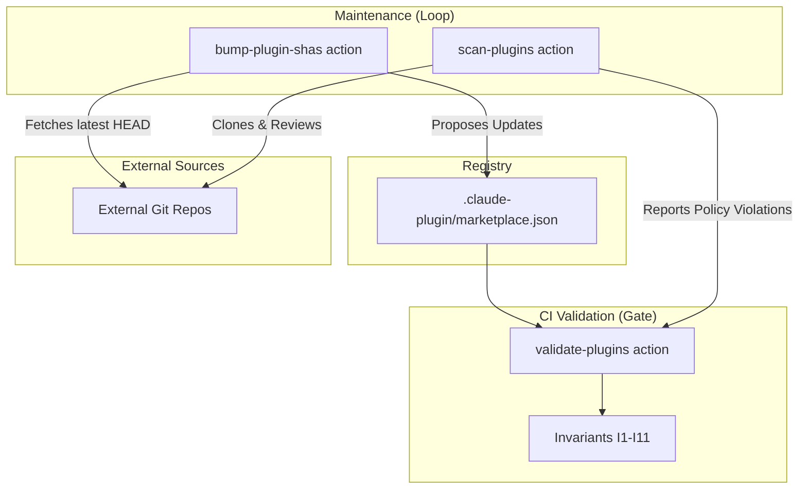
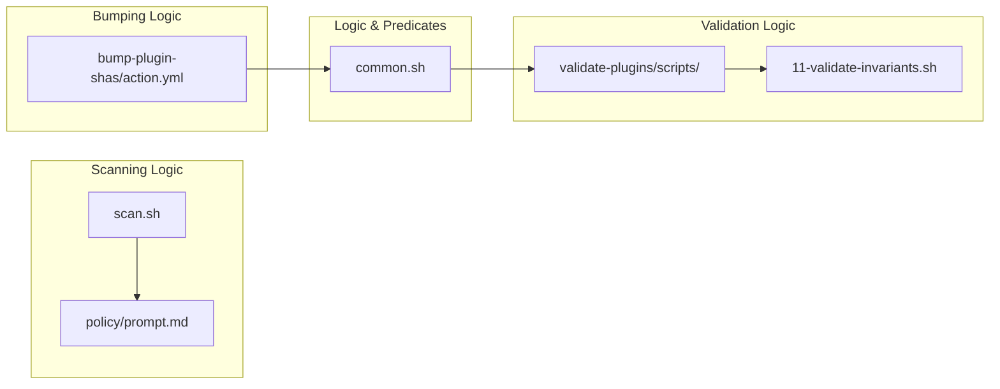

<!-- source: DeepWiki mcp.deepwiki.com · repo anthropics/claude-plugins-community · page 1 Overview · fetched 2026-10-26 -->

# Overview

Relevant source files

The following files were used as context for generating this wiki page:

- [.claude-plugin/marketplace.json](.claude-plugin/marketplace.json)
- [.github/actions/README.md](.github/actions/README.md)
- [.github/actions/scan-plugins/scripts/scan.sh](.github/actions/scan-plugins/scripts/scan.sh)
- [README.md](README.md)

The `claude-plugins-community` repository serves as the official, read-only mirror of the community plugin marketplace for the Claude ecosystem. It provides a centralized registry that powers plugin discovery and installation for both **Claude Cowork** and the **Claude Code CLI** [README.md:1-22]().

## System Architecture

The repository is not a primary source for submissions; rather, it is a downstream mirror synchronized from Anthropic's internal review pipeline [README.md:5-9](). The system consists of three primary layers: the **Marketplace Registry**, the **CI Validation Pipeline**, and the **Automated Maintenance Loop**.

### High-Level Component Interaction

The following diagram illustrates how the GitHub Actions subsystems interact with the `marketplace.json` manifest and external plugin sources.

**Marketplace Maintenance Flow**

Sources: [.github/actions/README.md:1-15](), [.claude-plugin/marketplace.json:1-6]()

## Core Subsystems

### 1. Marketplace Registry
The heart of the repository is the manifest file located at [.claude-plugin/marketplace.json](). This JSON file defines the metadata, source locations (Git URLs), and integrity SHAs for every community-approved plugin [.claude-plugin/marketplace.json:7-16]().
*   **For details, see [Repository Purpose and Architecture](#1.1)**

### 2. CI Validation (validate-plugins)
Every change to the marketplace is gated by a comprehensive validation suite. This system enforces eleven specific "Invariants" (I1–I11) ranging from alphabetical sorting and HTTPS-only requirements to strict SHA-40 hex validation and shell metacharacter safety [.github/actions/README.md:9](). It utilizes a shared library of security predicates to prevent SSRF and injection attacks [.github/actions/validate-plugins/lib/common.sh]().
*   **For details, see [CI/CD Pipeline: Validation, Bumping, and Scanning](#3)**

### 3. Automated Maintenance (bump-plugin-shas & scan-plugins)
To ensure plugins remain functional and secure, the repository employs two automated maintenance actions:
*   **`bump-plugin-shas`**: Periodically checks external repositories for new commits and proposes manifest updates via signed commits [.github/actions/README.md:10]().
*   **`scan-plugins`**: Uses Claude-based headless analysis (via `claude -p`) to review plugin source code against safety policies, checking for credential exfiltration or malicious patterns [.github/actions/scan-plugins/scripts/scan.sh:127-133]().
*   **For details, see [CI/CD Pipeline: Validation, Bumping, and Scanning](#3)**

## Code Entity Mapping

The following diagram maps the logical subsystems to the specific scripts and files that implement them within the codebase.

**Subsystem to Code Entity Map**

Sources: [.github/actions/README.md:3-5](), [.github/actions/scan-plugins/scripts/scan.sh:1-23]()

## Integration with Claude Ecosystem

| Consumer | Installation Method | Source Reference |
| :--- | :--- | :--- |
| **Claude Cowork** | Web UI at [claude.com/plugins](https://claude.com/plugins) | Internal Anthropic Sync |
| **Claude Code CLI** | `claude plugin marketplace add anthropics/claude-plugins-community` | GitHub Repository Mirror |

Sources: [README.md:13-22]()

*   **For practical usage instructions, see [Getting Started: Installing and Using Plugins](#1.2)**

---

