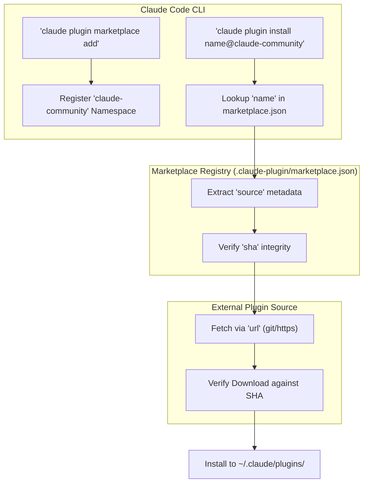
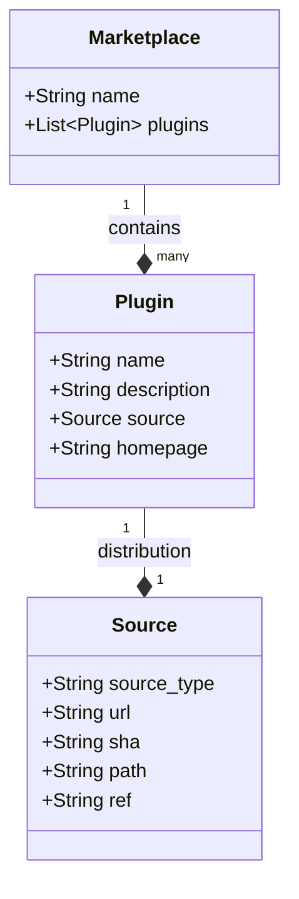

<!-- source: DeepWiki mcp.deepwiki.com · repo anthropics/claude-plugins-community · page 1.2 Getting Started: Installing and Using Plugins · fetched 2026-10-26 -->

# Getting Started: Installing and Using Plugins

Relevant source files

The following files were used as context for generating this wiki page:

- [.claude-plugin/marketplace.json](.claude-plugin/marketplace.json)
- [README.md](README.md)

This page provides a practical guide for end users on how to interact with the community plugin marketplace. It covers the registration of the marketplace as a source in the Claude Code CLI, the installation process, and the data structure that defines a plugin's identity and integrity.

## Adding the Marketplace to Claude Code

To use community plugins in the Claude Code CLI, you must first register this repository as a known marketplace source. Claude Code uses a namespaced system to manage plugins from different providers.

### CLI Commands

The following commands are used to manage the marketplace and install plugins:

| Action | Command |
| :--- | :--- |
| **Add Marketplace** | `claude plugin marketplace add anthropics/claude-plugins-community` |
| **Install Plugin** | `claude plugin install <plugin-name>@claude-community` |
| **List Installed** | `claude plugin list` |

Sources: `[README.md:19-22]()`

### Data Flow: Marketplace Registration to Installation

The diagram below illustrates how the Claude Code CLI interacts with the `marketplace.json` manifest to resolve and install a plugin.

**Plugin Resolution and Installation Flow**

Sources: `[.claude-plugin/marketplace.json:1-16]()`, `[README.md:19-22]()`

## Plugin Schema Fields

Every entry in the marketplace is defined by a specific set of fields in the `.claude-plugin/marketplace.json` manifest. These fields ensure that the CLI can find, describe, and securely download the plugin.

| Field | Type | Description |
| :--- | :--- | :--- |
| `name` | `string` | The unique identifier used for installation (e.g., `0x`, `10x-shopping`). |
| `description` | `string` | A detailed explanation of the plugin's capabilities, commands, and use cases. |
| `source` | `object` | Contains the distribution details, including the `url` and the `sha`. |
| `sha` | `string` | A 40-character hex string (SHA-1/SHA-256) used to pin the plugin to a specific version for security. |
| `homepage` | `string` | The URL for documentation or the plugin's primary website. |

### Source Distribution Models

The `source` field supports two primary distribution models:

1.  **Direct URL (`url`)**: The plugin is hosted in its own repository.
    *   Example: `0x` plugin `[.claude-plugin/marketplace.json:10-14]()`
2.  **Git Subdirectory (`git-subdir`)**: The plugin is part of a monorepo.
    *   Example: `42crunch-api-security-testing` plugin `[.claude-plugin/marketplace.json:50-56]()`

**Plugin Entity Mapping**

Sources: `[.claude-plugin/marketplace.json:1-16]()`, `[.claude-plugin/marketplace.json:50-56]()`

## Browsing Plugins via Claude Cowork

For users who prefer a graphical interface or are using the web-based Claude Cowork environment, plugins can be browsed and managed directly through the Anthropic web interface.

*   **Discovery**: Browse the directory at [claude.com/plugins](https://claude.com/plugins).
*   **Submission**: New plugins are submitted via a web form at [clau.de/plugin-directory-submission](https://clau.de/plugin-directory-submission).

Note that this repository is a **read-only mirror** of the internal Anthropic review pipeline. Manual pull requests to add plugins directly to this repository are automatically closed. All community contributions must flow through the official submission portal to undergo security scanning and approval.

Sources: `[README.md:5-9]()`, `[README.md:13-15]()`, `[README.md:24-27]()`

---

