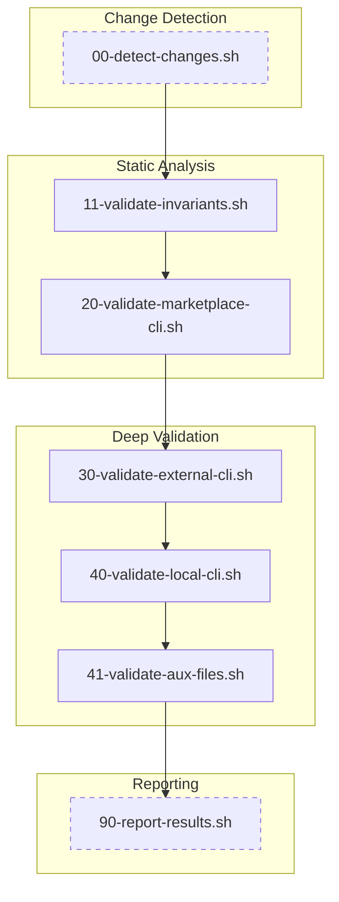
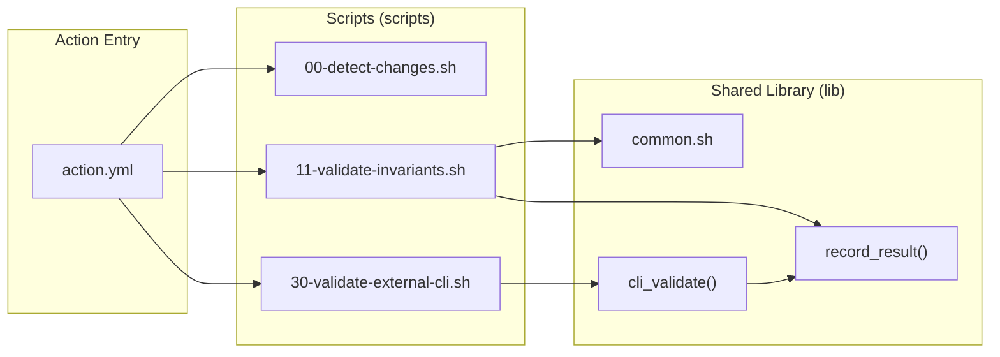

<!-- source: DeepWiki mcp.deepwiki.com · repo anthropics/claude-plugins-community · page 3.1 validate-plugins Action · fetched 2026-10-26 -->

# validate-plugins Action

Relevant source files

The following files were used as context for generating this wiki page:

- [.github/actions/validate-plugins/README.md](.github/actions/validate-plugins/README.md)
- [.github/actions/validate-plugins/action.yml](.github/actions/validate-plugins/action.yml)
- [.github/workflows/validate-plugins.yml](.github/workflows/validate-plugins.yml)

The `validate-plugins` composite action provides canonical CI validation for Claude plugin marketplace repositories. It is designed as a "drop-in" solution that enforces both the technical schema requirements of the Claude CLI and a set of strict security and policy invariants.

The action follows a **zero-schema-maintenance** philosophy: it does not vendor a JSON schema. Instead, it dynamically installs the `@anthropic-ai/claude-code` package to use the CLI's own Zod definitions as the source of truth for validation.

### Architecture Overview

The action executes a six-stage pipeline that transitions from change detection to deep validation of external and local plugin source code.

**Sources:**
- [.github/actions/validate-plugins/README.md:7-23]()
- [.github/actions/validate-plugins/action.yml:105-245]()

---

### Pipeline Stages

#### 00-detect-changes
This stage identifies which plugins have been modified by comparing the current `HEAD` against a `base-ref`. It supports both monolithic `marketplace.json` files and per-file entry directories.
For details, see [Change Detection and External Manifest Resolution](#3.1.2).

#### 11-invariants
Applies 11 hardening rules (I1–I11) that enforce repository policy, such as alphabetical sorting, SHA pinning, and shell metacharacter prevention. This stage supports "grandfathering" via the `scope-errors-to-changed` policy, which prevents preexisting errors in unrelated plugins from blocking a PR.
For details, see [Invariants I1–I11: Security and Policy Rules](#3.1.1).

#### 20-cli-marketplace
Executes `claude plugin validate <marketplace-path>`. This is the canonical schema check. It ensures the `marketplace.json` structure matches what the Claude CLI expects at runtime.
**Sources:** [.github/actions/validate-plugins/README.md:29-29]()

#### 30-cli-external
For every changed external plugin, the action:
1. Clones the repository into an isolated temporary directory.
2. Checks out the specific pinned `source.sha`.
3. Runs `claude plugin validate`.
4. Handles `strict:false` (skills-only) entries by synthesizing a manifest if one is missing.

This stage also powers the **Nightly Drift Detection** mode when `validate-all-external` is set to `true`, catching deleted upstream repos or force-pushed SHAs.
**Sources:** [.github/actions/validate-plugins/README.md:70-95](), [.github/actions/validate-plugins/action.yml:58-64]()

#### 40-cli-local & 41-aux-files
Validates plugins hosted directly within the marketplace repository. Step 41 specifically parses auxiliary runtime files like `.mcp.json` or `hooks.json` to ensure they are valid JSON, preventing runtime crashes.
**Sources:** [.github/actions/validate-plugins/README.md:31-32]()

#### 90-report
Consolidates results from the `RESULTS_FILE` JSONL log and generates a GitHub Step Summary and a markdown report.
**Sources:** [.github/actions/validate-plugins/action.yml:236-245]()

---

### Inputs and Outputs

The action is highly configurable to support different repository layouts and policy strictness.

| Input | Default | Purpose |
| :--- | :--- | :--- |
| `marketplace-path` | `.claude-plugin/marketplace.json` | Path to the main registry file. |
| `entries-dir` | `""` | Directory for per-file plugin definitions (enables I6/I7). |
| `scope-errors-to-changed` | `false` | If `true`, preexisting invariant errors in unchanged plugins become warnings. |
| `warn-invariants` | `I1 I3 I5 I8` | Invariants that should not fail the build. |
| `allowed-hosts` | `github.com gitlab.com ...` | SSRF protection allowlist for external clones. |

**Sources:** [.github/actions/validate-plugins/action.yml:8-83]()

---

### Implementation Mapping

The following diagram maps the logical validation stages to the specific script entities and shared utilities defined in the codebase.

**Sources:**
- [.github/actions/validate-plugins/action.yml:105-245]()
- [.github/actions/validate-plugins/scripts/11-validate-invariants.sh]()
- [.github/actions/validate-plugins/lib/common.sh]()

---

### Security and Grandfathering

The action implements a **Grandfathering Policy** via the `scope-errors-to-changed` input. This allows a repository to adopt new invariants without immediately breaking all existing entries.

- **Global Invariants (Always Error):** Rules that affect the whole file (e.g., `I1` Alphabetical Sort, `I2` Duplicate Names) always trigger a failure.
- **Per-Entry Invariants (Scoped):** Rules like `I3` (Description length) or `I5` (SHA pinning) are downgraded from `ERROR` to `WARNING` if the specific plugin entry was not modified in the current PR.

**Sources:**
- [.github/actions/validate-plugins/action.yml:35-46]()
- [.github/actions/validate-plugins/README.md:116-116]()

For details on the shared security predicates and logging system, see [Shared Library: common.sh Utilities](#3.1.3).

---

