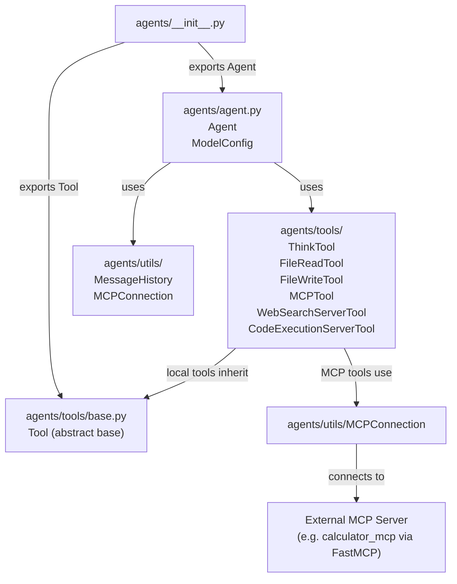
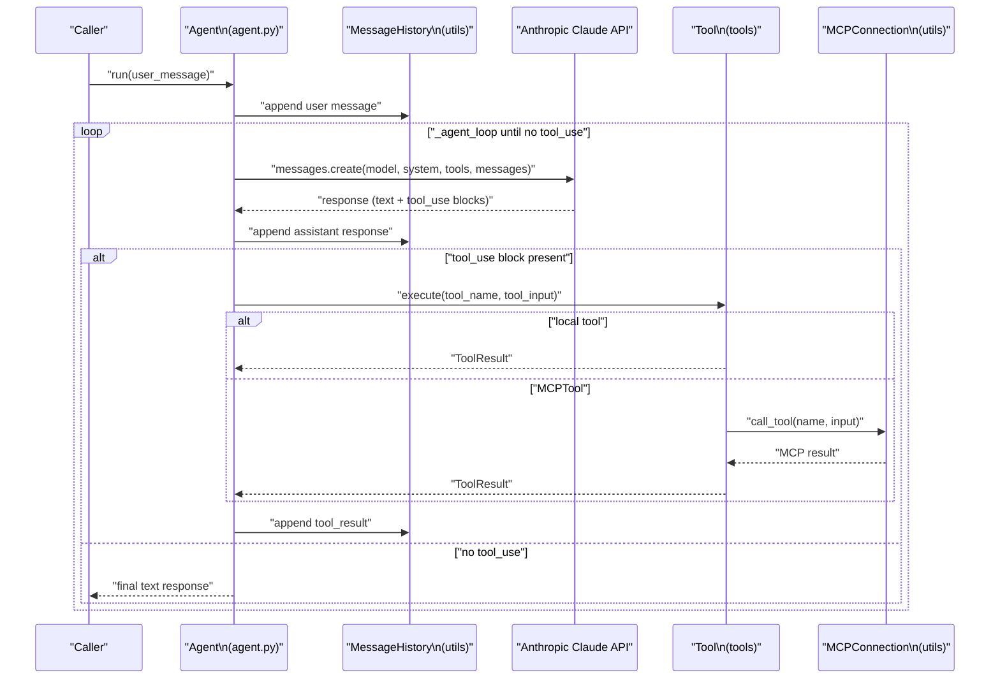

<!-- source: DeepWiki mcp.deepwiki.com · repo anthropics/claude-quickstarts · page 4 Agent Framework · fetched 2026-10-26 -->

# Agent Framework

<details>
<summary>Relevant source files</summary>

The following files were used as context for generating this wiki page:

- [.github/workflows/tests.yaml](.github/workflows/tests.yaml)
- [README.md](README.md)
- [agents/.gitignore](agents/.gitignore)
- [agents/README.md](agents/README.md)
- [agents/__init__.py](agents/__init__.py)
- [customer-support-agent/README.md](customer-support-agent/README.md)
- [financial-data-analyst/README.md](financial-data-analyst/README.md)
- [financial-data-analyst/app/api/finance/route.ts](financial-data-analyst/app/api/finance/route.ts)

</details>


This page introduces the `agents/` Python package: its design goals, package structure, and the relationships among its components. For detailed coverage of the `Agent` class internals, see [Agent Class Architecture](#4.1). For the tool system and MCP integration, see [Tool Integration & MCP](#4.2).

---

## Purpose

The `agents/` package is a **minimal, educational reference implementation** of an LLM agent using the Claude API. It is explicitly **not an SDK**. The entire core logic is under 300 lines of code and deliberately omits production features (retry policies, observability, rate-limit handling, etc.) to keep the patterns readable and easy to adapt.

Its stated goal is to demonstrate how sophisticated AI behavior emerges from one foundational pattern: **an LLM calling tools in a loop**. The implementation is intentionally language-neutral in spirit — the README encourages translating the patterns to other languages or production stacks.

Sources: [agents/README.md:1-11]()

---

## Package Structure

The package is organized into three directories:

| Path | Role |
|---|---|
| `agents/agent.py` | `Agent` class and `ModelConfig` dataclass — the main API interaction and loop |
| `agents/tools/` | Tool implementations: native local tools and MCP-backed tools |
| `agents/utils/` | Utilities for message history management and MCP server connections |

The public surface area of the package is defined in `agents/__init__.py`:

```
Agent       — main agent class
ModelConfig — dataclass for model configuration
Tool        — abstract base class for all tools
```

Sources: [agents/__init__.py:1-6](), [agents/README.md:11-16]()

---

## Component Overview Diagram

**Diagram: `agents/` Package Components and Public Exports**



Sources: [agents/__init__.py:1-6](), [agents/README.md:11-16]()

---

## Key Design Principles

1. **Tools in a loop**: The agent repeatedly calls the Claude API; when the model returns a `tool_use` block, the agent executes the corresponding tool and feeds the result back in the next turn. The loop terminates when the model returns a response with no tool calls.

2. **Local tools vs. server tools**: Local tools (`ThinkTool`, `FileReadTool`, `FileWriteTool`) execute directly in-process. MCP tools (`MCPTool`) delegate to an external MCP server process via the `MCPConnection` utility. Server tools (`WebSearchServerTool`, `CodeExecutionServerTool`) use a separate schema format recognized by the Anthropic API.

3. **MCP server support**: The `Agent` constructor accepts an `mcp_servers` list. Each entry is a configuration dict (type, command, args) that `MCPConnection` uses to spawn and communicate with an MCP server subprocess.

4. **Sync and async**: The agent exposes both `run` (synchronous) and `run_async` (async) entrypoints, wrapping the same `_agent_loop` core.

Sources: [agents/README.md:1-44]()

---

## Runtime Flow Diagram

**Diagram: High-Level Agent Runtime — from `agent.run()` to tool execution**



Sources: [agents/README.md:1-44](), [agents/__init__.py:1-6]()

---

## Requirements

| Requirement | Detail |
|---|---|
| Python | 3.8+ |
| `ANTHROPIC_API_KEY` | Environment variable — required for all API calls |
| `anthropic` library | Anthropic Python SDK |
| `mcp` library | Required for MCP server tool support |

Sources: [agents/README.md:42-44]()

---

## Quick Usage Example

The minimal usage pattern from the README — creating an agent with a local tool and an MCP server tool:

[agents/README.md:19-39]()

The constructor accepts:
- `name` — agent identifier
- `system` — system prompt string
- `tools` — list of `Tool` instances (local tools)
- `mcp_servers` — list of MCP server config dicts

After construction, `agent.run(message)` returns the final text response from the model.

---

## Relationship to Other Parts of the Repository

The `agents/` package is a standalone Python package. It is not used by the other quickstart projects (`computer-use-demo`, `customer-support-agent`, `financial-data-analyst`, etc.), which each implement their own patterns for Claude API interaction. The `agents/` package exists as a separate reference alongside those projects.

For the Computer Use Demo's own agent loop pattern, see [Sampling Loop & Agent Orchestration](#2.2). That implementation is a different approach (function-based, not class-based) targeted specifically at computer control tasks.

Sources: [agents/README.md:1-44](), [README.md:1-70]()

---

